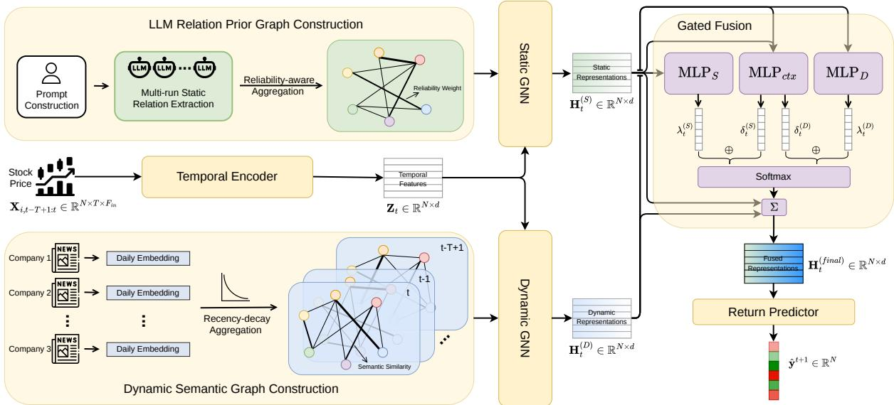
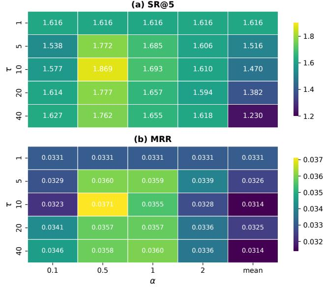
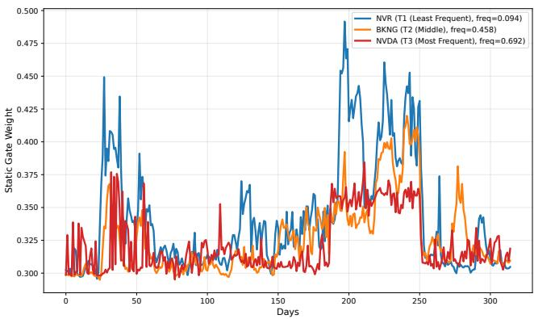

# LENS: Reliability-Aware Stock Prediction via LLM-Extracted Priors and News-Driven Semantic Graphs

Hao Zhou   
hao.zhou@ed.ac.uk   
School of Informatics   
The University of Edinburgh   
Edinburgh, United Kingdom   
Tiejun Ma   
tiejun.ma@ed.ac.uk   
School of Informatics   
The University of Edinburgh   
Edinburgh, United Kingdom

Luis Felipe Costa Sperb f.costasperb@kingston.ac.uk Kingston Business School Kingston University London, United Kingdom

## Abstract

Predicting stock returns requires modeling persistent company relations and time-varying market signals. Graph Neural Network (GNN) approaches combine static priors with dynamic relational graphs, but treat every extracted edge as a trustworthy binary fact, ignoring heterogeneous reliability across relational sources. We propose LENS (LLM-Extracted priors and News-driven Semantics), a static–dynamic graph framework for stock return prediction and ranking that models relational reliability as a first-class signal across the pipeline. On the static side, we extract a multi-relational company graph from a Large Language Model and aggregate it over multiple runs with confidence weighting to downweight low consistency edges. On the dynamic side, we build a news-driven semantic graph with exponential-decay temporal aggregation to capture changing market context under uneven coverage. A context dependent gated fusion module rebalances the two graphs at the per-stock, per-day level. On S&P 500, LENS improves AR@5 by 16.4% and SR@5 by 22.6% over the strongest baseline, and on NAS- DAQ 100 it achieves comparable improvements (15.5% and 20.9% respectively). Ablations isolate each component’s contribution, and a human-validation study of sampled relations supports that the aggregation is grounded, providing evidence that reliability-aware LLM relations and news-based semantic graphs carry complementary information for graph-based financial prediction.

## CCS Concepts

• Computing methodologies → Natural language processing; • Applied computing → Economics; • Information systems → Information retrieval.

## Keywords

stock return prediction, graph neural networks, large language models, news analytics

## ACM Reference Format:

Hao Zhou, Tiejun Ma, and Luis Felipe Costa Sperb. 2026. LENS: Reliability Aware Stock Prediction via LLM-Extracted Priors and News-Driven Se- mantic Graphs. In Proceedings of the 35th ACM International Conference on Information and Knowledge Management (CIKM ’26), November 07–11, 2026, Rome, Italy. ACM, New York, NY, USA, 12 pages. https://doi.org/10.1145 3799682.3840912

## 1 Introduction

Stock return prediction is a fundamental problem in quantitative investment, and inter-company relationships are widely recognised as a valuable signal beyond a stock’s own historical features. These relations live on diferent timescales: persistent structural ties such as supply chains [2] and industry classifications [8] change slowly, while event-driven interactions [22] can shift overnight. Graph Neural Networks (GNNs) have become the standard tool for propagating information across such relations [3, 13], yet their efectiveness is fundamentally bottlenecked by the quality of the underlying graph: rigid static priors ignore real-time events, while noisy dynamic graphs amplify fake correlations during message passing. We ar-gue that the root cause is not a shortage of relational evidence but the way it is used: existing methods treat every extracted edge as an equally trustworthy binary fact, with no mechanism to model the heterogeneous reliability of diferent relational sources across stocks, time, and extraction methods. Therefore, we propose to model the relational reliability as a first-class signal.

Stock prediction methods relying on static priors illustrate the issue clearly. Traditional sources such as the Global Industry Classi- fication Standard (GICS) [18] or knowledge bases such as WikiData [8] are stable and consistent but coarse and slow to reflect evolving business relationships. Recent work [34] replaces these with relations extracted directly from a Large Language Model (LLM) via zero-shot prompting, producing richer and more granular graphs than predefined taxonomies. However, LLM extraction is inherently probabilistic: diferent runs of the same prompt can yield inconsistent or hallucinated triples, and prior work takes the LLM output as a deterministic, binary edge set with limited direct validation of the resulting graph. Such uncertainty propagates through message passing and can reduce downstream prediction quality.

Dynamic graphs also face a similar reliability issue. Many studies build dynamic relations from historical price correlations [4, 22, 28], but such graphs are noisy and largely redundant with the price-derived node features that GNNs already encode. Financial news ofers a more semantically grounded alternative, yet news coverage is highly uneven across companies and time. Aggregating headlines over a short window leaves many stocks isolated, while a long window can reduce the signal-to-noise ratio due to outdated information. As a result, news-driven graphs alone are unreliable, particularly for stocks with lower news coverage.

To address these limitations, we propose LENS (LLM-Extracted priors and News-driven Semantics), a static-dynamic graph frame-work for stock return prediction and ranking that models relational reliability as a first-class signal across the whole pipeline. On the static side, LENS extracts a multi-relational company graph by

This work is licensed under a Creative Commons Attribution 4.0 International License. CIKM ’26, Rome, Italy   
© 2026 Copyright held by the owner/author(s).   
ACM ISBN 979-8-4007-2539-5/2026/11   
https://doi.org/10.1145/3799682.3840912

prompting an LLM whose knowledge cutof precedes the evaluation period (mitigating information leakage), treats the extraction as a stochastic process repeated over multiple runs, and aggregates the resulting triples into a reliability-weighted edge set whose weights combine cross-run frequency with model-reported confidence. On the dynamic side, LENS constructs a news-driven semantic graph with exponential-decay temporal aggregation and mutual top-� sparsification, retaining recency without ignoring sparsely cov-ered companies. A context-dependent gated fusion module then adaptively rebalances the static and dynamic representations at the per-stock, per-day level, leaning more on the stable LLM prior when news evidence is weak and on the news-derived signal when coverage is rich.

We evaluate LENS on the S&P 500 and NASDAQ 100 with rolling quarterly out-of-sample folds, followed by a direct human-validation study of the LLM-extracted static graph and a coverage-stratified robustness analysis. In sum, our main contributions are:

• Reliability-weighted LLM company priors, validated end-to-end. We formulate LLM relation extraction as a stochastic graph-construction process and aggregate five extraction runs into reliability-weighted multi-relational edges by combining frequency with model-reported confidence. We then validate the resulting graph both down- stream, where LLM priors outperform GICS, WikiData, and news-co-occurrence alternatives, and directly, via a 120- triple human-validation study under three independent an- notators with web-search adjudication (Fleiss’ �=0.58, mod erate), which yields 91.1% relaxed precision for the default Highrecall graph and a monotonic association between reliability bins and strict correctness (36.7% / 50.0% / 76.7% on low/mid/high terciles).

• Noise-controlled dynamic semantic graphs under uneven news coverage. We use exponential-decay temporal aggregation to construct daily news-driven semantic graphs to address the heterogeneous coverage and reliability of news evidence across stocks and time. This design outperforms price-correlation and news-co-occurrence dynamic-graph baselines.

• Reliability-aware gated fusion across two markets. We introduce a context-dependent gating module that balances the relative reliability of the static LLM prior and the dy- namic news graph at the stock-day level: leaning more on the static prior when news evidence is weak and more on the dynamic graph when coverage is rich. Across the S&P 500 and NASDAQ 100, LENS improves ranking and portfolio met-rics over strong sequence- and graph-based baselines, and reduces the MAE gap between high- and low-news-coverage stocks from 5.39% to 3.18%.

## 2 Related Work

Graph-Based Stock Prediction. Graph neural networks have been widely adopted for stock forecasting to model cross-company de- pendencies. Early studies typically rely on predefined relationships, such as industry taxonomies [18], supply chains [2], shareholding patterns [26], and knowledge graphs like [8, 19]. While stable, these priors often sufer from rigidity and outdated information.

Recently, Zhou et al. [34] demonstrated the potential of extracting more granular relational priors from LLMs. However, such probabilistic extractions introduce uncertainty that remains unaddressed. Parallel to static priors, dynamic graphs infer time-varying relations from price correlations or historical features [4, 22, 29], but they are often afected by low signal-to-noise ratios. Although some works attempt to jointly model static and dynamic links [25, 32], they typically rely on fixed fusion rules (e.g., additive or static gating), which fail to account for the fluctuating reliability of diferent data sources under volatile market conditions.

Financial NLP and Semantic Graphs. Financial NLP has evolved from basic sentiment analysis [15] to leveraging LLMs for sophisticated information extraction, such as FinGPT [31] and Bloomberg- GPT [27]. Despite the rich semantics of news-driven signals, they face severe spatiotemporal fragmentation: uneven media coverage often fails to model companies with sparse coverage and leads to isolated parts in graph. Our work, LENS, bridges these gaps by introducing a reliability-aware framework that extracts reliable signals from stochastic LLM priors and employs temporal decay aggregation to mitigate uneven news coverage, followed by an adaptive fusion mechanism for robust forecasting.

## 3 Problem Formulation

Following [8], we formulate the stock movement prediction task as a learning to rank problem. Let ${ \cal S } = \{ s _ { 1 } , s _ { 2 } , . . . , s _ { N } \}$ denote the set of � target stocks. For each stock $s _ { i } \in S$ on a given trading day �, we define its future 1-day log return as $\begin{array} { r } { y _ { i } ^ { t + 1 } = \log \left( \frac { p _ { i } ^ { t + 1 } } { p _ { i } ^ { t } } \right) } \end{array}$ , where $\boldsymbol { p } _ { i } ^ { t }$ is the closing price. The ground-truth ranking is based on the future returns: �� is ranked higher than $s _ { j }$ if $y _ { i } ^ { t + 1 } > y _ { i } ^ { t + 1 }$ . Our objective is to learn a scoring function, $f ,$ that uses information available up to day � and outputs a real-valued score $\hat { y } _ { i } ^ { t + 1 }$ for each stock $s _ { i } .$ . This score is implemented as the predicted 1-day log return. Higher $\hat { y } _ { i } ^ { t + 1 }$ implies higher expected return and thus a higher rank.

To learn this scoring function, our model leverages three sources of information. First, to capture stable, long-term company relationships, we construct a weighted multi-relational prior graph $G _ { S } = \big ( S , \{ A _ { S } ^ { ( r ) } \} _ { r \in \mathcal { R } } \big )$ , where R denotes the set of relation types and each $A _ { S } ^ { ( r ) } \in \mathbb { R } ^ { N \times N }$ is a weighted adjacency matrix for relation �. Second, to model event-driven dependencies, we construct a news-derived dynamic semantic graph $G _ { D } ^ { t } = ( S , A _ { D } ^ { t } )$ , where $A _ { D } ^ { t } \in \mathbb { R } ^ { N \times N }$ is a weighted adjacency matrix in which the value quantifies semantic relatedness between daily news representations of companies at time �. Finally, the intrinsic state of each stock is captured by daily feature matrices $\mathbf { X } ^ { t } \in \mathbb { R } ^ { N \times F _ { \mathrm { i n } } }$ derived from historical market signals over a lookback window of length �.

Formally, our task is to learn a scoring function � that maps these heterogeneous and temporally distinct inputs to a vector of ranking scores:

$$
\hat { \mathbf { y } } ^ { t + 1 } = f \bigl ( G _ { S } , \ G _ { D } ^ { t } , \ \{ \mathbf { X } ^ { u } \} _ { u = t - T + 1 } ^ { t } \bigr ) .\tag{1}
$$

## 4 Methodology

## 4.1 Overview

As illustrated in Figure 1, our architecture consists of the following main stages: (1) LLM-prompted static graph construction module, (2) news-driven dynamic semantic graph construction module, (3) a dual-component GNN encoder, (4) stock return & ranking predictor. This design allows the model to form a holistic and temporally- aware view of the market environment.

  
Figure 1: Overview of LENS. The framework consists of (1) static relation prior construction via multi-run LLM extraction and reliability-aware aggregation, (2) dynamic semantic graph construction from temporally aggregated news embeddings, (3) a dual-component GNN encoder over the static and dynamic graphs, and (4) a gated fusion module followed by a return predictor.

## 4.2 Reliability-Weighted LLM Relation Priors

This module builds a static, typed relationship graph over constituent firms using a large language model (LLM). The static graph is designed as a slow-moving structural anchor: it is extracted once before the evaluation horizon and held fixed throughout testing, while fast-moving updates are absorbed by the dynamic graph (Sec tion 4.3). To prevent leakage from LLM pretraining, the prompt restricts the evidence window to information available on or before 2023-09-30, matching the cutof after which all test folds begin. Given a source company �, we prompt the LLM to output directed relation triplets $( i , r , j )$ , where � is also a constituent and � belongs to a predefined taxonomy.

Relation taxonomy and output. Following Zhou et al. [34], we use 14 relationship types covering ownership (Subsidiary, Parent), investment (Investor, InvestedBy), acquisition (Acquirer, Target), partnership (JointVenture, Strategic, R&D, Collaborator), commercial (Supplier, Customer, Distributor), and competitive (Competitor) ties. We iterate over the S&P 500 constituents and prompt the LLM to return up to 10 target tickers together with a scalar confidence score in [0,1] for each relation type. We define the confidence score as the model’s belief that the labeled relation is factually correct and publicly documented as of the cutof date. The score is not intended to measure how close, important, or economically strong the connection is. This distinction is important because we later use confidence as a reliability signal when aggregating multiple extraction runs and when weighting edges in downstream learning.

Multi-run extraction and reliability-aware aggregation. LLM relation extraction is stochastic, where repeated calls with the same prompt can yield diferent edge sets. We therefore treat � independent runs as samples from an extraction process and aggregate them to improve stability. For each triplet $e = ( i , r , j )$ that appears, we count its frequency $f ( e )$ and calculate its average confidence score �¯(�) over the runs where it appears. We then combine these two signals into an edge reliability weight:

$$
\rho ( e ) = f ( e ) \cdot \bar { c } ( e ) .\tag{2}
$$

In this way, we can mitigate the fluctuations in confidence scores that may be generated by diferent extraction runs and reduce the weight of those relations that appear by chance. Finally, in constructing a static relation graph, we propose three diferent aggregation strategies: (i) Strict, which retains an edge if its empirical frequency $f ( e ) \geq \theta _ { f } ;$ (ii) Highrecall, which retains an edge if $f ( e ) \geq \theta _ { f }$ or its maximum confidence across runs $c _ { \operatorname* { m a x } } ( e ) > \theta _ { c } ;$ (iii) All, which retains all extracted edges. The full procedure is summarised in Algorithm 1.

## 4.3 Noise-Controlled Dynamic Semantic Graph from News

Whereas the static side addresses reliability at its source, the dy- namic side faces a diferent problem: news coverage is uneven across stocks and across days, so any single-day similarity graph mixes informative signal with coverage noise. We address this with two complementary design choices: exponential-decay temporal aggregation, which balances recency against single-day fluctuations, and mutual top-� sparsification with a targeted fallback for otherwise-isolated nodes, which suppresses pseudo-edges from accidental semantic overlap. The construction is described below.

Algorithm 1 Reliability-Weighted LLM Relation Priors   
Require: constituent firms $\gamma ;$ relation types $\mathcal { R } ;$ � extraction runs;   
mode ∈ {Strict, Highrecall, $\operatorname { A L L } \biggr \}$   
Ensure: Static relation prior edges $\varepsilon _ { S }$ with reliability weights $\rho ( e )$   
1: Set frequency threshold $\theta _ { f } \gets 0 . 6$ and confidence threshold   
$\theta _ { c } \gets 0 . 8$   
2: Initialize counts $n ( e )  0 ,$ sums $s ( e ) \gets 0 ,$ max confidence   
$c _ { \mathrm { m a x } } ( e ) \gets 0$   
3: for each source firm $i \in \mathcal { V }$ and run � = 1, . . . , � do   
4: Query LLM; parse outputs into triplets $e ~ = ~ ( i , r , j )$ with   
$c \in [ 0 , 1 ]$   
5: for each extracted $( e , c )$ do   
6: $n ( e ) \mathrel { + } = 1 ; s ( e ) \mathrel { + } = c ; c _ { \mathrm { m a x } } ( e ) \mathrel {  } \mathrm { m a x } ( c _ { \mathrm { m a x } } ( e ) , c )$   
7: end for   
8: end for   
9: $\varepsilon _ { S } \gets \emptyset$   
10: for each � with $n ( e ) > 0$ do   
11: $f ( e ) \gets n ( e ) / M ; \bar { c } ( e ) \gets s ( e ) / n ( e ) ; \rho ( e ) \gets f ( e ) \bar { c } ( e )$   
12: if mode $= { \tt A L L } ;$ or (Strict and $f ( e ) \geq \theta _ { f } )$ ; or (Highrecall   
and $( f ( e ) \ge \theta _ { f }$ or $c _ { \operatorname* { m a x } } ( e ) > \theta _ { c } ) )$ then   
13: $\mathcal { E } _ { S }  \mathcal { E } _ { S } \cup \{ e \}$   
14: end if   
15: end for   
16: return $\varepsilon _ { S }$

Semantic encoding ofnews headlines. For each firm � on day �, we collect its headline set $\mathcal { H } _ { i } ^ { t }$ and concatenate them into a long sequence, then use a text embedding model to obtain a dense rep- resentation $\mathbf { e } _ { i } ^ { t }$

Temporal aggregation into window embeddings. We aggregate company-level daily news embedding into a window embedding of length � over time mainly based on the following considerations: (i) The impact of major events to the market is often persistent. Using only the news of one day can easily ignore the lag efect of events and be more sensitive to single-day noise. Window aggregation can improve the stability and robustness of the representation while retaining key signals. (ii) News coverage is highly uneven across companies, with some companies having very little or no daily news. Window aggregation can significantly mitigate the “isolated nodes” problem caused by sparsity, thereby enabling information to flow fully on the graph. Specifically, we use an exponential decay weighting strategy:

$$
\mathbf { e } _ { i , t } ^ { ( \mathrm { w i n } ) } = \sum _ { k = 0 } ^ { \tau - 1 } \frac { \exp ( - \alpha k ) } { \sum _ { l = 0 } ^ { \tau - 1 } \exp ( - \alpha l ) } \mathbf { e } _ { i } ^ { t - k } ,\tag{3}
$$

where a higher � yields a stronger decay of the historical infor- mation. We treat � and � as key design factors and analyze their impact in experiments.

Similarity-based edge construction. Given window embeddings $\{ \mathbf { e } _ { i , t } ^ { ( \mathrm { w i n } ) } \}$ , we compute semantic relatedness using cosine similarity:

$$
s _ { i j , t } = \cos ( \mathbf { e } _ { i , t } ^ { ( \mathrm { w i n } ) } , \mathbf { e } _ { j , t } ^ { ( \mathrm { w i n } ) } ) .\tag{4}
$$

Algorithm 2 News-Derived Dynamic Semantic Graph   
Require: Daily news $\{ \mathcal { H } _ { i } ^ { t } \}$ for $i \in \mathcal { V } ;$ window �; decay $\alpha ;$ mutual   
top- $\mathbf { \nabla } \cdot k _ { 1 } ;$ fallback $k _ { 2 }$   
Ensure: Daily dynamic graph $G _ { D } ^ { t } = ( \mathcal { V } , \mathcal { E } _ { D } ^ { t } , w _ { D } ^ { t } )$   
1: Embed $\mathbf { e } _ { i } ^ { t } \gets \mathrm { V o y a g e } ( \mathcal { H } _ { i } ^ { t } )$ for each firm $i \in \mathcal { V }$   
2: $\begin{array} { r } { \mathbf { e } _ { i , t } ^ { ( \mathrm { w i n } ) }  \dot { \sum } _ { k = 0 } ^ { \tau - 1 } \pi _ { k } \mathbf { e } _ { i } ^ { t - k } , \dot { \pi _ { k } } \propto \exp ( - \alpha k ) } \end{array}$   
3: $s _ { i j , t } \gets \mathrm { c o s } ( \mathbf { e } _ { i , t } ^ { ( \mathrm { w i n } ) } , \mathbf { e } _ { j , t } ^ { ( \mathrm { w i n } ) } )$ for all $( i , j )$   
4: $\mathcal { N } _ { k _ { 1 } } ( i ) \gets \mathrm { t o p } { - } k _ { 1 }$ neighbours of � by $s _ { i j , t } ; \mathcal { E } _ { D } ^ { t }  \emptyset$   
5: for each pair $( i , j )$ with $j \in \mathcal { N } _ { k _ { 1 } } ( i )$ and $i \in \bar { N } _ { k _ { 1 } } ( j )$ do   
6: Add $( i , j )$ to $\mathcal { E } _ { D } ^ { t }$ with $w _ { i j , t } ^ { D } \dot {  } \operatorname* { m a x } ( s _ { i j , t } , 0 )$   
7: end for   
8: Fallback: for each isolated �, attach its top-�2 neighbours by   
$s _ { i j , t }$ with weights max $( s _ { i j , t } , 0 )$   
9: return $G _ { D } ^ { t }$

Equation (4) defines a dense pairwise similarity matrix as an intermediate object; the dynamic GNN graph itself is notfully connected. It is constructed by retaining only mutual top-�1 neighbors: for each node �, we form its top-�1 nearest-neighbor set $\mathcal { N } _ { k _ { 1 } } ( i )$ , and edge $( i , j )$ is included if $j \in N _ { k _ { 1 } } ( i )$ and $i \in \mathcal { N } _ { k _ { 1 } } ( j )$ . This mutual constraint suppresses unidirectional pseudo-connections caused by noisy news, short headlines, or accidental semantic overlap, and avoids the over-smoothing and noise propagation associated with overly dense graphs. News coverage is long-tailed, however, so mutual-�1 sparsification can leave some nodes isolated; we therefore add top- $\boldsymbol { \cdot } \boldsymbol { k } _ { 2 }$ neighbors only for such isolated nodes as a minimumconnectivity fix, preserving message-passing usability without de-grading edge quality. The full construction is summarised in Algo-rithm 2.

We note that headline-level semantic embeddings are coarser than explicit event or entity-relation extraction and can admit topi-cal co-mentions. The framework is designed to be robust to such noise: the reliability-weighted static prior (Section 4.2) provides a stable structural anchor, and the reliability-aware gated fusion (Section 4.6) adaptively downweights the dynamic graph when news signals are weak or sparse. Finer-grained event extraction is a natural extension that we leave to future work.

## 4.4 Temporal Encoder

For each company � and trading day �, we firstly form a length-� sequence of per-day inputs (e.g., price and derived technical features) ${ \bf X } _ { i , t - T + 1 : t } \in \mathbb { R } ^ { T \times F _ { i n } }$ . We feed this sequence into a standard Transformer with � attention heads to capture temporal dependen- cies for each company individually. By stacking all companies we obtain $\mathbf { Z } _ { t } \in \mathbb { R } ^ { N \times d }$ , which is used as input to both graph encoders (Section 4.5).

$$
\begin{array} { r } { \mathbf { Z } _ { t } = \operatorname { T r a n s f o r m e r } \left( \left\{ \mathbf { X } _ { i , t - T + 1 : t } \right\} _ { i = 1 } ^ { N } \right) . } \end{array}\tag{5}
$$

## 4.5 Dual Component GNN Encoder

We then encode relational information with two parallel graph encoders: a static encoder on the LLM-derived relationship prior $G _ { S }$ and a dynamic encoder on the news-driven semantic graph $G _ { D } ^ { t } .$ We keep the two encoders separate and only fuse their outputs at the end of the GNN block. This design reflects the diferent roles of the graphs: $G _ { S }$ provides stable structural priors, while $G _ { D } ^ { t }$ is time-varying and can be noisy under sparse news coverage.

Static encoder: Union Graph Transformer. The static graph $\mathcal { G } _ { S }$ contains relation types $r _ { i j }$ and reliability weights $\rho _ { i j }$ . We follow the Graph Transformer paradigm [6] and inject edge features into attention to distinguish relation semantics and suppress low-reliability edges. This design avoids the cost of maintaining a separate sub-graph for each relation. For each head ℎ, we first compute

$$
\begin{array} { r } { \mathbf q _ { i , t } = \mathbf W _ { Q } \mathbf z _ { i , t } , \mathbf k _ { j , t } = \mathbf W _ { K } \mathbf z _ { j , t } , \mathbf v _ { j , t } = \mathbf W _ { V } \mathbf z _ { j , t } . } \end{array}\tag{6}
$$

Then, edge features are constructed using relation embedding and reliability scaling.

$$
\mathbf { e } _ { i j } = \rho _ { i j } \cdot \mathbf { W } _ { \mathrm { r e l } } [ r _ { i j } ] ,\tag{7}
$$

Here $\rho _ { i j } \in [ 0 , 1 ]$ scales the learnable relation embedding by the edge’s reliability. $\mathbf { e } _ { i j }$ is injected into both the key and value vector:

$$
\beta _ { i j , t } = \frac { \langle \mathbf { q } _ { i , t } , \ \mathbf { k } _ { j , t } + \mathbf { e } _ { i j } \rangle } { \sqrt { d _ { h } } } ,\tag{8}
$$

$$
\begin{array} { r } { \alpha _ { i j , t } = { \mathrm { S o f t m a x } } _ { j \in N _ { S } ( i ) } ( \beta _ { i j , t } ) , } \end{array}\tag{9}
$$

$$
\mathbf { h } _ { i , t } ^ { \left( S \right) } = \sum _ { j \in N _ { S } \left( i \right) } \alpha _ { i j , t } \left( \mathbf { v } _ { j , t } + \mathbf { e } _ { i j } \right) .\tag{10}
$$

where ${ \mathbf { W } } _ { Q } , { \mathbf { W } } _ { K } , { \mathbf { W } } _ { V } , { \mathbf { W } } _ { r e l }$ are all independently learnable param- eters for the head. Finally, we concatenate the output vectors of each attention head along the feature dimension to obtain the final representation of the node. We inject $\mathbf { e } _ { i j }$ into both the key (Eq. 8) and the value $( \operatorname { E q . }$ 10) simultaneously: key-side injection modulates which neighbors receive attention, while value-side injection modulates what information is aggregated. Our ablation in Section 5.10 confirms that dual injection outperforms either single-injection variant.

Dynamic encoder: Dynamic Graph Transformer. Unlike static relationship graphs, dynamic graphs involve single relationship weighted by semantic similarity (Section 4.3). Following Graphormer [30], we employ a structural bias injection approach and incorporate the edge weight as a scalar bias term in the attention logits. For each edge (�, �) with weight $w _ { i j , t } ^ { D }$

$$
\gamma _ { i j , t } = \frac { \left. \mathbf { q } _ { i , t } , \mathbf { k } _ { j , t } \right. } { \sqrt { d _ { h } } } + \log ( 1 + w _ { i j , t } ^ { D } ) ,\tag{11}
$$

$$
\begin{array} { r } { \alpha _ { i j , t } = \mathrm { S o f t m a x } _ { j \in N _ { D } ^ { t } ( i ) } ( \gamma _ { i j , t } ) , } \end{array}\tag{12}
$$

$$
{ \bf h } _ { i , t } ^ { ( D ) } = \sum _ { j \in N _ { D } ^ { t } ( i ) } \alpha _ { i j , t } { \bf v } _ { j , t } .\tag{13}
$$

Stacking, residuals, and normalization. Both encoders can stack for �� and �� layers. After each layer, we apply a residual connection with a projection when dimensions change, followed by layer normalization; ReLU and dropout are applied between layers except the last.

## 4.6 Reliability-Aware Gated Fusion of Static and Dynamic Representations

To synthesize $\mathbf { H } _ { S }$ from the static encoder and $\mathbf { H } _ { D }$ from the dynamic encoder, we propose an interpretable residual gating mechanism inspired by Mixture of Experts (MoE) systems [20] and Residual Learning [10]. The gate is the final stage at which relational reliability is rebalanced: when news evidence is weak (e.g., low-coverage stocks) the gate leans on the static prior, whereas under rich news coverage it relies more on the news-driven dynamic graph. Instead of naive concatenation and projection, we decompose the gating decision into intrinsic assessment and contextual correction to enhance optimization stability.

First, we use two independent MLPs to produce an intrinsic gate logit for each branch, capturing how informative the static and dynamic representations are on their own (before considering their interaction): This decoupled design ensures a direct gradient path for each encoder, facilitating eficient optimization:

$$
\lambda _ { i , t } ^ { ( S ) } = \mathrm { M L P } _ { S } ( \mathbf { h } _ { i , t } ^ { ( S ) } ) , \quad \lambda _ { i , t } ^ { ( D ) } = \mathrm { M L P } _ { D } ( \mathbf { h } _ { i , t } ^ { ( D ) } ) .\tag{14}
$$

To capture cross-graph dependencies, we concatenate the repre-sentations to form a global context, then employ a context-aware network to learn a correction term rather than predicting the gate weights from scratch:

$$
\begin{array} { r } { [ \delta _ { i , t } ^ { ( S ) } , \delta _ { i , t } ^ { ( D ) } ] = \mathrm { M L P } _ { c t x } ( \mathbf { h } _ { i , t } ^ { ( S ) } \parallel \mathbf { h } _ { i , t } ^ { ( D ) } ) , } \end{array}\tag{15}
$$

where ∥ denotes concatenation. The term � adjusts the intrinsic gate logits based on the interaction between static and dynamic features.

The final weights � are obtained via softmax over the corrected scores $( \lambda + \delta )$ , producing the fused representation $\mathbf { H } ^ { ( f i n a l ) }$ :

$$
\mathbf { h } _ { i , t } ^ { ( f i n a l ) } = \mathrm { L a y e r N o r m } \left( \sum _ { k \in S , D } \mathrm { S o f t m a x } ( \lambda _ { i , t } ^ { ( k ) } + \delta _ { i , t } ^ { ( k ) } ) \cdot \mathbf { h } _ { i , t } ^ { ( k ) } \right) .\tag{16}
$$

## 4.7 Stock Return & Ranking Predictor

For each stock $s _ { i }$ on day �, the fused representation $\mathbf { h } _ { i , t } ^ { \mathrm { f i n a l } }$ is fed into a two-layer MLP predictor to produce a real-valued score $\hat { y } _ { i } ^ { t + 1 }$

$$
\begin{array} { r } { \hat { y } _ { i } ^ { t + 1 } = \mathbf { W } _ { 2 } \mathrm { R e L U } ( \mathbf { W } _ { 1 } \mathbf { h } _ { i , t } ^ { \mathrm { f i n a l } } + b _ { 1 } ) + b _ { 2 } , } \end{array}\tag{17}
$$

where $\mathbf { W } _ { 1 } \in \mathbb { R } ^ { \frac { d } { 2 } \times d } , \mathbf { W } _ { 2 } \in \mathbb { R } ^ { 1 \times \frac { d } { 2 } }$ , and $b _ { 1 } , b _ { 2 }$ are learnable parame- ters.

## 4.8 Training Objective

To simultaneously optimize for return prediction and ranking, we employ a hybrid objective function that linearly combines Mean Squared Error (MSE) and pairwise RankNet loss:

$$
\begin{array} { r } { \mathcal { L } = \mathcal { L } _ { \mathrm { m s e } } + \phi \mathcal { L } _ { \mathrm { r a n k } } . } \end{array}\tag{18}
$$

Regression loss. We use the standard MSE loss to minimize the deviation between predicted and ground-truth returns:

$$
\mathcal { L } _ { \mathrm { m s e } } = \frac { 1 } { N } \sum _ { i = 1 } ^ { N } \left( \hat { y } _ { i } ^ { t + 1 } - y _ { i } ^ { t + 1 } \right) ^ { 2 } .\tag{19}
$$

Ranking loss. To capture ordinal relationships, we utilize RankNet [1]. The probability that company � outperforms company � is mod-eled via a logistic function of their predicted score diference:

$$
P _ { i , j } = \frac { 1 } { 1 + \exp \left( - \tau ( \hat { y } _ { i } ^ { t + 1 } - \hat { y } _ { j } ^ { t + 1 } ) \right) } ,\tag{20}
$$

where � is a scaling hyperparameter controlling the steepness of the sigmoid curve.

The ground truth probability $\bar { P } _ { i , j }$ is defined as: $\bar { P } _ { i , j } = \mathbb { I } ( y _ { i } ^ { t + 1 } >$ $y _ { j } ^ { t + 1 } )$ . To enhance training stability and mitigate the impact of negligible return diferences (noise), we introduce a threshold �. We only consider valid pairs $\Omega = \{ ( i , j ) \mid | y _ { i } ^ { t + 1 } - y _ { j } ^ { t + 1 } | > \epsilon \}$ . The ranking loss is computed as the binary cross-entropy over all valid pairs:

$$
\mathcal { L } _ { \mathrm { r a n k } } = - \frac { 1 } { | \Omega | } \sum _ { ( i , j ) \in \Omega } \left[ \bar { P } _ { i , j } \log P _ { i , j } + ( 1 - \bar { P } _ { i , j } ) \log ( 1 - P _ { i , j } ) \right] .\tag{21}
$$

## 5 Experiments

Our experimental study is organised around the reliability-as-first class-signal claim made in Sections 4.2–4.6. We probe this claim from four angles: (i) does it produce competitive ranking and port folio performance across markets; (ii) is the reliability-weighted LLM-extracted graph itself empirically high-quality; (iii) does the news-driven dynamic graph contribute complementary signal; and (iv) does the reliability-aware gated fusion deliver the predicted robustness for stocks with weak news coverage.

## 5.1 Key Research Questions

RQ1: How does LENS perform compared to existing sequential and graph-based methods on cross-sectional ranking and portfolio metrics, and do the gains transfer across market universes? RQ2: Is the reliability-weighted LLM-extracted static graph empirically high-quality, and do LLM-extracted priors with reliability- aware aggregation outperform alternative static graph sources? RQ3: Does the news-driven dynamic semantic graph add complementary signal beyond the static prior, and how do its temporal aggregation parameters afect graph quality? RQ4: Does the reliability-aware gated fusion improve robustness, particularly for stocks with sparse news coverage?

## 5.2 Datasets

Markets and features. We evaluate LENS on two US large-cap equity universes: S&P 500 and NASDAQ 100, both using con-stituent lists fixed on September 30, 2023 and filtered to require complete daily trading data over the full horizon (450 and 87 stocks respectively). For each stock we collect daily OHLCV and standard technical indicators (MA, RSI, MACD) [11], normalised into the per-stock daily feature vector $\mathbf { x } _ { i } ^ { t } .$ . The two universes share evalua- tion windows, baselines, feature pipeline, and news source; only the constituent list and corresponding news subset difer.

News corpus. For dynamic graph construction, we use the Thom-son Reuters News Archive restricted to each universe’s constituents. TRNA’s assetId metadata maps each item to one or more constituents, so multi-firm items are assigned to every tagged firm without matching company names in the headline. We focus on headlines, which carry informative event signals for short-horizon prediction [5, 23], and embed daily headlines with Voyage-3-large, a text embedding model that performs strongly on the FinMTEB financial benchmark [21].

Splits and leakage mitigation. We employ rolling-window cross-validation with five folds: each fold uses approximately 7 years of training data, a 3-month validation period, and a 3-month test period, with test windows rolling forward quarterly (Oct–Dec 2023 through Oct–Dec 2024) [9]. LLM-extracted relational graphs introduce a non-trivial leakage risk, which we mitigate in three places: (i) the extractor’s knowledge cutof (o3-mini, 2023-10-01)1 bounds the static prior; (ii) the extraction prompt restricts the admissible evidence window to information available on or before 2023-09-30; (iii) all five test folds begin on or after October 2023, so any post-cutof drift between the static graph and the market is itself part of the test signal. The dynamic graph uses only headlines published on or before day � when predicting day � + 1.

## 5.3 Baselines

We compare LENS against representative methods including sequential models and graph-based approaches. (1) o3-mini: the same LLM as used for extracting static relation priors in LENS, but we directly use it for return prediction. (2) FinGPT [31]: an LLM for financial sentiment analysis. We use it to predict the sentiment polarity of the news, which is then concatenated with price features for return prediction. (3) MLP [17]: a simple feedforward network that processes each stock’s features independently, serving as a non-temporal, non-relational baseline. (4) ALSTM [16]: an LSTM variant with an attention mechanism to capture salient temporal patterns. (5) Transformer [24] employs multi-head self-attention to model complex temporal dependencies. (6) StockMixer [7]: an MLP-Mixer architecture that alternates mixing across time and stock dimensions, representing recent advances in non-graph stock prediction. (7) RSR-I [8] constructs a static graph based on industry taxonomies and applies relational modeling via temporal graph convolution. (8) RTGCN [33] builds static graphs from industry taxonomies and Wikipedia and uses recurrent graph convolution to capture evolving features. (9) GERU [22] uses a dynamic graph neural network to automatically learn the evolving dependencies from historical stock features. (10) MASTER [12]: a market-guided stock transformer, which models the stock correlation implicitly and uses market information for automatic feature selection. (11) COGRASP [14] constructs graphs based on news co-occurrence patterns, capturing media-driven relationships between companies.

All methods share the same stock universes, temporal splits, targets, and evaluation protocol, but retain their original infor-mation sources. Table 1 therefore compares end-to-end systems; the matched ablations in Sections 5.8–5.10 isolate graph source, reliability weighting, and fusion.

## 5.4 Evaluation Metrics

We evaluate LENS from two complementary perspectives that align with our task objective: ranking quality and portfolio profitability. We adopt Mean Reciprocal Rank (MRR) to measure how well the model ranks the best-performing stock: for each trading day, we compute the reciprocal rank of the stock with the highest actual return within the predicted ranking and average over all days. To assess portfolio performance, we construct equal-weighted, daily- rebalanced long-only portfolios from the top-� stocks, with � ∈ {5, 10, 20}, and deduct 5 bps times one-way turnover (half the $L _ { 1 }$ weight change). Annualised Return (AR) compounds net daily returns to a 252-day annual rate; Sharpe Ratio (SR) annualises daily excess-return mean and volatility using a 2% annual risk-free rate. MRR, AR, and SR are aggregate metrics and cannot characterise how accuracy varies across stock subsets. We therefore report Mean Absolute Error (MAE) in Table 7, where stocks are stratified by news-coverage tier, to assess robustness under sparse coverage.

Table 1: Main performance comparison on S&P 500 and NASDAQ 100. We report the mean over 10 seeds. For each metric within each market, the best result is in bold and the second-best is underlined. ↑ indicates higher is better. AR and SR are reported with a 5 bps transaction cost. \*\* denotes $\textstyle p < 0 . 0 1$ and \* denotes $\textstyle p < 0 . 0 5$ via paired t-test over 10 seeds.
<table><tr><td rowspan="2"></td><td colspan="7">S&amp;P 500</td><td colspan="7">NASDAQ 100</td></tr><tr><td>MRR↑</td><td>AR@5↑</td><td>SR@5↑</td><td>AR@10↑</td><td>SR@10↑</td><td>AR@20↑</td><td>SR@20↑</td><td>MRR↑</td><td>AR@5↑</td><td>SR@5↑</td><td>AR@10↑</td><td>SR@10↑</td><td>AR@20↑</td><td>SR@20↑</td></tr><tr><td>03-mini</td><td>0.0232</td><td>0.2501</td><td>1.0407</td><td>0.1534</td><td>0.8023</td><td>0.1617</td><td>0.9481</td><td>0.0638</td><td>0.1872</td><td>0.7890</td><td>0.1549</td><td>0.7436</td><td>0.1206</td><td>0.7351</td></tr><tr><td>FinGPT</td><td>0.0362</td><td>0.3997</td><td>1.4424</td><td>0.3172</td><td>1.3423</td><td>0.2772</td><td>1.3100</td><td>0.0852</td><td>0.3127</td><td>1.0853</td><td>0.2104</td><td>0.9010</td><td>0.2098</td><td>1.0394</td></tr><tr><td>MLP</td><td>0.0359</td><td>0.3564</td><td>1.1679</td><td>0.3128</td><td>1.2111</td><td>0.2585</td><td>1.1595</td><td>0.0859</td><td>0.2734</td><td>0.8419</td><td>0.1953</td><td>0.7826</td><td>0.2167</td><td>0.9128</td></tr><tr><td>ALSTM</td><td>0.0275</td><td>0.2401</td><td>1.0153</td><td>0.2619</td><td>1.2322</td><td>0.2663</td><td>1.3107</td><td>0.0712</td><td>0.1684</td><td>0.7128</td><td>0.1745</td><td>0.8273</td><td>0.2089</td><td>1.0431</td></tr><tr><td>Transformer</td><td>0.0364</td><td>0.3287</td><td>1.2402</td><td>0.3235</td><td>1.4030</td><td>0.2628</td><td>1.2959</td><td>0.0915</td><td>0.2543</td><td>0.8957</td><td>0.2127</td><td>0.9381</td><td>0.2178</td><td>1.0250</td></tr><tr><td>StockMixer</td><td>0.0365</td><td>0.2855</td><td>1.1607</td><td>0.2617</td><td>1.3026</td><td>0.2265</td><td>1.2890</td><td>0.0900</td><td>0.2218</td><td>0.8347</td><td>0.1742</td><td>0.8492</td><td>0.1856</td><td>1.0387</td></tr><tr><td>RSR-I</td><td>0.0286</td><td>0.1901</td><td>0.8715</td><td>0.2158</td><td>1.1280</td><td>0.2007</td><td>1.1959</td><td>0.0738</td><td>0.1376</td><td>0.6231</td><td>0.1428</td><td>0.7593</td><td>0.1672</td><td>0.9531</td></tr><tr><td>RTGCN</td><td>0.0269</td><td>0.1695</td><td>0.7757</td><td>0.1489</td><td>0.7695</td><td>0.1454</td><td>0.8432</td><td>0.0750</td><td>0.1324</td><td>0.5847</td><td>0.0935</td><td>0.5184</td><td>0.1102</td><td>0.6735</td></tr><tr><td>GERU</td><td>0.0290</td><td>0.1424</td><td>0.5765</td><td>0.1516</td><td>0.7189</td><td>0.1450</td><td>0.7797</td><td>0.0697</td><td>0.1083</td><td>0.4391</td><td>0.1215</td><td>0.5232</td><td>0.1342</td><td>0.7211</td></tr><tr><td>MASTER</td><td>0.0281</td><td>0.2888</td><td>1.2085</td><td>0.2317</td><td>1.1769</td><td>0.2196</td><td>1.2172</td><td>0.0726</td><td>0.2231</td><td>0.9023</td><td>0.1556</td><td>0.7912</td><td>0.1731</td><td>0.9712</td></tr><tr><td>COGRASP</td><td>0.0267</td><td>0.4493</td><td>1.5249</td><td>0.3404</td><td>1.4969</td><td>0.2927</td><td>1.4088</td><td>0.0742</td><td>0.3411</td><td>1.1357</td><td>0.2218</td><td>0.9637</td><td>0.2089</td><td>1.0276</td></tr><tr><td>LENS</td><td>0.0371</td><td>0.5232**</td><td>1.8694**</td><td>0.3826*</td><td>1.6238*</td><td>0.3018</td><td>1.4575*</td><td>0.0937</td><td>0.3939**</td><td>1.3725**</td><td>0.2460*</td><td>1.0710*</td><td>0.2427*</td><td>1.1818*</td></tr></table>

## 5.5 Implementation Details

LENS and all baselines are implemented in PyTorch. All models are trained on a single NVIDIA L40 GPU. We repeat each experiment with 10 diferent random seeds and report the averaged results to ensure statistical robustness.2 All baselines are tuned following their original papers. We use Adam optimizer with learning rate $1 \times 1 0 ^ { - 3 }$ , weight decay $1 \times 1 0 ^ { - 5 }$ . Dropout is set to 0.1, and batch size is 32. We train all the models for 100 epochs and apply early stopping with a patience of 20 epochs.

For the static graph, we perform � = 5 independent extraction runs using o3-mini, which does not expose a user-controlled tem- perature; the prompt and all supported API settings are held fixed across runs. We adopt the Highrecall aggregation strategy. For the dynamic graph, we set the temporal window � = 10 days with decay rate $\alpha = 0 . 5$ . We use mutual top- $- k _ { 1 } = 2 0$ for edge construction and $\mathrm { t o p } { - } k _ { 2 } = 5$ for isolated node connectivity. The temporal encoder uses a lookback window of � = 20 days. The hidden dimension is � = 128, and the number of attention heads is 4 across all com-ponents. We use a single GNN layer for both static and dynamic encoders, and a 2-layer temporal encoder.

## 5.6 Overall Performance Comparison (RQ1)

Table 1 shows that LENS achieves the best reported ranking and portfolio metrics on the S&P 500. In particular, LENS achieves the highest MRR (0.0371) and the strongest trading performance, with annualised returns of 52.32%, 38.26%, and 30.18% for Top-5, Top-10, and Top-20 portfolios, and corresponding Sharpe ratios of 1.87, 1.62, and 1.46. Moreover, LENS shows statistically significant improvements over all baselines on most AR/SR metrics (marked by ∗ or ∗∗ in Table 1). These backtest results indicate potential portfolio value under the stated assumptions.

The two LLM-based baselines show diferent ways of using news. FinGPT performs better than o3-mini, and both are inferior to LENS. The comparison between o3-mini and LENS suggests that treating LLMs as standalone predictors is less efective. Compared with the price-only MLP baseline, FinGPT suggests that incorporating an additional sentiment signal from news can provide modest benefits. However, the improvements are not significant in most metrics.

Among sequential baselines, Transformer and StockMixer show competitive MRR performance, but their portfolio performance is consistently weaker than LENS. Under their prescribed relation sources, static graph methods (RSR-I and RTGCN) do not consistently outperform sequence models, motivating the controlled anal- ysis of graph construction and reliability in Section 5.8. GERU, which constructs dynamic graphs based on historical price charac- teristics, performs poorly on most metrics, suggesting that dynamic relationships derived solely from historical prices are insuficient to capture profitable signals. COGRASP, which constructs relation priors from news co-occurrence, is the strongest baseline on portfolio metrics. LENS improves over COGRASP by 16.4% in AR@5 and 22.6% in SR@5. The matched ablations suggest two contribu- tors to this gap: replacing semantic edges with news co-occurrence reduces performance (Section 5.9), while removing either the static or dynamic graph also produces clear declines (Sections 5.8–5.9), supporting the complementarity of the two sources. We also ob-serve that all graph-based methods achieve low MRR, likely due to over-smoothing. They tend to mix neighbour information and weaken extreme signals in message passing.

To test whether the reliability-aware framework generalises beyond a single market universe, we replicate the protocol on NAS-DAQ 100 with identical baselines, features, and rolling-window schedule (right panel of Table 1). The relative ordering of methods is almost consistent with the S&P 500 setting: LENS attains the best results on ranking and portfolio metrics, with the largest gains con-centrated on small-� portfolios. This suggests that the dominant performance is driven by the reliability-aware design rather than by S&P 500-specific artefacts.

Beyond mean comparison, we examine the consistency of LENS’s gains on S&P 500. Against the strongest baseline (COGRASP), LENS wins on AR@5 and SR@5 in all five quarterly out-of-sample folds, including the most challenging Fold 4 (Jul-Sep 2024), which is a period spanning a sector rotation, a flash crash, and a Federal Reserve rate cut. Across 10 random seeds, LENS attains the highest AR@5 in 9 of 10 seeds and the highest SR@5 in 10 of 10. The win- rate framing complements the paired t-test markers in Table 1 and confirms that the observed gains are not concentrated in a few favourable folds or seeds.

## 5.7 Direct Validation of LLM Relations (RQ2)

Because LLM-extracted relational graphs are rarely evaluated directly and downstream prediction performance is the main proxy, we conduct a human validation of the static graph.

Specifically, we sample 120 candidate triples (90 from the LENS Highrecall graph, 30 from a single-run baseline). Three annotators independently web-search public evidence available on or before the cutof and assign each triple one of three verdicts: supported (real connection, exact label and direction), partial (real connection, imperfect label or direction), or unsupported; a final adjudicator resolves disagreements (80 unanimous, 30 majority, 10 three-way splits). We report Strict precision = #supported/� and Relaxed precision = (#supported + #partial)/�. Pre-adjudication Fleiss’ � = 0.58 on the three-way labels.

Table 2 shows the validation precision. Highrecall aggregation reaches 91.1% relaxed precision versus 83.3% for the single-run baseline (Table 2), nearly halving the unsupported rate from 16.7% to 8.9%. Strict precision is 54.4%, within sampling noise of single- run’s 56.7% on �=30 (two-proportion z-test �=0.83). The small gap is the expected cost of Highrecall’s broader coverage, and Sec. 5.8 indicates that Highrecall is more advantageous in downstream met-rics. The 37% relaxed–strict gap therefore reflects label imprecision rather than fabrication: most triples in the gap have a real business connection but an approximate LLM-assigned relation type (e.g., ‘strategic partner’ vs ‘supplier’). Restricting to $f ( e ) \geq 0 . 6$ raises re- laxed precision to 92.9% (strict 78.6%) and non-competitor relations reach 96.2% (strict 63.5%). Note that LLM-reported confidence is monotonically associated with strict label correctness across ter- ciles (36.7% / 50.0% / 76.7%), so �(�) carries per-edge reliability information the downstream model uses directly as an edge weight.

Two observations are important for the following ablations. First, although strict per-edge precision is moderate, the monotonic association means that �-weighting can systematically suppress lesssupported edges in message passing without requiring a hard binary threshold. Secondly, there is a trade-of between recall and preci- sion: aggressive frequency thresholding improves precision but discards low-frequency edges that, while individually uncertain, collectively encode useful cross-company structures. This trade-of motivates the comparison of Strict, Highrecall, and All strategies in Sec. 5.8.

Table 2: Human validation of the LENS static graph (Fleiss’ �=0.58 three-way). Sample composition and definitions of Strict and Relaxed precision are given in 5.7; subset rows refer to the Highrecall graph.
<table><tr><td>Aggregation</td><td># Triples</td><td>Relaxed</td><td>Strict</td></tr><tr><td>Single-run</td><td>30</td><td>83.3%</td><td>56.7%</td></tr><tr><td>Highrecall (LENS)</td><td>90</td><td>91.1%</td><td>54.4%</td></tr><tr><td>Highrecall: subset breakdowns</td><td></td><td></td><td></td></tr><tr><td> $f ( e ) \geq 0 . 6$  subset</td><td>28</td><td>92.9%</td><td>78.6%</td></tr><tr><td>non-competitor relations</td><td>52</td><td>96.2%</td><td>63.5%</td></tr><tr><td>Highrecall: by reliability tercile</td><td></td><td></td><td></td></tr><tr><td>Low  $( \rho \in [ 0 . 1 6 , 0 . 3 1 ] )$ </td><td>30</td><td>90.0%</td><td>36.7%</td></tr><tr><td>Medium  $( \rho \in [ 0 . 3 1 , 0 . 5 5 ] )$ </td><td>30</td><td>90.0%</td><td>50.0%</td></tr><tr><td>High  $( \rho \in [ 0 . 5 6 , 0 . 9 6 ] )$ </td><td>30</td><td>93.3%</td><td>76.7%</td></tr></table>

Table 3: Ablation on static graph design (RQ2), S&P 500, mean over 10 seeds. No reliability weight uses the same Highrecall edge set as LENS but replaces � (�) with 1.
<table><tr><td>Ablation</td><td>MRR↑</td><td>AR@5↑</td><td>SR@5↑</td></tr><tr><td colspan="4">Graph Source</td></tr><tr><td>w/o Static Graph</td><td>0.0361</td><td>0.3375</td><td>1.2143</td></tr><tr><td>GICS</td><td>0.0354</td><td>0.3724</td><td>1.3937</td></tr><tr><td>WikiData</td><td>0.0351</td><td>0.3649</td><td>1.4237</td></tr><tr><td>News Co-occurrence (static)</td><td>0.0370</td><td>0.3582</td><td>1.3670</td></tr><tr><td colspan="4">Construction</td></tr><tr><td>Single-run</td><td>0.0371</td><td>0.3338</td><td>1.2761</td></tr><tr><td>No reliability weight</td><td>0.0369</td><td>0.4647</td><td>1.7099</td></tr><tr><td>Strict</td><td>0.0370</td><td>0.4589</td><td>1.6955</td></tr><tr><td>All</td><td>0.0377</td><td>0.3740</td><td>1.4139</td></tr><tr><td>Highrecall</td><td>0.0371</td><td>0.5232</td><td>1.8694</td></tr></table>

Table 4: Static prior graph statistics across aggregation modes (S&P 500).
<table><tr><td></td><td>Strict</td><td>Highrecall</td><td>All</td></tr><tr><td>#Edges</td><td>3,162</td><td>5,424</td><td>10,627</td></tr><tr><td>Mean ρ(e)</td><td>0.67</td><td>0.49</td><td>0.32</td></tr></table>

## 5.8 Ablation on Static Graph Design (RQ2)

Table 3 examines the impact of static graph source and construction strategies on downstream ranking and portfolio performance. Read together with the human-validation results in Section 5.7, this ablation lets us check whether the monotonic precision patterns observed there carry over to downstream prediction. For ablation studies, we report AR@5 and SR@5 as representative metrics for financial performance. For GICS and WikiData, we follow the same extraction process as RSR-I [8] for S&P 500 companies. For news co-occurrence, we leverage the assetId provided in TRNA and build a static graph from the co-occurrence statistics during the training period.

We can observe that LLM-extracted priors (Highrecall) consistently outperform alternative sources. In particular, replacing the static prior with GICS, WikiData, or news co-occurrence graphs leads to clear drops in portfolio metrics (AR@5/SR@5 decrease from 0.5232/1.8694 to 0.3724/1.3937, 0.3649/1.4237, and 0.3582/1.3670, respectively), suggesting that LLM priors provide more informative and complementary cross-company structure than commonly used predefined or heuristic graphs.

We next compare the three aggregation strategies. All, Highrecall, and Strict difer in both edge-set composition and density (Table 4: 10,627 / 5,424 / 3,162 edges, mean $\rho = 0 . 3 2 / 0 . 4 9 / 0 . 6 7 ) \mathrm { . }$ , so the AR@5/SR@5 ordering 0.3740/1.4139, 0.5232/1.8694, 0.4589/1.6955 reflects a recall-densit trade-of rather than an isolated test of continuous weighting. The $f ( e ) \geq 0 . 6$ subset used by Strict attains a higher per-edge relaxed precision of 92.9% in the human valida- tion but discards lower-frequency edges that still encode useful cross-company structure; Highrecall keeps these lower-frequency ed es and lets $\rho ( e )$ proportionally reduce their influence, which is more expressive than hard thresholding.

To isolate the contribution of continuous �-weighting from the choice of edge set, the No reliability weight row keeps the High-recall edge set fixed but only replaces $\rho ( e )$ with 1. Under this matched comparison, removing � alone degrades AR@5/SR@5 from 0.5232/1.8694 to 0.4647/1.7099, supporting that propagating � as a continuous edge weight is meaningfully better than treating LLM-extracted edges as binary facts. Single-run uses only one LLM extraction to build the static graph. Compared with multi-run aggregation, it is less stable and yields substantially worse portfolio performance (0.3338/1.2761 vs. 0.5232/1.8694). This is consistent with its lower 83.3% relaxed precision in Table 2.

## 5.9 Ablation on Dynamic Graph Design (RQ3)

We investigate how the temporal window length � and decay rate � afect the news-derived dynamic semantic graph. Figure 2 shows that short windows $( \mathrm { e . g . , } \tau = 1 )$ result in the model being highly sensitive to daily fluctuations, while longer windows $( \mathrm { e . g . , } \tau = 4 0 )$ dilute recent signal with outdated information. A moderate window length (approximately � = 10) yields the most stable performance.

The decay rate � determines how strongly the historical informa- tion is discounted. Small � keeps outdated information (resembling “mean” aggregation), while large � collapses the window to recent news. For example, varing � has little efect at $\alpha = 2$ . Empirical results indicate that a moderate � (0.5) yields optimal performance, which supports our default setting of $( \tau , \alpha ) = ( 1 0 , 0 . 5 )$

We further evaluate the dynamic graph by substituting it with two alternative sources: historical price (as in GERU [22]) and news co-occurrence (as in COGRASP [14]). Table 5 shows that the dynamic semantic component is essential: removing it reduces MRR from 0.0371 to 0.0267 and AR@5/SR@5 from 0.5232/1.8694 to 0.2617/1.0854. While price-based and co-occurrence-based dynamic graphs improve over the no-dynamic variant $( \mathbf { e . g . , A R } @ 5 / \mathbf { S R } @ 5$ of 0.3881/1.4627 and 0.4238/1.5430), they remain below the semantic graphs, indicating that headlines provide meaningful signals beyond static priors.

  
Figure 2: Heatmaps of (a) SR@5 and (b) MRR under different temporal aggregation settings (� ∈ {1, 5, 10, 20, 40}, $\alpha \in \{ 0 . 1 , 0 . 5 , 1 , 2 \}$ and mean w/o decay).

Table 5: Ablation on dynamic graph design (RQ3). We report the mean performance over 10 seeds.
<table><tr><td>Dynamic graph</td><td>MRR↑</td><td>AR@5↑</td><td>SR@5↑</td></tr><tr><td>Price</td><td>0.0342</td><td>0.3881</td><td>1.4627</td></tr><tr><td>News co-occurrence (dynamic)</td><td>0.0342</td><td>0.4238</td><td>1.5430</td></tr><tr><td>w/o dynamic graph</td><td>0.0267</td><td>0.2617</td><td>1.0854</td></tr><tr><td>LENS (LLM static)</td><td>0.0371</td><td>0.5232</td><td>1.8694</td></tr></table>

## 5.10 Ablation on Fusion Strategy (RQ4)

To answer RQ4, we ablate two reliability-aware design choices: gated fusion (Section 4.6) rebalances static and dynamic branches per stock and day, while dual edge-feature injection (Section 4.5) propagates � through attention logits and message values in the static GNN. Either stage could lose the reliability signal.

We compare our gated fusion against three baseline strategies: (i) Concat: static and d namic re resentations are concatenated and projected through a linear layer; (ii) Equal: the two representations are combined with fixed equal weights; (iii) Learned: a single static weight is learned and shared across all stocks and time steps. In contrast, our gated fusion computes context-dependent weights per stock per day. Table 6 (upper panel) shows Gated fusion achieves the best AR@5 and SR@5. Concat performs the worst, suggesting that implicit fusion via linear projection is less efective than even the coarse explicit combination of Equal weighting. Notably, Learned and Gated achieve identical MRR, yet Gated surpasses Learned by 23.2% in AR@5 (0.5232 vs. 0.4246) and 17.6% in SR@5 (1.8694 vs. 1.5899), showing the value of context-dependent weighting: a scalar cannot adapt to per-stock, per-day variation in news coverage.

Table 6: RQ4: ablations on reliability-aware fusion. Upper panel varies the static/dynamic fusion module; lower panel varies the edge-feature injection in the static GNN (Section 4.5). All other components are held fixed. We report the mean performance over 10 seeds.
<table><tr><td>Variant</td><td>MRR↑</td><td>AR@5↑</td><td>SR@5↑</td></tr><tr><td>Fusion strategy</td><td></td><td></td><td></td></tr><tr><td>Equal (0.5/0.5)</td><td>0.0354</td><td>0.4361</td><td>1.6278</td></tr><tr><td>Concat (MLP)</td><td>0.0312</td><td>0.3608</td><td>1.3756</td></tr><tr><td>Learned</td><td>0.0371</td><td>0.4246</td><td>1.5899</td></tr><tr><td>Gated (LENS)</td><td>0.0371</td><td>0.5232</td><td>1.8694</td></tr><tr><td>Edge-feature injection (static GNN)</td><td></td><td></td><td></td></tr><tr><td>Key only</td><td>0.0367</td><td>0.4999</td><td>1.8136</td></tr><tr><td>Value only</td><td>0.0356</td><td>0.5060</td><td>1.8302</td></tr><tr><td>Dual (LENS)</td><td>0.0371</td><td>0.5232</td><td>1.8694</td></tr></table>

  
Figure 3: Static gate weights for representative stocks from diferent news coverage groups: NVR (low coverage, freq=0.094), BKNG (medium coverage, freq=0.458), and NVDA (high coverage, freq=0.692).

Table 7: MAE across diferent news coverage groups. We report the mean performance over 10 seeds.
<table><tr><td>Method</td><td>High</td><td>Medium</td><td>Low</td><td>∆(H→L)</td></tr><tr><td>Dynamic Only</td><td>0.012690</td><td>0.012793</td><td>0.013374</td><td>5.39%</td></tr><tr><td>LENS (Equal)</td><td>0.012738</td><td>0.012768</td><td>0.013279</td><td>4.24%</td></tr><tr><td>LENS (Gated)</td><td>0.012752</td><td>0.012725</td><td>0.013158</td><td>3.18%</td></tr></table>

The lower panel of Table 6 ablates the dual edge-feature injection in the static GNN. Restricting injection to the key alone (which neighbors receive attention) or to the value alone (what is aggre gated) underperforms the dual variant: AR@5 falls from 0.5232 to 0.4999 (key-only) and 0.5060 (value-only), with corresponding drops in SR@5. The two pathways carry complementary information and collapsing either truncates the reliability signal before it reaches the node representation.

We also examine the learned gate behaviour under diferent news coverage. Figure 3 visualises the static gate weight for rep- resentative stocks with low/medium/high news coverage. For the low-coverage stock (NVR), the model assigns higher static weights, efectively falling back to the stable LLM prior when dynamic evi- dence is weak; for a high-coverage stock (NVDA), the gate becomes more responsive and assigns lower static weights when the news signal is rich. The medium-coverage stock (BKNG) falls between the two extremes. Additionally, all three stocks show elevated weights around Day 190 (a period of market turbulence). These results illustrate that the gated fusion mechanism adapts at both the stock level and the market level.

Furthermore, Table 7 reports MAE across news coverage groups. All methods show higher prediction error for low-coverage stocks. But LENS is more robust: Dynamic Only shows a 5.39% MAE increase from High to Low tier, while LENS (Gated) reduces this degradation to 3.18%. The improvement can be attributed to both components. Adding static priors (LENS Equal vs. Dynamic Only) reduces the gap by 1.15%, indicating that LLM-extracted relations provide stable signals when news is sparse. Switching to adaptive fusion (LENS Gated vs. Equal) further reduces the gap by 1.06%, indicating that context-dependent weighting efectively leverages static priors for under-covered stocks, which is consistent with the gate weight patterns observed in Figure 3.

## 6 Conclusions

Graph-based stock prediction methods use relational signals from curated knowledge bases, industry taxonomies, news co-mentions or price correlations whose reliability is uncertain. LENS carries the reliability of heterogeneous evidence through the pipeline rather than simplifying it at one stage. The framework keeps LLMextracted edges weighted by multi-run aggregation, builds newsdriven semantic graphs with temporal decay to resist single-day noise, and learns a per-stock, per-day gate that rebalances the two as news coverage varies. On S&P 500 and NASDAQ 100, this design improves ranking and portfolio metrics over strong sequence- and graph-based baselines. A small-sample human-validation study indi- cates that most extracted edges describe real corporate relationships. The ablation studies show how each part of the reliability-aware framework contributes.

Three scope boundaries deserve mention. First, the static graph is extracted from a single LLM whose knowledge cutof precedes our evaluation horizon, which controls information leakage but leaves cross-extractor robustness untested. Second, both evalua tion universes are US large-cap, so the framework’s behaviour in markets where company-level relations are sparser, or in regimes that are not primarily bullish, remains open. Third, LENS is eval-uated through historical backtests rather than live deployment, and the comparison covers published academic baselines rather than proprietary industry ensembles. These limits frame the nat-ural extensions: cross-LLM extractor experiments, multi-horizon prediction in non-US markets, deployment-aware evaluation, and finer-grained event-driven dynamic graphs.

## GenAI Usage Disclosure

Generative AI tools were used in this work for two purposes. First, as described in the paper, large language models were used as part of the proposed relation extraction pipeline to identify company relationship candidates from textual/semantic inputs. The extracted relations were subsequently processed, filtered, and evaluated ac- cording to the methodology described in the paper. Second, GenAI tools were used to assist with language polishing, grammar correction, and improving the clarity of the manuscript.

GenAI tools were not used to generate or modify the reported experimental results, to implement the prediction model, to write or execute the training/evaluation code, or to perform the non-LLM data preprocessing and numerical analysis. All technical claims, experimental results, interpretations, and final manuscript content were reviewed and verified by the authors, who take full responsi- bility for the submitted work.

## References

[1] Chris Burges, Tal Shaked, Erin Renshaw, Ari Lazier, Matt Deeds, Nicole Hamilton, and Greg Hullender. 2005. Learning to rank using gradient descent. In Proceedings ofthe 22nd International Conference on Machine Learning (Bonn, Germany) (ICML ’05). Association for Computing Machinery, New York, NY, USA, 89–96. doi:10. 1145/1102351.1102363

[2] Qinkai Chen and Christian-Yann Robert. 2022. Multivariate Realized Volatility Forecasting with Graph Neural Network. In Proceedings ofthe Third ACM International Conference on AI in Finance (New York, NY, USA) (ICAIF ’22). Association for Computing Machinery, New York, NY, USA, 156–164. doi:10.1145/3533271. 3561663

[3] Yingmei Chen, Zhongyu Wei, and Xuanjing Huang. 2018. Incorporating Corpo ration Relationship via Graph Convolutional Neural Networks for Stock Price Prediction. In Proceedings ofthe 27th ACM International Conference on Information and Knowledge Management (Torino, Italy) (CIKM ’18). Association for Comput ing Machinery, New York, NY, USA, 1655–1658. doi:10.1145/3269206.3269269

[4] Rui Cheng and Qing Li. 2021. Modeling the Momentum Spillover Efect for Stock Prediction via Attribute-Driven Graph Attention Networks. Proceedings of the AAAI Conference on Artificial Intelligence 35, 1 (May 2021), 55–62. doi:10.1609/ aaai.v35i1.16077

[5] Xiao Ding, Yue Zhang, Ting Liu, and Junwen Duan. 2014. Using Structured Events to Predict Stock Price Movement: An Empirical Investigation. In Proceedings ofthe 2014 Conference on Empirical Methods in Natural Language Processing (EMNLP), Alessandro Moschitti, Bo Pang, and Walter Daelemans (Eds.). Association for Computational Linguistics, Doha, Qatar, 1415–1425. doi:10.3115/v1/D14-1148

[6] Vijay Prakash Dwivedi and Xavier Bresson. 2021. A Generalization of Transformer Networks to Graphs. arXiv:2012.09699 [cs.LG] https://arxiv.org/abs/2012. 09699

[7] Jinyong Fan and Yanyan Shen. 2024. StockMixer: a simple yet strong MLP-based architecture for stock price forecasting. In Proceedings ofthe Thirty-Eighth AAAI Conference on Artificial Intelligence and Thirty-Sixth Conference on Innovative Applications ofArtificial Intelligence and Fourteenth Symposium on Educational Advances in Artificial Intelligence (AAAI’24/IAAI’24/EAAI’24). AAAI Press, Article 933, 9 pages. doi:10.1609/aaai.v38i8.28681

[8] Fuli Feng, Xiangnan He, Xiang Wang, Cheng Luo, Yiqun Liu, and Tat-Seng Chua. 2019. Tem oral Relational Rankin for Stock Prediction. ACM Trans. Inf. Syst. 37, 2, Article 27 (March 2019), 30 a es. doi:10.1145/3309547

[9] Shihao Gu, Bryan Kelly, and Dacheng Xiu. 2020. Empirical Asset Pricing via Machine Learnin . The Review ofFinancial Studies 33, 5 (02 2020), 2223–2273. doi:10.1093/rfs/hhaa009

[10] Kaiming He, Xiangyu Zhang, Shaoqing Ren, and Jian Sun. 2016. Deep residual learning for image recognition. In Proceedings of the IEEE conference on computer vision and pattern recognition. 770–778.

[11] Mahinda Mailagaha Kumbure, Christoph Lohrmann, Pasi Luukka, and Jari Porras. 2022. Machine learning techniques and data for stock market forecasting: A literature review. Expert Systems with Applications 197 (2022), 116659. doi:10. 1016/j.eswa.2022.116659

[12] Tong Li, Zhaoyang Liu, Yanyan Shen, Xue Wang, Haokun Chen, and Sen Huang. 2024. MASTER: market-guided stock transformer for stock price forecasting. In Proceedings of the Thirty-Eighth AAAI Conference on Artificial Intelligence and Thirty-Sixth Conference on Innovative Applications of Artificial Intelligence and Fourteenth Symposium on Educational Advances in Artificial Intelligence (AAAI’24/IAAI’24/EAAI’24). AAAI Press, Article 19, 9 pages. doi:10.1609/aaai.v38i1.27767

[13] Wei Li, Ruihan Bao, Keiko Harimoto, Deli Chen, Jingjing Xu, and Qi Su. 2021. Modeling the stock relation with graph network for overnight stock movement prediction. In Proceedings of the Twenty-Ninth International Joint Conference on Artificial Intelligence (Yokohama, Yokohama, Japan) (IJCAI’20). Article 626, 7 pages.

[14] Zhengze Li, Zilin Song, Tingting Yuan, and Xiaoming Fu. 2025. COGRASP: Co-Occurrence Graph Based Stock Price Forecasting. In Proceedings ofthe Thirty-Fourth International Joint Conference on Artificial Intelligence, IJCAI-25, James Kwok (Ed.). International Joint Conferences on Artificial Intelligence Organization, 7527–7535. doi:10.24963/ijcai.2025/837 Main Track.

[15] Zhuang Liu, Degen Huang, Kaiyu Huang, Zhuang Li, and Jun Zhao. 2021. Fin-BERT: a pre-trained financial language representation model for financial text mining. In Proceedings ofthe Twenty-Ninth International Joint Conference on Artificial Intelligence (Yokohama, Yokohama, Japan) (IJCAI’20). Article 622, 7 pages.

[16] Yao Qin, Dongjin Song, Haifeng Cheng, Wei Cheng, Guofei Jiang, and Garrison W. Cottrell. 2017. A dual-stage attention-based recurrent neural network for time series prediction. In Proceedings of the 26th International Joint Conference on Artificial Intelligence (Melbourne, Australia) (IJCAI’17). AAAI Press, 2627–2633.

[17] David E Rumelhart, Geofrey E Hinton, and Ronald J Williams. 1986. Learning representations by back-propagating errors. nature 323, 6088 (1986), 533–536.

[18] Ramit Sawhney, Shivam Agarwal, Arnav Wadhwa, Tyler Derr, and Rajiv Ratn Shah. 2021. Stock Selection via Spatiotemporal Hypergraph Attention Network: A Learning to Rank Approach. Proceedings ofthe AAAI Conference on Artificial Intelligence 35, 1 (Ma 2021), 497–504. doi:10.1609/aaai.v35i1.16127

[19] Ramit Sawhne , Shivam A arwal, Arnav Wadhwa, and Rajiv Ratn Shah. 2020. Deep Attentive Learning for Stock Movement Prediction From Social Media Text and Company Correlations. In Proceedings ofthe 2020 Conference on Empirical Methods in Natural Language Processing (EMNLP), Bonnie Webber, Trevor Cohn, Yulan He, and Yang Liu (Eds.). Association for Computational Linguistics, Online, 8415–8426. doi:10.18653/v1/2020.emnl -main.676

[20] Noam Shazeer, Azalia Mirhoseini, Krzysztof Maziarz, Andy Davis, Quoc V. Le, Geofrey E. Hinton, and Jef Dean. 2017. Outrageously Large Neural Networks: The Sparsely-Gated Mixture-of-Experts Layer. In 5th International Conference on Learning Representations, ICLR 2017, Toulon, France, April 24-26, 2017, Conference Track Proceedings. OpenReview.net. https://openreview.net/forum?id= B1ckMDqlg

[21] Yixuan Tang and Yi Yang. 2025. FinMTEB: Finance Massive Text Embedding Benchmark. In Proceedings ofthe 2025 Conference on Empirical Methods in Natural Language Processing, Christos Christodoulopoulos, Tanmoy Chakraborty, Carolyn Rose, and Violet Peng (Eds.). Association for Computational Linguistics, Suzhou, China, 3620–3638. doi:10.18653/v1/2025.emnlp-main.179

[22] Hu Tian, Xingwei Zhang, Xiaolong Zheng, and Daniel Dajun Zeng. 2023. Learning Dynamic Dependencies With Graph Evolution Recurrent Unit for Stock Predictions. IEEE Transactions on Systems, Man, and Cybernetics: Systems 53, 11 (2023) 6705–6717. doi:10.1109/TSMC.2023.3284840

[23] Manuel R. Vargas, Beatriz S. L. P. de Lima, and Alexandre G. Evsukof. 2017. Deep learning for stock market prediction from financial news articles. In 2017 IEEE International Conference on Computational Intelligence and Virtual Environments for Measurement Systems and Applications (CIVEMSA). 60–65. doi:10.1109/CIVEMSA.2017.7995302

[24] Ashish Vaswani, Noam Shazeer, Niki Parmar, Jakob Uszkoreit, Llion Jones, Aidan N Gomez, Łukasz Kaiser, and Illia Polosukhin. 2017. Attention is All ou Need. In Advances in Neural Information Processing Systems, I. Gu on, U. Von Luxburg, S. Bengio, H. Wallach, R. Fergus, S. Vishwanathan, and R. Garnett (Eds.), Vol. 30. Curran Associates, Inc. https://proceedings.neurips.cc/paper\_files/paper/ 2017/file/3f5ee243547dee91fbd053c1c4a845aa-Paper.pdf

[25] Changhai Wang, Hui Liang, Bo Wang, Xiaoxu Cui, and Yuwei Xu. 2022. MG-Conv: A spatiotemporal multi-graph convolutional neural network for stock market index trend prediction. Computers and Electrical Engineering 103 (2022), 108285. doi:10.1016/j.compeleceng.2022.108285

[26] Heyuan Wang, Tengjiao Wang, Shun Li, and Shijie Guan. 2023. HATR-I: Hier-archical Adaptive Temporal Relational Interaction for Stock Trend Prediction. IEEE Transactions on Knowledge and Data Engineering 35, 7 (2023), 6988–7002. doi:10.1109/TKDE.2022.3188320

[27] Shijie Wu, Ozan Irsoy, Steven Lu, Vadim Dabravolski, Mark Dredze, Sebastian Gehrmann, Prabhanjan Kambadur, David Rosenberg, and Gideon Mann. 2023. BloombergGPT: A Large Language Model for Finance. arXiv:2303.17564 [cs.LG] https://arxiv.org/abs/2303.17564

[28] Tao Yin, Chenzhengyi Liu, Fangyu Ding, Ziming Feng, Bo Yuan, and Ning Zhang. 2022. Graph-based stock correlation and prediction for high-frequency trading systems. Pattern Recognition 122 (2022), 108209. doi:10.1016/j.patcog.2021.108209

[29] Xingkun Yin, Da Yan, Abdullateef Almudaifer, Sibo Yan, and Yang Zhou. 2021. Forecasting Stock Prices Using Stock Correlation Graph: A Graph Convolutional Network Approach. In 2021 International Joint Conference on Neural Networks (IJCNN). 1–8. doi:10.1109/IJCNN52387.2021.9533510

[30] Chengxuan Ying, Tianle Cai, Shengjie Luo, Shuxin Zheng, Guolin Ke, Di He, Yanming Shen, and Tie-Yan Liu. 2021. Do transformers really perform bad for graph representation?. In Proceedings of the 35th International Conference on

Neural Information Processing Systems (NIPS ’21). Curran Associates Inc., Red Hook, NY, USA, Article 2212, 12 pages.

[31] Boyu Zhang, Hongyang Yang, Tianyu Zhou, Muhammad Ali Babar, and Xiao Yang Liu. 2023. Enhancing Financial Sentiment Analysis via Retrieval Augmented Large Language Models. In Proceedings of the Fourth ACM International Conference on AI in Finance (Brooklyn, NY, USA) (ICAIF ’23). Association for Computing Machinery, New York, NY, USA, 349–356. doi:10.1145/3604237.3626866

[32] Yu Zhao, Huaming Du, Ying Liu, Shaopeng Wei, Xingyan Chen, Fuzhen Zhuang, Qing Li, and Gang Kou. 2023. Stock Movement Prediction Based on Bi-Typed Hybrid-Relational Market Knowledge Graph via Dual Attention Networks. IEEE Transactions on Knowledge and Data Engineering 35, 8 (2023), 8559–8571. doi:10.

1109/TKDE.2022.3220520

[33] Zetao Zheng, Jie Shao, Jia Zhu, and Heng Tao Shen. 2023. Relational Temporal Graph Convolutional Networks for Ranking-Based Stock Prediction. In 2023 IEEE 39th International Conference on Data Engineering (ICDE). 123–136. doi:10.1109/ ICDE55515.2023.00017

[34] Hao Zhou, Luis Felipe Costa Sperb, and Tiejun Ma. 2025. Zero-Shot Extraction of Stock Relationship Graphs with LLMs. In Proceedings of The 10th Workshop on Financial Technology and Natural Language Processing, Chung-Chi Chen, Genta Indra Winata, Stephen Rawls, Anirban Das, Hsin-Hsi Chen, and Hiroya Takamura (Eds.). Association for Computational Linguistics, Suzhou, China, 12–18. doi:10.18653/v1/2025.finnlp-2.2