Research Article

# Leakage-free evaluation of residual graph convolutional networks for network intrusion detection

Zahid Iqbal1,\*

1 Department of Computer Science, Faculty of Computing and Information Technology, University of Gujrat, 50700, Punjab, Pakistan

Corresponding author: Zahid Iqbal

## Abstract

Introduction: Graph neural networks are increasingly proposed for network intrusion detection, yet many reported results come from protocols in which test flows shape the graph used for training, duplicated flows sit on both sides of the split, or a single split is reported. This study measures what a residual graph convolutional network gains over simpler models once these sources of optimism are removed.

Materials and methods: CICIDS2017 and NF-UNSW-NB15-v2 were cleaned with label-aware removal of exact duplicates, which removed 69% of the NF-UNSW-NB15-v2 flows. Flows were linked in a nearest-neighbour graph built from training flows only, and validation and test flows were attached to their nearest training flows at prediction time. A two-layer residual graph convolutional network was compared with eight models trained under the same fixed settings, including a nearest-neighbour vote over the same graph, gradient-boosted trees and a random forest, over three seeds that each draw a new split, togethe[ with ablations, a leave-one-family-out test and a feature-noise test.

Results: On CICIDS2017 the residual network reached a binary F1 of 98.11% (standard deviation 0.18) and on NF-UNSW-NB15-v2 90.57% (0.38), indistinguishable from a multilayer perceptron without the graph and from the other graph networks. Tree ensembles were 1.48 to 1.57 points higher in F1 on CICIDS2017 and led on the area under the precision-recall curve on both datasets; their multiclass macro-F1 on CICIDS2017 reached 93.08% against 64.51%, a gap that came mainly from benign flows the residual network assigned to small attack classes. No ablation, including transductive graph construction, changed F1 beyond the variation between seeds. Under Gaussian feature noise with a standard deviation of 0.5, the residual network kept an F1 of 96.16%, while XGBoost fell to 0.67%.

Conclusions: Under a leakage-controlled protocol, message passing over nearest-neighbour flow graphs adds no measurable accuracy over a perceptron, and tree ensembles remain the stronger detectors on both benchmarks; the graph models advantage lies in robustness to feature noise.

Keywords: network intrusion detection; graph neural networks; graph convolutional network; residual connections; CI-CIDS2017; NF-UNSW-NB15-v2; data leakage; class imbalance

## 1. Introduction

Network intrusion detection systems (NIDS) classify traffic records, usually aggregated into flows, as benign or as one of severa attack types. Most learning-based detectors treat each flow as an independent row of features. Graph neural networks (GNNs) relax that assumption: they let a flow’s prediction depend on related flows, either through the hosts the flows connect or through the similarity of their features [1]. Several recent systems report high detection scores on public benchmarks with such models [2–4].

Scores near the ceiling are hard to interpret on these benchmarks. Feature analysis on CICIDS2017 [5] has ranked flow attributes by information gain to reduce the input dimension [6], while studies of the dataset itself report mislabelled flows and flow-construction artefacts, and corrected releases change the measured accuracy of standard classifiers [7–9]. A systematisation of machine learning for NIDS argues for evaluation under conditions closer to deployment, including realistic splits and the costs of false alarms, and shows how evaluation choices, rather than model design, can drive reported gains [10]. On tabular intrusion data, tree-based classifiers were not outperformed by the deep networks evaluated in a recent comparison [11], which motivates strong tree baselines in any study that proposes a neural detector. Feature selection combined with gradient-boosted trees and random forests has also classified malicious activity well in other security data, for example on the Ethereum network [12]. In monitoring applications more broadly, comparative studies of several learners on the same data are a common basis for choosing a model [13]

A survey groups GNN-based NIDS by the graph they build: host graphs, in which IP endpoints are nodes and flows are edges, and flow or similarity graphs, in which flows are nodes [1]. E-GraphSAGE classifies the edges of a host graph using edge features [14], and Anomal-E learns self-supervised edge embeddings on the same type of graph [2]. Graph embedding [15] and alternative network representations [16] have also been studied, and recent self-supervised graph learning reports strong results on NetFlow-format benchmarks [3]. Closest to the present work, TKSGF connects each flow to its Top-K most similar flows by attributes and applies GraphSAGE on NF-ToN-IoT and NF-BoT-IoT [4]. The NetFlow-format datasets used here and in several of these works share a common feature set [17].

The graph convolutional network (GCN) aggregates normalised neighbour features layer by layer [18]; GraphSAGE and the graph attention network (GAT) replace this aggregation with learned neighbour functions and attention weights [19, 20]. Repeated aggregation smooths node representations towards each other as depth grows [21], and skip connections borrowed from residual networks [22] are a common remedy. In intrusion detection, E-ResSAGE and E-ResGAT add residual information to GraphSAGE and GAT by concatenation [23].

Graph models also add risks of their own to the evaluation. If validation and test flows are inserted into the graph used for training, their features shape the representations of training nodes. If exact duplicates are kept, the same flow can sit in both the training and the test set. Finally, if only one split is reported, the differences between models may be smaller than the variation between splits.

This paper evaluates a residual graph convolutional network (R-GCN) under a protocol designed to remove these sources of optimism. Flows are nodes of a k-nearest-neighbour (kNN) graph in feature space. The graph used for training contains training flows only, and each validation or test flow is attached to its nearest training flows at prediction time, so its prediction depends on its own features and on training data alone. Exact duplicate flows are removed before splitting, every preprocessing statistic is fitted on training flows, and each of three seeds draws a new split. The R-GCN adds the previous hidden layer through an identity skip, whereas E-ResSAGE and E-ResGAT concatenate [23]. Its kNN graph also differs from TKSGF, which builds a separate similarity graph inside each partition and so links test flows to one another [4]; here a validation or test flow connects only to training flows. Table 1 compares these studies by graph type, the edges given to test flows, the split and the number of repeated runs. The contribution lies in this protocol and in the evidence it yields: what the residual GCN gains over a vote of its own neighbours and over tree ensembles once these sources of optimism are removed, measured over resampled splits on two datasets.

The main contributions of this paper are as follows:

Table 1. Graph-based intrusion detection studies closest to the present work, as described in the cited papers (–: not stated).
<table><tr><td>Study</td><td>Nodes; edges</td><td>Model; learning</td><td>Edges of test flows</td><td>Split</td><td>Repeated runs</td><td>Datasets</td></tr><tr><td>E-GraphSAGE [14]</td><td>hosts; flows</td><td>E-GraphSAGE; supervised</td><td>一</td><td>70/30</td><td>一</td><td>BoT-IoT, ToN-IoT, NF-BoT-IoT, NF-ToN-IoT</td></tr><tr><td>Anomal-E [2]</td><td>hosts; flows</td><td>E-GraphSAGE + DGI; self-supervised</td><td></td><td>一</td><td>一</td><td>NF-UNSW-NB15-v2, NF-CSE-CIC-IDS2018- v2</td></tr><tr><td>E-ResSAGE, E-ResGAT [23]</td><td>endpoints; flows</td><td>GraphSAGE, GAT + feature concatenation; supervised</td><td>-</td><td>50/20/30</td><td>一</td><td>UNSW-NB15, CIC-DarkNet, CSE-CIC-IDS, ToN-IoT</td></tr><tr><td>TKSGF [4]</td><td>flows; Top-K cosine</td><td>GraphSAGE (GCN, GAT); supervised</td><td>among test flows (graph per partition)</td><td>60/20/20, 70/15/15 ≥ 5</td><td></td><td>NF-ToN-IoT, NF-BoT-IoT</td></tr><tr><td>GraphIDS [3]</td><td>hosts; flows</td><td>E-GraphSAGE + masked autoencoder; benign-only</td><td>among test flows (graph per partition)</td><td>80/10/10</td><td>several seeds, mean ± SD</td><td>NF-UNSW-NB15, NF-CSE-CIC-IDS2018 (v2, v3)</td></tr><tr><td>This study</td><td>flows; kNN, k = 10</td><td>R-GCN and 8 baselines; supervised</td><td>to training flows only</td><td>60/20/20</td><td>3 seeds, new split each</td><td>CICIDS2017, NF-UNSW-NB15-v2 (de-duplicated)</td></tr></table>

1. An inductive evaluation protocol for flow-graph intrusion detection, in which the kNN graph, the feature scaling and the model are learned from training flows only, validation and test flows link only to training flows, exact duplicates are removed before splitting, and each of three seeds draws a new split (Section 2.1 and Figure 1). On NF-UNSW-NB15-v2, de-duplication alone removed 69% of the flows.

2. A same-budget comparison of a residual graph convolutional network with eight models on CICIDS2017 and NF-UNSW-NB15-v2, including a kNN vote over the same neighbours, three tree ensembles and a host-graph model, for binary and multiclass detection with paired per-seed tests (Sections 2.3 and 2.4).

3. Evidence that, under this protocol, the graph networks match a multilayer perceptron while tree ensembles remain the strongest detectors, with a binary F1 1.48 to 1.57 points higher on CICIDS2017 (Tables 5–7 and Figure 5).

4. A per-class diagnosis that traces the multiclass gap of the graph networks to false alarms on small attack classes: the residual network’s precision on Bot flows was 3.36%, against 55.49% for XGBoost (Figures 6 and 7).

5. An ablation of neighbourhood size, depth, the residual connection, the loss, normalisation, the port feature and transductive graph construction, none of which changed F1 beyond the variation between seeds (Table 10 and Figure 8).

6. Two stress tests that show where graph models help: under Gaussian feature noise with a standard deviation of 0.5, the residual network kept an F1 of 96.16% while XGBoost fell to 0.67%, and it recovered about half of a DoS family withheld from training (Tables 11 and 12, Figures 9 and 10).

## 2. Materials and methods

Figure 1 summarises the procedure from raw flow records to the reported scores.

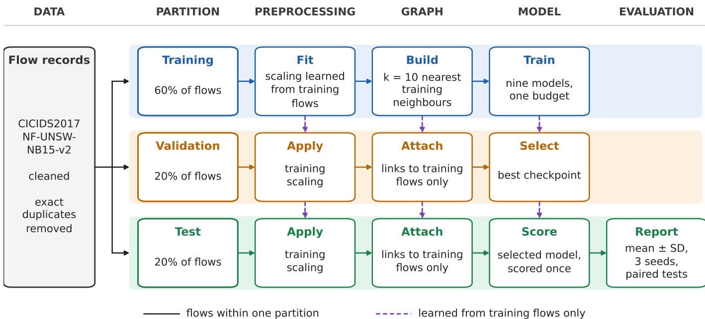  
Figure 1. Evaluation protocol. The flow records are cleaned and exact duplicates are removed before a stratified split forms the training, validation and test partitions (one lane each). Everything learned from data (the scaling, the neighbours of the kNN graph and the model) comes from training flows and is passed down to the other lanes (dashed arrows); validation and test flows link only to training flows. Seeds 0, 1 and 2 repeat the protocol with new splits.

## 2.1. Datasets, cleaning and splits

CICIDS2017. The eight labelled flow files (one per capture session) published with the dataset [5] were used. Identifier columns (flow identifier, source and destination addresses, source port, timestamp) and one duplicated header column were removed. Labels were mapped to eight families: Benign, DoS, DDoS, PortScan, BruteForce (FTP and SSH password guessing), Web, Bot and Rare (Infiltration, Heartbleed and any other label).

NF-UNSW-NB15-v2. The NetFlow version 2 release of UNSW-NB15 [17, 24] provides 43 NetFlow features per flow. The source port, the DNS query identifier and the two label columns were removed; the IP addresses were kept aside as host identifiers for the host-graph baseline and excluded from the features. Attack classes with fewer than 500 flows were merged into a Rare class (here, Worms).

Cleaning. For both datasets, infinite values were treated as missing, rows with missing values were removed, and exact duplicate rows were removed when they had the same features and the same class (label-aware de-duplication), so that no flow can occur in both the training and the test partition. Constant columns were dropped. CICIDS2017 went from 2,830,743 to 2,520,798 flows with 69 columns, and NF-UNSW-NB15-v2 from 2,390,275 to 731,810 flows with 39 columns; the destinationport column is excluded at training time, as described below, which leaves 68 and 38 model inputs. Tables 2 and 3 list the class counts. Each test partition (20% of the flows) holds 504,160 flows for CICIDS2017 and 146,362 for NF-UNSW-NB15-v2.

Each seed $s \in \{ 0 , 1 , 2 \}$ draws a new stratified split into training, validation and test partitions (60%, 20% and 20% of flows); the same seed initialises the network weights and the tree ensembles. All preprocessing is fitted on the training partition and then applied unchanged to the other two. The destination port is excluded from the features by default, because a port number can act as a shortcut to the label; an ablation adds it back. A column j receives a signed logarithmic transform when it is

Table 2. Class distribution of CICIDS2017 after cleaning.
<table><tr><td>Class</td><td>Flows Share (%)</td></tr><tr><td>Benign 2,095,057</td><td>83.111</td></tr><tr><td>DoS 193,745</td><td>7.686</td></tr><tr><td>DDoS 128,014</td><td>5.078</td></tr><tr><td>PortScan 90,694</td><td>3.598</td></tr><tr><td>BruteForce 9,150</td><td>0.363</td></tr><tr><td>Web 2,143</td><td>0.085</td></tr><tr><td>Bot 1,948</td><td>0.077</td></tr><tr><td>Rare</td><td>47 0.002</td></tr><tr><td>Total 2,520,798</td><td>100.000</td></tr></table>

Table 3. Class distribution of NF-UNSW-NB15-v2 after cleaning.
<table><tr><td>Class</td><td>Flows Share (%)</td></tr><tr><td>Benign 690,559</td><td>94.363</td></tr><tr><td>Analysis</td><td>762 0.104</td></tr><tr><td>Backdoor</td><td>717 0.098</td></tr><tr><td>DoS</td><td>3,813 0.521</td></tr><tr><td>Exploits 23,565</td><td>3.220</td></tr><tr><td>Fuzzers</td><td>7,405 1.012</td></tr><tr><td>Generic</td><td>2,372 0.324</td></tr><tr><td>Reconnaissance</td><td>1,121 0.153</td></tr><tr><td>Shellcode</td><td>1,427 0.195</td></tr><tr><td>Rare</td><td>69 0.009</td></tr><tr><td>Total</td><td>731,810 100.000</td></tr></table>

non-negative on all training flows and its 99th percentile on the training flows exceeds 10:

$$
\tilde { x } _ { j } = \mathrm { s i g n } ( x _ { j } ) \log ( 1 + | x _ { j } | ) .\tag{1}
$$

On training flows this equals $\log ( 1 + x _ { j } )$ ; the signed form keeps the transform finite for negative values that occur in some validation or test flows of CICIDS2017. Every column is then standardised with the training mean and standard deviation and clipped to [−10, 10].

## 2.2. Inductive kNN flow graph and residual network

Let $\tau$ be the set of training flows and $\mathbf { x } _ { i }$ the preprocessed feature vector of flow i. For a training flow $i , \mathcal { N } _ { k } ( i )$ contains the k training flows closest to $\mathbf { x } _ { i }$ in Euclidean distance, excluding i itself. For a validation or test flow $q , \mathcal { N } _ { k } ( q )$ contains the k training flows closest to $\mathbf { x } _ { q } .$ Messages flow only from training flows to their neighbours, so the graph seen during training contains training flows only, and a query flow’s prediction depends on its own features and on the training data. No edge joins two query flows, and no training flow receives a message from a query flow. Neighbours are found by exact search, with $k = 1 0$ by default. Figure 2 illustrates the construction.

Each layer averages a node’s transformed features with those of its neighbours, using the row-normalised operator

$$
\hat { A } = D ^ { - 1 } ( A + I ) , \qquad \left( \hat { A } Z \right) _ { i } = \frac { 1 } { \vert \mathcal { N } _ { k } ( i ) \vert + 1 } \Bigl ( \mathbf { z } _ { i } + \sum _ { j \in \mathcal { N } _ { k } ( i ) } \mathbf { z } _ { j } \Bigr ) ,\tag{2}
$$

where A is the adjacency matrix of the kNN graph (with $A _ { i j } = 1$ when $j \in \mathcal { N } _ { k } ( i ) )$ and D is the diagonal degree matrix of $A + I .$ . This is a mean aggregation over a node and its neighbours; it differs from the symmetric normalisation $\tilde { D } ^ { - 1 / 2 } \tilde { A } \tilde { D } ^ { - 1 / 2 }$ of the original GCN [18] because the kNN graph is directed. Layer l computes

$$
Z ^ { ( l ) } = \mathrm { D r o p o u t } \Big ( \mathrm { R e L U } \left( \mathrm { B N } ( \hat { \cal A } H ^ { ( l - 1 ) } W ^ { ( l ) } + { \bf b } ^ { ( l ) } ) \right) \Big ) ,\tag{3}
$$

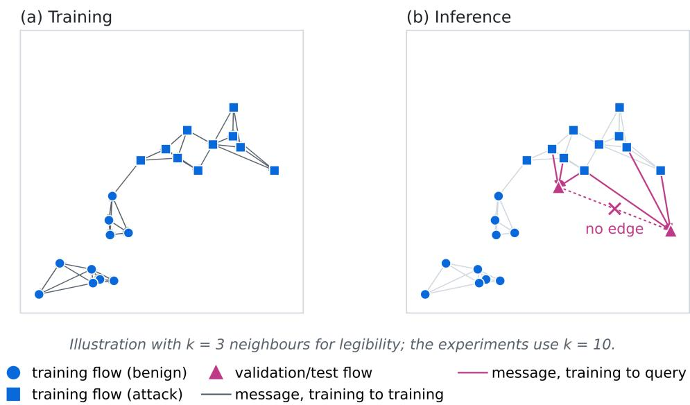  
Figure 2. Inductive kNN flow graph (schematic with $k = 3 ;$ the experiments use $k = 1 0 )$ . (a) During training, each training flow receives messages from its nearest training flows. (b) A validation or test flow receives messages from its nearest training flows only; query flows are never linked to each other and never send messages to training flows.

with $H ^ { ( 0 ) } = X$ , batch normalisation (BN) [25] and dropout probability 0.2. The residual connection adds the previous hidden representation from the second layer onwards:

$$
H ^ { ( 1 ) } = Z ^ { ( 1 ) } , \qquad H ^ { ( l ) } = Z ^ { ( l ) } + H ^ { ( l - 1 ) } \quad ( l \geq 2 ) .\tag{4}
$$

With two layers this is $H ^ { ( 2 ) } = Z ^ { ( 2 ) } + Z ^ { ( 1 ) }$ . A linear layer maps $H ^ { ( L ) }$ to class scores, followed by the softmax. Both hidden layers have 64 units (Figure 3).

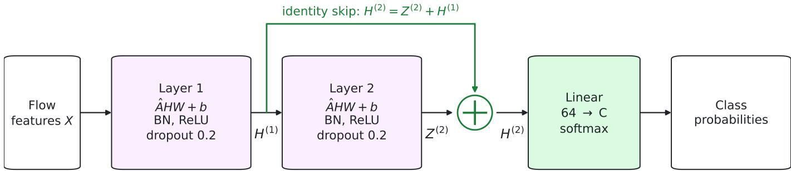  
$\hat { A } = D ^ { - 1 } ( A + I )$ over the inductive kNN graph (k = 10); 64 hidden units per layer

Figure 3. Two-layer residual GCN. Each layer applies mean aggregation $\hat { A } = D ^ { - 1 } ( A + I )$ over the inductive kNN graph, a linear map, batch normalisation, ReLU and dropout; the output of the first layer is added to that of the second before the classifier.

Loss. Classes are weighted by $w _ { c } = \mathrm { m i n } ( N / ( C n _ { c } )$ , 100), where N is the number of training flows, C the number of classes and $n _ { c }$ the training count of class c. The weighted cross-entropy is

$$
\mathcal { L } = - \frac { \sum _ { i \in \mathcal { T } } w _ { y _ { i } } \log p _ { i , y _ { i } } } { \sum _ { i \in \mathcal { T } } w _ { y _ { i } } } ,\tag{5}
$$

where $p _ { i , c }$ is the softmax probability of class c for flow i. The ablation also tests the unweighted cross-entropy and a focal loss with $\gamma = 2$ and the same class weights.

Training and model selection. Networks were trained full-batch with Adam [26] (learning rate 0.01) for 200 epochs. The validation score was computed at epoch 1, every fifth epoch and the last epoch, and the weights with the best validation score were restored. The validation score is the area under the precision-recall curve (PR-AUC) for binary detection and the macro-averaged F1 for multiclass detection. No hyperparameter was tuned on the test partition, and the same fixed settings were used for every seed.

## 2.3. Baselines

All neural models share the layer structure, width, loss, optimiser, epoch budget and model-selection rule of the R-GCN and differ only in how neighbours are aggregated: a GCN without the residual connection, GraphSAGE with mean aggregation [19], a GAT with four heads [20], and a multilayer perceptron (MLP) that ignores the graph. The kNN vote predicts the class shares among the same k training neighbours used by the graph models,

$$
p _ { c } ( q ) = \frac { 1 } { k } \sum _ { j \in \mathcal { N } _ { k } ( q ) } \mathcal { H } [ y _ { j } = c ] ,\tag{6}
$$

which tests whether message passing adds anything beyond the labels of the neighbours. The tabular baselines are XGBoost [27] (400 trees, depth 8, learning rate 0.1, row and column subsampling 0.8, early stopping after 20 rounds on the validation partition), LightGBM [28] (400 trees, 63 leaves, depth 8, learning rate 0.1, the same subsampling and early stopping) and a random forest [29] (100 trees, 30% of the training flows per tree, class weights balanced within each bootstrap sample). XGBoost and LightGBM use the class weights $w _ { c }$ as sample weights. E-GraphSAGE [14] is run on a host graph in which IP addresses are nodes and flows are edges with their features. It uses the shared settings of Table 4 (64 hidden units, learning rate 0.01) rather than the 128 units and learning rate 0.001 of the original study [14], so that every neural model has the same budget. Because each partition forms its own host graph, its results are reported separately from the kNN-graph models. Table 4 lists every setting.

## 2.4. Evaluation protocol, metrics and stress tests

Binary detection treats every attack class as positive; multiclass detection uses all classes of a dataset. For binary detection we report F1, the Matthews correlation coefficient (MCC), PR-AUC and the false-positive rate (FPR) at the decision threshold 0.5, together with the recall at fixed false-positive rates of 0.1% and 1%, which still separates models when F1 is near its ceiling. For multiclass detection we report accuracy, macro-averaged F1 over the classes present in the test partition, weighted F1 and per-class F1. Every metric is the mean and standard deviation over the three seeds. Models are compared through paired per-seed differences with a 95% confidence interval from the t distribution and a paired t-test whose p-values are Holm-corrected within each dataset and metric; with three seeds, a difference is treated as real only when its interval excludes zero.

The ablation changes one setting of the R-GCN at a time on CICIDS2017: $k \in \{ 5 , 2 0 , 5 0 \}$ ; one layer; four layers without a skip, with the residual connection, and with an additional input projection; unweighted and focal losses; no batch normalisation; the destination port added back; and transductive construction, in which one kNN graph is built over training, validation and test features and batch-normalisation statistics are computed over all nodes. The transductive variant uses test features but never test labels.

Table 4. Settings of all models. The same values were used for every seed and for both datasets.
<table><tr><td>Setting</td><td>Value</td></tr><tr><td colspan="2">Neural models (shared)</td></tr><tr><td>Graph</td><td>kNN of flows, k = 10, Euclidean distance, inductive (training flows only)</td></tr><tr><td>Layers / hidden units</td><td>2/64</td></tr><tr><td>Normalisation / dropout</td><td>batch normalisation; dropout 0.2</td></tr><tr><td>Residual (R-GCN only)</td><td> $H ^ { ( l ) } = Z ^ { ( l ) } + H ^ { ( l - 1 ) }$  for  $l \geq 2$ </td></tr><tr><td>GAT heads / GraphSAGE 4 heads / mean aggregation</td><td></td></tr><tr><td>Loss</td><td>weighted cross-entropy,  $w _ { c } = \mathrm { m i n } ( N / ( C n _ { c } ) , 1 0 0 )$ </td></tr><tr><td>Optimiser</td><td>Adam, learning rate 0.01, full batch, 200 epochs</td></tr><tr><td>Model selection</td><td>validation score at epoch 1, every 5th epoch and epoch 200; best weights restored (PR-AUC binary, macro-F1 multiclass)</td></tr><tr><td>kNN vote</td><td>class shares of the same k = 10 training neighbours; no training</td></tr><tr><td colspan="2">Tree ensembles</td></tr><tr><td>XGBoost</td><td>400 trees, depth 8, learning rate 0.1, row/column subsampling 0.8/0.8, histogram tree method, early stopping 20 rounds, sample weights  $w _ { c }$ </td></tr><tr><td>LightGBM</td><td>400 trees, 63 leaves, depth 8, learning rate 0.1, row/column subsampling 0.8/0.8, early stopping 20 rounds, sample weights</td></tr><tr><td>Random forest</td><td> $w _ { c }$  100 trees, 30% of training flows per tree, class weights balanced per bootstrap sample</td></tr><tr><td colspan="2">Host-graph baseline</td></tr><tr><td>E-GraphSAGE</td><td>2 layers, 64 hidden units, dropout 0.2, Adam 0.01, 200 epochs, same loss and selection rule</td></tr></table>

In the leave-one-family-out test, all flows of one CICIDS2017 attack family (DoS, DDoS, PortScan, BruteForce, Web or Bot) are removed from the training and validation partitions while the test partition is unchanged. The binary detector is then scored by its recall on the held-out family, its recall on the families seen in training and its FPR. In the noise test, Gaussian noise with standard deviation 0.1, 0.25 and 0.5 (in units of the standardised features) is added to up to 100,000 test flows, values are clipped to [−10, 10], and graph models re-link each noisy flow to its nearest training flows.

## 2.5. Implementation

All models were implemented in Python 3.11 with PyTorch 2.14.1, PyTorch Geometric 2.8.1, scikit-learn 1.9.0, XGBoost 3.2.0 and LightGBM 4.7.0, and trained on an NVIDIA A100 80 GB GPU. The full set of 216 runs (Sections 2.1 to 2.4) was fixed before the experiments started, and every run is reported.

## 3. Results

This section first reports binary detection on both datasets, together with the paired differences that show whether the residua network differs from each competitor, and then multiclass detection. The ablations follow, and the last subsection reports two stress tests: attack families withheld from training and Gaussian noise on the test features. All values are means over three seeds, each with its own split.

## 3.1. Binary detection

T bl d bi d i h i i d Fi h h F f d O CICIDS h fi neural models scored between 97.92% (MLP) and 98.33% (GAT) in F1, with the R-GCN at 98.11%. The three tree ensembles scored between 99.59% and 99.67%, and the kNN vote over the same neighbours reached 99.27%. The ensembles also had the lowest false-positive rates (0.08% to 0.13% of benign flows, against 0.64% for the R-GCN) and the highest recall at a false-positive rate of 0.1% (99.70% to 99.88%, against 97.39%). On NF-UNSW-NB15-v2 all models scored lower. The neural models lay between 90.57% and 90.96% in F1, the random forest reached 93.38%, and XGBoost had the highest PR-AUC (96.94%, against 95.11% for the R-GCN) and the highest recall at a false-positive rate of 0.1% (56.95%, against 43.62%). The host-graph model E-GraphSAGE reached 83.12% in F1 and 78.23% in PR-AUC.

Table 5. Binary detection on the CICIDS2017 test partitions (%, MCC without unit; mean ± SD over three seeds). Recall at 0.1% or 1% FPR is the highest recall at a false-positive rate not above that value; bold marks the best mean.
<table><tr><td>Model</td><td>F1</td><td>MCC</td><td>PR-AUC</td><td>FPR</td><td>Recall at 0.1% FPR</td><td>Recall at 1% FPR</td></tr><tr><td>R-GCN</td><td> $9 8 . 1 1 \pm 0 . 1 8$ </td><td> $0 . 9 7 7 \pm 0 . 0 0 2$ </td><td> $9 9 . 8 6 \pm 0 . 0 1$ </td><td> $0 . 6 4 \pm 0 . 0 7$ </td><td> $9 7 . 3 9 \pm 0 . 1 4$ </td><td> $9 9 . 5 2 \pm 0 . 0 4$ </td></tr><tr><td>GCN</td><td> $9 8 . 1 5 \pm 0 . 1 5$ </td><td> $0 . 9 7 8 \pm 0 . 0 0 2$ </td><td> $9 9 . 8 6 \pm 0 . 0 1$ </td><td> $0 . 6 2 \pm 0 . 0 6$ </td><td> $9 7 . 6 7 \pm 0 . 1 8$ </td><td> $9 9 . 5 3 \pm 0 . 0 3$ </td></tr><tr><td>GraphSAGE</td><td> $9 8 . 1 4 \pm 0 . 1 7$ </td><td> $0 . 9 7 8 \pm 0 . 0 0 2$ </td><td> $9 9 . 8 6 \pm 0 . 0 0$ </td><td> $0 . 6 2 \pm 0 . 0 9$ </td><td> $9 7 . 4 0 \pm 0 . 2 9$ </td><td> $9 9 . 4 9 \pm 0 . 0 1$ </td></tr><tr><td>GAT</td><td> $9 8 . 3 3 \pm 0 . 2 6$ </td><td> $0 . 9 8 0 \pm 0 . 0 0 3$ </td><td> $9 9 . 8 5 \pm 0 . 0 2$ </td><td> $0 . 5 1 \pm 0 . 1 7$ </td><td> $9 7 . 2 9 \pm 0 . 8 5$ </td><td> $9 9 . 5 2 \pm 0 . 0 5$ </td></tr><tr><td>kNN vote</td><td> $9 9 . 2 7 \pm 0 . 0 2$ </td><td> $0 . 9 9 1 \pm 0 . 0 0 0$ </td><td> $9 9 . 5 5 \pm 0 . 0 1$ </td><td> $0 . 1 5 \pm 0 . 0 1$ </td><td> $9 8 . 7 1 \pm 0 . 0 7$ </td><td> $9 9 . 8 1 \pm 0 . 0 1$ </td></tr><tr><td>MLP</td><td> $9 7 . 9 2 \pm 0 . 0 4$ </td><td> $0 . 9 7 5 \pm 0 . 0 0 1$ </td><td> $9 9 . 8 4 \pm 0 . 0 1$ </td><td> $0 . 7 1 \pm 0 . 0 2$ </td><td> $9 7 . 1 1 \pm 0 . 2 8$ </td><td> $9 9 . 4 3 \pm 0 . 0 4$ </td></tr><tr><td>XGBoost</td><td> ${ \pm \pm } \mathbf { 0 . 6 7 \pm 0 . 0 2 }$ </td><td> $\pm 0 . 9 9 6 \pm 0 . 0 0 0$ </td><td> ${ \pm \pm \infty } . 9 9 \pm 0 . 0 0$ </td><td> $0 . 1 2 \pm 0 . 0 1$ </td><td> $\pm { \bf 9 9 . 8 8 } \pm { \bf 0 . 0 1 }$ </td><td> ${ \pm \pm \infty } . 9 9 \pm 0 . 0 0$ </td></tr><tr><td>LightGBM</td><td> $9 9 . 6 6 \pm 0 . 0 1$ </td><td> $0 . 9 9 6 \pm 0 . 0 0 0$ </td><td> $9 9 . 9 8 \pm 0 . 0 1$ </td><td> $0 . 1 3 \pm 0 . 0 0$ </td><td> $9 9 . 8 5 \pm 0 . 0 1$ </td><td> $9 9 . 9 9 \pm 0 . 0 0$ </td></tr><tr><td>Random forest</td><td> $9 9 . 5 9 \pm 0 . 0 1$ </td><td> $0 . 9 9 5 \pm 0 . 0 0 0$ </td><td> $9 9 . 9 7 \pm 0 . 0 0$ </td><td> ${ \pm } 0 . 0 8 \pm 0 . 0 1$ </td><td> $9 9 . 7 0 \pm 0 . 0 1$ </td><td> $9 9 . 9 8 \pm 0 . 0 0$ </td></tr></table>

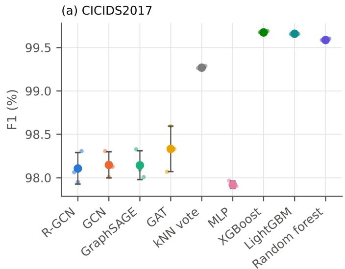

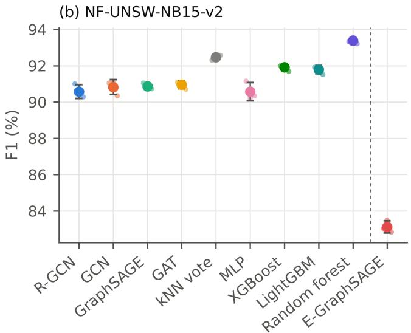  
Figure 4. Binary F1 per model on the test partitions. Small points: individual seeds; large points: mean ± SD over three seeds. The F1 axis does not start at zero. E-GraphSAGE (right of the dashed line) uses a host graph and is reported separately.

Table 6. Binary detection on the NF-UNSW-NB15-v2 test partitions (%, MCC without unit; mean ± SD over three seeds). Recal at 0.1% or 1% FPR is the highest recall at a false-positive rate not above that value; bold marks the best mean. E-GraphSAGE uses a host graph and is listed separately. The kNN-vote score takes only 11 values, so a recall at a fixed false-positive rate may not exist and is then 0.
<table><tr><td>Model</td><td>F1</td><td>MCC</td><td>PR-AUC</td><td>FPR</td><td>Recall at 0.1% FPR</td><td>Recall at 1% FPR</td></tr><tr><td>R-GCN</td><td> $9 0 . 5 7 \pm 0 . 3 8$ </td><td> $0 . 9 0 4 \pm 0 . 0 0 4$ </td><td> $9 5 . 1 1 \pm 0 . 1 4$ </td><td> $1 . 2 2 \pm 0 . 0 6$ </td><td> $4 3 . 6 2 \pm 1 . 2 5$ </td><td> $9 7 . 9 7 \pm 0 . 3 5$ </td></tr><tr><td>GCN</td><td> $9 0 . 8 2 \pm 0 . 4 1$ </td><td> $0 . 9 0 6 \pm 0 . 0 0 4$ </td><td> $9 5 . 0 4 \pm 0 . 2 2$ </td><td> $1 . 1 9 \pm 0 . 0 5$ </td><td> $4 4 . 3 3 \pm 0 . 2 4$ </td><td> $9 8 . 2 7 \pm 0 . 2 1$ </td></tr><tr><td>GraphSAGE</td><td> $9 0 . 8 7 \pm 0 . 1 6$ </td><td> $0 . 9 0 7 \pm 0 . 0 0 2$ </td><td> $9 4 . 8 2 \pm 0 . 2 4$ </td><td> $1 . 1 9 \pm 0 . 0 2$ </td><td> $4 2 . 3 1 \pm 3 . 1 9$ </td><td> $9 8 . 2 7 \pm 0 . 4 6$ </td></tr><tr><td>GAT</td><td> $9 0 . 9 6 \pm 0 . 2 2$ </td><td> $0 . 9 0 8 \pm 0 . 0 0 2$ </td><td> $9 5 . 0 1 \pm 0 . 0 6$ </td><td> $1 . 1 7 \pm 0 . 0 3$ </td><td> $4 3 . 5 3 \pm 1 . 3 9$ </td><td> $9 8 . 1 7 \pm 0 . 2 1$ </td></tr><tr><td>kNN vote</td><td> $9 2 . 4 7 \pm 0 . 1 4$ </td><td> $0 . 9 2 0 \pm 0 . 0 0 1$ </td><td> $9 4 . 9 5 \pm 0 . 1 0$ </td><td> $0 . 6 4 \pm 0 . 0 2$ </td><td> $0 . 0 0 \pm 0 . 0 0$ </td><td> $9 8 . 4 2 \pm 0 . 0 3$ </td></tr><tr><td>MLP</td><td> $9 0 . 5 7 \pm 0 . 5 0$ </td><td> $0 . 9 0 4 \pm 0 . 0 0 5$ </td><td> $9 4 . 9 0 \pm 0 . 1 7$ </td><td> $1 . 2 3 \pm 0 . 0 7$ </td><td> $4 0 . 7 9 \pm 1 . 1 9$ </td><td> $9 8 . 4 2 \pm 0 . 2 3$ </td></tr><tr><td>XGBoost</td><td> $9 1 . 9 2 \pm 0 . 2 0$ </td><td> $0 . 9 1 7 \pm 0 . 0 0 2$ </td><td> ${ \pm 0 . 9 4 \pm 0 . 1 3 }$ </td><td> $1 . 0 4 \pm 0 . 0 3$ </td><td> ${ \pm } 6 . 9 5 \pm 3 . 0 9$ </td><td> ${ \pm 9 9 . 6 6 \pm 0 . 1 5 }$ </td></tr><tr><td>LightGBM</td><td> $9 1 . 7 9 \pm 0 . 2 3$ </td><td> $0 . 9 1 6 \pm 0 . 0 0 2$ </td><td> $9 6 . 8 1 \pm 0 . 0 5$ </td><td> $1 . 0 6 \pm 0 . 0 3$ </td><td> $5 5 . 7 2 \pm 3 . 0 4$ </td><td> $9 9 . 6 3 \pm 0 . 1 3$ </td></tr><tr><td>Random forest</td><td> ${ \pm 0 . 3 8 \pm 0 . 1 8 }$ </td><td> $\pm 0 . 9 3 0 \pm 0 . 0 0 2$ </td><td> $9 6 . 4 2 \pm 0 . 1 3$ </td><td> ${ \pm } \ : 0 . 5 1 \pm 0 . 0 2$ </td><td> $5 0 . 6 6 \pm 4 . 3 7$ </td><td> $9 9 . 3 4 \pm 0 . 1 2$ </td></tr><tr><td>Host-graph model</td><td></td><td></td><td></td><td></td><td></td><td></td></tr><tr><td> $\mathsf { E - G r a p h S A G E }$ </td><td> $8 3 . 1 2 \pm 0 . 3 3$ </td><td> $0 . 8 3 3 \pm 0 . 0 0 3$ </td><td> $7 8 . 2 3 \pm 2 . 3 0$ </td><td> $2 . 4 3 \pm 0 . 0 6$ </td><td> $8 . 4 2 \pm 2 . 4 4$ </td><td> $5 5 . 2 8 \pm 3 . 8 9$ </td></tr></table>

The paired differences in Table 7 separate these effects from seed-to-seed variation. Against GCN, GraphSAGE, GAT and the MLP, the R-GCN’s F1 differed by −0.22 to +0.19 points on CICIDS2017 and by −0.38 to 0.00 points on NF-UNSW-NB15-v2, and every interval contained zero. Against the three tree ensembles on CICIDS2017, the R-GCN was 1.48 to 1.57 points lower in F1 (Holm $p = 0 . 0 3 0$ for each) and 0.12 to 0.13 points lower in PR-AUC. On NF-UNSW-NB15-v2 its PR-AUC was 1.30 to 1.83 points lower than that of the ensembles (Holm p between 0.021 and 0.026); its F1 was 1.21 to 2.80 points lower, with intervals that exclude zero but Holm-corrected p-values between 0.058 and 0.132. Figure 5 plots the same intervals. The graph networks and the MLP cluster around zero on both datasets, while every tree ensemble sits to the left of zero.

## 3.2. Multiclass detection

The multiclass task separates the model families more sharply (Tables 8 and 9). On CICIDS2017 the weighted F1 of every model exceeded 96%, but macro-F1, which gives each class equal weight, was 64.51% for the R-GCN and 64.65% for the GCN, against 93.08% for XGBoost, 88.37% for the random forest and 81.52% for the kNN vote. On NF-UNSW-NB15-v2 macro-F1 ranged from 44.21% (R-GCN) to 55.98% (XGBoost). The gap between weighted and macro-F1 reflects the smal attack classes, which carry the same weight as Benign in macro-F1.

Figure 6 breaks macro-F1 down by class. On CICIDS2017 the four large classes (Benign, DoS, DDoS and PortScan) reached a per-class F1 of at least 95% for every model, so the differences arise in the small classes. For Web attacks the R-GCN reached 24.83%, against 87.09% for the kNN vote and 97.64% for XGBoost; for Bot the corresponding values were 6.51%, 62.47% and 71.30%. On NF-UNSW-NB15-v2 no model exceeded 20% F1 on Analysis or Backdoor flows, and the tree ensembles led mainly on DoS, Generic and the Rare class.

The confusion matrices in Figure 7 show that the low scores of the R-GCN on these classes come from false alarms rather than missed attacks. The R-GCN recalled 93.16% of Web flows and 99.66% of Bot flows, close to XGBoost (98.06% and 99.57%).

Table 7. Paired per-seed differences in binary detection, R-GCN minus each model (percentage points, three seeds), with 95% confidence intervals from the t distribution and paired t-test p-values Holm-corrected within each dataset and metric.
<table><tr><td>R-GCN minus</td><td>∆F1</td><td>95% Cl</td><td>Holm p</td><td>△PR-AUC</td><td>95% Cl</td><td>Holm p</td></tr><tr><td colspan="7">CICIDS2017</td></tr><tr><td>GCN</td><td>-0.04</td><td>[-0.56, +0.48]</td><td>1.000</td><td>0.00</td><td>[-0.02, +0.01]</td><td>0.595</td></tr><tr><td>GraphSAGE</td><td>-0.04</td><td>[-0.77, +0.70]</td><td>1.000</td><td>0.00</td><td>[-0.02, +0.02]</td><td>1.000</td></tr><tr><td>GAT</td><td>-0.22</td><td>[-1.13, +0.68]</td><td>1.000</td><td>0.00</td><td>[-0.02, +0.03]</td><td>1.000</td></tr><tr><td>kNN vote</td><td>-1.16</td><td>[-1.57, −0.75]</td><td>0.033</td><td>+0.31</td><td>[+0.28, +0.34]</td><td>0.004</td></tr><tr><td>MLP</td><td>+0.19</td><td>[-0.27, +0.65]</td><td>0.887</td><td>+0.01</td><td>[+0.01, +0.02]</td><td>0.061</td></tr><tr><td>XGBoost</td><td>-1.57</td><td>[-1.98, −1.16]</td><td>0.030</td><td>-0.13</td><td>[-0.15, -0.11]</td><td>0.013</td></tr><tr><td>LightGBM</td><td>-1.55</td><td>[-2.01, −1.09]</td><td>0.030</td><td>-0.12</td><td>[-0.15, -0.09]</td><td>0.018</td></tr><tr><td>Random forest</td><td>-1.48</td><td>[-1.90, -1.06]</td><td>0.030</td><td>-0.12</td><td>[-0.14, -0.09]</td><td>0.013</td></tr><tr><td colspan="7">NF-UNSW-NB15-v2</td></tr><tr><td>GCN</td><td>-0.25</td><td>[-1.07, +0.58]</td><td>0.654</td><td>+0.08</td><td>[-0.69, +0.84]</td><td>0.786</td></tr><tr><td>GraphSAGE</td><td>-0.29</td><td>[-0.84, +0.25]</td><td>0.574</td><td>+0.29</td><td>[−0.44, +1.02]</td><td>0.786</td></tr><tr><td>GAT</td><td>-0.38</td><td>[-1.09, +0.32]</td><td>0.574</td><td>+0.11</td><td>[-0.13, +0.34]</td><td>0.786</td></tr><tr><td>kNN vote</td><td>-1.90</td><td>[-3.19, -0.61]</td><td>0.132</td><td>+0.16</td><td>[−0.12, +0.44]</td><td>0.647</td></tr><tr><td>MLP</td><td>0.00</td><td>[-0.47, +0.47]</td><td>0.972</td><td>+0.21</td><td>[-0.50, +0.92]</td><td>0.786</td></tr><tr><td>XGBoost</td><td>-1.34</td><td>[-2.15, −0.54]</td><td>0.132</td><td>-1.83</td><td>[-2.35, −1.31]</td><td>0.026</td></tr><tr><td>LightGBM</td><td>-1.21</td><td>[-1.94, −0.48]</td><td>0.132</td><td>-1.70</td><td>[-2.08, -1.32]</td><td>0.021</td></tr><tr><td>Random forest</td><td>-2.80</td><td>[-3.83, -1.77]</td><td>0.058</td><td>-1.30</td><td>[-1.65, -0.96]</td><td>0.026</td></tr></table>

Table 8. Multiclass detection on the CICIDS2017 test partitions (%, mean ± SD over three seeds). Macro-F1 averages the per-class F1 over the classes present in the test partition; weighted F1 weights each class by its number of flows; bold marks the best mean.
<table><tr><td>Model</td><td>Macro-F1</td><td>Weighted F1 Accuracy</td></tr><tr><td>R-GCN</td><td> $6 4 . 5 1 \pm 0 . 2 3$ </td><td> $9 7 . 8 0 \pm 0 . 0 5$   $9 6 . 6 0 \pm 0 . 0 4$ </td></tr><tr><td>GCN</td><td> $6 4 . 6 5 \pm 0 . 3 8$ </td><td> $9 7 . 8 5 \pm 0 . 1 5$   $9 6 . 6 5 \pm 0 . 2 1$ </td></tr><tr><td>kNN vote</td><td> $8 1 . 5 2 \pm 1 . 8 1$ </td><td> $9 9 . 7 4 \pm 0 . 0 1$   $9 9 . 7 4 \pm 0 . 0 1$ </td></tr><tr><td>MLP</td><td> $6 2 . 3 9 \pm 0 . 5 9$ </td><td> $9 6 . 4 7 \pm 0 . 7 1$   $9 4 . 6 5 \pm 1 . 0 9$ </td></tr><tr><td>XGBoost</td><td> ${ \pm } 3 . 0 8 \pm 1 . 2 2$ </td><td> $9 9 . 8 5 \pm 0 . 0 1$   $9 9 . 8 4 \pm 0 . 0 1$ </td></tr><tr><td>LightGBM</td><td> $8 1 . 5 7 \pm 0 . 7 5$ </td><td> $9 9 . 6 6 \pm 0 . 0 1$   $9 9 . 5 8 \pm 0 . 0 4$ </td></tr><tr><td>Random forest</td><td> $8 8 . 3 7 \pm 2 . 1 1$ </td><td> $\pm 9 9 . 8 5 \pm 0 . 0 1 $   $\pm { \bf 9 9 . 8 5 } \pm { \bf 0 . 0 1 }$ </td></tr></table>

(a)ΔF1  
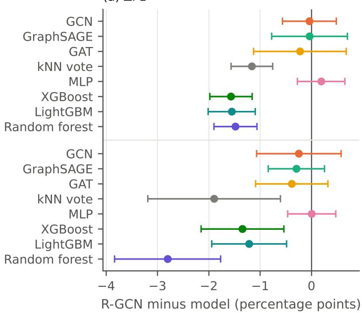

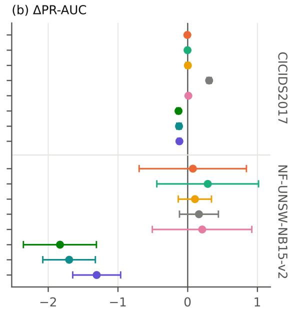  
R-GCN minus model (percentage points)  
Figure 5. Paired per-seed differences in binary detection, R-GCN minus each model, with 95% confidence intervals from the t distribution (three seeds). (a) F1; (b) PR-AUC. Points left of zero favour the other model.

Table 9. Multiclass detection on the NF-UNSW-NB15-v2 test partitions (%, $\mathsf { m e a n } \pm \mathsf { S D }$ over three seeds). Macro-F1 averages the per-class F1 over the classes present in the test partition; weighted F1 weights each class by its number of flows; bold marks the best mean.
<table><tr><td>Model</td><td>Macro-F1</td><td>Weighted F1</td><td>Accuracy</td></tr><tr><td>R-GCN</td><td> $4 4 . 2 1 \pm 1 . 0 7$ </td><td> $9 7 . 0 4 \pm 0 . 1 1$ </td><td> $9 6 . 2 5 \pm 0 . 2 1$ </td></tr><tr><td>kNN vote</td><td> $4 8 . 7 2 \pm 0 . 3 1$ </td><td> $9 7 . 7 9 \pm 0 . 0 1$ </td><td> $\pm { \bf 0 . 0 8 } \pm { \bf 0 . 0 1 }$ </td></tr><tr><td>MLP</td><td> $4 5 . 8 5 \pm 1 . 2 4$ </td><td> $9 7 . 0 2 \pm 0 . 1 7$ </td><td> $9 6 . 1 9 \pm 0 . 3 3$ </td></tr><tr><td>XGBoost</td><td> ${ \pm } 5 5 . 9 8 \pm 0 . 8 8$ </td><td> ${ \pm 0 7 . 9 0 \pm 0 . 0 6 }$ </td><td> $9 7 . 4 8 \pm 0 . 0 8$ </td></tr><tr><td>LightGBM</td><td> $5 3 . 8 2 \pm 1 . 0 4$ </td><td> $9 7 . 8 3 \pm 0 . 0 5$ </td><td> $9 7 . 3 9 \pm 0 . 0 7$ </td></tr></table>

Its precision, however, was 14.32% for Web and 3.36% for Bot, against 97.22% and 55.49% for XGBoost. Over the three seeds the R-GCN labelled 33,402 of 1,257,034 benign test flows as Bot and 7,026 as Web; XGBoost labelled 932 and 23. Because Benign is by far the largest class, a share of benign flows that is small in percentage terms outnumbers the true members of a small attack class many times over.

## 3.3. Ablation

Table 10 and Figure 8 change one setting of the R-GCN at a time on CICIDS2017. The neighbourhood size moved F1 within 98.03% to 98.22% for k between 5 and 50. Removing the residual connection at two layers changed F1 by +0.04 points, and at four layers the networks with and without the skip reached 98.29% and 98.32%. Building the graph transductively, over training, validation and test features, changed F1 by −0.11 points (interval −0.29 to +0.07), and adding the destination port changed it by +0.51 points (interval −0.47 to +1.48). The unweighted cross-entropy was the only setting whose interval excluded zero (+0.72 points, interval +0.18 to +1.27), mainly through a lower false-positive rate (0.16% against 0.64%); after Holm correction over the table its p-value was 0.382.

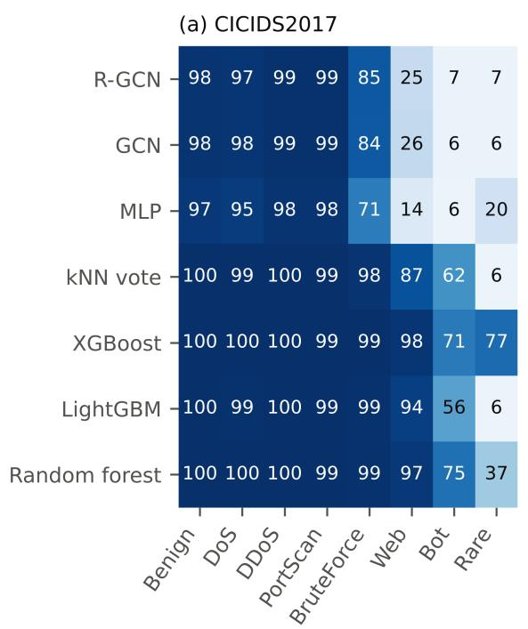

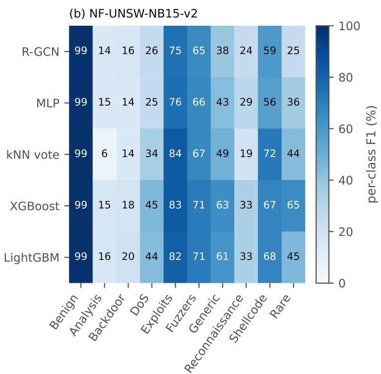  
Figure 6. Per-class F1 in multiclass detection on the test partitions (%, mean over three seeds). (a) CICIDS2017; (b) NF-UNSW-NB15-v2. Classes follow the order of Tables 2 and 3.

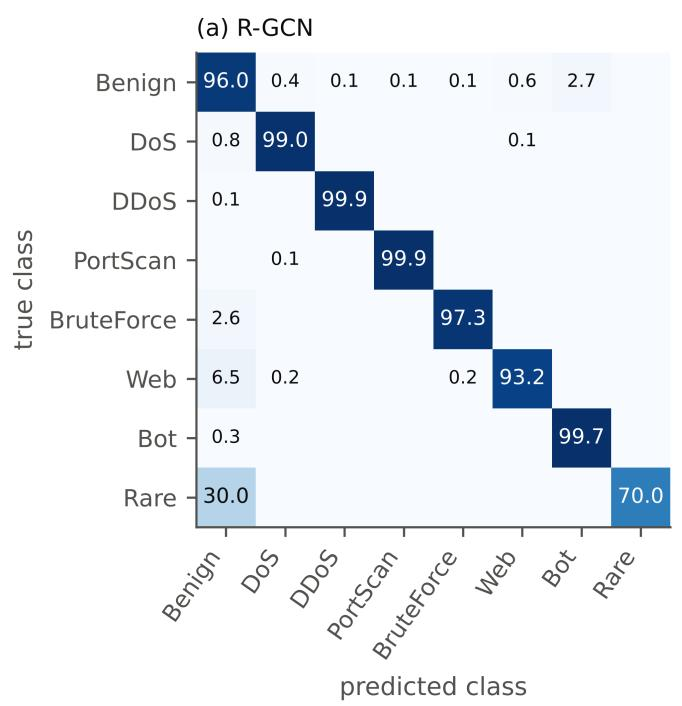

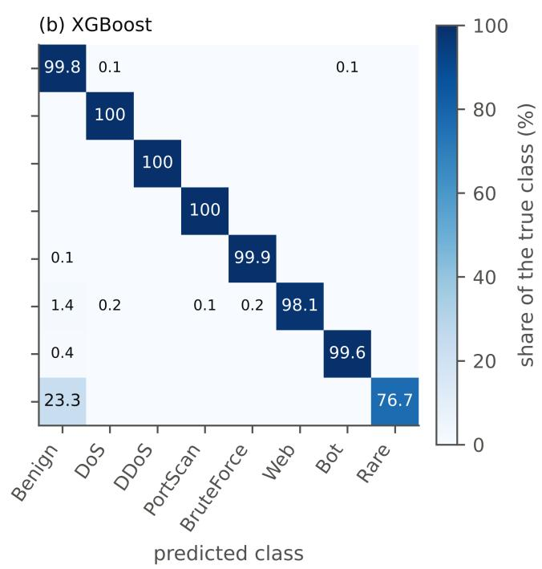  
Figure 7. Confusion matrices of multiclass detection on CICIDS2017, summed over the three seeds and normalised by the true class (rows, %). (a) R-GCN; (b) XGBoost. Cells below 0.05% are left blank.

Table 10. Ablation of the R-GCN on CICIDS2017, binary detection, one setting changed at a time (%, mean ± SD over three seeds). ∆F1 is the paired difference to the reference in percentage points with its 95% confidence interval; Holm p is corrected over all rows.
<table><tr><td>Configuration</td><td>F1</td><td>PR-AUC</td><td>FPR</td><td>∆F1 [95% CI]</td><td>Holm p</td></tr><tr><td>R-GCN reference (2 layers, residual, k = 10)</td><td> $9 8 . 1 1 \pm 0 . 1 8$ </td><td> $9 9 . 8 6 \pm 0 . 0 1$ </td><td> $0 . 6 4 \pm 0 . 0 7$ </td><td>一</td><td>-</td></tr><tr><td>2 layers, no skip (GCN)</td><td> $9 8 . 1 5 \pm 0 . 1 5$ </td><td> $9 9 . 8 6 \pm 0 . 0 1$ </td><td> $0 . 6 2 \pm 0 . 0 6$ </td><td>+0.04 [–0.48, +0.56]</td><td>1.000</td></tr><tr><td>k=5</td><td> $9 8 . 0 3 \pm 0 . 1 0$ </td><td> $9 9 . 8 5 \pm 0 . 0 1$ </td><td> $0 . 6 7 \pm 0 . 0 3$ </td><td>−0.07 [-0.30, +0.16]</td><td>1.000</td></tr><tr><td> $k = 2 0$ </td><td> $9 8 . 0 6 \pm 0 . 1 0$ </td><td> $9 9 . 8 4 \pm 0 . 0 1$ </td><td> $0 . 6 6 \pm 0 . 0 4$ </td><td>-−0.04 [-0.27, +0.18]</td><td>1.000</td></tr><tr><td>k = 50</td><td> $9 8 . 2 2 \pm 0 . 3 5$ </td><td> $9 9 . 8 2 \pm 0 . 0 1$ </td><td> $0 . 5 3 \pm 0 . 2 0$ </td><td>+0.11 [−0.30, +0.53]</td><td>1.000</td></tr><tr><td>1 layer</td><td> $9 7 . 6 6 \pm 0 . 1 4$ </td><td> $9 9 . 7 5 \pm 0 . 0 2$ </td><td> $0 . 7 5 \pm 0 . 1 3$ </td><td>−0.45 [-1.24, +0.34]</td><td>1.000</td></tr><tr><td>4 layers, no skip</td><td> $9 8 . 3 2 \pm 0 . 0 8$ </td><td> $9 9 . 8 8 \pm 0 . 0 1$ </td><td> $0 . 5 6 \pm 0 . 0 3$ </td><td>+0.22 [-0.25, +0.68]</td><td>1.000</td></tr><tr><td>4 layers, residual</td><td> $9 8 . 2 9 \pm 0 . 1 2$ </td><td> $9 9 . 8 7 \pm 0 . 0 1$ </td><td> $0 . 5 7 \pm 0 . 0 5$ </td><td>+0.19 [−0.12, +0.49]</td><td>1.000</td></tr><tr><td>4 layers, residual + input projection</td><td> $9 8 . 1 1 \pm 0 . 2 7$ </td><td> $9 9 . 8 3 \pm 0 . 0 1$ </td><td> $0 . 6 0 \pm 0 . 1 7$ </td><td> $+ 0 . 0 1 \ [ - 1 . 0 9 , + 1 . 1 0 ]$ </td><td>1.000</td></tr><tr><td>unweighted cross-entropy</td><td> $9 8 . 8 3 \pm 0 . 0 4$ </td><td> $9 9 . 8 5 \pm 0 . 0 1$ </td><td> $0 . 1 6 \pm 0 . 0 2$ </td><td> $+ 0 . 7 2 \ [ + 0 . 1 8 , + 1 . 2 7 ]$ </td><td>0.382</td></tr><tr><td>focal loss  $( \gamma = 2 )$ </td><td> $9 8 . 1 1 \pm 0 . 3 4$ </td><td> $9 9 . 8 3 \pm 0 . 0 1$ </td><td> $0 . 6 0 \pm 0 . 1 9$ </td><td>0.00 [–0.40, +0.40]</td><td>1.000</td></tr><tr><td>no batch normalisation</td><td> $9 8 . 4 1 \pm 0 . 3 9$ </td><td> $9 9 . 8 5 \pm 0 . 0 1$ </td><td> $0 . 4 5 \pm 0 . 2 1$ </td><td>+0.30 [−0.37, +0.98]</td><td>1.000</td></tr><tr><td>destination port added</td><td> $9 8 . 6 1 \pm 0 . 2 4$ </td><td> $9 9 . 9 3 \pm 0 . 0 1$ </td><td> $0 . 4 7 \pm 0 . 1 6$ </td><td>+0.51 [-0.47, +1.48]</td><td>1.000</td></tr><tr><td>transductive graph construction</td><td> $9 8 . 0 0 \pm 0 . 1 2$ </td><td> $9 9 . 8 6 \pm 0 . 0 1$ </td><td> $0 . 6 9 \pm 0 . 0 4$ </td><td>−0.11 [−0.29, +0.07]</td><td>1.000</td></tr></table>

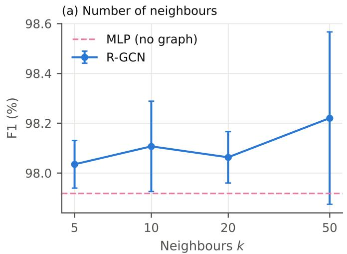

(b) Depth and skip connections  
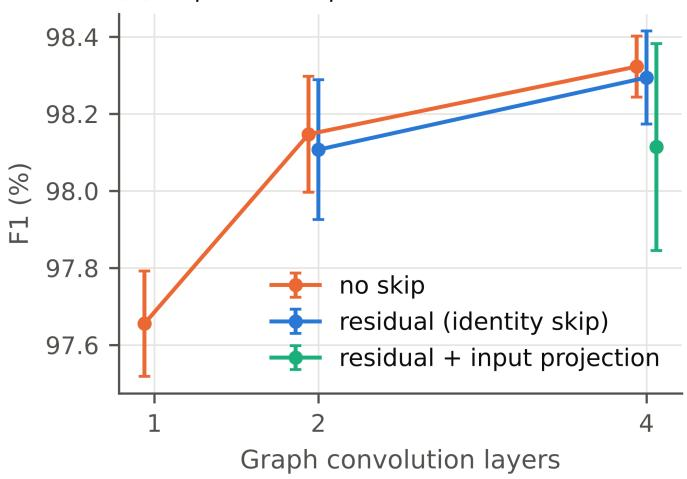  
Figure 8. Ablation on CICIDS2017, binary F1 (mean ± SD over three seeds). (a) Number of neighbours k (logarithmic axis); the dashed line is the MLP without a graph. (b) Number of graph convolution layers without a skip, with the identity skip of the R-GCN, and with an additional input projection.

## 3.4. Unseen attack families and feature noise

When a family was absent from training and validation, detection depended on whether its flows resembled a family that was present (Table 11, Figure 9). Held-out DDoS flows were detected at 59.42% to 63.42% by all four models. Held-out DoS flows were detected at 49.37% by the R-GCN and 50.36% by the kNN vote, but only at 10.49% by the MLP and 3.19% by XGBoost. Held-out Web attacks were detected at 83.36% by XGBoost and at no more than 1.01% by the other models. PortScan, BruteForce and Bot flows were almost never detected (recall at most 0.39%). On the families seen in training, recall stayed between 99.26% and 99.95%.

Table 11. Recall (%) on the attack family withheld from training and validation, CICIDS2017, threshold 0.5 $( \mathsf { m e a n } \pm \mathsf { S D }$ over three seeds). Flows: test flows of the withheld family; the last two rows summarise the families seen in training and the benign flows over all six runs.
<table><tr><td>Held-out family</td><td>Flows</td><td>R-GCN</td><td>kNN vote</td><td>MLP</td><td>XGBoost</td></tr><tr><td>DoS</td><td>38,749</td><td> $4 9 . 3 7 \pm 0 . 6 7$ </td><td> ${ \pm 0 . 3 6 \pm 0 . 6 8 }$ </td><td> $1 0 . 4 9 \pm 8 . 5 6$ </td><td> $3 . 1 9 \pm 0 . 0 7$ </td></tr><tr><td>DDoS</td><td>25,603</td><td> $6 3 . 4 2 \pm 0 . 2 7$ </td><td> ${ \pm } \mathbf { 3 . 4 2 \pm 0 . 2 7 }$ </td><td> $6 3 . 1 6 \pm 0 . 4 4$ </td><td> $5 9 . 4 2 \pm 5 . 4 7$ </td></tr><tr><td>PortScan</td><td>18,139</td><td> $0 . 2 4 \pm 0 . 0 8$ </td><td> $0 . 1 8 \pm 0 . 0 3$ </td><td> $0 . 2 8 \pm 0 . 1 0$ </td><td> ${ \pm } 0 . 3 9 \pm { \bf 0 . 1 1 }$ </td></tr><tr><td>BruteForce</td><td>1,830</td><td> $0 . 2 4 \pm 0 . 1 4$ </td><td> $0 . 0 9 \pm 0 . 0 8$ </td><td> $0 . 2 4 \pm 0 . 1 7$ </td><td> ${ \pm } \ : 0 . 2 6 \pm 0 . 0 3$ </td></tr><tr><td>Web</td><td>428</td><td> $0 . 3 1 \pm 0 . 3 6$ </td><td> $1 . 0 1 \pm 0 . 3 6$ </td><td> $0 . 3 1 \pm 0 . 3 6$ </td><td> ${ \pm } \thinspace 3 . 3 6 \pm 1 . 8 1$ </td></tr><tr><td>Bot</td><td>389</td><td> $\pm 0 . 0 0 \pm 0 . 0 0$ </td><td> $\pm 0 . 0 0 \pm 0 . 0 0$ </td><td> $\pm 0 . 0 0 \pm 0 . 0 0$ </td><td> $\pm 0 . 0 0 \pm 0 . 0 0$ </td></tr><tr><td>Seen families (recall)</td><td>-</td><td> $9 9 . 3 2 \pm 0 . 1 5$ </td><td> $9 9 . 2 6 \pm 0 . 1 8$ </td><td> $9 9 . 2 9 \pm 0 . 1 3$ </td><td> $9 9 . 9 5 \pm 0 . 0 2$ </td></tr><tr><td>Benign flows (FPR)</td><td>-</td><td> $0 . 5 7 \pm 0 . 1 2$ </td><td> $0 . 1 3 \pm 0 . 0 2$ </td><td> $0 . 5 8 \pm 0 . 1 5$ </td><td> $0 . 1 0 \pm 0 . 0 2$ </td></tr></table>

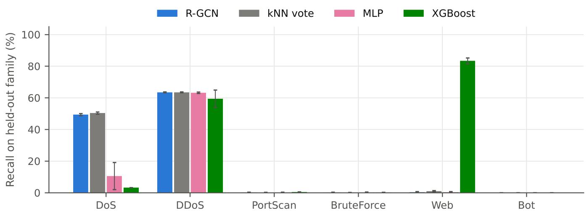  
Figure 9. Recall on the attack family removed from training and validation (CICIDS2017, threshold 0.5, mean ± SD over three seeds).

Gaussian noise added to the standardised test features affected the model families very differently (Table 12, Figure 10). At a noise standard deviation of 0.5, the R-GCN kept an F1 of 96.16% (98.26% without noise on the same test subset), the GCN 96.04% and the kNN vote 95.47%, while the MLP fell to 77.70%. XGBoost fell to 5.84% already at a standard deviation of 0.1

and to 0.67% at 0.5. At 0.1 its precision stayed at 95.95% and its PR-AUC at 80.93%, but its recall dropped to 3.02%: most attack flows were scored below the decision threshold.  
Table 12. Binary F1 (%) on CICIDS2017 under Gaussian noise with standard deviation σ added to the standardised test features (up to 100,000 test flows; mean ± SD over three seeds).
<table><tr><td>Model</td><td> $\sigma = 0$ </td><td> $\sigma = 0 . 1$ </td><td> $\sigma = 0 . 2 5$ </td><td> $\sigma = 0 . 5$ </td></tr><tr><td>R-GCN</td><td> $9 8 . 2 6 \pm 0 . 2 4$ </td><td> $9 8 . 2 1 \pm 0 . 2 1$ </td><td> $9 7 . 9 1 \pm 0 . 2 5$ </td><td> $9 6 . 1 6 \pm 0 . 2 9$ </td></tr><tr><td>GCN</td><td> $9 8 . 1 2 \pm 0 . 0 7$ </td><td> $9 8 . 1 1 \pm 0 . 0 8$ </td><td> $9 7 . 7 8 \pm 0 . 0 5$ </td><td> $9 6 . 0 4 \pm 0 . 0 8$ </td></tr><tr><td>kNN vote</td><td> $9 9 . 3 2 \pm 0 . 0 3$ </td><td> $9 8 . 7 1 \pm 0 . 0 1$ </td><td> $9 8 . 0 7 \pm 0 . 0 7$ </td><td> $9 5 . 4 7 \pm 0 . 0 5$ </td></tr><tr><td>MLP</td><td> $9 7 . 9 4 \pm 0 . 0 4$ </td><td> $9 7 . 7 6 \pm 0 . 1 3$ </td><td> $9 3 . 4 7 \pm 0 . 7 8$ </td><td> $7 7 . 7 0 \pm 2 . 6 5$ </td></tr><tr><td>XGBoost</td><td> $9 9 . 6 9 \pm 0 . 0 4$ </td><td> $5 . 8 4 \pm 2 . 5 1$ </td><td> $1 . 8 4 \pm 0 . 9 6$ </td><td> $0 . 6 7 \pm 0 . 4 0$ </td></tr></table>

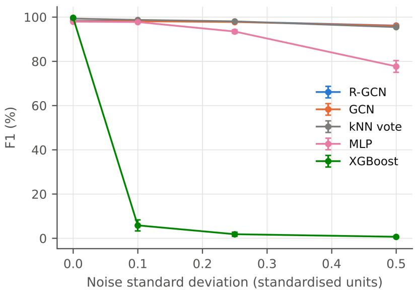  
Figure 10. Binary F1 under Gaussian noise added to the standardised test features (CICIDS2017, up to 100,000 test flows per run, mean ± SD over three seeds).

## 4. Discussion

The central result is that message passing did not improve detection once the graph was built from training flows only. In the binary task the R-GCN, GCN, GraphSAGE and GAT were indistinguishable from an MLP that ignores the graph on both datasets, and their multiclass scores stayed close to those of the MLP. The residual connection had no measurable effect at the two and four layers tested, so the loss of information in deep stacks of graph convolutions that motivates such connections [21] played no visible role here. The kNN vote, which only reads the labels of the same neighbours, reached a higher F1 than every graph network on both datasets. The useful signal in the neighbourhood lies largely in its label composition. The learned aggregation did not add to it.

Tree ensembles were the strongest detectors, consistent with tabular comparisons in this domain [11]. Their margin was smal in binary F1 but large where minority classes matter. In macro-F1 on CICIDS2017, XGBoost exceeded the two graph networks by more than 28 points. On NF-UNSW-NB15-v2 it led in recall at a false-positive rate of 0.1%, the operating region in which a deployed detector has to work. For a detector that must label known attack types on clean flow features, a gradient-boosted ensemble is the better choice on this evidence.

The per-class results locate the multiclass gap precisely. The neural models found almost all Web and Bot flows but paid for it with many benign flows labelled as those classes, so their precision on small classes collapsed while their recall stayed high. A likely explanation is that class weights of up to 100 pull a smooth neural decision boundary into the dense benign region next to each small class. The axis-aligned splits of a tree ensemble can isolate a small class without moving the boundary elsewhere, and the boosted trees kept far higher precision with the same weights. The binary ablation points the same way: the unweighted cross-entropy raised the R-GCN’s F1 by 0.72 points, mainly through a lower false-positive rate. Weight caps, per-class thresholds chosen on the validation partition and a second-stage classifier for flows assigned to small classes offer direct ways to reduce these false alarms.

The false-positive rates translate directly into analyst workload. At a threshold of 0.5 the R-GCN flagged 0.64% of benign CICIDS2017 test flows, about 640 false alarms per 100,000 benign flows, against about 80 to 130 for the tree ensembles. Recall at a fixed false-positive rate compares the models at a budget the operator chooses: at 0.1% the ensembles kept 99.70% to 99.88% of attack flows on CICIDS2017 against 97.39% for the R-GCN, and on NF-UNSW-NB15-v2 XGBoost kept 56.95% against 43.62%. Threshold-free scores understate this gap. On NF-UNSW-NB15-v2 the two models differed by less than two points in PR-AUC (96.94% against 95.11%) but by more than 13 points in recall at the strict budget. No model reached high recall at that budget on the second dataset, so a detector deployed on similar traffic would need a looser false-positive budget or a second stage that re-examines flagged flows.

The host-graph comparison points the same way. E-GraphSAGE [14], run on NF-UNSW-NB15-v2 under the shared protocol, reached a binary F1 of 83.12%, below every flow-level model in Table 6. Connecting flows through the hosts they share, as in host graphs [1], did not compensate for the per-flow information that the feature-based models use directly.

The transductive ablation matters for graph-based intrusion detection in general. Letting test features enter the graph did not change F1 here, so the inductive restriction costs nothing in accuracy while removing the dependence of each prediction on the other test flows. Models evaluated transductively, or with a separate graph built inside each test partition, can be re-evaluated inductively in the same way, and reported gains that rely on test-time graph construction deserve this check.

The graph-based models showed two strengths. Under feature noise they lost two to four points of F1 at the strongest leve tested, whereas XGBoost lost almost all of its recall at the smallest level. Its PR-AUC remained at 80.93%, so the noise mainly shifted its scores across the fixed threshold, which suggests that splits on precise feature values transfer poorly to perturbed inputs. In the leave-one-family-out test the R-GCN and the kNN vote recovered about half of the held-out DoS flows, against a few percent for the MLP and XGBoost, probably because these flows lie close to training flows of other attack families in feature space. Both strengths rest on resemblance to known traffic: PortScan, BruteForce and Bot flows were rarely detected when their family was withheld, and only XGBoost recognised withheld Web attacks

Label-aware de-duplication shaped the benchmarks themselves. Removing exact duplicates reduced NF-UNSW-NB15-v2 from 2,390,275 to 731,810 flows; without this step, identical flows would appear in training and test partitions and every model would be rewarded for memorisation. With resampled splits, the standard deviation of binary F1 was at most 0.50 points for every model, small enough to show that the graph networks do not differ from each other and to resolve their gap to the tree ensembles on CICIDS2017.

Three practices follow for studies of graph-based detectors on flow data, in line with the call for evaluation closer to deployment [10]. First, a feature-only MLP and a kNN vote over the same neighbours belong next to any graph model: together they separate the contribution of the learned aggregation from that of the features and of the neighbours’ labels. Second, the graph should be built from training flows only, with validation and test flows attached at prediction time, and exact duplicates should be removed within each dataset before the split. Third, comparisons should report every seed and the paired differences, since on CICIDS2017 the whole range of the five neural models, 97.92% to 98.33% in F1, was of the same order as their standard deviations across seeds.

## 5. Conclusions

A residual graph convolutional network on a nearest-neighbour graph of flows, evaluated with an inductive graph, label-aware de-duplication and resampled splits, matched a multilaver perceptron and the other graph networks on CICIDS2017 and NE: UNSW-NB15-v2, and it trailed gradient-boosted trees and random forests, most clearly in multiclass macro-F1, where benign flows assigned to small attack classes lowered its precision. Its residual connection, the neighbourhood size and transductive graph construction made no measurable difference. The graph-based models were markedly more robust to feature noise than XGBoost and recovered part of an unseen DoS family, but no model detected most unseen attack families. Evaluations of graph models for intrusion detection should therefore include a same-neighbour vote, tree ensembles and an inductive graph before attributing gains to message passing. Future work will train the detector across several organisations with federated learning [30], where differences in traffic and in model capacity between sites can be handled by knowledge distillation from heterogeneous clients [31, 32].Deployment on Internet of Things and smart-city networks is a further direction, since security mechanisms there must fit the limited computing, energy and bandwidth budgets of the devices [33].

## References

1. Bilot T, El Madhoun N, Al Agha K, Zouaoui A. Graph neural networks for intrusion detection: a survey. IEEE Access. 2023;11:49114–49139. doi: 10.1109/ACCESS.2023.3275789

2. Caville E, Lo WW, Layeghy S, Portmann M. Anomal-E: a self-supervised network intrusion detection system based on graph neural networks. Knowl Based Syst. 2022;258:110030. doi: 10.1016/j.knosys.2022.110030

3. Guerra L, Chapuis T, Duc G, Mozharovskyi P, Nguyen VT. Self-supervised learning of graph representations for network intrusion detection. In: Advances in Neural Information Processing Systems 38 (NeurIPS 2025); 2025. p. 121220–121250. doi: 10.52202/085713-3653

4. Ngo T, Yin J, Ge YF, Wang H. Optimizing IoT intrusion detection – a graph neural network approach with attribute-based graph construction. Information. 2025;16(6):499. doi: 10.3390/info16060499

5. Sharafaldin I, Habibi Lashkari A, Ghorbani AA. Toward generating a new intrusion detection dataset and intrusion traffic characterization. In: Proceedings of the 4th International Conference on Information Systems Security and Privacy (ICISSP); 2018. p. 108–116. doi: 10.5220/0006639801080116

6. Kurniabudi, Stiawan D, Darmawijoyo, Bin Idris MY, Bamhdi AM, Budiarto R. CICIDS-2017 dataset feature analysis with information gain for anomaly detection. IEEE Access. 2020;8:132911–132921. doi: 10.1109/ACCESS.2020.3009843

7. Engelen G, Rimmer V, Joosen W. Troubleshooting an intrusion detection dataset: the CICIDS2017 case study. In: 2021 IEEE Security and Privacy Workshops (SPW); 2021. p. 7–12. doi: 10.1109/SPW53761.2021.00009

8. Liu L, Engelen G, Lynar T, Essam D, Joosen W. Error prevalence in NIDS datasets: a case study on CIC-IDS-2017 and CSE-CIC-IDS-2018. In: 2022 IEEE Conference on Communications and Network Security (CNS); 2022. p. 254–262. doi: 10.1109/CNS56114.2022.9947235

9. Lanvin M, Gimenez PF, Han Y, Majorczyk F, Mé L, Totel É. Errors in the CICIDS2017 dataset and the significant differences in detection performances it makes. In: Kallel S, Jmaiel M, Zulkernine M, editors. Risks and Security of Internet and Systems (CRiSIS 2022). Lecture Notes in Computer Science. Cham: Springer; 2023. p. 18–33. doi: 10.1007/978-3-031- 31108-6\_2

10. Apruzzese G, Laskov P, Schneider J. SoK: pragmatic assessment of machine learning for network intrusion detection. In: 2023 IEEE 8th European Symposium on Security and Privacy (EuroS&P); 2023. p. 592–614. doi: 10.1109/EuroSP57164.2023.00042

11. Zoppi T, Gazzini S, Ceccarelli A. Anomaly-based error and intrusion detection in tabular data: no DNN outperforms treebased classifiers. Future Gener Comput Syst. 2024;160:951–965. doi: 10.1016/j.future.2024.06.051

12. Ehsan A, Iqbal Z, Abuowaida S, Aljaidi M, Zia HU, Alshdaifat N, et al. Enhanced anomaly detection in Ethereum: unveiling and classifying threats with machine learning. IEEE Access. 2024;12:176440–176456. doi: 10.1109/AC-CESS.2024.3504300

13. Iqbal Z, Ilyas R, Shahzad W, Inayat I. A comparative study of machine learning techniques used in non-clinical systems for continuous healthcare of independent livings. In: 2018 IEEE Symposium on Computer Applications and Industria Electronics (ISCAIE); 2018. p. 406–411. doi: 10.1109/ISCAIE.2018.8405507

14. Lo WW, Layeghy S, Sarhan M, Gallagher M, Portmann M. E-GraphSAGE: a graph neural network based intrusion detection system for IoT. In: NOMS 2022 – 2022 IEEE/IFIP Network Operations and Management Symposium; 2022. p. 1–9. doi: 10.1109/NOMS54207.2022.9789878

15. Xiao Q, Liu J, Wang Q, Jiang Z, Wang X, Yao Y. Towards network anomaly detection using graph embedding. In: Krzhizhanovskaya VV, Závodszky G, Lees MH, editors. Computational Science – ICCS 2020. Lecture Notes in Computer Science. Cham: Springer; 2020. p. 156–169. doi: 10.1007/978-3-030-50423-6\_12

16. Friji H, Olivereau A, Sarkiss M. Efficient network representation for GNN-based intrusion detection. In: Tibouchi M, Wang X, editors. Applied Cryptography and Network Security (ACNS 2023). Lecture Notes in Computer Science. Cham: Springer; 2023. p. 532–554. doi: 10.1007/978-3-031-33488-7\_20

17. Sarhan M, Layeghy S, Portmann M. Towards a standard feature set for network intrusion detection system datasets. Mobile Netw Appl. 2022;27(1):357–370. doi: 10.1007/s11036-021-01843-0

18. Kipf TN, Welling M. Semi-supervised classification with graph convolutional networks. In: International Conference on Learning Representations (ICLR); 2017. doi: 10.48550/arXiv.1609.02907

19. Hamilton W, Ying Z, Leskovec J. Inductive representation learning on large graphs. In: Advances in Neural Information Processing Systems 30 (NeurIPS 2017); 2017. Available from: https://proceedings.neurips.cc/paper\_files/paper/2017/ha sh/5dd9db5e033da9c6fb5ba83c7a7ebea9-Abstract.html

20. Velickovi ˇ c P, Cucurull G, Casanova A, Romero A, Liò P, Bengio Y. Graph attention networks. In: International Conference´ on Learning Representations (ICLR); 2018. doi: 10.48550/arXiv.1710.10903

21. Li Q, Han Z, Wu XM. Deeper insights into graph convolutional networks for semi-supervised learning. Proc AAAI Conf Artif Intell. 2018;32(1). doi: 10.1609/aaai.v32i1.11604

22. He K, Zhang X, Ren S, Sun J. Deep residual learning for image recognition. In: 2016 IEEE Conference on Computer Vision and Pattern Recognition (CVPR); 2016. p. 770–778. doi: 10.1109/CVPR.2016.90

23. Chang L, Branco P. Embedding residuals in graph-based solutions: the E-ResSAGE and E-ResGAT algorithms. A case study in intrusion detection. Appl Intell. 2024;54(8):6025–6040. doi: 10.1007/s10489-024-05404-2

24. Moustafa N, Slay J. UNSW-NB15: a comprehensive data set for network intrusion detection systems (UNSW-NB15 network data set). In: 2015 Military Communications and Information Systems Conference (MilCIS); 2015. p. 1–6. doi: 10.1109/MilCIS.2015.7348942

25. Ioffe S, Szegedy C. Batch normalization: accelerating deep network training by reducing internal covariate shift. In: Proceedings of the 32nd International Conference on Machine Learning. PMLR. 2015;37:448–456. Available from: https://proceedings.mlr.press/v37/ioffe15.html

26. Kingma DP, Ba J. Adam: a method for stochastic optimization. In: 3rd International Conference on Learning Representations (ICLR); 2015. doi: 10.48550/arXiv.1412.6980

27. Chen T, Guestrin C. XGBoost: a scalable tree boosting system. In: Proceedings of the 22nd ACM SIGKDD Internationa Conference on Knowledge Discovery and Data Mining; 2016. p. 785–794. doi: 10.1145/2939672.2939785

28. Ke G, Meng Q, Finley T, Wang T, Chen W, Ma W, et al. LightGBM: a highly efficient gradient boosting decision tree. In: Advances in Neural Information Processing Systems 30 (NeurIPS 2017); 2017. Available from: https://proceedings.neurip s.cc/paper\_files/paper/2017/hash/6449f44a102fde848669bdd9eb6b76fa-Abstract.htm

29. Breiman L. Random forests. Mach Learn. 2001;45(1):5–32. doi: 10.1023/A:1010933404324

30. Iqbal Z, Chan HY. Concepts, key challenges and open problems of federated learning. Int J Eng. 2021;34(7):1667–1683. doi: 10.5829/ije.2021.34.07a.11

31. Ma J, Yonetani R, Iqbal Z. Adaptive distillation for decentralized learning from heterogeneous clients. In: 2020 25th International Conference on Pattern Recognition (ICPR); 2021. p. 7486–7492. doi: 10.1109/ICPR48806.2021.9412356

32. Iqbal Z, Al-Aswadi FN, Shamsudin H, Aljaidi M, Al-Qablan TA, Pavleska T, et al. Adaptive dual-mode distillation for robust and communication-efficient federated learning under statistical and model heterogeneity. IEEE Access. 2026;14:145907– 145925. doi: 10.1109/ACCESS.2026.3735432

33. Ramachandran M. Lightweight consensus for blockchain-IoT in smart cities: hierarchical framework. Academia Engineering. 2026;3(2). doi: 10.20935/AcadEng8288