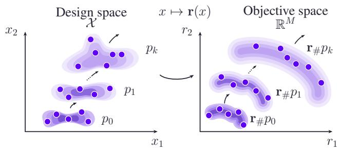
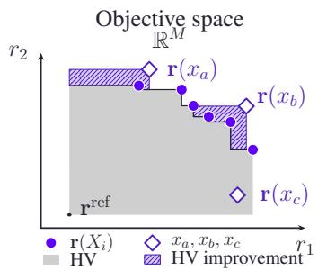
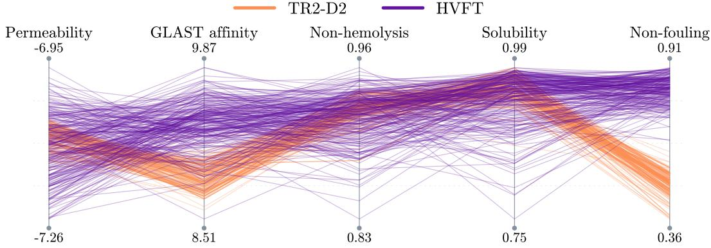
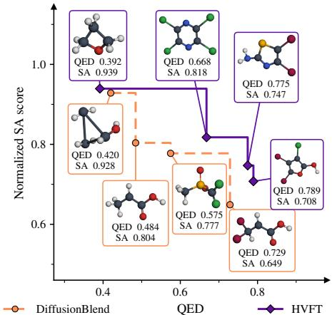

# MULTI-OBJECTIVE GENERATIVE OPTIMIZATION VIA EXPECTED HYPERVOLUME FINE-TUNING

Juan Guevara1, Riccardo De Santi2,3, Andreas Krause2,3, Raul Astudillo1

1Mohamed Bin Zayed University of Artificial Intelligence 2ETH Zurich 3ETH AI Center

## ABSTRACT

Scientific discovery requires plausible designs spanning useful trade-offs among competing properties: a molecule with strong binding affinity, for example, may be difficult to synthesize. Pretrained generative models, e.g., flow and diffusion generators, provide a foundation for proposing such designs, but steering them toward high-quality, complementary trade-offs remains challenging. Inferencetime search incurs high per-sample costs, while fine-tuning typically relies on fixed per-candidate rewards that do not capture how designs complement one another. We introduce Hypervolume Fine-Tuning (HVFT), which adapts a single pretrained generator to maximize the expected hypervolume of its samples while controlling departure from the pretrained distribution. Expected hypervolume jointly rewards candidate quality and collective trade-off coverage. Nonetheless, we show that it cannot be expressed as the expectation of a fixed per-candidate reward and therefore cannot be optimized directly with standard techniques. A key observation of this work is that its first variation corresponds to the expected marginal hypervolume contribution of a candidate, which yields a tractable adaptive reward via an unbiased estimator based on model samples. HVFT uses this reward to decompose the objective into a sequence of KL-proximal scalar-reward subproblems. We establish concavity, relative smoothness, and convergence guarantees for the resulting distributional procedure. Across therapeutic-peptide and molecular design tasks spanning discrete diffusion and continuous flow-matching models, HVFT achieves state-of-the-art expected hypervolume and trade-off coverage.

## 1 INTRODUCTION

Scientific discovery often requires balancing competing objectives. A peptide with high binding affinity to a protein, for example, may have low cell permeability, and vice versa (Tang et al., 2025a). The most useful compromise may remain unknown until experimental evidence or downstream preferences become available. A useful generator should therefore produce candidate sets that collectively represent high-quality, complementary trade-offs.

Pretrained generative models provide a prior over plausible designs, but their sampling distributions are not optimized for the properties of interest. Generative optimization adapts these distributions toward improved objective values (Domingo-Enrich et al., 2025; De Santi et al., 2025b; Gutjahr et al., 2026; Kharitenko et al., 2026). In the multi-objective setting, however, improving candidates individually is not enough: samples must also complement one another across competing objectives. The key challenge is therefore to optimize this collective behavior, rather than a fixed score assigned to each candidate in isolation.

Existing methods provide several forms of multi-objective steering. Inference-time search and guidance can seek favorable trade-offs, but they require additional optimization whenever candidates are generated (Tang et al., 2025a; Yao et al., 2024; Annadani et al., 2025) and, without updating the model, may have limited ability to depart from the pretrained prior (Klarner et al., 2024). Fine-tuning amortizes this cost, yet it faces other limitations. Fixed scalarizations score candidates independently (Tang et al., 2025b; Mahood et al., 2026; Patel et al., 2026; Lin et al., 2026); preference-conditioned and composed models require specifying a preference distribution (Golan et al., 2026; Cheng et al., 2026); and dominance-based signals neither distinguish mutually nondominated candidates nor measure how each contributes to the generated set (Schneuing et al., 2025). No algorithm directly trains the sampling distribution for both candidate quality and collective trade-off coverage.

  
(a) Sequential fine-tuning.

  
(b) Marginal hypervolume reward.  
Figure 1: HVFT for multi-objective generative fine-tuning. (a) HVFT iteratively constructs a scalar reward from the current distribution $p _ { k }$ and fine-tunes the generator, shifting the pushforward distribution $\mathbf { r } _ { \# } p _ { k }$ toward high-quality, complementary trade-offs. (b) The gray region is the hypervolume dominated relative to $\mathbf { r } ^ { \mathrm { r e f } }$ . Hatching shows the marginal contributions of $x _ { a }$ and $x _ { b }$ , while the dominated candidate $x _ { c }$ contributes zero. HVFT estimates these contributions against background sets from $p _ { k }$ to define the next fine-tuning reward.

Motivated by this challenge, we address the following question:

## How can wefine-tune a generative model to directly produce samples thatjointly achieve high objective quality and broad trade-off coverage?

We introduce Hypervolume Fine-Tuning (HVFT), which fine-tunes a single generative model to maximize the expected hypervolume of its generated candidate sets while controlling departure from the pretrained distribution. Hypervolume measures the objective-space region dominated by a candidate set relative to a fixed reference point (Zitzler & Thiele, 1999; Guerreiro et al., 2022). It therefore rewards both strong individual candidates and complementary trade-off coverage, without requiring a distribution over preferences.

Unlike standard fine-tuning objectives, expected hypervolume cannot be expressed as the expectation of a fixed per-candidate reward. A candidate’s value depends on the objective-space regions covered by the other samples, so its reward must adapt to the current sampling distribution (Domingo-Enrich et al., 2025; Zheng et al., 2026; Zhu et al., 2026; Perez Jensen et al., 2026). HVFT addresses this limitation using Flow Density Control (De Santi et al., 2025b), which optimizes a distributional objective through a sequence of KL-proximal subproblems driven by its first variation (see Figure 1). A key observation is that, for expected hypervolume, this first variation is the expected marginal hypervolume contribution of a candidate relative to samples from the current model. This identity gives the reward a clear interpretation and makes it tractable to estimate directly from model samples. At each outer iteration, HVFT estimates this adaptive reward under the current distribution, uses it with a model-specific scalar-reward solver, and recomputes it after the update. We further establish concavity and relative smoothness of the objective, yielding monotone improvement and convergence guarantees for this procedure.

Across therapeutic-peptide (Tang et al., 2025a;b) and molecular design (Schneuing et al., 2025) tasks spanning discrete diffusion and continuous flow-matching models, HVFT achieves state-of-the-art expected hypervolume and trade-off coverage without additional inference-time search.

Our main contributions are as follows:

• We introduce expected hypervolume, a distributional training criterion for multi-objective generative optimization that jointly rewards quality and collective trade-off coverage.

• We express the first variation of expected hypervolume in terms of marginal hypervolume contributions and derive an unbiased sample-based estimator. This yields HVFT, a sequence of scalar-reward fine-tuning subproblems for which we establish convergence guarantees.

• We demonstrate that HVFT achieves state-of-the-art performance on therapeutic-peptide and molecular design tasks spanning discrete diffusion and continuous flow-matching models, improving the expected hypervolume of sampled sets without inference-time search.

## 2 RELATED WORK

We first discuss existing methods for multi-objective steering of pretrained generators and then review the methodological foundations of HVFT. We conclude by briefly discussing adjacent multi-objective optimization settings that target different problems.

Multi-objective steering of pretrained generators. Methods for steering pretrained generators toward multiple objectives differ primarily in the information carried by their steering signal.

Ordinal Pareto signals. Pareto dominance guides inference-time search in PepTune (Tang et al., 2025a), replay-buffer construction and off-policy fine-tuning in TR2D2 and its extensions (Tang et al., 2025b; Mahood et al., 2026; Patel et al., 2026), and the selection of preference pairs for direct preference optimization (Schneuing et al., 2025). Dominance records which candidates are preferable but not by how much: it is invariant to strictly increasing transformations of each objective, cannot order mutually nondominated candidates, and does not quantify their contributions to a candidate set.

Scalarized per-candidate rewards. A second family maps each objective vector to a scalar utility and applies standard reward-based fine-tuning, sometimes incorporating thresholds or predictive uncertainty (Lin et al., 2026; Chen et al., 2025a). TR2-D2-based methods, for example, sum the objectives of candidates in their nondominated replay buffer (Tang et al., 2025b; Mahood et al., 2026; Patel et al., 2026). Because a fixed scalarization scores candidates independently and generally favors a particular trade-off, repeated samples need not cover the front.

Preference-conditioned generation. A third family makes the trade-off an input by conditioning on a preference vector during training (Golan et al., 2026) or inference (Chen et al., 2025b), or by composing separately aligned models at sampling time (Cheng et al., 2026). These methods provide precise control when the desired trade-off is known. Producing a set of alternatives instead requires choosing a distribution over preferences, such as a grid or a Das–Dennis construction. This choice becomes harder as the number of objectives grows and does not directly optimize the coverage of the resulting samples.

Positioning of HVFT. The preceding approaches rely on ordinal comparisons, fixed per-candidate utilities, or externally specified preferences. HVFT instead introduces a cardinal set-level training signal: each candidate is valued by the hypervolume it contributes relative to samples from the current model. This signal distinguishes mutually nondominated candidates, accounts for the trade-offs already covered by the generator, and requires no specified preference distribution.

Methodological foundations. We discuss generators and hypervolume as a set-level objective. We further describe the distributional optimization framework that connects them.

Reward-based generative fine-tuning. Pretrained diffusion, flow-matching, and discrete-diffusion models provide priors over plausible molecular structures and biological sequences (Ho et al., 2020; Lipman et al., 2023; Lou et al., 2024; Tang et al., 2025a; Dunn & Koes, 2026). Reward-based methods adapt these models toward target properties (Domingo-Enrich et al., 2025; Liu et al., 2025; Zheng et al., 2026). HVFT likewise adapts a pretrained model using a compatible reward-based method as the inner solver within a sequential fine-tuning procedure, with the marginal hypervolume reward recomputed as the sampling distribution changes.

Hypervolume as an optimization signal. Hypervolume measures the region of objective space dominated by a candidate set relative to a reference point (Zitzler & Thiele, 1999; Guerreiro et al., 2022); its diminishing-returns structure relates it to submodular coverage (Nemhauser et al., 1978; Krause & Golovin, 2014). Beyond evaluation, hypervolume has been used in Bayesian optimization, evolutionary selection, Pareto-set learning, and reinforcement-learning (Daulton et al., 2020; Beume et al., 2007; Bader & Zitzler, 2011; Zhang et al., 2023; Lu et al., 2026; Steinberg et al., 2025). These methods optimize the hypervolume of a finite set selected or maintained by the algorithm. HVFT instead uses the expected hypervolume of samples from the generator as its steering signal.

Distributional optimization ofnon-additive objectives. Set-level objectives make each candidate’s value depend on the others. Related work in submodular reinforcement learning (RL) captures these interactions through marginal-gain estimators and successive additive approximations (Prajapat et al., 2024; De Santi et al., 2024), while work in general utilities, or convex RL optimizes distributional functionals via iterative linearizations (Hazan et al., 2019; Zahavy et al., 2021; Mutti et al., 2023).

Flow Density Control provides a general framework for optimizing nonlinear functionals of generative distributions via generative model adaptation: at each outer iteration, it evaluates the first variation at the current sampling distribution and uses it as a scalar reward in a KL-proximal fine-tuning subproblem (De Santi et al., 2025b). While prior work employed distributional flow fine-tuning to improve design-space coverage (e.g., De Santi et al., 2025a; 2026c;a), here we tackle the problem of multi-objective optimization, i.e., a specific form of objective-space coverage. HVFT uses this framework to optimize expected hypervolume through sequential scalar-reward fine-tuning. To make this possible, we derive the marginal hypervolume first variation, construct an unbiased sample-based estimator, and establish a relative-smoothness bound that controls the step size.

Adjacent multi-objective optimization settings. Several related formulations differ in their evaluation access, prior information, and outputs.

Multi-objective Bayesian optimization methods treat objective evaluations as scarce and repeatedly select batches that improve the hypervolume of an observed archive (Daulton et al., 2020; Stanton et al., 2022; Gruver et al., 2023; Jain et al., 2023; Steinberg et al., 2025). HVFT instead assumes objectives can be queried at training scale and returns a sampler that can subsequently generate candidates without re-solving the optimization problem. Pareto-set approximation methods return an explicit approximation of the front or a map from preferences to solutions, using, for example, hypervolume-based survival selection (Beume et al., 2007; Bader & Zitzler, 2011) or learned Paretoset representations (Lin et al., 2022; Zhang et al., 2023). They do not use a pretrained distribution as a prior over plausible designs. Offline multi-objective optimization methods work from a fixed dataset without further objective queries and steer generation using learned predictors or dominance classifiers (Yuan et al., 2025; Annadani et al., 2025). HVFT instead queries the objectives during training and uses only their evaluated values.

## 3 HYPERVOLUME FINE-TUNING

Let denote a design space and let $\mathbf { r } ( x ) = ( r _ { 1 } ( x ) , \hdots , r _ { M } ( x ) ) \in \mathbb { R } ^ { M }$ denote a vector of competing objectives, all taken to be maximized. We assume that these objectives can be evaluated on generated candidates, but they may be black-box and nondifferentiable. Let $p _ { 0 }$ denote a pretrained generative distribution over . We seek to adapt this distribution so that its samples collectively achieve high objective quality and broad trade-off coverage while preserving useful behavior learned during pretraining.

Achieving this goal requires a distributional objective that values candidate sets and a way to optimize that objective via generative model fine-tuning. The remainder of this section develops these two ingredients. We first define expected hypervolume as a distributional objective (Section 3.1) and then derive its first variation, which is an expected marginal hypervolume contribution (Section 3.2). This local reward leads to the sequential fine-tuning procedure in Section 3.3.

## 3.1 EXPECTED HYPERVOLUME AS A DISTRIBUTIONAL OBJECTIVE

Evaluating samples collectively requires accounting for both objective quality and complementary coverage. Hypervolume provides such a measure: relative to a reference point $\mathbf { r } ^ { \mathrm { i e f } } \in \mathbb { R } ^ { M }$ , it quantifies the volume of objective space jointly dominated by a collection of candidates (Zitzler & Thiele, 1999; Guerreiro et al., 2022). Unlike a fixed scalarization, hypervolume does not reduce the objectives to a prescribed per-candidate score; unlike Pareto dominance alone, it quantifies how much each candidate contributes to collective coverage. The reference point and objective scaling determine the region and relative volumes being measured, and we report these choices for each task in Appendix C.2.

Writing $u \succeq v$ when $u _ { m } \ge v _ { m }$ for every objective $m ,$ , we define the hypervolume of a set $A \subseteq { \mathcal { X } }$ as

$$
{ \mathrm { H V } } ( A ; { \mathbf { r } } ^ { \mathrm { r e f } } ) : = { \mathrm { L e b } } _ { M } \left( \bigcup _ { x \in A } \left\{ u \in \mathbb { R } ^ { M } : { \mathbf { r } } ^ { \mathrm { r e f } } \preceq u \preceq { \mathbf { r } } ( x ) \right\} \right) ,\tag{1}
$$

where $\mathrm { L e b } _ { M }$ denotes M-dimensional Lebesgue measure and $\mathrm { H V } ( { \mathcal { O } } ; { \bf r } ^ { \mathrm { r e f } } ) = 0$ . A candidate contributes only the portion of its dominated region not already covered by the others. Hypervolume therefore rewards stronger objective values, which expand the dominated region, and complementary trade-offs, which extend that region in previously uncovered directions. See Figure 1b for an illustration of hypervolume.

We lift hypervolume to a distributional training objective by taking its expectation over n independent samples:

$$
F _ { n } ( p ) : = \mathbb { E } _ { X _ { 1 : n } \sim p ^ { \otimes n } } \left[ \mathrm { H V } \left( \{ X _ { 1 } , \dots , X _ { n } \} ; \mathbf { r } ^ { \mathrm { r e f } } \right) \right] .\tag{2}
$$

The parameter n determines how many samples interact within the fine-tuning objective rather than how many samples may subsequently be generated. Empirically, we find that training with modest values of n improves hypervolume even when evaluating larger numbers of samples (Section 4).

To limit departure from the pretrained model, we penalize deviations from the pretrained distribution. Let $\mathcal { P } ( \mathcal { X } )$ denote the set of probability distributions on . Our optimization target is

$$
p ^ { \star } \in \arg \operatorname* { m a x } _ { p \in \mathcal { P } ( \mathcal { X } ) } \left\{ F _ { n } ( p ) - \alpha D _ { \mathrm { K L } } ( p \| p _ { 0 } ) \right\} ,\tag{3}
$$

where $\alpha \geq 0$ balances hypervolume performance against fidelity to the pretrained distribution.

The optimization in Equation (3) is not a standard fixed-reward fine-tuning problem (Domingo-Enrich et al., 2025; Liu et al., 2025). When $n > 1$ , the value of a candidate depends on the other $n - 1$ samples and hence on the sampling distribution itself. Thus, $F _ { n }$ is generally nonlinear in $p$ and cannot be written as the expectation of a fixed per-candidate reward.

HVFT handles this nonadditivity locally. At iteration k, we linearize the objective around the current distribution $p _ { k }$ . Its first variation assigns each candidate a scalar value equal to its first-order effect on the objective. We optimize this local reward within a KL-controlled neighborhood of $p _ { k }$ to obtain $p _ { k + 1 }$ , recompute the reward at the new distribution, and repeat. The next subsection derives this reward; Section 3.3 then uses it to define the sequence of fine-tuning subproblems.

## 3.2 FIRST VARIATION AND THE MARGINAL HYPERVOLUME REWARD

We first derive the scalar reward that locally represents changes in $F _ { n }$ . Following the distributional optimization framework of De Santi et al. (2025b), a first variation of $F _ { n }$ at $p$ is a function $f _ { n , p }$ such that, for every admissible distribution $q ,$

$$
F _ { n } ( ( 1 - \epsilon ) p + \epsilon q ) = F _ { n } ( p ) + \epsilon ( \mathbb { E } _ { q } [ f _ { n , p } ( X ) ] - \mathbb { E } _ { p } [ f _ { n , p } ( X ) ] ) + o ( \epsilon ) , \qquad \epsilon \downarrow 0 .\tag{4}
$$

At the current iterate $p ~ = ~ p _ { k }$ , both $F _ { n } ( p _ { k } )$ and $\mathbb { E } _ { p _ { k } } [ f _ { n , p _ { k } } ( X ) ]$ are constant with respect to $q .$ Maximizing the linear approximation over q therefore reduces to maximizing $\mathbb { E } _ { q } [ f _ { n , p _ { k } } ( \bar { X ) } ]$ ], which has the additive form required by a scalar-reward fine-tuning solver.

For expected hypervolume, this local reward has a direct interpretation. Define the marginal hypervolume contribution of a candidate $x \in \mathcal { X }$ relative to a background set $A \subseteq { \mathcal { X } }$ as

$$
\Delta _ { \mathrm { H V } } ( x ; A ) : = \mathrm { H V } ( A \cup \{ x \} ; \mathbf { r } ^ { \mathrm { r e f } } ) - \mathrm { H V } ( A ; \mathbf { r } ^ { \mathrm { r e f } } ) .\tag{5}
$$

Proposition 1 (Marginal hypervolume reward). A first variation of $F _ { n }$ at p is given by

$$
f _ { n , p } ( x ) = n \mathbb { E } _ { A \sim p \otimes ( n - 1 ) } \left[ \Delta _ { \mathrm { H V } } ( x ; A ) \right] ,\tag{6}
$$

where A isformedfrom $n - 1$ independent draws from p.

Equation (6) rewards a candidate for the objective space it covers beyond a background set drawn from the current model (see Figure 1b). The reward is large when the candidate has strong objective values and adds a trade-off that current samples are unlikely to cover. It is not a fixed scalarization of $\mathbf { r } ( x ) \mathbf { : }$ : the background distribution changes with $p ,$ so the reward changes as the model improves. Candidate interactions are therefore retained in the outer loop even though the inner solver receives a scalar reward. The proof of Proposition 1 is given in Appendix A.

## 3.3 SEQUENTIAL FINE-TUNING VIA MARGINAL HYPERVOLUME REWARDS

Flow Density Control (De Santi et al., 2025b) turns the local reward into a distributional update. Starting from the pretrained distribution $p _ { 0 }$ , we linearize both terms of the penalized objective at $p _ { k }$ and constrain the update with a KL-proximal penalty. The k-th subproblem is

$$
p _ { k + 1 } \in \arg \operatorname* { m a x } _ { p } \left\{ \mathbb { E } _ { X \sim p } \left[ f _ { n , p _ { k } } ( X ) - \alpha \log \frac { p _ { k } ( X ) } { p _ { 0 } ( X ) } \right] - \frac { 1 } { \eta _ { k } } \mathrm { K L } ( p \| p _ { k } ) \right\} ,\tag{7}
$$

Algorithm 1 Hypervolume Fine-Tuning (HVFT)   
Require: Pretrained distribution $p _ { 0 } ,$ , objective map r, reference point $\mathbf { r } ^ { \mathrm { r e f } }$ , set size $n \geq 1$ , background   
count $B \geq 1$ , penalty coefficient $\alpha \geq 0$ , maximum iterations K, step sizes $\eta _ { k } > 0$   
1: for $k = 0 , \ldots \bar { , } K - \mathrm { \bar { 1 } }$ do   
2: Draw independent background sets $A _ { b } \sim p _ { k } ^ { \otimes ( n - 1 ) } , b = 1 , \dots , B$   
3: Evaluate and cache $\mathbf { r } ( a )$ for each background design $a \in A _ { b }$   
4: Construct ${ \widehat { f } } _ { n , p _ { k } }$ using Equation (8)   
5: Approximately solve Equation (7) with $f _ { n , p _ { k } }$ replaced by ${ \widehat { f } } _ { n , p _ { k } }$   
6: end for   
7: return $p _ { K }$

The first variation of $p \mapsto D _ { \mathrm { K L } } ( p \Vert p _ { 0 } )$ at $p _ { k }$ is $\log ( p _ { k } ( x ) / p _ { 0 } ( x ) ) + 1$ . The additive constant does not affect the optimizer and is omitted in Equation $( 7 )$ . Therefore, $f _ { n , p _ { k } }$ is the expectedhypervolume component of the linearized reward, and the log-density ratio is the pretrained-model penalty component. The final term, $\eta _ { k } ^ { - 1 } D _ { \mathrm { K L } } ( p \Vert p _ { k } )$ , is not part of the original objective but it is included to limit how far the solution of the local subproblem can move from $p _ { k }$

The linearized reward remains fixed during the k-th inner solve. Its solution defines $p _ { k + 1 } .$ , at which point we recompute both reward components to form the next subproblem. Thus, the outer loop updates the local reward, while the inner loop solves a standard scalar-reward fine-tuning problem.

Theoretical guarantee. The key question is whether progress on successive local subproblems also improves the original penalized objective. As shown in Appendix A.2, expected hypervolume is concave in the sampling distribution, and the pretrained-model KL penalty makes the objective strictly concave when $\alpha > 0 ( \mathrm { A }$ ppendix A.3). More importantly, relative smoothness bounds the error of the linear approximation by a multiple of $D _ { \mathrm { K L } } ( p _ { k + 1 } \| p _ { k } )$ (Appendix $\mathrm { A . 4 } )$ . A sufficiently strong KL-proximal penalty dominates this error, linking progress on each local subproblem to progress on the original objective. The following theorem formalizes this guarantee.

Theorem 1 (Convergence of HVFT). Under the mild regularity conditions, the penalized objective in Equation (3) admits a unique maximizer $p ^ { \star }$ for $\alpha > 0 .$ . For any sufficiently small constant step size $\eta ,$ the iterates in Equation (7) are well defined, monotonically improve the penalized objective, and converge geometrically to $p ^ { \star }$ . Precise conditions and rates are given in Appendix A.5.

Practical implementation. The expectation in Equation (6) is approximated by Monte Carlo. At iteration k, we draw independent background sets $\dot { A _ { b } } \sim p _ { k } ^ { \otimes ( n - 1 ) }$ , for $b = 1 , \dots , B$ , and define

$$
\widehat { f } _ { n , p _ { k } } ( x ) : = \frac { n } { B } \sum _ { b = 1 } ^ { B } \Delta _ { \mathrm { H V } } ( x ; A _ { b } ) .\tag{8}
$$

For every fixed $x ,$ this estimator is unbiased: $\mathbb { E } [ \widehat { f } _ { n , p _ { k } } ( x ) ] = f _ { n , p _ { k } } ( x )$

During the k-th inner solve, we hold the background sets and their objective values fixed, making ${ \widehat { f } } _ { n , p _ { k } }$ a fixed empirical reward. A model-specific scalar-reward method approximately solves the subproblem over the generator parameters. After the outer iteration, we draw new background sets from $p _ { k + 1 }$ and construct the next reward. Our experiments in Section 4 instantiate the inner solver with methods for continuous flow-matching and discrete diffusion models (Zheng et al., 2026; Tang et al., 2025b). Appendix B specifies the corresponding training losses and treatment of local regularization. Algorithm 1 summarizes the procedure.

## 4 EXPERIMENTS

We evaluate HVFT on therapeutic-peptide and small-molecule design tasks using discrete diffusion and continuous flow-matching models. Our experiments test whether HVFT improves objective-space quality and trade-off coverage while preserving validity and diversity in the design space.

Evaluation protocol. At each evaluation, we generate candidates until obtaining 1,000 valid designs and record the valid fraction over all generation attempts. From this pool, we repeatedly draw random subsets of 10 and 100 observations without replacement and report their mean hypervolume, while computing diversity and design-space coverage over the full pool. We evaluate 100-hypervolume at regular intervals and use it to select the best-performing epoch, applying the same rule to baselines wherever possible. Across all tasks, HVFT uses n = 10; we study the effect of n in Appendix D. We repeat each experiment with three random seeds, corresponding to independent fine-tuning runs for training-based methods, and report means and standard errors across runs. This across-run aggregation is distinct from the repeated subset sampling used to estimate each run’s hypervolume. Complete metric definitions and evaluation details are provided in Appendix C.

## 4.1 THERAPEUTIC PEPTIDES

Peptides are molecules composed of amino-acid residues linked by peptide bonds and are an established class of therapeutic agents (Wang et al., 2022). We fine-tune the pretrained peptide masked diffusion model of Tang et al. (2025a) for five objectives: binding affinity, solubility, non-hemolysis, non-fouling, and membrane permeability. All objectives are evaluated using the classifiers and regressors from the same work and are taken to be maximized.

We consider three binding targets: the transferrin receptor (TfR), a common target for organ-specific drug delivery (Han et al., 2025); the glucagon-like peptide-1 receptor (GLP-1R), which is relevant to type 2 diabetes and obesity (Alfaris et al., 2024); and the glutamate-aspartate transporter (GLAST), which is abundant on astrocytes and implicated in neurological disorders (Pajarillo et al., 2019). Only peptides that pass the SMILES2PEPTIDE verifier (Tang et al., 2025a) are scored.

Baselines. Our primary fine-tuning baseline is TR2D2 (Tang et al., 2025b), a state-of-the-art method for multi-objective fine-tuning of discrete diffusion models. We also include TR2D2 ++, an enhanced variant in which rewards are normalized to [0, 1] to avoid scale bias and the best epoch is selected by hypervolume. For additional context, we evaluate the pretrained model and PEPTUNE (Tang et al., 2025a), an inference-time method that guides generation using Monte Carlo tree search.

HVFT configuration. We use the single-objective variant of TR2D2 as HVFT’s inner solver. We leave the marginal hypervolume rewards unscaled because scaling gave only minor improvements and requires a problem-dependent factor. See Appendix C.2 for details.

Results. As shown in Table 1, HVFT achieves the highest 10- and 100-hypervolume on all three targets. It also yields the highest design-space diversity and coverage. Figure 2 illustrates these gains on GLAST, where HVFT produces a Pareto set with broader objective-space coverage and stronger individual candidates than TR2D2.

  
Figure 2: Pareto sets induced by 1,000 samples from TR2D2 (Tang et al., 2025b), a state-of-the-art discrete diffusion fine-tuning algorithm, and HVFT, on the GLAST task. HVFT achieves broader objective-space coverage and higher individual sample quality than TR2D2.

Table 1: Objective-space and design-space metrics for three therapeutic peptide design tasks. Bold and underlined values indicate the highest and second-highest means, within each task. HVFT achieves the highest hypervolume across the three tasks, as well as the highest design-space diversity and coverage.
<table><tr><td colspan="2"></td><td colspan="2">Objective-space metrics</td><td colspan="3">Design-space metrics</td></tr><tr><td>Task</td><td>Method</td><td>100-Hypervolume 10-Hypervolume</td><td></td><td>Diversity</td><td>Coverage</td><td>Valid fraction</td></tr><tr><td rowspan="5">GLAST</td><td>Base</td><td> $2 . 7 8 \pm 0 . 0 4$ </td><td> $\overline { { 1 . 6 1 \pm 0 . 0 1 } }$ </td><td> $\overline { { 6 0 . 3 5 \pm 0 . 1 4 } }$ </td><td> $\underline { { 4 0 1 . 5 0 \pm 0 . 2 8 } }$ </td><td> $\overline { { 0 . 3 2 1 \pm 0 . 0 0 7 } }$ </td></tr><tr><td>PEPTUNE</td><td> $2 . 7 9 \pm 0 . 0 7$ </td><td> $1 . 5 9 \pm 0 . 0 3$ </td><td> $3 9 . 7 8 \pm 1 . 0 5$ </td><td> $1 3 4 . 9 5 \pm 5 . 8 7$ </td><td> $\mathbf { 0 . 6 0 3 \pm 0 . 0 2 8 }$ </td></tr><tr><td>TR2D2</td><td> $7 . 7 8 \pm 1 . 0 6$ </td><td> $6 . 7 9 \pm 1 . 4 1$ </td><td> $9 . 0 8 \pm 6 . 2 4$ </td><td> $1 3 6 . 6 4 \pm 7 4 . 2 4$ </td><td> $0 . 2 4 9 \pm 0 . 0 3 1$ </td></tr><tr><td>TR2D2 ++</td><td> $8 . 5 6 \pm 0 . 8 6$ </td><td> $7 . 6 8 \pm 0 . 7 7$ </td><td> $4 . 1 3 \pm 1 . 2 8$ </td><td> $8 9 . 4 3 \pm 2 8 . 6 9$ </td><td> $0 . 2 3 3 \pm 0 . 0 1 0$ </td></tr><tr><td>HVFT</td><td> ${ \bf 1 1 . 6 7 \pm 0 . 2 7 }$ </td><td> ${ \bf 1 0 . 5 6 \pm 0 . 2 5 }$ </td><td> ${ \bf 6 4 . 7 8 \pm 7 . 3 4 }$ </td><td> ${ \bf 4 6 5 . 4 5 \pm 1 5 . 7 1 }$ </td><td> $0 . 3 3 6 \pm 0 . 0 2 4$ </td></tr><tr><td rowspan="5">GLP-1R</td><td>Base</td><td> $\overline { { 3 . 0 1 \pm 0 . 0 4 } }$ </td><td> $\overline { { 1 . 7 7 \pm 0 . 0 1 } }$ </td><td> $\overline { { 6 0 . 3 5 \pm 0 . 1 4 } }$ </td><td> $\underline { { 4 0 1 . 5 0 \pm 0 . 2 8 } }$ </td><td> $\overline { { 0 . 3 2 1 \pm 0 . 0 0 7 } }$ </td></tr><tr><td>PEPTUNE</td><td> $3 . 0 2 \pm 0 . 1 1$ </td><td> $1 . 7 7 \pm 0 . 0 6$ </td><td> $4 0 . 4 6 \pm 1 . 0 6$ </td><td> $1 3 7 . 7 0 \pm 6 . 5 8$ </td><td> $\mathbf { 0 . 6 1 4 \pm 0 . 0 1 2 }$ </td></tr><tr><td>TR2D2</td><td> $7 . 0 7 \pm 0 . 1 9$ </td><td> $5 . 6 4 \pm 0 . 1 2$ </td><td> $1 3 . 2 4 \pm 8 . 0 0$ </td><td> $1 8 2 . 5 6 \pm 7 7 . 6 1$ </td><td> $0 . 1 6 7 \pm 0 . 0 3 1$ </td></tr><tr><td>TR2D2 ++</td><td> $\underline { { 8 . 9 3 \pm 0 . 9 8 } }$ </td><td> $8 . 1 2 \pm 0 . 8 3$ </td><td> $3 . 5 9 \pm 0 . 8 2$ </td><td> $7 5 . 6 6 \pm 2 1 . 1 4$ </td><td> $\underline { { 0 . 3 4 9 \pm 0 . 0 6 0 } }$ </td></tr><tr><td>HVFT</td><td> ${ \bf 1 1 . 2 3 \pm 0 . 0 8 }$ </td><td> ${ \bf 1 0 . 3 4 \pm 0 . 0 5 }$ </td><td> ${ \bf 9 3 . 4 1 \pm 2 . 1 4 }$ </td><td> ${ \bf 5 2 1 . 2 7 \pm 5 . 7 4 }$ </td><td> $0 . 2 4 3 \pm 0 . 0 7 1$ </td></tr><tr><td rowspan="5">TfR</td><td>Base</td><td> $\overline { { 2 . 9 3 \pm 0 . 0 4 } }$ </td><td> $1 . 6 9 \pm 0 . 0 1$ </td><td> $6 0 . 3 5 \pm 0 . 1 4$ </td><td>401.50 ± 0.28</td><td> $\overline { { 0 . 3 2 1 \pm 0 . 0 0 7 } }$ </td></tr><tr><td>PEPTUNE</td><td> $2 . 8 2 \pm 0 . 1 8$ </td><td> $1 . 6 5 \pm 0 . 0 9$ </td><td> $3 9 . 9 7 \pm 0 . 7 8$ </td><td>136.73 ± 4.67</td><td> $\mathbf { 0 . 5 5 1 \pm 0 . 0 5 9 }$ </td></tr><tr><td>TR2D2</td><td> $4 . 4 1 \pm 0 . 9 1$ </td><td> $2 . 7 8 \pm 1 . 1 4$ </td><td> $6 . 4 6 \pm 1 . 6 3$ </td><td>126.79 ± 34.38</td><td> $0 . 2 0 0 \pm 0 . 0 1 5$ </td></tr><tr><td>TR2D2 ++</td><td> ${ \underline { { 7 . 6 3 \pm 1 . 8 7 } } }$ </td><td> $6 . 7 5 \pm 1 . 9 0$ </td><td> $4 . 9 1 \pm 1 . 4 5$ </td><td> $9 9 . 9 2 \pm 2 5 . 2 9$ </td><td> $\underline { { 0 . 3 3 1 \pm 0 . 0 6 8 } }$ </td></tr><tr><td>HVFT</td><td> ${ \bf 1 1 . 5 7 \pm 0 . 1 6 }$ </td><td> ${ \bf 1 0 . 1 5 \pm 0 . 1 8 }$ </td><td> ${ \bf 7 5 . 8 9 \pm 9 . 4 2 }$ </td><td> $\mathbf { 4 8 5 . 8 0 \pm 1 7 . 2 7 }$ </td><td> $0 . 2 5 0 \pm 0 . 0 2 1$ </td></tr></table>

## 4.2 SMALL MOLECULES

The vast space of drug-like molecules makes exhaustive screening infeasible, motivating generative models that explore chemical space and propose compounds with desirable properties (Gomez-´ Bombarelli et al., 2018). We fine-tune FlowMol (Dunn & Koes, 2026), a continuous flow-matching model trained on GEOM-Drugs (Axelrod & Gomez-Bombarelli´ , 2022), and evaluate two nested tasks: Topology, which uses graph-level objectives and validity checks, and Geometry, which adds conformation-level objectives and 3D validity checks.

For Topology, we maximize Quantitative Estimate of Drug-likeness (QED) (Bickerton et al., 2012) and synthetic accessibility (SA) (Ertl & Schuffenhauer, 2009), as implemented in RDKit (Landrum et al., 2026). We reverse and rescale the original SA score to [0, 1] so that higher values are better. Only molecules that pass the chemical validity checks of Buttenschoen et al. (2025) are scored.

Geometry includes the Topology objectives and additionally maximizes the dipole moment computed at the GFN2-xTB level of theory (Bannwarth et al., 2019). Scored molecules must also pass the Pose-Busters checks for bond lengths, bond angles, planar aromatic rings, planar double bonds, and internal steric clashes (Buttenschoen et al., 2024).

  
Figure 3: Best four-point subset by hypervolume, selected from 100 samples of DiffusionBlend and HVFT on the Topology task. HVFT’s samples achieve better coverage of high-quality trade-offs in objective-space.

Baselines. We compare HVFT against DIFFUSION-NFT (Zheng et al., 2026), a sample-efficient method that we apply to a sum scalarization of the objectives, and DIFFUSIONBLEND (Cheng et al., 2026), a state-of-

the-art multi-objective method that combines one separately aligned model per objective during sampling. Although its original implementation uses low-rank adapters, we fully fine-tune each model with DIFFUSIONNFT to avoid restricting model capacity. FlowMol is reported for context.

HVFT configuration. We use DIFFUSIONNFT as HVFT’s scalar inner solver and keep its hyperparameters fixed across HVFT and all fine-tuning baselines. Details are provided in Appendix C.2.

Table 2: Objective- and design-space metrics for the small-molecule design tasks. Bold and underlined values indicate the highest and second-highest means, respectively, within each task. HVFT achieves the highest hypervolume among state-of-the-art methods while preserving diversity and coverage.
<table><tr><td></td><td></td><td colspan="2">Objective-space metrics</td><td colspan="3">Design-space metrics</td></tr><tr><td>Task</td><td>Method</td><td>100-Hypervolume 10-Hypervolume</td><td></td><td>Diversity</td><td>Coverage</td><td>Valid fraction</td></tr><tr><td>Topology</td><td>FlowMol</td><td> $\overline { { 3 . 1 1 6 \pm 0 . 0 1 4 } }$ </td><td> $2 . 6 6 5 \pm 0 . 0 0 7$ </td><td> $\overline { { { \bf { 2 6 6 . 1 } } \pm { \bf { 4 . 9 } } } }$ </td><td> $\overline { { { \bf 5 0 7 . 1 } \pm { \bf 6 . 4 } } }$ </td><td> $\overline { { 0 . 7 0 5 \pm 0 . 0 0 8 } }$ </td></tr><tr><td></td><td>DIFFUSIONNFT</td><td> $3 . 1 4 0 \pm 0 . 0 0 4$ </td><td> $\underline { { 2 . 7 5 4 \pm 0 . 0 0 5 } }$ </td><td> $1 2 8 . 8 \pm 2 . 7$ </td><td> $3 1 2 . 8 \pm 8 . 7$ </td><td> $\mathbf { 0 . 9 5 2 \pm 0 . 0 0 9 }$ </td></tr><tr><td></td><td>DIFFUSIONBLEND</td><td> $\underline { { 3 . 3 3 7 } } \pm 0 . 0 2 4$ </td><td> $2 . 7 5 0 \pm 0 . 0 3 1$ </td><td> $1 5 0 . 3 \pm 1 8 . 8$ </td><td> $3 4 5 . 8 \pm 3 0 . 6$ </td><td> $0 . 6 7 4 \pm 0 . 1 3 2$ </td></tr><tr><td></td><td>HVFT</td><td> $\mathbf { 3 . 4 1 6 \pm 0 . 0 0 5 }$ </td><td> $\mathbf { 3 . 2 4 7 \pm 0 . 0 0 4 }$ </td><td> $1 5 4 . 9 \pm 9 . 0$ </td><td> $3 5 1 . 6 \pm 1 1 . 1$ </td><td> $\underline { { 0 . 7 3 4 } } \pm 0 . 0 0 7$ </td></tr><tr><td>Geometry</td><td>FlowMol</td><td> $\overline { { 4 . 2 7 9 \pm 0 . 0 2 4 } }$ </td><td> $3 . 6 5 5 \pm 0 . 0 1 0$ </td><td> $\overline { { \mathbf { 9 1 . 4 } \pm \mathbf { 2 . 3 } } }$ </td><td> $\mathbf { \overline { { 3 3 1 . 6 \pm 7 . 0 } } }$ </td><td> $\overline { { 0 . 4 8 3 \pm 0 . 0 0 9 } }$ </td></tr><tr><td></td><td>DIFFUSIONNFT</td><td> $\underline { { 4 . 3 3 5 \pm 0 . 0 2 9 } }$ </td><td> $3 . 6 6 9 \pm 0 . 0 1 8$ </td><td> $7 0 . 9 \pm 1 . 6$ </td><td> $2 6 9 . 4 \pm 6 . 8$ </td><td> $\underline { { 0 . 6 6 3 \pm 0 . 0 0 7 } }$ </td></tr><tr><td></td><td>DIFFUSIONBLEND</td><td> $4 . 3 3 2 \pm 0 . 0 6 6$ </td><td> $\underline { { 3 . 6 7 0 \pm 0 . 0 3 4 } }$ </td><td> $5 1 . 6 \pm 1 . 9$ </td><td> $1 8 7 . 4 \pm 2 . 2$ </td><td> $\mathbf { 0 . 7 0 7 \pm 0 . 0 4 3 }$ </td></tr><tr><td></td><td>HVFT</td><td> $\mathbf { 4 . 9 8 8 \pm 0 . 0 4 9 }$ </td><td> ${ \bf 4 . 1 5 1 \pm 0 . 0 2 4 }$ </td><td> $8 7 . 5 \pm 2 . 2$ </td><td> $2 4 9 . 8 \pm 1 . 9$ </td><td> $0 . 5 1 8 \pm 0 . 0 1 7$ </td></tr></table>

Results. Table 2 shows that HVFT achieves the highest 10- and 100-hypervolume on both tasks. It also preserves substantially more design-space diversity than the other fine-tuning methods. Figure 3 compares representative four-candidate subsets on Topology.

## 4.3 DISCUSSION

HVFT achieves the highest 10- and 100-hypervolume on every task, showing consistent gains in candidate quality and collective trade-off coverage across generative modalities and model architec tures. Crucially, HVFT builds on established methods as inner solvers: single-objective TR2D2 for peptides and DIFFUSIONNFT for molecules. Nevertheless, it outperforms TR2D2 and TR2D2 ++ on the peptide tasks and DiffusionNFT on the molecular tasks, supporting the benefit of the sequential marginal-hypervolume rewards. HVFT also outperforms DiffusionBlend and achieves these gains without manually specified scalarization weights or preference allocation across objectives.

Beyond objective-space performance, HVFT also performs strongly in the design space. Among steering methods, it attains the highest diversity on every task and the highest coverage on all but Geometry. In the peptide experiments, HVFT exceeds even the pretrained model in both metrics while maintaining a comparable valid fraction. One possible explanation is that distinct objective trade-offs may correspond to widely separated regions of the design space, so seeking objective-space coverage can encourage broader design-space exploration. Finally, the PEPTUNE comparison places these fine-tuning gains in the context of inference-time steering. The inference-time baseline achieves substantially lower hypervolume than the training-based methods on the peptide tasks. This pattern is consistent with evidence that inference-time steering can have limited ability to move generation beyond regions favored by the pretrained model (Klarner et al., 2024; Steinberg et al., 2025; De Santi et al., 2026b).

Despite strong performance, HVFT has limitations: it relies on a bi-level optimization structure and introduces hyperparameters (regularization $\alpha ,$ Monte-Carlo sample size $B ,$ set-size $n ;$ see Appendices B and D). Additionally, hypervolume relies on the choice of reference point and is expensive to compute in many-objective settings. Monte-Carlo estimation can help reduce this cost, and extending HVFT to address many-objective scalability remains a direction for future work.

## 5 CONCLUSION

Multi-objective generative design requires samples that are individually valuable and collectively span useful trade-offs, yet standard fine-tuning relies on fixed per-candidate rewards that do not capture this collective behavior. We introduced Hypervolume Fine-Tuning (HVFT), which adapts a pretrained generator to maximize expected hypervolume while regularizing toward the pretrained distribution. Its key observation is that the first variation of expected hypervolume is given by the expected marginal contribution of a candidate and can be estimated directly from model samples, yielding scalar-reward subproblems for which we establish convergence guarantees.

Across therapeutic-peptide and small-molecule design tasks, HVFT achieves the highest 10- and 100-hypervolume with both discrete diffusion and continuous flow-matching models. It outperforms existing multi-objective methods, including standalone versions of its inner solvers, while preserving strong design-space diversity and coverage. Together, these results establish HVFT as a principled and tractable approach to fine-tuning generative models for high-quality, complementary designs without predefined scalarization weights or additional inference-time optimization.

## ACKNOWLEDGMENTS

This publication was made possible by the ETH AI Center doctoral fellowship to Riccardo De Santi. The project has received funding from the Swiss National Science Foundation under NCCR Catalysis (grant number 180544 and 225147) and NCCR Automation (grant agreement 51NF40 180545), National Centres of Competence in Research funded by the Swiss National Science Foundation.

## REPRODUCIBILITY STATEMENT

The objective, first variation, estimator, and proofs are given in Section 3 and Appendix A. Section 4 and Appendix C specify the evaluation rules and implementation choices.

## AI USE STATEMENT

In this work, we used generative AI tools to identify related work, polish the writing, implement our algorithms in code, and assist with mathematical proofs. All AI-assisted code was carefully checked and experimentally validated. All AI-assisted proofs were independently verified. All literature retrieved through AI was checked against the original sources. We take full responsibility for the final content of this work, including all text, claims, and artifacts.

## REFERENCES

Nasreen Alfaris, Stephanie Waldrop, Veronica Johnson, Brunna Boaventura, Karla Kendrick, and Fatima Cody Stanford. GLP-1 single, dual, and triple receptor agonists for treating type 2 diabetes and obesity: a narrative review. eClinicalMedicine, 75:102782, 2024. doi: 10.1016/j.eclinm.2024. 102782.

Yashas Annadani, Syrine Belakaria, Stefano Ermon, Stefan Bauer, and Barbara E. Engelhardt. Preference-guided diffusion for multi-objective offline optimization. In Advances in Neural Information Processing Systems, volume 38, pp. 15738–15761, 2025.

Simon Axelrod and Rafael Gomez-Bombarelli. GEOM, energy-annotated molecular conformations´ for property prediction and molecular generation. Scientific Data, 9(1):185, 2022. doi: 10.1038/ s41597-022-01288-4.

Johannes Bader and Eckart Zitzler. HypE: An algorithm for fast hypervolume-based many-objective optimization. Evolutionary Computation, 19(1):45–76, 2011. doi: 10.1162/evco a 00009.

Christoph Bannwarth, Sebastian Ehlert, and Stefan Grimme. GFN2-xTB—an accurate and broadly parametrized self-consistent tight-binding quantum chemical method with multipole electrostatics and density-dependent dispersion contributions. Journal ofChemical Theory and Computation, 15 (3):1652–1671, 2019. doi: 10.1021/acs.jctc.8b01176.

Nicola Beume, Boris Naujoks, and Michael Emmerich. SMS-EMOA: Multiobjective selection based on dominated hypervolume. European Journal ofOperational Research, 181(3):1653–1669, 2007. doi: 10.1016/j.ejor.2006.08.008.

G. Richard Bickerton, Gaia V. Paolini, Jer´ emy Besnard, Sorel Muresan, and Andrew L. Hopkins.´ Quantifying the chemical beauty of drugs. Nature Chemistry, 4(2):90–98, 2012. doi: 10.1038/ nchem.1243.

Martin Buttenschoen, Garrett M. Morris, and Charlotte M. Deane. PoseBusters: AI-based docking methods fail to generate physically valid poses or generalise to novel sequences. Chemical Science, 15(9):3130–3139, 2024. doi: 10.1039/d3sc04185a.

Martin Buttenschoen, Yael Ziv, Garrett M. Morris, and Charlotte M. Deane. An evaluation of unconditional 3D molecular generation methods. In ICLR Workshop on Generative and Experimental Perspectivesfor Biomolecular Design, 2025. URL https://arxiv.org/abs/2505.00518.

Lianghong Chen, Dongkyu Eugene Kim, Mike Domaratzki, and Pingzhao Hu. Uncertainty-aware multi-objective reinforcement learning-guided diffusion models for 3D de novo molecular design. In Advances in Neural Information Processing Systems, volume 38, pp. 124708–124748, 2025a.

Tong Chen, Yinuo Zhang, Sophia Tang, and Pranam Chatterjee. Multi-objective-guided discrete flow matching for controllable biological sequence design. In ICML Workshop on Foundation Models for Life Sciences, 2025b. URL https://openreview.net/forum?id=mZitkzP92N.

Min Cheng, Fatemeh Doudi, Dileep Kalathil, Mohammad Ghavamzadeh, and Panganamala R. Kumar. Diffusion blend: Inference-time multi-preference alignment for diffusion models. In International Conference on Learning Representations, 2026.

Samuel Daulton, Maximilian Balandat, and Eytan Bakshy. Differentiable expected hypervolume improvement for parallel multi-objective Bayesian optimization. In Advances in Neural Information Processing Systems, volume 33, pp. 9851–9864, 2020.

Riccardo De Santi, Manish Prajapat, and Andreas Krause. Global reinforcement learning: Beyond linear and convex rewards via submodular semi-gradient methods. In Proceedings of the 41st International Conference on Machine Learning, volume 235 of Proceedings ofMachine Learning Research, pp. 10235–10266, 2024.

Riccardo De Santi, Marin Vlastelica, Ya-Ping Hsieh, Zebang Shen, Niao He, and Andreas Krause. Provable maximum entropy manifold exploration via diffusion models. In Proceedings ofthe 42nd International Conference on Machine Learning, volume 267 of Proceedings of Machine Learning Research, pp. 12739–12761, 2025a.

Riccardo De Santi, Marin Vlastelica, Ya-Ping Hsieh, Zebang Shen, Niao He, and Andreas Krause. Flow density control: Generative optimization beyond entropy-regularized fine-tuning. In Advances in Neural Information Processing Systems, volume 38, pp. 11056–11088, 2025b.

Riccardo De Santi, Malte Franke, Ya-Ping Hsieh, and Andreas Krause. A unified density operator view of flow control and merging. In Proceedings of the 43rd International Conference on Machine Learning, volume 306 of Proceedings of Machine Learning Research, pp. 23380–23406, 2026a.

Riccardo De Santi, Bruce D. Lee, Cristian Perez Jensen, Kimon Protopapas, Sophia Tang, Cheng-Hao Liu, Pranam Chatterjee, Yisong Yue, and Andreas Krause. Active flow expansion for out-ofdistribution discovery: from theory to molecules. In Advances in Neural Information Processing Systems, 2026b. To appear.

Riccardo De Santi, Kimon Protopapas, Ya-Ping Hsieh, and Andreas Krause. Verifier-constrained flow expansion for discovery beyond the data. In International Conference on Learning Representations, 2026c.

Carles Domingo-Enrich, Michal Drozdzal, Brian Karrer, and Ricky T. Q. Chen. Adjoint matching: Fine-tuning flow and diffusion generative models with memoryless stochastic optimal control. In International Conference on Learning Representations, 2025.

Ian Dunn and David R. Koes. FlowMol3: flow matching for 3D de novo small-molecule generation. Digital Discovery, 5(5):2052–2066, 2026. doi: 10.1039/d5dd00363f.

Peter Ertl and Ansgar Schuffenhauer. Estimation of synthetic accessibility score of drug-like molecules based on molecular complexity and fragment contributions. Journal ofCheminformatics, 1(1):8, 2009. doi: 10.1186/1758-2946-1-8.

Dan Friedman and Adji Bousso Dieng. The Vendi score: A diversity evaluation metric for machine learning. Transactions on Machine Learning Research, 2023.

Shelly Golan, Michael Finkelson, Ariel Bereslavsky, Yotam Nitzan, and Or Patashnik. ParetoSlider: Diffusion models post-training for continuous reward control. In Advances in Neural Information Processing Systems, 2026. To appear.

Daniel Golovin and Richard Zhang. Random hypervolume scalarizations for provable multi-objective black box optimization. In Proceedings of the 37th International Conference on Machine Learning, volume 119 of Proceedings ofMachine Learning Research, pp. 11096–11105, 2020.

Rafael Gomez-Bombarelli, Jennifer N. Wei, David Duvenaud, Jos´ e Miguel Hern´ andez-Lobato, Ben-´ jam´ın Sanchez-Lengeling, Dennis Sheberla, Jorge Aguilera-Iparraguirre, Timothy D. Hirzel,´ Ryan P. Adams, and Alan Aspuru-Guzik. Automatic chemical design using a data-driven´ continuous representation of molecules. ACS Central Science, 4(2):268–276, 2018. doi: 10.1021/acscentsci.7b00572.

Nate Gruver, Samuel Stanton, Nathan C. Frey, Tim G. J. Rudner, Isidro Hotzel, Julien Lafrance-¨ Vanasse, Arvind Rajpal, Kyunghyun Cho, and Andrew Gordon Wilson. Protein design with guided discrete diffusion. In Advances in Neural Information Processing Systems, volume 36, pp. 12489–12517, 2023.

Andreia P. Guerreiro, Carlos M. Fonseca, and Lu´ıs Paquete. The hypervolume indicator: Computational problems and algorithms. ACM Computing Surveys, 54(6):119:1–119:42, 2022. doi: 10.1145/3453474.

Sven Gutjahr, Riccardo De Santi, Luca Schaufelberger, Kjell Jorner, and Andreas Krause. Constrained flow optimization via sequential fine-tuning for molecular design. In Proceedings of the 43rd International Conference on Machine Learning, volume 306 of Proceedings ofMachine Learning Research, pp. 39013–39035, 2026.

Emily L. Han, Sophia Tang, Dongyoon Kim, Amanda M. Murray, Kelsey L. Swingle, Alex G. Hamilton, Kaitlin Mrksich, Marshall S. Padilla, Rohan Palanki, Jacqueline J. Li, and Michael J. Mitchell. Peptide-functionalized lipid nanoparticles for targeted systemic mRNA delivery to the brain. Nano Letters, 25(2):800–810, 2025. doi: 10.1021/acs.nanolett.4c05186.

Elad Hazan, Sham Kakade, Karan Singh, and Abby Van Soest. Provably efficient maximum entropy exploration. In Proceedings of the 36th International Conference on Machine Learning, volume 97 of Proceedings of Machine Learning Research, pp. 2681–2691, 2019.

Jonathan Ho, Ajay Jain, and Pieter Abbeel. Denoising diffusion probabilistic models. In Advances in Neural Information Processing Systems, volume 33, pp. 6840–6851, 2020.

Moksh Jain, Sharath Chandra Raparthy, Alex Hernandez-Garc´ ´ıa, Jarrid Rector-Brooks, Yoshua Bengio, Santiago Miret, and Emmanuel Bengio. Multi-objective GFlowNets. In Proceedings of the 40th International Conference on Machine Learning, volume 202 of Proceedings of Machine Learning Research, pp. 14631–14653, 2023.

Andrey Kharitenko, Zebang Shen, Riccardo De Santi, Niao He, and Florian Dorfler. Landing with¨ the score: Riemannian optimization through denoising. In International Conference on Learning Representations, 2026.

Leo Klarner, Tim G. J. Rudner, Garrett M. Morris, Charlotte M. Deane, and Yee Whye Teh. Contextguided diffusion for out-of-distribution molecular and protein design. In Proceedings ofthe 41st International Conference on Machine Learning, volume 235 of Proceedings of Machine Learning Research, pp. 24770–24807, 2024.

Andreas Krause and Daniel Golovin. Submodular function maximization. In Tractability: Practical Approaches to Hard Problems, chapter 3, pp. 71–104. Cambridge University Press, 2014. doi: 10.1017/cbo9781139177801.004.

Greg Landrum et al. RDKit: 2026.03.6 release. Zenodo, 2026. Software.

Guang Lin, Shikui Tu, and Lei Xu. Fine-tuning diffusion models for molecular generation via reinforcement learning and fast sampling. arXiv preprint arXiv:2606.01220, 2026.

Xi Lin, Zhiyuan Yang, and Qingfu Zhang. Pareto set learning for neural multi-objective combinatorial optimization. In International Conference on Learning Representations, 2022.

Yaron Lipman, Ricky T. Q. Chen, Heli Ben-Hamu, Maximilian Nickel, and Matt Le. Flow matching for generative modeling. In International Conference on Learning Representations, 2023.

Jie Liu, Gongye Liu, Jiajun Liang, Yangguang Li, Jiaheng Liu, Xintao Wang, Pengfei Wan, Di Zhang, and Wanli Ouyang. Flow-GRPO: Training flow matching models via online RL. In Advances in Neural Information Processing Systems, volume 38, pp. 40783–40818, 2025.

Aaron Lou, Chenlin Meng, and Stefano Ermon. Discrete diffusion modeling by estimating the ratios of the data distribution. In Proceedings of the 41st International Conference on Machine Learning, volume 235 of Proceedings ofMachine Learning Research, pp. 32819–32848, 2024.

Yining Lu, Zilong Wang, Shiyang Li, Xin Liu, Changlong Yu, Qingyu Yin, Zhan Shi, Zixuan Zhang, and Meng Jiang. Learning to optimize multi-objective alignment through dynamic reward weighting. Transactions ofthe Associationfor Computational Linguistics, 14:1051–1073, 2026. doi: 10.1162/tacl.a.696.

Elizabeth H. Mahood, William J. Pattie, Ethan M. Jones, Sophia Vincoff, Adi Mashiach, and Pranam Chatterjee. MOOSE: Targeted small molecule generation via multi-objective-guided discrete diffusion. In ICLR Workshop on Foundation Modelsfor Science: Real-World Impact and Science-First Design, 2026. URL https://openreview.net/forum?id=0cPAO03FYj.

H. L. Morgan. The generation of a unique machine description for chemical structures—a technique developed at chemical abstracts service. Journal of Chemical Documentation, 5(2):107–113, 1965. doi: 10.1021/c160017a018.

Mirco Mutti, Riccardo De Santi, Piersilvio De Bartolomeis, and Marcello Restelli. Convex reinforcement learning in finite trials. Journal ofMachine Learning Research, 24(250):1–42, 2023.

G. L. Nemhauser, L. A. Wolsey, and M. L. Fisher. An analysis of approximations for maximizing submodular set functions—I. Mathematical Programming, 14(1):265–294, 1978. doi: 10.1007/ BF01588971.

Edward Pajarillo, Asha Rizor, Jayden Lee, Michael Aschner, and Eunsook Lee. The role of astrocytic glutamate transporters GLT-1 and GLAST in neurological disorders: Potential targets for neurotherapeutics. Neuropharmacology, 161:107559, 2019. doi: 10.1016/j.neuropharm.2019.03.002.

Sawan Patel, Sherwood Yao, Sophia Tang, and Pranam Chatterjee. Full-length mRNA design with reward-guided masked diffusion model fine-tuning. In ICLR Workshop on Foundation Modelsfor Science, 2026. URL https://openreview.net/forum?id=KTCInSlPpL.

Cristian Perez Jensen, Luca Schaufelberger, Riccardo De Santi, Kjell Jorner, and Andreas Krause. Value matching: Scalable and gradient-free reward-guided flow adaptation. In International Conference on Learning Representations, 2026.

Manish Prajapat, Mojm´ır Mutny, Melanie N. Zeilinger, and Andreas Krause. Submodular reinforce-´ ment learning. In International Conference on Learning Representations, 2024.

Arne Schneuing, Ilia Igashov, Adrian W. Dobbelstein, Thomas Castiglione, Michael Bronstein, and Bruno Correia. Multi-domain distribution learning for de novo drug design. In International Conference on Learning Representations, 2025.

Adrian M. Schreyer and Tom Blundell. USRCAT: real-time ultrafast shape recognition with pharmacophoric constraints. Journal ofCheminformatics, 4(1):27, 2012. doi: 10.1186/1758-2946-4-27.

Samuel Stanton, Wesley Maddox, Nate Gruver, Phillip Maffettone, Emily Delaney, Peyton Greenside, and Andrew Gordon Wilson. Accelerating Bayesian optimization for biological sequence design with denoising autoencoders. In Proceedings ofthe 39th International Conference on Machine Learning, volume 162 of Proceedings ofMachine Learning Research, pp. 20459–20478, 2022.

Daniel M. Steinberg, Asiri Wijesinghe, Rafael Oliveira, Piotr Koniusz, Cheng Soon Ong, and Edwin V. Bonilla. Amortized active generation of Pareto sets. In Advances in Neural Information Processing Systems, volume 38, pp. 85808–85833, 2025.

Sophia Tang, Yinuo Zhang, and Pranam Chatterjee. PepTune: De novo generation of therapeutic peptides with multi-objective-guided discrete diffusion. In Proceedings ofthe 42nd International Conference on Machine Learning, volume 267 of Proceedings of Machine Learning Research, pp. 59017–59065, 2025a.

Sophia Tang, Yuchen Zhu, Molei Tao, and Pranam Chatterjee. TR2-D2: Tree search guided trajectoryaware fine-tuning for discrete diffusion. arXiv preprint arXiv:2509.25171, 2025b.

Lei Wang, Nanxi Wang, Wenping Zhang, Xurui Cheng, Zhibin Yan, Gang Shao, Xi Wang, Rui Wang, and Caiyun Fu. Therapeutic peptides: current applications and future directions. Signal Transduction and Targeted Therapy, 7(1):48, 2022. doi: 10.1038/s41392-022-00904-4.

Yinghua Yao, Yuangang Pan, Jing Li, Ivor Tsang, and Xin Yao. PROUD: PaRetO-gUided diffusion model for multi-objective generation. Machine Learning, 113(9):6511–6538, 2024. doi: 10.1007/ s10994-024-06575-2.

Ye Yuan, Can Chen, Christopher Pal, and Xue Liu. ParetoFlow: Guided flows in multi-objective optimization. In International Conference on Learning Representations, 2025.

Tom Zahavy, Brendan O’Donoghue, Guillaume Desjardins, and Satinder P. Singh. Reward is enough for convex MDPs. In Advances in Neural Information Processing Systems, volume 34, pp. 25746–25759, 2021.

Xiaoyuan Zhang, Xi Lin, Bo Xue, Yifan Chen, and Qingfu Zhang. Hypervolume maximization: A geometric view of Pareto set learning. In Advances in Neural Information Processing Systems, volume 36, pp. 38902–38929, 2023.

Kaiwen Zheng, Huayu Chen, Haotian Ye, Haoxiang Wang, Qinsheng Zhang, Kai Jiang, Hang Su, Stefano Ermon, Jun Zhu, and Ming-Yu Liu. DiffusionNFT: Online diffusion reinforcement with forward process. In International Conference on Learning Representations, 2026.

Yuchen Zhu, Wei Guo, Jaemoo Choi, Petr Molodyk, Bo Yuan, Molei Tao, and Yongxin Chen. Enhancing reasoning for diffusion LLMs via distribution matching policy optimization. In Proceedings of the 43rd International Conference on Machine Learning, volume 306 of Proceedings ofMachine Learning Research, pp. 167021–167046, 2026.

Eckart Zitzler and Lothar Thiele. Multiobjective evolutionary algorithms: a comparative case study and the strength Pareto approach. IEEE Transactions on Evolutionary Computation, 3(4):257–271, 1999. doi: 10.1109/4235.797969.

## A THEORY

The first two portions of these sections are dedicated to the expected-hypervolume objective $F _ { n } ( p )$ in Equation 2. Appendix A.1 proves that the first variation of $F _ { n } ( p )$ is an expected marginal hypervolume contribution as defined in Proposition 1. This first variation, named $f _ { n , p } ,$ drives the reward at the next iteration of HVFT. Appendix $\mathrm { A } . 2$ establishes concavity of our objective $F _ { n } ( p )$ in the sampling distribution and provides further intuition about the structure it induces on $p .$

Appendix A.3 studies the regularized objective $F _ { n } ( p ) - \alpha D _ { \mathrm { K L } } ( p \Vert p _ { 0 } )$ , and proves the existence of a unique maximizer $p ^ { * }$ . Appendix $_ { \mathrm { A . 4 } }$ then establishes curvature bounds of the regularized objective. Equipped with these bounds, we prove the convergence guaranties of HVFT in Appendix $_ { \mathrm { A . 5 } }$

We use the notation of Section 3 throughout. We assume the objective map r is measurable, the reference point $\mathbf { r } ^ { \mathrm { r e f } }$ is fixed, and that $( r _ { m } \mathbf { \bar { ( } } x ) - r _ { m } ^ { \mathrm { r e f } } ) _ { + } \leq C$ for all M objectives. This final assumption ensures that $0 \leq \mathrm { H V } ( A ; { \mathbf { r } } ^ { \mathrm { r e f } } ) \leq C ^ { M }$ for every finite candidate set A.

## A.1 FIRST VARIATION OF EXPECTED HYPERVOLUME

Proposition 1 (Marginal hypervolume reward). A first variation of $F _ { n }$ at p is given by

$$
f _ { n , p } ( x ) = n \mathbb { E } _ { A \sim p ^ { \otimes ( n - 1 ) } } \left[ \Delta _ { \mathrm { H V } } ( x ; A ) \right] ,\tag{6}
$$

where A is formed from n  1 independent draws from p.

Proof. Fix an integer $n \geq 1$ and a probability distribution $p$ on $\mathcal { X } .$ . Let h be a finite signed measure with $h ( \mathcal { X } ) = 0$ such that $p _ { \epsilon } = p + \epsilon h$ is a probability distribution for all sufficiently small $\epsilon \geq 0$ Writing $x _ { 1 : n } = ( x _ { 1 } , \ldots , x _ { n } )$ , the definition of expected hypervolume gives:

$$
\begin{array} { l } { { \displaystyle { \cal F } _ { n } ( p _ { \epsilon } ) : = \mathbb { E } _ { X _ { 1 : n } \sim p _ { \epsilon } ^ { \otimes n } } \left[ \mathrm { H V } \big ( \{ X _ { 1 } , \dots , X _ { n } \} ; { \mathbf r } ^ { \mathrm { r e f } } \big ) \right] } \ ~ } \\ { { \displaystyle ~ = \int _ { \mathcal { X } ^ { n } } \mathrm { H V } ( \{ x _ { 1 } , \dots , x _ { n } \} ; { \mathbf r } ^ { \mathrm { r e f } } ) d \big ( p _ { \epsilon } ^ { \otimes n } \big ) ( x _ { 1 : n } ) } . } \end{array}\tag{9}
$$

Let us recall the identity $\left( p _ { 1 } + p _ { 2 } \right) \otimes \left( q _ { 1 } + q _ { 2 } \right) = p _ { 1 } \otimes q _ { 1 } + p _ { 1 } \otimes q _ { 2 } + p _ { 2 } \otimes q _ { 1 } + p _ { 2 } \otimes q _ { 2 }$ . Applying this identity repeatedly, we have:

$$
\begin{array} { r l r } {  { p _ { \epsilon } ^ { \otimes n } = ( p + \epsilon h ) ^ { \otimes n } } } \\ & { } & { = p ^ { \otimes n } + \epsilon \sum _ { j = 1 } ^ { n } p ^ { \otimes ( j - 1 ) } \otimes h \otimes p ^ { \otimes ( n - j ) } + O ( \epsilon ^ { 2 } ) . } \end{array}\tag{10}
$$

Substituting Equation (10) into Equation (9) gives:

$$
\begin{array} { l } { { \displaystyle F _ { n } ( p _ { \epsilon } ) = \int _ { \mathcal { X } ^ { n } } \mathrm { H V } ( \{ x _ { 1 } , \dotsc , x _ { n } \} ; \mathrm { r } ^ { \mathrm { r e f } } ) d \Bigg [ p ^ { \otimes n } + \epsilon \sum _ { j = 1 } ^ { n } p ^ { \otimes ( j - 1 ) } \otimes h \otimes p ^ { \otimes ( n - j ) } \Bigg ] ( x _ { 1 : n } ) + O ( \epsilon ^ { 2 } ) } } \\ { { \displaystyle \qquad = \int _ { \mathcal { X } ^ { n } } \mathrm { H V } ( \{ x _ { 1 } , \dotsc , x _ { n } \} ; \mathrm { r } ^ { \mathrm { r e f } } ) d ( p ^ { \otimes n } ) ( x _ { 1 : n } ) } } \\ { { \displaystyle \qquad + \epsilon \int _ { \mathcal { X } ^ { n } } \mathrm { H V } ( \{ x _ { 1 } , \dotsc , x _ { n } \} ; \mathrm { r } ^ { \mathrm { r e f } } ) d \Bigg [ \sum _ { j = 1 } ^ { n } p ^ { \otimes ( j - 1 ) } \otimes h \otimes p ^ { \otimes ( n - j ) } \Bigg ] ( x _ { 1 : n } ) + O ( \epsilon ^ { 2 } ) } } \\ { { \displaystyle \qquad = F _ { n } ( p ) + \epsilon \sum _ { j = 1 } ^ { n } \int _ { \mathcal { X } ^ { n } } \mathrm { H V } ( \{ x _ { 1 } , \dotsc , x _ { n } \} ; \mathrm { r } ^ { \mathrm { r e f } } ) d \big ( p ^ { \otimes ( j - 1 ) } \otimes h \otimes p ^ { \otimes ( n - j ) } \big ) ( x _ { 1 : n } ) + O ( \epsilon ^ { 2 } ) . } } \end{array}\tag{11}
$$

In the first equality, the boundedness of hypervolume preserves the $O ( \epsilon ^ { 2 } )$ remainder under integration. In the jth integral of Equation (11), the coordinate $x _ { j }$ is integrated against $h ,$ while every other coordinate is integrated against $p .$ Since hypervolume is symmetrical, we can change the order of integration to have $x _ { j }$ as the final integral. Thus every term inside the summand is equal and we can write the following expression:

$$
F _ { n } ( p _ { \epsilon } ) = F _ { n } ( p ) + \epsilon n \int _ { \mathcal { X } } \mathbb { E } _ { A \sim p ^ { \otimes ( n - 1 ) } } \left[ \mathrm { H V } ( A \cup \{ x \} ; \mathbf { r } ^ { \mathrm { r e f } } ) \right] d h ( x ) + O ( \epsilon ^ { 2 } ) .\tag{12}
$$

Here $x$ denotes the candidate integrated against $h ,$ and A is the set formed by the other $n - 1$ independent draws from $p .$ . We are almost done. We just need to rewrite Equation (12) in terms of the marginal hypervolume contribution in Equation (5). To do this, we note that the background hypervolume is independent of $x ,$ and thus:

$$
\int _ { \mathcal { X } } \mathbb { E } _ { A \sim p ^ { \otimes ( n - 1 ) } } [ \mathrm { H V } ( A ; { \bf r } ^ { \mathrm { r e f } } ) ] d h ( x ) = \mathbb { E } _ { A } [ \mathrm { H V } ( A ; { \bf r } ^ { \mathrm { r e f } } ) ] h ( \mathcal { X } ) = 0 .\tag{13}
$$

We may therefore subtract (13) inside the linear term in (12):

$$
\begin{array} { l } { { \displaystyle n \int _ { \mathcal X } \mathbb E _ { A } [ \mathrm { H V } ( A \cup \{ x \} ; { \bf r ^ { r e f } } ) ] d h ( x ) } } \\ { { \displaystyle \quad = n \int _ { \mathcal X } \mathbb E _ { A } \left[ \mathrm { H V } ( A \cup \{ x \} ; { \bf r ^ { r e f } } ) - \mathrm { H V } ( A ; { \bf r ^ { r e f } } ) \right] d h ( x ) } } \\ { { \displaystyle \quad = n \int _ { \mathcal X } \mathbb E _ { A } \left[ \Delta _ { \mathrm { H V } } ( x ; A ) \right] d h ( x ) \qquad \mathrm { ( D e f i n i t i o n ~ i n ~ E q u a t i o n ~ 5 ) } } } \\ { { \displaystyle \quad = \int _ { \mathcal X } f _ { n , p } ( x ) d h ( x ) . \qquad \mathrm { ( D e f i n i t i o n ~ i n ~ E q u a t i o n ~ 6 ) } } } \end{array}\tag{14}
$$

Consequently,

$$
\begin{array} { l } { { \displaystyle F _ { n } ( p _ { \epsilon } ) = F _ { n } ( p ) + \epsilon \int _ { \mathcal K } f _ { n , p } ( x ) d h ( x ) + O ( \epsilon ^ { 2 } ) } } \\ { { \displaystyle ~ = F _ { n } ( p ) + \epsilon \mathbb E _ { h } \left[ f _ { n , p } ( X ) \right] + o ( \epsilon ) } } \end{array}
$$

Finally, for any admissible probability distribution $q ,$ taking $h = q - p$ gives $p _ { \epsilon } = ( 1 - \epsilon ) p + \epsilon q$ and

$$
\begin{array} { r l } & { F _ { n } \left( ( 1 - \epsilon ) p + \epsilon q \right) = F _ { n } ( p _ { \epsilon } ) = F _ { n } ( p ) + \epsilon \mathbb { E } _ { h } \left[ f _ { n , p } ( X ) \right] + o ( \epsilon ) } \\ & { \qquad = F _ { n } ( p ) + \epsilon \left( \mathbb { E } _ { q } [ f _ { n , p } ( X ) ] - \mathbb { E } _ { p } [ f _ { n , p } ( X ) ] \right) + o ( \epsilon ) } \end{array}
$$

This yields the first-variation identity in Equation (4).

## A.2 CONCAVITY OF EXPECTED HYPERVOLUME

Define $\phi _ { n } ( s ) : = 1 - ( 1 - s ) ^ { n }$ for $s \in \ [ 0 , 1 ]$ . This is the probability of at least one success in n independent trials, each with success probability s. In this section, we derive an alternative representation of $F _ { n } ( p )$ in terms of coverage, defined shortly. This representation will make concavity apparent.

For a fixed objective-space point $u \succeq { \bf r } ^ { \mathrm { r e f } }$ and design $X \in { \mathcal { X } }$ , we say that x covers u if and only if $\mathbf { r } ( x ) \succeq u$ . When x is sampled from a distribution $p , \mathbf { r } ( x ) \succeq$ u is a probabilistic event. This leads us to the definition of the coverage probability $S _ { p } ( u ) { \mathrm { : } }$

$$
S _ { p } ( u ) : = \operatorname* { P r } _ { X \sim p } ( \mathbf { r } ( X ) \succeq u )\tag{15}
$$

A set $A$ covers u if at least one of its elements covers u. For $A \ = \ \left\{ X _ { 1 } , \ldots , X _ { n } \right\}$ with $\begin{array} { r } { X _ { 1 } , \ldots , X _ { n } \stackrel { \mathrm { i . i . d . } } { \sim } p , } \end{array}$ independence implies that all n draws fail to cover u with probability $( 1 - S _ { p } ( u ) ) ^ { n }$ , hence

$$
\operatorname* { P r } ( \exists x \in A : \mathbf { r } ( x ) \succeq u ) = 1 - ( 1 - S _ { p } ( u ) ) ^ { n } = \phi _ { n } ( S _ { p } ( u ) ) .
$$

We can rewrite hypervolume in term of coverage, as follows:

$$
\begin{array} { r l } & { \displaystyle \mathrm { H V } ( A ; \mathbf { r } ^ { \mathrm { s e f } } ) = \mathrm { I } \omega \mathrm { b } _ { \mathcal { M } } \left( \bigcup _ { \mathbf { x } \in A } \left\{ \mathfrak { w } \in \mathbb { R } ^ { d } : \mathbf { r } ^ { \mathrm { r e f } } \preceq \mathfrak { u } \preceq \mathbf { r } ( x ) \right\} \right) } \\ & { \qquad = \mathrm { L e b } _ { \mathcal { M } } \left( \bigcup _ { \mathbf { x } \in A } \bigcup _ { \mathbf { x } \in B \times \mathbb { R } ^ { d } } \left\{ \mathbf { r } ^ { \mathrm { r e f } } \preceq \mathfrak { u } \preceq \mathbf { r } ( x ) \right\} \right) } \\ & { \qquad = \mathrm { L e b } _ { \mathcal { M } } \left( \bigcup _ { \mathbf { x } \in \mathbb { R } ^ { d } } \bigcup _ { \mathbf { x } \in A } \left\{ \mathbf { r } ^ { \mathrm { r e f } } \preceq \mathfrak { u } \preceq \mathbf { r } ( x ) \right\} \right) } \\ & { \qquad = \displaystyle \int _ { \mathbb { R } ^ { d } } \mathbf { 1 } \left\{ \exists x \in A : \mathbf { r } ( x ) \succeq \mathfrak { u } \right\} d u } \\ & { \qquad = \displaystyle \int _ { \mathbb { R } ^ { d } } \mathbf { 1 } \left\{ \exists x \in A : \mathbf { r } ( x ) \succeq \mathfrak { u } \right\} d u } \\ & { \qquad = \displaystyle \int _ { u \sim \mathbb { R } ^ { d } } \mathbf { 1 } \left\{ \exists x \in A : \mathbf { r } ( x ) \succeq \mathfrak { u } \right\} d u . } \end{array}
$$

Taking expectations under the product measure $p ^ { \otimes n }$ , applying Tonelli’s theorem, and using the coverage probability above gives

$$
\begin{array} { r l } & { F _ { n } ( p ) : = \mathbb { E } _ { X _ { 1 : n } \sim p ^ { \otimes n } } \left[ \mathrm { H V } \big ( \{ X _ { 1 } , \dots , X _ { n } \} ; \mathbf { r } ^ { \mathrm { r e f } } \big ) \right] } \\ & { \qquad = \int _ { u \leq \mathbf { r } ^ { \mathrm { r e f } } } \mathbb { E } _ { X _ { 1 : n } \sim p ^ { \otimes n } } \left[ \mathbb { I } \left\{ \exists i \leq n : \mathbf { r } \left( X _ { i } \right) \succeq u \right\} \right] d u } \\ & { \qquad = \int _ { u \leq \mathbf { r } ^ { \mathrm { r e f } } } \mathrm { P r } ( \exists i \leq n : \mathbf { r } \left( X _ { i } \right) \succeq u ) d u } \\ & { \qquad = \int _ { u \geq \mathbf { r } ^ { \mathrm { r e f } } } \left[ 1 - ( 1 - S _ { p } ( u ) ) ^ { n } \right] d u } \\ & { \qquad = \int _ { u \geq \mathbf { r } ^ { \mathrm { r e f } } } \phi _ { n } ( S _ { p } ( u ) ) d u . } \end{array}\tag{16}
$$

From the representation in Equation 16, we can proceed to show concavity of $F _ { n } ( p )$

Theorem 2 (Concavity of expected hypervolume). For every integer $n \geq 1 , F _ { n }$ is concave on $\mathcal { P } ( \mathcal { X } )$ In particular, for any probability distributions $p , q$ and $t \in [ 0 , 1 ]$

$$
F _ { n } ( ( 1 - t ) p + t q ) \geq ( 1 - t ) F _ { n } ( p ) + t F _ { n } ( q ) .\tag{17}
$$

Proof. For each fixed $u ,$ the quantity $S _ { p } ( u )$ is linear in the distribution $p ,$ since it is just the expectation $\mathbb { E } _ { p }$ of the fixed indicator function 1 $[ \mathbf { r } ( X ) \succeq u ]$ . Meanwhile, $\phi _ { n }$ is increasing and concave on [0, 1]. Thus, $\phi _ { n } ( S _ { p } ( u ) )$ is concave in $p ,$ and integration preserves concavity. 口

The coverage representation in Equation 16 clarifies the preferences induced by $F _ { n }$ . The marginal value of increasing a point’s coverage probability is $\phi _ { n } ^ { \prime } { \bar { ( } } s ) = n ( 1 - s ) ^ { n - 1 }$ , which decreases in s for $n > 1$ . Thus, the same increase in coverage probability yields a greater benefit at a point that is rarely covered than at one that is already reached reliably. This diminishing-returns structure favors allocating probability mass across complementary trade-offs, without requiring a fixed set of preference directions to be specified in advance.

## A.3 KL REGULARIZATION, EXISTENCE, AND UNIQUENESS

HVFT optimizes expected hypervolume while staying close to a prior, as shown in the optimization problem (3). We show this regularized objective has a unique maxizer $p ^ { * }$ . For $\alpha > 0$ , write the objective in Equation (3) as

$$
G _ { n , \alpha } ( p ) : = F _ { n } ( p ) - \alpha D _ { \mathrm { K L } } ( p \| p _ { 0 } ) , \qquad p \in \mathcal { D } : = \{ p \in \mathcal { P } ( \mathcal { X } ) : D _ { \mathrm { K L } } ( p \| p _ { 0 } ) < \infty \} .\tag{18}
$$

KL divergence is strictly convex in its first argument on the convex domain $\mathcal { D } , { \mathrm { s o } } - \alpha D _ { \mathrm { K L } } ( p \Vert p _ { 0 } )$ is strictly concave (De Santi et al., 2025b). Because summation preserves (strict) concavity and $F _ { n } ( p )$ is concave (see Theorem 2), $G _ { n , \alpha }$ is also strictly concave.

A consequence of strict concavity is that if $G _ { n , \alpha }$ attains its maximum on $\mathcal { D } ,$ its maximizer $p ^ { \star }$ is unique. To see this, assume for the sake of contradiction that there exist two maximizers $p$ and $q .$ Strict concavity would give $G _ { n , \alpha } ( ( p + q ) / 2 ) > ( G _ { n , \alpha } ( p ) + G _ { n , \alpha } ( q ) ) / 2 ,$ , contradicting maximality.

The KL penalty also provides the control needed to prove existence. We show that distributions whose objective values approach the supremum must converge to a common limit, and that this limit attains the supremum.

Theorem 3 (Existence of a regularized maximizer). Under the standing measurability and boundedness assumptions on r,for every integer n $\geq 1$ and $\alpha > 0 , G _ { n , \alpha }$ attains its maximum on $\mathcal { D } _ { \iota }$

Proof. Let $S : = \operatorname* { s u p } _ { q \in { \mathcal { D } } } G _ { n , \alpha } ( q )$ . Since $p _ { 0 } \in \mathcal { D } , D _ { \mathrm { K L } } ( p _ { 0 } \Vert p _ { 0 } ) = 0$ , and $0 \leq F _ { n } \leq C ^ { M }$ , we have $G _ { n , \alpha } ( p _ { 0 } ) \leq S \leq C ^ { M }$ . Choose a maximizing sequence $( p _ { j } ) \subset \mathcal { D }$ with $S - 1 / j < G _ { n , \alpha } ( p _ { j } ) \leq S$ Its KL divergences satisfy the uniform bound

$$
D _ { \mathrm { K L } } ( p _ { j } | | p _ { 0 } ) = \frac { F _ { n } ( p _ { j } ) - G _ { n , \alpha } ( p _ { j } ) } { \alpha } \leq \frac { C ^ { M } - G _ { n , \alpha } ( p _ { 0 } ) + 1 } { \alpha } = : B < \infty .
$$

Finite KL divergence implies $p _ { j } \ll p _ { 0 }$ . By the Radon–Nikodym theorem, each $p _ { j }$ therefore has a density $v _ { j } : = d p _ { j } / d p _ { 0 }$ relative to $p _ { 0 } \colon$ for every measurable $A \subseteq { \mathcal { X } }$

$$
p _ { j } ( A ) = \int _ { A } v _ { j } d p _ { 0 } , \qquad v _ { j } \geq 0 \quad p _ { 0 } \mathrm { - a l m o s t e v e r y w h e r e } , \qquad \int v _ { j } d p _ { 0 } = 1 .
$$

In particular, these Radon–Nikodym derivatives belong to $L ^ { 1 } ( p _ { 0 } )$

We next show that these densities form a Cauchy sequence. Since $( p _ { j } + p _ { k } ) / 2 \in \mathcal { D }$ , the entropy midpoint identity gives

$$
\begin{array} { l } { \displaystyle \frac { D _ { \mathrm { K L } } ( p _ { j } \| p _ { 0 } ) + D _ { \mathrm { K L } } ( p _ { k } \| p _ { 0 } ) } { 2 } - D _ { \mathrm { K L } } \bigg ( \frac { p _ { j } + p _ { k } } { 2 } \bigg | \bigg | p _ { 0 } \bigg ) } \\ { \displaystyle \qquad = \frac { 1 } { 2 } \left[ D _ { \mathrm { K L } } \bigg ( p _ { j } \bigg | \bigg | \frac { p _ { j } + p _ { k } } { 2 } \bigg ) + D _ { \mathrm { K L } } \bigg ( p _ { k } \bigg | \bigg | \frac { p _ { j } + p _ { k } } { 2 } \bigg ) \right] . } \end{array}
$$

Combining this identity with concavity of $F _ { n }$ gives

$$
\begin{array} { l } { \displaystyle { G _ { n , \alpha } \bigg ( \frac { p _ { j } + p _ { k } } { 2 } \bigg ) \geq \frac { G _ { n , \alpha } ( p _ { j } ) + G _ { n , \alpha } ( p _ { k } ) } { 2 } } } \\ { \displaystyle { \phantom { \bigg ( } + \frac { \alpha } { 2 } \left[ D _ { \mathrm { K L } } \bigg ( p _ { j } \bigg \| \frac { p _ { j } + p _ { k } } { 2 } \bigg ) + D _ { \mathrm { K L } } \bigg ( p _ { k } \bigg \| \frac { p _ { j } + p _ { k } } { 2 } \bigg ) \right] . } } \end{array}
$$

Pinsker’s inequality bounds each KL divergence below by half the squared $L ^ { 1 } ( p _ { 0 } )$ distance between the corresponding densities. The density of $( p _ { j } + p _ { k } ) / 2$ relative to $p _ { 0 }$ is $( v _ { j } + v _ { k } ) / 2$ , so

$$
D _ { \mathrm { K L } } \bigg ( p _ { j } \bigg | \bigg | \frac { p _ { j } + p _ { k } } { 2 } \bigg ) \geq \frac { 1 } { 2 } \bigg | \bigg | v _ { j } - \frac { v _ { j } + v _ { k } } { 2 } \bigg | \bigg | _ { L ^ { 1 } ( p _ { 0 } ) } ^ { 2 } = \frac { 1 } { 8 } \| v _ { j } - v _ { k } \| _ { L ^ { 1 } ( p _ { 0 } ) } ^ { 2 } ,
$$

$$
D _ { \mathrm { K L } } \bigg ( p _ { k } \bigg | \bigg | \frac { p _ { j } + p _ { k } } { 2 } \bigg ) \geq \frac { 1 } { 2 } \bigg | \bigg | { v _ { k } - \frac { v _ { j } + v _ { k } } { 2 } \bigg | \bigg | _ { L ^ { 1 } ( p _ { 0 } ) } ^ { 2 } = \frac { 1 } { 8 } \| v _ { j } - v _ { k } \| _ { L ^ { 1 } ( p _ { 0 } ) } ^ { 2 } . }
$$

Substituting these bounds into the preceding inequality yields

$$
\begin{array} { l } { \displaystyle G _ { n , \alpha } \bigg ( \frac { p _ { j } + p _ { k } } { 2 } \bigg ) \geq \frac { G _ { n , \alpha } ( p _ { j } ) + G _ { n , \alpha } ( p _ { k } ) } { 2 } } \\ { \displaystyle \qquad + \frac { \alpha } { 2 } \left( \frac { 1 } { 8 } \| v _ { j } - v _ { k } \| _ { L ^ { 1 } ( p _ { 0 } ) } ^ { 2 } + \frac { 1 } { 8 } \| v _ { j } - v _ { k } \| _ { L ^ { 1 } ( p _ { 0 } ) } ^ { 2 } \right) } \\ { \displaystyle \qquad = \frac { G _ { n , \alpha } ( p _ { j } ) + G _ { n , \alpha } ( p _ { k } ) } { 2 } + \frac { \alpha } { 8 } \| v _ { j } - v _ { k } \| _ { L ^ { 1 } ( p _ { 0 } ) } ^ { 2 } . } \end{array}
$$

Since $G _ { n , \alpha } ( ( p _ { j } + p _ { k } ) / 2 ) \le S$ , it follows that

$$
\| v _ { j } - v _ { k } \| _ { L ^ { 1 } ( p _ { 0 } ) } ^ { 2 } \leq \frac { 4 } { \alpha } \left( 2 S - G _ { n , \alpha } ( p _ { j } ) - G _ { n , \alpha } ( p _ { k } ) \right) \leq \frac { 4 } { \alpha } \left( \frac { 1 } { j } + \frac { 1 } { k } \right) .
$$

Completeness of $L ^ { 1 } ( p _ { 0 } )$ therefore gives a limit $v _ { j }  v$ in $L ^ { 1 } ( p _ { 0 } )$ . Nonnegativity and unit integral pass to this limit, so $p ( A ) : = \textstyle { \int _ { A } v d p _ { 0 } }$ defines a probability distribution.

We have shown that p is a probability distribution. To establish $p \in \mathcal D$ , it therefore remains only to show that $D _ { \mathrm { K L } } ( p \Vert p _ { 0 } ) < \infty$ . The bounded scalar sequence $( D _ { \mathrm { K L } } ( p _ { j } \| p _ { 0 } ) ) _ { j \geq 1 }$ has a subsequence converging to its limit inferior. The corresponding densities still converge to v in $L ^ { 1 } ( p _ { 0 } )$ , so they admit a further subsequence converging $p _ { 0 }$ -almost everywhere. Denote the indices of this final subsequence of the original maximizing sequence by $j _ { k }$ . Thus both

vj v p0-almost everywhere,

$$
D _ { \mathrm { K L } } ( p _ { j _ { k } } | | p _ { 0 } ) \longrightarrow \operatorname* { l i m i n f } _ { j  \infty } D _ { \mathrm { K L } } ( p _ { j } | | p _ { 0 } ) .
$$

With the convention 0 log $0 = 0$ , Fatou’s lemma applied to the nonnegative functions $v _ { j _ { k } } \log v _ { j _ { k } } + 1 / e$ gives

$$
\begin{array} { r l } & { D _ { \mathrm { K L } } ( p \| p _ { 0 } ) = \displaystyle \int v \log v d p _ { 0 } \leq \operatorname* { l i m i n f } _ { k \to \infty } \int v _ { j _ { k } } \log v _ { j _ { k } } d p _ { 0 } } \\ & { \qquad = \underset { j \to \infty } { \operatorname* { l i m i n f } } D _ { \mathrm { K L } } ( p _ { j } \| p _ { 0 } ) \leq B < \infty . } \end{array}
$$

Thus $p \in \mathcal D$

Finally, we show that $p$ attains S. For the full sequence $( p _ { j } )$ and every objective-space point $u ,$

$$
| S _ { p _ { j } } ( u ) - S _ { p } ( u ) | = \left| \int \mathbb { 1 } \{ \mathbf { r } ( x ) \succeq u \} \big ( v _ { j } ( x ) - v ( x ) \big ) d p _ { 0 } ( x ) \right| \leq \| v _ { j } - v \| _ { L ^ { 1 } ( p _ { 0 } ) } \longrightarrow 0 .
$$

The integrands in the coverage representation Equation (16) therefore converge pointwise. They lie in [0, 1] and vanish outside the finite coverage box, so dominated convergence gives $F _ { n } ( p _ { j } )  { \bf \bar { F } } _ { n } ( p )$ Combining this convergence with the lower semicontinuity of KL established above yields

$$
G _ { n , \alpha } ( p ) \geq \operatorname* { l i m } _ { j } G _ { n , \alpha } ( p _ { j } ) = S .
$$

Since $p \in \mathcal D$ , the reverse inequality follows from the definition of S. Hence $G _ { n , \alpha } ( p ) = S .$

Observation: first variation of the regularized objective. As in the main text, write $p ( x )$ and $p _ { 0 } ( x )$ for densities with respect to a common dominating measure. When $p$ and $p _ { 0 }$ are mutually absolutely continuous and $\log ( p / p _ { 0 } )$ is bounded p -almost everywhere, a first variation of $G _ { n , \alpha }$ is

$$
g _ { \alpha , p } ( x ) : = f _ { n , p } ( x ) - \alpha \log \frac { p ( x ) } { p _ { 0 } ( x ) } .\tag{19}
$$

Indeed, the first variation of $D _ { \mathrm { K L } } ( p \Vert p _ { 0 } )$ is $\log ( p ( x ) / p _ { 0 } ( x ) ) + 1$ . The constant $- \alpha$ can be omitted because it integrates to zero against $q - p .$ . Thus, the full linearized reward combines the marginal hypervolume reward with the log-ratio penalty used in Equation (7).

## A.4 BOUNDING LINEAR APPROXIMATION ERROR: RELATIVE SMOOTHNESS

We bound the error of the linear approximations used by HVFT in terms of KL divergence. For a concave functional, this means bounding how far the functional can fall below its tangent approximation; equivalently, its negative is smooth relative to entropy.

## A.4.1 RELATIVE SMOOTHNESS OF $F _ { n } ( p )$

Define

$$
L _ { n } : = \frac { n ( n - 1 ) C ^ { M } } { 4 } , \qquad \| q - p \| _ { \mathrm { T V } } : = \operatorname* { s u p } _ { E \subseteq \mathcal { X } \mathrm { \ m e a s u r a b l e } } | q ( E ) - p ( E ) | .
$$

Proposition 2 (Relative smoothness of expected hypervolume). For every integer $n \geq 1$ and probability distributions $p , q$ with $D _ { \mathrm { K L } } ( q \| p ) ^ { - } < \infty$

$$
0 \leq F _ { n } ( p ) + \int _ { \mathcal { X } } f _ { n , p } ( x ) d ( q - p ) ( x ) - F _ { n } ( q ) \leq L _ { n } D _ { \mathrm { K L } } ( q \| p ) .\tag{20}
$$

Proof. For $n \geq 2 ,$ , set $p _ { t } = ( 1 - t ) p + t q$ and $\psi ( t ) = F _ { n } ( p _ { t } )$ . Since $S _ { p _ { t } } ( u ) = ( 1 - t ) S _ { p } ( u ) + t S _ { q } ( u )$ differentiating the coverage representation in Equation (16) twice gives

$$
\psi ^ { \prime \prime } ( t ) = - n ( n - 1 ) \int _ { u \geq \mathbf { r } ^ { \mathrm { r e f } } } ( 1 - S _ { p _ { t } } ( u ) ) ^ { n - 2 } ( S _ { q } ( u ) - S _ { p } ( u ) ) ^ { 2 } d u .
$$

The finite coverage box and bounded integrands justify differentiation under the integral; endpoint values are understood by continuity. Because $\dot { S } _ { q } ( \dot { u } ) - \dot { S } _ { p } ( u )$ is the difference of the probabilities of the same measurable event, $| S _ { q } ( u ) - S _ { p } ( u ) | \leq \smash { \Vert q - p \Vert _ { \mathrm { T V } } }$ . Thus

$$
- n ( n - 1 ) C ^ { M } \| q - p \| _ { \mathrm { T V } } ^ { 2 } \leq \psi ^ { \prime \prime } ( t ) \leq 0 .
$$

Taylor’s formula with integral remainder, together with $\begin{array} { r } { \psi ^ { \prime } ( 0 ) = \int f _ { n , p } ( x ) d ( q - p ) ( x ) } \end{array}$ , implies

$$
\begin{array} { r l r } {  { 0 \le \psi ( 0 ) + \psi ^ { \prime } ( 0 ) - \psi ( 1 ) = - \int _ { 0 } ^ { 1 } ( 1 - t ) \psi ^ { \prime \prime } ( t ) d t } } \\ & { } & { \qquad \le \frac { n ( n - 1 ) C ^ { M } } { 2 } \| q - p \| _ { \mathrm { T V } } ^ { 2 } \le L _ { n } D _ { \mathrm { K L } } ( q \| p ) , } \end{array}
$$

where the last inequality is Pinsker’s inequality. For $n = 1 , F _ { 1 }$ is linear and the result holds with $L _ { 1 } = 0$ □

## A.4.2 RELATIVE SMOOTHNESS OF $G _ { n , \alpha } ( \boldsymbol { p } )$

The KL regularizer also contributes to the linearization error. Using the first variation in Equation (19), we account for the log-ratio term explicitly. Its contribution to the error is exactly $\alpha D _ { \mathrm { K L } } ( { \bar { q } } \| p )$ , which adds to the relative smoothness constant and supplies a quantitative strong-concavity bound.

Proposition 3 (Relative smoothness and strong concavity of $G _ { n , \alpha } )$ . Let $\alpha > 0 , p , q \in \mathcal { D } _ { : }$ , and suppose that $p$ is equivalent to $p _ { 0 }$ and $\log ( p / p _ { 0 } ) \mathbf { \bar { \Psi } } \in L ^ { \infty } ( p _ { 0 } )$ . Then

$$
\begin{array} { r l r } {  { \alpha D _ { \mathrm { K L } } ( q \| p ) \le G _ { n , \alpha } ( p ) + \int _ { \mathcal { X } } g _ { \alpha , p } ( x ) d ( q - p ) ( x ) - G _ { n , \alpha } ( q ) } } \\ & { } & { \le ( L _ { n } + \alpha ) D _ { \mathrm { K L } } ( q \| p ) . ~ } \end{array}\tag{21}
$$

Thu $\displaystyle \mathrm { ~ \ - ~ } G _ { n , \alpha } \ i s \ ( L _ { n } + \alpha )$ -smooth relative to entropy, and $G _ { n , \alpha }$ is α-strongly concave relative to entropy for these pairs of distributions.

Proof. The assumptions ensure that all terms in the entropy identity

$$
D _ { \mathrm { K L } } ( q \Vert p _ { 0 } ) - D _ { \mathrm { K L } } ( p \Vert p _ { 0 } ) - \int _ { \mathcal { X } } \log \frac { p ( x ) } { p _ { 0 } ( x ) } d ( q - p ) ( x ) = D _ { \mathrm { K L } } ( q \Vert p )
$$

are finite. Substituting $G _ { n , \alpha } ( p ) = F _ { n } ( p ) - \alpha D _ { \mathrm { K L } } ( p \Vert p _ { 0 } )$ and $g _ { \alpha , p } ( x ) = f _ { n , p } ( x ) - \alpha \log ( p ( x ) / p _ { 0 } ( x ) )$ into the linearization error gives

$$
\begin{array} { r l } & { G _ { n , \alpha } ( p ) + \displaystyle \int _ { \mathcal { X } } g _ { \alpha , p } ( x ) d ( q - p ) ( x ) - G _ { n , \alpha } ( q ) } \\ & { \quad \quad = F _ { n } ( p ) - \alpha D \mathrm { { K L } } ( p \| p _ { 0 } ) + \displaystyle \int _ { \mathcal { X } } \left[ f _ { n , p } ( x ) - \alpha \log \frac { p ( x ) } { p _ { 0 } ( x ) } \right] d ( q - p ) ( x ) } \\ & { \quad \quad \quad - F _ { n } ( q ) + \alpha D _ { \mathrm { K L } } ( q \| p _ { 0 } ) } \\ & { \quad \quad = \displaystyle \left[ F _ { n } ( p ) + \displaystyle \int _ { \mathcal { X } } f _ { n , p } ( x ) d ( q - p ) ( x ) - F _ { n } ( q ) \right] } \\ & { \quad \quad \quad + \alpha \left[ D _ { \mathrm { K L } } ( q \| p _ { 0 } ) - D _ { \mathrm { K L } } ( p \| p _ { 0 } ) - \displaystyle \int _ { \mathcal { X } } \log \frac { p ( x ) } { p _ { 0 } ( x ) } d ( q - p ) ( x ) \right] } \\ & { \quad \quad = \displaystyle \left[ F _ { n } ( p ) + \displaystyle \int _ { \mathcal { X } } f _ { n , p } ( x ) d ( q - p ) ( x ) - F _ { n } ( q ) \right] + \alpha D _ { \mathrm { K L } } ( q \| p ) . } \end{array}
$$

The last equality uses the KL identity above. By Proposition 2, the bracketed linearization error of $F _ { n }$ lies between 0 and $L _ { n } D _ { \mathrm { K L } } ( q \| p )$ . Adding $\alpha D _ { \mathrm { K L } } ( q \| p )$ to these two bounds gives Equation (21): the lower bound establishes relative strong concavity, and the upper bound establishes relative smoothness. □

## A.5 CONVERGENCE OF THE LINEARIZED HVFT UPDATE

We now analyze the exact distributional update in Equation (7), which uses the full reward $g _ { \alpha , p _ { k } }$ including the linearized log-ratio penalty:

$$
p _ { k + 1 } = { \arg \operatorname* { m a x } _ { p \in { \mathcal { D } } } } \left\{ \mathbb { E } _ { p } [ g _ { \alpha , p _ { k } } ( X ) ] - \eta ^ { - 1 } D _ { \mathrm { K L } } ( p \| p _ { k } ) \right\} .\tag{22}
$$

The pretrained-model penalty enters through $- \alpha \log ( p _ { k } ( x ) / p _ { 0 } ( x ) )$ in the reward. Its curvature is accounted for by the $L _ { n } + \alpha$ step-size bound below.

Throughout the next three lemmas, assume the standing measurability and boundedness conditions, fix $n \geq 1$ and $\alpha > 0$ , initialize at $p _ { 0 }$ , and choose $0 < \bar { \eta } \le ( L _ { n } + \alpha ) ^ { - 1 }$ . Write $\rho = 1 - \alpha \eta \in [ 0 , 1 )$ Lemma 1 (Well-defined updates). Every subproblem in Equation (22) has a unique solution $p _ { k + 1 } \in$ ${ \mathcal { D } } ,$ given by

$$
p _ { k + 1 } ( x ) = \frac { p _ { k } ( x ) \exp ( \eta g _ { \alpha , p _ { k } } ( x ) ) } { Z _ { k } } , \qquad Z _ { k } : = \mathbb { E } _ { p _ { k } } [ \exp ( \eta g _ { \alpha , p _ { k } } ( X ) ) ] .\tag{23}
$$

Each iterate is mutually absolutely continuous with $p _ { 0 } ,$ , and $\log ( p _ { k } / p _ { 0 } )$ is bounded $p _ { 0 }$ -almost everywhere.

Proof. Initially log $ { \mathbf { \hat { \rho } } } ( p _ { 0 } / p _ { 0 } ) = 0$ . If lo ${ \beta } ( p _ { k } / p _ { 0 } )$ is bounded, then $g _ { \alpha , p _ { k } }$ is bounded because $0 \leq$ $f _ { n , p _ { k } } \ \leq \ n C ^ { M }$ . Consequently $0 < Z _ { k } < \infty$ , and the exponential update defines a probability distribution with the same null sets as $p _ { k }$ . Moreover,

$$
\log { \frac { p _ { k + 1 } ( x ) } { p _ { 0 } ( x ) } } = \log { \frac { p _ { k } ( x ) } { p _ { 0 } ( x ) } } + \eta g _ { \alpha , p _ { k } } ( x ) - \log Z _ { k }
$$

is bounded. Induction therefore gives $p _ { k + 1 } \in \mathcal { D }$ and the conditions required by Proposition $^ 3$ at every iteration.

For any $p \in \mathcal D$ , substituting the exponential update into $D _ { \mathrm { K L } } ( p | | p _ { k + 1 } )$ and rearranging yields

$$
\begin{array} { r } { { \mathbb E } _ { p } [ g _ { \alpha , p _ { k } } ( X ) ] - \eta ^ { - 1 } D _ { \mathrm { K L } } ( p \| p _ { k } ) = \eta ^ { - 1 } \log Z _ { k } - \eta ^ { - 1 } D _ { \mathrm { K L } } ( p \| p _ { k + 1 } ) . } \end{array}
$$

All terms are finite by the bounded log ratios and $p \in \mathcal D$ . Since KL divergence is nonnegative and vanishes exactly at $p = p _ { k + 1 }$ , this distribution uniquely solves the subproblem. □

Lemma 2 (One-step bound and monotonic improvement). For every $q \in \mathcal { D }$ and $k \geq 0 ,$ , the iterates satisfy

$$
\begin{array} { r l } & { G _ { n , \alpha } ( q ) - G _ { n , \alpha } ( p _ { k + 1 } ) \leq ( \eta ^ { - 1 } - \alpha ) D _ { \mathrm { K L } } ( q \| p _ { k } ) - \eta ^ { - 1 } D _ { \mathrm { K L } } ( q \| p _ { k + 1 } ) } \\ & { \qquad - \left( \eta ^ { - 1 } - L _ { n } - \alpha \right) D _ { \mathrm { K L } } ( p _ { k + 1 } \| p _ { k } ) . } \end{array}\tag{24}
$$

In particular, $G _ { n , \alpha } ( p _ { k + 1 } ) \geq G _ { n , \alpha } ( p _ { k } )$

Proof. Taking logarithms of the update in Lemma 1 gives

$$
\eta g _ { \alpha , p _ { k } } ( x ) = \log \frac { p _ { k + 1 } ( x ) } { p _ { k } ( x ) } + \log Z _ { k } .
$$

Integrate against $q - p _ { k + 1 }$ . The constant log $Z _ { k }$ cancels because both distributions have mass one. Furthermore,

$$
\int _ { \mathcal { X } } \log \frac { p _ { k + 1 } ( x ) } { p _ { k } ( x ) } d q ( x ) = D _ { \mathrm { K L } } ( q \| p _ { k } ) - D _ { \mathrm { K L } } ( q \| p _ { k + 1 } ) ,
$$

while integration of the same logarithm against $p _ { k + 1 }$ gives $D _ { \mathrm { K L } } ( p _ { k + 1 } \| p _ { k } )$ . Therefore

$$
\begin{array} { l } { \displaystyle \int _ { \mathcal { X } } g _ { \alpha , p _ { k } } ( x ) d ( q - p _ { k + 1 } ) ( x ) = \eta ^ { - 1 } \big [ D _ { \mathrm { K L } } ( q \| p _ { k } ) - D _ { \mathrm { K L } } ( q \| p _ { k + 1 } ) } \\ { \displaystyle \qquad - D _ { \mathrm { K L } } ( p _ { k + 1 } \| p _ { k } ) \big ] . } \end{array}\tag{25}
$$

Next apply the two bounds in Equation (21) at the same base point $p _ { k }$ . Relative strong concavity bounds the comparator’s objective from above:

$$
G _ { n , \alpha } ( { q } ) \leq G _ { n , \alpha } ( p _ { k } ) + \int _ { \mathcal { X } } g _ { \alpha , p _ { k } } ( x ) d ( q - p _ { k } ) ( x ) - \alpha D _ { \mathrm { K L } } ( q \| p _ { k } ) .
$$

Relative smoothness bounds the next iterate’s objective from below:

$$
G _ { n , \alpha } ( p _ { k + 1 } ) \geq G _ { n , \alpha } ( p _ { k } ) + \int _ { \mathcal { X } } g _ { \alpha , p _ { k } } ( x ) d ( p _ { k + 1 } - p _ { k } ) ( x ) - ( L _ { n } + \alpha ) D _ { \mathrm { K L } } ( p _ { k + 1 } \| p _ { k } ) .
$$

Subtracting these inequalities cancels $G _ { n , \alpha } ( p _ { k } )$ and combines the two integrals into an integral against $\begin{array} { r } { q - p _ { k + 1 } \colon } \end{array}$

$$
\begin{array} { r l r } {  { G _ { n , \alpha } ( q ) - G _ { n , \alpha } ( p _ { k + 1 } ) \le \int _ { \mathcal X } g _ { \alpha , p _ { k } } ( x ) d ( q - p _ { k + 1 } ) ( x ) - \alpha D _ { \mathrm { K L } } ( q \| p _ { k } ) } } \\ & { } & { + ( L _ { n } + \alpha ) D _ { \mathrm { K L } } ( p _ { k + 1 } \| p _ { k } ) . } \end{array}
$$

Substituting Equation (25) and collecting the coefficients of each KL divergence proves Equation (24). For $q = p _ { k }$ , it gives

$$
\begin{array} { r } { G _ { n , \alpha } ( p _ { k + 1 } ) - G _ { n , \alpha } ( p _ { k } ) \ge \eta ^ { - 1 } D _ { \mathrm { K L } } ( p _ { k } \| p _ { k + 1 } ) + ( \eta ^ { - 1 } - L _ { n } - \alpha ) D _ { \mathrm { K L } } ( p _ { k + 1 } \| p _ { k } ) \ge 0 , } \end{array}
$$

since $\eta ^ { - 1 } \geq L _ { n } + \alpha$

Lemma 3 (Geometric contraction and objective convergence). Let $p ^ { \star }$ be the unique maximizer established in Appendix A.3, and write $D _ { k } : = D _ { \mathrm { K L } } ( p ^ { \star } | | p _ { k } )$ and $\Delta _ { k } : = \stackrel { \cdot } { G } _ { n , \alpha } ( p ^ { \star } ) - \bar { G } _ { n , \alpha } ( p _ { k } )$ . Then

$$
D _ { k + 1 } \leq \rho D _ { k } , \qquad \Delta _ { k + 1 } \leq \eta ^ { - 1 } ( \rho D _ { k } - D _ { k + 1 } ) , \qquad k \geq 0 .
$$

Consequently, $D _ { k } \le \rho ^ { k } D _ { 0 }$ and $\Delta _ { k } \le \eta ^ { - 1 } \rho ^ { k } D _ { 0 } f o r e \nu e r y k \ge 1 .$

Proof. The initial divergence $D _ { 0 }$ is finite because $p ^ { \star } \in \mathcal { D }$ . Every subsequent $D _ { k }$ is finite as well, since

$$
D _ { k } = D _ { \mathrm { K L } } ( p ^ { \star } \| p _ { 0 } ) - \mathbb { E } _ { p ^ { \star } } \left[ \log { \frac { p _ { k } ( X ) } { p _ { 0 } ( X ) } } \right]
$$

and the logarithm is bounded by Lemma 1. Taking $q = p ^ { \star }$ in Equation (24), dropping its final nonpositive term, and using $\eta ^ { - 1 } - \alpha = \eta ^ { - 1 } \rho$ yields

$$
0 \leq \Delta _ { k + 1 } \leq \eta ^ { - 1 } ( \rho D _ { k } - D _ { k + 1 } ) .
$$

The left inequality follows from maximality of $p ^ { \star }$ . It forces $D _ { k + 1 } \leq \rho D _ { k }$ , and iteration gives $D _ { k } \le \rho ^ { k } D _ { 0 }$ . For $k \geq 1$ , nonnegativity of $D _ { k }$ also gives

$$
\Delta _ { k } \le \eta ^ { - 1 } ( \rho D _ { k - 1 } - D _ { k } ) \le \eta ^ { - 1 } \rho D _ { k - 1 } \le \eta ^ { - 1 } \rho ^ { k } D _ { 0 } .
$$

If $\rho = 0 ,$ the same inequalities imply $D _ { 1 } = 0$ and $\Delta _ { 1 } = 0 ;$ , so $p _ { 1 } = p ^ { \star }$ . Otherwise, both bounds decay geometrically because $0 < \rho < 1$ □

The three lemmas establish the following convergence guarantee.

Theorem 4 (Convergence of exact linearized HVFT). Under the standing measurability and boundedness assumptions, let $n \geq 1 , \alpha > 0$ , and initialize at the pretrained distribution $p _ { 0 }$ . Choose a constant step size

$$
0 < \eta \leq \frac { 1 } { L _ { n } + \alpha } , \qquad \rho : = 1 - \alpha \eta \in [ 0 , 1 ) .
$$

Then every update in Equation (22) has a unique solution, and $G _ { n , \alpha } ( p _ { k + 1 } ) \geq G _ { n , \alpha } ( p _ { k } )$ . For the unique maximizer $p ^ { \star }$ established in Appendix A.3,

$$
D _ { \mathrm { K L } } ( p ^ { \star } \| p _ { k } ) \leq \rho ^ { k } D _ { \mathrm { K L } } ( p ^ { \star } \| p _ { 0 } ) ,
$$

$$
k \geq 1 ,\tag{26}
$$

$$
\begin{array} { r } { G _ { n , \alpha } ( p ^ { \star } ) - G _ { n , \alpha } ( p _ { k } ) \leq \eta ^ { - 1 } \rho ^ { k } D _ { \mathrm { K L } } ( p ^ { \star } \| p _ { 0 } ) , } \end{array}
$$

$$
k \geq 1 .\tag{27}
$$

In particular, $p _ { k } \to p ^ { \star }$ in total variation. When $\rho = 0$ , the first update already equals $p ^ { \star }$

Proof. Lemma 1 establishes existence and uniqueness of each update. Lemma 2 proves monotonic improvement, and Lemma 3 gives Equations (26) and (27), including the case $\rho = 0$ . Finally, Pinsker’s inequality gives

$$
\| p _ { k } - p ^ { \star } \| _ { \mathrm { T V } } \leq \sqrt { \frac { D _ { \mathrm { K L } } ( p ^ { \star } \| p _ { k } ) } { 2 } } \leq \sqrt { \frac { \rho ^ { k } D _ { \mathrm { K L } } ( p ^ { \star } \| p _ { 0 } ) } { 2 } } ,
$$

which proves convergence in total variation.

At the largest admissible step size, $\eta = ( L _ { n } + \alpha ) ^ { - 1 }$ , the contraction factor is $\rho = L _ { n } / ( L _ { n } + \alpha )$ These guarantees apply to exact first variations and exact optimization over distributions. Monte Carlo rewards, neural parameterization, and approximate inner optimization require additional error analysis.

## B PRACTICAL IMPLEMENTATION ASPECTS

## B.1 DEALING WITH THE LOG-RATIO

A practical implementation must account for the log-density ratio log $p ( X ) - \log p _ { 0 } ( X )$ in Equation (7), which involves marginal densities that are often intractable for diffusion models. We consider two approaches. The first, used in our experiments, sets $\alpha = 0$ while retaining the local KL penalty relative $\mathbf { t o } p _ { k }$ . This avoids evaluating the density ratio and applies to both continuous and discrete generators. The local penalty constrains each update, while the cumulative departure from $p _ { 0 }$ depends on the step sizes $\eta _ { k }$ and the stopping point. This approach is empirically effective, as shown in Section 4.

The second approach, applicable to continuous diffusion and flow-matching models, retains $\alpha > 0$ and uses a solver driven by reward gradients, such as Adjoint Matching (Domingo-Enrich et al., 2025). The adaptive reward has gradient

$$
\nabla _ { x } \left[ f _ { n , p _ { k } } ( x ) - \alpha \log \frac { p _ { k } ( x ) } { p _ { 0 } ( x ) } \right] = \nabla _ { x } f _ { n , p _ { k } } ( x ) - \alpha \left[ \nabla _ { x } \log p _ { k } ( x ) - \nabla _ { x } \log p _ { 0 } ( x ) \right] ,
$$

wherever the required derivatives exist. This approach requires estimates of the output-distribution scores, which are readily available for diffusion and flow-matching models (Domingo-Enrich et al., 2025). The only remaining obstacle is the first term: a differentiable approximation of the marginal hypervolume reward $f _ { n , p _ { k } }$

Random hypervolume scalarizations provide a convenient representation of this reward (Golovin & Zhang, 2020). For the objective vector $\mathbf { r } ( x ) \in \mathbb { R } ^ { M }$ and reference point $\mathbf { r } ^ { \mathrm { r e f } }$ , define

$$
s _ { \lambda } ( \mathbf { r } ( x ) - \mathbf { r } ^ { \mathrm { r e f } } ) = \left[ \operatorname* { m i n } _ { 1 \leq m \leq M } \frac { r _ { m } ( x ) - r _ { m } ^ { \mathrm { r e f } } } { \lambda _ { m } } \right] _ { + } ^ { M } , \qquad \lambda \sim \mathrm { U n i f o r m } ( S _ { + } ^ { M - 1 } ) ,
$$

where $[ a ] _ { + } = \operatorname* { m a x } \{ a , 0 \}$ and

$$
S _ { + } ^ { M - 1 } = \left\{ \lambda \in \mathbb { R } _ { > 0 } ^ { M } : \| \lambda \| _ { 2 } = 1 \right\} .
$$

The marginal hypervolume reward in Equation (6) can then be written as

$$
\begin{array} { l } { f _ { n , p _ { k } } ( x ) = n c _ { M } \mathbb { E } _ { \lambda , A \sim p _ { k } ^ { \otimes ( n - 1 ) } } \left[ \left[ s _ { \lambda } ( \mathbf { r } ( x ) - \mathbf { r } ^ { \mathrm { r e f } } ) - \underset { x ^ { \prime } \in A } { \operatorname* { m a x } } s _ { \lambda } ( \mathbf { r } ( x ^ { \prime } ) - \mathbf { r } ^ { \mathrm { r e f } } ) \right] _ { + } \right] , } \\ { c _ { M } = \frac { \pi ^ { M / 2 } } { 2 ^ { M } \Gamma ( M / 2 + 1 ) } . } \end{array}\tag{28}
$$

This representation supports Monte Carlo estimation over directions λ and background sets $A { : }$ for each sample, draw a direction λ and a set A of $n - 1$ points from $p _ { k }$ , and evaluate the bracketed expression.

A smooth surrogate of Equation (28) is obtained by replacing the minimum in $s _ { \lambda }$ and each positivepart operation $[ a ] _ { + }$ with softmin and softplus respectively. The maximum over the background set term $\bar { \mathrm { m a x } } _ { x ^ { \prime } \in A } \bar { s } _ { \lambda } \bar { ( } \mathbf { r } ( x ^ { \prime } ) - \mathbf { r } ^ { \mathrm { r e f } } )$ need not be smoothed, since it is independent of x.

Automatic differentiation of this surrogate then yields an estimate of the reward gradient $\nabla _ { x } f _ { n , p _ { k } } ( x )$ for use in Adjoint Matching, provided that r is itself differentiable. Combined with the score terms above, this furnishes the full gradient of the entropy-regularized reward required by the solver.

## B.2 COMPUTATIONAL COST

At first glance, Algorithm 1 appears to require a K-fold increase in training computation. In practice, however, the total training budget can be split across the K fine-tuning rounds, so the overall number of gradient steps remains unchanged. HVFT’s only additional cost relative to running the inner solving algorithm for the same number of epochs therefore comes from generating and scoring the background sets—a small overhead relative to the full fine-tuning pipeline. Table 3 compares HVFT’s runtime to that of its inner solver counterpart in Section 4. For the TR2-D2 comparison, statistics and standard errors are calculated on 9 runs of peptide tasks. Each run used one 40GB NVIDIA A-100 GPU. For the DiffusionNFT comparison, statistics are computed over 3 runs of the Geometry task. Each run used a 32GB NVIDIA RTX 5000 Ada Generation GPU.

Table 3: Average execution time in hours. The first block aggregates results across the three peptide tasks. The second block aggregates runs for the Geometry task. The performance of these runs is reported in Section 4. HVFT’s execution time remains comparable to its inner solver counterpart.
<table><tr><td>Method</td><td>Execution time (hours)</td></tr><tr><td>TR2-D2</td><td> $1 2 . 3 8 4 \pm 1 . 1 1 4$ </td></tr><tr><td>HVFT</td><td> $1 0 . 7 3 4 \pm 0 . 3 1 0$ </td></tr><tr><td>DiffusionNFT</td><td> $6 . 3 9 9 \pm 0 . 0 6 9$ </td></tr><tr><td>HVFT</td><td> $7 . 2 0 4 \pm 0 . 0 8 2$ </td></tr></table>

## C EXPERIMENTAL DETAILS

## C.1 METRICS

For each metric, we sample 1000 valid designs from the generator. Since generated designs may not always be valid, we allow repeated sampling until the 1000 quota is fulfilled or a maximum of 10000 trials is exceeded.

Our main objective-space metric is the mean hypervolume of 100 samples from the generator. We estimate the 100-hypervolume with sub-sampling: we draw $P = 1 0 0 0 0 0$ subsets of size 100 without replacement from the pool and average their hypervolumes. For each index $i \in [ 1 , 1 0 0 0 ]$ , we average the hypervolume values of the permutations that exclude $\mathbf { r } ( X _ { i } )$ to form a leave-one-out estimate $\widehat { \mathrm { H V } } _ { - i }$ . The final hypervolume is the mean of these leave-one-out estimates, $\widehat { \mathrm { H V } } = \textstyle \frac { 1 } { N } \sum _ { i } \widehat { \mathrm { H V } } _ { - i }$ 10-hypervolume is computed the same way.

We used the full set of (up to) 1000 samples for the design-space metrics. Validity is computed as the number of valid samples divided by the number of attempts required to reach this quota, where validity is determined by problem-specific criteria. Following De Santi et al. (2026b), we measure generator diversity via the Vendi score of valid designs (Friedman & Dieng, 2023).

Table 4: Reference points used for hypervolume computation across all peptides tasks.
<table><tr><td>Property</td><td>Binding Affinity Permeability</td><td></td><td>Nonfouling</td><td>Solubility</td><td>Hemolysis</td></tr><tr><td>Reference Point</td><td>4.5</td><td>-10.0</td><td>0.0</td><td>0.0</td><td>0.0</td></tr></table>

Table 5: Hyperparameters for TR2-D2 baselines and HVFT inner-loop finetuning.
<table><tr><td>Hyperparameter</td><td>Name in Tang et al. (2025b)</td><td>Value</td></tr><tr><td>Num. of Replicates for Weighted Denoising Cross-Entropy</td><td>R</td><td>16</td></tr><tr><td>Buffer Size</td><td>B</td><td>20</td></tr><tr><td>Sequence Length</td><td> $L _ { \mathrm { s e q } }$ </td><td>200</td></tr><tr><td>Num. of Children</td><td>M</td><td>50</td></tr><tr><td>Num. of Decoding Steps</td><td> $N _ { \mathrm { s t e p s } }$ </td><td>128</td></tr><tr><td>Num. of MCTS Iterations</td><td> $N _ { \mathrm { i t e r } }$ </td><td>20</td></tr><tr><td>Resample Every n Steps</td><td>Nresample</td><td>20</td></tr><tr><td>Max Token Length</td><td>L</td><td>200</td></tr><tr><td>Learning rate</td><td>一</td><td> $\stackrel {  } { 1 0 ^ { - 4 } }$ </td></tr><tr><td> $\eta ^ { - 1 }$ </td><td>α</td><td>0.1 (TR2-D2) or 1 (HVFT)</td></tr></table>

To assess design-space coverage, we adopt a metric similar to the fixed-threshold clustering metric proposed in the same work. Designs are embedded in a metric space and grouped into clusters such that any two designs within a cluster lie within a fixed radius of one another; the resulting number of clusters can be interpreted as the number of hyperspheres needed to cover an equal-sized set of designs from each method, with more clusters indicating broader coverage. Because this metric depends on the choice of radius — which encodes an arbitrary notion of how ”similar” two designs must be to count as the same — we avoid committing to a single threshold. Instead, we compute the number of clusters across 100 equally spaced thresholds and integrate numerically, yielding a single coverage score that is independent of any particular similarity cutoff.

## C.2 IMPLEMENTATION DETAILS

HVFT introduces four method-specific parameters: the background count B, the set size n, the regularization coefficient α, and the number of outer loop steps K. The background count controls the precision of the Monte Carlo estimator of $f _ { n , p _ { k } }$ . We found that B = 85 provides sufficient accuracy in practice and use this value throughout our experiments. We also keep n = 10 fixed across experiments and examine its effect in Appendix D. Following the discussion in Appendix B, we set the pretrained-model regularization coefficient $\alpha = 0$ , while retaining the local KL penalty between successive iterates. The local trust region coefficient $\eta _ { k }$ is fixed across k so we drop the subscript in the remainder of this section. K is task specific.

## C.2.1 THERAPEUTIC PEPTIDES

To compute Vendi score and coverage, we use 1024-bit Morgan fingerprints (radius 2) (Morgan, 1965) and Tanimoto similarity. The reference point for hypervolume computation is written in Table 4 and is shared for all peptide tasks.

TR2-D2, TR2-D2++. Following Tang et al. (2025b), we finetune the base model for 1000 epochs total, evaluating every 100 epochs. Hyperparameters for TR2-D2 and TR2-D2++ are taken directly from Tang et al. (2025b).

HVFT. HVFT decomposes this same 1000-epoch budget into K = 50 linear finetuning subproblems, each run for 20 epochs. Its inner solver is the single-objective variant of TR2-D2, and it shares the same hyperparameters as the baselines except for $\bar { \eta } ^ { - 1 }$ . Table 5 summarizes these settings.

Peptune. To ensure a fair comparison, we depart from the evaluation protocol used for Peptune in Tang et al. (2025a). Specifically, we set $N _ { \mathrm { i t e r } } = 2 0 0$ and $M = 5 0$ , so that at most 10000 samples are

Table 6: Reference points used for hypervolume computation for the Topology and Geometry tasks.
<table><tr><td>Property</td><td>QED</td><td>SA</td><td>Dipole Moment</td></tr><tr><td>Reference Point</td><td>-1.0</td><td>-1.0</td><td>-1.0</td></tr></table>

Table 7: Additional hyperparameters for DiffusionNFT finetuning.
<table><tr><td>Hyperparameter</td><td>Name in Zheng et al. (2026)</td><td>Value</td></tr><tr><td>Guidance Strength</td><td>β</td><td>50</td></tr><tr><td></td><td>KL Regularization Coefficient Not in paper, but in official implementation</td><td>0.5</td></tr><tr><td>Learning Rate</td><td></td><td>1e-5</td></tr></table>

considered during inference. Every valid candidate encountered is retained in a running buffer until it reaches 1000 samples. Candidates that are unrolled during the tree search but turn out invalid still count toward the validity total.

## C.2.2 MOLECULAR DESIGN

In all tasks, we fix the number of atoms to 10. We normalize Synthetic Accessibility via (10 SA)/9 and additionally scale the dipole moment by a factor of 20 to avoid magnitude bias across baselines. Invalid candidates receive a reward of 1, giving the finetuning algorithms a signal when a design is invalid. The reference points for the Topology and Geometry tasks are given in Table 6.

All finetuning methods rely on DiffusionNFT, either as the main solver or as a component of their algorithm. Its hyperparameters are held fixed across methods and are summarized in Table 7.

Topology. For the topology task, we allow 900 finetuning epochs, evaluating every 50. We compute Vendi score and coverage using 1024-bit Morgan fingerprints (radius 2) with Tanimoto similarity. Here, HVFT uses K = 9 to get 100 epochs per inner finetuning subproblem.

Geometry. For the geometry task, computational constraints limit us to 600 epochs, evaluating every 50. We compute Vendi score and coverage using USRCAT fingerprints and the USRCAT similarity score (Schreyer & Blundell, 2012), as implemented in RDKit (Landrum et al., 2026). Here, HVFT uses K = 6 to get 100 epochs per inner finetuning subproblem.

DiffusionBlend. Cheng et al. (2026) do not describe an automatic weight-selection procedure. We generate evenly spread reward-weighting tradeoffs via Das–Dennis sampling (for Geometry) or uniform sampling in [0, 1] (for Topology).

## D ABLATIONS

To assess HVFT’s sensitivity to $n ,$ we conduct additional experiments on representative therapeuticpeptide and small-molecule design tasks, holding all other parameters fixed as specified in Appendix C.2. Table 8 shows substantial hypervolume gains over the pretrained model across the tested values of n, which span up to two orders of magnitude. These results suggest that HVFT is robust to the choice of n.

On the Topology task, which has two objectives, increasing n does not improve hypervolume: n = 10 achieves the highest values. This suggests that relatively few samples may suffice to capture the main trade-offs on this task’s Pareto front.

Conversely, on the peptide task TfR, increasing n consistently yields better hypervolume values. With five rewards, the Pareto front of this task is likely more complex and not easily covered by a small set of points. The larger variance at $n = 1 5 0$ has a simple explanation: Since $B = 8 5$ , each point’s marginal contribution is estimated over 85 sets, each containing 149 other scores. Contributing additional hypervolume coverage against a set of that size is hard, so most of these 85 estimates

Table 8: Effect of n on objective- and design-space metrics for the TfR and topology tasks, with the pretrained base model as a reference. Values are means standard errors across three runs. Boldface and underlining indicate the highest and second-highest means within each task, respectively.
<table><tr><td></td><td></td><td colspan="2">Objective-space metrics</td><td colspan="3">Design-space metrics</td></tr><tr><td>Task</td><td></td><td>Model / n 100-Hypervolume 10-Hypervolume</td><td></td><td>Diversity</td><td>Coverage</td><td>Valid fraction</td></tr><tr><td>TfR</td><td>Base</td><td> $\overline { { 2 . 9 3 \pm 0 . 0 4 } }$ </td><td> $\overline { { 1 . 6 9 \pm 0 . 0 1 } }$ </td><td> $\overline { { 6 0 . 3 5 \pm 0 . 1 4 } }$ </td><td> $\overline { { 4 0 1 . 5 0 \pm 0 . 2 8 } }$ </td><td> $\mathbf { 0 . 3 2 1 \pm 0 . 0 0 7 }$ </td></tr><tr><td></td><td>10</td><td> $1 1 . 5 7 \pm 0 . 1 6$ </td><td> $1 0 . 1 5 \pm 0 . 1 8$ </td><td> $7 5 . 8 9 \pm 9 . 4 2$ </td><td> $\mathbf { 4 8 5 . 8 0 \pm 1 7 . 2 7 }$ </td><td> $0 . 2 5 0 \pm 0 . 0 2 1$ </td></tr><tr><td></td><td>50</td><td> $1 2 . 2 3 1 \pm 0 . 1 5 3$ </td><td> $1 0 . 5 8 9 \pm 0 . 2 2 6$ </td><td> $9 3 . 2 \pm 3 . 0 $ </td><td> $4 3 7 . 9 \pm 6 2 . 9$ </td><td> $0 . 2 1 0 \pm 0 . 0 7 8$ </td></tr><tr><td></td><td>150</td><td> ${ \bf 1 3 . 7 5 7 \pm 1 . 7 2 1 }$ </td><td> $\mathbf { 1 1 . 1 0 7 \pm 0 . 8 9 1 }$ </td><td> ${ \bf 1 0 7 . 3 \pm 8 . 6 }$ </td><td> $\underline { { 4 5 4 . 1 \pm 4 3 . 6 } }$ </td><td> $0 . 2 3 5 \pm 0 . 1 1 4$ </td></tr><tr><td>Topology</td><td>FlowMol</td><td> $\overline { { 3 . 1 1 6 \pm 0 . 0 1 4 } }$ </td><td> $2 . 6 6 5 \pm 0 . 0 0 7$ </td><td> $\overline { { 2 6 6 . 1 \pm 4 . 9 } }$ </td><td> $5 0 7 . 1 \pm 6 . 4$ </td><td> $\overline { { 0 . 7 0 5 \pm 0 . 0 0 8 } }$ </td></tr><tr><td></td><td>10</td><td> $\mathbf { 3 . 4 1 6 \pm 0 . 0 0 5 }$ </td><td> $\mathbf { 3 . 2 4 7 \pm 0 . 0 0 4 }$ </td><td> $1 5 4 . 9 \pm 9 . 0$ </td><td> $3 5 1 . 6 \pm 1 1 . 1$ </td><td> $\mathbf { 0 . 7 3 4 \pm 0 . 0 0 7 }$ </td></tr><tr><td></td><td>100</td><td> $3 . 4 0 5 \pm 0 . 0 0 4$ </td><td> $\underline { { 3 . 2 0 0 \pm 0 . 0 0 6 } }$ </td><td> $2 5 4 . 5 \pm 3 . 5$ </td><td> $4 7 3 . 1 \pm 5 . 0$ </td><td> $0 . 6 7 5 \pm 0 . 0 0 8$ </td></tr><tr><td></td><td>1000</td><td> $3 . 3 6 2 \pm 0 . 0 1 0$ </td><td> $3 . 0 8 2 \pm 0 . 0 1 7$ </td><td> ${ \bf 3 1 0 . 6 \pm 6 . 3 }$ </td><td> ${ \bf 5 4 7 . 4 \pm 6 . 5 }$ </td><td> $\underline { { 0 . 7 0 8 \pm 0 . 0 1 2 } }$ </td></tr></table>

are zero, and only a handful are non-zero. As n grows, this sparsity makes the average marginal contribution noisier, producing higher variance across runs.