# Nearly Linear-Time Follow-the-Perturbed-Leader for Weakly Observable Graph Bandits

Jongyeong Lee¹ jongyeong@kist.re.kr

Hyundam Yoo² closer716@gmail.com

1 Korea Institute of Science and Technology 2 Independent researcher

## Abstract

We study online learning with directed weakly observable feedback graphs and propose a Follow-the-Perturbed-Leader (FTPL) policy that achieves best-of-both-worlds guarantee with nearly linear expected time complexity. To preserve the simple structure of FTPL, we develop a novel graph-based loss estimator that combines forced exploration, conditional geometric resampling and adaptive learning rates with surrogate probabilities. Our policy achieves $\tilde { \mathcal { O } } ( \delta _ { * } ^ { 1 / 3 } T ^ { 2 / 3 } )$ regret for adversarial regimes as well as $\tilde { \mathcal { O } } ( \delta _ { * } \log T / \Delta _ { \operatorname* { m i n } } ^ { 2 } )$ regret for stochastic regimes, where δ and ∆, respectively, denote the fractional weak domination number and the suboptimality gap. These results show that refined guarantees for problems with minimax regret of $\Theta ( T ^ { 2 / 3 } )$ can be obtained through appropriately designed adaptive learning rates and loss estimators without sacrificing the simplicity of FTPL.

## 1 Introduction

In online learning, a learner interacts with an environment over a sequence of rounds by making decisions and receiving feedback, where their performance is often evaluated by its cumulative loss (Cesa-Bianchi and Lugosi, 2006). This general framework encompasses many important sequential decision-making problems, such as partial monitoring (Cesa-Bianchi et al., 2006; Bartók et al., 2014) and online classification (Littlestone, 1988; Ben-David et al., 2009). In this paper, we consider a setting where the feedback structure is represented by a directed graph $G = ( V , E )$ , where the edge $( i , j ) \in E$ indicates that selecting arm i reveals feedback about arm j (Mannor and Shamir, 2011; Alon et al., 2015). This problem generalizes both the multi-armed bandits (MAB), whose graph contains only self-loops (Lai and Robbins, 1985; Auer et al., 1995), and prediction with expert advice, whose graph is fully connected (Littlestone and Warmuth, 1994; Freund and Schapire, 1997).

Since sublinear regret is impossible for unobservable graphs (Alon et al., 2015), it is natural to consider observable graphs, where the feedback of every arm can be obtained by playing at least one arm. A feedback graph is called strongly observable if the feedback of every arm is revealed either by a self-loop or by edges from any other arms (Erez and Koren, 2021; Rouyer et al., 2022). An observable graph that is not strongly observable is called weakly observable, where at least one arm without a self-loop can be observed only by playing a particular subset of the other arms (Chen et al., 2021). Learning with weakly observable graphs therefore requires additional explorations to observe such arms. Consequently, the minimax regret is $\dot { \Theta ( } T ^ { \hat { 2 } / 3 } )$ for weakly observable graphs, whereas that for strongly observable graphs is $\Theta ( { \sqrt { T } } )$ , up to graph-dependent factors (Alon et al., 2015; Chen et al., 2021).

Table 1: Regret comparison for horizon $T ,$ graph order $K .$ , weak domination number $\delta ,$ fractional weak domination numbers $\delta _ { * }$ , fractional domination number $\delta _ { * } ^ { \prime }$ , and minimum suboptimality gap $\Delta _ { \mathrm { m i n } }$ . Note that $\delta _ { * } \leq \operatorname* { m i n } ( \delta , \delta _ { * } ^ { \prime } )$ holds (Chen et al., 2021). AwSC is the abbreviation of the adversarial regime with self-bounding constraints, which encompasses general intermediate regimes between stochastic and fully adversarial environments. MS-type denotes the bound in AwSC that has a form similar to the refined bound in Masoudian and Seldin (2021).
<table><tr><td>Reference</td><td>Stochastic</td><td>Adversarial</td><td>AwSC</td></tr><tr><td>Kong et al. (2022) (Switching w/ Exp3-type)</td><td> $\delta ^ { 2 } \log ^ { 3 / 2 } T$   $\Delta _ { \mathrm { m i n } } ^ { 3 }$ </td><td> $\delta ^ { 1 / 3 } \sqrt { \log T } ( K T ) ^ { 2 / 3 }$ </td><td>N/A</td></tr><tr><td>Ito et al. (2022) (FTRL)</td><td> $\delta \log T \log ( K T )$   $\Delta _ { \mathrm { m i n } } ^ { 2 }$ </td><td> $( \delta \log T \log ( K T ) ) ^ { 1 / 3 } T ^ { 2 / 3 }$ </td><td>V</td></tr><tr><td>Dann et al. (2023) (Reduction w/ Exp3-type)</td><td> $\delta \log { K } \log { T }$   $\Delta _ { \mathrm { m i n } } ^ { 2 }$ </td><td> $( \delta \log K ) ^ { 1 / 3 } T ^ { 2 / 3 }$ </td><td>V</td></tr><tr><td>Tsuchiya and Ito (2024) (FTRL)</td><td> $\delta _ { * } ^ { \prime } \log { K } \log { T }$   $\underline { { \Delta _ { \mathrm { m i n } } ^ { 2 } } }$ </td><td> $( \delta _ { * } ^ { \prime } \log K ) ^ { 1 / 3 } T ^ { 2 / 3 }$ </td><td>√(MS-type)</td></tr><tr><td>Algorithm 2 (Ours) (FTPL)</td><td> $\delta _ { * } \log ^ { 2 } K \log T$   $\Delta _ { \mathrm { m i n } } ^ { 2 }$ </td><td> $( \delta _ { * } \log ^ { 3 } K ) ^ { 1 / 3 } T ^ { 2 / 3 }$ </td><td>√(MS-type)</td></tr></table>

These minimax regret orders characterize the worst-case cost but can be too pessimistic when the losses are generated by a favorable stochastic environment. Ideally, a single policy should exploit such structures to achieve logarithmic regret without sacrificing its robustness to adversarial losses. This motivates the study of best-of-both-worlds (BOBW) policies, which achieve (near-)optimal adversarial regret and polylogarithmic stochastic regret without knowing the environment in advance (Bubeck and Slivkins, 2012).

For weakly observable graph bandits, Kong et al. (2022) obtained the first BOBW result using an elimination-based policy together with a test that switches to Exp3-type policy when adversarial behavior is detected. Ito et al. (2022) instead developed a direct Follow-the-Regularized-Leader (FTRL) policy with a hybrid regularizer and adaptive learning rates, improving the adversarial regret to the near-optimal order. Dann et al. (2023) proposed a hierarchical reduction policy that combines an Exp3-type policy with a doubling-trick reduction that discards past observations, attaining optimal dependence on the horizon T in both regimes. More recently, Tsuchiya and Ito (2024) introduced refined adaptive learning rates, obtaining improved BOBW guarantees with a direct FTRL policy. Nevertheless, these methods rely on regime detection, reduction-based procedures, or per-round convex optimization, motivating simple and computationally efficient BOBW policies for weakly observable graphs.

Contributions. We propose a simple and computationally efficient BOBW policy for weakly observable graph bandits based on Follow-the-Perturbed-Leader (FTPL) framework. Our policy combines the standard FTPL rule using i.i.d. Pareto perturbations and forced exploration using the fractional weakly domination number $\delta _ { * }$ . To address weakly observable graphs, we employ adaptive exploration and learning rates and introduce a novel graph-based loss estimator. We prove that our policy achieves $\mathcal { O } ( \delta _ { * } ^ { 1 / 3 } T ^ { 2 / 3 } \log K )$

adversarial regret and gap-dependent logarithmic stochastic regret, as well as a refined corruption-dependent bound under self-bounding constraints (Masoudian and Seldin, 2021), referred to as MS-type bounds by Tsuchiya and Ito (2024). Moreover, its expected per-round computational cost is O(K log K), which is nearly linear in the graph order $| V | = K$ and independent of the graph size |E|. These results show that appropriately designed adaptive learning rates and loss estimators enable simple FTPL policy to obtain refined BOBW guarantees even for problems with minimax regret of order $\Theta ( T ^ { 2 / 3 } )$ . Table 1 summarizes the regret guarantees of our policy and existing policies.

## 2 Preliminaries

Let $G = ( V , E )$ be a given directed graph, with vertex set $V = [ K ] = \{ 1 , \dots , K \}$ and edge set $E \subseteq V \times V$ For each arm $i \in V$ , let

$$
\begin{array} { r } { V ^ { \mathrm { i n } } ( i ) = \{ j \in V : ( j , i ) \in E \} , } \\ { V ^ { \mathrm { o u t } } ( i ) = \{ j \in V : ( i , j ) \in E \} } \end{array}
$$

denote its in- and out-neighborhoods, respectively. At each round $t \in [ T ]$ , the environment chooses a loss function $\ell _ { t } : V \to [ 0 , 1 ]$ . Without knowing $\ell _ { t }$ , the learner plays an arm $i _ { t } \in V$ , incurs loss $\ell _ { t , i _ { t } }$ , and observes $\ell _ { t , j }$ for all $j \in V ^ { \mathrm { o u t } } ( i _ { t } )$ . Note that the learner does not observe its incurred loss if $i _ { t }$ has no self-loop. Their performance is evaluated by the (pseudo-)regret defined as

$$
\mathrm { R e g } _ { T } ( i ) = \mathbb { E } \left[ \sum _ { { t = 1 } } ^ { T } \ell _ { t , i _ { t } } - \sum _ { { t = 1 } } ^ { T } \ell _ { t , i } \right] , R _ { T } : = \operatorname* { m a x } _ { i \in V } R _ { T } ( i ) .
$$

To address stochastic, adversarial, and intermediate regimes within a unified framework, we consider the adversarial regime with self-bounding constraints (AwSC) $( \Delta , C , T )$ (Zimmert and Seldin, 2021), where any policy satisfies

$$
\mathrm { R e g } _ { T } \geq \mathbb { E } \left[ \sum _ { t = 1 } ^ { T } \Delta _ { i _ { t } } - C \right] .\tag{1}
$$

In this paper, we assume that there exists a unique optimal arm $i ^ { * } \in V$ satisfying $\Delta _ { i ^ { * } } = 0$ , which is standard in BOBW analyses (Ito et al., 2022; Dann et al., 2023), and define $\begin{array} { r } { \Delta _ { \operatorname* { m i n } } : = \operatorname* { m i n } _ { i \in V \backslash \{ i ^ { * } \} } \Delta _ { i } } \end{array}$ . Following Tsuchiya and Ito (2024), we call a regret bound under AwSC an MS-type bound if it has a form analogous to the refined bound in Masoudian and Seldin (2021), which maintains meaningful guarantee even in the extreme cases such as $C = \Theta ( T )$ or $\Delta _ { \operatorname* { m i n } } = \Theta ( 1 / \sqrt { T } )$ 1

## 2.1 Weakly observable graph

We define weak domination with respect to all vertices without self-loops following Chen et al. (2021) and Ito et al. (2022). This definition differs slightly from that of Alon et al. (2015), as discussed in Appendix A of Chen et al. (2021) and Appendix D of Ito et al. (2022).

Definition 1. For a graph $G = ( V , E )$ , let $V _ { 1 } \subseteq V$ be the set of vertices without self-loops. The fractional weak domination number of $\delta _ { * } ( G )$ is the optimal value of the following linear program

$$
\begin{array} { l } { \mathrm { m i n i m i z e } \displaystyle \sum _ { i \in V } x _ { i } , } \\ { \mathrm { s u b j e c t ~ t o } \displaystyle \sum _ { i \in V ^ { \mathrm { i n } } ( j ) } x _ { i } \geq 1 , \forall j \in V _ { 1 } , 0 \leq x _ { i } \leq 1 , \forall i \in V . } \end{array}\tag{2}
$$

Replacing constraints $x _ { i } \in [ 0 , 1 ]$ with $x _ { i } \in \{ 0 , 1 \}$ gives the corresponding integer program, whose optimal value is called the weak domination number $\delta ( G )$

The fractional domination number $\delta _ { * } ^ { \prime }$ in Tsuchiya and Ito (2024) imposes the coverage constraints on $j \in V$ , rather than $V _ { 1 }$ , implying $\delta _ { * } \leq \delta _ { * } ^ { \prime }$ . Since (2) is a fractional relaxation of the set cover problem defining $\delta ,$ we have $\delta _ { * } \leq \delta$ . Moreover, $\delta _ { * }$ can be computed in polynomial time (Cohen et al., 2021), while computing δ is NP-hard (Karp, 1972). For given $G ,$ we set $V _ { 1 }$ to be the set of vertices without self-loops, and $V _ { 2 } = V \setminus V _ { 1 }$ be the set of vertices with self-loops.

For a weakly observable graph with $| V | \geq 2$ , Alon et al. (2015) characterized the minimax regret lower bound as $\tilde { \Theta } ( \delta ^ { 1 / 3 } T ^ { 2 / 3 } )$ for $T \geq | V | ^ { 3 }$ , while Chen et al. (2021) established lower bounds in terms of $\delta _ { * }$ and the integrality gap of an associated vertex-packing program.

## 2.2 Frameworks of BOBW policies

One approach to BOBW guarantee is to combine policies designed for different regimes. Early methods employ statistical tests to detect non-stochastic behavior and switch to a policy for adversarial regimes (Bubeck and Slivkins, 2012; Auer and Chiang, 2016; Lee et al., 2021). In weakly observable graph bandits, Kong et al. (2022) combine an elimination-based stochastic policy with a test that transits to an Exp3 policy. Such methods are tailored to the stochastic and adversarial regimes and do not directly provide refined guarantees under AwSC. In contrast, Dann et al. (2023) obtain refined guarantees by applying a general hierarchical reduction with doubling-trick procedures to an adaptive Exp3 policy. Despite their different mechanisms, both methods obtain BOBW results through modular constructions.

A complementary line of research develops BOBW policies that incorporate adaptivity into a single framework without explicitly identifying the underlying regimes (Seldin and Slivkins, 2014). Most such policies are based on FTRL, or the online-mirror descent framework, where carefully designed regularizers and adaptive learning rates provide refined guarantees in various problems (Rouyer and Seldin, 2020; Zimmert and Seldin, 2021; Huang et al., 2022; Masoudian et al., 2022; Tsuchiya et al., 2023a; Kuroki et al., 2024). At each round, however, FTRL computes its selection distribution by solving a regularized optimization problem, which may not admit a simple closed-form solution when hybrid regularizers are used to obtain refined guarantees, as in those for weakly observable graph bandits (Ito et al., 2022; Tsuchiya and Ito, 2024).

In contrast, FTPL selects an arm by directly minimizing randomly perturbed cumulative loss estimates, which requires only linear time in K and therefore becomes a computationally efficient alternative. Given learning rates $\eta _ { t } > 0$ and the cumulative loss estimators $\begin{array} { r } { \hat { L } _ { t } = \sum _ { s = 1 } ^ { t - 1 } \hat { \ell } _ { s } } \end{array}$ available before round $t ,$ FTPL draws perturbations from a predefined distribution $\mathcal { D } , r _ { t } \sim \mathcal { D }$ , and selects

$$
\boldsymbol { i } _ { t } \in \underset { i \in V } { \arg \operatorname* { m i n } } \{ \hat { L } _ { t , i } - { r _ { t , i } } / \eta _ { t } \} .
$$

Although $i _ { t }$ can be sampled without computing the selection distribution, the corresponding arm-selection

probability can be written by

$$
w _ { t , i } = \operatorname* { P r } ( i _ { t } = i | \hat { L } _ { t } ) = \int _ { - \infty } ^ { \infty } \prod _ { j \neq i } F ( z + \eta _ { t } \underline { { \hat { L } } } _ { t , j } ) \mathrm { d } F ( z + \eta _ { t } \underline { { \hat { L } } } _ { t , i } ) ,\tag{3}
$$

where $\begin{array} { r } { \underline { { \hat { L } } } _ { t , i } = \hat { L } _ { t , i } - \operatorname* { m i n } _ { j \in V } \hat { L } _ { t , j } } \end{array}$ and $F$ is distribution function of $\mathcal { D }$ Thus, although $w _ { t }$ is computable in principle, it generally lacks a simple closed-form expression and may require numerical integration, which makes BOBW analyses less straightforward. Reflecting this difficulty, to the best of our knowledge, existing FTPL-based BOBW results are confined to problems with $\Theta ( { \sqrt { T } } )$ minimax regret, including multi-armed bandits (Honda et al., 2023), bandits with expert advices (Lee et al., 2026), combinatorial semi-bandits (Zhan et al., 2025; Chen et al., 2026), and decoupled bandits (Kim et al., 2026).

## 2.3 Adaptive learning rates

Both FTRL and FTPL are general leader-based frameworks with simple decision rules, whose problemspecific behavior is largely determined by three design choices: (i) the regularizer in FTRL or the perturbation distribution in FTPL, (ii) the learning rate $\eta _ { t }$ and (iii) loss estimator $\widehat { \ell } _ { t }$ used to handle partial feedback. Many recent works on FTRL have focused on the first two components, introducing hybrid regularizers and $w _ { t } .$ -dependent adaptive learning rates (Zimmert et al., 2019; Jin et al., 2023; Tsuchiya et al., 2023b; Ito et al., 2024; Nguyen et al., 2025). In particular, explicit computation of $w _ { t }$ in FTRL enables both the use of standard importance-weighted (IW) estimators and refined learning rate updates in terms of $w _ { t }$ . Therefore, the main algorithmic choices focus on the regularizer, which determines the property of $w _ { t }$ , and adaptive learning rates that exploit its data-dependent behavior.

In other words, the application of such approaches to FTPL is not straightforward since $w _ { t }$ of FTPL is induced only implicitly by the perturbations. For (iii), existing FTPL policies usually adopt resampling methods to estimate the inverse selection probability $w _ { t , i _ { t } } ^ { - 1 }$ of the selected arm and construct IW loss estimates (Neu and Bartók, 2016; Chen et al., 2025). Moreover, for (ii), recent studies replace the implicit $w _ { t }$ with computable surrogate quantities (Kim et al., 2026). In particular, Lee et al. (2026) proposed probability-dependent adaptive learning rates using surrogate probability quantities, obtaining generalized BOBW guarantees for multi-armed bandits and bandits with expert advices.

Motivated by these developments, we introduce two surrogate quantities. Fix an arbitrary strict total order on V for tie-breaking, and define the rank of loss estimates $\hat { L } _ { t , i }$ in non-decreasing order by

$$
\sigma _ { t , i } = 1 + | \{ j \in V : { \hat { L } } _ { t , j } < { \hat { L } } _ { t , i } \} | + | \{ j \prec i : { \hat { L } } _ { t , j } = { \hat { L } } _ { t , i } \} | .
$$

Let $j _ { t }$ be the arm satisfying $\sigma _ { t , j _ { t } } = 1$ , which is unique by the order $\prec .$ Then, define surrogate quantities by

$$
p _ { t , i } = \operatorname* { m i n } \Bigg ( \frac { 1 } { ( 1 + \eta _ { t } \underline { { \hat { L } } } _ { t , i } ) ^ { \alpha } } , \frac { 1 } { \sigma _ { t , i } } \Bigg ) ,\tag{4a}
$$

$$
q _ { t , i } = \operatorname* { m i n } { \left( \frac { 1 } { ( 1 + \eta _ { t - 1 } \underline { { \hat { L } } } _ { t , i } ) ^ { \alpha } } , \frac { 1 } { \sigma _ { t , i } } \right) } ,\tag{4b}
$$

for $\alpha > 0$ specified in Section 3. The quantity $p _ { t , i }$ is computable once $\eta _ { t }$ is fixed and provides an upper bound of $w _ { t , i } .$ In contrast, $q _ { t , i }$ depends only on the previous learning rate $\eta _ { t - 1 }$ and is therefore available before $\eta _ { t }$ is chosen, serving as a computable proxy for $p _ { t , i }$ (Lee et al., 2026). Note that $\underline { { \hat { L } } } _ { t , i } = \hat { L } _ { t , i } - \hat { L } _ { t , j _ { t } }$ by definition of $j _ { t }$

## 3 Proposed Policy

The proposed policy augments standard FTPL with forced exploration based on the normalized optimal fractional weakly dominating vector. Specifically, let $x ^ { * }$ be an optimal solution to linear program in (2). Then, at each round t, given an exploration probability $\gamma _ { t } \in ( 0 , 1 / 2 ]$ specified in Section 3.1, we draw $B _ { t } \sim \mathrm { B e r } ( \gamma _ { t } )$ and perform forced explorations if $B _ { t } = 1 , \mathrm { i . e . , } i _ { t } \sim w ^ { 0 }$ for

$$
w _ { i } ^ { 0 } = x _ { i } ^ { * } / \delta _ { * } ( G ) .\tag{5}
$$

as employed in previous FTRL-based approaches (Chen et al., 2021; Tsuchiya and Ito, 2024). If $B _ { t } = 0$ , we draw i.i.d. Pareto perturbations with shape $\alpha > 0$ and play $i _ { t }$ by the FTPL rule, i.e.,

$$
i _ { t } \in \underset { i \in [ K ] } { \arg \operatorname* { m i n } } \{ \hat { L } _ { t , i } - r _ { t , i } / \eta _ { t } \} , r _ { t , i } \sim \mathrm { P a r } ( \boldsymbol \alpha ) .
$$

Let $w _ { t }$ be the arm-selection distribution induced by the FTPL rule conditional on $\hat { L } _ { t }$ , as written in (3). Then, the overall arm-selection distribution of $i _ { t }$ can be written as $i _ { t } \sim y _ { t }$ for

$$
y _ { t } = ( 1 - \gamma _ { t } ) w _ { t } + \gamma _ { t } w ^ { 0 } .\tag{6}
$$

It remains to specify the exploration probabilities $\gamma _ { t }$ , learning rates $\eta _ { t }$ , and loss estimators $\widehat { \ell } _ { t } ,$ which will be presented in the remainder of this section.

## 3.1 Choice of parameters

Forced exploration is important especially for controlling the observation probabilities of arms without self-loops, all of which belong to $V _ { 1 }$ . We define the exploration probability $\gamma _ { t }$ jointly by the learning rate $\eta _ { t }$ and the surrogate quantities introduced in (4). Let $\beta _ { t } = \eta _ { t } ^ { - 1 }$ . At the beginning of the round $t ,$ we set forced exploration probability to

$$
\gamma _ { t } : = \sqrt { \frac { z _ { t } } { \beta _ { t } } } + \frac { u _ { t } + v _ { t } } { \beta _ { t } } ,\tag{7}
$$

where

$$
z _ { t } : = \alpha \delta _ { * } \biggl ( \sum _ { i \in V _ { 1 } \backslash \{ j _ { t } \} } 2 e \sqrt { 2 } q _ { t , i } ^ { 1 + \frac { 1 } { \alpha } } + \mathbb { 1 } [ j _ { t } \in V _ { 1 } ] \sum _ { i \neq j _ { t } } 3 \sqrt { 2 } q _ { t , i } ^ { 1 + \frac { 1 } { \alpha } } \biggr ) ,\tag{8a}
$$

$$
u _ { t } : = \alpha \bigg ( \sum _ { i \in V _ { 2 } \backslash \{ j _ { t } \} } 4 e \sqrt { 2 } q _ { t , i } ^ { \frac { 1 } { \alpha } } + 1 [ j _ { t } \in V _ { 2 } ] \sum _ { i \neq j _ { t } } 2 4 \sqrt { 2 } q _ { t , i } ^ { \frac { 1 } { \alpha } } \bigg ) ,\tag{8b}
$$

$$
v _ { t } : = c _ { v } ( \alpha + 1 ) \delta _ { * } \bar { s } _ { t } ^ { 1 / \alpha } \mathbb { 1 } [ j _ { t } \in V _ { 1 } ] ,\tag{8c}
$$

$$
\bar { s } _ { t } : = \operatorname* { m i n } \left( 1 , \sum _ { i \neq j _ { t } } \frac { 1 } { ( 1 + \eta _ { t - 1 } \underline { { \hat { L } _ { t , i } } } ) ^ { \alpha } } \right) .\tag{8d}
$$

Here, $c _ { v } \geq 1 . 5 \cdot 2 ^ { \frac { 1 } { \alpha } }$ is a fixed numerical constant. These auxiliary quantities in (8) are chosen to match the analytical bounds for our adaptive exploration $\gamma _ { t }$ and learning rates $\eta _ { t }$ Although we provide explicit numerical coefficients to establish the clean formal regret guarantees, they affect only multiplicative constants. In practical implementations, therefore, these coefficients may be treated as tuning parameters or simply set to one, although the theoretical guarantees in this paper correspond to the displayed choices.

Building on the surrogate-probability based construction of Lee et al. (2026), we use the following graph-adapted update rule for the inverse learning rate $\beta _ { t }$ for $t \geq 2 \colon$

$$
\beta _ { t } = \operatorname* { m i n } \Bigg ( \beta _ { t - 1 } + \frac { 1 } { h _ { t } } \bigg ( \sqrt { \frac { z _ { t } } { \beta _ { t - 1 } } } + \frac { u _ { t } + v _ { t } } { \beta _ { t - 1 } } \bigg ) , 2 ^ { \frac { 1 } { \alpha } } \beta _ { t - 1 } \Bigg ) ,\tag{9}
$$

where

$$
h _ { t } = \frac { 4 \alpha } { \alpha - 1 } \sum _ { i \neq j _ { t } } q _ { t , i } ^ { \ 1 - \frac 1 \alpha } .\tag{10}
$$

Following Tsuchiya and Ito (2024), we choose $\beta _ { 1 }$ so that $\gamma _ { t } \in ( 0 , 1 / 2 ]$ for any $t \in \mathbb { N }$ . In particular,

$$
\begin{array} { r } { \beta _ { 1 } \geq \Omega \Bigl ( \alpha \delta _ { * } \log K , \alpha K ^ { 1 - \frac { 1 } { \alpha } } + \alpha \delta _ { * } \Bigr ) , } \end{array}\tag{11}
$$

whose precise value is given in (18) in the appendix. Notice that both $\hat { L } _ { t }$ and $\eta _ { t - 1 }$ are available at the end of round $t - 1$ , sO $q _ { t , i }$ and the auxiliary quantities can be computed before updating $\beta _ { t }$ and determining $\gamma _ { t }$ In contrast, $p _ { t }$ depends on the current learning rate $\eta _ { t } = \beta _ { t } ^ { - 1 }$ and therefore introduce a circular dependence if used in these updates. Avoiding such circular dependence is the main reason to construct the adaptive parameters using $q _ { t }$ rather than $p _ { t }$

## 3.2 Unbiased loss estimator

One standard unbiased loss estimator under partial feedback is the importance-weighted (IW) estimator, defined using the probability that each arm is observed. In graph bandits, it is given by

$$
\hat { \ell } _ { t , i } ^ { \mathrm { I W } } = \frac { O _ { t , i } \ell _ { t , i } } { P _ { t , i } } ,
$$

where $O _ { t , i } = \mathbb { 1 } [ i \in V ^ { \mathrm { o u t } } ( i _ { t } ) ]$ and $P _ { t , i } = \mathbb { E } [ O _ { t , i } | \hat { L } _ { t } ]$ is the observation probability. Under the notation $y _ { t }$ defined in (6), it holds $\begin{array} { r } { P _ { t , i } = \sum _ { i \in V ^ { \mathrm { i n } } ( i ) } y _ { t , j } } \end{array}$ . Therefore, computing IW estimates is straightforward in FTRL framework since FTRL explicitly computes $w _ { t }$ through regularized optimization, from which the overall distribution $y _ { t }$ and thus every $P _ { t , i }$ are obtained directly (Ito et al., 2022; Tsuchiya and Ito, 2024).

In contrast, FTPL does not explicitly compute $w _ { t }$ . While $w _ { t }$ can be evaluated numerically, doing so would weaken the computational advantage of FTPL. In the multi-armed bandits, where an arm is observed only by a self-loop, geometric resampling addresses this difficulty by estimating $w _ { t , i _ { t } } ^ { - 1 }$ only, which repeatedly draws fresh perturbations and applies the FTPL rule until the originally selected arm $i _ { t }$ is selected again (Neu and Bartók, 2016; Chen et al., 2025). In the graph bandits, however, the IW estimator depends on the aggregated observation probability $P _ { t , i }$ rather than the individual selection probability $w _ { t , i }$

To address graph feedback appropriately, we construct different loss estimators for $V _ { 1 }$ and $V _ { 2 }$ separately. For arms in $V _ { 1 }$ , we only use observations obtained during forced exploration rounds, corresponding to $B _ { t } = 1$ and discard those obtained when $B _ { t } = 0$ . For $V _ { 2 } .$ , we use conditional geometric resampling (CGR) to estimate only $w _ { t , i _ { t } } ^ { - 1 }$ and allocate the resulting estimate across the observed arms in $V _ { 2 }$ with additional edge-dependent weights $e _ { t , i , i _ { t } }$ for $i \in V ^ { \mathrm { o u t } } ( i _ { t } )$ . This construction is designed to avoid estimating $P _ { t , i } ^ { - 1 }$ separately for every observed arm. Overall, our loss estimator is defined by

$$
\hat { \ell } _ { t , i } = \left\{ \begin{array} { l l } { \frac { \mathbb { I } [ B _ { t } = 1 ] O _ { t , i } } { \gamma _ { t } \rho _ { i } } \ell _ { t , i } , } & { i \in V _ { 1 } , } \\ { \frac { \mathbb { I } [ B _ { t } = 0 ] O _ { t , i } } { 1 - \gamma _ { t } } e _ { t , i , i _ { t } } Z _ { t } \ell _ { t , i } , } & { i \in V _ { 2 } , } \end{array} \right.\tag{12}
$$

where $Z _ { t } = \sigma _ { t , i _ { t } } M _ { t }$ for the number of CGR steps $M _ { t }$ and the probability of forced observation for $i \in V _ { 1 }$

$$
\rho _ { i } = \operatorname* { P r } _ { j \sim w ^ { 0 } } ( i \in V ^ { \mathrm { o u t } } ( j ) ) = \frac { \sum _ { j \in V ^ { \mathrm { i n } } ( i ) } x _ { j } ^ { * } } { \delta _ { * } } .\tag{13}
$$

Here, $\boldsymbol { x } _ { j } ^ { * }$ denotes an optimal solution to (2) and we set $M _ { t } = 0$ , i.e., CGR is not called, whenever $i _ { t } \in V _ { 1 }$ . To distribute the CGR estimates across the observed arms in $V _ { 2 }$ , we introduce an edge weight $e _ { t , i , j }$ , which is non-zero for each $i \in V _ { 2 }$ and $j \in V _ { 2 } ^ { \mathrm { i n } } ( i )$ . For every off-diagonal edge, we set $e _ { t , i , j } = \mathbb { 1 } [ i \in V _ { 2 } ^ { \mathrm { o u t } } ( j ) ] p _ { t , j } / K$ which is a computable lower bound on $w _ { t , j }$ , and assign the remaining weights to the self-loop by defining

$$
e _ { t , i , i } = 1 - \sum _ { j \in V _ { 2 } ^ { \mathrm { i n } } ( i ) \backslash \{ i \} } e _ { t , i , j } .\tag{14}
$$

This definition is valid because every $i \ \in \ V _ { 2 }$ has a self-loop and hence $i \in V _ { 2 } ^ { \mathrm { i n } } ( i )$ . Note that $p _ { t , j }$ is computable when we update loss estimators (after observation) as $\eta _ { t }$ is available before the decision of $i _ { t }$ The normalization of the edge weights ensures unbiasedness, while the bounds, $p _ { t , j } / K \le w _ { t , j }$ , control the contributions from off-diagonal edges. These properties yield second-moment bounds proportional to $1 / w _ { t , i }$ rather than $1 / P _ { t , i }$ , which recovers the dependence obtained in existing FTPL analyses for multi-armed bandits (Honda et al., 2023; Lee et al., 2025). In particular, we have the following results.

Lemma 2. The loss estimators in (12) are unbiased and it holds that

$$
\mathbb { E } \left[ \hat { \ell } _ { t , i } ^ { 2 } \Big | \hat { L } _ { t } \right] \leq \left\{ \begin{array} { l l } { \delta _ { * } / \gamma _ { t } } & { i f i \in V _ { 1 } , } \\ { 4 / w _ { t , i } , } & { i f i \in V _ { 2 } . } \end{array} \right.
$$

The proof of Lemma 2 is given in Appendix A.1.

Intuition behind the loss estimator. Existing FTRL approaches also addressed $V _ { 1 }$ and $V _ { 2 }$ separately, mainly through the choice of regularizer. For example, Ito et al. (2022) combined forced exploration with the Shannon entropy regularizer for arms in $V _ { 1 }$ and use Tsallis entropy regularizer for arms in $V _ { 2 }$ , where Tsallis entropy was employed for BOBW guarantee in the multi-armed bandits (Zimmert and Seldin, 2021). Then, the standard IW estimator was used for both sets. In contrast, our FTPL policy uses the same Pareto perturbation distribution for all arms and incorporates such distinctions into the loss estimator. In particular, we use observations obtained through forced exploration for $V _ { 1 }$ and an MAB-style estimator based on CGR for $V _ { 2 }$ . Thus, rather than constructing an FTPL analogue of a hybrid regularizer through different perturbation distributions, we maintain the same perturbations and adapt the estimators to their feedback structures.

For the edge-dependent weights, one naive choice could be $e _ { t , i , j } = { w _ { t , j } / P _ { t , i } }$ , which gives the upper bound on the second moment in terms of $1 / P _ { t , i }$ rather than $1 / w _ { t , i }$ . Our more conservative but computable construction instead applies the common value $e _ { t , i , j } = p _ { t , j } / K$ to the off-diagonal columns and assigns the remaining mass to its diagonal entry, which gives a bound proportional to $1 / w _ { t , i }$ rather than $1 / P _ { t , i }$ . Although our estimator does not fully exploit all available observations, it is sufficient to establish the desired guarantees by recovering the MAB-type dependence in previous FTPL analyses.

## 3.3 Conditional geometric resampling

CGR is a computationally refined geometric resampling that restricts the sample space of perturbations to values satisfying a necessary condition for replaying the originally selected arm $i _ { t }$ (Chen et al., 2025). In this paper, we adopt the simplest variant, CGR I, described in Algorithm 1, which samples a perturbation vector conditional on the event that $r _ { t , i _ { t } } ^ { \prime }$ is the largest among $\{ r _ { t , j } ^ { \prime } : \sigma _ { t , j } \le \sigma _ { t , i _ { t } } \}$ . This event has probability $1 / \sigma _ { t , i _ { t } }$ by i.i.d. sampling and is necessary for selecting $i _ { t } .$ , where such conditional samples can be generated by drawing fresh i.i.d. perturbations and swapping $r _ { t , i _ { t } } ^ { \prime }$ with the largest perturbation among these arms. Therefore, under this conditional sampling procedure, $i _ { t }$ is selected with probability $\sigma _ { t , i _ { t } } w _ { t , i _ { t } }$ , and thus $Z _ { t } = \sigma _ { t , i _ { t } } M _ { t }$ becomes an unbiased estimator of $w _ { t , i _ { t } } ^ { - 1 }$ for the number of CGR trials $M _ { t }$ until $i _ { t }$ is selected again.

```latex
Algorithm 1: Conditional Geometric Resampling
Input :α $> 1$ , cumulative loss $\hat { L } _ { t } ,$ learning rate $\eta _ { t }$ , played arm $i _ { t } \in V _ { 2 }$
1 Define $\mathcal { A } _ { t } : = \{ j \in V : \hat { L } _ { t , j } \leq \hat { L } _ { t , i _ { t } } \}$
2 Set $M _ { t } \gets 0 .$
3 repeat
4 $M _ { t } \gets M _ { t } + 1 .$
5 Sample $\boldsymbol { r } ^ { \prime } = ( r _ { 1 } ^ { \prime } , \dots , r _ { K } ^ { \prime } )$ i.i.d. from Par $\cdot ( \alpha )$
6 Compute $k ^ { \star } \gets$ – arg max $\cdot _ { k \in \mathcal { A } _ { t } } r _ { k } ^ { \prime }$
7 Set $r ^ { \prime \prime }  r ^ { \prime }$ and swap $r _ { i _ { t } } ^ { \prime \prime }$ and $r _ { k ^ { \star } } ^ { \prime \prime }$
8 until $\begin{array} { r } { i _ { t } = \arg \operatorname* { m i n } _ { k \in V } \{ \hat { L } _ { t , k } - \beta _ { t } r _ { k } ^ { \prime \prime } \} } \end{array}$
9 return $M _ { t } .$
```

The complete policy is given in Algorithm 2, which combines forced exploration with probability $\gamma _ { t } ,$ FTPL with Pareto perturbations, and graph-dependent loss estimator. Although its full specification may appear complicated at first glance, the arm-selection rule simply follows the FTPL rule augmented with forced exploration. The additional algorithmic steps are for computing the adaptive parameters and estimating the loss vectors. Note that CGR is performed only when $B _ { t } = 0$ and $i _ { t } \in V _ { 2 }$ , and we set $M _ { t } = 0$ otherwise.

Lemma 3. Let $r ^ { \prime }$ be the resampled perturbations by Algorithm 1. Then, the number of resampling steps $M _ { t }$ satisies

$$
\mathbb { E } _ { r ^ { \prime } } [ M _ { t } | \hat { L } _ { t } ] \leq \log | V _ { 2 } | + 1 .
$$

Since each CGR trial requires $\mathcal O ( K )$ time to generate and swap perturbations, the expected per-round computational cost by Algorithm 1 is $\mathcal { O } ( K \log | V _ { 2 } | )$ . On the other hand, computing the ranks $\sigma _ { t , i }$ by sorting requires $\mathcal { O } ( K \log K )$ time, while all other operations take $\mathcal O ( K )$ time. Therefore, Algorithm 2 has an overall expected per-round computational cost of $\mathcal { O } ( K$ log K).

## 3.4 Theoretical guarantee

Here, we provide the regret guarantees of the proposed policy, whose proofs are given in the appendix. The first result considers adversarial regime.

Theorem 4. In adversarial regime, Algorithm 2 with $\alpha \geq 2$ satisfies that

$$
\mathrm { R e g } _ { T } \leq \mathcal { O } \Bigl ( \alpha \delta _ { * } ^ { 1 / 3 } K ^ { 1 / ( 3 \alpha ) } T ^ { 2 / 3 } \Bigr ) + \mathcal { O } \biggl ( \alpha \sqrt { ( \delta _ { * } + K ^ { 1 - 1 / \alpha } ) K ^ { 1 / \alpha } T } \biggr ) .
$$

$I f T \ge K ^ { 3 }$ and $\alpha = 2$ log $K \geq 2 ,$ this implies that

$$
\mathrm { R e g } _ { T } \leq \mathcal { O } ( \log K \cdot \delta _ { * } ^ { 1 / 3 } T ^ { 2 / 3 } ) .
$$

```latex
Algorithm 2: FTPL for weakly observable graphs
Input :Graph $G = ( V , E ) , \alpha \geq 2 .$
1 Set $V _ { 1 } , V _ { 2 }$ based on the existence of self-loops.
2 Solve linear program (2) and find $\delta _ { * }$ and $x ^ { * }$
3 Set $w ^ { 0 }$ as in (5), β1 as in (11), and $\hat { L } _ { 1 } = \mathbf { 0 } .$
4For $i \in V _ { 1 } .$ , define $\begin{array} { r } { \rho _ { i } = \sum _ { j \in V ^ { \mathrm { i n } } ( i ) } x _ { j } ^ { * } / \delta _ { * } } \end{array}$ as in (13).
5 for $t = 1 , \dots , T$ do
6 Compute $z _ { t } , u _ { t } , v _ { t } , \bar { s } _ { t } , h _ { t } , \gamma _ { t }$ as in (7–10).
7 Draw $B _ { t } \sim \mathrm { B e r } ( \gamma _ { t } )$
8 if $B _ { t } = 1$ then $/ /$ forced exploration
9 Play $i _ { t } \sim w ^ { 0 } .$
10 Observe losses $\{ \ell _ { t , i } : i \in V ^ { \mathrm { o u t } } ( i _ { t } ) \}$
11 Set $\begin{array} { r } { \hat { \ell } _ { t , i } = \mathbb { 1 } [ i \in V _ { 1 } ^ { \mathrm { o u t } } ( i _ { t } ) ] \frac { \ell _ { t , i } } { \gamma _ { t } \rho _ { i } } . } \end{array}$
12 else // FTPL
13 Sample $r _ { t , 1 } , \ldots , r _ { t , K }$ i.i.d. from Par(α).
14 Play $\begin{array} { r } { i _ { t } = \arg \operatorname* { m i n } _ { i \in [ K ] } \{ \hat { L } _ { t , i } - \beta _ { t } r _ { t , i } \} } \end{array}$
15 Observe losses $\{ \ell _ { t , i } : i \in V ^ { \mathrm { o u t } } ( i _ { t } ) \}$
16 if $i _ { t } \in V _ { 1 }$ then set $\widehat { \ell } _ { t , i } = 0 , \forall i \in V .$
17 else // CGR
18 Run Algorithm 1 and set $Z _ { t } = \sigma _ { t , i _ { t } } M _ { t } .$
19 for $i \in V _ { 2 } ^ { \mathrm { o u t } } ( i _ { t } ) \setminus \{ i _ { t } \}$ do $e _ { t , i , i _ { t } } = { \frac { p _ { t , i _ { t } } } { K } }$
20 Set $\begin{array} { r } { e _ { t , i _ { t } , i _ { t } } = 1 - \sum _ { j \in V _ { 2 } ^ { \mathrm { i n } } ( i _ { t } ) \backslash \{ i _ { t } \} } \frac { p _ { t , j } } { K } . } \end{array}$
21 Set $\begin{array} { r } { \hat { \ell } _ { t , i } = \mathbb { 1 } [ i \in V _ { 2 } ^ { \mathrm { o u t } } ( i _ { t } ) ] \frac { e _ { t , i , i _ { t } } Z _ { t } \ell _ { t , i } } { 1 - \gamma _ { t } } } \end{array}$
22 Update $\hat { L } _ { t + 1 } = \hat { L } _ { t } + \hat { \ell } _ { t } .$
23 Update $\beta _ { t + 1 }$ as in (9).
```

This result matches the minimax dependence on $\delta _ { * }$ and $T$ for weakly observable graph bandits up to logarithmic factors in K. Since $\delta _ { * } \leq \delta ,$ it also achieves the refined dependence on δ. The next result provides a gap-dependent guarantee under self-bounding constraints, which includes stochastic regimes with adversarial corruption as a special case.

Theorem 5. In adversarial regime with self-bounding constraints $( \Delta , C , T )$ , Algorithm 2 with $\alpha \geq 2$ satisies

$$
\mathrm { R e g } _ { T } \leq \mathcal { O } \Bigg ( \frac { \alpha ^ { 2 } \delta _ { * } K ^ { 1 / \alpha } \log K \log T } { \Delta _ { \operatorname* { m i n } } ^ { 2 } } + C \Bigg ) + \mathcal { O } \Bigg ( \frac { \mathcal { C } ( \delta _ { * } , \alpha , K ) \log T } { \Delta _ { \operatorname* { m i n } } } \Bigg ) ,
$$

where $\mathcal { C } ( \delta _ { * } , \alpha , K )$ is independent of T. In particular, when $\alpha = 2$ log K, we obtain

$$
\mathrm { R e g } _ { T } \leq \mathcal { O } \bigg ( \frac { \delta _ { * } \log ^ { 2 } K \log T } { \Delta _ { \operatorname* { m i n } } ^ { 2 } } + \frac { K \log ^ { 2 } K \log T } { \Delta _ { \operatorname* { m i n } } } + C \bigg ) .
$$

Theorem 5 states a simplified gap-dependent bound for clarity, whose dependence on C and $\Delta _ { \mathrm { m i n } }$ can be loose in some extreme cases like $C = \Theta ( T )$ . In Appendix F, we provide a sharper MS-type bound that couples these quantities, which gives meaningful guarantees even for such extreme cases.

The bounds in Theorems 4 and 5 exhibit weaker logarithmic dependences on K than corresponding bounds obtained by FTRL policy (Tsuchiya and Ito, 2024). These additional logarithmic factors are due to the use of the surrogate quantity $q _ { t } ,$ unlike $w _ { t }$ , which need not lie in the probability simplex. Similar phenomena were also observed in multi-armed bandits and bandits with expert advices (Lee et al., 2026).

## 4 Numerical experiments

We empirically evaluate the finite-time regret and computational efficiency of our FTPL policy. This section presents some representative results, where the details and complete results over various graph structures and loss generations are provided in Appendix H. In all figures, the lines denote the empirical means and shaded regions indicate pointwise 95% confidence intervals.

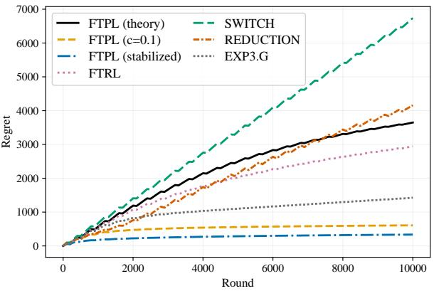  
(a) Oblivious adversarial regime.

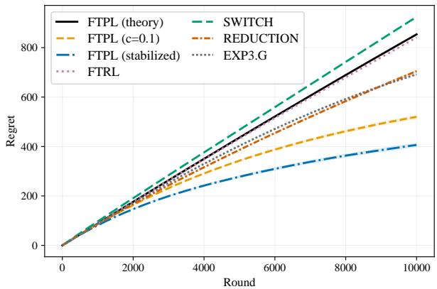  
(b) Stochastic Bernoulli regime.  
Figure 1: Regrets on the ring graph with three self-looped arms under different loss environments.

Graph structure. For the main comparison, we use a partially looped bidirected ring with $K = 8$ arms. Each arm reveals the losses of its two neighboring arms, while only three arms additionally reveal their own losses. Thus, $| V _ { 1 } | = 5$ and $| V _ { 2 } | = 3$ in our notation. In this graph, the three different domination numbers coincide, i.e., $\delta = \delta _ { * } = \delta _ { * } ^ { \prime } = 3 .$ Hence, differences in empirical performance cannot be attributed to the particular domination number used by each policy. In both environments, we choose the optimal arm from $V _ { 1 }$ to exclude direct self-observation. The complementary case in which the optimal arm belongs to $V _ { 2 }$ is also given in the appendix.

Environments. In the adversarial regime, we use a deterministic oblivious sequence with $T = 1 0 0 0 0$ and blocks of length 100. In the first block of every four-block cycle, one suboptimal arm outperforms the intended best arm, while their roles are reversed in the remaining three blocks. In particular, we set their cumulative losses to 7500 and 2500, respectively, making the intended best arm unique. In the stochastic regime, losses are independently drawn from Bernoulli, where the unique optimal arm has mean loss 0.3, while other remaining seven arms has mean 0.4.

Compared policies. We compare our policy with (i) FTRL policy with the stability-penalty-bias matching adaptive learning rate of Tsuchiya and Ito (2024), (ii) the testing and switching policy of Kong et al. (2022), (iii) the hierarchical reduction of Dann et al. (2023), and (iv) the baseline EXP3.G (Alon et al., 2015). For brevity, we refer to these policies as FTRL, SwITCH, REDUCTION, and EXP3.G, respectively.

In addition, we consider three variants of our policy. FTPL (theory) follows exactly the theoretical parameter choices specified in (8–11). FTPL (c = 0.1) multiplies parameters in (8) by 0.1, i.e., except $h _ { t }$ since $\beta _ { t }$ is determined by the ratio of $h _ { t }$ to other parameters. Based on this configuration, FTPL (stabilized)

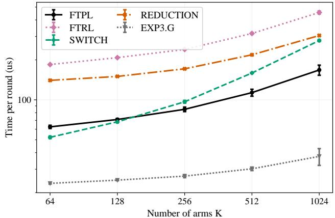  
Figure 2: Runtime for different K.

further sets $\beta _ { 1 } = 4$ and clips the exploration rate $\gamma _ { t }$ at $1 / 2 ,$ , which modifies both the initialization and the exploration rate. All three FTPL variants use the same Pareto perturbation with $\alpha = \operatorname* { m a x } \{ 2 , 2 \log K \}$ and the same conditional geometric resampling estimator.

Note that rescaling by 0.1 affects only the multiplicative constants and does not change the order of regret. In contrast, clipping $\gamma _ { t }$ may violate some arguments in the proof. Hence, FTPL (stabilized) does not automatically satisfy our regret guarantees.

Regret comparison. Figure 1 shows the results on the ring under the two environments, averaged over 600 independent runs. FTPL (theory) performs competitively with the baselines in both settings. Consistent with the conservative nature of the theoretical parameter choices, the two practical FTPL variants substantially improve upon the theoretical configuration in these experiments. In particular, setting $c = 0 . 1$ improves finite-time performance without changing the main structure of the policy. FTPL (stabilized), which combines a modified initialization with clipping, provides a further improvement. Both practical variants attain lower regret than all the baselines in the adversarial and stochastic settings. The same overall pattern persists across the additional graph structures and loss constructions given in the appendix.

Runtime. We consider a graph where arm 1 observes arms 1 and 2, arm 2 has no out-neighbor, and each remaining arm observes only itself. Thus, $| V _ { 1 } | = 1$ and $| V _ { 2 } | = K - 1$ , making a computationally intensive setting in which FTPL may invoke CGR frequently. Figure 2 shows the average runtime per round as the number of arms increases over 100 independent runs, where the error bars indicate one standard deviation. As expected, ExP3.G is the fastest policy due to its simple update rule. Among the BOBW policies, our policy exhibits better runtime scaling and achieves the lowest runtime for moderate and large values of $K$

## 5 Conclusion

This paper studied online learning with weakly observable feedback graphs. We proposed an FTPL policy that combines forced exploration with a graph-aware loss estimator based on conditional geometric resampling. Combined with adaptive learning rates defined using surrogate probabilities, our policy achieves near-optimal regret in adversarial environments and polylogarithmic regret in stochastic environments. Our guarantees also extend to adversarial environments with self-bounding constraints. Moreover, the policy preserves the standard FTPL structure and can be implemented in nearly linear expected time per round, independently of the number of edges. Our numerical results support the practical effectiveness of the proposed approach. More broadly, our results may indicate the importance of designing loss estimators that exploit the feedback structure while preserving the computational simplicity of FTPL. A natural direction is to extend these ideas to general partial monitoring problems or dueling bandits, where observations need not directly reveal individual losses.

## AI use statement

In this work, we used the generative AI tool ChatGPT-5.6 Sol model, to formalize definitions and mathematical claims, particularly those concerning weak observability and weak domination, suggest ingredients for proofs based on the ideas provided by the authors, assist in writing proofs, refine the experimental design, generate synthetic graph instances for experiments, particularly the specific domination number graph structure used in Appendix H, implement methods in Python. We did not use generative AI tools for developing the conceptual framework, interpretation of the results, writing the manuscript from the beginning, and translation or for cleaning or reformatting datasets. Qualitative and thematic data analysis was not applicable to this work.

Additionally, we used the tool for brainstorming, searching for related literature, identifying relevant references, suggesting experimental settings, generating and editing software code, creating and modifying graph visualizations with tikz, revising the manuscript, improving readability, and suggesting the title of the paper.

We reviewed all AI-assisted work. All mathematical statements and proofs were checked and written line by line by the authors. All AI-assisted code was reviewed and tested against the stated algorithms, and the reported experimental results were generated and verified by the authors. All final interpretations of the results were independently determined and verified by the authors. All references and literature summaries were checked against the original sources through a manual literature review. The authors revised and approved all AI-assisted text. We take responsibility for the final content of this work, including text, claims, and artifacts produced with the aid of generative AI.

## Bibliography

Noga Alon, Nicolo Cesa-Bianchi, Ofer Dekel, and Tomer Koren. Online learning with feedback graphs: Beyond bandits. In Conference on Learning Theory, pages 23–35. PMLR, 2015.

Peter Auer and Chao-Kai Chiang. An algorithm with nearly optimal pseudo-regret for both stochastic and adversarial bandits. In Conference on Learning Theory, pages 116–120. PMLR, 2016.

Peter Auer, Nicolo Cesa-Bianchi, Yoav Freund, and Robert E Schapire. Gambling in a rigged casino: The adversarial multi-armed bandit problem. In IEEE Annual Symposium on Foundations of Computer Science, pages 322–331. IEEE, 1995.

Gábor Bartók, Dean P Foster, Dávid Pál, Alexander Rakhlin, and Csaba Szepesvári. Partial monitoring—classification, regret bounds, and algorithms. Mathematics of Operations Research, 39(4):967–997, 2014.

Shai Ben-David, Dávid Pál, and Shai Shalev-Shwartz. Agnostic online learning. In Conference on Learning Theory, 2009.

Sébastien Bubeck and Aleksandrs Slivkins. The best of both worlds: Stochastic and adversarial bandits. In Conference on Learning Theory, pages 42–1. PMLR, 2012.

Nicolo Cesa-Bianchi and Gábor Lugosi. Prediction, learning, and games, volume 1. Cambridge university press, 2006.

Nicolo Cesa-Bianchi, Gábor Lugosi, and Gilles Stoltz. Regret minimization under partial monitoring. Mathematics of Operations Research, 31(3):562–580, 2006.

Botao Chen, Jongyeong Lee, and Junya Honda. Geometric resampling in nearly linear time for follow-theperturbed-leader with best-of-both-worlds guarantee in bandit problems. In International Conference on Machine Learning, PMLR, pages 8403–8426, 2025.

Botao Chen, Jongyeong Lee, Chansoo Kim, and Junya Honda. A further efficient algorithm with best-ofboth-worlds guarantees for m-set semi-bandit problem. arXiv preprint arXiv:2603.11764, 2026.

Houshuang Chen, Shuai Li, Chihao Zhang, et al. Understanding bandits with graph feedback. Advances in Neural Information Processing Systems, 34:24659–24669, 2021.

Michael B Cohen, Yin Tat Lee, and Zhao Song. Solving linear programs in the current matrix multiplication time. Journal of the ACM, 68(1):1–39, 2021.

Chris Dann, Chen-Yu Wei, and Julian Zimmert. A blackbox approach to best of both worlds in bandits and beyond. In Conference on Learning Theory, pages 5503–5570. PMLR, 2023.

Liad Erez and Tomer Koren. Towards best-of-all-worlds online learning with feedback graphs. Advances in Neural Information Processing Systems, 34:28511–28521, 2021.

Yoav Freund and Robert E Schapire. A decision-theoretic generalization of on-line learning and an application to boosting. Journal of computer and system sciences, 55(1):119–139, 1997.

Junya Honda, Shinji Ito, and Taira Tsuchiya. Follow-the-Perturbed-Leader achieves best-of-both-worlds for bandit problems. In International Conference on Algorithmic Learning Theory, volume 201, pages 726–754. PMLR, 2023.

Jiatai Huang, Yan Dai, and Longbo Huang. Adaptive best-of-both-worlds algorithm for heavy-tailed multiarmed bandits. In international conference on machine learning, pages 9173–9200. PMLR, 2022.

Shinji Ito, Taira Tsuchiya, and Junya Honda. Nearly optimal best-of-both-worlds algorithms for online learning with feedback graphs. Advances in Neural Information Processing Systems, 35:28631–28643, 2022.

Shinji Ito, Taira Tsuchiya, and Junya Honda. Adaptive learning rate for follow-the-regularized-leader: Competitive analysis and best-of-both-worlds. In Conference on Learning Theory, pages 2522–2563. PMLR, 2024.

Tiancheng Jin, Junyan Liu, and Haipeng Luo. Improved best-of-both-worlds guarantees for multi-armed bandits: Ftrl with general regularizers and multiple optimal arms. Advances in Neural Information Processing Systems, 36:30918–30978, 2023.

Richard M Karp. Reducibility among combinatorial problems. In Symposium on the Complexity of Computer Computations, pages 85–103. Springer, 1972.

Chaiwon Kim, Jongyeong Lee, and Min-hwan Oh. Follow-the-perturbed-leader for decoupled bandits: Best-of-both-worlds and practicality. In International Conference on Machine Learning, PMLR, 2026.

Fang Kong, Yichi Zhou, and Shuai Li. Simultaneously learning stochastic and adversarial bandits with general graph feedback. In International Conference on Machine Learning, pages 11473–11482. PMLR, 2022.

Yuko Kuroki, Alberto Rumi, Taira Tsuchiya, Fabio Vitale, and Nicolò Cesa-Bianchi. Best-of-both-worlds algorithms for linear contextual bandits. In International Conference on Artificial Intelligence and Statistics, pages 1216–1224. PMLR, 2024.

Tze Leung Lai and Herbert Robbins. Asymptotically efficient adaptive allocation rules. Advances in Applied Mathematics, 6(1):4–22, 1985.

Chung-Wei Lee, Haipeng Luo, Chen-Yu Wei, Mengxiao Zhang, and Xiaojin Zhang. Achieving near instance-optimality and minimax-optimality in stochastic and adversarial linear bandits simultaneously. In International Conference on Machine Learning, pages 6142–6151. PMLR, 2021.

Jongyeong Lee, Junya Honda, Shinji Ito, and Min-hwan Oh. Follow-the-Perturbed-Leader with Fréchet-type tail distributions: Optimality in adversarial bandits and best-of-both-worlds. In Conference on Learning Theory, pages 3375–3430. PMLR, 2024.

Jongyeong Lee, Junya Honda, Shinji Ito, and Min-hwan Oh. Revisiting follow-the-perturbed-leader with unbounded perturbations in bandit problems. In Advances in Neural Information Processing Systems, volume 38, Main Conference, pages 83623–83675. Curran Associates, Inc., 2025.

Jongyeong Lee, Junya Honda, Shinji Ito, and Chansoo Kim. Adaptive learning rates with surrogate probability for follow-the-perturbed-leader. In Conference on Learning Theory, volume 336, pages 4478–4519. PMLR, 2026.

Nick Littlestone. Learning quickly when irrelevant attributes abound: A new linear-threshold algorithm. Machine learning, 2(4):285–318, 1988.

Nick Littlestone and Manfred K Warmuth. The weighted majority algorithm. Information and computation, 108(2):212–261, 1994.

Shie Mannor and Ohad Shamir. From bandits to experts: On the value of side-observations. Advances in Neural Information Processing Systems, 24, 2011.

Saeed Masoudian and Yevgeny Seldin. Improved analysis of the tsallis-inf algorithm in stochastically constrained adversarial bandits and stochastic bandits with adversarial corruptions. In Conference on Learning Theory, pages 3330–3350. PMLR, 2021.

Saeed Masoudian, Julian Zimmert, and Yevgeny Seldin. A best-of-both-worlds algorithm for bandits with delayed feedback. Advances in Neural Information Processing Systems, 35:11752–11762, 2022.

Gergely Neu and Gábor Bartók. Importance weighting without importance weights: An efficient algorithm for combinatorial semi-bandits. Journal of Machine Learning Research, 17(154):1–21, 2016.

Quan Nguyen, Shinji Ito, Junpei Komiyama, and Mehta Nishant. Data-dependent bounds with t-optimal best-of-both-worlds guarantees in multi-armed bandits using stability-penalty matching. In Conference on Learning Theory, volume 291, pages 4386–4451. PMLR, 2025.

Chloé Rouyer and Yevgeny Seldin. Tsallis-inf for decoupled exploration and exploitation in multi-armed bandits. In Conference on Learning Theory, pages 3227–3249. PMLR, 2020.

Chloé Rouyer, Dirk van der Hoeven, Nicolò Cesa-Bianchi, and Yevgeny Seldin. A near-optimal best-of-bothworlds algorithm for online learning with feedback graphs. Advances in Neural Information Processing Systems, 35:35035–35048, 2022.

Yevgeny Seldin and Aleksandrs Slivkins. One practical algorithm for both stochastic and adversarial bandits. In International Conference on Machine Learning, pages 1287–1295. PMLR, 2014.

Taira Tsuchiya and Shinji Ito. A simple and adaptive learning rate for FTRL in online learning with minimax regret of $\Theta ( T ^ { 2 / 3 } )$ and its application to best-of-both-worlds. Advances in Neural Information Processing Systems, 37:8477–8514, 2024.

Taira Tsuchiya, Shinji Ito, and Junya Honda. Best-of-both-worlds algorithms for partial monitoring. In International Conference on Algorithmic Learning Theory, pages 1484–1515. PMLR, 2023a.

Taira Tsuchiya, Shinji Ito, and Junya Honda. Stability-penalty-adaptive follow-the-regularized-leader: Sparsity, game-dependency, and best-of-both-worlds. In Advances in Neural Information Processing Systems, volume 36, pages 47406–47437. Curran Associates, Inc., 2023b.

Jingxin Zhan, Yuchen Xin, Chenjie Sun, and Zhihua Zhang. Follow-the-perturbed-leader nearly achieves best-of-both-worlds for the m-set semi-bandit problems. In Advances in Neural Information Processing Systems, volume 38, Main Conference, pages 110918–110957. Curran Associates, Inc., 2025.

Julian Zimmert and Yevgeny Seldin. Tsallis-inf: An optimal algorithm for stochastic and adversarial bandits. Journal of Machine Learning Research, 22(28):1–49, 2021.

Julian Zimmert, Haipeng Luo, and Chen-Yu Wei. Beating stochastic and adversarial semi-bandits optimally and simultaneously. In International Conference on Machine Learning, pages 7683–7692. PMLR, 2019.

## Appendix Contents

A Proofs of Lemmas for Section 3 18   
A.1 Proof of Lemma 2 . 18   
A.2 Proof of Lemma 3 19   
A.3 Proof of Lemma 6 . 20   
B Proof sketch 20   
C Proof of Lemmas for Appendix B 21   
C.1 Proof of Lemma 7: regret decomposition . 21   
C.2 Proof of Lemma 8 . 23   
D Proof of Theorem 4: Adversarial regime 25   
E Proof of Theorem 5: Adversarial regime with self-bounding constraints 26   
F Improved regret bounds for adversarial regime with self-bounding constraints 28   
G Proof of auxiliary lemmas 30   
G.1 Proof of Lemma 9 . 30   
G.2 Proof of Lemma 10 31   
G.3 Proof of Lemma 13 32   
G.4 Proof of Lemma 15 34   
G.5 Proof of Lemma 16 36   
G.6 Proof of Lemma 18 37   
G.7 Proof of Lemma 20 41   
G.8 Proof of inequality (20) . 42   
H Additional experiments 43   
H.1 Graph structures . 43   
H.2 Environments 44   
H.3 Results. 46

## A Proofs of Lemmas for Section 3

In this section, we provide the proofs of results directly related to proposed methods.

## A.1 Proof of Lemma 2

Here, we present the detailed proof of Lemma 2. Before the proof, we first introduce a useful result on the relationship between $e _ { t , i , j }$ and $w _ { t , j }$ , whose proof is deferred to Appendix A.3.

Lemma 6. For any $i \in V$ and $t , p _ { t , i } / K \le w _ { t , i }$ holds.

Notice that this lemma implies that $e _ { t , i , j } \leq w _ { t , j } , \forall j \in V _ { 2 } ^ { \mathrm { i n } } ( i ) \backslash \{ i \}$

Proof of Lemma 2. By definition of $B _ { t }$ and the construction of the proposed policy, the unbiasedness of $\widehat { \ell } _ { t , i }$ for $i \in V _ { 1 }$ follows immediately. Since we construct non-zero loss estimator for $V _ { 2 }$ only when it is observed by $i _ { t } \in V _ { 2 }$ , for $i \in V _ { 2 }$ , we have

$$
\mathbb { E } [ \hat { \ell } _ { t , i } | \hat { L } _ { t } ] = \sum _ { j \in V _ { 2 } ^ { \mathrm { i n } } ( i ) } \frac { ( 1 - \gamma _ { t } ) w _ { t , j } } { 1 - \gamma _ { t } } e _ { t , i , j } \mathbb { E } [ Z _ { t } | \hat { L } _ { t } , i _ { t } = j ] \ell _ { t , i } = \sum _ { j \in V _ { 2 } ^ { \mathrm { i n } } ( i ) } e _ { t , i , j } \ell _ { t , i } = \ell _ { t , i } ,
$$

where the second equality follows from Lemma 2 of Chen et al. (2025), which states $\mathbb { E } [ Z _ { t } | \hat { L } _ { t } , i _ { t } = j ] = w _ { t , j } ^ { - 1 }$ and the last equality follows from the definition of $e _ { t , i , j }$ in (14).

Next, for the conditional second moment of $i \in V _ { 1 }$ , we have

$$
\mathbb { E } \left[ \widehat { \ell } _ { t , i } ^ { 2 } \Big | \widehat { L } _ { t } \right] = \mathbb { E } \left[ \mathbb { 1 } \big [ B _ { t } = 1 , i \in V ^ { \mathrm { o u t } } ( i _ { t } ) \big ] \frac { \ell _ { t , i } ^ { 2 } } { \gamma _ { t } ^ { 2 } \rho _ { i } ^ { 2 } } \Bigg | \widehat { L } _ { t } \right] = \frac { \ell _ { t , i } ^ { 2 } } { \gamma _ { t } \rho _ { i } } = \frac { \delta _ { * } \ell _ { t , i } ^ { 2 } } { \sum _ { j \in V ^ { \mathrm { i n } } ( i ) } x _ { j } ^ { * } \gamma _ { t } } \leq \frac { \delta _ { * } } { \gamma _ { t } } ,
$$

where the last equality follows from the definition of $\rho _ { i }$ in (13) and the last inequality follows from the fact that $\ell _ { t , i } \in [ 0 , 1 ]$ and $\begin{array} { r } { \sum _ { j \in V ^ { \mathrm { i n } } ( i ) } x _ { j } ^ { * } \ge 1 } \end{array}$ holds for any $i \in V _ { 1 }$ by linear program in (2).

By the design of Algorithm 1, Mt follows the geometric distribution with success probability $\sigma _ { t , i _ { t } } w _ { t , i _ { t } }$ Then, for $i \in V _ { 2 }$ , we have

$$
\begin{array} { r l r } { \mathbb { E } [ \widehat { \ell } _ { \xi , \xi } ^ { 2 } | \widehat { L } _ { t , t } ] = } & { \mathbb { E } [ 1 [ B _ { t } = 0 , i \in V _ { 2 } ^ { \operatorname* { m a x } } \{ \hat { \ell } _ { t , t } \} _ { t } ^ { C } \frac { 2 } { ( 1 - \gamma ) ! } C _ { t , t } ^ { 2 } ] \widehat { L } _ { t , t } ^ { 2 } ] } & \\ { = } & { \displaystyle \sum _ { j \in V _ { 2 } ^ { \operatorname* { m a x } } \{ 1 - \gamma \} } ( 1 - \gamma i j ! \frac { \epsilon _ { t , t , j } } { ( 1 - \gamma ) ! } ) ^ { 2 } \mathbb { E } [ Z _ { t } ^ { 2 } \Big | \widehat { L } _ { t , t } \lambda _ { t } = j ] } & { \displaystyle ( \cdot \cdot , 1 [ i \in V ^ { \operatorname* { m a x } } ( j ) ] = 1 [ j \in V ^ { \operatorname* { m a x } } ( i ) ] ) , } \\ & { = } & { \displaystyle \frac { \ell _ { t , t } ^ { 2 } } { 1 - \gamma } \sum _ { j \in V _ { 2 } ^ { \operatorname* { m a x } } \{ 1 , \beta _ { t , t , j } ^ { 2 } , \} } \mathbb { E } [ Z _ { t } ^ { 2 } \Big | \widehat { L } _ { t , t } \lambda _ { t } = j ] } \\ & { \leq \frac { \ell _ { t , t , t } ^ { 2 } } { 1 - \gamma } \sum _ { j \in V _ { 2 } ^ { \operatorname* { m a x } } \{ 1 , \beta _ { t , t , j } ^ { 2 } , \} } \sigma _ { t , t , t } ^ { 2 } \frac { 2 } { \sigma _ { t , t , t } ^ { 2 } \sigma _ { t , t } ^ { 2 } } \frac { 1 } { \sigma _ { t , t } ^ { 2 } } \frac { \sigma _ { t , t , t } ^ { 2 } } { \sigma _ { t , t } ^ { 2 } } } & { ( 1 5 ) } \\ &  \leq \frac { 2 } { 1 - \gamma } \sum _  j \in V _ { 2 } ^  \operatorname* { m a x } \end{array}
$$

Let $\begin{array} { r } { e _ { t , i } ^ { \Sigma } = \sum _ { j \in V _ { 2 } ^ { \mathrm { i n } } ( i ) \backslash \{ i \} } e _ { t , i , j } } \end{array}$ . Then, by the definition of $e _ { t , i , j }$ in (14) and Lemma 6, we obtain

$$
\begin{array} { r l } & { \displaystyle \sum _ { j \in V _ { t , i } ^ { \pm } ( i ) } \frac { \epsilon _ { t , j , i } ^ { \ell + 1 } } { w _ { t , j } } = \frac { ( 1 - \epsilon _ { t , i } ^ { \le 1 } ) ^ { 2 } } { w _ { t , i } } + \displaystyle \sum _ { j \in V _ { t , i } ^ { \pm } ( i ) \backslash \{ \} } \frac { \epsilon _ { t , i , j } ^ { \ell + 1 } } { w _ { t , j } } } \\ & { \le \frac { ( 1 - \epsilon _ { t , i } ^ { \le 1 } ) ^ { 2 } } { w _ { t , i } } + \displaystyle \sum _ { j \in V _ { t , i } ^ { \pm } ( i ) \backslash \{ \} } \epsilon _ { t , i , j } } \\ & { \quad \quad - \frac { ( 1 - \epsilon _ { t , i } ^ { \le 1 } ) ^ { 2 } } { w _ { t , i } } + \epsilon _ { t , i } ^ { \le 1 } } \\ & { \quad \le \frac { ( 1 - \epsilon _ { t , i } ^ { \le 1 } ) ^ { 2 } + \epsilon _ { t , i } ^ { \le 1 } } { w _ { t , i } } } \\ & { \quad \le \frac { 1 - \epsilon _ { t , i } ^ { \le 1 } + ( \epsilon _ { t , i } ^ { \le 2 } ) ^ { 2 } } { w _ { t , i } } \le \frac { 1 } { w _ { t , i } } , } \\ & { \quad \le \frac { 1 - \epsilon _ { t , i } ^ { \le 1 } + ( \epsilon _ { t , i } ^ { \le 2 } ) ^ { 2 } } { w _ { t , i } } \le \frac { 1 } { w _ { t , i } } , } \end{array}\tag{by definition (14)}
$$

$$
( \because w _ { t , i } \in ( 0 , 1 ) )\tag{by Lemma 6}
$$

where the last inequality follows from $e _ { t , i } ^ { \Sigma } \in [ 0 , 1 )$ . Consequently,

$$
\mathbb { E } \Big [ \hat { \ell } _ { t , i } ^ { 2 } \Big | \hat { L } _ { t } \Big ] \leq \frac { 2 } { ( 1 - \gamma _ { t } ) w _ { t , i } } \leq \frac { 4 } { w _ { t , i } } ,
$$

where the last inequality follows from $\gamma _ { t } \in ( 0 , 1 / 2 ]$ as defined in (7), which concludes the proof. □

## A.2 Proof of Lemma 3

Here, we present the detailed proof of Lemma 3.

Proof. The result follows directly from the proof of Lemma 2 in Chen et al. (2025), which analyzes the computational complexity of CGR I, CGR with value swapping (Algorithm 1). When $r ^ { \prime }$ denotes the resampled perturbations under value swapping, Lemma 2 of Chen et al. (2025) shows that

$$
\mathbb { E } _ { r ^ { \prime } } [ M _ { t } | \hat { L } _ { t } , i _ { t } ] = \frac { 1 } { \sigma _ { t , i _ { t } } w _ { t , i _ { t } } } .
$$

Therefore, the expected number of resampling steps in Algorithm 1 satisfies that

$$
\begin{array} { l } { \mathbb { E } _ { r ^ { \prime } } \Big [ M _ { t } | \hat { L } _ { t } \Big ] = \displaystyle \sum _ { i \in V _ { 2 } } \operatorname* { P r } \Big [ i _ { t } = i | \hat { L } _ { t } \Big ] \mathbb { E } _ { r ^ { \prime } } \Big [ M _ { t } | \hat { L } _ { t } , i _ { t } = i \Big ] } \\ { = \displaystyle \sum _ { i \in V _ { 2 } } w _ { t , i } \frac { 1 } { \sigma _ { t , i } w _ { t , i } } } \\ { \leq 1 + \displaystyle \int _ { 1 } ^ { | V _ { 2 } | } \frac { 1 } { x } \mathrm { d } x } \\ { = \log | V _ { 2 } | + 1 . } \end{array}
$$

Notice that we only consider the case of $i _ { t } ~ \in ~ V _ { 2 }$ rather than the summation over V. This is because Algorithm 1 (CGR I) runs only when $i _ { t } \in V _ { 2 }$ under Algorithm 2. □

## A.3 Proof of Lemma 6

Here, we provide the proof of Lemma 6

Proof. By the decision rule of FTPL, we have

$$
w _ { t , i } = \int _ { 0 } ^ { \infty } f ( z + \eta _ { t } \underline { { \hat { L } } } _ { t , i } ) \prod _ { j \neq i } F ( z + \eta _ { t } \underline { { \hat { L } } } _ { t , j } ) \mathrm { d } z .
$$

Here, $f ( z ) = \alpha / ( z + 1 ) ^ { \alpha + 1 }$ for $z \geq 0$ by the choice of Pareto distribution with shape $\alpha > 0$ . Since $\underline { { \hat { L } } } _ { t , i } \geq 0$ for all $i \in V$ and F is increasing, for $\underline { { \lambda } } _ { i } = \eta _ { t } \underline { { \hat { L } } } _ { t , i } .$ we have

$$
\begin{array} { l } { \displaystyle w _ { t , i } \geq \int _ { 0 } ^ { \infty } f ( z + \eta \hat { L } _ { t , i } ) F ( z ) ^ { K - 1 } \mathrm { d } z } \\ { \displaystyle \quad = \int _ { 0 } ^ { \infty } \frac \alpha { ( z + \lambda _ { i } + 1 ) ^ { \alpha + 1 } } F ( z ) ^ { K - 1 } \mathrm { d } z } \\ { \displaystyle \quad = \frac 1 { ( 1 + \lambda _ { i } ) ^ { \alpha } } \int _ { 0 } ^ { \infty } \frac \alpha { ( 1 + x ) ^ { \alpha + 1 } } F ( ( 1 + \lambda _ { i } ) x ) ^ { K - 1 } \mathrm { d } x } \\ { \displaystyle \quad \geq \frac 1 { ( 1 + \lambda _ { i } ) ^ { \alpha } } \int _ { 0 } ^ { \infty } \frac \alpha { ( 1 + x ) ^ { \alpha + 1 } } F ( x ) ^ { K - 1 } \mathrm { d } x } \\ { \displaystyle \qquad = \frac 1 { K ( 1 + \lambda _ { i } ) ^ { \alpha } } \sum _ { k } ^ { \infty } \frac { p _ { t , i } } { K } , } \end{array} \qquad \begin{array} { r l } { \displaystyle ( 1 + \lambda _ { i } ) x } \\ { \displaystyle ( 1 + \lambda _ { i } ) x } \end{array}
$$

which concludes the proof.

## B Proof sketch

In this section, we provide an outline of the analysis in Section 3.4, where the detailed proofs are given in Appendices C-E. At a high level, our analysis reduces the regret bound to a form analyzed by Ito et al. (2022) and Tsuchiya and Ito (2024).

Lemma 7. For $z _ { t } , u _ { t } , v _ { t }$ defined in (8), Algorithm 2 with $\beta _ { t }$ defined in (9) and $\alpha \geq 2$ satisfies

$$
\mathrm { R e g } _ { T } \leq \sum _ { t = 1 } ^ { T } 3 \mathbb { E } \bigg [ \sqrt { \frac { z _ { t } } { \beta _ { t } } } + \frac { u _ { t } + v _ { t } } { \beta _ { t } } \bigg ] + \mathcal { O } \Big ( \operatorname* { m a x } \Big ( \delta _ { * } \log K , K ^ { 1 - \frac { 1 } { \alpha } } + \delta _ { * } \Big ) \alpha K ^ { \frac { 1 } { \alpha } } \Big ) .\tag{16}
$$

To control the first two leading terms in (16), for any positive sequences, $a _ { 1 : n } = \{ a _ { 1 } , \ldots , a _ { n } \}$ and $b _ { 1 : n } = \{ b _ { 1 } , \ldots , b _ { n } \}$ of length $n \in \mathbb { N }$ , define

$$
\begin{array} { l } { \displaystyle { { \cal G } _ { 1 } ( a _ { 1 : n } , b _ { 1 : n } ) : = \sum _ { t = 1 } ^ { n } \frac { \sqrt { a _ { t } } } { ( \sum _ { s = 1 } ^ { t } \sqrt { a _ { s } } / b _ { s } ) ^ { 1 / 3 } } , } } \\ { \displaystyle { { \cal G } _ { 2 } ( a _ { 1 : n } , b _ { 1 : n } ) : = \sum _ { t = 1 } ^ { n } \frac { a _ { t } } { \sqrt { \sum _ { s = 1 } ^ { t } a _ { s } / b _ { s } } } , } } \end{array}\tag{17}
$$

and $a _ { \mathrm { m a x } }$ denote the maximum of given sequence $a _ { 1 : n }$ . The following lemma reduces leading terms in (16) to the functionals $G _ { 1 } , G _ { 2 }$ in (17).

Lemma 8. Let $\mathcal { T } : = \{ t \in [ T ] : \beta _ { t } < 2 ^ { 1 / \alpha } \beta _ { t - 1 } \}$ . Then, $f o r \ z _ { t } , u _ { t } , v _ { t } , \beta _ { t }$ defined in $( 8 { - } 9 ) , G _ { 1 } , G _ { 2 }$ defined in (17), and $\alpha \geq 2 ,$ we have

$$
\sum _ { t = 1 } ^ { T } \sqrt { \frac { z _ { t } } { \beta _ { t } } } \leq 2 ^ { \frac { 1 } { 4 } } G _ { 1 } ( \{ z _ { s } \} _ { s \in \mathcal { T } } , \{ h _ { s } \} _ { s \in \mathcal { T } } ) + \alpha ,
$$

$$
\sum _ { t = 1 } ^ { T } \frac { u _ { t } + v _ { t } } { \beta _ { t } } \leq \sqrt { 2 } G _ { 2 } \big ( \{ u _ { s } + v _ { s } \} _ { s \in \mathcal { T } } , \{ h _ { s } \} _ { s \in \mathcal { T } } \big ) + \frac { \alpha } { 2 } .
$$

Hence, it remains to bound the $G _ { 1 } , G _ { 2 }$ terms, which can be done by applying Lemma 5 of Tsuchiya and Ito (2024) and Lemma 3 of Ito et al. (2024). In the adversarial regime, we obtain

$$
\begin{array} { c l c r } { { } } & { { } } & { { G _ { 1 } ( \{ z _ { s } \} _ { s \in \mathcal { T } } , \{ h _ { s } \} _ { s \in \mathcal { T } } ) \leq \displaystyle \frac { 3 } { 2 } ( h _ { \operatorname* { m a x } } z _ { \operatorname* { m a x } } ) ^ { \frac { 1 } { 3 } } T ^ { \frac { 2 } { 3 } } , } } \\ { { } } & { { } } & { { G _ { 2 } ( \{ u _ { s } + v _ { s } \} _ { s \in \mathcal { T } } , \{ h _ { s } \} _ { s \in \mathcal { T } } ) \leq 2 \sqrt { h _ { \operatorname* { m a x } } ( u _ { \operatorname* { m a x } } + v _ { \operatorname* { m a x } } ) T } , } } \end{array}
$$

which concludes the proof of Theorem 4 by substituting bounds on parameter. The corresponding bounds under the AwSC regime are provided in Appendix E.

## C Proof of Lemmas for Appendix B

In this section, we provide the detailed proofs for results given in Appendix B. Before the proof, we define $\phi ( \lambda )$ denotes the arm-selection probability by FTPL with Pareto perturbations for given $\boldsymbol { \lambda } \in \mathbb { R } ^ { K }$ , whose i-th element is written by

$$
\phi _ { i } ( \lambda ) = \int _ { 0 } ^ { \infty } f ( z + \lambda _ { i } ) \prod _ { j \not = i } F ( z + \lambda _ { j } ) \mathrm { d } z .
$$

Notice that $w _ { t , i } = \phi _ { i } ( \eta _ { t } \hat { L } _ { t } )$ . We use this notation throughout the remainder of the paper.

## C.1 Proof of Lemma 7: regret decomposition

Here, we provide the proofs for the regret decomposition. We first introduce three auxiliary lemmas used in the proof of Lemma 7, whose proofs are given in Appendix G.

## Lemma 9. Algorithm 2 satisfies that

$$
\mathbb { E } \Big [ \Big \langle \hat { \ell } _ { t } , \phi ( \eta _ { t } \hat { L } _ { t } ) - \phi ( \eta _ { t } \hat { L } _ { t + 1 } ) \Big \rangle \Big | \hat { L } _ { t } \Big ] \leq \frac { z _ { t } } { \beta _ { t } \gamma _ { t } } + \frac { u _ { t } } { \beta _ { t } } .
$$

Lemma 10. For $z _ { t } , u _ { t } , v _ { t }$ in (8) and $h _ { t }$ in (10), it holds for any $t \in \mathbb { N }$ that

$$
z _ { t } \le z _ { \operatorname* { m a x } } = ( 2 e \sqrt { 2 } + 3 \sqrt { 2 } ) \alpha \delta _ { * } \log K
$$

$$
u _ { t } \le u _ { \operatorname* { m a x } } = ( 4 e \sqrt { 2 } + 2 4 \sqrt { 2 } ) \frac { \alpha ^ { 2 } } { \alpha - 1 } K ^ { 1 - \frac { 1 } { \alpha } }
$$

$$
v _ { t } \le v _ { \operatorname* { m a x } } = c _ { v } ( \alpha + 1 ) \delta _ { * }
$$

$$
h _ { t } \leq h _ { \operatorname* { m a x } } = \frac { 4 \alpha ^ { 2 } } { \alpha - 1 } K ^ { \frac { 1 } { \alpha } } .
$$

Therefore, we choose

$$
\begin{array} { r } { \beta _ { 1 } \geq \operatorname* { m a x } \left( 1 6 z _ { \operatorname* { m a x } } , 4 ( u _ { \operatorname* { m a x } } + v _ { \operatorname* { m a x } } ) \right) \implies \gamma _ { t } \in ( 0 , 1 / 2 ] . } \end{array}\tag{18}
$$

Lemma 11 (Lemma 8 of Lee et al. (2026)). For $p , q$ in (4), $q _ { t , i } \leq p _ { t , i } \leq 2 q _ { t , i }$ holds for all $t \in \mathbb { N }$ and $\alpha \geq 2$

Proof of Lemma 7. First, we provide a general regret decomposition. We have

$$
\begin{array} { r l r } {  { \mathrm { R e g } _ { T } = \mathbb { E } [ \sum _ { t = 1 } ^ { T } \langle \ell _ { t } , y _ { t } - e _ { i ^ { \star } } \rangle ] } } \\ & { } & { = \mathbb { E } [ \sum _ { t = 1 } ^ { T } \langle \ell _ { t } , ( 1 - \gamma _ { t } ) w _ { t } - e _ { i ^ { \star } } \rangle ] + \mathbb { E } [ \sum _ { t = 1 } ^ { T } \langle \ell _ { t } , \gamma _ { t } w ^ { 0 } \rangle ] } \\ & { } & { \leq \mathbb { E } [ \sum _ { t = 1 } ^ { T } \langle \ell _ { t } , w _ { t } - e _ { i ^ { \star } } \rangle ] + \mathbb { E } [ \sum _ { t = 1 } ^ { T } \gamma _ { t } ] \qquad \quad \mathrm { ( : ~ \gamma _ \epsilon \in ( 0 , 1 / 2 ] , ~ } \ell _ { t , i } \in [ 0 , 1 ] ) } \\ & { } & { = \mathbb { E } [ \sum _ { t = 1 } ^ { T }  \hat { \ell } _ { t } , w _ { t } - e _ { i ^ { \star } }  ] + \mathbb { E } [ \sum _ { t = 1 } ^ { T } \gamma _ { t } ] , } \end{array}
$$

where the last equality follows from the unbiasedness of the loss estimator established in Lemma 2. Recall that $w _ { t }$ is the probability vector induced by the FTPL rule at round t, with $w _ { t , i }$ denoting the probability of arm i being selected. Therefore, we can directly apply the previous FTPL regret decomposition to the first term (Kim et al., 2026, Lemma 3.4), which yields

$$
\mathbb { E } \left[ \sum _ { t = 1 } ^ { T } \left. \hat { \ell } _ { t } , w _ { t } - e _ { i ^ { * } } \right. \right] \leq \sum _ { t = 1 } ^ { T } \mathbb { E } \left[ \left. \hat { \ell } _ { t } , \phi ( \eta _ { t } \hat { L } _ { t } ) - \phi ( \eta _ { t } \hat { L } _ { t + 1 } ) \right. \right] + \sum _ { t = 1 } ^ { T + 1 } ( \beta _ { t } - \beta _ { t - 1 } ) \mathbb { E } _ { r _ { t } , \sim \mathrm { P a r } ( \alpha ) } [ r _ { t , i _ { t } } - r _ { t , i ^ { * } } ] .
$$

Here, we set $\beta _ { 0 } = 0$ for the analysis, which is introduced solely for notational convenience and does not appear in the actual algorithm. Since the second term of RHS solely depends on the perturbation distributions, we can directly apply the previous results in Lee et al. (2026, Lemma 7), which yields

$$
\begin{array} { r l } { ( \beta _ { t } - \beta _ { t - 1 } ) \mathbb { E } _ { r _ { t } , \sim \mathrm { P a r } ( \alpha ) } [ r _ { t , i _ { t } } - r _ { t , i ^ { * } } | \hat { L } _ { t } ] = ( \beta _ { t } - \beta _ { t - 1 } ) \mathbb { E } _ { r _ { t } , \sim \mathrm { P a r } ( \alpha ) } [ r _ { t , i _ { t } } - r _ { t , j _ { t } } | \hat { L } _ { t } ] } & { } \\ { \times \displaystyle \sum _ { i \neq j _ { t } } \frac { 2 \alpha } { \alpha - 1 } p _ { t , i } ^ { 1 - \frac { 1 } { \alpha } } . } & { } \end{array}
$$

The first equality follows since $j _ { t }$ is fixed given $\hat { L } _ { t }$ and the perturbations $r _ { t , i ^ { \mathrm { S } } }$ are independently and identically distributed, so that $r _ { t , j _ { t } }$ and $r _ { t , i ^ { * } }$ have the same expectation conditional on $\hat { L } _ { t }$ . Therefore, by Lemma 11 and

$\beta _ { t }$ in (9), we have

$$
\begin{array} { r l r } { \displaystyle \sum _ { t = 1 } ^ { T + 1 } ( \beta _ { t } - \beta _ { t } _ { t } _ { 1 } ) \mathbb { E } _ { \tau _ { t } , \sim \mathrm { T r a r } ( \omega ) } | r _ { t , t _ { t } } - r _ { t , t ^ { * } } | \hat { L } _ { t } | \leq \displaystyle \sum _ { t = 1 } ^ { T + 1 } ( \beta _ { t } - \beta _ { t - 1 } ) \displaystyle \sum _ { \omega \neq n } \frac { 2 ^ { T - \frac { 1 } { \omega } } \alpha _ { t } } { \omega - 1 } \displaystyle \frac { 1 } { \theta _ { t , t } } \frac { - \frac { 1 } { \omega } } { \omega } } & { ( \mathrm { b y ~ L e m m a ~ 1 1 } ) } \\ & { } & { \displaystyle - \frac { T + 1 } { t - 1 } \displaystyle \sum _ { \omega ^ { - } \vert \beta _ { t } - \beta _ { t - 1 } \vert ) h _ { t } } ( \mathrm { b y ~ d e l n i t i o n ~ o f ~ } h _ { t _ { \mathrm { d i n } } } ( 1 0 ) ) } \\ & { } & { = \displaystyle \sum _ { t = 1 } ^ { T - 1 } \displaystyle \sum _ { - \omega ^ { - } \vert \beta _ { t } - \beta _ { t - 1 } \vert h _ { t } + \beta _ { t } \vert } ^ { - 1 } h _ { t } \frac { ( \omega - \beta _ { t } ) } { \omega - 1 } } \\ & { } & { \displaystyle \leq \displaystyle \sum _ { t = 2 } ^ { T + 1 } - \frac { 1 } { \sqrt { \frac { \pi \beta _ { t } } { \beta _ { t } } } } \displaystyle \sum _ { \hat { \mu } _ { t - 1 } } ^ { \frac { 1 } { \omega } } + 2 ^ { - \frac { 1 } { \omega } } \displaystyle \frac { \mathbf { 1 } _ { \hat { \mu } _ { t } } + \frac { 1 } { \omega } h _ { t } } { \beta _ { t - 1 } } + \beta _ { t } \mathbb { I } _ { 1 } h _ { t } ( \mathrm { b y } ( \boldsymbol { \Psi } ) ) } \\ & { } &  \displaystyle \leq \displaystyle \sum _ { t = 1 } ^ { T } \sqrt  \ \end{array}
$$

where the last inequality holds since $\beta _ { t }$ is monotonically increasing for t and satisfies $\beta _ { t } \leq 2 ^ { 1 / \alpha } \beta _ { t - 1 }$ . By Lemma 10 and the choice of $\beta _ { 1 }$ in (18), we have for $\alpha \geq 2$ that

$$
\begin{array} { r l r } {  { \beta _ { 1 } h _ { \operatorname* { m a x } } + \sqrt { \frac { z _ { \operatorname* { m a x } } } { \beta _ { 1 } } } + \frac { u _ { \operatorname* { m a x } } + v _ { \operatorname* { m a x } } } { \beta _ { 1 } } } \leq \beta _ { 1 } h _ { \operatorname* { m a x } } + \frac { 1 } { 2 } }  \\ & { } & { \leq \mathcal { O } \Big ( \operatorname* { m a x } \Big ( \delta _ { * } \log K , K ^ { 1 - \frac { 1 } { \alpha } } + \delta _ { * } \Big ) \alpha K ^ { \frac { 1 } { \alpha } } \Big ) . } \end{array}
$$

Therefore, Lemma 9 implies that

$$
\begin{array} { r l } & { \mathrm { R e g } _ { T } \leq \mathbb { E } \left[ \displaystyle \sum _ { t = 1 } ^ { T } \frac { z _ { t } } { \beta _ { t } \gamma _ { t } } + \frac { u _ { t } } { \beta _ { t } } + \sqrt { \frac { z _ { t } } { \beta _ { t } } } + \frac { u _ { t } + v _ { t } } { \beta _ { t } } + \gamma _ { t } \right] + \mathcal { O } \Big ( \operatorname* { m a x } \Big ( \delta _ { * } \log K , K ^ { 1 - \frac { 1 } { \alpha } } + \delta _ { * } \Big ) \alpha K ^ { \frac { 1 } { \alpha } } \Big ) } \\ & { \qquad \leq \mathbb { E } \left[ \displaystyle \sum _ { t = 1 } ^ { T } \frac { z _ { t } } { \beta _ { t } \gamma _ { t } } + \sqrt { \frac { z _ { t } } { \beta _ { t } } } + 2 \frac { u _ { t } + v _ { t } } { \beta _ { t } } + \gamma _ { t } \right] + \mathcal { O } \Big ( \operatorname* { m a x } \Big ( \delta _ { * } \log K , K ^ { 1 - \frac { 1 } { \alpha } } + \delta _ { * } \Big ) \alpha K ^ { \frac { 1 } { \alpha } } \Big ) . } \end{array}
$$

Here, by the definition of $\gamma _ { t }$ in (7), we have

$$
\frac { z _ { t } } { \beta _ { t } \gamma _ { t } } + \gamma _ { t } \leq 2 \sqrt { \frac { z _ { t } } { \beta _ { t } } } + \frac { u _ { t } + v _ { t } } { \beta _ { t } } ,
$$

which concludes the proof.

## C.2 Proof of Lemma 8

Here, we provide the proof for deriving upper bounds on the auxiliary functions in the regret analysis.

Proof of Lemma 8. Let $\mathcal { T } : = \{ t \in [ T ] : \beta _ { t } < 2 ^ { 1 / \alpha } \beta _ { t - 1 } \}$ , so that $\mathcal { T } ^ { c } = \{ t \in [ T ] : \beta _ { t } = 2 ^ { 1 / \alpha } \beta _ { t - 1 } \}$ by the

definition of $\beta _ { t }$ in (9). Then, it holds that

$$
\begin{array} { r l } { \displaystyle \sum _ { t = 1 } ^ { T } \sqrt { \frac { 2 \overline { { \alpha } } _ { t } } { \beta _ { t } } } = \sum _ { \ell \in T } \sqrt { \frac { 2 \overline { { \beta } } _ { t } } { \beta _ { t } } } + \sum _ { \ell \in T } \sqrt { \frac { 2 \overline { { \beta } } _ { t } } { \beta _ { t } } } } & { } \\ { \leq \displaystyle \sum _ { \ell \in T ^ { \prime } } \sqrt { \frac { 2 \overline { { \alpha } } _ { \mathrm { m a x } } } { \beta _ { t } } } + \sum _ { \ell \in T } \sqrt { \frac { 2 \overline { { \beta } } _ { t } } { \beta _ { t } } } } & { } \\ { \leq \displaystyle \sum _ { s = 0 } ^ { \infty } \left( \frac { 1 } { 2 } \right) ^ { \frac { s } { \alpha } } \sqrt { \frac { 2 \pi \mathrm { n } } { \beta _ { 1 } } } + \sum _ { \ell \in T } \sqrt { \frac { 2 \overline { { \beta } } _ { t } } { \beta _ { t } } } } & { } \\ { = \displaystyle \frac { 1 } { 1 - 2 ^ { - 1 / ( 2 \alpha ) } } \sqrt { \frac { 2 \pi \mathrm { n x } } { \beta _ { 1 } } } + \sum _ { \ell \in T } \sqrt { \frac { 2 \overline { { \beta } } _ { t } } { \beta _ { t } } } } & { } \\ { \leq 3 . 4 \alpha \sqrt { \frac { 2 \pi \mathrm { n x } } { \beta _ { 1 } } } + \displaystyle \sum _ { \ell \in T } \sqrt { \frac { 2 \overline { { \beta } } _ { t } } { \beta _ { t } } } . } \end{array}
$$

The last inequality follows from

$$
\frac { 1 } { 1 - 2 ^ { - 1 / ( 2 \alpha ) } } = \frac { 1 } { 1 - e ^ { - \log 2 / ( 2 \alpha ) } } \leq 1 + \frac { 2 \alpha } { \log 2 } \leq \bigg ( \frac { 1 } { 2 } + \frac { 2 } { \log 2 } \bigg ) \alpha \leq 3 . 4 \alpha ,
$$

for $\alpha \geq 2$ and $\textstyle 1 + e ^ { - x } \geq { \frac { x } { 1 + x } }$ for $x > 0$ . Similarly, we can obtain

$$
\sum _ { t = 1 } ^ { T } \frac { u _ { t } + v _ { t } } { \beta _ { t } } \leq \bigg ( \frac { 1 } { 2 } + \frac { 1 } { \log 2 } \bigg ) \alpha \frac { u _ { \operatorname* { m a x } } + v _ { \operatorname* { m a x } } } { \beta _ { 1 } } + \sum _ { t \in \mathcal { T } } \frac { u _ { t } + v _ { t } } { \beta _ { t } } .
$$

On $t \in \mathcal T$ , since $\beta _ { t }$ is increasing with respect to t, we have

$$
\begin{array} { r l } & { \beta _ { t } ^ { \frac { 3 } { 2 } } - \beta _ { t - 1 } ^ { \frac { 3 } { 2 } } \geq \beta _ { t } \sqrt { \beta _ { t - 1 } } - \beta _ { t - 1 } ^ { \frac { 3 } { 2 } } \geq \frac { \sqrt { z _ { t } } } { h _ { t } } + \frac { u _ { t } + v _ { t } } { h _ { t } \sqrt { \beta _ { t - 1 } } } \geq \frac { \sqrt { z _ { t } } } { h _ { t } } , } \\ & { \beta _ { t } ^ { 2 } - \beta _ { t - 1 } ^ { 2 } \geq \beta _ { t } \beta _ { t - 1 } - \beta _ { t - 1 } ^ { 2 } \geq \frac { 2 \sqrt { z _ { t } \beta _ { t - 1 } } } { h _ { t } } + \frac { u _ { t } + v _ { t } } { h _ { t } } \geq \frac { u _ { t } + v _ { t } } { h _ { t } } , } \end{array}
$$

which implies

$$
\beta _ { t + 1 } ^ { \frac { 3 } { 2 } } \geq \beta _ { 1 } ^ { \frac { 3 } { 2 } } + \sum _ { s \leq t , s \in \mathcal { T } } \frac { \sqrt { z _ { s } } } { h _ { s } } , \mathrm { ~ a n d ~ } \beta _ { t + 1 } ^ { 2 } \geq \beta _ { 1 } ^ { 2 } + \sum _ { s \leq t , s \in \mathcal { T } } \frac { u _ { s } + v _ { s } } { h _ { s } } .
$$

Therefore, by $\beta _ { t + 1 } \leq 2 ^ { \frac { 1 } { \alpha } } \beta _ { t }$ , we obtain for $\alpha \geq 2$ that

$$
\begin{array} { r l r } {  { \sum _ { t \in { \mathcal T } } \sqrt { \frac { z _ { t } } { \beta _ { t } } } \le 2 ^ { \frac { 1 } { 2 \alpha } } \sum _ { t \in { \mathcal T } } \sqrt { \frac { z _ { t } } { \beta _ { t + 1 } } } } } \\ & { } & { \le 2 ^ { \frac { 1 } { 2 \alpha } } \sum _ { t \in { \mathcal T } } \frac { \sqrt { z _ { t } } } { ( \sum _ { s \le t , s \in { \mathcal T } } \sqrt { z _ { s } } / h _ { s } ) ^ { \frac { 1 } { 3 } } } \le 2 ^ { \frac { 1 } { 4 } } G _ { 1 } ( \{ z _ { s } \} _ { s \in { \mathcal T } } , \{ h _ { s } \} _ { s \in { \mathcal T } } ) } \end{array}
$$

and

$$
\begin{array} { r l r } {  { \sum _ { t \in \mathcal { T } } \frac { u _ { t } + v _ { t } } { \beta _ { t } } \le 2 ^ { \frac { 1 } { \alpha } } \sum _ { t \in \mathcal { T } } \frac { u _ { t } + v _ { t } } { \beta _ { t + 1 } } } } \\ & { } & { \le 2 ^ { \frac { 1 } { \alpha } } \sum _ { t \in \mathcal { T } } \frac { u _ { t } + v _ { t } } { \sqrt { \sum _ { s \le t , s \in \mathcal { T } } ( u _ { s } + v _ { s } ) / h _ { s } } } \le \sqrt { 2 } G _ { 2 } ( \{ u _ { s } + v _ { s } \} _ { s \in \mathcal { T } } , \{ h _ { s } \} _ { s \in \mathcal { T } } ) , } \end{array}
$$

which concludes the proof with the choice of $\beta _ { 1 }$ in (18).

## D Proof of Theorem 4: Adversarial regime

In this section, we prove the near-optimal guarantee in the adversarial regime. We first introduce the previous results, which will be used also for the proof of Theorem 5.

Lemma 12 (Lemma 5 of Tsuchiya and Ito (2024) and Lemma 3 of Ito et al. (2024)). $F o r G _ { 1 } , G _ { 2 }$ defined in (17) with positive sequences a, b of size n and any integer $J \geq 0 ,$ it holds that

$$
\begin{array} { l } { \displaystyle { G _ { 1 } ( a _ { 1 : n } , b _ { 1 : n } ) \leq \frac { 3 } { 2 } \operatorname* { m i n } \left( \left( \sqrt { 2 J } \sum _ { t = 1 } ^ { n } \sqrt { a _ { t } b _ { t } } \right) ^ { \frac { 2 } { 3 } } + \left( \sqrt { 2 ^ { - J / 2 } a _ { \operatorname* { m a x } } b _ { \operatorname* { m a x } } } \right) ^ { \frac { 2 } { 3 } } n ^ { \frac { 2 } { 3 } } , \left( \sqrt { b _ { \operatorname* { m a x } } } \sum _ { t = 1 } ^ { n } \sqrt { a _ { t } } \right) ^ { \frac { 2 } { 3 } } \right) } , } \\ { \displaystyle { G _ { 2 } ( a _ { 1 : n } , b _ { 1 : n } ) \leq 2 \operatorname* { m i n } \left( \left( 2 J \sum _ { t = 1 } ^ { n } a _ { t } b _ { t } \right) ^ { \frac { 1 } { 2 } } + ( 2 ^ { - J } a _ { \operatorname* { m a x } } b _ { \operatorname* { m a x } } ) ^ { \frac { 1 } { 2 } } n ^ { \frac { 1 } { 2 } } , \left( b _ { \operatorname* { m a x } } \sum _ { t = 1 } ^ { n } a _ { t } \right) ^ { \frac { 1 } { 2 } } \right) . } } \end{array}
$$

Proof of Theorem 4. By Lemma 12, we have

$$
\begin{array} { r } { G _ { 1 } ( \{ z _ { s } \} _ { s \in \mathcal { T } } , \{ h _ { s } \} _ { s \in \mathcal { T } } ) \leq \displaystyle \frac { 3 } { 2 } \bigg ( \sqrt { h _ { \operatorname* { m a x } } } \sum _ { t \in \mathcal { T } } \sqrt { z _ { t } } \bigg ) ^ { \frac { 2 } { 3 } } \leq \frac { 3 } { 2 } \bigg ( \sqrt { h _ { \operatorname* { m a x } } } \sum _ { t = 1 } ^ { T } \sqrt { z _ { t } } \bigg ) ^ { \frac { 2 } { 3 } } } \\ { \leq \frac { 3 } { 2 } \Big ( \sqrt { h _ { \operatorname* { m a x } } z _ { \operatorname* { m a x } } } T \Big ) ^ { \frac { 2 } { 3 } } } \\ { = \frac { 3 } { 2 } ( h _ { \operatorname* { m a x } } z _ { \operatorname* { m a x } } ) ^ { \frac { 1 } { 3 } } T ^ { \frac { 2 } { 3 } } } \end{array}
$$

and

$$
\begin{array} { r l r } {  { G _ { 2 } ( \{ u _ { s } + v _ { s } \} _ { s \in \mathcal { T } } , \{ h _ { s } \} _ { s \in \mathcal { T } } ) \le 2 \bigg ( h _ { \operatorname* { m a x } } \sum _ { t \in \mathcal { T } } ( u _ { t } + v _ { t } ) \bigg ) ^ { \frac 1 2 } } } \\ & { } & \\ & { } & { \le 2 \bigg ( h _ { \operatorname* { m a x } } \sum _ { t = 1 } ^ { T } ( u _ { t } + v _ { t } ) \bigg ) ^ { \frac 1 2 } } \\ & { } & \\ & { } & { \le 2 ( h _ { \operatorname* { m a x } } ( u _ { \operatorname* { m a x } } + v _ { \operatorname* { m a x } } ) ) ^ { \frac 1 2 } T ^ { \frac 1 2 } . } \end{array}
$$

Hence, by Lemmas 7, 8 and 10, we obtain for $\alpha \geq 2$

$$
\begin{array} { r l } & { \mathrm { R e g } _ { T } \leq \mathcal { O } \Big ( \Big ( \alpha ^ { 2 } \delta _ { * } K ^ { \frac { 1 } { \alpha } } \log K \Big ) ^ { \frac { 1 } { 3 } } T ^ { \frac { 2 } { 3 } } \Big ) + \mathcal { O } \bigg ( \sqrt { \alpha K ^ { \frac { 1 } { \alpha } } \Big ( \alpha K ^ { 1 - \frac { 1 } { \alpha } } + \alpha \delta _ { * } \Big ) T } \bigg ) } \\ & { \qquad + \mathcal { O } ( \alpha ) + \mathcal { O } \Big ( \operatorname* { m a x } \Big ( \delta _ { * } \log K , K ^ { 1 - \frac { 1 } { \alpha } } + \delta _ { * } \Big ) \alpha K ^ { \frac { 1 } { \alpha } } \Big ) . } \end{array}
$$

When α = 2 log K (so that $\alpha \geq 2$ for $K \geq 2 )$ , we have

$$
\mathrm { R e g } _ { T } \le \mathcal { O } \Big ( \log K \delta _ { * } ^ { 1 / 3 } T ^ { 2 / 3 } \Big ) + \mathcal { O } ( \log K \sqrt { ( \delta _ { * } + K ) T } ) + \mathcal { O } ( \log K ) + \mathcal { O } ( \log K \cdot \operatorname* { m a x } ( \delta _ { * } \log K , K ) ) .
$$

Since $\delta _ { * } \le K , \mathrm { i f } T \ge K ^ { 3 }$ , then

$$
\mathrm { R e g } _ { T } \leq \mathcal { O } ( \log K \cdot \delta _ { * } ^ { 1 / 3 } T ^ { 2 / 3 } ) ,
$$

which concludes the proof.

## E Proof of Theorem 5: Adversarial regime with self-bounding constraints

In this section, we prove the near-optimal guarantee in the adversarial regime with self-bounding constraints $( \Delta , C , T )$ , which, together with Theorem 4, shows the BOBW guarantee of Algorithm 2.

Define for any $\Delta \in \mathbb { R } ^ { K }$ and $p \in \{ p \in [ 0 , 1 ] ^ { K } : \textstyle \sum _ { i = 1 } ^ { K } p _ { i } = 1 \}$

$$
\Delta ( p ) = \left. \Delta , p \right. .
$$

By definition of $y _ { t } = ( 1 - \gamma _ { t } ) w _ { t } + \gamma _ { t } w ^ { 0 }$ and the choice of $\beta _ { 1 }$ in (18), which ensures $\gamma _ { t } \le 1 / 2$ , we have

$$
\Delta ( w _ { t } ) \leq 2 \Delta ( y _ { t } ) , \forall t \in \mathbb { N } .
$$

Then, we first introduce an auxiliary lemma, whose proof is given in Appendix G.3.

Lemma 13. For any $t \in \mathbb { N }$ and $z _ { t } , h _ { t }$ defined in (8a) and (10), we have

$$
\sqrt { z _ { t } h _ { t } } \leq \frac { c _ { z h } } { \Delta _ { \operatorname* { m i n } } } \Delta ( w _ { t } ) , \ a n d \ ( u _ { t } + v _ { t } ) h _ { t } \leq \frac { c _ { u h } } { \Delta _ { \operatorname* { m i n } } } \Delta ( w _ { t } ) ,
$$

where

$$
\begin{array} { r l } & { c _ { z h } = \sqrt { 4 3 5 2 \alpha \delta _ { * } K ^ { 1 / \alpha } } + \frac { \sqrt { 8 6 \alpha ^ { 2 } \delta _ { * } K ^ { 1 / \alpha } \log { K } } } { 0 . 1 9 } = \Theta \bigg ( \sqrt { \alpha ^ { 2 } \delta _ { * } K ^ { 1 / \alpha } \log { K } } \bigg ) , } \\ & { c _ { u h } = 3 2 0 0 \alpha K + 1 9 2 c _ { v } \alpha \delta _ { * } K ^ { \frac { 1 } { \alpha } } + \frac { 8 \alpha K ^ { \frac { 1 } { \alpha } } \left( c _ { v } ( \alpha + 1 ) \delta _ { * } + 1 2 2 \alpha K ^ { 1 - \frac { 1 } { \alpha } } \right) } { 0 . 1 9 } = \Theta ( \alpha K + \alpha \delta _ { * } K ^ { \frac { 1 } { \alpha } } + \delta _ { * } \alpha ^ { 2 } K ^ { 1 / \alpha } + \alpha ^ { 2 } K ) . } \end{array}
$$

Proof of Theorem 5. By Lemma 12 with

$$
J _ { 1 } = \operatorname* { m a x } ( 1 , \lceil 2 \log _ { 2 } T \rceil ) , \quad \mathrm { a n d } \quad J _ { 2 } = \operatorname* { m a x } ( 1 , \lceil \log _ { 2 } T \rceil ) ,
$$

together with Lemma 13, we obtain

$$
\begin{array} { r l r } {  { G _ { 1 } \big ( \{ z _ { s } \} _ { s \in \mathcal { T } } , \{ h _ { s } \} _ { s \in \mathcal { T } } \big ) \leq \frac { 3 } { 2 ^ { 2 / 3 } } J _ { 1 } ^ { 1 / 3 } \Bigg ( \sum _ { t = 1 } ^ { T } \sqrt { z _ { t } h _ { t } } \Bigg ) ^ { 2 / 3 } + \frac { 3 } { 2 } 2 ^ { - J _ { 1 } / 3 } \big ( z _ { \operatorname* { m a x } } h _ { \operatorname* { m a x } } \big ) ^ { \frac { 1 } { 3 } } T ^ { \frac { 2 } { 3 } } } } \\ & { } & { \leq \frac { 3 c _ { z h } ^ { 2 / 3 } J _ { 1 } ^ { 1 / 3 } } { 2 ^ { 2 / 3 } \Delta _ { \operatorname* { m i n } } ^ { 2 / 3 } } \Bigg ( \sum _ { t = 1 } ^ { T } \Delta ( w _ { t } ) \Bigg ) ^ { 2 / 3 } + \frac { 3 \big ( z _ { \operatorname* { m a x } } h _ { \operatorname* { m a x } } \big ) ^ { \frac { 1 } { 3 } } } { 2 } , \qquad } \end{array}
$$

and

$$
\begin{array} { r l r } & { } & { G _ { 2 } \big ( \{ u _ { s } + v _ { s } \} _ { s \in \mathcal { T } } , \{ h _ { s } \} _ { s \in \mathcal { T } } \big ) \leq 2 \sqrt { 2 J _ { 2 } \displaystyle \sum _ { t = 1 } ^ { T } ( u _ { t } + v _ { t } ) h _ { t } } + \sqrt { 2 ^ { - J _ { 2 } } \big ( u _ { \operatorname* { m a x } } + v _ { \operatorname* { m a x } } \big ) h _ { \operatorname* { m a x } } T } } \\ & { } & { \leq \frac { 2 \sqrt { 2 c _ { u h } J _ { 2 } } } { \sqrt { \Delta _ { \operatorname* { m i n } } } } \sqrt { \displaystyle \sum _ { t = 1 } ^ { T } \Delta ( w _ { t } ) } + \sqrt { ( u _ { \operatorname* { m a x } } + v _ { \operatorname* { m a x } } ) h _ { \operatorname* { m a x } } } . } \end{array}
$$

Here, using the relation between $\Delta ( w _ { t } )$ and $\Delta ( y _ { t } )$ and the self-bounding constraint as in (1), we have

$$
\mathbb { E } \left[ \sum _ { t = 1 } ^ { T } \Delta ( w _ { t } ) \right] \leq \mathbb { E } \left[ 2 \sum _ { t = 1 } ^ { T } \Delta ( y _ { t } ) \right] = \mathbb { E } \left[ 2 \sum _ { t = 1 } ^ { T } \langle \Delta , e _ { i _ { t } } \rangle \right] \leq 2 ( \mathrm { R e g } _ { T } + C ) .\tag{19}
$$

Combining this with the preceding bounds, the regret can be written in the form

$$
\mathrm { R e g } _ { T } \leq a 2 ^ { 2 / 3 } ( \mathrm { R e g } _ { T } + C ) ^ { 2 / 3 } + b \sqrt { 2 } ( \mathrm { R e g } _ { T } + C ) ^ { 1 / 2 } + c ^ { \prime } ,
$$

where

$$
a = 3 \bigg ( \frac { c _ { z h } ^ { 2 } J _ { 1 } } { ( 2 \Delta _ { \mathrm { m i n } } ) ^ { 2 } } \bigg ) ^ { \frac { 1 } { 3 } } , \qquad b = 2 \sqrt { \frac { 2 c _ { u h } J _ { 2 } } { \Delta _ { \mathrm { m i n } } } } ,
$$

and $c ^ { \prime }$ represents all the remaining T-independent terms. Since it is equivalent to find an upper bound for $X = \mathrm { R e g } _ { T } + C$ satisfying

$$
X \leq a 2 ^ { 2 / 3 } X ^ { 2 / 3 } + b { \sqrt { 2 } } X ^ { 1 / 2 } + C + c ^ { \prime } ,
$$

solving this provides

$$
X \leq 1 6 a ^ { 3 } + { \frac { 9 } { 2 } } b ^ { 2 } + 3 ( C + c ^ { \prime } ) .\tag{20}
$$

For completeness, we provide the proof for this inequality in Appendix G.8. Therefore, we obtain

$$
\begin{array} { r l } & { \mathrm { R e g } _ { T } \leq \mathcal { O } \big ( a ^ { 3 } + b ^ { 2 } + C + c ^ { \prime } \big ) = \mathcal { O } \bigg ( \frac { c _ { \mathrm { s h } } ^ { 2 } \log T } { \Delta _ { \operatorname* { m i n } } ^ { 2 } } + \frac { c _ { u h } \log T } { \Delta _ { \operatorname* { m i n } } } + C + \ell ^ { \prime } \bigg ) } \\ & { \qquad = \mathcal { O } \bigg ( \frac { \alpha ^ { 2 } \delta _ { \mathrm { s } } K ^ { 1 / \alpha } \log K \log T } { \Delta _ { \operatorname* { m i n } } ^ { 2 } } + \frac { \big ( \alpha K + \alpha \delta _ { \mathrm { s } } K ^ { \frac { 1 } { \alpha } } + \alpha ^ { 2 } \delta _ { \mathrm { s } } K ^ { \frac { 1 } { \alpha } } + \alpha ^ { 2 } K \big ) \log T } { \Delta _ { \operatorname* { m i n } } } + C + c ^ { \prime } \bigg ) . } \end{array}
$$

Here, similarly to the adversarial regime, it holds that

$$
\begin{array} { r l } & { c ^ { \prime } \leq \mathcal { O } \Big ( \operatorname* { m a x } ( \delta _ { * } \log K , K ^ { 1 - \frac { 1 } { \alpha } } + \delta _ { * } ) \alpha K ^ { \frac { 1 } { \alpha } } \Big ) + \mathcal { O } \Big ( ( z _ { \operatorname* { m a x } } h _ { \operatorname* { m a x } } ) ^ { \frac { 1 } { 3 } } + \sqrt { ( u _ { \operatorname* { m a x } } + v _ { \operatorname* { m a x } } ) h _ { \operatorname* { m a x } } } \Big ) } \\ & { \quad = \mathcal { O } \Big ( \operatorname* { m a x } ( \delta _ { * } \log K , K ^ { 1 - \frac { 1 } { \alpha } } + \delta _ { * } ) \alpha K ^ { \frac { 1 } { \alpha } } \Big ) + \mathcal { O } \bigg ( \Big ( \alpha ^ { 2 } \delta _ { * } K ^ { \frac { 1 } { \alpha } } \log K \Big ) ^ { \frac { 1 } { 3 } } + \alpha \sqrt { ( K ^ { 1 - \frac { 1 } { \alpha } } + \delta _ { * } ) K ^ { \frac { 1 } { \alpha } } } \bigg ) } \\ & { \quad = \mathcal { O } \Big ( \operatorname* { m a x } ( \delta _ { * } \log K , K ^ { 1 - \frac { 1 } { \alpha } } + \delta _ { * } ) \alpha K ^ { \frac { 1 } { \alpha } } \Big ) . } \end{array}
$$

$$
\begin{array} { r l } & { \mathsf { T h e r e f o r e , i f } \alpha = \Theta ( \log K ) , \mathrm { w e ~ h a v e } } \\ & { \mathsf { R e g } _ { T } \le { \mathcal O } \bigg ( \frac { \delta _ { * } \log ^ { 2 } K \log T } { \Delta _ { \operatorname* { m i n } } ^ { 2 } } + \frac { \left( K \log K + \delta _ { * } \log K + \delta _ { * } \log ^ { 2 } K + K \log ^ { 2 } K \right) \log T } { \Delta _ { \operatorname* { m i n } } } + C + \log K \cdot \operatorname* { m a x } \big ( \delta _ { * } \log K , K \big ) \bigg ) } \\ & { \qquad = { \mathcal O } \bigg ( \frac { \delta _ { * } \log ^ { 2 } K \log T } { \Delta _ { \operatorname* { m i n } } ^ { 2 } } + \frac { K \log ^ { 2 } K \log T } { \Delta _ { \operatorname* { m i n } } } + C + \log K \cdot \operatorname* { m a x } \big ( \delta _ { * } \log K , K \big ) \bigg ) , \qquad \quad \mathsf { ( \cdot ~ \delta _ * \le K ) } } \end{array}
$$

which concludes the proof.

## F Improved regret bounds for adversarial regime with self-bounding constraints

In this section, we show that our proposed method can also achieve a refined regret bound in Masoudian and Seldin (2021) as done in Tsuchiya and Ito (2024). This proof is a slight modification of the proof of Theorem 5, along the lines of Appendix C of Tsuchiya and Ito (2024).

Theorem 14. In adversarial regime with self-bounding constraints $( \Delta , C , T )$ , Algorithm 2 with $\alpha \geq 2$ satisies

$$
\mathrm { R e g } _ { T } \leq \mathcal { O } \Bigg ( \frac { \rho } { \Delta _ { \operatorname* { m i n } } ^ { 2 } } \log \left( \frac { \Delta _ { \operatorname* { m i n } } ^ { 2 } T } { \rho ( 1 + C \Delta _ { \operatorname* { m i n } } ) } \right) + \left( \frac { C ^ { 2 } \rho } { \Delta _ { \operatorname* { m i n } } ^ { 2 } } \log \left( \frac { \Delta _ { \operatorname* { m i n } } ^ { 2 } T } { \rho ( 1 + C \Delta _ { \operatorname* { m i n } } ) } \right) \right) ^ { \frac { 1 } { 3 } } \Bigg ) + \mathcal { O } ( c ^ { \prime \prime } )
$$

$T \geq \tau = ( \rho / \Delta _ { \operatorname* { m i n } } ^ { 2 } + C \rho / \Delta _ { \operatorname* { m i n } } )$ , where $\rho = \Theta ( \operatorname* { m a x } ( c _ { z h } ^ { 2 } , c _ { u h } \Delta _ { \operatorname* { m i n } } ) ) f o r c _ { z h } , c _ { u h }$ defined in Lemma 13 and $\begin{array} { r } { \mathcal { O } ( { c ^ { \prime \prime } } ) = \mathcal { O } ( \operatorname* { m a x } ( \delta _ { * } \log K , K ^ { 1 - \frac { 1 } { \alpha } } + \delta _ { * } ) \alpha K ^ { \frac { 1 } { \alpha } } ) . I f T \leq \tau , } \end{array}$ then

$$
\begin{array} { r } { \mathrm { R e g } _ { T } \leq \mathcal { O } \bigg ( ( \alpha ^ { 2 } \delta _ { * } K ^ { \frac { 1 } { \alpha } } \log K ) ^ { \frac { 1 } { 3 } } \tau ^ { 2 / 3 } + \sqrt { \alpha K ^ { \frac { 1 } { \alpha } } ( \alpha K ^ { 1 - \frac { 1 } { \alpha } } + \alpha \delta _ { * } ) \tau } + c ^ { \prime \prime } \bigg ) . } \end{array}
$$

Proof. The refined result can be obtained by modifying the choice of $J _ { 1 }$ and $J _ { 2 }$ and the use of (19). First, using Lemma 12 with

$$
J _ { 1 , \epsilon } = \lceil 2 \log _ { 2 } ( \epsilon T ) \rceil , \quad \mathrm { a n d } \quad J _ { 2 , \epsilon } = \lceil \log _ { 2 } ( \epsilon T ) \rceil ,
$$

for any $\epsilon \geq 1 / T$ , which gives

$$
G _ { 1 } ( \{ z _ { s } \} _ { s \in \mathcal { T } } , \{ h _ { s } \} _ { s \in \mathcal { T } } ) \le \frac { 3 c _ { z h } ^ { 2 / 3 } J _ { 1 , \epsilon } ^ { 1 / 3 } } { 2 ^ { 2 / 3 } \Delta _ { \operatorname* { m i n } } ^ { 2 / 3 } } \left( \sum _ { t = 1 } ^ { T } \Delta ( w _ { t } ) \right) ^ { 2 / 3 } + \frac { 3 } { 2 } \left( \frac { \sqrt { z _ { \operatorname* { m a x } } h _ { \operatorname* { m a x } } } } { \epsilon } \right) ^ { \frac { 2 } { 3 } } ,
$$

$$
G _ { 2 } ( \{ u _ { s } + v _ { s } \} _ { s \in \mathcal { T } } , \{ h _ { s } \} _ { s \in \mathcal { T } } ) \leq \frac { 2 \sqrt { 2 c _ { u h } J _ { 2 , \epsilon } } } { \sqrt { \Delta _ { \operatorname* { m i n } } } } \sqrt { \sum _ { t = 1 } ^ { T } \Delta ( w _ { t } ) + \sqrt { \frac { ( u _ { \operatorname* { m a x } } + v _ { \operatorname* { m a x } } ) h _ { \operatorname* { m a x } } } { \epsilon } } } .
$$

Let

$$
R _ { w } = \sum _ { t = 1 } ^ { T } \Delta ( w _ { t } ) .
$$

Then, by (19), for any $\kappa > 0$ , it holds that

$$
\begin{array} { r l } & { \mathrm { R e g } _ { T } \leq ( 1 + \kappa ) \mathrm { R e g } _ { T } - \kappa \bigg ( \cfrac { R _ { w } } { 2 } - C \bigg ) } \\ & { \qquad \leq ( 1 + \kappa ) \bigg ( a R _ { w } ^ { 2 / 3 } + b \sqrt { R _ { w } } + c ^ { \prime } \bigg ) - \kappa \bigg ( \cfrac { R _ { w } } { 2 } - C \bigg ) } \\ & { \qquad = \Big ( ( 1 + \kappa ) a R _ { w } ^ { 2 / 3 } - \cfrac { \kappa } { 4 } R _ { w } \Big ) + \Big ( ( 1 + \kappa ) b \sqrt { R _ { w } } - \cfrac { \kappa } { 4 } R _ { w } \Big ) + \kappa C + ( 1 + \kappa ) c ^ { \prime } , } \end{array}
$$

where

$$
a = 3 { \left( \frac { c _ { z h } ^ { 2 } J _ { 1 , \epsilon } } { ( 2 \Delta _ { \operatorname* { m i n } } ) ^ { 2 } } \right) } ^ { \frac { 1 } { 3 } } , \qquad b = 2 { \sqrt { \frac { 2 c _ { u h } J _ { 2 , \epsilon } } { \Delta _ { \operatorname* { m i n } } } } } ,
$$

and $c ^ { \prime }$ represents all the remaining T-independent terms. Since $A x ^ { 2 } - B x ^ { 3 } \leq 4 A ^ { 3 } / ( 2 7 B ^ { 2 } )$ and $A x - B x ^ { 2 } \leq$ $A ^ { 2 } / ( 4 B )$ hold for $A \ge 0 , B > 0$ and $x \geq 0$ , we have

$$
\mathrm { R e g } _ { T } \leq \frac { 6 4 ( 1 + \kappa ) ^ { 3 } } { 2 7 \kappa ^ { 2 } } a ^ { 3 } + \frac { ( 1 + \kappa ) ^ { 2 } } { \kappa } b ^ { 2 } + \kappa C + ( 1 + \kappa ) c ^ { \prime } .
$$

Take

$$
\kappa = \operatorname* { m i n } \left( 1 , \operatorname* { m a x } \left( { \frac { a } { C ^ { \frac { 1 } { 3 } } } } , { \frac { b } { \sqrt { C } } } \right) \right) \leq 1 .
$$

If $\kappa = 1$ , where either $a ^ { 3 } \geq C$ or $b ^ { 2 } \geq C$ is true, we have $C \leq a ^ { 3 } + b ^ { 2 }$ and thus

$$
\mathrm { R e g } _ { T } \leq \mathcal { O } \bigl ( a ^ { 3 } + b ^ { 2 } + c ^ { \prime } \bigr ) .
$$

If $\kappa < 1$ , where both $a ^ { 3 } < C$ and $b ^ { 2 } < C$ are true, we have

$$
\begin{array} { r l } & { \mathrm { R e g } _ { T } \leq \mathcal { O } \Big ( \big ( a ^ { 3 } C ^ { 2 } \big ) ^ { 1 / 3 } + b \sqrt { C } + \kappa C + c ^ { \prime } \Big ) } \\ & { \qquad \leq \mathcal { O } \bigg ( \big ( a ^ { 3 } C ^ { 2 } \big ) ^ { 1 / 3 } + b \sqrt { C } + C ( \frac { a } { C ^ { 1 / 3 } } + \frac { b } { \sqrt { C } } ) + c ^ { \prime } \bigg ) } \\ & { \qquad = \mathcal { O } \Big ( \big ( a ^ { 3 } C ^ { 2 } \big ) ^ { 1 / 3 } + b \sqrt { C } + c ^ { \prime } \Big ) . } \end{array}
$$

In sum, we obtain

$$
\begin{array} { r l } & { \mathrm { R e g } _ { T } \leq \mathcal { O } \Big ( a ^ { 3 } + b ^ { 2 } + \big ( a ^ { 3 } C ^ { 2 } \big ) ^ { 1 / 3 } + b \sqrt { C } + c ^ { \prime } \Big ) } \\ & { \qquad \leq \mathcal { O } \Bigg ( \frac { c _ { z h } ^ { 2 } } { \Delta _ { \operatorname* { m i n } } ^ { 2 } } \log ( \epsilon T ) + \frac { c _ { u h } } { \Delta _ { \operatorname* { m i n } } } \log ( \epsilon T ) + \bigg ( \frac { C ^ { 2 } c _ { z h } ^ { 2 } } { \Delta _ { \operatorname* { m i n } } ^ { 2 } } \log ( \epsilon T ) \bigg ) ^ { \frac { 1 } { 3 } } + \sqrt { \frac { C c _ { u h } } { \Delta _ { \operatorname* { m i n } } } \log ( \epsilon T ) } + c ^ { \prime } \Bigg ) . } \end{array}
$$

Then, define $\rho = \operatorname* { m a x } ( c _ { z h } ^ { 2 } , c _ { u h } \Delta _ { \operatorname* { m i n } } )$ , so that

$$
\frac { c _ { z h } ^ { 2 } } { \Delta _ { \mathrm { m i n } } ^ { 2 } } \log ( \epsilon T ) + \frac { c _ { u h } } { \Delta _ { \mathrm { m i n } } } \log ( \epsilon T ) \le \frac { 2 \rho } { \Delta _ { \mathrm { m i n } } ^ { 2 } } \log ( \epsilon T )
$$

and thus

$$
\begin{array} { r l } & { \mathrm { R e g } _ { T } \leq \mathcal { O } \left( \frac { \rho } { \Delta _ { \operatorname* { m i n } } ^ { 2 } } \log ( \epsilon T ) + \left( \frac { C ^ { 2 } \rho } { \Delta _ { \operatorname* { m i n } } ^ { 2 } } \log ( \epsilon T ) \right) ^ { \frac { 1 } { 3 } } + \epsilon ^ { \prime } \right) } \\ & { \qquad = \mathcal { O } \left( \frac { \rho } { \Delta _ { \operatorname* { m i n } } ^ { 2 } } \log ( \epsilon T ) + \left( \frac { C ^ { 2 } \rho } { \Delta _ { \operatorname* { m i n } } ^ { 2 } } \log ( \epsilon T ) \right) ^ { \frac { 1 } { 3 } } + \left( \frac { \sqrt { z _ { \operatorname* { m a x } } h _ { \operatorname* { m a x } } } } { \epsilon } \right) ^ { \frac { 2 } { 3 } } + \sqrt { \frac { \left( u _ { \operatorname* { m a x } } + v _ { \operatorname* { m a x } } \right) h _ { \operatorname* { m a x } } } { \epsilon } } + \epsilon ^ { \prime \prime } \right) . } \end{array}
$$

Here, we use

$$
\begin{array} { r } { c ^ { \prime } \leq \mathcal { O } \Big ( \operatorname* { m a x } ( \delta _ { * } \log K , K ^ { 1 - \frac { 1 } { \alpha } } + \delta _ { * } ) \alpha K ^ { \frac { 1 } { \alpha } } \Big ) + \mathcal { O } \Big ( ( z _ { \operatorname* { m a x } } h _ { \operatorname* { m a x } } / \epsilon ^ { 2 } ) ^ { \frac { 1 } { 3 } } + \sqrt { ( u _ { \operatorname* { m a x } } + v _ { \operatorname* { m a x } } ) h _ { \operatorname* { m a x } } / \epsilon } \Big ) , } \end{array}
$$

with $\begin{array} { r } { c ^ { \prime \prime } = \mathcal { O } \Big ( \operatorname* { m a x } ( \delta _ { * } \log K , K ^ { 1 - \frac { 1 } { \alpha } } + \delta _ { * } ) \alpha K ^ { \frac { 1 } { \alpha } } \Big ) } \end{array}$ . Then, for $T \geq \tau = \rho / \Delta _ { \mathrm { m i n } } ^ { 2 } + C \rho / \Delta _ { \mathrm { m i n } }$ , setting

$$
\epsilon = 1 / \tau = \frac { 1 } { \rho / \Delta _ { \operatorname* { m i n } } ^ { 2 } + C \rho / \Delta _ { \operatorname* { m i n } } } \geq \frac { 1 } { T } ,
$$

which gives

$$
\begin{array} { r l } & { \mathrm { R e g } _ { T } \leq \mathcal { O } \bigg ( \frac { \rho } { \Delta _ { \operatorname* { m i n } } ^ { 2 } } \log \bigg ( \frac { \Delta _ { \operatorname* { m i n } } ^ { 2 } T } { \rho ( 1 + C \Delta _ { \operatorname* { m i n } } ) } \bigg ) + \bigg ( \frac { C ^ { 2 } \rho } { \Delta _ { \operatorname* { m i n } } ^ { 2 } } \log \bigg ( \frac { \Delta _ { \operatorname* { m i n } } ^ { 2 } T } { \rho ( 1 + C \Delta _ { \operatorname* { m i n } } ) } \bigg ) \bigg ) ^ { \frac { 1 } { 3 } } \bigg ) } \\ & { \quad \quad \quad \quad + \mathcal { O } \bigg ( \Big ( ( z _ { \operatorname* { m a x } } h _ { \operatorname* { m a x } } ) ^ { \frac { 1 } { 3 } } + \sqrt { ( u _ { \operatorname* { m a x } } + v _ { \operatorname* { m a x } } ) h _ { \operatorname* { m a x } } } \Big ) \tau ^ { 2 / 3 } + c ^ { \prime \prime } \bigg ) . } \end{array}
$$

By applying Lemma 10 and following the same steps as in Appendix E concludes the proof. When $T < \tau$ we have $J _ { 1 , \epsilon } = J _ { 2 , \epsilon } = 0$ , so the leading term becomes $c ^ { \prime } .$ Since the dependence on τ is absorbed into €, the regret bound is of order $\tau ^ { 2 / 3 }$ in such cases. □

## G Proof of auxiliary lemmas

In this section, we provide proofs of the auxiliary lemmas used to establish the main results. Let $\lambda \in [ 0 , \infty ) ^ { K }$ be a non-negative vector and let $\sigma _ { i } ( \lambda )$ denote the rank of λ in non-decreasing order with ties broken according to a fixed arbitrary strict order $\prec$ on V, i.e.,

$$
\sigma _ { i } ( \lambda ) = 1 + | \{ j \in V : \lambda _ { j } < \lambda _ { i } \} | + | \{ j \prec i : \lambda _ { j } = \lambda _ { i } \} | .
$$

Note that $\sigma _ { t , i } = \sigma _ { i } ( \hat { L } _ { t } )$ . Then, let $j ^ { * } ( \lambda )$ denote the unique arm satisfying $\sigma _ { j ^ { * } } ( \lambda ) = 1$ . For each $i \neq j ^ { * } ( \lambda )$ define

$$
p _ { i } ( \lambda ; \alpha ) : = \operatorname* { m i n } \Bigg ( \frac { 1 } { ( 1 + \lambda _ { i } ) ^ { \alpha } } , \frac { 1 } { \sigma _ { i } ( \lambda ) } \Bigg ) .
$$

From now on, when a general $\lambda \in \mathbb { R } ^ { K }$ (instead of $\hat { L } _ { t } )$ and $\alpha \geq 2$ are considered, we omit the dependence on λ and α from the notation whenever it is clear from the context.

## G.1 Proof of Lemma 9

We first introduce two key auxiliary lemmas to prove Lemma 9, which decomposes the regret terms for $j _ { t }$

Lemma ${ \bf 1 5 } \left( V _ { 1 } \right.$ leader decomposition). $H j _ { t } \in V _ { 1 }$ , then

$$
\mathbb { E } \Big [ \hat { \ell } _ { t , j _ { t } } \Big ( \phi _ { j _ { t } } ( \eta _ { t } \hat { L } _ { t } ) - \phi _ { j _ { t } } ( \eta _ { t } \hat { L } _ { t + 1 } ) \Big ) \Big | \hat { L } _ { t } \Big ] \leq \frac { 3 \alpha \delta _ { * } } { \beta _ { t } \gamma _ { t } } \sum _ { i \neq j _ { t } } p _ { t , i } ^ { 1 + 1 / \alpha } .
$$

Lemma 16 $( V _ { 2 }$ leader decomposition). $H j _ { t } \in V _ { 2 } ,$ then

$$
\mathbb { E } \Big [ \hat { \ell } _ { t , j _ { t } } \Big ( \phi _ { j _ { t } } \big ( \eta _ { t } \hat { L } _ { t } \big ) - \phi _ { j _ { t } } \big ( \eta _ { t } \hat { L } _ { t + 1 } \big ) \Big ) \Big | \hat { L } _ { t } \Big ] \leq \frac { 2 4 \alpha } { \beta _ { t } } \sum _ { i \neq j _ { t } } p _ { t , i } ^ { 1 / \alpha } .
$$

Proof of Lemma 9. Since $\phi _ { i } ( \lambda )$ is increasing w.r.t. $\lambda _ { j }$ for $i \neq j$ , we have

$$
\begin{array} { r l } { \mathbb { E } [ \widehat { \ell } _ { t , s } \Big ( \phi _ { i } ( \eta _ { t } \widehat { L } _ { t } ) - \phi _ { i } ( \eta _ { t } \widehat { L } _ { t + 1 } ) \Big ) \Big | \widehat { L } _ { t } ] } & { \leq \mathbb { E } \Big [ \widehat { \ell } _ { t , s } \Big ( \phi _ { i } ( \eta _ { t } \widehat { L } _ { t } ) - \phi _ { i } ( \eta _ { t } ( \widehat { L } _ { t } + \widehat { \ell } _ { t } , s _ { t } ) ) \Big ) \Big | \widehat { L } _ { t } \Big ] } \\ & { \leq \mathbb { E } [ - \eta _ { t } \widehat { \ell } _ { t , s } ^ { 2 } \phi _ { i } ^ { \prime } ( \eta _ { t } \widehat { L } _ { t } ) \Big | \widehat { L } _ { t } ] \ ( \mathrm { b y ~ A p p e n d i x ~ C 3 . 2 . ~ o f ~ L e e ~ e t a l . ~ ( 2 0 2 4 ) } ) } \\ & { = \mathbb { E } [ - \eta \widehat { \ell } _ { t , s } ^ { 2 } w _ { t , s } , \frac { \widehat { \ell } _ { t } ^ { 2 } ( \eta _ { t } \widehat { L } _ { t } ) } { w _ { t , s } } \Bigg | \widehat { L } _ { t } ] } \\ & { \leq \mathbb { E } [ - \eta \widehat { \ell } _ { t , s } ^ { 2 } w _ { t , s } w _ { t , s } w o p \widehat { \ell } _ { s , t } ^ { \frac { 3 } { 2 } } \Big | \widehat { L } _ { t } ] \qquad \mathrm { ( b y ~ L e m m a ~ 7 ~ o f ~ L e e ~ e t a l . ~ ( 2 0 2 6 ) ) } } \\ & { \leq \{ \frac { 6 \alpha } { \beta _ { t } } \widehat { \gamma } _ { t } w _ { t , s } \frac { 1 } { w _ { t , s } ^ { 2 } } , \quad \ i \in \mathbb { V } _ { 1 } , } \\ &  \leq \{ \frac { 4 \epsilon \alpha } { \beta _ { t } } \frac { 4 } { w _ { t , s } ^ { 2 } } , \quad \ i \in \mathbb  V \end{array}
$$

Since $w _ { t , i } \leq p _ { t , i }$ holds by definition (or see, Lee et al. (2026, Appendix C.1)), we obtain

$$
\mathbb { E } \left[ \hat { \ell } _ { t , i } \left( \phi _ { i } ( \eta _ { t } \hat { L } _ { t } ) - \phi _ { i } ( \eta _ { t } \hat { L } _ { t + 1 } ) \right) \Big | \hat { L } _ { t } \right] \leq \left\{ \begin{array} { l l } { \displaystyle \frac { e \alpha \delta _ { * } } { \beta _ { t } \gamma _ { t } } p _ { t , i } ^ { 1 + 1 / \alpha } } & { \mathrm { ~ i f ~ } i \in V _ { 1 } } \\ { \displaystyle \frac { 4 e \alpha } { \beta _ { t } } p _ { t , i } ^ { 1 / \alpha } , } & { \mathrm { ~ i f ~ } i \in V _ { 2 } . } \end{array} \right.
$$

Hence, by Lemmas 11, 15, and 16, we obtain for $\alpha \geq 2$

$$
\begin{array} { r l } & { \mathbb { E } \Big [ \Big \langle \hat { \ell } _ { t } , \phi ( \eta _ { t } \hat { L } _ { t } ) - \phi ( \eta _ { t } \hat { L } _ { t + 1 } ) \Big \rangle \Big | \hat { L } _ { t } \Big ] = \displaystyle \sum _ { i = 1 } ^ { K } \mathbb { E } \Big [ \hat { \ell } _ { t , i } \Big ( \phi _ { i } \big ( \eta _ { t } \hat { L } _ { t } \big ) - \phi _ { i } \big ( \eta _ { t } \hat { L } _ { t + 1 } \big ) \Big ) \Big | \hat { L } _ { t } \Big ] } \\ & { \quad \quad \quad \quad \quad \quad \le \displaystyle \sum _ { i \in V _ { 1 } \backslash \{ j _ { t } \} } \frac { 2 e \sqrt { 2 } \alpha \delta _ { * } } { \beta _ { t } \gamma _ { t } } q _ { t , i } ^ { 1 + \frac { 1 } { \alpha } } + \displaystyle \sum _ { i \in V _ { 2 } \backslash \{ j _ { t } \} } \frac { 4 e \sqrt { 2 } \alpha } { \beta _ { t } } q _ { t , i } ^ { \frac { 1 } { \alpha } } } \\ & { \quad \quad \quad \quad \quad \quad + \mathbb { I } \big [ j _ { t } \in V _ { 1 } \big ] \frac { 3 \sqrt { 2 } \alpha \delta _ { * } } { \beta _ { t } \gamma _ { t } } \displaystyle \sum _ { i \neq j _ { t } } q _ { t , i } ^ { 1 + \frac { 1 } { \alpha } } + \mathbb { I } \big [ j _ { t } \in V _ { 2 } \big ] \frac { 2 4 \sqrt { 2 } \alpha } { \beta _ { t } } \sum _ { i \neq j _ { t } } q _ { t , i } ^ { \frac { 1 } { \alpha } } . } \end{array}
$$

Therefore, the definitions of $z _ { t } , u _ { t }$ in (8a–8b) conclude the proof.

## G.2 Proof of Lemma 10

Proof. By definition, $q _ { t , i } \leq 1 / \sigma _ { t , i }$ holds for any $t \in \mathbb { N } , i \in V$ . Hence, for any $t \in \mathbb { N }$ and $K \geq 2$ , we have

$$
z _ { t } \le \alpha \delta _ { * } \left( \sum _ { i \neq j _ { t } } ( 2 e \sqrt { 2 } + 3 \sqrt { 2 } ) \sigma _ { t , i } ^ { - 1 - \frac { 1 } { \alpha } } \right) = ( 2 e \sqrt { 2 } + 3 \sqrt { 2 } ) \alpha \delta _ { * } \sum _ { i = 2 } ^ { K } i ^ { - 1 - \frac { 1 } { \alpha } } \le ( 2 e \sqrt { 2 } + 3 \sqrt { 2 } ) \alpha ^ { 2 } ( 1 - K ^ { - 1 / \alpha } ) \delta _ { * } .
$$

For the first equality, recall the definition of $j _ { t }$ where $\sigma _ { t , j _ { t } } = 1$ . Here, since $1 - e ^ { - x } \leq x .$ , we have

$$
\alpha ( 1 - K ^ { - 1 / \alpha } ) = \alpha \Big ( 1 - e ^ { - \frac { \log K } { \alpha } } \Big ) \leq \log K ,
$$

which implies

$$
z _ { t } \le ( 2 e \sqrt { 2 } + 3 \sqrt { 2 } ) \alpha \delta _ { * } \log K , \forall t \in \mathbb { N } .
$$

Similarly, we obtain

$$
u _ { t } \leq \alpha \left( \sum _ { i \neq j \neq t } ( 4 e \sqrt { 2 } + 2 4 \sqrt { 2 } ) \sigma _ { t , i } ^ { - \frac { 1 } { \alpha } } \right) = ( 4 e \sqrt { 2 } + 2 4 \sqrt { 2 } ) \alpha \sum _ { i = 2 } ^ { K } i ^ { - \frac { 1 } { \alpha } } \leq ( 4 e \sqrt { 2 } + 2 4 \sqrt { 2 } ) \frac { \alpha ^ { 2 } } { \alpha - 1 } K ^ { 1 - \frac { 1 } { \alpha } }
$$

$$
v _ { t } \le c _ { v } ( \alpha + 1 ) \delta _ { * }\tag{∵ ¯t ≤ 1}
$$

$$
h _ { t } \leq \frac { 4 \alpha } { \alpha - 1 } \sum _ { i \neq j _ { t } } \sigma _ { t , i } ^ { - 1 + \frac { 1 } { \alpha } } = \frac { 4 \alpha } { \alpha - 1 } \sum _ { i = 2 } ^ { K } i ^ { - 1 + \frac { 1 } { \alpha } } \leq \frac { 4 \alpha ^ { 2 } } { \alpha - 1 } K ^ { \frac { 1 } { \alpha } } ,
$$

which concludes the proof.

## G.3 Proof of Lemma 13

Following the previous BOBW analyses for FTPL (Kim et al., 2026; Lee et al., 2026), we consider the event

$$
\mathcal { D } _ { t , \alpha } = \Bigg \{ \sum _ { i \neq j _ { t } } \frac { 1 } { ( 2 ^ { 1 / \alpha } + \eta _ { t } \underline { { \hat { L } } } _ { t , i } ) ^ { \alpha } } \leq \frac { 1 } { 2 } \Bigg \} .\tag{21}
$$

Then, we introduce the previous results that are required to prove Lemma 13.

Lemma 17 (Lemma 14 of Lee et al. (2026) and Lemma 11 of Kim et al. (2026)). For any $\alpha > 1$ , on the event $\mathcal { D } _ { t , \alpha }$ defined in (21), we have

$$
w _ { t , j _ { t } } \geq \frac { 1 } { 4 } , a n d \forall i \neq j _ { t } , w _ { t , i } \geq \frac { 1 } { 8 ( 1 + \eta _ { t } \underline { { { \hat { L } } } } _ { t , i } ) ^ { \alpha } } .
$$

Consequently with Lemma 11, $q _ { t , i } \leq 2 p _ { t , i } \leq 1 6 w _ { t , i } f$ or all $i \neq j _ { t }$ . On the complementary event $\mathcal { D } _ { t , \alpha } ^ { c }$ it holds that

$$
w _ { t , j _ { t } } \leq \frac { 1 + e ^ { - 1 / 2 } } { 2 } \implies \Delta ( w _ { t } ) = \langle \Delta , w _ { t } \rangle \geq \frac { 1 - e ^ { - 1 / 2 } } { 2 } \Delta _ { \operatorname* { m i n } } ,
$$

where $\Delta _ { \mathrm { m i n } } = \mathrm { m i n } _ { i \neq i ^ { \ast } } \Delta _ { i }$ for the self-bounding constraint $\Delta .$

Proof of Lemma 13. First, suppose the event $\mathcal { D } _ { t , \alpha }$ occurs, where we have $q _ { t , i } ~ \leq ~ 1 6 w _ { t , i }$ for $i \neq j _ { t }$ by Lemma 17. Hence, for $\alpha \geq 2$ we have

$$
\begin{array} { r l } & { \mathbb { 1 } [ \mathcal { D } _ { t , \alpha } \middle ] z _ { t } h _ { t } \leq 8 . 5 \delta _ { * } \frac { \alpha ^ { 2 } } { \alpha - 1 } ( \displaystyle \sum _ { i \neq j _ { t } } q _ { t , i } ^ { 1 + 1 / \alpha } ) ( \displaystyle \sum _ { i \neq j _ { t } } q _ { t , i } ^ { 1 - 1 / \alpha } ) } \\ & { \qquad \leq 4 3 5 2 \delta _ { * } \alpha ( \displaystyle \sum _ { i \neq j _ { t } } w _ { t , i } ^ { 1 + 1 / \alpha } ) ( \displaystyle \sum _ { i \neq j _ { t } } w _ { t , i } ^ { 1 - 1 / \alpha } ) } \end{array}
$$

Since $w _ { t , j _ { t } } \geq w _ { t , i }$ for any $i \in V$ and $t \in \mathbb { N }$ , removing $j _ { t }$ term yields no larger summation than removing $i ^ { * }$ term. Therefore,

$$
\begin{array} { r l } & { \displaystyle \sum _ { i \neq j } w _ { t , i } ^ { 1 + 1 / \alpha } \leq \sum _ { i \neq i ^ { * } } w _ { t , i } ^ { 1 + 1 / \alpha } \leq \left( \sum _ { i \neq i ^ { * } } w _ { t , i } \right) ^ { 1 + 1 / \alpha } } \\ & { \qquad = \Delta _ { \operatorname* { m i n } } ^ { - 1 - 1 / \alpha } \left( \displaystyle \sum _ { i \neq i ^ { * } } \Delta _ { \operatorname* { m i n } } w _ { t , i } \right) ^ { 1 + 1 / \alpha } \leq \Delta _ { \operatorname* { m i n } } ^ { - 1 - 1 / \alpha } \left( \displaystyle \sum _ { i \neq i ^ { * } } \Delta _ { i } w _ { t , i } \right) ^ { 1 + 1 / \alpha } } \end{array}\tag{22}
$$

and by Hölder's inequality

$$
\begin{array} { r l r } {  { \sum _ { i \not = j + 1 } w _ { t , i } ^ { 1 - 1 / \alpha } \leq \sum _ { i \not = i ^ { * } } w _ { t , i } ^ { 1 - 1 / \alpha } \leq ( \sum _ { i \not = i ^ { * } } \Delta _ { i } w _ { t , i } ) ^ { 1 - 1 / \alpha } ( \sum _ { i \not = i ^ { * } } \Delta _ { i } ^ { - \alpha + 1 } ) ^ { 1 / \alpha } } } \\ & { } & { \leq ( K \Delta _ { \operatorname* { m i n } } ^ { - \alpha + 1 } ) ^ { 1 / \alpha } ( \sum _ { i \not = i ^ { * } } \Delta _ { i } w _ { t , i } ) ^ { 1 - 1 / \alpha } } \end{array}\tag{23}
$$

Recall that $\begin{array} { r } { \Delta ( w _ { t } ) = \langle \Delta , w _ { t } \rangle = \sum _ { i \neq i ^ { * } } \Delta _ { i } w _ { t , i } } \end{array}$ , which implies

$$
\mathbb { 1 } [ \mathcal { D } _ { t , \alpha } ] z _ { t } h _ { t } \le 4 3 5 2 \alpha \frac { \delta _ { * } K ^ { 1 / \alpha } } { \Delta _ { \operatorname* { m i n } } ^ { 2 } } ( \Delta ( w _ { t } ) ) ^ { 2 } \implies \mathbb { 1 } [ \mathcal { D } _ { t , \alpha } ] \sqrt { z _ { t } h _ { t } } \le \frac { \sqrt { 4 3 5 2 \alpha \delta _ { * } K ^ { 1 / \alpha } } } { \Delta _ { \operatorname* { m i n } } } \Delta ( w _ { t } ) .
$$

On the other hand, by $q _ { t , i } \leq 1 6 w _ { t , i }$ again, for $\alpha \geq 2 .$ , we have

$$
\begin{array} { c } { { \displaystyle \mathbb { 1 } \big [ { \cal D } _ { t , \alpha } \big ] u _ { t } h _ { t } \leq 2 0 0 \frac { \alpha ^ { 2 } } { \alpha - 1 } \left( \sum _ { i \neq j _ { t } } q _ { t , i } ^ { 1 / \alpha } \right) \left( \sum _ { i \neq j _ { t } } q _ { t , i } ^ { 1 - 1 / \alpha } \right) } } \\ { { \leq 3 2 0 0 \alpha \left( \sum _ { i \neq j _ { t } } w _ { t , i } ^ { 1 / \alpha } \right) \left( \sum _ { i \neq j _ { t } } w _ { t , i } ^ { 1 - 1 / \alpha } \right) } } \end{array}
$$

Here, again by Hölder's inequality, we have

$$
\begin{array} { r } { \displaystyle \sum _ { i \neq j _ { t } } w _ { t , i } ^ { 1 / \alpha } \leq \sum _ { i \neq i ^ { * } } w _ { t , i } ^ { 1 / \alpha } \leq \left( \sum _ { i \neq i ^ { * } } \Delta _ { i } w _ { t , i } \right) ^ { 1 / \alpha } \left( \sum _ { i \neq i ^ { * } } \Delta _ { i } ^ { - 1 / ( \alpha - 1 ) } \right) ^ { 1 - 1 / \alpha } } \\ { \leq ( K \Delta _ { \operatorname* { m i n } } ^ { - 1 / ( \alpha - 1 ) } ) ^ { 1 - 1 / \alpha } \left( \displaystyle \sum _ { i \neq i ^ { * } } \Delta _ { i } w _ { t , i } \right) ^ { 1 / \alpha } } \end{array}\tag{24}
$$

Combining this with (23) gives

$$
\mathbb { 1 } [ \mathcal { D } _ { t , \alpha } ] u _ { t } h _ { t } \leq 3 2 0 0 \alpha \frac { K } { \Delta _ { \operatorname* { m i n } } } \Delta ( w _ { t } ) .
$$

It remains to control the contribution of $v _ { t } .$ Since $\eta _ { t - 1 } \geq \eta _ { t }$ , Lemma 17 implies that, on $\mathcal { D } _ { t , \alpha } .$

$$
\begin{array} { r } { ( 1 + \eta _ { t - 1 } \underline { { \hat { L } } } _ { t , i } ) ^ { - \alpha } \le ( 1 + \eta _ { t } \underline { { \hat { L } } } _ { t , i } ) ^ { - \alpha } \le 8 w _ { t , i } , } \end{array}
$$

which implies $\begin{array} { r } { \bar { s } _ { t } \leq 8 \sum _ { i \neq j _ { t } } w _ { t , i } \leq 8 \sum _ { i \neq i ^ { * } } w _ { t , i } } \end{array}$ for št defined in (8d). Furthermore, using $q _ { t , i } \leq 1 6 w _ { t , i }$ and Hölder's inequality, we obtain

$$
\sum _ { i \neq j _ { t } } q _ { t , i } ^ { 1 - 1 / \alpha } \leq 1 6 ^ { 1 - 1 / \alpha } \sum _ { i \neq j _ { t } } w _ { t , i } ^ { 1 - 1 / \alpha } \leq 1 6 ^ { 1 - 1 / \alpha } K ^ { 1 / \alpha } \left( \sum _ { i \neq j _ { t } } w _ { t , i } \right) ^ { 1 - 1 / \alpha }
$$

Therefore, since $( \alpha + 1 ) / ( \alpha - 1 ) \leq 3$ for $\alpha \geq 2$

$$
\begin{array} { r l } & { \mathbb { 1 } [ \mathcal { D } _ { t , \alpha } ] v _ { t } h _ { t } \le c _ { v } ( \alpha + 1 ) \delta _ { * } \left( \ 8 \displaystyle \sum _ { i \neq j _ { t } } w _ { t , i } \right) ^ { 1 / \alpha } \cdot 1 6 ^ { 1 - 1 / \alpha } \displaystyle \frac { 4 \alpha } { \alpha - 1 } K ^ { 1 / \alpha } \left( \displaystyle \sum _ { i \neq j _ { t } } w _ { t , i } \right) ^ { 1 - 1 / \alpha } } \\ & { \qquad \le 1 9 2 c _ { v } \alpha \delta _ { * } K ^ { 1 / \alpha } \displaystyle \sum _ { i \neq j _ { t } } w _ { t , i } \le 1 9 2 c _ { v } \alpha d K ^ { 1 / \alpha } \displaystyle \sum _ { i \neq i ^ { * } } w _ { t , i } \le \displaystyle \frac { 1 9 2 c _ { v } \alpha \delta _ { * } K ^ { 1 / \alpha } } { \Delta _ { \operatorname* { m i n } } } \Delta ( w _ { t } ) , } \end{array}
$$

which proves the desired bounds on the event $\mathcal { D } _ { t , \alpha }$

On the complementary event $\mathcal { D } _ { t , \alpha } ^ { c } .$ we have $\Delta ( w _ { t } ) \geq ( 1 - e ^ { - 1 / 2 } ) \Delta _ { \operatorname* { m i n } } / 2 \geq 0 . 1 9 \Delta _ { \operatorname* { m i n } }$ by Lemma 17. Therefore, any uniform upper bound on the corresponding quantity can be converted into a bound proportional to $\Delta ( w _ { t } )$ , which implies for $\alpha \geq 2$

$$
\begin{array} { r l } & { \quad { \mathbb 1 } [ { \mathcal D } _ { t , \alpha } ^ { c } ] \sqrt { z _ { t } h _ { t } } \leq \sqrt { z _ { \operatorname* { m a x } } h _ { \operatorname* { m a x } } } \frac { \Delta ( w _ { t } ) } { 0 . 1 9 \Delta _ { \operatorname* { m i n } } } \leq \frac { \alpha \sqrt { 8 6 \delta _ { * } K ^ { 1 / \alpha } \log { K } } } { 0 . 1 9 \Delta _ { \operatorname* { m i n } } } \Delta ( w _ { t } ) , } \\ & { \quad { \mathbb 1 } [ { \mathcal D } _ { t , \alpha } ^ { c } ] ( u _ { t } + v _ { t } ) h _ { t } \leq ( u _ { \operatorname* { m a x } } + v _ { \operatorname* { m a x } } ) h _ { \operatorname* { m a x } } \frac { \Delta ( w _ { t } ) } { 0 . 1 9 \Delta _ { \operatorname* { m i n } } } \leq \frac { 8 \alpha K ^ { 1 / \alpha } ( c _ { v } ( \alpha + 1 ) \delta _ { * } + 1 2 2 \alpha K ^ { 1 - 1 / \alpha } ) } { 0 . 1 9 \Delta _ { \operatorname* { m i n } } } \Delta ( w _ { t } ) . } \end{array}
$$

For the last inequality for each line, we use Lemma 10.

## G.4 Proof of Lemma 15

For the proof, we need a following result, whose proof is given in Appendix G.6.

Lemma 18. $\textstyle I f x \in { \Big [ } 0 , { \frac { 1 + \lambda _ { i } } { 1 . 5 ( \alpha + 1 ) } } { \Big ] }$ for all $i \neq j ^ { * } ( \lambda )$ , then

$$
\phi _ { j ^ { * } ( \lambda ) } ( \lambda ) - \phi _ { j ^ { * } ( \lambda ) } ( \lambda + x e _ { j ^ { * } ( \lambda ) } ) \leq 3 \alpha x \sum _ { i \neq j ^ { * } } p _ { i } ( \underline { { \lambda } } ; \alpha ) ^ { 1 + \frac { 1 } { \alpha } } .\tag{25}
$$

Moreover, for any $x \geq 0$

$$
\phi _ { j ^ { * } ( \lambda ) } ( \lambda ) - \phi _ { j ^ { * } ( \lambda ) } ( \lambda + x e _ { j ^ { * } ( \lambda ) } ) \leq \alpha x \cdot \operatorname* { m i n } \left( 4 \sum _ { i \neq j ^ { * } } p _ { i } ( \lambda ; \alpha ) ^ { \frac { 1 } { \alpha } } , \phi _ { j ^ { * } ( \lambda ) } ( \lambda ) \right) .\tag{26}
$$

Remark 19. In Lemma 18, we consider the range of $\begin{array} { r } { x \leq \frac { 1 + \underline { { \lambda } } _ { i } } { 1 . 5 ( \alpha + 1 ) } } \end{array}$ . Here, the choice of multiplicative constant 1.5 is solely for analytical reason, to introduce upper bounds with simple multiplicative factor 3 in (25). If we modify the choice 1.5 to 1, corresponding factor becomes 4 rather than 3. Moreover, our proof for (26) also depends on the choice of 1.5, where factor 4 in (26) becomes 3 if we reduce it to 1.

Proof of Lemma 15. Let $j = j _ { t } \in V _ { 1 }$ for notational simplicity. Since $\phi _ { i } ( \lambda )$ is increasing w.r.t. $\lambda _ { k }$ for $i \neq k ,$ we have

$$
\begin{array} { r } { \mathbb { E } \Big [ \widehat { \ell } _ { t , j } \Big ( \phi _ { j } ( \eta _ { t } \widehat { L } _ { t } ) - \phi _ { j } ( \eta _ { t } \widehat { L } _ { t + 1 } ) \Big ) \Big | \widehat { L } _ { t } \Big ] \leq \mathbb { E } \Big [ \widehat { \ell } _ { t , j } \Big ( \phi _ { j } ( \eta _ { t } \widehat { L } _ { t } ) - \phi _ { j } \big ( \eta _ { t } ( \widehat { L } _ { t } + \widehat { \ell } _ { t , j } e _ { j } ) \big ) \Big ) \Big | \widehat { L } _ { t } \Big ] . } \end{array}
$$

Since $j \in V _ { 1 }$ , by definition in (12), $\begin{array} { r } { \hat { \ell } _ { t , j } = \frac { \mathbb { 1 } [ B _ { t } = 1 ] O _ { t , j } \ell _ { t , j } } { \gamma _ { t } \rho _ { j } } } \end{array}$ and

$$
\gamma _ { t } \geq \frac { v _ { t } } { \beta _ { t } } = \frac { c _ { v } ( \alpha + 1 ) \delta _ { * } \bar { s } _ { t } ^ { 1 / \alpha } } { \beta _ { t } } \mathbb { 1 } [ j _ { t } \in V _ { 1 } ] .
$$

Therefore, it holds that

$$
\eta _ { t } \hat { \ell } _ { t , j } \le \frac { \ell _ { t , j } } { \gamma _ { t } \rho _ { j } } \le \frac { \delta _ { * } } { \beta _ { t } \gamma _ { t } \cdot \sum _ { i \in V ^ { \mathrm { i n } } ( j ) } x _ { i } ^ { * } } \le \frac { \delta _ { * } } { \beta _ { t } \gamma _ { t } } \le \frac { \bar { s } _ { t } ^ { - 1 / \alpha } } { c _ { v } ( \alpha + 1 ) } ,
$$

where the third inequality follows from the definition of linear program (2) with $j \in V _ { 1 }$ . Here, define

$$
s _ { t } : = \operatorname* { m i n } \left( 1 , \sum _ { i \neq j _ { t } } \frac { 1 } { ( 1 + \eta _ { t } \underline { { \hat { L } } } _ { t , i } ) ^ { \alpha } } \right) .\tag{27}
$$

Since $\beta _ { t - 1 } \leq \beta _ { t } \leq 2 ^ { \frac { 1 } { \alpha } } \beta _ { t - 1 }$ for any $i \in V$ , we have

$$
1 + \eta _ { t } \underline { { \hat { L } } } _ { t , i } = 1 + \frac { \beta _ { t - 1 } } { \beta _ { t } } \eta _ { t - 1 } \underline { { \hat { L } } } _ { t , i } \geq \frac { \beta _ { t - 1 } } { \beta _ { t } } ( 1 + \eta _ { t - 1 } \underline { { \hat { L } } } _ { t , i } ) ,
$$

which implies

$$
( 1 + \eta _ { t } \underline { { \hat { L } } } _ { t , i } ) ^ { - \alpha } \leq 2 ( 1 + \eta _ { t - 1 } \underline { { \hat { L } } } _ { t , i } ) ^ { - \alpha } \implies \bar { s } _ { t } \leq s _ { t } \leq 2 \bar { s } _ { t } .
$$

By definition of $s _ { t } .$ we obtain

$$
\begin{array} { r l } & { s _ { t } ^ { - 1 / \alpha } = \frac { 1 } { \operatorname* { m i n } \bigg ( 1 , \sum _ { i \neq j } \frac { 1 } { ( 1 + \eta _ { t } \underline { { \hat { L } } } _ { t , i } ) ^ { \alpha } } \bigg ) ^ { 1 / \alpha } } \leq \frac { 1 } { \operatorname* { m i n } \bigg ( 1 , \operatorname* { m i n } _ { i \neq j } \frac { 1 } { ( 1 + \eta _ { t } \underline { { \hat { L } } } _ { t , i } ) ^ { \alpha } } \bigg ) ^ { 1 / \alpha } } } \\ & { ~ = \frac { 1 } { \operatorname* { m i n } _ { i \neq j } \frac { 1 } { 1 + \eta _ { t } \underline { { \hat { L } } } _ { t , i } } } } \\ & { ~ \leq \underset { i \neq j } { \operatorname* { m a x } } 1 + \eta _ { t } \underline { { \hat { L } } } _ { t , i } . } \end{array}
$$

Therefore, by (25) of Lemma 18, it holds for $c _ { v } \geq 1 . 5 \cdot 2 ^ { \frac { 1 } { \alpha } }$ that

$$
\begin{array} { l } { \displaystyle \phi _ { j } \big ( \eta _ { t } \hat { L } _ { t } \big ) - \phi _ { j } \big ( \eta _ { t } \big ( \hat { L } _ { t } + \hat { \ell } _ { t , j } e _ { j } \big ) \big ) \leq 3 \alpha \eta _ { t } \hat { \ell } _ { t , j } \sum _ { i \neq j } p _ { i } \big ( \eta _ { t } \underline { { \hat { L } } } _ { t } ; \alpha \big ) ^ { 1 + \frac { 1 } { \alpha } } } \\ { = 3 \alpha \eta _ { t } \hat { \ell } _ { t , j } \sum _ { i \neq j } p _ { t , i } ^ { 1 + \frac { 1 } { \alpha } } . } \end{array}
$$

Hence, by Lemma 2, we have

$$
\begin{array} { r l } & { \mathbb { E } \left[ \hat { \ell } _ { t , j } \left( \phi _ { j } ( \eta _ { t } \hat { L } _ { t } ) - \phi _ { j } ( \eta _ { t } ( \hat { L } _ { t } + \hat { \ell } _ { t , j } e _ { j } ) ) \right) \Big | \hat { L } _ { t } \right] \leq \mathbb { E } \left[ 3 \alpha \eta _ { t } \hat { \ell } _ { t , j } ^ { 2 } \displaystyle \sum _ { i \neq j } p _ { t , i } ^ { 1 + \frac { 1 } { \alpha } } \Bigg | \hat { L } _ { t } \right] } \\ & { \qquad \leq 3 \alpha \eta _ { t } \displaystyle \sum _ { i \neq j } p _ { t , i } ^ { 1 + \frac { 1 } { \alpha } } \cdot \frac { \delta _ { * } } { \gamma _ { t } } } \\ & { \qquad = \frac { 3 \alpha \delta _ { * } } { \gamma _ { t } \beta _ { t } } \displaystyle \sum _ { i \neq j } p _ { t , i } ^ { 1 + \frac { 1 } { \alpha } } , } \end{array}
$$

which concludes the proof.

## G.5 Proof of Lemma 16

For the proof, we need a following result, whose proof is given in Appendix G.7.

Lemma 20. Given $\boldsymbol { \lambda } \in \mathbb { R } ^ { K }$ , it holds that

$$
\sum _ { i \neq j ^ { * } ( \lambda ) } p _ { i } ( \lambda ; \alpha ) ^ { 1 / \alpha } \geq \frac { 1 } { 2 } \operatorname* { m i n } \left( 1 , \sum _ { i \neq j ^ { * } ( \lambda ) } \frac { 1 } { ( 1 + \lambda _ { i } ) ^ { \alpha } } \right) .
$$

Proof of Lemma 16. Let $j = j _ { t } \in V _ { 2 }$ for notational simplicity. Since $\phi _ { i } ( \lambda )$ is increasing w.r.t. $\lambda _ { k }$ for $i \neq k$ we have

$$
\begin{array} { r } { \mathbb { E } \Big [ \widehat { \ell } _ { t , j } \Big ( \phi _ { j } \big ( \eta _ { t } \widehat { L } _ { t } \big ) - \phi _ { j } \big ( \eta _ { t } \widehat { L } _ { t + 1 } \big ) \Big ) \Big | \widehat { L } _ { t } \Big ] \leq \mathbb { E } \Big [ \widehat { \ell } _ { t , j } \Big ( \phi _ { j } \big ( \eta _ { t } \widehat { L } _ { t } \big ) - \phi _ { j } \big ( \eta _ { t } \big ( \widehat { L } _ { t } + \widehat { \ell } _ { t , j } e _ { j } \big ) \big ) \Big ) \Big | \widehat { L } _ { t } \Big ] . } \end{array}
$$

Define $\begin{array} { r } { s _ { t } ^ { + } = \sum _ { i \neq j } ( 1 + \eta _ { t } \underline { { \hat { L } } } _ { t , i } ) ^ { - \alpha } } \end{array}$ , so that $s _ { t } = \operatorname* { m i n } ( 1 , s _ { t } ^ { + } )$ for $s _ { t }$ defined in (27).

Case 1. First, consider the case where $s _ { t } ^ { + } \geq 1 / 3$ . In this case, Lemma 20 shows that

$$
\sum _ { i \neq j } p _ { t , i } ^ { 1 / \alpha } \geq \frac { 1 } { 2 } \operatorname* { m i n } ( 1 , s _ { t } ^ { + } ) \geq \frac { 1 } { 6 } .
$$

On the other hand, by (26) of Lemma 18, we have

$$
\begin{array} { r } { \phi _ { j } \big ( \eta _ { t } \hat { L } _ { t } \big ) - \phi _ { j } \big ( \eta _ { t } \big ( \hat { L } _ { t } + \hat { \ell } _ { t , j } e _ { j } \big ) \big ) \leq \alpha \eta _ { t } \hat { \ell } _ { t , j } \phi _ { j } \big ( \eta _ { t } \hat { L } _ { t } \big ) . } \end{array}
$$

Therefore, similarly to the proof of Lemma 15, we have

$$
\begin{array} { r l } & { \mathbb { E } \Big [ \hat { \ell } _ { t , j } \Big ( \phi _ { j } ( \eta _ { t } \hat { L } _ { t } ) - \phi _ { j } ( \eta _ { t } \hat { L } _ { t + 1 } ) \Big ) \Big | \hat { L } _ { t } \Big ] \leq \alpha \eta _ { t } \mathbb { E } \Big [ w _ { t , j } \hat { \ell } _ { t , j } ^ { 2 } \Big | \hat { L } _ { t } \Big ] } \\ & { \qquad \leq 4 \alpha \eta _ { t } . } \end{array}
$$

(by Lemma 2)

Hence, we obtain

$$
\mathbb { E } \Big [ \hat { \ell } _ { t , j } \Big ( \phi _ { j } ( \eta _ { t } \hat { L } _ { t } ) - \phi _ { j } ( \eta _ { t } \hat { L } _ { t + 1 } ) \Big ) \Big | \hat { L } _ { t } \Big ] \leq 4 \alpha \eta _ { t } \leq 2 4 \alpha \eta _ { t } \sum _ { i \neq j } p _ { t , i } ^ { 1 / \alpha } .
$$

Case 2. Next, suppose $s _ { t } ^ { + } < 1 / 3$ . Since $\begin{array} { r } { w _ { t , i } \leq \frac { 1 } { ( 1 + \eta _ { t } \underline { { \hat { L } } } _ { t , i } ) ^ { \alpha } } } \end{array}$ holds for any $t \in \mathbb { N }$ and $i \in V$ , we obtain

$$
\sum _ { i \neq j } w _ { t , i } \leq s _ { t } ^ { + } < \frac { 1 } { 3 } \implies w _ { t , j } = 1 - \sum _ { i \neq j } w _ { t , i } \geq \frac { 2 } { 3 } .
$$

Again by (26) of Lemma 18, we obtain

$$
\phi _ { j } ( \eta _ { t } \hat { L } _ { t } ) - \phi _ { j } ( \eta _ { t } ( \hat { L } _ { t } + \hat { \ell } _ { t , j } e _ { j } ) ) \leq 4 \alpha \eta _ { t } \hat { \ell } _ { t , j } \sum _ { i \neq j } p _ { t , i } ^ { 1 / \alpha } ,
$$

which implies

$$
\begin{array} { r l } { \mathbb { E } \left[ \hat { \ell } _ { t , j } \left( \phi _ { j } ( \eta _ { t } \hat { L } _ { t } ) - \phi _ { j } ( \eta _ { t } \hat { L } _ { t + 1 } ) \right) \Big | \hat { L } _ { t } \right] } & { \le 4 \alpha \eta _ { t } \displaystyle \sum _ { i \neq j } p _ { t , i } ^ { 1 / \alpha } \cdot \mathbb { E } \left[ \hat { \ell } _ { t , j } ^ { 2 } \Big | \hat { L } _ { t } \right] } \\ & { \le 1 6 \alpha \eta _ { t } \displaystyle \sum _ { i \neq j } p _ { t , i } ^ { 1 / \alpha } \frac { 1 } { w _ { t , j } } } \\ & { \le 2 4 \alpha \eta _ { t } \displaystyle \sum _ { i \neq j } p _ { t , i } ^ { 1 / \alpha } . } \end{array}\tag{by Lemma 2}
$$

This result concludes the proof.

□

## G.6 Proof of Lemma 18

Here, we establish the main technical lemma used in the regret analysis.

Proof. Fix $j ^ { * } = j ^ { * } ( \lambda )$

Proof of (25). By definition, we have

$$
\phi _ { j ^ { * } } ( \lambda + x e _ { j ^ { * } } ) = \int _ { 0 } ^ { \infty } f ( z ) \prod _ { i \neq j ^ { * } } F ( z + \lambda _ { i } - x ) \mathrm { d } z .\tag{28}
$$

For $s \in [ 0 , x ]$ , define $a _ { i } ( s ; \underline { { \lambda } } ) = \underline { { \lambda } } _ { i } - s$ . Then, by differentiating $\phi _ { j ^ { * } } \mathopen { } \mathclose \bgroup \left( \lambda + x e _ { j ^ { * } } \aftergroup \egroup \right)$ with respect to $x ,$ we obtain that

$$
\phi _ { j ^ { * } } ( \lambda ) - \phi _ { j ^ { * } } ( \lambda + x e _ { j ^ { * } } ) = \int _ { 0 } ^ { x } \sum _ { i \neq j ^ { * } } I _ { i } ( s ) \mathrm { d } s ,
$$

where

$$
I _ { i } ( s ) = \int _ { \operatorname* { m a x } ( 0 , - a _ { i } ( s ) ) } ^ { \infty } f ( z ) f ( z + a _ { i } ( s ) ) \prod _ { k \neq i , j ^ { * } } F ( z + a _ { k } ( s ) ) \mathrm { d } z .\tag{29}
$$

Since $f ( z ) \leq \alpha$ and $F ( z ) \leq 1$ for any $z \geq 0$ , it is obvious that $I _ { i } ( s ) \leq \alpha$ for any $i \neq j ^ { * }$ and $s \in [ 0 , x ]$ . Here, by assumption $\begin{array} { r } { x \in \left[ 0 , \frac { 1 + \underline { { \lambda } } _ { i } } { 1 . 5 ( \alpha + 1 ) } \right] } \end{array}$ for all $i \neq j ^ { * }$ , it holds that

$$
1 + \underline { { { \lambda } } } _ { i } - s \geq \left( 1 - \frac { 1 } { 1 . 5 ( \alpha + 1 ) } \right) ( 1 + \underline { { { \lambda } } } _ { i } ) ,
$$

which implies for $\alpha \geq 2$ that

$$
( 1 + \underline { { \lambda } } _ { i } - s ) ^ { - \alpha - 1 } \leq ( 1 + \underline { { \lambda } } _ { i } ) ^ { - \alpha - 1 } \bigg ( 1 - \frac { 1 } { 1 . 5 ( \alpha + 1 ) } \bigg ) ^ { - ( \alpha + 1 ) } < 3 ( 1 + \underline { { \lambda } } _ { i } ) ^ { - \alpha - 1 } .
$$

Case 1. If $a _ { i } ( s ) \geq 0$ , then for all $z \geq 0$ , we have

$$
f ( z + a _ { i } ( s ) ) = \frac { \alpha } { ( z + 1 + a _ { i } ( s ) ) ^ { \alpha + 1 } } \leq \frac { \alpha } { ( 1 + a _ { i } ( s ) ) ^ { \alpha + 1 } } \leq \frac { 3 \alpha } { ( 1 + \lambda _ { i } ) ^ { \alpha + 1 } } .
$$

Since $F ( z + a _ { k } ( s ) ) \leq 1$ for all k and $\begin{array} { r } { \int _ { 0 } ^ { \infty } f ( z ) = F ( \infty ) = 1 } \end{array}$ , this implies that

$$
I _ { i } ( s ) \leq { \frac { 3 \alpha } { ( 1 + { \underline { { \lambda } } } _ { i } ) ^ { \alpha + 1 } } } , { \mathrm { ~ i f ~ } } a _ { i } ( s ) \geq 0 .
$$

Case 2. When $a _ { i } ( s ) < 0$ , we have that

$$
\underline { { \lambda } } _ { i } < s \leq x \leq \frac { 1 + \underline { { \lambda } } _ { i } } { 1 . 5 ( \alpha + 1 ) } \implies \underline { { \lambda } } _ { i } \leq \frac { 2 } { 3 \alpha + 1 } .
$$

Hence, when $a _ { i } ( s ) < 0$ , we have for $\alpha \geq 2$ that

$$
\frac { 1 } { ( 1 + \underline { { { \lambda } } } _ { i } ) ^ { \alpha + 1 } } \geq \left( 1 + \frac { 2 } { 3 \alpha + 1 } \right) ^ { - \alpha - 1 } > \frac { 1 } { 3 } .
$$

This implies that

$$
I _ { i } ( s ) \leq \alpha \leq \alpha \frac { 3 } { ( 1 + \underline { { { \lambda } } } _ { i } ) ^ { \alpha + 1 } } .\tag{30}
$$

Therefore, (30) holds regardless of the sign of $a _ { i } ( s )$

Next, it remains to show that $I _ { i } ( s )$ is also bounded above by the function of $\sigma _ { i }$ . By definition of $\sigma _ { i } .$ there are max $\cdot ( \sigma _ { i } - 2 , 0 )$ arms k $\neq i , j ^ { * }$ such that $\underline { { \lambda } } _ { k } \le \underline { { \lambda } } _ { i }$ . For such $k ,$ it holds that

$$
a _ { k } ( s ) \leq a _ { i } ( s ) , { \mathrm { ~ a n d ~ } } F ( z + a _ { k } ( s ) ) \leq F ( z + a _ { i } ( s ) ) .
$$

Hence, we have

$$
\begin{array} { r l } & { I _ { i } ( s ) \le \displaystyle \int _ { \operatorname* { m a x } ( 0 , - a _ { i } ( s ) ) } ^ { \infty } f ( z ) f ( z + a _ { i } ( s ) ) F ( z + a _ { i } ( s ) ) ^ { \operatorname* { m a x } ( \sigma _ { i } - 2 , 0 ) } \mathrm { d } z } \\ & { \quad \quad \le \displaystyle \int _ { \operatorname* { m a x } ( 0 , - a _ { i } ( s ) ) } ^ { \infty } f ( z ) \mathrm { d } z \cdot \operatorname* { s u p } _ { y \ge 0 } f ( y ) F ( y ) ^ { \operatorname* { m a x } ( \sigma _ { i } - 2 , 0 ) } } \\ & { \quad \quad \le \operatorname* { s u p } _ { y \ge 0 } f ( y ) F ( y ) ^ { \operatorname* { m a x } ( \sigma _ { i } - 2 , 0 ) } . } \end{array}
$$

When $\sigma _ { i } = 2$ , it is obvious that $I _ { i } ( s ) \leq \alpha$ . Hence, for $\alpha \geq 2$ , it holds that

$$
I _ { i } ( s ) \leq \alpha \leq \alpha 2 ^ { 3 / 2 } \biggl ( \frac { 1 } { \sigma _ { i } } \biggr ) ^ { 1 + 1 / \alpha } \leq 3 \alpha \biggl ( \frac { 1 } { \sigma _ { i } } \biggr ) ^ { 1 + 1 / \alpha } .
$$

When $\sigma _ { i } \geq 3 .$ , by definition of f and $F _ { \mathrm { { ; } } }$ we have

$$
\begin{array} { l } { { \displaystyle \operatorname* { s u p } _ { y \geq 0 } f ( y ) F ( y ) ^ { \operatorname* { m a x } ( \sigma _ { i } - 2 , 0 ) } = \operatorname* { s u p } _ { y \geq 0 } \frac \alpha { ( 1 + y ) ^ { \alpha + 1 } } \bigg ( 1 - \frac 1 { ( y + 1 ) ^ { \alpha } } \bigg ) ^ { \operatorname* { m a x } \left( \sigma _ { i } - 2 , 0 \right) } } } \\ { { \displaystyle \ = \ \operatorname* { s u p } _ { u \in [ 0 , 1 ) } \alpha u ^ { 1 + 1 / \alpha } ( 1 - u ) ^ { \sigma _ { i } - 2 } } , } \end{array}
$$

where the maximum is attained at

$$
( 1 + y ) ^ { - \alpha } = u = \frac { 1 + 1 / \alpha } { \sigma _ { i } - 1 + 1 / \alpha } .
$$

Since $( 1 + 1 / x ) / ( y - 1 + 1 / x )$ is decreasing with respect to $x \ge 2$ for $y \geq 3 ,$ , we have

$$
\begin{array} { r l } { \underset { u \in [ 0 , 1 ] } { \operatorname* { s u p } } \ \alpha u ^ { 1 + 1 / \alpha } ( 1 - u ) ^ { \sigma _ { i } - 2 } \leq \alpha \Big ( \cfrac { 1 + 1 / \alpha } { \sigma _ { i } - 1 + 1 / \alpha } \Big ) ^ { 1 + \frac { 1 } { \alpha } } } & { } \\ & { = \alpha \Big ( \cfrac { 3 / 2 } { \sigma _ { i } + 1 / 2 } \Big ) ^ { 1 + \frac { 1 } { \alpha } } \cdot } \\ & { \leq \alpha ( 3 / 2 ) ^ { 3 / 2 } \Big ( \cfrac { 1 } { \sigma _ { i } } \Big ) ^ { 1 + \frac { 1 } { \alpha } } } \\ & { \leq 2 \alpha \Big ( \cfrac { 1 } { \sigma _ { i } } \Big ) ^ { 1 + \frac { 1 } { \alpha } } . } \end{array}\tag{for α ≥ 2}
$$

Therefore, for any $\sigma _ { i } \geq 2$ , we have

$$
I _ { i } ( s ) \leq 3 \alpha { \biggl ( } { \frac { 1 } { \sigma _ { i } } } { \biggr ) } ^ { 1 + { \frac { 1 } { \alpha } } } .\tag{31}
$$

In sum, by (30) and (31), we obtain that

$$
I _ { i } ( s ) \leq 3 \alpha \operatorname* { m i n } \left( \frac { 1 } { ( 1 + \underline { { \lambda } } _ { i } ) ^ { \alpha } } , \frac { 1 } { \sigma _ { i } ( \lambda ) } \right) ^ { 1 + 1 / \alpha } \leq 3 \alpha p _ { i } ( \underline { { \lambda } } ; \alpha ) ^ { 1 + \frac { 1 } { \alpha } } ,
$$

which concludes the proof for (25).

Proof of (26). In this case, it is clear when 4α $\textstyle \sum _ { i \neq j ^ { * } } p _ { i } ( \lambda ; \alpha ) ^ { 1 / \alpha } \geq 1$ , since $\phi _ { j ^ { * } } \in ( 0 , 1 )$ . Therefore, suppose 4α $\textstyle \sum _ { i \neq i ^ { * } } p _ { i } ( \lambda ; \alpha ) ^ { 1 / \alpha } < 1$ and the existence of $i \neq j ^ { * }$ with $\sigma _ { i } \geq 2$ such that $\begin{array} { r } { x > \frac { 1 + \underline { { \lambda } } _ { i } } { 1 . 5 ( \alpha + 1 ) } } \end{array}$

Then, for every non-leader arm k with $1 < \sigma _ { k } \le \sigma _ { i }$ , we have $\lambda _ { k } \leq \lambda _ { i }$ . Therefore,

$$
p _ { k } ^ { 1 / \alpha } = \operatorname* { m i n } \left( \frac { 1 } { 1 + \underline { { \lambda } } _ { k } } , \frac { 1 } { \sigma _ { k } ^ { 1 / \alpha } } \right) \geq \operatorname* { m i n } \left( \frac { 1 } { 1 + \underline { { \lambda } } _ { i } } , \frac { 1 } { \sigma _ { i } ^ { 1 / \alpha } } \right) = p _ { i } ^ { 1 / \alpha } .
$$

Since there are $\sigma _ { i } - 1$ such arms in $V \setminus \{ j ^ { * } \}$ including i itself, we have

$$
\sum _ { i \neq j ^ { * } } p _ { i } ( \lambda ; \alpha ) ^ { 1 / \alpha } \geq \left( \sigma _ { i } - 1 \right) \operatorname* { m i n } \left( \frac { 1 } { 1 + \lambda _ { i } } , \frac { 1 } { \sigma _ { i } ^ { 1 / \alpha } } \right) ,
$$

which implies

$$
\begin{array} { l } { \displaystyle \alpha x \sum _ { i \neq j ^ { * } } p _ { i } ( \lambda ; \alpha ) ^ { 1 / \alpha } > \alpha \frac { 1 + \lambda _ { i } } { 1 . 5 ( \alpha + 1 ) } ( \sigma _ { i } - 1 ) \operatorname* { m i n } \left( \frac { 1 } { 1 + \lambda _ { i } } , \frac { 1 } { \sigma _ { i } ^ { 1 / \alpha } } \right) } \\ { \displaystyle = \frac { \alpha } { 1 . 5 ( \alpha + 1 ) } ( \sigma _ { i } - 1 ) \operatorname* { m i n } \left( 1 , \frac { 1 + \lambda _ { i } } { \sigma _ { i } ^ { 1 / \alpha } } \right) . } \end{array}
$$

When min $( 1 , ( 1 + \underline { { \lambda } } _ { i } ) / \sigma _ { i } ^ { 1 / \alpha } ) = 1$ , we have

$$
\begin{array} { l } { \displaystyle \alpha x \sum _ { i \neq j ^ { * } } p _ { i } ( \lambda ; \alpha ) ^ { 1 / \alpha } > \frac { \alpha } { 1 . 5 ( \alpha + 1 ) } ( \sigma _ { i } - 1 ) } \\ { \displaystyle \qquad \geq \frac { 4 } { 9 } > \frac { 1 } { 4 } , \qquad \qquad ( \cdot : \alpha \geq 2 , \sigma _ { i } \geq 2 ) } \end{array}
$$

which contradicts the assumption. Hence, assume min $( 1 , ( 1 + \underline { { \lambda } } _ { i } ) / \sigma _ { i } ^ { 1 / \alpha } ) < 1$ . Then, we have

$$
\begin{array} { r l r } { \alpha x \displaystyle \sum _ { i \neq j ^ { * } } p _ { i } ( \lambda ; \alpha ) ^ { 1 / \alpha } > \frac { \alpha ( 1 + \underline { { \lambda } } _ { i } ) } { 1 . 5 ( \alpha + 1 ) } \frac { \sigma _ { i } - 1 } { \sigma _ { i } ^ { 1 / \alpha } } } & { } & \\ { \geq \displaystyle \frac { 4 } { 9 } \frac { \sigma _ { i } - 1 } { \sigma _ { i } ^ { 1 / 2 } } } & { } & { \qquad ( \cdot : \alpha \geq 2 , \underline { { \lambda } } _ { i } \geq 0 ) } \\ { \geq \displaystyle \frac { 2 \sqrt { 2 } } { 9 } > \frac { 1 } { 4 } , } & { } & { \qquad ( \cdot : \sigma _ { i } \geq 2 ) } \end{array}
$$

which also contradicts the assumption. Therefore, if there exists an arm $i \neq j ^ { * }$ such that $\begin{array} { r } { x > \frac { 1 + \underline { { \lambda } } _ { i } } { 1 . 5 ( \alpha + 1 ) } } \end{array}$ , then 4αx $\textstyle \sum _ { i \neq i ^ { * } } p _ { i } ( \lambda ; \alpha ) ^ { 1 / \alpha } \geq 1$ should hold.

Finally, it remains to show

$$
\phi _ { j ^ { * } } ( \lambda ) - \phi _ { j ^ { * } } ( \lambda + x e _ { j ^ { * } } ) \leq \alpha x \phi _ { j ^ { * } } ( \lambda ) .
$$

Let $\begin{array} { r } { G ( z ) = \prod _ { i \neq j ^ { * } } F ( z + \underline { { \lambda _ { i } } } ) } \end{array}$ . By (28), we have

$$
\begin{array} { r l } { \displaystyle \phi _ { j ^ { * } } ( \lambda + x e _ { j ^ { * } } ) = \int _ { 0 } ^ { \infty } { f ( z ) \prod _ { i \neq j ^ { * } } F ( z + \lambda _ { i } - x ) \mathrm { d } z } } \\ { \displaystyle } & { = \int _ { - z } ^ { \infty } { f ( z + x ) \prod _ { i \neq j ^ { * } } F ( z + \lambda _ { i } ) \mathrm { d } z } } \\ & { = \int _ { - x } ^ { \infty } { - ( 1 - F ( z + x ) ) ^ { \prime } G ( z ) \mathrm { d } z } } \\ & { = - ( 1 - F ( z + x ) ) G ( z ) \displaystyle \left| _ { z = - x } ^ { z = \infty } + \int _ { - x } ^ { \infty } ( 1 - F ( z + x ) ) \mathrm { d } G ( z ) \right. } \\ & { = G ( - x ) + \displaystyle \int _ { - x } ^ { \infty } ( 1 - F ( z + x ) ) \mathrm { d } G ( z ) . } \end{array}
$$

Similarly, we can obtain

$$
\phi _ { j ^ { * } } ( \lambda ) = G ( 0 ) + \int _ { 0 } ^ { \infty } ( 1 - F ( z ) ) \mathrm { d } G ( z ) .
$$

Then, by the definition of Pareto distribution, we have

$$
\begin{array} { r l } { \varphi _ { 2 } ( \hat { \mathcal { A } } ) - \varphi _ { 4 } ( \hat { \mathcal { A } } + \pi \cdot \mathcal { H } _ { 2 } ) - } & { \angle \theta ( 0 , - \theta ( 1 - \theta ) ) - \int _ { - 2 } ^ { 1 } \hat { \mathcal { A } } ( 1 - \theta ^ { \prime } ( \theta + \theta ^ { \prime } ) ) \hat { \mathcal { A } } ( \theta ^ { \prime } ) - \int _ { 0 } ^ { \infty } \left( e ^ { \theta } ( \varphi ) - \varphi \right) - b ( \varphi ) \hat { \mathcal { A } } ( \theta ^ { \prime } ) d \varphi ^ { \prime } } \\ & { \quad - \int _ { - 2 } ^ { \infty } E ( \pm \pi \cdot \mathcal { A } ) d \varphi ^ { \prime } ( \theta ^ { \prime } ) - \int _ { 0 } ^ { \infty } \left( e ^ { \theta } ( \varphi ) - \varphi \right) - E ( \mathrm { r i d } \theta ( \theta ^ { \prime } ) ) } \\ & { \quad \quad \quad \quad \quad \quad \quad \quad \quad \quad \quad \quad \quad \quad \quad \quad \quad \quad \quad \quad \quad \quad \quad \quad \quad \quad \quad \quad \quad \quad \quad \quad \quad \quad \quad \quad \quad \quad \quad \quad \quad \quad \quad \quad \quad }  \\ & { = \int _ { - 2 } ^ { \infty } \operatorname* { m a x } ( \omega ) \left( \hat { \mathcal { A } } ^ { - } \right) \int _ { 0 } ^ { \infty } \left( e ^ { \theta } ( \omega + \varphi ^ { \prime } ) - F ( \tau ) ) \cos ( \theta ^ { \prime } ) \right) \cdot \mathrm { d } e ^ { \theta } \omega ^ { \prime } + \pi \cdot \cos ^ { 2 } \theta \quad \quad \quad \quad \quad \quad \quad \quad \quad \quad } \\ & { \quad \quad \quad \quad \quad \quad \quad \quad \quad \quad \quad \quad \quad \quad \quad \quad \quad \quad \quad \quad \quad \quad \quad \quad \quad \quad \quad \quad \quad \quad \quad \quad \quad \quad \quad \quad \quad } \\ &  = \int _ { - 2 } ^ { \infty } \operatorname* { m a x } ( \omega ) + \int _ { 0 } ^ { \infty } \int _ { - 2 } ^ { \infty } \int _  -  \end{array}
$$

which concludes the proof.

## G.7 Proof of Lemma 20

Proof. Since $p _ { i } \in ( 0 , 1 ]$ , it suffices to show

$$
\sum _ { i \neq j ^ { * } ( \lambda ) } p _ { i } ( \lambda ; \alpha ) = \sum _ { i \neq j ^ { * } ( \lambda ) } \operatorname* { m i n } \left( \frac { 1 } { ( 1 + \lambda _ { i } ) ^ { \alpha } } , \frac { 1 } { \sigma _ { i } ( \lambda ) } \right) \geq \frac { 1 } { 2 } \operatorname* { m i n } \left( 1 , \sum _ { i \neq j ^ { * } ( \lambda ) } \frac { 1 } { ( 1 + \lambda _ { i } ) ^ { \alpha } } \right) .\tag{32}
$$

For notational simplicity, suppose $\lambda _ { 1 } \leq \lambda _ { 2 } \leq \cdot \cdot \cdot \leq \lambda _ { K } , \mathbf { i . e . , } j ^ { * } = 1$

Case 1. First, assume $\textstyle \sum _ { i = 2 } ^ { K } ( 1 + \lambda _ { i } ) ^ { - \alpha } \leq 1$ . In this case, $\begin{array} { r } { \sum _ { i = 2 } ^ { K } ( 1 + \lambda _ { i } ) ^ { - \alpha } = \operatorname* { m i n } ( 1 , \sum _ { i = 2 } ^ { K } ( 1 + \lambda _ { i } ) ^ { - \alpha } ) } \end{array}$ Then, we claim that for every $i \geq 2 , p _ { i } ( \lambda ; \alpha ) \geq ( 1 + \lambda _ { i } ) ^ { - \alpha } / 2 .$

Suppose not, i.e., assume $p _ { i ^ { \prime } } ( \lambda ; \boldsymbol { \alpha } ) < ( 1 + \lambda _ { i ^ { \prime } } ) ^ { - \alpha } / 2$ for some $i ^ { \prime } \geq 2 .$ This implies that

$$
p _ { i ^ { \prime } } ( \lambda ; \alpha ) = \operatorname* { m i n } \left( \frac { 1 } { ( 1 + \lambda _ { i ^ { \prime } } ) ^ { \alpha } } , \frac { 1 } { i ^ { \prime } } \right) < \frac { 1 } { 2 ( 1 + \lambda _ { i ^ { \prime } } ) ^ { \alpha } } .
$$

Therefore, $p _ { i ^ { \prime } } ( \lambda ; \boldsymbol { \alpha } ) < ( 1 + \lambda _ { i ^ { \prime } } ) ^ { - \alpha } / 2$ happen only if $i ^ { \prime } > 2 ( 1 + \lambda _ { i ^ { \prime } } ) ^ { \alpha }$ . Since $( 1 + x ) ^ { \alpha }$ is increasing, we obtain

$$
( 1 + \lambda _ { 2 } ) ^ { - \alpha } \geq ( 1 + \lambda _ { 3 } ) ^ { - \alpha } \geq \cdots \geq ( 1 + \lambda _ { i ^ { \prime } } ) ^ { - \alpha } > { \frac { 2 } { i ^ { \prime } } } .
$$

Therefore, for any $i ^ { \prime } \geq 2$

$$
\sum _ { i = 2 } ^ { K } ( 1 + \lambda _ { i } ) ^ { - \alpha } \geq \sum _ { i = 2 } ^ { i ^ { \prime } } ( 1 + \lambda _ { i } ) ^ { - \alpha } > ( i ^ { \prime } - 1 ) { \frac { 2 } { i ^ { \prime } } } \geq 1 ,
$$

which contradicts the assumption. Therefore, for any $i \geq 2$ , we have

$$
p _ { i } ( \lambda ; \alpha ) \geq ( 1 + \lambda _ { i } ) ^ { - \alpha } / 2
$$

when $\textstyle \sum _ { i = 2 } ^ { K } ( 1 + \lambda _ { i } ) ^ { - \alpha } \leq 1$ , which implies

$$
\sum _ { i = 2 } ^ { K } p _ { i } ( \lambda ; \alpha ) \geq \frac { 1 } { 2 } \sum _ { i = 2 } ^ { K } \frac { 1 } { ( 1 + \lambda _ { i } ) ^ { \alpha } } \geq \frac { 1 } { 2 } \operatorname* { m i n } \left( 1 , \sum _ { i = 2 } ^ { K } \frac { 1 } { ( 1 + \lambda _ { i } ) ^ { \alpha } } \right) .
$$

Case 2. Next, assume $\textstyle \sum _ { i = 2 } ^ { K } ( 1 + \lambda _ { i } ) ^ { - \alpha } > 1$ . In this case, min $\begin{array} { r } { \left( 1 , \sum _ { i = 2 } ^ { K } \frac { 1 } { ( 1 + \lambda _ { i } ) ^ { \alpha } } \right) = 1 } \end{array}$ . Let $\begin{array} { r } { s _ { i } ^ { + } = \sum _ { i = 2 } ^ { K } ( 1 + } \end{array}$ $\lambda _ { i } ) ^ { - \alpha }$ and define $\begin{array} { r } { a _ { i } = \frac { ( 1 + \lambda _ { i } ) ^ { - \alpha } } { s _ { i } ^ { + } } } \end{array}$ so that $a _ { i } < ( 1 + \lambda _ { i } ) ^ { - \alpha }$ . Then, $\textstyle \sum _ { i = 2 } ^ { K } a _ { i } = 1$ and $a _ { 2 } \geq a _ { 3 } \geq \dots \geq a _ { K }$ This means that we can apply the result of the case 1 for $a _ { i }$ instead of $( 1 + \lambda _ { i } ) ^ { - \alpha }$ , which provides

$$
\operatorname* { m i n } \left( a _ { i } , \frac { 1 } { i } \right) \geq \frac { a _ { i } } { 2 } , \forall i \geq 2 .
$$

Therefore, by $\textstyle \sum _ { i = 2 } ^ { K } a _ { i } = 1$ , we obtain

$$
\sum _ { i = 2 } ^ { K } p _ { i } ( \lambda ; \alpha ) \geq \sum _ { i = 2 } ^ { K } \operatorname* { m i n } \bigg ( a _ { i } , \frac { 1 } { i } \bigg ) \geq \frac { 1 } { 2 } = \frac { 1 } { 2 } \operatorname* { m i n } \bigg ( 1 , \sum _ { i = 2 } ^ { K } \frac { 1 } { ( 1 + \lambda _ { i } ) ^ { \alpha } } \bigg ) ,
$$

which concludes the proof.

## G.8 Proof of inequality (20)

Proof. Here, we aim to show that

$$
\left\{ x \geq 0 : x \leq a x ^ { 2 / 3 } + b { \sqrt { x } } + c \right\} \subseteq \left\{ x \geq 0 : x \leq 4 a ^ { 3 } + { \frac { 9 } { 4 } } b ^ { 2 } + 3 c \right\}
$$

for $a > 0 , b > 0 , c > 0$ . Hence, it suffices to show

$$
a x ^ { 2 / 3 } \leq { \frac { x } { 3 } } + { \frac { 4 a ^ { 3 } } { 3 } } , \quad { \mathrm { a n d } } \quad b { \sqrt { x } } \leq { \frac { x } { 3 } } + { \frac { 3 b ^ { 2 } } { 4 } } .
$$

By elementary calculation, for any $x \ge 0 .$ , we obtain

$$
\begin{array} { l } { 0 \leq \displaystyle \frac { ( x ^ { 1 / 3 } - 2 a ) ^ { 2 } ( x ^ { 1 / 3 } + a ) } { 3 } = \displaystyle \frac { x - 3 a x ^ { 2 / 3 } + 4 a ^ { 3 } } { 3 } } \\ { 0 \leq \displaystyle \frac { ( 2 \sqrt { x } - 3 b ) ^ { 2 } } { 1 2 } = \displaystyle \frac { 4 x - 1 2 b \sqrt { x } + 9 b ^ { 2 } } { 1 2 } , } \end{array}
$$

which concludes the proof.

## H Additional experiments

In this section, we provide the complete experimental setup and the additional results omitted in the main text. Whenever $V _ { 2 } \neq \emptyset$ , we report separately the cases in which the optimal arm belongs to $V _ { 1 }$ and $V _ { 2 }$ . We first recall the fractional domination number used by Tsuchiya and Ito (2024), which is distinct from the fractional weak domination number considered in this paper.

Definition 21 (Fractional domination number in Tsuchiya and Ito (2024)). For a graph $G = ( V , E )$ , the fractional domination number $\delta _ { * } ^ { \prime } ( G )$ is the optimal value of the following linear program

$$
\begin{array} { l } { \mathrm { m i n i m i z e } \displaystyle \sum _ { i \in V } x _ { i } , } \\ { \mathrm { s u b j e c t ~ t o } \displaystyle \sum _ { i \in V ^ { \mathrm { i n } } ( j ) } x _ { i } \geq 1 , \forall j \in V , 0 \leq x _ { i } \leq 1 , \forall i \in V . } \end{array}\tag{33}
$$

Replacing constraints $x _ { i } \in [ 0 , 1 ]$ with $x _ { i } \in \{ 0 , 1 \}$ gives the corresponding integer program, whose optimal value is called the domination number $\delta ^ { \prime } ( G )$

The difference between (33) and our definition in (2) lies in the vertices subject to the coverage constraints. Our definition imposes these constraints only for $j \in V _ { 1 }$ , whereas (33) imposes them for every $j \in V$ Consequently, our fractional weak domination number always satisfies $\delta _ { * } \leq \delta _ { * } ^ { \prime } \leq \delta ^ { \prime }$ . Our definition follows Chen et al. (2021). The code and instructions required to reproduce all experiments will be made publicly available on GitHub.

## H.1 Graph structures

The regret experiments use $K = 8$ arms and four feedback graphs, giving seven combinations of graph structure and optimal arm location.

Ring structure. The LoOPLESs RING is a bidirected ring where every arm reveals the losses of its two adjacent arms but not its own loss. Thus, $V _ { 1 } = V$ and $V _ { 2 } = \emptyset$

The PARTIALLY LOOPED RING, used in Section $^ { 4 , }$ is obtained by adding self-loops to three arms, so that $| V _ { 1 } | = 5$ and $| V _ { 2 } | = 3$ . For LOOPLESS RING and PARTIALLY LOOPED RING, the four domination parameters, $\delta _ { \ast } , \delta _ { \ast } ^ { \prime } , \delta , \delta ^ { \prime }$ coincide.

Bandit with apple tasting structure. The BANDIT APPLE graph combines an apple tasting graph consisting of arms 1 and 2 with bandit feedback graph of six arms, where arm 1 reveals the losses of both arms 1 and $2 ,$ while arm 2 has no outgoing edges. Each arm in $\{ 3 , \ldots , 8 \}$ has only a self-loop, which is the graph used in the runtime comparison in Section 4. In this case, $V _ { 1 } = \{ 2 \} , V _ { 2 } = \{ 1 , 3 , 4 , . . . , 8 \}$ , and $\delta = \delta _ { * } = 1$ and $\delta _ { * } ^ { \prime } = \delta ^ { \prime } = 7$

Table 2: Vertex partitions and domination parameters of the feedback graphs used in the experiments.
<table><tr><td>Graph structure</td><td> $V _ { 1 }$ </td><td> $V _ { 2 }$ </td><td> $\delta _ { * }$ </td><td> $\delta$ </td><td> $\delta _ { * } ^ { \prime }$ </td><td> $\delta ^ { \prime }$ </td></tr><tr><td>LOOPLESS RING</td><td>[8]</td><td>∅</td><td>4</td><td>4</td><td>4</td><td>4</td></tr><tr><td>PARTIALLY LOOPED RING</td><td>G {2, 3, 5, 6, 8}</td><td>{1, 4, 7}</td><td>3</td><td>3</td><td>3</td><td>3</td></tr><tr><td>BANDIT APPLE</td><td>{2}</td><td> $\{ 1 , 3 , \ldots , 8 \}$ </td><td>1</td><td>1</td><td>7</td><td>7</td></tr><tr><td>DOMINATION  $G _ { D }$ </td><td>{4, 5, 6, 7, 8}</td><td>{1, 2,3}</td><td>52</td><td>3</td><td>4</td><td>4</td></tr></table>

Domination number structure. To examine the difference between the weak domination number and its fractional counterpart, we construct a graph $G _ { D } = ( [ 8 ] , E _ { D } )$ , where

$$
E _ { D } = \left( \begin{array} { l l l l l l l l } { 1 } & { 0 } & { 0 } & { 1 } & { 1 } & { 0 } & { 0 } & { 0 } \\ { 0 } & { 1 } & { 0 } & { 0 } & { 1 } & { 1 } & { 0 } & { 0 } \\ { 0 } & { 0 } & { 1 } & { 0 } & { 0 } & { 1 } & { 1 } & { 0 } \\ { 0 } & { 0 } & { 0 } & { 0 } & { 0 } & { 0 } & { 1 } & { 1 } \\ { 0 } & { 0 } & { 0 } & { 1 } & { 0 } & { 0 } & { 0 } & { 1 } \\ { 1 } & { 0 } & { 0 } & { 0 } & { 0 } & { 0 } & { 0 } & { 0 } \\ { 0 } & { 1 } & { 0 } & { 0 } & { 0 } & { 0 } & { 0 } & { 0 } \\ { 0 } & { 0 } & { 1 } & { 0 } & { 0 } & { 0 } & { 0 } & { 0 } \end{array} \right) ,
$$

which satisfies $\delta _ { * } ( G _ { D } ) = 5 / 2 < \delta ( G _ { D } ) = 3$ and $\delta _ { * } ^ { \prime } ( G _ { D } ) = \delta ^ { \prime } ( G _ { D } ) = 4$ . Here, $( E _ { D } ) _ { i j } = 1$ means that playing arm i reveals the loss of arm $j$

For verification, it holds that $V _ { 1 } = \{ 4 , 5 , 6 , 7 , 8 \}$ and $V _ { 2 } = \{ 1 , 2 , 3 \}$ , and our LP in (2) requires

$$
x _ { 1 } + x _ { 5 } \geq 1 , x _ { 1 } + x _ { 2 } \geq 1 , x _ { 2 } + x _ { 3 } \geq 1 , x _ { 3 } + x _ { 4 } \geq 1 , { \mathrm { ~ a n d ~ } } x _ { 4 } + x _ { 5 } \geq 1 .
$$

Hence, the optimal solution is

$$
x _ { 1 } ^ { * } = x _ { 2 } ^ { * } = x _ { 3 } ^ { * } = x _ { 4 } ^ { * } = x _ { 5 } ^ { * } = { \frac { 1 } { 2 } } , \quad x _ { 6 } ^ { * } = x _ { 7 } ^ { * } = x _ { 8 } ^ { * } = 0 ,
$$

which makes $\delta _ { * } ( G _ { D } ) = 5 / 2$ . On the other hand, its integer solution can be obtained by $x _ { 1 } ^ { * } = x _ { 3 } ^ { * } = x _ { 5 } ^ { * } = 1$ i.e., $\delta ( G _ { D } ) = 3 $

The vertex partitions and the corresponding values of the weak domination number $\delta ,$ fractional weak domination number $\delta _ { * }$ , fractional domination number $\delta _ { * } ^ { \prime }$ , and domination number $\delta ^ { \prime }$ are summarized in Table 2. Each graph structure is illustrated in Figure 3.

## H.2 Environments

We evaluate all policies under three loss generation procedures.

Oblivious block losses. We use a deterministic oblivious sequence with horizon $T = 1 0 0 0 0$ and blocks of length 100. In the first block of every four block cycle, one suboptimal arm (decoy arm) has loss 0 and the intended best arm has loss 1. Their losses are reversed in the remaining three blocks, while every other arm has loss 1 throughout. Since the horizon contains 25 complete cycles, the cumulative losses of the decoy and intended best arms are 7500 and 2500, respectively. Thus, the intended best arm is the unique best fixed arm, although the decoy appears optimal during the first block of every cycle.

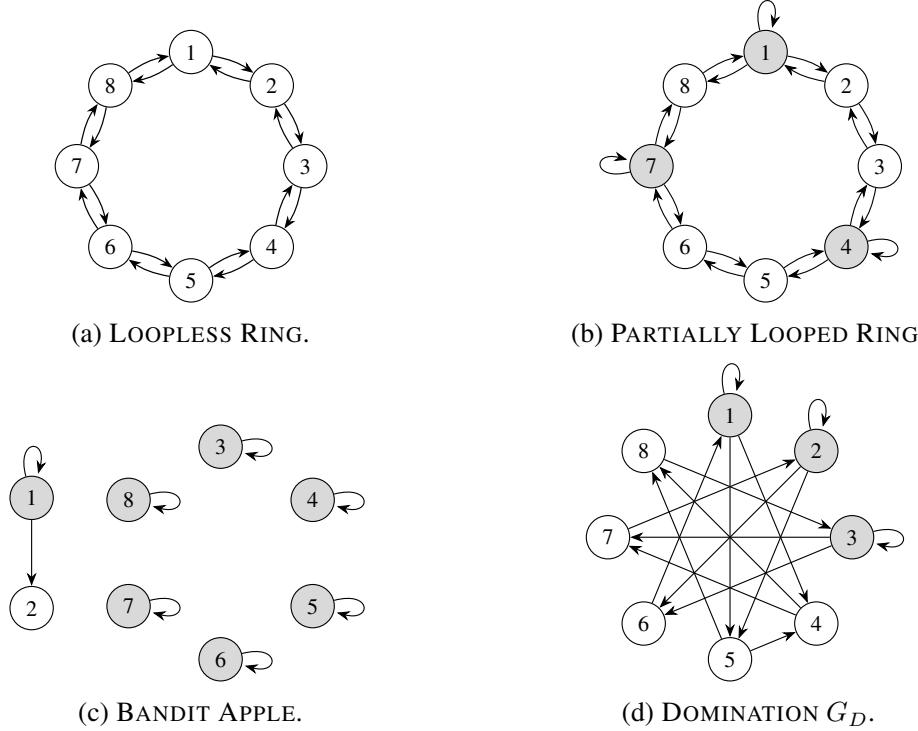  
Figure 3: Feedback graphs used in the experiments. White vertices belong to $V _ { 1 }$ , while gray vertices belong to $V _ { 2 }$ . A directed edge $i  j$ means that playing arm i reveals the loss of arm $j$

Stochastically constrained adversarial Bernoulli losses. This setting follows the setting usually considered in BOBW literature (Zimmert and Seldin, 2021; Honda et al., 2023; Lee et al., 2024). In this setting, we use the construction with gap $\Delta = 0 . 1$ and geometrically increasing phase lengths. Starting from $H _ { 1 } = 1$ the phase lengths satisfy

$$
H _ { r + 1 } = \left\lceil 1 . 6 H _ { r } \right\rceil .
$$

During low-loss phases, losses are independently generated according to

$$
\ell _ { t , i ^ { * } } \sim \operatorname { B e r } ( 0 ) \quad { \mathrm { a n d } } \quad \ell _ { t , i } \sim \operatorname { B e r } ( \Delta ) \quad { \mathrm { f o r ~ a l l ~ } } i \neq i ^ { * } .
$$

During high-loss phases, we instead use

$$
\ell _ { t , i ^ { * } } \sim \operatorname { B e r } ( 1 - \Delta ) \quad { \mathrm { a n d } } \quad \ell _ { t , i } \sim \operatorname { B e r } ( 1 ) \quad { \mathrm { f o r ~ a l l ~ } } i \neq i ^ { * } .
$$

The phases alternate between these two cases. Consequently, the absolute loss levels change across phases, while

$$
\mathbb { E } [ \ell _ { t , i } - \ell _ { t , i ^ { * } } ] = \Delta
$$

holds for every suboptimal arm and every round.

Stationary Bernoulli losses. For the stochastic environment, losses are independently generated from fixed Bernoulli distributions. The unique optimal arm has mean loss 0.3, while each of the remaining seven arms has mean loss 0.4.

## H.3 Results

Across the additional feedback graphs, both practical FTPL variants achieve lower regret than FTPL (theory). This pattern appears in all three environments and whether the optimal arm belongs to $V _ { 1 }$ or $V _ { 2 }$ . The graph structure affects the magnitude of regret but does not change the qualitative comparison.

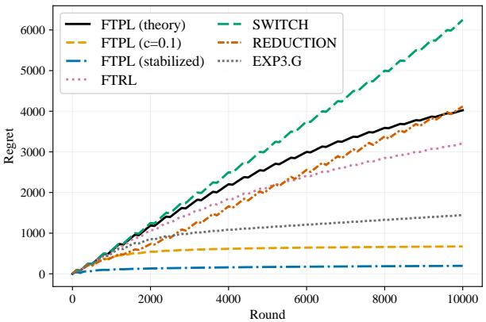

(a) LOOPLESS RING.  
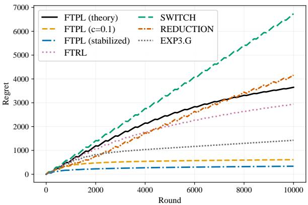

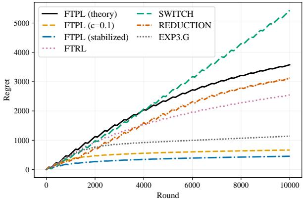

(b) PARTIALLY LOOPED RING with the optimal arm in $V _ { 1 } .$  
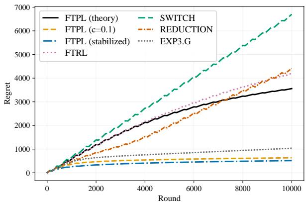

(c) PARTIALLY LOOPED RING with the optimal arm in $V _ { 2 } .$  
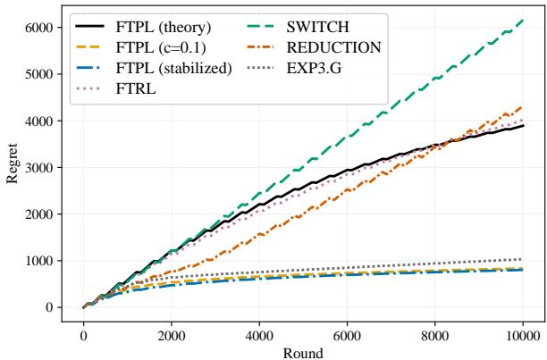

(d) BANDIT APPLE with the optimal arm in $V _ { 1 }$  
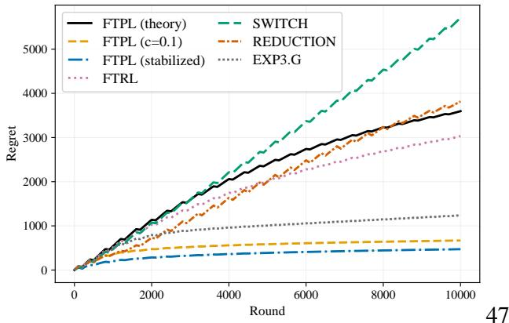  
(f) DOMINATION with the optimal arm in $V _ { 1 }$

(e) BANDIT APPLE with the optimal arm in $V _ { 2 } .$  
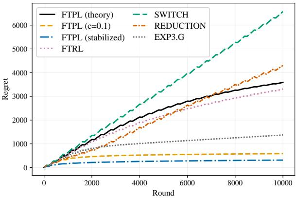  
(g) DOMINATION with the optimal arm in $V _ { 2 } .$  
Figure 4: Regret under the oblivious adversarial regime across different graph structures.

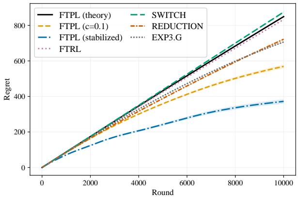  
(a) LOOPLESS RING.

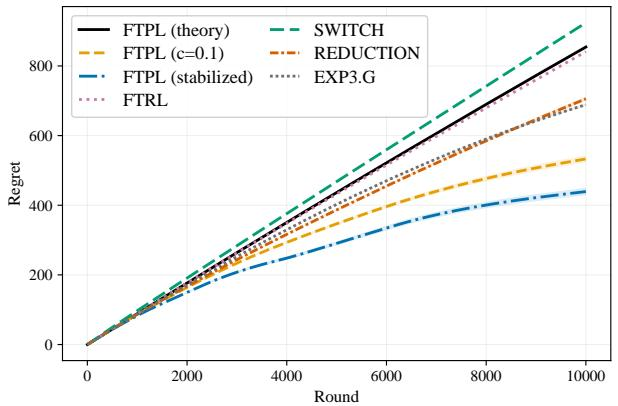

  
(c) PARTIALLY LOOPED RING with the optimal arm in $V _ { 2 } .$

(b) PARTIALLY LOOPED RING with the optimal arm in $V _ { 1 } .$  
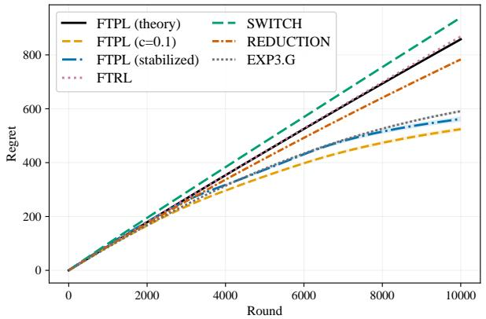

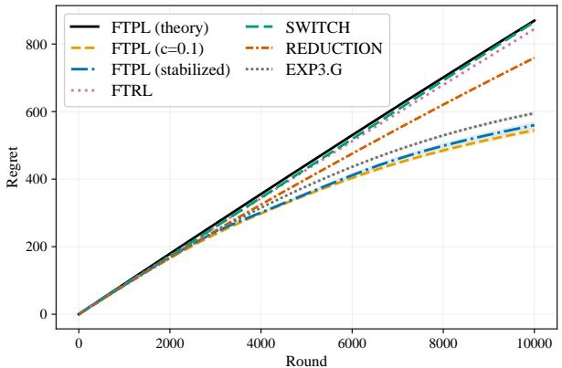

(d) BANDIT APPLE with the optimal arm in $V _ { 1 }$  
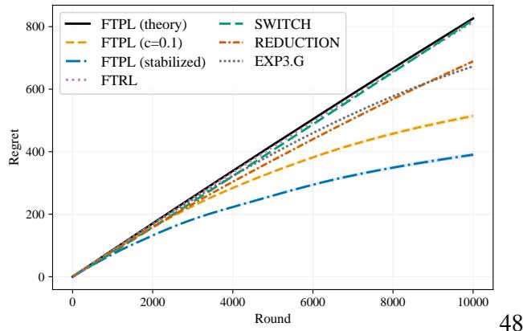  
(f) DOMINATION with the optimal arm in $V _ { 1 }$

(e) BANDIT APPLE with the optimal arm in $V _ { 2 } .$  
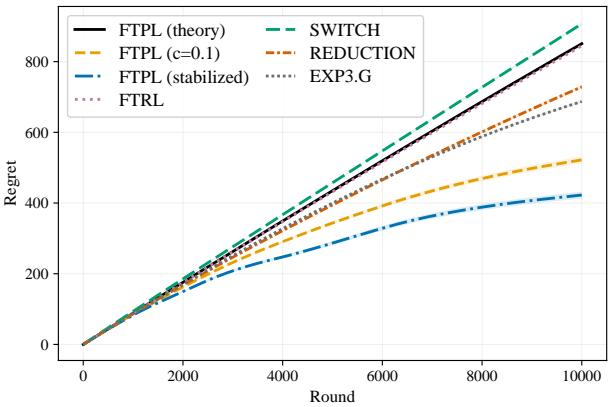  
(g) DOMINATION with the optimal arm in $V _ { 2 } .$  
Figure 5: Regret under the stochastically constrained adversarial regime across different graph structures.

  
(a) LOOPLESS RING.

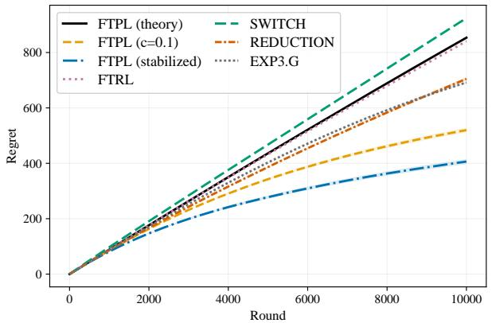

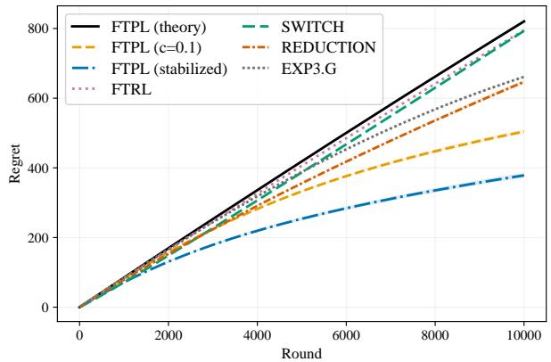  
(c) PARTIALLY LOOPED RING with the optimal arm in V2.

(b) PARTIALLY LOOPED RING with the optimal arm in $V _ { 1 } .$  
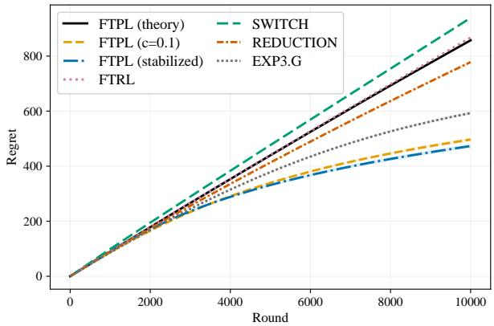

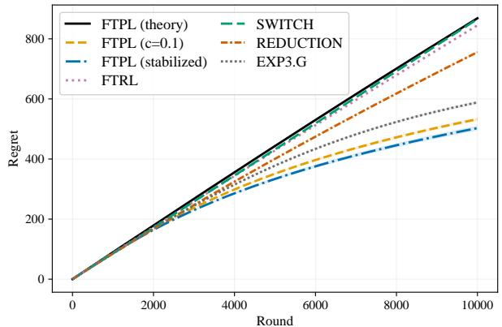

(d) BANDIT APPLE with the optimal arm in $V _ { 1 }$  
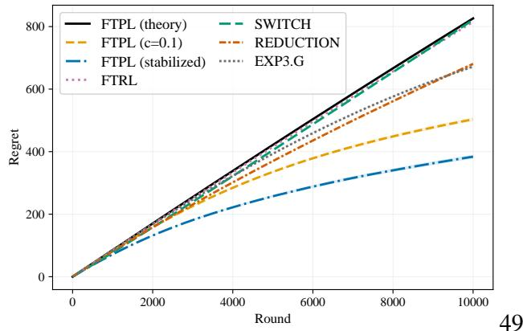  
(f) DOMINATION with the optimal arm in $V _ { 1 }$

(e) BANDIT APPLE with the optimal arm in $V _ { 2 } .$  
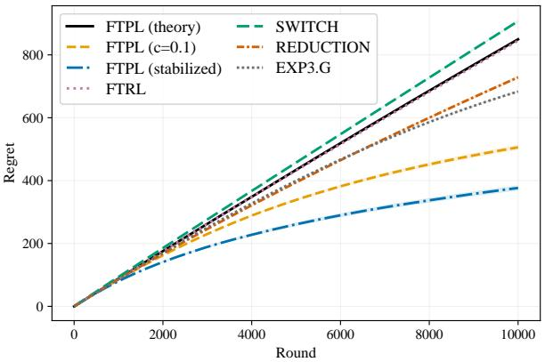  
(g) DOMINATION with the optimal arm in $V _ { 2 } .$  
Figure 6: Regret under the stochastic regime across different graph structures.