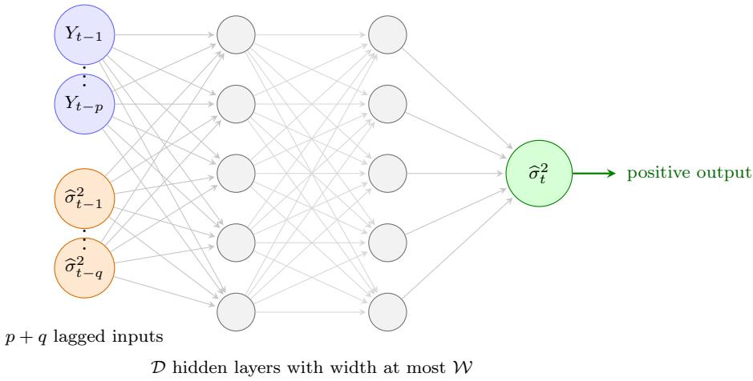
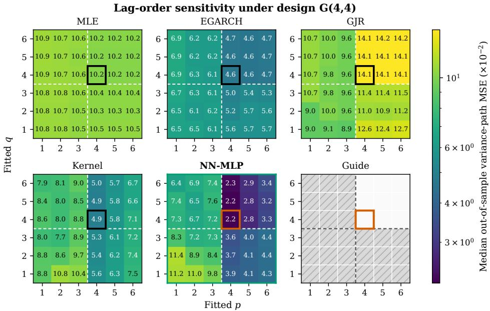
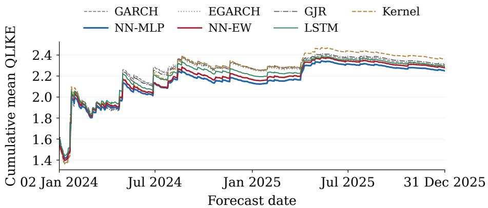
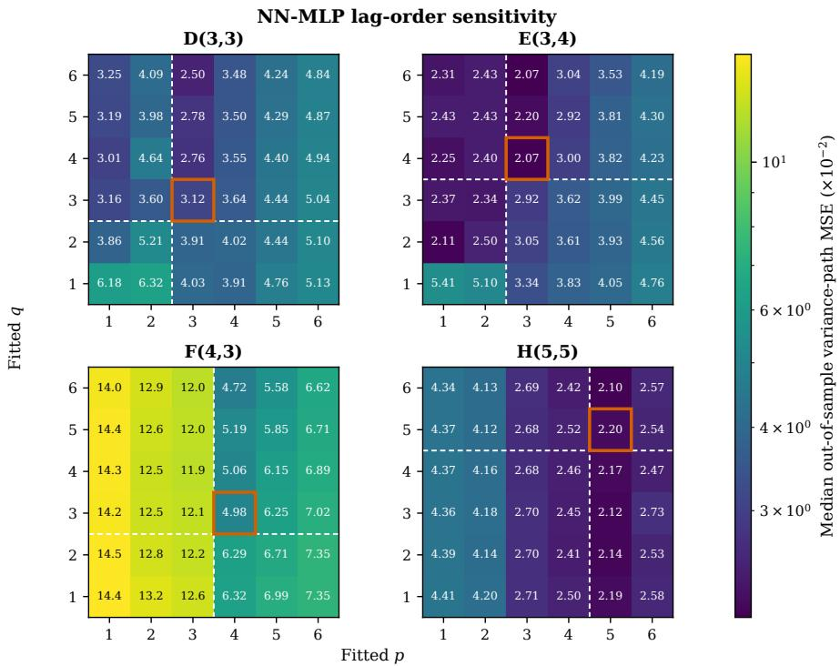

# Nonparametric GARCH: An Iterated Neural Estimator

Ruizhi Denga, Guohao Shena, Ngai Hang Chanb

aDepartment of Applied Mathematics, The Hong Kong Polytechnic University, bDepartment of Biostatistics, City University of Hong Kong,

## Abstract

We study nonparametric estimation and forecasting for GARCH-type processes and propose an iterated neural estimator that alternates between estimating the recursion map and updating the unobserved conditional variances. Under mild conditions, we establish finite-sample bounds for the time-averaged in-sample variance-path error and show that the estimator is minimax rate-optimal up to logarithmic factors. Under stationarity and mixing conditions, we establish the same rate for recursion-map estimation and derive finite-sample bounds for out-of-sample variance forecasts and expected excess Gaussian quasi-likelihood (QLIKE) loss. The convergence rates depend on the true lag orders and remain unchanged when the fitted orders are overspecified. Simulation studies illustrate the efectiveness of our estimators under nonlinear and time-varying volatility dynamics. Real-data applications suggest that our neural methods perform competitively and can incorporate option-price and high-frequency information.

Keywords: GARCH, conditional variance, deep neural networks, nonparametric regression, minimax lower bound

## 1. Introduction

Conditional volatility is central to risk management, asset pricing, and portfolio choice. Accurate volatility forecasts are important for econometric analysis and financial decision making (Engle, 2004; Poon and Granger, 2003; Andersen et al., 2006). Autoregressive conditional heteroskedasticity (ARCH) models specify conditional variance as a parametric function of past squared returns (Engle, 1982). Generalized autoregressive conditional heteroskedasticity (GARCH) models also include past conditional variances (Bollerslev, 1986). These models and their extensions can describe how return shocks afect volatility over several periods and how this efect difers between positive and negative returns (Engle and Bollerslev, 1986; Nelson, 1991; Glosten et al., 1993). Although these models use relatively few parameters and are widely applied, their accuracy depends on the chosen functional form (Bollerslev et al., 1994; Shephard, 1996).

Nonparametric GARCH models ofer greater flexibility by modeling the conditional variance as a smooth function of past returns and past conditional variances (Masry and Tjøstheim, 1995; Fan and Yao, 1998; Linton and Mammen, 2005). However, without realized measures constructed from intraday returns (Andersen et al., 2003; Hansen et al., 2012), estimation is dificult because both the variance function and its lagged variance inputs must be estimated from the observed returns. Bühlmann and McNeil (2002) address these dificulties by proposing an iterative algorithm that alternates between estimating the variance function and updating the latent variance path. At each iteration, a local-polynomial or a kernel regression is used to estimate the unknown function (Härdle and Tsybakov, 1997). These methods can handle one or a few inputs, but their accuracy deteriorates as the

number of relevant lags increases.

Deep neural networks have shown strong performance in nonparametric regression with many inputs (Bauer and Kohler, 2019; Farrell et al., 2021), which can estimate nonlinear recursions in nonparametric GARCH models. A related empirical literature uses neural networks and machine-learning methods to forecast volatility (Kim and Won, 2018; Bucci, 2020; Christensen et al., 2023). These studies focus on forecasting, while existing statistical theory establishes approximation and regression properties for neural networks under independent observations (Yarotsky, 2018; Petersen and Voigtlaender, 2018; Lu et al., 2021; Bartlett et al., 2019; Schmidt-Hieber, 2020; Jiao et al., 2023). Recent work develops related regression theory for temporally dependent data (Kuznetsov and Mohri, 2015; Kengne, 2023; Kurisu et al., 2025) and for first-order nonparametric GARCH models (Meister and Kreiß, 2016). However, the deep-network results assume that the regressors are observed and therefore do not directly provide a theory for nonparametric GARCH estimation. Bühlmann and McNeil (2002) derive an error bound for their iterative algorithm under conditions on the estimated variance inputs, which are dificult to verify, so the proposed bound has not provided a complete convergence theory for nonparametric GARCH estimation.

In this paper, we propose an iterated neural estimator for nonparametric GARCH models with general return and variance lag orders and establish finite-sample guarantees for the estimator and its forecasts. We show that the estimator adapts to the true lag orders when the fitted lag orders are overspecified. We also introduce a weighted extension that places more emphasis on recent observations when volatility dynamics change over time. Simulation studies illustrate the efectiveness of our estimators. The main contributions are as follows.

1. We propose an iterated neural estimator for nonparametric GARCH models with general lag orders. It accommodates complex nonlinear volatility dynamics using standard neural-network regressions that are straightforward to implement. We also develop a weighted extension for volatility dynamics that change over time.

2. We establish finite-sample bounds for the in-sample variance path, the recursion map, and out-of-sample forecasts. The in-sample path attains the classical nonparametric regression rate up to logarithmic factors (Stone, 1982), with a matching minimax lower bound when the target function has a smoothness index no less than one. Under additional stationarity and regularity conditions, we show that the recursion map and a one-step forecast after a logarithmic updating period can attain the same rate. We also prove that the estimator retains the same convergence rate when the fitted lag orders are overspecified. To our knowledge, these are the first complete finite-sample convergence guarantees for an implementable iterative nonparametric GARCH estimator with general return and variance lag orders.

3. We conduct numerical experiments with out-of-sample forecast evaluation across linear, nonlinear, and time-varying designs. The results show that our estimator performs consistently well in most designs and outperforms the benchmark estimators, particularly under nonlinear and complex volatility dynamics. The estimator is also insensitive to lag-order overspecification, while the weighted extensions adapt better to gradual changes in volatility dynamics. Real-data applications further illustrate that neural methods can incorporate option-price and high-frequency information.

The rest of the paper is organized as follows. Section 2 introduces the nonparametric GARCH model, its regression formulation, and the iterated neural estimator. Section 3 gives the in-sample and out-of-sample bounds, recursion-map recovery, lag-order adaptivity, and the lower bound. Section 4 gives a concise weighted extension. Section 5 reports the numerical study. Section 6 presents the real-data applications. Section 7 discusses the scope of the results and open problems. The supplementary material contains the proofs and additional technical details.

## 2. Model and Iterated Neural Estimator

A nonparametric GARCH model replaces the parametric recursion in ARCH and GARCH models with an unspecified function that maps recent returns and variances to the current conditional variance. Next, we define the model and identify its target function, formulate the estimation problem as a conditional-mean regression, and introduce our neural estimator.

## 2.1. The nonparametric GARCH model and its regression formulation

Let $\{ Y _ { t } : 1 \leq t \leq T \}$ be a return series observed over T periods of the process $( Y _ { t } ) _ { t \in \mathbb { Z } }$ . Write $\mathcal { V } _ { t } = \sigma ( Y _ { s } : s \le t )$ for the sigma-algebra generated by the returns up to time $t ,$ which is the information available at that time. A nonparametric GARCH model of orders $p ^ { * } \geq 1$ and $q ^ { * } \geq 0$ posits the following conditional-variance recursion.

Model 1 (Nonparametric GARCH). The return series is generated by

$$
\begin{array} { r l } & { Y _ { t } = \sigma _ { t } \varepsilon _ { t } , \qquad \sigma _ { t } ^ { 2 } = f _ { * } ( X _ { t , * } ) , } \\ & { } \\ & { X _ { t , * } = \big ( Y _ { t - 1 } , \ldots , Y _ { t - p ^ { * } } , \sigma _ { t - 1 } ^ { 2 } , \ldots , \sigma _ { t - q ^ { * } } ^ { 2 } \big ) \in \mathbb { R } ^ { p ^ { * } + q ^ { * } } . } \end{array}\tag{1}
$$

Here $f _ { * } : \mathbb { R } ^ { p ^ { * } + q ^ { * } }  [ 0 , \infty )$ is a measurable function with input dimension $\boldsymbol { p } ^ { * } + \boldsymbol { q } ^ { * }$ . The innovations $( \varepsilon _ { t } ) _ { t \in \mathbb { Z } }$ are independent and identically distributed satisfying $\mathbb { E } ( \varepsilon _ { t } ) = 0 , \mathbb { E } ( \varepsilon _ { t } ^ { 2 } ) = 1 , \mathbb { E } ( \varepsilon _ { t } ^ { 4 } ) < \infty$ , and $\varepsilon _ { t }$ is independent of $\mathcal { D } _ { t - 1 }$ Here $\sigma _ { t }$ is the volatility and $\sigma _ { t } ^ { 2 } = \operatorname { V a r } ( Y _ { t } \mid \mathcal { V } _ { t - 1 } )$ is its conditional variance.

The conditional variance is a nonnegative function $f _ { * }$ of the regressor vector $X _ { t , * }$ , which contains the $p ^ { * }$ most recent returns and the $q ^ { * }$ most recent variances. The values $p ^ { * }$ and $q ^ { * }$ give the largest return lag and variance lag that can afect the current conditional variance. When $q ^ { * } = 0$ , the conditional variance depends only on lagged returns, and Model 1 reduces to a nonparametric ARCH model. Parametric ARCH and GARCH models arise when $f _ { * }$ is afine in the squared return inputs and variance lags (Engle, 1982; Bollerslev, 1986). Allowing $f _ { * }$ to be a general measurable function gives the nonparametric formulation (Bühlmann and McNeil, 2002).

Our objective is to estimate both the recursion map $f _ { * }$ and the latent variance path $( \sigma _ { t } ^ { 2 } )$ from the observed returns. We first formulate this problem as a regression. Note that both $\sigma _ { t } ^ { 2 } = f _ { * } ( X _ { t , * } )$ and $X _ { t , * }$ are $\mathcal { D } _ { t - 1 }$ -measurable. The independence and normalization of $\varepsilon _ { t }$ and the tower property give

$$
\begin{array} { r l } & { \mathbb { E } ( Y _ { t } ^ { 2 } \mid \mathcal { Y } _ { t - 1 } ) = \sigma _ { t } ^ { 2 } \mathbb { E } ( \varepsilon _ { t } ^ { 2 } \mid \mathcal { Y } _ { t - 1 } ) = \sigma _ { t } ^ { 2 } = f _ { * } ( X _ { t , * } ) , } \\ & { } \\ & { \mathbb { E } ( Y _ { t } ^ { 2 } \mid X _ { t , * } ) = f _ { * } ( X _ { t , * } ) . } \end{array}\tag{2}
$$

Therefore, $f _ { * }$ is the population regression function of $Y _ { t } ^ { 2 }$ given $X _ { t , * }$ . Define the regression error by

$$
V _ { t } = Y _ { t } ^ { 2 } - \sigma _ { t } ^ { 2 } = \sigma _ { t } ^ { 2 } ( \varepsilon _ { t } ^ { 2 } - 1 ) ,\tag{3}
$$

which satisfies $\mathbb { E } ( V _ { t } \ | \ y _ { t - 1 } ) = 0$ by (2). The observable squared return therefore satisfies the conditional-mean regression

$$
Y _ { t } ^ { 2 } = f _ { * } ( X _ { t , * } ) + V _ { t } , \qquad \mathbb { E } ( V _ { t } \mid \mathcal { V } _ { t - 1 } ) = 0 .\tag{4}
$$

The regression error is heteroscedastic, with conditional variance $\sigma _ { t } ^ { 4 } \mathrm { V a r } ( \varepsilon _ { t } ^ { 2 } )$

When $q ^ { * } = 0 , X _ { t , * }$ ∗ contains only the observed return lags $Y _ { t - 1 } , \dots , Y _ { t - p ^ { * } }$ We can therefore estimate $f _ { * }$ directly by a single regression. When $q ^ { * } \geq 1$ ， however, $X _ { t , * }$ ∗ also contains the unobserved variance lags $\sigma _ { t - 1 } ^ { 2 } , \ldots , \sigma _ { t - q ^ { * } } ^ { 2 }$ . Regression (4) then cannot be implemented directly. To address this dificulty, we propose an iterated neural estimator in the next subsection.

## 2.2. The iterated neural estimator

Our estimator alternates between estimating the recursion map by least squares over a function class and updating the latent variance path. For fitted lag orders p and q, let $r _ { 0 } = \operatorname* { m a x } ( p , q )$ and write $Y _ { t - 1 : t - p } = ( Y _ { t - 1 } , \dots , Y _ { t - p } )$ We also write $\widehat { \sigma } _ { t - 1 : t - q , m } ^ { 2 } = ( \widehat { \sigma } _ { t - 1 , m } ^ { 2 } , \ldots , \widehat { \sigma } _ { t - q , m } ^ { 2 } )$ for the lagged variance estimates at iteration m. Estimation proceeds in three steps.

(1) Initialize. Set $\widehat { \sigma } _ { t , 0 } ^ { 2 } = \widehat { c } \mathrm { ~ f o r ~ } t = 1 , \ldots , T$ and retain $\widehat { \sigma } _ { t , m } ^ { 2 } = \widehat { c }$ for $t ~ \leq ~ r _ { 0 }$ at every subsequent iteration. The positive constant $\widehat { c }$ may be specified in advance or estimated from the data, for example by maximum likelihood under a preliminary parametric model.

(2) Estimate and update. Choose the number of iterations $M \geq 1$ and a function class ${ \mathcal F } .$ . At each iteration $m = 1 , \ldots , M$ , define the least-squares estimator

$$
\widehat { f } _ { m } \in \underset { f \in \mathcal { F } } { \arg \operatorname* { m i n } } \frac { 1 } { T - r _ { 0 } } \sum _ { t = r _ { 0 } + 1 } ^ { T } \left[ Y _ { t } ^ { 2 } - f \left( Y _ { t - 1 : t - p } , \widehat { \sigma } _ { t - 1 : t - q , m - 1 } ^ { 2 } \right) \right] ^ { 2 } ,\tag{5}
$$

where the squared returns $Y _ { t } ^ { 2 }$ are observed and the variance lags are estimated at iteration $m - 1$ . For $t = r _ { 0 } + 1 , \ldots , T$ , use ${ \widehat { f } } _ { m }$ to update the remaining variance estimates by

$$
\widehat { \sigma } _ { t , m } ^ { 2 } = \widehat { f } _ { m } \left( Y _ { t - 1 : t - p } , \widehat { \sigma } _ { t - 1 : t - q , m - 1 } ^ { 2 } \right) .\tag{6}
$$

Repeat the estimation and variance-update steps through iteration M.

(3) Return the estimates. Return ${ \widehat { f } } _ { M }$ as the estimator of the recursion map $f _ { * }$ and $( \widehat { \sigma } _ { t , M } ^ { 2 } ) _ { t = r _ { 0 } + 1 } ^ { T }$ as the estimated in-sample variance path.

For forecasting, we first evaluate ${ \widehat { f } } _ { M }$ at $Y _ { T : T - p + 1 }$ and $\widehat { \sigma } _ { T : T - q + 1 , M } ^ { 2 }$ to obtain the first post-estimation variance forecast ${ \widehat { \sigma } } _ { T + 1 | T } ^ { 2 }$ . As each new return becomes available, we apply the same update recursively to generate the next one-step-ahead variance forecast,

$$
\widehat { \sigma } _ { t \vert T } ^ { 2 } = \widehat { f } _ { M } \left( Y _ { t - 1 : t - p } , \widehat { \sigma } _ { t - 1 : t - q \vert T } ^ { 2 } \right) , \qquad t > T ,\tag{7}
$$

where $\widehat { \sigma } _ { t - 1 : t - q | T } ^ { 2 }$ contains the $q$ in-sample variance estimates or forecasts.

## 2.3. The deep neural network class

Our iterative algorithm allows a general nonparametric function class $\mathcal { F }$ For our neural estimator, we take $\mathcal { F }$ to be a class of multilayer perceptrons (MLPs), a commonly used class of feedforward neural networks. Specifically, for $x \in \mathbb { R } ^ { p + q }$ , an MLP with D hidden layers has the form

$$
f ( x ) = \psi \circ \mathcal { L } _ { \mathcal { D } + 1 } \circ \phi \circ \mathcal { L } _ { \mathcal { D } } \circ \cdot \cdot \cdot \circ \phi \circ \mathcal { L } _ { 1 } ( x ) , \qquad \mathcal { L } _ { \ell } ( u ) = A _ { \ell } u + b _ { \ell } ,\tag{8}
$$

where $A _ { \ell }$ and $b _ { \ell }$ are the weight matrix and bias vector, respectively, in layer ℓ. Here we use the rectified linear unit (ReLU) activation, $\phi ( u ) = \mathrm { m a x } \{ u , 0 \}$ , applied coordinatewise. The output activation $\psi$ takes nonnegative values and ensures a nonnegative conditional variance estimate. We denote the number of units in layer j by $d _ { j }$ , where $d _ { 0 } = p { + } q$ and $d _ { \mathscr { D } + 1 } = 1$ . The network depth is $\mathcal { D } .$ . Its width is $\mathcal { W } = \operatorname* { m a x } _ { 1 \leq j \leq \mathcal { D } } d _ { j }$ . We allow some connections to be set to zero and let S denote the number of remaining trainable weights and biases. For a fully connected network, $\begin{array} { r } { { \cal S } = \sum _ { \ell = 1 } ^ { \mathcal { D } + 1 } ( d _ { \ell - 1 } + 1 ) d _ { \ell } } \end{array}$ . We allow the depth D, width W, and number of trainable parameters S to depend on $T ,$ . Thus, the network class may expand with the sample size. We write $\mathcal { F } = \mathcal { F } _ { \mathcal { D } , \mathcal { W } , \mathcal { S } }$ for the network class with these specifications and use $\mathcal { F } _ { T }$ when (D, W, S) depend on T. Figure 1 illustrates the network structure.

  
Figure 1: The neural network used at each iteration. The inputs are the p return lags and the q variance estimates from the preceding iteration. The D hidden layers have maximum width W and map the inputs to a positive conditional-variance estimate.

For the nonparametric GARCH model, we use a network class with two additional properties. First, each network maps its inputs to a positive bounded interval containing the range of the true conditional variance. Projection or a bounded output activation can produce such outputs and keep all estimated variance lags in the same interval. Second, we require each network to be Lipschitz in its variance inputs. This property helps to stabilize recursive forecasts. For some $B ^ { \prime } \in ( 0 , 1 )$ , the networks satisfy $| f ( y , s ) - f ( y , s ^ { \prime } ) | \leq B ^ { \prime } \| s - s ^ { \prime } \| _ { \infty }$ for every $y \in \mathbb { R } ^ { p }$ and all variance inputs s and $s ^ { \prime }$ in the bounded input domain. In practice, weight decay can encourage this property, while explicit norm constraints can enforce it. Our numerical implementation remains stable without either.

## 3. Statistical Properties

In nonparametric GARCH estimation, a useful estimator should accurately estimate the in-sample latent variance path, recover the recursion map $f _ { * }$ , and produce accurate out-of-sample conditional variance forecasts. This section studies these three statistical targets. Section 3.2 establishes a finite-sample upper bound on the time-averaged in-sample error of the estimated conditional variance path. It also gives a matching minimax lower bound for suficiently smooth recursion maps. Under additional stationarity and dependence conditions, Section 3.3 establishes bounds for out-of-sample forecast error and recursion-map risk. In every upper-bound result, we show that our estimator is robust to lag-order overspecification because fixed fitted orders $p \geq p ^ { * }$ and $q \geq q ^ { * }$ would not change the convergence-rate exponent.

## 3.1. Assumptions

To establish an in-sample estimation-error bound, we impose the following regularity conditions on the data-generating process.

Assumption 1 (Innovations and Positive Variance). The innovations $\left( \varepsilon _ { t } \right)$ are sub-Gaussian. For some $B _ { \operatorname* { m i n } } > 0$ , the recursion map satisfies $f _ { * } ( x ) \geq$ $B _ { \mathrm { m i n } }$ for every $\boldsymbol { x } \in \mathbb { R } ^ { p ^ { * } + q ^ { * } }$

Sub-Gaussianity is a common light-tail condition in nonparametric regression (Bauer and Kohler, 2019; Schmidt-Hieber, 2020). It controls the innovation contribution to the squared-return regression error and is satisfied, for example, by Gaussian or bounded innovations. The lower bound on the conditional variances is the usual condition that keeps the conditional variance away from zero. In linear ARCH and GARCH models with nonnegative coeficients, it corresponds to requiring a strictly positive intercept (Engle, 1982; Bollerslev, 1986).

Assumption 2 (Hölder-Smooth Recursion Map). The conditional variance function $f _ { * }$ lies in the Hölder ball $\mathcal { H } ^ { \beta } ( \mathbb { R } ^ { p ^ { * } + q ^ { * } } , B _ { \mathrm { m a x } } )$ of smoothness $\beta$ and radius $B _ { \mathrm { m a x } }$ on the regressor space for some $\beta > 0$ and $B _ { \mathrm { m a x } } > B _ { \mathrm { m i n } }$ . A formal definition of the Hölder ball appears in the supplementary materials.

Assumption 2 imposes a nonparametric regularity condition. Hölder smoothness is standard in the approximation theory of deep ReLU networks (Yarotsky, 2018; Petersen and Voigtlaender, 2018; Lu et al., 2021; Jiao et al., 2023). The smoothness index afects the network approximation error and determines the nonparametric convergence rate together with the network complexity and sample size (Bauer and Kohler, 2019; Schmidt-Hieber, 2020).

Assumption 3 (σ-block Lipschitz of $f _ { * } )$ . There exist weights $\omega _ { 1 } , \ldots , \omega _ { q ^ { * } } >$ 0 with $\begin{array} { r } { \sum _ { j = 1 } ^ { q ^ { * } } \omega _ { j } = 1 } \end{array}$ and a constant $D \in [ 0 , 1 )$ such that

$$
| f _ { * } ( y , s ) - f _ { * } ( y , s ^ { \prime } ) | \leq D \| s - s ^ { \prime } \| _ { \omega } , \qquad \| s - s ^ { \prime } \| _ { \omega } : = \left\{ \sum _ { j = 1 } ^ { q ^ { * } } \omega _ { j } ( s _ { j } - s _ { j } ^ { \prime } ) ^ { 2 } \right\} ^ { 1 / 2 } ,
$$

for all $\boldsymbol { y } \in \mathbb { R } ^ { p ^ { * } }$ and s, $\boldsymbol { \mathscr { s } } ^ { \prime } \in \mathbb { R } ^ { q ^ { * } }$

Assumption 3 extends the familiar stability restriction on lagged variance feedback to a nonparametric GARCH setting. It recovers the usual stability condition in the linear case. For example, suppose that the conditional variance function is afine, $\begin{array} { r } { f _ { * } ( y , s ) = c _ { 0 } + \sum _ { i = 1 } ^ { p ^ { * } } \alpha _ { i } y _ { i } ^ { 2 } + \sum _ { j = 1 } ^ { q ^ { * } } \beta _ { j } s _ { j } } \end{array}$ , with intercept $c _ { 0 } > 0$ and variance-lag coeficients $\beta _ { 1 } , \ldots , \beta _ { q ^ { * } }$ . If these coeficients are positive, take $\begin{array} { r } { \omega _ { j } = \beta _ { j } / \sum _ { \ell = 1 } ^ { q ^ { * } } \beta _ { \ell } } \end{array}$ . The weighted Cauchy–Schwarz inequality then gives $\begin{array} { r } { D = \sum _ { j = 1 } ^ { q ^ { * } } \beta _ { j } } \end{array}$ . Hence Assumption 3 holds whenever $\textstyle \sum _ { j } \beta _ { j } < 1$ . Because the usual covariance-stationarity condition $\textstyle \sum _ { i } \alpha _ { i } + \sum _ { j } \beta _ { j } < 1$ implies this requirement, every covariance-stationary linear GARCH model satisfies Assumption 3 (Bollerslev, 1986).

## 3.2. In-sample estimation error bounds

We measure the average error of the variance path estimated by ${ \widehat { f } } _ { M }$ over the estimation sample by

$$
\Delta _ { T , M } ^ { \mathrm { i n } } = \frac { 1 } { T - r _ { 0 } } \sum _ { t = r _ { 0 } + 1 } ^ { T } \mathbb { E } \{ \widehat { \sigma } _ { t , M } ^ { 2 } - \sigma _ { t } ^ { 2 } \} ^ { 2 } ,\tag{9}
$$

where $r _ { 0 } = \operatorname* { m a x } ( p , q )$ and the expectation is taken over the randomness of the sample used to train the networks. We next bound this in-sample error.

Theorem 1 (Nonasymptotic in-sample bound). Suppose Assumptions 1–3 hold and $B ^ { \prime } > D$ . Apply the iterated neural estimator with input orders $p \geq p ^ { * }$ and $q \geq q ^ { * }$ that do not depend on T. Initialize the unobserved variances at a measurable value $\widehat { c } \in [ B _ { \operatorname* { m i n } } , B _ { \operatorname* { m a x } } ]$ . Choose the network size $\mathcal { S } \asymp T ^ { ( p ^ { * } + q ^ { * } ) / ( p ^ { * } + q ^ { * } + 2 \beta ) }$ and take $M \asymp \log T$ . Then there are constants $C > 0$ and $c \geq 0$ such that, for every suficiently large T,

$$
\Delta _ { T , M } ^ { \mathrm { i n } } \leq C T ^ { - 2 \beta / ( p ^ { * } + q ^ { * } + 2 \beta ) } ( \log T ) ^ { c } .
$$

Theorem 1 establishes that our neural estimator attains the nonparametric rate with an appropriately chosen network size after ${ \cal O } ( \log T )$ iterations, as the initialization error decays geometrically under the contraction condition in Assumption 3. Here, ${ \cal T } ^ { - 2 \beta / ( 2 \beta + p ^ { * } + q ^ { * } ) }$ is the classical minimax rate for β-Hölder nonparametric regression in intrinsic dimension $\boldsymbol { p } ^ { * } + \boldsymbol { q } ^ { * }$ (Stone,

1982). Moreover, our neural estimator is robust to lag-order overspecification because it retains this rate for any fixed fitted orders $p \geq p ^ { * }$ and $q \geq q ^ { * }$ Robustness permits conservative choices when the true orders are unknown.

Theorem 1 establishes consistency of the in-sample variance path in mean square. The closest earlier analysis is given by Bühlmann and McNeil (2002). It concerns GARCH(1, 1) and relies on conditions on the estimated variance inputs that are dificult to verify. We overcome this dificulty with a martingale bound that holds uniformly over deterministic sequences of candidate network functions. This uniformity controls both the generated variance regressors and the dependence induced by reusing the same sample across iterations.

We next establish a lower bound for estimating the same variance path. Let C be the class of conditional variance functions that satisfy the positive lower bound in Assumption 1 and the Hölder condition in Assumption 2 with $\beta \geq 1$ . We assume that every map in C has structural lag orders exactly $( p ^ { * } , q ^ { * } )$ and satisfies Assumption 3 with a contraction constant $D \le \bar { D }$ for a common constant $\bar { D } \in ( 0 , 1 )$ . For each $f _ { * } \in \mathcal { C } .$ , we let $\mathbb { E } _ { f _ { * } }$ denote expectation under the strictly stationary solution of Model 1 with independent standard Gaussian innovations. We then obtain the following minimax lower bound for estimating the conditional variance path over C.

Theorem 2 (Minimax lower bound). Set $r _ { * } ~ = ~ \operatorname* { m a x } ( p ^ { * } , q ^ { * } )$ . There is a constant $c _ { \mathrm { L B } } > 0$ such that, for every suficiently large T,

$$
\operatorname* { i n f } _ { \tilde { v } } \operatorname* { s u p } _ { f _ { * } \in \mathcal { C } } \frac { 1 } { T - r _ { * } } \sum _ { t = r _ { * } + 1 } ^ { T } \mathbb { E } _ { f _ { * } } ( \widetilde { v } _ { t } - \sigma _ { t } ^ { 2 } ) ^ { 2 } \geq c _ { \mathrm { L B } } T ^ { - 2 \beta / ( 2 \beta + p ^ { * } + q ^ { * } ) } .
$$

Here $\widetilde { \pmb { v } } = ( \widetilde { v } _ { r _ { * } + 1 } , \dots , \widetilde { v } _ { T } )$ ranges over all $\sigma ( Y _ { 1 } , \ldots , Y _ { T } )$ -measurable vectors.

Theorem 2 provides a matching lower bound for the same time-averaged variance-path loss studied in Theorem 1. Hence, our iterated neural estimator is minimax rate-optimal over C up to logarithmic factors. This conclusion remains valid when the fitted lag orders are overspecified.

Theorem 2 applies to recursion maps with smoothness $\beta \geq 1$ . This condition allows the lower-bound construction to preserve contraction in the variance lags. For $0 < \beta < 1$ , the construction may violate contraction, and a diferent argument would be needed. Related rate results remain limited to first-order recursive models. Meister and Kreiß (2016) study a monotone nonparametric GARCH(1, 1) recursion with $\beta > 2$ . Wechsung and Neumann (2022) establish consistency and a convergence rate for a nonparametric INGARCH(1, 1) model with latent intensities. Neither result provides a matching minimax theory for the return-based recursion when $0 < \beta < 1$

## 3.3. Recursion-map recovery and out-of-sample forecasting

The in-sample result controls the estimated conditional variance path at the observed dates. However, it does not establish that the estimated conditional variance function ${ \widehat { f } } _ { M }$ is accurate at a new regressor vector. We next study the function-estimation error of ${ \widehat { f } } _ { M }$ and the conditional variance forecasts based on it. For this purpose, we impose additional conditions relating the estimation sample to future observations.

Assumption 4 (Stationarity and geometric $\beta { \mathrm { - m i x i n g } } )$ . The process $( Y _ { t } ) _ { t \in \mathbb { Z } }$ is strictly stationary and its $\beta { \mathrm { - m i x i n g } }$ coeficients decay geometrically.

For conciseness, we impose stationarity and geometric $\beta { \mathrm { - m i x i n g } }$ directly in Assumption 4. More primitive conditions on the volatility equation and innovation distribution can also imply these properties (Carrasco and Chen, 2002; Francq and Zakoïan, 2006; Saïdi and Zakoïan, 2006; Meitz and Saikkonen, 2008).

Stationarity and β-mixing play diferent roles in our analysis. For the forecast analysis, stationarity ensures that the historical and future regressor vectors have the same distribution. Geometric $\beta { \mathrm { - m i x i n g } }$ permits distant blocks to be coupled with independent copies. This construction supports the sample-to-population comparison and the forecast bound (Berbee, 1979; $\mathrm { Y u }$ , 1994). These conditions are suficient for our argument but may not be necessary for out-of-sample prediction in general.

We next bound the estimation error of ${ \widehat { f } } _ { M }$ relative to $f _ { * }$ at a regressor vector constructed from the true conditional variances. For this purpose, let $\{ ( Y _ { t } ^ { \prime } , ( \sigma _ { t } ^ { \prime } ) ^ { 2 } ) : t \in \mathbb { Z } \}$ be a stationary copy of the return and conditionalvariance process, independent of the estimation sample, and define

$$
X _ { 0 , * } ^ { \prime } = \left( Y _ { - 1 } ^ { \prime } , \ldots , Y _ { - p } ^ { \prime } , ( \sigma _ { - 1 } ^ { \prime } ) ^ { 2 } , \ldots , ( \sigma _ { - q } ^ { \prime } ) ^ { 2 } \right) .
$$

If $p > p ^ { * }$ or $q > q ^ { * } , f _ { * } ( X _ { 0 , * } ^ { \prime } )$ is understood to use only the first $p ^ { * }$ return coordinates and the first $q ^ { * }$ variance coordinates of $X _ { 0 , * } ^ { \prime }$

Corollary 1 (Recursion-map recovery). Suppose that the conditions of Theorem 1 hold and Assumption 4 is satisfied. For our iterated neural estimator ${ \widehat { f } } _ { M }$ with lag orders $p \geq p ^ { * }$ and $q \geq q ^ { * }$ that do not depend on T, we have

$$
\mathbb { E } \{ \widehat { f } _ { M } ( X _ { 0 , * } ^ { \prime } ) - f _ { * } ( X _ { 0 , * } ^ { \prime } ) \} ^ { 2 } \leq C T ^ { - 2 \beta / ( p ^ { * } + q ^ { * } + 2 \beta ) } ( \log T ) ^ { C } .
$$

The rate matches the classical minimax rate for β-Hölder nonparametric regression in dimension $p ^ { * } + q ^ { * }$ (Stone, 1982). It also remains unchanged under lag-order overspecification.

We next study the forecast errors obtained by applying the estimated conditional variance function ${ \widehat { f } } _ { M }$ recursively to future observations. We use $N \geq 0$ post-estimation returns to update the lagged variance estimates. We

then define the average error of the next $H \geq 1$ sequential one-step forecasts as

$$
\Delta _ { T , M } ^ { \mathrm { o u t } } ( N , H ) = \frac { 1 } { H } \sum _ { h = 1 } ^ { H } \mathbb { E } \{ \widehat { \sigma } _ { T + N + h | T } ^ { 2 } - \sigma _ { T + N + h } ^ { 2 } \} ^ { 2 } , \qquad N \ge 0 , \quad H \ge 1 .\tag{10}
$$

In particular, $\Delta _ { T , M } ^ { \mathrm { o u t } } ( N , 1 )$ is the single-date risk after N updates, whereas $\Delta _ { T , M } ^ { \mathrm { o u t } } ( 0 , H )$ averages the first H forecasts after the estimation sample.

Theorem 3 (Out-of-sample forecasting rates). Suppose that the conditions of Theorem 1 hold and Assumption 4 is satisfied. For the forecasts generated by our iterated neural estimator with lag orders $p \geq p ^ { * }$ and $q \geq q ^ { * }$ that do not depend on $T _ { i }$ , there is a constant $\lambda _ { \mathrm { F } } \in ( 0 , 1 )$ such that, for all suficiently large T and every $N \geq 0$ and $H \geq 1$ ，

$$
\Delta _ { T , M } ^ { \mathrm { o u t } } ( N , H ) \leq C T ^ { - 2 \beta / ( p ^ { * } + q ^ { * } + 2 \beta ) } ( \log T ) ^ { C } + \frac { C } { H } \sum _ { h = 1 } ^ { H } \lambda _ { \mathrm { F } } ^ { N + h } .\tag{11}
$$

Theorem 3 bounds the out-of-sample forecast risk by two terms. The first is the mean-squared estimation error of ${ \widehat { f } } _ { M }$ for the conditional variance function $f _ { * }$ . The second accounts for the initial variance estimates used in forecasting and for dependence between the estimation and forecast samples. For the hth forecast after N updates, this term decreases as $\lambda _ { \mathrm { F } } ^ { N + h }$ . Here, the decay factor $\lambda _ { \mathrm { F } }$ depends on the contraction coeficients D and $B ^ { \prime }$ , the variance-lag orders, and the geometric decay rate of $\beta { \mathrm { - m i x i n g } }$ , but not on $T$ $N .$ , or H. Averaging over $h = 1 , \ldots , H$ gives the second term in (11).

For a single-date forecast (H = 1), the second term in (11) is $C \lambda _ { \mathrm { F } } ^ { N + 1 }$ and is no bigger than the estimation term once N is a suficiently large multiple of log T. For forecasts beginning immediately after the estimation sample $( N =$ 0), averaging over H dates bounds the second term by $C / H$ . The bound therefore does not give the nonparametric rate for the first forecast alone.

It yields that rate, up to logarithmic factors, when $H \gtrsim T ^ { 2 \beta / ( 2 \beta + p ^ { * } + q ^ { * } ) }$ As $N \to \infty$ , the initialization and dependence term vanishes geometrically, leaving the recursion-map rate in Corollary 1 for an independent stationary regressor. For a finite N, increasing H reduces this term’s contribution to the average forecast risk at rate $H ^ { - 1 }$

Lastly, we consider the Gaussian quasi-likelihood (QLIKE) loss. For a positive variance forecast v and a nonnegative variance proxy z, the QLIKE loss is defined as $z / v +$ log v (Patton, 2011). In our model, we use $z = Y _ { t } ^ { 2 }$ 2 which is conditionally unbiased for $\sigma _ { t } ^ { 2 }$ because $\mathbb { E } ( Y _ { t } ^ { 2 } \mid \mathcal { Y } _ { t - 1 } ) = \sigma _ { t } ^ { 2 }$ . The following corollary shows that the unconditional expectation of the conditional expected excess QLIKE loss $\sigma _ { t } ^ { 2 } / v - \log ( \sigma _ { t } ^ { 2 } / v ) - 1$ is equivalent, up to constants, to the one-step mean-squared forecast error.

Corollary 2 (Expected one-step excess QLIKE loss). Under the conditions of Theorem 3 for fitted orders $p \geq p ^ { * }$ and $q \geq q ^ { * }$ that do not depend on $T _ { \cdot }$ for every $N \geq 0$ there are constants $0 < c < C < \infty ,$ depending only on $B _ { \mathrm { m i n } }$ and $B _ { \mathrm { m a x } }$ , such that

$$
\begin{array} { r } { c \Delta _ { T , M } ^ { \mathrm { o u t } } ( N , 1 ) \leq \mathbb { E } \left\{ \frac { \sigma _ { T + N + 1 } ^ { 2 } } { \widehat { \sigma } _ { T + N + 1 | T } ^ { 2 } } - \log \left( \frac { \sigma _ { T + N + 1 } ^ { 2 } } { \widehat { \sigma } _ { T + N + 1 | T } ^ { 2 } } \right) - 1 \right\} \leq C \Delta _ { T , M } ^ { \mathrm { o u t } } ( N , 1 ) . } \end{array}
$$

Thus, setting $H = 1$ in Theorem 3 also bounds the expected excess QLIKE loss for a one-step forecast.

## 4. Weighted extension

The estimator in Section 2.2 assigns equal weight to all observations for which the required lags are available. This choice is natural when the conditional variance dynamics are stable. If the dynamics evolve, however, older observations may be less informative about the current conditional variance function. We therefore extend our estimator by assigning greater weight to recent observations.

Specifically, let $( a _ { T , t } : r _ { 0 } < t \leq T )$ be deterministic nonnegative weights with $\begin{array} { r } { \sum _ { t = r _ { 0 } + 1 } ^ { T } a _ { T , t } = 1 } \end{array}$ . Starting from the initial variance path in Section 2.2, at each iteration m we estimate the network by weighted least squares,

$$
\widehat { f } _ { m , a } \in \mathop { \mathrm { a r g } \operatorname* { m i n } } _ { f \in \mathcal { F } _ { T } } \sum _ { t = r _ { 0 } + 1 } ^ { T } a _ { T , t } \left[ Y _ { t } ^ { 2 } - f \{ Y _ { t - 1 : t - p } , \widehat { \sigma } _ { t - 1 : t - q , m - 1 , a } ^ { 2 } \} \right] ^ { 2 } ,\tag{12}
$$

and then update each conditional variance estimate by evaluating ${ \widehat { f } } _ { m , a }$ at the corresponding return lags and the variance estimates from iteration $m - 1$ After M iterations, we retain ${ \widehat { f } } _ { M , a }$ and $( \widehat { \sigma } _ { t , M , a } ^ { 2 } )$ as the weighted estimates of the conditional variance function and variance path. Equal weights, $\begin{array} { r } { a _ { T , t } = } \end{array}$ $( T - r _ { 0 } ) ^ { - 1 }$ , exactly recover the proposed estimator in Section 2.2.

We consider three weighting rules that place more emphasis on recent observations. A mild extension of equal weighting assigns linearly increasing weights, $a _ { T , t } \propto t - r _ { 0 }$ , to all available observations. Exponential weighting uses $\begin{array} { r } { a _ { T , t } = \lambda _ { T } ^ { T - t } / \sum _ { s = r _ { 0 } + 1 } ^ { T } \lambda _ { T } ^ { T - s } } \end{array}$ , where $\lambda _ { T } = 2 ^ { - 1 / h _ { T } }$ and $1 \leq h _ { T } \leq T - r _ { 0 }$ Moving $h _ { T }$ periods further into the past halves the weight. The third rule uses the most recent $1 \leq w _ { T } \leq T - r _ { 0 }$ observations, each with weight $1 / w _ { T }$

For these deterministic weighting rules, let $s _ { T }$ denote the efective estimation length. It equals $T - r _ { 0 }$ for equal and linear weights, is of order $h _ { T }$ for exponential weights, and equals $w _ { T }$ for window weights. Adapting the proof of Theorem 1 gives an in-sample rate of $s _ { T } ^ { - 2 \beta / \left( p ^ { * } + q ^ { * } + 2 \beta \right) }$ up to logarithmic factors. We can also establish a convergence rate when the recursion map changes smoothly over time. Section 5.3 examines these weighted extensions.

## 5. Simulation studies

We compare six estimators under parametric and nonlinear stationary volatility dynamics and nine under gradual temporal changes. We use MLE, EGARCH, and GJR as Gaussian quasi-MLE benchmarks for GARCH, exponential GARCH, and Glosten–Jagannathan–Runkle GARCH models (Bollerslev, 1986; Nelson, 1991; Glosten et al., 1993). We also compute the iterated Kernel estimator of Bühlmann and McNeil (2002) as a nonparametric benchmark. For the neural methods, we implement our estimator with an MLP (NN-MLP) and use a long short-term memory network (LSTM) as a direct sequence-forecasting benchmark (Hochreiter and Schmidhuber, 1997; Kim and Won, 2018). Unlike NN-MLP, LSTM does not estimate the latent recursion map. In the time-varying experiment, we compare MLE, EGARCH, GJR, Kernel, NN-MLP, LSTM, and the three weighted NN-MLP extensions. Appendix A.2 gives the implementation details.

For each stationary data-generating process, we discard 2,000 initial observations and use nested estimation windows of length T with a common endpoint. We use the next $N = 1 0 0$ observations to update the variance state and the following $H = 1 9 0 0$ for evaluation, as in Section 3.3. We set $T = 8 0 0 0$ unless stated otherwise. Our main forecast measures are the sample counterparts of the out-of-sample variance-path risk $\Delta _ { T , M } ^ { \mathrm { o u t } } ( N , H )$ in (10) and the latent excess QLIKE loss in Corollary 2.

## 5.1. Known lag orders

We first evaluate these methods under eight volatility designs with known lag orders. We set the fitted orders $( p , q ) = ( p ^ { * } , q ^ { * } )$ for MLE, EGARCH, GJR, Kernel, and NN-MLP, and use a fixed 20-period lookback for

LSTM. Designs A–C are order-(2, 2) parametric data-generating processes:

$$
\textrm { \textbf { A } } : \sigma _ { t } ^ { 2 } = 0 . 0 8 + 0 . 1 2 Y _ { t - 1 } ^ { 2 } + 0 . 0 8 Y _ { t - 2 } ^ { 2 } + 0 . 5 0 \sigma _ { t - 1 } ^ { 2 } + 0 . 1 8 \sigma _ { t - 2 } ^ { 2 } ,
$$

$$
\begin{array} { r l } { \mathbf { B } : } & { \sigma _ { t } ^ { 2 } = 0 . 1 0 + 0 . 0 5 Y _ { t - 1 } ^ { 2 } + 0 . 0 3 Y _ { t - 2 } ^ { 2 } + 0 . 1 0 \mathbf { 1 } _ { \{ Y _ { t - 1 } < 0 \} } Y _ { t - 1 } ^ { 2 } } \\ & { \qquad + \left. 0 . 0 6 \mathbf { 1 } _ { \{ Y _ { t - 2 } < 0 \} } Y _ { t - 2 } ^ { 2 } + 0 . 4 5 \sigma _ { t - 1 } ^ { 2 } + 0 . 2 2 \sigma _ { t - 2 } ^ { 2 } , \right. } \end{array}
$$

$$
\begin{array} { r l } { \textbf { C } : } & { \sigma _ { t } ^ { 2 } = \exp \Bigl \{ - 0 . 1 8 + 0 . 2 2 \{ | z _ { t - 1 } | - \sqrt { 2 / \pi } \} + 0 . 1 0 \{ | z _ { t - 2 } | - \sqrt { 2 / \pi } \} } \\ & { \qquad - 0 . 1 2 z _ { t - 1 } - 0 . 0 6 z _ { t - 2 } + 0 . 4 5 \log \sigma _ { t - 1 } ^ { 2 } + 0 . 2 0 \log \sigma _ { t - 2 } ^ { 2 } \Bigr \} , } \end{array}
$$

where $z _ { t - j } = Y _ { t - j } / \sqrt { \sigma _ { t - j } ^ { 2 } } .$ Thus MLE, GJR, and EGARCH are correctly specified for A, B, and C, respectively. We also consider five nonlinear recursion-map designs, D–H, with details given in Appendix A.1. Designs D–H have respective orders (3, 3), (3, 4), (4, 3), (4, 4), and (5, 5). They incorporate smooth threshold asymmetry, interactions among lagged returns, and state-dependent feedback from lagged variances.

The correctly specified MLE, GJR, and EGARCH naturally perform best in $_ \mathrm { A - C }$ . The NN-MLP estimator has the smallest median variancepath MSE in all five nonlinear designs and the smallest median latent excess QLIKE in E, F, and H. Tables A.6 and A.7 in Appendix A report in-sample and out-of-sample variance-path MSEs for T = 2000, 4000, 8000.

## 5.2. Unknown lag orders

True lag orders are usually unknown. Theorem 1 shows that overspecification preserves the convergence rate. We examine design ${ \mathrm { G } } ( 4 , 4 )$ for $( p , q ) \in \{ 1 , \ldots , 6 \} ^ { 2 }$ , comparing MLE, EGARCH, GJR, Kernel, and NN-MLP over 20 paired replications. LSTM has no GARCH lag-order pair. Figure 2 shows that NN-MLP is much more sensitive to omitted than additional lags.

Table 1: Out-of-sample performance under stationary dynamics. Panel A reports variancepath MSE, and Panel B reports latent excess QLIKE. Entries are medians over 50 replications, with Monte Carlo standard deviations in parentheses. Values are scaled by 100.
<table><tr><td rowspan="2">Panel A.</td><td colspan="3">Parametric designs</td><td colspan="5">Nonlinear designs</td></tr><tr><td>A(2,2)</td><td>B(2,2)</td><td>C(2,2)</td><td>D(3,3)</td><td>E(3,4)</td><td>F(4,3)</td><td>G(4,4)</td><td>H(5,5)</td></tr><tr><td>MLE</td><td>0.08 (0.12)</td><td>0.93 (0.21)</td><td>1.77 (0.22)</td><td>8.04 (0.71)</td><td>8.93 (2.01)</td><td>12.09 (0.99)</td><td>10.36 (1.09)</td><td>3.77 (0.25)</td></tr><tr><td>EGARCH</td><td>0.72 (1.55)</td><td>0.49 (0.32)</td><td>0.08 (0.08)</td><td>3.28 (0.53)</td><td>4.86 (1.58)</td><td>10.84 (0.81)</td><td>4.65 (1.42)</td><td>3.47 (0.21)</td></tr><tr><td>GJR</td><td>0.15 (0.16)</td><td>0.09 (0.06)</td><td>0.51 (0.46)</td><td>6.89 (1.25)</td><td>9.00 (2.26)</td><td>12.53 (1.00)</td><td>14.51 (5.33)</td><td>3.88 (0.26)</td></tr><tr><td>Kernel</td><td>4.35 (5.12)</td><td>2.65 (1.53)</td><td>1.23 (0.44)</td><td>3.80 (0.96)</td><td>3.59 (0.97)</td><td>7.59 (1.22)</td><td>4.92 (0.91)</td><td>2.61 (0.47)</td></tr><tr><td>NN-MLP</td><td>1.62 (2.15)</td><td>0.86 (1.27)</td><td>0.57 (0.22)</td><td>2.92 (0.57)</td><td>2.14 (0.40)</td><td>5.13 (0.76)</td><td>2.31 (0.54)</td><td>2.21 (0.29)</td></tr><tr><td>LSTM</td><td>1.07 (2.99)</td><td>0.71 (0.72)</td><td>0.41 (0.28)</td><td>3.66 (1.38)</td><td>3.26 (1.02)</td><td>11.64 (1.63)</td><td>5.69 (4.10)</td><td>3.60 (0.66)</td></tr><tr><td>Panel B.</td><td>A(2,2)</td><td>B(2,2)</td><td>C(2,2)</td><td>D(3,3)</td><td>E(3,4)</td><td>F(4,3)</td><td>G(4,4)</td><td>H(5,5)</td></tr><tr><td>MLE</td><td>0.06 (0.04)</td><td>0.75 (0.07)</td><td>1.58 (0.10)</td><td>3.87 (0.17)</td><td>3.86 (0.22)</td><td>6.10 (0.26)</td><td>9.02 (0.49)</td><td>3.19 (0.15)</td></tr><tr><td>EGARCH</td><td>0.44 (0.10)</td><td>0.36 (0.07)</td><td>0.08 (0.05)</td><td>1.38 (0.08)</td><td>1.91 (0.13)</td><td>5.43 (0.22)</td><td>1.79</td><td>2.90</td></tr><tr><td>GJR</td><td>0.09 (0.05)</td><td>0.07</td><td>0.33</td><td>2.66</td><td>3.39</td><td>6.20</td><td>(0.14) 3.86</td><td>(0.13) 3.28</td></tr><tr><td></td><td>2.92</td><td>(0.04) 2.23</td><td>(0.05) 1.15</td><td>(0.15) 1.92</td><td>(0.23) 2.55</td><td>(0.25) 3.90</td><td>(0.32) 4.80</td><td>(0.15) 2.28</td></tr><tr><td>Kernel</td><td>(1.71) 0.81</td><td>(0.81) 0.74</td><td>(0.55) 0.59</td><td>(0.72) 1.53</td><td>(0.81) 1.54</td><td>(0.83) 2.97</td><td>(0.83) 2.54</td><td>(0.77) 1.95</td></tr><tr><td>NN-MLP LSTM</td><td>(0.32) 0.63 (0.60)</td><td>(0.40) 0.38 (0.35)</td><td>(0.19) 0.40 (0.18)</td><td>(0.29) 1.97 (0.45)</td><td>(0.28) 3.11 (0.68)</td><td>(0.51) 6.13 (0.66)</td><td>(0.91) 5.52 (1.01)</td><td>(0.62) 3.12 (0.53)</td></tr></table>

## 5.3. Time-varying dynamics

We next examine NN-MLP, LSTM, and three weighted extensions (NN-Linear with linear weights, NN-EW with exponentially decaying weights, and NN-Window with equal recent-window weights) under three gradual temporal-change designs. Specifically, we use two target functions $f _ { - }$ and $f _ { + }$ from a nonlinear GARCH(2, 2) family to generate three dynamic designs. The functions emphasize negative- and positive-return efects, respectively. See Appendix A.1 for the formulas. In the scale-change design, we generate the variance sequence from a time-varying multiple of $f _ { - }$ . The multiplier increases smoothly from 0.65 to 1.45 over the transition segment. In the function-change design, the map changes smoothly from $f _ { - }$ to $f _ { + }$ . The joint-change design combines these two changes. For each design, we discard 1,000 initial observations and retain the next 4,000 observations for estimation. It has 1,200 initial observations, 2,400 transition observations, and 400 final observations. The terminal map continues over the 2,000-observation forecast segment, corresponding to $( N , H ) = ( 0 , 2 , 0 0 0 )$ in Section 3.3. Overall, Table 2 shows that at least one weighted NN-MLP extension improves on

  
Figure 2: Lag-order sensitivity under design G(4, 4). Cell entries are median out-of-sample variance-path MSEs in units of $1 0 ^ { - 2 }$ over 20 replications. Dashed lines identify fitted orders below the structural values, and boxes mark the structural order. The shaded area in the guide marks fitted orders below at least one structural value.

Table 2: Out-of-sample performance under temporal change. The two blocks report variance-path MSE and latent excess QLIKE. Entries are medians over 50 replications, with Monte Carlo standard deviations in parentheses. Values are scaled by 100.
<table><tr><td>Metric</td><td>Design</td><td>MLE</td><td>EGARCH</td><td>GJR</td><td>Kernel</td><td>NN- MLP</td><td>NN- Linear</td><td>NN- EW</td><td>NN- Window</td><td>LSTM</td></tr><tr><td rowspan="3">Future path</td><td>Scale</td><td>18.01 (5.17)</td><td>11.32 (2.18)</td><td>18.11 (5.80)</td><td>16.83 (2.70)</td><td>6.50 (1.69)</td><td>5.54 (1.97)</td><td>5.38 (2.18)</td><td>4.79 (2.11)</td><td>5.03 (2.09)</td></tr><tr><td>Function</td><td>2.58 (0.68)</td><td>1.79 (0.40)</td><td>3.01 (0.77)</td><td>2.13 (0.34)</td><td>1.43 (0.35)</td><td>1.02 (0.36)</td><td>0.97 (0.40)</td><td>1.28 (0.53)</td><td>1.27 (0.34)</td></tr><tr><td>Joint</td><td>16.69 (5.06)</td><td>21.05 (6.01)</td><td>17.51 (5.12)</td><td>23.85 (6.41)</td><td>9.89 (2.69)</td><td>9.16 (2.51)</td><td>8.88 (2.34)</td><td>7.04 (2.51)</td><td>6.77 (2.65)</td></tr><tr><td rowspan="3">Latent excess QLIKE</td><td>Scale</td><td>8.89 (1.35)</td><td>4.59 (0.84)</td><td>8.69 (1.41)</td><td>35.98 (7.47)</td><td>11.27 (3.13)</td><td>7.56 (2.53)</td><td>5.60 (2.05)</td><td>3.11 (1.38)</td><td>5.44 (3.61)</td></tr><tr><td>Function</td><td>4.90 (0.67)</td><td>4.42 (0.77)</td><td>5.36 (0.79)</td><td>8.40 (1.79)</td><td>4.99 (1.12)</td><td>2.83 (1.51)</td><td>2.29 (0.82)</td><td>2.52 (4.68)</td><td>3.34 (0.99)</td></tr><tr><td>Joint</td><td>5.16 (1.20)</td><td>4.55 (0.52)</td><td>5.48 (1.23)</td><td>24.24 (7.72)</td><td>6.61 (2.38)</td><td>5.65 (1.89)</td><td>4.74 (1.46)</td><td>2.38 (1.39)</td><td>4.39 (3.24)</td></tr></table>

NN-MLP under both out-of-sample losses in each temporal-change design.

## 6. Real-data applications

Daily volatility forecasts. To assess the proposed method’s performance in daily conditional variance forecasting, we screen S&P 100 stocks using the BDS test (Brock et al., 1996). Specifically, we apply the test to returns standardized by GARCH-type models fitted through 2021 and select eight eligible stocks with the largest BDS statistics: 3M (MMM), Union Pacific (UNP), International Business Machines (IBM), Nike (NKE), NextEra Energy (NEE), Target (TGT), Starbucks (SBUX), and Kraft Heinz (KHC). (See Appendix B for details on stock selection.) We use past returns and variance estimates to forecast the next-day conditional variance of percentage log returns. Because the target is unobserved, we evaluate forecasts against realized variance, calculated as the sum of squared overnight and five-minute intraday returns. Models are fitted on 2016–2023 data and evaluated over 2024–2025. We report MSE and QLIKE and express returns in percent when computing variance MSE. Figure 3 presents the running average QLIKE across the eight stocks, and Table 3 reports the test QLIKE and variance MSE for these eight stocks.

  
Figure 3: Running average test QLIKE for the eight-stock daily panel. Each curve first averages QLIKE equally across stocks on each date and then averages through the corresponding forecast date.

Table 3: Test QLIKE and variance MSE for eight stocks. Each entry reports QLIKE, with variance MSE in parentheses. Both values are rounded to two decimal places.
<table><tr><td>Method</td><td>MMM</td><td>UNP</td><td>IBM</td><td>NKE</td><td>NEE</td><td>TGT</td><td>SBUX</td><td>KHC</td></tr><tr><td>GARCH</td><td>2.26 (57.26)</td><td>1.64 (12.91)</td><td>2.28 (78.95)</td><td>2.95 (597.44)</td><td>2.03 (12.94)</td><td>2.80 (567.18)</td><td>2.71 (358.59)</td><td>1.71 (11.38)</td></tr><tr><td>EGARCH</td><td>2.22 (54.06)</td><td>1.62 (12.77)</td><td>2.24 (77.26)</td><td>2.94 (1018.43)</td><td>2.03 (12.76)</td><td>2.82 (5549.27)</td><td>2.65 (341.79)</td><td>1.72 (11.49)</td></tr><tr><td>GJR</td><td>2.24 (55.34)</td><td>1.59 (12.24)</td><td>2.28 (79.78)</td><td>2.93 (622.61)</td><td>2.06 (13.88)</td><td>2.85 (715.46)</td><td>2.80 (361.26)</td><td>1.73 (12.04)</td></tr><tr><td>Kernel</td><td>2.39 (54.14)</td><td>1.72 (14.48)</td><td>2.34 (78.62)</td><td>3.05 (571.12)</td><td>2.05 (13.10)</td><td>2.86 (514.95)</td><td>2.77 (344.04)</td><td>1.70 (11.23)</td></tr><tr><td>NN-MLP</td><td>2.27 (53.80)</td><td>1.74 (14.44)</td><td>2.31 (78.80)</td><td>2.78 (564.27)</td><td>2.02 (12.85)</td><td>2.64 (509.84)</td><td>2.55 (341.19)</td><td>1.69 (10.90)</td></tr><tr><td>NN-EW</td><td>2.30 (53.28)</td><td>1.73 (14.38)</td><td>2.48 (79.67)</td><td>2.72 (562.52)</td><td>2.02 (12.53)</td><td>2.69 (509.62)</td><td>2.57 (341.55)</td><td>1.71 (11.02)</td></tr><tr><td>LSTM</td><td>2.19 (54.49)</td><td>1.69 (13.82)</td><td>2.38 (77.76)</td><td>2.86 (566.61)</td><td>2.12 (13.80)</td><td>2.70 (511.02)</td><td>2.62 (343.78)</td><td>1.77 (12.16)</td></tr></table>

Overall, the neural estimators compare favorably with the GARCH-type benchmarks, with NN-MLP attaining the lowest average QLIKE and NN-

EW the lowest average variance MSE.

Option-price information. We also examine whether information from option prices (see also Chong and Todorov, 2024) improves next-day variance forecasts for the same eight stocks. We use implied volatility inferred from option prices (Christensen and Prabhala, 1998; Blair et al., 2001) for each target stock and an auxiliary stock. For each target, we choose the auxiliary from the other seven stocks based on the highest historical daily-return correlation. We compare NN-MLP, NN-EW, Kernel, and LSTM trained to predict either squared returns $Y _ { t } ^ { 2 }$ or realized variance RVt. We consider three nested information sets. M0 uses past target returns, their squares for LSTM, and past variance estimates for the other methods. M1 adds the previous day’s target implied volatility and VIX, a market-wide measure of expected volatility derived from S&P 500 option prices. M2 also adds a measure of changes in the auxiliary stock’s implied volatility. See Appendix B for implementation details.

Table 4: Average next-day realized-variance forecast errors for the eight stocks under three information sets. Entries report mean QLIKE across stocks, with mean variance MSE in parentheses. All specifications use the same 155 test dates.
<table><tr><td>Training response Method</td><td></td><td>M0</td><td>M1</td><td>M2</td></tr><tr><td rowspan="5"> $Y _ { t } ^ { 2 }$ </td><td>Kernel</td><td>2.724 (397.67)</td><td>2.556 (395.91)</td><td>2.496 (386.86)</td></tr><tr><td>NN-MLP</td><td>2.761 (394.98)</td><td>2.467 (383.69)</td><td>2.472 (384.36)</td></tr><tr><td>NN-EW</td><td>2.812 (396.94)</td><td>2.566 (389.93)</td><td>2.575 (389.38)</td></tr><tr><td>LSTM</td><td>2.697 (394.95)</td><td>2.682 (394.35)</td><td>2.682 (394.16)</td></tr><tr><td>Kernel</td><td>2.611 (393.21)</td><td>2.478 (389.54)</td><td>2.490 (390.45)</td></tr><tr><td rowspan="3"> $R V _ { t }$ </td><td>NN-MLP</td><td>2.602 (392.24)</td><td>2.423 (378.37)</td><td>2.416 (372.00)</td></tr><tr><td>NN-EW</td><td>2.582 (391.63)</td><td>2.430 (380.26)</td><td>2.419 (376.80)</td></tr><tr><td>LSTM</td><td>2.625 (393.33)</td><td>2.583 (392.38)</td><td>2.564 (391.90)</td></tr></table>

Adding option-price information generally lowers both forecast errors. Using realized variance as the training response lowers both errors for every method and information set. Under M2 with this response, NN-MLP and NN-EW outperform Kernel and LSTM on average.

Five-minute variance forecasts. We next evaluate the methods on highfrequency data by forecasting five-minute conditional variances. We focus on MMM and UNP, whose auxiliary stocks in the preceding application are IBM and MMM, respectively. See Appendix B for implementation details. We compute intraday returns from midpoint prices. Because five-minute conditional variance is unobserved, we evaluate forecasts against realized variance, calculated as the sum of five squared one-minute returns (Andersen and Bollerslev, 1998). We compare two nested information sets. The baseline uses past target returns, as in M0. The augmented set adds the two preceding realized variances, the preceding auxiliary-stock return, the preceding count and mean spacing of midpoint-price changes, and time of day.

Table 5: Test losses for five-minute forecasts of MMM and UNP. Entries report QLIKE, with variance MSE in millions in parentheses. Both stocks have 200 common test days and 72 evaluated intervals per day.
<table><tr><td></td><td colspan="2">MMM</td><td colspan="2">UNP</td></tr><tr><td>Method</td><td>Baseline</td><td>Augmented</td><td>Baseline</td><td>Augmented</td></tr><tr><td>Kernel</td><td>6.0178 (0.8866)</td><td>6.0427 (0.8948)</td><td>5.6890 (0.5308)</td><td>5.6560 (0.5157)</td></tr><tr><td>NN-MLP</td><td>6.0142 (0.8526) 5.9850 (0.8245)</td><td></td><td>5.6249 (0.4992)</td><td>5.6081 (0.4928)</td></tr><tr><td>NN-EW</td><td>6.0661 (0.8711)</td><td>5.9682 (0.8307)</td><td>5.7167 (0.5273)</td><td>5.6059 (0.4919)</td></tr><tr><td>LSTM</td><td>6.0100 (0.8670) 6.0189 (0.8430)</td><td></td><td>5.6801 (0.5169)</td><td>5.6415 (0.4966)</td></tr></table>

For both stocks, added predictors lower both losses for NN-MLP and

NN-EW, which then outperform Kernel and LSTM on both losses.

## 7. Conclusion

We propose an iterated neural estimator for the recursion map and latent conditional variances in nonparametric GARCH models. We also develop a weighted extension that emphasizes recent observations. Without stationarity or mixing, the in-sample variance-path error attains the standard nonparametric rate up to logarithmic factors. A matching lower bound for $\beta \geq 1$ establishes minimax optimality. Under strict stationarity and geometric β-mixing, the recursion-map error attains the same polynomial rate. The forecast bound adds a geometrically decreasing term due to forecast initialization and temporal dependence and controls expected excess QLIKE loss. These rates depend on the intrinsic lag orders and are unchanged when the fitted lag orders are larger but do not grow with T. Simulations show that the neural estimators perform well under nonlinear dynamics and that weighting recent observations improves forecasts under temporal change. The real-data applications provide evidence on the practical performance of the neural estimators. They perform favorably across the selected stocks. Future work may extend the theory to heavy-tailed innovations and long-memory dependence. It may also incorporate realized measures through a measurement equation that accounts for high-frequency measurement noise.

## Appendix A. Simulation details and additional results

## Appendix A.1. Data-generating processes

All stationary designs satisfy $Y _ { t } ~ = ~ \sigma _ { t } \varepsilon _ { t }$ with i.i.d. standard Gaussian $\varepsilon _ { t } .$ Section 5.1 defines A–C. For D–H, define $r _ { j } = Y _ { t - j } ^ { 2 } / ( 0 . 2 5 + Y _ { t - j } ^ { 2 } )$ , uj =

$$
\sigma _ { t - j } ^ { 2 } / ( 1 + \sigma _ { t - j } ^ { 2 } ) , n _ { j } = \{ 1 + \exp ( 5 Y _ { t - j } ) \} ^ { - 1 } , \mathrm { a n d } \bar { n } _ { j } = 1 - n _ { j } .
$$

$$
\begin{array} { r l } { \mathbf { D } ( 3 , 3 ) : } & { \sigma _ { t } ^ { 2 } = 0 . 0 5 + 0 . 1 4 r _ { 1 } + 0 . 0 6 r _ { 2 } + 0 . 2 0 r _ { 3 } + 0 . 3 8 n _ { 1 } r _ { 3 } + 0 . 3 0 n _ { 3 } r _ { 1 } } \\ & { \qquad + 0 . 0 3 \sigma _ { t - 1 } ^ { 2 } + 0 . 0 2 \sigma _ { t - 2 } ^ { 2 } + ( 0 . 3 5 + 0 . 2 5 n _ { 1 } ) \sigma _ { t - 3 } ^ { 2 } , } \end{array}
$$

E(3, 4) :

$$
\begin{array} { r l } & { \sigma _ { t } ^ { 2 } = 0 . 0 8 + \Bigl ( 0 . 0 8 + 0 . 9 2 \bigl [ 1 - \exp \{ - 1 . 1 0 ( | Y _ { t - 1 } | + 0 . 8 0 | Y _ { t - 3 } | ) \} \bigr ] \Bigr ) } \\ & { \qquad \times \Bigl \{ 0 . 1 4 + 0 . 3 0 r _ { 1 } + 0 . 2 0 r _ { 2 } + 0 . 1 8 r _ { 3 } + 0 . 2 8 n _ { 1 } \bar { n } _ { 2 } } \\ & { \qquad \quad + 0 . 0 3 \sigma _ { t - 1 } ^ { 2 } + 0 . 0 2 \sigma _ { t - 2 } ^ { 2 } + 0 . 0 2 \sigma _ { t - 3 } ^ { 2 } + ( 0 . 3 8 + 0 . 2 2 n _ { 1 } ) \sigma _ { t - 4 } ^ { 2 } \Bigr \} . } \end{array}
$$

For F, define $\mathcal { R } _ { F } = n _ { 1 } \bar { n } _ { 4 } + \bar { n } _ { 1 } n _ { 4 } \mathrm { ~ a n d ~ } S _ { F } = n _ { 1 } n _ { 2 } n _ { 3 } + \bar { n } _ { 1 } \bar { n } _ { 2 } \bar { n } _ { 3 } .$

$$
\begin{array} { r l } { { { \bf F } ( 4 , 3 ) : } } & { { \sigma _ { t } ^ { 2 } = 0 . 0 5 + ( 0 . 0 5 + 0 . 5 5 \mathcal { R } _ { F } ) r _ { 4 } + ( 0 . 0 4 + 0 . 4 5 S _ { F } ) r _ { 1 } } } \\ { { } } & { { { } \quad + 0 . 3 2 r _ { 2 } r _ { 3 } + 0 . 2 0 \mathcal { R } _ { F } r _ { 2 } + 0 . 0 3 \sigma _ { t - 1 } ^ { 2 } + 0 . 0 2 \sigma _ { t - 2 } ^ { 2 } } } \\ { { } } & { { { } \quad + ( 0 . 3 4 + 0 . 2 4 \mathcal { R } _ { F } ) \sigma _ { t - 3 } ^ { 2 } . } } \end{array}
$$

For G, also define $\begin{array} { r } { h _ { j } = \frac { 1 } { 8 } [ \log \{ 1 + \exp ( - 8 Y _ { t - j } ) \} - \log \{ 1 + \exp ( - 8 ( Y _ { t - j } + 1 ) ) \} ] . } \end{array}$

$$
\begin{array} { r l } { { \displaystyle { \bf G } ( 4 , 4 ) : } } & { { { \sigma } _ { t } ^ { 2 } = 0 . 1 8 + 0 . 0 8 ( h _ { 1 } + h _ { 2 } + h _ { 3 } ) + 0 . 6 0 h _ { 4 } + 0 . 4 2 h _ { 1 } h _ { 4 } } } \\ { { } } & { { { } } } \\ { { \displaystyle ~ + 0 . 3 0 h _ { 2 } h _ { 3 } + 0 . 1 2 h _ { 1 } r _ { 2 } + \frac { 0 . 5 8 + 0 . 1 4 h _ { 1 } } { 1 + \exp \{ - 5 ( \sigma _ { t - 4 } ^ { 2 } - 0 . 9 0 ) \} } } . }  \end{array}
$$

For H, define $S _ { H } = n _ { 1 } n _ { 2 } n _ { 3 } + \bar { n } _ { 1 } \bar { n } _ { 2 } \bar { n } _ { 3 } , { \cal A } _ { H } = n _ { 1 } \bar { n } _ { 2 } n _ { 3 } \bar { n } _ { 4 } + \bar { n } _ { 1 } n _ { 2 } \bar { n } _ { 3 } n _ { 4 }$ , and $\mathcal { R } _ { H } = n _ { 1 } \bar { n } _ { 5 } + \bar { n } _ { 1 } n _ { 5 }$

$$
\begin{array} { r c l } { { { \bf { H } } ( 5 , 5 ) : } } & { { \displaystyle \sigma _ { t } ^ { 2 } = 0 . 0 9 + 0 . 2 0 \Big \{ 1 - \prod _ { j = 1 } ^ { 5 } ( 1 - r _ { j } ) \Big \} + 0 . 6 5 { \cal S } _ { H } r _ { 5 } + 0 . 5 5 { \cal A } _ { H } r _ { 1 } } } \\ { { } } & { { } } & { { } } \\ { { } } & { { \displaystyle ~ + 0 . 3 5 { \cal R } _ { H } r _ { 3 } + 0 . 2 8 r _ { 2 } r _ { 4 } + ( 0 . 0 5 + 0 . 2 2 { \cal S } _ { H } ) u _ { 1 } + 0 . 0 4 \sum _ { j = 2 } ^ { 4 } u _ { j } } } \\ { { } } & { { } } & { { } } \\ { { } } & { { \displaystyle ~ + \big ( 0 . 0 6 + 0 . 2 6 { \cal A } _ { H } + 0 . 1 3 { \cal R } _ { H } \big ) u _ { 5 } . } } \end{array}
$$

The bounded return terms and variance-input contraction bounds 0.65, 0.67, 0.63, 0.90, and 0.84, respectively, imply bounded invariant variance intervals for D–H. The maps are Lipschitz on these intervals.

The experiment in Section 5.3 uses nonlinear GARCH(2, 2) recursions. Their return efects are bounded, and their variance feedback is stable. For

$a > 0$ , write $r _ { a } ( y ) = y ^ { 2 } / ( a + y ^ { 2 } )$ . Evaluated at the true regressor $X _ { t , * } ,$ the two variance functions are

$$
\begin{array} { r l } & { f _ { - } ( X _ { t , * } ) = 0 . 0 5 + r _ { 0 . 5 0 } ( Y _ { t - 1 } ) \Big [ 0 . 2 4 + 0 . 1 5 \big \{ 1 - \operatorname { t a n h } ( 3 Y _ { t - 1 } ) \big \} } \\ & { \qquad + \ 0 . 1 6 \frac { \sigma _ { t - 1 } ^ { 2 } } { 0 . 5 0 + \sigma _ { t - 1 } ^ { 2 } } \Big ] + 0 . 0 8 r _ { 1 . 0 0 } ( Y _ { t - 2 } ) + 0 . 3 0 \sigma _ { t - 1 } ^ { 2 } + 0 . 0 8 \sigma _ { t - 2 } ^ { 2 } , } \\ & { f _ { + } ( X _ { t , * } ) = 0 . 1 0 + r _ { 0 . 7 5 } ( Y _ { t - 1 } ) \Big [ 0 . 0 6 + 0 . 1 4 \big \{ 1 + \operatorname { t a n h } ( 3 Y _ { t - 1 } ) \big \} \Big ] } \\ & { \qquad + \ r _ { 0 . 4 0 } ( Y _ { t - 2 } ) \Big [ 0 . 3 0 + 0 . 1 4 \frac { \sigma _ { t - 2 } ^ { 2 } } { 0 . 5 0 + \sigma _ { t - 2 } ^ { 2 } } \Big ] + 0 . 0 8 \sigma _ { t - 1 } ^ { 2 } + 0 . 3 0 \sigma _ { t - 2 } ^ { 2 } . } \end{array}
$$

For an estimation date, let $u \in [ 0 , 1 ]$ denote its relative position in the sample, and define $v = ( u - 0 . 3 0 ) / 0 . 6 0$ over the transition interval. The transition weight $w ( u )$ equals 0 for $u \leq 0 . 3 0 , v ^ { 2 } ( 3 - 2 v )$ for $0 . 3 0 < u < 0 . 9 0$ 2 and 1 for $u ~ \geq ~ 0 . 9 0$ . Suppressing the common argument $X _ { t , * }$ , the three time-varying maps are

$$
\begin{array} { r l } & { f _ { u } ^ { \mathrm { s c a l e } } = \{ 0 . 6 5 + 0 . 8 0 w ( u ) \} f _ { - } , \qquad f _ { u } ^ { \mathrm { c h a n g e } } = \{ 1 - w ( u ) \} f _ { - } + w ( u ) f _ { + } , } \\ & { f _ { u } ^ { \mathrm { j o i n t } } = \{ 0 . 6 5 + 0 . 8 0 w ( u ) \} \left[ \{ 1 - w ( u ) \} f _ { - } + w ( u ) f _ { + } \right] . } \end{array}
$$

The transition ends at $u ~ = ~ 0 . 9 0$ , after which the terminal map applies throughout the forecast segment. All three processes remain bounded.

## Appendix A.2. Implementation and evaluation measures

This subsection describes the six estimators in the stationary experiment and the nine estimators in the time-varying experiment. Kernel and NN-MLP retain the iterative regression and variance updates in Section 2.2.

Gaussian Quasi-MLE Benchmarks. We implement MLE, GJR, and EGARCH with the arch package. MLE uses a Gaussian $\operatorname { G A R C H } ( p , q )$ model. GJR uses a Gaussian $\mathrm { G J R - G A R C H } ( p , p , q )$ model, and EGARCH uses a Gaussian $\mathrm { E G A R C H } ( p , p , q )$ model. Each model includes a constant conditional mean and uses the true $( p , q )$ . The estimated models produce recursive one-step-ahead variance forecasts over the updating and evaluation periods. If the initial MLE or GJR optimization does not converge, we repeat estimation from prespecified interior starting values and retain the converged result with the largest Gaussian quasi-log-likelihood.

Kernel Estimator. Kernel follows the iterated estimator of Bühlmann and McNeil (2002) and uses a positive Gaussian kernel. We initialize the conditional variances with a Gaussian GARCH(1, 1) quasi-MLE. At each of the M = 8 iterations, we use inverse estimated-variance weights $( \widehat { \sigma } _ { t , m - 1 } ^ { 2 } ) ^ { - 1 }$ in the kernel regression. We average the last K = 5 estimated variance paths and use the averaged path as the variance input in one final kernel regression. The return and estimated variance inputs enter the kernel estimator on their original scales without truncation. We select the nearest-neighbor count from {64, 128, 256, 512} and the bandwidth multiplier from {0.35, 0.55, 0.80, 1.10} using the first 80 percent of the estimation sample for fitting and the final 20 percent for validation. We use the selected pair throughout all iterations and in the final regression. We prescribe M = 8 and K = 5.

LSTM. This direct benchmark uses the preceding 20 standardized returns and their squares. It has one LSTM layer with 32 hidden units and a softplus output. Its 4,641 trainable parameters are comparable to the 4,545– 4,929 parameters of NN-MLP across the lag orders considered. We minimize squared error for the normalized next squared return using Adam with a step size of $3 \times 1 0 ^ { - 3 }$ , a batch size of 512, and a maximum gradient norm of 5. The final 20 percent of the estimation sample selects the epoch, with a 100-epoch cap and patience 10. We then re-estimate the network on the full estimation sample for the selected number of epochs. Its reported training MSE uses equal weights.

NN-MLP and weighted variants. The four iterated NN-MLP estimators use the same input normalization and initial variance path. Let $\overline { { Y ^ { 2 } } }$ denote the mean squared return in the estimation sample. We set $s _ { Y } =$ max $\{ \sqrt { \overline { { Y ^ { 2 } } } } , 0 . 1 0 \}$ , $B _ { \mathrm { m i n } , T } = \mathrm { m a x } \{ 1 0 ^ { - 6 } , 0 . 0 1 \overline { { Y ^ { 2 } } } \}$ , and $S _ { T } = \operatorname* { m a x } \{ 1 , 4 \overline { { Y ^ { 2 } } } \}$ We compute all three scaling quantities from the estimation sample. We scale each return input by $s _ { Y } ^ { - 1 }$ and transform each estimated variance input to $[ ( \widehat { \sigma } ^ { 2 } - B _ { \mathrm { m i n } , T } ) / ( S _ { T } - B _ { \mathrm { m i n } , T } ) ] _ { [ 0 , 1 ] }$ . The variance transformation agrees with the bounded variance-input domain used in the theory. Together, the two transformations place the inputs on comparable scales and improve optimization stability without changing the estimator’s information set. We initialize each neural variance path with the mean of the first 100 squared returns, bounded below by $B _ { \mathrm { m i n } , T }$ , and apply the same input transformations during neural estimation and recursive forecasting. Each NN-MLP has two hidden ReLU layers with 64 units each. We use 15 Adam epochs per iteration. The output is the shifted and scaled ReLU

$$
\widehat { f } _ { m } ( x ) = B _ { \mathrm { m i n } , T } + S _ { T } \mathrm { R e L U } \{ g _ { \theta _ { m } } ( x ) \} .
$$

The shift enforces positivity, and $S _ { T }$ restores the variance scale. We impose neither an upper output bound nor the variance-input Lipschitz restriction $B ^ { \prime } < 1$ in the numerical experiments.

For Adam, we use a step size of $1 0 ^ { - 3 }$ and a maximum gradient norm of 5. We initialize the network at iteration m + 1 with the parameter estimates from iteration $m ,$ but restart the Adam optimizer.

In the changing-dynamics experiment, NN-Linear uses weights proportional to $t - r _ { 0 }$ , NN-EW uses half-life $h _ { T } = 0 . 2 0 ( T - r _ { 0 } )$ , and NN-Window uses the most recent $0 . 3 0 ( T - r _ { 0 } )$ observations. We chose the NN-EW half-life and NN-Window fraction separately by minimizing the geometric mean of median future MSEs across the three designs over 20 calibration replications.

Stopping rule for NN-MLP iterations. For weights $a _ { t }$ on the eligible estimation dates, define the relative path change

$$
d _ { m , a } = \left\{ \frac { \sum _ { t } a _ { t } ( \widehat { \sigma } _ { m , t } ^ { 2 } - \widehat { \sigma } _ { m - 1 , t } ^ { 2 } ) ^ { 2 } } { \sum _ { t } a _ { t } \widehat { \sigma } _ { m - 1 , t } ^ { 4 } } \right\} ^ { 1 / 2 } .
$$

NN-MLP uses equal weights in this criterion. The extensions use their own regression weights. Starting at $m = 4$ , each NN-MLP estimator stops when $d _ { m , a } \leq 0 . 0 2$ for the first time, with $M \leq 8$

Evaluation Measures. For weights $a _ { t }$ on the estimation dates with the required lags, the weighted in-sample variance-path MSE is $\widehat { \Delta } _ { T , M } ^ { \mathrm { i n } } ( a ) =$ $\begin{array} { r } { \sum _ { t } a _ { t } ( \widehat \sigma _ { t , M , a } ^ { 2 } - \sigma _ { t } ^ { 2 } ) ^ { 2 } } \end{array}$ . We use the out-of-sample variance-path MSE defined in Section 5 for forecast evaluation.

Tables A.6 and A.7 report MSEs for $T = 2 0 0 0 , 4 0 0 0 , 8 0 0 0$ . The insample loss corresponds to Theorem 1. Within each replication, nested estimation windows share an endpoint and the same future segments $( N , H ) =$ (100, 1900). Estimation and tuning rules remain unchanged.

Table A.6: In-sample variance-path MSE by sample size. Medians (Monte Carlo standard deviations) over 50 replications, scaled by 100.
<table><tr><td rowspan=1 colspan=11>DGP  T          MLE EGARCH        GJR       Kernel  NN-MLP     LSTM</td></tr><tr><td rowspan=3 colspan=9>20000.38(0.57)  1.30 (2.14)  0.62 ((0.63)    8.05 (9.03) 4.45 (12.85)A(2,2)40000.20(0.20)  1.22(1.26)  0.31(0.24)    7.11(4.39)  2.50 (5.47)80000.09(0.10)  1.11(0.76)  0.16(0.12)    5.97(2.28)  1.95 (2.12)</td><td rowspan=1 colspan=2>2.22 (7.89)</td></tr><tr><td rowspan=1 colspan=2>1.22 (1.26</td><td rowspan=1 colspan=2>0.31 (0.24</td><td rowspan=1 colspan=1>7.11 (4.39</td><td rowspan=1 colspan=1>2.50 (5.47</td><td rowspan=1 colspan=2>1.81(3.53)</td></tr><tr><td rowspan=1 colspan=2>1.11 (0.76</td><td rowspan=1 colspan=2>0.16 (0.12</td><td rowspan=1 colspan=1>5.97 (2.28</td><td rowspan=1 colspan=1>1.95 (2.12</td><td rowspan=1 colspan=2>1.54(1.95)</td></tr><tr><td rowspan=3 colspan=3>2000  1.07(0.27)B(2,2)4000  0.99(0.17)8000  0.97(0.15)</td><td rowspan=1 colspan=2>0.63(0.35)</td><td rowspan=1 colspan=2>0.30 (0.20)</td><td rowspan=1 colspan=1>4.00(1.78)</td><td rowspan=1 colspan=1>2.11 (2.65)</td><td rowspan=1 colspan=2>0.78(1.94)</td></tr><tr><td rowspan=1 colspan=2>0.55(0.23)</td><td rowspan=1 colspan=2>0.17(0.13)</td><td rowspan=1 colspan=1>3.43(1.04)</td><td rowspan=1 colspan=1>1.37(0.99)</td><td rowspan=1 colspan=2>0.76(1.43)</td></tr><tr><td rowspan=1 colspan=2>0.52 (0.22)</td><td rowspan=1 colspan=2>0.10 (0.06)</td><td rowspan=1 colspan=1>2.83(0.87)</td><td rowspan=1 colspan=1>1.00 (1.52)</td><td rowspan=1 colspan=2>0.74 (0.67)</td></tr><tr><td rowspan=3 colspan=3>2000  2.03(0.57)C(2,2)4000  1.88(0.37)8000  1.78(0.23)</td><td rowspan=1 colspan=2>0.34(0.26)</td><td rowspan=1 colspan=2>0.82(0.74)</td><td rowspan=1 colspan=1>2.24(0.58)</td><td rowspan=1 colspan=1>1.36 (0.78)</td><td rowspan=1 colspan=2>0.70 (0.97)</td></tr><tr><td rowspan=1 colspan=2>0.18(0.14)</td><td rowspan=1 colspan=2>0.59(0.61)</td><td rowspan=1 colspan=1>1.69(0.75)</td><td rowspan=1 colspan=1>0.88(0.55)</td><td rowspan=1 colspan=2>0.51 (0.72)</td></tr><tr><td rowspan=1 colspan=2>0.07(0.08)</td><td rowspan=1 colspan=2>0.55(0.37)</td><td rowspan=1 colspan=1>1.23(0.33)</td><td rowspan=1 colspan=1>0.59 (0.16)</td><td rowspan=1 colspan=2>0.36 (0.35)</td></tr><tr><td rowspan=2 colspan=3>2000  8.51(1.22)D(3, 3)4000  8.29(0.72)</td><td rowspan=1 colspan=2>3.96(0.88)</td><td rowspan=1 colspan=2>7.34(1.79)</td><td rowspan=1 colspan=1>5.95(2.09)</td><td rowspan=1 colspan=1>6.62 (1.89)</td><td rowspan=1 colspan=2>5.30 (1.42)</td></tr><tr><td rowspan=1 colspan=2>3.62(0.78)</td><td rowspan=1 colspan=2>7.28(1.36)</td><td rowspan=1 colspan=1>4.76(0.68)</td><td rowspan=1 colspan=1>4.02 (0.63)</td><td rowspan=1 colspan=2>4.68(5.24)</td></tr><tr><td rowspan=1 colspan=3>8000  8.27(0.49)</td><td rowspan=1 colspan=2>3.33(0.47)</td><td rowspan=1 colspan=2>6.97(0.91)</td><td rowspan=1 colspan=1>3.76(0.80)</td><td rowspan=1 colspan=1>2.81 (0.54)</td><td rowspan=1 colspan=2>3.65(1.42)</td></tr><tr><td rowspan=1 colspan=2>2000 9.42(</td><td rowspan=1 colspan=1>3.04)</td><td rowspan=1 colspan=2>5.90 (2.09)</td><td rowspan=1 colspan=2>10.07(3.77)</td><td rowspan=1 colspan=1>5.77(1.38)</td><td rowspan=1 colspan=1>5.26 (1.79)</td><td rowspan=1 colspan=2>5.33(1.54)</td></tr><tr><td rowspan=2 colspan=2>E(3,4)4000  9.45(8000  9.42(</td><td rowspan=1 colspan=1>2.12)</td><td rowspan=1 colspan=2>5.44 (1.58)</td><td rowspan=1 colspan=2>9.78(2.70)</td><td rowspan=1 colspan=1>4.51(1.18)</td><td rowspan=1 colspan=1>3.06(0.54)</td><td rowspan=1 colspan=2>4.18(1.15)</td></tr><tr><td rowspan=1 colspan=1>1.56)</td><td rowspan=1 colspan=2>5.16 (1.14)</td><td rowspan=1 colspan=2>9.48(2.02)</td><td rowspan=1 colspan=1>3.466 (0.71)</td><td rowspan=1 colspan=1>2.12(0.35)</td><td rowspan=1 colspan=2>3.28(1.12)</td></tr><tr><td rowspan=3 colspan=2>200012.71F(4, 3)400012.28(8000 12.08</td><td rowspan=1 colspan=1>(1.15)</td><td rowspan=1 colspan=2>11.77 (1.08)</td><td rowspan=1 colspan=1>13.19(</td><td rowspan=1 colspan=1>1.48)</td><td rowspan=1 colspan=1>10.11 (2.10)</td><td rowspan=1 colspan=1>10.29 (2.26)</td><td rowspan=1 colspan=1>12.42</td><td rowspan=1 colspan=1>(3.84)</td></tr><tr><td rowspan=1 colspan=1>0.72)</td><td rowspan=1 colspan=2>11.10 (0.65)</td><td rowspan=1 colspan=1>12.59(</td><td rowspan=1 colspan=1>0.75)</td><td rowspan=1 colspan=1>8.49(1.53)</td><td rowspan=1 colspan=1>6.69 (1.12)</td><td rowspan=1 colspan=1>11.72</td><td rowspan=1 colspan=1>(1.01)</td></tr><tr><td rowspan=1 colspan=1>(0.55)</td><td rowspan=1 colspan=2>10.72 (0.42)</td><td rowspan=1 colspan=1>12.31(</td><td rowspan=1 colspan=1>0.62)</td><td rowspan=1 colspan=1>7.16 (0.87)</td><td rowspan=1 colspan=1>4.99 (0.68)</td><td rowspan=1 colspan=1>11.16 (</td><td rowspan=1 colspan=1>1.04)</td></tr><tr><td rowspan=3 colspan=1>2000G(4, 4)40008000</td><td rowspan=3 colspan=1>10.28(10.35(10.17(</td><td rowspan=2 colspan=1>1.87)1.31)</td><td rowspan=2 colspan=2>5.10 (2.33)4.38 (1.49)</td><td rowspan=1 colspan=1>13.97(</td><td rowspan=1 colspan=1>7.87)</td><td rowspan=1 colspan=1>7.177(1.46)</td><td rowspan=1 colspan=1>6.03 (2.58)</td><td rowspan=1 colspan=1>6.37</td><td rowspan=1 colspan=1>(2.96)</td></tr><tr><td rowspan=1 colspan=1>14.45</td><td rowspan=1 colspan=1>(4.68)</td><td rowspan=1 colspan=1>5.90(1.06)</td><td rowspan=1 colspan=1>3.58 (0.76)</td><td rowspan=1 colspan=1>5.89</td><td rowspan=1 colspan=1>(0.88)</td></tr><tr><td rowspan=1 colspan=1>0.88)</td><td rowspan=1 colspan=2>4.34 (1.10)</td><td rowspan=1 colspan=1>13.39(</td><td rowspan=1 colspan=1>3.32)</td><td rowspan=1 colspan=1>4.66 (0.55)</td><td rowspan=1 colspan=1>2.30 (0.45)</td><td rowspan=1 colspan=1>5.61(</td><td rowspan=1 colspan=1>2.59)</td></tr><tr><td rowspan=3 colspan=2>2000  4.22(H(5, 5)4000  3.99(8000 3.82</td><td rowspan=1 colspan=1>0.45)</td><td rowspan=1 colspan=2>4.43 (0.46)</td><td rowspan=1 colspan=1>4.63(</td><td rowspan=1 colspan=1>0.59)</td><td rowspan=1 colspan=1>4.01 (1.47)</td><td rowspan=1 colspan=1>6.42 (1.48)</td><td rowspan=1 colspan=1>4.18(</td><td rowspan=1 colspan=1>0.50)</td></tr><tr><td rowspan=1 colspan=1>0.20)</td><td rowspan=1 colspan=1>3.71</td><td rowspan=1 colspan=1>(0.21)</td><td rowspan=1 colspan=1>4.14</td><td rowspan=1 colspan=1>(0.25)</td><td rowspan=1 colspan=1>3.22 (1.07)</td><td rowspan=1 colspan=1>3.53 (0.76)</td><td rowspan=1 colspan=1>3.93</td><td rowspan=1 colspan=1>(0.36)</td></tr><tr><td rowspan=1 colspan=1>(0.14)</td><td rowspan=1 colspan=1>3.51 (0</td><td rowspan=1 colspan=1>.13)</td><td rowspan=1 colspan=1>3.93</td><td rowspan=1 colspan=1>(0.16)</td><td rowspan=1 colspan=1>2.56 (0.56)</td><td rowspan=1 colspan=1>2.16 (0.28)</td><td rowspan=1 colspan=1>3.63 (0</td><td rowspan=1 colspan=1>.73)</td></tr></table>

Table A.7: Out-of-sample variance-path MSE by sample size. Medians (Monte Carlo standard deviations) over 50 replications, scaled by 100.
<table><tr><td rowspan=1 colspan=10>DGP  T          MLE EGARCH        GJR     Kernel    NN-MLP      LSTM</td></tr><tr><td rowspan=3 colspan=3>2000 0.30 (0.36)  1.17 (1.49)A(2,2)40000.18(0.22)  0.86(1.80)80000.08(0.12)  0.72(1.55)</td><td rowspan=1 colspan=4>0.60 (0.37)  7.71 (5.86)</td><td rowspan=1 colspan=3>4.61 (6.25)  2.25 (4.35)</td></tr><tr><td rowspan=1 colspan=2>0.86 (1.80</td><td rowspan=1 colspan=2>0.30 (0.34)</td><td rowspan=1 colspan=2>5.73(5.87)</td><td rowspan=1 colspan=1>2.56(4.13)</td><td rowspan=1 colspan=2>1.40(3.49)</td></tr><tr><td rowspan=1 colspan=2>0.72 (1.55</td><td rowspan=1 colspan=2>0.15 (0.16)</td><td rowspan=1 colspan=2>4.35(5.12)</td><td rowspan=1 colspan=1>1.62(2.15)</td><td rowspan=1 colspan=2>1.07(2.99)</td></tr><tr><td rowspan=3 colspan=1>2000  1.09(0.35)B(2, 2)4000  0.98(0.25)8000  0.93(0.21)</td><td rowspan=1 colspan=2>0.79 (0.64)</td><td rowspan=1 colspan=2>0.29 (0.24)</td><td rowspan=1 colspan=2>4.35(2.15)</td><td rowspan=1 colspan=1>2.40 (1.29)</td><td rowspan=1 colspan=2>1.07(1.92)</td></tr><tr><td rowspan=1 colspan=2>0.56(0.49)</td><td rowspan=1 colspan=2>0.18 (0.14)</td><td rowspan=1 colspan=2>3.43(1.95)</td><td rowspan=1 colspan=1>1.46(1.00)</td><td rowspan=1 colspan=2>0.86(2.38)</td></tr><tr><td rowspan=1 colspan=2>0.49 (0.32)</td><td rowspan=1 colspan=2>0.09 (0.06)</td><td rowspan=1 colspan=2>2.65(1.53)</td><td rowspan=1 colspan=1>0.86(1.27)</td><td rowspan=1 colspan=2>0.71 (0.72)</td></tr><tr><td rowspan=2 colspan=1>2000  1.97(0.45)C(2,2)4000  1.89(0.31)</td><td rowspan=1 colspan=2>0.31(0.31)</td><td rowspan=1 colspan=2>0.88 (0.70)</td><td rowspan=1 colspan=2>2.08(0.82)</td><td rowspan=1 colspan=1>1.37 (0.67)</td><td rowspan=1 colspan=2>0.71 (1.07)</td></tr><tr><td rowspan=1 colspan=2>0.17(0.12)</td><td rowspan=1 colspan=1>0.60 (0</td><td rowspan=1 colspan=1>.47)</td><td rowspan=1 colspan=2>1.72(0.70)</td><td rowspan=1 colspan=1>0.89 (0.39)</td><td rowspan=1 colspan=2>0.54(0.66)</td></tr><tr><td rowspan=1 colspan=1>8000  1.77(0.22)</td><td rowspan=1 colspan=2>0.08(0.08)</td><td rowspan=1 colspan=1>0.51 (0</td><td rowspan=1 colspan=1>.46)</td><td rowspan=1 colspan=2>1.23(0.44)</td><td rowspan=1 colspan=1>0.57 (0.22)</td><td rowspan=1 colspan=2>0.41 (0.28)</td></tr><tr><td rowspan=1 colspan=1>2000  8.55(1.00)</td><td rowspan=1 colspan=2>4.15(1.05)</td><td rowspan=1 colspan=2>7.56 (1.92)</td><td rowspan=1 colspan=2>5.99(1.95)</td><td rowspan=1 colspan=1>7.07 (1.81)</td><td rowspan=1 colspan=2>5.58(1.41)</td></tr><tr><td rowspan=1 colspan=1>D(3,3)4000  8.22(0.79)</td><td rowspan=1 colspan=2>3.57 (0.77)</td><td rowspan=1 colspan=2>7.27(1.36)</td><td rowspan=1 colspan=2>4.80(0.93)</td><td rowspan=1 colspan=1>4.17 (1.37)</td><td rowspan=1 colspan=2>4.73(6.92)</td></tr><tr><td rowspan=1 colspan=1>8000  8.04(0.71)</td><td rowspan=1 colspan=2>3.28 (0.53)</td><td rowspan=1 colspan=1>6.89(</td><td rowspan=1 colspan=1>1.25)</td><td rowspan=1 colspan=2>3.80(0.96)</td><td rowspan=1 colspan=1>2.92 (0.57)</td><td rowspan=1 colspan=2>3.66 (1.38)</td></tr><tr><td rowspan=1 colspan=1>2000  9.65(2.80)</td><td rowspan=1 colspan=2>6.29(3.34)</td><td rowspan=1 colspan=1>10.23(</td><td rowspan=1 colspan=1>3.85)</td><td rowspan=1 colspan=2>5.93(1.62)</td><td rowspan=1 colspan=1>5.63 (1.46)</td><td rowspan=1 colspan=2>5.24 (1.72)</td></tr><tr><td rowspan=1 colspan=1>E(3,4)4000  9.30(2.38)</td><td rowspan=1 colspan=2>5.21(2.22)</td><td rowspan=1 colspan=1>9.43(</td><td rowspan=1 colspan=1>2.87)</td><td rowspan=1 colspan=2>4.71(1.34)</td><td rowspan=1 colspan=1>3.21 (0.72)</td><td rowspan=1 colspan=2>4.24(1.34)</td></tr><tr><td rowspan=1 colspan=1>8000  8.93(2.01)</td><td rowspan=1 colspan=2>4.86 (1.58)</td><td rowspan=1 colspan=1>9.00</td><td rowspan=1 colspan=1>2.26</td><td rowspan=1 colspan=2>3.59(0.97)</td><td rowspan=1 colspan=1>2.14 (0.40)</td><td rowspan=1 colspan=2>3.26 (1.02)</td></tr><tr><td rowspan=1 colspan=1>200012.90(1.20)</td><td rowspan=1 colspan=2>12.04 (1.34)</td><td rowspan=1 colspan=1>13.86 (1</td><td rowspan=1 colspan=1>.43)</td><td rowspan=1 colspan=2>10.96(2.41)</td><td rowspan=1 colspan=1>10.86 (2.50)</td><td rowspan=1 colspan=2>12.49 (5.19)</td></tr><tr><td rowspan=2 colspan=1>F(4, 3)400012.32(1.02)800012.09(0.99)</td><td rowspan=1 colspan=2>11.11(0.90)</td><td rowspan=1 colspan=1>12.89(</td><td rowspan=1 colspan=1>1.08)</td><td rowspan=1 colspan=2>9.03(1.93)</td><td rowspan=1 colspan=1>6.85 (1.27)</td><td rowspan=1 colspan=2>11.90(1.21)</td></tr><tr><td rowspan=1 colspan=2>10.84 (0.81)</td><td rowspan=1 colspan=1>12.53 (1</td><td rowspan=1 colspan=1>.00)</td><td rowspan=1 colspan=2>7.59(1.22)</td><td rowspan=1 colspan=1>5.13 (0.76)</td><td rowspan=1 colspan=1>11.64 (1</td><td rowspan=1 colspan=1>.63)</td></tr><tr><td rowspan=1 colspan=1>200010.94(1.44)</td><td rowspan=1 colspan=2>5.30 (2.50)</td><td rowspan=1 colspan=1>14.14 (8</td><td rowspan=1 colspan=1>.42)</td><td rowspan=1 colspan=2>7.96(1.78)</td><td rowspan=1 colspan=1>6.60 (2.78)</td><td rowspan=1 colspan=2>6.77 (2.98)</td></tr><tr><td rowspan=2 colspan=1>G(4, 4)400010.59(1.20)8000 10.36(1.09)</td><td rowspan=1 colspan=2>4.82 (1.89)</td><td rowspan=1 colspan=1>14.48(</td><td rowspan=1 colspan=1>6.38)</td><td rowspan=1 colspan=1>6.09(</td><td rowspan=1 colspan=1>1.61)</td><td rowspan=1 colspan=1>3.65 (0.92)</td><td rowspan=2 colspan=2>6.03(1.12)5.69(4.10)</td></tr><tr><td rowspan=1 colspan=1>4.65 (1</td><td rowspan=1 colspan=1>.42)</td><td rowspan=1 colspan=1>14.51(</td><td rowspan=1 colspan=1>5.33)</td><td rowspan=1 colspan=1>4.92(</td><td rowspan=1 colspan=1>0.91)</td><td rowspan=1 colspan=1>2.31 (0.54)</td></tr><tr><td rowspan=3 colspan=1>2000 4.24 (0.42)H(5, 5)4000  3.86(0.29)8000 3.77 (0.25)</td><td rowspan=1 colspan=1>4.31 (0</td><td rowspan=1 colspan=1>.47)</td><td rowspan=1 colspan=1>4.52(</td><td rowspan=1 colspan=1>0.49)</td><td rowspan=1 colspan=2>3.97 (1.46)</td><td rowspan=1 colspan=1>6.45 (1.46)</td><td rowspan=1 colspan=1>4.17 (0</td><td rowspan=1 colspan=1>.46)</td></tr><tr><td rowspan=1 colspan=1>3.73</td><td rowspan=1 colspan=1>(0.27)</td><td rowspan=1 colspan=1>4.06(</td><td rowspan=1 colspan=1>0.28)</td><td rowspan=1 colspan=2>3.27 (1.02)</td><td rowspan=1 colspan=1>3.59 (0.86)</td><td rowspan=1 colspan=1>3.88(</td><td rowspan=1 colspan=1>0.41)</td></tr><tr><td rowspan=1 colspan=1>3.47 (0</td><td rowspan=1 colspan=1>.21)</td><td rowspan=1 colspan=1>3.88 (0</td><td rowspan=1 colspan=1>.26)</td><td rowspan=1 colspan=2>2.61 (0.47)</td><td rowspan=1 colspan=1>2.21 (0.29)</td><td rowspan=1 colspan=1>3.60 (0</td><td rowspan=1 colspan=1>.66)</td></tr></table>

## Appendix B. Real-data details

Daily data. We obtain adjusted daily prices and five-minute records from Alpaca Markets’ SIP feed. To compute BDS statistics and select stocks, we fit zero-mean Gaussian GARCH, GJR, and EGARCH models with $p , q \in$ {1, 2, 3, 4} to returns from 2016 through December 28, 2021, for eligible S&P 100 stocks. For each stock, we divide returns by the fitted volatility from the converged model with the lowest Bayesian information criterion (BIC). We compute the BDS statistic with embedding dimension two and a threshold of half the standardized-return standard deviation. Table B.8 reports the eight stocks with the highest BDS statistics among those with at least 90% daily realized-variance coverage in each study period. The table also gives each stock’s most correlated panel member based on 2016–2021 daily returns. Let $r _ { t , \mathrm { o v e r n i g h t } }$ denote the return from the previous close to day t’s opening price, and $r _ { t , j , \mathrm { 5 m i n } }$ its five-minute returns. Daily realized variance is $\begin{array} { r } { R V _ { t } = r _ { t , \mathrm { o v e r n i g h t } } ^ { 2 } + \sum _ { j } r _ { t , j , \mathrm { 5 m i n } } ^ { 2 } } \end{array}$ . We fit the models to squared daily returns and score them against RVt. We choose lag orders for the parametric and Kernel methods by QLIKE over the December 29, 2021–December 28, 2023 validation period, using models fitted before that period. NN-MLP and NN-EW use a constant initial variance path, two 64-unit layers, and validationselected settings. After selection, we refit all methods on the 2,011 daily returns from January 2016 through December 2023 and evaluate them on 502 observations from January 2024 through December 2025.

Table B.8: Stock selection for daily data. Auxiliary stocks are selected by daily-return correlations over 2016–2021.
<table><tr><td></td><td>MMM</td><td>UNP</td><td>IBM</td><td>NKE</td><td>NEE</td><td>TGT</td><td>SBUX</td><td>KHC</td></tr><tr><td>BDS</td><td>4.1144</td><td>3.4150</td><td>3.2088</td><td>2.9916</td><td>2.8526</td><td>2.8237</td><td>2.7894</td><td>2.7473</td></tr><tr><td>Auxiliary</td><td>IBM</td><td>MMM</td><td>MMM</td><td>SBUX</td><td>SBUX</td><td>NKE</td><td>NKE</td><td>MMM</td></tr><tr><td>Correlation</td><td>0.5694</td><td>0.5516</td><td>0.5694</td><td>0.5135</td><td>0.4128</td><td>0.3494</td><td>0.5135</td><td>0.3939</td></tr></table>

Option-price data. We obtain option prices from Alpaca Markets’ Basic indicative feed1, and VIX and the three-month Treasury rate from FRED series VIXCLS and DGS3MO. Training covers February 5, 2024–June 30, 2025 (351 days), validation July–December 2025 (128), and testing January– August 21, 2026 (160). To construct implied volatility, we invert Black’s pricing formula using the call and put prices, strike, time to expiry, parityimplied forward price, and three-month Treasury rate. We match calls and puts by strike and expiry, select the 20–45-day expiry closest to 30 days and the strike closest to the median parity-implied forward, and average the valid call and put solutions. For M2 with the $Y _ { t } ^ { 2 }$ response, we use the auxiliary stock’s lagged five-day log implied-volatility change. For the $R V _ { t }$ response, we use the residual from a training-sample regression of its lagged daily log change on target implied-volatility and VIX changes, with an intercept. For each stock, method, and response, we select a configuration by mean validation QLIKE across M0–M2 and fix it across information sets. After refitting through 2025, we initialize lags on five test days and score 155 days. Five-minute data. For MMM and UNP, we obtain intraday data from the Alpaca SIP feed. Training, validation, and test cover Jan. 3, 2022–May 21,

2024 (595 days), May 22, 2024–Mar. 12, 2025 (198), and Mar. 13–Dec. 31, 2025 (200), respectively. For each five-minute interval, we compute returns from midpoint prices and use the sum of five squared one-minute midpoint returns as the regression response. To remove intraday scale patterns, we compute mean squared returns by five-minute slot on training days and normalize the factors to average one. For fitting, we divide returns by the square root of the corresponding factor and realized variance by the factor. We multiply forecasts by that factor before scoring. The augmented information set adds realized variances from the previous two intervals, the auxiliary stock’s preceding return, trading activity, and time of day. The two trading-activity regressors are the number of midpoint-price changes and the average seconds between changes in the previous five-minute interval. We apply log(1 + x) to each regressor. We select configurations by validation QLIKE for each stock, method, and information set. Neural forecasts average three independently initialized networks for validation and five for testing. The first five intervals of each test day initialize lag histories, leaving 72 scored forecasts.

## References

Aliprantis, C.D., Border, K.C., 2006. Infinite Dimensional Analysis: A Hitchhiker’s Guide. 3 ed., Springer, Berlin.

Andersen, T.G., Bollerslev, T., 1998. Answering the skeptics: yes, standard volatility models do provide accurate forecasts. International Economic Review 39, 885–905.

Andersen, T.G., Bollerslev, T., Christofersen, P.F., Diebold, F.X., 2006. Volatility and correlation forecasting, in: Elliott, G., Granger, C.W.J.,

Timmermann, A. (Eds.), Handbook of Economic Forecasting. Elsevier, Amsterdam. 1, 777–878.

Andersen, T.G., Bollerslev, T., Diebold, F.X., Labys, P., 2003. Modeling and forecasting realized volatility. Econometrica 71, 579–625.

Bartlett, P.L., Harvey, N., Liaw, C., Mehrabian, A., 2019. Nearly-tight vcdimension and pseudodimension bounds for piecewise linear neural networks. Journal of Machine Learning Research 20, 1–17.

Bauer, B., Kohler, M., 2019. On deep learning as a remedy for the curse of dimensionality in nonparametric regression. The Annals of Statistics 47, 2261–2285.

Berbee, H.C.P., 1979. Random Walks with Stationary Increments and Renewal Theory. Mathematical Centre Tracts 112, Mathematisch Centrum, Amsterdam.

Blair, B.J., Poon, S.H., Taylor, S.J., 2001. Forecasting S&P 100 volatility: The incremental information content of implied volatilities and highfrequency index returns. Journal of Econometrics 105, 5–26.

Bollerslev, T., 1986. Generalized autoregressive conditional heteroskedasticity. Journal of Econometrics 31, 307–327.

Bollerslev, T., Engle, R.F., Nelson, D.B., 1994. Arch models. Handbook of Econometrics 4, 2959–3038.

Bradley, R.C., 2005. Basic properties of strong mixing conditions. A survey and some open questions. Probability Surveys 2, 107–144.

Brock, W.A., Dechert, W.D., Scheinkman, J.A., LeBaron, B., 1996. A test

for independence based on the correlation dimension. Econometric Reviews 15, 197–235.

Bucci, A., 2020. Realized volatility forecasting with neural networks. Journal of Financial Econometrics 18, 502–531.

Bühlmann, P., McNeil, A.J., 2002. An algorithm for nonparametric garch modelling. Computational Statistics & Data Analysis 40, 665–683.

Carrasco, M., Chen, X., 2002. Mixing and moment properties of various GARCH and stochastic volatility models. Econometric Theory 18, 17–39.

Chong, C.H., Todorov, V., 2024. Volatility of volatility and leverage efect from options. Journal of Econometrics 240, 105669.

Christensen, B.J., Prabhala, N.R., 1998. The relation between implied and realized volatility. Journal of Financial Economics 50, 125–150.

Christensen, K., Siggaard, M., Veliyev, B., 2023. A machine learning approach to volatility forecasting. Journal of Financial Econometrics 21, 1680–1727.

Engle, R.F., 1982. Autoregressive conditional heteroscedasticity with estimates of the variance of united kingdom inflation. Econometrica 50, 987–1007.

Engle, R.F., 2004. Risk and volatility: econometric models and financial practice. American Economic Review 94, 405–420.

Engle, R.F., Bollerslev, T., 1986. Modelling the persistence of conditional variances. Econometric Reviews 5, 1–50.

Fan, J., Yao, Q., 1998. Eficient estimation of conditional variance functions in stochastic regression. Biometrika 85, 645–660.

Farrell, M.H., Liang, T., Misra, S., 2021. Deep neural networks for estimation and inference. Econometrica 89, 181–213.

Francq, C., Zakoïan, J.M., 2006. Mixing properties of a general class of GARCH(1,1) models without moment assumptions on the observed process. Econometric Theory 22, 815–834.

Glosten, L.R., Jagannathan, R., Runkle, D.E., 1993. On the relation between the expected value and the volatility of the nominal excess return on stocks. Journal of Finance 48, 1779–1801.

Gühring, I., Kutyniok, G., Petersen, P., 2020. Error bounds for approximations with deep ReLU neural networks in Ws,p norms. Analysis and Applications 18, 803–859.

Hansen, P.R., Huang, Z., Shek, H.H., 2012. Realized GARCH: A joint model for returns and realized measures of volatility. Journal of Applied Econometrics 27, 877–906.

Hochreiter, S., Schmidhuber, J., 1997. Long short-term memory. Neural Computation 9, 1735–1780.

Härdle, W., Tsybakov, A.B., 1997. Local polynomial estimators of the volatility function. Journal of Econometrics 81, 223–242.

Jiao, Y., Shen, G., Lin, Y., Huang, J., 2023. Deep nonparametric regression on approximate manifolds: Nonasymptotic error bounds with polynomial prefactors. The Annals of Statistics 51, 691–716.

Kengne, W., 2023. Excess risk bound for deep learning under weak dependence. arXiv preprint arXiv:2302.07503 .

Kim, H.Y., Won, C.H., 2018. Forecasting the volatility of stock price index: A hybrid model integrating LSTM with multiple GARCH-type models. Expert Systems with Applications 103, 25–37.

Kurisu, D., Fukami, R., Koike, Y., 2025. Adaptive deep learning for nonlinear time series models. Bernoulli 31, 240–270.

Kuznetsov, V., Mohri, M., 2015. Learning theory and algorithms for forecasting non-stationary time series. Advances in Neural Information Processing Systems, 541–549.

Linton, O., Mammen, E., 2005. Estimating semiparametric ARCH(∞) models by kernel smoothing methods. Econometrica 73, 771–836.

Lu, J., Shen, Z., Yang, H., Zhang, S., 2021. Deep network approximation for smooth functions. SIAM Journal on Mathematical Analysis 53, 5465–5506.

Masry, E., Tjøstheim, D., 1995. Nonparametric estimation and identification of nonlinear ARCH time series: strong convergence and asymptotic normality. Econometric Theory 11, 258–289.

Meister, A., Kreiß, J.P., 2016. Statistical inference for nonparametric GARCH models. Stochastic Processes and their Applications 126, 3009–3040.

Meitz, M., Saikkonen, P., 2008. Ergodicity, mixing, and existence of moments of a class of Markov models with applications to GARCH and ACD models. Econometric Theory 24, 1291–1320.

Meyn, S., Tweedie, R.L., 2009. Markov Chains and Stochastic Stability. 2 ed., Cambridge University Press.

Nelson, D.B., 1991. Conditional heteroskedasticity in asset returns: a new approach. Econometrica 59, 347–370.

Patton, A.J., 2011. Volatility forecast comparison using imperfect volatility proxies. Journal of Econometrics 160, 246–256.

Petersen, P., Voigtlaender, F., 2018. Optimal approximation of piecewise smooth functions using deep relu neural networks. Neural Networks 108, 296–330.

Poon, S.H., Granger, C.W.J., 2003. Forecasting volatility in financial markets: a review. Journal of Economic Literature 41, 478–539.

Saïdi, Y., Zakoïan, J.M., 2006. Stationarity and geometric ergodicity of a class of nonlinear ARCH models. The Annals of Applied Probability 16, 2256–2271.

Schmidt-Hieber, J., 2020. Nonparametric regression using deep neural networks with relu activation function. The Annals of Statistics 48, 1875– 1897.

Shen, G., 2024. Exploring the complexity of deep neural networks through functional equivalence. International Conference on Machine Learning, PMLR. 44643–44664.

Shephard, N., 1996. Statistical aspects of ARCH and stochastic volatility, in: Cox, D.R., Hinkley, D.V., Barndorf-Nielsen, O.E. (Eds.), Time Series Models in Econometrics, Finance and Other Fields. Chapman & Hall, London, 1–67.

Stone, C.J., 1982. Optimal global rates of convergence for nonparametric regression. The Annals of Statistics 10, 1040–1053.

Wechsung, M., Neumann, M.H., 2022. Consistency of a nonparametric least squares estimator in integer-valued GARCH models. Journal of Nonparametric Statistics 34, 491–519.

Yarotsky, D., 2018. Optimal approximation of continuous functions by very deep relu networks. Conference on Learning Theory, PMLR. 639–649.

Yu, B., 1994. Rates of convergence for empirical processes of stationary mixing sequences. The Annals of Probability 22, 94–116.

# Supplementary Materials for

Nonparametric GARCH: An Iterated Neural Estimator

Ruizhi Denga, Guohao Shena, Ngai Hang Chanb

aDepartment of Applied Mathematics, The Hong Kong Polytechnic University

bDepartment of Biostatistics, City University of Hong Kong

This supplement provides proofs of the results in the main text. Section S.1 describes the network configurations and their approximation and complexity properties. Sections S.2 and S.3 prove in-sample upper and minimax lower bounds. Sections S.4 and S.5 prove bounds for recursion-map estimation error and out-of-sample variance-forecast error. Section S.6 reports an additional simulation comparison.

Throughout the upper-bound proofs, we keep the fitted orders $p \geq p ^ { * }$ and $q \geq q ^ { * }$ constant as $T$ varies, and set $r _ { 0 } = \operatorname* { m a x } ( p , q )$ and $n _ { T } = T - r _ { 0 }$ For comparison with fitted networks, $f _ { * }$ also denotes its extension to the fitted input space that ignores redundant lag coordinates.

## S.1. Network approximation and proof preliminaries

We bound the network approximation error for $f _ { * }$ and the covering number of the network class. Because return inputs are unbounded, we establish these bounds on a growing input domain and show that the observed return coordinates fall within it with high probability.

Definition S.1 (Hölder ball). Write $\beta = k _ { \beta } + \alpha _ { \beta }$ , where $k _ { \beta } = \lceil \beta \rceil - 1$ and $\alpha _ { \beta } = \beta - k _ { \beta } \in ( 0 , 1 ]$ . With the usual multi-index notation, define

$$
\lVert f \rVert _ { \mathcal { H } ^ { \beta } } = \operatorname* { m a x } _ { | a | \leq k _ { \beta } } \| \partial ^ { a } f \| _ { \infty } + \operatorname* { m a x } _ { | a | = k _ { \beta } } \operatorname* { s u p } _ { x \neq x ^ { \prime } } \frac { | \partial ^ { a } f ( x ) - \partial ^ { a } f ( x ^ { \prime } ) | } { \| x - x ^ { \prime } \| _ { 2 } ^ { \alpha _ { \beta } } } .
$$

Then $\mathcal { H } ^ { \beta } ( \mathbb { R } ^ { d } , B ) = \{ f : \mathbb { R } ^ { d }  \mathbb { R } : \| f \| _ { \mathcal { H } ^ { \beta } } \leq B \}$

Definition S.1 makes the smoothness condition in Assumption 2 precise. Together, Assumptions 1 and 2 imply $f _ { \ast } ( x ) \in [ B _ { \mathrm { m i n } } , B _ { \mathrm { m a x } } ]$ on $\mathbb { R } ^ { p ^ { * } + q ^ { * } }$ . We therefore project every network output onto this interval. The projection keeps the generated variance inputs in the same interval and does not increase either the approximation error or the variance-input Lipschitz constant.

Because the return inputs need not be bounded, we analyze them on a growing domain. For fitted orders $( p , q )$ , restrict the return coordinates to $[ - C _ { Y } \sqrt { \log T } , C _ { Y } \sqrt { \log T } ] ^ { p }$ , where $C _ { Y }$ is suficiently large. The variance coordinates remain in $[ B _ { \mathrm { m i n } } , B _ { \mathrm { m a x } } ] ^ { q }$ . Denote the product of these two sets by $\mathcal { X } _ { T }$ . The sub-Gaussian innovation condition and the global range bound imply that, for any $A > 0$ and suficiently large $C _ { Y }$

$$
\mathbb { P } \left( \operatorname* { m a x } _ { 1 \leq t \leq T } | Y _ { t } | > C _ { Y } \sqrt { \log T } \right) \leq T ^ { - A } .\tag{S.1}
$$

This follows from $| Y _ { t } | \leq \sqrt { B _ { \mathrm { m a x } } } | \varepsilon _ { t } |$ and a union bound. Thus the returncoordinate restriction holds at all observed dates with high probability.

Let $\mathcal { F } _ { T }$ be a compactly parameterized class of projected ReLU networks of the form specified by (8) in the main text that satisfy $| f ( y , s ) - f ( y , s ^ { \prime } ) | \leq$ $B ^ { \prime } \| s - s ^ { \prime } \| _ { \infty }$ for all return inputs y and all $s , s ^ { \prime } \in [ B _ { \operatorname* { m i n } } , B _ { \operatorname* { m a x } } ] ^ { q }$ . For $\epsilon > 0$ the covering number $\mathcal { N } ( \epsilon , \mathcal { F } _ { T } , \| \cdot \| _ { \infty , \mathcal { X } _ { T } } )$ is the minimum number of networks in $\mathcal { F } _ { T }$ needed to approximate every member within sup-norm error ϵ on $\mathcal { X } _ { T }$

The next proposition verifies the approximation and covering-number properties of this class.

Proposition S.1 (Approximation and complexity of the network class). Suppose Assumptions 1–3 hold and $B ^ { \prime } > D$ . For $2 \leq \mathcal { S } \leq T ^ { C _ { S } }$ , where $C _ { S } <$ ∞ does not depend on $T _ { \perp }$ , one can choose a network structure, a compact parameter set, and a constant $C _ { \mathrm { a r c h } } < \infty$ such that $1 \leq { \mathcal { D } } \leq C _ { \mathrm { a r c h } } \log ( 2 + S )$ ， $\mathcal { W } \leq C _ { \mathrm { a r c h } } \mathcal { S }$ . The resulting class $\mathcal { F } _ { T }$ contains a deterministic comparison network $f _ { S }$ , and there are constants $C > 0$ and $c \geq 0$ , independent of T and $s ,$ such that

$$
\begin{array} { r } { \| f _ { \cal S } - f _ { * } \| _ { \infty , \mathcal { X } _ { T } } ^ { 2 } \le C ( \log T ) ^ { c } { \cal S } ^ { - 2 \beta / ( p ^ { * } + q ^ { * } ) } , } \end{array}\tag{S.2}
$$

$$
\begin{array} { r } { \log \mathcal { N } ( \epsilon , \mathcal { F } _ { T } , \| \cdot \| _ { \infty , \mathcal { X } _ { T } } ) \leq C \mathcal { S } \mathcal { D } \log ( C T / \epsilon ) , \qquad 0 < \epsilon \leq 1 . } \end{array}\tag{S.3}
$$

When $p \geq p ^ { * }$ and $q \geq q ^ { * }$ , the approximating network $f _ { S }$ assigns zero weights to redundant inputs. Its approximation rate therefore depends on the intrinsic dimension $p ^ { * } + q ^ { * }$ . Constants may depend on $B ^ { \prime } - D$

Proof. The proof has two parts. We first construct an approximating network that satisfies both the approximation bound and the variance-input Lipschitz bound. We then verify the covering-number bound. To construct the approximating network, we clip returns to their range in $\mathcal { X } _ { T }$ , ignore redundant lags, and rescale the structural return coordinates to $[ 0 , 1 ] ^ { p ^ { * } }$ . Let $\bar { f } _ { T }$ denote $f _ { * }$ in these rescaled coordinates. It has Hölder radius $B _ { T } \leq C ( \log T ) ^ { c _ { 0 } }$ ， while Assumption 3 gives $| \bar { f } _ { T } ( z , s ) - \bar { f } _ { T } ( z , s ^ { \prime } ) | \leq D \| s - s ^ { \prime } \| _ { \infty }$

If $\beta > 1$ , we partition the intrinsic input domain into cells of side $K ^ { - 1 }$ For each cell i, let $P _ { i }$ be the $\mathrm { d e g r e e } { - } k _ { \beta }$ Taylor polynomial of $\bar { f } _ { T }$ centered there. Choose nonnegative partition-of-unity functions $\phi _ { i } ( z , s )$ supported within $C / K$ of cell i and satisfying $\begin{array} { r } { \sum _ { i } \phi _ { i } ( z , s ) = 1 } \end{array}$ on the domain (Gühring et al., 2020, Lemma C.3). Set $\begin{array} { r } { P _ { K } ( z , s ) = \sum _ { i } \phi _ { i } ( z , s ) P _ { i } ( z , s ) } \end{array}$ . On the support of $\phi _ { i }$ , Assumption 2 bounds the value and first-derivative errors of $P _ { i }$ by

$C B _ { T } K ^ { - \beta }$ and $C B _ { T } K ^ { - ( \beta - 1 ) }$ . The weights have bounded overlap and first derivatives of order K. Hence $P _ { K }$ satisfies the same error bounds.

The construction in Gühring et al. (2020, proof of Lemma C.6, using Lemmas C.3 and C.5) provides a ReLU network $g _ { K }$ of depth at most $C \log ( 2 + K )$ and width at most $C K ^ { p ^ { * } + q ^ { * } } \log ( 2 + K )$ that approximates $P _ { K }$ with

$$
\| g _ { K } - { \cal P } _ { K } \| _ { \infty } \leq C B _ { T } K ^ { - \beta } , \qquad \| \nabla ( g _ { K } - { \cal P } _ { K } ) \| _ { L ^ { \infty } } \leq C B _ { T } K ^ { - ( \beta - 1 ) } .
$$

We interpret the derivatives of the ReLU network almost everywhere. Combining the network and Taylor errors gives

$$
\| g _ { K } - \bar { f } _ { T } \| _ { \infty } \leq C B _ { T } K ^ { - \beta } , \qquad \mathrm { L i p } _ { s } ( g _ { K } ) \leq D + C B _ { T } K ^ { - ( \beta - 1 ) } .
$$

This construction uses only the prescribed polynomial degree and coeficient bounds of order $B _ { T }$ . Theorem 4.1 of Gühring et al. (2020) assumes integerorder Sobolev smoothness for its polynomial approximation step, which the Hölder Taylor bounds above replace here. Thus $\mathrm { L i p } _ { s } ( g _ { K } ) \le B ^ { \prime }$ when $K ^ { \beta - 1 } \geq$ $C B _ { T } / ( B ^ { \prime } - D )$

If $0 < \beta \le 1$ , the preceding derivative approximation does not apply because $\bar { f } _ { T }$ need not be diferentiable in its return inputs. Instead, we use a finite grid to construct an approximation whose variance-input Lipschitz constant remains below $B ^ { \prime }$ . We set $B _ { 0 } = ( D + B ^ { \prime } ) / 2$ . Then $D < B _ { 0 } < B ^ { \prime }$ Let $\left( z _ { i } \right)$ be a return grid of mesh $K ^ { - 1 }$ and $\mathcal { G } _ { K }$ a variance grid of mesh at most $K ^ { - \beta }$ . At each return-grid point $z _ { i }$ , define

$$
r _ { i } ( s ) = \operatorname* { m i n } _ { u \in \mathcal { G } _ { K } } \{ \bar { f } _ { T } ( z _ { i } , u ) + B _ { 0 } \| s - u \| _ { \infty } \} .
$$

For $q ^ { * } > 0$ , each map $s \mapsto \bar { f } _ { T } ( z _ { i } , u ) + B _ { 0 } \| s - u \| _ { \infty }$ for a given $u \in \mathcal G _ { K }$ is $B _ { 0 } – \mathrm { I }$ ipschitz, as is their pointwise minimum $r _ { i }$ . Since $B _ { 0 } > D$ and $\bar { f } _ { T } ( z _ { i } , \cdot )$ is D-Lipschitz, $r _ { i }$ agrees with it on the variance grid and lies above it elsewhere.

A grid point within $K ^ { - \beta }$ of s gives $0 \leq r _ { i } ( s ) - \bar { f } _ { T } ( z _ { i } , s ) \leq ( B _ { 0 } + D ) K ^ { - \beta }$ When $q ^ { * } = 0$ , set $r _ { i } = \bar { f } _ { T } ( z _ { i } )$ . In both cases, $r _ { i }$ has an exact ReLU representation because its definition uses only constants, absolute values, and finite maxima and minima. For each return input $z ,$ we take a weighted average of the $r _ { i } ( s )$ from nearby grid points $z _ { i }$ . The weights are nonnegative, depend only on z, and sum to one. Thus the average remains $B _ { \mathrm { 0 ^ { - } L i p s c h i t z } }$ in s. We approximate this average using the ReLU partition and multiplication modules of Gühring et al. (2020, Lemmas C.3 and C.5), taking multiplication accuracy of order $K ^ { - ( \beta + 1 ) }$ . The grid error above and Hölder continuity in the return coordinates then give, for suficiently large $K$ , a network $g _ { K }$ satisfying

$$
\| g _ { K } - \bar { f } _ { T } \| _ { \infty } \leq C B _ { T } K ^ { - \beta } , \qquad \mathrm { L i p } _ { s } ( g _ { K } ) \leq B _ { 0 } + C K ^ { - \beta } \leq B ^ { \prime } .
$$

The grids use $O ( K ^ { p ^ { * } + \beta q ^ { * } } ) \le O ( K ^ { p ^ { * } + q ^ { * } } )$ points.

For either range of $\beta ,$ the resulting $g _ { K }$ has depth at most $C \log ( 2 + K )$ ), width at most $C K ^ { p ^ { * } + q ^ { * } } \log ( 2 + K )$ , and at most $C K ^ { p ^ { * } + q ^ { * } } \{ \log ( 2 + K ) \} ^ { 2 }$ parameters, with weights bounded by $C B _ { T } K ^ { C }$ (Gühring et al., 2020). Taking $\textstyle S \asymp K ^ { p ^ { * } + q ^ { * } } \{ \log ( 2 + K ) \} ^ { 2 }$ and substituting this relation into the preceding approximation bound gives (S.2) for the projected network. If the parameter budget is too small for this construction to satisfy the Lipschitz bound, the constant network equal to $B _ { \mathrm { m i n } }$ also satisfies (S.2) because $f _ { * }$ is bounded and such budgets grow at most as a power of log T.

To bound the covering number, we choose a parameter box with polynomial radius in $T$ for this network architecture. The sup-norm covering argument of Shen (2024, Theorem 3.5) then gives (S.3) on $\mathcal { X } _ { T }$ . Output projection and restriction to the closed $B ^ { \prime } – \mathrm { I }$ ipschitz subclass preserve this bound up to a constant change in the covering radius. Finally, the empirical criterion is

Borel measurable in the data and preceding parameters and continuous in the current parameter. It therefore admits a measurable minimizer at each iteration (Aliprantis and Border, 2006, Theorem 18.19). □

## S.2. Proof of Theorem 1

Because every iteration uses the same observations, the variance inputs at stage m depend on networks estimated from the same sample. We first separate the in-sample error into approximation, error-propagation, and stochastic terms. Proposition S.1 controls the approximation error. We bound the stochastic term uniformly over deterministic sequences of candidate networks before applying the bound to the estimated sequence. Contraction then gives an error recursion, and balancing approximation and sampling errors yields the stated rate.

Proof of Theorem 1. Error decomposition and approximation.

Write $P _ { T } v \ = \ n _ { T } ^ { - 1 } \sum _ { t = r _ { 0 } + 1 } ^ { T } v _ { t }$ and $\Delta _ { T , m } ^ { \mathrm { i n } } = \mathbb { E } P _ { T } ( \sigma _ { t } ^ { 2 } - \widehat { \sigma } _ { t , m } ^ { 2 } ) ^ { 2 }$ for $m =$ $0 , \ldots , M$ . Let $X _ { t , m - 1 } = ( Y _ { t - 1 : t - p } , \widehat \sigma _ { t - 1 : t - q , m - 1 } ^ { 2 } )$ denote the generated regressor at iteration $m \geq 1$ . Let $f _ { S } \in \mathcal { F } _ { T }$ be the deterministic comparison network from Proposition S.1. At iteration m, the least-squares estimator $\widehat { f } _ { m }$ minimizes the empirical squared loss over $\mathcal { F } _ { T }$ . Its loss is therefore no larger than that of $f _ { S }$ . Using $\widehat { \sigma } _ { t , m } ^ { 2 } = \widehat { f } _ { m } ( X _ { t , m - 1 } )$ , we obtain, for $1 \leq m \leq M$

$$
P _ { T } \{ Y _ { t } ^ { 2 } - \widehat \sigma _ { t , m } ^ { 2 } \} ^ { 2 } \leq P _ { T } \{ Y _ { t } ^ { 2 } - f _ { S } ( X _ { t , m - 1 } ) \} ^ { 2 } .
$$

Substituting $Y _ { t } ^ { 2 } = \sigma _ { t } ^ { 2 } + V _ { t }$ and expanding both squares cancels the common term $P _ { T } V _ { t } ^ { 2 }$ . Taking expectations then yields

$$
\Delta _ { T , m } ^ { \mathrm { i n } } \leq \mathbb { E } P _ { T } \{ \sigma _ { t } ^ { 2 } - f _ { S } ( X _ { t , m - 1 } ) \} ^ { 2 } + 2 \mathbb { E } P _ { T } \left[ V _ { t } \{ \widehat { f } _ { m } ( X _ { t , m - 1 } ) - f _ { S } ( X _ { t , m - 1 } ) \} \right] .
$$

We next separate the first term into network approximation error and error in the preceding variance estimates. To apply the approximation bound on $\mathcal { X } _ { T }$ , we use the return-truncation inequality (S.1). For any $A > 2$ , choosing $C _ { Y }$ suficiently large ensures that all generated regressors lie in $\mathcal { X } _ { T }$ with probability at least $1 - T ^ { - A }$ . On this event, we add and subtract $f _ { * } ( X _ { t , m - 1 } )$ inside the squared diference. Young’s inequality and Assumption 3 then give, for $\tau > 0$

$$
\begin{array} { r } { \{ \sigma _ { t } ^ { 2 } - f _ { S } ( X _ { t , m - 1 } ) \} ^ { 2 } \leq ( 1 + \tau ) D ^ { 2 } \displaystyle \sum _ { j = 1 } ^ { q ^ { * } } \omega _ { j } ( \sigma _ { t - j } ^ { 2 } - \widehat \sigma _ { t - j , m - 1 } ^ { 2 } ) ^ { 2 } } \\ { + C _ { \tau } \| f _ { S } - f _ { * } \| _ { \infty , \mathcal { X } _ { T } } ^ { 2 } . \qquad } \end{array}\tag{S.1}
$$

To compare the lagged error average with $\Delta _ { T , m - 1 } ^ { \mathrm { i n } } .$ , substitute $s = t - j$ . For $1 \leq j \leq q ^ { * }$ ，

$$
\begin{array} { r l } & { \mathbb { E } P _ { T } ( \sigma _ { t - j } ^ { 2 } - \widehat { \sigma } _ { t - j , m - 1 } ^ { 2 } ) ^ { 2 } = \Delta _ { T , m - 1 } ^ { \mathrm { i n } } + \displaystyle \frac { 1 } { n _ { T } } \sum _ { s = r _ { 0 } + 1 - j } ^ { r _ { 0 } } \mathbb { E } ( \sigma _ { s } ^ { 2 } - \widehat { \sigma } _ { s , m - 1 } ^ { 2 } ) ^ { 2 } } \\ & { \quad \quad - \displaystyle \frac { 1 } { n _ { T } } \sum _ { s = T - j + 1 } ^ { T } \mathbb { E } ( \sigma _ { s } ^ { 2 } - \widehat { \sigma } _ { s , m - 1 } ^ { 2 } ) ^ { 2 } \leq \Delta _ { T , m - 1 } ^ { \mathrm { i n } } + \displaystyle \frac { j ( B _ { \mathrm { m a x } } - B _ { \mathrm { m i n } } ) ^ { 2 } } { n _ { T } } . } \end{array}
$$

The subtracted terminal sum is nonnegative. The initial sum contains j terms, each bounded by $( B _ { \mathrm { m a x } } - B _ { \mathrm { m i n } } ) ^ { 2 }$ . Since the weights are positive and sum to one, weighted averaging gives

$$
\sum _ { j = 1 } ^ { q ^ { * } } \omega _ { j } \mathbb { E } P _ { T } ( \sigma _ { t - j } ^ { 2 } - \widehat { \sigma } _ { t - j , m - 1 } ^ { 2 } ) ^ { 2 } \leq \Delta _ { T , m - 1 } ^ { \operatorname* { i n } } + \frac { C } { n _ { T } } \sum _ { j = 1 } ^ { q ^ { * } } j \omega _ { j } \leq \Delta _ { T , m - 1 } ^ { \operatorname* { i n } } + \frac { C q ^ { * } } { n _ { T } } .
$$

Boundedness of the comparison network $f _ { S }$ also gives

$$
\begin{array} { r l } & { \mathbb { E } P _ { T } \left[ \{ \sigma _ { t } ^ { 2 } - f _ { S } ( X _ { t , m - 1 } ) \} ^ { 2 } \mathbf { 1 } _ { \{ X _ { t , m - 1 } \notin \mathcal { X } _ { T } \} } \right] } \\ & { \qquad \leq C \mathbb { P } \left( \underset { 1 \leq s \leq T } { \operatorname* { m a x } } | Y _ { s } | > C _ { Y } \sqrt { \log T } \right) \leq C T ^ { - A } . } \end{array}
$$

Together with (S.1), these inequalities bound the first term in the loss expansion. Substitution gives

$$
\begin{array} { r l } & { \Delta _ { T , m } ^ { \mathrm { i n } } \leq ( 1 + \tau ) D ^ { 2 } \Delta _ { T , m - 1 } ^ { \mathrm { i n } } + C _ { \tau } \| f _ { \mathcal { S } } - f _ { * } \| _ { \infty , \mathcal { X } _ { T } } ^ { 2 } } \\ & { \qquad + \ 2 \mathbb { E } P _ { T } \left[ V _ { t } \{ \widehat { f } _ { m } ( X _ { t , m - 1 } ) - f _ { \mathcal { S } } ( X _ { t , m - 1 } ) \} \right] + C _ { \tau } \left( \frac { q ^ { * } } { n _ { T } } + T ^ { - A } \right) . } \end{array}
$$

The first term propagates the preceding variance error. The second is the network approximation error, and the third is the stochastic term. The remainder accounts for lag boundaries and return tails. When $q ^ { * } = 0$ , the propagation and lag-boundary terms disappear. Proposition S.1 gives $\| f s$ $f _ { * } \| _ { \infty , \mathcal { X } _ { T } } ^ { 2 } \le C ( \log T ) ^ { c } S ^ { - 2 \beta / ( p ^ { * } + q ^ { * } ) }$ . It remains to control the stochastic term.

Uniform control of the stochastic term.

The estimated networks depend on the full sample. Their evaluations at a given date may therefore depend on later returns. To bound the stochastic term, we first consider deterministic $c \in [ B _ { \mathrm { m i n } } , B _ { \mathrm { m a x } } ]$ and $g _ { r } \in \mathcal { F } _ { T }$ , $r = 1 , \ldots , M$ . We write $g _ { 1 : m } = ( g _ { 1 } , \ldots , g _ { m } )$ and denote the class of these sequences by $\mathcal { F } _ { T } ^ { m }$ . We retain the value c for $t \leq r _ { 0 }$ at every iteration and define the candidate paths by

$$
\widehat { \sigma } _ { t , 0 } ^ { 2 } ( c ) = c , \qquad \widehat { \sigma } _ { t , r } ^ { 2 } ( c , g _ { 1 : r } ) = g _ { r } \{ Y _ { t - 1 : t - p } , \widehat { \sigma } _ { t - 1 : t - q , r - 1 } ^ { 2 } ( c , g _ { 1 : r - 1 } ) \} .
$$

Within this argument, $X _ { t , m - 1 }$ denotes the regressor generated by $c , g _ { 1 : m - 1 }$ We define $e _ { t , m } = \sigma _ { t } ^ { 2 } - g _ { m } ( X _ { t , m - 1 } )$ and $e _ { S , t , m } = \sigma _ { t } ^ { 2 } - f s ( X _ { t , m - 1 } )$ . These errors refer to deterministic candidates.

For each candidate sequence, $e _ { S , t , m } - e _ { t , m }$ depends only on returns observed before time t. Its absolute value is at most $2 B _ { \mathrm { m a x } }$ . Since $V _ { t } ~ =$ $\sigma _ { t } ^ { 2 } ( \varepsilon _ { t } ^ { 2 } - 1 )$ , Assumption 1 gives $\mathbb { E } \{ \exp ( \lambda V _ { t } ) \mid \mathcal { V } _ { t - 1 } \} \le \exp ( C \lambda ^ { 2 } )$ for small |λ|.

Consequently,

$$
\mathbb { E } \exp \left\{ \lambda \sum _ { t } V _ { t } ( e _ { S , t , m } - e _ { t , m } ) - C \lambda ^ { 2 } \sum _ { t } ( e _ { S , t , m } - e _ { t , m } ) ^ { 2 } \right\} \leq 1 .
$$

For suficiently small $\eta > 0$ , Markov’s inequality with $\lambda$ proportional to η gives, for every $x > 0$

$$
\mathbb { P } \left[ 2 P _ { T } \{ V _ { t } ( e _ { S , t , m } - e _ { t , m } ) \} > \eta P _ { T } ( e _ { S , t , m } - e _ { t , m } ) ^ { 2 } + \frac { C _ { \eta } x } { n _ { T } } \right] \leq e ^ { - x } .
$$

Next, we prove a uniform version of the preceding bound by covering the initial-value interval and the class of network sequences. For $g _ { 1 : M } , \tilde { g } _ { 1 : M } \in$ $\mathcal { F } _ { T } ^ { M }$ , we define

$$
\| g _ { 1 : M } - \tilde { g } _ { 1 : M } \| _ { \operatorname* { m a x } , \infty } : = \operatorname* { m a x } _ { 1 \leq r \leq M } \operatorname* { s u p } _ { x \in \mathcal { X } _ { T } } | g _ { r } ( x ) - \tilde { g } _ { r } ( x ) | .
$$

We set $\delta = ( 1 - B ^ { \prime } ) T ^ { - 3 }$ . We denote the covering number of $\mathcal { F } _ { T } ^ { M }$ at radius $\delta$ under the norm $\| \cdot \| _ { \operatorname* { m a x } , \infty }$ by $\mathcal { N } ( \delta , \mathcal { F } _ { T } ^ { M } , \| \cdot \| _ { \operatorname* { m a x } , \infty } )$ , which is the minimum number of representative sequences in $\mathcal { F } _ { T } ^ { M }$ needed to approximate every sequence within distance $\delta .$

To control the covering error in the generated variance paths, we compare $\left( c , g _ { 1 : M } \right)$ and $( \tilde { c } , \tilde { g } _ { 1 : M } )$ with $| c - \tilde { c } | \le \delta$ and $\| g _ { 1 : M } - \tilde { g } _ { 1 : M } \| _ { \operatorname* { m a x } , \infty } \leq \delta$ . For $( y , s ) , ( y , \tilde { s } ) \in \mathcal { X } _ { T }$ , the triangle inequality and the variance-input Lipschitz bound give

$$
\begin{array} { r } { | g _ { r } ( y , s ) - \tilde { g } _ { r } ( y , \tilde { s } ) | \leq \| g _ { r } - \tilde { g } _ { r } \| _ { \infty , \mathcal { X } _ { T } } + B ^ { \prime } \| s - \tilde { s } \| _ { \infty } \leq \delta + B ^ { \prime } \| s - \tilde { s } \| _ { \infty } . } \end{array}
$$

We denote the largest absolute diference between the two stage-r variance paths over $1 \leq t \leq T$ by $u _ { r }$ . The initial and retained boundary values difer by at most $\delta .$ In particular, $u _ { 0 } \leq \delta$ . On the return-truncation event, the two paths use the same return inputs. The displayed bound therefore gives

$$
u _ { r } \le \delta + B ^ { \prime } u _ { r - 1 } \le \delta \sum _ { j = 0 } ^ { r - 1 } ( B ^ { \prime } ) ^ { j } + ( B ^ { \prime } ) ^ { r } u _ { 0 } \le \frac \delta { 1 - B ^ { \prime } } = T ^ { - 3 } .
$$

We approximate the initial value by a grid of at most $C / \delta$ points in $[ B _ { \mathrm { m i n } } , B _ { \mathrm { m a x } } ]$ . Pairing these points with a δ-cover of $\mathcal { F } _ { T } ^ { M }$ gives at most $( C / \delta ) \mathcal { N } ( \delta , \mathcal { F } _ { T } ^ { M } , \| \cdot \| _ { \operatorname* { m a x } , \infty } )$ candidate pairs. The same cover works at every iteration because the distance controls each of the M networks. We write $\tilde { X } _ { t , m - 1 }$ for the regressor generated by the representative candidate. Since $e _ { S , t , m } - e _ { t , m } = ( g _ { m } - f _ { S } ) ( X _ { t , m - 1 } )$ , the approximation error in this diference satisfies

$$
\big | ( g _ { m } - f _ { \mathcal { S } } ) ( X _ { t , m - 1 } ) - ( \widetilde { g } _ { m } - f _ { \mathcal { S } } ) ( \widetilde { X } _ { t , m - 1 } ) \big | \leq \delta + 2 B ^ { \prime } u _ { m - 1 } \leq C T ^ { - 3 } .
$$

Here $\delta$ is the covering error for $g _ { m }$ . The term $2 B ^ { \prime } u _ { m - 1 }$ bounds the efect of changing the variance inputs of $g _ { m }$ and the comparison network $f _ { S }$

We apply the candidate inequality to every representative pair and every $m \le M$ . With $x = \log \mathcal { N } ( \delta , \mathcal { F } _ { T } ^ { M } , \Vert \cdot \Vert _ { \operatorname* { m a x } , \infty } ) + \log ( C M / \delta ) + A \log T$ , the union bound gives

P{at least one of these candidate inequalities fails}

$$
\leq \sum _ { \mathrm { \ r e p r e s e n t a t i v e \ p a i r s } } \sum _ { n = 1 } ^ { M } e ^ { - x } \leq \frac { C M } { \delta }  { \mathcal { N } } ( \delta ,  { \mathcal { F } } _ { T } ^ { M } , \| \cdot \| _ { \operatorname* { m a x } , \infty } ) e ^ { - x } = T ^ { - A } .
$$

For suficiently large $C _ { Y }$ and $C _ { A }$ , the tail bounds give

$$
\mathbb { P } \bigg ( \operatorname* { m a x } _ { t } | Y _ { t } | > C _ { Y } \sqrt { \log T } \bigg ) + \mathbb { P } \bigg ( \operatorname* { m a x } _ { t } | V _ { t } | > C _ { A } \log T \bigg ) \leq C T ^ { - A } .
$$

Outside these exceptional events, the preceding approximation bound applies to every candidate sequence. Bounded network outputs also give

$$
\begin{array} { r } { P _ { T } \{ ( \tilde { g } _ { m } - f _ { S } ) ( \tilde { X } _ { t , m - 1 } ) \} ^ { 2 } \leq P _ { T } ( e _ { S , t , m } - e _ { t , m } ) ^ { 2 } + C T ^ { - 3 } . } \end{array}
$$

We can therefore transfer the candidate inequality from the representative

to the original sequence. Simultaneously for all candidates and $m \leq M$

$$
\begin{array} { r l } { 2 P _ { T } \{ V _ { t } ( c _ { S , t , m } - c _ { t , m } ) \} } & { } \\ & { \leq 2 P _ { T } \{ V _ { t } ( \bar { g } _ { m } - f _ { S } ) ( \check { X } _ { t , m - 1 } ) \} + C T ^ { - 3 } \operatorname* { m a x } _ { t } | V _ { t } | } \\ & { \leq \eta P _ { T } \{ \left( \bar { g } _ { m } - f _ { S } \right) ( \check { X } _ { t , m - 1 } ) \} ^ { 2 } + \frac { C \eta \tau } { \eta _ { T } } + C T ^ { - 3 } \operatorname* { m a x } _ { t } | V _ { t } | } \\ & { \leq \eta P _ { T } ( e _ { S , t , m } - e _ { t , m } ) ^ { 2 } + \frac { C \eta \lambda } { \eta _ { T } } + C _ { \eta } T ^ { - 3 } ( 1 + \log T ) } \\ & { \leq \eta P _ { T } ( e _ { S , t , m } - e _ { t , m } ) ^ { 2 } + \frac { C \eta } { \eta _ { T } } \log \mathcal { N } ( \delta , \mathcal { F } _ { T } ^ { M } , \| \cdot \| _ { \operatorname* { m a x } , \infty } ) } \\ & { \qquad + \frac { C \eta } { \eta _ { T } } \{ \log ( C \mathcal { M } / \delta ) + A \log T \} + C _ { \eta } T ^ { - 2 } , } \end{array}
$$

with probability at least $1 - C T ^ { - A }$ by the two probability bounds above.

A product cover and Proposition S.1 give

$$
\begin{array} { r l } & { \log \mathcal { N } ( \delta , \mathcal { F } _ { T } ^ { M } , \| \cdot \| _ { \operatorname* { m a x } , \infty } ) \leq M \log \mathcal { N } ( \delta , \mathcal { F } _ { T } , \| \cdot \| _ { \infty , \mathcal { X } _ { T } } ) } \\ & { ~ \leq C M S \mathcal { D } \log ( C T / \delta ) . } \end{array}
$$

Since $\delta = ( 1 - B ^ { \prime } ) T ^ { - 3 }$ , substitution gives the stochastic bound

$$
2 P _ { T } \{ V _ { t } ( e _ { S , t , m } - e _ { t , m } ) \} \leq \eta P _ { T } ( e _ { S , t , m } - e _ { t , m } ) ^ { 2 } + C _ { \eta } \frac { M S \mathcal { D } \log { T } + A \log { T } } { n _ { T } } + C _ { \eta } T ^ { - 2 } .
$$

This bound holds uniformly over all candidate sequences and $m \leq M$ with probability at least $1 - C T ^ { - A }$

Error recursion and convergence rate.

We now combine the stochastic bound with the initial error decomposition to obtain a recursion for $\Delta _ { T , m } ^ { \mathrm { i n } }$ . The uniform bound applies to $c = { \widehat { c } }$ and $g _ { r } = \widehat { f } _ { r }$ . The errors $e _ { t , m }$ and $e _ { S , t , m }$ below are evaluated along this estimated sequence.

To take expectations, we use 2A in place of A in the probability bound. The failure probability is then at most $C T ^ { - 2 A }$ . Since the errors are bounded and $\mathbb { E } ( P _ { T } | V _ { t } | ) ^ { 2 } \le \mathbb { E } P _ { T } V _ { t } ^ { 2 } \le C$ , Cauchy–Schwarz bounds the contribution of the exceptional event to the expected stochastic term by $C T ^ { - A }$ . Using $( e _ { S , t , m } - e _ { t , m } ) ^ { 2 } \leq 2 e _ { t , m } ^ { 2 } + 2 e _ { S , t , m } ^ { 2 } ,$ we obtain

$$
\begin{array} { r l r } {  { 2 \mathbb { E } P _ { T } \{ V _ { t } ( e _ { S , t , m } - e _ { t , m } ) \} \le 2 \eta ( \Delta _ { T , m } ^ { \mathrm { i n } } + \mathbb { E } P _ { T } e _ { S , t , m } ^ { 2 } ) } } \\ & { } & { \quad + C _ { \eta } \{ \frac { M \mathcal { S } \mathcal { D } \log T + A \log T } { n _ { T } } + T ^ { - 2 } + T ^ { - A } \} . } \end{array}
$$

We substitute this expectation bound into the initial error decomposition and use the earlier bound for $\mathbb { E } P _ { T } e _ { S , t , m } ^ { 2 }$ . Moving $2 \eta \Delta _ { T , m } ^ { \mathrm { i n } }$ to the left and dividing by $1 - 2 \eta$ gives the coeficient $( 1 + 2 \eta ) ( 1 + \tau ) D ^ { 2 } / ( 1 - 2 \eta )$ on $\Delta _ { T , m - 1 } ^ { \mathrm { i n } }$ . Since $D \ < \ 1$ , we set $\rho = ( 1 + D ^ { 2 } ) / 2 < 1$ and choose $\tau > 0$ and $\eta \in ( 0 , 1 / 2 )$ suficiently small that this coeficient is at most $\rho .$ . Absorbing $T ^ { - 2 }$ into the sampling term gives

$$
\Delta _ { T , m } ^ { \mathrm { i n } } \leq \rho \Delta _ { T , m - 1 } ^ { \mathrm { i n } } + C \left\{ \| f _ { \mathcal { S } } - f _ { * } \| _ { \infty , \mathcal { X } _ { T } } ^ { 2 } + \frac { M \mathcal { S } \mathcal { D } \log T + A \log T + q ^ { * } } { n _ { T } } + T ^ { - A } \right\} .
$$

Since $\Delta _ { T , 0 } ^ { \mathrm { i n } } \leq ( B _ { \mathrm { m a x } } - B _ { \mathrm { m i n } } ) ^ { 2 }$ , iteration gives

$$
\Delta _ { T , M } ^ { \mathrm { i n } } \leq C \left[ \rho ^ { M } + \frac { 1 } { 1 - \rho } \left\{ \| f _ { S } - f _ { * } \| _ { \infty , \mathcal { X } _ { T } } ^ { 2 } + \frac { M S D \log T + A \log T + q ^ { * } } { n _ { T } } + T ^ { - A } \right\} \right] .
$$

For $q ^ { * } = 0$ , the preceding-iteration and initialization terms are absent.

Finally, we balance approximation and sampling errors. Since $M , { \mathcal { D } } =$ ${ \cal O } ( \log T )$ and $n _ { T } \asymp T$ , the sampling term is at most $C S ( \log T ) ^ { 3 } / T$ . The approximation term is bounded by $C ( \log T ) ^ { c } S ^ { - 2 \beta / ( p ^ { * } + q ^ { * } ) }$ . The theorem’s choice $S \asymp T ^ { ( p ^ { * } + q ^ { * } ) / ( p ^ { * } + q ^ { * } + 2 \beta ) }$ balances these terms up to logarithmic factors. We choose the constant in $M \asymp \log T$ suficiently large that the initialization term $\rho ^ { M }$ is no larger than ${ T ^ { - 2 \beta / \left( p ^ { * } + q ^ { * } + 2 \beta \right) } }$ . The boundary and tail remainders are smaller because the lag orders do not depend on $T$ and $A > 2$ . This proves Theorem 1. □

## S.3. Proof of Theorem 2

We aim to show that every estimator $\widetilde { v }$ based on $Y _ { 1 } , \dots , Y _ { T }$ satisfies the following lower bound for suficiently large $T$ ,

$$
\operatorname* { s u p } _ { f _ { * } \in \mathcal { C } } \frac { 1 } { T - r _ { * } } \sum _ { t = r _ { * } + 1 } ^ { T } \mathbb { E } _ { f _ { * } } ( \widetilde v _ { t } - \sigma _ { t } ^ { 2 } ) ^ { 2 } \ge c _ { \mathrm { L B } } T ^ { - 2 \beta / ( 2 \beta + p ^ { * } + q ^ { * } ) } ,
$$

where $r _ { * } = \operatorname* { m a x } ( p ^ { * } , q ^ { * } )$ . For this purpose, we will construct stationary alternatives with local perturbations that are dificult to distinguish. We introduce an observable reference path to handle the latent variance inputs. We then use a Bayes-risk argument to combine the frequency of visits to each perturbation region with uncertainty about its sign. Finally, we bound these quantities jointly to obtain the required lower bound.

Proof. Construction of alternative recursion maps. We construct a subfamily of $\mathcal { C }$ whose members are dificult to distinguish using the observed returns. We obtain this family by adding local perturbations to a smooth reference map. To keep the perturbed functions in ${ \mathcal { C } } ,$ we choose the reference map with strict margins in the variance, Hölder, and contraction bounds. For $x = ( y , s ) \in \mathbb { R } ^ { p ^ { * } } \times \mathbb { R } ^ { q ^ { * } }$ , we set $f _ { 0 } ( x ) = c + \alpha \operatorname { t a n h } ( y _ { p ^ { * } } )$ and choose c and a suficiently small $\alpha > 0$ such that $B _ { \mathrm { m i n } } < \mathrm { i n f } _ { x } f _ { 0 } ( x ) \leq \mathrm { s u p } _ { x } f _ { 0 } ( x ) < B _ { \mathrm { m a x } }$ and $\| f _ { 0 } \| _ { \mathcal { H } ^ { \beta } } < B _ { \operatorname* { m a x } }$ . These margins do not depend on $T ,$ . Dependence on the last return allows the stationary state to have a density in all $p ^ { * } + q ^ { * }$ coordinates.

To localize the perturbations, we choose compact rectangles $\mathcal { Q } \Subset \mathcal { Q } _ { 0 }$ inside $\mathbb { R } ^ { p ^ { * } } \times ( c - \alpha , c + \alpha ) ^ { q ^ { * } }$ . When $q ^ { * } = 0$ , the second factor is absent. The perturbations lie in ${ \mathcal { Q } } .$ We bound the stationary density on $\mathcal { Q } _ { 0 }$ . Let $\psi \in$ $C _ { c } ^ { \infty } ( ( 0 , 1 ) ^ { p ^ { * } + q ^ { * } } )$ be nonnegative, positive on an inner cube, and nonconstant in every coordinate. We rescale $\psi$ to satisfy $0 \leq \psi \leq 1$ and $\| \psi \| _ { \mathcal { H } ^ { \beta } } \leq 1$

For $h \in ( 0 , 1 )$ , we place $N _ { \mathrm { c e l l } } \asymp h ^ { - ( p ^ { * } + q ^ { * } ) }$ disjoint cubes of side h inside ${ \mathcal { Q } } .$ Each bump’s support stays a constant fraction of h from its cube’s boundary. If $z _ { j }$ is the lower corner of cube $j ,$ we set $\psi _ { j } ( x ) = \psi \{ ( x - z _ { j } ) / h \}$ and $a _ { T } = a _ { 0 } h ^ { \beta }$ , where $a _ { 0 } > 0$ is a suficiently small constant independent of $T$ . For $\theta \in \{ - 1 , 1 \} ^ { N _ { \mathrm { c e l l } } }$ , we define

$$
B _ { \theta } ( x ) = \sum _ { j = 1 } ^ { N _ { \mathrm { c e l l } } } \theta _ { j } \psi _ { j } ( x ) , \qquad f _ { \theta } ( x ) = f _ { 0 } ( x ) + a _ { T } B _ { \theta } ( x ) .\tag{S.1}
$$

We next verify that each perturbed map remains in C. Disjoint supports and Hölder scaling give $\| a _ { T } B _ { \theta } \| _ { \mathcal { H } ^ { \beta } } \leq C a _ { T } h ^ { - \beta } = C a _ { 0 }$ and $\| B _ { \theta } \| _ { \mathrm { L i p } } \leq C h ^ { - 1 }$ If $q ^ { * } \geq 1$ , we use the weights $\omega _ { j } = 1 / q ^ { * }$ in Assumption 3. Since $f _ { 0 }$ does not depend on s, $| f _ { \theta } ( y , s ) - f _ { \theta } ( y , s ^ { \prime } ) | \le C a _ { 0 } h ^ { \beta - 1 } \| s - s ^ { \prime } \| _ { \omega }$ . Because $\beta \geq 1$ , we choose $a _ { 0 }$ small enough to preserve the variance and Hölder bounds and keep the variance-input Lipschitz coeficient at most $\bar { D }$ . Contraction is automatic when $q ^ { * } = 0$ . Each bump varies in every coordinate, ensuring that every $f _ { \theta }$ has structural orders exactly $( p ^ { * } , q ^ { * } )$

Stationary density on the perturbation region. We next establish stationarity and density bounds on $\mathcal { Q } _ { 0 }$ to control regional visit frequencies. Each alternative has Markov state $X _ { t } ^ { \theta } = ( Y _ { t - 1 } , \ldots , Y _ { t - p ^ { * } } , \sigma _ { t - 1 } ^ { 2 } , \ldots , \sigma _ { t - q ^ { * } } ^ { 2 } )$ To derive its transition density, we express the state after $\boldsymbol { p } ^ { * } { + } \boldsymbol { q } ^ { * }$ updates from x as $H _ { \theta , x } ( u )$ , where $u = ( u _ { 1 } , \ldots , u _ { p ^ { * } + q ^ { * } } )$ collects the consecutive returns. Under $f _ { 0 }$ , this map is independent of x and, up to coordinate order, equals

$$
H _ { 0 } ( u ) = \left( u _ { p ^ { * } + q ^ { * } } , \ldots , u _ { q ^ { * } + 1 } , c + \alpha \operatorname { t a n h } ( u _ { q ^ { * } } ) , \ldots , c + \alpha \operatorname { t a n h } ( u _ { 1 } ) \right)
$$

The variance coordinates are absent when $q ^ { * } = 0$ . The map $H _ { 0 }$ is one-to-one onto $\mathbb { R } ^ { p ^ { * } } \times ( c - \alpha , c + \alpha ) ^ { q ^ { * } }$ . We choose a compact rectangle U whose interior contains the preimage under $H _ { 0 }$ of a neighborhood of $\mathcal { Q } _ { 0 }$ . Thus $H _ { 0 } ( u )$ stays

a positive distance from $\mathcal { Q } _ { 0 }$ for $u \not \in { \mathcal { U } }$ . On U, $H _ { 0 }$ is bi-Lipschitz. Its absolute Jacobian determinant $\begin{array} { r } { \alpha ^ { q ^ { * } } \prod _ { j = 1 } ^ { q ^ { * } } \mathrm { s e c h } ^ { 2 } ( u _ { j } ) } \end{array}$ is bounded away from zero.

We compare $H _ { \theta , x }$ with $H _ { 0 }$ to justify the change of variables. The uniform variance-perturbation bound $a _ { T }$ , the Lipschitz bound on $B _ { \theta }$ , and the chain rule over $p ^ { * } + q ^ { * }$ updates give

$$
\operatorname* { s u p } _ { x , u } \| H _ { \theta , x } ( u ) - H _ { 0 } ( u ) \| \leq C a _ { T } , \qquad \operatorname* { s u p } _ { x } \operatorname* { s u p } _ { u \in \mathcal { U } } \| \nabla H _ { \theta , x } ( u ) - \nabla H _ { 0 } ( u ) \| \leq C a _ { T } h ^ { - 1 } .
$$

For suficiently small $a _ { 0 }$ , the derivative bound and the bi-Lipschitz property of $H _ { 0 }$ make $H _ { \theta , x }$ one-to-one on $u ,$ with a uniformly bounded inverse Jacobian. The first bound keeps $H _ { \theta , x } ( u )$ outside $\mathcal { Q } _ { 0 }$ whenever u /∈ U. A degree argument using the closeness to $H _ { 0 }$ on the boundary of U shows that $H _ { \theta , x } ( \mathcal { U } )$ contains $\mathcal { Q } _ { 0 }$ . Conditional on x, the joint density of u is a product of conditional Gaussian densities. Since each variance lies in $[ B _ { \mathrm { m i n } } , B _ { \mathrm { m a x } } ]$ this density is uniformly bounded above and away from zero on U. We write $k _ { \theta } ^ { p ^ { \ast } + q ^ { \ast } } ( x , z )$ for the $p ^ { * } + q ^ { * } { \mathrm { - s t e p } }$ transition density of the state process. A change of variables gives $0 < c \leq k _ { \theta } ^ { p ^ { * } + q ^ { * } } ( x , z ) \leq C < \infty$ uniformly for $x \in \mathbb { R } ^ { p ^ { * } } \times [ B _ { \operatorname* { m i n } } , B _ { \operatorname* { m a x } } ] ^ { q ^ { * } }$ and $z \in \mathcal { Q } _ { 0 }$ . The density lower bound gives a common Doeblin minorization on $\mathcal { Q } _ { 0 }$ . Each state process therefore has a unique stationary distribution and is uniformly geometrically ergodic. Integrating the transition-density bounds against this distribution gives a density πθ on $\mathcal { Q } _ { 0 }$ with $0 < c \leq \pi _ { \theta } ( z ) \leq C$ . We write $\mathbb { E } _ { \theta }$ for expectation under this stationary model. The stationary state is geometrically absolutely regular, uniformly over θ (Meyn and Tweedie, 2009; Bradley, 2005, Ch. 16).

Reduction to posterior uncertainty. We assign independent uniform priors to the signs to express risk through posterior uncertainty. We denote mixture expectation by $\mathbb { E } _ { \operatorname* { m i x } }$ . We also allow the estimator to observe $\mathcal { O } _ { T } = \sigma ( X _ { 1 } ^ { \theta } , Y _ { 1 } , . . . , Y _ { T } )$ , including the initial state. This additional information can only reduce the minimum risk. The worst-case risk dominates the mixture-average risk. The posterior mean minimizes average squared loss. With $n _ { * } = T - r _ { * }$ , we therefore have

$$
\operatorname* { s u p } _ { f _ { * } \in \mathcal { C } } \frac { 1 } { n _ { * } } \sum _ { \substack { t = r _ { * } + 1 } } ^ { T } \mathbb { E } _ { f _ { * } } ( \widetilde { v } _ { t } - \sigma _ { t } ^ { 2 } ) ^ { 2 } \geq \frac { 1 } { n _ { * } } \sum _ { \substack { t = r _ { * } + 1 } } ^ { T } \mathbb { E } _ { \operatorname* { m i x } } \{ \mathrm { V a r } ( \sigma _ { t } ^ { 2 , \theta } \mid \mathcal { O } _ { T } ) \} .
$$

The latent variance coordinates of $X _ { t } ^ { \theta }$ depend on the unknown signs. We replace them by observable reference values to bound the posterior variance. We define the reference variance $\bar { v } _ { t } = f _ { 0 } ( X _ { t } ^ { \theta } ) = c + \alpha \operatorname { t a n h } ( Y _ { t - p ^ { * } } )$ . The corresponding regressor is ${ \bar { X } } _ { t } = ( Y _ { t - 1 } , \ldots , Y _ { t - p ^ { * } } , { \bar { v } } _ { t - 1 } , \ldots , { \bar { v } } _ { t - q ^ { * } } )$ . For $t =$ $r _ { * } + 1 , \ldots , T$ , the presample returns in $X _ { 1 } ^ { \theta }$ allow us to construct ${ \bar { X } } _ { t }$ from $\mathcal { O } _ { T }$ The construction gives $\sigma _ { t } ^ { 2 , \theta } - \bar { v } _ { t } = a _ { T } B _ { \theta } ( X _ { t } ^ { \theta } )$ . Since the bump supports are disjoint, $| B _ { \theta } | \le 1$ . The latent and reference variance coordinates therefore difer by at most $a _ { T }$ . The Lipschitz bound on $B _ { \theta }$ then gives

$$
\| X _ { t } ^ { \theta } - \bar { X } _ { t } \| _ { 2 } \leq C a _ { T } , \qquad \left| a _ { T } B _ { \theta } \big ( X _ { t } ^ { \theta } \big ) - a _ { T } B _ { \theta } \big ( \bar { X } _ { t } \big ) \right| \leq C \frac { a _ { T } ^ { 2 } } { h } .\tag{S.2}
$$

We measure the weighted visit frequency by $\begin{array} { r } { \nu _ { j } = n _ { * } ^ { - 1 } \sum _ { t = r _ { * } + 1 } ^ { T } \psi _ { j } ( \bar { X } _ { t } ) ^ { 2 } } \end{array}$ The posterior variance $v _ { j } = \mathrm { V a r } ( \theta _ { j } \ | \ \mathcal { O } _ { T } )$ measures the remaining uncertainty about sign $j .$ . Subtracting the observable $\bar { v } _ { t }$ leaves the conditional variance unchanged. At most one bump is nonzero at ${ \bar { X } } _ { t }$ . The conditionalvariance inequality and the reference approximation give

$$
\mathrm { V a r } ( \sigma _ { t } ^ { 2 , \theta } \mid \mathcal { O } _ { T } ) \geq \frac { a _ { T } ^ { 2 } } { 2 } \sum _ { j = 1 } ^ { N _ { \mathrm { c e l l } } } \psi _ { j } ( \bar { X } _ { t } ) ^ { 2 } \upsilon _ { j } - C \frac { a _ { T } ^ { 4 } } { h ^ { 2 } } .
$$

It therefore sufices to establish the joint lower bound $\mathbb { E } _ { \operatorname* { m i x } } \{ \nu _ { j } v _ { j } \} \geq c h ^ { p ^ { * } + q ^ { * } }$ for every $j .$ . Summing over the $N _ { \mathrm { c e l l } } \asymp h ^ { - ( p ^ { * } + q ^ { * } ) }$ regions then gives a lower bound of order $a _ { T } ^ { 2 }$ , apart from the remainder $C a _ { T } ^ { 4 } / h ^ { 2 }$

Frequency and uncertainty of local perturbations. We choose $h =$ ${ { T } ^ { - 1 / ( 2 \beta + p ^ { * } + q ^ { * } ) } }$ to balance perturbation size against sample information. For suficiently small $a _ { 0 }$ , the frequency moments satisfy, uniformly in $j , \mathbb { E } _ { \operatorname* { m i x } } \nu _ { j } \asymp$ $h ^ { p ^ { * } + q ^ { * } }$ and $\mathbb { E } _ { \operatorname* { m i x } } ( \nu _ { j } ^ { 2 } ) \leq C h ^ { 2 ( p ^ { * } + q ^ { * } ) }$ . Indeed, the reference approximation and $a _ { T } \leq a _ { 0 } h$ show that $X _ { t }$ difers from the stationary state $X _ { t } ^ { \theta }$ by less than a small fraction of h. The density bounds on $\mathcal { Q } _ { 0 }$ and the inner region on which $\psi$ is positive then give $c h ^ { p ^ { * } + q ^ { * } } \leq \mathbb { E } _ { \theta } \{ \psi _ { j } ( \bar { X } _ { t } ) ^ { 2 } \} \leq C h ^ { p ^ { * } + q ^ { * } }$ . The bounded sequence $Z _ { t , j } = \psi _ { j } ( { \bar { X } } _ { t } ) ^ { 2 }$ is a function of $( X _ { t - q ^ { * } } ^ { \theta } , \ldots , X _ { t } ^ { \theta } )$ and inherits geometric absolute regularity. Boundedness and $\mathbb { E } _ { \theta } Z _ { t , j } \ \le \ C h ^ { p ^ { * } + q ^ { * } }$ control shortlag covariances. Geometric absolute regularity controls long-lag covariances. Combining these bounds gives, for some $\lambda \in ( 0 , 1 )$ ，

$$
\begin{array} { r l } & { | \operatorname { C o v } _ { \theta } ( Z _ { t , j } , Z _ { t + k , j } ) | \leq C \operatorname* { m i n } \{ h ^ { p ^ { * } + q ^ { * } } , \lambda ^ { ( k - q ^ { * } ) + } \} , } \\ & { \quad \quad \quad \operatorname { V a r } _ { \theta } ( \nu _ { j } ) \leq \frac { C h ^ { p ^ { * } + q ^ { * } } \log ( 1 / h ) } { T } . } \end{array}
$$

Since $T h ^ { p ^ { * } + q ^ { * } } / \log ( 1 / h ) \to \infty$ , the stated moment bounds follow.

To control the information about each sign, we condition on $\theta _ { - j }$ and compare the models with $\theta _ { j } = 1$ and $\theta _ { j } = - 1$ . Write $P _ { a }$ and $\mathbb { E } _ { a }$ for probability and expectation under sign $a \in \{ + , - \}$ . To compare likelihoods, we generate variance paths $v _ { t } ^ { \pm }$ and regressors $X _ { t } ^ { \pm }$ from the same initial state and return sequence. With $e _ { t } = v _ { t } ^ { + } - v _ { t } ^ { - }$ , contraction gives

$$
\begin{array} { l } { { | e _ { t } | \le \bar { D } \left\{ \displaystyle \sum _ { \ell = 1 } ^ { q ^ { * } } \omega _ { \ell } e _ { t - \ell } ^ { 2 } \right\} ^ { 1 / 2 } + 2 a _ { T } | \psi _ { j } ( X _ { t } ^ { - } ) | , } } \\ { { \displaystyle \sum _ { t = 1 } ^ { T } e _ { t } ^ { 2 } \le C a _ { T } ^ { 2 } \displaystyle \sum _ { t = 1 } ^ { T } \psi _ { j } ( X _ { t } ^ { - } ) ^ { 2 } , } } \end{array}
$$

$$
\operatorname* { m a x } _ { t } | e _ { t } | \leq C a _ { T } .
$$

The contraction term is absent when $q ^ { * } = 0$ . We square the first inequality and apply Young’s inequality with a lagged-error coeficient between $\bar { D } ^ { 2 }$ and one. Summing over dates and absorbing lagged errors gives the squared-path bound. The density bound applies directly to $X _ { t } ^ { - }$ under the minus model.

Under the plus model, $X _ { t } ^ { - }$ difers from $X _ { t } ^ { + }$ by at most $C a _ { T } \ \leq \ C h$ . We therefore apply the density bound to $X _ { t } ^ { + }$ on an $O ( h )$ enlargement of the bump support. Under either sign, $\begin{array} { r } { \mathbb { E } \pm \sum _ { t = 1 } ^ { T } e _ { t } ^ { 2 } \le C T a _ { T } ^ { 2 } h ^ { p ^ { * } + q ^ { * } } } \end{array}$

We use this variance-path bound to control the log-likelihood ratio. Let $q _ { v }$ denote the $N ( 0 , v )$ density and $\Lambda _ { j }$ the transition log-likelihood ratio of the plus model against the minus model, conditional on the initial state. For $Y \sim N ( 0 , v )$ and $v , w \in [ B _ { \operatorname* { m i n } } , B _ { \operatorname* { m a x } } ]$ , Gaussian moments give

$$
\begin{array} { r } { \mathbb { E } _ { v } [ \{ \log ( q _ { v } / q _ { w } ) ( Y ) \} ^ { 2 } ] \le C ( v - w ) ^ { 2 } , \qquad \mathrm { K L } \{ N ( 0 , v ) , N ( 0 , w ) \} \le C ( v - w ) ^ { 2 } . } \end{array}
$$

We decompose $\Lambda _ { j }$ into a martingale sum and a sum of conditional means. By the Gaussian and variance-path bounds, the martingale sum has second moment at most $C T a _ { T } ^ { 2 } h ^ { p ^ { * } + q ^ { * } } = C a _ { 0 } ^ { 2 }$ . The conditional-mean sum has expected absolute value at most $C a _ { 0 } ^ { 2 }$ . Both bounds hold under either sign. Markov’s inequality therefore gives

$$
\operatorname* { s u p } _ { \theta _ { - j } } \operatorname* { m a x } _ { a \in \{ + , - \} } P _ { a } \{ | \Lambda _ { j } | > 1 \} \le C a _ { 0 } ^ { 2 } .
$$

Since the estimator also observes the initial state, we include its stationary density in the posterior odds. Let $A _ { 0 } = \{ X _ { 1 } ^ { \theta } \in \mathcal { Q } _ { 0 } \}$ . On $A _ { 0 }$ , the ratio of the stationary densities $\pi _ { + }$ and $\pi _ { - }$ is bounded above and away from zero. Bayes’ formula gives

$$
\frac { \mathbb { P } ( \theta _ { j } = 1 | \mathcal { O } _ { T } , \theta _ { - j } ) } { \mathbb { P } ( \theta _ { j } = - 1 | \mathcal { O } _ { T } , \theta _ { - j } ) } = \frac { \pi _ { + } ( X _ { 1 } ^ { \theta } ) } { \pi _ { - } ( X _ { 1 } ^ { \theta } ) } \exp ( \Lambda _ { j } ) .
$$

On $A _ { 0 } \cap \{ | \Lambda _ { j } | \leq 1 \}$ , the conditional variance of $\theta _ { j }$ given $( \mathcal { O } _ { T } , \theta _ { - j } )$ is therefore bounded below by a positive constant. We combine this bound with regional visits after omitting $O \{ \log ( 1 / h ) \}$ } initial dates. Geometric absolute regularity controls their dependence on the initial state. The density lower bound then gives $\mathbb { E } _ { \operatorname* { m i x } } \{ \nu _ { j } { \bf 1 } ( A _ { 0 } ) \} \ge c h ^ { p ^ { * } + q ^ { * } }$ . The omitted fraction is negligible relative to $h ^ { p ^ { * } + q ^ { * } }$ because $T h ^ { p ^ { * } + q ^ { * } } / \log ( 1 / h ) \to \infty$ . We use the law of total variance to average over $\theta _ { - j }$ . Cauchy–Schwarz, the second moment of $\nu _ { j }$ , and the probability bound for $| \Lambda _ { j } | > 1$ give

$$
\begin{array} { r l } & { \mathbb { E } _ { \operatorname* { m i x } } \{ \nu _ { j } v _ { j } \} \geq c \mathbb { E } _ { \operatorname* { m i x } } \left[ \nu _ { j } \mathbf { 1 } ( A _ { 0 } ) \mathbf { 1 } \{ | \Lambda _ { j } | \leq 1 \} \right] } \\ & { \qquad \geq c h ^ { p ^ { * } + q ^ { * } } - C a _ { 0 } h ^ { p ^ { * } + q ^ { * } } . } \end{array}
$$

Choosing $a _ { 0 }$ suficiently small proves the required joint bound on visits and posterior uncertainty.

Completion of the lower bound. We substitute the joint bound into the posterior-risk decomposition to obtain

$$
\begin{array} { r l r } {  { \frac { 1 } { n _ { * } } \sum _ { t = r _ { * } + 1 } ^ { T } \mathbb { E } _ { \operatorname* { m i x } } \{ \mathrm { V a r } ( \sigma _ { t } ^ { 2 , \theta } \mid \mathcal { O } _ { T } ) \} \geq c a _ { T } ^ { 2 } \sum _ { j = 1 } ^ { N _ { \mathrm { c e l l } } } \mathbb { E } _ { \operatorname* { m i x } } \{ \nu _ { j } v _ { j } \} - C \frac { a _ { T } ^ { 4 } } { h ^ { 2 } } } } \\ & { } & { \geq c a _ { T } ^ { 2 } - C \frac { a _ { T } ^ { 4 } } { h ^ { 2 } } . } \end{array}
$$

Here $N _ { \mathrm { c e l l } } h ^ { p ^ { * } + q ^ { * } } \asymp 1$ . The remainder is $o \big ( a _ { T } ^ { 2 } \big )$ when $\beta > 1$ . When $\beta = 1$ ， we absorb it into the leading term by reducing $a _ { 0 }$ . The selected bandwidth gives $a _ { T } ^ { 2 } = a _ { 0 } ^ { 2 } h ^ { 2 \beta } \asymp T ^ { - 2 \beta / ( 2 \beta + p ^ { * } + q ^ { * } ) }$ . The Bayes-risk reduction therefore proves the required minimax lower bound. □

## S.4. From in-sample risk to population and forecast risk

Under Assumption 4, we extend the in-sample analysis to recursionmap estimation, future forecasts, and expected excess QLIKE loss. Let $( Y _ { t } ^ { \prime } , ( \sigma _ { t } ^ { \prime } ) ^ { 2 } ) _ { t \in \mathbb { Z } }$ be a stationary copy independent of the estimation sample. We write $X _ { t , * } ^ { \prime }$ for its regressor vector formed from the $p$ return lags and $q$ true variance lags.

Lemma S.1 (Population and future-forecast risk). Suppose the conditions of Theorem 1 hold and Assumption $\it 4$ is satisfied. There are constants $C >$ $0 , \textit { c } \geq 0$ , and $\lambda _ { \mathrm { F } } ~ \in ~ ( 0 , 1 )$ such that the following holds. Write $r _ { T } =$ $T ^ { - 2 \beta / ( p ^ { * } + q ^ { * } + 2 \beta ) } ( \log T ) ^ { c }$ . For every suficiently large T and every $k \geq 1$

$$
\begin{array} { r l } & { \mathbb { E } \{ \widehat { f } _ { M } ( X _ { 0 , * } ^ { \prime } ) - f _ { * } ( X _ { 0 , * } ^ { \prime } ) \} ^ { 2 } \leq C r _ { T } , } \\ & { \quad \quad \quad \quad \mathbb { E } \{ \widehat { \sigma } _ { T + k | T } ^ { 2 } - \sigma _ { T + k } ^ { 2 } \} ^ { 2 } \leq C r _ { T } + C \lambda _ { \mathrm { F } } ^ { k } . } \end{array}\tag{S.1}
$$

There are constants $0 < c _ { \mathrm { Q } } < C _ { \mathrm { Q } } < \infty _ { \mathrm { ; } }$ , depending only on $B _ { \mathrm { m i n } }$ and $B _ { \mathrm { m a x } }$ such that expected excess QLIKE at date $T + k$ lies between $c _ { \mathrm { Q } }$ and $C _ { \mathrm { Q } }$ times the second mean-squared error in (S.1).

Proof. We first separate stationary risk into approximation, propagated variance error, and stochastic terms. We reuse the in-sample bound for squaredreturn noise. We bound the additional sample-to-population deviations under mixing and obtain a risk recursion. This yields the recursion-map bound, which we then extend to forecasts and QLIKE loss.

From sample loss to stationary risk.

We begin with a risk decomposition and then control its stochastic terms uniformly over the candidate network sequences. For $m \leq M$ , we consider a deterministic initial value $b \in [ B _ { \operatorname* { m i n } } , B _ { \operatorname* { m a x } } ]$ and deterministic networks $g _ { 1 } , \dotsc , g _ { m - 1 } \in { \mathcal { F } } _ { T }$ . We write $\mathcal { A } = ( b , g _ { 1 : m - 1 } )$ . The preceding networks generate the regressor

$$
X _ { t , T } ^ { A } = \{ Y _ { t - 1 : t - p } , { \widehat { \sigma } } _ { t - 1 : t - q , m - 1 } ^ { 2 } ( b , g _ { 1 : m - 1 } ) \} .
$$

For a current candidate $f \in \mathcal { F } _ { T }$ , set $L _ { t , T } ^ { A , f } = \{ \sigma _ { t } ^ { 2 } - f ( X _ { t , T } ^ { A } ) \} ^ { 2 }$ . We use the stationary copy $( Y _ { t } ^ { \prime } , ( \sigma _ { t } ^ { \prime } ) ^ { 2 } ) _ { t \in \mathbb { Z } }$ to remove the sample boundary. This copy is independent of $( Y _ { 1 } , \ldots , Y _ { T } )$ . For every $t \in \mathbb { Z }$ , we set $\widehat { \sigma } _ { t , 0 } ^ { 2 \prime } ( A ) = b$ . The

updates for $r = 1 , \ldots , m - 1$ and the regressor at iteration m are

$$
\begin{array} { r l r } & { } & { \widehat { \sigma } _ { t , r } ^ { 2 \prime } ( \mathcal { A } ) = g _ { r } \{ Y _ { t - 1 : t - p } ^ { \prime } , \widehat { \sigma } _ { t - 1 : t - q , r - 1 } ^ { 2 \prime } ( \mathcal { A } ) \} , } \\ & { } & { X _ { t } ^ { \mathcal { A } } = \{ Y _ { t - 1 : t - p } ^ { \prime } , \widehat { \sigma } _ { t - 1 : t - q , m - 1 } ^ { 2 \prime } ( \mathcal { A } ) \} . } \end{array}
$$

We define the corresponding loss and stationary risk by $L _ { t } ^ { \mathcal { A } , f } = \{ ( \sigma _ { t } ^ { \prime } ) ^ { 2 } -$ $f ( X _ { t } ^ { \mathcal { A } } ) \} ^ { 2 }$ and $Q _ { A } ( f ) = \mathbb { E } ^ { \prime } L _ { 0 } ^ { A , f }$ , where $\mathbb { E } ^ { \prime }$ averages over the independent copy. For deterministic $\mathcal { A }$ and $f ,$ these losses form a stationary process. Suppose $f$ has no larger empirical squared-return loss than the comparison network $f _ { S }$ at $X _ { t , T } ^ { A }$ . As in the in-sample proof, we expand this comparison using $Y _ { t } ^ { 2 } = \sigma _ { t } ^ { 2 } + V _ { t }$ . Adding and subtracting the sample conditional-variance losses gives

$$
\begin{array} { r l } & { Q _ { \cal A } ( f ) \leq { Q _ { \cal A } } ( f _ { \cal S } ) + 2 { P _ { \cal T } } \left[ V _ { t } \{ f ( X _ { t , { \cal T } } ^ { { \cal A } } ) - f _ { \cal S } ( X _ { t , { \cal T } } ^ { { \cal A } } ) \} \right] } \\ & { \qquad + \left\{ { Q _ { \cal A } } ( f ) - { P _ { \cal T } } { L _ { t , { \cal T } } ^ { { \cal A } , f } } \right\} + \{ { P _ { \cal T } } { L _ { t , { \cal T } } ^ { { \cal A } , f _ { \cal S } } } - { Q _ { \cal A } } ( f _ { \cal S } ) \} . } \end{array}
$$

The comparison-network risk contains both approximation error and error from the generated variance inputs. The second term is squared-return noise. The last two terms compare sample losses with stationary risks. We first separate the two sources of comparison-network error. Adding and subtracting $f _ { * } ( X _ { 0 } ^ { \mathcal { A } } )$ , then applying Young’s inequality and contraction, controls the error from the generated variance inputs. Stationarity gives the same meansquared variance error at every lagged date. For $\tau > 0$ and any $A > 2 ,$ , the return-tail bound therefore gives

$$
\begin{array} { r } { Q _ { \cal A } ( f _ { \cal S } ) \leq ( 1 + \tau ) D ^ { 2 } \mathbb { E } ^ { \prime } | \widehat \sigma _ { 0 , m - 1 } ^ { 2 \prime } ( \cal A ) - ( \sigma _ { 0 } ^ { \prime } ) ^ { 2 } | ^ { 2 } + C _ { \tau } \Vert f _ { \cal S } - f _ { * } \Vert _ { \infty , \chi _ { \cal T } } ^ { 2 } + C T ^ { - { \cal A } } . } \end{array}
$$

The preceding-iteration term is absent when $q ^ { * } = 0$ . We retain the approximation error in this form until the final rate calculation. The uniform

stochastic bound from the proof of Theorem 1 already controls the squaredreturn noise. For suficiently small $\eta > 0$ , it gives the following sample-loss comparison with probability at least $1 - C T ^ { - A }$

$$
( 1 - 2 \eta ) P _ { T } L _ { t , T } ^ { A , f } \le ( 1 + 2 \eta ) P _ { T } L _ { t , T } ^ { A , f _ { s } } + C _ { \eta } \frac { M S \mathcal { D } \log T + A \log T } { n _ { T } } + C _ { \eta } T ^ { - 2 } .\tag{S.2}
$$

This bound holds simultaneously over $m \leq M$ , deterministic ${ \mathcal { A } } ,$ and candidates f satisfying the empirical loss comparison.

It remains to control the sample-to-population deviations in the decomposition. To use the mixing condition on returns, we first express the losses in terms of a finite return segment. The network inputs use at most $R _ { M } = p + ( M - 1 ) q$ preceding returns, but the true variance may depend on the entire past. We therefore approximate the true variance by a truncated filter. When $q ^ { * } \geq 1$ , we initialize the variance state at date $t - ( M - 1 ) q$ at $( B _ { \mathrm { m i n } } , \ldots , B _ { \mathrm { m i n } } )$ and apply $f _ { * }$ recursively. The resulting $\sigma _ { t } ^ { 2 , \mathrm { t r } }$ depends only on $Y _ { t - R _ { M } } , \dots , Y _ { t - 1 }$ . When $q ^ { * } = 0$ , take $\sigma _ { t } ^ { 2 , \mathrm { t r } } = \sigma _ { t } ^ { 2 }$ . With $\rho = ( 1 + D ^ { 2 } ) / 2$ contraction gives

$$
\begin{array} { r } { | \sigma _ { t } ^ { 2 } - \sigma _ { t } ^ { 2 , \mathrm { t r } } | ^ { 2 } \leq C \delta _ { M } ^ { \mathrm { t r } } , \qquad \delta _ { M } ^ { \mathrm { t r } } = \left\{ \begin{array} { l l } { 0 , } & { q ^ { * } = 0 , } \\ { D ^ { 2 \lfloor ( M - 1 ) q / q ^ { * } \rfloor } \leq 2 \rho ^ { M } , } & { q ^ { * } \geq 1 . } \end{array} \right. } \end{array}
$$

Young’s inequality bounds the efect of this replacement on either loss by a factor $1 + \eta$ and an additive $C _ { \eta } \delta _ { M } ^ { \mathrm { t r } }$

We compare truncated losses using blocks of length $\ell _ { T , M } = R _ { M } + c _ { \mathrm { b } } \log T$ where $c _ { \mathrm { b } } > 0$ is suficiently large. We collect the sampling and tail terms in

$$
\mathfrak { E } _ { T , M } = C \frac { ( 1 + \log T ) \ell _ { T , M } } { n _ { T } } \{ M S \mathcal { D } \log T + A \log T \} + C T ^ { - A } .
$$

With probability at least $1 - C T ^ { - A }$ , we establish the following comparison uniformly over iterations, deterministic A, and candidate networks,

$$
\left| P _ { T } L _ { t , T } ^ { A , f } - Q _ { A } ( f ) \right| \leq \eta \{ P _ { T } L _ { t , T } ^ { A , f } + Q _ { A } ( f ) \} + C _ { \eta } \{ \mathfrak { E } _ { T , M } + \delta _ { M } ^ { \mathrm { t r } } \} .\tag{S.3}
$$

To prove this comparison, we omit the first $R _ { M }$ eligible observations to remove the efect of the sample boundary on the generated inputs. After the variance replacement, stationarity gives the same loss distribution on the observed and independent paths. The return-tail bound allows us to restrict the covering argument to $\mathcal { X } _ { T }$ . As in the proof of Theorem 1, a $T ^ { - 3 } .$ -cover of initial values and network sequences induces a bounded-loss cover with log cardinality at most CMSD log T.

We divide the remaining dates into blocks of length $\ell _ { T , M }$ and extend each block backward by $R _ { M }$ dates. The extended return segments from odd blocks are separated by $c _ { \mathrm { b } }$ log $T$ dates, as are those from even blocks. Let $\beta _ { k } ^ { \mathrm { m i x } }$ denote the return process’s $\beta .$ -mixing coeficient at lag $k .$ . For each parity, Berbee’s lemma couples the return segments to independent copies. The total coupling-failure probability is at most $C ( T / \ell _ { T , M } ) \beta _ { c _ { \mathrm { b } } \log T } ^ { \mathrm { m i x } } \leq C T ^ { - A }$ for suficiently large $c _ { \mathrm { b } }$ (Berbee, 1979; Yu, 1994). The coupling uses only return segments and is therefore common to all deterministic network candidates.

We can now apply an independent-block concentration bound. For a given candidate, let $S _ { j }$ be the sum of its losses over coupled block $j .$ . It satisfies $0 \leq S _ { j } \leq C \ell _ { T , M }$ and $\mathbb { E } S _ { j } ^ { 2 } \le C \ell _ { T , M } \mathbb { E } S _ { j }$ . Bernstein’s inequality, applied to each parity, and a union bound over the cover give the relative-error and sampling terms. Restoring the omitted dates and the true variance adds boundary and truncation errors. The sampling and truncation remainders cover these errors and the return tails, proving (S.3).

We now combine these bounds with the initial decomposition. We first bound $Q _ { \cal A } ( f )$ by its sample loss, apply the empirical comparison, and then bound the sample loss of $f _ { S }$ by its stationary risk. For suficiently small $\eta ,$ absorbing the sampling remainders into $\mathfrak { E } _ { T , M }$ gives, on the common high-

probability event,

$$
Q _ { A } ( f ) \leq ( 1 + C \eta ) Q _ { A } ( f _ { \mathcal { S } } ) + C _ { \eta } \{ \mathfrak { E } _ { T , M } + \delta _ { M } ^ { \mathrm { t r } } \} .\tag{S.4}
$$

Recursion-map risk.

We first decompose the function-estimation error. Let $\widehat { \sigma } _ { t , m } ^ { 2 \prime }$ denote the variance path generated on the independent copy by the estimated initial value and the first m fitted networks. Write $\Delta _ { T , m } ^ { \mathrm { s t a t } } = \mathbb { E } | \widehat { \sigma } _ { 0 , m } ^ { 2 \prime } - ( \sigma _ { 0 } ^ { \prime } ) ^ { 2 } | ^ { 2 }$ , where the expectation is over both the copy and the estimation sample. Adding and subtracting $\widehat { \sigma } _ { 0 , M } ^ { 2 \prime }$ gives

$$
\begin{array} { r l } & { \mathbb { E } \{ \widehat { f } _ { M } ( X _ { 0 , * } ^ { \prime } ) - f _ { * } ( X _ { 0 , * } ^ { \prime } ) \} ^ { 2 } \leq 2 \Delta _ { T , M } ^ { \mathrm { s t a t } } + 2 \mathbb { E } | \widehat { f } _ { M } ( X _ { 0 , * } ^ { \prime } ) - \widehat \sigma _ { 0 , M } ^ { 2 \prime } | ^ { 2 } } \\ & { \qquad \leq 2 \Delta _ { T , M } ^ { \mathrm { s t a t } } + 2 q ( B ^ { \prime } ) ^ { 2 } \Delta _ { T , M - 1 } ^ { \mathrm { s t a t } } . } \end{array}
$$

The second inequality uses the variance-input Lipschitz bound for ${ \widehat { f } } _ { M }$ and stationarity. Only the variance inputs difer, and the second term is absent when $q = 0$ . It therefore sufices to bound the stationary variance errors at iterations M and $M - 1$

To control these errors, we substitute the earlier comparison-network bound into (S.4). The coeficient on the preceding variance error is $( 1 +$ $C \eta ) ( 1 + \tau ) D ^ { 2 }$ . We choose $\tau$ and then $\eta$ suficiently small to make this coeficient at most $\rho .$ . Because the comparison holds uniformly, it also applies to the estimated initial value, preceding networks, and current empirical minimizer. Taking expectations and using bounded losses on the exceptional event gives

$$
\begin{array} { r } { \Delta _ { T , m } ^ { \mathrm { s t a t } } \leq \rho \Delta _ { T , m - 1 } ^ { \mathrm { s t a t } } + C \left\{ \| f s - f _ { * } \| _ { \infty , \mathcal { X } _ { T } } ^ { 2 } + \mathfrak { E } _ { T , M } + \delta _ { M } ^ { \mathrm { t r } } \right\} . } \end{array}\tag{S.5}
$$

Iterating this inequality gives

$$
\Delta _ { T , m } ^ { \mathrm { s t a t } } \leq C \rho ^ { m } + \frac { C } { 1 - \rho } \left\{ \| f _ { S } - f _ { * } \| _ { \infty , \mathcal { X } _ { T } } ^ { 2 } + \mathfrak { E } _ { T , M } + \delta _ { M } ^ { \mathrm { t r } } \right\} ,
$$

with no initialization term when $q ^ { * } = 0$ . For $q ^ { * } = 0 < q$ , we take $M \geq 2$ to apply the stagewise bound also to $\Delta _ { T , M - 1 } ^ { \mathrm { s t a t } }$

The approximation error is at most $C ( \log T ) ^ { c } S ^ { - 2 \beta / ( p ^ { * } + q ^ { * } ) }$ by Proposition S.1. Under the choices in Theorem 1, $R _ { M } , \ell _ { T , M } = O ( \log T )$ , and both the approximation error and $\mathfrak { E } _ { T , M }$ are at most $\boldsymbol { C r } _ { T }$ . A suficiently large constant in $M \asymp \log T$ gives $\rho ^ { M - 1 } + \delta _ { M } ^ { \mathrm { t r } } \leq C r _ { T }$ . Substitution into the error decomposition yields $\mathbb { E } \{ \widehat { f } _ { M } ( X _ { 0 , * } ^ { \prime } ) - f _ { * } ( X _ { 0 , * } ^ { \prime } ) \} ^ { 2 } \leq C r _ { T }$ , proving the first assertion.

## Future forecast risk.

We transfer the preceding function-estimation bound to forecasts by showing that, for $k \geq 1$ and some $\lambda _ { \mathrm { F } } \in ( 0 , 1 )$ 2

$$
\begin{array} { r l } & { \mathbb { E } \{ \widehat { \sigma } _ { T + k | T } ^ { 2 } - \sigma _ { T + k } ^ { 2 } \} ^ { 2 } \leq C \mathbb { E } \{ \widehat { f } _ { M } ( X _ { 0 , * } ^ { \prime } ) - f _ { * } ( X _ { 0 , * } ^ { \prime } ) \} ^ { 2 } + C \lambda _ { \mathrm { F } } ^ { k } } \\ & { \qquad \leq C r _ { T } + C \lambda _ { \mathrm { F } } ^ { k } . } \end{array}
$$

The additional term accounts for initialization and dependence on the estimation sample. We first apply ${ \widehat { f } } _ { M }$ to the independent stationary copy, starting at date u from a deterministic variance state in $[ B _ { \mathrm { m i n } } , B _ { \mathrm { m a x } } ] ^ { q }$ . For $r > u$ , let $e _ { r }$ be the absolute diference between this forecast and $( \sigma _ { r } ^ { \prime } ) ^ { 2 }$ . The network’s variance-input contraction gives, when $q \geq 1$

$$
e _ { r } \leq B ^ { \prime } \operatorname* { m a x } _ { 1 \leq j \leq q } e _ { r - j } + | \widehat { f } _ { M } ( X _ { r , * } ^ { \prime } ) - f _ { * } ( X _ { r , * } ^ { \prime } ) | .
$$

On this independent copy, stationarity gives the same expected squared function error at every date. Since $B ^ { \prime } < 1$ , grouping dates into blocks of length $q$ and applying Young’s inequality yields, for $L \geq 1$ 2

$$
\mathbb { E } e _ { u + L } ^ { 2 } \le C \mathbb { E } \{ \widehat { f } _ { M } ( X _ { 0 , * } ^ { \prime } ) - f _ { * } ( X _ { 0 , * } ^ { \prime } ) \} ^ { 2 } + C \rho _ { \mathrm { F } } ^ { \lfloor L / q \rfloor } ,
$$

for some $\rho _ { \mathrm { F } } \in ( 0 , 1 )$ . When $q = 0$ , only the function-estimation term remains.

To transfer this bound to the actual future path, we construct an auxiliary forecast using only a later return segment. For $k > p + 2$ , we set $t = T + k , L = \lfloor ( k - p ) / 2 \rfloor$ , and $u = t - L$ . The auxiliary forecast starts at u from the same deterministic variance state and uses the observed returns through $t - 1$ . Contraction of ${ \widehat { f } } _ { M }$ bounds its squared diference from the original forecast by $C ( B ^ { \prime } ) ^ { 2 \left\lfloor L / q \right\rfloor }$ when $q \geq 1$ . When $q = 0$ , the forecasts agree. The required return segment starts at $u - p + 1$ , leaving a gap of at least $k - L - p$ dates from the estimation sample. Berbee’s lemma couples this segment to an independent stationary copy with failure probability at most $\beta _ { k - L - p } ^ { \mathrm { m i x } }$ . On the coupling event, the auxiliary forecasts on the observed and independent paths agree. The corresponding true variances may still difer because their earlier histories difer. Contraction of $f _ { * }$ bounds this squared diference by $C D ^ { 2 \lfloor L / q ^ { * } \rfloor }$ when $q ^ { * } \geq 1$ , and it is zero when $q ^ { * } = 0$ . Bounded variances limit the contribution of coupling failure to $C \beta _ { k - L - p } ^ { \mathrm { m i x } }$

Both L and the separation gap $k - L - p$ are of order k. Since $B ^ { \prime } < 1$ ， $D \ < \ 1$ , and the mixing coeficients decay geometrically, the initialization and dependence terms are bounded by $C \lambda _ { \mathrm { F } } ^ { k }$ . Combining these terms with the independent-path bound gives the desired inequality. Increasing C covers the finitely many smaller values of k and proves the second bound in (S.1). Expected excess QLIKE loss.

For the loss comparison, let $v = \sigma _ { T + k } ^ { 2 }$ and $w = \widehat { \sigma } _ { T + k | T } ^ { 2 }$ . Conditional on $y _ { T + k - 1 }$ , the expected excess QLIKE of w over the oracle forecast v equals $v / w - \log ( v / w ) - 1$ . Taylor’s theorem on $[ B _ { \mathrm { m i n } } , B _ { \mathrm { m a x } } ] ^ { 2 }$ gives $c _ { \mathrm { Q } } ( v - w ) ^ { 2 } \leq$ $v / w - \log ( v / w ) - 1 \leq C _ { \mathrm { Q } } ( v - w ) ^ { 2 }$ . Taking expectations proves the result.

## S.5. Proofs of the remaining population and forecasting results

The recursion-map bound in (S.1) gives Corollary 1. Averaging the forecast bound over $T + N + 1 , \dots , T + N + H$ gives Theorem 3. Its $H = 1$ case and the QLIKE comparison in Lemma S.1 at $k = N + 1$ give Corollary 2.

## S.6. Additional simulation results

Figure S.1 extends the lag-order comparison to NN-MLP under designs D, E, F, and H. Sensitivity to omitted lags varies across the four designs, whereas additional lags generally change the forecast error more gradually.

  
Figure S.1: NN-MLP lag-order sensitivity under nonlinear stationary dynamics. Each cell reports the median out-of-sample variance-path MSE over 20 replications, scaled by 100. The orange box marks the structural lag orders, and the dashed lines mark the corresponding return- and variance-lag boundaries.