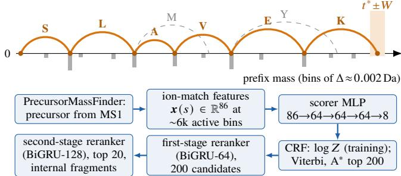
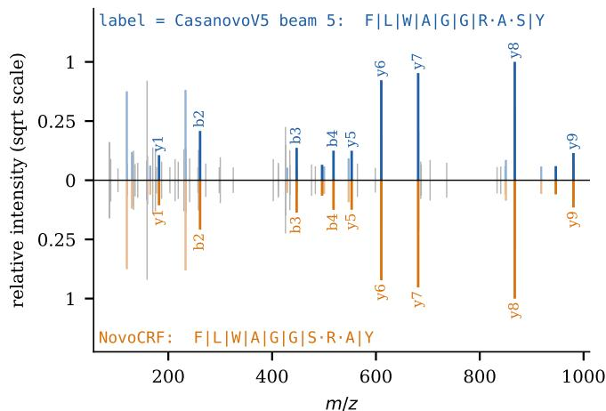
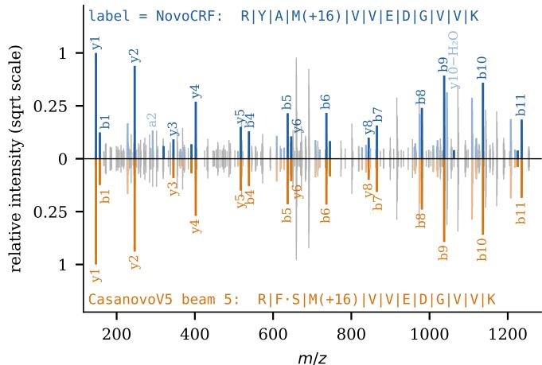

# NovoCRF: Globally Normalized De Novo Peptide Sequencing on a Prefix-Mass Lattice

Rui Qiao rqiao@bioinfor.com

Lei Xin

Baozhen Shan

lxin@bioinfor.com

bshan@bioinfor.com

Bioinformatics Solutions Inc.

## Abstract

De novo peptide sequencing has moved from dynamic programming over hand-designed or generative scores to large transformers that learn the task end to end. We present NovoCRF, a conditional random field (CRF) whose states are prefix masses, so that its paths are exactly the peptides within ±0.06 Da of the precursor mass. A small network scores each edge from physics-derived ion-match features and is trained with its scores globally normalized over all mass-feasible peptides. To our knowledge, NovoCRF is the first de novo method trained with exact normalization over all mass-feasible peptides. Our software has three modules, each with exactly one job: a precursor mass finder recovers the accurate precursor mass from MS1, the CRF finds the peptides that fit the precursor mass by exact �-best decoding, and two BiGRU rerankers add sequence context and internal-fragment evidence. The model has 310k parameters and trains in about 17 GPU-hours. On seven held-out data-dependent acquisition datasets published in 2026 (126,262 labeled spectra), NovoCRF’s mean peptide recall is 42.4%, against 39.1% for Casanovo v5 with five beams, and its amino-acid recall 64.0% against 53.1%, at 1,746 spectra/s on 18 CPU threads, 55× Casanovo’s throughput on a GPU. Split by fragment evidence, NovoCRF leads on labels with up to three peptide bonds without a b or y ion, and Casanovo only beyond. NovoCRF can also search modifications it was never trained on at their exact mass: it finds 32.1% of the hydroxyproline peptides of a lion bone sample.

## 1 Introduction

De novo sequencing reads a peptide from its tandem mass (MS/MS) spectrum without a protein database. It is the method of choice when the sequence is not in a reference database: neoantigens, antibodies, RNA-edited proteins and organisms without a curated proteome. The spectrum constrains the peptide through prefix masses: a cleavage after residue � yields a b ion at prefix mass $p _ { j }$ and a complementary y ion at $M - p _ { j }$ where � is the precursor mass.

Classical methods made this structure explicit. PEAKS [1] and NovoHMM [2] use dynamic programming (DP) along the prefix-mass axis to find the optimal path under a defined scoring function: hand-tuned ion statistics in PEAKS, a generative hidden Markov model (HMM) trained by expectation– maximization in NovoHMM. Decoding is exact and the precursor mass is satisfied by construction, but the scores are not learned discriminatively.

DeepNovo [3] introduced deep learning: a CNN reads intensity windows at the theoretical ions of each candidate next residue, an LSTM adds sequence context, and beam search decodes a per-step softmax. PointNovo [4] replaced the intensity grid with an order-invariant network over the peaks themselves, fed with the m/z diference between each peak and each theoretical ion, which made it independent of instrument resolution; it also started the LSTM from a sinusoidal embedding of the spectrum. Casanovo [5, 6] made the task fully end to end: each peak is encoded by sinusoids into a 512-d vector, and a 9-layer transformer encoder and 9-layer decoder (47.9M parameters in the released v5 weights) translate the peak set into residues. Later transformer models include InstaNovo [7], ContraNovo [8] and the non-autoregressive �-PrimeNovo [9]; GraphNovo [10] combines a spectrum graph with graph transformers. Like Casanovo, all of them lift each peak’s m/z into a high-dimensional vector. InstaNovo, ContraNovo and �-PrimeNovo use sinusoidal embeddings. GraphNovo feeds each peak’s scaled m/z, together with seven intensity and rank features of the peak, through a learned network into its graph node’s 2,048-dimensional vector, so the m/z information is used only implicitly, in a high-dimensional latent space.

Peak encoding is popular and proven to work, yet it is a counterintuitive use of capacity: one scalar m/z is encoded by 512 floating-point numbers, and not even losslessly. The network must then relearn arithmetic that is known exactly, such as $\mathsf { b } ^ { + } + \mathsf { y } ^ { + } = M + 2 m _ { \mathrm { H } ^ { + } }$ , with � + the proton mass. These models are also locally normalized, with a softmax per decoding step or, with connectionist temporal classification (CTC), per output position, and none of them normalizes over the set of peptides that fit the precursor mass: the mass constraint enters only through decoding rules or filters.

NovoCRF returns to the classical formulation and makes it discriminative. Conceptually it is close to NovoHMM, a chain along the prefix-mass axis decoded by DP, but it is a conditional random field [11]: in training, the score of the true path is normalized over all mass-feasible paths rather than step by step. A model whose scores see only local evidence needs this global normalization to avoid label bias [11, 12]; in development experiments on the same lattice it was worth 8–10 points of peptide recall (§4.8). To the best of our knowledge, NovoCRF is the first de novo sequencing method trained with exact normalization over all mass-feasible peptides. In spirit NovoCRF is a successor to PointNovo: a de novo tool using carefully engineered input features that encode domain knowledge (theoretical fragment m/z, ppm-scale soft matching, isotope envelopes, neutral losses, immonium ions and internal fragments), instead of a black box with tens of millions of weights.

A model built to read the spectrum also invites a closer look at the benchmark. De novo tools are usually scored by peptide recall against database-search identifications. A database search may accept a peptide with long stretches that no b or y ion supports, because the database supplies the sequence; a de novo tool must choose the residues in such a stretch with little or no direct evidence. We therefore report recall by how much fragment evidence each label has. Our contributions:

• a CRF over a 0.002 Da prefix-mass lattice whose partition function is computed exactly in ≈ �/(57 Da) sequential steps, with 18.5k parameters in the potentials, followed by two BiGRU rerankers (§3);

• a modular design in which precursor correction from MS1, exact search and sequence context are separate modules, and in which modifications never seen in training are searched at their exact mass (§3.7);

• CPU inference at 7.0× and 55× the throughput of one- and five-beam Casanovo on a GPU, and a model that trains on one desktop GPU within a day and can be deployed to edge devices, sequencing up to 1,324 spectra/s on a four-year-old cellphone.

## 2 Related work

Spectrum graphs and dynamic programming. Before deep learning, de novo tools scored paths through a graph of candidate prefix masses: PEAKS [1] with hand-tuned ion statistics, PepNovo [13] with a probabilistic network of fragmentation, NovoHMM [2] with a generative HMM and Novor [14] with decision trees learned from a spectral library. All decode exactly, and none trains a discriminative model against the set of all paths.

Mass constraints in neural de novo sequencing. Neural sequencers generate residues step by step or position by position and bring the precursor mass in at decoding time. DeepNovo filters beam-search extensions with a knapsack over residue masses [3]; �-PrimeNovo, a non-autoregressive transformer trained with CTC, adds a precise mass-control unit that steers its output toward sequences of the right mass [9]; GraphNovo first searches for an optimal path in a spectrum graph, which then guides a second-stage sequence predictor through the segments without fragmentation [10]. In all of them the likelihood is normalized locally, per step or per output position. NovoCRF builds the mass constraint into the state space instead, so that the model’s normalizer ranges only over mass-feasible peptides.

Global normalization. Conditional random fields [11] were introduced to avoid the label bias of locally normalized models such as maximum-entropy Markov models (MEMMs), whose per-state normalization lets early decisions ignore later evidence. Andor et al. [12] showed that globally normalized neural models are strictly more expressive than their locally normalized counterparts for transition-based structured prediction. Exact global normalization is usually expensive because the partition function ranges over an exponential set; the prefixmass lattice makes it cheap, because its states are ordered by mass and every edge spans at least one glycine (§3.4).

Evaluating de novo sequencing. De novo tools are compared on spectra labeled by database search, usually by peptide-level recall or precision [6, 7, 9, 10]. GraphNovo was designed to mitigate missing fragmentation, which its authors identify as an important remaining hurdle [10], and NovoBench [15] reports accuracy against each spectrum’s missing-fragmentation ratio. We split both peptide and amino-acid recall by the fragment evidence of each label, test how the split depends on which ion types count as evidence, and show how much a de novo tool’s accuracy depends on the precursor mass it is given.

## 3 Method

The Zen of NovoCRF. NovoCRF consists of three modules, each with a single job:

1. PrecursorMassFinder reads the MS1 and MS2 scans through the vendor’s software development kit (SDK) and finds the correct precursor mass of each MS2 scan from MS1 information (§3.1).

  
Figure 1: Top: the prefix-mass lattice. The true peptide (SLAVEK, orange) is one path from bin 0 to the terminal window, normalized against all mass-feasible paths (gray); bars show the evidence at active bins. Bottom: the pipeline, whose output is a peptide with a calibrated confidence.

2. The CRF trusts the precursor mass it is given. A CRF with an MLP scorer and the Viterbi algorithm eficiently find the sequences that match that mass and have good spectrum support (§§3.2–3.5).

3. The rerankers bring in some sequence information, and so promote sequences that resemble the real proteome where fragmentation is missing (§3.6).

Each module has one clear responsibility, so it is easier to fine-tune and optimize.

Notation. Italic letters are scalars, bold lowercase letters vectors $( \mathbf { e } . \mathbf { g } . \pmb { \nu } \in \mathbb { R } ^ { 8 } )$ , bold uppercase letters matrices; ⟨·, ·⟩ is the inner product and $m _ { \mathrm { H ^ { + } } }$ the proton mass (masses in Da).

## 3.1 PrecursorMassFinder: the precursor from MS1

PrecursorMassFinder reads the MS1 and MS2 spectra with the vendor’s file reader and tries to find the right precursor mass for each MS2 scan from the signals in the corresponding MS1 scan. For each MS2 scan, the MS1 peak nearest the isolation target (within 15 ppm on Orbitrap data, 20 ppm on timsTOF) is the anchor. The anchor may be a heavier isotope peak, so the candidate monoisotopic peaks are the anchor and the positions 1 to � isotope spacings (1.00335/� for the vendor’s charge �) lower in m/z $( J = 2 – 6$ , growing with mass), each scored by how well the intensities � at its first four isotope positions match the averagine abundances �, penalizing a peak one spacing lighter still (intensity $r _ { - 1 } ) \colon \langle \pmb { a } , \pmb { r } \rangle ^ { 2 } / ( \| \pmb { r } \| ^ { 2 } + r _ { - 1 } ^ { 2 } / 4 )$ . The best candidate’s centroid is reported.

## 3.2 Prefix-mass lattice

A spectrum � has peaks $\{ ( m _ { i } , I _ { i } ) \}$ , precursor neutral mass � and charge �. States are bins $s = 0 , \ldots , s$ of width Δ = 0.001995495 Da, chosen near 0.002 Da to minimize the worst residue-mass rounding error (0.00065 Da); bin � stands for the prefix mass �Δ. Each of the $K = 2 4$ edges adds one residue of mass $m _ { k }$ and spans $o _ { k } = \mathrm { r o u n d } ( m _ { k } / \Delta )$ bins. The edges cover 19 residue masses (I/L merged, fixed carbamidomethyl C), oxidized M, unmodified C, and phosphorylated S, T and Y, which are searched only when requested; deamidated N/Q have exactly the masses of D/E and share their edges. Three more edges, for N-terminal modifications, may leave only bin 0, the peptide’s N-terminus. Acetylation and carbamylation edges add only the modification mass (+42.011 and +43.006 Da), and the first residue follows as its own edge. Pyro-Glu makes an N-terminal Q 17.027 Da lighter; an edge cannot have negative mass, so it is one edge for the modified Q (111.032 Da). A path starts at bin 0 and ends within � = 30 bins (±0.06 Da) of $t ^ { \ast } = \mathrm { r o u n d } ( ( M - m _ { \mathrm { H } _ { 2 } \mathrm { O } } ) / \Delta )$ , so every path is a mass-feasible peptide, and equal-mass compositions (GG vs. N) are distinct paths through shared states (Fig. 1).

## 3.3 Potentials

Every edge is scored from the fragment evidence at the bins it touches. Evidence is computed only at a small set of active bins; all other bins share one learned vector.

Active bins. Reading a peak of m/z � as a b or y ion of charge 1 or 2 implies one of four prefix masses, $\hat { x } \in \{ m - m _ { \mathrm { H } ^ { + } }$ , � + $m _ { \mathrm { H } ^ { + } } - m , ~ 2 m - 2 m _ { \mathrm { H } ^ { + } } , ~ M + 2 m _ { \mathrm { H } ^ { + } } - 2 m \}$ . Over the 200 most intense peaks (400 $\mathrm { f o r } z \ge 3 )$ , with intensities scaled to the base peak, the active set ${ \mathcal { A } } ( X )$ contains every bin within ±20 ppm of such an �ˆ; the window is relative to the fragment m/z and at least one bin wide. A spectrum has about 6k active bins out of ${ \sim } 1 0 ^ { 6 }$

Ion-match features. For an active bin � with prefix mass $x = s \Delta .$ , ion type � (series b or ${ \mathrm { y } } ,$ charge $z _ { j } ,$ mass shift $\delta _ { j } )$ has the theoretical m/z

$$
\mu _ { j } ( s ) = \left( n _ { j } ( x ) + \delta _ { j } + z _ { j } m _ { \mathrm { H } ^ { + } } \right) / z _ { j } ,\tag{1}
$$

where the fragment’s neutral mass is $n _ { j } ( x ) = x$ for the b series and $n _ { i } ( x ) = M - x$ for the y series. The 23 ion types, with their shifts $\delta _ { j } ,$ are b and y of charge ${ 1 - 3 } ( \delta _ { j } = 0 ) ; { \mathrm a ^ { + } }$ and $\mathrm { a } ^ { 2 + } \ ( \mathrm { - C O } , \mathrm { - } \mathrm { 2 7 } . 9 9 5 \mathrm { D a } ) ;$ b and y of charge 1 and 2 minus $\mathrm { H } _ { 2 } \mathrm { O } \ ( - 1 8 . 0 1 1 \mathrm { { D a } ) }$ or $\mathrm { N H _ { 3 } } \ ( - 1 7 . 0 2 7 \mathrm { D a } ) ; \mathrm { b ^ { + } }$ and ${ \mathrm { y } } ^ { + }$ minus $\mathrm { H _ { 3 } P O _ { 4 } \ ( - 9 7 . 9 7 7 D a ) }$ , the neutral loss of phosphopeptides; and five more singly charged ions $\left( \mathbf { a } \mathrm { - N H } _ { 3 } \right.$ , z+1, $\begin{array} { r } { \mathbf { b } + \mathbf { H } _ { 2 } \mathbf { O } , } \end{array}$ $\mathsf { b } \mathrm { - } \mathsf { H } _ { 2 } \mathsf { O } \mathrm { - } \mathsf { N } \mathsf { H } _ { 3 } , \mathsf { y } \mathrm { - } \mathsf { H } _ { 2 } \mathsf { O } \mathrm { - } \mathsf { N } \mathsf { H } _ { 3 } )$ whose shifts follow from their formulas. The peak nearest to $\mu _ { j } ( s )$ within 50 ppm, with relative intensity � and signed error � in ppm, gives three scalars: the encoded intensity min(1, max $( 0 , 1 + { \textstyle \frac { 1 } { 3 } } \log _ { 1 0 } I ) )$ the proximity $\exp ( - | \epsilon | / 1 0 )$ and the error $\epsilon / 5 0 ;$ all three are 0 if no peak lies within 50 ppm. The proximity is PointNovo’s soft matching: a near miss counts partially instead of being cut of by a hard tolerance.

Isotope features. For the primary ions $ { \mathbf { b } } ^ { + } ,  { \mathbf { y } } ^ { + } ,  { \mathbf { b } } ^ { 2 + }$ and $\mathbf { y } ^ { 2 + }$ , the peaks at $\mu _ { j } \pm 1 . 0 0 3 3 5 / z _ { j }$ (intensities $I _ { + 1 } , I _ { - 1 } )$ are compared with the averagine expectation that a fragment of neutral mass � has a first isotope peak $\rho ( n ) \approx 5 \times 1 0 ^ { - 4 }$ � times as intense as its monoisotopic peak: log $\left( I _ { + 1 } / \left( \rho ( n ) I \right) + 0 . 0 5 \right)$ is near 0 for a consistent isotope envelope, and $\log \left( \rho ( n - 1 . 0 \dot { 0 } 3 3 5 ) I _ { - 1 } / I + \right.$ 0.05 is large when the matched peak is itself the +1 isotope of a lighter fragment. Both are clipped to [−3, 3] and divided by 3.

Global features. Each bin also carries its relative position $x / M$ , the precursor mass �/3000, two flags for whether ${ \mathfrak { b } } ^ { + }$ and ${ \mathrm { y } } ^ { + }$ fall inside the observed m/z range, and the charge one-hot $( 1 , 2 , 3 , 4 , \geq 5 )$ . In total, $2 3 \times 3$ ion-match, 4 × 2 isotope and 9 global features form $\pmb { x } ( s ) \in \mathbb { R } ^ { 8 6 }$

Scorer. An MLP $f _ { \theta }$ with three hidden layers of 64 ReLU units maps the features to an evidence vector, $\pmb { \nu } ( s ) = f _ { \pmb { \theta } } ( \pmb { x } ( s ) ) \in \mathbb { R } ^ { 8 }$ for $s \in { \mathcal { A } } ( X )$ ; every inactive bin gets the learned vector $\pmb { \nu } _ { 0 } \in \mathbb { R } ^ { 8 }$

Edge potentials. Edge � enters bin � from bin $s - o _ { k }$ and scores

$$
\psi _ { k } ( s ) = \underbrace { \langle \pmb { \nu } ( s ) , \pmb { e } _ { k } \rangle } _ { \mathrm { d e s t i n a t i o n } } + \underbrace { \langle \pmb { \nu } ( s - o _ { k } ) , \pmb { g } _ { k } \rangle } _ { \mathrm { s o u r c e } } + \underbrace { c _ { k } ( X ) } _ { \mathrm { p r i o r } } ,\tag{2}
$$

with learned destination and source embeddings $\boldsymbol { e } _ { k } , \boldsymbol { g } _ { k } \in \mathbb { R } ^ { 8 }$ Stacking the 24 vectors $\boldsymbol { e } _ { k }$ as the rows of $\mathbf { E } \in \mathbb { R } ^ { 2 4 \times 8 }$ gives all destination terms of bin � at once as E�(�), a rank-8 factorization of the bins-by-edges score matrix. Rank 8 lets the residue change how the evidence at its two flanking cleavages is read, $\mathrm { e . g . }$ the enhanced cleavage N-terminal to proline (the source bin of a P edge). An edge between two inactive bins has the same score, $c _ { k } ( X ) + \langle \pmb { \nu } _ { 0 } , \pmb { e } _ { k } + \pmb { g } _ { k } \rangle$ , everywhere in the spectrum.

Table 1: NovoCRF parameters, counted from the model’s checkpoints.
<table><tr><td>Component</td><td>Shape</td><td>Parameters</td></tr><tr><td>Scorer MLP  $f _ { \theta }$ </td><td> $8 6 {  } 6 4 {  } 6 4 {  } 6 4 {  } 8$ </td><td>14,408</td></tr><tr><td>Residue prior  $h _ { \phi } ;$  biases γk</td><td> $3 1  6 4  2 4 ; 2 4$ </td><td>3,632</td></tr><tr><td>Edge embeddings  $\mathbf { \phi } _ { e \ t } , \mathbf { \phi } _ { g k }$ </td><td> $2 \times 2 4 \times 8$ </td><td>384</td></tr><tr><td>Start edges  $e _ { j } ^ { \mathrm { s t } } , \gamma _ { j } ^ { \mathrm { s t } } ; \nu _ { 0 } ; \kappa$ </td><td> $3 \times 9 ; 8 ; 1$ </td><td>36</td></tr><tr><td>CRF total</td><td></td><td>18,460</td></tr><tr><td>First-stage reranker; calibrator</td><td>BiGRU-64; logistic</td><td>70,639</td></tr><tr><td>Second-stage reranker</td><td>BiGRU-128</td><td>220,482</td></tr><tr><td>Total</td><td></td><td>309,581</td></tr></table>

Residue prior. The scalar $c _ { k } ( X ) = \gamma _ { k } + [ h _ { \phi } ( { \pmb u } ) ] _ { k }$ adds a spectrum-conditioned prior to a static bias $\gamma _ { k }$ . The input $\pmb { u } \in \mathbb { R } ^ { 3 1 }$ holds the encoded intensities at the 24 immonium-ion m/z values $m _ { k } - m _ { \mathrm { C O } } + m _ { \mathrm { H } ^ { + } }$ (within 20 ppm) and 7 globals (precursor mass, log peak count, charge one-hot). Immonium ions tell which residues are present but not where, so they enter as a prior rather than as per-bin evidence. The ${ \mathrm { M L P ~ } } h _ { \phi }$ $( 3 1  6 4  2 4 . 7 $ , GELU) has its last layer initialized to zero, so training starts from the static prior. The $\mathrm { C R F } \mathbf { s }$ only sequence prior is thus a per-residue frequency, with no notion of which residue follows which; the rerankers (§3.6) add sequence context, but only among the $\mathrm { C R F } \mathbf { s }$ candidates.

Path score. A start edge � landing at bin $q _ { j }$ scores $\psi _ { j } ^ { \mathrm { s t } } = $ $\left. \pmb { \nu } ( q _ { j } ) , \pmb { e } _ { j } ^ { \mathrm { s t } } \right. + \gamma _ { j } ^ { \mathrm { s t } }$ , and the end bin � pays a penalty for its distance from the measured mass,

$$
\tau ( t ) = - \kappa \left( \frac { M - m _ { \mathrm { H } _ { 2 } \mathrm { O } } - t \Delta } { 0 . 0 2 \mathrm { D a } } \right) ^ { 2 } ,\tag{3}
$$

with a learned $\kappa > 0 .$ A path � that optionally begins with start edge � and then takes edges $k _ { 1 } , \ldots , k _ { L }$ through bins $s _ { 1 } < \cdots < s _ { L }$ scores $\begin{array} { r } { \Phi ( { \boldsymbol \pi } ) = \psi _ { i } ^ { \mathrm { s t } } + \sum _ { l = 1 } ^ { L } \psi _ { k _ { l } } ( s _ { l } ) + { \boldsymbol \tau } ( s _ { L } ) } \end{array}$ , and

$$
P ( \pi \mid X ) = { \frac { \exp \Phi ( \pi ) } { Z ( X ) } } , \qquad Z ( X ) = \sum _ { \pi ^ { \prime } \in \Pi ( X ) } \exp \Phi ( \pi ^ { \prime } ) ,\tag{4}
$$

where Π(�) is the set of all mass-feasible paths. The CRF layer itself has no parameters (Table 1).

## 3.4 Training: computing log � exactly

A labeled peptide determines exactly one path $\pi ^ { * }$ , so the loss (the negative log-likelihood) is $\ell = \log Z ( X ) - \Phi ( \pi ^ { * } )$ : one forward pass plus a gather of � scores, with no alignment to marginalize, unlike CTC. With $\alpha ( 0 ) = 0$ , the forward recursion is

$$
\begin{array} { r l } & { \alpha ( s ) = \log \Big [ \sum _ { k } e ^ { \alpha \left( s - o _ { k } \right) + \psi _ { k } ( s ) } + \sum _ { j : q _ { j } = s } e ^ { \psi _ { j } ^ { \mathrm { s t } } } \Big ] , } \\ & { \log Z = \log \sum _ { | t - t ^ { * } | \leq W } e ^ { \alpha ( t ) + \tau ( t ) } . } \end{array}\tag{5}
$$

The recursion looks sequential over ${ \sim } 1 0 ^ { 6 }$ bins, but every edge spans at least $\sigma _ { \mathrm { m i n } } = 2 8 { , } 5 7 5$ bins (glycine, 57.02 Da). All bins of a block of $o _ { \mathrm { m i n } }$ consecutive bins thus depend only on earlier blocks, and the scan takes $\lceil S / o _ { \mathrm { m i n } } \rceil \approx 3 5$ sequential steps for a precursor of $2 \mathrm { k D a } ,$ each updating ∼28.5k bins $\times K$ edges in parallel. For a fixed edge, the reads $\alpha ( s - o _ { k } )$ over consecutive � are a contiguous stream at a fixed ofset, not a gather. Our Triton [16] kernels fuse the scan with Eq. (2): $\psi _ { k } ( s )$ is recomputed on the fly from the $8 \mathrm { - } \mathrm { d } \nu ( s )$ , so the dense $B \times K \times S$ tensor of edge scores never exists. The gradient of log � needs the mirror image of �: �(�) sums the scores of all ways to reach bin �, and $\beta ( s )$ those of all ways to finish a path from � (the remaining edges up to an end bin �, plus �(�)). The backward recursion

$$
\begin{array} { r l } & { \beta ( s ) = \log \sum _ { k } e ^ { \psi _ { k } ( s + o _ { k } ) + \beta ( s + o _ { k } ) } , } \\ & { \beta ( t ) = \tau ( t ) \quad \mathrm { f o r ~ } | t - t ^ { * } | \leq W , } \end{array}\tag{6}
$$

runs from the terminal window down to bin 0 over the same blocks in reverse order. Every path through edge � into bin � is a prefix to $s - o _ { k }$ , the edge and a sufix from �, so the gradient is that edge’s posterior probability, � log $Z / \partial \psi _ { k } ( s ) =$ $\exp ( \alpha ( s - o _ { k } ) + \psi _ { k } ( s ) + \beta ( s ) - \log Z )$ ; fused kernels accumulate it into the gradients of $\pmb { \nu } ( s ) , \pmb { e } _ { k } , \pmb { g } _ { k }$ and $c _ { k }$

## 3.5 Inference: Viterbi and exact �-best

Replacing log-sum-exp by max in Eq. (5) gives the Viterbi algorithm [17]: $\alpha ( s )$ becomes the best prefix score of bin �, and the arg-max path is the exact maximum a posteriori (MAP) peptide, not a beam approximation. On CPU, edges between inactive bins have the spectrum-constant score of §3.3, so each block reduces to � branch-free, vectorized max-add streams; the active bins are then rescored exactly, and back-pointers are recomputed along the best path rather than stored. To obtain the 200 best paths, a best-first $( \mathbf { A } ^ { * } )$ [18] search runs backward from the terminal window with �(�) as an exact heuristic, so complete paths leave the queue in descending score order; log � is not needed. The search stops after 20,000 expansions and drops paths of more than 48 residues. Permutations of residues inside an unsupported stretch often score exactly the same; such ties are broken deterministically. Disabling a variable modification deletes its edges, which keeps search and normalization exact over the allowed peptides, unlike masking the per-step softmax of an autoregressive decoder.

## 3.6 Rerankers

A first-order lattice cannot order residues inside a gap without cleavage evidence and has no sequence context. As in �-best rescoring for speech recognition [19], two models rescore the CRF’s candidates; both score each candidate independently and are trained by the softmax cross-entropy of the correct candidate over each list, skipping lists without it.

First stage. Each residue of a candidate is represented by a 32-d token embedding concatenated with a 32-d ReLU projection of the 86 ion features at the cleavage that follows it, and a one-layer bidirectional GRU (64 units per direction) reads the candidate. Its mean- and max-pooled states (256-d) and 8 candidate inputs (the CRF score gap to the best candidate, length, five spectrumfit statistics, namely explained b/y intensity, explained top-20 peaks, share of cleavages with b/y support, longest uncovered run and explained internal-fragment intensity, and a constant) feed an MLP (264→64→1). It rescores the CRF’s top 200, and a 13-weight logistic calibrator turns its softmax, its top-2 margin and the candidate features into the reported confidence. Second stage. A larger BiGRU (128 units per direction, 220k parameters) rescores the first stage’s top 20 and reads internal fragments. Each residue carries three more inputs: the intensity at its immonium ion and the intensities of the most intense internal b-type fragments (2–6 residues, neither terminus) that start and that end at the residue, matched within 20 ppm. Internal fragments span the cleavages that b and y ions miss, so they speak to the order of residues inside an unsupported stretch.

Table 2: The seven held-out test datasets (one raw file each). Labels: PEAKS DB search, 1% PSM FDR. Exploris, Ascend, Fusion: Orbitrap Exploris 480, Ascend and Fusion; prot. K: proteinase K. �PASEF precursors. �Without 275 labels on precursors of unknown charge.
<table><tr><td>Dataset</td><td>Sample</td><td>Enzyme; instrument</td><td>MS2</td><td>Labels</td></tr><tr><td>PXD076585 [29] human A549</td><td></td><td>trypsin; Exploris</td><td>131,789</td><td>31,275</td></tr><tr><td></td><td>PXD071561 [30] squid optic lobe</td><td>Lys-C; Exploris</td><td>59,389</td><td>24,701</td></tr><tr><td>PXD073929 [31] frog toe</td><td></td><td>Glu-C; Exploris</td><td>103,345</td><td>2,276</td></tr><tr><td></td><td></td><td>PXD072115 [32] chickpea peptides none; timsTOF Pro</td><td>32,981ª</td><td>18,992b</td></tr><tr><td>PXD074750 [33] Candida auris</td><td></td><td>prot. K; Exploris</td><td>62,389</td><td>22,488</td></tr><tr><td></td><td>PXD071022 [34] HLA-I, colorectal none; Ascend</td><td></td><td>85,732</td><td>21,887</td></tr><tr><td>PXD082505 [35] HLA-I, B*15:02</td><td></td><td>none; Fusion</td><td>208,196</td><td>4,643</td></tr><tr><td>Total</td><td></td><td></td><td>683,821 126,262</td><td></td></tr></table>

## 3.7 Modifications never seen in training

A modification the model was never trained on can still be searched exactly. A user modification such as C+119.004 adds one edge at the unmodified residue’s mass plus the delta, so the lattice, Viterbi and �-best search stay exact. The edge borrows the trained parameters of its unmodified residue: the embeddings $\mathbf { \nabla } _ { \mathbf { \boldsymbol { e } } _ { k } , \mathbf { \boldsymbol { g } } _ { k } , }$ , the prior $c _ { k }$ (with an optional ofset) and the rerankers’ token. Since the CRF’s evidence lives in prefixmass bins, the new edge reads the ion features at its true end bins, and the second stage’s immonium and internal-fragment inputs use its true mass; it has no fragment features of its own, such as a neutral loss. An entry within one bin (0.002 Da) of an existing residue is skipped.

## 3.8 Implementation

Training runs in PyTorch with the Triton kernels above. Inference is performed in a dependency-free C++ engine, which needs only a C++17 compiler; matrix products use a self-contained header that compiles to AVX or NEON. The NovoCRF executable, bundled together with the model weights, takes less than 4 MB on Windows.

## 4 Experiments

## 4.1 Data and protocol

Training. NovoCRF is trained on 10M labeled spectra that cover all 3.3M peptides of a 58.1M-spectrum pool, with about $\sqrt { n }$ of the � spectra of each peptide, mostly from MassIVE-KB [20] (4.77M), InstaNovo’s multi-enzyme set (2.95M), synthetic ProteomeTools peptides and phosphopeptides (0.81M and 0.35M) [7, 21], and CompOmics’ reprocessed PRIDE projects (0.92M). Common tryptic charge-2/3 spectra were kept with probability 0.4 to favor non-tryptic and charge-1 data.

Training details. Batches hold a variable number of spectra, capped at 8×107 lattice bins (about 84 spectra). We use AdamW (learning rate $2 \times 1 0 ^ { - 3 }$ , weight decay $1 0 ^ { - 4 } )$ with a one-cycle schedule and gradient clipping at norm 1, for 80k steps from scratch. A 35k-step fine-tune at learning rate $5 \times 1 0 ^ { - 4 }$ trains the phosphorylated residues, with phosphopeptide spectra sampled 2.5× and a 23k-spectrum shard of unmodified-cysteine peptides 10× more often. The rerankers are trained with AdamW (learning rate $1 0 ^ { - 3 } )$ on batches of 64 lists: the first stage for 150k steps on the CRF’s top-50 lists of 2M training spectra, the second for 60k steps on the first stage’s top-20 lists of another 2M.

Table 3: Top-1 peptide recall (Pep) and amino-acid recall (AA) in % on the seven held-out datasets, and their means. Best per column in bold.
<table><tr><td>Engine</td><td>PXD076585 human, trypsin</td><td></td><td>PXD071561 squid, Lys-C</td><td>PXD073929 frog, Glu-C</td><td>PXD072115 chickpea</td><td>PXD074750 C. auris, prot. K</td><td>PXD071022 HLA-I</td><td>PXD082505 HLA-I</td><td>Mean</td></tr><tr><td></td><td>Pep</td><td>34.2</td><td>69.2</td><td>36.7</td><td>15.6</td><td>25.3</td><td>61.1</td><td>54.5</td><td>42.4</td></tr><tr><td rowspan="2">NovoCRF</td><td>AA</td><td>58.8</td><td>78.6</td><td>61.0</td><td>44.7</td><td>49.6</td><td>79.9</td><td>75.5</td><td>64.0</td></tr><tr><td>Pep</td><td>35.0</td><td>65.4</td><td>40.9</td><td>8.5</td><td>24.1</td><td>50.7</td><td>49.4</td><td>39.1</td></tr><tr><td rowspan="2">CasanovoV5 beam 5</td><td> $\mathbf { A A }$ </td><td>50.9</td><td>68.9</td><td>59.1</td><td>25.1</td><td>37.9</td><td>65.4</td><td>64.3</td><td>53.1</td></tr><tr><td>Pep</td><td>30.9</td><td>60.5</td><td>37.3</td><td>6.8</td><td>21.8</td><td>44.9</td><td>44.9</td><td>35.3</td></tr><tr><td rowspan="2">CasanovoV5 beam 1</td><td> $\mathbf { A A }$ </td><td>44.4</td><td>63.0</td><td>52.5</td><td>18.6</td><td>31.9</td><td>57.4</td><td>58.2</td><td>46.6</td></tr><tr><td> $\mathrm { P e p }$ </td><td>14.7</td><td>44.6</td><td>20.0</td><td>3.4</td><td>13.2</td><td>34.0</td><td>23.6</td><td>22.0</td></tr><tr><td>PEAKS de novo</td><td> $\mathbf { A A }$ </td><td>43.4</td><td>66.0</td><td>50.5</td><td>22.1</td><td>37.3</td><td>64.4</td><td>56.1</td><td>48.5</td></tr></table>

Development and test sets. Design choices, including this model’s training recipe and second-stage settings, were compared on five other data-dependent acquisition (DDA) datasets whose papers appeared in late 2025 and 2026 [22–26] and on a validation split of the training data. All results below are on seven further datasets (Table 2), one raw file each, scored once after training. All twelve were made public in PRIDE in 2026, after Casanovo v5 was released [27]. None occurs in the training sources whose projects we could check, and §4.6 reports recall on peptides absent from the training data. A lion bone set, PXD065297 [28], is used in §4.7 with the authors own search.

Labels. Ground truth comes from a PEAKS 13.5 database search [36] at 1% peptide-spectrum match (PSM) false discovery rate (FDR), with the submitters’ modifications. Modifications that no evaluated tool supports were left out of the search, so every label is within reach of every tool. No test set has phosphopeptide labels.

Baselines. We compare with PEAKS classic de novo (a PEAKS 13.5 development build, DENOVO step, reading the raw files) and with Casanovo 5.0.0 using its released v5 weights [27] (47.9M parameters, counted from the checkpoint)1, with one and five beams (CasanovoV5 beam 1 and CasanovoV5 beam 5), in its benchmark configuration (precursor isotope errors 0–1, at least 7 residues, charge at most 4, 20–150 peaks), reading the same PrecursorMassFinder-generated Mascot generic format (MGF) files as NovoCRF. Each tool received the modification setting closest to what the labels carry (for Casanovo by masking tokens, and by giving its Cys token the unmodified mass on unalkylated sets). PEAKS de novo and NovoCRF (C++ engine, phosphorylation of) ran on 18 threads of an Intel i9-13900K, Casanovo on an RTX 3090.

Metrics. A prediction is correct if it matches the label residue by residue, Casanovo style: each residue within 0.1 Da and the running prefix or sufix mass within 0.5 Da, with I = L. Peptide recall is correct predictions over labeled spectra and peptide precision is correct over predicted; amino-acid (AA) recall and precision count matched residues over label and predicted residues. The area under the precision–recall curve (PR AUC) ranks predictions by each tool’s own score. Means are over the seven datasets unless stated otherwise; diferences between tools are tested over datasets (paired �-test, Wilcoxon signed-rank).

## 4.2 Peptide- and amino-acid-level accuracy

Tables 3 and 4 give the results. NovoCRF has the highest mean peptide recall and precision, AA recall and precision, and PR

Table 4: Means over the seven datasets (%; PR AUC as a fraction) and inference throughput. Casanovo and PEAKS de novo speeds are from runs on msconvert MGFs (683,418 spectra) on a quiet machine; NovoCRF’s from 683,821 PrecursorMassFinder spectra. Best in bold.
<table><tr><td></td><td colspan="2">Peptide</td><td colspan="2">Amino acid</td><td>PR</td><td>Spectra</td></tr><tr><td>Engine</td><td>recall</td><td>prec.</td><td>recall</td><td>prec.</td><td>AUC</td><td>/s</td></tr><tr><td>NovoCRF (CPU)</td><td>42.4</td><td>42.4</td><td>64.0</td><td>65.0</td><td>0.381</td><td>1,746</td></tr><tr><td>CasanovoV5 beam 5 (GPU)</td><td>39.1</td><td>40.9</td><td>53.1</td><td>56.2</td><td>0.366</td><td>32</td></tr><tr><td>CasanovoV5 beam 1 (GPU)</td><td>35.3</td><td>36.9</td><td>46.6</td><td>49.3</td><td>0.337</td><td>251</td></tr><tr><td>PEAKS de novo (CPU)</td><td>22.0</td><td>22.1</td><td>48.5</td><td>48.2</td><td>0.174</td><td>145</td></tr></table>

Table 5: Precursor input. Share of labels whose mass is within the precursor tolerance of the MGF precursor, and mean peptide recall (%) with msconvert or PrecursorMassFinder MGFs.
<table><tr><td></td><td></td><td></td><td colspan="2">CasanovoV5</td></tr><tr><td>MGF</td><td>Labels fit NovoCRF</td><td></td><td></td><td>beam 5 beam 1</td></tr><tr><td>msconvert</td><td>88.5</td><td>40.1</td><td>38.9</td><td>35.2</td></tr><tr><td>PrecursorMassFinder</td><td>97.9</td><td>42.4</td><td>39.1</td><td>35.3</td></tr></table>

AUC. Its peptide recall leads CasanovoV5 beam 5 on five of seven datasets; it trails on human trypsin (34.2% vs. 35.0%) and frog Glu-C (36.7% vs. 40.9%). It has the best AA recall on all seven. Over spectra, NovoCRF gets 12,495 labels that CasanovoV5 beam 5 misses and CasanovoV5 beam 5 gets 7,735 that NovoCRF misses. Over the seven datasets, the AArecall lead of 10.9 points is significant (paired �-test $p = 0 . 0 0 2$ Wilcoxon $p = 0 . 0 1 6 ,$ the smallest possible with seven datasets), while the peptide-recall lead (3.3 points; $p = 0 . 1 3$ and 0.16) and the PR-AUC lead $( p = 0 . 4 2 )$ are not.

## 4.3 Precursor input

With MGFs written by msconvert (vendor peak picking, precursor refinement), 11.5% of labels had a mass outside the precursor tolerance of the MGF precursor: the instrument had reported the $^ { 1 3 } \mathrm { C }$ peak (3.9%) or a heavier one (0.5%), a peak 1–7 isotope spacings lighter (1.8%), or a mass of by a non-isotopic amount (5.3%). The labels are fine, since PEAKS corrects the precursor before its search. PrecursorMassFinder’s precursors fit 97.9% of labels (Table 5). NovoCRF, which searches only ±0.06 Da around the given mass, gained 2.24 points of mean recall. CasanovoV5 beam 5, a large transformer model that can partly compensate for a wrong precursor from the MS2 ions (it finds 8–24% of the labels whose msconvert precursor was wrong, NovoCRF 0–6%), still gained 0.26 points, which shows the value of PrecursorMassFinder.

## 4.4 Accuracy by fragment evidence

We classify each label by its fragment evidence in the vendorcentroided peak list. A peptide bond is observed if one of its fragment ions lies within the dataset’s fragment tolerance (0.02 Da; 0.05 Da for timsTOF) of a peak; fragments of charge 2 count for precursors of charge ≥ 3. We use two rules: b and y ions only, and an extended rule that adds a ions and the $_ { \mathrm { H } _ { 2 } \mathrm { O } }$ and $\mathrm { N H } _ { 3 }$ losses of b and y. An unsupported stretch is a run of consecutive residues with no observed bond between them; the spectrum constrains only its summed mass. Under the b/y rule, 17.3% of labels have a complete ladder and 43% contain an unsupported stretch of three or more residues. As a check for chance matches, fragment masses shifted by +11.5 Da, a shift that matches no ion type, “observe” 2.0% (b/y) and 6.1% (extended) of bonds, against 71.6% and 78.1% at the true masses, so the extended rule admits three times as many chance matches.

Table 6: Peptide recall (%) by the number of the label’s bonds without an observed fragment ion, under the b/y rule and the extended rule, pooled over all 126,262 labels. Best per rule in bold.
<table><tr><td></td><td colspan="5">b/y rule</td><td colspan="3">extended rule</td></tr><tr><td>Missing bonds</td><td>Labels</td><td>NovoCRF</td><td>CasanovoV5 beam 5</td><td>CasanovoV5 beam 1</td><td>PEAKS de novo</td><td>Labels</td><td>NovoCRF</td><td>CasanovoV5 beam 5</td></tr><tr><td>0</td><td>21,870</td><td>89.9</td><td>80.6</td><td>75.3</td><td>70.3</td><td>30,984</td><td>80.4</td><td>71.3</td></tr><tr><td>1</td><td>24,183</td><td>73.1</td><td>64.8</td><td>59.0</td><td>35.8</td><td>27,917</td><td>61.8</td><td>54.8</td></tr><tr><td>2</td><td>20,724</td><td>50.7</td><td>45.1</td><td>39.6</td><td>16.9</td><td>21,643</td><td>37.8</td><td>35.3</td></tr><tr><td>3</td><td>14,740</td><td>25.1</td><td>23.4</td><td>19.6</td><td>4.1</td><td>13,207</td><td>15.6</td><td>16.1</td></tr><tr><td> $_ { 4 - 5 }$ </td><td>18,495</td><td>8.0</td><td>9.9</td><td>7.5</td><td>0.7</td><td>14,624</td><td>4.9</td><td>6.6</td></tr><tr><td> ${ \geq } 6$ </td><td>26,250</td><td>0.6</td><td>1.9</td><td>1.3</td><td>0.0</td><td>17,887</td><td>0.4</td><td>1.7</td></tr><tr><td>All</td><td>126,262</td><td>42.1</td><td>38.4</td><td>34.5</td><td>22.4</td><td>126,262</td><td>42.1</td><td>38.4</td></tr></table>

  
Figure 2: HLA-B\*15:02 ligand (PXD082505, scan 82428, 2+). Top: fragment ions of the label FLWAGGRASY, which is also CasanovoV5 beam 5’s answer; bottom: ions of NovoCRF’s answer FLWAGGSRAY. Dark bars: b/y ions; light bars: a ions and neutral losses $( ^ { 6 6 } | ^ { 5 } )$ : bond with any matched ion; “·”: none); only the stronger b/y peaks are labeled. Both answers explain the same seven bonds and fit the precursor at −2.7 ppm; they difer only in the order of R, A and S inside the unsupported stretch R·A·S.

Table 6 splits peptide recall by the number of bonds without an observed ion. NovoCRF leads with up to three missing bonds under the b/y rule and up to two under the extended rule; CasanovoV5 beam 5 leads beyond. Counting labels that only one tool gets, NovoCRF is ahead by 2,031 on complete ladders and by 2,005, 1,168 and 254 with one, two and three missing bonds; CasanovoV5 beam 5 is ahead by 351 with four or five and by 347 with six or more. On the half of the labels with the highest search scores, NovoCRF leads 52.3% to 51.2%, and CasanovoV5 beam 5 still leads on those with three or more missing bonds (16.1% vs. 13.1%). CasanovoV5 beam 5’s remaining advantage is thus confined to labels in which several bonds have no b or y ion, so that the residues it chooses there cannot be read from those ions.

  
Figure 3: The reverse case: a squid peptide (PXD071561, scan 24916, 2+). Top: fragment ions of the label RYAMVVEDGVVK (oxidized M, shown as M(+16)), which is also NovoCRF’s answer; bottom: ions of CasanovoV5 beam 5’s answer RFSMVVEDGVVK, reported with confidence 0.83. Marks as in Fig. 2. YA and FS have the same mass, so the two answers share every bond but the second: there the label has a and ${ \tt y } _ { 1 0 } \mathrm { - } { \tt H } _ { 2 } { \tt O }$ (labeled), CasanovoV5 beam 5’s answer no ion between F and S.

## 4.5 Two illustrative cases

Figs. 2 and 3 each show a spectrum that one tool gets right and the other wrong.

In Fig. 2, CasanovoV5 beam 5 is right. The label FLWAG-GRASY fragments well (strong $\bf { y } _ { 6 } - \bf { y } _ { 8 } )$ , but no ion of any counted type falls between its R, A and S. NovoCRF answers FLWAGGSRAY, which only reorders these three residues: it has exactly the same mass and explains exactly the same peaks, and NovoCRF reports it with confidence 0.01. The label is almost certainly correct: its PEAKS database-search score (−10 lg $P = 7 9 . 9 )$ is in the top 0.5% of the dataset’s labels, and PEAKS identifies the same peptide in four other spectra of the dataset, two of which NovoCRF gets right with confidence 0.91 and 0.96. So CasanovoV5 beam 5’s answer is correct, but no counted ion (b, y, a or their neutral losses) favors it over NovoCRF’s: peptide recall credits CasanovoV5 beam 5 for a residue order that these ions do not support.

In Fig. 3, NovoCRF is right. Every bond of the label RYAMVVEDGVVK (with oxidized M) has a b or y ion. CasanovoV5 beam 5 answers RFSMVVEDGVVK, which replaces YA by FS of exactly the same mass, so the two answers share the ions of every other bond. At the one bond where they difer, the label is supported by ${ \tt y } _ { 1 0 } \mathrm { - } { \mathrm { H } } _ { 2 } { \mathrm { O } }$ at 39% of the base peak and by ${ \bf a } _ { 2 }$ (7%), besides weak ${ \sf b } _ { 2 }$ and y10; no ion of any counted type falls between CasanovoV5 beam $5 \mathrm { { ^ s F } }$ and S. Yet CasanovoV5 beam 5 reports its answer with confidence 0.83; on the labeled test spectra, 97.4% of its answers with a confidence of 0.8 or more are right. NovoCRF reports the label with 0.96. PEAKS identifies the peptide in two more spectra: on one, CasanovoV5 beam 5 gives the same answer with confidence 0.84, on the other the label; NovoCRF gets all three right. What made CasanovoV5 beam 5 prefer FS to YA here is unknown; one can only guess that a learned sequence preference might make a model overly confident in some cases where the spectrum does not have good support.

Table 7: Lion bone (PXD065297, elastase): peptide recall (%) on the authors’ MaxQuant labels, with residues matched within 0.01 Da, so that a hydroxyproline (Hyp) site must be called as P+15.995 rather than L. The rows by length give Hyp as a user modification; the last two rows cover all labels, with and without it.
<table><tr><td rowspan="2">Peptide length</td><td colspan="2">Hyp labels</td><td colspan="2">Labels without Hyp</td></tr><tr><td>Labels</td><td>Recall</td><td>Labels</td><td>Recall</td></tr><tr><td>≤12</td><td>478</td><td>71.3</td><td>492</td><td>71.3</td></tr><tr><td>13-16</td><td>607</td><td>47.4</td><td>261</td><td>44.8</td></tr><tr><td>17-20</td><td>682</td><td>27.3</td><td>88</td><td>27.3</td></tr><tr><td>&gt;20</td><td>999</td><td>7.3</td><td>67</td><td>14.9</td></tr><tr><td>All, P+15.995 given</td><td>2,766</td><td>32.1</td><td>908</td><td>55.3</td></tr><tr><td>All, no user modification</td><td>2,766</td><td>0.0</td><td>908</td><td>56.9</td></tr></table>

## 4.6 Peptides absent from the training data

A label counts as seen if its exact peptide, modifications included, is a NovoCRF training peptide: 36.7% of labels on average, from 97% on human trypsin to 0.5–10% on squid, chickpea, C. auris and frog. On unseen labels NovoCRF’s mean recall is 38.6%, against 35.2% for CasanovoV5 beam 5 (pooled 38.7% vs. 34.5%); on seen labels it is 51.2% against 47.4%. Its lead is about as large on unseen labels (3.4 points) as on seen ones (3.8), so it does not rest on memorized peptides. (Casanovo’s training peptides difer, so “seen” refers to NovoCRF only.)

## 4.7 Modifications

Modifications never seen in training. Given cysteinylation (C+119.004) as a user modification (§3.7), NovoCRF finds 64.9% of the 578 cysteinylated labels of the HLA-I development set PXD079646, against none without it, and none of its other 9,094 labels changes.

Hydroxyproline. Collagen in bone is rich in hydroxyproline (Hyp), whose residue mass (113.048 Da) lies 0.036 Da from leucine. The lion bone set’s labels come from the authors MaxQuant search with Hyp as a variable modification [28] (1% PSM FDR; 3,674 labeled spectra, 2,766 with one to five Hyp). Without a user modification NovoCRF finds none of the Hyp peptides; with P+15.995 it finds 32.1% and calls 74% of the Hyp sites at the right position, while 52 of the 908 labels without Hyp receive a Hyp call and their recall drops from 56.9% to 55.3% (Table 7). At matched length the Hyp peptides are found as often as the others; the overall 32% reflects that 36% of them are longer than 20 residues. Casanovo’s released residue list lacks cysteinylation and Hyp, so it was not run here.

## 4.8 Ablations

Stages. On the validation dataset, the CRF’s top-1 is correct for 48.6%, the first-stage reranker’s for 62.7% over the CRF’s top 50 and 63.8% over its top 200, and the second stage’s, on the latter’s top 20, for 65.6%. A version of NovoCRF with only the first-stage reranker (88k parameters, no phosphopeptides in training) reached 38.1% mean recall on the test sets; this model gains 2.0–5.7 points on every dataset. On the development sets that version reached 36.9%, the same version plus a second stage 40.2% and this model 40.3%: there the second stage brings almost all the gain.

Table 8: Development ablations on MassIVE-KB: peptide recall (%) of the CRF’s top-1 on 2k validation spectra, earlier feature set. Each group difers only in the listed component. Best in bold.
<table><tr><td>Comparison</td><td>Training spectra</td><td>Recall</td></tr><tr><td>Global CRF Local (MEMM), N→C 0.86M (MassIVE-KB)</td><td></td><td>48.9 38.9</td></tr><tr><td>Local (MEMM), C→N With source term</td><td>5.2M (MassIVE-KB)</td><td>40.9 52.6</td></tr></table>

Global normalization. On MassIVE-KB development data (Table 8), replacing the global normalizer by a softmax over each state’s outgoing (or incoming) edges, i.e. a maximumentropy Markov model on the same lattice, features and scorer, cost 8–10 points at equal training data.

## 4.9 Speed, training cost and edge deployment

On all 683,821 test spectra, NovoCRF’s inference took 392 s on 18 CPU threads (1,746 spectra/s, CPU only, no GPU involved at inference on PC): 12× the throughput of PEAKS de novo on the same threads, and 7.0× and 55× that of CasanovoV5 beam 1 and CasanovoV5 beam 5 on the RTX 3090 GPU. On one thread it sequences 166 spectra/s. Training took about 17 GPU-hours on one RTX 3090, 11.1 of them for the CRF’s first 80k steps, and 6 CPU-hours for the rerankers’ candidate lists, significantly less than what multi-layer transformer models need [6].

NovoCRF’s workload fits a modern system on a chip: costly dynamic programming on the mass lattice (features, edge scores, Viterbi) can run on the GPU, the scorer MLP on the neural processing unit, and k-best search and both rerankers on the CPU, so all three units work at once. On an iPhone 14 Pro (2022, A16 Bionic) an iOS version of NovoCRF kept the CPU stage busy 97–98% of the time, the GPU 82%, the Apple Neural Engine 65%. On the colorectal HLA-I test set (85,732 spectra, phone thermally throttled) it sequenced up to 1,324 spectra/s; on that file Casanovo reached 297 (one beam) and 73 (five beams) spectra/s on the RTX 3090 and PEAKS de novo 343 on 18 CPU threads. NovoCRF on an outdated cellphone is significantly faster than one-beam Casanovo on a desktop GPU.

## 5 Discussion

What peptide recall rewards. Peptide recall against databasesearch labels is a meaningful benchmark, but it mixes two abilities. A database search chooses among candidates that already have genome-level support, so it can accept a PSM with long unsupported stretches (three or more residues with no b or y ion between them; 43% of our labels have one) if its score is clearly above chance. For a de novo tool, residue orders of equal mass inside such a stretch explain the b and y ions equally well (Fig. 2), so getting them right depends on learned sequence preferences or on weaker ion types; CasanovoV5 beam 5’s remaining wins concentrate in labels with four or more bonds that no b or y ion supports (§4.4).

One job per module. A large end-to-end model can partly compensate for a wrong precursor mass (§4.3). NovoCRF cannot correct a wrong mass and does not try to: it searches only peptides that fit the mass it is given, so when that mass is wrong it almost never finds the right peptide. We fix the input instead of teaching the search to distrust it, and each module can be checked and improved on its own: correcting the precursors lifted NovoCRF by 2.24 points without retraining, and the second stage lifted it by 2.7 points on the development sets without touching the CRF.

Novel peptides. De novo sequencing matters most for sequences that are not in a reference: a neoantigen’s mutation, an antibody’s somatic hypermutation, an unexpected modification. A prior learned from reference proteomes may favor the reference residue inside an unsupported stretch. NovoCRF’s lattice search returns the sequences best supported by the spectrum, and it searches modifications unseen in training at almost no extra cost, so it can be used to discover novel peptides under unusual experimental settings.

Limitations. The evidence analysis counts only the listed ion types and trusts the label inside unsupported stretches. Candidates are limited to 48 residues, and each test set is one raw file.

## 6 Conclusion

A globally normalized CRF over engineered physics features, with 310k parameters and about 17 GPU-hours of training, exceeds five-beam Casanovo v5 in mean peptide recall and, significantly, in amino-acid recall on seven held-out datasets, on a CPU at 55× its throughput. CasanovoV5 beam 5 leads only on labels with long stretches that no b or y ion supports; reporting recall by fragment evidence would make de novo benchmarks more informative than the headline recall alone. Availability. The compiled binaries of NovoCRF for Windows and Linux x86\_64 are provided in https://github.com/ volpato30/NovoCRF-release. Test data: PRIDE (Table 2).

## References

[1] B. Ma, K. Zhang, C. Hendrie, et al. PEAKS: powerful software for peptide de novo sequencing by tandem mass spectrometry. Rapid Commun. Mass Spectrom., 17(20):2337–2342, 2003.

[2] B. Fischer, V. Roth, F. Roos, et al. NovoHMM: a hidden Markov model for de novo peptide sequencing. Anal. Chem., 77(22):7265–7273, 2005.

[3] N. H. Tran, X. Zhang, L. Xin, B. Shan, and M. Li. De novo peptide sequencing by deep learning. Proc. Natl. Acad. Sci. USA, 114(31):8247– 8252, 2017.

[4] R. Qiao, N. H. Tran, L. Xin, et al. Computationally instrument-resolutionindependent de novo peptide sequencing for high-resolution devices. Nat. Mach. Intell., 3(5):420–425, 2021.

[5] M. Yilmaz, W. E. Fondrie, W. Bittremieux, S. Oh, and W. S. Noble. De novo mass spectrometry peptide sequencing with a transformer model. In Proc. ICML, PMLR 162:25514–25522, 2022.

[6] M. Yilmaz, W. E. Fondrie, W. Bittremieux, et al. Sequence-to-sequence translation from mass spectra to peptides with a transformer model. Nat. Commun., 15:6427, 2024.

[7] K. Elof, K. Kalogeropoulos, A. Mabona, et al. InstaNovo enables difusion-powered de novo peptide sequencing in large-scale proteomics experiments. Nat. Mach. Intell., 7(4):565–579, 2025.

[8] Z. Jin, S. Xu, X. Zhang, et al. ContraNovo: a contrastive learning approach to enhance de novo peptide sequencing. In Proc. AAAI, 38(1):144–152, 2024.

[9] X. Zhang, T. Ling, Z. Jin, et al. �-PrimeNovo: an accurate and eficient non-autoregressive deep learning model for de novo peptide sequencing. Nat. Commun., 16:267, 2025.

[10] Z. Mao, R. Zhang, L. Xin, and M. Li. Mitigating the missingfragmentation problem in de novo peptide sequencing with a two-stage graph-based deep learning model. Nat. Mach. Intell., 5(11):1250–1260, 2023.

[11] J. Laferty, A. McCallum, and F. Pereira. Conditional random fields: probabilistic models for segmenting and labeling sequence data. In Proc. ICML, pp. 282–289, 2001.

[12] D. Andor, C. Alberti, D. Weiss, et al. Globally normalized transitionbased neural networks. In Proc. ACL, pp. 2442–2452, 2016.

[13] A. Frank and P. Pevzner. PepNovo: de novo peptide sequencing via probabilistic network modeling. Anal. Chem., 77(4):964–973, 2005.

[14] B. Ma. Novor: real-time peptide de novo sequencing software. J. Am. Soc. Mass Spectrom., 26(11):1885–1894, 2015.

[15] J. Zhou, S. Chen, J. Xia, et al. NovoBench: benchmarking deep learningbased de novo peptide sequencing methods in proteomics. In NeurIPS Datasets and Benchmarks Track, pp. 104776–104791, 2024.

[16] P. Tillet, H. T. Kung, and D. Cox. Triton: an intermediate language and compiler for tiled neural network computations. In Proc. ACM MAPL, pp. 10–19, 2019.

[17] A. J. Viterbi. Error bounds for convolutional codes and an asymptotically optimum decoding algorithm. IEEE Trans. Inf. Theory, 13(2):260–269, 1967.

[18] P. E. Hart, N. J. Nilsson, and B. Raphael. A formal basis for the heuristic determination of minimum cost paths. IEEE Trans. Syst. Sci. Cybern., 4(2):100–107, 1968.

[19] R. Schwartz and Y.-L. Chow. The �-best algorithms: an eficient and exact procedure for finding the � most likely sentence hypotheses. In Proc. ICASSP, pp. 81–84, 1990.

[20] M. Wang, J. Wang, J. Carver, et al. Assembling the community-scale discoverable human proteome. Cell Syst., 7(4):412–421, 2018.

[21] D. P. Zolg, M. Wilhelm, K. Schnatbaum, et al. Building ProteomeTools based on a complete synthetic human proteome. Nat. Methods, 14(3):259– 262, 2017.

[22] D. Catalán, D. Schneider, B. Pesce, et al. HLA class I-naturally presented synovial tissue peptides are recognized by CD8+ T lymphocytes from rheumatoid arthritis patients. Front. Immunol., 17:1843318, 2026.

[23] V. Chang, R. J. Chen, I. Lian, K. E. Mahoney, and S. A. Malaker. O-glycosylation shapes the proteolytic landscape of the native tear peptidome. JACS Au, 6(7):4321–4335, 2026.

[24] H. M. Garcia Alvarez, S. Kaabinejadian, H. Yari, et al. NetMHCI-IphosPan: a machine learning tool for predicting HLA class II antigen presentation of phosphorylated peptides. J. Proteome Res., 25(5):2529– 2545, 2026.

[25] V. L. Simhadri, P. Bajgain, S. Vijayanand, et al. Pre-existing antibody and T cell responses to SaCas9, AsCas12a and CasΦ are comparable in naïve individuals. Nat. Commun., 17:8166, 2026.

[26] E. Mafioli, S. Nonnis, F. Grassi Scalvini, et al. Chronic environmental temperature afects protein expression in the eye of adult zebrafish (Danio rerio). Sci. Rep., 16:392, 2025.

[27] G. Straub, V. Ananth, W. E. Fondrie, et al. Improvements to Casanovo, a deep learning de novo peptide sequencer. J. Proteome Res., 25(2):755– 764, 2026.

[28] X. Sun, L. Peng, T. Tsutaya, et al. The Japanese Archipelago sheltered cave lions, not tigers, during the Late Pleistocene. Proc. Natl. Acad. Sci. USA, 123(6):e2523901123, 2026.

[29] D. Pal and S. K. Sandur. Global proteomics ofperoxiredoxin 6 knockdown A549 cells subjected to ionizing radiation. PRIDE dataset PXD076585, 2026.

[30] J. M. Moen, A. L. Richards, E. K. Krogsaeter, et al. Functional diversification of the cephalopod proteome by RNA editing. Cell, 2026. doi:10.1016/j.cell.2026.09.043.

[31] A. P. Sachslehner, J. Steinbinder, A. Wagner, K. Kratochwill, and L. Eckhart. Evolution of an amphibian-specific family of epidermal diferentiation-associated genes. Mol. Biol. Evol., 43(8):msag196, 2026.

[32] I. Bera, R. Fernández-Díaz, M. O’Sullivan, et al. Peptidomics mapping of proteolysis highlights triple activation of sprouted seeds by germination, homogenisation and species mixture. Food Chem., 517:149370, 2026.

[33] S. Rodrigues Dos Santos Junior, P. R. Stempinski, A. Van Wieren, et al. Protein-related hydrophobicity diferences among strains belonging to Candidozyma auris (Candida auris) clades. Microbiol. Spectr., 14(5):e02897-25, 2026.

[34] M. Courcelles, M.-P. Hardy, C. Durette, et al. Noncanonical transcription and splicing shape the colorectal cancer immunopeptidome in MSI and MSS tumors. Mol. Cell. Proteomics, 25(6):101581, 2026.

[35] S. Hwang, M. Yano, Y. Jang, et al. Carbamazepine activates private self and viral reactive TCRs through a drug-permissive HLA-B cleft. Front. Immunol., 17:1919927, 2026.

[36] J. Zhang, L. Xin, B. Shan, et al. PEAKS DB: de novo sequencing assisted database search for sensitive and accurate peptide identification. Mol. Cell. Proteomics, 11(4):M111.010587, 2012.