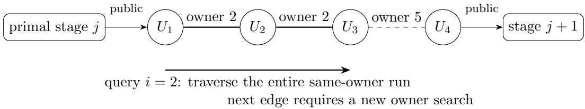

# On the Complexity of Finite-Sum Nonconvex–Strongly-Concave Minimax Optimization with Exact Proximal Oracles

Yuxing Peng   
Faculty of Arts and Sciences   
Beijing Normal University, Zhuhai 519087, China

pyx26@mail.bnu.edu.cn

Zhiqing Tang∗ ZHIQINGT Institute of Artificial Intelligence and Future Networks Faculty of Arts and Sciences, Beijing Normal University, Zhuhai 519087, China

zhiqingtang@bnu.edu.cn

Weijia Jia

jiawj@bnu.edu.cn

Institute of Artificial Intelligence and Future Networks

Faculty of Arts and Sciences, Beijing Normal University, Zhuhai 519087, China

Guangdong Key Lab of AI and Multi-Modal Data Processing

Beijing Normal-Hong Kong Baptist University, Zhuhai 519087, China

## Abstract

Finite-sum nonconvex–strongly-concave minimax problems arise in adversarial training and distributionally robust learning. Their known lower bounds cover only linear-span algorithms, zero-respecting algorithms, or a restricted proximal protocol. They leave open the power of exact component proximal steps, whose responses are global saddle points of regularized component problems and can expose directions that gradients do not reveal. We show that neither unrestricted adaptivity nor exact proximal access improves the polynomial complexity. We consider n components with joint mean-squared smoothness L and condition number κ, started from a point with primal gap at most ∆ and joint gradient norm at most 2L∆. For $\varepsilon ^ { 2 } / ( L \Delta )$ below a universal constant, every randomized adaptive algorithm with exact component values, gradients, and proximal responses needs $\Omega ( n + \operatorname* { m i n } \{ \sqrt { n } \kappa , n ^ { 3 / 4 } \sqrt { \kappa } \} L \Delta / \varepsilon ^ { 2 } )$ component queries in the worst case to find an ε-stationary point of the value function. A method using only component gradients attains this rate up to a factor $\log ^ { 2 } ( 2 + \kappa )$ , including initialization. Zhou concurrently proves the same rate for zero-respecting first-order methods. In our hard instances, every component admits proximal steps with the same step sizes, and a response for a component reveals hidden directions only up to the first one assigned to another component.

Keywords: minimax optimization, oracle complexity, finite-sum optimization, randomized lower bounds, proximal methods

## 1 Introduction

Finite-sum minimax problems arise when a learning objective is optimized against an adversary or against a worst-case weighting of the training examples, with one component per example, as in adversarial training (Madry et al., 2018), distributionally robust optimization (Namkoong and Duchi, 2016) and agnostic federated learning (Mohri et al., 2019). When the adversary’s objective is concave and carries a strongly convex penalty, the inner maximization is strongly concave; gradient descent ascent and its variance-reduced variants are standard methods for the resulting nonconvex–strongly-concave (NC–SC) problems (Lin et al., 2020; Luo et al., 2020). The oracle complexity of such a problem is the number of component queries that any method must make. Finite-sum lower bounds have been proved for linearspan algorithms (Zhang et al., 2021), a restricted proximal protocol (Han et al., 2024) and zero-respecting algorithms (Zhou, 2026b); none of them covers arbitrary randomized adaptive algorithms. An exact component proximal query also carries more information than a gradient. It is granted at every legal parameter, for which the regularized component problem is globally convex–concave and has a saddle point; it then returns a global saddle point, which can expose hidden directions that gradients alone cannot reveal. We ask whether such information changes the complexity of the finite-sum problem

$$
\operatorname* { m i n } _ { p \in \mathbb { R } ^ { d _ { p } } } V ( p ) , \qquad V ( p ) = \operatorname* { m a x } _ { y \in \mathbb { R } ^ { d _ { y } } } F ( p , y ) , \qquad F = \frac { 1 } { n } \sum _ { i = 1 } ^ { n } F _ { i } ,\tag{1}
$$

where $F$ is nonconvex in $p ,$ µ-strongly concave in $y ,$ and the component gradients have joint mean-squared smoothness $L .$ The condition number $\kappa = L / \mu$ measures the dificulty of the inner maximization. The output criterion is a small gradient of the value function $V ,$ , also called the primal function (Zhang et al., 2021; Zhou, 2026b).

For primal gap $\Delta$ and accuracy $\varepsilon ,$ put $S = L \Delta / \varepsilon ^ { 2 }$ and $h ( n , \kappa ) = \operatorname* { m i n } \{ \sqrt { n } \kappa , n ^ { 3 / 4 } \sqrt { \kappa } \}$ On the normalized-start class of Section $2$ and for $\varepsilon ^ { 2 }$ below a universal multiple of $L \Delta$ , the lower and upper bounds on the oracle complexity are

$$
\begin{array} { r } { \Omega \big ( n + h ( n , \kappa ) S \big ) \quad \mathrm { a n d } \quad O \big ( ( n + h ( n , \kappa ) S ) \log ^ { 2 } ( 2 + \kappa ) \big ) , } \end{array}
$$

so they match up to the factor $\log ^ { 2 } ( 2 + \kappa )$ . Both bounds cover every $\kappa \geq 1$ in the stated accuracy range, with primal-gap and joint-gradient data supplied at initialization.

For large condition numbers, our hard instances chain $M \asymp S$ nonlinear primal stages through dual paths with $m \asymp \sqrt { \kappa } / n ^ { 1 / 4 }$ nodes, and each edge of a path is assigned independently to one fixed component, its owner. A query reveals an edge only if it is addressed to the owner, so locating each owner takes on the order of n component queries, giving

$$
n \cdot m \cdot M \asymp n ^ { 3 / 4 } \sqrt { \kappa } \frac { L \Delta } { \varepsilon ^ { 2 } } .
$$

Proximal responses threaten this count in two ways. A response is a global saddle point, so one query could reveal edges far beyond the current one; and if the set of legal parameters depended on the component, testing legality alone would reveal owners. A public coordinate, with the same curvature in every component, makes the legal parameters identical for all components. Edge interactions that vanish while the hidden coordinates are small, together with a reflection symmetry, confine the unique saddle to the spans of the current query centers and the blocks already revealed. A query to a component then reveals only its run of consecutive edges and stops at the first edge with another owner. These constructions keep the primal scale L and the scale $L / { \sqrt { n } }$ of the dual edge interactions.

Our contributions are as follows.

• We construct hard instances for exact proximal oracles whose components are individually strongly concave, whose legal responses are unique, and whose legal domain is common to all components (Appendices A–D).

<table><tr><td rowspan="2"></td><td colspan="2">Oracle</td></tr><tr><td>Exact values, gradients Component gradients and proximal responses</td><td>Source</td></tr><tr><td>Linear-span or restricted protocol</td><td> $\Omega ( n + \sqrt { n \kappa } S ) , \kappa \geq 2 n \quad \Omega ( n + \sqrt { n \kappa } S ) , \kappa = \Omega ( n )$ </td><td>Zhang et al.; Han et al.</td></tr><tr><td>Zero-respecting</td><td> $\Omega ( n + h S )$ </td><td>Zhou</td></tr><tr><td>Arbitrary randomized adaptive</td><td> $\Omega ( n + h S )$   $\Omega ( n + h S )$ </td><td>Thm. 1</td></tr><tr><td>Matching upper bound</td><td> $O \big ( ( n + h S ) \log ^ { 2 } ( 2 + \kappa ) \big )$ </td><td>Thm. 2</td></tr></table>

Table 1: Bounds on component queries for finite-sum NC–SC problems with joint mean-squared smoothness, for small ε and every $\kappa ~ \geq ~ 1$ unless stated; $h \ =$ min $\{ { \sqrt { n } } \kappa , n ^ { 3 / 4 } { \sqrt { \kappa } } \}$ and $S = L \Delta / \varepsilon ^ { 2 }$ Shaded: this paper. The first row combines Zhang et al. (2021), for linear-span methods, and Han et al. (2024, Theorem 25), for their restricted proximal protocol with primal nonconvexity parameter $L ;$ the second is the concurrent result of Zhou (2026b, Theorem 2), which also attains this rate up to logarithmic factors from an exact dual maximizer. A dash marks a combination not treated separately. Down the first column the algorithm class grows and the bound reaches $n + h S ;$ the stronger oracle leaves it unchanged, and component gradients attain it up to the factor $\log ^ { 2 } ( 2 + \kappa )$

• We prove the lower bound for every condition number against arbitrary randomized algorithms with exact values, gradients, and legal saddle-proximal responses, using long dual paths, two-node paths, and a flat primal coupling (Theorem 1); it also holds under the protocol of Han et al. (2024) (Corollary 4).

• We match it up to $\log ^ { 2 } ( 2 + \kappa )$ with a component-gradient method that pays for initialization, snapshots, refreshes, and refinement (Theorem 2).

Concurrent work by Zhou (2026b, Theorems 1–3) establishes the same polynomial rate for randomized zero-respecting incremental first-order methods. Our lower bound removes the zero-respecting restriction and adds exact values and proximal responses; our upper bound starts from a joint-gradient bound instead of an exact dual maximizer and charges the resulting initialization cost. Wu et al. (2026b) prove lower bounds for arbitrary randomized algorithms in the related finite-sum nonconvex–concave (NC–C) problem over a bounded dual domain, with values and gradients only. Table 1 compares the lower bounds, and Section 2.2 compares our assumptions with those of prior work.

## 2 Models and Main Results

This section defines the problem class and the oracles, states our lower and upper bounds, and compares our assumptions with those of prior work.

## 2.1 Strongly Concave Finite Sums and Exact Indexed Oracles

Write $[ n ] = \{ 1 , \dots , n \} , w = ( p , y )$ and $S = L \Delta / \varepsilon ^ { 2 }$ . For $\mathcal { V } = \mathbb { R } ^ { d _ { y } }$ , the class $\mathcal { F } ( n , L , \mu , \Delta )$ consists of continuously diferentiable finite sums satisfying, globally,

$$
\frac { 1 } { n } \sum _ { i } \lVert \nabla F _ { i } ( w ) - \nabla F _ { i } ( w ^ { \prime } ) \rVert ^ { 2 } \leq L ^ { 2 } \lVert w - w ^ { \prime } \rVert ^ { 2 } ,\tag{2}
$$

$$
F ( p , \cdot ) { \mathrm { ~ i s ~ } } \mu { \mathrm { - s t r o n g l y ~ c o n c a v e } } ,\tag{3}
$$

$$
V ( 0 ) - \operatorname* { i n f } _ { p } V ( p ) \leq \Delta ,\tag{4}
$$

$$
\begin{array} { r } { \| \nabla F ( 0 , 0 ) \| ^ { 2 } \leq 2 L \Delta . } \end{array}\tag{5}
$$

All norms are Euclidean; for matrices and multilinear maps, ∥·∥ is the induced operator norm. Equation (2) is joint mean-squared smoothness, abbreviated as root-mean-square (RMS) smoothness. It implies mean L-smoothness and component smoothness at most $\sqrt { n } L$ Strong concavity gives a unique maximizer $y ^ { \ast } ( p )$ and $\nabla V ( p ) = \nabla _ { p } F ( p , y ^ { * } ( p ) )$ . We call the combination of (4) and (5) a normalized start. No bound on the initial primal–dual gap is assumed; that gap is $G _ { 0 } = \operatorname* { s u p } _ { y } F ( 0 , y ) - \operatorname* { i n f } _ { p } F ( p , 0 )$ , distinct from (4).

An exact indexed first-order query returns

$$
\boldsymbol { \mathcal { O } } ( i , w ) = ( F _ { i } ( w ) , \nabla _ { p } F _ { i } ( w ) , \nabla _ { y } F _ { i } ( w ) ) .\tag{6}
$$

The component saddle-proximal oracle, a proximal point step (Rockafellar, 1976) on one component, additionally returns a saddle pair of

$$
H _ { i , \gamma } ( p , y ) = F _ { i } ( p , y ) + \frac { \| p - \bar { p } \| ^ { 2 } - \| y - \bar { y } \| ^ { 2 } } { 2 \gamma }\tag{7}
$$

at the queried center $( { \bar { p } } , { \bar { y } } )$ . A finite $\gamma > 0$ is legal when this problem has a saddle and $H _ { i , \gamma }$ is globally convex in $p$ and concave in $y ,$ as in Equation 2 and Remark 12(iv) of Han et al. (2024). A saddle pair satisfies $H _ { i , \gamma } ( p ^ { + } , y ) \leq H _ { i , \gamma } ( p ^ { + } , y ^ { + } ) \leq H _ { i , \gamma } ( p , y ^ { + } )$ for all $p , y .$

One query to either oracle costs one unit, a full gradient costs n, and $Q$ denotes the total cost of a run. Algorithms may choose arbitrary adaptive indices, finite query points, and legal proximal parameters using the entire exact transcript and a private random seed. Their computation and primal output are unrestricted, and stopping may be random. Only the displayed oracle information and common valid class parameters are supplied.

Theorem 1 (Unrestricted lower bound for every condition number). There are universal constants $c _ { \star } \in ( 0 , 1 / 2 ]$ and $c > 0$ such that, for $n \ge 2 , L , \mu , \Delta > 0 , \kappa = L / \mu \ge 1$ , and

$$
0 < \varepsilon ^ { 2 } \le 2 ^ { - 5 2 } c _ { \star } ^ { 2 } L \Delta ,\tag{8}
$$

every algorithm using either exact indexed oracle above, terminating almost surely and guaranteeing $\mathbb { E } \| \nabla V ( p _ { \mathrm { o u t } } ) \| \le \varepsilon$ uniformly on $\mathcal { F } ( n , L , \mu , \Delta )$ has worst-case expected cost at

least

$$
c \left( n + \operatorname* { m i n } \{ \sqrt { n } \kappa , n ^ { 3 / 4 } \sqrt { \kappa } \} \frac { L \Delta } { \varepsilon ^ { 2 } } \right) .\tag{9}
$$

The same lower order holds for success probability $2 / 3$ under a deterministic query cap. The hard instances have polynomial dimension, $C ^ { 1 , 1 }$ components that are individually µ-strongly concave in y, $y ^ { * } ( 0 ) = 0 .$ , finite initial primal–dual gap $G _ { 0 }$ , and a unique response at every legal proximal parameter. Their exact legal domain is common to all components, all hidden realizations and all proximal centers.

We prove Theorem 1 in Appendix D, where we obtain $c = c _ { \star } ^ { 2 } / 2 ^ { 9 6 }$ ; the next theorem gives the matching upper rate.

Theorem 2 (Upper bound for all condition numbers and matching polynomial rate). For $n \geq 2 , \kappa \geq 1$ and $S = L \Delta / \varepsilon ^ { 2 } \ge 2$ , an indexed component-gradient algorithm on $\mathcal { F } ( n , L , \mu , \Delta )$ terminates almost surely and satisfies

$$
\begin{array} { r } { \mathbb { E } \| \nabla V ( p _ { \mathrm { o u t } } ) \| ^ { 2 } \leq \varepsilon ^ { 2 } , } \end{array}\tag{10}
$$

$$
\begin{array} { r } { \mathbb { E } Q \le C \big [ n + h ( n , \kappa ) ( 1 + S ) \big ] \log ^ { 2 } ( 2 + \kappa ) , } \end{array}\tag{11}
$$

$$
h ( n , \kappa ) = \operatorname* { m i n } \{ { \sqrt { n } } \kappa , n ^ { 3 / 4 } { \sqrt { \kappa } } \} .
$$

Here $C > 0$ is universal, and all initialization, snapshots and final refinement calls are included. The same order holds for a deterministic query cap with success probability $2 / 3$ Under (8), we have $S \geq 2$ and $\begin{array} { r } { \mathbb { E } \| \nabla V ( p _ { \mathrm { o u t } } ) \| \le ( \mathbb { E } \| \nabla V ( p _ { \mathrm { o u t } } ) \| ^ { 2 } ) ^ { 1 / 2 } \le \varepsilon _ { \mathrm { : } } } \end{array}$ , so this upper bound exceeds the lower bound of Theorem 1 by at most a constant multiple of $\log ^ { 2 } ( 2 + \kappa )$

We prove Theorem 2 in Appendix E.8. The method of Appendix E covers $\kappa \leq 2 ^ { 1 8 } { \sqrt { n } } .$ and that of the next theorem covers larger κ. We state this regime separately because in it the construction with long paths gives a larger constant c, the bound $G _ { 0 } \leq 1 0 2 5 \Delta$ , the dimension estimate (16), and one hard instance for all early horizons under the protocol of Han et al. (2024).

Theorem 3 (Special case of large condition numbers and matching upper bound). There are universal constants $c _ { \star } \in ( 0 , 1 / 2 ]$ and $c , C > 0$ such that, for $n \geq 2 , L , \mu , \Delta > 0$ , and

$$
\kappa = L / \mu \geq 2 ^ { 1 8 } \sqrt { n } , \qquad 0 < \varepsilon ^ { 2 } \leq 2 ^ { - 5 2 } c _ { \star } ^ { 2 } L \Delta ,\tag{12}
$$

every algorithm using either oracle above, terminating almost surely and guaranteeing $\mathbb { E } \| \nabla V ( p _ { \mathrm { o u t } } ) \| \le \varepsilon$ uniformly on $\mathcal { F } ( n , L , \mu , \Delta )$ , has worst-case expected query cost at least

$$
c n ^ { 3 / 4 } { \sqrt { \kappa } } S .\tag{13}
$$

The fixed hard instance can be chosen with $C ^ { 1 , 1 }$ components, each µ-strongly concave in $y ,$ and with $y ^ { * } ( 0 ) = 0$ and $G _ { 0 } \leq 1 0 2 5 \Delta$

For every $\varepsilon > 0$ and $\kappa \geq 2 ^ { 1 8 } { \sqrt { n } }$ , without the accuracy condition in Equation $\begin{array} { r } { \boldsymbol { { 1 2 } } , } \end{array}$ our method of Appendix $F ,$ which combines existing first-order methods, achieves

$$
\begin{array} { r } { \mathbb { E } \| \nabla V ( p _ { \mathrm { o u t } } ) \| ^ { 2 } \leq \varepsilon ^ { 2 } , } \end{array}\tag{14}
$$

$$
\begin{array} { r } { \mathbb { E } Q \le C n ^ { 3 / 4 } \sqrt { \kappa } ( 1 + S ) \log ^ { 2 } ( 2 + \kappa ) . } \end{array}\tag{15}
$$

The same orders hold for success probability $2 / 3$ under a deterministic query cap.

Our proof gives $c = 1 3 3 c _ { \star } ^ { 2 } / ( 3 \cdot 2 ^ { 7 3 } )$ , where $c _ { \star }$ is determined by the minima of continuous residuals over three fixed-dimensional compact sets (Lemma 10). The primal and dual dimensions $d _ { p }$ and $d _ { y }$ are fixed before execution and satisfy

$$
d _ { p } + d _ { y } = O \Big ( \Big ( S n ^ { 3 / 4 } \sqrt { \kappa } + S ^ { 2 } \kappa ^ { 3 } n ^ { - 3 / 2 } \Big ) \log ( n \kappa S ) \Big ) .\tag{16}
$$

Corollary 4 (The Han et al. proximal protocol). In the regime of Theorem 3, the lower order also holds for the proximal incremental first-order oracle (PIFO) algorithms of Han et al. (2024, Definition 11), with their complexity sup inft of Definition 13 measured by the expected gradient norm.

In Appendix C.2, one fixed hard instance serves every early output horizon, and both component calls and full-gradient refreshes are charged. The upper bound in Theorem 3 is stated in the indexed oracle model.

## 2.2 Comparison with Prior Assumptions

Smoothness. The joint mean-squared condition (2) is Assumption 1 of Zhou (2026b) and the smoothness condition of the finite-sum lower bounds of Zhang et al. (2021) and Han et al. (2024). It is weaker than L-smoothness of every component, which Wu et al. (2026b) use for their lower bounds, and stronger than L-smoothness of the mean alone. The upper bounds need only (2). Our hard components use the extra freedom. Their individual smoothness constants grow proportionally to $\sqrt { n } L$

Dual variable. As in Zhou (2026b, Assumption 3), the dual space is $\mathbb { R } ^ { d _ { y } }$ and the mean is µ-strongly concave; our hard components are individually µ-strongly concave. Wu et al. (2026b) instead use a known compact convex dual set of diameter at most $D _ { y }$ with a concave mean, and measure stationarity through the Moreau envelope of the value function.

Initialization. The normalized start (4)–(5) bounds the primal gap and the joint gradient at the origin. Zhou (2026b) assumes a primal gap and an exact dual maximizer $y ^ { * } ( 0 ) = 0$ and Wu et al. (2026b) assume only a primal gap, the bounded dual domain controlling the dual side. Neither of the first two conditions implies the other. Exact dual initialization does not bound the primal gradient of the value function, and a bounded joint gradient does not give $y ^ { * } ( 0 ) = 0$ . Our hard instances satisfy both, so Theorem 1 also holds under the start of Zhou (2026b). Every hard instance also has a finite initial primal–dual gap (Appendix D.4).

Oracle and algorithms. Theorem 1 allows arbitrary randomized adaptive algorithms with exact component values, gradients and saddle-proximal responses at legal parameters. Zhou (2026b) considers randomized zero-respecting algorithms with component gradients, and Wu et al. (2026b) consider arbitrary randomized algorithms with exact values and gradients but no proximal map. Han et al. (2024, Definitions 11 and 13) allow proximal steps within a restricted protocol, which Corollary 4 covers.

Accuracy and cost. Theorem 1 bounds the expected cost under $\mathbb { E } \| \nabla V ( p _ { \mathrm { o u t } } ) \| \le \varepsilon$ and the deterministic cap needed for confidence $2 / 3 ;$ Theorem 2 guarantees $\mathbb { E } \| \nabla V ( p _ { \mathrm { o u t } } ) \| ^ { 2 } \leq \varepsilon ^ { 2 }$ Zhou (2026b) characterizes expected query counts under $\mathbb { E } \| \nabla V \| ^ { 2 } \leq \varepsilon ^ { 2 }$ , with a fixed budget for $\kappa \leq { \sqrt { n } }$ , and that lower bound also covers the other two criteria; Wu et al. (2026b) use fixed budgets and confidence $2 / 3$ . The remaining gap is $\log ^ { 2 } ( 2 + \kappa )$ here and logarithmic for Zhou (2026b); for Wu et al. (2026b) there is no gap when $L \dot { D } _ { y } / \varepsilon \leq n ^ { 1 / 4 }$ and one logarithm otherwise.

  
Figure 1: A dual path. A query to component i reveals the entire run of consecutive edges owned by i and stops at the first edge with another owner, revealing no later owner or axis. There are order Mm serial searches, each costing order n.

## 3 Technical Overview

We couple a chain of nonconvex primal stages through dual paths whose internal edges are owned by random components; the symbols of this section are local to the lower bounds.

## 3.1 Dual Paths with Component Assignments

A dual path connects two primal stages while preserving their nonlinear amplitude. For large condition numbers we use $Q = P _ { m } + m ^ { - 2 } I$ , where $P _ { m }$ is the Laplacian of the path graph on m vertices. Lemma 5 gives entries of the Green matrix $u = ( Q ^ { - 1 } ) _ { 1 1 } \asymp m , v = ( Q ^ { - 1 } ) _ { 1 m } \asymp m$ and $1 < u / v \le$ cosh 1. We take $a = L / ( 2 ^ { 1 6 } { \sqrt { n } } ) , \lambda = 2 ^ { - 3 9 } L v / u$ , and $m = \lfloor \sqrt { \kappa / ( 2 ^ { 1 6 } \sqrt { n } ) } \rfloor$ Each node has an independent hidden axis; public identity maps pair primal and dual endpoint blocks, and independent uniform component owners label the internal edges.

The primal variable $P = ( P _ { 1 } , \dots , P _ { M } )$ has one block $P _ { j } = ( X _ { j } , Z _ { j + 1 } )$ per stage, whose two subblocks are publicly paired with the first and last nodes of path j, and $\eta \geq 0$ is the width of the flat zones of Section 3.2. Each component has the form

$$
\begin{array} { l } { { f _ { i , \eta } ( P , y ) = \mathcal { P } ( P ) - \displaystyle \frac { \nu } { 2 } \| y \| ^ { 2 } + b \chi _ { * } ( Y _ { \partial } ) \langle A ( P ) , Y _ { \partial } \rangle + c \sum _ { v } \chi _ { * } ( y _ { v } ) \phi _ { \eta } ( t _ { v } ) } } \\ { { \displaystyle \qquad - n a \sum _ { e : \Sigma _ { e } = i } A _ { \eta } ( Y _ { e } ) + \mathrm { ( p u b l i c ~ r a d i a l ~ t e r m s ) } ; } } \end{array}
$$

see Equation 45. The primal part $\mathcal { P }$ collects a scaled source chain built from the scalar functions of Carmon et al. (2020), the compensation $- d \Vert { \mathcal { A } } \Vert ^ { 2 }$ and a radial penalty. The forcing $\mathcal A ( P )$ stacks the gated, capped primal blocks and acts on the concatenated path endpoints $Y _ { \partial }$ . Each dual node v has a hidden coordinate $t _ { v }$ along its axis, $\begin{array} { r } { \phi _ { \eta } ( t ) = \frac 1 2 ( | t | - \eta ) _ { + } ^ { 2 } } \end{array}$ and $\chi _ { * }$ is a cutof. The owned term $A _ { \eta } ( Y _ { e } ) = { \textstyle \frac 1 2 } ( | t _ { e } | - h _ { \eta } ( \| Y _ { e } \| ) ) _ { + } ^ { 2 }$ acts on the diference $t _ { e }$ of the two hidden coordinates of an edge e with endpoint pair $Y _ { e }$ , and only the owner $\Sigma _ { e }$ of e contains it; $a , b , c , d , \nu > 0$ are constants.

With ridge $\nu = a / u ,$ , coupling $b ^ { 2 } = 1 2 a \lambda / v ,$ , and compensation $d = 6 \lambda ( u / v - 1 )$ , dual elimination gives, for each stage j with gate weight $h _ { j } ^ { 2 }$ , the completed quadratic

$$
6 \lambda ( x _ { j } - z _ { j + 1 } / 2 ) ^ { 2 } + 6 \lambda \| A _ { j , \perp } \| ^ { 2 } + \textstyle { \frac { 3 } { 2 } } \lambda \| B _ { j + 1 , \perp } \| ^ { 2 } ,\tag{17}
$$

where $x _ { j }$ and $z _ { j + 1 }$ are the coordinates of the capped subblocks of $P _ { j }$ along the first and last hidden axes of path $j ,$ and $A _ { j , \perp }$ and $B _ { j + 1 , \perp }$ are their orthogonal parts. Thus dual

elimination preserves the same normalized primal quadratic, including in the orthogonal directions available to unrestricted outputs. The path and source ingredients follow Li et al. (2021) and Carmon et al. (2020).

## 3.2 Global Geometry and Exact Hiding

Against zero-respecting algorithms (Zhou, 2026b), every query lies in the span of the coordinates that earlier gradients have touched, so the unexposed coordinates are exactly zero at every query. Arbitrary queries and outputs may instead have nonzero projections onto unexposed hidden axes and arbitrary norms, and an exact proximal response is a global saddle point; the following devices keep the hidden structure invisible in that case. Smooth radial maps (cf. Carmon et al., 2020, Section 5.2) compress the primal blocks to bounded images and hence bound the forcing. Dual cutofs with bounded support control the primal Hessian of the coupling. The region where an owned edge interaction vanishes (a flat edge, cf. Woodworth and Srebro, 2016, Appendix C) has a width depending on the radius $r = \| Y _ { e } \|$ of the edge pair and a localization radius $R _ { * }$

$$
h _ { \eta } ( r ) = \eta \varrho ( r / R _ { * } ) ,\tag{18}
$$

$$
\varrho ( u ) = \left\{ \begin{array} { l l } { 1 , } & { u \leq 1 , } \\ { 1 + ( u - 1 ) ^ { 2 } / 2 , } & { 1 < u < 2 , } \\ { u - 1 / 2 , } & { u \geq 2 . } \end{array} \right.\tag{19}
$$

Since $\varrho ( u ) \ge u / 2 .$ , flatness holds on a cone at every radius. Common public radial penalties dominate the positive cutof curvature without revealing owners. The uncut optimizer lies inside $3 R _ { * } / 1 6$ , where these corrections vanish and the cutofs equal one; strong concavity identifies it with the actual optimizer. With the primal length scale $s = 8 \varepsilon / ( c _ { \star } \lambda )$ , the zero-width barrier on the last stage coordinate $z _ { M + 1 }$ survives this perturbation:

$$
\begin{array} { r } { | z _ { M + 1 } | \leq s / 8 \quad \Longrightarrow \quad \| \nabla V ( P ) \| \geq 6 \varepsilon . } \end{array}
$$

## 3.3 Exact Oracle Responses and Component Search

We add one public primal coordinate $\xi$ with the common term $( L / 8 ) ( 1 - \cos \xi )$ . It preserves all initial budgets and gradient barriers, while making the exact legal domain $\tau \geq L / 8$ for the inverse step $\tau = 1 / \gamma$ . In the regularized problem the variables $( P , y )$ are strongly convex–concave; the separate scalar problem is strictly convex even at the boundary.

A legal call can reveal all consecutive edges with its component as owner (Figure 1). After that run, we set the unrevealed hidden axes to zero in every term and keep all public terms; this censored problem on the full space has a unique saddle. We reflect unrevealed blocks through the spans of their current query centers, matching the primal and dual endpoint reflections. Invariance and uniqueness place the saddle in these spans, each of dimension at most two: one for an interior node, and two at an endpoint, whose span also contains the paired primal center. This step uses no property of the hidden axes; their random directions enter only in the next step. The hidden axes have small projections onto these spans, so the actua and censored problems have the same values and full gradients there, and the censored saddle is the actual response. A separate projection argument handles the arbitrary final output.

There are $E = M ( m - 1 )$ serial owner searches. Given everything revealed so far, the owner of the first unrevealed edge is uniform over the components not yet excluded. A nonnegative posterior potential starts at $E ( n - 1 ) / 2$ and decreases in conditional expectation by at most one per call, including consecutive hits (Lemma 14). Its completion bound and the terminal barrier give order $n M m$ expected queries under random stopping. Since this bound holds on average over the random owners and axes, some fixed choice of component functions inherits it, as in Yao’s minimax principle (Yao, 1977).

## 3.4 The Remaining Condition Numbers

For 64 $\leq \kappa \leq 2 ^ { 1 8 } \sqrt { n } .$ , a two-node path with $r = \mu / a$ uses the same calibration $\lambda \ : =$ $2 ^ { - 3 9 } L v / u = 2 ^ { - 3 9 } L / ( 1 + r )$ and preserves (17); its cost $n M$ of owner search has order $\sqrt { n } \kappa S$ . We use paths only for $\kappa \geq 6 4 :$ : their dual ridge and cutof barriers add about 47ν to our smoothness bound (Lemma 9), and $\nu \ge \mu = L / \kappa$ . For $1 \leq \kappa < 6 4$ , a separable strongly concave dual instead leaves a primal bridge $C _ { \eta } ( t _ { 1 } , t _ { 2 } ) = \phi _ { \eta } ( t _ { 1 } + t _ { 2 } ) - \phi _ { \eta } ( t _ { 1 } ) - \phi _ { \eta } ( t _ { 2 } )$ where $\begin{array} { r } { \phi _ { \eta } ( t ) \ = \ \frac 1 2 ( | t | - \eta ) _ { + } ^ { 2 } } \end{array}$ . This equals $t _ { 1 } t _ { 2 }$ at zero width and is flat near the hidden origin. Independent owners cost only $\sqrt { n }$ in RMS smoothness, but a single component then has primal curvature of order $\sqrt { n } L$ . Each component i therefore has its own public coordinate $\xi _ { i }$ with the term $B ( 1 - \cos \xi _ { i } )$ , $B = \sqrt { n } L / 4$ ; these orthogonal coordinates cost only $B / \sqrt { n } = L / 4$ in RMS smoothness and give every component the exact legal domain $\tau \geq B$ . A separate instance, in which one hidden component carries a random sign, gives the n term (Lemma 21).

Table 2 lists, for each main statement, the results its proof uses in order.

## 4 Matching Upper Bound and Initialization Cost

We match the two branches of $h ( n , \kappa )$ using component gradients under mean strong concavity: a single-loop method for $\kappa \leq 2 ^ { 1 8 } { \sqrt { n } }$ and an accelerated method above. Appendix E combines the stochastic projected damped extragradient (SPDE) updates of Zhang et al. (2026a) with recursive finite-sum gradient estimates (Nguyen et al., 2017; Fang et al., 2018) and loopless stochastic variance-reduced extragradient (L-SVRE) steps (Alacaoglu and Malitsky, 2022; Luo et al., 2022), which need strong monotonicity only of the mean operator (Algorithm 1). Its energy combines the gap of the Moreau envelope $\mathcal { M } ( z ) =$ $\begin{array} { r } { \operatorname* { m i n } _ { p } \{ V ( p ) + L \| p - z \| ^ { 2 } \} } \end{array}$ at a moving primal center z with the distance to the saddle point of $F ( p , y ) + L \| p - z \| ^ { 2 }$ . We prove the L-SVRE contraction directly and use it to initialize this energy. The same solver then refines a sampled endpoint, whose distance to its proximal saddle is already controlled by the SPDE dissipation. A pathwise error bound charges every full snapshot and both gradients in each recursive diference, giving the bound $O ( n + \sqrt { n } \kappa S + ( n + \sqrt { n } \kappa ) \log ( 2 \kappa ) )$ of Theorem 22 in Appendix E, with no logarithm on the accuracy term. Zhang et al. (2026a) analyze SPDE on compact domains; we apply their one-step inequalities on the whole space, where each step stays in balls on which the projections are inactive (Lemma 23).

For large $\kappa ,$ acceleration gives the other branch (Appendix F). We normalize $f _ { i } = F _ { i } / L$ $\nu = \mu / L , D _ { 0 } = \Delta / L$ , and $e _ { 0 } = \varepsilon / L$ , and set

$$
s = n ^ { - 1 / 2 } , \qquad \tau = s - \nu , \qquad q = \nu / s , \qquad \rho = 0 . 9 \sqrt { q } .\tag{20}
$$

<table><tr><td>Statement</td><td>Proof chain</td><td>Appendix</td></tr><tr><td>Theorem 3, lower bound</td><td>Lemmas  $5 , 6 \to 7 - 9 \to 1 0 \to 1 1 \to 1 2 - 1 4$ </td><td>A-C</td></tr><tr><td>Theorem 1,  $6 4 \leq \kappa \leq 2 ^ { 1 8 } \sqrt { n }$ </td><td>the same chain with two-node paths → Corollary 16</td><td>D.1</td></tr><tr><td>Theorem 1,  $1 \leq \kappa < 6 4$ </td><td>Lemmas  $1 7  1 8  1 9  2 0$ </td><td>D.2, D.3</td></tr><tr><td>Theorem 1, all κ</td><td>Theorem 3, Corollary 16, Lemmas 20, 21</td><td>D.4</td></tr><tr><td>Corollary 4</td><td>Corollary 15</td><td>C.2</td></tr><tr><td>Theorem 22</td><td>Lemmas 23 → 24 → initialization, estimators, refinement E</td><td></td></tr><tr><td>Theorem 3, upper bound</td><td>Lemmas 24, 25 → warm start → auxiliary solves</td><td>F</td></tr><tr><td>Theorem 2</td><td>Theorem 22  $( \kappa \leq 2 ^ { 1 8 } { \sqrt { n } } )$  , Theorem 3 (above)</td><td>E.8</td></tr></table>

Table 2: Where each main statement is proved, with the results its proof uses in order. In the first row, Lemmas 5 and 6 calibrate the paths and the forcing, Lemmas 7–9 give class membership, Lemma 10 the terminal barrier, Lemma 11 the width and initial budgets, and Lemmas 12–14 the legal domain, localization and owner search. The rows below the heavy rule concern upper bounds, which use only component gradients; the accelerated method also uses Catalyst (Lin et al., 2018) and Zhang et al. (2021, Theorems 4.1 and 4.2).

Catalyst adds the dual regularizer $\begin{array} { r } { \frac { \tau } { 2 } \lVert y - z _ { k } \rVert ^ { 2 } } \end{array}$ at dual centers $z _ { k }$ , so each subproblem is s-strongly concave; $q$ is its inverse condition number, and the accuracy targets decrease like $( 1 - \rho ) ^ { k }$ . The regime of Theorem 3 ensures $\tau > 0$ and $q \leq 1 / 6 4$ . The same L-SVRE solver with an exact residual stopping test, combined with Catalyst for strongly convex problems (Lin et al., 2018), computes a dual warm start satisfying

$$
\lVert y _ { \mathrm { w } } - y ^ { * } ( 0 ) \rVert ^ { 2 } \leq D _ { 0 }\tag{21}
$$

on every terminating run, at expected cost $O ( n q ^ { - 1 / 2 } \log ^ { 2 } ( 2 + \kappa ) )$

At an outer point wt, let $\widehat { f _ { t } } ( p , y ) = f ( p , y ) + \| p - p _ { t } \| ^ { 2 }$ , let $G _ { t }$ be its unknown saddle gap, and let $R _ { t } ^ { 2 } = \| \nabla \widehat { f _ { t } } ( w _ { t } ) \| ^ { 2 }$ . If $R _ { t } = 0$ , the point is stationary. Otherwise

$$
B _ { t } : = \frac { \nu R _ { t } ^ { 2 } } { 7 2 } \leq G _ { t } , \qquad \frac { G _ { t } } { B _ { t } } \leq \frac { 3 6 } { \nu ^ { 2 } } .\tag{22}
$$

Replacing the unavailable gap by $B _ { t }$ in the acceleration tolerances preserves the bounds of Zhang et al. (2021, Theorems 4.1–4.3) with a logarithmic cost change. The residual estimate also controls each auxiliary warm start directly. Each of $O ( 1 + S )$ outer solves costs $O ( n q ^ { - 1 / 2 } \log ^ { 2 } ( 2 + \kappa ) )$ , and $n q ^ { - 1 / 2 } = n ^ { 3 / 4 } \sqrt { \kappa }$ . Appendix F includes the cold starts, exact residual checks, and confidence conversion. Appendix E.8 combines the two regimes.

## 5 Related Work

For finite-sum monotone inclusions under mean-squared Lipschitz continuity, Zhou (2026a, Theorems 1 and 2) gives an $O ( n + \sqrt { n } L R / \varepsilon )$ method and a matching $\Omega ( n + \sqrt { n } L R / \varepsilon )$ lower bound, with R an initial distance to a solution. The lower bound concerns randomized linear-span algorithms with component operator evaluations, and the resolvent there belongs to the common operator, not to components.

The lower bounds of Wu et al. (2026b, Theorems 3.1 and 3.3) for finite-sum nonconvex– concave problems difer from ours in the dual geometry and the stationarity measure. As their Section 4 notes, substituting the efective condition number of a regularized dual into the NC–SC rate is only a formal comparison, and converting their Moreau envelope guarantee into a bound on the gradient of the value function can lose a factor of order κ.

The path and nonlinear source have established precedents. Li et al. (2021) use dual paths and endpoint compensation with the source functions of Carmon et al. (2020), and Zhou (2026b) assigns internal dual edges to random component owners. Han et al. (2024, Section 4.2 and Theorems 66 and 74) develop component grouping and convex finite-sum path bounds. Our construction preserves the primal and dual scales while satisfying global smoothness and hiding the component assignments from arbitrary exact proximal queries.

Exact hiding also has distinct antecedents. Woodworth and Srebro (2016, Appendix C, Property 1 and Section C.3) use flat edge penalties for proximal information. Carmon et al. (2020, Section 5.2) bound the efect of unrestricted query norms by radial compaction, and Bubeck et al. (2019, Sections 2.3–2.4) use a convex wall outside correlation cones. Arjevani et al. (2023, Theorem 3 and Appendix B.1.2) condition on preceding projected queries in randomized information arguments. Peng et al. (2026) develop dense weak hiding for individually smooth nonconvex and PL finite sums with exact values and gradients. Our construction combines blockwise exact transcript coupling with radius-dependent flat edges and componentwise strong concavity, and it controls the entire saddle-proximal response. Wu et al. (2026a, Theorem 4.1) treat the related NC–C setting with a bounded dual domain, with a deterministic zero-respecting class and a diferent stationarity measure.

Stochastic NC–SC problems with fresh samples form a separate line. Wu et al. (2026c) obtain matching upper and lower bounds, up to logarithmic factors, when every query draws a fresh stochastic gradient, and Zhang et al. (2026b) prove lower bounds of order $\kappa L \Delta \sigma ^ { 2 } \varepsilon ^ { - 4 }$ under bounded variance and $\kappa ^ { 3 / 2 } \bar { \bar { L } } \Delta \sigma \varepsilon ^ { - 3 }$ under averaged smoothness for zerorespecting methods. For zero-respecting methods with an unbiased stochastic oracle on instances with a bounded dual box, Zhou (2026c) proves the lower bound $\Omega ( \kappa L G \sigma ^ { 2 } \varepsilon ^ { - 4 } )$ for $\sigma \geq \varepsilon$ under Moreau-envelope stationarity, where G bounds the initial primal–dual gap, and $\Omega ( L \Delta ( \sqrt { \kappa } \varepsilon ^ { - 2 } + \kappa \sigma ^ { 2 } \varepsilon ^ { - 4 } ) )$ for the gradient of the primal function. Song and Xu (2026, Theorems 6.5 and 7.6) obtain lower bounds with the same stochastic terms for zero-respecting methods that may use variance reduction, and their Theorem 4.8 treats the stochastic NC–C case with a bounded dual domain. In these models a sample is used only within its own round, whereas every finite-sum component can be queried repeatedly; neither model includes proximal access.

## 6 Discussion

Exact proximal access and unrestricted adaptivity do not change the polynomial complexity of the problem for any condition number. An exact component proximal step solves a saddle problem in each call, yet on this class it saves at most a factor $O ( \log ^ { 2 } ( 2 + \kappa ) )$ in worst-case component queries over component gradients, for ε in the range of Theorem 1. Two parts of our upper bounds apply to other finite-sum minimax methods: the shared L-SVRE solver needs strong concavity only of the mean, not of each component, and the residual estimate $B _ { t }$ of Section 4 makes the subproblem tolerances of the accelerated scheme of Zhang et al. (2021) computable.

The results are worst-case oracle bounds in a dimension that grows with the parameters. As in the lower bound of Zhou (2026b), the lower theorem requires $\varepsilon ^ { 2 } / ( L \Delta )$ to be below a universal constant; we have not optimized this constant or the other universal constants. For $\kappa \leq 2 ^ { 1 8 } { \sqrt { n } }$ and $S \geq \log ( 2 \kappa )$ , Theorem 22 gives $O ( n \log ( 2 \kappa ) + h ( n , \kappa ) S )$ , so the bounds match in the accuracy term and difer by at most log(2κ) in the term n; for larger κ the accelerated method of Appendix F leaves a factor $\log ^ { 2 } ( 2 + \kappa )$ . Individually L-smooth components form a stricter class than joint mean-squared smoothness; for zero-respecting methods, Zhou (2026b, Theorem 4) proves $\Omega ( n + \operatorname* { m i n } \{ \kappa , \sqrt { n \kappa } \} L \Delta / \varepsilon ^ { 2 } )$ on a bilinear subclass, and the unrestricted complexity of this class remains open.

For nonconvex–concave finite sums over bounded dual domains, Wu et al. (2026b) determine the complexity with exact values and gradients up to one logarithm; whether exact component proximal access changes that complexity remains open.

Formal verification. The Lean supplement, provided as supplementary material and as ancillary files of the arXiv version, verifies the existential lower assertions of Theorem 1: the expected query cost and the fixed-confidence complexity under a deterministic cap, in all three ranges of the condition number and for the indexed baseline. The formal proof includes the path calibration of Lemma 5, the posterior owner cost of Lemma 14, and the public cosine terms in (74) and (91) with their exact legal boundary. It uses a finite Rademacher construction in place of the Haar-distributed axes, and obtains a barrier constant in the role of that of Lemma 10 by the same compactness argument. Its CLAIMS and TRUSTED DEFINITIONS files state the formal theorems, the dimension bounds and the remaining diferences from the written proof. The Haar conditioning argument, zero-axis extension, the identity of the two barrier constants, Corollary 4, upper bounds and dimension estimate (16) are not formalized.

## Appendix A. The Hard Family and Its Global Geometry

We use one path family for every $\kappa \geq 6 4 :$ : long paths prove Theorem 3, and two-node paths cover the intermediate range in Appendix D. The scalar source functions are those of Carmon et al. (2020), and the dual paths with endpoint compensation follow Li et al. (2021). Symbols defined in Appendices $\mathrm { A - D }$ are local to the lower-bound proofs.

Let $P _ { m }$ be the Laplacian of the m-vertex path, with diagonal $( 1 , 2 , \ldots , 2 , 1 )$ . Fix

$$
\begin{array} { l } { \displaystyle { a = \frac { L } { 2 ^ { 1 6 } \sqrt { n } } , \qquad t = \sqrt { a / \mu } , \qquad m = \mathrm { m a x } \{ 2 , \lfloor t \rfloor \} , } } \\ { \displaystyle { r = \left\{ \begin{array} { l l } { \mu / a , } & { t < 2 , } \\ { m ^ { - 2 } , } & { t \geq 2 , } \end{array} \right. \qquad } } & { \mu _ { 0 } = a r , \qquad Q = P _ { m } + r I . } \end{array}\tag{23}
$$

Write $u = ( Q ^ { - 1 } ) _ { 1 1 } , v = ( Q ^ { - 1 } ) _ { 1 m }$ and $g = u / v$ , and put

$$
\delta _ { 0 } = 2 ^ { - 3 9 } , \quad \lambda = \frac { \delta _ { 0 } L } { g } , \quad \nu = \frac { a } { u } , \quad c = \nu - \mu _ { 0 } , \quad b ^ { 2 } = \frac { 1 2 a \lambda } { v } , \quad d = 6 \lambda ( g - 1 ) .\tag{24}
$$

Instantiate the path family only when

$$
X : = \frac { c _ { \star } ^ { 2 } \lambda \Delta } { 2 0 4 8 \varepsilon ^ { 2 } } \geq 2 , \quad \mathrm { e q u i v a l e n t l y } \quad \varepsilon ^ { 2 } \leq c _ { \star } ^ { 2 } \lambda \Delta / 4 0 9 6 .\tag{25}
$$

Outside this window the indexed baseline will sufice. Within it set

$$
\begin{array} { l l l l l } { \displaystyle { s = \frac { 8 \varepsilon } { c _ { \star } \lambda } , } } & { \mathrm { ~ } } & { \mathrm { ~ } } & { \mathrm { ~ } } & { \mathrm { ~ } } & { \mathrm { ~ } } \end{array} \qquad K = \lfloor X \rfloor , \qquad K = M m , \qquad &  E = M ( m - 1 ) .\tag{26}
$$

Thus $m , M \geq 2$ and

$$
M \geq \frac { c _ { \star } ^ { 2 } \lambda \Delta } { 4 0 9 6 \varepsilon ^ { 2 } } , \qquad M \lambda s ^ { 2 } \leq \Delta / 3 2 , \qquad \lambda s ^ { 2 } \leq \Delta / 6 4 .\tag{27}
$$

The width and hiding dimension are fixed by (66) and (80). With $A _ { 1 } = 2 4 3 3$ , the bound on $\| D \mathcal { A } \|$ in Lemma 6, and $C _ { 0 } = 2 9 4 9 1 2 A _ { 1 } / c _ { \star }$ , their ratio is

$$
\frac { R _ { * } } { \eta } = \operatorname * { m a x } \left\{ C _ { 0 } \frac { g } { r } \sqrt { K } , 1 6 \sqrt { n } \right\} , \qquad \frac { R _ { * } } { \eta _ { 0 } } = C _ { 0 } \frac { g } { r } \sqrt { K } > 1 2 8 .\tag{28}
$$

In particular $H _ { n } = \operatorname* { m a x } \{ C _ { 0 } ^ { 2 } ( g / r ) ^ { 2 } K , 2 5 6 n \}$ , and the dimension is fixed before execution, independently of the stopping time.

## A.1 Path Geometry, Hidden Axes, and the Scalar Components

There are M publicly identified dual paths. Every node $y _ { j , k } \in \mathbb { R } ^ { D }$ has an independent Haar-uniform hidden unit axis $U _ { j , k }$ . The primal coordinate block $P _ { j } = ( X _ { j } , Z _ { j + 1 } ) \in \bar { \mathbb { R } } ^ { D } \times \mathbb { R } ^ { D }$ is publicly identified with the two endpoint coordinate blocks $( j , 1 )$ and $( j , m )$ , respectively. Thus its source and outgoing connector axes are $U _ { j , 1 }$ and $U _ { j , m }$ . Interior axes are independent of all endpoint axes. For each edge $( j , k ) , k < m .$ , draw a fixed independent owner $\Sigma _ { j , k }$ uniformly from [n]. These draws and the axes are independent of the algorithm’s private seed; they will be fixed before invoking its oracle.

Lemma 5 (Common path bounds and branch calibration). In both branches,

$$
\begin{array} { l } { { \mu _ { 0 } \geq \mu , \quad 0 \leq c \leq a , \quad \nu \leq \mu + a , \quad 0 < v \leq a , \ } } \\ { { \displaystyle { \frac { b ^ { 2 } } { \nu } = 1 2 \delta _ { 0 } L , \qquad 0 \leq d = 6 \delta _ { 0 } L ( 1 - 1 / g ) \leq 6 \delta _ { 0 } L . } } } \end{array}\tag{29}
$$

Every entry in either endpoint inverse column is at most u. For $t \geq 2$ , that is, $\kappa \geq 2 ^ { 1 8 } { \sqrt { n } } ,$

$$
m \leq u \leq m ^ { 2 } , \quad \frac { m } { \sinh { 1 } } \leq v \leq m , \quad 1 < g \leq \cosh { 1 } < 5 / 3 .\tag{30}
$$

Then $\mu \leq \mu _ { 0 } \leq 4 \mu , \nu , c \leq a / 2 , d < 4 \lambda$ and $\lambda \ge 2 ^ { - 4 0 } L$ . Hence the window (12) of Theorem 3 implies (25) and

$$
m \ge \frac { \sqrt \kappa } { 5 1 2 n ^ { 1 / 4 } } , \qquad M \ge \frac { c _ { \star } ^ { 2 } S } { 2 ^ { 5 2 } } .\tag{31}
$$

For $t < 2 , m = 2 , r = \mu / a > 1 / 4 , \mu _ { 0 } = \mu ,$ and

$$
Q ^ { - 1 } = { \frac { 1 } { r ( r + 2 ) } } \left( { \begin{array} { c c } { r + 1 } & { 1 } \\ { 1 } & { r + 1 } \end{array} } \right) , \quad g = 1 + r , \quad \nu = \mu + { \frac { a r } { r + 1 } } , \quad c = { \frac { a r } { r + 1 } } .\tag{32}
$$

The two calibrations agree at $t = 2$

Proof The two-node formula is direct. For the long path and any mass $r \ > \ 0$ , put $\theta = \operatorname { a r c o s h } ( 1 + r / 2 )$ The leading-minor recurrence $d _ { j } = ( 2 + r ) d _ { j - 1 } - d _ { j - 2 }$ , with first endpoint entry $1 + r ,$ gives $d _ { j } = \cosh ( ( j + 1 / 2 ) \theta ) / \cosh ( \theta / 2 )$ before the last endpoint, and det $( P _ { m } + r I ) = r \sinh ( m \theta ) /$ sinh θ. The endpoint cofactors therefore give

$$
v = \frac { \sinh \theta } { r \sinh ( m \theta ) } , \qquad g = \frac { \cosh ( ( m - 1 / 2 ) \theta ) } { \cosh ( \theta / 2 ) } .
$$

For $r = m ^ { - 2 } , \theta = 2 \mathrm { a s i n h } ( 1 / ( 2 m ) )$ $m \theta \leq 1$ , sinh $\theta \geq 1 / m$ and $\sinh ( m \theta ) \geq m$ sinh θ, proving the bounds on $v , g$ . The constant eigenvector contributes m to each diagonal entry of $Q ^ { - 1 }$ and $\| Q ^ { - 1 } \| = m ^ { 2 }$ , giving the bounds on u. The endpoint column maximum principle gives the entrywise claim in both branches. The remaining bounds follow by substitution and $\lfloor t \rfloor \geq t / 2$ for $t \geq 2$

For the high branch, $r = m ^ { - 2 }$ and $K = M m$ , so (28) specializes to

$$
\begin{array} { r l } & { H _ { n } = \operatorname* { m a x } \{ C _ { 0 } ^ { 2 } g ^ { 2 } M m ^ { 5 } , 2 5 6 n \} , } \\ & { D = O \Big ( ( n + S \kappa ^ { 5 / 2 } n ^ { - 5 / 4 } ) \log ( n \kappa S ) \Big ) . } \end{array}
$$

Indeed $M = O ( S ) , m = O ( { \sqrt { \kappa } } n ^ { - 1 / 4 } )$ and $g \leq \cosh 1$ . The primal dimension is $2 M D + 1$ including the public coordinate in (74), and the dual dimension is $K D$ , so the total dimension $( 2 M + K ) D + 1$ is (16).

The source uses the scalar functions of Carmon et al. (2020) and Li et al. (2021):

$$
\Psi ( t ) = \left\{ \begin{array} { l l } { 0 , } & { t \leq 1 / 2 , } \\ { e ^ { 1 - ( 2 t - 1 ) ^ { - 2 } } , } & { t > 1 / 2 , } \end{array} \right. \quad \Phi ( t ) = \sqrt { e } \int _ { - \infty } ^ { t } e ^ { - r ^ { 2 } / 2 } \mathrm { d } r .\tag{33}
$$

The cap and primal penalty are

$$
w _ { j } = \rho ( P _ { j } ) = P _ { j } / ( 1 + \| P _ { j } \| ^ { 2 } / R ^ { 2 } ) ^ { 1 / 2 } , \qquad R = 1 2 8 s ,\tag{34}
$$

$$
p ( P _ { j } ) = \frac { \lambda } { 1 0 2 4 } ( \| P _ { j } \| - R ) _ { + } ^ { 2 } , \qquad x _ { j } = \langle U _ { j , 1 } , w _ { j , X } \rangle , \quad z _ { j + 1 } = \langle U _ { j , m } , w _ { j , Z } \rangle .\tag{35}
$$

Write $w _ { j , X } = x _ { j } U _ { j , 1 } + A _ { j , \perp }$ and $w _ { j , Z } = z _ { j + 1 } U _ { j , m } + B _ { j + 1 , \perp }$ . Let

$$
J _ { M } = - \Phi ( x _ { 1 } / s ) + \sum _ { j = 2 } ^ { M } [ \Psi ( - z _ { j } / s ) \Phi ( - x _ { j } / s ) - \Psi ( z _ { j } / s ) \Phi ( x _ { j } / s ) ] .\tag{36}
$$

For $1 / 2 < t < 1$ define

$$
\begin{array} { l l } { { w ( t ) = \sqrt { \Psi ( t ) } , } } & { { \omega ( w ) = 1 - ( 1 - w ) ^ { 3 } , } } \\ { { } } & { { \theta _ { + } ( t ) = { \frac { \pi } { 2 } } \omega ( w ( t ) ) , } } & { { a _ { + } ( t ) = \sin \theta _ { + } ( t ) , \quad b _ { + } ( t ) = \cos \theta _ { + } ( t ) . } } \end{array}\tag{37}
$$

extending $\theta _ { + }$ by 0 for $t \leq 1 / 2$ and by $\pi / 2$ for $t \geq 1$ . Set

$$
\alpha = a _ { + } ^ { 2 } ,
$$

$$
q _ { j } = \prod _ { k = 2 } ^ { j } \alpha ( z _ { k } / s ) , \quad q _ { 1 } = 1 ,\tag{38}
$$

$$
h _ { j } = \Bigl ( \prod _ { k = 2 } ^ { j } a _ { + } ( z _ { k } / s ) \Bigr ) b _ { + } ( z _ { j + 1 } / s ) , \qquad A _ { j } = h _ { j } \Gamma w _ { j } , \qquad \Gamma = \mathrm { d i a g } ( I , - I / 2 ) .\tag{39}
$$

The concatenated endpoint forcing obeys

$$
h _ { j } ^ { 2 } = q _ { j } [ 1 - \alpha ( z _ { j + 1 } / s ) ] , \qquad \sum _ { j } h _ { j } ^ { 2 } \leq 1 , \qquad \| A \| \leq R .
$$

Define the common primal part

$$
\mathcal { P } ( P ) = \lambda s ^ { 2 } J _ { M } ( P ) - d \| \boldsymbol { A } ( P ) \| ^ { 2 } + \sum _ { j } p ( P _ { j } ) .\tag{40}
$$

Let $\begin{array} { r } { t _ { j , k } = \langle U _ { j , k } , y _ { j , k } \rangle , \phi _ { \eta } ( t ) = \frac { 1 } { 2 } ( | t | - \eta ) _ { + } ^ { 2 } } \end{array}$ , and write $Y _ { \partial }$ for the concatenation of all endpoint coordinate blocks, ordered like A. For an edge $e = ( ( j , k ) , ( j , k + 1 ) )$ , write $Y _ { e } = ( y _ { j , k } , y _ { j , k + 1 } )$ and $t _ { e } = t _ { j , k } - t _ { j , k + 1 }$ . For a node v write $y _ { v } , t _ { v }$

The cutof functions are

$$
\chi ( t ) = \left\{ \begin{array} { l l } { 1 } & { t \leq 1 , } \\ { 1 - 1 0 r ^ { 3 } + 1 5 r ^ { 4 } - 6 r ^ { 5 } } & { t = 1 + r , \ 0 < r < 1 , } \\ { 0 } & { t \geq 2 , } \end{array} \right.\tag{41}
$$

$$
\psi ( t ) = \left\{ \begin{array} { l l } { 0 } & { t \leq 1 , } \\ { ( t - 1 ) ^ { 3 } / 6 } & { 1 < t < 2 , } \\ { ( t - 2 ) ^ { 2 } / 2 + ( t - 2 ) / 2 + 1 / 6 } & { t \geq 2 . } \end{array} \right.\tag{42}
$$

We localize the cutof $\chi$ and the dual radial profile $\psi$ at the radius $R _ { * }$ by setting

$$
R _ { * } = 1 6 b R / \nu , \qquad \chi _ { * } ( z ) = \chi ( \| z \| / R _ { * } ) , \qquad \psi _ { * } ( z ) = R _ { * } ^ { 2 } \psi ( \| z \| / R _ { * } ) .\tag{43}
$$

For the owned edges use the profile $\varrho$ in (19) and define

$$
\begin{array} { r } { h _ { \eta } ( r ) = \eta \varrho ( r / R _ { * } ) , \qquad A _ { \eta } ( Y _ { e } ) = \frac 1 2 \big ( | t _ { e } | - h _ { \eta } ( \| Y _ { e } \| ) \big ) _ { + } ^ { 2 } , \qquad B _ { T } ( z ) = \frac 1 2 ( \| z \| - T ) _ { + } ^ { 2 } . } \end{array}\tag{44}
$$

Node and endpoint cutofs keep radius $R _ { * } \mathrm { ; }$ ; we use the positive width (66) and width zero. The globally defined components are precisely

$$
\begin{array} { l } { { f _ { i , \eta } ( P , y ) = \mathcal { P } ( P ) - \displaystyle \frac { \nu } { 2 } \| y \| ^ { 2 } + b \chi _ { * } ( Y _ { \partial } ) \langle A ( P ) , Y _ { \partial } \rangle - 4 5 \nu \psi _ { * } ( Y _ { \partial } ) } } \\ { { \displaystyle ~ + \sum _ { v } [ c \chi _ { * } ( y _ { v } ) \phi _ { \eta } ( t _ { v } ) - 7 2 0 c \psi _ { * } ( y _ { v } ) ] } } \\ { { \displaystyle ~ - n a \sum _ { e : \Sigma _ { e } = i } A _ { \eta } ( Y _ { e } ) - a \sqrt { n } \sum _ { e } B _ { R _ { * } / 2 } ( Y _ { e } ) . } } \end{array}\tag{45}
$$

Only the edge sum with a flat region depends on owners; every radial correction uses public norms and is common to all components.

The radii are nested as follows. Since $\| { \mathcal { A } } \| \leq R$ , every node, edge pair and endpoint tuple of the uncut dual maximizer has norm at most $2 b R / \nu = R _ { * } / 8$ (Lemma $^ { 7 ) }$ , and after the width perturbation these stay inside $3 R _ { * } / 1 6$ (Lemma 11). There the cutofs equal one and the barriers $\psi _ { * }$ and $B _ { R _ { * } / 2 }$ vanish, so localization does not move the maximizer. The barriers act only beyond $R _ { * } / 2$ , where $B _ { R * / 2 }$ dominates the curvature of the flat edges (Lemma 8).

## A.2 Forcing Derivatives

Lemma 6 (Gate and forcing estimates). The nonnegative amplitudes $a _ { + } , b _ { + }$ are $C ^ { 2 }$ , flat to second order at both joins, and satisfy $a _ { + } ^ { 2 } + b _ { + } ^ { 2 } = 1$ . With $C = 2 3$

$$
\Psi ( t ) \leq \alpha ( t ) \leq C \Psi ( t ) , 1 / 2 < t < 1 ,\tag{46}
$$

$$
\alpha ( t ) / C \leq \Psi ( t ) \leq e \alpha ( t ) , \qquad t \geq 0 ,\tag{47}
$$

$$
0 \leq \alpha ^ { \prime } ( t ) \leq C \Psi ^ { \prime } ( t ) , \ ~ 1 / 2 < t < 1 .\tag{48}
$$

Outside the transition $\alpha ^ { \prime } = 0$ . Uniformly in length, dimension, owners, signs and raw radii,

$$
\| D A \| \leq 2 4 3 3 , \qquad \| D ^ { 2 } A \| < 2 3 1 0 0 0 / s ,\tag{49}
$$

where the second norm is bilinear-to-vector in Euclidean norms.

Proof Gate. At onset $w = e ^ { 1 / 2 - [ 2 ( 2 t - 1 ) ^ { 2 } ] ^ { - 1 } }$ is infinitely flat; at completion $1 - \omega ( w ) = ( 1 - w ) ^ { 3 }$ so $b _ { + } = O ( ( 1 - t ) ^ { 3 } )$ and $1 - a _ { + } = O ( ( 1 - t ) ^ { 6 } )$ . For $0 \leq w \leq 1$ $w \le \omega ( w ) \le 3 \imath$ w and $\omega ( w ) \leq \sin ( \pi \omega ( w ) / 2 ) \leq \pi \omega ( w ) / 2$ . Hence the first two comparisons hold, using $9 \pi ^ { 2 } / 4 < C$ $\alpha = 1$ and $1 \leq \Psi < e \mathrm { o n } t \geq 1$ . Diferentiating gives $\alpha ^ { \prime } / \Psi ^ { \prime } = \pi \omega ^ { \prime } ( w )$ sin $\theta _ { + }$ cos $\theta _ { + } / ( 2 w ) < C$ Angle and radial maps. For $v ~ = ~ ( 2 t - 1 ) ^ { - 2 } ~ \geq ~ 1$ $w ^ { \prime } = 2 e ^ { ( 1 - v ) / 2 } v ^ { 3 / 2 }$ and $w ^ { \prime \prime } =$ $4 e ^ { ( 1 - v ) / 2 } v ^ { 2 } ( v - 3 )$ Maximizing $v ^ { k } e ^ { - v / 2 }$ gives $| w ^ { \prime } | < 4 , | w ^ { \prime \prime } | < 1 2 0$ and thus $| \theta _ { + } ^ { \prime } | < 1 9 $ $| \theta _ { + } ^ { \prime \prime } | < 7 2 0$ . Writing $c = ( 1 + \| P \| ^ { 2 } / R ^ { 2 } ) ^ { - 1 / 2 }$ gives $D \rho = c I - c ^ { 3 } P P ^ { \top } / R ^ { 2 }$ , with eigenvalues $c , c ^ { 3 }$ . The three second-derivative terms linear in $P$ total at most $3 r ( 1 + r ^ { 2 } ) ^ { - 3 / 2 } / R .$ , and the cubic term is at most $3 r ^ { 3 } ( 1 + r ^ { 2 } ) ^ { - 5 / 2 } / R$ , where $r = \| P \| / R$ . Each scalar factor is at most $1 / 2$ , so $\| D \rho \| \leq 1 , \ \| D ^ { 2 } \rho \| \leq 3 / R$ . The disjoint-block angle map $\Theta _ { j } ( P ) = \theta _ { + } ( z _ { j + 1 } / s )$ therefore obeys

$$
\| D \Theta \| < 1 9 / s , \qquad \| D ^ { 2 } \Theta \| < 7 2 1 / s ^ { 2 } .
$$

For the second bound use $\begin{array} { r } { \sum _ { j } \| U _ { j } \| ^ { 2 } \| W _ { j } \| ^ { 2 } \leq \| U \| ^ { 2 } \| W \| ^ { 2 } } \end{array}$

Spherical coordinates. To avoid a length factor, put $\begin{array} { r } { p _ { 0 } = 1 , p _ { k } = \prod _ { i \leq k } \sin \vartheta _ { i } } \end{array}$ and

$$
H ( \vartheta ) = ( \cos \vartheta _ { 1 } , p _ { 1 } \cos \vartheta _ { 2 } , . . . , p _ { M - 1 } \cos \vartheta _ { M } , p _ { M } ) .
$$

Let $T _ { k }$ be the unit tail starting with cos $\vartheta _ { k }$ , padded by zeros, and $Q _ { k } = \partial _ { k } T _ { k }$ . The $Q _ { k }$ are orthonormal, since earlier derivatives are multiples of a later tail and tangents are orthogonal to that tail. Moreover,

$$
\partial _ { k } H = p _ { k - 1 } Q _ { k } , \qquad \| \nabla p _ { k - 1 } \| ^ { 2 } = \sum _ { i < k } \cos ^ { 2 } \vartheta _ { i } \prod _ { r < k , r \neq i } \sin ^ { 2 } \vartheta _ { r } \leq 1 .
$$

The last inequality follows by expanding $\begin{array} { r } { \prod _ { i < k } ( \sin ^ { 2 } \vartheta _ { i } + \cos ^ { 2 } \vartheta _ { i } ) = 1 } \end{array}$ . Thus $\| D H \| \leq 1$ , and

$$
\begin{array} { l } { { \displaystyle D ^ { 2 } H [ U , W ] = - \sum _ { k } U _ { k } W _ { k } p _ { k - 1 } T _ { k } } } \\ { ~ + \sum _ { k } [ W _ { k } \langle \nabla p _ { k - 1 } , U _ { < k } \rangle + U _ { k } \langle \nabla p _ { k - 1 } , W _ { < k } \rangle ] Q _ { k } } \end{array}
$$

has norm at most $3 \| U \| \| W \|$ , by Cauchy–Schwarz in the first sum and orthogonality in each of the other two.

Forcing map. Since h contains the first M coordinates of $H ( \Theta ) , \| D h \| \leq 1 9 / s$ and $\| D ^ { 2 } h \| < 1 8 0 4 / s ^ { 2 }$ . Diferentiating $\begin{array} { r } { \mathcal { A } _ { j } = h _ { j } \Gamma \rho ( P _ { j } ) } \end{array}$ in orthogonal output blocks gives

$$
\| D A \| \leq 1 + R \| D h \| \leq 2 4 3 3 , \qquad \| D ^ { 2 } A \| \leq 3 / R + 2 \| D h \| + R \| D ^ { 2 } h \| < 2 3 1 0 0 0 / s .
$$

## A.3 Class Membership and Exact Zero-Width Elimination

Lemma 7 (Uncut energy and Schur identity). Define

$$
\mathcal { E } _ { \eta } ( y ) = \frac { \nu } { 2 } \| y \| ^ { 2 } - c \sum _ { v } \phi _ { \eta } ( t _ { v } ) + a \sum _ { e } \phi _ { \eta } ( t _ { e } ) .\tag{50}
$$

It is µ0-strongly convex. $A t \ \eta = 0$ , its hidden-axis Hessian on every path is $a Q$ , and its complementary Hessian is $\nu I$ . Maximizing $\mathcal { P } ( P ) + b \langle \mathcal { A } ( P ) , Y _ { \partial } \rangle - \mathcal { E } _ { 0 } ( y )$ gives exactly

$$
V _ { 0 } ( P ) = \lambda s ^ { 2 } J _ { M } ( P ) + \sum _ { j } h _ { j } ^ { 2 } Q _ { j } ( w _ { j } ) + \sum _ { j } p ( P _ { j } ) ,\tag{51}
$$

where

$$
\begin{array} { r } { Q _ { j } ( w ) = 6 \lambda ( x _ { j } - z _ { j + 1 } / 2 ) ^ { 2 } + 6 \lambda \| A _ { j , \perp } \| ^ { 2 } + \frac { 3 } { 2 } \lambda \| B _ { j + 1 , \perp } \| ^ { 2 } . } \end{array}\tag{52}
$$

Its unique uncut maximizer obeys

$$
\| Y _ { \partial , 0 } \| \le 2 b R / \nu , \qquad \| y _ { v , 0 } \| \le 2 b R / \nu , \qquad \| Y _ { e , 0 } \| \le 2 b R / \nu .\tag{53}
$$

Proof Let U map the vector of hidden scalar coordinates to their orthogonal ambient node axes, and let $D _ { U }$ be the incidence map on those scalars; $\| D _ { U } \| \le 2$ . Almost everywhere,

$$
\nabla ^ { 2 } \mathcal { E } _ { \eta } = \nu I - c U \operatorname { d i a g } ( \mathrm { a c t i v e \ n o d e s } ) U ^ { \top } + a D _ { U } ^ { \top } \operatorname { d i a g } ( \mathrm { a c t i v e \ e d g e s } ) D _ { U } \succeq ( \nu - c ) I = \mu _ { 0 } I .
$$

The gradient is continuous at the hinges, so line integration gives strong convexity everywhere. At zero width the hidden Hessian is $\mu _ { 0 } I + a P _ { m } = a Q$ , while the orthogonal complements have Hessian $\nu I$ . For one path its eliminated contribution before compensation is

$$
\frac { b ^ { 2 } h _ { j } ^ { 2 } } { 2 a } ( u x _ { j } ^ { 2 } - v x _ { j } z _ { j + 1 } + u z _ { j + 1 } ^ { 2 } / 4 ) + \frac { b ^ { 2 } h _ { j } ^ { 2 } } { 2 \nu } ( \| A _ { j , \perp } \| ^ { 2 } + \| B _ { j + 1 , \perp } \| ^ { 2 } / 4 ) .
$$

Both endpoint diagonal coeficients after subtracting $d h _ { j } ^ { 2 } ( \| w _ { j , X } \| ^ { 2 } + \| w _ { j , Z } \| ^ { 2 } / 4 )$ are fixed by $b ^ { 2 } u / ( 2 a ) - d = b ^ { 2 } / ( 2 \nu ) - d = 6 \lambda$ . This proves the identity.

The hidden endpoint Green matrix has norm $u + v \leq 2 u$ and the complementary inverse is $1 / \nu$ . Summing over the orthogonal bridges and using $\textstyle \sum _ { j } \| { \mathcal { A } } _ { j } \| ^ { 2 } \leq R ^ { 2 }$ proves the first optimizer bound. Any two interior rows, such as the two nodes of an edge, restricted to the two source columns form a $2 \times 2$ matrix with entries at most $u ,$ hence norm at most $_ { 2 u }$ . The complementary sources occur only at endpoints, where the inverse has norm $1 / \nu$ Taking the maximum of these orthogonal operators proves both local bounds.

Lemma 8 (Radial calculus). The following bounds hold globally, where Hessians are understood almost everywhere.

(i) If $a C ^ { 1 , 1 }$ scalar A satisfies $| A | / R _ { * } ^ { 2 } , \| \nabla A \| / R _ { * } \leq 4 A _ { 0 } o n R _ { * } < \| z \| < 2 R _ { * }$ , then

$$
\nabla ^ { 2 } ( \chi _ { * } A ) - \chi _ { * } \nabla ^ { 2 } A \preceq 7 2 0 A _ { 0 } \nabla ^ { 2 } \psi _ { * } .
$$

(ii) For every $\eta \geq 0$ , the radial threshold $h _ { \eta } ( \| z \| )$ is convex and globally $C ^ { 1 , 1 }$ , constant on $\| z \| \leq R _ { * }$ , and satisfies $\| \nabla h _ { \eta } \| \le \beta : = \eta / R$ ∗ and $h _ { \eta } ( r ) \geq \operatorname* { m a x } \{ \eta , \eta r / ( 2 R _ { * } ) \}$ . For $r = \| z \| > 0 , u = z / r ,$

$$
\nabla ^ { 2 } h _ { \eta } = \frac { \eta } { R _ { * } ^ { 2 } } \varrho ^ { \prime \prime } ( r / R _ { * } ) u u ^ { \top } + \frac { \eta } { R _ { * } r } \varrho ^ { \prime } ( r / R _ { * } ) ( I - u u ^ { \top } ) \succeq 0 .\tag{54}
$$

Here $0 \leq \varrho ^ { \prime } \leq 1$ and $\varrho ^ { \prime \prime } = \mathbb { 1 } _ { ( 1 , 2 ) }$ almost everywhere.

(iii) I $f n \geq 2 , 0 \leq \eta \leq R _ { * } / ( 1 6 \sqrt { n } )$ and a vector $e _ { U }$ satisfies $\| e _ { U } \| \le \sqrt { 2 }$ , the owned edge $\begin{array} { r } { G ( z ) = - \frac { n a } { 2 } ( | \langle e _ { U } , z \rangle | - h _ { \eta } ( \Vert z \Vert ) ) _ { + } ^ { 2 } } \end{array}$ is globally $C ^ { 1 , 1 }$ , with

$$
\begin{array} { r } { \| \nabla ^ { 2 } G \| \le \frac { 9 } { 4 } n a , \qquad G - a \sqrt { n } B _ { R _ { * } / 2 } \ g l o b a l l y \ c o n c a v e . } \end{array}\tag{55}
$$

Proof On $\| z \| / R _ { * } = 1 + r , 0 < r < 1$ , one has $| \chi ^ { \prime } | \leq 3 0 r ^ { 2 } , | \chi ^ { \prime \prime } | \leq 6 0 r$ . In direction $t e _ { r } + w$ 2 $w \perp e _ { r }$ , the two extra product rule terms are bounded above by

$$
A _ { 0 } ( 4 8 0 r t ^ { 2 } + 2 4 0 r ^ { 2 } | t | \| w \| + 1 2 0 r ^ { 2 } \| w \| ^ { 2 } ) \leq 7 2 0 A _ { 0 } ( r t ^ { 2 } + r ^ { 2 } \| w \| ^ { 2 } / 4 ) .
$$

The diference is positive semidefinite, since its matrix has diagonals $2 4 0 r , 6 0 r ^ { 2 }$ and ofdiagonal $- 1 2 0 r ^ { 2 }$ , with determinant $1 4 4 0 0 r ^ { 3 } ( 1 - r ) \geq 0$ . The radial and tangential eigenvalues of $\nabla ^ { 2 } \psi _ { \ast }$ ∗ are r and $r ^ { 2 } / [ 2 ( 1 + r ) ] \geq r ^ { 2 } / 4$ . Outside this annulus the cutof is constant, proving (i).

The derivative of ϱ is $0 , t - 1$ , and 1 on its three intervals, continuous and 1-Lipschitz. The radial Hessian formula gives (ii), including regularity at the origin since the threshold is locally constant. The lower bound uses $\varrho \ge 1 \ge t / 2$ on [0, 2] and $\varrho ( t ) = t - 1 / 2 \geq t / 2$ for every $t \geq 2$

For (iii), write $r \ = \ \| z \|$ and, on the active set, put $q = | \langle e _ { U } , z \rangle | - h _ { \eta } ( r ) > 0$ and $\boldsymbol { v } = \mathrm { s i g n } ( \langle e _ { U } , z \rangle ) \boldsymbol { e } _ { U } - \boldsymbol { \nabla } h _ { \eta }$ . Then

$$
\nabla G = - n a q v , \qquad \nabla ^ { 2 } G = - n a v \boldsymbol { v } ^ { \top } + n a q \nabla ^ { 2 } h _ { \eta } .
$$

For $\eta > 0$ , away from $\langle e _ { U } , z \rangle = 0$ this is the locally $C ^ { 1 , 1 }$ composition $- n a ( q _ { + } ) ^ { 2 } / 2 ;$ the gradient vanishes continuously at activation. Near $\langle e \upsilon , z \rangle = 0$ the function is locally zero. For $\eta = 0 .$ $G = - n a \langle e _ { U } , z \rangle ^ { 2 } / 2$ directly. Since $q \leq \sqrt { 2 } r$ , the radial and tangential eigenvalues of $q \nabla ^ { 2 } h _ { \eta }$ are at most $2 \sqrt { 2 } \beta$ and ${ \sqrt { 2 } } \beta$ , respectively; the radial term is supported on $R _ { * } < r < 2 R _ { * }$ Thus

$$
0 \preceq n a q \nabla ^ { 2 } h _ { \eta } \preceq 2 { \sqrt 2 } n a \beta I \preceq ( { \sqrt 2 } / 8 ) a { \sqrt n } I ,\tag{56}
$$

vanishing on $r ~ < ~ R _ { * }$ . Also, since $\beta ~ \leq ~ 1 / ( 1 6 { \sqrt { n } } )$ and $n \geq 2 , \| v \| ^ { 2 } \leq ( \sqrt { 2 } + \beta ) ^ { 2 } \leq$ $( \sqrt { 2 } + 1 / ( 1 6 \sqrt { 2 } ) ) ^ { 2 } = 1 0 8 9 / 5 1 2 < 9 / 4$ and $2 \sqrt { 2 } \beta \ \leq \ 1 / 8$ The norm of the diference of two positive semidefinite matrices is at most the larger norm, proving the edge bound. For $r > R _ { * } / 2 , \nabla ^ { 2 } B _ { R _ { * } / 2 } = u u ^ { \top } + ( 1 - R _ { * } / ( 2 r ) ) ( I - u u ^ { \top } )$ ; it is nonnegative everywhere and at least $I / 2$ on $r \geq R _ { * }$ , which dominates (56) after multiplication by $a \sqrt { n }$ All gradients match at the profile, cutof and activation joins. Bounded weak Hessians, mollification and line integration therefore give the stated global $C ^ { 1 , 1 }$ and curvature claims.

Lemma 9 (Componentwise strong concavity and RMS smoothness). The components (45) are globally $C ^ { 1 , 1 }$ , each component is µ -strongly concave in $y ,$ and their global joint RMS smoothness constant is at most

$$
\begin{array} { c } { { L _ { \mathrm { r o b } } \leq 6 0 1 \lambda + 1 0 ^ { 8 } d + 3 2 \cdot 1 2 8 \cdot 2 3 1 0 0 0 b ^ { 2 } / \nu + 1 3 0 0 0 b } } \\ { { + \frac { 1 3 } { 2 } a \sqrt { n } + 7 4 1 c + 4 7 \nu < 4 L / 5 . } } \end{array}\tag{57}
$$

The pure primal Hessian also obeys, almost everywhere,

$$
\lVert \nabla _ { P P } ^ { 2 } f _ { i , \eta } \rVert \le K _ { P } : = 6 0 1 \lambda + 1 0 ^ { 8 } d + 3 2 \cdot 1 2 8 \cdot 2 3 1 0 0 0 b ^ { 2 } / \nu < L / 3 2 .\tag{58}
$$

These bounds hold for every owner assignment, all dimensions and $0 \leq \eta \leq R _ { * } / ( 1 6 \sqrt { n } )$ including when any subset of axes is replaced by zero consistently in its primal and dual occurrences.

Proof Strong concavity. Lemma 8(iii) makes each owned edge plus its shared correction concave; unowned corrections are concave. Apply part (i) to $( A , A _ { 0 } ) = ( c \phi _ { \eta } ( \langle U , y _ { v } \rangle ) , c )$ at each node and $( b \langle \boldsymbol { \mathcal { A } } ( P ) , Y _ { \partial } \rangle , b R / R _ { * } )$ at the endpoints. Since $b R / R _ { * } = \nu / 1 6$ , the barriers remove the extra curvature and leave $\nabla _ { y y } ^ { 2 } f _ { i , \eta } \preceq - \nu I + c U U ^ { \top } \preceq - \mu _ { 0 } I$

Common terms. For the norm estimates, put $A _ { 1 } = 2 4 3 3 , A _ { 2 } = 2 3 1 0 0 0 , C _ { 1 } = 1 5 / 8$ and $C _ { 2 } = 1 0 / \sqrt { 3 }$ Direct diferentiation gives $\| \nabla \chi _ { * } \| \le C _ { 1 } / R _ { * } , \ \| \nabla ^ { 2 } \chi _ { * } \| \le C _ { 2 } / R _ { * } ^ { 2 }$ and $\lVert \nabla ^ { 2 } \psi _ { * } \rVert \leq 1$ . Also $0 \leq \Psi < 3 , | \Psi ^ { \prime } | < 5 , | \Psi ^ { \prime \prime } | < 1 0 0$ and $0 < \Phi < 5 , | \Phi ^ { \prime } | < 2 , | \Phi ^ { \prime \prime } | \leq 1$ In particular, for $v = ( 2 t - 1 ) ^ { - 2 } , \Psi ^ { \prime \prime } = 8 e ^ { 1 - v } v ^ { 2 } ( 2 v - 3 )$ gives $| \Psi ^ { \prime \prime } | \leq 4 3 2 / e ^ { 2 } + 9 6 / e < 1 0 0$ by maximizing powers times exponentials. The source-pair Hessian entries are bounded by 500, 3, 10, hence its norm is below 510; composition with the caps adds less than $( 3 / 1 2 8 ) \sqrt { 6 ^ { 2 } + 2 5 ^ { 2 } } < 1$ and the penalty adds $\lambda / 5 1 2$ . Together with Lemma 6, this gives the following bounds for the common terms (the endpoint forcing includes its cutof):
<table><tr><td>Term Hessian block</td><td>Bound</td></tr><tr><td> $\begin{array} { r } { \lambda s ^ { 2 } J _ { M } + \sum _ { j } p ( P _ { j } ) } \end{array}$  PP</td><td>601λ</td></tr><tr><td> $- d \Vert { \mathcal { A } } \Vert ^ { 2 }$  PP</td><td> $2 d ( A _ { 1 } ^ { 2 } + 1 2 8 A _ { 2 } ) < 1 0 ^ { 8 } d$ </td></tr><tr><td> $b \chi _ { * } \langle { \mathcal { A } } , Y _ { \partial } \rangle$   $P P$ </td><td> $2 b R _ { * } A _ { 2 } / s = 3 2 \cdot 1 2 8 A _ { 2 } b ^ { 2 } / \nu$ </td></tr><tr><td> $P y$ </td><td> $b A _ { 1 } ( 1 + 2 C _ { 1 } ) < 1 3 0 0 0 b$ </td></tr><tr><td>yy</td><td> $( b R / R _ { * } ) ( 2 C _ { 1 } + 2 C _ { 2 } ) < \nu$ </td></tr><tr><td> $\begin{array} { r l } { \sum _ { v } \mathopen { } \mathclose \bgroup \left[ c \chi _ { * } \phi _ { \eta } - 7 2 0 c \psi _ { * } \aftergroup \egroup \right] } \end{array}$  yy</td><td> $c ( 1 + 4 C _ { 1 } + 2 C _ { 2 } ) + 7 2 0 c < 7 4 1 c$ </td></tr><tr><td> $- \nu \| y \| ^ { 2 } / 2 - 4 5 \nu \psi _ { * } ( Y _ { \partial } )$  yy</td><td> $4 6 \nu$ </td></tr></table>

On node cutof supports, $| \phi _ { \eta } | \leq 2 R _ { * } ^ { 2 }$ and $\| \nabla \phi _ { \eta } \| \le 2 R _ { * }$ ; node blocks are disjoint. The efective endpoint vector has norm at most $2 R _ { * }$ . The symmetric mixed block has norm equal to that of its rectangular $P y$ block.

Owned edges. Write $H _ { e }$ for the unamplified pair Hessian, $\| H _ { e } \| \le C _ { a } = 9 a / 4$ . Degree two and blockwise Cauchy–Schwarz give

$$
\sum _ { i } \| \sum _ { e : \Sigma _ { e } = i } H _ { e } w _ { e } \| ^ { 2 } \leq 2 \sum _ { e } \| H _ { e } w _ { e } \| ^ { 2 } \leq 4 C _ { a } ^ { 2 } \| w \| ^ { 2 } .
$$

Amplification by n and RMS averaging cost $2 \sqrt { n } C _ { a } ;$ the shared pair barriers cost $2 a { \sqrt { n } }$ by the same degree bound. Their sum is $( 1 3 / 2 ) a { \sqrt { n } }$ , uniformly over owner assignments and lengths. Minkowski’s inequality in the component-indexed Hilbert space now proves (57); the three $P P$ rows give (58). All terms are locally $C ^ { 1 , 1 }$ . Mollification preserves both component curvature and the stacked-gradient bound for n $^ { - 1 / 2 } ( \nabla f _ { 1 } , \ldots , \nabla f _ { n } )$ ; line integration and passage to the limit give the global claims across every hinge and join.

Numerical constants. Equation (29) and $\lambda \le \delta _ { 0 } L$ bound $\lambda , d / 6$ and $b ^ { 2 } / ( 1 2 \nu )$ by $\delta _ { 0 } L$ so $K _ { P } / L \le ( 6 0 1 + 6 \cdot 1 0 ^ { 8 } + 1 2 \cdot 3 2$ · 128 · 231000) $\delta _ { 0 } < 2 ^ { 3 4 } \delta _ { 0 } = 1 / 3 2$ . Since $\kappa \geq 6 4$ and $\nu / L \leq 1 / 6 4 + 2 ^ { - 1 6 } < 1 / 3 2$ , the joint bound is

$$
\frac { L _ { \mathrm { r o b } } } { L } \leq \frac { 1 } { 3 2 } + 1 3 0 0 0 \sqrt { 1 2 \delta _ { 0 } / 3 2 } + \frac { 4 7 } { 6 4 } + \frac { 7 8 8 + 1 3 / 2 } { 2 ^ { 1 6 } } < 0 . 7 9 < \frac { 4 } { 5 } .
$$

This includes the public dual ridge and endpoint correction $4 7 \nu .$

Zeroed axes. Every estimate used only axis norms at most one; zeroing axes preserves the source, forcing and derivative bounds, while node curvature remains at most cI and edge

vectors have norm at most ${ \sqrt { 2 } } .$ . Retain all public radial corrections and the full ambient endpoint forcing. The same curvature and RMS bounds hold for these zero-axis formulas, used as censored objectives in Appendix C.

## Appendix B. The Value Function and Stationarity Barrier

We first bound the gradient of the zero-width value function V0 near the end of the stage chain (Lemma 10). A positive width then preserves this barrier, keeps the optimizer inside radius $3 R _ { * } / 1 6 ,$ , and gives the initial budgets (Lemma 11).

## B.1 A Uniform Terminal Gradient Bound

Lemma 10 (Uniform terminal-band barrier). There is a universal $c _ { \star } > 0$ , depending only on the displayed scalar functions and normalized radius 128, such that, for every finite length, dimension, owner assignment, and finite uncompressed primal point,

$$
| z _ { M + 1 } | \leq s / 8 \Longrightarrow \| \nabla V _ { 0 } ( P ) \| \geq c _ { \star } \lambda s .\tag{59}
$$

The gradient is in the uncompressed primal coordinates, with arbitrary radii, signs, and orthogonal complements of the axes.

## Proof

Outline. After normalization the value is a chain in which block j carries a mass $q _ { j } \in [ 0 , 1 ]$ that can only decrease along the chain. We show that at an approximately stationary point the mass never falls below a fixed level ℓ, and that a block of mass at least ℓ cannot be approximately stationary when its last coordinate lies in the terminal band. Step 3 proves both facts for one or two blocks with exactly vanishing residuals; compactness makes them quantitative (Step 4), and induction along the chain concludes (Step 5).

Step 1: residuals in compressed coordinates. Normalize lengths by s and values by $\lambda s ^ { 2 }$ keeping the same symbols for the normalized quantities, and write $R _ { 0 } = 1 2 8$ . The cap is a difeomorphism onto the open radius- $R _ { 0 }$ ball. In compressed coordinates its primal penalty is

$$
\pi ( r ) = \frac { 1 } { 1 0 2 4 } \left( \frac { r } { \sqrt { 1 - r ^ { 2 } / R _ { 0 } ^ { 2 } } } - R _ { 0 } \right) _ { + } ^ { 2 } , \qquad 0 \le r < R _ { 0 } .
$$

Set $\tau ( r ) = \pi ^ { \prime } ( r ) / r$ , with $\tau ( 0 ) = 0$ . It is continuous, nonnegative, and positive exactly for $r > R _ { 0 } / \sqrt { 2 }$ . The value is

$$
\begin{array} { c } { { V = J _ { M } + \displaystyle \sum _ { j } q _ { j } [ 1 - \alpha ( z _ { j + 1 } ) ] Q _ { j } + \displaystyle \sum _ { j } \pi ( \| w _ { j } \| ) , } } \\ { { { } } } \\ { { Q _ { j } = 6 ( x _ { j } - z _ { j + 1 } / 2 ) ^ { 2 } + 6 \| A _ { j , \perp } \| ^ { 2 } + \frac { 3 } { 2 } \| B _ { j + 1 , \perp } \| ^ { 2 } . } } \end{array}
$$

Define conditional energies by

$$
E _ { j } = [ 1 - \alpha ( z _ { j + 1 } ) ] Q _ { j } + \alpha ( z _ { j + 1 } ) E _ { j + 1 } , \qquad E _ { M + 1 } = 0 .
$$

The quadratic matrix has norm at most 12, so telescoping gives $0 \leq Q _ { j } , E _ { j } \leq E _ { \operatorname* { m a x } } : =$ $1 2 R _ { 0 } ^ { 2 }$ , including arbitrary complements. The source coeficient in block j is $\beta _ { 1 } = 1$ and $\beta _ { j } = \Psi ( z _ { j } ) + \Psi ( - z _ { j } )$ for $j \geq 2$ . At a nonterminal connector $t = z _ { j + 1 }$ , with $Y = x _ { j + 1 }$ , its source derivative is $- B ( t , Y )$ , where

$$
\ B ( t , Y ) = \Psi ^ { \prime } ( - t ) \Phi ( - Y ) + \Psi ^ { \prime } ( t ) \Phi ( Y ) \in [ 0 , 2 5 ] .
$$

At the terminal connector it is zero. Put $q _ { 0 } = 1$ . If $q _ { j } > 0$ , every incoming factor is positive and its connector exceeds $1 / 2 ;$ hence, also for block one,

$$
0 < q _ { j } \leq q _ { j - 1 } \leq 1 , \qquad { \frac { q _ { j } } { C q _ { j - 1 } } } \leq \beta _ { j } \leq { \frac { e q _ { j } } { q _ { j - 1 } } } , \quad C = 2 3 .
$$

At a current block abbreviate $x = x _ { j } , t = z _ { j + 1 } , q = q _ { j } , q _ { \mathrm { p r e v } } = q _ { j - 1 } , H = q [ 1 - \alpha ( t ) ]$ $D = x - t / 2 , E = E _ { j + 1 }$ , and $\tau = \tau ( \| w _ { j } \| )$ . All compressed residuals are as follows; the sufix enters only through the bounded scalar E:

$$
\begin{array} { c c } { { R _ { x } = - \beta { \Phi } ^ { \prime } ( x ) + 1 2 H D + \tau x , } } & { { } } \\ { { { R _ { t } } = - B - 6 H D + q \alpha ^ { \prime } ( t ) ( E - Q ) + \tau t , } } & { { } } \\ { { { \nabla } _ { { A _ { \bot } } } V = ( 1 2 H + \tau ) { A _ { \bot } } , } } & { { ~ { \nabla } _ { { B _ { \bot } } } V = ( 3 H + \tau ) { B _ { \bot } } . } } \end{array}
$$

Step 2: a priori bounds on the block states. Before the inverse-cap penalty, the gradient of each compressed block has norm at most $B _ { 0 } = 2 6 + 2 4 R _ { 0 } + ( 2 3 \cdot 5 ) ( 1 2 R _ { 0 } ^ { 2 } )$ , the sum of bounds for the source, the direct quadratic and the gate derivative. If the full normalized uncompressed gradient has norm at most one, $\| D \rho \| \leq 1$ implies $p ^ { \prime } ( \| P _ { j } \| ) \leq B _ { 0 } + 1$ , and therefore

$$
\| P _ { j } \| \leq \overline { { R } } : = R _ { 0 } + 5 1 2 ( B _ { 0 } + 1 ) , \qquad \| w _ { j } \| \leq \overline { { r } } : = \frac { R _ { 0 } \overline { { R } } } { \sqrt { R _ { 0 } ^ { 2 } + \overline { { R } } ^ { 2 } } } < R _ { 0 } ,
$$

$$
\sigma _ { \operatorname* { m i n } } ( D \rho ( P _ { j } ) ) \geq \sigma _ { 0 } : = ( 1 + \overline { { R } } ^ { 2 } / R _ { 0 } ^ { 2 } ) ^ { - 3 / 2 } > 0 .
$$

Every compressed block gradient norm is consequently at most $\| \nabla V \| / \sigma _ { 0 }$

Represent a compressed block by (x, t, ξ, ζ), with $\xi = \| A _ { \perp } \|$ and $\zeta = \| B _ { \perp } \|$

$$
\begin{array} { r } { \xi , \zeta \geq 0 , \quad r ^ { 2 } = x ^ { 2 } + t ^ { 2 } + \xi ^ { 2 } + \zeta ^ { 2 } \leq \bar { r } ^ { 2 } , \quad \tau = \pi ^ { \prime } ( r ) / r , \quad Q = 6 ( x - t / 2 ) ^ { 2 } + 6 \xi ^ { 2 } + \frac { 3 } { 2 } \zeta ^ { 2 } . } \end{array}\tag{60}
$$

Let $\mathscr { R } = \operatorname* { m a x } \{ | R _ { x } | , | R _ { t } | , ( 1 2 H + \tau ) \xi , ( 3 H + \tau ) \zeta \}$ . Allowing both complementary norms only enlarges this dimension-free set. The statements below use the relations

$$
0 < q \leq q _ { \mathrm { p r e v } } \leq 1 , \qquad q / ( C q _ { \mathrm { p r e v } } ) \leq \beta \leq e q / q _ { \mathrm { p r e v } } .\tag{61}
$$

Fix

$$
q _ { * } = ( 2 4 C R _ { 0 } ^ { 2 } ) ^ { - 1 } , \quad \beta _ { * } = e ^ { - 9 9 } , \quad m _ { * } = q _ { * } \beta _ { * } , \quad \ell = { m _ { * } } / { 4 } , \quad E _ { R } = e ^ { - 4 0 9 5 } , \quad p _ { \mathrm { e x t } } = e E _ { R } / { 5 4 0 } .
$$

Here $\beta _ { * } = \Psi ( 1 1 / 2 0 )$ , and $E _ { R }$ bounds $\Phi ^ { \prime } ( x ) = { \sqrt e } e ^ { - x ^ { 2 } / 2 }$ when $x ^ { 2 } > R _ { 0 } ^ { 2 } / 2 - 1$ , the region where an aligned block meets the active penalty. In particular $0 < p _ { \mathrm { e x t } } < e ^ { - 4 1 0 0 } < \ell <$ $m _ { * } / 2 < m _ { * } < q _ { * } < 1$

Step 3: exact local statements. We prove three statements about blocks whose residuals vanish exactly: (a) if $\ell \leq q \leq q _ { * } , q _ { \mathrm { p r e v } } \geq \ell$ and the residuals of a nonterminal block and its successor vanish, then $t > 1$ , so the mass does not drop; (b) if $q , q _ { \mathrm { p r e v } } \geq q _ { * }$ and the residuals of a nonterminal block vanish, then $q \alpha ( t ) \geq m _ { * } ; \mathrm { ( c ) }$ if $q , q _ { \mathrm { p r e v } } \geq \ell$ and $| t | \leq 1 / 8$ the residuals of the terminal block do not all vanish. We begin with facts about a single block. Assume that all current residuals vanish and $q , \beta > 0$ . For $t < 1 , H > 0$ eliminates the complements. For $0 < t < 1$ the source equation forces $x > t / 2$ . Indeed, $x \leq 0$ is impossible, and $0 < x \le t / 2$ has radius below two, hence $\tau = 0 .$ , also impossible. $\mathrm { A t } ~ t = 1$ $\tau x = \beta \Phi ^ { \prime } ( x ) > 0$ forces $x , \tau > 0$ and zero complements. For $t \le 0 , \alpha = \alpha ^ { \prime } = 0$ and the source equation forces $D > 0$ , whence

$$
R _ { t } = - B - 6 q D + \tau t < 0 .
$$

For $0 < t \leq 1 / 2 , \ B = 0$ and $\tau t = 6 q D$ , so $\tau > 0$ . Every block with $0 < t < 1$ and $\tau > 0$ satisfies

$$
x > \sqrt { R _ { 0 } ^ { 2 } / 2 - 1 } , \qquad D > x - 1 / 2 > 9 0 , \qquad \Phi ^ { \prime } ( x ) < E _ { R } .\tag{62}
$$

Substitute $1 2 q ( 1 - \alpha ) D \le \beta \Phi ^ { \prime } ( x )$ and $\beta \leq e q / q _ { \mathrm { p r e v } }$ to obtain

$$
q _ { \mathrm { p r e v } } [ 1 - \alpha ( t ) ] < e E _ { R } / 1 0 8 0 , \qquad \alpha ( t ) \le 1 / 2 \ \Longrightarrow \ q _ { \mathrm { p r e v } } < p _ { \mathrm { e x t } } .\tag{63}
$$

At a nonterminal connector $t > 1 / 2$ , the adjacent data are

$$
q ^ { \prime } = q \alpha ( t ) > 0 , \qquad \beta ^ { \prime } = \Psi ( t ) + \Psi ( - t ) > 0 .\tag{64}
$$

Use $( Y , u , \xi ^ { \prime } , \zeta ^ { \prime } )$ for the next block, with its actual $\tau ^ { \prime } , Q ^ { \prime } , H ^ { \prime } = q ^ { \prime } [ 1 - \alpha ( u ) ]$ and arbitrary farther $B ^ { \prime } \in [ 0 , 2 5 ] , E ^ { \prime } \in [ 0 , E _ { \mathrm { m a x } } ]$ . If its residuals vanish, then $Y > 0$ . For $Y \le 0 , u \ge 0$ its source residual cannot vanish; for $Y \le 0 , u < 0$ that equation forces $D ^ { \prime } = Y - u / 2 > 0$ making the connector residual $- B ^ { \prime } - 6 q ^ { \prime } D ^ { \prime } + \tau ^ { \prime } u < 0$

Proof of (a). Suppose $\ell \leq q \leq q _ { * } , q _ { \mathrm { p r e v } } \geq \ell ,$ and both blocks have zero residuals. We show $t > 1$ . Nonpositive t is excluded above; $0 < t \le 1 / 2$ forces $q _ { \mathrm { p r e v } } < p _ { \mathrm { e x t } } < \ell .$ . For $1 / 2 < t < 1 , Y > 0$ gives $\Phi ( Y ) > 1$ , whereas $q \alpha ^ { \prime } ( t ) | E - Q | \leq q _ { * } C \Psi ^ { \prime } ( t ) E _ { \operatorname* { m a x } } = \Psi ^ { \prime } ( t ) / 2$ . The connector equation and $D > 0$ imply $\tau t > \Psi ^ { \prime } ( t ) / 2$ . Then (62) and the source equation imply $\tau \leq e E _ { R } / 9 0$ and $\Psi ^ { \prime } ( t ) \leq e E _ { R } / 4 5$ . Since $\Psi ^ { \prime } = 4 \Psi / ( 2 t - 1 ) ^ { 3 }$ , we have $\alpha ( t ) \leq C \Psi ^ { \prime } ( t ) / 4 < 1 / 2$ contradicting (63). $\mathrm { A t } ~ t = 1$ , zero complements and the source equation give $x > 9 0$ and $\tau \leq e E _ { R } / 9 0 < 1$ . But $\alpha ( 1 ) = 1$ and $\alpha ^ { \prime } ( 1 ) = 0$ give $H = 0$ , so the connector equation yields

$$
\tau = { \mathcal { B } } ( 1 , Y ) = \Psi ^ { \prime } ( 1 ) \Phi ( Y ) = 4 \Phi ( Y ) > 4 .
$$

Proof of (b). If $q , q _ { \mathrm { p r e v } } \geq q *$ ∗ and only the current nonterminal residuals vanish (with actual $B ( t , Y ) )$ , then

$$
q \alpha ( t ) \geq m _ { * } .\tag{65}
$$

For $\alpha \ge 1 / 2$ this is immediate. Otherwise the single-block facts above force $1 / 2 < t < 1 , \tau =$ $0 , D > 0$ . The source equation with $\beta / q \ge 1 / C$ gives $D \geq 1 / ( 2 4 C )$ , since $0 < x < 3 / 2$ and $\Phi ^ { \prime } ( x ) > 1 / 2$ when $D < 1$ . Since $\alpha ( t ) < 1 / 2$ gives $H > q / 2$ and $B \geq 0 .$ , the connector equation with $\tau = 0$ gives $q \alpha ^ { \prime } ( t ) ( E - Q ) = \boldsymbol { \mathcal { B } } + 6 H D \geq 3 q D$ , hence $\alpha ^ { \prime } ( t ) \geq D / ( 4 R _ { 0 } ^ { 2 } ) \geq 1 / ( 9 6 C R _ { 0 } ^ { 2 } )$ But for $t \leq 1 1 / 2 0 , \alpha ^ { \prime } ( t ) \leq 4 0 0 0 C e ^ { - 9 9 }$ is smaller. Thus $t > 1 1 / 2 0$ and $\alpha ( t ) \geq \Psi ( t ) > e ^ { - 9 9 }$

Proof of (c). Here $\boldsymbol { B } = \boldsymbol { E } = 0$ . For $q , q _ { \mathrm { p r e v } } \geq \ell$ and $\vert t \vert \le 1 / 8$ , zero residuals are impossible, since nonpositive t was excluded and positive t is flat and forces $q _ { \mathrm { p r e v } } < p _ { \mathrm { e x t } }$

Step 4: quantitative versions by compactness. Every current block obeys (60) and (61), with $Q , \tau$ the actual functions of that block. Define:

(i) KJ: $q _ { * } \leq q \leq q _ { \mathrm { p r e v } } \leq 1 , q \alpha ( t ) \leq m _ { * } / 2 , 0 \leq E \leq E _ { \mathrm { m a x } } , | Y | \leq \bar { r } ,$ and $\boldsymbol { B } = \boldsymbol { B } ( t , \boldsymbol { Y } )$ . Its residual is $\mathcal { R } ;$ statement (b), in the form (65), excludes a zero.

(ii) $\begin{array} { r } { \mathcal { K } _ { L } \colon \ell \leq q \leq q _ { * } , q \leq q _ { \mathrm { p r e v } } \leq 1 , t \leq 1 , 0 \leq E \leq E _ { \mathrm { m a x } } } \end{array}$ , and a second block $( Y , u , \xi ^ { \prime } , \zeta ^ { \prime } )$ satisfying the same compact radius condition. Retain $\boldsymbol { B } = \boldsymbol { B } ( t , \boldsymbol { Y } )$ and (64); allow independent $E ^ { \prime } \in [ 0 , E _ { \mathrm { m a x } } ] , B ^ { \prime } \in [ 0 , 2 5 ]$ . The next residuals are

$$
\begin{array} { r l } & { R _ { Y } = - \beta ^ { \prime } \Phi ^ { \prime } ( Y ) + 1 2 H ^ { \prime } ( Y - u / 2 ) + \tau ^ { \prime } Y , } \\ & { R _ { u } = - { \mathcal { B } } ^ { \prime } - 6 H ^ { \prime } ( Y - u / 2 ) + q ^ { \prime } \alpha ^ { \prime } ( u ) ( E ^ { \prime } - Q ^ { \prime } ) + \tau ^ { \prime } u , } \\ & { R _ { \xi ^ { \prime } } = ( 1 2 H ^ { \prime } + \tau ^ { \prime } ) \xi ^ { \prime } , \qquad R _ { \zeta ^ { \prime } } = ( 3 H ^ { \prime } + \tau ^ { \prime } ) \zeta ^ { \prime } , \qquad H ^ { \prime } = q ^ { \prime } [ 1 - \alpha ( u ) ] . } \end{array}
$$

Its residual is the maximum of R and the absolute values of these four quantities. For $t \leq 1 / 2$ the current flat exclusions apply; otherwise next-block positivity and statement (a), including $t = 1$ , rule out a zero. The coeficient $\beta ^ { \prime } = \Psi ( t ) + \Psi ( - t )$ is defined also at $q ^ { \prime } = 0$

(iii) KT : $\ell \leq q \leq q _ { \mathrm { p r e v } } \leq 1 , | t | \leq 1 / 8$ and $\begin{array} { r } { B = E = 0 ; } \end{array}$ by (c), R has no zero.

These are fixed-dimensional compact sets. Masses in denominators are bounded away from zero, $\overline { { r } } ~ < ~ R _ { 0 }$ , and residuals are continuous at gate joins, penalty onset and zero complements. They cover every actual selected window, including a terminal next block through $\begin{array} { r } { B ^ { \prime } = E ^ { \prime } = 0 \colon } \end{array}$ independent farther data only enlarge the sets. Let $\epsilon _ { J } , \epsilon _ { L } , \epsilon _ { T } > 0$ be their residual minima, with min $\varnothing = 1$ ; they are positive by the no-zero arguments. Thus residual below $\epsilon _ { J }$ forces $q \alpha ( t ) > m _ { * } / 2$ in the high-mass range, two-block residual below $\epsilon _ { L }$ forces $t > 1$ in the low-mass range, and the terminal-band residual is at least $\epsilon _ { T }$ . Set

$$
\begin{array} { r } { \epsilon _ { \mathrm { l o c } } = \operatorname* { m i n } \{ 1 , \epsilon _ { J } , \epsilon _ { L } , \epsilon _ { T } \} , \qquad c _ { \star } = \frac { 1 } { 2 } \operatorname* { m i n } \{ 1 , \sigma _ { 0 } \epsilon _ { \mathrm { l o c } } \} > 0 . } \end{array}
$$

Step 5: induction along the chain. Suppose $\| \nabla V \| < c _ { \star }$ and $| z _ { M + 1 } | \leq 1 / 8$ . Radius control makes every compressed residual smaller than $\epsilon _ { \mathrm { l o c } }$ . We inductively prove $q _ { j } \geq \ell ,$ starting from $q _ { 1 } = 1$ . For $j < M$ , if $q _ { j } > q _ { * }$ , separation of $\kappa _ { J }$ gives $q _ { j + 1 } > m _ { * } / 2 > \ell$ . Otherwise $\ell \leq q _ { j } \leq q _ { * } ;$ since $q _ { j - 1 } \geq q _ { j }$ , separation of $\kappa _ { L }$ gives $z _ { j + 1 } > 1$ , so $q _ { j + 1 } = q _ { j } \alpha ( z _ { j + 1 } ) = q _ { j } \geq \ell .$ Thus $q _ { M - 1 } \geq q _ { M } \geq \ell$ (with $q _ { 0 } = q _ { 1 } = 1$ for $M = 1 )$ , and the terminal band contradicts separation of $\kappa _ { T }$ . Restoring units multiplies the primal gradient by λs, proving the result.

## B.2 Positive Width, Exact Optimizer Localization, and Initialization

Fix the constant $c _ { \star }$ of the preceding barrier proof. Take

$$
\eta _ { 0 } = \frac { c _ { \star } \lambda s \mu _ { 0 } } { 1 2 A _ { 1 } a b \sqrt { K } } , \qquad \eta = \operatorname * { m i n } \{ \eta _ { 0 } , R _ { * } / ( 1 6 \sqrt { n } ) \} > 0 , \qquad A _ { 1 } = 2 4 3 3 , \quad K = M m .\tag{66}
$$

The width meets both the perturbation budget and the curvature condition of Lemma 8(iii), without changing the number of stages.

Lemma 11 (Uniform perturbation and initial budgets). For all finite raw P, the uncut maximizer of $\mathcal { P } ( P ) + b \langle \mathcal { A } ( P ) , Y _ { \partial } \rangle - \mathcal { E } _ { \eta } ( y )$ has every relevant node, edge tuple, and complete endpoint tuple strictly inside radius $3 R _ { * } / 1 6$ . The node and endpoint cutofs $\chi _ { * }$ equal one, the radial edge width equals the same constant η, and every radial barrier vanishes on a neighborhood of this point. It is therefore the unique maximizer of the modified mean as well. Its value function $V _ { \eta }$ obeys

$$
\begin{array} { r } { \| \nabla V _ { \eta } ( P ) - \nabla V _ { 0 } ( P ) \| \le c _ { \star } \lambda s / 4 , } \end{array}\tag{67}
$$

$$
| V _ { \eta } ( P ) - V _ { 0 } ( P ) | \leq ( 3 2 c _ { \star } / A _ { 1 } ) \lambda s ^ { 2 } < 0 . 0 1 4 \lambda s ^ { 2 } .\tag{68}
$$

Consequently

$$
\begin{array} { r } { | z _ { M + 1 } | \leq s / 8 \quad \Longrightarrow \quad \| \nabla V _ { \eta } ( P ) \| \geq \frac { 3 } { 4 } c _ { \star } \lambda s = 6 \varepsilon . } \end{array}\tag{69}
$$

At the supplied origin $y ^ { * } ( 0 ) = 0$

$$
\| \nabla F _ { \eta } ( 0 , 0 ) \| ^ { 2 } = e \lambda ^ { 2 } s ^ { 2 } ,\tag{70}
$$

$$
V _ { \eta } ( 0 ) - \operatorname* { i n f } _ { P } V _ { \eta } ( P ) \leq ( 5 e M + 0 . 0 1 4 ) \lambda s ^ { 2 } ,\tag{71}
$$

$$
G _ { 0 } : = V _ { \eta } ( 0 ) - \operatorname* { i n f } _ { P } F _ { \eta } ( P , 0 ) \leq 5 e M \lambda s ^ { 2 } + d R ^ { 2 } < \infty .\tag{72}
$$

The primal–dual gap $G _ { 0 }$ is independent of $\eta .$

Proof Localization. The clipping identity $\phi _ { \eta } ^ { \prime } ( t ) = t - \mathrm { c l i p } _ { \eta } ( t )$ and $\| D _ { U } \| \le 2$ give uniformly on the entire dual space

$$
\begin{array} { r } { \| \nabla \mathcal { E } _ { \eta } - \nabla \mathcal { E } _ { 0 } \| \le ( c + 2 a ) \eta \sqrt { K } \le 3 a \eta \sqrt { K } . } \end{array}
$$

Strong monotonicity of either uncut energy therefore yields

$$
\| y _ { \eta } ^ { \mathrm { u n c u t } } ( P ) - y _ { 0 } ( P ) \| \le 3 a \eta \sqrt { K } / \mu _ { 0 } \le \frac { c _ { \star } \lambda s } { 4 A _ { 1 } b } .\tag{73}
$$

The ratio of this error to $b R / \nu$ is at most $c _ { \star } / ( 6 1 4 4 A _ { 1 } ) < 1$ , since $R = 1 2 8 s$ and $b ^ { 2 } / \nu \geq 1 2 \lambda$ Lemma $7$ now puts every relevant node, pair and complete endpoint tuple strictly within $3 b R / \nu = 3 R _ { * } / 1 6 < R _ { * } / 2$ . All node and endpoint cutofs $\chi _ { * }$ are identically one, every edge threshold is exactly $\eta ,$ , and all radial barriers vanish on a neighborhood of this point. Its uncut first-order condition is thus also the localized first-order condition. Global mean strong concavity makes it the unique global localized maximizer.

Gradients. Both maxima are unique and the objective is continuously diferentiable, including at all hinges, so Danskin’s theorem gives the value-function gradients. Their exact diference is

$$
b [ D \mathcal { A } ( P ) ] ^ { \top } \Pi _ { \partial } [ y _ { \eta } ( P ) - y _ { 0 } ( P ) ] ,
$$

where $\Pi _ { \partial }$ has norm one. The forcing bound and (73) prove (67), and the preceding barrier proves (69).

Values. Since $| \phi _ { \eta } ( t ) - t ^ { 2 } / 2 | \leq \eta | t |$ , we have $| \mathcal { E } _ { \eta } ( y ) - \mathcal { E } _ { 0 } ( y ) | \leq 3 a \eta \sqrt { K } \| y \|$ . The gradients of both energies vanish at zero; strong monotonicity therefore bounds each uncut optimizer’s norm by $b R / \mu _ { 0 }$ . Evaluating either variational problem at the other’s optimizer proves (68).

Initial budgets. At the origin $A = 0$ and the unique maximizer is zero; the only nonzero initial derivative is $- \sqrt { e } \lambda s U _ { 1 , 1 }$ in the first primal subblock. The values with positive and zero width coincide there. Since $J _ { M } \ge - 5 e M$ , the nonnegative quadratic and penalty terms in (51), combined with (68), give (71). Finally

$$
F _ { 7 } ( P , 0 ) = \lambda s ^ { 2 } J _ { M } ( P ) - d \| \boldsymbol { A } ( P ) \| ^ { 2 } + \sum _ { j } p ( P _ { j } ) ,
$$

which is width-independent and bounded below by $- 5 e M \lambda s ^ { 2 } - d R ^ { 2 }$ . Its value at the origin is negative. This proves (72). ■

Normalization and class membership. All realizations meet the global smoothness and mean strong concavity requirements by Lemma 9, since $\mu _ { 0 } \geq \mu$ . By (27), the primal gap is at most $\begin{array} { r } { \left( \frac { 5 e } { 3 2 } + \frac { 0 . 8 9 6 } { 4 0 9 6 } \right) \Delta < \Delta / 2 } \end{array}$ . The initial gradient satisfies $e \lambda ^ { 2 } s ^ { 2 } = 6 4 e \varepsilon ^ { 2 } / c _ { \star } ^ { 2 } \leq e \lambda \Delta / 6 4 < 2 L \Delta$ Only in the high branch, $d < 4 \lambda$ gives the additional check $\begin{array} { r } { G _ { 0 } \leq \left( \frac { 5 e } { 3 2 } + 1 0 2 4 \right) \Delta < 1 0 2 5 \Delta } \end{array}$ Thus the hard family also has finite initial primal–dual gap.

## Appendix C. Unrestricted Oracle Lower Bounds

A public convexification coordinate. For exact oracle access, augment the components already constructed by one common public primal coordinate:

$$
\widetilde { f } _ { i , \eta } ( P , \xi _ { \mathrm { p u b } } , y ) = f _ { i , \eta } ( P , y ) + B ( 1 - \cos \xi _ { \mathrm { p u b } } ) , \qquad B = L / 8 .\tag{74}
$$

We keep $V _ { \eta } ( P )$ for the value studied above; the augmented value and gradient satisfy

$$
\tilde { V } _ { \eta } ( P , \xi _ { \mathrm { p u b } } ) = V _ { \eta } ( P ) + B ( 1 - \cos { \xi _ { \mathrm { p u b } } } ) , \qquad \| \nabla \tilde { V } _ { \eta } ( P , \xi _ { \mathrm { p u b } } ) \| ^ { 2 } = \| \nabla V _ { \eta } ( P ) \| ^ { 2 } + B ^ { 2 } \sin ^ { 2 } { \xi _ { \mathrm { p u b } } } .
$$

The added term is nonnegative and vanishes with its gradient at zero. Both initial gaps, the initial gradient and the dual maximizer are unchanged. Orthogonality gives joint RMS constant max $\{ L _ { \mathrm { r o b } } , B \} < 4 L / 5$ , and one extra primal dimension. All preceding widths, constants and value-transfer diferences are unchanged. For every finite $( P , \xi _ { \mathrm { p u b } } )$

$$
| z _ { M + 1 } ( P ) | \leq s / 8 \quad \Longrightarrow \quad \| \nabla \widetilde { V } _ { \eta } ( P , \xi _ { \mathrm { p u b } } ) \| \geq 6 \varepsilon .\tag{75}
$$

Proximal notation. At a finite center $\bar { w } = ( \bar { P } , \bar { \xi } _ { \mathrm { p u b } } , \bar { y } )$ and inverse step $\tau = 1 / \gamma > 0$ , the regularized objective is

$$
\widetilde { H } _ { i } = \widetilde { f } _ { i , \eta } + \frac { \tau } { 2 } \big ( \vert \vert P - \bar { P } \vert \vert ^ { 2 } + \vert \xi _ { \mathrm { p u b } } - \bar { \xi } _ { \mathrm { p u b } } \vert ^ { 2 } - \vert \vert y - \bar { y } \vert \vert ^ { 2 } \big ) .\tag{76}
$$

## C.1 Exact Proximal Localization and Oracle Complexity

Lemma 12 (Public legality and unique responses). The exact legal domain of (76) is $\tau \in [ B , \infty )$ , common to all components, hidden realizations and centers. Every legal response exists and is unique. The same conclusions hold for every consistent zero-axis formula that keeps all public terms; its response is measurable in its coeficients and center.

Proof The scalar curvature is $\tau + B$ cos $\xi _ { \mathrm { p u b } }$ , negative at $\xi _ { \mathrm { p u b } } = \pi$ when $\tau < B$ . For $\tau \geq B$ its derivative $\tau ( \xi _ { \mathrm { p u b } } - \bar { \xi } _ { \mathrm { p u b } } ) + B \sin \xi _ { \mathrm { p u b } }$ tends to ±∞ and is strictly increasing. $\mathrm { A t } \ \tau = B$ , its increment on $[ \xi _ { 1 } , \xi _ { 2 } ] , \xi _ { 1 } < \xi _ { 2 }$ , is B $\textstyle \int _ { \xi _ { 1 } } ^ { \xi _ { 2 } } ( 1 + \cos t ) d t > 0$ . Thus the scalar has a unique minimizer, measurably given by the inverse of $\xi _ { \mathrm { p u b } } + ( B / \tau ) \sin \xi _ { \mathrm { p u b } } = \bar { \xi } _ { \mathrm { p u b } }$ . It is not strongly convex at $\tau = B$

For the remaining variables $z = ( P , y )$ , let H be the corresponding regularized objective and put $T = ( \nabla _ { P } H , - \nabla _ { y } H )$ . Lemma 9 gives strong monotonicity with $m _ { 0 } = \operatorname* { m i n } \{ \tau -$ $K _ { P } , \mu _ { 0 } + \tau \} > 0$ and a Lipschitz bound $M _ { 0 } = { \sqrt { n } } L + \tau$ . Mixed Hessian terms cancel in the monotonicity quadratic form. For $a _ { 0 } = m _ { 0 } / M _ { 0 } ^ { 2 }$

$$
\| ( I - a _ { 0 } T ) z - ( I - a _ { 0 } T ) z ^ { \prime } \| ^ { 2 } \leq ( 1 - m _ { 0 } ^ { 2 } / M _ { 0 } ^ { 2 } ) \| z - z ^ { \prime } \| ^ { 2 } .
$$

Contraction gives a unique zero, hence a unique global saddle by convexity–concavity. Iteration from zero also makes this root measurable. The same bounds hold for zeroed axes by Lemma 9. Combining this with the scalar minimizer proves all claims, including those at the legal boundary. 厂

## C.1.1 Full-Space Localization by Reflection

We grant the first source axis and maintain a serial frontier through $E = M ( m - 1 )$ fixed owned edges. A component-i call tests the frontier: a hit reveals its successor axis and continues with $i ;$ completing a path also grants the next source axis. The first mismatch reveals only that the owner is not i and ends the run. Granting this entire run can only help the algorithm.

After exposure we retain full ambient blocks for revealed axes. For an unrevealed interior dual block retain its current-center span; for an unrevealed endpoint retain the span of its current dual and paired primal centers on both sides of the public identity. Their product is $\begin{array} { r } { \pmb { S } = \pmb { S } _ { P } \times \mathbb { R } _ { \pmb { \xi } _ { \mathrm { p u b } } } \times \pmb { S } _ { y } . } \end{array}$ with each unrevealed span $S _ { b }$ of dimension at most two. We rebuild it at each call and replace each unrevealed axis by zero in every primal and dual occurrence of the full-space component, retaining all public norms, corrections and identity maps. Let $j$ be the stage whose path contains the frontier. Its outgoing axis is unrevealed, so its gate factor becomes $b _ { + } ( 0 ) = 1$ , and we retain it. We call the resulting function $\widetilde { f } _ { i } ^ { 0 }$ . The first missing edge is absent because its owner is known to difer from $i ;$ every later edge has two zero axes and is identically zero, regardless of its owner, and unrevealed node terms vanish. Later sources have $\Psi ( \pm 0 ) = 0$ , and the forcing of every stage after $j$ has an incoming factor $a _ { + } ( 0 ) = 0$ . The ambient forcing of stage $j$ and its square are retained. Thus the censored full-space formula reads only the exposed prefix.

Lemma 13 (Exact localization of the unique proximal response). For every legal call, the unique full-space censored saddle lies in S. If the actual axes obey

$$
\left. \mathrm { P r o j } _ { { S } _ { b } } U _ { b } \right. \leq \delta , \qquad \delta = \operatorname* { m i n } \left\{ \frac { s } { 8 R } , \frac { \eta } { 8 R _ { * } } \right\} ,\tag{77}
$$

then it is also the unique actual proximal response. Actual and censored center values and full joint gradients agree as well.

Proof The full-space censored saddle exists uniquely by Lemma 12. Reflect each unrevealed block through $S _ { b } ,$ using the same reflection on paired primal and dual endpoints; fix all revealed blocks and $\xi _ { \mathrm { p u b } }$ . Norms and radial terms are invariant, caps and the full ambient forcing are equivariant, the paired endpoint inner product is invariant, and zeroed projections stay zero. The center is fixed, so this reflection maps the censored saddle to another censored saddle. Uniqueness therefore places it in $\boldsymbol { s }$

Under (77), capped primal projections on the entire $\boldsymbol { \mathcal { S } }$ have magnitude at most $R \delta \leq s / 8$ The profile satisfies $\varrho ( u ) \ge u / 2$ for all $u \geq 0 .$ , since on [1, 2] this is equivalent to $u ^ { 2 } - 3 u + 3 \geq 0$ and the other intervals are immediate. For a hidden–hidden edge with $r = \| Y _ { e } \| > 0$ , every point of the retained subspace therefore satisfies

$$
| t _ { e } | \leq \delta ( \| y _ { v } \| + \| y _ { w } \| ) \leq \sqrt { 2 } \delta r \leq \frac { \sqrt { 2 } \eta r } { 8 R _ { * } } < \frac { \eta r } { 2 R _ { * } } \leq h _ { \eta } ( r ) .
$$

At $r ~ = ~ 0$ the margin is $\eta ~ > ~ 0$ Thus the edge and its full gradient vanish on an open neighborhood of every such point, at every radius. For an unrevealed node with $\| y _ { v } \| ~ \le ~ 2 R _ { * }$ , its hidden projection is at most $2 R _ { * } \delta ~ \leq ~ \eta / 4 ;$ ; outside that radius its cutof vanishes. The strict margin of the flat region also covers the cutof boundary. Hence all discarded terms are locally zero in the full space. The actual and censored functions have the same values and full gradients on S. The censored full-space saddle is therefore stationary for the actual convex–concave objective, hence is its unique saddle. The center itself belongs to $s ,$ proving exact scalar and joint-gradient equality there as well.

## C.1.2 A Total Ideal Transcript and Uniform Subspace Hiding

Fix the finite comparison horizon

$$
E = M ( m - 1 ) , \qquad H = E ( n - 1 ) , \qquad q _ { P } = \lfloor H / 1 6 \rfloor , \qquad p = 1 / 6 4 .\tag{78}
$$

We compare the algorithm with an ideal process that sees only what the owner runs have exposed. The instance and the private seed are sampled before execution. The algorithm’s query, stopping and output rules are defined on the histories the real oracle can produce. We fix a public extension of them, measurable and using the same seed, to every history of length at most $q { \cal P }$ the ideal process can produce, with valid indices, finite centers and outputs, and finite positive inverse steps; the extension need not terminate. At each call the ideal process chooses its query from the past, exposes the owner run, and returns the full-space censored tuple; if $\tau < B$ , it returns a fixed dummy instead. This public fallback reads no hidden data and reveals nothing about the real oracle. All other responses are unique and measurable by Lemma 12. The algorithm is legal almost surely on each fixed instance; averaging over the prior and taking a countable union over calls gives one null event over instances and seeds, so the owner and Haar laws are never conditioned on legality or on projection success.

Conditional on the ideal history and current run exposure, every unexposed axis is independent Haar. Its current-center span is measurable from the prefix and private seed and has dimension at most two; earlier projection successes are not conditioned upon (cf. Arjevani et al., 2023, Appendix B.1.2). For Haar $U \in S ^ { D - 1 }$ , rotational symmetry and the beta integral give $\mathbb { E } \langle U , v \rangle ^ { 2 r } = ( 2 r - 1 ) ! ! \| v \| ^ { 2 r } / [ D ( D + 2 ) \cdot \cdot \cdot ( D + 2 r - 2 ) ]$ and zero odd moments. Bounding denominators by $D ^ { r }$ in the exponential series yields $\mathbb { E } e ^ { \ b { \ ' } \dot { \theta } \langle U , { v } \rangle } \le e ^ { \theta ^ { 2 } \| { v } \| ^ { 2 } / ( 2 D ) }$ , so Chernof gives $\mathbb { P } \{ | \langle U , v \rangle | > t \} \le 2 e ^ { - D t ^ { 2 } / ( \hat { 2 } \| v \| ^ { 2 } ) }$ . A 1/2-net of a d-dimensional unit sphere has at most $5 ^ { d }$ points (Vershynin, 2018, Corollary 4.2.13); net comparison (Vershynin, 2018, Lemma 4.4.1) therefore gives, for any fixed subspace $S ,$

$$
\begin{array} { r } { \mathbb { P } \{ \| \mathrm { P r o j } _ { S } U \| > \delta \} \le 2 5 ^ { d } \exp ( - D \delta ^ { 2 } / 8 ) . } \end{array}\tag{79}
$$

Conditioning on the ideal history and averaging extends this to the random current span.

We include the actual proposed output when stopping by $q _ { P } .$ , and a fixed virtual output otherwise. In each unrevealed endpoint coordinate block, its capped primal output subblock spans at most one dimension and is determined by the ideal history, and we test that span separately. There are at most $K ( q _ { P } + 1 )$ coordinate block tests in total, with $d \leq 2$ , including the output when $q _ { P } = 0$ . With

$$
H _ { n } = \operatorname* { m a x } \{ 1 , R ^ { 2 } / s ^ { 2 } , R _ { * } ^ { 2 } / \eta ^ { 2 } \} , ~ \delta ^ { - 2 } \leq 6 4 H _ { n } ,
$$

a union bound yields a common event $G _ { q _ { P } }$ of probability at least $1 - p$ whenever

$$
D \geq \operatorname* { m a x } \left\{ 3 , \left\lceil 5 1 2 H _ { n } \left[ 2 \log 5 + \log \frac { 2 K ( q _ { P } + 1 ) } { p } \right] \right\rceil \right\} .\tag{80}
$$

Localization uses only the current-center subspace; the transcript keeps all earlier responses. We choose $D = \lceil 1 0 2 4 H _ { n } \log ( 1 0 2 4 K ( q _ { P } + 1 ) ) \rceil$ . For $p = 1 / 6 4$ the logarithmic bracket in (80) is log $( 3 2 0 0 K ( q _ { P } + 1 ) )$ ). Since $K \geq 4$

$$
( 1 0 2 4 K ( q _ { P } + 1 ) ) ^ { 2 } \ge 3 2 0 0 K ( q _ { P } + 1 ) .\tag{81}
$$

Taking logarithms proves (80), including $D \geq 3$

On $G _ { q _ { P } }$ , induction using Lemma 13 couples all exact real and ideal responses through $q _ { P }$ , since equal pasts give the same legal query, localization gives its same unique tuple, and fallback is unused. The output test gives (75) when the terminal axis is hidden. The proof covers all raw radii because primal vectors are capped, node cutofs vanish outside radius $2 R _ { * }$ , and edge flatness holds on the entire retained cone.

## C.1.3 Posterior Owner Cost and Integer Stopping

Keep the owners fixed before execution, independently of the axes and private seed. The augmented ideal history contains the seed, exposed axes, internal hits and misses, full censored responses, and stop/output decisions; it is not conditioned on geometric success or legality of the real oracle. Induction over internal tests leaves the frontier owner uniform among its unexcluded labels and all successors independent and uniform, since a miss removes only its label, a hit fixes the current owner, and a new axis is independent. Full values, gradients and proximal tuples read only the exposed prefix; the fallback reads none.

Lemma 14 (Posterior cost of serial owner exposure). For $E \geq 1$ independent uniform owners on $[ n ] , n \geq 2$ , assume the posterior interface above. A call traverses matching owners until its first mismatch. Freeze at termination and let $C _ { q }$ be complete chain exposure within q calls, for integer $q \geq 0$ . Then

$$
\mathbb { P } ( C _ { q } ) \le \frac { 2 q } { H } , \qquad H = E ( n - 1 ) , \qquad q \ge 0 .\tag{82}
$$

Proof With r frontier candidates and s unreached successors, set $W = ( r - 1 ) / 2 + s ( n - 1 ) / 2$ and $W = 0$ after completion. Repeated failed labels leave W unchanged. A new label misses with probability $( r - 1 ) / r$ , decreasing $W$ by $1 / 2$ , or hits with probability $1 / r$ , removing $( r - 1 ) / 2$ and continuing at an independent successor. The conditional expected decrease during the entire call therefore obeys

$$
d ( r , 0 ) = { \frac { r - 1 } { r } } , \qquad d ( r , s ) = { \frac { r - 1 } { r } } + { \frac { d ( n , s - 1 ) } { r } } \leq 1 \quad ( s \geq 1 ) ,
$$

by induction, including all consecutive hits in one call. The potential is nonnegative and nonincreasing, starts at $W _ { 0 } = H / 2$ , and freezes at termination. Summing conditional expectations gives $\mathbb { E } [ W _ { 0 } - W _ { q } ] \le q$ . Completion implies $W _ { q } = 0$ . Thus $\mathbb { P } ( C _ { q } ) W _ { 0 } \le \mathbb { E } [ W _ { 0 } - W _ { q } ] \le q$

For $q _ { P } = \lfloor H / 1 6 \rfloor$ , the lemma gives

$$
\mathbb { P } ( C _ { q _ { P } } ^ { c } ) \geq \frac { 7 } { 8 } .\tag{83}
$$

On $C _ { q _ { P } } ^ { c } \cap \{ N \leq q _ { P } \} \cap G _ { q _ { P } }$ the terminal axis remains unexposed, the actual and ideal outputs coincide, and the output barrier is at least $6 \varepsilon$ . Uniform expected accuracy on every fixed instance, averaged over the hard prior, implies by Markov’s inequality that this event has probability at most $1 / 6$ . Thus

$$
\mathbb { P } \{ N > q _ { P } \} \ge \frac { 7 } { 8 } - \frac { 1 } { 6 4 } - \frac { 1 } { 6 } = \frac { 1 3 3 } { 1 9 2 } .\tag{84}
$$

This argument also covers $q _ { P } = 0$ , where the only required geometric test is the proposed zero-call output, already included above. Since the query count is integer,

$$
\begin{array} { c l } { { \mathbb { E } N \geq ( q _ { P } + 1 ) \mathbb { P } \{ N > q _ { P } \} \geq \displaystyle \frac { 1 3 3 H } { 3 0 7 2 } } } \\ { { = \displaystyle \frac { 1 3 3 M ( m - 1 ) ( n - 1 ) } { 3 0 7 2 } \geq \displaystyle \frac { 1 3 3 n M m } { 1 2 2 8 8 } . } } \end{array}\tag{85}
$$

The last inequality uses $m , n \geq 2 ;$ infinite expected cost is trivial. Since the instance prior is seed-independent, averaging the real cost selects one fixed realization with this expected cost, while the assumed accuracy still holds there.

In the high branch, using (31) in (85), with $1 2 2 8 8 = 3 \cdot 2 ^ { 1 2 }$ and $5 1 2 = 2 ^ { 9 }$ , gives

$$
\mathbb { E } N \ge \frac { 1 3 3 c _ { \star } ^ { 2 } } { 3 \cdot 2 ^ { 7 3 } } n ^ { 3 / 4 } \sqrt { \kappa } \frac { L \Delta } { \varepsilon ^ { 2 } } ,
$$

proving Theorem $3 \mathrm { { } s }$ lower bound.

Fixed confidence. For a deterministic cap $q { \cal P } ;$ , the failure probability is at least $7 / 8 - 1 / 6 4 =$ $5 5 / 6 4 > 1 / 3$ , proving the fixed-confidence lower bound.

## C.2 Han’s Protocol and All Early Horizons

Corollary 15 (Han’s protocol and one fixed instance for all early horizons). In the window (12), the same family gives the lower bound under Han et al. (2024, Definitions 11 and 13), whose full-gradient refreshes occur with probability at most $c _ { 0 } / n$ . More precisely, put

$$
E = M ( m - 1 ) , \quad H = E ( n - 1 ) , \quad C = 2 + c _ { 0 } , \quad T _ { 0 } = \left\lfloor { \frac { H } { 5 1 2 C } } \right\rfloor .
$$

For every algorithm in that protocol, there is one fixed hard realization for which, simultaneously at every step $0 \leq t \leq T _ { 0 }$ 2

$$
\mathbb { E } _ { \mathrm { s e e d } } \| \nabla \widetilde { V } _ { \eta } ( P _ { t } , \xi _ { \mathrm { p u b } , t } ) \| \ge \frac { 1 5 9 } { 3 2 } \varepsilon > \varepsilon .\tag{86}
$$

Consequently its first accurate horizon, and hence the infA sup inft complexity of Definition 13, is at least

$$
\frac { H } { 5 1 2 ( 2 + c _ { 0 } ) } \geq \frac { n M m } { 2 0 4 8 ( 2 + c _ { 0 } ) } \geq \frac { c _ { \star } ^ { 2 } } { 2 ^ { 7 2 } ( 2 + c _ { 0 } ) } n ^ { 3 / 4 } \sqrt { \kappa } \frac { L \Delta } { \varepsilon ^ { 2 } } .\tag{87}
$$

The dimension D chosen in Appendix C.1 sufices.

Proof Outline. We embed Han’s protocol in our oracle model, add a subspace test for every early iterate to the ideal simulator, and find one event of probability at least $5 3 / 6 4$ on which the terminal axis stays unexposed at every early step; the terminal barrier then bounds every early gradient.

Embedding the protocol. Whole-space projections are identities, so Han’s fixed sampling and linear-span operations restrict our model. Supply the common component smoothness bound and grant the owner-independent initial full gradient, whose only nonzero block is $- \sqrt { e } \lambda s U _ { 1 , 1 }$ in the first primal subblock; the public coordinate has zero derivative. It therefore reveals only the already free source axis. Simulate a full gradient by n component calls, ignoring their proximal responses. A Han step has at most two component PIFO calls and an independent refresh coin $A _ { j }$ with mean $\pi \leq c _ { 0 } / n$ The predrawn budget $\begin{array} { r } { B _ { T } = 2 T + n \sum _ { j \leq T } A _ { j } } \end{array}$ dominates its cost, even under mid-step truncation, and satisfies $\mathbb { E } B _ { T } \le C T$

Tested early outputs. Write $d = H / 1 6$ and $q _ { P } = \lfloor d \rfloor$ . Use the exact ideal component simulator for its first $q { \cal P }$ calls. In addition to its rank-at-most-two current-center tests, test the rank-one capped output span for each of the iterates $P _ { 0 } , \ldots , P _ { T _ { 0 } }$ produced within that call budget; assign a fixed virtual output to any step not completed within the budget. This keeps every test measurable from the ideal history. On $B _ { T _ { 0 } } \leq d ,$ all $T _ { 0 }$ steps have completed within $q _ { P }$ calls, so none of their outputs is virtual.

Subspace tests. Use the same $\delta , H _ { n }$ as in (80). Each rank-at-most-two test fails with probability at most $5 0 e ^ { - D / ( 5 1 2 H _ { n } ) }$ . There are at most $K ( q _ { P } + T _ { 0 } + 1 ) \le 2 K ( q _ { P } + 1 )$ tests since $T _ { 0 } \leq q _ { P }$ . The same dimension therefore gives an event G with

$$
\mathbb { P } ( G ^ { c } ) \le \frac { 1 0 0 K ( q _ { P } + 1 ) } { ( 1 0 2 4 K ( q _ { P } + 1 ) ) ^ { 2 } } = \frac { 1 0 0 } { 1 0 2 4 ^ { 2 } K ( q _ { P } + 1 ) } < \frac { 1 } { 6 4 } .
$$

This includes $T _ { 0 } = q _ { P } = 0$ , since $K \geq 4$

One common event. Lemma 14 gives $\mathbb { P } ( C _ { q _ { P } } ^ { c } ) \ge 7 / 8$ without conditioning on $G .$ . Markov’s inequality and the definition of $T _ { 0 }$ give $\mathbb { P } ( \tilde { B } _ { T _ { 0 } } > d ) \le C T _ { 0 } / d \le 1 / 3 2$ . Thus the single common event

$$
\mathcal { E } = C _ { q _ { P } } ^ { c } \cap \{ B _ { T _ { 0 } } \leq d \} \cap G
$$

has probability at least $7 / 8 - 1 / 3 2 - 1 / 6 4 = 5 3 / 6 4$ . On this one event the terminal axis is still unexposed after all $T _ { 0 }$ steps, and therefore also at every earlier step. Exact transcript coupling and the separately tested early outputs give $\lVert \nabla \widetilde { V } _ { \eta } ( P _ { t } , \xi _ { \mathrm { p u b } , t } ) \rVert \geq$ 6ε simultaneously for all $0 \leq t \leq T _ { 0 }$

A fixed realization. Let B be the event, over real instances and seeds, that $\| \nabla \widetilde { V } _ { \eta } ( P _ { t } , \xi _ { \mathrm { p u b } , t } ) \| \ge 6 \varepsilon$ for all $0 \leq t \leq T _ { 0 }$ . The coupling gives ${ \mathcal { E } } \subseteq B$ , so $\mathbb { P } ( B ) \geq 5 3 / 6 4$ Averaging B selects one fixed realization with this seed probability. Every early expected gradient there is therefore at least $6 \varepsilon ( 5 3 / 6 4 ) ~ = ~ 1 5 9 \varepsilon / 3 2$ Definition 13 indexes the ${ \mathrm { s t e p } } { - } ( T - 1 )$ point by $T ;$ thus the first successful horizon is at least $T _ { 0 } + 1 \geq H / ( 5 1 2 C )$ The floor bounds on m, M give (87).

Membership in Han’s class. The mean is L-smooth by the RMS assumption, so its primal weak-convexity parameter is at most L. Together with the already proved gap and strong concavity, this places the witness in Han’s nonconvex–strongly-concave class with $\mu _ { x } = L$ . Because every legal proximal subproblem has a unique saddle, the response does not depend on a selection rule.

## Appendix D. The Strongly Concave Lower Bound for Every Condition Number

To complete the proof of Theorem 1, we specialize the common path family to $6 4 \leq \kappa \leq$ $2 ^ { 1 8 } { \sqrt { n } }$ , and then add a primal family for $1 \leq \kappa < 6 4$ and an indexed-search baseline.

## D.1 The Two-Node Specialization

The common parameters (23)–(24) give $m = 2 , r = \mu / a \geq 1 / 4 , g = 1 + r$ , and

$$
\lambda = \frac { 2 ^ { - 3 9 } L \kappa } { \kappa + 2 ^ { 1 6 } \sqrt { n } } .\tag{88}
$$

As before, use this family only in the path window (25), with the components, widths and oracle simulator of Appendices $\mathrm { A - C }$

Corollary 16 (Intermediate admissibility and oracle cost). The augmented two-node family has joint RMS smoothness below $4 L / 5$ , componentwise µ-strong dual concavity, the 6ε terminal barrier, $y ^ { * } ( 0 ) = 0$ , initial squared gradient norm at most $2 L \Delta$ and primal gap less than $\Delta / 2$ . Its common exact legal domain is $\tau \geq L / 8$ , including a unique response at the boundary. A fixed polynomial dimension yields a fixed hard realization with

$$
\mathbb { E } N \geq \frac { 1 3 3 M ( n - 1 ) } { 3 0 7 2 } \geq \frac { 1 3 3 n M } { 6 1 4 4 } ,\tag{89}
$$

and the same fixed-confidence lower bound. By (72) and $d = 6 \lambda r$ , the initial primal–dual gap satisfies $G _ { 0 } \leq ( 5 e / 3 2 + 1 5 3 6 \mu / a ) \Delta$

Proof Lemmas 9, 11 and 12 apply directly to this branch. The exact localization, total ideal transcript, posterior owner cost of Lemma 14, and arbitrary-output test in Appendix C.1 then apply without changes. Here $E = M$ , so (85) gives the sharper first inequality in (89); the capped failure probability is still $5 5 / 6 4 > 1 / 3$ . Finally $g / r = ( 1 + r ) / r \leq 5$ in (28), hence $H _ { n } = O ( n + M )$ and $D = O ( ( n + M ) \log ( n M ) )$ ) with D chosen as in Appendix C.1. Total dimension is $4 M D + 1$ , fixed before execution.

## D.2 A Primal Family with a Public Exact Convexification Threshold

The next family works for every $\kappa \geq 1$ and will be used when $\kappa < 6 4$ . It has no hidden dual path. Retain the primal blocks $P _ { j } = ( X _ { j } , Z _ { j + 1 } )$ , independent Haar axes $U _ { j , X } , U _ { j , Z }$ , and the same $w _ { j } , x _ { j } , z _ { j + 1 } , J _ { M } , h _ { j } , \mathcal { A } _ { j } = h _ { j } \Gamma w _ { j }$ . Define hidden forcing coordinates

$$
t _ { j , 1 } = \langle U _ { j , X } , A _ { j , X } \rangle = h _ { j } x _ { j } , \qquad t _ { j , 2 } = \langle U _ { j , Z } , A _ { j , Z } \rangle = - h _ { j } z _ { j + 1 } / 2 ,
$$

and the flat cross term

$$
\begin{array} { r } { C _ { \eta } ( t _ { 1 } , t _ { 2 } ) = \phi _ { \eta } ( t _ { 1 } + t _ { 2 } ) - \phi _ { \eta } ( t _ { 1 } ) - \phi _ { \eta } ( t _ { 2 } ) , \qquad \phi _ { \eta } ( t ) = \frac { 1 } { 2 } ( | t | - \eta ) _ { + } ^ { 2 } . } \end{array}\tag{90}
$$

Choose independent fixed owners $\Sigma _ { j } \sim \mathrm { U n i f } [ n ]$ . With public auxiliary primal coordinates $\xi \in \mathbb { R } ^ { n }$ , set

$$
g _ { i } ( P , \xi ) = \lambda s ^ { 2 } J _ { M } ( P ) + \sum _ { j } p ( P _ { j } ) + 6 \lambda \| A ( P ) \| ^ { 2 }
$$

$$
+ 1 2 n \lambda \sum _ { j : \Sigma _ { j } = i } C _ { \eta } ( t _ { j , 1 } , t _ { j , 2 } ) + B ( 1 - \cos \xi _ { i } ) ,\tag{91}
$$

$$
F _ { i } ( P , \xi , y ) = g _ { i } ( P , \xi ) - \mu y ^ { 2 } / 2 , \qquad y \in \mathbb { R } .\tag{92}
$$

The calibration is

$$
\lambda = \frac { L } { 2 ^ { 3 4 } \sqrt { n } } , ~ B = 2 ^ { 3 2 } n \lambda , ~ s = \frac { 8 \varepsilon } { c _ { \star } \lambda } , ~ R = 1 2 8 s ,\tag{93}
$$

$$
M = \left\lfloor { \frac { c _ { \star } ^ { 2 } \lambda \Delta } { 2 0 4 8 \varepsilon ^ { 2 } } } \right\rfloor , \qquad \eta = { \frac { c _ { \star } s } { 9 6 { \sqrt { 2 M } } A _ { 1 } } } , \qquad A _ { 1 } = 2 4 3 3 , \qquad A _ { 2 } = 2 3 1 0 0 0 .\tag{94}
$$

Again assume (25), with this new λ, so $M \geq 2$

Lemma 17 (Global smoothness and a common exact legal domain). The components (92) satisfy joint RMS smoothness L and componentwise µ-strong dual concavity. Their exact legal domain of inverse step sizes is $\tau \in [ B , \infty )$ , independent of all hidden axes, owners, component indices and centers, and every legal response is unique. These statements also hold for censored formulas obtained by setting any unexposed scalar projections to zero.

Proof Almost everywhere, $\nabla ^ { 2 } C _ { \eta } = a _ { 0 } ( { \bf \chi } _ { 1 } ^ { 1 } { \bf \chi } _ { 1 } ^ { 1 } ) - \mathrm { d i a g } ( b _ { 0 } , c _ { 0 } )$ for some $a _ { 0 } , b _ { 0 } , c _ { 0 } \in \{ 0 , 1 \}$ ; hence $\| \nabla ^ { 2 } C _ { \eta } \| \ \le \ 3$ and $\| \nabla C _ { \eta } ( t ) \| \le 3 \| t \|$ . Put $K _ { A } = A _ { 1 } ^ { 2 } + 1 2 8 A _ { 2 } < 3 . 6 \cdot 1 0 ^ { 7 }$ . The public forcing square costs $1 2 K _ { A } \lambda$ in Hessian norm; the source and penalty cost 601λ by

Lemma 9. As functions of the forcing vector $A = { \mathcal { A } } ( P )$ , the owned terms are $T _ { i } ( A ) =$ $\begin{array} { r } { 1 2 n \lambda \sum _ { j : \Sigma _ { i } = i } C _ { \eta } ( \langle U _ { j , X } , A _ { j , X } \rangle , \langle U _ { j , Z } , A _ { j , Z } \rangle ) } \end{array}$ . Before composition, the stage pairs have disjoint output coordinates, norm-one hidden maps, and exactly one owner. Thus, for every direction $\begin{array} { r } { v , \ ( n ^ { - 1 } \sum _ { i } \lVert D ^ { 2 } T _ { i } ( A ) v \rVert ^ { 2 } ) ^ { 1 / 2 } \leq 3 6 \sqrt { n } \lambda \lVert v \rVert } \end{array}$ and $\begin{array} { r } { ( n ^ { - 1 } \sum _ { i } \lVert \nabla T _ { i } ( A ) \rVert ^ { 2 } ) ^ { 1 / 2 } \leq 3 6 \sqrt { n } \lambda \lVert A \rVert } \end{array}$ . The two chain-rule terms, with $\| A \| \leq R$ , cost $3 6 \sqrt { n } \lambda ( A _ { 1 } ^ { 2 } + R A _ { 2 } / s ) = 3 6 K _ { A } \sqrt { n } \lambda$ . Minkowski’s inequality gives

$$
L _ { P } \leq ( 6 0 1 + 4 8 K _ { A } ) \sqrt { n } \lambda < 2 ^ { 3 1 } \sqrt { n } \lambda .
$$

Without averaging the same argument gives each P-Hessian norm below $2 ^ { 3 1 } n \lambda = B / 2$ The $C ^ { 1 , 1 }$ components therefore have these global gradient bounds. The auxiliary gradients occupy distinct coordinates, so their RMS constant is $B / \sqrt { n } = L / 4$ . Orthogonality of the $P , \xi , y$ blocks gives total RMS constant max $\{ L _ { P } , B / \sqrt { n } , \mu \} \leq L$ , including $\mu = L$

For $\tau < B$ , the ith auxiliary curvature at $\xi _ { i } = \pi \mathrm { ~ i s ~ } \tau - B < 0$ , ruling out global primal convexity at every center. For $\tau \geq B$ the P part is $\left( \tau - B / 2 \right)$ -strongly convex. The ith auxiliary curvature $\tau + B \cos \xi _ { i }$ is nonnegative; at $\tau = B$ its isolated zeros still give a positive integral on every nontrivial interval, hence strict convexity. The other coordinates have positive proximal quadratics. All capped and auxiliary terms are bounded, $p \geq 0$ , and the proximal quadratic is positive, giving coercivity and a unique primal minimizer. The unique dual maximizer is

$$
y ^ { + } = \frac { \tau \bar { y } } { \mu + \tau } .\tag{95}
$$

Censoring replaces norm-one hidden maps by contractions; all estimates and the argument for the public auxiliary coordinates persist. This proves the exact domain and unique responses for both actual and censored formulas.

Lemma 18 (Value identity, perturbation and initialization). The value of (92) satisfies the terminal barrier $\begin{array} { r } { \| \nabla V _ { \eta } ( P , \xi ) \| \ge } \end{array}$ 6ε whenever $| z _ { M + 1 } | \leq s / 8$ , and belongs to the stated class. Moreover $y ^ { * } ( P , \xi ) = 0$ everywhere and $G _ { 0 } = V ( 0 ) -$ inf $V \leq \Delta$

Proof At width zero, $C _ { 0 } ( t _ { 1 } , t _ { 2 } ) = t _ { 1 } t _ { 2 }$ . Hence

$$
\begin{array} { r l } & { 6 \lambda \| \boldsymbol { \mathcal { A } } _ { j } \| ^ { 2 } + 1 2 \lambda t _ { j , 1 } t _ { j , 2 } = h _ { j } ^ { 2 } \big [ 6 \lambda ( \boldsymbol { x } _ { j } - \boldsymbol { z } _ { j + 1 } / 2 ) ^ { 2 } + 6 \lambda \| \boldsymbol { A } _ { j , \perp } \| ^ { 2 } } \\ & { \hphantom { \frac { 0 } { 0 } } + \frac { 3 } { 2 } \lambda \| \boldsymbol { B } _ { j + 1 , \perp } \| ^ { 2 } \big ] . } \end{array}
$$

Since averaging leaves exactly one copy of each bridge, the P value is exactly $V _ { 0 }$ in (51). The auxiliary mean $B \textstyle \sum _ { i } ( 1 - \cos \xi _ { i } ) / n$ is nonnegative and vanishes with its gradient at 0. Use $\phi _ { \eta } ^ { \prime } ( t ) = t - \mathrm { c l i p } _ { \eta } ( t )$ and $| \phi _ { \eta } ( t ) - t ^ { 2 } / 2 | \leq \eta | t |$ . The map taking each pair to its sum has norm $\sqrt { 2 }$ . Let $T _ { \eta , \mathrm { { m e a n } } } = n ^ { - 1 } \sum _ { i } T _ { i }$ , with $T _ { i }$ from the proof of Lemma 17, and let $T _ { \mathrm { 0 , m e a n } }$ be its value with $C _ { 0 }$ . The M pair-sum clips and the 2M individual clips give, before composition,

$$
\begin{array} { r l } & { \| \nabla _ { A } ( T _ { \eta , \mathrm { m e a n } } - T _ { 0 , \mathrm { m e a n } } ) \| \le 2 4 \sqrt { 2 M } \lambda \eta , } \\ & { \qquad | T _ { \eta , \mathrm { m e a n } } - T _ { 0 , \mathrm { m e a n } } | \le 2 4 \sqrt { 2 M } \lambda \eta \| A \| . } \end{array}
$$

After composition and the choice of $\eta ,$

$$
\begin{array} { r l } & { \quad \| \nabla _ { P } V _ { \eta } - \nabla V _ { 0 } \| \le c _ { \star } \lambda s / 4 , } \\ & { \quad | V _ { \eta } ( P , 0 ) - V _ { 0 } ( P ) | \le ( 3 2 c _ { \star } / A _ { 1 } ) \lambda s ^ { 2 } < 0 . 0 1 4 \lambda s ^ { 2 } . } \end{array}
$$

Lemma 10 now gives the terminal bound; the orthogonal auxiliary gradient cannot cancel the P gradient. At the origin, the sole nonzero derivative has norm $\sqrt { e } \lambda s$ . The source bound $J _ { M } \ge - 5 e M$ and (27) imply

$$
V _ { \eta } ( 0 ) - \operatorname* { i n f } V _ { \eta } \le ( 5 e M + 0 . 0 1 4 ) \lambda s ^ { 2 } < \Delta / 2 , \qquad e \lambda ^ { 2 } s ^ { 2 } \le e \lambda \Delta / 6 4 < 2 L \Delta .
$$

The dual is separable and maximized at zero, proving the identity for $G _ { 0 }$

## D.3 Exact Proximal Hiding for the Primal Family

Lemma 19 (Localization of the complete exact response). The family (92) admits an exact owner-prefix simulation for arbitrary finite centers and arbitrary legal proximal parameters. Every unexposed primal subblock of its censored proximal response lies in the span of that subblock’s current center. If each unexposed axis has projection norm at most $\delta _ { h } = \eta / ( 4 R )$ onto that span, the actual and censored value, full gradient, and unique proximal response agree.

Proof Grant $U _ { 1 , X }$ and complete each queried component’s same-owner run: a hit reveals $U _ { j , Z }$ and the next source $U _ { j + 1 , X } ;$ the first mismatch reveals only failure of that label. Censor every unexposed scalar projection, retaining public norms and maps. For an unexposed subblock the censored regularized objective is invariant under all orthogonal transformations fixing its center. Its unique minimizer (Lemma 17) therefore lies in that center’s span, or is zero when the center is zero.

On the projection event, both center and censored minimizer have every unexposed capped coordinate bounded by $R \delta _ { h } = \eta / 4 < s / 8$ , independently of raw radii, so termwise equality follows. Earlier bridges use exposed axes. Let j be the first unexposed stage. Its source and incoming connector are known, its outgoing gate factor is locally $b _ { + } ( z _ { j + 1 } / s ) = 1$ so its forcing square is radial, and its owned interaction is absent because its owner mismatched. The gate weights $h _ { k }$ of later stages contain the factor $\alpha ( z _ { j + 1 } / s )$ , which vanishes locally. Each later source vanishes through its own unexposed connector, where both $\Psi ( \pm z _ { k } / s )$ and their derivatives vanish. For any fully hidden pair, $| t _ { 1 } | , | t _ { 2 } | \le \eta / 4$ and $| t _ { 1 } + t _ { 2 } | \le \eta / 2$ , so all three terms of (90) vanish with their full gradients. These strict neighborhood margins establish equality of center tuples and of full gradients at the censored minimizer, including omitted directions. It is thus stationary for the actual globally convex regularized component and equals its unique minimizer. The dual response is the public (95).

Lemma 20 (Primal-family information bound). Under (25), there is a fixed realization of (92) with polynomial dimension such that $\mathbb { E } N \geq 1 3 3 n M / 6 1 4 4$ . The assertion includes arbitrary randomized query points, legal proximal parameters, stopping times and outputs. Up to the same smaller constant, it also holds for success probability 2/3 under a deterministic cap on the number of queries.

Proof We run the argument of Appendix C.1 with three changes. First, the localizer is Lemma 19, the public legality test is $\tau < B$ , and all admissible censored problems have unique responses by Lemma 17; fallback and exposed owner runs therefore read only the revealed prefix, and the null-set argument handles almost-sure legality as before. Second, each current-center span has rank at most one, there are $K = 2 M$ blocks, and we put $H = M ( n - 1 ) , q = \lfloor { H / 1 6 } \rfloor$ and

$$
D = \left\lceil 1 0 2 4 \delta _ { h } ^ { - 2 } \log ( 1 0 2 4 K ( q + 1 ) ) \right\rceil .\tag{96}
$$

The spherical bound (79) and a union bound over at most $K ( q + 1 )$ tests, including a stopped or virtual output, give geometric failure below $1 / 6 4$ , because $D \delta _ { h } ^ { 2 } / 8 \geq 1 2 8 \log ( 1 0 2 4 K ( q +$ $1 ) ) \geq \log ( 6 4 0 K ( q + 1 ) )$ . Of this event an unexposed terminal axis has $| z _ { M + 1 } | \leq R \delta _ { h } =$ $\eta / 4 < s / 8$ , hence gradient at least 6ε. Third, each same-owner run stops at its first miss, and each miss response reads only the prefix and the failed label, so the augmented ideal history satisfies the posterior interface of Lemma 14 with $E = M$ , without conditioning on geometric success.

With these inputs, (83), (84) and (85) give $\mathbb { P } ( N > q ) \ge 1 3 3 / 1 9 2$ and $\mathbb { E } N \ge 1 3 3 H / 3 0 7 2 \ge$ 133nM/6144, including $q = 0$ . Averaging over the hard prior selects one realization, and under a deterministic cap $q$ the failure probability is at least $7 / 8 - 1 / 6 4 = 5 5 / 6 4 > 1 / 3$ Since $\delta _ { h } ^ { - 2 } = O ( M )$ , the dimension is $2 M D + n + 1 = O ( M ^ { 2 } \log ( n M ) + n )$

## D.4 The Indexed Baseline and Completion of All Accuracy Windows

Lemma 21 (An indexed baseline with exact proximal responses). For $n \geq 2 , \kappa \geq 1$ , and $\varepsilon ^ { 2 } \le 2 L \Delta / 9$ , the class contains fixed instances requiring worst-case expected cost at least $n / 1 6$ for expected-norm accuracy. The same lower bound holds for success probability $2 / 3$ under a deterministic query cap.

Proof Choose independent uniform $I \in [ n ]$ and sign $\sigma \in \{ - 1 , 1 \}$ , and set (cf. the hiddencomponent quadratic of Zhou, 2026b, Appendix D.3)

$$
F _ { i } ( x , y ) = L x ^ { 2 } / 2 - 3 n \sigma \varepsilon \mathbb { 1 } _ { \{ i = I \} } x - \mu y ^ { 2 } / 2 .
$$

The joint RMS constant is $L ,$ every component is $\mu \cdot$ -strongly concave in $y ,$ and every $\tau > 0$ is legal with a unique response. The mean initial gap and squared joint gradient are $9 \varepsilon ^ { 2 } / ( 2 L )$ and $9 \varepsilon ^ { 2 }$ , respectively, within the budgets. Before index I is queried, center values, gradients, and proximal responses are all sign-independent. At any sign-independent output,

$$
\begin{array} { r } { \frac 1 2 | L x - 3 \varepsilon | + \frac 1 2 | L x + 3 \varepsilon | \ge 3 \varepsilon \ge 2 \varepsilon . } \end{array}
$$

For $q = \lfloor n / 4 \rfloor$ , adaptive search hits I within $q$ calls with probability at most $q / n$ , since before the hit the label sequence depends only on misses. Thus expected accuracy implies

$$
\varepsilon \geq 2 \varepsilon [ 1 - { \mathbb { P } } ( N > q ) - q / n ] , \qquad { \mathbb { E } } N \geq ( q + 1 ) / 4 \geq n / 1 6 .
$$

For a deterministic cap $q ,$ the success intervals for the two signs are disjoint and success is at most $1 / 2 + q / ( 2 n ) \le 5 / 8 < 2 / 3$ . Averaging over the prior fixes a hard instance.

Proof of Theorem 1 Write $S = L \Delta / \varepsilon ^ { 2 }$ and $h ( n , \kappa ) = \operatorname* { m i n } \{ \sqrt { n } \kappa , n ^ { 3 / 4 } \sqrt { \kappa } \}$ . The common accuracy window is stronger than that of Lemma 21, so the $n / 1$ 6 baseline is always available. ${ \mathrm { I f ~ } } \kappa \geq 2 ^ { 1 8 } { \sqrt { n } }$ , Theorem 3 gives the accuracy term, which is the second branch of $h .$

For $6 4 \leq \kappa \leq 2 ^ { 1 8 } \sqrt { n } .$ , the two-node coeficient obeys

$$
\lambda = \frac { 2 ^ { - 3 9 } L \kappa } { \kappa + 2 ^ { 1 6 } \sqrt { n } } \geq \frac { L \kappa } { 5 \cdot 2 ^ { 5 5 } \sqrt { n } } .
$$

If its path window holds, Corollary 16 and the floor bound give

$$
\mathbb { E } N \geq \frac { 1 3 3 c _ { \star } ^ { 2 } } { 6 1 4 4 \cdot 4 0 9 6 } \frac { n \lambda \Delta } { \varepsilon ^ { 2 } } \geq \frac { 1 3 3 c _ { \star } ^ { 2 } } { 1 5 \cdot 2 ^ { 7 8 } } \sqrt { n } \kappa S \geq \frac { 1 3 3 c _ { \star } ^ { 2 } } { 1 5 \cdot 2 ^ { 7 8 } } h ( n , \kappa ) S .
$$

If the path window fails, instead

$$
h ( n , \kappa ) S \leq \sqrt { n } \kappa S < \frac { 5 \cdot 2 ^ { 6 7 } } { c _ { \star } ^ { 2 } } n .
$$

The indexed baseline then supplies the requested sum up to a universal constant.

For $1 \leq \kappa < 6 4$ , use the primal family. In its path window, Lemma 20 gives

$$
\mathbb { E } N \geq \frac { 1 3 3 c _ { \star } ^ { 2 } } { 6 1 4 4 \cdot 4 0 9 6 \cdot 2 ^ { 3 4 } } \sqrt { n } S = \frac { 1 3 3 c _ { \star } ^ { 2 } } { 3 \cdot 2 ^ { 5 7 } } \sqrt { n } S .
$$

Since $h ( n , \kappa ) \leq 6 4 { \sqrt { n } } .$ , this bounds the required accuracy term. If its path window fails, $\sqrt { n } S < 2 ^ { 4 6 } n / c _ { \star } ^ { 2 }$ , so $h ( n , \kappa ) S < 2 ^ { 5 2 } n / c _ { \star } ^ { 2 }$ , again covered by the indexed baseline. In a path window, the maximum of the baseline and accuracy lower bounds is at least half their sum. Outside ${ \mathrm { i t } } ,$ the accuracy term is at most the displayed universal multiple of $n .$ The common constant $c = c _ { \star } ^ { 2 } / 2 ^ { 9 6 }$ is valid in all cases. Both lower bounds are worst cases over instances with the same public parameters.

The confidence statements of the three families and the baseline give the same rate with this smaller common constant. All components are $C ^ { 1 , 1 }$ and µ-strongly concave, have $y ^ { * } ( 0 ) = 0$ , and have unique responses on common exact legal domains. The long-path dimension is (16); the intermediate and primal dimensions were proved above and are polynomial since $M = O ( S )$ . For $G _ { 0 } ,$ , the long-path family has $G _ { 0 } \leq 1 0 2 5 \Delta$ , the primal family has $G _ { 0 } \leq \Delta$ , and the intermediate family has the bound of Corollary 16. 7

## Appendix E. A Normalized-Start Upper Bound for Every Condition Number

We use the stochastic projected damped extragradient (SPDE) update of Zhang et al. (2026a) and the solver for the mean operator of Alacaoglu and Malitsky (2022) and Luo et al. (2022). Fixed diferentiable components satisfy (2), with mean µ-strong concavity, $n \geq 2 , \kappa \geq 1$ and $S = L \Delta / \varepsilon ^ { 2 } \ge 2$ . The finite supplied pair $u _ { \mathrm { i n } } = ( x _ { \mathrm { i n } } , y _ { \mathrm { i n } } )$ obeys $V ( x _ { \mathrm { i n } } ) - V _ { * } \leq \Delta$ and $\begin{array} { r } { \| \nabla F ( u _ { \mathrm { i n } } ) \| ^ { 2 } \leq 2 L \Delta ; } \end{array}$ in this appendix we write x for the primal variable and M for the Moreau envelope below; as in the lower-bound appendices, symbols defined in Appendices E and F are local. Proximal regularizers use exact arithmetic; each gradient call queries one component $F _ { i }$

Algorithm 1 Normalized-start method of Theorem 22   
Require: $L , \mu , \Delta , \varepsilon ;$ a start $u _ { \mathrm { i n } } = ( x _ { \mathrm { i n } } , y _ { \mathrm { i n } } )$ with $V ( x _ { \mathrm { i n } } ) - V _ { * } \leq \Delta$ and $\lVert \nabla F ( u _ { \mathrm { i n } } ) \rVert ^ { 2 } \leq 2 L \Delta$   
1: set the parameters (100), (112) and (114), and the budgets $j _ { w }$ of (110) and $j _ { p }$ of (116)   
2: $u _ { w }$ ← endpoint of $j _ { w }$ L-SVRE iterations (108) for $Q _ { x _ { \mathrm { i n } } } ,$ from $u _ { \mathrm { i n } }$   
3: $( x _ { 0 } , y _ { 0 } )  u _ { w } , \quad z _ { 0 }  x _ { \mathrm { i n } } , \quad v _ { 0 }  0$   
4: for $t = 0 , \ldots , T - 1$ do   
5: apply the updates (101), whose gradient requests $j = 3 t , 3 t + 1 , 3 t + 2$ use   
$\widehat { g } _ { j } = \nabla F ( u _ { j } )$ if j ≡ 0 (mod q); otherwise (111) with b fresh uniform indices   
6: end for   
7: draw J uniformly from $\{ 0 , \ldots , T - 1 \}$   
8: $\widehat { u } \gets$ endpoint of $j _ { p } \ \mathrm { L } \mathrm { - S V }$ RE iterations for $Q _ { z _ { J } }$ with fresh randomness, from $( x _ { J + 1 } , y _ { J + 1 } )$   
9: return the primal coordinate x of u

Theorem 22 (Normalized-start algorithm for all condition numbers). Under these assumptions, a randomized component-gradient algorithm achieves $\mathbb { E } \| \nabla V ( \dot { \widehat { x } } ) \| ^ { 2 } \leq \varepsilon ^ { 2 }$ with expected cost at most

$$
C _ { N } \big [ n + \sqrt { n } \kappa S + ( n + \sqrt { n } \kappa ) \log ( 2 \kappa ) \big ]
$$

for a universal constant $C _ { N }$ . The iteration budgets are finite and fixed from supplied parameters. This statement holds for every $\kappa \geq 1$

We prove the theorem by initializing the proximal energy, running a fixed SPDE budget with recursive estimates, and refining one uniformly selected endpoint (Algorithm 1). All three stages use component gradients.

The component inequality is

$$
n ^ { - 1 } \sum _ { i } \| \nabla F _ { i } ( u ) - \nabla F _ { i } ( u ^ { \prime } ) \| ^ { 2 } \leq L ^ { 2 } \| u - u ^ { \prime } \| ^ { 2 } .\tag{97}
$$

## E.1 Unconstrained Proximal Geometry

Strong concavity makes $F ( x , \cdot )$ coercive from above, so its maximum is attained uniquely at $y ^ { * } ( x )$ . Joint mean L-smoothness follows from Jensen’s inequality in (97). The two dual optimality conditions imply $\| y ^ { * } ( x ) - y ^ { * } ( x ^ { \prime } ) \| \leq \kappa \| x - x ^ { \prime } \|$ . Consequently V is diferentiable, $L ( 1 + \kappa )$ -smooth and L-weakly convex (cf. Lin et al., 2020, Lemma 4.3, stated there for bounded dual sets). Its infimum $V _ { * } > - \infty$ by the supplied primal gap. Define the proximal objective $Q _ { z }$ , the Moreau envelope M of V (Davis and Drusvyatskiy, 2019), and the proximal saddle $\boldsymbol { u } _ { z } ^ { * }$ by

$$
\begin{array} { r l r } & { \boldsymbol { Q } _ { z } ( x , y ) = F ( x , y ) + L \| x - z \| ^ { 2 } , \quad } & { \boldsymbol { \mathcal { M } } ( z ) = \underset { x } { \operatorname* { m i n } } \{ V ( x ) + L \| x - z \| ^ { 2 } \} , } & \\ & { \qquad \boldsymbol { u } _ { z } ^ { * } = ( x _ { z } ^ { * } , y _ { z } ^ { * } ) = ( \underset { x } { \operatorname { a r g m i n } } \{ V ( x ) + L \| x - z \| ^ { 2 } \} , y ^ { * } ( x _ { z } ^ { * } ) ) , } & \\ & { \quad \mathrm { i n f ~ } \mathcal { M } = V _ { * } , \quad } & { \nabla \mathcal { M } ( z ) = 2 L ( z - x _ { z } ^ { * } ) = \nabla _ { x } F ( u _ { z } ^ { * } ) , \quad } & { \nabla _ { y } F ( u _ { z } ^ { * } ) = 0 . } \end{array}\tag{98}
$$

The proximal objective is coercive and L-strongly convex, hence has a unique minimizer. Its first-order condition and dual optimality make $\boldsymbol { u } _ { z } ^ { * }$ the unique unconstrained saddle. Strong monotonicity of the mean proximal saddle operator gives

$$
L \| x _ { z } ^ { * } - x _ { z ^ { \prime } } ^ { * } \| ^ { 2 } + \mu \| y _ { z } ^ { * } - y _ { z ^ { \prime } } ^ { * } \| ^ { 2 } \leq 2 L \langle z - z ^ { \prime } , x _ { z } ^ { * } - x _ { z ^ { \prime } } ^ { * } \rangle .
$$

Young’s inequality therefore yields

$$
\| x _ { z } ^ { * } - x _ { z ^ { \prime } } ^ { * } \| \leq 2 \| z - z ^ { \prime } \| , \qquad \| y _ { z } ^ { * } - y _ { z ^ { \prime } } ^ { * } \| \leq \sqrt { 2 L / \mu } \| z - z ^ { \prime } \| , \qquad \mathrm { L i p } ( \nabla \mathcal { M } ) \leq 6 L .\tag{99}
$$

## E.2 Pathwise SPDE Descent and Motion Bounds

Set

$$
\begin{array} { r l } & { s = \sqrt { 2 L \mu } , \quad h = ( 1 9 2 L ) ^ { - 1 } , \quad d = 1 / 6 4 , \quad \alpha = ( 1 + h s / 1 6 ) ^ { - 1 } , } \\ & { \qquad k = \displaystyle \frac { h ( 8 L - s ) } { 1 6 + h s } , \quad \quad \beta = h s / 4 0 9 6 , \quad \quad C = 1 4 0 . } \end{array}\tag{100}
$$

From any initial state, use three gradient requests ${ \widehat { g } } _ { j }$ at points $u _ { j }$ per iteration:

$$
\begin{array} { r l r } & { u _ { 3 t } = ( x _ { t } , y _ { t } ) , } & { \widetilde { x } _ { t } = x _ { t } - h [ \widehat { g } _ { x , 3 t } + 2 L ( x _ { t } - z _ { t } ) ] , } \\ & { \widetilde { y } _ { t } = y _ { t } + h ( \widehat { g } _ { y , 3 t } + v _ { t } ) , } & { u _ { 3 t + 1 } = ( \widetilde { x } _ { t } , \widetilde { y } _ { t } ) , } \\ & { \bar { v } _ { t } = \alpha v _ { t } + k \widehat { g } _ { y , 3 t + 1 } , } & { x _ { t + 1 } = x _ { t } - h [ \widehat { g } _ { x , 3 t + 1 } + 2 L ( \widetilde { x } _ { t } - z _ { t } ) ] , } \\ & { y _ { t + 1 } = y _ { t } + h ( \widehat { g } _ { y , 3 t + 1 } + \bar { v } _ { t } ) , } & { u _ { 3 t + 2 } = ( x _ { t + 1 } , y _ { t + 1 } ) , } \\ & { v _ { t + 1 } = \alpha v _ { t } + k \widehat { g } _ { y , 3 t + 2 } , } & { z _ { t + 1 } = z _ { t } + \beta ( x _ { t + 1 } - z _ { t } ) . } \end{array}\tag{101}
$$

Always $u _ { 3 t } = u _ { 3 t - 1 }$ for $t \geq 1$ . Proximal gradients are evaluated by exact arithmetic, outside the gradient estimator.

For $\boldsymbol { w } ~ = ~ ( x , y , v )$ at center z, write $X \ = \ x - x _ { z } ^ { * } , \ Y ^ { \prime } = y - y _ { z } ^ { * } , \ P \ = \ \nabla _ { x } Q _ { z } ( x , y )$ $R = - \nabla _ { y } F ( x , y )$ and $Q = R - v$ . The common potential is

$$
\begin{array} { r l } & { E _ { z } ( w ) = - \left( 1 - \frac { s } { 1 6 L } \right) \left( Q _ { z } ( x , y ) - \mathcal { M } ( z ) \right) + \frac { \| P \| ^ { 2 } + \| Q \| ^ { 2 } } { L } + \frac { s } { 1 6 L } \langle v , Y ^ { \prime } \rangle + \frac { \mu } { 2 5 6 } \| Y ^ { \prime } \| ^ { 2 } , } \\ & { H _ { z } ( w ) = E _ { z } ( w ) + \frac { s } { 2 5 6 L ^ { 2 } } \| v \| ^ { 2 } , \qquad \mathcal { V } ( z , w ) = \mathcal { M } ( z ) - V _ { * } + H _ { z } ( w ) . } \end{array}\tag{102}
$$

Strong saddle inequalities give

$$
Q _ { z } ( x , y ) - { \mathcal { M } } ( z ) + \langle R , Y ^ { \prime } \rangle \geq { \frac { L } { 2 } } \| X \| ^ { 2 } + { \frac { \mu } { 2 } } \| Y ^ { \prime } \| ^ { 2 } , \qquad Q _ { z } ( x , y ) - { \mathcal { M } } ( z ) \leq { \frac { \| P \| ^ { 2 } } { 2 L } } - { \frac { \mu } { 2 } } \| Y ^ { \prime } \| ^ { 2 } .
$$

Completing the $Q , Y ^ { \prime }$ square yields the following bound; in particular $\mathcal { V } \geq \mathcal { M } - V _ { * } \geq 0$

$$
E _ { z } ( w ) \geq \frac { \| P \| ^ { 2 } } { 2 L } + \frac { s } { 3 2 } \| X \| ^ { 2 } + \frac { \mu } { 2 } \| Y ^ { \prime } \| ^ { 2 } + \frac { 1 } { L } \| Q - s Y ^ { \prime } / 3 2 \| ^ { 2 } \geq 0 .\tag{103}
$$

Let $\eta _ { j } = \widehat { g } _ { j } - \nabla F ( u _ { j } )$ and $\left( a _ { t } , b _ { t } , c _ { t } \right) = \left( \eta _ { 3 t } , \eta _ { 3 t + 1 } , \eta _ { 3 t + 2 } \right)$ . The proof uses

$$
v _ { t + 1 } ^ { \circ } = \alpha v _ { t } + k \nabla _ { y } F ( x _ { t + 1 } , y _ { t + 1 } ) , \qquad v _ { t + 1 } = v _ { t + 1 } ^ { \circ } + k c _ { y , t } .\tag{104}
$$

This is the true-gradient momentum at the realized endpoint. Fix center $z _ { t }$ when defining $P _ { t } , Q _ { t }$ as above, and set

$$
P _ { t } ^ { + } = \nabla _ { x } Q _ { z _ { t } } ( u _ { 3 t + 2 } ) , \quad Q _ { t } ^ { + } = - \nabla _ { y } F ( u _ { 3 t + 2 } ) - v _ { t + 1 } ^ { \circ } , \quad X _ { t } ^ { + } = x _ { t + 1 } - x _ { z _ { t } } ^ { * } , \quad Y _ { t } ^ { + } = y _ { t + 1 } - y _ { z _ { t } } ^ { * } ,
$$

$$
\mathcal { T } _ { t } = \Vert P _ { t } ^ { + } - P _ { t } \Vert ^ { 2 } + \Vert Q _ { t } ^ { + } - Q _ { t } \Vert ^ { 2 } ,
$$

$$
D _ { t } = \frac { h } { 4 } \| P _ { t } ^ { + } \| ^ { 2 } + \frac { 2 4 \beta } { L } \| Q _ { t } ^ { + } \| ^ { 2 } + \frac { 7 \beta } { L } \| v _ { t + 1 } ^ { \circ } \| ^ { 2 } + 3 2 \mu \beta \| Y _ { t } ^ { + } \| ^ { 2 } + 4 \beta ( 1 6 L - s ) \| X _ { t } ^ { + } \| ^ { 2 } + \frac { \mathcal { T } _ { t } } { 4 L } .\tag{105}
$$

Lemma 23 (Pathwise drift and joint motion). For arbitrary realized vector errors and every finite initial state, with $\mathcal { V } _ { t } = \mathcal { V } ( z _ { t } , w _ { t } )$ , the updates satisfy

$$
\mathcal { V } _ { t + 1 } - \mathcal { V } _ { t } \leq - \frac { 1 } { 4 } D _ { t } - \frac { \beta } { 1 6 L } \| \nabla \mathcal { M } ( z _ { t } ) \| ^ { 2 } + \frac { C } { L \beta } ( \| a _ { t } \| ^ { 2 } + \| b _ { t } \| ^ { 2 } + \| c _ { t } \| ^ { 2 } ) ,\tag{106}
$$

$$
\| u _ { 3 t + 1 } - u _ { 3 t } \| ^ { 2 } + \| u _ { 3 t + 2 } - u _ { 3 t + 1 } \| ^ { 2 } \leq \frac { D _ { t } } { L \beta } + \frac { \| a _ { t } \| ^ { 2 } + \| b _ { t } \| ^ { 2 } } { L ^ { 2 } } .\tag{107}
$$

Proof The drift and joint-motion estimates are the deterministic inequalities of Zhang et al. (2026a, Lemmas 11–12, Eqs. (117) and (122)). Use their strongly concave substitution from the proof of Lemma 10, Eq. (100), as explicitly applied to these lemmas in the proof of Lemma 15: $G _ { \mathrm { s c } } = Q _ { z } , p _ { \mathrm { s c } } = \mathcal { M }$ , all normal-cone vectors are zero, the virtual momentum is $v _ { t + 1 } ^ { \circ }$ , and their $D _ { t } ^ { 0 }$ is (105). Their numerical parameters are exactly (100), including $C = 1 4 0$

The cited lemmas are stated on compact domains. Equations (98)–(99) and (103) supply the all-space saddles, envelope and nonnegative energy. For one finite realized step, choose compact primal and dual balls whose interiors contain its centers, its query points and the saddle path between the two centers; such balls exist by (99). $\mathrm { O n }$ these balls the projections are inactive, and the saddles and envelope values coincide with their all-space counterparts. The lower energy floor changes by an additive constant, which cancels in one-step diferences. Their fixed-center Lemma 5 starts from arbitrary feasible states, and the subsequent center and endpoint estimates, including the endpoint expansion $\operatorname { E q } .$ (88) and the Young bounds (118)–(121), are algebraic in the realized errors. Hence both estimates hold for arbitrary finite initial states and correlated errors.

## E.3 A Shared Solver with Mean Strong Monotonicity

We use loopless stochastic variance-reduced extragradient (L-SVRE) (Alacaoglu and Malitsky, 2022; Luo et al., 2022), with the following self-contained guarantee.

Lemma 24 (L-SVRE contraction under mean strong monotonicity). Let $n \geq 2$ and $A = n ^ { - 1 } \textstyle \sum _ { i } A _ { i }$ on $\mathbb { R } ^ { d }$ have a zero $z ^ { * }$ , be α-strongly monotone, and satisfy $n ^ { - 1 } \textstyle \sum _ { i } \| A _ { i } ( z ) -$ $A _ { i } ( z ^ { \prime } ) \| ^ { 2 } \leq \dot { M } _ { s } ^ { 2 } \| z - z ^ { \prime } \| ^ { 2 }$ . No component monotonicity is assumed. Starting from $\begin{array} { r } { r _ { 0 } = w _ { 0 } = u , } \end{array}$ pay n calls for $A ( w _ { 0 } )$ and, with a fresh uniform index i, perform

$$
\begin{array} { r l r } & { \bar { r } = ( 1 - p _ { s } ) r + p _ { s } w , } & { b = \bar { r } - \tau A ( w ) , } \\ & { v _ { s } = A ( w ) + A _ { i } ( b ) - A _ { i } ( w ) , } & { r ^ { + } = \bar { r } - \tau v _ { s } , } \\ & { p _ { s } = 1 / ( 2 n ) , } & { \tau = 1 / \big ( 4 \sqrt { n } M _ { s } \big ) . } \end{array}\tag{108}
$$

Independently refresh $w ^ { + } = r ^ { + }$ with probability $p _ { s }$ , paying n calls for its mean, and otherwise retain w. Then, for every $j \geq 0$ 2

$$
\begin{array} { r } { \mathbb { E } \| r _ { j } - z ^ { * } \| ^ { 2 } \leq 4 ( 1 - \theta ) ^ { j } \| u - z ^ { * } \| ^ { 2 } , \qquad \theta ^ { - 1 } = 4 n + 8 \sqrt { n } M _ { s } / \alpha . } \end{array}\tag{109}
$$

Each iteration costs at most $2 + n p _ { s } = 5 / 2$ calls in conditional expectation; the guarantee holds conditionally on preceding history, with fresh randomness.

Proof Condition on $( r , w )$ and write $p = p _ { s } , t = \tau \alpha , R = \| r - z ^ { * } \| ^ { 2 } , W = \| w - z ^ { * } \| ^ { 2 }$ Unbiasedness gives $\mathbb { E } v _ { s } = A ( b )$ and $\mathbb { E } \| r ^ { + } - b \| ^ { 2 } \leq \tau ^ { 2 } M _ { s } ^ { 2 } \| b - w \| ^ { 2 }$ . The identity

$$
\begin{array} { r } { \mathbb { E } R ^ { + } = \| \bar { r } - z ^ { * } \| ^ { 2 } - 2 \tau \langle A ( b ) , b - z ^ { * } \rangle - \| \bar { r } - b \| ^ { 2 } + \mathbb { E } \| r ^ { + } - b \| ^ { 2 } } \end{array}
$$

and $R ^ { + } \leq 2 \| b - z ^ { * } \| ^ { 2 } + 2 \| r ^ { + } - b \| ^ { 2 }$ imply

$$
( 1 + t ) \mathbb { E } R ^ { + } \leq \| \bar { r } - z ^ { * } \| ^ { 2 } - \| \bar { r } - b \| ^ { 2 } + ( 1 + 2 t ) \tau ^ { 2 } M _ { s } ^ { 2 } \| b - w \| ^ { 2 } .
$$

Mean Lipschitzness and strong monotonicity give $\alpha \leq M _ { s } ;$ hence $p , t \leq 1 / 4$ and $\tau ^ { 2 } M _ { s } ^ { 2 } = p / 8$ Expand $\| \bar { r } - z ^ { * } \| ^ { 2 } = ( 1 - p ) R + p W - p ( 1 - p ) \| r - w \| ^ { 2 }$ and use $\lVert b - w \rVert ^ { 2 } \leq 2 \lVert b - \bar { r } \rVert ^ { 2 } + 2 ( 1 -$ $p ) ^ { 2 } \| r - w \| ^ { 2 }$ . Both motion coeficients are nonpositive, so

$$
( 1 + t ) \mathbb { E } R ^ { + } \leq ( 1 - p ) R + p W .
$$

Set $\omega = 2 ( p + t ) / [ ( 2 p + t ) ( 1 - p ) ] , \Lambda = R + \omega W$ and $\theta = p t / [ 2 ( p + t ) ]$ . Since $\mathbb { E } W ^ { + } =$ $p \mathbb { E } R ^ { + } + ( 1 - p ) W$ , the relative decreases of the R and $\omega W$ coeficients are

$$
\frac { t ( p + t ) } { ( 2 p + t ) ( 1 + t ) } \geq \theta , \qquad \frac { p t ( 1 + p + 2 t ) } { 2 ( p + t ) ( 1 + t ) } \geq \theta .
$$

The first inequality is equivalent to $t [ 3 p - 2 p ^ { 2 } + ( 2 - p ) t ] \geq 0 ;$ the second is immediate. Thus $\mathbb { E } \Lambda ^ { + } \le ( 1 - \theta ) \Lambda . \mathrm { ~ A s ~ } 1 + \omega \le 1 + 2 / ( 1 - p ) \le 1 1 / 3 < 4 _ { \ O }$ , iteration proves (109). ■

For SPDE, use $A _ { i } = ( \nabla _ { x } F _ { i } + 2 L ( x - z ) , - \nabla _ { y } F _ { i } )$ . Minkowski’s inequality gives RMS constant $M _ { s } = 3 L ;$ proximal geometry gives mean curvature $\alpha = \mu$ , and the zero of the operator is $\boldsymbol { u } _ { z } ^ { * }$ . Thus $\theta ^ { - 1 } = 4 ( n + 6 \sqrt { n } \kappa )$ in (109).

## E.4 Initialization at the Input Center

For a normalized start, use an initial proximal solve for $Q _ { x _ { \mathrm { i n } } } = F + L \| x - x _ { \mathrm { i n } } \| ^ { 2 }$ . Its unique saddle $u _ { * } = ( x _ { * } , y _ { * } )$ exists by (98) using only $V _ { * } > - \infty$ , and $\nabla Q _ { x _ { \mathrm { i n } } } ( u _ { * } ) = 0$ . At $u _ { \mathrm { i n } } ^ { \cdot }$ the regularizer gradient vanishes, so strong monotonicity implies the deterministic bound

$$
\| u _ { \mathrm { i n } } - u _ { * } \| ^ { 2 } \leq \frac { \| \nabla F ( u _ { \mathrm { i n } } ) \| ^ { 2 } } { \mu ^ { 2 } } \leq \frac { 2 \kappa ^ { 2 } \Delta } { L } .
$$

Run (108) on the whole space for

$$
j _ { w } = \left\lceil 4 ( n + 6 \sqrt { n } \kappa ) \log ( 5 1 2 \kappa ^ { 2 } ) \right\rceil , \qquad \mathbb { E } \| u _ { w } - u _ { * } \| ^ { 2 } \leq \Delta / ( 6 4 L ) .\tag{110}
$$

By (109), the cost including the snapshot is $O ( ( n + \sqrt { n } \kappa ) \log ( 2 \kappa ) )$ , with all budgets supplied. Initialize at $u _ { w }$ , with

$$
z _ { 0 } = x _ { \mathrm { i n } } , \qquad v _ { 0 } = 0 .
$$

Since $Q _ { x _ { \mathrm { i n } } } ( u _ { * } ) = \mathcal { M } ( x _ { \mathrm { i n } } )$ , joint 3L-smoothness and $\nabla Q _ { x _ { \mathrm { i n } } } ( u _ { * } ) = 0$ imply

$$
| Q _ { x _ { \mathrm { i n } } } ( u _ { w } ) - \mathcal M ( x _ { \mathrm { i n } } ) | \leq ( 3 L / 2 ) \| u _ { w } - u _ { * } \| ^ { 2 } , \qquad \| \nabla Q _ { x _ { \mathrm { i n } } } ( u _ { w } ) \| ^ { 2 } \leq 9 L ^ { 2 } \| u _ { w } - u _ { * } \| ^ { 2 } .
$$

Using (103) gives

$$
0 \leq H _ { z _ { 0 } } ( u _ { w } , 0 ) \leq 1 1 L \lVert u _ { w } - u _ { * } \rVert ^ { 2 } , \qquad { \mathbb { E } } \gamma _ { 0 } \leq \Delta + 1 1 \Delta / 6 4 < 2 \Delta .
$$

Main-stage batches are fresh after this fixed-budget initialization.

## E.5 Recursive Gradient Estimation with Full Gradient Refreshes

Write $\begin{array} { r } { A _ { m } = \sum _ { t < m } \mathbb { E } D _ { t } } \end{array}$ and $\begin{array} { r } { E ( m ) = \sum _ { j < 3 m } \mathbb { E } \| \eta _ { j } \| ^ { 2 } } \end{array}$ . Let $\mathcal { H } _ { j }$ be the pre-query history, which includes the chosen point, all previous estimates and all past randomness, but excludes the fresh batches at that request. Fixed finite budgets, finite-support component draws and Bernoulli refreshes leave finitely many states at each finite horizon, including initialization, so all conditional expectations below exist.

Full-gradient refreshes and recursive updates. At $j \equiv 0$ (mod q), use $\widehat { g } _ { j } = \nabla F ( u _ { j } )$ , at cost n. Otherwise, with b fresh uniform indices sampled with replacement, use the recursive estimate of Nguyen et al. (2017) and Fang et al. (2018),

$$
\widehat { g } _ { j } = \widehat { g } _ { j - 1 } + \frac { 1 } { b } \sum _ { i \in I _ { j } } [ \nabla F _ { i } ( u _ { j } ) - \nabla F _ { i } ( u _ { j - 1 } ) ] .\tag{111}
$$

Although $\mathbb { E } [ \eta _ { j } \ | \ \mathcal { H } _ { j } ] = \eta _ { j - 1 }$ , the centered new increment and (97) give

$$
\begin{array} { r } { \mathbb { E } [ \| \eta _ { j } \| ^ { 2 } | \mathcal { H } _ { j } ] \le \| \eta _ { j - 1 } \| ^ { 2 } + ( L ^ { 2 } / b ) \| u _ { j } - u _ { j - 1 } \| ^ { 2 } ; } \end{array}
$$

at refreshes $\eta _ { j } = 0$ . Summing within epochs counts each motion at most q times. Since consecutive iterations share their boundary points, (107) gives $\begin{array} { r } { E ( m ) \leq \frac { q L } { b \beta } A _ { m } + \frac { q } { b } E ( m ) } \end{array}$ . Set

$$
A = 1 6 C / \beta ^ { 2 } , \qquad q = \operatorname* { m a x } \{ 1 , \lfloor \sqrt { n / A } \rfloor \} , \qquad b = \lceil A q \rceil .\tag{112}
$$

Since $q / b \leq 1 / A < 1 / 2$ , the preceding recursion gives $E ( m ) ~ \leq ~ 2 q L A _ { m } / ( b \beta )$ and $C E ( m ) / ( L \beta ) \leq 2 C A _ { m } / ( A \beta ^ { 2 } ) = A _ { m } / 8$ . When $q = 1$ , every request is exact, $E ( m ) = 0$ and the diference batch is unused. Telescoping (106) from any initialization with $\mathbb { E } \mathcal { V } _ { 0 } \le B _ { 0 } : = 2 \Delta$ gives

$$
\mathbb { E } \mathcal { V } _ { m } + \frac { 1 } { 8 } A _ { m } + \frac { \beta } { 1 6 L } \sum _ { t < m } \mathbb { E } \| \nabla \mathcal { M } ( z _ { t } ) \| ^ { 2 } \leq B _ { 0 } .\tag{113}
$$

## E.6 Common Budgets, Dissipation, and Output Refinement

For the main stage choose

$$
\delta = \varepsilon / 1 6 , \qquad B _ { 0 } = 2 \Delta , \qquad T = \left\lceil \frac { 1 2 8 L B _ { 0 } } { \beta \delta ^ { 2 } } \right\rceil .\tag{114}
$$

Choose J independently and uniformly from $\{ 0 , \ldots , T - 1 \}$ . Then (113) gives

$$
\begin{array} { r } { \mathbb { E } \| \nabla \mathcal { M } ( z , J ) \| ^ { 2 } \leq \delta ^ { 2 } / 8 = \varepsilon ^ { 2 } / 2 0 4 8 , \qquad A _ { T } \leq 1 6 \Delta , \qquad \mathbb { E } [ \mathcal { M } ( z , J ) - V _ { * } ] \leq 2 \Delta . } \end{array}\tag{115}
$$

The seed for the final proximal solve is $\boldsymbol { u } _ { \mathrm { s e e d } } = ( x _ { J + 1 } , y _ { J + 1 } )$ at center $z _ { J }$ . The distance terms in (105) already give, since $\mu \leq L$ and $s \leq 2 L$ ,

$$
D _ { t } \geq 3 2 \mu \beta ( \| X _ { t } ^ { + } \| ^ { 2 } + \| Y _ { t } ^ { + } \| ^ { 2 } ) = 3 2 \mu \beta \| u _ { 3 t + 2 } - u _ { z _ { t } } ^ { * } \| ^ { 2 } .
$$

Here $X _ { t } ^ { + } , Y _ { t } ^ { + }$ are measured from the saddle at the center $z _ { t }$ . As $A _ { T } / T \le \beta \delta ^ { 2 } / ( 1 6 L )$ averaging over J yields

$$
\mathbb { E } \| u _ { \mathrm { s e e d } } - u _ { z _ { J } } ^ { * } \| ^ { 2 } \leq \frac { A _ { T } } { 3 2 \mu \beta T } \leq \frac { \kappa \delta ^ { 2 } } { 5 1 2 L ^ { 2 } } \leq \frac { \kappa ^ { 2 } \varepsilon ^ { 2 } } { L ^ { 2 } } .
$$

Use fresh solver randomness at this center and seed, with the fixed budget

$$
j _ { p } = \left\lceil 4 ( n + 6 \sqrt { n } \kappa ) \log [ 1 0 2 4 \kappa ^ { 2 } ( 1 + \kappa ) ^ { 2 } ] \right\rceil , \qquad \mathbb { E } \| \widehat { u } - u _ { z , J } ^ { * } \| ^ { 2 } \leq \frac { \varepsilon ^ { 2 } } { 2 5 6 L ^ { 2 } ( 1 + \kappa ) ^ { 2 } } .\tag{116}
$$

Indeed, condition on the complete history of the main stage and J. Equation (109) bounds the conditional mean-square distance by 4e $- \theta j _ { p } \| u _ { \mathrm { s e e d } } - u _ { z _ { J } } ^ { * } \| ^ { 2 }$ ; then use 4e $^ { - \theta j _ { p } } \leq [ 2 5 6 \kappa ^ { 2 } ( 1 + \kappa ) ^ { 2 } ] ^ { - 1 }$ and average. This solve includes its own n-call snapshot.

Return the primal coordinate ${ \widehat { x } } \operatorname { o f } { \widehat { u } } .$ . The geometry above gives $\nabla V ( x _ { z _ { J } } ^ { * } ) = \nabla \mathcal { M } ( z _ { J } )$ and $\mathrm { L i p } ( \nabla V ) \leq L ( 1 + \kappa )$ , so pathwise

$$
\| \nabla V ( \widehat { x } ) \| \leq \| \nabla \mathcal { M } ( z _ { J } ) \| + L ( 1 + \kappa ) \| \widehat { u } - u _ { z _ { J } } ^ { * } \| .
$$

Squaring, taking expectations, and using (115) and (116) proves

$$
\begin{array} { r } { \mathbb { E } \| \nabla V ( \widehat { x } ) \| ^ { 2 } \leq ( 1 / 1 0 2 4 + 1 / 1 2 8 ) \varepsilon ^ { 2 } \leq \varepsilon ^ { 2 } . } \end{array}
$$

## E.7 Oracle Costs and Completion of the Upper Bounds

With integer rounding, a recursive estimator with refresh cost $M _ { 0 } \geq 1$ , cost two per paired diference, ratio parameter $A \geq 1 , q = \operatorname* { m a x } \{ 1 , \lfloor \sqrt { M _ { 0 } / A } \rfloor \}$ , and $b = \lceil A q \rceil$ has $N _ { r } = \lceil 3 T / q \rceil$ refreshes and cost

$$
M _ { 0 } N _ { r } + 2 b ( 3 T - N _ { r } ) \leq M _ { 0 } + 1 8 T \operatorname* { m i n } \{ M _ { 0 } , \sqrt { A M _ { 0 } } \} .\tag{117}
$$

For $q \geq 2 .$ , use $q \ge \frac { 1 } { 2 } \sqrt { M _ { 0 } / A } , b \le 2 \sqrt { A M _ { 0 } }$ and $\sqrt { A M _ { 0 } } \le M _ { 0 } / 2$ . For $q = 1$ , the cost is $3 T M _ { 0 }$ while $M _ { 0 } < 4 A$ implies min $\{ M _ { 0 } , \sqrt { A M _ { 0 } } \} \ge M _ { 0 } / 2$

Taking $M _ { 0 } = n$ and $A = 1 6 C / \beta ^ { 2 }$ in (117) bounds the main cost by $n + 1 8 T$ min $\{ n , { \sqrt { A n } } \}$ Since $\beta ^ { - 1 } = O ( \sqrt { \kappa } ) , T = O ( \sqrt { \kappa } S )$ and $A = O ( \kappa )$ , this is $O ( n + { \sqrt { n } } \kappa S )$ ; the ceiling contributes at most another $O ( n )$ term. Adding the initial proximal solve and the final refinement proves Theorem 22. The bound holds for every $\kappa \geq 1$ because min $\{ n , { \sqrt { A n } } \} \leq { \sqrt { A n } } ; S \geq 2$ absorbs the ceiling.

For the explicit coeficient, use $S = L \Delta / \varepsilon ^ { 2 }$ and $\beta ^ { - 1 } = ( 3 \cdot 2 ^ { 1 8 } / \sqrt { 2 } ) \sqrt { \kappa } \colon$

$$
\beta ^ { - 1 } < 2 ^ { 2 0 } \sqrt \kappa , \qquad A < 2 ^ { 5 2 } \kappa , \qquad T = \lceil 2 ^ { 1 6 } S / \beta \rceil < 2 ^ { 3 7 } \sqrt \kappa S .
$$

Thus the cost of the main stage is at most $n + 2 ^ { 6 8 } \sqrt { n } \kappa S$ . Each solver iteration costs at most $5 / 2$ in expectation, including refreshes. Since

$$
\begin{array} { r } { \log ( 5 1 2 \kappa ^ { 2 } ) \leq 9 \log ( 2 \kappa ) , \qquad \log [ 1 0 2 4 \kappa ^ { 2 } ( 1 + \kappa ) ^ { 2 } ] \leq 1 2 \log ( 2 \kappa ) , } \end{array}
$$

the warm and final solves together cost at most $2 n + 2 1 0 ( n + 6 { \sqrt { n } } \kappa ) \log ( 2 \kappa ) + 5 \leq 2 ^ { 1 2 } ( n +$ $\sqrt { n } \kappa ) \log ( 2 \kappa )$ , including both initial snapshots and both iteration ceilings. Consequently $C _ { N } = 2 ^ { 7 2 }$ is valid in Theorem 22.

## E.8 Assembly over All Condition Numbers

Write $h ( n , \kappa ) = \operatorname* { m i n } \{ \sqrt { n } \kappa , n ^ { 3 / 4 } \sqrt { \kappa } \}$ . For $1 \leq \kappa \leq { \sqrt { n } } , h = { \sqrt { n } } \kappa$ . For ${ \sqrt { n } } \leq \kappa \leq 2 ^ { 1 8 } { \sqrt { n } }$ $\begin{array} { r } { \frac { \sqrt { n } \kappa } { h ( n , \kappa ) } = \sqrt { \frac { \kappa } { \sqrt { n } } } \leq 2 ^ { 9 } } \end{array}$ . Use Theorem 22 throughout $1 \leq \kappa \leq 2 ^ { 1 8 } \sqrt { n }$ . As $\log ^ { 2 } ( 2 + \kappa ) \geq 1$ and $\log ( 2 \kappa ) \leq 2 \log ^ { 2 } ( 2 + \kappa )$ , its cost is at most $2 ^ { 8 3 } [ n + h ( n , \kappa ) ( 1 + S ) ] \log ^ { 2 } ( 2 + \kappa )$ . For $\kappa > 2 ^ { 1 8 } { \sqrt { n } } ,$ Appendix F proves the upper bound of Theorem 3 for every $S > 0$ , with schedules that use only $n , \kappa , S$ and $T _ { \mathrm { o u t } } = \lceil 6 0 S \rceil$ . Taking $C = 2 ^ { 8 3 } + C _ { H }$ , where $C _ { H }$ is the universal constant in (15), proves Theorem 2. Both branches terminate almost surely with finite expected cost, and their output satisfies the expected squared-gradient criterion. For a deterministic cap with success probability $2 / 3$ , use target $\varepsilon ^ { 2 } / 6 .$ , cap at six times the resulting bound on the expected cost, and apply Markov’s inequality separately to cost and squared gradient norm. The two failure probabilities are at most $1 / 6$ each.

Algorithm 2 Method of Theorem 3 for large condition numbers   
Require: $f _ { i } = F _ { i } / L , \nu = \mu / L , D _ { 0 } = \Delta / L , e _ { 0 } = \varepsilon / L ;$ the parameters (20) and $\beta = ( 1 - \sqrt { q } ) / ( 1 + \sqrt { q } ) ;$   
J of (122); K and α of Appendix F.3   
1: $y _ { 0 } \gets 0 , z _ { 1 } \gets 0$   
2: for $k = 1 , \dots , J$ do ▷ dual warm start, Appendix F.2   
from $y = 0 ,$ , run certified L-SVRE epochs (Lemma 25) on $g _ { k }$ of (120) until $\| \nabla g _ { k } ( y _ { k } ) \| ^ { 2 } \leq 2 s \eta _ { k }$   
4: $z _ { k + 1 } \gets y _ { k } + \beta ( y _ { k } - y _ { k - 1 } )$   
5: end for   
6: $w _ { 1 } = ( p _ { 1 } , y _ { 1 } )  ( 0 , y _ { J } )$   
7: for $t = 1 , \ldots , T _ { \mathrm { o u t } } = \lceil 6 0 D _ { 0 } / e _ { 0 } ^ { 2 } \rceil$ do ▷ outer steps, Appendices F.3–F.4   
8: compute $R _ { t } ^ { 2 } = \| \nabla \widehat { f _ { t } } ( w _ { t } ) \| ^ { 2 }$ with n calls; if $R _ { t } = 0$ then return $p _ { t }$   
9: $B _ { t } \gets \nu R _ { t } ^ { 2 } / 7 2 , \quad \widetilde { w } _ { 0 } = ( \widetilde { p } _ { 0 } , \widetilde { y } _ { 0 } ) \gets w _ { t } , \quad z _ { 1 } \gets y _ { t }$   
10: for $k = 1 , \ldots , K$ do   
11: from ${ \widetilde { w } } _ { k - 1 } ,$ run certified $\mathrm { L - S V R E }$ epochs on $\widehat { f } _ { t , k }$ of (124) until $\lVert \nabla \widehat { f } _ { t , k } ( \widetilde { w } _ { k } ) \rVert ^ { 2 } \leq \delta _ { t , k }$   
12: $z _ { k + 1 } \gets \widetilde { y } _ { k } + \beta ( \widetilde { y } _ { k } - \widetilde { y } _ { k - 1 } )$   
13: end for   
14: $w _ { t + 1 } \gets \widetilde { w } _ { K }$ ▷ $\| \nabla \widehat { f } _ { t } ( \widetilde { w } _ { K } ) \| ^ { 2 } \leq \alpha R _ { t } ^ { 2 }$ by (125)   
15: end for   
16: return $p _ { t + 1 }$ for t drawn uniformly from $\{ 1 , \dots , T _ { \mathrm { o u t } } \}$

## Appendix F. Matching Upper Bound Including All Initialization Costs

We combine the shared L-SVRE solver with Lin et al. (2018) and Zhang et al. (2021) to prove (14)–(15). Algorithm 2 lists the steps; Appendices F.2–F.4 analyze them.

## F.1 Residual Certification with the Shared Solver

Lemma 25 (Certified L-SVRE epochs). Under Lemma $\it { 2 4 }$ , restart from $r = w = u$ for $j _ { 0 } = \lceil \theta ^ { - 1 } \log 8 \rceil$ updates per epoch, paying n calls to test $\| A ( u ^ { + } ) \| ^ { 2 } \leq \delta$ afterward. If the test fails, restart from $u ^ { + }$ . For $\delta > 0$ , this terminates almost surely with a certified output. Writing $H = M _ { s } ^ { 2 } \lVert u _ { 0 } - z ^ { * } \rVert ^ { 2 } / \delta$ and $\log ^ { + } 0 : = 0$ , the cost $Q _ { \mathrm { c e r t } }$ from the given start satisfies

$$
\begin{array} { r l } & { \mathbb { E } Q _ { \mathrm { c e r t } } \leq \left[ 2 n + \frac { 5 } { 2 } \lceil \theta ^ { - 1 } \log 8 \rceil \right] \left[ 2 + \lceil \log _ { 2 } ^ { + } H \rceil \right] } \\ & { \qquad = O \big ( ( n + \sqrt { n } M _ { s } / \alpha ) [ 1 + \log ^ { + } H ] \big ) . } \end{array}\tag{118}
$$

Proof Each epoch halves conditional mean-squared distance by (109). Continue virtually after acceptance, and let $N _ { \mathrm { e p } }$ be the number of epochs. If $N _ { \mathrm { e p } } \ > \ r$ , the rth virtual output fails its residual test; mean Lipschitzness and Markov’s inequality therefore give $\mathbb { P } ( N _ { \mathrm { e p } } > r ) \le \operatorname* { m i n } \{ 1 , H 2 ^ { - r } \}$ for $r \geq 1$ . Summation gives $\mathbb { E } N _ { \mathrm { e p } } \leq 2 + \lceil \log _ { 2 } ^ { + } H \rceil$ and almostsure termination. Each epoch costs at most $C _ { \mathrm { e p } } = 2 n + ( 5 / 2 ) j _ { 0 }$ in conditional expectation, including its initial snapshot, random refreshes, and final test. The epoch-start indicator is measurable before that epoch. Multiply its uniform conditional cost bound by this indicator and sum by the tower property to obtain $\mathbb { E } Q _ { \mathrm { c e r t } } \le C _ { \mathrm { e p } } \mathbb { E } N _ { \mathrm { e p } }$

Both applications below use $\alpha = s = n ^ { - 1 / 2 }$ and $M _ { s } \le 3$ , so their uniform conditional epoch charge is at most

$$
\begin{array} { r } { C _ { \mathrm { e p } } ^ { H } : = 2 n + \frac { 5 } { 2 } \lceil 2 8 n \log 8 \rceil . } \end{array}\tag{119}
$$

## F.2 Initialization Cost and a Pathwise Certificate

We use the normalization and parameters of Section 4, and write $f = F / L$ and $V _ { f } ( p ) =$ ma $\mathfrak { c } _ { y } f ( p , y ) = V ( p ) / L$ . For $g ( y ) = - f ( 0 , y )$ let $g ^ { * } = \operatorname* { m i n } _ { y } g ( y )$ and $B = D _ { 0 } / \nu$ . Mean strong convexity and (5) imply

$$
g ( 0 ) - g ^ { * } \leq \frac { \| \nabla g ( 0 ) \| ^ { 2 } } { 2 \nu } \leq B , \qquad \| y ^ { * } ( 0 ) \| ^ { 2 } \leq \frac { 2 B } { \nu } .
$$

Starting at $y _ { 0 } = z _ { 1 } = 0$ , set

$$
\begin{array} { l } { { g _ { k } ( y ) = g ( y ) + \displaystyle \frac { \tau } { 2 } \| y - z _ { k } \| ^ { 2 } , \qquad \quad \eta _ { k } = \displaystyle \frac { 2 } { 9 } B ( 1 - \rho ) ^ { k } , } } \\ { { \quad z _ { k + 1 } = y _ { k } + \beta ( y _ { k } - y _ { k - 1 } ) , \qquad \quad \beta = \displaystyle \frac { 1 - \sqrt { q } } { 1 + \sqrt { q } } . } } \end{array}\tag{120}
$$

For each $k ,$ solve from $y = 0$ using Lemma 25 until the computable condition $\| \nabla g _ { k } ( y _ { k } ) \| ^ { 2 } \leq$ $2 s \eta _ { k }$ holds. Each subproblem has strong convexity s and RMS smoothness constant at most $1 + \tau \leq 2 \quad$ , so this certifies $g _ { k } ( y _ { k } ) - \operatorname* { m i n } g _ { k } \leq \eta _ { k }$

The Catalyst estimate for strongly convex objectives (Lin et al., 2018, Proposition 5) states that the recurrence (120), with these subproblem errors and $0 < \rho < { \sqrt { q } }$ , satisfies

$$
g ( y _ { k } ) - g ^ { * } \leq \frac { 8 B } { ( \sqrt { q } - \rho ) ^ { 2 } } ( 1 - \rho ) ^ { k + 1 } \leq \frac { 8 0 0 B } { q } ( 1 - \rho ) ^ { k } .\tag{121}
$$

The error sum in the proof of Proposition 5 is monotone in the initial error and potential, bounded here by B and $2 ( 1 - { \sqrt { q } } ) B ;$ prescribing all errors with the same B therefore permits this supplied upper bound in place of the unknown initial gap.

Choose the deterministic number of accepted subproblems

$$
J = \left\lceil { \frac { \log ( 1 6 0 0 / ( q \nu ^ { 2 } ) ) } { - \log ( 1 - \rho ) } } \right\rceil .\tag{122}
$$

Then (121) gives $g ( y _ { J } ) - g ^ { * } \leq \nu D _ { 0 } / 2 ,$ so $\| y _ { J } - y ^ { * } ( 0 ) \| ^ { 2 } \le D _ { 0 }$ on every terminating run. Each certified subproblem terminates almost surely; the finite composition therefore yields the pathwise certificate (21) for the warm start $y _ { \mathrm { w } } = y _ { J }$

To charge the cold starts, (121) and strong convexity bound $\lVert y _ { k } - y ^ { * } ( 0 ) \rVert ^ { 2 } \leq 1 6 0 0 B / ( q \nu )$ for all accepted $k \leq J$ . Since $0 \le \beta \le 1 , \| z _ { k } - y ^ { * } ( 0 ) \| ^ { 2 } \le 1 4 4 0 0 B / ( q \nu )$ . If $y _ { k } ^ { * } = \operatorname { a r g m i n } g _ { k }$ contraction of its proximal map under strong convexity gives $\begin{array} { r } { \| y _ { k } ^ { * } - y ^ { * } ( 0 ) \| \le \frac { \tau } { \nu + \tau } \| z _ { k } - y ^ { * } ( 0 ) \| \le } \end{array}$ $\| z _ { k } - y ^ { * } ( 0 ) \|$ . Thus $\| 0 - y _ { k } ^ { * } \| ^ { 2 } \leq C B / ( q \nu )$ . The threshold is $2 s \eta _ { k } = ( 4 / 9 ) s B ( 1 - \rho ) ^ { k }$ . Because $q s = \nu .$ , the ratio in (118) is at most $H _ { k } \leq C \nu ^ { - 2 } ( 1 - \rho ) ^ { - k } \leq C \kappa ^ { 5 }$ . The last bound follows from (122), $q \geq \nu .$ , and $1 - \rho \ge 0 . 1$ . Each subproblem costs $O ( n \log ( 2 + \kappa ) )$ expected calls, uniformly conditional on all previous accepted outputs. Since $J = { \cal O } ( q ^ { - 1 / 2 } \log ( 2 + \kappa ) )$ , startup costs

$$
O ( n q ^ { - 1 / 2 } \log ^ { 2 } ( 2 + \kappa ) ) .\tag{123}
$$

## F.3 Auxiliary Saddle Solves with Computable Tolerances

At outer iterate $w _ { t } = ( p _ { t } , y _ { t } )$ let ${ \widehat { f } } _ { t } ( p , y ) = f ( p , y ) + \| p - p _ { t } \| ^ { 2 }$ and $R _ { t } ^ { 2 } = \| \nabla \widehat { f _ { t } } ( w _ { t } ) \| ^ { 2 }$ . The mean is $( 1 , \nu )$ -strongly convex–strongly concave and has joint smoothness at most three. Let $\boldsymbol { w } _ { t } ^ { * }$ be its saddle point and $G _ { t }$ its saddle gap at $w _ { t }$ . Then

$$
G _ { t } \ge \frac { \nu } { 2 } \| w _ { t } - w _ { t } ^ { * } \| ^ { 2 } \ge \frac { \nu R _ { t } ^ { 2 } } { 1 8 } , \qquad G _ { t } \le \frac { R _ { t } ^ { 2 } } { 2 \nu } .
$$

The first uses strong curvature and $R _ { t } \leq 3 \| w _ { t } - w _ { t } ^ { * } \|$ ; the second applies strong convexity/concavity separately to the two gap terms. Thus the computable $B _ { t } = \nu R _ { t } ^ { 2 } / 7 2$ satisfies (22). If $R _ { t } = 0$ , uniqueness of the dual maximizer gives $y _ { t } = y ^ { * } ( p _ { t } )$ and $\nabla V _ { f } ( p _ { t } ) = 0$

Otherwise start the dual acceleration at $\widetilde { w } _ { 0 } = ( \widetilde { p } _ { 0 } , \widetilde { y } _ { 0 } ) = w _ { t } , z _ { 1 } = y _ { t }$ , write $\widetilde { w } _ { k } = ( \widetilde { p } _ { k } , \widetilde { y } _ { k } )$ for its iterates, and, with the same $\beta$ as in (120), form

$$
\begin{array} { r l } & { \widehat { f } _ { t , k } ( p , y ) = \widehat { f } _ { t } ( p , y ) - \displaystyle \frac { \tau } { 2 } \| y - z _ { k } \| ^ { 2 } , } \\ & { \qquad \delta _ { t , k } = \displaystyle \frac { \nu } { \sqrt { 2 } } ( 1 - \rho ) ^ { k } B _ { t } , } \\ & { \qquad z _ { k + 1 } = \widetilde { y } _ { k } + \beta ( \widetilde { y } _ { k } - \widetilde { y } _ { k - 1 } ) . } \end{array}\tag{124}
$$

Solve $\widehat { f } _ { t , k }$ from the preceding accepted $\widetilde { w } _ { k - 1 }$ using Lemma 25, until $\| \nabla \widehat { f } _ { t , k } ( \widetilde { w } _ { k } ) \| ^ { 2 } \leq \delta _ { t , k }$ . Its mean strong monotonicity is s and its RMS smoothness constant is at most three, because the regularizer Hessian has norm at most two and the RMS smoothness constant of $f$ is one.

Since $B _ { t } \leq G _ { t }$ , our accepted residual thresholds are no larger than $( \nu / \sqrt { 2 } ) ( 1 - \rho ) ^ { k } G _ { t }$ The residual estimate of Zhang et al. (2021, Theorem 4.2) therefore gives, pathwise for every accepted finite prefix,

$$
\| \nabla \widehat { f } _ { t } ( \widetilde { w } _ { k } ) \| ^ { 2 } \leq C _ { R } ( 1 - \rho ) ^ { k } R _ { t } ^ { 2 } , \qquad C _ { R } = \frac { 5 5 0 8 } { \nu ^ { 2 } ( \sqrt { q } - \rho ) ^ { 2 } } + \frac { 1 8 \sqrt { 2 } } { \nu } .\tag{125}
$$

The same residual estimate directly controls the next solver’s starting distance. Write $a = 1 - \rho$ and $A = ( \nabla _ { p } \widehat { f _ { t } } , - \nabla _ { y } \widehat { f _ { t } } )$ . Its ν-strong monotonicity gives

$$
d _ { j } : = \| \widetilde { w } _ { j } - w _ { t } ^ { * } \| \leq \nu ^ { - 1 } \sqrt { C _ { R } } a ^ { j / 2 } R _ { t } \quad ( j \geq 0 ) ,
$$

where $j = 0$ follows from $\| A ( \widetilde { w } _ { 0 } ) \| = R _ { t }$ and $C _ { R } \geq 1$ . Writing $w _ { t } ^ { * } = ( p _ { t } ^ { * } , y _ { t } ^ { * } )$ , the auxiliary operator $A _ { k } = A + ( 0 , \tau ( y - z _ { k } ) )$ is s-strongly monotone, so

$$
\| w _ { t , k } ^ { * } - w _ { t } ^ { * } \| \leq ( \tau / s ) \| z _ { k } - y _ { t } ^ { * } \| \leq \| z _ { k } - y _ { t } ^ { * } \| .
$$

For $k \geq 2 , z _ { k } = \widetilde { y } _ { k - 1 } + \beta ( \widetilde { y } _ { k - 1 } - \widetilde { y } _ { k - 2 } )$ and $0 \leq \beta \leq 1$ consequently give $\lVert \widetilde { w } _ { k - 1 } - w _ { t , k } ^ { * } \rVert \leq$ $3 d _ { k - 1 } + d _ { k - 2 }$ . For $k = 1 , z _ { 1 } = \widetilde { y _ { 0 } }$ gives $A _ { 1 } ( \widetilde { w } _ { 0 } ) = A ( \widetilde { w } _ { 0 } )$ . Thus

$$
\| \widetilde { w } _ { k - 1 } - w _ { t , k } ^ { * } \| ^ { 2 } \leq \left\{ \begin{array} { l l } { R _ { t } ^ { 2 } / s ^ { 2 } , } & { k = 1 , } \\ { 1 6 C _ { R } \nu ^ { - 2 } a ^ { k - 2 } R _ { t } ^ { 2 } , } & { k \geq 2 . } \end{array} \right.
$$

Since $\delta _ { t , k } = \nu ^ { 2 } R _ { t } ^ { 2 } a ^ { k } / ( 7 2 \sqrt { 2 } ) , a \geq 1 / 1 0 , s \geq \nu$ , and $C _ { R } = 5 5 0 8 0 0 / ( \nu ^ { 2 } q ) + 1 8 \sqrt { 2 } / \nu \leq C \nu ^ { - 3 }$ the certification ratio obeys

$$
\frac { 9 \| \widetilde w _ { k - 1 } - w _ { t , k } ^ { * } \| ^ { 2 } } { \delta _ { t , k } } \leq C \kappa ^ { 7 } \qquad ( k \geq 1 ) .
$$

Here $q = \nu / s \geq \nu$ was used. Conditional on the complete history at each auxiliary start, all these inputs are fixed and subsequent solver indices are fresh. Lemma 25 therefore gives almost-sure termination and expected cost

$$
O \big ( ( n + 3 \sqrt { n } / s ) [ 1 + \log ^ { + } ( C \kappa ^ { 7 } ) ] \big ) = O ( n \log ( 2 + \kappa ) )
$$

for that call, uniformly over the preceding accepted history, by induction from $k = 1$

Take $\alpha = \nu ^ { 5 } / 5 7 6$ and $\begin{array} { r } { K = \left\lceil \frac { \log \left( C _ { R } / \alpha \right) } { - \log \left( 1 - \rho \right) } \right\rceil = O ( q ^ { - 1 / 2 } \log ( 2 + \kappa ) ) } \end{array}$ ). Equation (125) guarantees $\| \nabla \widehat { f } _ { t } ( \widetilde { w } _ { K } ) \| ^ { 2 } \leq \alpha R _ { t } ^ { 2 }$ on every run. The choice of α is no larger than the two outer tolerances in Zhang et al. (2021, Theorem 4.1). Consequently one outer step costs

$$
O \left( n q ^ { - 1 / 2 } \log ^ { 2 } ( 2 + \kappa ) \right)\tag{126}
$$

in conditional expectation.

## F.4 Stationarity, Total Cost, and Fixed Confidence

Start the outer method at $( 0 , y _ { \mathrm { w } } )$ and run $T _ { \mathrm { o u t } } = \lceil 6 0 D _ { 0 } / e _ { 0 } ^ { 2 } \rceil$ outer steps, unless an exactly zero residual permits early return. The outer theorem of Zhang et al. (2021, Theorem 4.1), under the relative residual conditions used above, bounds the gradients at the outputs $p _ { t + 1 }$ of the outer steps:

$$
\frac { 1 } { T _ { \mathrm { o u t } } } \sum _ { t = 1 } ^ { T _ { \mathrm { o u t } } } \lVert \nabla V _ { f } ( p _ { t + 1 } ) \rVert ^ { 2 } \le \frac { 2 6 8 D _ { 0 } } { 5 T _ { \mathrm { o u t } } } + \frac { 2 8 \lVert y _ { \mathrm { w } } - y ^ { * } ( 0 ) \rVert ^ { 2 } } { 5 T _ { \mathrm { o u t } } } \le \frac { 2 9 6 D _ { 0 } } { 5 T _ { \mathrm { o u t } } } \le e _ { 0 } ^ { 2 } .
$$

This holds pathwise for certified accepted outputs. Returning $p _ { t + 1 }$ for a uniform $t \in$ $\{ 1 , \ldots , T _ { \mathrm { o u t } } \}$ and scaling by L give (14) for the gradient of the unnormalized value function. The conditional expected costs (123) and (126) are uniform. The tower property therefore bounds total expected queries by

$$
C n q ^ { - 1 / 2 } ( 1 + S ) \log ^ { 2 } ( 2 + \kappa ) = C n ^ { 3 / 4 } \sqrt { \kappa } ( 1 + S ) \log ^ { 2 } ( 2 + \kappa ) .
$$

All auxiliary saddle gaps are finite by strong convexity–concavity.

For a deterministic cap with success probability $2 / 3$ , run with target squared gradient norm $\varepsilon ^ { 2 } / 6$ . Choose a universal $C _ { \mathrm { c e r t } } \geq 1$ bounding both certification ratios above by $C _ { \mathrm { c e r t } } \kappa ^ { 7 }$ With $T _ { 6 } = \lceil 3 6 0 D _ { 0 } / e _ { 0 } ^ { 2 } \rceil$ , a valid expected-cost bound is

$$
B _ { Q } = C _ { \mathrm { e p } } ^ { H } ( J + T _ { 6 } K ) [ 2 + \lceil \log _ { 2 } ^ { + } ( C _ { \mathrm { c e r t } } \kappa ^ { 7 } ) \rceil ] + n T _ { 6 } .\tag{127}
$$

This uses the L-SVRE epoch charge (119) and includes the residual $R _ { t }$ computed at each outer step. Cap execution at $6 B _ { Q }$ , returning the origin on timeout; Markov’s inequality then bounds the failure probability by $1 / 3$ as in Appendix E.8, at the same rate.

## References

Ahmet Alacaoglu and Yura Malitsky. Stochastic variance reduction for variational inequality methods. In Proceedings of Thirty Fifth Conference on Learning Theory, volume 178 of Proceedings of Machine Learning Research, pages 778–816, 2022.

Yossi Arjevani, Yair Carmon, John C. Duchi, Dylan J. Foster, Nathan Srebro, and Blake Woodworth. Lower bounds for non-convex stochastic optimization. Mathematical Programming, 199:165–214, 2023. doi: 10.1007/s10107-022-01822-7. Revised full version: arXiv:1912.02365v2.

S´ebastien Bubeck, Qijia Jiang, Yin-Tat Lee, Yuanzhi Li, and Aaron Sidford. Complexity of highly parallel non-smooth convex optimization. In Advances in Neural Information Processing Systems, volume 32, 2019. Full version: arXiv:1906.10655v2.

Yair Carmon, John C. Duchi, Oliver Hinder, and Aaron Sidford. Lower bounds for finding stationary points I. Mathematical Programming, 184:71–120, 2020. doi: 10.1007/s10107-0 19-01406-y.

Damek Davis and Dmitriy Drusvyatskiy. Stochastic model-based minimization of weakly convex functions. SIAM Journal on Optimization, 29(1):207–239, 2019. doi: 10.1137/18 M1178244.

Cong Fang, Chris Junchi Li, Zhouchen Lin, and Tong Zhang. SPIDER: Near-optimal non-convex optimization via stochastic path-integrated diferential estimator. In Advances in Neural Information Processing Systems, volume 31, 2018.

Yuze Han, Guangzeng Xie, and Zhihua Zhang. Lower complexity bounds of finite-sum optimization problems: The results and construction. Journal of Machine Learning Research, 25(2):1–86, 2024.

Haochuan Li, Yi Tian, Jingzhao Zhang, and Ali Jadbabaie. Complexity lower bounds for nonconvex-strongly-concave min-max optimization. In Advances in Neural Information Processing Systems, volume 34, 2021.

Hongzhou Lin, Julien Mairal, and Zaid Harchaoui. Catalyst acceleration for first-order convex optimization: From theory to practice. Journal of Machine Learning Research, 18 (212):1–54, 2018.

Tianyi Lin, Chi Jin, and Michael Jordan. On gradient descent ascent for nonconvex-concave minimax problems. In Proceedings of the 37th International Conference on Machine Learning, volume 119 of Proceedings of Machine Learning Research, pages 6083–6093, 2020.

Luo Luo, Haishan Ye, Zhichao Huang, and Tong Zhang. Stochastic recursive gradient descent ascent for stochastic nonconvex-strongly-concave minimax problems. In Advances in Neural Information Processing Systems, volume 33, pages 20566–20577, 2020.

Luo Luo, Guangzeng Xie, Tong Zhang, and Zhihua Zhang. Near optimal stochastic algorithms for finite-sum unbalanced convex-concave minimax optimization. arXiv:2106.01761v2, 2022.

Aleksander Madry, Aleksandar Makelov, Ludwig Schmidt, Dimitris Tsipras, and Adrian Vladu. Towards deep learning models resistant to adversarial attacks. In International Conference on Learning Representations, 2018. arXiv:1706.06083.

Mehryar Mohri, Gary Sivek, and Ananda Theertha Suresh. Agnostic federated learning. In Proceedings of the 36th International Conference on Machine Learning, volume 97 of Proceedings of Machine Learning Research, pages 4615–4625, 2019.

Hongseok Namkoong and John C. Duchi. Stochastic gradient methods for distributionally robust optimization with f-divergences. In Advances in Neural Information Processing Systems, volume 29, 2016.

Lam M. Nguyen, Jie Liu, Katya Scheinberg, and Martin Tak´aˇc. SARAH: A novel method for machine learning problems using stochastic recursive gradient. In Proceedings of the 34th International Conference on Machine Learning, volume 70 of Proceedings of Machine Learning Research, pages 2613–2621, 2017.

Yuxing Peng, Zhiqing Tang, and Weijia Jia. Dense weak hiding: Closing complexity gaps in nonconvex and PL finite-sum optimization under individual smoothness. arXiv:2609.00045v3, 2026.

R. Tyrrell Rockafellar. Monotone operators and the proximal point algorithm. SIAM Journal on Control and Optimization, 14(5):877–898, 1976. doi: 10.1137/0314056.

Jiayi Song and Zi Xu. Lower bounds for stochastic first-order algorithms with variance reduction in nonconvex-concave minimax optimization. arXiv:2610.01662v1, 2026.

Roman Vershynin. High-Dimensional Probability: An Introduction with Applications in Data Science. Cambridge University Press, 2018. doi: 10.1017/9781108231596.

Blake E. Woodworth and Nati Srebro. Tight complexity bounds for optimizing composite objectives. In Advances in Neural Information Processing Systems, volume 29, 2016. Full version: arXiv:1605.08003v3.

Qilong Wu, Zhihao Gu, and Junchi Yang. Lower bounds for nonconvex-concave minimax optimization. arXiv:2609.14233v1, 2026a.

Wendao Wu, Haihan Zhang, Qian Chen, Chenheng Zhang, Chunyuan Zheng, Cong Fang, Haoxuan Li, and Zhouchen Lin. Matching randomized bounds for finite-sum nonconvexconcave optimization. arXiv:2610.16991v1, 2026b.

Wendao Wu, Haihan Zhang, Chenheng Zhang, Yanyi Li, Chunyuan Zheng, Cong Fang, Haoxuan Li, and Zhouchen Lin. Sharp fresh-gradient complexity of nonconvex-stronglyconcave minimax optimization. arXiv:2610.00229v1, 2026c.

Andrew Chi-Chih Yao. Probabilistic computations: Toward a unified measure of complexity. In Proceedings of the 18th Annual Symposium on Foundations of Computer Science, pages 222–227, 1977. doi: 10.1109/SFCS.1977.24.

Huiling Zhang, Minhao Zhang, and Zi Xu. Single-loop stochastic projected damped extragradient methods for stochastic nonconvex–(strongly) concave minimax optimization. arXiv:2609.21747v1, 2026a.

Siqi Zhang, Junchi Yang, Crist´obal Guzm´an, Negar Kiyavash, and Niao He. The complexity of nonconvex-strongly-concave minimax optimization. In Proceedings of the Thirty-Seventh Conference on Uncertainty in Artificial Intelligence, volume 161 of Proceedings of Machine Learning Research, pages 482–492, 2021.

Siqi Zhang, Qilong Wu, and Junchi Yang. Tight lower bounds for stochastic nonconvexstrongly-concave minimax optimization. arXiv:2609.35206v1, 2026b.

Qihao Zhou. Optimal oracle complexity for finite-sum monotone inclusions. arXiv:2610.05038v1, 2026a.

Qihao Zhou. Near-optimal complexity of finite-sum nonconvex-strongly-concave minimax optimization. arXiv:2610.04944v1, 2026b.

Qihao Zhou. Tight stochastic condition-number dependence in nonconvex-strongly-concave minimax optimization. arXiv:2609.30877v1, 2026c.

## AI Usage Statement

We used AI assistants, including OpenAI’s GPT models and Anthropic’s Claude, to help develop and check proofs, formalize them in Lean, and edit the text. The authors take full responsibility for the content of this paper.