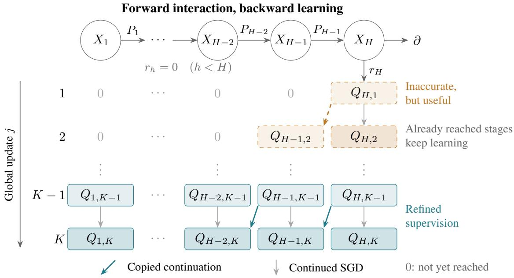

# On the Feature Evolution of Temporal Difference Learning

Shangzhe Li University ofNorth Carolina at Chapel Hill

Dechen Zhang The University of Hong Kong

Difan Zou The University of Hong Kong

Weitong Zhang University of North Carolina at Chapel Hill

SHANGZHE@UNC.EDU

DECHENZHANG@CONNECT.HKU.HK

DZOU@HKU.HK

WEITONGZ@UNC.EDU

## Abstract

Temporal-difference (TD) learning trains neural representations using bootstrapped targets generated by evolving value estimates, yet how predictive features emerge and propagate under incomplete neural updates remains poorly understood. We investigate this problem using finite-width twolayer ReLU critics on a constructed family of smooth stochastic horizon-H MDPs with unknown quadratic structure and d-dimensional observations. We first show that an informative TD update acquires the quadratic Bellman signal and yields a representation admitting a bounded predictive readout. The simultaneous hidden-weight and head update achieves a strict finite-sample predictionrisk improvement over matched head-only SGD, with a 2(d + 1)-fold larger population quadratic response. We then establish that an imperfect learned continuation can already provide informative supervision to an earlier zero-reward stage. By tracking coupled neural updates with one SGD step per target copy, without requiring intermediate Bellman regressions to be solved, we obtain a uniform prediction-error transient exp[−Ω(K/(Hd))], up to action-independent shifts and explicit sampling and finite-width errors. On the constructed signed-action MDP family whose total reward is bounded by 1, we show that an exploration-then-commit algorithm can achieve ${ \widetilde O } ( d ^ { 3 } H ^ { 1 / 3 } T ^ { 2 / 3 } )$ regret over T episodes, using $K = { \widetilde { \mathcal { O } } } ( H d )$ global updates. Our analysis connects bootstrapped feature acquisition, concurrent neural refinement, and finite-budget policy performance.

Keywords: Temporal-difference learning, feature learning, reinforcement learning

## 1. Introduction

Temporal-difference (TD) learning (Sutton, 1988) is fundamental to reinforcement learning (RL), estimating future cumulative rewards by regressing value functions onto Bellman targets combining immediate rewards and estimated future values. Deep RL algorithms such as DQN (Mnih et al., 2013, 2015), DDPG (Lillicrap et al., 2015), and TD3 (Fujimoto et al., 2018) extend this principle using neural function approximation. Unlike supervised regression, however, TD targets depend on the learner’s evolving value estimates, coupling feature learning with bootstrapped supervision.

Despite advances in convergence analysis (Zhang et al., 2023), mean-field representation dynamics (Zhang et al., 2020), and regret guarantees (Liu et al., 2022), how predictive features emerge and evolve under actual neural TD updates remains less understood. In particular, fitted value iteration analyses often assume nearly solved Bellman regressions, whereas practical deep RL performs limited SGD updates using partially updated imperfect targets. Such targets may already contain useful predictive signals before the downstream critic becomes accurate. This difference between theory and practice motivates our central question:

How do imperfect TD targets drive neural feature learning across stages and improve policies?

We investigate this question using finite-width two-layer ReLU critics on a constructed family of smooth stochastic MDPs with quadratic features. The Bellman targets expose identifiable quadratic signals, allowing us to analyze their acquisition and predictive benefit under actual SGD updates. In a specialized construction, we further track how imperfect learned continuations supervise earlier zero-reward stages while all reached critics continue learning, without requiring intermediate Bellman regressions to be fully solved. Our contributions are threefold:

• Initial feature acquisition. We characterize how an informative TD update acquires the quadratic Bellman signal in the hidden representation of a two-layered finite-width ReLU network. We establish a positive feature–signal covariance gain under explicit data collection, replay sampling, and finite-width conditions (Theorem 5.2).

• Predictive benefit of learned features. We quantify how the acquired representation improves prediction beyond updating the output heads alone. We construct a bounded predictive readout and prove a strict finite-sample risk improvement of the actual full SGD update over a matched head-only update, with a $2 ( d + 1 )$ )-fold larger population quadratic response (Theorem 5.5).

• Coupled feature refinement and policy performance. We show that an imperfect learned continuation generates informative supervision at earlier zero-reward stages, while previously reached critics continue learning. Tracking these coupled neural SGD updates without requiring accurate intermediate Bellman regression yields an $\exp [ - \Omega ( K / ( H d ) ) ]$ ] prediction-error transient and ${ \widetilde O } ( d ^ { 3 } H ^ { 1 / 3 } T ^ { 2 / 3 } )$ regret on the constructed signed-action MDP family (Theorem 5.10 and Corollary 5.12).

Notation. Write $[ n ] = \{ 1 , \dots , n \}$ , and denote Euclidean, operator, Frobenius, and supremum norms by $\| \cdot \| _ { 2 } , \| \cdot \| _ { \mathrm { o p } } , \| \cdot \| _ { F }$ , and $\| \cdot \| _ { \infty }$ , respectively. Let $Q _ { h , j }$ be the stage-h critic after global TD update $j ,$ with $j _ { h } = H - h + 1$ its first informative update. The notation $\mathcal { O }$ and Ω hides universal constants, while $\widetilde { \mathcal { O } }$ additionally hides logarithmic factors.

## 2. Related Work

Feature learning under TD. Prior work characterizes neural TD representations through meanfield dynamics (Zhang et al., 2020), spectral and invariant-subspace analyses (Lyle et al., 2021; Le Lan et al., 2023), joint representation–readout dynamics (Tang and Munos, 2023), and feature coadaptation (Kumar et al., 2022). In contrast, we establish finite-sample guarantees for actual ReLU TD updates, identifying the acquired quadratic Bellman signal and showing how an imperfect learned continuation generates informative features at earlier zero-reward stages.

Predictive benefits of learned features. Damian et al. (2022) study feature acquisition through a hidden-weight gradient step in Gaussian polynomial regression, followed by readout optimization. Related results address noisy XOR (Meng et al., 2024) and representation learning in low-rank RL (Agarwal et al., 2020; Uehara et al., 2022). We instead quantify the predictive benefit of an actual neural TD update, constructing a bounded readout and proving a strict finite-sample risk improvement over matched head-only SGD using the same bootstrapped targets and replay data.

Neural TD and Q-learning convergence. Xu and Gu (2020) establish $\widetilde { \mathcal { O } } ( K ^ { - 1 / 2 } + m ^ { - 1 / 6 } )$ iterateaveraged squared value error, plus projection error, under fixed-policy covariance and mixing conditions. Zhang et al. (2023) establish geometric convergence with $\mathcal { O } ( n ^ { - 1 / 2 } )$ estimation error under realizability, local initialization, and stationary replay assumptions. In contrast, Theorem 5.10 tracks coupled, stage-dependent neural TD updates with one SGD step per target copy, yielding an $\exp [ - \Omega ( K / ( H d ) ) ]$ transient, up to action-independent shifts and explicit sampling and finite-width errors. This connects neural optimization dynamics to the acquisition and refinement of bootstrapped predictive features without requiring intermediate Bellman regressions to be solved.

Exploration and policy guarantees. Dann et al. (2022) study myopic ε-greedy exploration, while optimistic methods establish square-root-regret guarantees (Jin et al., 2020b; Agarwal et al., 2023). Under favorable exploration, Liu et al. (2022) obtain $\widetilde { \mathcal { O } } ( T ^ { 2 / 3 } )$ regret for smooth Besov classes and $\widetilde { \mathcal { O } } ( T ^ { 5 / 6 } )$ for Barron classes, using fitted empirical regression. For tabular MDPs, an explore-then-commit reduction of Jin et al. (2020a), restricted to unit-bounded episode returns, gives ${ \widetilde O } ( H ^ { 5 / 3 } ( S ^ { 2 } A ) ^ { 1 / 3 } T ^ { 2 / 3 } + H ^ { 7 / 2 } S ^ { 2 } { \sqrt { A T } } )$ regret. On our constructed signed-action MDP family, Corollary 5.12 establishes ${ \widetilde O } ( d ^ { 3 } H ^ { 1 / 3 } T ^ { 2 / 3 } )$ regret with $K = { \widetilde { \mathcal { O } } } ( H d )$ global SGD updates. Although the settings differ, our analysis connects finite-budget policy performance to the actual neural feature-learning trajectory, counting all exploration episodes.

## 3. Preliminaries

## 3.1. Episodic Markov Decision Processes

We consider episodic Markov Decision Processes (MDPs), which can be represented by a tuple $\boldsymbol { \mathcal { M } } = ( \mathcal { X } , \mathcal { A } , H , P , r , \nu _ { 1 } )$ . At stage $h ,$ the learner observes $X _ { h } \in \mathcal { X } _ { h } \subset \mathbb { R } ^ { d }$ , selects $A _ { h } \in { \mathcal { A } } .$ , receives $R _ { h }$ , and observes $X _ { h + 1 } \sim P _ { h } ( \cdot \mid X _ { h } , A _ { h } )$ , with reward function $r _ { h } ( X _ { h } , A _ { h } )$ . The terminal space is $\mathcal { X } _ { H + 1 } = \{ \partial \}$ . Rewards are nonnegative and each episode’s return is at most one. For a Markov policy $\pi = ( \pi _ { h } ) _ { h = 1 } ^ { H }$ , we define the value functions

$$
V _ { h } ^ { \pi } ( x ) = \mathbb { E } _ { \pi } \left[ \sum _ { s = h } ^ { H } R _ { s } \ | \ X _ { h } = x \right] , \quad Q _ { h } ^ { \pi } = r _ { h } + P _ { h } V _ { h + 1 } ^ { \pi } , \quad V _ { h } ^ { \pi } ( x ) = \sum _ { a } \pi _ { h } ( a \mid x ) Q _ { h } ^ { \pi } ( x , a ) .
$$

Write $\mathcal { T } _ { h } v = r _ { h } + P _ { h } v$ . Optimal values obey $Q _ { h } ^ { \star } = \mathcal { T } _ { h } V _ { h + 1 } ^ { \star } , V _ { h } ^ { \star } = \operatorname* { m a x } _ { a } Q _ { h } ^ { \star } ( \cdot , a )$ , and $V _ { H + 1 } ^ { \star } = 0$ Let $\mathcal { F } _ { t - 1 }$ contain the completed history before episode $t ,$ including replay draws and parameter updates. For a policy $\pi _ { t }$ conducting round-t episode collection, set $\begin{array} { r } { J ( \pi _ { t } ) = \mathbb { E } [ \sum _ { h } R _ { t , h } \ | \ \mathcal { F } _ { t - 1 } ] } \end{array}$ and $J ^ { \star } = \mathbb { E } _ { \nu _ { 1 } } V _ { 1 } ^ { \star } ( X _ { 1 } )$ . We study the cumulative regret in our algorithm analysis

$$
\operatorname { R e g } _ { T } = \sum _ { t = 1 } ^ { T } \{ J ^ { \star } - J ( \pi _ { t } ) \} .\tag{3.1}
$$

## 3.2. Data Model: Quadratic Signals in Stochastic MDPs

We use a stochastic MDP family whose transition and reward functions include quadratic signals. Inspired by polynomial feature-learning models (Nichani et al., 2023), the construction makes the unknown predictive features explicit while the learner receives raw observations and transitions. Fix $H , D \ge 2$ and $r = D - 1 \leq d ( d + 1 ) / 2 - 1$ . Observations lie on a d-dimensional sphere $\mathbb { S } _ { d } = \sqrt { d } \mathbb { S } ^ { d - 1 }$ , with uniform measure $\mu .$ At each stage, let $E _ { h , 1 } , \ldots , E _ { h , r }$ be unknown trace-free symmetric matrices orthonormal in Frobenius inner product, spanning the r-dimensional subspace $S _ { h } : = \operatorname { s p a n } E _ { h , 1 } , . . . , E _ { h , r }$ . Define

$$
g _ { h } ( \boldsymbol { x } ) = \frac { 1 } { d } ( \boldsymbol { x } ^ { \top } E _ { h , 1 } \boldsymbol { x } , \ldots , \boldsymbol { x } ^ { \top } E _ { h , r } \boldsymbol { x } ) ^ { \top } , \qquad \mathbb { E } _ { \boldsymbol { \mu } } g _ { h } = 0 , \quad \| g _ { h } ( \boldsymbol { x } ) \| _ { 2 } \leq 1 .
$$

The learner observes $x$ but not its unknown quadratic features $g _ { h } ( x )$ . Choose unknown contractions $T _ { h , a } \in \mathbb { R } ^ { r \times r }$ , at least one invertible at each $h < H$ , and amplitudes $\tau _ { h } , \omega _ { h } \in ( 0 , 1 )$ . For the transition kernel over each stage $h \in [ H ]$ , at stage-H the transition leads to a terminal state and

$$
P _ { h } ( d x ^ { \prime } \mid x , a ) = \left[ 1 + \frac { \tau _ { h } \omega _ { h } } { D } ( T _ { h , a } g _ { h } ( x ) ) ^ { \top } g _ { h + 1 } ( x ^ { \prime } ) \right] \mu ( d x ^ { \prime } ) , \qquad h < H .\tag{3.2}
$$

The density lies in $[ 1 - \tau _ { h } \omega _ { h } / D , 1 + \tau _ { h } \omega _ { h } / D ]$ . For rewards, choose $B \in \mathbb { R } ^ { D \times r }$ with $B ^ { \top } B = I _ { r }$ $B ^ { \top } { \bf 1 } = 0$ . Define

$$
\phi _ { h } ^ { \star } ( x , a ) = \frac { 1 } { D } [ 1 + \tau _ { h } B T _ { h , a } g _ { h } ( x ) ] , \qquad r _ { h } ( x , a ) = \phi _ { h } ^ { \star } ( x , a ) ^ { \top } \vartheta _ { h } , \qquad \vartheta _ { h } \in [ 0 , r _ { h } ^ { \operatorname* { m a x } } ] ^ { D } .
$$

The vector $\phi _ { h } ^ { \star }$ has nonnegative coordinates summing to one. Rewards are deterministic, with $\begin{array} { r } { 0 \leq \sum _ { h } r _ { h } ( X _ { h } , A _ { h } ) \leq 1 } \end{array}$ . Transitions use fresh randomness, and episodes start independently from $\mu .$ For any bounded value continuation v,

$$
P _ { h } v ( x , a ) = \mathbb { E } _ { \mu } v + \frac { \tau _ { h } \omega _ { h } } { D } ( T _ { h , a } g _ { h } ( x ) ) ^ { \top } \mathbb { E } _ { \mu } [ g _ { h + 1 } v ] .
$$

Thus the conditional mean TD target $r _ { h } + P _ { h } \ i$ has the form $c _ { a } + x ^ { \top } C _ { a } x$ (Lemma B.3): the moment $\mathbb { E } _ { \mu } [ g _ { h + 1 } v ]$ determines which current-state quadratics predict the value continuation. This identity also holds when v is the action maximum of a learned ReLU critic. It identifies the supervision supplied to the neural update as that value continuation changes.

## 3.3. Neural Critic

The learner represents Q-functions by a finite two-layer ReLU network applied to the raw observation x. With $\sigma ( z ) = \operatorname* { m a x } \{ z , 0 \}$ , for stage-h, the critic is

$$
Q _ { \theta _ { h } } ( x , a ) = b _ { h , a } + \frac { 1 } { \sqrt { m } } \sum _ { i = 1 } ^ { m } U _ { h , a , i } \sigma ( w _ { h , i } ^ { \top } x ) , \qquad \theta _ { h } = ( W _ { h } , U _ { h } , b _ { h } ) ,\tag{3.3}
$$

with hidden features $\varphi _ { W _ { h } } ( x ) = m ^ { - 1 / 2 } ( \sigma ( w _ { h , i } ^ { \top } x ) ) _ { i = 1 } ^ { m }$ . All parameters are trainable and separate across stages. Here $b _ { h } = ( b _ { h , a } ) _ { a \in \mathcal { A } }$ denotes output biases and $U _ { h } = ( U _ { h , a } ) _ { a \in \mathcal { A } }$ denotes head layer parameters chosen by an action candidate in the following write-up for convenience. We use $\sigma ^ { \prime } ( 0 ) = 0$ and fixed action tie-breaking for action choice when multiple actions have the same Q-value. For even $m$ and $i \le m / 2$ , independently draw $w _ { h , i }$ uniformly on $\mathbb { S } ^ { d - 1 }$ and $U _ { h , a , i }$ as Rademacher signs, independently of the environment. Initialize

$$
w _ { h , i + m / 2 } = w _ { h , i } , \qquad U _ { h , a , i + m / 2 } = - U _ { h , a , i } , \qquad b _ { h , a } = 0 .
$$

By incorporating this initialization strategy, we can have initial $Q _ { \theta _ { h } ^ { ( 0 ) } } = 0$ with nonzero hidden-weight Jacobians.

```latex
Algorithm 1 Explore-then-commit temporal difference learning
Require: Even network width $m \geq 2 ;$ horizon $\overline { { H \geq 2 ; } }$ episode budget $\overline { { T ; } }$ collection batch size n;
number of TD updates $K \geq H ;$ replay minibatch size $b ; K n \le T$
1: Initialize ${ \pmb \theta } ^ { ( 0 ) }$ by the independent paired initialization in Section ${ } ^ { 3 ; }$ set $\bar { \pmb { \theta } } ^ { ( 0 ) } = \pmb { \theta } ^ { ( 0 ) }$
2: Phase I: uniformly random exploration and TD updates.
3: for $j = 1 , \ldots , K$ do
4: Set $\mathsf { B } _ { j } = \varnothing ;$ hold $\pmb { \theta } ^ { ( j - 1 ) }$ and $\bar { \pmb { \theta } } ^ { ( j - 1 ) }$ fixed during collection.
5: for $t = ( j - 1 ) n + 1 , \ldots , j n$ do
6: Observe a fresh initial state $X _ { t , 1 }$
7: for $h = 1 , \ldots , H$ do
8: Draw $A _ { t , h } \sim \operatorname { U n i f } ( \mathcal { A } )$ , independently of the current observation and critic.
9: Execute $A _ { t , h }$ and observe $R _ { t , h } , X _ { t , h + 1 }$
10: Append $( h , X _ { t , h } , A _ { t , h } , R _ { t , h } , X _ { t , h + 1 } )$ to $\mathsf { B } _ { j }$
11: end for
12: end for
13: Draw b independent uniform record indices from $\mathsf { B } _ { j }$ with replacement, forming $\mathcal { T } _ { j }$
14: Form all detached targets by (4.1) and take one gradient step with (4.3).
15: Copy the whole updated critic: $\bar { \pmb { \theta } } ^ { ( j ) } = \pmb { \theta } ^ { ( j ) }$
16: end for
17: Phase II: commit to the learned greedy policy.
18: Freeze ${ \pmb \theta } ^ { ( K ) }$ and set ${ \widehat { \pi } } _ { h } ( x ) = \arg \operatorname* { m a x } _ { a } Q _ { \theta _ { h } ^ { ( K ) } } ( x , a )$
19: for $t = K n + 1 , \ldots , T$ do
20: Execute $\widehat { \pi }$ for one complete episode.
21: end for
```

## 4. Temporal Difference Learning

We build our analysis on exploration-then-commit procedure (Garivier et al., 2016) with a temporal difference (TD) objective (Sutton, 1988), detailed in Algorithm 1. During exploration, every action is drawn uniformly at random. Each batch of n fresh episodes supplies one batched TD gradient update of the entire neural critic, followed immediately by a target copy. After K such updates, the learner commits once to the final critic’s greedy policy for the remaining episodes.

## 4.1. Random Exploration and Batch Collection

At update $j \in [ K ]$ , we collect n fresh episodes, indexed by $( j - 1 ) n + 1 , \ldots , j n$ , under a fixed exploration policy that selects actions uniformly from ${ \mathcal { A } } .$ Episodes are generated independently, both within and across collection batches, whereas transitions at different stages within the same episode may be dependent. The resulting $H n$ transitions form the collection buffer $\mathsf { B } _ { j } .$ . The online and target network parameters remain fixed during collection. Conditional on $\mathsf { B } _ { j }$ , the replay minibatch $\mathcal { T } _ { j }$ consists of b independent uniform draws with replacement from the buffer. The online network then performs one gradient update using $\mathcal { T } _ { j }$ , followed by synchronization of the target network with the updated online network. Overall, the exploration phase consists of K fresh collection batches, Kn episodes, and exactly K gradient updates.

## 4.2. One Simultaneous Neural TD Update Per Collection Batch

Let $\pmb { \theta } = ( \theta _ { h } ) _ { h = 1 } ^ { H }$ . For a sampled record $i = ( h _ { i } , X _ { i } , A _ { i } , R _ { i } , X _ { i } ^ { \prime } )$ , use the target network copied after the preceding update $\bar { \pmb { \theta } } ^ { ( j - 1 ) }$ to compute the TD target $Y _ { i }$

$$
Y _ { i } = R _ { i } + { \bf 1 } \{ h _ { i } < H \} \operatorname* { m a x } _ { a ^ { \prime } } Q _ { { \bar { \theta } } _ { h _ { i } + 1 } ^ { ( j - 1 ) } } ( X _ { i } ^ { \prime } , a ^ { \prime } ) .\tag{4.1}
$$

TD objective within the minibatch $\mathcal { T } _ { j }$ is

$$
\widehat { L } _ { { \mathcal { Z } } _ { j } } ( \pmb { \theta } ; \bar { \pmb { \theta } } ^ { ( j - 1 ) } ) = \frac { 1 } { 2 b } \sum _ { i \in { \mathcal { Z } } _ { j } } ( Q _ { { \theta } _ { h _ { i } } } ( X _ { i } , A _ { i } ) - Y _ { i } ) ^ { 2 } .\tag{4.2}
$$

We then update θ using constant step size minibatch SGD

$$
\pmb { \theta } ^ { ( j ) } = \pmb { \theta } ^ { ( j - 1 ) } - \eta \nabla _ { \pmb { \theta } } \widehat { L } _ { \mathcal { T } _ { j } } \big ( \pmb { \theta } ; \bar { \pmb { \theta } } ^ { ( j - 1 ) } \big ) \Big | _ { \pmb { \theta = \theta } ^ { ( j - 1 ) } } , \qquad j = 1 , . . . , K ,\tag{4.3}
$$

where $\eta$ is the constant step size. For the simplicity of analysis, we set $\eta = 1 / 2$ . Network parameters $W , U ,$ b change simultaneously, and we treat every target $Y _ { i }$ as a constant in differentiation, aligning with standard practice in RL. Thus all stage critics use the same preceding target snapshot, and the target network is copied only after the whole gradient step. If the minibatch contains $b _ { h , j } ^ { \mathrm { ~ \tiny ~ 1 ~ } }$ records from stage $h ,$ its effective stage learning rate is $\begin{array} { r } { \eta _ { h , j } = \frac { b _ { h , j } } { 2 b } = \frac { p _ { h , j } } { 2 } } \end{array}$ with $\begin{array} { r } { p _ { h , j } : = \frac { b _ { h , j } } { b } } \end{array}$ . These are precisely the stage fractions and steps used in the multi-update analysis.

## 5. Theoretical Analysis

We first characterize the quadratic Bellman signal acquired by an initial informative TD update (Section 5.1). We then quantify its predictive benefit through a bounded readout and a matched comparison with head-only SGD (Section 5.2). Next, we analyze how imperfect learned continuations generate supervision at earlier stages and track the concurrent refinement of neural critics under evolving TD targets (Section 5.3). Finally, we translate these prediction guarantees into explicit finite-budget regret bounds (Section 5.4).

## 5.1. Feature Acquisition at an Initial TD Update

We study an initial stage-specific update of Algorithm 1. Fix a stage $h$ and an update $j \in [ K ]$ at which the stage-h critic is still at its paired initialization, so that $\theta _ { h } ^ { ( j - 1 ) } = \theta _ { h } ^ { ( 0 ) }$ . Let $\mathsf { B } _ { j }$ be the buffer collected for this update and put

$$
I _ { h } : = \{ i \in { \mathsf { B } } _ { j } : h _ { i } = h \} , \qquad | I _ { h } | = n .
$$

Each of the n complete episodes contributes one record to $I _ { h }$ . The global minibatch consists of b independent uniform draws with replacement from $\mathsf { B } _ { j }$

Let $\mathcal { H } _ { j - 1 }$ denote the information available before collection batch $j ,$ including the initializations and all completed collection batches, replay draws, and parameter updates. The continuation actually used in the detached TD targets is

$$
\widehat v ( x ^ { \prime } ) = \mathbf { 1 } \{ h < H \} \operatorname* { m a x } _ { a ^ { \prime } \in \mathcal { A } } Q _ { \bar { \theta } _ { h + 1 } ^ { ( j - 1 ) } } ( x ^ { \prime } , a ^ { \prime } ) .
$$

It may depend on the completed training history, but is $\mathcal { H } _ { j - 1 }$ -measurable and remains fixed through out the current collection batch and its replay sampling. Conditional on $\mathcal { H } _ { j - 1 }$ , the stage-h records in $I _ { h }$ are independent and identically distributed, with state–action law $\nu : = \mu \otimes \operatorname { U n i f } ( \mathcal { A } )$ . For compatibility with the formulas below, write $\bar { \pi } _ { a } : = 1 / A$ , where $A = | { \mathcal { A } } |$

Let V be a fixed class of bounded continuations, and consider updates for which $\widehat { v } \in \nu$ . For every fixed $v \in \mathcal V$ , write $Y _ { i } ( v ) = R _ { i } + v ( X _ { i } ^ { \prime } )$ . The MDP construction gives

$$
( { \mathcal { T } } _ { h } v ) ( x , a ) = r _ { h } ( x , a ) + ( P _ { h } v ) ( x , a ) = c _ { a } ( v ) + x ^ { \top } C _ { a } ( v ) x , \qquad C _ { a } ( v ) \in S _ { h } .\tag{5.1}
$$

Since vb is determined before the current batch,

$$
\mathbb { E } [ Y _ { i } ( \widehat { v } ) \mid \mathcal { H } _ { j - 1 } , X _ { i } = x , A _ { i } = a ] = c _ { a } ( \widehat { v } ) + x ^ { \top } C _ { a } ( \widehat { v } ) x .
$$

However, the quadratic component may vanish. We therefore require a sufficiently strong quadratic signal, together with regularity conditions ensuring that sampling and finite-step errors do not overwhelm it.

Condition 5.1 (Boundedness and informative signal) We assume that there exist positive constants $B _ { Y } , c _ { * } , M _ { * } , S _ { 0 }$ such that,for every $v \in \mathcal V$

$$
| Y _ { i } ( v ) | \leq B _ { Y } , \qquad | c _ { a } ( v ) | \leq c _ { * } , \qquad \| C _ { a } ( v ) \| _ { \mathrm { o p } } \leq M _ { * } .
$$

The selected continuation vb satisfies

$$
\sum _ { a } \bar { \pi } _ { a } ^ { 2 } \| C _ { a } ( \widehat { v } ) \| _ { F } ^ { 2 } \geq S _ { 0 } .
$$

For $X \sim \mu ,$ let $X _ { 1 }$ denote its first coordinate. Define the spherical moment constants $\beta _ { d } = \mathbb { E } | X _ { 1 } | / 2$ and $\alpha _ { d } = d \beta _ { d } / ( d + 1 )$ , whose explicit expressions are given in (B.20). Let $b _ { h }$ denote the realized number of stage-h records in the replay minibatch, and define the effective stage step size $\eta _ { \mathrm { e f f } } =$ $\eta b _ { h } / b = b _ { h } / ( 2 b )$

Theorem 5.2 (Feature acquisition at an initial TD update) With probability at least $1 - \delta ,$ , the following conclusion holds simultaneously for every stage–update pair $( h , j )$ of Algorithm 1 satisfying the initialization condition in Section 5.1, Condition 5.1, and the quantitative requirements (B.21), (B.22), and (B.23). Consider the initial-head readout

$$
F _ { W } ( x , a ) = \frac { 1 } { \sqrt { m } } \sum _ { s } U _ { a , s } ^ { ( 0 ) } \sigma ( w _ { s } ^ { \top } x ) .\tag{5.2}
$$

The actual hidden parameters after the simultaneous TD update satisfy

$$
\mathbb { E } _ { \boldsymbol \nu } \Big [ \big ( x ^ { \top } C _ { a } ( \widehat v ) x \big ) \{ F _ { W ^ { + } } ( x , a ) - F _ { W _ { 0 } } ( x , a ) \} \Big ] = \Omega \left( \frac { \eta _ { \mathrm { e f f } } \alpha _ { d } ^ { 2 } } { d } \sum _ { a } \bar { \pi } _ { a } ^ { 2 } \lVert C _ { a } ( \widehat v ) \rVert _ { F } ^ { 2 } \right) .\tag{5.3}
$$

Here, SGD updates the hidden weights, action heads, and output biases simultaneously, while (5.2) uses the initial heads as afixed readout to measurefeature acquisition.

Remark 5.3 (Feature learning in initial update) Theorem 5.2 shows that, at any stage h satisfying Condition 5.1, an initial informative TD update increases the alignment between the hidden features and the quadratic Bellman signal. The lower bound in the theorem $\Omega \big ( ( \eta _ { \mathrm { e f f } } \alpha _ { d } ^ { 2 } / d ) \sum _ { a } \bar { \pi } _ { a } ^ { 2 } \| C _ { a } ( \widehat { v } ) \| _ { F } ^ { 2 } \big )$ , which is strictly positive under the stated conditions. Since the output weights $U _ { a , j } ^ { ( 0 ) }$ are fixed when evaluating both representations, this gain certifies that the hidden-weight update from $W _ { 0 }$ to $W ^ { + }$ produces a readout change positively correlated with the quadratic component of the Bellman target.

## 5.2. Predictive Benefit of the Acquired Features

The preceding alignment gain leaves two prediction questions: how accurately can the updated features represent the Bellman target, and how much improvement does the actual SGD readout realize? Theorem 5.5 answers these questions through a bounded readout and a matched comparison with a head-only update. Corollary 5.7 then places the resulting approximation error in the replay-risk bound.

We use the initial-update and sampling setup of Section 5.1, and write $v = \widehat { v }$ and $Y _ { i } = Y _ { i } ( v )$ Assume that v is determined by pre-collection information $\mathcal { G }$ independent of the selected stage’s paired initialization. For this fixed continuation, write (5.1) as

$$
f _ { a } ( x ) : = ( { \mathcal { T } } _ { h } v ) ( x , a ) = c _ { a } + s _ { a } ( x ) , \qquad s _ { a } ( x ) : = x ^ { \top } C _ { a } x ,
$$

where $\boldsymbol { c } _ { a } = \boldsymbol { c } _ { a } ( \boldsymbol { v } )$ and $C _ { a } = C _ { a } ( v )$ . We also define $\begin{array} { r } { \| c \| _ { L ^ { 2 } ( \nu ) } ^ { 2 } = \frac { 1 } { A } \sum _ { a \in \mathcal { A } } c _ { a } ^ { 2 } . } \end{array}$ . Since a matrix and its symmetric part define the same quadratic form and the trace component contributes only a constant which can be absorbed into $c _ { a } ,$ we consider the following structural condition without loss of generality.

Condition 5.4 (Bounded targets and centered quadratic structure) The targets and quadratic coefficients satisfy

$$
| Y _ { i } | \leq 1 , \qquad C _ { a } = C _ { a } ^ { \top } , \qquad \mathrm { t r } ( C _ { a } ) = 0 \quad ( i \leq n , a \in \mathcal { A } ) .
$$

To isolate the predictive contribution of hidden-weight movement, we compare a simultaneous update with a matched head-only step. Let $( W ^ { + } , U ^ { + } , b ^ { + } )$ ) denote the parameters after the simultaneous TD update from $( W _ { 0 } , { \cal U } ^ { ( 0 ) } , \dot { b } ^ { ( 0 ) } )$ . Define

$$
Q _ { \mathrm { f u l l } } ^ { + } ( x , a ) : = Q _ { W ^ { + } , U ^ { + } , b ^ { + } } ( x , a ) , \qquad Q _ { \mathrm { h e a d } } ^ { + } ( x , a ) : = Q _ { W _ { 0 } , U ^ { + } , b ^ { + } } ( x , a ) .
$$

The matched step updates only the heads and biases, using the same initialization, targets, minibatch, and step size. Its updated readout is also $( U ^ { + } , b ^ { + } )$ because both steps evaluate all gradients at the same initial parameters. To compare these critics, we use the full prediction risk and a centered risk. The full risk can decrease through better estimation of the actionwise constants $c _ { a } ;$ the centered risk subtracts the mean prediction for each action to isolate prediction error on the quadratic signal $s _ { a } ( x )$

$$
\begin{array} { r } { { \mathcal { R } } _ { \nu } ( Q ) = \| Q - f \| _ { L ^ { 2 } ( \nu ) } ^ { 2 } , \qquad { \mathcal { R } } _ { \nu } ^ { \mathrm { s i g } } ( Q ) = \| Q - \mathbb { E } _ { \mu } [ Q ( X , \cdot ) ] - s \| _ { L ^ { 2 } ( \nu ) } ^ { 2 } . } \end{array}
$$

For the finite-sample bounds, write $\begin{array} { r } { \varepsilon _ { \mathrm { s t a t } } = \sqrt { \left[ d \log ( m d ) + \log \frac { A } { \delta } \right] \left( \frac { 1 } { n } + \frac { 1 } { b _ { h } } + \frac { 1 } { m } \right) } } \end{array}$

Theorem 5.5 (Predictive content of an initial TD update) Under the collection setup above and Condition 5.4, take $d , A \ge 2 , \delta \in ( 0 , 1 )$ , even $m \geq 6 4 ( d + 1 ) ^ { 2 } , b _ { h } > 0$ , and $0 < \eta _ { \mathrm { e f f } } \le 1$ . With probability at least $1 - \delta _ { : }$ , thefollowing hold.

• There exists a readout $\begin{array} { r } { U _ { a , j } ^ { \dagger } : = \frac { A d ^ { 2 } U _ { a , j } ^ { ( 0 ) } } { \eta _ { \mathrm { e f f } } \alpha _ { d } ^ { 2 } ( 2 d + 1 ) } , b _ { a } ^ { \dagger } : = - \frac { d ^ { 2 } } { 2 d + 1 } c _ { a } } \end{array}$ . such that $q ^ { \dag } : = Q _ { W ^ { + } , U ^ { \dag } , b ^ { \dag } }$ satisfies

$$
\| q ^ { \dagger } - f \| _ { \infty } = \mathcal { O } \biggl ( \frac { A d ^ { 3 } } { \alpha _ { d } ^ { 2 } } \varepsilon _ { \mathrm { s t a t } } \biggr ) .\tag{5.4}
$$

• If the step size satisfies $\textstyle { \frac { \eta _ { \mathrm { e f f } } } { A } }$ max $\begin{array} { r } { \left\{ 1 + 2 \beta _ { d } ^ { 2 } , \frac { 2 \alpha _ { d } ^ { 2 } ( d + 1 ) } { d ^ { 2 } } \right\} \le \frac { 1 } { 2 } } \end{array}$ , then

$$
\mathcal { R } _ { \nu } ( Q _ { \mathrm { h e a d } } ^ { + } ) - \mathcal { R } _ { \nu } ( Q _ { \mathrm { f u l l } } ^ { + } ) \geq \Omega \Bigg ( \frac { \eta _ { \mathrm { e f f } } } { A } \left[ \beta _ { d } ^ { 2 } \| c \| _ { L ^ { 2 } ( \nu ) } ^ { 2 } + \frac { \alpha _ { d } ^ { 2 } } { d } \| s \| _ { L ^ { 2 } ( \nu ) } ^ { 2 } \right] \Bigg ) - \mathcal { O } \big ( \eta _ { \mathrm { e f f } } d ^ { 2 } \varepsilon _ { \mathrm { s t a t } } ( 1 + \eta _ { \mathrm { e f f } } d ^ { 2 } \varepsilon _ { \mathrm { s t a t } } ) \big )\tag{5.5}
$$

The same bound holds for $\mathcal { R } _ { \nu } ^ { \mathrm { s i g } }$ with the c-term omitted.

Moreover, under the respective lower bounds on the record count $n ,$ replay batch size $b _ { h }$ , and width m in Definition B.15, the gains are strictly positive at the displayed leading orders.

Remark 5.6 (Predictive content and realized improvement) The bounded witness certifies the approximation available in $W ^ { + }$ , with uniform error $\widetilde { \mathcal { O } } ( n ^ { - 1 / 2 } + b _ { h } ^ { - 1 / 2 } + m ^ { - 1 / 2 } )$ atfixed d, A. The matched-update comparison quantifies the improvement already realized by simultaneous SGD. Both critics use the same initialization, target, minibatch, and head-and-bias update, so their risk difference isolates the contribution of hidden-weight movement. Define the quadratic response coefficient $\lambda _ { 2 } = { 2 \alpha _ { d } ^ { 2 } ( d + 1 ) } / { d ^ { 2 } }$ . Lemma B.17 gives the leading population quadratic responses of the full and head-only updates as $\eta _ { \mathrm { e f f } } \lambda _ { \mathrm { 2 } } s / A$ and $\eta _ { \mathrm { e f f } } \lambda _ { 2 } s / ( 2 A ( d + 1 ) )$ respectively. Their ratio $i s 2 ( d + 1 )$ , and the finite-sample remainder bound yields a strict risk improvement at the stated resolution. The same coefficient governs the subsequent refinement ofquadratic action contrasts in Theorem 5.10.

Theorem 5.5 bounds the approximation error achievable with $W ^ { + }$ and compares the full update with a matched head-only update. The following corollary combines this approximation guarantee with a uniform replay bound to control the actual critic’s prediction error through the empirical fit gap, approximation error, and statistical error. For the n stage-h records indexed by I, define the empirical squared TD loss $\begin{array} { r } { \widehat { L } _ { I } ( q ; v ) : = \frac { 1 } { n } \sum _ { i \in I } [ q ( X _ { i } , A _ { i } ) - { Y } _ { i } ] ^ { 2 } } \end{array}$

Corollary 5.7 (Initial-update features in the replay-risk bound) In the setting of Theorem 5.5, let $\mathcal { Q } _ { h } ( W ^ { + } ) \subseteq \mathcal { Q } _ { h }$ contain $q ^ { \dagger }$ and $Q _ { \mathrm { f u l l } } ^ { + } ,$ and take $v \in \mathcal { V } _ { h + 1 }$ . Assume the deterministic classes $\mathcal { Q } _ { h } , \mathcal { V } _ { h + 1 }$ satisfy the boundedness and covering conditions of Lemma B.11, with $B = B _ { Q } \geq 1$ and covering bounds $N _ { Q } ( u ) , N _ { V } ( u )$ . On the intersection ofthe events in Theorem 5.5 and Lemma B.11, thefrozen-target approximation error obeys

$$
R _ { a p p } : = \operatorname* { i n f } _ { q \in \mathcal { Q } _ { h } ( W ^ { + } ) } \| q - \mathcal { T } _ { h } v \| _ { L ^ { 2 } ( \nu ) } ^ { 2 } = \mathcal { O } \biggl ( \frac { A ^ { 2 } d ^ { 6 } } { \alpha _ { d } ^ { 4 } } \left[ d \log ( m d ) + \log \frac { A } { \delta } \right] \left( \frac { 1 } { n } + \frac { 1 } { b _ { h } } + \frac { 1 } { m } \right) \biggr )\tag{5.6}
$$

Moreover, the actual updated critic satisfies

$$
\| Q _ { \mathrm { f u l l } } ^ { + } - \mathcal { T } _ { h } v \| _ { L ^ { 2 } ( \nu ) } ^ { 2 } = \mathcal { O } ( R _ { f i t } + R _ { a p p } + R _ { e s t } ) .\tag{5.7}
$$

where $\begin{array} { r } { R _ { f i t } = \widehat { L } _ { I } ( Q _ { \mathrm { f u l l } } ^ { + } ; v ) - \operatorname* { i n f } _ { q \in \mathcal { Q } _ { h } ( W ^ { + } ) } \widehat { L } _ { I } ( q ; v ) } \end{array}$ and $\begin{array} { r } { R _ { e s t } = \frac { B _ { Q } ^ { 2 } } { n } \log \frac { e H T ^ { 2 } N _ { Q } ( u ) N _ { V } ( u ) } { \delta } + B _ { Q } u . } \end{array}$ Substituting (5.6) gives the explicit width and sample contribution to the actual critic’s risk.

Remark 5.8 (From representation quality to critic risk) The bound in (5.7) separates three sources ofprediction error. The empirical fit gap measures how well the actual SGD readout fits the replay data relative to the best readout on $W ^ { + }$ . The approximation term $R _ { \mathrm { a p p } }$ measures the best prediction accuracy attainable within this readout class, with bound $\widetilde { \mathcal { O } } ( n ^ { - 1 } + b _ { h } ^ { - 1 } + m ^ { - 1 } )$ at fixed d, A. The statistical terms transfer empirical loss to population risk; they depend on the record count n, prediction bound $B _ { Q }$ , and class complexity through $N _ { Q } ( u ) , N _ { V } ( u )$ and the covering scale u. Thus better features must be accompanied by effective fitting and controlled complexity to yield a small prediction error. Increasing $b _ { h }$ reduces the replay-sampling term in the approximation bound, but does not increase the number ofcollected records availablefor statistical estimation.

## 5.3. Feature Evolution in Multiple TD Updates with Imperfect Targets

The initial-update results characterize learning from an informative value continuation target. We now show how Algorithm 1 creates such a target through its own first terminal update and follow the actual neural parameters as the copied value continuation continues to change. Lemma A.1 identifies the initial acquisition at newly reached stages, and Theorem 5.10 controls prediction along the subsequent coupled trajectory. The analysis specializes the family in Section 3.2 to signed actions and terminal rewards. All reached stages continue training with one SGD step per target copy, retaining their values’ current estimation errors.

Specific Construction. For Theorem 5.10, we further specialize the MDP defined in Section 3.2, take $d \ge 4 , \mathcal { A } = \{ - 1 , + 1 \} , T _ { h , a } = a I _ { r }$ , and $\tau _ { h } = \omega _ { h } = 1 / 2$ , giving

$$
\begin{array} { r l r } & { } & { r _ { h } ( x , a ) = 0 \quad ( h < H ) , \quad r _ { H } ( x , a ) = \displaystyle \frac { 1 } { 2 } + \frac { a g _ { H , 1 } ( x ) } { 8 D } , } \\ & { } & { P _ { h } ( d x ^ { \prime } \mid x , a ) = \left[ 1 + \frac { a } { 4 D } g _ { h } ( x ) ^ { \top } g _ { h + 1 } ( x ^ { \prime } ) \right] \mu ( d x ^ { \prime } ) \quad ( h < H ) . } \end{array}\tag{5.8}
$$

This specializes the general family with $r _ { h } ^ { \mathrm { m a x } } = 0 , \vartheta _ { h } = 0$ for $h < H$ , and $r _ { H } ^ { \operatorname* { m a x } } = 1 , \vartheta _ { H } =$ $1 / 2 + B e _ { 1 } / 4$ , where $e _ { 1 }$ is the first coordinate vector. For $h \geq 2 .$ , choose unknown unit vectors $u _ { h }$ and set

$$
E _ { h , 1 } = \frac { d u _ { h } u _ { h } ^ { \top } - I _ { d } } { \sqrt { d ( d - 1 ) } } , \qquad g _ { h , 1 } ( x ) = \frac { ( u _ { h } ^ { \top } x ) ^ { 2 } - 1 } { \sqrt { d ( d - 1 ) } } .\tag{5.9}
$$

At stage one, $E _ { 1 , 1 }$ may be any unit trace-free symmetric matrix. Complete each stage’s basis with $D - 2$ trace-free orthonormal matrices. Lemma B.19 gives the optimal values and confirms minimal common dimension D.

Backward propagation and refinement of TD supervision. Figure 1 illustrates learning with the constructed MDP in (5.8) with SGD. Stage h is first potentially reached at $j _ { h } = H - h + 1$ while already reached critics continue to refine concurrently. Although uniform collection under $\pi _ { h } ^ { \mathrm { r n d } } ( a \mid x ) = 1 / 2$ gives $Q _ { h } ^ { \pi ^ { \mathrm { r n d } } } ( x , a ) = 1 / 2$ for $h < H$ , greedy bootstrapping can create a quadratic signal. For the copied continuation $\begin{array} { r } { \widehat { v } _ { h , j } ( x ^ { \prime } ) : = \operatorname* { m a x } _ { a ^ { \prime } \in \{ - 1 , + 1 \} } Q _ { \bar { \theta } _ { h + 1 } ^ { j - 1 } } ( x ^ { \prime } , a ^ { \prime } ) } \end{array}$ , the conditional TD mean is

$$
P _ { h } \widehat { v } _ { h , j } ( \boldsymbol { x } , \boldsymbol { a } ) = \mathbb { E } _ { \boldsymbol { \mu } } [ \widehat { v } _ { h , j } ] + \frac { \boldsymbol { a } } { 4 D } g _ { h } ( \boldsymbol { x } ) ^ { \top } \mathbb { E } _ { \boldsymbol { \mu } } [ g _ { h + 1 } \widehat { v } _ { h , j } ] .
$$

  
Figure 1: Backward propagation and concurrent refinement of TD supervision. Initially inaccurate but useful estimates supervise earlier stages while reached critics continue learning. Colors are schematic.

Thus correlation with $g _ { h + 1 }$ supplies current-state quadratic supervision despite zero immediate reward. For example, action values $c { \pm } \beta g _ { h + 1 , 1 } ( x ^ { \prime } )$ with $\beta > 0$ have maximum $c + \beta | g _ { h + 1 , 1 } ( x ^ { \prime } ) |$ , yielding the quadratic term $\begin{array} { r l } {  { \frac { a \beta } { 4 D } \mathbb { E } _ { \mu } [ g _ { h + 1 , 1 } \vert g _ { h + 1 , 1 } \vert ] g _ { h , 1 } ( x ) } } \end{array}$ with $\mathbb { E } _ { \mu } { [ g _ { h + 1 , 1 } \vert g _ { h + 1 , 1 } \vert ] } > 0$ by Lemma B.19. Useful supervision can therefore precede accurate prediction. The analysis below characterizes the signal propagation and concurrent refinement under the following condition.

Condition 5.9 (The finite-horizon learning configuration) Use the horizon-H model (5.8) and the exploration-then-commit Algorithm 1, with $H \geq 2$ , positive integers $n , b , K$ satisfying $K \geq H$ $L = 1$ , and even m $\geq 2 .$ . Write $\zeta _ { d } = \mathbb { E } _ { \mu } | g _ { h , 1 } |$ and $\kappa _ { d } = \mathbb { E } _ { \mu } [ g _ { h , 1 } | g _ { h , 1 } | ] f o \iota$ r any $h \geq 2 .$ . Lemma B.19 gives $1 / ( 8 d ^ { 2 } ) \le \kappa _ { d } \le 2 / [ d ( d + 2 ) ]$ ] and the optimal values

$$
\beta _ { h } ^ { \star } = \frac { 1 } { 8 D } \left( \frac { \kappa _ { d } } { 4 D } \right) ^ { H - h } , \quad c _ { h } ^ { \star } = \frac { 1 } { 2 } + \zeta _ { d } \sum _ { \ell = h + 1 } ^ { H } \beta _ { \ell } ^ { \star } , \quad Q _ { h } ^ { \star } ( x , a ) = c _ { h } ^ { \star } + \beta _ { h } ^ { \star } a g _ { h , 1 } ( x ) , \quad h \in [ H ] .\tag{5.10}
$$

Theorem 5.10 (Prediction after multiple coupled TD updates) Under Condition 5.9, assume $K n \leq T$ and the training budget in Definition B.24. Let $Q _ { h , j }$ denote the actual stage-h critic after positive SGD step $j .$ . With probability at least $1 - \delta$ , there are action-independent offsets $| \gamma _ { h } | = \mathcal { O } ( 1 )$ such that

$$
\widetilde { Q } _ { h } ( x , a ) = Q _ { h , K } ( x , a ) + \gamma _ { h } , \qquad \operatorname* { m a x } _ { h } \| \widetilde { Q } _ { h } - Q _ { h } ^ { \star } \| _ { \infty } \leq e ,\tag{5.11}
$$

where

$$
e : = \exp \left( - \frac { \lambda _ { 2 } K } { 1 6 H } \right) + \mathcal { O } \left( \frac { ( d + 1 ) K } { H } \sqrt { \frac { ( d + 1 ) K \ell } { H } } \left[ \frac { 1 } { \sqrt { n } } + \sqrt { \frac { H } { b } } + \frac { ( d + 1 ) ( 1 + K / H ) } { \sqrt { m } } \right] \right) .\tag{5.12}
$$

Each squared prediction risk $o f \widetilde Q$ under every test distribution is at most $e ^ { 2 } .$ . The error bound followsfrom the coupled recursion ofall $h \in [ H ]$ under the changing targets in (B.94). Here ℓ is the logarithm specified in Definition B.24, satisfying $\ell = \mathcal { O } ( d \log ( m d ) + \log ( H K / \delta ) )$

Remark 5.11 (From quadratic response to coupled refinement) The bound in (5.12) separates an exponentially decaying optimization termfrom accumulated collection, replay, andfinite-width errors. The replay term $\sqrt { H / b }$ reflects the approximately b/H replay draws allocated to each stage. When the network is sufficiently wide, increasing b to order Hn reduces replay error to the collection scale $n ^ { - 1 / 2 }$ ; further replay does not improve the order of the prediction-error bound at fixed n, m, K. Increasing the number of global SGD updates K reduces the optimization term but enlarges the accumulated-error bound, creating a trade-off between optimization progress and error accumulation.

The exponential term ex $ ( - \lambda _ { 2 } K / ( 1 6 H ) )$ captures the refinement achieved through these coupled updates. Supervision starts at stage H and propagates backward through the copied targets. Earlier stages initially learn from imperfect downstream estimates. As all reached stages continue training, improvements in these estimates refine the targets supplied to earlier stages. The coupled recursion (B.88) quantifies this process, yielding exponential decay up to the accumulated collection, replay, andfinite-width error bound

## 5.4. Regret Analysis

The preceding theorem separates the optimization transient from cumulated regret. We now further provide the regret and sampling complexity analysis for Algorithm 1 in the following corollary:

Corollary 5.12 (Regret analysis) Let $\begin{array} { r } { \Gamma _ { T } = \log \frac { H ( d + 1 ) ( T + 1 ) } { \delta } } \end{array}$ and choose the number ofSGD steps as $K = \Theta ( H \lambda _ { 2 } ^ { - 1 } \Gamma _ { T } )$ , collection batch size $n = \Theta \Big ( ( d + 1 ) ^ { 5 / 3 } \lambda _ { 2 } ^ { - 1 / 3 } \Gamma _ { T } ^ { 2 / 3 } ( T / H ) ^ { 2 / 3 } \Big )$ , update batch size $b = H n ,$ , and network width $m = \Theta \big ( ( d + 1 ) ^ { 2 } ( \dot { 1 } + K / H ) ^ { 2 } n \big )$ , with sufficiently large universal constants, integer $K , n ,$ and even m. Run Algorithm 1 with one SGD step and target copy per collection batch,followed by greedy commitment. If $K n \leq T$ and Definition B.24 holds, then with probability at least $1 - \delta _ { : }$

$$
\mathrm { R e g } _ { T } = \mathcal { O } \Big ( \operatorname* { m i n } \Big \{ T , ( d + 1 ) ^ { 5 / 3 } \lambda _ { 2 } ^ { - 4 / 3 } \Gamma _ { T } ^ { 5 / 3 } H ^ { 1 / 3 } T ^ { 2 / 3 } \Big \} \Big ) .\tag{5.13}
$$

Since $\lambda _ { 2 } ^ { - 1 } ~ = ~ \mathcal { O } ( d + 1 )$ , this gives $\mathrm { R e g } _ { T } = \widetilde { \mathcal O } ( d ^ { 3 } H ^ { 1 / 3 } T ^ { 2 / 3 } ) , K = \widetilde { \mathcal O } ( H d )$ , and $m =$ $\widetilde { \mathcal { O } } ( d ^ { 6 } ( T / H ) ^ { 2 / 3 } )$ . A sufficient budget condition is $T / H = \Omega ( ( d + 1 ) ^ { 7 / 2 } \lambda _ { 2 } ^ { - 7 } \Gamma _ { T } ^ { 8 } )$ ; otherwise, $\mathrm { R e g } _ { T } \leq$ T. The same event guarantees thefirst-updatefeature conclusions ofLemma $A . I ,$ , including positive covariance gains under its signal-resolution conditions.

Remark 5.13 (Policy performance under regret) Balancing Kn exploration episodes against the committed policy’s error $\mathcal { O } ( \sqrt { d } T e )$ , with $K = { \widetilde { \mathcal { O } } } ( H d )$ , yields $\mathrm { R e g } _ { T } \dot { = } \widetilde { \mathcal { O } } ( d ^ { 3 } H ^ { \hat { 1 } / 3 } T ^ { 2 / 3 } )$ and width $m = \widetilde { \mathcal { O } } ( d ^ { 6 } ( T / H ) ^ { 2 / 3 } )$ on our constructed signed-action MDP family. For comparison, Liu et al. (2022) obtain $\widetilde { \mathcal { O } } ( T ^ { 2 / 3 } )$ for smooth Besov classes ϵ-greedy exploration and $\mathcal { \widetilde { O } } ( T ^ { 5 / 6 } )$ for two-layer Barron networks. An explore-then-commit reduction of the reward-free exploration guarantee of Jin et al. (2020a) gives $\widetilde { \mathcal { O } } \left( H ^ { 5 / 3 } ( S ^ { 2 } A ) ^ { 1 / 3 } T ^ { 2 / 3 } + H ^ { 7 / 2 } S ^ { 2 } \sqrt { A T } \right)$ for tabular MDPs with S states and A actions. These guarantees share the same rate $\tilde { \mathcal { O } } ( T ^ { 2 / 3 } )$ but differ in function classes and exploration assumptions: ours specifically tracks finite ReLU critic SGD on a structured MDP, while their results are derived in general tabular MDPs without accounting gradient optimization.

## 6. Conclusion

We provide a finite-sample characterization of how bootstrapped TD supervision drives predictive feature learning in finite ReLU critics. We show that an initial informative update acquires the quadratic Bellman signal, with hidden-weight movement yielding a strict prediction-risk improvement over matched head-only SGD. On a constructed signed-action MDP family, even an imperfect learned continuation generates informative supervision at earlier zero-reward stages. By tracking coupled neural updates with evolving targets, we establish geometric refinement of action contrasts, up to sampling and finite-width errors, and derive a finite-budget regret guarantee. Our analysis connects initial feature acquisition to multi-stage neural TD dynamics and policy performance without requiring intermediate Bellman regressions to be solved.

## References

Alekh Agarwal, Sham Kakade, Akshay Krishnamurthy, and Wen Sun. FLAMBE: Structural complexity and representation learning of low rank MDPs. In Advances in Neural Information Processing Systems, volume 33, pages 20095–20107. Curran Associates, Inc., 2020. URL https://proceedings.neurips.cc/paper\_files/paper/2020/ hash/e894d787e2fd6c133af47140aa156f00-Abstract.html.

Alekh Agarwal, Yujia Jin, and Tong Zhang. VOQL: Towards optimal regret in model-free RL with nonlinear function approximation. In Proceedings of Thirty Sixth Conference on Learning Theory, volume 195 of Proceedings ofMachine Learning Research, pages 987–1063. PMLR, 2023. URL https://proceedings.mlr.press/v195/agarwal23a.html.

Alexandru Damian, Jason Lee, and Mahdi Soltanolkotabi. Neural networks can learn representations with gradient descent. In Proceedings of Thirty Fifth Conference on Learning Theory, volume 178 of Proceedings of Machine Learning Research, pages 5413–5452. PMLR, 2022. URL https://proceedings.mlr.press/v178/damian22a.html.

Chris Dann, Yishay Mansour, Mehryar Mohri, Ayush Sekhari, and Karthik Sridharan. Guarantees for epsilon-greedy reinforcement learning with function approximation. In Proceedings of the 39th International Conference on Machine Learning, volume 162 of Proceedings of Machine Learning Research, pages 4666–4689. PMLR, 2022. URL https://proceedings.mlr. press/v162/dann22a.html.

DLMF. NIST Digital Library of Mathematical Functions. https://dlmf.nist.gov/, Release 1.2.8 of 2026-09-15, 2026. URL https://dlmf.nist.gov/. F. W. J. Olver, A. B. Olde

Daalhuis, D. W. Lozier, B. I. Schneider, R. F. Boisvert, C. W. Clark, B. R. Miller, B. V. Saunders, H. S. Cohl, and M. A. McClain, editors.

Scott Fujimoto, Herke Hoof, and David Meger. Addressing function approximation error in actorcritic methods. In International conference on machine learning, pages 1587–1596. Pmlr, 2018.

Aurélien Garivier, Tor Lattimore, and Emilie Kaufmann. On explore-then-commit strategies. Advances in Neural Information Processing Systems, 29, 2016.

Steven R. Howard, Aaditya Ramdas, Jon McAuliffe, and Jasjeet Sekhon. Time-uniform Chernoff bounds via nonnegative supermartingales. Probability Surveys, 17:257–317, 2020. doi: 10.1214/ 18-PS321. URL https://doi.org/10.1214/18-PS321.

Chi Jin, Akshay Krishnamurthy, Max Simchowitz, and Tiancheng Yu. Reward-free exploration for reinforcement learning. In International conference on machine learning, pages 4870–4879. PMLR, 2020a.

Chi Jin, Zhuoran Yang, Zhaoran Wang, and Michael I. Jordan. Provably efficient reinforcement learning with linear function approximation. In Proceedings of Thirty Third Conference on Learning Theory, volume 125 of Proceedings ofMachine Learning Research, pages 2137–2143. PMLR, 2020b. URL https://proceedings.mlr.press/v125/jin20a.html.

Aviral Kumar, Rishabh Agarwal, Tengyu Ma, Aaron Courville, George Tucker, and Sergey Levine. DR3: Value-based deep reinforcement learning requires explicit regularization. In International Conference on Learning Representations, 2022. URL https://openreview.net/forum? id=POvMvLi91f.

Charline Le Lan, Stephen Tu, Mark Rowland, Anna Harutyunyan, Rishabh Agarwal, Marc G. Bellemare, and Will Dabney. Bootstrapped representations in reinforcement learning. In Proceedings of the 40th International Conference on Machine Learning, volume 202 of Proceedings of Machine Learning Research, pages 18686–18713. PMLR, 2023. URL https: //proceedings.mlr.press/v202/le-lan23a.html.

Timothy P Lillicrap, Jonathan J Hunt, Alexander Pritzel, Nicolas Heess, Tom Erez, Yuval Tassa, David Silver, and Daan Wierstra. Continuous control with deep reinforcement learning. arXiv preprint arXiv:1509.02971, 2015.

Fanghui Liu, Luca Viano, and Volkan Cevher. Understanding deep neural function approximation in reinforcement learning via ϵ-greedy exploration. In Advances in Neural Information Processing Systems, volume 35, pages 5093–5108. Curran Associates, Inc., 2022. doi: 10.52202/068431-0368. URL https://proceedings.neurips.cc/paper\_files/paper/2022/hash/ 2119b5ac365c30dfac17a840c2755c30-Abstract-Conference.html.

Martin Lotz and Vanni Noferini. Wilkinson’s bus: Weak condition numbers, with an application to singular polynomial eigenproblems. Foundations of Computational Mathematics, 20: 1439–1473, 2020. doi: 10.1007/s10208-020-09455-y. URL https://doi.org/10.1007/ s10208-020-09455-y.

Clare Lyle, Mark Rowland, Georg Ostrovski, and Will Dabney. On the effect of auxiliary tasks on representation dynamics. In Proceedings ofThe 24th International Conference on Artificial Intelligence and Statistics, volume 130 of Proceedings of Machine Learning Research, pages 1–9. PMLR, 2021. URL https://proceedings.mlr.press/v130/lyle21a.html.

Xuran Meng, Difan Zou, and Yuan Cao. Benign overfitting in two-layer ReLU convolutional neural networks for XOR data. In Proceedings ofthe 41st International Conference on Machine Learning, volume 235 of Proceedings of Machine Learning Research, pages 35404–35469. PMLR, 2024. URL https://proceedings.mlr.press/v235/meng24c.html.

Volodymyr Mnih, Koray Kavukcuoglu, David Silver, Alex Graves, Ioannis Antonoglou, Daan Wierstra, and Martin Riedmiller. Playing atari with deep reinforcement learning. arXiv preprint arXiv:1312.5602, 2013.

Volodymyr Mnih, Koray Kavukcuoglu, David Silver, Andrei A. Rusu, Joel Veness, Marc G. Bellemare, Alex Graves, Martin Riedmiller, Andreas K. Fidjeland, Georg Ostrovski, Stig Petersen, Charles Beattie, Amir Sadik, Ioannis Antonoglou, Helen King, Dharshan Kumaran, Daan Wierstra, Shane Legg, and Demis Hassabis. Human-level control through deep reinforcement learning. Nature, 518(7540):529–533, 2015. doi: 10.1038/nature14236. URL https://www.nature.com/articles/nature14236.

Eshaan Nichani, Alex Damian, and Jason D Lee. Provable guarantees for nonlinear feature learning in three-layer neural networks. Advances in Neural Information Processing Systems, 36:10828– 10875, 2023.

Richard S. Sutton. Learning to predict by the methods of temporal differences. Machine Learning, 3 (1):9–44, 1988. doi: 10.1023/A:1022633531479.

Yunhao Tang and Rémi Munos. Towards a better understanding of representation dynamics under TD-learning. In Proceedings ofthe 40th International Conference on Machine Learning, volume 202 of Proceedings of Machine Learning Research, pages 33720–33738. PMLR, 2023. URL https://proceedings.mlr.press/v202/tang23g.html.

Joel A. Tropp. User-friendly tail bounds for sums of random matrices. Foundations ofComputational Mathematics, 12(4):389–434, 2012. doi: 10.1007/s10208-011-9099-z. URL https://doi. org/10.1007/s10208-011-9099-z.

Masatoshi Uehara, Xuezhou Zhang, and Wen Sun. Representation learning for online and offline RL in low-rank MDPs. In International Conference on Learning Representations, 2022. URL https://openreview.net/forum?id=J4iSIR9fhY0.

C. Vignat and S. Bhatnagar. An extension of Wick’s theorem. Statistics & Probability Letters, 78 (15):2404–2407, 2008. doi: 10.1016/j.spl.2008.03.003. URL https://doi.org/10.1016/ j.spl.2008.03.003.

Pan Xu and Quanquan Gu. A finite-time analysis of Q-learning with neural network function approximation. In Proceedings of the 37th International Conference on Machine Learning, volume 119 of Proceedings ofMachine Learning Research, pages 10555–10565. PMLR, 2020. URL https://proceedings.mlr.press/v119/xu20c.html.

Shuai Zhang, Hongkang Li, Meng Wang, Miao Liu, Pin-Yu Chen, Songtao Lu, Sijia Liu, Keerthiram Murugesan, and Subhajit Chaudhury. On the convergence and sample complexity analysis of deep Q-networks with ϵ-greedy exploration. In Advances in Neural Information Processing Systems, volume 36, pages 13064–13102. Curran Associates, Inc., 2023. doi: 10.52202/075280-0572. URL https://proceedings.neurips.cc/paper\_files/paper/2023/hash/ 2a91de02871011d0090e662ffd6f2328-Abstract-Conference.html.

Yufeng Zhang, Qi Cai, Zhuoran Yang, Yongxin Chen, and Zhaoran Wang. Can temporaldifference and Q-learning learn representation? a mean-field theory. In Advances in Neural Information Processing Systems, volume 33, pages 19680–19692. Curran Associates, Inc., 2020. URL https://proceedings.neurips.cc/paper\_files/paper/2020/ hash/e3bc4e7f243ebc05d66a0568a3331966-Abstract.html.

## Appendix A. Proof Sketch of Theorem 5.10

In this section, we provide the proof sketch of our key technical result Theorem 5.10. Use Condition 5.9, $K n \leq T$ , and the budget in Definition B.24. Work on the common event of probability at least $1 - \delta$ in Lemma B.25, with ℓ and $E _ { \mathrm { r u n } }$ defined there. Write $Q _ { h , j }$ for the actual stage-h critic after update $j$

Lemma A.1 (Initial acquisition; adaptation of Theorem 5.2) At the first reached update $j _ { h } =$ $H - h + 1$ , stage h remains at its paired initialization. Let $S _ { h }$ be the actual target signal in (B.49) and $\mathcal { G } _ { h }$ the initial-head covariance gain in (5.3). Simultaneously for every stage,

$$
\mathcal { G } _ { h } \ge \Omega \biggl ( \frac { \alpha _ { d } ^ { 2 } S _ { h } } { H d } \biggr ) - \mathcal { O } \biggl ( \frac { d ^ { 2 } \ell } { H } \left( \frac { 1 } { n } + \frac { H } { b } \right) \biggr ) .\tag{A.1}
$$

Under (B.53), the gain is $\Omega ( \alpha _ { d } ^ { 2 } S _ { h } / ( H d ) ) > 0 .$ . The sampling bounds (B.99) and (B.100) give positive gains at stages H and $H - 1$ , respectively. The latter uses $Q _ { H , 1 }$ while the terminal critic continues training.

The signed target has a common offset and opposite quadratic components, and the initial Rademacher heads cancel the offset in the covariance calculation. The proof is constructed by adapting the proof of Theorem 5.2 to the specific construction and conditions for Theorem 5.10. The details are established in Lemma B.25.

Coupled prediction. Compare $Q _ { h , j }$ with the population reference $q _ { h , j } ( x , a ) = c _ { h , j } + a u _ { h , j } ( x )$ driven by the same conditional targets. Lemma B.18 controls sampling, parameter movement, and ReLU activation changes, giving ma $\natural _ { h , j } \| Q _ { h , j } - q _ { h , j } \| _ { \infty } \leq E _ { \mathrm { r u n } }$ . The initial population tangent operator has quadratic eigenvalue $\lambda _ { 2 } / 2$ . With $\eta _ { h , j } = b _ { h , j } / ( 2 b )$ , for $h < H$

$$
\begin{array} { r l r } {  { \| u _ { h , j } - \beta _ { h } ^ { \star } g _ { h , 1 } \| _ { \infty } \leq ( 1 - \frac { \eta _ { h , j } \lambda _ { 2 } } { 2 } ) \| u _ { h , j - 1 } - \beta _ { h } ^ { \star } g _ { h , 1 } \| _ { \infty } } } \\ & { } & { + \frac { \eta _ { h , j } \lambda _ { 2 } } { 8 D } ( \| u _ { h + 1 , j - 1 } - \beta _ { h + 1 } ^ { \star } g _ { h + 1 , 1 } \| _ { \infty } + E _ { \mathrm { r u n } } ) . } \end{array}
$$

The terminal contrast contracts toward its exact target. Common continuation offsets vanish from the signed projection, and $1 / ( 4 D )$ attenuates the downstream error. Since $\eta _ { h , j } \ge 1 / ( 4 H )$ and $D \geq 2$ the maximum contrast error contracts at rate $\Theta ( \lambda _ { 2 } / H )$ , up to the floor $E _ { \mathrm { r u n } } / 7$ , while all reached stages continue training.

Set $\gamma _ { h } = c _ { h } ^ { \star } - c _ { h , K }$ . The tracking lemma gives $| \gamma _ { h } | < 2 ;$ combining tracking with the contrast recursion yields

$$
\operatorname* { m a x } _ { h } \| Q _ { h , K } + \gamma _ { h } - Q _ { h } ^ { \star } \| _ { \infty } \leq \exp \biggl ( - \frac { \lambda _ { 2 } K } { 1 6 H } \biggr ) + 2 E _ { \mathrm { r u n } } .
$$

Expanding $E _ { \mathrm { r u n } }$ gives (5.12); squaring gives the prediction-risk bound. The common shifts preserve greedy actions. The policy and regret consequences are established in Corollary 5.12.

## Appendix B. Formal Proofs

## B.1. Technical lemmas

## B.1.1. MIXTURE CONSTRUCTION AND LEARNER INFORMATION

Fix a horizon $H \geq 2$ , a finite action set A with $| { \mathcal { A } } | \geq 2 .$ , and a representation dimension $D \geq 2$ At each decision stage the agent observes $x \in \mathbb { S } _ { d } : = \{ x \in \mathbb { R } ^ { d } : \| x \| _ { 2 } = \sqrt { d } \}$ , where $\mu$ denotes the uniform probability measure and

$$
d \ge 2 , \qquad r : = D - 1 \le d ( d + 1 ) / 2 - 1 .
$$

For each $h \in [ H ]$ , choose unknown matrices $E _ { h , 1 } , \ldots , E _ { h , r } \in \mathbb { R } ^ { d \times d }$ and define

$$
\begin{array} { r } { E _ { h , \ell } = E _ { h , \ell } ^ { \top } , \quad \mathrm { t r } ( E _ { h , \ell } ) = 0 , \quad \mathrm { t r } ( E _ { h , \ell } E _ { h , k } ) = { \bf 1 } \{ \ell = k \} , } \end{array}\tag{B.2}
$$

$$
g _ { h } ( \boldsymbol { x } ) = d ^ { - 1 } ( \boldsymbol { x } ^ { \top } E _ { h , 1 } \boldsymbol { x } , \ldots , \boldsymbol { x } ^ { \top } E _ { h , r } \boldsymbol { x } ) ^ { \top } .\tag{B.3}
$$

The matrices select the unknown r-dimensional quadratic observation subspace at stage h.

Choose $B \in \mathbb { R } ^ { D \times r }$ , with rows $B _ { j , \ l }$ <sub>:</sub>, satisfying

$$
B ^ { \top } B = I _ { r } , \qquad B ^ { \top } { \bf 1 } = 0 , \qquad B B ^ { \top } = I _ { D } - { \bf 1 1 } ^ { \top } / D .\tag{B.4}
$$

For each $( h , a )$ , let $T _ { h , a } \in \mathbb { R } ^ { r \times r }$ be an unknown contraction. At every $h < H$ , at least one action has invertible $T _ { h , a } .$ and assume

$$
\| T _ { h , a } \| _ { \mathrm { o p } } \leq 1 .
$$

With unknown amplitudes $\tau _ { h } \in ( 0 , 1 )$ for $h \in [ H ]$ and $\omega _ { h } \in ( 0 , 1 )$ for $h < H$ , set

$$
\phi _ { h , j } ^ { \star } ( x , a ) = D ^ { - 1 } \bigl [ 1 + \tau _ { h } B _ { j , : } [ T _ { h , a } g _ { h } ( x ) ] \bigr ] , \qquad j \in [ D ] ,\tag{B.6}
$$

$$
\nu _ { h , j } ( d x ^ { \prime } ) = \bigl [ 1 + \omega _ { h } B _ { j ; : } g _ { h + 1 } ( x ^ { \prime } ) \bigr ] \mu ( d x ^ { \prime } ) , \qquad h < H ,\tag{B.7}
$$

$$
P _ { h } ( d x ^ { \prime } \mid x , a ) = \sum _ { j = 1 } ^ { D } \phi _ { h , j } ^ { \star } ( x , a ) \nu _ { h , j } ( d x ^ { \prime } ) ,
$$

$$
h < H .
$$

The environment samples an unobserved mixture component and then a value from its smooth emission law. Lemma B.2 establishes positivity, normalization, and exact transition rank D.

Each episode starts with a fresh draw $X _ { 1 } \sim \mu$ , independent of the preceding history. Fix stage reward bounds $r _ { h } ^ { \mathrm { m a x } } \geq 0$ with $\textstyle \sum _ { h = 1 } ^ { H } r _ { h } ^ { \operatorname* { m a x } } \leq 1$ and unknown parameters $\vartheta _ { h } \in [ \bar { 0 } , r _ { h } ^ { \operatorname* { m a x } } ] ^ { \bar { D } }$ . Rewards are deterministic given the current state and action:

$$
\begin{array} { r } { r _ { h } ( x , a ) = \phi _ { h } ^ { \star } ( x , a ) ^ { \top } \vartheta _ { h } , \qquad R _ { h } = r _ { h } ( X _ { h } , A _ { h } ) . } \end{array}\tag{B.9}
$$

Since $\phi _ { h } ^ { \star } ( x , a )$ is a probability vector, $0 \leq R _ { h } \leq r _ { h } ^ { \operatorname* { m a x } }$ , so every episode’s return lies in [0, 1]. Setting $\vartheta _ { h } = 0$ gives zero reward at stage h. Nonterminal transitions use fresh randomness. After the stage-H reward, the process transitions deterministically to the terminal state ∂, and the episode ends.

Learner information. The learner’s data consist of $( h , X _ { h } , A _ { h } , R _ { h } , X _ { h + 1 } )$ . It is configured by the ReLU architecture, initialization, replay capacity, learning rates, target-copy period, and exploration schedule. The environment matrices $E _ { h , \ell }$ and $T _ { h , a }$ , mixture components, and features $\phi _ { h } ^ { \star }$ are unknown. The critic receives raw observations. Lemma B.2 gives minimal linear dimension $D ,$ independently of neural width. The model also admits a fixed quadratic state–action expansion with $1 + A [ d ( d + 1 ) / 2 - 1 ]$ coordinates.

## B.1.2. THE STOCHASTIC MODEL AND BELLMAN APPROXIMATION

Lemma B.1 (Spherical moments and bounded coordinates) For $X \sim \mu ,$ , the representation in (B.3) satisfies

$$
\begin{array} { c } { \displaystyle \| g _ { h } ( x ) \| _ { 2 } \leq \sqrt { 1 - 1 / d } < 1 , \mathbb { E } _ { \mu } g _ { h } ( X ) = 0 , } \\ { \displaystyle \mathbb { E } _ { \mu } [ g _ { h } ( X ) g _ { h } ( X ) ^ { \top } ] = \frac { 2 } { d ( d + 2 ) } I _ { r } . } \end{array}\tag{B.10}
$$

Every coordinate $o f g _ { h }$ is a smooth quadratic polynomial on the sphere and is 2-Lipschitz there with respect to $\| \cdot \| _ { \infty }$ . The whole vector satisfies $\| g _ { h } ( x ) - g _ { h } ( y ) \| _ { 2 } \leq 2 \| x - y \| _ { \infty } .$

Lemma B.2 (Smooth transitions and exact linear dimension) Equations (B.6)–(B.9) define a valid episodic MDP. For $h < H$ , its kernel has density

$$
\frac { d P _ { h } ( \cdot \mid x , a ) } { d \mu } ( x ^ { \prime } ) = 1 + \frac { \tau _ { h } \omega _ { h } } { D } [ T _ { h , a } g _ { h } ( x ) ] ^ { \top } g _ { h + 1 } ( x ^ { \prime } ) .\tag{B.11}
$$

This density is smooth and belongs to $\begin{array} { r } { [ 1 - \frac { \tau _ { h } \omega _ { h } } { D } , 1 + \frac { \tau _ { h } \omega _ { h } } { D } ] } \end{array}$ . At each nonterminal stage, the transition operator has rank exactly D. The features $\bar { \phi _ { h } ^ { \star } } \in \mathbb { R } ^ { D }$ satisfy the standard normalization

$$
\| \phi _ { h } ^ { \star } ( x , a ) \| _ { 2 } \leq 1 , \qquad \| \mu _ { h } ( \mathcal { X } _ { h + 1 } ) \| _ { 2 } = \sqrt { D } , \qquad \| \vartheta _ { h } \| _ { 2 } \leq \sqrt { D } r _ { h } ^ { \operatorname* { m a x } } \leq \sqrt { D } ,
$$

where $\mu _ { h } = ( \nu _ { h , 1 } , . . . , \nu _ { h , D } ) ^ { \top }$ for $h < H$ and every coordinate of $\mu _ { H }$ is $\delta _ { \partial }$ . The supplied-feature specialization therefore has minimal linear-MDP dimension exactly D.

Lemma B.3 (The exact quadratic component of a TD target) For every bounded measurable $V : \mathbb { S } _ { d }  \mathbb { R }$ and $h < H$

$$
\begin{array} { r } { r _ { h } ( x , a ) + [ P _ { h } V ] ( x , a ) = c _ { h } ( V ) + x ^ { \top } C _ { h , a } ( V ) x , } \end{array}\tag{B.13}
$$

where $c _ { h } ( V ) = D ^ { - 1 } \mathbf { 1 } ^ { \top } \vartheta _ { h } + \mathbb { E } _ { \mu } V$ and $C _ { h , a } ( V )$ is given by (B.67) in the proof. All such matrices lie in the same unknown $( D - 1 )$ -dimensional trace-free symmetric subspace. $H \| V \| _ { \infty } \leq B _ { V }$ , then

$$
| c _ { h } ( V ) | \leq r _ { h } ^ { \operatorname* { m a x } } + B _ { V } , \qquad \| C _ { h , a } ( V ) \| _ { \mathrm { o p } } \leq \| C _ { h , a } ( V ) \| _ { F } \leq \frac { \tau _ { h } } { D d } ( \sqrt { D } r _ { h } ^ { \operatorname* { m a x } } + \omega _ { h } B _ { V } ) .\tag{B.14}
$$

When $\vartheta _ { h } = 0 .$ , the nonconstant target component comes entirelyfrom the continuation.

Lemma B.4 (Two-layer ReLU approximation) Let S be an r-dimensional subspace of trace-free symmetric d × d matrices, $M > 0 ,$ , and $\varepsilon , \delta \in ( 0 , 1 )$ . Draw $v _ { 1 }$

ldots, $v _ { m _ { 0 } }$ independently and uniformly on the unit sphere, and assume (B.69). With probability at least $1 - \delta$ , the network $\mathcal { Q } _ { m _ { 0 } , C , c }$ in (B.68) satisfies, simultaneously for $C \in S , \| C \| _ { F } \leq M$ , and $c \in \mathbb { R } ,$

$$
\operatorname* { s u p } _ { x \in \mathbb { S } _ { d } } | \mathcal { Q } _ { m _ { 0 } , C , c } ( x ) - ( c + x ^ { \top } C x ) | \leq \varepsilon .\tag{B.15}
$$

It is a two-layer ReLU network without hidden biases and also admits a width-2m realization with the paired initialization directions and a trainable action head. The construction and width condition are specified in the proof, with $\alpha _ { d }$ as in (B.20).

Lemma B.5 (Uniform initialization data and later state distributions) Initial observations are uniform on $\mathbb { S } _ { d }$ conditional on all preceding episodes. If, during an episode, each action distribution is fixed before the episode and does not depend on observations, then every stage observation also has marginal law µ conditional on that pre-episode history. At a nonterminal stage $h < H$ , under a general policy, the value marginal has theform

$$
\frac { d \mathcal { L } ( X _ { h + 1 } ) } { d \mu } ( x ^ { \prime } ) = 1 + \frac { \tau _ { h } \omega _ { h } } { D } \mathbb { E } [ T _ { h , A _ { h } } g _ { h } ( X _ { h } ) ] ^ { \top } g _ { h + 1 } ( x ^ { \prime } ) .\tag{B.16}
$$

It therefore lies between $1 - \frac { \tau _ { h } \omega _ { h } } { D }$ and $1 + { \frac { \tau _ { h } \omega _ { h } } { D } }$

## B.1.3. THE NEURAL TD UPDATE AND ITS REPLAY GRADIENT

Coordinate updates of the deployed critic. Simultaneous SGD on the sampled TD loss gives

$$
\begin{array} { r l r } {  { w _ { h , j } ^ { + } = w _ { h , j } + \frac { \eta _ { k } } { b \sqrt m } \sum _ { i : h _ { i } = h } [ Y _ { i } - Q _ { \theta _ { h _ { i } } } ( x _ { i } , a _ { i } ) ] U _ { h , a _ { i } j } \mathbf { 1 } \{ w _ { h , j } ^ { \top } x _ { i } > 0 \} x _ { i } , } }  \\ & { } & { \textstyle U _ { h , a j } ^ { + } = U _ { h , a j } + \frac { \eta _ { k } } { b \sqrt m } \sum _ { i : h _ { i } = h , a _ { i } = a } [ Y _ { i } - Q _ { \theta _ { h _ { i } } } ( x _ { i } , a _ { i } ) ] \operatorname { R e L U } ( w _ { h , j } ^ { \top } x _ { i } ) , } \\ & { } & { \textstyle b _ { h , a } ^ { + } = b _ { h , a } + \frac { \eta _ { k } } { b } \sum _ { i : h _ { i } = h , a _ { i } = a } [ Y _ { i } - Q _ { \theta _ { h _ { i } } } ( x _ { i } , a _ { i } ) ] . } \end{array}
$$

Every right side uses the parameters before this same step. If a minibatch contains $b _ { h } > 0$ stage-h records, its update equals a stage-normalized TD update with step size $\eta _ { k } b _ { h } / b$ . When $b _ { h } = 0$ , that stage has no update.

Definition B.6 (Quantitative conditions for the initial TD update) Fix $\delta \in ( 0 , 1 )$ , define $\ell _ { \mathrm { i n i t } } : =$ lo $\begin{array} { r } { \mathrm { g } \frac { 8 H K m 5 ^ { d } } { \delta } , \mathcal { E } _ { \mathrm { i n i t } } ( n , b _ { h } ) : = \sqrt { 3 2 B _ { Y } ^ { 2 } d \ell _ { \mathrm { i n i t } } } \left( \frac { 1 } { \sqrt { n } } + \frac { 1 } { \sqrt { b _ { h } } } \right) } \end{array}$ . The spherical moment constants are

$$
\alpha _ { d } = \frac { d ^ { 3 / 2 } \Gamma ( d / 2 ) } { 2 ( d + 1 ) \sqrt { \pi } \Gamma ( ( d + 1 ) / 2 ) } , \qquad \beta _ { d } = \frac { d + 1 } { d } \alpha _ { d } .\tag{B.20}
$$

Assume the width condition

$$
m \geq 1 2 8 A d \left\{ A r \log 9 + \log { \frac { 8 H } { \delta } } \right\} .\tag{B.21}
$$

For the selected stage-h buffer window $I _ { h } , \ n = \ | I _ { h } |$ , and fitted value continuation ${ \widehat { v } } ,$ suppose $\begin{array} { r } { \sum _ { a } \bar { \pi } _ { a } ^ { 2 } \| C _ { a } ( \widehat { v } ) \| _ { F } ^ { 2 } \geq S _ { 0 } > 0 } \end{array}$ and

$$
4 A c _ { * } \sqrt { \frac { A ( r + 1 ) \log 9 + \log ( 8 H / \delta ) } { m } } \leq \frac { \alpha _ { d } \sqrt { S _ { 0 } } } { 4 \beta _ { d } d } , \quad \mathcal { E } _ { \mathrm { i n i t } } ( n , b _ { h } ) \leq \frac { \alpha _ { d } S _ { 0 } } { 3 2 d M _ { * } } .\tag{B.22}
$$

The first inequality holds automatically when $c _ { * } = 0$ . The effective stage step size satisfies $\eta _ { \mathrm { e f f } } > 0$ and

$$
\frac { 2 \eta _ { e \mathrm { f } } } { \sqrt { m } } \left[ 2 \alpha _ { d } M _ { * } + \beta _ { d } c _ { * } + \xi _ { \mathrm { i n i t } } ( n , b _ { h } ) \right] \leq 1 , \quad \frac { 1 6 0 d M _ { * } \eta _ { e \mathrm { f } } } { \alpha _ { d } S _ { 0 } \sqrt { m } } \left[ 2 \alpha _ { d } M _ { * } + \beta _ { d } c _ { * } + \xi _ { \mathrm { i n i t } } ( n , b _ { h } ) \right] ^ { 2 } \leq 1 .\tag{B.23}
$$

For a global minibatch, $\eta _ { \mathrm { e f f } } = \eta b _ { h } / b .$ . The target is fixed before the fresh replay indices are drawn.

Lemma B.7 (Spherical quadratic moments) Let X be uniform on the sphere of radius ${ \sqrt { d } } ,$ let w be a unit vector, and let $C$ be symmetric and traceless. Then

$$
\begin{array} { r l } & { \mathbb { E } [ X \mathbf { 1 } \{ w ^ { \top } X > 0 \} ] = \beta _ { d } w , } \\ & { \mathbb { E } [ ( X ^ { \top } C X ) X \mathbf { 1 } \{ w ^ { \top } X > 0 \} ] = \alpha _ { d } \{ 2 C w - ( w ^ { \top } C w ) w \} , } \\ & { \mathbb { E } [ ( X ^ { \top } C X ) \mathrm { R e L U } ( w ^ { \top } X ) ] = \alpha _ { d } w ^ { \top } C w . } \end{array}
$$

For nonzero w, the last expression becomes $\alpha _ { d } w ^ { \top } C w / \| w \|$ . For a uniform unit vector $w ,$

$$
\mathbb { E } \| C w \| ^ { 2 } = \frac { \| C \| _ { F } ^ { 2 } } { d } , \qquad \mathbb { E } ( w ^ { \top } C w ) ^ { 2 } = \frac { 2 \| C \| _ { F } ^ { 2 } } { d ( d + 2 ) } .
$$

Lemma B.8 (A smooth covariance functional) For symmetric M and w $\neq ~ 0 ,$ , put $f _ { M } ( w ) =$ $\boldsymbol { w } ^ { \top } M \boldsymbol { w } / \Vert \boldsymbol { w } \Vert$ . Then

$$
\nabla f _ { M } ( w ) = \frac { 2 M w } { \| w \| } - \frac { ( w ^ { \top } M w ) w } { \| w \| ^ { 3 } } , \qquad \| \nabla ^ { 2 } f _ { M } ( w ) \| _ { \mathrm { o p } } \leq \frac { 3 \| M \| _ { \mathrm { o p } } } { \| w \| } .
$$

For unit w and $\Gamma = 2 M w - ( w ^ { \top } M w ) w$

$$
\begin{array} { r } { \| \Gamma \| ^ { 2 } = 4 \| M w \| ^ { 2 } - 3 ( w ^ { \top } M w ) ^ { 2 } , \quad \| M w \| ^ { 2 } \leq \| \Gamma \| ^ { 2 } \leq 4 \| M \| _ { \mathrm { o p } } ^ { 2 } , \quad \Gamma ^ { \top } w = w ^ { \top } M w . } \end{array}
$$

Lemma B.9 (Uniform random-feature alignment and offset control) Under (B.21), with failure probability at most $\delta / 4 ,$ , simultaneously across the H stage initializations and all collections $B _ { a } \in S _ { h }$

$$
\frac { 1 } { m } \sum _ { j } \left\| \sum _ { a } U _ { a , j } ^ { ( 0 ) } B _ { a } w _ { j } \right\| ^ { 2 } \geq \frac { 1 } { 2 d } \sum _ { a } \| B _ { a } \| _ { F } ^ { 2 } .\tag{B.24}
$$

With additional failure probability at most $\delta / 4 ,$ , simultaneously for these stages, every $z \in \mathbb { R } ^ { A }$ , and every such $B ,$

$$
\begin{array} { r l } & { \left| \displaystyle \frac { 1 } { m } \sum _ { j } \left( \sum _ { a } U _ { a , j } ^ { ( 0 ) } z _ { a } \right) w _ { j } ^ { \top } \left( \sum _ { a } U _ { a , j } ^ { ( 0 ) } B _ { a } \right) w _ { j } \right| } \\ & { \leq 4 A \sqrt { \displaystyle \frac { A ( r + 1 ) \log 9 + \log ( 8 H / \delta ) } { m } } \| z \| _ { 2 } \left( \sum _ { a } \| B _ { a } \| _ { F } ^ { 2 } \right) ^ { 1 / 2 } . } \end{array}\tag{B.25}
$$

The collections and vectors can therefore be fittedfrom the same data and initialization after the events have been established.

Lemma B.10 (Uniform initial-gradient concentration on replay) Use Algorithm 1. For each $( h , j )$ , fix $a \mathcal { H } _ { j - 1 }$ -measurable continuation-selection rule, and consider pairs at which stage h remains at initialization and the selected continuation satisfies the conditional target model and boundedness in Condition 5.1. Let ${ \widehat { G } } _ { I _ { h } } , G _ { I _ { h } } ,$ , and $\widehat { G } ^ { \mathrm { m b } }$ be the collected, conditional-population, and stage-normalized replay negative hidden gradients defined in the proof. With failure probability at most $\delta / 4 ,$ , simultaneously over these pairs and their prescribed continuations,

$$
\operatorname* { m a x } \Bigl \{ \| \widehat { G } _ { I _ { h } } ( \widehat { v } ) - G _ { I _ { h } } ( \widehat { v } ) \| _ { F } , \sqrt { m } \operatorname* { m a x } _ { s } \| \widehat { G } _ { I _ { h } , s } ( \widehat { v } ) - G _ { I _ { h } , s } ( \widehat { v } ) \| _ { 2 } \Bigr \} \leq \sqrt { \frac { 3 2 B _ { Y } ^ { 2 } d \ell _ { \mathrm { i n i t } } } { n } } .\tag{B.26}
$$

With additional failure probability at most $\delta / 4 ,$ , simultaneously over the same pairs with positive stage replay count $b _ { h }$

$$
\operatorname* { m a x } \biggr \{ \| \widehat { G } ^ { \mathrm { m b } } - \widehat { G } _ { I _ { h } } ( \widehat { v } ) \| _ { F } , \sqrt { m } \operatorname* { m a x } _ { s } \| \widehat { G } _ { s } ^ { \mathrm { m b } } - \widehat { G } _ { I _ { h } , s } ( \widehat { v } ) \| _ { 2 } \biggr \} \leq \sqrt { \frac { 3 2 B _ { Y } ^ { 2 } d \ell _ { \mathrm { i n i t } } } { b _ { h } } } .\tag{B.27}
$$

For the actual copied continuation, the hidden update uses effective step size $\eta _ { \mathrm { e f f } } = \eta b _ { h } / b$ . Uniformity concerns the prescribed pre-collection rules, not post-collection selection.

## B.1.4. UNIFORM REPLAY LOSS AND FINITE NEURAL CLASSES

Lemma B.11 (Uniform excess TD loss on adaptive replay windows) Let $\mathcal { Q } _ { h } \subseteq \{ f : \mathcal { X } _ { h } \times \mathcal { A } \to$ $[ - B , B ] \}$ and $\mathcal V _ { h + 1 } \ \subseteq \ \{ v \ : \ \mathcal X _ { h + 1 } \ \to \ [ - B , B ] \}$ } be deterministic classes, with $B \ \geq \ 1$ and $\nu _ { H + 1 } = \{ 0 \}$ . Each episode’s behavior rule is selected from the completed history; it may update its critic and depend on within-episode observations. Let $\mu _ { i , h }$ denote its stage-h state–action law conditional on $\mathcal { F } _ { i - 1 }$ , integrating over the trajectory and replay draws. The initial sigma-field may include network initialization. Fix $u > 0$ and finite supremum-norm u-nets of cardinalities at most $N _ { Q } ( u ) , N _ { V } ( u )$ uniformly over stages. For every nonempty consecutive window I, let $n = | I |$ and $\begin{array} { r } { \bar { \mu } _ { I , h } = n ^ { - 1 } \sum _ { i \in I } \mu _ { i , h } } \end{array}$ . Write

$$
Y _ { i } ( v ) = R _ { i , h } + v ( X _ { i , h + 1 } ) , \qquad { \widehat { L } } _ { I } ( q ; v ) = { \frac { 1 } { n } } \sum _ { i \in I } [ q ( X _ { i , h } , A _ { i , h } ) - Y _ { i } ( v ) ] ^ { 2 } .
$$

With probability at least $1 - \delta ,$ , simultaneouslyfor every stage, window, and $f \in \mathcal { Q } _ { h } , v \in \mathcal { V } _ { h + 1 }$

$$
\begin{array} { r l } & { \frac { 3 } { 4 } \| f - { \mathcal T } _ { h } v \| _ { L ^ { 2 } ( \bar { \mu } _ { I , h } ) } ^ { 2 } - \frac { 3 6 ( 2 B + 1 ) ^ { 2 } } { n } \log \frac { 2 H T ^ { 2 } N _ { Q } ( u ) N _ { V } ( u ) } { \delta } - 1 3 ( 2 B + 1 ) u } \\ & { \qquad \leq \frac { 5 } { 4 } \| f - { \mathcal T } _ { h } v \| _ { L ^ { 2 } ( \bar { \mu } _ { I , h } ) } ^ { 2 } + \frac { 3 6 ( 2 B + 1 ) ^ { 2 } } { n } \log \frac { 2 H T ^ { 2 } N _ { Q } ( u ) N _ { V } ( u ) } { \delta } + 1 3 ( 2 B + 1 ) u . } \end{array}
$$

The same event permits data-dependent windows, critics, targets, and comparison readouts belonging to these collections.

Lemma B.12 (Replay risk of the actual learned representation) On the event of Lemma $B . I I ,$ fix anyfitted representation W,fitted target $v \in \mathcal { V } _ { h + 1 }$ , and readout class $\mathcal { Q } _ { h } ( W ) \subseteq \mathcal { Q } _ { h }$ containing the actual critic f. Then the actual critic’s Bellman risk satisfies

$$
\begin{array} { l } { \displaystyle \| f - \mathcal { T } _ { h } v \| _ { L ^ { 2 } ( \bar { \mu } _ { I , h } ) } ^ { 2 } \leq \frac { 4 } { 3 } \Big [ \widehat { L } _ { I } ( f ; v ) - \displaystyle \operatorname* { i n f } _ { q \in \mathcal { Q } _ { h } ( W ) } \widehat { L } _ { I } ( q ; v ) \Big ] } \\ { \displaystyle \quad + \frac { 5 } { 3 } \operatorname* { i n f } _ { q \in \mathcal { Q } _ { h } ( W ) } \| q - \mathcal { T } _ { h } v \| _ { L ^ { 2 } ( \bar { \mu } _ { I , h } ) } ^ { 2 } } \\ { \displaystyle \quad + \frac { 9 6 ( 2 B + 1 ) ^ { 2 } } { n } \log \frac { 2 H T ^ { 2 } N _ { Q } ( u ) N _ { V } ( u ) } { \delta } + \frac { 1 0 4 } { 3 } ( 2 B + 1 ) u . } \end{array}
$$

Lemma B.13 (A parameter cover for finite ReLU critics) Suppose $\mathcal { X } _ { h } \subseteq [ - B _ { x } , B _ { x } ] ^ { d }$ and a ReLU critic has $P _ { \theta }$ parameters in a deterministic box $[ - R _ { \theta } , R _ { \theta } ] ^ { P _ { \theta } }$ . Ifits realization map obeys

$$
\operatorname* { s u p } _ { h , x , a } | Q _ { \theta } ( h , x , a ) - Q _ { \theta ^ { \prime } } ( h , x , a ) | \leq L _ { \theta } \| \theta - \theta ^ { \prime } \| _ { \infty } ,
$$

then

$$
\log N _ { Q } ( u ) \leq P _ { \theta } \log \left( 2 + \frac { 2 R _ { \theta } L _ { \theta } } u \right) , \qquad N _ { V } ( u ) \leq N _ { Q } ( u ) ,
$$

where the value class consists ofaction maxima ofthis critic class. For the two-layer architecture $\begin{array} { r } { Q _ { \theta } ( x , a ) = b _ { a } + m ^ { - 1 / 2 } \sum _ { j = 1 } ^ { m } U _ { a , j } \operatorname { R e L U } ( w _ { j } ^ { \top } x ) } \end{array}$ , with every scalar parameter bounded by $R _ { \theta } ,$ , one may take

$$
B _ { Q } = R _ { \theta } + \sqrt { m } d B _ { x } R _ { \theta } ^ { 2 } , \qquad L _ { \theta } = 1 + 2 \sqrt { m } d B _ { x } R _ { \theta } .
$$

Here $P _ { \theta }$ counts the parameters ofthefinite critic architecture; D is the dimension ofthe unknown MDP representation.

Lemma B.14 (A deterministic envelope for unprojected TD updates) Use the two-layer architecture in Lemma B.13 and initialize every scalar parameter in $[ - R _ { 0 } , R _ { 0 } ]$ , with $R _ { 0 } \geq 1$ . There are at most $K _ { \mathrm { u p d } }$ plain SGD updates, with predetermined step sizes $\eta _ { k } \geq 0$ . Define recursively

$$
\begin{array} { r l } & { B ( R ) = R + \sqrt { m } d B _ { x } R ^ { 2 } , \qquad G ( R ) = ( 1 + 2 B ( R ) ) \operatorname* { m a x } \{ 1 , d B _ { x } R / \sqrt { m } \} , } \\ & { R _ { k + 1 } = R _ { k } + \eta _ { k } G ( R _ { k } ) , \qquad 0 \leq k < K _ { \mathrm { u p d } } . } \end{array}
$$

Every online parameter after k updates and every parameter in the copied target network lies in $[ - R _ { k } , R _ { k } ]$ . In particular, $R _ { \theta } = R _ { K _ { \mathrm { u p d } } }$ and $B _ { Q } = B ( R _ { \theta } )$ are valid deterministic envelopes.

## B.1.5. FINITE NEURAL PREDICTION AND BOUNDED READOUTS

Definition B.15 (Sample requirements for a strict predictive gain) For thefixed-value continuation update in Condition 5.4, take $d \geq 2 , A \geq 2$ , and $\delta \in ( 0 , 1 )$ . The width and effective step size satisfy

$$
m \geq 6 4 ( d + 1 ) ^ { 2 } , \qquad 0 < \eta _ { \mathrm { e f f } } \leq 1 .\tag{B.30}
$$

For the prediction-risk comparison, also require

$$
\frac { \eta _ { \mathrm { e f f } } } { A } \operatorname* { m a x } \biggl \{ 1 + 2 \beta _ { d } ^ { 2 } , \frac { 2 \alpha _ { d } ^ { 2 } ( d + 1 ) } { d ^ { 2 } } \biggr \} \leq \frac { 1 } { 2 } .\tag{B.31}
$$

When the denominator is positive, the sample requirementfor thefull prediction risk is

$$
\operatorname* { m i n } \{ n , b _ { h } , m \} \geq \left[ \frac { 4 3 2 A ( d + 1 ) ^ { 2 } } { \beta _ { d } ^ { 2 } \| c \| _ { L ^ { 2 } ( \nu ) } ^ { 2 } + \alpha _ { d } ^ { 2 } ( 2 d + 1 ) \| s \| _ { L ^ { 2 } ( \nu ) } ^ { 2 } / d ^ { 2 } } \right] ^ { 2 } \log \frac { 6 4 A m 5 ^ { d } ( 1 + 4 m \sqrt { d } ) ^ { d } } { \delta } .
$$

For the centered signal risk, the corresponding requirement is

$$
\operatorname* { m i n } \{ n , b _ { h } , m \} \geq \left[ \frac { 4 3 2 A d ^ { 2 } ( d + 1 ) ^ { 2 } } { \alpha _ { d } ^ { 2 } ( 2 d + 1 ) \| s \| _ { L ^ { 2 } ( \nu ) } ^ { 2 } } \right] ^ { 2 } \log \frac { 6 4 A m \ 5 ^ { d } ( 1 + 4 m \sqrt { d } ) ^ { d } } { \delta } , \qquad \| s \| _ { L ^ { 2 } ( \nu ) } > 0 .
$$

The response identities in Lemma B.17 give the full population operator explicitly as

$$
( ( { \mathcal K } _ { W } + { \mathcal K } _ { U } + { \mathcal K } _ { b } ) f ) ( x , a ) = \frac { 1 + 2 \beta _ { d } ^ { 2 } } { A } c _ { a } + \frac { 2 \alpha _ { d } ^ { 2 } ( d + 1 ) } { A d ^ { 2 } } s _ { a } ( x ) .
$$

Lemma B.16 (Uniform prediction after an initial replay step) Use the conditional collection model of Condition $5 . 4 ,$ with $m \geq 6 4 ( d + 1 ) ^ { 2 } $ and $0 ~ < ~ \eta _ { \mathrm { e f f } } ~ \le ~ 1$ Draw $b _ { h } ~ > ~ 0$ fresh independent uniform replay indicesfrom the n retained records and take one simultaneous SGD step. Let $F ^ { + }$ be its initial-head readout, $Q _ { \mathrm { f u l l } } ^ { + }$ the updated critic, and $Q _ { \mathrm { h e a d } } ^ { + }$ the matched head-and-bias update with hidden weights fixed at $W _ { 0 } .$ . For the population operators in Lemma B.17, with conditional probability at least $1 - \delta$ given $\mathcal { G } ,$

$$
\begin{array} { r l } & { \operatorname* { m a x } \Bigl \{ \| F ^ { + } - \eta _ { \mathrm { e f f } } K _ { W } f \| _ { \infty } , } \\ & { \qquad \| Q _ { \mathrm { f u l l } } ^ { + } - \eta _ { \mathrm { e f f } } ( K _ { W } + K _ { U } + K _ { b } ) f \| _ { \infty } , } \\ & { \qquad \| Q _ { \mathrm { h e a d } } ^ { + } - \eta _ { \mathrm { e f f } } ( K _ { U } + K _ { b } ) f \| _ { \infty } \Bigr \} } \\ & { \qquad \le \eta _ { \mathrm { e f f } } ( d + 1 ) ^ { 2 } \left( \frac { 1 } { \sqrt { n } } + \frac { 1 } { \sqrt { b _ { h } } } + \frac { 1 } { \sqrt { m } } \right) \sqrt { \log \frac { 6 4 A m 5 ^ { d } ( 1 + 4 m \sqrt { d } ) ^ { d } } { \delta } } . } \end{array}
$$

The norms are over $( x , a ) \in \mathbb { S } _ { d } \times \mathcal { A } .$ The same conclusion holds conditional on a positive realized stage count in a global minibatch, with its effective step size.

Lemma B.17 (Pointwise eigenvalues of the initial TD operators) Forfixed $f _ { a } ( x ) = c _ { a } + x ^ { \top } C _ { a } x ,$ with each $C _ { a }$ symmetric and trace-free, let $\kappa _ { W } , \kappa _ { U }$ , and $\displaystyle { \mathcal { K } } _ { b }$ be the population hidden-weight, head, and bias operators defined in the proof. For every $a \in { \mathcal { A } }$ and $\| x \| _ { 2 } = { \sqrt { d } } ,$

$$
\begin{array} { r l } & { A ( \mathcal { K } _ { W } f ) ( x , a ) = \beta _ { d } ^ { 2 } c _ { a } + \frac { \alpha _ { d } ^ { 2 } ( 2 d + 1 ) } { d ^ { 2 } } x ^ { \top } C _ { a } x , } \\ & { ~ } \\ & { A ( \mathcal { K } _ { U } f ) ( x , a ) = \beta _ { d } ^ { 2 } c _ { a } + \frac { \alpha _ { d } ^ { 2 } } { d ^ { 2 } } x ^ { \top } C _ { a } x , } \\ & { ~ } \\ & { A ( \mathcal { K } _ { b } f ) ( x , a ) = c _ { a } . } \end{array}\tag{B.33}
$$

Lemma B.18 (Tracking with a target copy after every SGD update) Use the horizon-H signedquadratic MDP, $H \geq 2 ,$ , and independent paired initializations. Collect $K \geq H$ fresh batches of n uniform exploration episodes; after each batch, take one global SGD step with learning rate $1 / 2$ and minibatch size b from its Hn records, then copy the target. Let $Q _ { h , j }$ be the actual critics, $Q _ { h , 0 } = 0 \mathrm   _  \it$ and let $\ell , E _ { \mathrm { r u n } }$ be defined in (B.76)–(B.77) in the proof. Assume even m and

$$
m \geq 6 4 ( d + 1 ) ^ { 2 } ( 1 + K / H ) ^ { 2 } , \qquad b \geq 1 2 H \log { \frac { 3 2 H K } { \delta } } , \qquad ( K / H + 1 ) E _ { \mathrm { r u n } } \leq { \frac { 1 } { 4 } } .
$$

With probability at least $1 - \delta ,$ , simultaneously over all stages and update prefixes,

$$
\| Q _ { h , j } \| _ { \infty } \leq \frac { 5 } { 4 } < 2 .
$$

Every hidden row and head entry moves by at most $6 ( K / H ) \sqrt { d / m } ,$ and each output bias has magnitude at most 3K/H. There are action-independent $| \gamma _ { h } | < 2$ such that $\tilde { Q } _ { h } = Q _ { h , K } + \gamma _ { h }$ satisfies

$$
\operatorname* { m a x } _ { h } \| \widetilde { Q } _ { h } - Q _ { h } ^ { \star } \| _ { \infty } \le \beta _ { H } ^ { \star } \exp \left( - \frac { 7 \lambda _ { 2 } K } { 6 4 H } \right) + \frac { 8 } { 7 } E _ { \mathrm { r u n } } ,\tag{B.38}
$$

where $\lambda _ { 2 } = 2 \alpha _ { d } ^ { 2 } ( d + 1 ) / d ^ { 2 }$ . The shifts preserve the deployed greedy actions and ties.

## B.1.6. ACTION MARGINS AND THE EXECUTABLE SCHEDULE

Lemma B.19 (Axial value continuation projections throughout the horizon) Use (5.8)–(5.9). For $X \sim \mu ,$ , the moments $\zeta _ { d } = \mathbb { E } _ { \mu } | g _ { h , 1 } ( X )$ | and $\kappa _ { d } = \mathbb { E } _ { \mu } [ g _ { h , 1 } ( X ) | g _ { h , 1 } ( X ) | ]$ are independent of $h \geq 2$ and satisfy

$$
{ \mathbb E } _ { \mu } [ g _ { h } | g _ { h , 1 } | ] = \kappa _ { d } e _ { 1 } \quad ( h \geq 2 ) , \qquad { \frac { 1 } { 8 d ^ { 2 } } } \leq \kappa _ { d } \leq { \frac { 2 } { d ( d + 2 ) } } , \qquad \zeta _ { d } > 0 .\tag{B.39}
$$

For $h \geq 2$ and $z \geq 0 ,$

$$
\begin{array} { r } { \mathbb { P } _ { \mu } \{ | g _ { h , 1 } | \leq z \} \leq \operatorname* { m i n } \{ 1 , 2 d z \} , \qquad \mathbb { E } _ { \mu } [ | g _ { h , 1 } | \mathbf { 1 } \{ | g _ { h , 1 } | \leq z \} ] \leq 2 d z ^ { 2 } . } \end{array}\tag{B.40}
$$

With the coefficients $\beta _ { h } ^ { \star } , c _ { h } ^ { \star }$ in (5.10), the optimal values are

$$
Q _ { h } ^ { \star } ( x , a ) = c _ { h } ^ { \star } + \beta _ { h } ^ { \star } a g _ { h , 1 } ( x ) , \qquad V _ { h } ^ { \star } ( x ) = c _ { h } ^ { \star } + \beta _ { h } ^ { \star } | g _ { h , 1 } ( x ) | \quad ( h \in [ H ] ) .\tag{B.41}
$$

The optimal action is the sign of $g _ { h , 1 }$ , with the prescribed tie convention, and each action is optimal on a set ofpositive probability. Every nonterminal transition has rank D, and the minimal common linearfactorization dimension is D. Uniform actions at stage k followed by optimal actions give the constant value $c _ { k } ^ { \star } ,$ , so all earlier action contrasts vanish.

Condition B.20 (A balanced quadratic action contrast) The ambient dimension d ≥ 4 is even. The unknownfirst-stage signal matrix has theform

$$
E _ { 1 , 1 } = { \frac { 1 } { \sqrt { d } } } O \ \mathrm { d i a g } ( I _ { d / 2 } , - I _ { d / 2 } ) O ^ { \top }
$$

for an unknown orthogonal matrix O. The remaining matrices $E _ { 1 , 2 } , \ldots , E _ { 1 , D - 1 }$ complete it to an orthonormalfamily oftrace-free symmetric matrices, where $2 \leq D \leq d ( d + 1 ) / 2$ . The algorithm is given observations and rewards, and does not receive O or these matrices.

Lemma B.21 (Distribution of the quadratic action contrast) Under Condition B.20, let $X \sim$ $\mu = \mathrm { U n i f } ( { \sqrt { d } } \mathbb { S } ^ { d - 1 } )$ ). Then

$$
g _ { 1 , 1 } ( X ) \stackrel { \mathrm { d } } { = } \frac { 2 U - 1 } { \sqrt { d } } , \qquad U \sim \mathrm { B e t a } ( d / 4 , d / 4 ) .
$$

The density of ${ \dot { g } } _ { 1 , 1 } ( X )$ is supported on $[ - 1 / \sqrt { d } , 1 / \sqrt { d } ]$ and satisfies

$$
\operatorname* { s u p } _ { z } f _ { g _ { 1 , 1 } ( X ) } ( z ) = { \frac { { \sqrt { d } } 2 ^ { 1 - d / 2 } } { \mathrm { B } ( d / 4 , d / 4 ) } } \leq { \frac { 2 d } { 3 } } ,
$$

where B is the beta function. For every $z \geq 0$

$$
\mathbb { E } [ | g _ { 1 , 1 } ( X ) | \mathbf { 1 } \{ | g _ { 1 , 1 } ( X ) | \leq z \} ] \leq \frac { \sqrt { d } 2 ^ { 1 - d / 2 } } { \mathrm { B } ( d / 4 , d / 4 ) } z ^ { 2 } \leq \frac { 2 d } { 3 } z ^ { 2 } .
$$

Lemma B.22 (Policy loss from all learned action contrasts) In the horizon-H subclass, let πb be greedyfor critics satisfying

$$
\| \widehat { Q } _ { h } - Q _ { h } ^ { \star } \| _ { \infty } \leq e _ { h } , \qquad e _ { h } \geq 0 , \quad h \in [ H ] .
$$

Then $\begin{array} { r } { J ^ { \star } - J ( \widehat { \pi } ) \leq 2 \sum _ { h } e _ { h } , } \end{array}$ , and $i f e _ { h } \le e f o r$ all h,

$$
J ^ { \star } - J ( \widehat { \pi } ) \leq \operatorname* { m i n } \{ 1 , 8 \sqrt { d } e \} .
$$

Under Condition B.20,

$$
J ^ { \star } - J ( \widehat { \pi } ) \leq \sum _ { h = 1 } ^ { H } \operatorname* { m i n } \left\{ 2 \beta _ { h } ^ { \star } , \frac { 9 d e _ { h } ^ { 2 } } { 2 \beta _ { h } ^ { \star } } \right\} .\tag{B.45}
$$

The general margin bound (B.91) and balanced first-stage refinement (B.92) are given in the proof. All bounds allow action-independent shifts of the deployed critics. For ε-greedy deployment, $\varepsilon \in$ [0, 1], the bounds $\textstyle 2 \sum _ { h } e _ { h } , 8 { \sqrt { d } } e ,$ and (B.45) hold with an added ε. For Algorithm 1 and $T \geq K n _ { \ast }$

$$
\mathrm { R e g } _ { T } \leq K n + 2 ( T - K n ) \sum _ { h = 1 } ^ { H } e _ { h } .\tag{B.46}
$$

The geometric and balanced bounds may replace the deployment term; every run also satisfies $\mathrm { R e g } _ { T } \leq T$

Lemma B.23 (An executable horizon-H replay schedule) Fix $n \geq 1 , K \geq H$ , the rewards in (5.8), and independent paired zero-output stage initializations. Algorithm 1 has an equivalent interaction-indexed implementation with replay capacity Hn, $U _ { \mathrm { s t e p } } = C _ { \mathrm { c o p y } } = 1$ , and zero-based gradient-call schedule

$$
\eta _ { k } = \frac { 1 } { 2 } { \bf 1 } \{ k \in \{ H j n - 1 : j \in [ K ] \} \} .\tag{B.47}
$$

Positive step j uses precisely the transitionsfrom episodes $( j - 1 ) n + 1 , \ldots , j n ,$ , with targets (B.94), and is followed by a target copy. Stage h remains at initialization until $j _ { h } = H - h + 1$ and has K − H + h potentially nonzero updates; all reached stages continue training together. Online and target networks agree at every action, with zero within-episode prediction drift. After update K, the critic is frozen and its greedy policy is used. For $p _ { h , j } = b _ { h , j } / b ,$ the stagefractions ofa global minibatch,

$$
\mathbb { P } \{ \exists j , h : p _ { h , j } \notin [ 1 / ( 2 H ) , 3 / ( 2 H ) ] \} \le 2 H K \exp \left( - \frac { b } { 1 2 H } \right) .\tag{B.48}
$$

Conditional on the stage counts, replay indices are independent uniform drawsfrom the corresponding n records. Before each batch, the parameters and target are fixed; conditional on the completed prefix, episodes are independent and every stage has state law µ and an independent uniform action. $A t j _ { h } ,$ its records and copied continuation are also independent of the unused stage initialization. The explicit target and multinomial count laws are given in the proof.

## B.1.7. THE PROPAGATED SIGNAL AND TRAINING BUDGET

For stage $h ,$ let $j _ { h } = H - h + 1$ be its first reached SGD update. Write $\begin{array} { r } { \widehat { v } _ { h } = \operatorname* { m a x } _ { a } Q _ { h + 1 , j _ { h } - 1 } ( \cdot , a ) } \end{array}$ for the copied value continuation, with $\widehat { v } _ { H } = 0$ . The signal matrices at this update are

$$
C _ { h , a } ( \widehat { v } _ { h } ) = \left\{ \begin{array} { l l } { \displaystyle \frac { a } { 4 D d } \sum _ { j = 1 } ^ { D - 1 } \mathbb { E } _ { \mu } [ g _ { h + 1 , j } \widehat { v } _ { h } ] E _ { h , j } , } & { h < H , } \\ { \displaystyle \frac { a } { 8 D d } E _ { H , 1 } , } & { h = H . } \end{array} \right.
$$

Define the actual squared signal and its operator-norm bound by

$$
S _ { h } = \sum _ { a \in \{ - 1 , 1 \} } \frac 1 4 \| C _ { h , a } ( \widehat { v } _ { h } ) \| _ { F } ^ { 2 } , \qquad M _ { h } = \operatorname* { m a x } _ { a } \| C _ { h , a } ( \widehat { v } _ { h } ) \| _ { \mathrm { o p } } .\tag{B.49}
$$

In particular, $S _ { H } = ( \beta _ { H } ^ { \star } ) ^ { 2 } / ( 2 d ^ { 2 } )$

Definition B.24 (An explicit training budget) Use the logarithm, update count K, and tracking bounds of Lemma B.18, with confidence $\delta / 2 .$ . Assume its numerical budget and the additional inequalities

$$
m \ge 6 4 ( d + 1 ) ^ { 2 } , \qquad m \ge 2 5 6 d \{ 2 ( D - 1 ) \log 9 + \log ( 3 2 H / \delta ) \} ,\tag{B.50}
$$

For the feature update, put

$$
\mathcal { E } = \frac { 1 5 } { 8 } \sqrt { d \ell } \left( \frac { 1 } { \sqrt { n } } + \sqrt { \frac { 2 H } { b } } \right) .
$$

The inequalities specify a training budget polynomial in the horizon and model parameters, apart from logarithms. They give $\mathcal { E } \le 2$ uniformly over the actual signal strengths $S _ { h } \geq 0$

Lemma B.25 (Reaching informative TD updates) Under Condition 5.9, $K \geq H , K n \leq T$ , and Definition B.24, with probability at least $1 - \delta ,$ Lemma B.18 holds and, simultaneouslyfor every $h \in [ H ] .$

$$
\mathcal { G } _ { h } \geq \frac { \alpha _ { d } ^ { 2 } S _ { h } } { 1 6 H d } - \frac { 2 d ^ { 2 } \ell } { H } \left( \frac { 1 } { n } + \frac { H } { b } \right) .\tag{B.52}
$$

Here $\mathcal { G } _ { h }$ is the initial-head covariance gain in (5.3) at update $j _ { h } = H - h + 1$ , and $S _ { h }$ is defined in (B.49). For any stage satisfying

$$
\begin{array} { r } { S _ { h } > 0 , \qquad \mathcal { E } \le \frac { \alpha _ { d } \sqrt { S _ { h } } } { d } , } \end{array}\tag{B.53}
$$

we have

$$
\mathcal { G } _ { h } \geq \frac { \alpha _ { d } ^ { 2 } S _ { h } } { 3 2 H d } > 0 .\tag{B.54}
$$

The sampling conditions (B.99) and (B.100) imply, respectively,

$$
\mathcal G _ { H } \ge \frac { \alpha _ { d } ^ { 2 } ( \beta _ { H } ^ { \star } ) ^ { 2 } } { 6 4 H d ^ { 3 } } > 0 ,\tag{B.55}
$$

$$
\mathcal { G } _ { H - 1 } \geq \frac { \alpha _ { d } ^ { 2 } \lambda _ { 2 } ^ { 2 } } { 2 ^ { 2 5 } H ^ { 3 } D ^ { 4 } d ^ { 7 } } > 0 .\tag{B.56}
$$

The latter occurs at update 2, using the terminal critic $Q _ { H , 1 }$

## B.2. Proofs of the Main Results

Proof of Theorem 5.2 Fix a realization in the intersection of the two initialization events in Lemma B.9 and the collection and replay events in Lemma B.10. Their joint failure probability is at most δ. Fix an eligible stage–update pair $( h , j )$ on this event. Throughout the proof, use $s \in [ m ]$ for the hidden-neuron index and suppress the stage index on the initial weights. Define

$$
M _ { s } = \sum _ { a } \bar { \pi } _ { a } U _ { a , s } ^ { ( 0 ) } C _ { a } ( \widehat { v } ) , \quad \chi _ { s } = \sum _ { a } \bar { \pi } _ { a } U _ { a , s } ^ { ( 0 ) } c _ { a } ( \widehat { v } ) , \quad \Gamma _ { s } = 2 M _ { s } w _ { s } - \big ( w _ { s } ^ { \top } M _ { s } w _ { s } \big ) w _ { s } .
$$

Lemma B.7 identifies the covariance functional exactly:

$$
\mathbb { E } _ { \boldsymbol { \nu } } [ ( \boldsymbol { X } ^ { \top } \boldsymbol { C } _ { a } ( \widehat { \boldsymbol { v } } ) \boldsymbol { X } ) F _ { W } ( \boldsymbol { X } , a ) ] = \frac { \alpha _ { d } } { \sqrt { m } } \sum _ { s } \frac { w _ { s } ^ { \top } M _ { s } w _ { s } } { \| w _ { s } \| } .
$$

At initialization,

$$
G _ { s } ^ { \mathrm { q u a d } } : = \left. \nabla _ { w _ { s } } \mathbb { E } _ { \boldsymbol { \nu } } [ ( \boldsymbol { X } ^ { \top } C _ { a } ( \boldsymbol { \widehat { \boldsymbol { v } } } ) \boldsymbol { X } ) F _ { W } ( \boldsymbol { X } , a ) ] \right. _ { W = W _ { 0 } } = \frac { \alpha _ { d } } { \sqrt { m } } \Gamma _ { s } ,
$$

$$
G _ { s } = G _ { s } ^ { \mathrm { q u a d } } + \frac { \beta _ { d } } { \sqrt { m } } \chi _ { s } w _ { s } .
$$

The second term is the radial gradient contribution of the unknown target mean.

Step 1: a lower bound on alignment. Taking the inner product of the two gradients and using $\Gamma _ { s } ^ { \top } w _ { s } = w _ { s } ^ { \top } M _ { s } w _ { s }$ gives

$$
\langle { G } ^ { \mathrm { q u a d } } , { G } \rangle = \frac { \alpha _ { d } ^ { 2 } } { m } \sum _ { s } \| \Gamma _ { s } \| ^ { 2 } + \frac { \alpha _ { d } \beta _ { d } } { m } \sum _ { s } \chi _ { s } w _ { s } ^ { \top } M _ { s } w _ { s } .
$$

Lemma B.8 and (B.24), applied to $B _ { a } = \bar { \pi } _ { a } C _ { a } ( \widehat { v } )$ , imply

$$
\frac { 1 } { m } \sum _ { s } \| \Gamma _ { s } \| ^ { 2 } \geq \frac { 1 } { m } \sum _ { s } \| M _ { s } w _ { s } \| ^ { 2 } \geq \frac { 1 } { 2 d } \sum _ { a } \bar { \pi } _ { a } ^ { 2 } \| C _ { a } ( \widehat { v } ) \| _ { F } ^ { 2 } .
$$

For the second term apply (B.25) with $z _ { a } = \bar { \pi } _ { a } c _ { a } ( \widehat { v } )$ and the same $B _ { a }$ . Since

$$
\| z \| _ { 2 } ^ { 2 } = \sum _ { a } \bar { \pi } _ { a } ^ { 2 } c _ { a } ( \widehat { v } ) ^ { 2 } \leq c _ { * } ^ { 2 } \sum _ { a } \bar { \pi } _ { a } ^ { 2 } \leq c _ { * } ^ { 2 } , \qquad \sum _ { a } \| B _ { a } \| _ { F } ^ { 2 } = \left( \sum _ { a } \bar { \pi } _ { a } ^ { 2 } \| C _ { a } ( \widehat { v } ) \| _ { F } ^ { 2 } \right) ,
$$

we obtain, successively,

$$
\begin{array} { r l } & { \langle G ^ { \mathrm { q u a d } } , G \rangle \geq \frac { \alpha _ { d } ^ { 2 } \left( \sum _ { a } \overline { { \pi } } _ { a } ^ { 2 } \| C _ { a } ( \widehat v ) \| _ { F } ^ { 2 } \right) } { 2 d } } \\ & { \qquad - 4 A \alpha _ { d } \beta _ { d } \sqrt { \frac { A ( r + 1 ) \log 9 + \log ( 8 H / \delta ) } { m } } c _ { * } \sqrt { \left( \sum _ { a } \pi _ { a } ^ { 2 } \| C _ { a } ( \widehat v ) \| _ { F } ^ { 2 } \right) } } \\ & { \qquad \geq \frac { \alpha _ { d } ^ { 2 } \left( \sum _ { a } \overline { { \pi } } _ { a } ^ { 2 } \| C _ { a } ( \widehat v ) \| _ { F } ^ { 2 } \right) } { 2 d } - \frac { \alpha _ { d } ^ { 2 } \sqrt { S _ { 0 } \left( \sum _ { a } \overline { { \pi } } _ { a } ^ { 2 } \| C _ { a } ( \widehat v ) \| _ { F } ^ { 2 } \right) } } { 4 d } } \\ & { \qquad \geq \frac { \alpha _ { d } ^ { 2 } \left( \sum _ { a } \overline { { \pi } } _ { a } ^ { 2 } \| C _ { a } ( \widehat v ) \| _ { F } ^ { 2 } \right) } { 4 d } . } \end{array}
$$

The second inequality substitutes the offset condition; the third uses $\begin{array} { r } { \sqrt { S _ { 0 } \left( \sum _ { a } \bar { \pi } _ { a } ^ { 2 } \lVert C _ { a } ( \widehat { v } ) \rVert _ { F } ^ { 2 } \right) } \leq } \end{array}$ $\begin{array} { r } { \left( \sum _ { a } \bar { \pi } _ { a } ^ { 2 } \lVert C _ { a } ( \widehat { v } ) \rVert _ { F } ^ { 2 } \right) } \end{array}$

Step 2: the actual replay update and its error. Fix an eligible stage–update pair $( h , j )$ on the common event chosen at the beginning of the proof. Use s for the neuron index and suppress the stage index on its initial weights. Write ${ \widehat { G } } : = { \widehat { \widehat { G } } } ^ { \mathrm { m b } }$ defined in Lemma B.10 and $E : = { \widehat { G } } - G$ . We decompose $E$ via a gradient induced by the stage-h buffer $I _ { h }$ . Define

$$
\widehat { L } _ { h , I _ { h } } ( \theta _ { h } ; v ) : = \frac { 1 } { 2 n } \sum _ { i \in I _ { h } } ( Q _ { \theta _ { h } } ( X _ { i } , A _ { i } ) - Y _ { i } ( v ) ) ^ { 2 } .
$$

Since $Q _ { \theta _ { h } ^ { ( 0 ) } } = 0$ and targets are detached,

$$
\widehat { G } _ { I _ { h } , s } ( v ) : = - \left. \nabla _ { w _ { h , s } } \widehat { L } _ { h , I _ { h } } ( \theta _ { h } ; v ) \right. _ { \theta _ { h } = \theta _ { h } ^ { ( 0 ) } } = \frac { 1 } { n \sqrt { m } } \sum _ { i \in I _ { h } } Y _ { i } ( v ) U _ { A _ { i } , s } ^ { ( 0 ) } \mathbf { 1 } \{ w _ { s } ^ { \top } X _ { i } > 0 \} X _ { i } .
$$

For the per-record contribution

$$
Z _ { i , s } ( \widehat { \boldsymbol { v } } ) : = \frac { 1 } { \sqrt { m } } Y _ { i } ( \widehat { \boldsymbol { v } } ) U _ { A _ { i } , s } ^ { ( 0 ) } \mathbf { 1 } \{ w _ { s } ^ { \top } X _ { i } > 0 \} X _ { i } ,
$$

conditioning on $\mathcal { H } _ { j - 1 }$ fixes both $\widehat { v }$ and the initial weights. We then define

$$
\begin{array} { r l } & { G _ { I _ { h } , s } ( \widehat { v } ) : = \mathbb E \left[ \widehat { G } _ { I _ { h } , s } ( \widehat { v } ) \mid \mathcal M _ { j - 1 } \right] } \\ & { \quad \quad \quad = \displaystyle \frac { 1 } { n } \sum _ { i \in I _ { h } } \mathbb E \left[ Z _ { i , s } ( \widehat { v } ) \mid \mathcal M _ { j - 1 } \right] } \\ & { \quad \quad \quad = \displaystyle \frac { 1 } { A \sqrt { m } } \sum _ { a } U _ { a , s } ^ { ( 0 ) } \mathbb E _ { \mu } \left[ \left( c _ { a } ( \widehat { v } ) + X ^ { \top } C _ { a } ( \widehat { v } ) X \right) \mathbf 1 \{ w \right]} _ { s } ^ { \top } X > 0 \} X   \\ & { \quad \quad \quad = \displaystyle \frac { 1 } { \sqrt { m } } \left( \alpha _ { d } \Gamma _ { s } + \beta _ { d } \chi _ { s } w _ { s } \right) = G _ { s } , } \end{array}
$$

where the penultimate equality follows from Lemma B.7, and the last equality uses the definition of $G _ { s }$ in Step 1. Consequently, $G _ { I _ { h } } ( \widehat { v } ) = G$

We therefore decompose

$$
{ \cal E } = \underbrace { \widehat { G } ^ { \mathrm { m b } } - \widehat { G } _ { I _ { h } } ( \widehat { v } ) } _ { \mathrm { r e p l a y ~ s a m p l i n g ~ e r r o r } } + \underbrace { \widehat { G } _ { I _ { h } } ( \widehat { v } ) - G _ { I _ { h } } ( \widehat { v } ) } _ { \mathrm { d a t a ~ c o l l e c t i o n ~ e r r o r } } .
$$

Lemma B.10 controls the second term conditional on the pre-collection history and the first term conditional on the pre-draw history and stage count. Its probability statements have already been averaged over these histories and made simultaneous over the HK stage–update pairs. On the common event, the triangle inequality in each norm gives

$$
\operatorname* { m a x } \left\{ \| E \| _ { F } , \sqrt { m } \operatorname* { m a x } _ { s } \| E _ { s } \| _ { 2 } \right\} \leq \sqrt { \frac { 3 2 B _ { Y } ^ { 2 } d \ell _ { \mathrm { i n i t } } } { n } } + \sqrt { \frac { 3 2 B _ { Y } ^ { 2 } d \ell _ { \mathrm { i n i t } } } { b _ { h } } } = \mathcal { E } _ { \mathrm { i n i t } } ( n , b _ { h } ) .
$$

Since $\begin{array} { r } { \sum _ { a } \bar { \pi } _ { a } = 1 } \end{array}$ and $| U _ { a , s } ^ { ( 0 ) } | = 1$

$$
\| M _ { s } \| _ { \mathrm { o p } } \leq M _ { * } , \quad | \chi _ { s } | \leq c _ { * } , \quad \| \Gamma _ { s } \| _ { 2 } \leq 2 M _ { * } , \quad \| G ^ { \mathrm { q u a d } } \| _ { F } \leq 2 \alpha _ { d } M _ { * } .
$$

Cauchy–Schwarz and (B.22) therefore give

$$
| \langle { \cal G } ^ { \mathrm { q u a d } } , E \rangle | \leq 2 \alpha _ { d } M _ { * } \mathcal { E } _ { \mathrm { i n i t } } ( n , b _ { h } ) \leq \frac { \alpha _ { d } ^ { 2 } S _ { 0 } } { 1 6 d } \leq \frac { \alpha _ { d } ^ { 2 } } { 1 6 d } \sum _ { a } \bar { \pi } _ { a } ^ { 2 } \| C _ { a } ( \widehat { v } ) \| _ { F } ^ { 2 } .
$$

The actual hidden update is $W ^ { + } = W _ { 0 } + \eta _ { \mathrm { e f f } } ( G + E )$ , with $\eta _ { \mathrm { e f f } } = \eta b _ { h } / b .$ , and

$$
\operatorname* { m a x } \Big \{ \| G + E \| _ { F } , \sqrt { m } \operatorname* { m a x } _ { s } \| G _ { s } + E _ { s } \| _ { 2 } \Big \} \leq 2 \alpha _ { d } M _ { * } + \beta _ { d } c _ { * } + \mathcal { E } _ { \mathrm { i n i t } } ( n , b _ { h } ) .
$$

The first inequality in (B.23) implies $\operatorname* { m a x } _ { s } \| w _ { s } ^ { + } - w _ { s } \| _ { 2 } \leq 1 / 2$ , so every row along the update segment has norm at least $1 / 2$ . Its second inequality gives

$$
\frac { 1 0 \alpha _ { d } M _ { * } \eta _ { \mathrm { e f f } } ^ { 2 } } { \sqrt { m } } \| G + E \| _ { F } ^ { 2 } \leq \frac { \eta _ { \mathrm { e f f } } \alpha _ { d } ^ { 2 } S _ { 0 } } { 1 6 d } .
$$

Step 3: convert alignment to a finite feature change. Lemma B.8 bounds the Hessian of the function $W \mapsto \mathbb { E } _ { \nu } [ ( X ^ { \top } C _ { a } ( \widehat { v } ) X ) F _ { W } ( X , a ) ]$ on the update segment by $2 0 \alpha _ { d } M _ { \ast } / \sqrt { m }$ . Taylor’s theorem with its integral remainder, followed by the bounds already obtained, gives

$$
\begin{array} { r l } & { \mathbb { E } _ { \boldsymbol { \nu } } [ ( X ^ { \top } C a ( \hat { \boldsymbol { \boldsymbol { \nu } } } ) X ) \{ F _ { W ^ { + } } ( X , a ) - F _ { W _ { 0 } } ( X , a ) \} ] } \\ & { \geq \eta _ { \mathrm { e f f } } \langle \boldsymbol { G } ^ { \mathrm { q u a d } } , \boldsymbol { G } + \boldsymbol { E } \rangle - \frac { 1 0 \alpha _ { d } M _ { \ast } \eta _ { \mathrm { e f f } } ^ { 2 } } { \sqrt { m } } \| \boldsymbol { G } + \boldsymbol { E } \| _ { F } ^ { 2 } } \\ & { \geq \eta _ { \mathrm { e f f } } ( \frac { \alpha _ { d } ^ { 2 } ( \sum _ { a } \overline { { \pi } } _ { a } ^ { 2 } \| C _ { a } ( \hat { \boldsymbol { \nu } } ) \| _ { F } ^ { 2 } ) } { 4 d } - \frac { \alpha _ { d } ^ { 2 } ( \sum _ { a } \overline { { \pi } } _ { a } ^ { 2 } \| C _ { a } ( \hat { \boldsymbol { \nu } } ) \| _ { F } ^ { 2 } ) } { 1 6 d } ) - \frac { 1 0 \alpha _ { d } M _ { \ast } \eta _ { \mathrm { e f f } } ^ { 2 } \| \boldsymbol { G } + \boldsymbol { E } \| _ { F } ^ { 2 } } { \sqrt { m } } } \\ & { \geq \eta _ { \mathrm { e f f } } ( \frac { \alpha _ { d } ^ { 2 } ( \sum _ { a } \overline { { \pi } } _ { a } ^ { 2 } \| C _ { a } ( \hat { \boldsymbol { \nu } } ) \| _ { F } ^ { 2 } ) } { 4 d } - \frac { \alpha _ { d } ^ { 2 } ( \sum _ { a } \overline { { \pi } } _ { a } ^ { 2 } \| C _ { a } ( \hat { \boldsymbol { \nu } } ) \| _ { F } ^ { 2 } ) } { 1 6 d } - \frac { \alpha _ { d } ^ { 2 } S _ { 0 } } { 1 6 d } ) } \\ &  \geq \frac  \eta _ { \mathrm { e f f } } \alpha _ { d } ^ { 2 } ( \ \end{array}\tag{B.57}
$$

The third line uses the remainder bound established in Step 2, and the final line again uses $S _ { 0 } \leq$ $\begin{array} { r } { \left( \sum _ { a } \bar { \pi } _ { a } ^ { 2 } \lVert C _ { a } ( \widehat { v } ) \rVert _ { F } ^ { 2 } \right) } \end{array}$ . The initialization events are uniform over the signal matrices and offsets, and the collection and replay events are simultaneous over the actual stage–update pairs and their precollection continuations. Thus the pathwise argument applies to every eligible update, with its realized continuation held fixed throughout the covariance calculation.

Proof of Theorem 5.5 Condition on the prefix in Lemma B.16 and fix its uniform event. Expectations below use the fresh distribution $\nu .$ . The initial-head readout of the updated features is $F _ { W } ^ { + } ( x , a ) =$ $\begin{array} { r } { m ^ { - 1 / 2 } \sum _ { j } U _ { a , j } ^ { ( 0 ) } \operatorname { R e L U } ( ( w _ { j } ^ { + } ) ^ { \top } x ) } \end{array}$ . Define the population response functions

$$
\begin{array} { l } { { \displaystyle { \widetilde F _ { W } = \frac { \eta _ { \mathrm { e f f } } } { A } \left( \beta _ { d } ^ { 2 } c + \frac { \alpha _ { d } ^ { 2 } ( 2 d + 1 ) } { d ^ { 2 } } s \right) , } } } \\ { { \displaystyle { \widetilde Q _ { \mathrm { f u l l } } = \frac { \eta _ { \mathrm { e f f } } } { A } \left( ( 1 + 2 \beta _ { d } ^ { 2 } ) c + \frac { 2 \alpha _ { d } ^ { 2 } ( d + 1 ) } { d ^ { 2 } } s \right) , } } } \\ { { \displaystyle { \widetilde Q _ { \mathrm { h e a d } } = \frac { \eta _ { \mathrm { e f f } } } { A } \left( ( 1 + \beta _ { d } ^ { 2 } ) c + \frac { \alpha _ { d } ^ { 2 } } { d ^ { 2 } } s \right) . } } } \end{array}
$$

The uniform-step lemma gives

$$
\begin{array} { r l } & { \operatorname* { m a x } \{ \| F _ { W } ^ { + } - \widetilde { F } _ { W } \| _ { \infty } , \| Q _ { \mathrm { f u l l } } ^ { + } - \widetilde { Q } _ { \mathrm { f u l l } } \| _ { \infty } , \| Q _ { \mathrm { h e a d } } ^ { + } - \widetilde { Q } _ { \mathrm { h e a d } } \| _ { \infty } \} } \\ & { \qquad \le 1 2 \eta _ { \mathrm { e f f } } ( d + 1 ) ^ { 2 } \left( \displaystyle \frac { 1 } { \sqrt { n } } + \displaystyle \frac { 1 } { \sqrt { b _ { h } } } + \displaystyle \frac { 1 } { \sqrt { m } } \right) \sqrt { \log \frac { 6 4 A m 5 ^ { d } ( 1 + 4 m \sqrt { d } ) ^ { d } } { \delta } } . } \end{array}
$$

Lemma B.17 computes these response functions from the population gradient.

Step 1: construct an admissible bounded readout. The target bound gives $| f _ { a } ( x ) | \leq 1$ . Tracefreeness and $\mathbb { E } _ { \mu } [ X X ^ { \top } ] = I _ { d }$ imply

$$
\begin{array} { r } { \mathbb { E } _ { \mu } s _ { a } ( X ) = \mathrm { t r } ( C _ { a } \mathbb { E } _ { \mu } [ X X ^ { \top } ] ) = \mathrm { t r } ( C _ { a } ) = 0 . } \end{array}
$$

Hence $c _ { a } = \mathbb { E } _ { \mu } f _ { a } ( X )$ and $| c _ { a } | \leq 1$ . The moment identity $\beta _ { d } = ( d + 1 ) \alpha _ { d } / d$ gives

$$
1 - \frac { d ^ { 2 } \beta _ { d } ^ { 2 } } { \alpha _ { d } ^ { 2 } ( 2 d + 1 ) } = 1 - \frac { ( d + 1 ) ^ { 2 } } { 2 d + 1 } = - \frac { d ^ { 2 } } { 2 d + 1 } .
$$

Choose

$$
U _ { a , j } ^ { \dagger } = \frac { A d ^ { 2 } U _ { a , j } ^ { ( 0 ) } } { \eta _ { \mathrm { e f f } } \alpha _ { d } ^ { 2 } ( 2 d + 1 ) } , \qquad b _ { a } ^ { \dagger } = \left( - \frac { d ^ { 2 } } { 2 d + 1 } \right) c _ { a } .\tag{B.59}
$$

Their magnitudes satisfy

$$
| U _ { a , j } ^ { \dagger } | = \frac { A d ^ { 2 } } { \eta _ { \mathrm { e f f } } \alpha _ { d } ^ { 2 } ( 2 d + 1 ) } , \qquad | b _ { a } ^ { \dagger } | \le \frac { d ^ { 2 } } { 2 d + 1 } ,
$$

so they belong to the box in (B.61). With the actual updated hidden weights,

$$
\begin{array} { c l l } { { q ^ { \dag } ( x , a ) = \left( - \displaystyle \frac { d ^ { 2 } } { 2 d + 1 } \right) c _ { a } + \displaystyle \frac { A d ^ { 2 } F _ { W } ^ { + } ( x , a ) } { \eta _ { \mathrm { e f f } } \alpha _ { d } ^ { 2 } ( 2 d + 1 ) } , } } \\ { { q ^ { \dag } ( x , a ) - f _ { a } ( x ) = \left( - \displaystyle \frac { d ^ { 2 } } { 2 d + 1 } \right) c _ { a } + \displaystyle \frac { A d ^ { 2 } F _ { W } ^ { + } ( x , a ) } { \eta _ { \mathrm { e f f } } \alpha _ { d } ^ { 2 } ( 2 d + 1 ) } - c _ { a } - s _ { a } ( x ) } } \\ { { = \displaystyle \frac { A d ^ { 2 } } { \eta _ { \mathrm { e f f } } \alpha _ { d } ^ { 2 } ( 2 d + 1 ) } [ F _ { W } ^ { + } ( x , a ) - \widetilde { F } _ { W } ( x , a ) ] . } } \end{array}
$$

Taking the supremum and substituting the uniform bound gives

$$
\begin{array} { r l r } {  { \| q ^ { \dagger } - f \| _ { \infty } \leq \frac { A d ^ { 2 } } { \eta _ { \mathrm { e f f } } \alpha _ { d } ^ { 2 } ( 2 d + 1 ) } \| F _ { W } ^ { + } - \widetilde { F } _ { W } \| _ { \infty } } } \\ & { } & { \leq \frac { A d ^ { 2 } 1 2 \eta _ { \mathrm { e f f } } ( d + 1 ) ^ { 2 } } { \eta _ { \mathrm { e f f } } \alpha _ { d } ^ { 2 } ( 2 d + 1 ) } ( \frac { 1 } { \sqrt { n } } + \frac { 1 } { \sqrt { b _ { h } } } + \frac { 1 } { \sqrt { m } } ) \sqrt { \log \frac { 6 4 A m 5 ^ { d } ( 1 + 4 m \sqrt { d } ) ^ { d } } { \delta } } } \\ & { } & { = \frac { 1 2 A d ^ { 2 } ( d + 1 ) ^ { 2 } } { \alpha _ { d } ^ { 2 } ( 2 d + 1 ) } ( \frac { 1 } { \sqrt { n } } + \frac { 1 } { \sqrt { b _ { h } } } + \frac { 1 } { \sqrt { m } } ) \sqrt { \log \frac { 6 4 A m 5 ^ { d } ( 1 + 4 m \sqrt { d } ) ^ { d } } { \delta } } . } \end{array}\tag{B.60}
$$

The final equality cancels the positive effective learning rate. To obtain the order in (5.4), use the logarithm and sample-sum inequalities in (B.75), together with

$$
\frac { d ^ { 2 } ( d + 1 ) ^ { 2 } } { 2 d + 1 } \leq \frac { d ^ { 2 } ( 3 d / 2 ) ^ { 2 } } { 2 d } = \frac { 9 } { 8 } d ^ { 3 } .
$$

The inequality uses $d + 1 \leq 3 d / 2$ for $d \geq 2$ and $2 d + 1 \geq 2 d .$

Step 2: include the actual SGD heads. At initialization $Q _ { 0 } = 0$ , so simultaneous SGD gives

$$
\begin{array} { c l } { { U _ { a , j } ^ { + } - U _ { a , j } ^ { ( 0 ) } = \displaystyle \frac { \eta _ { \mathrm { e f f } } } { b _ { h } \sqrt { m } } \sum _ { i : A _ { i } = a } Y _ { i } \mathrm { R e L U } ( w _ { j } ^ { \top } X _ { i } ) , } } \\ { { b _ { a } ^ { + } = \displaystyle \frac { \eta _ { \mathrm { e f f } } } { b _ { h } } \sum _ { i : A _ { i } = a } Y _ { i } . } } \end{array}
$$

Cauchy–Schwarz gives ReL $\mathrm { U } ( w _ { i } ^ { \top } X _ { i } ) \leq \| w _ { j } \| _ { 2 } \| X _ { i } \| _ { 2 } = \sqrt { d } .$ . There are at most $b _ { h }$ terms, including repeated replay indices, and $| Y _ { i } | \le 1$ . The triangle inequality therefore yields

$$
\begin{array} { r l r } {  { | U _ { a , j } ^ { + } - U _ { a , j } ^ { ( 0 ) } | \le \frac { \eta _ { \mathrm { e f f } } } { b _ { h } \sqrt { m } } \sum _ { i : A _ { i } = a } | Y _ { i } | \sqrt { d } \le \eta _ { \mathrm { e f f } } \sqrt { d / m } , } } \\ & { } & { \quad \quad | U _ { a , j } ^ { + } | \le 1 + \eta _ { \mathrm { e f f } } \sqrt { d / m } , \qquad | b _ { a } ^ { + } | \le \frac { \eta _ { \mathrm { e f f } } } { b _ { h } } \sum _ { i : A _ { i } = a } | Y _ { i } | \le \eta _ { \mathrm { e f f } } . } \end{array}
$$

Taking maxima of these bounds and the witness bounds gives the readout box

$$
\begin{array} { l } { | U _ { a , j } | \leq \operatorname* { m a x } \Biggl \{ \frac { A d ^ { 2 } } { \eta _ { \mathrm { e f f } } \alpha _ { d } ^ { 2 } ( 2 d + 1 ) } , 1 + \eta _ { \mathrm { e f f } } \sqrt { d / m } \Biggr \} , } \\ { | b _ { a } | \leq \operatorname* { m a x } \Biggl \{ \frac { d ^ { 2 } } { 2 d + 1 } , \eta _ { \mathrm { e f f } } \Biggr \} . } \end{array}\tag{B.61}
$$

For the orders stated in the theorem, $d ^ { 2 } / ( 2 d + 1 ) \leq d / 2 , \eta _ { \mathrm { e f f } } \leq 1$ , and $m \geq d$ imply

$$
| U _ { a , j } | \leq \operatorname* { m a x } \biggl \{ \frac { A d } { 2 \eta _ { \mathrm { e f f } } \alpha _ { d } ^ { 2 } } , 2 \biggr \} \leq \frac { A d } { \eta _ { \mathrm { e f f } } \alpha _ { d } ^ { 2 } } , \qquad | b _ { a } | \leq \operatorname* { m a x } \{ d / 2 , 1 \} \leq d .
$$

The last head inequality uses $A , d \geq 2$ and $\alpha _ { d } \leq \beta _ { d } \leq 1 / 2$ , which follows from $\beta _ { d } = \mathbb { E } | X _ { 1 } | / 2 \le$ $( \mathbb { E } X _ { 1 } ^ { 2 } ) ^ { 1 / 2 } / 2$ . The frozen-hidden comparator uses these same heads and biases, because all gradients are evaluated at the same initial parameters and targets. The hidden update similarly gives

$$
\| w _ { j } ^ { + } - w _ { j } \| _ { 2 } \leq \frac { \eta _ { \mathrm { e f f } } } { b _ { h } \sqrt { m } } \sum _ { i } | Y _ { i } | \| X _ { i } \| _ { 2 } \leq \eta _ { \mathrm { e f f } } \sqrt { d / m } , \quad \| w _ { j } ^ { + } \| _ { 2 } \leq 1 + \eta _ { \mathrm { e f f } } \sqrt { d / m } .
$$

Every readout in the displayed box has the finite envelope

$$
\begin{array} { l } { \displaystyle | Q _ { W ^ { + } , U , { \mathbf b } } ( x , a ) | \leq | b _ { a } | + m ^ { - 1 / 2 } \sum _ { j } | U _ { a , j } | \| w _ { j } ^ { + } \| _ { 2 } \| x \| _ { 2 } } \\ { \displaystyle \qquad \leq \operatorname* { m a x } \biggl \{ \frac { d ^ { 2 } } { 2 d + 1 } , \eta _ { \mathrm { e f f } } \biggr \} } \\ { \displaystyle \qquad + \sqrt { m d } ( 1 + \eta _ { \mathrm { e f f } } \sqrt { d / m } ) \operatorname* { m a x } \biggl \{ \frac { A d ^ { 2 } } { \eta _ { \mathrm { e f f } } \alpha _ { d } ^ { 2 } ( 2 d + 1 ) } , 1 + \eta _ { \mathrm { e f f } } \sqrt { d / m } \biggr \} . } \end{array}
$$

Step 3: compare the population prediction errors. For each action $\mathbb { E } _ { \mu } s _ { a } ( X ) ~ = ~ 0$ , so $\begin{array} { r } { \langle c , s \rangle _ { L ^ { 2 } ( \nu ) } = A ^ { - 1 } \sum _ { a } c _ { a } \mathbb { E } _ { \mu } s _ { a } ( X ) = 0 } \end{array}$ . Expanding the two squared norms and cancelling their

cross terms gives

$$
\begin{array} { r l } & { \mathcal { R } _ { \nu } ( \widetilde { Q } _ { \mathrm { f u l l } } ) = \left( 1 - \frac { \eta _ { \mathrm { e f f } } \left( 1 + 2 \beta _ { d } ^ { 2 } \right) } { A } \right) ^ { 2 } \Vert c \Vert ^ { 2 } + \left( 1 - \frac { 2 \eta _ { \mathrm { e f f } } \alpha _ { d } ^ { 2 } ( d + 1 ) } { A d ^ { 2 } } \right) ^ { 2 } \Vert s \Vert ^ { 2 } , } \\ & { \mathcal { R } _ { \nu } ( \widetilde { Q } _ { \mathrm { h e a d } } ) = \left( 1 - \frac { \eta _ { \mathrm { e f f } } \left( 1 + \beta _ { d } ^ { 2 } \right) } { A } \right) ^ { 2 } \Vert c \Vert ^ { 2 } + \left( 1 - \frac { \eta _ { \mathrm { e f f } } \alpha _ { d } ^ { 2 } } { A d ^ { 2 } } \right) ^ { 2 } \Vert s \Vert ^ { 2 } . } \end{array}
$$

Here and for the remaining risk calculations, norms are in $L ^ { 2 } ( \nu )$ . For real $u , v ,$ factoring a difference of squares gives

$$
\begin{array} { r } { \left( 1 - \frac { \eta _ { \mathrm { e f f } } } { A } v \right) ^ { 2 } - \left( 1 - \frac { \eta _ { \mathrm { e f f } } } { A } u \right) ^ { 2 } = \frac { 2 \eta _ { \mathrm { e f f } } } { A } ( u - v ) - \frac { \eta _ { \mathrm { e f f } } ^ { 2 } } { A ^ { 2 } } ( u ^ { 2 } - v ^ { 2 } ) } \\ { = \frac { \eta _ { \mathrm { e f f } } } { A } ( u - v ) \left[ 2 - \frac { \eta _ { \mathrm { e f f } } } { A } ( u + v ) \right] . } \end{array}
$$

Apply this identity to $u = 1 + 2 \beta _ { d } ^ { 2 } , v = 1 + \beta _ { d } ^ { 2 }$ , and then to $u = 2 \alpha _ { d } ^ { 2 } ( d + 1 ) / d ^ { 2 } , v = \alpha _ { d } ^ { 2 } / d ^ { 2 }$ . Their differences are $\beta _ { d } ^ { 2 }$ and $\alpha _ { d } ^ { 2 } ( 2 d + 1 \bar { ) } / d ^ { 2 }$ . Thus

$$
\begin{array} { r l } & { \mathcal { R } _ { \nu } ( \widetilde { Q } _ { \mathrm { h e a d } } ) - \mathcal { R } _ { \nu } ( \widetilde { Q } _ { \mathrm { f u l l } } ) = \displaystyle \frac { \eta _ { \mathrm { e f f } } \beta _ { d } ^ { 2 } } { A } \left[ 2 - \frac { \eta _ { \mathrm { e f f } } ( 2 + 3 \beta _ { d } ^ { 2 } ) } { A } \right] \| c \| ^ { 2 } } \\ & { \quad \quad \quad \quad \quad \quad + \frac { \eta _ { \mathrm { e f f } } \alpha _ { d } ^ { 2 } ( 2 d + 1 ) } { A d ^ { 2 } } \left[ 2 - \frac { \eta _ { \mathrm { e f f } } \alpha _ { d } ^ { 2 } ( 2 d + 3 ) } { A d ^ { 2 } } \right] \| s \| ^ { 2 } . } \end{array}
$$

The step restriction (B.31) gives

$$
\frac { \eta _ { \mathrm { e f f } } ( 2 + 3 \beta _ { d } ^ { 2 } ) } { A } \leq \frac { 2 \eta _ { \mathrm { e f f } } ( 1 + 2 \beta _ { d } ^ { 2 } ) } { A } \leq 1 , \qquad \frac { \eta _ { \mathrm { e f f } } \alpha _ { d } ^ { 2 } ( 2 d + 3 ) } { A d ^ { 2 } } \leq \frac { 4 \eta _ { \mathrm { e f f } } \alpha _ { d } ^ { 2 } ( d + 1 ) } { A d ^ { 2 } } \leq 1 .
$$

Each bracket is therefore at least one. Multiplication by the nonnegative squared norms yields

$$
\mathcal { R } _ { \nu } ( \widetilde { Q } _ { \mathrm { h e a d } } ) - \mathcal { R } _ { \nu } ( \widetilde { Q } _ { \mathrm { f u l l } } ) \geq \frac { \eta _ { \mathrm { e f f } } } { A } \left[ \beta _ { d } ^ { 2 } \| c \| ^ { 2 } + \frac { \alpha _ { d } ^ { 2 } ( 2 d + 1 ) } { d ^ { 2 } } \| s \| ^ { 2 } \right] .
$$

Step 4: transfer the comparison to the actual finite updates. The step restriction puts all four coefficients in the preceding squared-risk formulas in $[ 1 / 2 , 1 ]$ . For $J \in \{ \mathrm { f u l l } , \mathrm { h e a d } \}$ , orthogonality gives

$$
\| \widetilde { Q } _ { J } - f \| ^ { 2 } \leq \| c \| ^ { 2 } + \| s \| ^ { 2 } = \| f \| ^ { 2 } \leq 1 .
$$

Define the actual remainder functions $r _ { J } = Q _ { J } ^ { + } - \widetilde { Q } _ { J }$ . The probability measure ν and the finite-step bound imply

$$
\| r _ { J } \| \leq \| r _ { J } \| _ { \infty } \leq 1 2 \eta _ { \mathrm { e f f } } ( d + 1 ) ^ { 2 } \left( \frac { 1 } { \sqrt { n } } + \frac { 1 } { \sqrt { b _ { h } } } + \frac { 1 } { \sqrt { m } } \right) \sqrt { \log \frac { 6 4 A m 5 ^ { d } ( 1 + 4 m \sqrt { d } ) ^ { d } } { \delta } } .
$$

Expansion, the triangle inequality, and Cauchy–Schwarz give

$$
\begin{array} { r l } & { | \mathcal { R } _ { \nu } ( Q _ { J } ^ { + } ) - \mathcal { R } _ { \nu } ( \widetilde { Q } _ { J } ) | = | 2 \langle \widetilde { Q } _ { J } - f , r _ { J } \rangle + \| r _ { J } \| ^ { 2 } | } \\ & { \qquad \le 2 \| \widetilde { Q } _ { J } - f \| \| r _ { J } \| + \| r _ { J } \| ^ { 2 } \le 2 \| r _ { J } \| + \| r _ { J } \| ^ { 2 } . } \end{array}
$$

Subtracting the upper estimate for the full update from the lower estimate for the frozen-hidden update gives

$$
\begin{array} { r l } & { \mathcal { R } _ { \nu } ( Q _ { \mathrm { t w a l } } ^ { + } ) - \mathcal { R } _ { \nu } ( Q _ { \mathrm { t w i l } } ^ { + } ) } \\ & { \geq \mathcal { R } _ { \nu } ( \bar { Q } _ { \mathrm { t w a d } } ) - \mathcal { R } _ { \nu } ( \bar { Q } _ { \mathrm { t w i l } } ) } \\ & { \quad - \quad \quad \quad \quad \quad \quad \quad ( 2 | r _ { J } | + | | r _ { J } | | ^ { 2 } ) } \\ & { \geq \frac { \eta _ { \mathrm { d f } } \left[ \beta _ { \mathrm { d } } ^ { 2 } | \epsilon | ^ { 2 } + \frac { \alpha _ { d } ^ { 2 } ( 2 d + 1 ) } { d ^ { 2 } } | | \ s | | ^ { 2 } \right] } { \Delta } } \\ & { \quad \quad - 4 8 \eta _ { \mathrm { e f f } } ( d + 1 ) ^ { 2 } \left( \frac { 1 } { \sqrt { n } } + \frac { 1 } { \sqrt { b _ { h } } } + \frac { 1 } { \sqrt { m } } \right) \sqrt { \log \frac { 6 4 A m 5 ^ { d } ( 1 + 4 m \sqrt { d } ) ^ { d } } { \delta } } } \\ & { \quad \quad - 2 8 8 \eta _ { \mathrm { e f f } } ^ { 2 } ( d + 1 ) ^ { 4 } \left( \frac { 1 } { \sqrt { n } } + \frac { 1 } { \sqrt { b _ { h } } } + \frac { 1 } { \sqrt { m } } \right) ^ { 2 } \log \frac { 6 4 A m 5 ^ { d } ( 1 + 4 m \sqrt { d } ) ^ { d } } { \delta } . } \end{array}
$$

For strict improvement, symmetry and Cauchy–Schwarz imply $\beta _ { d } = \mathbb { E } | X _ { 1 } | / 2 \le ( \mathbb { E } X _ { 1 } ^ { 2 } ) ^ { 1 / 2 } / 2 =$ $1 / 2 .$ . Consequently $\alpha _ { d } = d \beta _ { d } / ( d + 1 ) \le 1 / 2$ and $\alpha _ { d } ^ { 2 } ( 2 d + 1 ) / d ^ { 2 } \leq ( 2 d + 1 ) / ( 4 d ^ { 2 } ) \leq 1$ for $d \geq 2$ Orthogonality then gives

$$
0 < \beta _ { d } ^ { 2 } \| c \| ^ { 2 } + \frac { \alpha _ { d } ^ { 2 } ( 2 d + 1 ) } { d ^ { 2 } } \| s \| ^ { 2 } \leq \| c \| ^ { 2 } + \| s \| ^ { 2 } = \| f \| ^ { 2 } \leq 1 .
$$

The sample condition in Definition B.15 implies

$$
\begin{array} { r l } & { \left( \displaystyle \frac { 1 } { \sqrt { n } } + \frac { 1 } { \sqrt { b _ { h } } } + \frac { 1 } { \sqrt { m } } \right) \sqrt { \log \frac { 6 4 A m 5 ^ { d } ( 1 + 4 m \sqrt { d } ) ^ { d } } { \delta } } } \\ & { \leq 3 \sqrt { \displaystyle \frac { 1 } { \operatorname* { m i n } \{ n , b _ { h } , m \} } \log \frac { 6 4 A m 5 ^ { d } ( 1 + 4 m \sqrt { d } ) ^ { d } } { \delta } } } \\ & { \leq \frac { \beta _ { d } ^ { 2 } \| c \| ^ { 2 } + \alpha _ { d } ^ { 2 } ( 2 d + 1 ) \| s \| ^ { 2 } / d ^ { 2 } } { 1 4 4 A ( d + 1 ) ^ { 2 } } . } \end{array}
$$

The first inequality bounds each reciprocal square root by the one with the smallest denominator. The second takes the positive square root of the numerical sample condition. Multiplication by $1 2 \eta _ { \mathrm { e f f } } ( d + 1 ) ^ { 2 }$ therefore gives, for each J,

$$
\| r _ { J } \| \leq \frac { \eta _ { \mathrm { e f f } } } { 1 2 A } \left[ \beta _ { d } ^ { 2 } \| c \| ^ { 2 } + \frac { \alpha _ { d } ^ { 2 } ( 2 d + 1 ) } { d ^ { 2 } } \| s \| ^ { 2 } \right] \leq 1 .
$$

Since $\| r _ { J } \| ^ { 2 } \leq \| r _ { J } \|$ , summing the two error contributions yields

$$
\begin{array} { r l } { \displaystyle \sum _ { J \in \{ \mathrm { f r u l l } , \mathrm { h e a d } \} } \left( 2 \| r _ { J } \| + \| r _ { J } \| ^ { 2 } \right) \leq 3 \displaystyle \sum _ { J \in \{ \mathrm { f t u l l } , \mathrm { h e a d } \} } \| r _ { J } \| } & { } \\ { \leq \displaystyle \frac { \eta _ { \mathrm { e f f } } } { 2 A } \left[ \beta _ { d } ^ { 2 } \| c \| ^ { 2 } + \frac { \alpha _ { d } ^ { 2 } ( 2 d + 1 ) } { d ^ { 2 } } \| s \| ^ { 2 } \right] . } \end{array}
$$

Subtracting this bound from the population gain leaves at least half of its positive leading term, proving the strict-risk conclusion.

Step 5: isolate the quadratic prediction signal. For any square-integrable critic, let $( \mathsf { P } q ) ( x , a ) =$ $q ( x , a ) - \mathbb { E } _ { \mu } q ( X , a )$ . Expanding each square and cancelling the mixed terms gives

$$
\| \mathsf { P } q \| ^ { 2 } = \frac { 1 } { A } \sum _ { a } \mathbb { E } _ { \mu } [ ( q ( X , a ) - \mathbb { E } _ { \mu } q ( X , a ) ) ^ { 2 } ] = \| q \| ^ { 2 } - \frac { 1 } { A } \sum _ { a } ( \mathbb { E } _ { \mu } q ( X , a ) ) ^ { 2 } \leq \| q \| ^ { 2 } .
$$

The inequality discards nonnegative squares. Because $\mathsf P c = 0$ and $\mathsf { P } s = s ,$ the centered responses are

$$
\mathsf { P } \widetilde { Q } _ { \mathrm { f u l l } } = \frac { 2 \eta _ { \mathrm { e f f } } \alpha _ { d } ^ { 2 } ( d + 1 ) } { A d ^ { 2 } } s , \qquad \mathsf { P } \widetilde { Q } _ { \mathrm { h e a d } } = \frac { \eta _ { \mathrm { e f f } } \alpha _ { d } ^ { 2 } } { A d ^ { 2 } } s .
$$

Applying the difference-of-squares identity from Step 3 gives

$$
\begin{array} { r l } & { { \mathcal { R } } _ { \nu } ^ { \mathrm { s i g } } ( \widetilde { Q } _ { \mathrm { h e a d } } ) - { \mathcal { R } } _ { \nu } ^ { \mathrm { s i g } } ( \widetilde { Q } _ { \mathrm { f u l l } } ) = \left[ \left( 1 - \frac { \eta _ { \mathrm { e f f } } \alpha _ { d } ^ { 2 } } { A d ^ { 2 } } \right) ^ { 2 } - \left( 1 - \frac { 2 \eta _ { \mathrm { e f f } } \alpha _ { d } ^ { 2 } ( d + 1 ) } { A d ^ { 2 } } \right) ^ { 2 } \right] \| s \| ^ { 2 } } \\ & { \quad \quad \quad \quad = \frac { \eta _ { \mathrm { e f f } } \alpha _ { d } ^ { 2 } ( 2 d + 1 ) } { A d ^ { 2 } } \left[ 2 - \frac { \eta _ { \mathrm { e f f } } \alpha _ { d } ^ { 2 } ( 2 d + 3 ) } { A d ^ { 2 } } \right] \| s \| ^ { 2 } } \\ & { \quad \quad \quad \geq \frac { \eta _ { \mathrm { e f f } } \alpha _ { d } ^ { 2 } ( 2 d + 1 ) } { A d ^ { 2 } } \| s \| ^ { 2 } . } \end{array}
$$

The last bracket is at least one by the same step restriction. The projection contraction gives $\| \mathsf { P } r _ { J } \| \leq \| r _ { J } \|$ , while $\| \mathsf { P } \widetilde { Q } _ { J } - s \| \leq \| s \| \leq 1$ . Expanding the actual centered risk thus yields

$$
\begin{array} { r l } & { | \mathcal { R } _ { \nu } ^ { \mathrm { s i g } } ( Q _ { J } ^ { + } ) - \mathcal { R } _ { \nu } ^ { \mathrm { s i g } } ( \widetilde { Q } _ { J } ) | \leq 2 \| \mathsf { P } \widetilde { Q } _ { J } - s \| \| \mathsf { P } r _ { J } \| + \| \mathsf { P } r _ { J } \| ^ { 2 } } \\ & { \qquad \leq 2 \| r _ { J } \| + \| r _ { J } \| ^ { 2 } . } \end{array}
$$

Subtracting the two errors and then substituting their explicit bounds gives

$$
\begin{array} { r l } & { \mathcal { R } _ { \nu } ^ { \mathrm { a b } } ( Q _ { \mathrm { h e a d } } ^ { \mathrm { - } } ) - \mathcal { R } _ { \nu } ^ { \mathrm { a b } } ( Q _ { \mathrm { h e l } } ^ { + } ) } \\ & { \geq \frac { \eta _ { \mathrm { e f f } } \alpha _ { d } ^ { 2 } ( 2 d + 1 ) } { A d ^ { 2 } } \| s \| ^ { 2 } - \underset { J \in \{ \mathrm { t } \} \mathrm { H } , \mathrm { h e a d } } { \sum } ( 2 \| r _ { J } \| + \| r _ { J } \| ^ { 2 } ) } \\ & { \geq \frac { \eta _ { \mathrm { e f f } } \alpha _ { d } ^ { 2 } ( 2 d + 1 ) } { A d ^ { 2 } } \| s \| ^ { 2 } } \\ & { \qquad - 4 8 \eta _ { \mathrm { e f f } } ( d + 1 ) ^ { 2 } \left( \frac { 1 } { \sqrt n } + \frac { 1 } { \sqrt b _ { h } } + \frac { 1 } { \sqrt m } \right) \sqrt { \log \frac { 6 4 A m 5 ^ { d } ( 1 + 4 m \sqrt { d } ) ^ { d } } { \delta } } } \\ & { \qquad - 2 8 8 \eta _ { \mathrm { e f f } } ^ { 2 } ( d + 1 ) ^ { 4 } \left( \frac { 1 } { \sqrt n } + \frac { 1 } { \sqrt b _ { h } } + \frac { 1 } { \sqrt m } \right) ^ { 2 } \log ^ { 6 4 A m 5 ^ { d } ( 1 + 4 m \sqrt { d } ) ^ { d } } . } \end{array}
$$

Under the centered sample requirement, the same square-root calculation as in Step 4 gives

$$
\| r _ { J } \| \leq \frac { \eta _ { \mathrm { e f f } } \alpha _ { d } ^ { 2 } ( 2 d + 1 ) } { 1 2 A d ^ { 2 } } \| s \| ^ { 2 } \leq 1 .
$$

Hence $\begin{array} { r } { \sum _ { J } ( 2 \| r _ { J } \| + \| r _ { J } \| ^ { 2 } ) \le 3 \sum _ { J } \| r _ { J } \| \le \eta _ { \mathrm { e f f } } \alpha _ { d } ^ { 2 } ( 2 d + 1 ) \| s \| ^ { 2 } / ( 2 A d ^ { 2 } ) } \end{array}$ . Subtracting this error proves the positive centered-risk gain $\eta _ { \mathrm { e f f } } \alpha _ { d } ^ { 2 } ( 2 d + 1 ) \lVert s \rVert ^ { 2 } / ( 2 A d ^ { 2 } )$ ■

Proof of Corollary 5.7 Fix a realization in the intersection of the two uniform events. The fitted comparison class is contained in the deterministic parent class specified in Corollary 5.7. For an explicit sufficient box, suppose a deterministic $\eta _ { \mathrm { m i n } } > 0$ satisfies $\eta _ { \mathrm { e f f } } \geq \eta _ { \mathrm { m i n } }$ on the selected step event. The preceding readouts then satisfy

$$
| U _ { a , j } | \leq \operatorname* { m a x } \left\{ \frac { A d ^ { 2 } } { \eta _ { \mathrm { m i n } } \alpha _ { d } ^ { 2 } ( 2 d + 1 ) } , 1 + \sqrt { d / m } \right\} , \qquad | b _ { a } | \leq \operatorname* { m a x } \left\{ \frac { d ^ { 2 } } { 2 d + 1 } , 1 \right\} ,
$$

and the hidden-row norms are at most $1 + \sqrt { d / m }$ . Indeed,

$$
\frac { A d ^ { 2 } } { \eta _ { \mathrm { e f f } } \alpha _ { d } ^ { 2 } ( 2 d + 1 ) } \le \frac { A d ^ { 2 } } { \eta _ { \mathrm { m i n } } \alpha _ { d } ^ { 2 } ( 2 d + 1 ) } , \qquad 1 + \eta _ { \mathrm { e f f } } \sqrt { d / m } \le 1 + \sqrt { d / m } .
$$

Take the parameter classes satisfying these readout bounds and the displayed hidden-row bound, allowing every hidden matrix within that bound. Their union with a deterministic parameter class containing the target iterates, as in Lemma B.14, is a fixed parent class. Each component has finite covers by Lemma B.13. The triangle inequality bounds predictions in the two readout boxes by

$$
\operatorname* { m a x } \biggl \{ \frac { d ^ { 2 } } { 2 d + 1 } , 1 \biggr \} + \sqrt { m d } \bigl ( 1 + \sqrt { d / m } \bigr ) \operatorname* { m a x } \biggl \{ \frac { A d ^ { 2 } } { \eta _ { \operatorname* { m i n } } \alpha _ { d } ^ { 2 } \bigl ( 2 d + 1 \bigr ) } , 1 + \sqrt { d / m } \biggr \} .
$$

Take $B _ { Q }$ at least the maximum of this expression and the deterministic prediction envelope of the target class. In the horizon-H configuration, $A = 2$ and $\eta _ { \mathrm { m i n } } = 1 / ( 4 H )$ on the stage-count event, so the head bound is max $\{ 8 H d ^ { 2 } / [ \alpha _ { d } ^ { 2 } ( 2 d + 1 ) ] , 1 + \sqrt { d / m } \}$ . Thus the parent cover can be fixed before the collection batch.

Each collection record has conditional state–action law $\mu \otimes \operatorname { U n i f } ( \mathcal { A } ) = \nu$ . Therefore

$$
\bar { \mu } _ { I , h } = \frac { 1 } { n } \sum _ { i \in I } \nu = \nu .
$$

The witness $q ^ { \dagger }$ belongs to $\mathcal { Q } _ { h } ( W ^ { + } )$ . The definition of an infimum, the unit mass of $\nu ,$ and (B.60), respectively, imply

$$
\begin{array} { r l } & { \underset { q \in \mathcal { Q } _ { h } ( W ^ { + } ) } { \operatorname* { i n f } } \| q - \mathcal { T } _ { h } v \| _ { L ^ { 2 } ( \nu ) } ^ { 2 } \leq \| q ^ { \dag } - \mathcal { T } _ { h } v \| _ { L ^ { 2 } ( \nu ) } ^ { 2 } \leq \| q ^ { \dag } - \mathcal { T } _ { h } v \| _ { \infty } ^ { 2 } } \\ & { \leq \frac { 1 4 4 A ^ { 2 } d ^ { 4 } ( d + 1 ) ^ { 4 } } { \alpha _ { d } ^ { 4 } ( 2 d + 1 ) ^ { 2 } } \left( \frac { 1 } { \sqrt n } + \frac { 1 } { \sqrt b _ { h } } + \frac { 1 } { \sqrt m } \right) ^ { 2 } \log \frac { 6 4 A m 5 ^ { d } ( 1 + 4 m \sqrt d ) ^ { d } } { \delta } . } \end{array}
$$

The actual updated critic also belongs to $\mathcal { Q } _ { h } ( W ^ { + } )$ . Apply Lemma B.12 to this critic, its frozen value continuation, and the deterministic parent envelope $B = B _ { Q }$ . It yields

$$
\begin{array} { r l } {  { \| Q _ { \mathrm { f u l l } } ^ { + } - \mathcal { T } _ { h } v \| _ { L ^ { 2 } ( \nu ) } ^ { 2 } \le \frac { 4 } { 3 } [ \widehat { L } _ { I } ( Q _ { \mathrm { f u l l } } ^ { + } ; v ) - \operatorname* { i n f } _ { q \in \mathcal { Q } _ { h } ( W ^ { + } ) } \widehat { L } _ { I } ( q ; v ) ] } } \\ & { + \frac { 5 } { 3 } \operatorname* { i n f } _ { q \in \mathcal { Q } _ { h } ( W ^ { + } ) } \| q - \mathcal { T } _ { h } v \| _ { L ^ { 2 } ( \nu ) } ^ { 2 } } \\ & { + \frac { 9 6 ( 2 B _ { Q } + 1 ) ^ { 2 } } { n } \log \frac { 2 H T ^ { 2 } N _ { Q } ( u ) N _ { V } ( u ) } { \delta } + \frac { 1 0 4 } { 3 } ( 2 B _ { Q } + 1 ) u . } \end{array}
$$

Substituting the preceding approximation inequality proves the explicit replay-risk conclusion. If the source events have failure probabilities $\delta _ { \mathrm { s t e p } }$ and $\delta _ { \mathrm { r e p l a y } }$ , the union bound gives probability at least $1 - \delta _ { \mathrm { s t e p } } - \delta _ { \mathrm { r e p l a y } }$ for their intersection.

Proof of Theorem 5.10 Work on the event of Lemma B.25, applied with confidence $\delta .$ It has probability at least $1 - \delta$ and contains the neural tracking event of Lemma B.18.

The collection batches and the actual neural updates. Lemma B.23 implements the stated schedule inside Algorithm 1. Each collection batch supplies exactly n records per stage. One positive global SGD step uses ordinary uniform replay from that buffer, and the target is then copied. The targets in (B.94) use the preceding update’s critics. Stage h remains at its paired initialization until step $H - h + 1$ . Previously reached stages continue to train their hidden weights, action heads, and biases in the same global steps.

Coupled propagation and the final prediction. The proof of Lemma B.18 follows all K updates using the initial population tangent operator. Before each fresh collection batch, both the current critic and copied target are fixed. The reference $q _ { h , j }$ uses the conditional mean of the actual target at every step and satisfies

$$
q _ { h , j } ( x , a ) = c _ { h , j } + a u _ { h , j } ( x ) , \qquad \| Q _ { h , j } - q _ { h , j } \| _ { \infty } \leq E _ { \mathrm { r u n } } \quad ( h \in [ H ] , 0 \leq j \leq K ) .
$$

Let $A _ { h , j } = \| u _ { h , j } - \beta _ { h } ^ { \star } g _ { h , 1 } \| _ { \infty } , A _ { H + 1 , j } = 0$ , and $\omega _ { h , j } = \lambda _ { 2 } p _ { h , j } / 4$ . Common value continuation offsets cancel under the signed transition, so the stage errors obey

$$
A _ { h , j } \le ( 1 - \omega _ { h , j } ) A _ { h , j - 1 } + \frac { \omega _ { h , j } } { 4 D } ( A _ { h + 1 , j - 1 } + E _ { \mathrm { r u n } } ) .
$$

Since $D \geq 2$ and $\omega _ { h , j } \geq \lambda _ { 2 } / ( 8 H )$ , it gives

$$
\operatorname* { m a x } _ { h } A _ { h , K } \leq { \beta } _ { H } ^ { \star } \exp \biggl ( - \frac { 7 \lambda _ { 2 } K } { 6 4 H } \biggr ) + \frac { 1 } { 7 } E _ { \mathrm { r u n } } .
$$

The tracking proof compares the constant components with a bounded population trajectory. Their perturbations accumulate at most in proportion to $K / H$ , and the explicit budget closes the output envelope.

Set $\gamma _ { h } = c _ { h } ^ { \star } - c _ { h , K }$ . The tracking lemma gives

$$
| \gamma _ { h } | < 2 , \qquad | | Q _ { h , K } + \gamma _ { h } - Q _ { h } ^ { \star } | | _ { \infty } \leq \exp \biggl ( - \frac { \lambda _ { 2 } K } { 1 6 H } \biggr ) + 2 E _ { \mathrm { r u n } } = e .
$$

Adding a common constant to the two action values preserves their order and ties, and therefore preserves the executed greedy policy. The analytical shift calibrates the value level by changing both output biases by the same amount. Squaring the uniform error and integrating against any probability measure proves the stated squared-risk bound. Substituting (B.77), using $K / H \geq 1$ , and observing that

$$
\ell = \mathcal { O } \bigg ( d \log ( m d ) + \log \frac { H K } { \delta } \bigg )
$$

gives (5.12) with universal constants.

Proof of Corollary 5.12 Work on the joint event of Lemma B.25, applied with confidence δ. It has probability at least $1 - \delta$ and contains both the tracking and feature conclusions. The tracking lemma’s data and width errors have the form

$$
\begin{array} { r } { E _ { \mathrm { r u n } } \leq C ( 1 + \sqrt { ( d + 1 ) K / H } ) \bigg [ \frac { ( d + 1 ) K } { H } \sqrt { \ell } \left( n ^ { - 1 / 2 } + \sqrt { 2 H / b } \right) } \\ { + ( d + 1 ) ^ { 2 } \left( \displaystyle \frac { K } { H } + \frac { K ^ { 2 } } { H ^ { 2 } } \right) \sqrt { \ell / m } \bigg ] . } \end{array}
$$

Since $b = H n$ and $\sqrt { m } \geq \sqrt { C _ { 2 } } ( d + 1 ) ( 1 + K / H ) \sqrt { n }$ , the width term is bounded by a universal multiple of the data term. Also $K / H \geq 1$ . Consequently

$$
E _ { \mathrm { r u n } } \leq C ( d + 1 ) ^ { 3 / 2 } ( K / H ) ^ { 3 / 2 } { \sqrt { \ell / n } } .\tag{B.64}
$$

The identities $\mathbb { E } X _ { 1 } ^ { 2 } = 1$ and E $X _ { 1 } ^ { 4 } \leq 3$ imply $\mathbb { E } | X _ { 1 } | \ge 1 / \sqrt { 3 }$ by Hölder’s inequality. Therefore $\alpha _ { d } \geq 2 / ( 5 \sqrt { 3 } )$ for $d \geq 4$ , and $\lambda _ { 2 } ^ { - 1 } \leq 1 0 d .$ Conversely $\alpha _ { d } \leq 1 / 2$ gives

$$
\lambda _ { 2 } \leq \frac { d + 1 } { 2 d ^ { 2 } } \leq \frac { 1 } { d + 1 } , \qquad d \geq 4 .
$$

In particular $d + 1 \leq \lambda _ { 2 } ^ { - 1 } \leq 1 0 d .$ . For $K n \leq T$ , the displayed schedules imply

$$
K / H \leq C \lambda _ { 2 } ^ { - 1 } \Gamma _ { T } , \qquad m \leq C ( d + 1 ) ^ { 2 } ( 1 + ( d + 1 ) \Gamma _ { T } ) ^ { 2 } T , \qquad \ell \leq C ( d + 1 ) \Gamma _ { T } .
$$

Indeed the tracking logarithm contains only polynomial factors in H, K, m and a sphere net of exponent proportional to d. Every logarithm of these factors is at most $C \Gamma _ { T }$

The contrast contraction factor is at most

$$
\exp \left[ - \frac { 7 \lambda _ { 2 } K } { 6 4 H } \right] \leq e ^ { - \Gamma _ { T } } \leq \frac { \delta } { C _ { 0 } H ( d + 1 ) ( T + 1 ) } .
$$

The proof of Theorem 5.10 gives $e \leq e ^ { - \Gamma _ { T } } + 2 E _ { \mathrm { r u n } }$ . Its action-independent shifts preserve the deployed greedy policy. Lemma B.22 therefore bounds that policy’s one-episode loss by $8 \sqrt { d } e .$ Each collection episode contributes at most one to regret, so

$$
\begin{array} { r l r } {  { \mathrm { R e g } _ { T } \le K n + 8 \sqrt { d } T e \le K n + 1 + C ( d + 1 ) ^ { 2 } ( K / H ) ^ { 3 / 2 } \sqrt { \ell } \frac { T } { \sqrt { n } } } } \\ & { } & \\ & { \le K n + 1 + C ( d + 1 ) ^ { 5 / 2 } \lambda _ { 2 } ^ { - 3 / 2 } \Gamma _ { T } ^ { 2 } \frac { T } { \sqrt { n } } . \qquad } \end{array}
$$

The sample choice balances Kn with the last term. Since $K = \mathcal { O } ( H \lambda _ { 2 } ^ { - 1 } \Gamma _ { T } )$ , both terms are bounded by

$$
C ( d + 1 ) ^ { 5 / 3 } \lambda _ { 2 } ^ { - 4 / 3 } \Gamma _ { T } ^ { 5 / 3 } H ^ { 1 / 3 } T ^ { 2 / 3 } .
$$

Together with the deterministic cap $T _ { \cdot }$ , this proves (5.13). Substituting n and $K / H$ in the definition of m proves the width bound, and the update count is K by the executable schedule.

The numerical training budget. The raw-output bootstrap requires $( K / H + 1 ) E _ { \mathrm { r u n } } \leq c$ for a universal numerical constant c > 0 $c > 0$ . Equation (B.64) shows that

$$
n \geq C ( d + 1 ) ^ { 3 } ( K / H ) ^ { 5 } \ell
$$

suffices, after enlarging the universal constant because $K / H \geq 1$ . The width choice, $n \geq 1$ , and a sufficiently large $C _ { 2 }$ ensure the tracking width condition $m \geq C ( d + 1 ) ^ { 2 } ( 1 + K / H ) ^ { 2 }$ , and the count row follows from $n \geq C \log ( H K / \delta )$ . The additional feature rows are also covered by the same floor: $D \leq d ( d + 1 ) / 2$ , the Gram-width condition is of order $d D + d \log ( H / \delta )$ , and $n \geq C d \ell$ ensures both feature sampling rows when $b = H n$

Using $K / H \le C \lambda _ { 2 } ^ { - 1 } \Gamma _ { T }$ and $\ell \leq C ( d + 1 ) \Gamma _ { T }$ , an explicit sufficient collection size is

$$
n \geq n _ { 0 } : = C ( d + 1 ) ^ { 4 } \lambda _ { 2 } ^ { - 5 } \Gamma _ { T } ^ { 6 } .
$$

For the optimized $n ,$ , this condition follows from

$$
{ \frac { T } { H } } \geq C ( d + 1 ) ^ { 7 / 2 } \lambda _ { 2 } ^ { - 7 } \Gamma _ { T } ^ { 8 } .
$$

The availability condition $K n \leq T$ separately follows from $T / H \geq C ( d + 1 ) ^ { 5 } \lambda _ { 2 } ^ { - 4 } \Gamma _ { T } ^ { 5 }$ . It is also implied by the preceding sufficient threshold, because $\lambda _ { 2 } ^ { - 1 } \geq d + 1$ and $\Gamma _ { T } \geq 1$ . The horizon dependence of these sufficient sample and episode thresholds enters through the ratio $T / H$ and the logarithm $\Gamma _ { T }$

## B.3. Proofs of the Technical Lemmas

Proof of Lemma A.1 Work on the common event of Lemma B.25, applied with confidence $\delta .$ Lemma B.23 shows that stage h remains at its paired initialization until $j _ { h } = H - h + 1$ , independently of the copied continuation and the fresh collection records. At this update, write $C _ { h , a } ( \widehat { v } _ { h } ) = a C$ and let c denote the common target offset. In the notation of the proof of Theorem 5.2,

$$
M _ { j } = \frac { U _ { + , j } ^ { ( 0 ) } - U _ { - , j } ^ { ( 0 ) } } { 2 } C , \qquad \chi _ { j } = \frac { U _ { + , j } ^ { ( 0 ) } + U _ { - , j } ^ { ( 0 ) } } { 2 } c , \qquad \chi _ { j } M _ { j } = 0 .
$$

The last identity follows from the Rademacher initial heads. Thus the common-offset contribution to the feature-covariance calculation vanishes exactly. The signed-action adaptation of the finite-step and concentration estimates is established in Lemma B.25. In particular, (B.52) gives

$$
\mathcal { G } _ { h } \ge \frac { \alpha _ { d } ^ { 2 } S _ { h } } { 1 6 H d } - \frac { 2 d ^ { 2 } \ell } { H } \left( \frac { 1 } { n } + \frac { H } { b } \right) ,
$$

which proves $( \mathrm { A } . 1 )$ . Under (B.53), the sharper finite-step estimate gives (B.54). The terminal and first nonterminal certificates follow from (B.55) and (B.56), respectively, under their stated sampling conditions.

Proof of Lemma B.1 We formulate the proof of Lemma B.1 below:

Step 1: second moments. Sign symmetry gives $\mathbb { E } X _ { i } X _ { j } = 0$ for $i \neq j$ . Coordinate symmetry makes the d diagonal second moments equal. Since $\textstyle \sum _ { i } X _ { i } ^ { 2 } = d$ almost surely,

$$
\sum _ { i = 1 } ^ { d } \mathbb { E } X _ { i } ^ { 2 } = d , \qquad \mathbb { E } X _ { i } ^ { 2 } = 1 , \qquad \mathbb { E } X X ^ { \top } = I _ { d } .
$$

Therefore,

$$
\mathbb { E } g _ { h , \ell } ( X ) = \frac { 1 } { d } \operatorname { t r } ( E _ { h , \ell } \mathbb { E } X X ^ { \top } ) = \frac { 1 } { d } \operatorname { t r } ( E _ { h , \ell } ) = 0 .
$$

Step 2: fourth moments. Put $U = X / { \sqrt { d } } ,$ so that $U$ is uniform on the unit sphere. Apply the spherical Wick formula (Vignat and Bhatnagar, 2008, Theorem 2) with ambient dimension d and the four coordinate linear forms $U _ { i } , U _ { j } , U _ { k } , U _ { l }$ . Its three pairings are $( i , j ) ( k , l ) , ( i , k ) ( j , l )$ , and $( i , l ) ( j , k )$ , and its coefficient is

$$
\frac { \Gamma ( d / 2 ) } { 2 ^ { 2 } \Gamma ( 2 + d / 2 ) } = \frac { 1 } { d ( d + 2 ) } .
$$

The inner products of coordinate vectors give the corresponding indicators. Scaling the four factors by $\sqrt { d }$ therefore yields

$$
\begin{array} { l } { \displaystyle \mathbb { E } X _ { i } X _ { j } X _ { k } X _ { l } = d ^ { 2 } \mathbb { E } U _ { i } U _ { j } U _ { k } U _ { l } } \\ { \displaystyle \quad = \frac { d } { d + 2 } ( \mathbf { 1 } \{ i = j \} \mathbf { 1 } \{ k = l \} + \mathbf { 1 } \{ i = k \} \mathbf { 1 } \{ j = l \} + \mathbf { 1 } \{ i = l \} \mathbf { 1 } \{ j = k \} ) . } \end{array}
$$

Thus, for symmetric matrices $A , C _ { \ O }$

$$
\begin{array} { r l } {  { \mathbb { E } [ ( X ^ { \top } A X ) ( X ^ { \top } C X ) ] = \sum _ { i , j , k , l } A _ { i j } C _ { k l } \mathbb { E } X _ { i } X _ { j } X _ { k } X _ { l } } } \\ & { = \frac { d } { d + 2 } \{ \mathrm { t r } ( A ) \mathrm { t r } ( C ) + 2 \mathrm { t r } ( A C ) \} . } \end{array}
$$

Applying (B.2) and dividing by $d ^ { 2 }$ yields

$$
\mathbb { E } [ g _ { h , \ell } ( X ) g _ { h , k } ( X ) ] = \frac { 2 } { d ( d + 2 ) } { \bf 1 } \{ \ell = k \} ,
$$

which is the covariance identity in (B.10).

Step 3: a uniform norm bound. Use the Frobenius inner product and put $F _ { x } = ( x x ^ { \top } - I _ { d } ) / d .$ Trace-freeness gives $g _ { h , \ell } ( x ) = \langle E _ { h , \ell } , F _ { x } \rangle _ { F }$ . Orthonormality and Bessel’s inequality imply

$$
\begin{array} { l } { \displaystyle \| g _ { h } ( x ) \| _ { 2 } ^ { 2 } = \sum _ { \ell = 1 } ^ { r } \langle E _ { h , \ell } , F _ { x } \rangle _ { F } ^ { 2 } \leq \| F _ { x } \| _ { F } ^ { 2 } } \\ { \displaystyle \quad = \frac { 1 } { d ^ { 2 } } \{ \mathrm { t r } ( x x ^ { \top } x x ^ { \top } ) - 2 \mathrm { t r } ( x x ^ { \top } ) + \mathrm { t r } ( I _ { d } ) \} = \frac { d ^ { 2 } - 2 d + d } { d ^ { 2 } } = 1 - 1 / d . } \end{array}
$$

Here $\operatorname { t r } ( x x ^ { \top } ) = \| x \| _ { 2 } ^ { 2 } = d { \mathrm { ~ a n d ~ } } \operatorname { t r } ( x x ^ { \top } x x ^ { \top } ) = \| x \| _ { 2 } ^ { 4 } = d ^ { 2 } .$

Step 4: Lipschitz continuity. Applying Bessel’s inequality to $x x ^ { \top } - y y ^ { \top }$ gives

$$
\begin{array} { r l } & { \| g _ { h } ( x ) - g _ { h } ( y ) \| _ { 2 } \leq \displaystyle \frac { 1 } { d } \| x x ^ { \top } - y y ^ { \top } \| _ { F } = \displaystyle \frac { 1 } { d } \| ( x - y ) x ^ { \top } + y ( x - y ) ^ { \top } \| _ { F } } \\ & { \qquad \leq \displaystyle \frac { \| x - y \| _ { 2 } \| x \| _ { 2 } + \| y \| _ { 2 } \| x - y \| _ { 2 } } { d } = \displaystyle \frac { 2 } { \sqrt { d } } \| x - y \| _ { 2 } \leq 2 \| x - y \| _ { \infty } . } \end{array}
$$

The penultimate equality uses the sphere radius; the last inequality uses $\| x - y \| _ { 2 } \leq \sqrt { d } \| x - y \| _ { \infty }$ Each coordinate difference is at most the Euclidean norm of the vector difference, proving the coordinatewise assertion as well.

Proof of Lemma B.2 We formulate the proof of Lemma B.2 below:

Step 1: the weights form a probability vector. Equation (B.4) gives $\| B _ { i , : } ^ { \top } \| _ { 2 } ^ { 2 } = ( B B ^ { \top } ) _ { j j } =$ $1 - 1 / D \le 1$ . Lemma B.1 and the contraction property of $T _ { h , a } \mathrm { g i v e } \| [ T _ { h , a } g _ { h } ( \check { x } ) ] \| _ { 2 } \leq 1$ . Hence

$$
| B _ { j , : } [ T _ { h , a } g _ { h } ( x ) ] | \leq \| B _ { j , : } ^ { \top } \| _ { 2 } \| [ T _ { h , a } g _ { h } ( x ) ] \| _ { 2 } \leq 1 , \qquad \frac { 1 - \tau _ { h } } { D } \leq \phi _ { h , j } ^ { \star } ( x , a ) \leq \frac { 1 + \tau _ { h } } { D } .
$$

In particular every weight is positive. Also,

$$
\sum _ { j = 1 } ^ { D } \phi _ { h , j } ^ { \star } ( x , a ) = 1 + \frac { \tau _ { h } } { D } \sum _ { j = 1 } ^ { D } B _ { j , : } [ T _ { h , a } g _ { h } ( x ) ] = 1 ,
$$

because $\begin{array} { r } { \sum _ { j } B _ { j , : } ^ { \top } = B ^ { \top } { \bf 1 } = 0 . } \end{array}$

Step 2: the components are probability laws. The same norm argument gives $1 - \omega _ { h } \leq 1 +$ $\omega _ { h } B _ { j , : } g _ { h + 1 } ( x ^ { \prime } ) \leq 1 + \omega _ { h }$ . The density is strictly positive. Its integral is

$$
\int \{ 1 + \omega _ { h } B _ { j ; 2 } g _ { h + 1 } ( x ^ { \prime } ) \} \mu ( d x ^ { \prime } ) = 1 + \omega _ { h } B _ { j ; . } \mathbb { E } _ { \mu } g _ { h + 1 } ( X ^ { \prime } ) = 1 .
$$

Thus (B.7) is a probability measure. Mixtures with the weights from Step 1 are consequently valid kernels. Their densities and the mean reward are polynomials restricted to the sphere. The mean reward is a convex combination of entries of $\vartheta _ { h }$ , so it lies in $[ 0 , r _ { h } ^ { \operatorname* { m a x } } ]$ . Both reward laws have this support bound, and $\sum _ { h } r _ { h } ^ { \operatorname* { m a x } } \leq 1$ bounds every episode’s return by one.

Step 3: expand the mixture density. Expanding all four terms of the product gives

$$
\begin{array} { l } { \displaystyle \sum _ { j = 1 } ^ { D } \frac { 1 + \tau _ { h } B _ { j ; } T _ { h , a } g _ { h } ( x ) } { D } \big [ 1 + \omega _ { h } B _ { j ; } g _ { h + 1 } ( x ^ { \prime } ) \big ] } \\ { = 1 + \frac { \tau _ { h } } { D } \left( \displaystyle \sum _ { j } B _ { j ; } \right) T _ { h , a } g _ { h } ( x ) + \frac { \omega _ { h } } { D } \left( \displaystyle \sum _ { j } B _ { j ; } \right) g _ { h + 1 } ( x ^ { \prime } ) } \\ { ~ + ~ \frac { \tau _ { h } \omega _ { h } } { D } \big [ T _ { h , a } g _ { h } ( x ) \big ] ^ { \top } \left( \displaystyle \sum _ { j } B _ { j ; } ^ { \top } B _ { j ; } \right) g _ { h + 1 } ( x ^ { \prime } ) } \\ { = 1 + \frac { \tau _ { h } \omega _ { h } } { D } \big [ T _ { h , a } g _ { h } ( x ) \big ] ^ { \top } g _ { h + 1 } ( x ^ { \prime } ) . } \end{array}
$$

The sums in the linear terms vanish, and the matrix in the quadratic term is $B ^ { \top } B = I _ { r }$ . This proves (B.11). Cauchy–Schwarz and the coordinate norm bound give

$$
| [ T _ { h , a } g _ { h } ( x ) ] ^ { \top } g _ { h + 1 } ( x ^ { \prime } ) | \leq \| T _ { h , a } g _ { h } ( x ) \| _ { 2 } \| g _ { h + 1 } ( x ^ { \prime } ) \| _ { 2 } \leq 1 ,
$$

which proves the stated density interval.

Step 4: the transition rank is at least D. Fix an action $a _ { 0 }$ for which $T _ { h , a _ { 0 } }$ is invertible. For the transition operator acting on bounded functions, equation (B.11) gives

$$
\begin{array} { r l } & { \qquad [ P _ { h } 1 ] ( x , a _ { 0 } ) = 1 , } \\ & { \qquad [ P _ { h } g _ { h + 1 , k } ] ( x , a _ { 0 } ) = \mathbb { E } _ { \mu } g _ { h + 1 , k } ( X ^ { \prime } ) + \frac { \tau _ { h } \omega _ { h } } { D } [ T _ { h , a _ { 0 } } g _ { h } ( x ) ] ^ { \top } \mathbb { E } _ { \mu } [ g _ { h + 1 } ( X ^ { \prime } ) g _ { h + 1 , k } ( X ^ { \prime } ) ] } \\ & { \qquad = \frac { 2 \tau _ { h } \omega _ { h } } { D d ( d + 2 ) } [ T _ { h , a _ { 0 } } g _ { h } ( x ) ] _ { k } , \qquad k \in [ r ] . } \end{array}
$$

These $r + 1$ image functions are linearly independent. Indeed, if $c _ { 0 } + c ^ { \top } [ T _ { h , a _ { 0 } } g _ { h } ( x ) ] = 0 \mu$ -almost surely, integration gives $c _ { 0 } = 0$ , because $\mathbb { E } _ { \mu } T _ { h , a _ { 0 } } g _ { h } = 0$ . Squaring and integrating the remaining equality gives

$$
0 = \mathbb { E } _ { \mu } ( c ^ { \top } T _ { h , a _ { 0 } } g _ { h } ( X ) ) ^ { 2 } = \frac { 2 } { d ( d + 2 ) } \| T _ { h , a _ { 0 } } ^ { \top } c \| _ { 2 } ^ { 2 } .
$$

Since $2 / [ d ( d + 2 ) ] > 0$ and $T _ { h , a _ { 0 } }$ is invertible, this forces $c = 0$ . Also $\frac { 2 \tau _ { h } \omega _ { h } } { D d ( d + 2 ) } > 0$ , so multiplication by this scalar preserves linear independence. The transition image therefore has dimension at least $r + 1 = D$

Step 5: the transition rank is at most D. The mixture representation gives

$$
[ P _ { h } f ] ( x , a ) = \sum _ { j = 1 } ^ { D } \phi _ { h , j } ^ { \star } ( x , a ) \int f d \nu _ { h , j } .
$$

Every image belongs to the span of the D coordinate functions $\phi _ { h , j } ^ { \star }$ . This proves rank at most $D ,$ and hence exact rank D. A factorization using fewer than D coordinates would put this image in a lower-dimensional span, contradicting Step 4.

Step 6: verify the linear-MDP norm bounds. For a probability vector, $\| \phi _ { h } ^ { \star } \| _ { 2 } \leq \| \phi _ { h } ^ { \star } \| _ { 1 } = 1$ Every component measure has total mass one, so the vector of total masses has Euclidean norm $\sqrt { D }$ Finally, $\| \vartheta _ { h } \| _ { 2 } ^ { 2 } \leq D ( r _ { h } ^ { \operatorname* { m a x } } ) ^ { 2 } \leq D$ , which gives the stated reward-parameter norm bound. At the terminal stage, $\begin{array} { r } { \sum _ { j } \phi _ { H , j } ^ { \star } = 1 } \end{array}$ implies $\begin{array} { r } { \sum _ { j } \phi _ { H , j } ^ { \star } \delta _ { \partial } = \delta _ { \partial } } \end{array}$ , which completes the terminal factorization.

Proof of Lemma B.3 We formulate the proof of Lemma B.3 below: The coefficients are

$$
c _ { h } ( V ) = \frac { 1 } { D } \mathbf { 1 } ^ { \top } \vartheta _ { h } + \mathbb { E } _ { \mu } V ( X ^ { \prime } ) .
$$

and

$$
C _ { h , a } ( V ) = \frac { \tau _ { h } } { D d } \sum _ { \ell = 1 } ^ { r } \left[ T _ { h , a } ^ { \top } \{ B ^ { \top } \vartheta _ { h } + \omega _ { h } \mathbb E _ { \mu } [ g _ { h + 1 } ( X ^ { \prime } ) V ( X ^ { \prime } ) ] \} \right] _ { \ell } E _ { h , \ell } .\tag{B.67}
$$

For the reward, (B.6) gives

$$
\begin{array} { c l } { \displaystyle r _ { h } ( \boldsymbol { x } , \boldsymbol { a } ) = \sum _ { j = 1 } ^ { D } \frac { 1 + \tau _ { h } B _ { j , : } [ T _ { h , a } g _ { h } ( \boldsymbol { x } ) ] } { D } \vartheta _ { h , j } } \\ { \displaystyle = \frac { 1 } { D } \mathbf { 1 } ^ { \top } \vartheta _ { h } + \frac { \tau _ { h } } { D } [ T _ { h , a } g _ { h } ( \boldsymbol { x } ) ] ^ { \top } B ^ { \top } \vartheta _ { h } . } \end{array}
$$

Integrating the transition density gives

$$
\begin{array} { c l } { { [ P _ { h } V ] ( x , a ) = \displaystyle \int V ( x ^ { \prime } ) \{ 1 + \frac { \tau _ { h } \omega _ { h } } { D } [ T _ { h , a } g _ { h } ( x ) ] ^ { \top } g _ { h + 1 } ( x ^ { \prime } ) \} \mu ( d x ^ { \prime } ) } } \\ { { = \mathbb { E } _ { \mu } V ( X ^ { \prime } ) + \frac { \tau _ { h } \omega _ { h } } { D } [ T _ { h , a } g _ { h } ( x ) ] ^ { \top } \mathbb { E } _ { \mu } [ g _ { h + 1 } ( X ^ { \prime } ) V ( X ^ { \prime } ) ] . } } \end{array}
$$

Adding these equalities and using the quadratic coordinate formula yields

$$
\begin{array} { r l } & { r _ { h } ( x , a ) + [ P _ { h } V ] ( x , a ) } \\ & { \ = \displaystyle \frac { 1 } { D } \mathbf { 1 } ^ { \top } \boldsymbol { \vartheta } _ { h } + \mathbb { E } _ { \mu } V ( X ^ { \prime } ) + \frac { \tau _ { h } } { D } g _ { h } ( x ) ^ { \top } T _ { h , a } ^ { \top } \{ B ^ { \top } \boldsymbol { \vartheta } _ { h } + \omega _ { h } \mathbb { E } _ { \mu } [ g _ { h + 1 } ( X ^ { \prime } ) V ( X ^ { \prime } ) ] \} } \\ & { \ = c _ { h } ( V ) + \displaystyle \frac { \tau _ { h } } { D d } \sum _ { \ell = 1 } ^ { r } [ T _ { h , a } ^ { \top } \{ B ^ { \top } \boldsymbol { \vartheta } _ { h } + \omega _ { h } \mathbb { E } _ { \mu } [ g _ { h + 1 } ( X ^ { \prime } ) V ( X ^ { \prime } ) ] \} ] \ell x ^ { \top } E _ { h , \ell } x } \\ & { \ = c _ { h } ( V ) + x ^ { \top } C _ { h , a } ( V ) x . } \end{array}
$$

This proves (B.13) and (B.67). Trace-freeness and symmetry follow because each $E _ { h , \ell }$ has those properties.

For the bounds, first

$$
| \mathbb { E } _ { \mu } V ( X ^ { \prime } ) | \le \mathbb { E } _ { \mu } | V ( X ^ { \prime } ) | \le B _ { V } , \qquad 0 \le \frac { 1 } { D } \mathbf { 1 } ^ { \top } \vartheta _ { h } \le r _ { h } ^ { \operatorname* { m a x } } .
$$

Also,

$$
\begin{array} { r l } { \| \mathbb { E } _ { \mu } [ g _ { h + 1 } ( X ^ { \prime } ) V ( X ^ { \prime } ) ] \| _ { 2 } } & { \le \mathbb { E } _ { \mu } [ \| g _ { h + 1 } ( X ^ { \prime } ) \| _ { 2 } | V ( X ^ { \prime } ) | ] \le B _ { V } , } \\ { \| B ^ { \top } \vartheta _ { h } + \omega _ { h } \mathbb { E } _ { \mu } [ g _ { h + 1 } ( X ^ { \prime } ) V ( X ^ { \prime } ) ] \| _ { 2 } } \\ { \le \| B ^ { \top } \| _ { \mathrm { o p } } \| \vartheta _ { h } \| _ { 2 } + \omega _ { h } \| \mathbb { E } _ { \mu } [ g _ { h + 1 } ( X ^ { \prime } ) V ( X ^ { \prime } ) ] \| _ { 2 } } & { \le \sqrt { D } r _ { h } ^ { \operatorname* { m a x } } + \omega _ { h } B _ { V } . } \end{array}
$$

Here $\| B ^ { \top } \| _ { \mathrm { o p } } = 1$ follows from $B ^ { \top } B = I _ { r }$ . Frobenius orthonormality of the $E _ { h , \ell }$ gives the exact identity

$$
\| C _ { h , a } ( V ) \| _ { F } = \frac { \tau _ { h } } { D d } \| T _ { h , a } ^ { \top } ( B ^ { \top } \vartheta _ { h } + \omega _ { h } \mathbb { E } _ { \mu } [ g _ { h + 1 } ( X ^ { \prime } ) V ( X ^ { \prime } ) ] ) \| _ { 2 } .
$$

Using $\| T _ { h , a } \| _ { \mathrm { o p } } \leq 1$ and the preceding vector bound proves (B.14). Finally, setting $\vartheta _ { h } = 0$ removes the reward term from (B.67). ■

Proof of Lemma B.4 We formulate the proof of Lemma B.4 below: For the independent directions $v _ { 1 } , \ldots , v _ { m _ { 0 } }$ , use

$$
\mathcal { Q } _ { m _ { 0 } , C , c } ( \boldsymbol { x } ) = c + \frac { d ^ { 2 } } { m _ { 0 } \alpha _ { d } } \sum _ { j = 1 } ^ { m _ { 0 } } ( v _ { j } ^ { \top } C v _ { j } ) \sigma ( v _ { j } ^ { \top } x ) ,\tag{B.68}
$$

The required width is

$$
m _ { 0 } \ge \frac { 3 2 M ^ { 2 } d ^ { 5 } } { \alpha _ { d } ^ { 2 } \varepsilon ^ { 2 } } \left\{ r \log 5 + d \log \left( 1 + \frac { 8 M d ^ { 5 / 2 } } { \alpha _ { d } \varepsilon } \right) + \log \frac { 2 } { \delta } \right\} .\tag{B.69}
$$

Step 1: an exact spherical integral. Let W be uniform on the unit sphere, and put

$$
a _ { 1 } = \mathbb { E } [ W _ { 1 } \mathbf { 1 } \{ W _ { 1 } > 0 \} ] , \qquad a _ { 3 } = \mathbb { E } [ W _ { 1 } ^ { 3 } \mathbf { 1 } \{ W _ { 1 } > 0 \} ] .
$$

The first coordinate has density

$$
t \longmapsto { \frac { \Gamma ( d / 2 ) } { { \sqrt { \pi } } \Gamma ( ( d - 1 ) / 2 ) } } ( 1 - t ^ { 2 } ) ^ { ( d - 3 ) / 2 } , \qquad - 1 < t < 1 .
$$

Writing its normalizing constant as $c _ { d } ,$ the substitution $s = t ^ { 2 }$ gives

$$
\begin{array} { l } { { a _ { 1 } = c _ { d } \displaystyle \int _ { 0 } ^ { 1 } t ( 1 - t ^ { 2 } ) ^ { ( d - 3 ) / 2 } d t = \displaystyle \frac { c _ { d } } { 2 } \displaystyle \int _ { 0 } ^ { 1 } ( 1 - s ) ^ { ( d - 3 ) / 2 } d s = \displaystyle \frac { c _ { d } } { d - 1 } = \displaystyle \frac { \Gamma ( d / 2 ) } { 2 \sqrt { \pi } \Gamma ( ( d + 1 ) / 2 ) } , } } \\ { { a _ { 3 } = \displaystyle \frac { c _ { d } } { 2 } \displaystyle \int _ { 0 } ^ { 1 } s ( 1 - s ) ^ { ( d - 3 ) / 2 } d s = \displaystyle \frac { \Gamma ( d / 2 ) } { 2 \sqrt { \pi } \Gamma ( ( d + 3 ) / 2 ) } = \displaystyle \frac { 2 a _ { 1 } } { d + 1 } . } } \end{array}
$$

The integral in the second calculation is $\mathrm { B } ( 2 , ( d - 1 ) / 2 )$ , and the last equalities use $\Gamma ( t + 1 ) = t \Gamma ( t )$ By symmetry among coordinates $2 , \ldots , d$ and $\textstyle \sum _ { i = 2 } ^ { d } W _ { i } ^ { 2 } = 1 - W _ { 1 } ^ { 2 }$

$$
\mathbb { E } [ W _ { i } ^ { 2 } W _ { 1 } \mathbf { 1 } \{ W _ { 1 } > 0 \} ] = \frac { a _ { 1 } - a _ { 3 } } { d - 1 } = \frac { a _ { 1 } } { d + 1 } , \qquad i \ge 2 .
$$

For $x = \sqrt { d } e _ { 1 }$ , all off-diagonal terms in the quadratic form have zero expectation by coordinate sign symmetry. Trace-freeness then gives

$$
\begin{array} { r l } & { \mathbb { E } [ ( { \boldsymbol { W } } ^ { \top } { \boldsymbol { C } } { \boldsymbol { W } } ) \sigma ( { \boldsymbol { W } } ^ { \top } { \boldsymbol { x } } ) ] = \sqrt { d } \left( C _ { 1 1 } a _ { 3 } + \displaystyle \sum _ { i = 2 } ^ { d } C _ { i i } \frac { a _ { 1 } } { d + 1 } \right) = \sqrt { d } C _ { 1 1 } \left( a _ { 3 } - \displaystyle \frac { a _ { 1 } } { d + 1 } \right) } \\ & { \qquad = \displaystyle \frac { \sqrt { d } a _ { 1 } } { d + 1 } C _ { 1 1 } = \displaystyle \frac { a _ { 1 } } { \sqrt { d } ( d + 1 ) } { \boldsymbol { x } } ^ { \top } { \boldsymbol { C } } { \boldsymbol { x } } = \displaystyle \frac { \alpha _ { d } } { d ^ { 2 } } { \boldsymbol { x } } ^ { \top } { \boldsymbol { C } } { \boldsymbol { x } } . } \end{array}
$$

For an arbitrary $x \in \mathbb { S } _ { d } ,$ rotate $x / \sqrt { d }$ to $e _ { 1 }$ . Orthogonal invariance of W and invariance of the trace give the same identity. Therefore,

$$
\mathbb { E } [ ( W ^ { \top } C W ) \sigma ( W ^ { \top } x ) ] = \frac { \alpha _ { d } } { d ^ { 2 } } x ^ { \top } C x .\tag{B.70}
$$

Step 2: finite coverings. Choose a Frobenius $M / 2$ -net C of the radius-M ball in $\boldsymbol { \mathcal { S } }$ with $| { \mathcal { C } } | \leq 5 ^ { r }$ Choose a Euclidean ρ-net $\mathcal { X }$ of $\mathbb { S } _ { d }$ , where $\rho = \alpha _ { d } \varepsilon / ( 4 M d ^ { 2 } )$ , with

$$
| \mathcal { X } | \leq ( 1 + 2 \sqrt { d } / \rho ) ^ { d } = \left( 1 + \frac { 8 M d ^ { 5 / 2 } } { \alpha _ { d } \varepsilon } \right) ^ { d } .
$$

Both bounds follow from the same packing argument: the disjoint balls of radius half the net separation fit inside a ball whose radius is the domain radius plus half that separation. Comparing volumes gives $( 1 + 2 R / \rho ) ^ { k }$ in a k-dimensional radius-R ball. A maximal separated set supplies a covering.

Step 3: concentration on the product net. For $\| C \| _ { F } \le M$ , define

$$
Z _ { j } ( C , x ) = ( v _ { j } ^ { \top } C v _ { j } ) \sigma ( v _ { j } ^ { \top } x ) .
$$

The inequalities $\| C \| _ { \mathrm { o p } } \leq \| C \| _ { F } , \| v _ { j } \| _ { 2 } = 1$ , and $\| x \| _ { 2 } = { \sqrt { d } }$ imply

$$
| Z _ { j } ( C , x ) | \leq M { \sqrt { d } } .
$$

Hoeffding’s inequality for independent variables in an interval of length $2 M { \sqrt { d } }$ gives

$$
\begin{array} { r l } & { \mathbb { P } \left( \left| \displaystyle \frac { 1 } { m _ { 0 } } \sum _ { j } Z _ { j } ( C , x ) - \mathbb { E } Z _ { j } ( C , x ) \right| > \displaystyle \frac { \alpha _ { d } \varepsilon } { 4 d ^ { 2 } } \right) \leq 2 \exp \left\{ - \displaystyle \frac { 2 m _ { 0 } ( \alpha _ { d } \varepsilon / ( 4 d ^ { 2 } ) ) ^ { 2 } } { ( 2 M \sqrt { d } ) ^ { 2 } } \right\} } \\ & { \quad \quad \quad \quad \quad = 2 \exp \left\{ - \displaystyle \frac { m _ { 0 } \alpha _ { d } ^ { 2 } \varepsilon ^ { 2 } } { 3 2 M ^ { 2 } d ^ { 5 } } \right\} . } \end{array}
$$

A union bound over $\mathcal { C } \times \mathcal { X }$ and (B.69) show that every such net deviation is at most $\alpha _ { d } \varepsilon / ( 4 d ^ { 2 } )$ on an event of probability at least $1 - \delta .$

Step 4: extend the event to every matrix. Write the unscaled deviation as

$$
E _ { m _ { 0 } } ( C , x ) = \frac { 1 } { m _ { 0 } } \sum _ { j } Z _ { j } ( C , x ) - \mathbb { E } Z _ { j } ( C , x ) .
$$

It is linear in C. Fix $x \in \mathcal { X }$ and let $\begin{array} { r } { S _ { x } = \operatorname* { s u p } _ { C \in { \cal S } , \| C \| _ { F } \leq M } | E _ { m _ { 0 } } ( C , x ) | } \end{array}$ |. For every C in that ball, select $C _ { 0 } \in \mathcal { C }$ with $\Vert C - C _ { 0 } \Vert _ { F } \leq M / 2$ . Linearity and homogeneity give

$$
\begin{array} { r } { | E _ { m _ { 0 } } ( C , x ) | \leq | E _ { m _ { 0 } } ( C _ { 0 } , x ) | + | E _ { m _ { 0 } } ( C - C _ { 0 } , x ) | \leq \alpha _ { d } \varepsilon / ( 4 d ^ { 2 } ) + { S _ { x } } / { 2 } . } \end{array}
$$

Taking the supremum yields $S _ { x } \leq \alpha _ { d } \varepsilon / ( 4 d ^ { 2 } ) + S _ { x } / 2$ . Subtracting $S _ { x } / 2$ and multiplying by two gives $S _ { x } \leq \alpha _ { d } \varepsilon / ( 2 d ^ { 2 } )$ .

Step 5: extend to every observation. For fixed C with $\| C \| _ { F } \le M$ , ReLU’s one-Lipschitz property implies

$$
| Z _ { j } ( C , x ) - Z _ { j } ( C , y ) | \leq | v _ { j } ^ { \top } C v _ { j } | | v _ { j } ^ { \top } ( x - y ) | \leq M \| x - y \| _ { 2 } .
$$

Both the empirical average and its expectation are therefore M-Lipschitz, so their difference is 2M-Lipschitz. For $x \in \mathbb { S } _ { d }$ , choose $x _ { 0 } \in \mathcal { X }$ with $\| x - x _ { 0 } \| _ { 2 } \leq \rho$ . Then

$$
\begin{array} { r } { | E _ { m _ { 0 } } ( C , x ) | \leq | E _ { m _ { 0 } } ( C , x _ { 0 } ) | + 2 M \| x - x _ { 0 } \| _ { 2 } \leq \alpha _ { d } \varepsilon / ( 2 d ^ { 2 } ) + 2 M \rho = \alpha _ { d } \varepsilon / d ^ { 2 } . } \end{array}
$$

Divide by $\alpha _ { d } / d ^ { 2 } > 0$ and use (B.70) to obtain (B.15). The offset c cancels exactly.

Step 6: identify the ordinary critic parameters. In the width-m<sub>0</sub> parameterization $Q ( x ) =$ $c + m _ { 0 } { } ^ { - 1 / 2 } \sum _ { j } a _ { j } \sigma ( w _ { j } ^ { \top } x )$ , choose

$$
w _ { j } = v _ { j } , \qquad a _ { j } = \frac { d ^ { 2 } v _ { j } ^ { \top } C v _ { j } } { \alpha _ { d } \sqrt { m _ { 0 } } } .
$$

This is exactly $_ \mathrm { ( B . 6 8 ) }$ . For paired width $m = 2 m _ { 0 }$ , set $w _ { j + m _ { 0 } } = w _ { j } = v _ { j }$ and choose both head entries equal to $d ^ { 2 } ( v _ { i } ^ { \top } C v _ { j } ) / ( \alpha _ { d } \sqrt { 2 m _ { 0 } } )$ . The pair contributes

$$
\frac { 1 } { \sqrt { 2 m _ { 0 } } } \frac { 2 d ^ { 2 } v _ { j } ^ { \top } C v _ { j } } { \alpha _ { d } \sqrt { 2 m _ { 0 } } } \sigma ( v _ { j } ^ { \top } x ) = \frac { d ^ { 2 } v _ { j } ^ { \top } C v _ { j } } { m _ { 0 } \alpha _ { d } } \sigma ( v _ { j } ^ { \top } x ) .
$$

Summing over the $m _ { 0 }$ pairs gives the same network.

Proof of Lemma B.5 The first assertion is the reset rule. Suppose that $X _ { h } \sim \mu$ and the action probabilities are constants $p _ { h , a }$ independent of $X _ { h }$ . Then

$$
\mathbb { E } [ T _ { h , A _ { h } } g _ { h } ( X _ { h } ) ] = \sum _ { a \in \mathcal { A } } p _ { h , a } T _ { h , a } \mathbb { E } _ { \mu } g _ { h } ( X _ { h } ) = 0 .
$$

Integrating (B.11) over $( X _ { h } , A _ { h } )$ consequently gives value density one. Starting from $X _ { 1 } \sim \mu$ and repeating this argument proves the stage-marginal assertion. The same argument holds conditional on the pre-episode history when the probabilities are chosen using that history.

For a general policy, integrate (B.11) under the joint distribution of the action and observation. This gives (B.16) directly. Jensen’s inequality and the pointwise norm bound give

$$
\| \mathbb { E } [ T _ { h , A _ { h } } g _ { h } ( X _ { h } ) ] \| _ { 2 } \le \mathbb { E } \| T _ { h , A _ { h } } g _ { h } ( X _ { h } ) \| _ { 2 } \le 1 .
$$

Cauchy–Schwarz then gives the density interval.

Proof of Lemma B.7 Rotation invariance first allows us to take $w = e _ { 1 }$ . If $Z = X / \sqrt { d }$ is uniform on the unit sphere, its first coordinate has density proportional to $( 1 - s ^ { 2 } ) ^ { ( d - 3 ) / 2 } \mathrm { o n } [ - 1 , 1 ]$ . Integrating this density and substituting $t = s ^ { 2 }$ gives, for $k > - 1$

$$
\mathbb { E } | Z _ { 1 } | ^ { k } = \frac { \Gamma ( d / 2 ) \Gamma ( ( k + 1 ) / 2 ) } { \sqrt { \pi } \Gamma ( ( d + k ) / 2 ) } .
$$

In particular,

$$
\mathbb { E } | X _ { 1 } | = \frac { \sqrt { d } \Gamma ( d / 2 ) } { \sqrt { \pi } \Gamma ( ( d + 1 ) / 2 ) } , \qquad \mathbb { E } | X _ { 1 } | ^ { 3 } = \frac { d ^ { 3 / 2 } \Gamma ( d / 2 ) } { \sqrt { \pi } \Gamma ( ( d + 3 ) / 2 ) } = \frac { 2 d } { d + 1 } \mathbb { E } | X _ { 1 } | .
$$

The last equality uses $\Gamma ( ( d + 3 ) / 2 ) = ( ( d + 1 ) / 2 ) \Gamma ( ( d + 1 ) / 2 )$ . Reflection symmetry makes all coordinates of $\mathbb { E } [ X \mathbf { 1 } \{ X _ { 1 } > 0 \} ]$ except the first equal to zero. Its first coordinate is $\mathbb { E } | X _ { 1 } | / 2 = \beta _ { d }$ proving the first claimed identity.

For the quadratic identity, put

$$
a = \mathbb { E } [ X _ { 1 } X _ { 2 } ^ { 2 } \mathbf { 1 } \{ X _ { 1 } > 0 \} ] , \qquad b = \mathbb { E } [ X _ { 1 } ^ { 3 } \mathbf { 1 } \{ X _ { 1 } > 0 \} ] .
$$

Conditional spherical symmetry implies $\mathbb { E } [ X _ { 2 } ^ { 2 } \mid X _ { 1 } ] = ( d - X _ { 1 } ^ { 2 } ) / ( d - 1 )$ . Therefore

$$
\begin{array} { l } { \displaystyle { a = \frac { d \mathbb { E } | X _ { 1 } | - \mathbb { E } | X _ { 1 } | ^ { 3 } } { 2 ( d - 1 ) } = \frac { d - 2 d / ( d + 1 ) } { 2 ( d - 1 ) } \mathbb { E } | X _ { 1 } | = \frac { d } { 2 ( d + 1 ) } \mathbb { E } | X _ { 1 } | = \alpha _ { d } , } } \\ { \displaystyle { b = \frac { 1 } { 2 } \mathbb { E } | X _ { 1 } | ^ { 3 } = 2 \alpha _ { d } . } } \end{array}
$$

For the first coordinate of the desired vector, reflection in any coordinate $2 , \ldots , d$ eliminates mixed odd terms. The remaining diagonal terms give

$$
C _ { 1 1 } b + \sum _ { k > 1 } C _ { k k } a = C _ { 1 1 } ( b - a ) = \alpha _ { d } C _ { 1 1 } ,
$$

where tr $( C ) = 0$ was used. For coordinate $k > 1$ , the only surviving terms are $C _ { 1 k }$ and $C _ { k 1 }$ , giving $2 \alpha _ { d } C _ { k 1 }$ . Restoring the original coordinates proves

$$
\mathbb { E } [ ( X ^ { \top } C X ) X \mathbf { 1 } \{ w ^ { \top } X > 0 \} ] = \alpha _ { d } \{ 2 C w - ( w ^ { \top } C w ) w \} .
$$

Taking its inner product with w proves the ReLU identity. Positive homogeneity then proves the formula for an arbitrary nonzero w.

For the final identities let w be uniform on the unit sphere. The equality $\mathbb { E } [ w w ^ { \top } ] = I / d$ gives

$$
\operatorname { \mathbb { E } } \lVert C w \rVert ^ { 2 } = \operatorname { t r } ( C ^ { 2 } \mathbb { E } [ w w ^ { \top } ] ) = \lVert C \rVert _ { F } ^ { 2 } / d .
$$

Apply the symmetric-matrix fourth-moment identity in Step 2 of the proof of Lemma B.1 to $X =$ $\sqrt { d }$ w and to its two matrices both equal to C. Since $w ^ { \top } C w = X ^ { \top } C X / d ,$

$$
\begin{array} { l } { \displaystyle \mathbb { E } ( w ^ { \top } C w ) ^ { 2 } = \frac { 1 } { d ^ { 2 } } \mathbb { E } ( X ^ { \top } C X ) ^ { 2 } = \frac { 1 } { d ^ { 2 } } \frac { d } { d + 2 } \{ ( \mathrm { t r } C ) ^ { 2 } + 2 \mathrm { t r } ( C ^ { 2 } ) \} } \\ { \displaystyle \qquad = \frac { 2 \| C \| _ { F } ^ { 2 } } { d ( d + 2 ) } . } \end{array}
$$

The last equality uses tr $C = 0$ and symmetry of $C .$

Proof of Lemma B.8 Differentiate the quotient $\boldsymbol { w } ^ { \top } M \boldsymbol { w } / \Vert \boldsymbol { w } \Vert$ using symmetry of M. A second differentiation gives

$$
\nabla ^ { 2 } f _ { M } ( w ) = \frac { 2 M } { \| w \| } - \frac { 2 ( M w ) w ^ { \top } + 2 w ( M w ) ^ { \top } } { \| w \| ^ { 3 } } - \frac { ( w ^ { \top } M w ) I } { \| w \| ^ { 3 } } + \frac { 3 ( w ^ { \top } M w ) w w ^ { \top } } { \| w \| ^ { 5 } } .
$$

Put $u = w / \| w \|$ and $P = I - u u ^ { \top }$ . The same matrix equals $\{ 2 P M P - ( u ^ { \top } M u ) P \} / \| w \|$ . Since $\| P \| _ { \mathrm { o p } } \leq 1$ and $| u ^ { \top } M u | \leq \| M \| _ { \mathrm { o p } } ,$ its operator norm is at most $3 \| M \| _ { \mathrm { o p } } / \| w \|$ . For unit $w ,$ write $c = w ^ { \top } M w$ and expand

$$
\| 2 M w - c w \| ^ { 2 } = 4 \| M w \| ^ { 2 } - 4 c w ^ { \top } M w + c ^ { 2 } \| w \| ^ { 2 } = 4 \| M w \| ^ { 2 } - 3 c ^ { 2 } .
$$

Cauchy–Schwarz gives $c ^ { 2 } \leq \| M w \| ^ { 2 }$ , proving the lower bound. Dropping the negative term and using $\| M w \| \leq \| M \| _ { \mathrm { o p } }$ proves the upper bound. Finally, $( 2 M w - c w ) ^ { \top } w = 2 c - c = c ,$ proving the last identity. ■

## Proof of Lemma B.9

Step 1: a uniform Gram lower bound. Fix a stage and equip $ { S _ { h } ^ { A } }$ with norm $\begin{array} { r } { \| B \| ^ { 2 } = \sum _ { a } \| B _ { a } \| _ { F } ^ { 2 } } \end{array}$ This space has dimension Ar. For each of the $k = m / 2$ independent neuron pairs define the linear map

$$
L _ { j } B = \sum _ { a } U _ { a , j } ^ { ( 0 ) } B _ { a } w _ { j } , \qquad Z _ { j } = L _ { j } ^ { * } L _ { j } .
$$

For unit B, Cauchy–Schwarz implies

$$
0 \leq \langle B , Z _ { j } B \rangle = \left\| \sum _ { a } U _ { a , j } ^ { ( 0 ) } B _ { a } w _ { j } \right\| ^ { 2 } \leq A \sum _ { a } \| B _ { a } w _ { j } \| ^ { 2 } \leq A \sum _ { a } \| B _ { a } \| _ { F } ^ { 2 } = A .
$$

The cross terms have zero expectation over the Rademacher heads, and $\mathbb { E } [ w _ { j } w _ { j } ^ { \top } ] = I / d .$ . Thus

$$
{ \mathbb E } \langle B , Z _ { j } B \rangle = \sum _ { a } { \mathbb E } \| B _ { a } w _ { j } \| ^ { 2 } = \frac { 1 } { d } \sum _ { a } \| B _ { a } \| _ { F } ^ { 2 } = \frac { 1 } { d } .
$$

Thus $0 \preceq Z _ { j } \preceq A I$ and $\mathbb { E } Z _ { j } = I / d$ on the Ar-dimensional space. The $k = m / 2$ matrices are independent. Apply the matrix Chernoff lower-tail bound (Tropp, 2012, Corollary 5.2 and Remark 5.3) with matrix dimension $A r$ , summand bound A, minimum expected eigenvalue $k / d ,$ and threshold fraction $1 / 2$ . It gives

$$
\mathbb { P } \left\{ \lambda _ { \operatorname* { m i n } } \left( k ^ { - 1 } \sum _ { j } Z _ { j } \right) \leq \frac { 1 } { 2 d } \right\} \leq A r \exp \left( - \frac { ( 1 - 1 / 2 ) ^ { 2 } ( k / d ) } { 2 A } \right) = A r \exp \left( - \frac { m } { 1 6 A d } \right) .
$$

A union bound over the H stages has failure probability at most

$$
\begin{array} { r l } & { H A r \exp \Bigl ( - \displaystyle \frac { m } { 1 6 A d } \Bigr ) \le H A r \exp \Biggl ( - A r \log 9 - \log \frac { 8 H } { \delta } \Biggr ) } \\ & { \qquad = \displaystyle \frac { \delta } { 8 } ( A r ) 9 ^ { - A r } \le \frac { \delta } { 4 } . } \end{array}
$$

Here (B.21) implies $m / ( 1 6 A d ) \geq 8 \{ A r \log 9 + \log ( 8 H / \delta ) \}$ , and $A r \le 9 ^ { A r }$ . On the complementary event, the lower eigenvalue bound gives $\begin{array} { r } { k ^ { - 1 } \sum _ { i } \| L _ { j } B \| ^ { 2 } \geq \| B \| ^ { 2 } / ( 2 d ) } \end{array}$ for every B. The duplicate member of each pair has the same squared norm, making the pair average equal to the all-neuron average. This proves (B.24).

Step 2: uniform control of the unknown-offset interaction. For unit $z \in \mathbb { R } ^ { A }$ and $B \in \mathcal { S } _ { h } ^ { A }$ , define

$$
Y _ { j } ( z , B ) = \left( \sum _ { a } U _ { a , j } ^ { ( 0 ) } z _ { a } \right) w _ { j } ^ { \top } \left( \sum _ { a } U _ { a , j } ^ { ( 0 ) } B _ { a } \right) w _ { j } .
$$

The two factors have absolute value at most ${ \sqrt { A } } ;$ : the first follows from Cauchy–Schwarz, and for the second use

$$
\left| \sum _ { a } U _ { a , j } ^ { ( 0 ) } w _ { j } ^ { \top } B _ { a } w _ { j } \right| \leq \sqrt { A } \left( \sum _ { a } | w _ { j } ^ { \top } B _ { a } w _ { j } | ^ { 2 } \right) ^ { 1 / 2 } \leq \sqrt { A } \| B \| = \sqrt { A } .
$$

Hence $| Y _ { j } | \le A$ . Conditional on the heads, the second factor has zero mean over $w _ { j } .$ , since every $B _ { a }$ is traceless. Consequently $\mathbb { E } Y _ { j } = 0$ . Hoeffding’s inequality for k independent pairs gives

$$
\mathbb { P } \left( \left| k ^ { - 1 } \sum _ { j } Y _ { j } ( z , B ) \right| > t \right) \leq 2 \exp \left( - \frac { k t ^ { 2 } } { 2 A ^ { 2 } } \right) .
$$

Apply the packing argument in Step 2 of the proof of Lemma B.4 with $R = 1 , \rho = 1 / 4$ , and ambient dimension $k = A { \mathrm { ~ o r ~ } } k = A r$ . The bound $( 1 + 2 R / \rho ) ^ { k } = 9 ^ { k }$ provides 1/4-nets of the two unit spheres, of cardinalities at most $9 ^ { A }$ and $9 ^ { A r }$ . Setting

$$
t = 2 A { \sqrt { \frac { A ( r + 1 ) \log 9 + \log ( 8 H / \delta ) } { m } } }
$$

makes the union failure probability over both nets and the stages at most $\delta / 4$ . The average $Y ( z , B )$ is bilinear in $z , B$ . Approximating its two maximizing unit vectors by their net points changes the value by at most one quarter plus one quarter of its bilinear operator norm. Moving these terms to the left multiplies the net bound by two. Thus the full bilinear norm is at most $4 A \sqrt { [ A ( r + 1 ) \log { 9 } + \log ( 8 H / \delta ) ] / m }$ . Homogeneity proves the bound for arbitrary $z , B$ . Both factors change sign at the paired duplicate, so their product is unchanged. The pair average again equals the all-neuron average.

Proof of Lemma B.10 Suppress the stage index on the initial weights and let $s \in [ m ]$ . For the uniform action probabilities $\bar { \pi } _ { a } = 1 / A$ , define

$$
\begin{array} { l } { { \displaystyle \widehat { G } _ { I _ { h } , s } ( v ) = \frac { 1 } { n \sqrt { m } } \sum _ { i \in I _ { h } } Y _ { i } ( v ) U _ { A _ { i } , s } ^ { ( 0 ) } \mathbf { 1 } \{ w _ { s } ^ { \top } X _ { i } > 0 \} X _ { i } , } } \\ { { \displaystyle M _ { I _ { h } , s } ( v ) = \sum _ { a } \bar { \boldsymbol { \pi } } _ { a } U _ { a , s } ^ { ( 0 ) } C _ { a } ( v ) , \qquad \chi _ { I _ { h } , s } ( v ) = \sum _ { a } \bar { \boldsymbol { \pi } } _ { a } U _ { a , s } ^ { ( 0 ) } c _ { a } ( v ) , } } \\ { { \displaystyle G _ { I _ { h } , s } ( v ) = \frac { 1 } { \sqrt { m } } \left[ \alpha _ { d } \{ 2 M _ { I _ { h } , s } ( v ) w _ { s } - ( w _ { s } ^ { \top } M _ { I _ { h } , s } ( v ) w _ { s } ) w _ { s } \} + \beta _ { d } \chi _ { I _ { h } , s } ( v ) w _ { s } \right] . } } \end{array}
$$

For a global replay minibatch with $b _ { h } ~ > ~ 0$ stage-h records, let $J _ { 1 } , \ldots , J _ { b _ { h } }$ be their indices in sampling order, with multiplicities retained, and define

$$
\widehat { G } _ { s } ^ { \mathrm { m b } } : = \frac { 1 } { b _ { h } \sqrt { m } } \sum _ { q = 1 } ^ { b _ { h } } Y _ { J _ { q } } ( \widehat { v } ) U _ { A _ { J _ { q } } , s } ^ { ( 0 ) } \mathbf { 1 } \{ w _ { s } ^ { \top } X _ { J _ { q } } > 0 \} X _ { J _ { q } } .
$$

Step 1: conditional concentration for collection. Fix a stage–update pair $( h , j )$ and condition on $\mathcal { H } _ { j - 1 }$ . On a prefix satisfying the lemma’s pre-collection conditions, the initial parameters and selected continuation vb are fixed, while the n stage-h records come from independent episodes. Their state–action law is $\mu \otimes { \mathrm { U n i f } } ( A )$ by Lemma B.5. For each hidden row s, put

$$
Z _ { i , s } : = \frac { 1 } { \sqrt { m } } Y _ { i } ( \widehat { v } ) U _ { A _ { i } , s } ^ { ( 0 ) } \mathbf { 1 } \{ w _ { s } ^ { \top } X _ { i } > 0 \} X _ { i } .
$$

The conditional target model and Lemma B.7 give

$$
\mathbb { E } [ Z _ { i , s } \ | \ { \mathcal { H } } _ { j - 1 } ] = G _ { I _ { h } , s } ( { \widehat { v } } ) , \qquad i \in I _ { h } .
$$

Moreover, $\lVert Z _ { i , s } \rVert _ { 2 } \leq B _ { Y } \sqrt { d / m }$ . For a fixed unit vector e, the centered projections are conditionally independent, have mean zero, and have absolute value at most $2 B _ { Y } \sqrt { d / m }$ . Conditional Hoeffding gives the conservative bound

$$
\mathbb { P } \bigg ( \Big | \Big \langle e , \widehat { G } _ { I _ { h } , s } ( \widehat { v } ) - G _ { I _ { h } , s } ( \widehat { v } ) \Big \rangle \Big | > t \Big | \mathcal { H } _ { j - 1 } \bigg ) \leq 2 \exp \bigg ( - \frac { n m t ^ { 2 } } { 8 B _ { Y } ^ { 2 } d } \bigg ) .
$$

Choose a $1 / 2 \cdot$ -net D of the unit sphere with $| \mathcal { D } | \leq 5 ^ { d }$ . Since $\| z \| _ { 2 } \leq 2 \operatorname* { m a x } _ { e \in { \mathcal { D } } } | e ^ { \top } z |$ , a union bound over the m rows and $5 ^ { d }$ directions, with

$$
t = { \sqrt { \frac { 8 B _ { Y } ^ { 2 } d \ell _ { \mathrm { i n i t } } } { m n } } } ,
$$

gives the row bound in (B.26) with conditional failure probability at most $\delta / ( 4 H K )$ . Squaring the row bounds and summing gives the Frobenius bound. The prefix-eligibility conditions are $\mathcal { H } _ { j - 1 }$ -measurable. Taking expectations therefore bounds the probability of an eligible pair violating the estimate by $\delta / ( 4 H K )$ , even when the assumptions fail on other prefixes. A union bound over the HK pairs proves the collection statement. No union over arbitrary windows or over continuation functions is used. The same conditional calculation also allows a target bound that is measurable before the current batch; it is held fixed during that calculation and retained in the resulting radius. The theorem above uses the deterministic bound $B _ { Y }$

Step 2: conditional concentration for replay. At the same pair, condition on the complete predraw history, including $\mathcal { H } _ { j - 1 }$ and the realized buffer $\mathsf { B } _ { j }$ . All vectors $Z _ { i , s }$ are now fixed. Conditional also on the realized stage count $b _ { h } = k > 0$ , the stage-h indices are independent uniform draws from $I _ { h }$ . Indeed, conditional on the positions with stage label h, the product uniform law of the original draws restricts to a product of uniform laws on $I _ { h }$ . This product law does not depend on the positions, so it remains unchanged after conditioning only on their count. Hence

$$
\mathbb { E } [ \widehat { G } _ { s } ^ { \mathrm { m b } } \mid \mathrm { p r e - d r a w ~ h i s t o r y } , b _ { h } = k ] = \widehat { G } _ { I _ { h } , s } ( \widehat { v } ) .
$$

Apply the preceding bounded-projection and direction-net argument with n replaced by $k .$ It gives (B.27) with conditional failure probability at most $\delta / ( 4 H K )$ for each $k > 0$ . Averaging over the count and the histories, and then taking a union over the HK pairs, gives additional failure probability at most $\delta / 4$

Step 3: the effective stage step size. Because stage parameters are separate and targets are detached,

$$
\begin{array} { l } { \displaystyle \nabla _ { \theta _ { h } } \left[ \frac { 1 } { 2 b } \sum _ { i \in \mathcal { I } _ { j } } ( Q _ { \theta _ { h _ { i } } } ( X _ { i } , A _ { i } ) - Y _ { i } ) ^ { 2 } \right] } \\ { \displaystyle = \frac { b _ { h } } { b } \nabla _ { \theta _ { h } } \left[ \frac { 1 } { 2 b _ { h } } \sum _ { i \in \mathcal { I } _ { j } : h _ { i } = h } ( Q _ { \theta _ { h } } ( X _ { i } , A _ { i } ) - Y _ { i } ) ^ { 2 } \right] . } \end{array}
$$

Multiplying by η yields $\eta _ { \mathrm { e f f } } = \eta b _ { h } / b$ . When $b _ { h } = 0$ , the stage receives no update. The stage gradient of the global minibatch loss is $b _ { h } / b$ times its stage-normalized gradient. In particular, the actual

hidden update, when the selected continuation is the algorithm’s copied continuation, uses step size $\eta _ { \mathrm { e f f } } = \eta b _ { h } / b$

## Proof of Lemma B.11

Step 1: the conditional excess-loss identity. First fix h, a deterministic window I, and deterministic functions $f , v$ in the indicated classes. Let $\mathcal { F } _ { i - 1 }$ contain the completed history before episode $i ,$ including its selected policy and all past replay sampling. The current transition is still random conditional on the pre-transition history inside episode i. Set

$$
\begin{array} { r } { e _ { i } = f ( X _ { i , h } , A _ { i , h } ) - \mathcal { T } _ { h } v ( X _ { i , h } , A _ { i , h } ) , \qquad \xi _ { i } = Y _ { i } ( v ) - \mathcal { T } _ { h } v ( X _ { i , h } , A _ { i , h } ) . } \end{array}
$$

The Markov conditional-mean equation for this fixed v gives

$$
\mathbb { E } \left[ \xi _ { i } ~ \vert ~ X _ { i , h } , A _ { i , h } , \mathrm { h i s t o r y ~ b e f o r e ~ i t s ~ t r a n s i t i o n } \right] = 0 .
$$

This identity holds for each fixed deterministic value continuation. We establish a simultaneous event over the value continuation class below and then substitute fitted targets. Expanding both squares and cancelling $\xi _ { i } ^ { 2 }$ gives

$$
\begin{array} { r l } & { Z _ { i } : = ( f ( X _ { i , h } , A _ { i , h } ) - Y _ { i } ( v ) ) ^ { 2 } - ( \mathcal { T } _ { h } v ( X _ { i , h } , A _ { i , h } ) - Y _ { i } ( v ) ) ^ { 2 } } \\ & { \quad = ( e _ { i } - \xi _ { i } ) ^ { 2 } - ( - \xi _ { i } ) ^ { 2 } = e _ { i } ^ { 2 } - 2 e _ { i } \xi _ { i } + \xi _ { i } ^ { 2 } - \xi _ { i } ^ { 2 } = e _ { i } ^ { 2 } - 2 e _ { i } \xi _ { i } . } \end{array}
$$

Since $e _ { i }$ is measurable before the transition, iterated conditional expectation eliminates the cross term. Consequently

$$
\mathbb { E } [ Z _ { i } \mid { \mathcal { F } } _ { i - 1 } ] = \mathbb { E } [ e _ { i } ^ { 2 } \mid { \mathcal { F } } _ { i - 1 } ] = : \rho _ { i } = \int ( f - { \mathcal { T } } _ { h } v ) ^ { 2 } d \mu _ { i , h } .
$$

Step 2: boundedness and conditional variance. Rewards lie in [0, 1] and $v \in [ - B , B ]$ , so both $Y _ { i } ( v )$ and $\boldsymbol { \mathcal { T } } _ { h } \boldsymbol { v }$ lie in $[ - B , B + 1 ]$ . Since $f \in [ - B , B ]$

$$
| e _ { i } | \leq ( 2 B + 1 ) , \qquad | \xi _ { i } | \leq ( 2 B + 1 ) .
$$

It follows that

$$
\begin{array} { r l } & { | Z _ { i } | \le e _ { i } ^ { 2 } + 2 | e _ { i } | | \xi _ { i } | } \\ & { \qquad \le ( 2 B + 1 ) | e _ { i } | + 2 ( 2 B + 1 ) | e _ { i } | = 3 ( 2 B + 1 ) | e _ { i } | \le 3 ( 2 B + 1 ) ^ { 2 } , } \\ & { \qquad Z _ { i } ^ { 2 } \le 9 ( 2 B + 1 ) ^ { 2 } e _ { i } ^ { 2 } , \qquad \mathrm { V a r } ( Z _ { i } \mid \mathcal { F } _ { i - 1 } ) \le \mathbb { E } [ Z _ { i } ^ { 2 } \mid \mathcal { F } _ { i - 1 } ] \le 9 ( 2 B + 1 ) ^ { 2 } \rho _ { i } . } \end{array}
$$

For $U _ { i } = Z _ { i } - \rho _ { i }$ , we therefore have $\mathbb { E } [ U _ { i } \mid \mathcal { F } _ { i - 1 } ] = 0 , | U _ { i } | \leq 4 ( 2 B + 1 ) ^ { 2 }$ , and $\mathbb { E } [ U _ { i } ^ { 2 } \mid \mathcal { F } _ { i - 1 } ] \leq$ $9 ( 2 B + 1 ) ^ { 2 } \rho _ { i }$

Step 3: a two-sided exponential bound. Fix $L > 0 .$ . For either sign $s \in \{ - 1 , + 1 \}$ , restart the partial sums of $s U _ { i }$ at zero before I and hold them fixed after I. They form a scalar martingale with increment bound $R = 4 ( 2 B + 1 ) ^ { 2 }$ and predictable variance

$$
V _ { I } : = \sum _ { i \in I } \mathbb { E } [ U _ { i } ^ { 2 } \mid \mathcal { F } _ { i - 1 } ] \leq 9 ( 2 B + 1 ) ^ { 2 } \sum _ { i \in I } \rho _ { i } .
$$

The bounded-increment Bernstein line-crossing bound (Howard et al., 2020, Fact 1(c), Proposition 2, and Corollary $4 ( \mathrm { a } ) )$ has scale $R / 3$ and gives, for $a , b > 0$

$$
\mathbb { P } \left( s \sum _ { i \in I } U _ { i } \ge a + b V _ { I } \right) \le \exp \left( - \frac { 2 a b } { 1 + 2 R b / 3 } \right) .
$$

Take $a = 3 6 ( 2 B + 1 ) ^ { 2 } L$ and $b = ( 3 6 ( 2 B + 1 ) ^ { 2 } ) ^ { - 1 }$ . Then

$$
b V _ { I } \leq \frac { 1 } { 4 } \sum _ { i \in I } \rho _ { i } , \qquad \frac { 2 a b } { 1 + 2 R b / 3 } = \frac { 2 L } { 1 + 2 / 2 7 } = \frac { 5 4 L } { 2 9 } \geq L .
$$

Thus, with failure probability at most $e ^ { - L }$ for each sign, $\begin{array} { r } { s \sum _ { i \in I } U _ { i } \le \frac { 1 } { 4 } \sum _ { i \in I } \rho _ { i } + 3 6 ( 2 B + 1 ) ^ { 2 } L } \end{array}$ Using the two signs and $\textstyle \sum Z _ { i } = \sum \rho _ { i } + \sum U _ { i }$ yields

$$
\frac { 3 } { 4 } \sum _ { i \in I } \rho _ { i } - 3 6 ( 2 B + 1 ) ^ { 2 } L \leq \sum _ { i \in I } Z _ { i } \leq \frac { 5 } { 4 } \sum _ { i \in I } \rho _ { i } + 3 6 ( 2 B + 1 ) ^ { 2 } L .
$$

Step 4: finite nets and all windows. There are at most $T ^ { 2 }$ nonempty consecutive windows, H stages, $N _ { Q } ( u ) N _ { V } ( u )$ pairs of net functions per stage, and two signs. With $\begin{array} { r } { L = \log { \frac { 2 H T ^ { 2 } N _ { Q } ( u ) N _ { V } ( u ) } { \delta } } } \end{array}$ the union of the failure probabilities is at most

$$
\begin{array} { r } { 2 H T ^ { 2 } N _ { Q } ( u ) N _ { V } ( u ) e ^ { - \log \frac { 2 H T ^ { 2 } N _ { Q } ( u ) N _ { V } ( u ) } { \delta } } = \delta . } \end{array}
$$

The union bound applies jointly to the dependent, overlapping windows.

Step 5: extend from the nets to every pair of functions. Choose net points $f _ { 0 } , v _ { 0 }$ within u of $f , v$ respectively. A Markov kernel contracts the supremum norm, hence

$$
\| T _ { h } v - \mathcal T _ { h } v _ { 0 } \| _ { \infty } = \| P _ { h } ( v - v _ { 0 } ) \| _ { \infty } \leq u .
$$

For every observation, the two prediction errors differ by at most 2u. Their absolute values are at most $( 2 B + 1 )$ , so

$$
\begin{array} { r l } & { | ( f - { \mathcal T } _ { h } v ) ^ { 2 } - ( f _ { 0 } - { \mathcal T } _ { h } v _ { 0 } ) ^ { 2 } | \le | ( f - { \mathcal T } _ { h } v ) - ( f _ { 0 } - { \mathcal T } _ { h } v _ { 0 } ) | \left( | f - { \mathcal T } _ { h } v | + | f _ { 0 } - { \mathcal T } _ { h } v _ { 0 } | \right) } \\ & { \qquad \le ( 2 u ) ( 2 ( 2 B + 1 ) ) = 4 ( 2 B + 1 ) u . } \end{array}
$$

Integration gives $| \| f - \mathcal { T } _ { h } v \| _ { L ^ { 2 } ( \bar { \mu } _ { I , h } ) } ^ { 2 } - | | f _ { 0 } - \mathcal { T } _ { h } v _ { 0 } | | _ { L ^ { 2 } ( \bar { \mu } _ { I , h } ) } ^ { 2 } | \leq 4 ( 2 B + 1 ) u$ . Each of the residuals $f - Y ( v )$ and ${ \mathcal { T } } _ { h } v - Y ( v )$ changes by at most 2u on replacing $\left( f , v \right) \mathbf { b y } \left( f _ { 0 } , v _ { 0 } \right)$ . Each associated squared term therefore changes by at most $4 ( 2 B + 1 ) u ,$ , and

$$
\begin{array} { r } { | \big [ \widehat { L } _ { I } ( f ; v ) - \widehat { L } _ { I } ( \mathcal { T } _ { h } v ; v ) \big ] - \big [ \widehat { L } _ { I } ( f _ { 0 } ; v _ { 0 } ) - \widehat { L } _ { I } ( \mathcal { T } _ { h } v _ { 0 } ; v _ { 0 } ) \big ] | \leq 8 ( 2 B + 1 ) u . } \end{array}
$$

The lower estimate becomes

$$
\begin{array} { r l } & { \left[ \widehat { L } _ { I } ( f ; v ) - \widehat { L } _ { I } ( \mathcal { T } _ { h } v ; v ) \right] } \\ & { \geq \left[ \widehat { L } _ { I } ( f _ { 0 } ; v _ { 0 } ) - \widehat { L } _ { I } ( \mathcal { T } _ { h } v _ { 0 } ; v _ { 0 } ) \right] - 8 ( 2 B + 1 ) u } \\ & { \geq \frac { 3 } { 4 } \| f _ { 0 } - \mathcal { T } _ { h } v _ { 0 } \| _ { L ^ { 2 } ( \bar { \mu } _ { I , h } ) } ^ { 2 } - \frac { 3 6 ( 2 B + 1 ) ^ { 2 } } { n } \log \frac { 2 H T ^ { 2 } N _ { Q } ( u ) N _ { V } ( u ) } { \delta } - 8 ( 2 B + 1 ) u } \\ & { \geq \frac { 3 } { 4 } \| f - \mathcal { T } _ { h } v \| _ { L ^ { 2 } ( \bar { \mu } _ { I , h } ) } ^ { 2 } - \frac { 3 6 ( 2 B + 1 ) ^ { 2 } } { n } \log \frac { 2 H T ^ { 2 } N _ { Q } ( u ) N _ { V } ( u ) } { \delta } - 1 1 ( 2 B + 1 ) u } \\ & { \geq \frac { 3 } { 4 } \| f - \mathcal { T } _ { h } v \| _ { L ^ { 2 } ( \bar { \mu } _ { I , h } ) } ^ { 2 } - \left( \frac { 3 6 ( 2 B + 1 ) ^ { 2 } } { n } \log \frac { 2 H T ^ { 2 } N _ { Q } ( u ) N _ { V } ( u ) } { \delta } + 1 3 ( 2 B + 1 ) u \right) . } \end{array}
$$

Similarly,

$$
\begin{array} { r l } & { \left[ \widehat { L } _ { I } ( f ; v ) - \widehat { L } _ { I } ( \mathcal { T } _ { h } v ; v ) \right] } \\ & { \leq \left[ \widehat { L } _ { I } ( f _ { 0 } ; v _ { 0 } ) - \widehat { L } _ { I } ( \mathcal { T } _ { h } v _ { 0 } ; v _ { 0 } ) \right] + 8 ( 2 B + 1 ) u } \\ & { \leq \frac { 5 } { 4 } \| f _ { 0 } - \mathcal { T } _ { h } v _ { 0 } \| _ { L ^ { 2 } ( \bar { \mu } _ { I , h } ) } ^ { 2 } + \frac { 3 6 ( 2 B + 1 ) ^ { 2 } } { n } \log \frac { 2 H T ^ { 2 } N _ { Q } ( u ) N _ { V } ( u ) } { \delta } + 8 ( 2 B + 1 ) u } \\ & { \leq \frac { 5 } { 4 } \| f - \mathcal { T } _ { h } v \| _ { L ^ { 2 } ( \bar { \mu } _ { I , h } ) } ^ { 2 } + \frac { 3 6 ( 2 B + 1 ) ^ { 2 } } { n } \log \frac { 2 H T ^ { 2 } N _ { Q } ( u ) N _ { V } ( u ) } { \delta } + 1 3 ( 2 B + 1 ) u } \\ & { = \frac { 5 } { 4 } \| f - \mathcal { T } _ { h } v \| _ { L ^ { 2 } ( \bar { \mu } _ { I , h } ) } ^ { 2 } + \left( \frac { 3 6 ( 2 B + 1 ) ^ { 2 } } { n } \log \frac { 2 H T ^ { 2 } N _ { Q } ( u ) N _ { V } ( u ) } { \delta } + 1 3 ( 2 B + 1 ) u \right) . } \end{array}
$$

The event now holds for all pairs. A random fitted pair is a member of this already established event, which completes the substitution argument. ■

Proof of Lemma B.12 The inclusion gives

$$
\begin{array} { r l } & { \widehat { L } _ { I } ( f ; v ) - \displaystyle \operatorname* { i n f } _ { q \in \mathscr { Q } _ { h } ( W ) } \widehat { L } _ { I } ( q ; v ) \geq 0 , } \\ & { \displaystyle \operatorname* { i n f } _ { q \in \mathscr { Q } _ { h } ( W ) } \| q - \mathcal { T } _ { h } v \| _ { L ^ { 2 } ( \bar { \mu } _ { I , h } ) } ^ { 2 } \leq \| f - \mathcal { T } _ { h } v \| _ { L ^ { 2 } ( \bar { \mu } _ { I , h } ) } ^ { 2 } . } \end{array}
$$

Fix a positive number ζ. By the definition of the population infimum, choose $q _ { \zeta } \in \mathcal { Q } _ { h } ( W )$ with $\begin{array} { r } { \Vert q _ { \zeta } - \mathcal { T } _ { h } v \Vert _ { L ^ { 2 } ( \bar { \mu } _ { I , h } ) } ^ { 2 } \leq \operatorname* { i n f } _ { q \in \mathcal { Q } _ { h } ( W ) } \Vert q - \mathcal { T } _ { h } v \Vert _ { L ^ { 2 } ( \bar { \mu } _ { I , h } ) } ^ { 2 } + \zeta } \end{array}$ . This comparison function may depend on the same replay data, since the event is uniform. The empirical excess losses share the same subtracted term $\widehat { L } _ { I } ( T _ { h } v ; v )$ . Therefore

$$
\begin{array} { r l } & { \widehat { L } _ { I } ( f ; v ) - \widehat { L } _ { I } ( \mathcal { T } _ { h } v ; v ) } \\ & { = \Big [ \widehat { L } _ { I } ( f ; v ) - \underset { q \in \mathcal { Q } _ { h } ( W ) } { \operatorname* { i n f } } \widehat { L } _ { I } ( q ; v ) \Big ] + \underset { q \in \mathcal { Q } _ { h } ( W ) } { \operatorname* { i n f } } \widehat { L } _ { I } ( q ; v ) - \widehat { L } _ { I } ( \mathcal { T } _ { h } v ; v ) } \\ & { \leq \Big [ \widehat { L } _ { I } ( f ; v ) - \underset { q \in \mathcal { Q } _ { h } ( W ) } { \operatorname* { i n f } } \widehat { L } _ { I } ( q ; v ) \Big ] + \widehat { L } _ { I } ( q _ { \zeta } ; v ) - \widehat { L } _ { I } ( \mathcal { T } _ { h } v ; v ) } \\ & { = \Big [ \widehat { L } _ { I } ( f ; v ) - \underset { q \in \mathcal { Q } _ { h } ( W ) } { \operatorname* { i n f } } \widehat { L } _ { I } ( q ; v ) \Big ] + \Big [ \widehat { L } _ { I } ( q _ { \zeta } ; v ) - \widehat { L } _ { I } ( \mathcal { T } _ { h } v ; v ) \Big ] . } \end{array}
$$

Apply the lower side of the replay lemma to $f$ and its upper side to $q _ { \zeta }$

$$
\begin{array} { r l } & { \frac { \lambda } { 4 } \| f - { \mathcal { T } } _ { N } \| _ { L ^ { 2 } ( \mathcal { B } , \mathbb { R } ) } ^ { 2 } - \frac { 3 6 ( 2 L \| \lambda \| ^ { 2 } ) } { \lambda } \log \frac { 2 L \| f ^ { 2 } \Lambda \phi ( \lambda ) \| { \mathcal { N } } _ { V } ( \underline { { u } } ) } { \delta } - 1 3 ( 2 B + 1 ) ) u } \\ & { \leq \tilde { L } \left( f \| \zeta \| ^ { 3 } - \tilde { L } \| \hat { T } _ { N } ^ { 1 / 5 / 5 / 5 } \right) } \\ & { \leq \left[ \tilde { L } \hat { L } ( f \| \nabla ) - \mathrm { e x p } _ { + } \ \operatorname* { i n f } _ { \lambda } \hat { L } \rho ( \nabla ) \right] + \left[ \tilde { L } t ( \eta _ { 0 } \zeta ) - \tilde { L } \chi ( \mathcal { T } _ { N } \tau ; \kappa ) \right] } \\ & { \leq \left[ \tilde { L } \hat { L } ( f ; \kappa ) - \mathrm { e x p } _ { + } \ \operatorname* { i n f } _ { \lambda } \hat { L } \rho ( \underline { { v } } , \kappa ) \right] \ + \frac { 3 } { 4 } \| Q _ { 0 } - \mathcal { T } _ { N } u \| _ { L ^ { 2 } ( \mathcal { B } , \kappa ) } ^ { 2 } } \\ & { \quad + \frac { 3 6 ( 2 B + 1 ) ^ { 2 } } { \pi } \log \frac { 2 { \cal H } T ^ { 2 } N _ { Q } ( \lambda ) N _ { V } ( \underline { { u } } ) } { \delta } + 1 3 ( 2 B + 1 ) u } \\ & { \leq \left[ \tilde { L } \hat { L } ( f ; \kappa ) - \mathrm { e x p } _ { + } \ \operatorname* { i n f } _ { \lambda } \hat { L } \rho ( \underline { { v } } , \kappa ) \right] } \\ & { \quad + \frac { 5 } { 4 } \left( \frac { \lambda } { \rho _ { 0 } \tilde { L } ( \mathcal { B } , \mathbb { R } ) } { \rho _ { 0 } \tilde { L } ( \mathcal { B } , \mathbb { R } ) } + \zeta \right) } \\ &  \ \end{array}
$$

Add the subtracted statistical remainder to both sides and multiply by $4 / 3$ to obtain

$$
\begin{array} { r l } & { \| f - { \mathcal T } _ { h } v \| _ { L ^ { 2 } ( { \bar { \mu } } _ { I , h } ) } ^ { 2 } \leq \frac { 4 } { 3 } \Big [ \widehat { L } _ { I } ( f ; v ) - \underset { q \in { \mathcal Q } _ { h } ( W ) } { \operatorname* { i n f } } \widehat { L } _ { I } ( q ; v ) \Big ] } \\ & { \qquad + \frac { 5 } { 3 } \underset { q \in { \mathcal Q } _ { h } ( W ) } { \operatorname* { i n f } } \| q - { \mathcal T } _ { h } v \| _ { L ^ { 2 } ( { \bar { \mu } } _ { I , h } ) } ^ { 2 } + \frac { 5 } { 3 } \zeta } \\ & { \qquad + \frac { 8 } { 3 } \Big [ \frac { 3 6 ( 2 B + 1 ) ^ { 2 } } { n } \log \frac { 2 H T ^ { 2 } N _ { Q } ( u ) N _ { V } ( u ) } { \delta } + 1 3 ( 2 B + 1 ) u \Big ] . } \end{array}
$$

Letting $\zeta \downarrow 0$ proves the assertion for the actual SGD output $f .$

Proof of Lemma B.13 Place a grid of coordinate spacing $u / L _ { \theta }$ in the parameter box. Including the two boundary endpoints if needed uses at most $2 + 2 R _ { \theta } L _ { \theta } / u$ values in each coordinate. A nearest grid point is within $u / L _ { \theta }$ in the infinity norm, hence the realized critic is within u uniformly over its input domain. There are at most $( 2 + 2 R _ { \theta } L _ { \theta } / u ) ^ { P _ { \theta } }$ grid points. Taking logarithms gives the first inequality. For the value functions,

$$
| \operatorname* { m a x } _ { a } Q _ { \theta } ( x , a ) - \operatorname* { m a x } _ { a } Q _ { \theta ^ { \prime } } ( x , a ) | \leq \operatorname* { m a x } _ { a } | Q _ { \theta } ( x , a ) - Q _ { \theta ^ { \prime } } ( x , a ) | .
$$

Thus taking action maxima of a critic net gives a value net of no larger cardinality.

For the explicit two-layer bounds, $| w _ { j } ^ { \top } x | \leq d R _ { \theta } B _ { x }$ and $| U _ { a , j } | \le R _ { \theta }$ . Summing the m terms gives

$$
| Q _ { \theta } ( x , a ) | \leq R _ { \theta } + m ^ { - 1 / 2 } m R _ { \theta } ( d R _ { \theta } B _ { x } ) = B _ { Q } .
$$

Put $s = \| \theta - \theta ^ { \prime } \| _ { \infty }$ . ReLU is one-Lipschitz, so

$$
\begin{array} { r l } & { | U _ { a , j } \operatorname { R e L U } ( w _ { j } ^ { \top } x ) - U _ { a j } ^ { \prime } \operatorname { R e L U } ( ( w _ { j } ^ { \prime } ) ^ { \top } x ) | \leq | U _ { a , j } - U _ { a j } ^ { \prime } | \ | \operatorname { R e L U } ( w _ { j } ^ { \top } x ) | } \\ & { \phantom { | } + | U _ { a j } ^ { \prime } | \ | \operatorname { R e L U } ( w _ { j } ^ { \top } x ) - \operatorname { R e L U } ( ( w _ { j } ^ { \prime } ) ^ { \top } x ) | } \\ & { \phantom { | } \leq s ( d R _ { \theta } B _ { x } ) + R _ { \theta } \displaystyle \sum _ { k = 1 } ^ { d } | w _ { j k } - w _ { j k } ^ { \prime } | \ | x _ { k } | } \\ & { \phantom { | } \leq d R _ { \theta } B _ { x } s + d R _ { \theta } B _ { x } s = 2 d R _ { \theta } B _ { x } s . } \end{array}
$$

Add the bias difference, sum over neurons, and divide by ${ \sqrt { m } } \colon$

$$
\left| Q _ { \theta } - Q _ { \theta ^ { \prime } } \right| \leq s + 2 \sqrt { m } d R _ { \theta } B _ { x } s = L _ { \theta } s .
$$

All inequalities hold for every input and action, completing the proof.

Proof of Lemma B.14 Between updates, target copies inherit the current online parameter envelope. The claim holds at initialization by the definition of $R _ { 0 }$ . Suppose it holds before update k. Lemma B.13 then bounds both current and target predictions by $B ( R _ { k } )$ . A reward lies in [0, 1], so the TD target has absolute value at most $1 + B ( R _ { k } )$ . For each sampled transition its residual satisfies

$$
| Q _ { \theta } - Y | \leq | Q _ { \theta } | + | Y | \leq 1 + 2 B ( R _ { k } ) .
$$

For a selected action a, the absolute derivatives of the critic with respect to its three kinds of parameters are bounded by

$$
\begin{array} { r l } & { | \partial _ { b _ { a } } Q _ { \theta } | \leq 1 , \qquad | \partial _ { U _ { a , j } } Q _ { \theta } | = m ^ { - 1 / 2 } | \operatorname { R e L U } ( w _ { j } ^ { \top } x ) | \leq d B _ { x } R _ { k } / \sqrt { m } , } \\ & { | \partial _ { w _ { j \ell } } Q _ { \theta } | = m ^ { - 1 / 2 } | U _ { a , j } | { \bf 1 } \{ w _ { j } ^ { \top } x > 0 \} | x _ { \ell } | \leq B _ { x } R _ { k } / \sqrt { m } \leq d B _ { x } R _ { k } / \sqrt { m } . } \end{array}
$$

The same bounds apply with the prescribed zero derivative at a ReLU knot. Unselected action derivatives are zero. Multiply these bounds by the residual bound. Every scalar coordinate of a single-sample gradient of the half squared loss has magnitude at most $G ( R _ { k } )$ . A uniform minibatch average has the same bound by the triangle inequality, irrespective of repeated indices. Therefore

$$
\begin{array} { r } { | \theta _ { k + 1 , \ell } | \leq | \theta _ { k , \ell } | + \eta _ { k } | \widehat { g } _ { k , \ell } | \leq R _ { k } + \eta _ { k } G ( R _ { k } ) = R _ { k + 1 } . } \end{array}
$$

The sequence $R _ { k }$ is nondecreasing. A target copy replaces its parameters by previously bounded online parameters and so obeys the same envelope. Substituting this envelope into the covering bound expresses its statistical constants in terms of $R _ { K _ { \mathrm { u p d } } }$ ■

Proof of Lemma B.17 Let w be uniform on the unit sphere, let $\xi = ( \xi _ { a } ) _ { a \in \mathcal { A } }$ have independent Rademacher coordinates, and let $X ^ { \prime } \sim \mu$ be independent of $( w , \xi )$ . Fix functions $f _ { a } ( x ) = c _ { a } +$ $x ^ { \top } C _ { a } x$ , with $C _ { a }$ symmetric and trace-free, independently of $( w , \xi )$ . Define the three population operators

$$
\begin{array} { r l } & { ( \mathcal { K } _ { W } f ) ( x , a ) = \mathbb { E } _ { w , \xi } \bigg [ \xi _ { a } { \mathbf { 1 } } \{ w ^ { \top } x > 0 \} x ^ { \top } \frac { 1 } { A } \displaystyle \sum _ { a ^ { \prime } \in A } \xi _ { a ^ { \prime } } \mathbb { E } _ { X ^ { \prime } } [ f _ { a ^ { \prime } } ( X ^ { \prime } ) X ^ { \prime } { \mathbf { 1 } } \{ w ^ { \top } X ^ { \prime } > 0 \} ] \bigg ] , } \\ & { ( \mathcal { K } _ { U } f ) ( x , a ) = \frac { 1 } { A } \mathbb { E } _ { w } \left[ \mathrm { R e L U } ( w ^ { \top } x ) \mathbb { E } _ { X ^ { \prime } } [ f _ { a } ( X ^ { \prime } ) \mathrm { R e L U } ( w ^ { \top } X ^ { \prime } ) ] \right] , } \\ & { ( \mathcal { K } _ { b } f ) ( x , a ) = \frac { 1 } { A } \mathbb { E } _ { X ^ { \prime } } f _ { a } ( X ^ { \prime } ) . } \end{array}
$$

Step 1: spherical identities with the roles of input and weight interchanged. Fix x with $\| x \| _ { 2 } = { \sqrt { d } } .$ , put $u = x / \sqrt { d } .$ , and set $Z = \sqrt { d } w$ . Then $\| u \| _ { 2 } = 1 , Z \sim \mu ,$ , and $\boldsymbol { w } ^ { \top } \boldsymbol { x } = \boldsymbol { u } ^ { \top } \boldsymbol { Z } .$ . By Lemma B.7,

$$
\begin{array} { r } { \mathbb { E } _ { w } [ w { \bf 1 } \{ w ^ { \top } { \boldsymbol x } > 0 \} ] = \frac { 1 } { \sqrt d } \mathbb { E } _ { Z } [ Z { \bf 1 } \{ u ^ { \top } Z > 0 \} ] = \frac { \beta _ { d } } { \sqrt d } u = \frac { \beta _ { d } } { d } { \boldsymbol x } , } \\ { \mathbb { E } _ { w } \operatorname { R e L U } ( w ^ { \top } { \boldsymbol x } ) = u ^ { \top } \mathbb { E } _ { Z } [ Z { \bf 1 } \{ u ^ { \top } Z > 0 \} ] = \beta _ { d } u ^ { \top } u = \beta _ { d } . } \end{array}
$$

For a symmetric trace-free C, the same moment lemma gives

$$
\begin{array} { r l } & { \mathbb { E } _ { \boldsymbol { w } } [ \left( \boldsymbol { w } ^ { \top } \boldsymbol { C } \boldsymbol { w } \right) \mathrm { R e L U } ( \boldsymbol { w } ^ { \top } \boldsymbol { x } ) ] = \frac { 1 } { d } \mathbb { E } _ { \boldsymbol { Z } } [ \left( \boldsymbol { Z } ^ { \top } \boldsymbol { C } \boldsymbol { Z } \right) \mathrm { R e L U } ( \boldsymbol { u } ^ { \top } \boldsymbol { Z } ) ] } \\ & { \qquad = \frac { \alpha _ { d } } { d } \boldsymbol { u } ^ { \top } \boldsymbol { C } \boldsymbol { u } = \frac { \alpha _ { d } } { d ^ { 2 } } \boldsymbol { x } ^ { \top } \boldsymbol { C } \boldsymbol { x } . } \end{array}
$$

The factors $1 / \sqrt { d }$ and $1 / d$ above come from replacing w by $Z / { \sqrt { d } } .$

Step 2: the hidden-weight operator. For fixed unit $w ,$ Lemma B.7 gives

$$
\begin{array} { r } { \mathbb { E } _ { X ^ { \prime } } [ f _ { a ^ { \prime } } ( X ^ { \prime } ) X ^ { \prime } { \mathbf 1 } \{ w ^ { \top } X ^ { \prime } > 0 \} ] = \beta _ { d } c _ { a ^ { \prime } } w + \alpha _ { d } \{ 2 C _ { a ^ { \prime } } w - ( w ^ { \top } C _ { a ^ { \prime } } w ) w \} . } \end{array}
$$

Independence and centering of the Rademacher coordinates imply $\mathbb { E } [ \xi _ { a } \xi _ { a ^ { \prime } } ] = { \bf 1 } \{ a = a ^ { \prime } \}$ . Taking their expectation in the definition of $\kappa _ { W }$ therefore yields

$$
\begin{array} { r l } & { A ( K _ { W } f ) ( x , a ) = \mathbb { E } _ { w } \Big [ \mathbf { 1 } \{ w ^ { \top } x > 0 \} x ^ { \top } \{ \beta _ { d } c _ { a } w + \alpha _ { d } ( 2 C _ { a } w - ( w ^ { \top } C _ { a } w ) w ) \} \Big ] } \\ & { \qquad = \beta _ { d } c _ { a } \mathbb { E } _ { w } \mathrm { R e L U } ( w ^ { \top } x ) + 2 \alpha _ { d } x ^ { \top } C _ { a } \mathbb { E } _ { w } [ w \mathbf { 1 } \{ w ^ { \top } x > 0 \} ] } \\ & { \qquad - \alpha _ { d } \mathbb { E } _ { w } [ ( w ^ { \top } C _ { a } w ) \mathrm { R e L U } ( w ^ { \top } x ) ] } \\ & { \qquad = \beta _ { d } ^ { 2 } c _ { a } + \left( \frac { 2 \alpha _ { d } \beta _ { d } } { d } - \frac { \alpha _ { d } ^ { 2 } } { d ^ { 2 } } \right) x ^ { \top } C _ { a } x . } \end{array}
$$

The second equality uses $( w ^ { \top } x ) \mathbf { 1 } \{ w ^ { \top } x > 0 \} = \mathrm { R e L U } ( w ^ { \top } x )$ ; the third substitutes the identities from Step 1. Finally, $\beta _ { d } = ( d + 1 ) \alpha _ { d } / d$ gives

$$
\frac { 2 \alpha _ { d } \beta _ { d } } { d } - \frac { \alpha _ { d } ^ { 2 } } { d ^ { 2 } } = \frac { \alpha _ { d } ^ { 2 } [ 2 ( d + 1 ) - 1 ] } { d ^ { 2 } } = \frac { \alpha _ { d } ^ { 2 } ( 2 d + 1 ) } { d ^ { 2 } } .
$$

This proves (B.33).

Step 3: the action-head and bias operators. For fixed unit w, the scalar spherical moments give

$$
\mathbb { E } _ { X ^ { \prime } } [ f _ { a } ( X ^ { \prime } ) \mathrm { R e L U } ( w ^ { \top } X ^ { \prime } ) ] = \beta _ { d } c _ { a } + \alpha _ { d } w ^ { \top } C _ { a } w .
$$

Substitute this identity into the action-head operator and apply Step 1:

$$
\begin{array} { r l } & { A ( K _ { U } f ) ( x , a ) = \mathbb { E } _ { w } [ \mathrm { R e L U } ( w ^ { \top } x ) ( \beta _ { d } c _ { a } + \alpha _ { d } w ^ { \top } C _ { a } w ) ] } \\ & { \qquad = \beta _ { d } c _ { a } \mathbb { E } _ { w } \mathrm { R e L U } ( w ^ { \top } x ) + \alpha _ { d } \mathbb { E } _ { w } [ ( w ^ { \top } C _ { a } w ) \mathrm { R e L U } ( w ^ { \top } x ) ] } \\ & { \qquad = \beta _ { d } ^ { 2 } c _ { a } + \frac { \alpha _ { d } ^ { 2 } } { d ^ { 2 } } x ^ { \top } C _ { a } x . } \end{array}
$$

For the bias operator, $\mathbb { E } [ X ^ { \prime } X ^ { \prime \top } ] = I _ { d }$ and $\mathrm { t r } ( C _ { a } ) = 0$ imply

$$
A ( { \cal K } _ { b } f ) ( x , a ) = c _ { a } + \mathrm { t r } ( C _ { a } \mathbb { E } [ X ^ { \prime } X ^ { \prime \top } ] ) = c _ { a } + \mathrm { t r } ( C _ { a } ) = c _ { a } .
$$

Adding the three rescaled identities gives the coefficients $1 + 2 \beta _ { d } ^ { 2 }$ and $\alpha _ { d } ^ { 2 } ( 2 d + 1 ) / d ^ { 2 } + \alpha _ { d } ^ { 2 } / d ^ { 2 } =$ $2 \alpha _ { d } ^ { 2 } ( d + 1 ) / d ^ { 2 }$ for the operator $A ( \mathcal { K } _ { W } + \mathcal { K } _ { U } + \mathcal { K } _ { b } )$ . The operator $A ( \ K _ { U } + \ K _ { b } )$ has coefficients $1 + \beta _ { d } ^ { 2 }$ and $\alpha _ { d } ^ { 2 } / d ^ { 2 }$ . Dividing each coefficient by A gives the full and frozen-hidden update operators in the lemma.

Under paired initialization, the duplicated neuron has the same w and the sign vector $- \xi .$ The products $\xi _ { a } \xi _ { a ^ { \prime } }$ in the hidden operator are unchanged by this duplication. The head and bias operators are unchanged as well. Thus their population values are the operators computed above, with the independent neuron pairs providing the samples in the finite-width concentration argument. Thus the summed full-update operator has eigenvalues $\left( 1 + 2 \beta _ { d } ^ { 2 } \right) / A$ on the actionwise constants and ${ \frac { 2 \alpha _ { d } ^ { 2 } ( d + 1 ) } { d ^ { 2 } } } / A$ on the trace-free quadratics. The head-and-bias operator has the corresponding eigenvalues $( 1 + \beta _ { d } ^ { 2 } ) / A$ and $\textstyle { \frac { \alpha _ { d } ^ { 2 } } { d ^ { 2 } } } / A$

Proof of Lemma B.16 We work conditionally on $\mathcal { G }$ throughout. The target mean f is then fixed and the selected initialization has its original paired distribution.

Step 1: the three gradient batches. Let $\mathcal { T } _ { h } = ( J _ { 1 } , \ldots , J _ { b _ { h } } )$ be the ordered stage replay draws from $\{ 1 , \ldots , n \}$ , sampled independently and uniformly with replacement conditional on the buffer. Sums over $\mathcal { T } _ { h }$ count repeated draws with their multiplicities. The zero initial prediction gives the following negative gradients of the stage-normalized half-squared loss:

$$
\begin{array} { l } { { \displaystyle \widehat { G } _ { W , j } = \frac { 1 } { b _ { h } \sqrt { m } } \sum _ { i \in \mathbb { Z } _ { h } } U _ { A _ { i } , j } ^ { ( 0 ) } Y _ { i } X _ { i } \mathbf { 1 } \{ ( w _ { j } ^ { ( 0 ) } ) ^ { \top } X _ { i } > 0 \} } , }  \\ { { \displaystyle \widehat { G } _ { U , a j } = \frac { 1 } { b _ { h } \sqrt { m } } \sum _ { i \in \mathbb { Z } _ { h } } \mathbf { 1 } \{ A _ { i } = a \} Y _ { i } \sigma ( ( w _ { j } ^ { ( 0 ) } ) ^ { \top } X _ { i } ) , } } \\ { { \displaystyle \widehat { G } _ { b , a } = \frac { 1 } { b _ { h } } \sum _ { i \in \mathbb { Z } _ { h } } \mathbf { 1 } \{ A _ { i } = a \} Y _ { i } . } } \end{array}
$$

The update adds $\eta _ { \mathrm { e f f } } { \widehat { G } }$ to each batch. Since $| Y _ { i } | \leq 1 , | U _ { a , j } ^ { ( 0 ) } | = 1 , \| X _ { i } \| _ { 2 } = \sqrt { d } .$ , and $\| w _ { j } ^ { ( 0 ) } \| _ { 2 } = 1$ the triangle inequality gives

$$
\| \widehat { G } _ { W , j } \| _ { 2 } \leq \frac { \sqrt { d } } { \sqrt { m } } , \qquad | \widehat { G } _ { U , a j } | \leq \frac { \sqrt { d } } { \sqrt { m } } , \qquad | \widehat { G } _ { b , a } | \leq 1 .\tag{B.73}
$$

Step 2: collection and replay concentration. Let G denote the conditional population directions, obtained by replacing the empirical averages by expectation under the stated conditional law. For a fixed hidden row $j ,$ , put

$$
Z _ { i } : = U _ { A _ { i } , j } ^ { ( 0 ) } Y _ { i } X _ { i } \mathbf { 1 } \{ ( w _ { j } ^ { ( 0 ) } ) ^ { \top } X _ { i } > 0 \} .
$$

For a unit vector $v , v ^ { \top } Z _ { i } \in [ - \sqrt { d } , \sqrt { d } ]$ . Conditional Hoeffding’s inequality uses this interval’s length $2 \sqrt { d }$ and gives

$$
\mathbb { P } \left( \left| { \frac { 1 } { n } } \sum _ { i = 1 } ^ { n } v ^ { \top } ( Z _ { i } - \mathbb { E } [ Z _ { i } \mid { \mathcal { F } } _ { i - 1 } ] ) \right| > r \right) \leq 2 \exp \left( - { \frac { n r ^ { 2 } } { 2 d } } \right) .
$$

A 1/4-net of the unit sphere has at most $9 ^ { d }$ points. The identity $v ^ { \top } u = 1 - \| v - u \| ^ { 2 } / 2$ for unit vectors gives $\| z \| _ { 2 } \leq ( 3 2 / 3 1 )$ ma $\tau _ { v } | v ^ { \top } z |$ on this net. Substituting $\begin{array} { r } { r = \sqrt { 2 d \log \frac { 6 4 A m 5 ^ { d } ( 1 + 4 m \sqrt { d } ) ^ { d } } { \delta } } / n } \end{array}$ and using $3 2 { \sqrt { 2 } } / 3 1 < 3 / 2$ bounds the hidden vector error by $\begin{array} { r } { ( 3 / 2 ) \sqrt { d \log \frac { 6 4 A m 5 ^ { d } ( 1 + 4 m \sqrt { d } ) ^ { d } } { \delta } } / n } \end{array}$ . The head summands have absolute value at most ${ \sqrt { d } } ,$ and the bias summands at most one. Applying the same scalar inequality and then conditioning on the realized buffer for the fresh replay draws gives, by a union bound over all neurons and actions,

$$
\begin{array} { l } { \displaystyle \operatorname* { m a x } _ { j } | | \widehat { G } _ { W , j } - G _ { W , j } | | _ { 2 } \leq \frac { 3 \sqrt { d } } { 2 \sqrt { m } } \sqrt { \log \frac { 6 4 A m 5 ^ { d } ( 1 + 4 m \sqrt { d } ) ^ { d } } { \delta } } \left( \frac { 1 } { \sqrt { n } } + \frac { 1 } { \sqrt { b _ { h } } } \right) , } \\ { \displaystyle \operatorname* { m a x } _ { a , j } | \widehat { G } _ { U , a j } - G _ { U , a j } | \leq \frac { 3 \sqrt { d } } { 2 \sqrt { m } } \sqrt { \log \frac { 6 4 A m 5 ^ { d } ( 1 + 4 m \sqrt { d } ) ^ { d } } { \delta } } \left( \frac { 1 } { \sqrt { n } } + \frac { 1 } { \sqrt { b _ { h } } } \right) , } \\ { \displaystyle \operatorname* { m a x } _ { a } | \widehat { G } _ { b , a } - G _ { b , a } | \leq \frac { 3 } { 2 } \sqrt { \log \frac { 6 4 A m 5 ^ { d } ( 1 + 4 m \sqrt { d } ) ^ { d } } { \delta } } \left( \frac { 1 } { \sqrt { n } } + \frac { 1 } { \sqrt { b _ { h } } } \right) . } \end{array}
$$

The collection and replay terms arise from two different conditional averages: environment records around their population mean, and replay draws around the empirical buffer mean. The triangle inequality adds their errors.

For the hidden linearized prediction, Cauchy–Schwarz now gives

$$
\begin{array} { r l } & { \displaystyle \left. \frac 1 { \sqrt { m } } \sum _ { j } { U } _ { a , j } ^ { ( 0 ) } \mathbf { 1 } \{ ( w _ { j } ^ { ( 0 ) } ) ^ { \top } x > 0 \} x ^ { \top } ( \widehat { G } _ { W , j } - G _ { W , j } ) \right. } \\ & { \qquad \leq \displaystyle \| x \| _ { 2 } \left( \sum _ { j } \| \widehat { G } _ { W , j } - G _ { W , j } \| _ { 2 } ^ { 2 } \right) ^ { 1 / 2 } } \\ & { \qquad \leq \displaystyle \frac 3 2 d \sqrt { \log \frac { 6 4 A m 5 ^ { d } ( 1 + 4 m \sqrt { d } ) ^ { d } } { \delta } } \left( \frac 1 { \sqrt { n } } + \frac 1 { \sqrt { b _ { h } } } \right) . } \end{array}
$$

Also $\Vert \varphi _ { W _ { 0 } } ( x ) \Vert _ { 2 } \leq \sqrt { d } .$ , so the head error is at most

$$
\frac { 3 } { 2 } d \sqrt { \log \frac { 6 4 A m 5 ^ { d } ( 1 + 4 m \sqrt { d } ) ^ { d } } { \delta } } \left( \frac { 1 } { \sqrt { n } } + \frac { 1 } { \sqrt { b _ { h } } } \right) .
$$

Adding the bias error bounds the full linearized prediction error by

$$
\frac { 3 } { 2 } ( 2 d + 1 ) \sqrt { \log \frac { 6 4 A m 5 ^ { d } ( 1 + 4 m \sqrt { d } ) ^ { d } } { \delta } } \left( \frac { 1 } { \sqrt { n } } + \frac { 1 } { \sqrt { b _ { h } } } \right) .
$$

These inequalities hold for every x.

Step 3: a uniform bound on small initial preactivations. For fixed $x \in \mathbb { S } _ { d } .$ , the random variable $w ^ { \top }$ x has density at most one on $[ - 1 / 2 , 1 / 2 ]$ . For $d = 2 ,$ , its density is $1 / ( \pi \sqrt { 2 - z ^ { 2 } } )$ there. For $d \geq 3$ , the density equals

$$
\frac { \Gamma ( d / 2 ) } { \sqrt { \pi d } \Gamma ( ( d - 1 ) / 2 ) } ( 1 - z ^ { 2 } / d ) ^ { ( d - 3 ) / 2 } .
$$

The power is at most one, and the gamma ratio is bounded by ${ \sqrt { ( d - 1 ) / 2 } } ;$ this follows by applying Cauchy–Schwarz to the integrals defining $\Gamma ( x + 1 / 2 )$ , which gives $\Gamma ( x + 1 / 2 ) ^ { 2 } \leq \Gamma ( x ) \Gamma ( x + 1 ) =$ x $( \chi ) ^ { 2 }$ . Thus

$$
\mathbb P ( | w ^ { \top } x | \le z ) \le 2 z \qquad ( 0 \le z \le 1 / 2 ) .
$$

Set $t _ { 0 } = d / \sqrt { m }$ . Choose a 1/m-net $\mathcal { N } _ { x } \subset \mathbb { S } _ { d }$ of cardinality at most $( 1 + 2 m { \sqrt { d } } ) ^ { d }$ . The width condition implies $t _ { 0 } + 1 / m \le 1 / 4$ . The $m / 2$ independently drawn weights determine all m paired weights. Hoeffding’s inequality, applied to their strip indicators and unioned over this net and the two thresholds, gives, for every $y \in \mathcal { N } _ { x }$ and $z \in \{ 1 / m , t _ { 0 } + 1 / m \}$ ,

$$
\frac { 1 } { m } \sum _ { j } \mathbf { 1 } \{ | ( w _ { j } ^ { ( 0 ) } ) ^ { \top } y | \leq z \} \leq 2 z + \sqrt { \frac { 1 } { m } \log \frac { 6 4 A m 5 ^ { d } ( 1 + 4 m \sqrt { d } ) ^ { d } } { \delta } } .
$$

For any x, choose y with $\| x - y \| _ { 2 } \leq 1 / m$ . Then $| ( w _ { i } ^ { ( 0 ) } ) ^ { \top } x | \ \leq \ t _ { 0 }$ implies $| ( w _ { j } ^ { ( 0 ) } ) ^ { \top } y | \leq$ $t _ { 0 } + 1 / m$ . Consequently the fraction of neurons with $| ( w _ { j } ^ { ( 0 ) } ) ^ { \top } x | \le t _ { 0 }$ is at most $2 ( t _ { 0 } + 1 / m ) +$ $\sqrt { \textstyle { \frac { 1 } { m } } \log \frac { 6 4 A m 5 ^ { d } ( 1 + 4 m \sqrt { d } ) ^ { d } } { \delta } }$ , uniformly in x.

Step 4: finite-width population directions. Put $g _ { j } ~ = ~ \sqrt { m } G _ { W , j }$ . For every unit v, central symmetry gives $| v ^ { \top } g _ { j } | ~ \le ~ \mathbb { E } [ | v ^ { \top } X | \mathbf { 1 } \{ ( w _ { i } ^ { ( 0 ) } ) ^ { \top } X ~ > ~ 0 \} ] ~ = ~ \beta _ { d } ~ \le ~ 1 / 2$ , so $\| g _ { j } \| _ { 2 } ~ \le ~ 1 / 2$ . The population hidden linearized response is the empirical mean of

$$
Z _ { a j } ( \boldsymbol { x } ) = U _ { a , j } ^ { ( 0 ) } \mathbf { 1 } \{ ( w _ { j } ^ { ( 0 ) } ) ^ { \top } \boldsymbol { x } > 0 \} \boldsymbol { x } ^ { \top } g _ { j } , \qquad | Z _ { a j } ( \boldsymbol { x } ) | \leq \sqrt { d } / 2 .
$$

The two members of an initialization pair have the same $Z _ { a j } ;$ the $m / 2$ pair values are independent. Hoeffding’s inequality bounds the difference from their initialization expectation by $\begin{array} { r } { \sqrt { d } \sqrt { \frac { 1 } { m } \log \frac { 6 4 A m 5 ^ { d } ( 1 + 4 m \sqrt { d } ) ^ { d } } { \delta } } } \end{array}$ at each point of $\mathcal { N } _ { x }$ , simultaneously over actions. For neighboring $x , y$ , the triangle inequality gives

$$
| Z _ { a j } ( x ) - Z _ { a j } ( y ) | \leq \frac { 1 } { 2 m } + \frac { \sqrt { d } } { 2 } \mathbf { 1 } \{ | ( w _ { j } ^ { ( 0 ) } ) ^ { \top } y | \leq 1 / m \} .
$$

Applying Step 3 to the empirical strip fraction and the strip probability to its expectation therefore yields

$$
\begin{array} { r l } & { \displaystyle \operatorname* { s u p } _ { x } \left. \frac { 1 } { m } \sum _ { j } Z _ { a j } ( x ) - \mathbb { E } _ { \mathrm { i n t } } Z _ { a j } ( x ) \right. } \\ & { \le \sqrt { d } \sqrt { \frac { 1 } { m } \log \frac { 6 4 A m 5 ^ { d } \left( 1 + 4 m \sqrt { d } \right) ^ { d } } { \delta } } + \frac { 1 } { m } + \frac { \sqrt { d } } { 2 } ( 4 / m + \sqrt { \frac { 1 } { m } \log \frac { 6 4 A m 5 ^ { d } \left( 1 + 4 m \sqrt { d } \right) ^ { d } } { \delta } } ) } \\ & { \displaystyle = \frac { 3 \sqrt { d } } { 2 } \sqrt { \frac { 1 } { m } \log \frac { 6 4 A m 5 ^ { d } \left( 1 + 4 m \sqrt { d } \right) ^ { d } } { \delta } } + ( 1 + 2 \sqrt { d } ) / m } \\ & { \le 2 ( d + 1 ) \sqrt { \frac { 1 } { m } \log \frac { 6 4 A m 5 ^ { d } \left( 1 + 4 m \sqrt { d } \right) ^ { d } } { \delta } } . } \end{array}
$$

The population head response is the empirical mean of $\sigma ( ( w _ { j } ^ { ( 0 ) } ) ^ { \top } x ) \sqrt { m } G _ { U , a j }$ . Since $| \sqrt { m } G _ { U , a j } | \leq$ $\beta _ { d } / A \le 1 / 4$ , its absolute value is at most $\sqrt { d } / 4$ and its Lipschitz constant in $x$ is at most $1 / 4$ . The same net argument, now without strip indicators, bounds its uniform deviation by

$$
\frac { \sqrt { d } } { 2 } \sqrt { \frac { 1 } { m } \log \frac { 6 4 A m 5 ^ { d } ( 1 + 4 m \sqrt { d } ) ^ { d } } { \delta } } + \frac { 1 } { 2 m } \qquad \leq ( d + 1 ) \sqrt { \frac { 1 } { m } \log \frac { 6 4 A m 5 ^ { d } ( 1 + 4 m \sqrt { d } ) ^ { d } } { \delta } } .
$$

The population bias direction is exactly $c _ { a } / A$ . The identities of Lemma B.17 identify the initialization expectations as

$$
\frac { \beta _ { d } ^ { 2 } c _ { a } + \frac { \alpha _ { d } ^ { 2 } ( 2 d + 1 ) } { d ^ { 2 } } s _ { a } } { A } , \qquad \frac { \beta _ { d } ^ { 2 } c _ { a } + \frac { \alpha _ { d } ^ { 2 } } { d ^ { 2 } } s _ { a } } { A } , \qquad \frac { c _ { a } } { A } ,
$$

for hidden weights, heads, and biases, respectively.

Step 5: the finite ReLU step. Let $\Delta w _ { j } = \eta _ { \mathrm { e f f } } \widehat { G } _ { W , j }$ and $\Delta U _ { a , j } = \eta _ { \mathrm { e f f } } \widehat { G } _ { U , a j }$ . For all real $z , u ,$

$$
| \sigma ( z + u ) - \sigma ( z ) - \mathbf { 1 } \{ z > 0 \} u | \leq | u | \mathbf { 1 } \{ | z | \leq | u | \} .
$$

Indeed the left side is zero when the segment from $z \ \mathrm { t o } \ z + u$ stays in one linear piece, and is at most $| u |$ when it crosses zero. By (B.73), $| \Delta w _ { i } ^ { \top } x | \leq \eta _ { \mathrm { e f f } } d / \sqrt { m } \leq t _ { 0 }$ . The nonlinear remainder in the initial-head readout is consequently bounded, using Step 3, by

$$
\begin{array} { r l } & { { \cal R } _ { W } \leq \sqrt { m } \displaystyle \frac { \eta _ { \mathrm { e f f } } d } { \sqrt { m } } [ 2 ( t _ { 0 } + 1 / m ) + \sqrt { \displaystyle \frac { 1 } { m } \log \frac { 6 4 A m 5 ^ { d } ( 1 + 4 m \sqrt { d } ) ^ { d } } { \delta } } ] } \\ & { \quad \quad = \eta _ { \mathrm { e f f } } d \left[ \displaystyle \frac { 2 d } { \sqrt { m } } + \displaystyle \frac { 2 } { m } + \sqrt { \displaystyle \frac { 1 } { m } \log \frac { 6 4 A m 5 ^ { d } ( 1 + 4 m \sqrt { d } ) ^ { d } } { \delta } } \right] } \\ & { \quad \quad \leq 5 \eta _ { \mathrm { e f f } } ( d + 1 ) ^ { 2 } \sqrt { \displaystyle \frac { 1 } { m } \log \frac { 6 4 A m 5 ^ { d } ( 1 + 4 m \sqrt { d } ) ^ { d } } { \delta } } . } \end{array}
$$

Here $\begin{array} { r } { m ^ { - 1 } \leq m ^ { - 1 / 2 } \leq \sqrt { \frac { 1 } { m } \log ^ { \frac { 6 4 A m 5 ^ { d } ( 1 + 4 m \sqrt { d } ) ^ { d } } { \delta } } } } \end{array}$ was used in the final line. The simultaneous head update adds one product remainder. ReLU is one-Lipschitz, so

$$
\begin{array} { r l r } {  { R _ { W U } \le \frac { 1 } { \sqrt { m } } \sum _ { j } | \Delta U _ { a , j } | | \sigma ( ( w _ { j } ^ { ( 0 ) } + \Delta w _ { j } ) ^ { \top } x ) - \sigma ( ( w _ { j } ^ { ( 0 ) } ) ^ { \top } x ) | } } \\ & { } & \\ & { \le \frac { 1 } { \sqrt { m } } \sum _ { j } \frac { \eta _ { \mathrm { e f f } } \sqrt { d } } { \sqrt { m } } \frac { \eta _ { \mathrm { e f f } } d } { \sqrt { m } } = \frac { \eta _ { \mathrm { e f f } } ^ { 2 } d ^ { 3 / 2 } } { \sqrt { m } } \le \eta _ { \mathrm { e f f } } ( d + 1 ) ^ { 2 } \sqrt { \frac { 1 } { m } \log \frac { 6 4 A m 5 ^ { d } ( 1 + 4 m \sqrt { d } ) ^ { d } } { \delta } } . } \end{array}
$$

The frozen-hidden comparator has neither remainder because its prediction is affine in the heads and biases.

Step 6: combine the events and the errors. All collection and replay inequalities use at most $4 m ( A + 1 ) 9 ^ { d } + 4 A$ scalar tail bounds. The finite-width and strip arguments use at most $4 ( A + 1 ) ( 1 +$

$2 m \sqrt { d } ) ^ { d }$ tail bounds. Since $A + 1 \leq 2 A , m 5 ^ { d } \geq 1 , 9 ^ { d } \leq 5 ^ { d } ( 1 + 4 m \sqrt { d } ) ^ { d }$ , and $1 + 2 m \sqrt { d } \leq$ $1 + 4 m { \sqrt { d } }$ , their total number satisfies

$$
\begin{array} { r l } & { 4 m ( A + 1 ) 9 ^ { d } + 4 A + 4 ( A + 1 ) ( 1 + 2 m \sqrt { d } ) ^ { d } \leq 8 A m 9 ^ { d } + 4 A + 8 A ( 1 + 2 m \sqrt { d } ) ^ { d } } \\ & { \leq ( 8 + 4 + 8 ) A m 5 ^ { d } ( 1 + 4 m \sqrt { d } ) ^ { d } = 2 0 A m 5 ^ { d } ( 1 + 4 m \sqrt { d } ) ^ { d } . } \end{array}
$$

Each tail is at most $2 \exp [ - \log ( 6 4 A m 5 ^ { d } ( 1 + 4 m \sqrt { d } ) ^ { d } / \delta ) ]$ . Multiplying this tail bound by the count, and cancelling the common positive factors, gives total failure probability at most

$$
2 0 A m 5 ^ { d } ( 1 + 4 m \sqrt { d } ) ^ { d } \frac { 2 \delta } { 6 4 A m 5 ^ { d } ( 1 + 4 m \sqrt { d } ) ^ { d } } = \frac { 5 } { 8 } \delta \leq \delta .
$$

On their intersection, add the collection, replay, width, and remainder bounds, retaining the intermediate estimates in Steps 4 and 5. The common logarithm is at least 16 by the width condition. Factoring its square root gives

$$
\begin{array} { r l } & { \eta _ { \mathrm { e f f } } \sqrt { \log \frac { 6 4 A m 5 ^ { d } ( 1 + 4 m \sqrt { d } ) ^ { d } } { \delta } } \left[ \frac { \displaystyle \sum _ { 2 } ^ { 3 } ( 2 d + 1 ) \left( \frac { 1 } { \sqrt { n } } + \frac { 1 } { \sqrt { b _ { h } } } \right) } { \delta } \right] } \\ & { \qquad \le \eta _ { \mathrm { e f f } } ( d + 1 ) ^ { 2 } \sqrt { \log \frac { 6 4 A m 5 ^ { d } ( 1 + 4 m \sqrt { d } ) ^ { d } } { \delta } } \left[ \left( \frac { 1 } { \sqrt { n } } + \frac { 1 } { \sqrt { b _ { h } } } \right) + \frac { 1 } { \sqrt { m } } \right] } \\ & { \qquad \le \eta _ { \mathrm { e f f } } ( d + 1 ) ^ { 2 } \sqrt { \log \frac { 6 4 A m 5 ^ { d } ( 1 + 4 m \sqrt { d } ) ^ { d } } { \delta } } \left( \frac { 1 } { \sqrt { n } } + \frac { 1 } { \sqrt { b _ { h } } } + \frac { 1 } { \sqrt { m } } \right) . } \end{array}
$$

The common coefficient follows from the separate inequalities

$$
\begin{array} { c } { { \displaystyle { \frac { 3 } { 2 } } ( 2 d + 1 ) \le ( d + 1 ) ^ { 2 } , } } \\ { { \displaystyle { 2 \sqrt { d } + d + \frac { 2 d ^ { 2 } + \eta _ { \mathrm { e f f } } d ^ { 3 / 2 } } { 4 } + \frac { 3 / 2 + 2 \sqrt { d } + 2 d } { 3 2 ( d + 1 ) } \le \frac { 3 } { 4 } d ^ { 2 } + 2 d + \frac { 9 } { 8 } \le ( d + 1 ) ^ { 2 } . } } } \end{array}
$$

The second line bounds the width and remainder terms using the logarithm’s lower bound, $\sqrt { m } \geq$ $8 ( d + 1 ) , 2 { \sqrt { d } } \leq d + 1$ , and $d ^ { 3 / 2 } \leq d ^ { 2 }$ . Both lines use d $\geq 2$ . Using the explicit operator responses of Lemma B.17, the three bounds read

$$
\begin{array} { r l } & { \operatorname* { m a x } \left\{ \operatorname* { m a x } \bigg \| F _ { a } ^ { + } - \frac { \eta _ { \mathrm { e f f } } } { A } \bigg ( \beta _ { d } ^ { 2 } c _ { a } + \frac { \alpha _ { d } ^ { 2 } ( 2 d + 1 ) } { d ^ { 2 } } s _ { a } \bigg ) \bigg \| _ { \infty } , \right. } \\ & { \left. \operatorname* { m a x } _ { a } \bigg \| Q _ { \mathrm { f u l l } , a } ^ { + } - \frac { \eta _ { \mathrm { e f f } } } { A } \bigg ( ( 1 + 2 \beta _ { d } ^ { 2 } ) c _ { a } + \frac { 2 \alpha _ { d } ^ { 2 } ( d + 1 ) } { d ^ { 2 } } s _ { a } \bigg ) \bigg \| _ { \infty } , \right. } \\ & { \left. \operatorname* { m a x } _ { a } \bigg \| Q _ { \mathrm { h e a d } , a } ^ { + } - \frac { \eta _ { \mathrm { e f f } } } { A } \bigg ( ( 1 + \beta _ { d } ^ { 2 } ) c _ { a } + \frac { \alpha _ { d } ^ { 2 } } { d ^ { 2 } } s _ { a } \bigg ) \bigg \| _ { \infty } \right\} } \\ & { \quad \le \eta _ { \mathrm { e f f } } ( d + 1 ) ^ { 2 } \bigg ( \frac { 1 } { \sqrt { h } } + \frac { 1 } { \sqrt { b _ { h } } } + \frac { 1 } { \sqrt { m } } \bigg ) \sqrt { \log \frac { 6 4 A m 5 ^ { d } ( 1 + 4 m \sqrt { d } ) ^ { d } } { \delta } } . } \end{array}
$$

The order statements in the main text follow from

$$
\begin{array} { l } { \log \frac { 6 4 A m 5 ^ { d } ( 1 + 4 m \sqrt { d } ) ^ { d } } { \delta } \leq \log \displaystyle \frac { A } { \delta } + 6 \log 2 + \log m + d \log 5 + d \log ( 5 m d ) } \\ { \leq \log \displaystyle \frac { A } { \delta } + ( 3 d + 1 ) \log m + d \log d } \\ { \leq 4 \left[ d \log ( m d ) + \log \displaystyle \frac { A } { \delta } \right] , } \\ { \left( \displaystyle \frac { 1 } { \sqrt { n } } + \frac { 1 } { \sqrt { b _ { h } } } + \frac { 1 } { \sqrt { m } } \right) ^ { 2 } \leq 3 \left( \displaystyle \frac { 1 } { n } + \displaystyle \frac { 1 } { b _ { h } } + \displaystyle \frac { 1 } { m } \right) . } \end{array}\tag{B.75}
$$

For the first inequality, $1 + 4 m \sqrt { d } \leq$ 5md because m, $d \geq 1$ . For the second, $m \geq 6 4 ( d { + } 1 ) ^ { 2 }$ implies both 6 log 2 ≤ d log m and 2 log $5 \leq \log m$ . The third follows from $3 d + 1 \leq 4 d ,$ d log $d \leq 4 d \log d .$ and $\log ( A / \delta ) > 0$ . The final inequality is Cauchy–Schwarz applied to the three reciprocal square roots. Finally, $d + 1 \leq 3 d / 2$ yields the uniform prediction order

$$
\mathcal { O } \left( \eta _ { \mathrm { e f f } } d ^ { 2 } \sqrt { \left[ d \log ( m d ) + \log \frac { A } { \delta } \right] \left( \frac { 1 } { n } + \frac { 1 } { b _ { h } } + \frac { 1 } { m } \right) } \right) .
$$

The hidden-only and frozen-hidden predictions omit some of these nonnegative error terms and satisfy the same bound. Conditioning on the stage count in a global minibatch leaves its selected stage indices independent and uniform over the stage records. The effective-step identity in Lemma B.10 therefore gives the last assertion.

Proof of Lemma B.18 Put $\lambda _ { 0 } = 1 + 2 \beta _ { d } ^ { 2 }$ and $\lambda _ { 2 } = 2 \alpha _ { d } ^ { 2 } ( d + 1 ) / d ^ { 2 }$ . Define

$$
\begin{array} { r l r } {  { \ell = \log ( \frac { 3 2 H ( K + 1 ) m ( 1 + 4 m \sqrt { d } ) ^ { 2 d } } { \delta } ) , } } \\ & { } & { \ E _ { \mathrm { r u n } } = \frac { 2 4 ( d + 1 ) K } { H } ( 1 + \sqrt { \frac { 2 ( d + 1 ) K } { H } } ) \sqrt { \ell } \ ~ } \\ & { } & { \times [ \frac { 1 } { \sqrt { n } } + \sqrt { \frac { 2 H } { b } } + \frac { ( d + 1 ) ( 1 + K / H ) } { \sqrt { m } } ] . } \end{array}\tag{B.76}
$$

(B.77)

For the proof only, abbreviate the sampling and width scales by

$$
\chi _ { \mathrm { d a t a } } : = \sqrt \ell \left( \frac { 1 } { \sqrt n } + \sqrt { \frac { 2 H } { b } } \right) , \qquad \rho : = \sqrt { \frac \ell m } .
$$

Let $\nu = \mu \otimes \mathrm { U n i f } \{ - 1 , 1 \}$ , and let $\mathcal { T } _ { 0 }$ be the deterministic population tangent operator at initialization, with integration against ν. Its kernel is the expectation of the initial gradient inner product. The two action batches are diagonal in expectation. The one-action bias, head, and hidden-weight operators have $L ^ { 2 } ( \mu )$ norms at most 1, $1 / 2$ , and $1 / 2 { \mathrm { . } }$ , respectively. The head bound follows from $\bar { \mathbb { E } _ { \mu } } [ \mathrm { R e L U } ( w ^ { \top } X ) ^ { 2 } ] = 1 / 2$ . For the hidden part, the map $\bar { A _ { w } } f = \mathbb { E } _ { \mu } [ X \mathbf { 1 } \{ w ^ { \top } X > 0 \} f ( X ) ]$ satisfies

$A _ { w } A _ { w } ^ { * } = I _ { d } / 2$ . Averaging preserves its squared operator-norm bound. Uniform actions introduce an additional factor $1 / 2$ . Thus

$$
0 \preceq T _ { 0 } , \qquad \| T _ { 0 } \| _ { 2 \to 2 } \leq 1 , \qquad \operatorname* { s u p } _ { z } K _ { \infty } ( z , z ) \leq K _ { 0 } : = 2 ( d + 1 ) .
$$

The same diagonal bound $K _ { 0 }$ applies to the finite initial kernel. The constant and trace-free quadratic eigenvalues of $\mathcal { T } _ { 0 }$ are $\lambda _ { 0 } / 2$ and $\lambda _ { 2 } / 2$

1. Counts and uniform initialization events. Let $p _ { h , j }$ be the stage-h fraction of global minibatch j, and put $\eta _ { h , j } = p _ { h , j } / 2$ . Each retained buffer has exactly n records at each stage. A binomial tail bound and a union bound over its HK stage-minibatch pairs give

$$
\operatorname* { P r } \{ \exists h , j : p _ { h , j } \notin [ 1 / ( 2 H ) , 3 / ( 2 H ) ] \} \le 2 H K e ^ { - b / ( 1 2 H ) } \le \delta / 1 6 .
$$

On the complementary event,

$$
\frac { 1 } { 4 H } \leq \eta _ { h , j } \leq \frac { 3 } { 4 H } , \qquad \sum _ { j = 1 } ^ { K } \eta _ { h , j } \leq \frac { 3 K } { 4 H } .\tag{B.80}
$$

Stage counts are independent of the record values and initializations. Conditional on the counts, the stagewise replay indices are independent uniform draws from the n corresponding records.

Write $\Phi _ { h , 0 } ( z )$ for the full initial parameter gradient and $K _ { h , 0 } ( z , z ^ { \prime } ) = \langle \Phi _ { h , 0 } ( z ) , \Phi _ { h , 0 } ( z ^ { \prime } ) \rangle$ . Set

$$
R = { \frac { 1 3 5 K } { 6 4 H } } { \sqrt { \frac { d } { m } } } , \qquad \tau = R { \sqrt { d } } = { \frac { 1 3 5 K d } { 6 4 H { \sqrt { m } } } } .
$$

$\textbf { A } 1 / ( 2 m )$ -net of the observation sphere has at most $( 1 + 4 m { \sqrt { d } } ) ^ { d }$ points. At each initial neuron pair, the two hidden weights coincide. The spherical strip estimate $\operatorname* { P r } \{ | w ^ { \top } x | \leq u \} \leq u .$ since the coordinate density is at most $1 / 2$ on $[ - 1 , 1 ]$ , and Hoeffding’s inequality for the $m / 2$ independent pairs give, simultaneously in $h , x .$

$$
\frac { 1 } { m } \sum _ { s = 1 } ^ { m } \mathbf { 1 } \{ | w _ { h , s } ^ { ( 0 ) \top } x | \le \tau \} \le 3 ( d + 1 ) \left( 1 + \frac { K } { H } \right) \rho .\tag{B.81}
$$

Indeed, apply Hoeffding on the net at width $\tau + 1 / m$ . The resulting bound $\tau + 1 / m + \rho$ is at most the displayed right side. For strips of width $1 / m ,$ , using the sharper net distance $1 / ( 2 m )$ gives the uniform bound $3 / m + \rho \le 2 \rho .$ , since m $\ell \geq 9$

At each pair of net points, the independent paired summands in the non-bias kernel have range length at most $4 d .$ Hoeffding therefore bounds their net deviation by $4 d \rho .$ ReLU products are Lipschitz, and a changed gate between a point and its net representative lies in one of the thin strips just controlled. Extending both arguments from the net gives

$$
\operatorname* { m a x } _ { h } \| K _ { h , 0 } - K _ { \infty } \| _ { \infty } \leq 4 ( d + 1 ) ^ { 2 } \rho .\tag{B.82}
$$

For completeness, the finite-kernel transfer costs at most $4 d \rho + 2 \sqrt { d } / m \leq 6 ( d + 1 ) \rho ,$ and the population transfer at most $( d + 2 \sqrt d ) / m \leq 3 ( d + 1 ) \rho ;$ these costs and the net deviation are covered by the displayed constant. Cross-action head products have mean zero. Both members of each neuron pair give the same kernel contribution, so these concentration estimates use the $m / 2$ independent pairs. The logarithm in (B.76) covers the net points, action pairs, stages, and both strip events.

2. Direct concentration of the current SGD direction. If independent Hilbert-space-valued variables have norm at most B and $\ell \geq 3$ , then

$$
\left\| \frac { 1 } { N } \sum _ { i = 1 } ^ { N } ( Z _ { i } - \mathbb { E } Z _ { i } ) \right\| \le 2 B \sqrt { \ell / N }\tag{B.83}
$$

except with probability $e ^ { - \ell }$ . The expected norm on the left is at most $B / \sqrt { N }$ by the second-moment bound. Changing one variable changes that norm by at most $2 B / N$ . Bounded differences and $1 + { \sqrt { 2 \ell } } \leq 2 { \sqrt { \ell } }$ for $\ell \geq 3$ prove the displayed inequality.

Before collection batch j, both $Q _ { h , j - 1 }$ and the copied value continuation are fixed. No positive update occurs while its n episodes are collected. Conditional on the preceding history, the new stage-h episode records are independent and their state–action marginal is ν: averaging the signed transition over a uniform action gives the next-state law $\mu .$

Let $\Phi _ { h , j - 1 } ( z )$ be the current full parameter gradient. Apply (B.83) to the vector

$$
\Phi _ { h , j - 1 } ( X , A ) \{ Y - Q _ { h , j - 1 } ( X , A ) \} .
$$

To define its concentration event on every history, use auxiliary values as follows: clip the copied value continuation and current prediction to $[ - 5 / 4 , 5 / 4 ]$ , and project the current gradient vector onto the Euclidean ball of radius $\sqrt { 3 ( d + 1 ) }$ . The terminal label is its observed reward, already in $[ 0 , 1 ]$ These bounded auxiliary random variables define the concentration event. Their norms are at most $B = ( 5 / 2 ) \sqrt { 3 ( d + 1 ) }$ . They coincide with the actual update variables up to the stopping time below, and the bootstrap will remove that stopping time.

The error in the collection-average direction is at most ${ \sqrt { 3 ( d + 1 ) } } { \sqrt { \ell / n } }$ . Conditional on the buffer, current parameters, and the stage count $b _ { h , j }$ , the same argument bounds replay resampling by $5 \sqrt { 3 ( d + 1 ) } \sqrt { \ell / b _ { h , j } }$ . Each fresh batch supplies one positive step, so its current gradient is fixed before collection. Conditional concentration therefore applies directly to the realized current parameter gradient. Towering the conditional probabilities and taking the union over $h , j$ establishes both direction events. Together with Step 1, their total failure probability is less than δ by (B.76).

3. Parameter movement and a local population recurrence. Work on these events. Provisionally stop at the first positive step for which a prediction exceeds $5 / 4$ in absolute value or a hidden-row norm or head-entry absolute value exceeds $9 / 8$ . Before such a step all residuals have absolute value at most $5 / 2$ . Each row and head increment is consequently at most $( 4 5 \eta _ { h , j } / 1 6 ) \sqrt { d / m }$ . Equation (B.80) bounds the total motion by R. The width condition gives $R \leq 4 5 \sqrt { 2 } / 5 1 2 < 1 / 8$ . Thus every row and head, including the segments between consecutive iterates, is bounded by $9 / 8 ;$ the provisional parameter threshold cannot be reached. Each bias moves by at most $3 K / H$ . In particular,

$$
\operatorname* { s u p } _ { z } \| \Phi _ { h , j - 1 } ( z ) \| ^ { 2 } \leq 1 + 2 ( 9 / 8 ) ^ { 2 } d \leq 3 ( d + 1 ) .\tag{B.84}
$$

The auxiliary vectors of Step 2 therefore equal the actual vectors for every step considered in this stopped argument.

Let $f _ { h , j }$ be the conditional mean of the actual copied target:

$$
f _ { h , j } ( x , a ) = \left\{ \begin{array} { l l } { \mathbb { E } [ \operatorname* { m a x } _ { a ^ { \prime } } Q _ { h + 1 , j - 1 } ( X ^ { \prime } , a ^ { \prime } ) \mid x , a ] , } & { h < H , } \\ { Q _ { H } ^ { \star } ( x , a ) , } & { h = H . } \end{array} \right.
$$

We claim the exact step has the representation

$$
\begin{array} { c } { { Q _ { h , j } = Q _ { h , j - 1 } + \eta _ { h , j } \displaystyle \mathcal { T } _ { 0 } ( f _ { h , j } - Q _ { h , j - 1 } ) + \xi _ { h , j } , } } \\ { { \displaystyle \| \xi _ { h , j } \| _ { \infty } \leq 3 2 \eta _ { h , j } ( d + 1 ) \left[ \chi _ { \mathrm { d a t a } } + ( d + 1 ) \left( 1 + \displaystyle \frac { K } { H } \right) \rho \right] . } } \end{array}\tag{B.85}
$$

First multiply the two direction concentration bounds by the evaluation norm in (B.84). Replacing the replay gradient by its current population gradient costs at most

$$
1 5 ( d + 1 ) \eta _ { h , j } \sqrt { \ell } \left( n ^ { - 1 / 2 } + b _ { h , j } ^ { - 1 / 2 } \right) \leq 1 5 ( d + 1 ) \eta _ { h , j } \chi _ { \mathrm { d a t a } } .
$$

Next compare the current tangent kernel to its initial kernel. Changes in the head-feature products cost at most $1 7 R d / 8 ,$ and changes in the hidden-part head products at most $1 7 R d / 8$ . A changed gate belongs to the initial strip in (B.81). Using its net bound gives

$$
\| K _ { h , j - 1 } - K _ { h , 0 } \| _ { \infty } \leq \frac { 1 7 } { 4 } R d + 2 d ( \tau + 1 / m + \rho ) \leq 7 ( d + 1 ) ^ { 2 } \left( 1 + \frac { K } { H } \right) \rho .
$$

Here $d ^ { 3 / 2 } \leq d ^ { 2 } / 4 + d .$ . Adding (B.82) and multiplying by the residual bound $5 / 2$ makes the two kernel-replacement errors at most

$$
2 3 ( d + 1 ) ^ { 2 } \eta _ { h , j } \left( 1 + \frac { K } { H } \right) \rho .
$$

Finally, the sharper row and head increment bound at this step is $( 4 5 \eta _ { h , j } / 1 6 ) \sqrt { d / m }$ . A scalar ReLU remainder vanishes unless its gate changes. Its contributing initial-strip fraction satisfies the net bound used in (B.81), because both endpoints remain within distance R of initialization. The product of the row and head increments is the remaining second-order term. Consequently

$$
\| \mathrm { R e m } _ { h , j } \| _ { \infty } \leq \frac { 4 0 5 \eta _ { h , j } d } { 1 2 8 } ( \tau + 1 / m + \rho ) + \frac { 2 0 2 5 \eta _ { h , j } ^ { 2 } d ^ { 3 / 2 } } { 2 5 6 \sqrt { m } } \leq 9 \eta _ { h , j } ( d + 1 ) ^ { 2 } \left( 1 + \frac { K } { H } \right) \rho .
$$

Here $\eta _ { h , j } \le 3 / 8 , K / H \ge 1 , \ell \ge 1 , d / ( d + 1 ) ^ { 2 } \le 1 / 4$ , and $d ^ { 3 / 2 } \leq ( d + 1 ) ^ { 2 }$ suffice for the last inequality. The sampling, kernel, and remainder terms are bounded by the right side of (B.85).

4. One stable semigroup for the whole trajectory. For steps $0 \leq \eta _ { i } \leq 1$ , write $\begin{array} { r } { S = \prod _ { i } ( I - \eta _ { i } \mathcal { T } _ { 0 } ) } \end{array}$ and $s = \textstyle \sum _ { i } \eta _ { i }$ . Every spectral value satisfies $0 \leq \lambda \leq \| \mathcal { T } _ { 0 } \| _ { 2  2 } \leq 1$ , so

$$
0 \leq 1 - \prod _ { i } ( 1 - \eta _ { i } \lambda ) \leq \operatorname* { m i n } \{ 1 , s \lambda \} , \qquad \left[ 1 - \prod _ { i } ( 1 - \eta _ { i } \lambda ) \right] ^ { 2 } \leq s \lambda .
$$

The reproducing-kernel evaluation inequality therefore gives

$$
\begin{array} { r } { | [ ( I - \mathcal { S } ) f ] ( z ) | \leq \sqrt { K _ { \infty } ( z , z ) } \| T _ { 0 } ^ { - 1 / 2 } ( I - \mathcal { S } ) f \| _ { 2 } \leq \sqrt { K _ { 0 } s } \| f \| _ { 2 } . } \end{array}
$$

The inverse is zero on the null space, and the spectral inequality bounds the expression there. One may equivalently prove this first for finite spectral sums and pass to the $L ^ { 2 }$ limit. Since $\nu$ is a probability measure,

$$
\| S f \| _ { \infty } \leq ( 1 + \sqrt { K _ { 0 } s } ) \| f \| _ { \infty } .\tag{B.86}
$$

Define the reference, using the actual conditional targets, by

$$
q _ { h , 0 } = 0 , \qquad q _ { h , j } = q _ { h , j - 1 } + \eta _ { h , j } \mathcal { T } _ { 0 } ( f _ { h , j } - q _ { h , j - 1 } ) .
$$

This is a pathwise definition even though a copied target depends on preceding online updates. Subtracting from (B.85), applying (B.86) to every forcing term, and using (B.80), gives at every prefix

$$
z _ { h , j } : = Q _ { h , j } - q _ { h , j } , \qquad \| z _ { h , j } \| _ { \infty } \leq E _ { \mathrm { r u n } } .\tag{B.87}
$$

Every $f _ { h , j }$ belongs to

$$
\mathcal F _ { h } = \{ c + a \langle v , g _ { h } ( x ) \rangle : c \in \mathbb { R } , v \in \mathbb { R } ^ { D - 1 } \} .
$$

The transition density maps every bounded copied value continuation into this quadratic space. The space is invariant under $\mathcal { T } _ { 0 }$ , so write $q _ { h , j } ( x , a ) = c _ { h , j } + a u _ { h , j } ( x )$ . Put

$$
\omega _ { h , j } ^ { ( 0 ) } : = \frac { \lambda _ { 0 } p _ { h , j } } { 4 } , \qquad \omega _ { h , j } : = \frac { \lambda _ { 2 } p _ { h , j } } { 4 } .
$$

These multipliers lie in [0, 1].

5. A bounded ideal trajectory closes the bootstrap. Define ideal scalar coefficients $\bar { c } _ { h , 0 } = \bar { \beta } _ { h , 0 } =$   
0. At the terminal stage let

$$
\bar { c } _ { H , j } = ( 1 - \omega _ { H , j } ^ { ( 0 ) } ) \bar { c } _ { H , j - 1 } + \omega _ { H , j } ^ { ( 0 ) } c _ { H } ^ { \star } , \qquad \bar { \beta } _ { H , j } = ( 1 - \omega _ { H , j } ) \bar { \beta } _ { H , j - 1 } + \omega _ { H , j } \beta _ { H } ^ { \star } .
$$

For $h < H$ use

$$
\begin{array} { r l } & { \bar { c } _ { h , j } = ( 1 - \omega _ { h , j } ^ { ( 0 ) } ) \bar { c } _ { h , j - 1 } + \omega _ { h , j } ^ { ( 0 ) } ( \bar { c } _ { h + 1 , j - 1 } + \zeta _ { d } \bar { \beta } _ { h + 1 , j - 1 } ) , } \\ & { \bar { \beta } _ { h , j } = ( 1 - \omega _ { h , j } ) \bar { \beta } _ { h , j - 1 } + \omega _ { h , j } \frac { \kappa _ { d } } { 4 D } \bar { \beta } _ { h + 1 , j - 1 } . } \end{array}
$$

These are the exact population reference updates when each target is supplied by this ideal trajectory itself. Axial value continuation projections give the displayed recursions. Induction and the optimal coefficient identities show

$$
0 \leq \bar { c } _ { h , j } \leq c _ { h } ^ { \star } , \qquad 0 \leq \bar { \beta } _ { h , j } \leq \beta _ { h } ^ { \star } .
$$

Thus $\bar { q } _ { h , j } ( x , a ) = \bar { c } _ { h , j } + a \bar { \beta } _ { h , j } g _ { h , 1 } ( x )$ satisfies $\| \bar { q } _ { h , j } \| _ { \infty } \leq 1$

Let

$$
B _ { h , j } = \| u _ { h , j } - \bar { \beta } _ { h , j } g _ { h , 1 } \| _ { \infty } , \qquad \Delta c _ { j } = \operatorname* { m a x } _ { h } | c _ { h , j } - \bar { c } _ { h , j } | , \qquad B _ { h , 0 } = \Delta c _ { 0 } = 0 .
$$

Set $B _ { H + 1 , j } = 0$ . The difference between an actual copied value continuation and its ideal counterpart, after subtracting its common constant, is at most $B _ { h + 1 , j - 1 } + E _ { \mathrm { r u n } }$ . Since $\mathbb { E } _ { \mu } g _ { h + 1 } = 0$ and $\| g _ { h } \| _ { 2 } \leq 1$ the corresponding quadratic target difference is at most $( B _ { h + 1 , j - 1 } + E _ { \mathrm { r u n } } ) / ( 4 D )$ . It follows that

$$
B _ { h , j } \le ( 1 - \omega _ { h , j } ) B _ { h , j - 1 } + \frac { \omega _ { h , j } } { 4 D } ( B _ { h + 1 , j - 1 } + E _ { \mathrm { r u n } } ) .
$$

Because $1 / ( 4 D ) \leq 1 / 8$ , induction gives $B _ { h , j } \leq E _ { \mathrm { r u n } } / 7$ . The terminal-stage difference is zero and obeys the same bound. For the constants, their target error is at most $\Delta c _ { j - 1 } + 8 E _ { \mathrm { r u n } } / 7$ . Consequently

$$
\Delta c _ { j } \leq \Delta c _ { j - 1 } + \frac { 8 E _ { \mathrm { r u n } } } { 7 } \operatorname* { m a x } _ { h } \omega _ { h , j } ^ { ( 0 ) } , \qquad \Delta c _ { j } \leq \frac { 6 j } { 7 H } E _ { \mathrm { r u n } } \leq \frac { 6 K } { 7 H } E _ { \mathrm { r u n } } ,
$$

where $\lambda _ { 0 } \leq 2$ and (B.80) give $\mathrm { m a x } _ { h } \omega _ { h , j } ^ { ( 0 ) } \leq 3 / ( 4 H )$ . Since $K / H \geq 1$ , the ideal envelope and (B.87) now yield

$$
\| Q _ { h , j } \| _ { \infty } \leq 1 + \left( \frac { 6 K } { 7 H } + \frac { 1 } { 7 } + 1 \right) E _ { \mathrm { r u n } } \leq 1 + ( K / H + 1 ) E _ { \mathrm { r u n } } \leq \frac { 5 } { 4 } < 2 .
$$

This also holds on the step that would first violate the provisional output threshold. It closes the bootstrap and validates all preceding events and estimates for the full trajectory.

6. Concurrent contraction of all action contrasts. Put $A _ { h , j } = \| u _ { h , j } - \beta _ { h } ^ { \star } g _ { h , 1 } \| _ { \infty }$ and $A _ { H + 1 , j } = 0$ For a nonterminal stage, the difference between its actual copied value continuation and $V _ { h + 1 } ^ { \star }$ , after subtracting $c _ { h + 1 , j - 1 } - c _ { h + 1 } ^ { \star }$ , has magnitude at most $A _ { h + 1 , j - 1 } + E _ { \mathrm { r u n } }$ . The same cancellation of its common constant in the transition projection gives

$$
A _ { h , j } \le ( 1 - \omega _ { h , j } ) A _ { h , j - 1 } + \frac { \omega _ { h , j } } { 4 D } ( A _ { h + 1 , j - 1 } + E _ { \mathrm { r u n } } ) .\tag{B.88}
$$

The terminal target is exact, so this upper bound holds there too. Initially max $h _ { \mathrm { \Lambda } } A _ { h , 0 } \leq \beta _ { H } ^ { \star }$ . Let $\vartheta = 1 - 7 \lambda _ { 2 } / ( 6 4 H )$ . The inequalities $\omega _ { h , j } \geq \lambda _ { 2 } / ( 8 H )$ and $1 / ( 4 D ) \leq 1 / 8$ imply

$$
( 1 - \omega _ { h , j } ) \left( \beta _ { H } ^ { \star } \vartheta ^ { j - 1 } + \frac { E _ { \mathrm { r u n } } } { 7 } \right) + \frac { \omega _ { h , j } } { 4 D } \left( \beta _ { H } ^ { \star } \vartheta ^ { j - 1 } + \frac { 8 E _ { \mathrm { r u n } } } { 7 } \right) \leq \beta _ { H } ^ { \star } \vartheta ^ { j } + \frac { E _ { \mathrm { r u n } } } { 7 } .
$$

Induction in (B.88) therefore proves

$$
\operatorname* { m a x } _ { h } A _ { h , K } \leq \beta _ { H } ^ { \star } \exp \mathopen { } \mathclose \bgroup \left( - \frac { 7 \lambda _ { 2 } K } { 6 4 H } \aftergroup \egroup \right) + \frac { E _ { \mathrm { r u n } } } { 7 } .
$$

Set $\gamma _ { h } = c _ { h } ^ { \star } - c _ { h , K }$ . Step 5 bounds

$$
\vert \gamma _ { h } \vert \leq c _ { h } ^ { \star } - \bar { c } _ { h , K } + \Delta c _ { K } \leq 1 + \frac { 6 K } { 7 H } E _ { \mathrm { r u n } } < 2 .
$$

The common constants cancel after this analytical shift. Adding the final remainder in (B.87) proves (B.38). In particular, K of order $\left( H / \lambda _ { 2 } \right)$ log n suffices for the displayed optimization term to be of order $1 / n$

## Proof of Lemma B.19

The axial coordinate and its projection. Fix any $h \geq 2$ and write $u = u _ { h }$ . The matrix $d u u ^ { \top } - I _ { d }$ has trace zero and squared Frobenius norm $( d - 1 ) ^ { 2 } + ( d - 1 ) = d ( d - 1 )$ . Thus $E _ { h , 1 }$ has unit Frobenius norm and admits a trace-free orthonormal completion for every allowed D. By rotational invariance, $Z = ( u ^ { \top } X ) ^ { 2 }$ has law $d U$ , where $U \sim \mathrm { B e t a } ( 1 / 2 , ( d - 1 ) / 2 )$ . Its density is

$$
f _ { d } ( s ) = \frac { \Gamma ( d / 2 ) } { \sqrt { \pi d } \Gamma ( ( d - 1 ) / 2 ) } s ^ { - 1 / 2 } ( 1 - s / d ) ^ { ( d - 3 ) / 2 } { \bf 1 } \{ 0 < s < d \} .\tag{B.89}
$$

This law is independent of h and $u _ { h }$ , so the moments $\zeta _ { d }$ and $\kappa _ { d }$ are common to all stages $h \geq 2$ The moments $\mathbb { E } Z = 1$ and $\mathbb { E } Z ^ { 2 } = 3 d / ( d + 2 )$ give $\mathbb { E } ( Z - 1 ) ^ { 2 } = 2 ( d - 1 ) / ( d + 2 ) > 0$ , and hence $\zeta _ { d } > 0$

For $z > 0 ,$ , Cauchy–Schwarz in the gamma integral gives $\Gamma ( z + 1 / 2 ) ^ { 2 } \leq \Gamma ( z ) \Gamma ( z + 1 ) = z \Gamma ( z ) ^ { 2 }$ $\mathrm { A t } \ z = ( d - 1 ) / 2$ , this bounds the normalizing coefficient in (B.89) by $\sqrt { ( d - 1 ) / ( 2 \pi d ) }$ . Since $d \geq 4 .$

$$
\mathbb { E } [ ( Z - 1 ) ^ { 2 } \mathbf { 1 } \{ Z \leq 1 \} ] \leq { \sqrt { \frac { d - 1 } { 2 \pi d } } } \int _ { 0 } ^ { 1 } ( 1 - s ) ^ { 2 } s ^ { - 1 / 2 } d s = { \frac { 1 6 } { 1 5 } } { \sqrt { \frac { d - 1 } { 2 \pi d } } } .
$$

For $d = 4$ , substituting $s = 4 \sin ^ { 2 } { \cdot }$ θ gives $\begin{array} { r } { \mathbb { E } [ ( Z - 1 ) ^ { 2 } { \bf 1 } \{ Z \le 1 \} ] = ( 2 / \pi ) \int _ { 0 } ^ { \pi / 6 } ( 1 + \cos 6 \theta ) d \theta = 1 / 3 . } \end{array}$ and hence $\kappa _ { 4 } = 1 / 3 6$ . For $d \geq 5$ , consequently,

$$
\begin{array} { r l r } {  { d ^ { 2 } \kappa _ { d } = \frac { d } { d - 1 } \mathbb { E } [ ( Z - 1 ) | Z - 1 | ] = \frac { 2 d } { d + 2 } - \frac { 2 d } { d - 1 } \mathbb { E } [ ( Z - 1 ) ^ { 2 } \mathbf { 1 } \{ Z \le 1 \} ] } } \\ & { } & { \ge \frac { 1 0 } { 7 } - \frac { 1 6 } { 3 \sqrt { 1 0 \pi } } > \frac { 4 } { 9 } . \qquad } \end{array}
$$

The last numerical inequality follows from $\pi > 3 .$ . Thus $\kappa _ { d } \geq 4 / ( 9 d ^ { 2 } ) \geq 1 / ( 8 d ^ { 2 } )$ . The opposite bound follows from $g _ { h , 1 } | g _ { h , 1 } | \leq g _ { h , 1 } ^ { 2 }$ and $\mathbb { E } _ { \mu } g _ { h , 1 } ^ { 2 } = 2 / [ d ( d + 2 ) ]$

To identify the vector projection, let $\boldsymbol { M } = \mathbb { E } [ \boldsymbol { X } \boldsymbol { X } ^ { \top } | \boldsymbol { g } _ { h , 1 } ( \boldsymbol { X } ) | ]$ . The scalar weight and the sphere law are invariant under every orthogonal map fixing u, so $\dot { M } = c I _ { d } + q u u ^ { \top }$ for some $c , q .$ . For $\ell \geq 2$ trace-freeness and orthogonality give

$$
0 = \mathrm { t r } ( E _ { h , \ell } E _ { h , 1 } ) = \frac { d u ^ { \top } E _ { h , \ell } u } { \sqrt { d ( d - 1 ) } } , \qquad \mathrm { t r } ( E _ { h , \ell } ) = 0 .
$$

Thus $\mathbb { E } [ g _ { h , \ell } ( X ) | g _ { h , 1 } ( X ) | ] = d ^ { - 1 } \operatorname { t r } ( E _ { h , \ell } M ) = 0$ . The first coordinate equals $\kappa _ { d } ,$ , proving (B.39) for any completion.

Margins near the optimal decision boundary. Put $L _ { d } = \sqrt { d ( d - 1 ) }$ . If $0 \leq z \leq 1 / ( 2 L _ { d } )$ , then $| g _ { h , 1 } ( X ) | \leq z$ is equivalent to $| Z - 1 | \leq L _ { d } z .$ , an interval inside $[ 1 / 2 , 3 / 2 ]$ . On this interval the density in $_ { ( \mathrm { B } . 8 9 ) }$ is at most $1 / \sqrt { \pi }$ . The event therefore has probability at most $2 L _ { d } z / \sqrt { \pi } \leq 2 d z$ . If $z \geq 1 / ( 2 L _ { d } )$ , then $2 d z \geq d / L _ { d } > 1$ , and the same bound follows from the trivial probability bound. Multiplying by $| g _ { h , 1 } | \leq z$ on the event gives its truncated first moment in (B.40).

Admissibility and exact dimension. The terminal reward has the required factorization because

$$
D ^ { - 1 } ( { \bf 1 } + { \frac { 1 } { 2 } } a B g _ { H } ( x ) ) ^ { \top } \left( { \frac { \bf 1 } { 2 } } + { \frac { B e _ { 1 } } { 4 } } \right) = { \frac { 1 } { 2 } } + { \frac { a g _ { H , 1 } ( x ) } { 8 D } } .
$$

Every coordinate of $B e _ { 1 }$ has magnitude at most one. Hence $\vartheta _ { H } \in [ 1 / 4 , 3 / 4 ] ^ { D } \subset [ 0 , 1 ] ^ { D }$ . Taking $r _ { H } ^ { \operatorname* { m a x } } = 1$ and $r _ { h } ^ { \mathrm { m a x } } = 0 , \vartheta _ { h } = 0$ for $h < H$ supplies the earlier zero rewards and a unit episodereturn bound. The transition factorization of Lemma B.2 applies with $\tau _ { h } = \omega _ { h } = 1 / 2$ and $T _ { h , a } = a I _ { r }$ Its density belongs to $[ 1 - 1 / ( 4 D ) , 1 + 1 / ( 4 D ) ]$ ]. For every nonterminal stage and either fixed action,

$$
P _ { h } 1 = 1 , \qquad ( P _ { h } g _ { h + 1 , \ell } ) ( x , a ) = \frac { a } { 2 D d ( d + 2 ) } g _ { h , \ell } ( x ) .
$$

The D functions $1 , g _ { h , 1 } , \dotsc , g _ { h , D - 1 }$ are linearly independent: the last $D - 1$ have zero mean and positive definite covariance $2 I _ { r } / [ d ( d + 2 ) ]$ . Thus the transition image has dimension at least $D _ { : }$ whereas the displayed factorization has dimension $D .$ Every nonterminal transition has rank exactly $D _ { : }$ , and no smaller common reward-transition factorization is possible. The terminal transition to $\partial$ is represented by the same $D$ features because their coordinates sum to one.

Backward propagation of the optimal contrast. Define the positive optimal action-contrast coefficients and the optimal constant coefficients by

$$
\begin{array} { l } { { \displaystyle { \beta } _ { h } ^ { \star } = \frac { 1 } { 8 D } \left( \frac { \kappa _ { d } } { 4 D } \right) ^ { H - h } , } } \\ { { \displaystyle c _ { H } ^ { \star } = \frac { 1 } { 2 } , \qquad c _ { h } ^ { \star } = c _ { h + 1 } ^ { \star } + \zeta _ { d } \beta _ { h + 1 } ^ { \star } \quad ( h < H ) . } } \end{array}
$$

At stage H, (B.41) follows directly from the terminal reward and $\beta _ { H } ^ { \star } = 1 / ( 8 D ) > 0$ . Suppose it holds at stage $h + 1$ , where $h < H$ . This value stage is axial. Maximization gives ${ \cal V } _ { h + 1 } ^ { \star } =$ $c _ { h + 1 } ^ { \star } + \beta _ { h + 1 } ^ { \star } | g _ { h + 1 , 1 } |$ , and the transition and projection identities yield

$$
\begin{array} { r l } & { P _ { h , a } V _ { h + 1 } ^ { \star } ( x ) = c _ { h + 1 } ^ { \star } + \zeta _ { d } \beta _ { h + 1 } ^ { \star } + \frac { a \beta _ { h + 1 } ^ { \star } } { 4 D } g _ { h } ( x ) ^ { \top } \mathbb { E } _ { \mu } [ g _ { h + 1 } | g _ { h + 1 , 1 } | ] } \\ & { \quad \quad \quad = c _ { h + 1 } ^ { \star } + \zeta _ { d } \beta _ { h + 1 } ^ { \star } + \frac { a \kappa _ { d } \beta _ { h + 1 } ^ { \star } } { 4 D } g _ { h , 1 } ( x ) . } \end{array}
$$

Since $r _ { h } = 0$ , this proves the coefficient recursion and hence (B.41) by induction down to $h = 1$ Each $\beta _ { h } ^ { \star }$ is positive. A nonzero trace-free symmetric matrix has eigenvalues of both signs; its quadratic form therefore has both signs on open spherical sets of positive measure. Strictly positive transition densities preserve positive probability for these regions at every stage. This proves the claim about the two optimal action regions, including arbitrary allowed $E _ { 1 , 1 }$

Finally, averaging $Q _ { k } ^ { \star } ( x , + 1 )$ and $Q _ { k } ^ { \star } ( x , - 1 )$ gives the constant $c _ { k } ^ { \star }$ . With uniform actions at stage k and optimal actions afterward, its value continuation value is thus constant in its observation. Zero earlier rewards and $P _ { h } 1 = 1$ propagate this constant through every earlier stage. Their action contrasts then vanish, as asserted.

Proof of Lemma B.21 Rotational invariance gives $O ^ { \top } X \overset { \mathrm { d } } { = } X$ . Hence

$$
g _ { 1 , 1 } ( X ) = \frac { 1 } { d \sqrt { d } } \left\{ \sum _ { j = 1 } ^ { d / 2 } ( O ^ { \top } X ) _ { j } ^ { 2 } - \sum _ { j = d / 2 + 1 } ^ { d } ( O ^ { \top } X ) _ { j } ^ { 2 } \right\} = \frac { 1 } { \sqrt { d } } \left\{ 2 \sum _ { j = 1 } ^ { d / 2 } \frac { ( O ^ { \top } X ) _ { j } ^ { 2 } } { d } - 1 \right\} .
$$

The last equality uses $\begin{array} { r } { \sum _ { j } ( O ^ { \top } X ) _ { j } ^ { 2 } = d . } \end{array}$ . Let $q = O ^ { \top } X / \sqrt { d } .$ which is uniform on the unit sphere in $\mathbb { R } ^ { d }$ . The spherical projection law (Lotz and Noferini, 2020, Section 4.1.1) gives $\textstyle \sum _ { j = 1 } ^ { k } q _ { j } ^ { 2 } \sim$ Beta $( k / 2 , ( d - k ) / 2 )$ for $0 < k < d .$ Here $d \geq 4$ is even, so $k = d / 2$ is admissible and

$$
\begin{array} { r l r } {  { U : = \sum _ { j = 1 } ^ { d / 2 } \frac { ( O ^ { \top } X ) _ { j } ^ { 2 } } { d } = \sum _ { j = 1 } ^ { d / 2 } q _ { j } ^ { 2 } \sim \mathrm { B e t a } ( d / 4 , d / 4 ) , } } \\ & { } & { f _ { U } ( u ) = \frac { u ^ { d / 4 - 1 } ( 1 - u ) ^ { d / 4 - 1 } } { \mathrm { B } ( d / 4 , d / 4 ) } , \qquad 0 < u < 1 . } \end{array}
$$

The preceding identity for $g _ { 1 , 1 } ( X )$ therefore gives $g _ { 1 , 1 } ( X ) = ( 2 U - 1 ) / \sqrt { d } .$

For $| z | < 1 / { \sqrt { d } } .$ , change variables to $u = ( 1 + \sqrt { d } z ) / 2$ . Its derivative with respect to z is ${ \sqrt { d } } / 2$ so

$$
\begin{array} { r l r } & { } & { f _ { g _ { 1 , 1 } ( X ) } ( z ) = \displaystyle \frac { \sqrt d } { 2 \mathrm { B } ( d / 4 , d / 4 ) } \left( \frac { 1 + \sqrt d z } 2 \right) ^ { d / 4 - 1 } \left( \frac { 1 - \sqrt d z } 2 \right) ^ { d / 4 - 1 } } \\ & { } & { = \displaystyle \frac { \sqrt d } { 2 \mathrm { B } ( d / 4 , d / 4 ) } \left( \frac { 1 - d z ^ { 2 } } 4 \right) ^ { d / 4 - 1 } \leq \frac { \sqrt d 2 ^ { 1 - d / 2 } } { \mathrm { B } ( d / 4 , d / 4 ) } . } \end{array}
$$

Here $d / 4 - 1 \geq 0$ and $1 - d z ^ { 2 } \leq 1$ . Equality holds at zero; for $d = 4$ the density is constant.

For an elementary bound on the last expression, set $a = d / 4 \geq 1$ . The beta–gamma identity and duplication formula (DLMF, Eqs. (5.12.1), (5.5.5)) apply because $a > 0$ . Step 3 of the proof of Lemma B.16 gives $\Gamma ( a + 1 / 2 ) ^ { 2 } \leq a \Gamma ( a ) ^ { 2 }$ ; positivity of the gamma factors therefore gives $\Gamma ( a + 1 / 2 ) / \Gamma ( a ) \leq \sqrt { a }$ . Consequently,

$$
\begin{array} { r l r } {  { \frac { \sqrt { d } 2 ^ { 1 - d / 2 } } { \mathrm { B } ( d / 4 , d / 4 ) } = \sqrt { d } 2 ^ { 1 - 2 a } \frac { \Gamma ( 2 a ) } { \Gamma ( a ) ^ { 2 } } } } \\ & { } & { = \frac { \sqrt { d } } { \sqrt { \pi } } \frac { \Gamma ( a + 1 / 2 ) } { \Gamma ( a ) } } \\ & { } & { \leq \frac { \sqrt { d a } } { \sqrt { \pi } } = \frac { d } { 2 \sqrt { \pi } } \leq \frac { 2 d } { 3 } , } \end{array}
$$

where the final inequality follows from $\pi > 1$ . Finally extend the density by zero outside its support. For every $z \geq 0$

$$
\begin{array} { r l } & { \mathbb { E } [ | g _ { 1 , 1 } ( X ) | \mathbf { 1 } \{ | g _ { 1 , 1 } ( X ) | \leq z \} ] = \displaystyle \int _ { - z } ^ { z } | u | f _ { g _ { 1 , 1 } ( X ) } ( u ) d u \leq \frac { \sqrt { d } 2 ^ { 1 - d / 2 } } { \mathrm { B } ( d / 4 , d / 4 ) } \displaystyle \int _ { - z } ^ { z } | u | d u } \\ & { \qquad = \frac { \sqrt { d } 2 ^ { 1 - d / 2 } } { \mathrm { B } ( d / 4 , d / 4 ) } 2 \displaystyle \int _ { 0 } ^ { z } u d u = \frac { \sqrt { d } 2 ^ { 1 - d / 2 } } { \mathrm { B } ( d / 4 , d / 4 ) } z ^ { 2 } \leq \frac { 2 d } { 3 } z ^ { 2 } . } \end{array}
$$

The specified $E _ { 1 , 1 }$ has trace zero and squared Frobenius norm $d / d = 1$ . The trace-free symmetric matrix space has dimension $d ( d + 1 ) / 2 - 1$ , so it has an orthonormal completion for every $D - 1 \leq$ $d ( d + 1 ) / 2 - 1$

Proof of Lemma B.22 Let $\widehat { \pi }$ be their greedy policy and let $\nu _ { h }$ be its stage-h state law. Then $\nu _ { 1 } = \mu$ and, for every $h \geq 2$

$$
1 - \frac { 1 } { 4 D } \leq \frac { d \nu _ { h } } { d \mu } \leq 1 + \frac { 1 } { 4 D } .
$$

The same density bounds hold for the state laws of any policy.

Every conditional transition density belongs to $[ 1 - 1 / ( 4 D ) , 1 + 1 / ( 4 D ) ]$ ]. These bounds are preserved under mixtures, uniformly over the previous state distribution and selected action, so the same constants apply at every $h \geq 2$

If a greedy action of ${ \widehat { Q } } _ { h }$ is suboptimal at state x, its maximizing property gives

$$
V _ { h } ^ { \star } ( x ) - Q _ { h } ^ { \star } ( x , \widehat { \pi } _ { h } ( x ) ) \leq 2 e _ { h } .
$$

The true action gap is $2 \beta _ { h } ^ { \star } | g _ { h , 1 } ( x ) |$ , so such a mistake requires $| g _ { h , 1 } ( x ) | \leq e _ { h } / \beta _ { h } ^ { \star }$ . Optimal ties have zero gap. For the stagewise expected advantage, define

$$
\Delta _ { h } : = \mathbb { E } _ { \widehat { \pi } } [ V _ { h } ^ { \star } ( X _ { h } ) - Q _ { h } ^ { \star } ( X _ { h } , \widehat { \pi } _ { h } ( X _ { h } ) ) ] .
$$

Bellman telescoping gives $\begin{array} { r } { J ^ { \star } - J ( \widehat { \pi } ) = \sum _ { h } \Delta _ { h } } \end{array}$ and hence (B.91).

$$
J ^ { \star } - J ( \widehat { \pi } ) \leq \sum _ { h = 1 } ^ { H } 2 \beta _ { h } ^ { \star } \mathbb { E } _ { \nu _ { h } } [ | g _ { h , 1 } | \mathbf { 1 } \{ | g _ { h , 1 } | \leq e _ { h } / \beta _ { h } ^ { \star } \} ] \leq 2 \sum _ { h = 1 } ^ { H } e _ { h } .\tag{B.91}
$$

Under the balanced condition, Lemma B.21 bounds the first-stage contribution by $4 d e _ { 1 } ^ { 2 } / ( 3 \beta _ { 1 } ^ { \star } )$ For $h \geq 2$ , the density bound and the axial margin bound give

$$
\Delta _ { h } \leq 4 d \left( 1 + \frac { 1 } { 4 D } \right) \frac { e _ { h } ^ { 2 } } { \beta _ { h } ^ { \star } } .
$$

Since $D \geq 2 .$ , these bounds imply (B.92). Also $| g _ { h , 1 } | \leq 1$ , so every stage contribution is at most $2 \beta _ { h } ^ { \star }$ This proves (B.45).

$$
J ^ { \star } - J ( \widehat { \pi } ) \leq \frac { 4 d } { 3 \beta _ { 1 } ^ { \star } } e _ { 1 } ^ { 2 } + 4 d \left( 1 + \frac { 1 } { 4 D } \right) \sum _ { h = 2 } ^ { H } \frac { e _ { h } ^ { 2 } } { \beta _ { h } ^ { \star } } \leq \frac { 9 d } { 2 } \sum _ { h = 1 } ^ { H } \frac { e _ { h } ^ { 2 } } { \beta _ { h } ^ { \star } } .\tag{B.92}
$$

For the general first-stage matrix, its contribution is at most 2e. At stages $h \geq 2$ use

$$
\Delta _ { h } \leq \operatorname* { m i n } \{ 2 \beta _ { h } ^ { \star } , 9 d e ^ { 2 } / ( 2 \beta _ { h } ^ { \star } ) \} .
$$

The assertion is immediate if $e = 0$ . Otherwise put $\rho = \kappa _ { d } / ( 4 D )$ and $z = 3 \sqrt { d } e / 2$ for this calculation. Splitting the geometric sequence at z gives

$$
\sum _ { h = 2 } ^ { H } \operatorname* { m i n } \{ \beta _ { h } ^ { \star } , z ^ { 2 } / \beta _ { h } ^ { \star } \} \leq \sum _ { \beta _ { h } ^ { \star } < z } \beta _ { h } ^ { \star } + z ^ { 2 } \sum _ { \beta _ { h } ^ { \star } \geq z } \frac { 1 } { \beta _ { h } ^ { \star } } \leq \frac { 2 z } { 1 - \rho } .
$$

Empty sums contribute zero. Since $0 < \rho \leq 1 / [ 2 D d ( d + 2 ) ] \leq 1 / 9 6$ and $d \geq 4$ , the resulting coefficient is at most $8 { \sqrt { d } } .$ . The deterministic return bound gives the cap 1.

Consequently, for $e _ { h } \leq e$ at every stage,

$$
J ^ { \star } - J ( \widehat \pi ) \leq \operatorname* { m i n } \left\{ 1 , 2 e + \frac { 6 \sqrt d } { 1 - \kappa _ { d } / ( 4 D ) } e \right\} \leq \operatorname* { m i n } \left\{ 1 , 8 \sqrt d e \right\} .
$$

For the exploration term, apply Bellman telescoping directly under the state laws of the ε-greedy policy. At a fixed state, its expected optimal advantage is

$$
( 1 - \varepsilon ) \{ V _ { h } ^ { \star } ( x ) - Q _ { h } ^ { \star } ( x , \widehat { \pi } _ { h } ( x ) ) \} + \varepsilon \beta _ { h } ^ { \star } | g _ { h , 1 } ( x ) | .
$$

The first term has the same mistake threshold as before. Its state distribution satisfies the same density bounds, so all the preceding uniform-error and margin estimates still apply. The second term sums to at most

$$
\varepsilon \sum _ { h = 1 } ^ { H } \beta _ { h } ^ { \star } \le \frac { \varepsilon } { 8 D \{ 1 - \kappa _ { d } / ( 4 D ) \} } \le \varepsilon .
$$

The pointwise bound $| g _ { h , 1 } | \leq 1$ controls this term under the executed state laws and proves the exploration claim with the prescribed treatment of ties.

Each collection episode costs at most one, so Kn episodes cost at most $K n$ . Summing the deployment bounds proves (B.46). The same return bound gives $\mathrm { R e g } _ { T } \leq T$ for every budget.

Proof of Lemma B.23 During exploration, the equivalent interaction-indexed description starts with $k = 0$ and inserts one gradient call after each interaction. The call after stage $h$ of episode t therefore has index

$$
k = H ( t - 1 ) + h - 1 .
$$

At the terminal stage of episode $j n ,$ , this is $H j n - 1$ . These are precisely the positive calls in (B.47); all other calls have step size zero. The copy period is one, so every call ends with a target copy. Its targets are detached during differentiation.

After the terminal record of episode $j n$ is appended, the last $H n$ records consist exactly of the H transitions in each of episodes $( j - 1 ) n + 1 , \ldots , j n$ . FIFO eviction removes all older records. For $j = 1$ the buffer has just reached capacity. Zero step sizes between positive updates leave every parameter fixed, and intervening copies preserve these values. The online and target networks throughout collection batch $j$ are therefore $Q _ { \cdot , j - 1 }$ , proving (B.94).

Explicitly, the targets at positive update $j$ are

$$
Y _ { i , h } ^ { [ j ] } = R _ { i , h } + \mathbf { 1 } \{ h < H \} \operatorname* { m a x } _ { a } Q _ { h + 1 , j - 1 } ( X _ { i , h + 1 } , a ) .\tag{B.94}
$$

Each update reaches one earlier stage. Before step one all online and copied outputs are zero. Nonterminal rewards and copied value continuations are zero, so every nonterminal TD gradient is zero. Only the terminal batch has potentially nonzero reward residuals. Inductively, before step $j \leq H$ , every batch $h \leq H - j + 1$ is still initialized. If $h < H - j + 1$ , its value also has zero copied output, and its own target and gradient remain zero. The batch $h = H - j + 1$ starts this step at its initial parameters and may now use a nonzero learned value continuation. All later batches train in the same step. The stage parameter batches are separate and targets are detached, so a preceding-stage loss does not update its value’s parameters. This proves the induction and the stated counts.

After step $K$ , the algorithm makes no further gradient calls and executes the fixed greedy policy. During exploration, positive updates occur only after terminal interactions and end with a target copy. Every action therefore uses its episode’s initial online predictions, with online and target parameters equal. This proves the stated lag and drift properties.

Replay counts and collection laws. For a global minibatch of size $b ,$ let $b _ { h , j }$ be its number of stageh records and put $p _ { h , j } = b _ { h , j } / b$ . Conditional on any realized buffer, the counts have distribution Multinomia $\left( b ; 1 / H , \ldots , 1 / H \right)$ Conditional on the counts, each stage uses fresh independent uniform replay indices from that batch’s n stage records. Each positive-step buffer contains exactly n records at each stage. A uniform replay draw chooses a stage uniformly and, conditional on that stage, one of its n records uniformly. The counts and the conditional stagewise replay laws follow, independently of the record values. For each $( h , j )$ , a multiplicative Chernoff bound gives

$$
\mathbb { P } \{ b _ { h , j } \notin [ b / ( 2 H ) , 3 b / ( 2 H ) ] \} \le 2 \exp \left( - \frac { b } { 1 2 H } \right) .
$$

There are HK stage-update pairs; a union bound proves (B.48).

During collection, actions are uniform and independent of the current observation. Averaging the signed transition over the two actions gives exactly $\mu$ for every current state. Each stage therefore has marginal law $\mu \otimes \mathrm { U n i f } ( \{ - 1 , 1 \} )$ . Episodes have independent resets. Conditioning on all initializations and completed collection batches fixes both the current online network and the next copied target. The new episodes remain independent with the displayed marginal law. The argument uses independence across episodes at each fixed stage, with within-episode dependence specified by the transition kernel.

At step $j = H - h + 1$ , every earlier update of batch h was zero. Its initialization is independent of other stage initializations, and uniform collection actions do not use it. Because targets are detached, value batches depend only on their own and later parameter batches, records, and replay draws. Conditioning on the earlier batches and those value initializations fixes the value continuation while preserving the paired law of this unused initialization.

Proof of Lemma B.25 At the first reached update $j _ { h } = H - h + 1$ , write

$$
\mathcal { G } _ { h } : = \mathbb { E } _ { \mu \otimes \mathrm { U n i f } ( \{ - 1 , 1 \} ) } \Big [ ( X ^ { \top } C _ { h , a } ( \widehat { v } _ { h } ) X ) \{ F _ { W _ { h , j _ { h } } } ( X , a ) - F _ { W _ { h , 0 } } ( X , a ) \} \Big ] .
$$

Apply Lemma B.18 with confidence $\delta / 2$ . Its event bounds the copied value continuations by $5 / 4$ and the stage fractions by $[ 1 / ( 2 H ) , 3 / ( 2 H ) ]$ . At the beginning of collection batch $j _ { h }$ , all parameters of stage $h$ are still at their paired initialization. Condition on the records and replay randomization in the completed batches, and on the downstream initializations. The target copied immediately after update $j _ { h } - 1$ is then fixed, while batch $j _ { h }$ supplies $n$ fresh stage records with independent $\mu \otimes \mathrm { U n i f } ( \{ - 1 , 1 \} )$ state–action marginals. Uniform collection actions and the separate stage parameters make the unused stage-h initialization independent of these records and this value continuation. The conditional probability bounds are established under the trajectory law and then intersected with the tracking event.

The replay error and the actual signal. At the selected stage write $C _ { h , a } ( \widehat { v } _ { h } ) = a C , S _ { h } =$ $\| C \| _ { F } ^ { 2 } / 2$ , and $M = M _ { h } = \| C \| _ { \mathrm { o p } }$ . The conditional target mean has the form $c + a x ^ { \top } C x$ , where the offset c is common to the two actions. On the tracking event the target magnitude is at most $B _ { Y } = 5 / 4 ( B _ { Y } = 1 \mathrm { a t } h = H )$ and

$$
M \leq \| C \| _ { F } \leq M _ { * } : = \frac { 5 } { 1 6 D d } , \qquad M ^ { 2 } \leq 2 S _ { h } .\tag{B.95}
$$

For $h \ < \ H$ , the first inequality follows from $\| \mathbb { E } _ { \mu } [ g _ { h + 1 } \widehat { v } _ { h } ] \| _ { 2 } \leq 5 / 4$ and orthonormality of the matrices $E _ { h , j } ;$ the terminal coefficient satisfies it directly.

For this fixed collection window and its first replay minibatch, the scalar-projection argument below gives

$$
\operatorname* { m a x } \{ \| E \| _ { F } , \sqrt { m } \operatorname* { m a x } _ { j } \| E _ { j } \| _ { 2 } \} \leq \frac { 3 B _ { Y } } { 2 } \sqrt { d \ell } ( n ^ { - 1 / 2 } + b _ { h , j _ { h } } ^ { - 1 / 2 } ) \leq \mathcal { E } .
$$

Here $E$ is the stage-normalized replay direction minus its population direction at initialization. Only the one specified window and update at each stage are used. Conditional Hoeffding bounds use scalar ranges of length $2 B _ { Y } \sqrt { d / m } . \mathrm { ~ A ~ } 1 / 4$ -net of the unit sphere has at most $9 ^ { d }$ points and satisfies $\left\| z \right\| \leq ( 3 2 / 3 1 )$ ma $\mathrm { x } _ { v } | v ^ { \top } z | ; 3 2 \sqrt { 2 } / 3 1 < 3 / 2$ gives the displayed radius after a union bound over hidden rows and stages. The logarithm in Lemma B.18 dominates $\log ( 3 2 H m 9 ^ { d } / \delta )$ , which covers both collection and replay deviations. To formalize the conditional argument on every prefix, define the concentration event using the copied value continuation clipped to $[ - 5 / 4 , 5 / 4 ]$ . This auxiliary value continuation agrees with the actual value continuation on the tracking event and supplies a bounded concentration argument on every prefix.

Apply the first event in Lemma B.9 with its confidence parameter set to $\delta / 4 .$ . The Gram-width inequality in (B.50) is exactly its width requirement with $A = 2$ and $r = D - 1$ ; its simultaneous failure probability is at most $\delta / 1 6$ . The fixed-window collection and replay concentration events above each have failure probability at most $\delta / 8$ , after the union over stages. For the additional nonterminal certificate, also construct the collection and replay events for the value continuation used at update 2 clipped to $\left[ - 3 \eta _ { H , 1 } / 8 , 3 \eta _ { H , 1 } / 8 \right]$ , with the prefix-measurable $\eta _ { H , 1 } = p _ { H , 1 } / 2 .$ , each with failure probability at most $\delta / 3 2$ . The first-step prediction event below costs $\delta / 8$ . The same logarithm covers these events: it dominates log $\mathinner { 5 \mathopen { \left( 2 ^ { 1 0 } m 9 ^ { d } ( 1 + 4 m \sqrt { d } ) ^ { d } / \delta \right) } }$ . The sum of the stated failure probabilities, including the tracking event, is at most δ.

Cancellation of the common target offset. For each initial row set

$$
M _ { j } = \frac { U _ { + , j } ^ { ( 0 ) } - U _ { - , j } ^ { ( 0 ) } } { 2 } C , \qquad \chi _ { j } = \frac { U _ { + , j } ^ { ( 0 ) } + U _ { - , j } ^ { ( 0 ) } } { 2 } c , \qquad \Gamma _ { j } = 2 M _ { j } w _ { j } - ( w _ { j } ^ { \top } M _ { j } w _ { j } ) w _ { j } .
$$

Because both initial head entries are Rademacher, $\chi _ { j } M _ { j } = 0$ identically. If the entries are equal, then $M _ { j } = 0$ and this row contributes zero to the feature covariance for every hidden weight. If they are opposite, then $\chi _ { j } = 0$ and the population hidden gradient on this row is its quadratic gradient.

By Lemma B.7, the covariance functional at fixed target is

$$
\mathbb { E } [ ( X ^ { \top } C _ { a } X ) F _ { W } ( X , a ) ] = \frac { \alpha _ { d } } { \sqrt { m } } \sum _ { j } \frac { w _ { j } ^ { \top } M _ { j } w _ { j } } { \| w _ { j } \| } .
$$

Its initial gradient is $G _ { j } ^ { \mathrm { q u a d } } = \alpha _ { d } \Gamma _ { j } / \sqrt { m }$ . The exact cancellation and the initialization Gram event give

$$
\langle G ^ { \mathrm { q u a d } } , G \rangle = \| G ^ { \mathrm { q u a d } } \| _ { F } ^ { 2 } \geq \frac { \alpha _ { d } ^ { 2 } S _ { h } } { 2 d } , \qquad \| G ^ { \mathrm { q u a d } } \| _ { F } \leq 2 \alpha _ { d } M .
$$

Consequently the replay cross term has magnitude at most $\| G ^ { \mathrm { q u a d } } \| _ { F } \mathcal { E }$ . On the contributing rows, the aggregate displacement is at most $\eta _ { h , j _ { h } } ( \| G ^ { \mathrm { q u a d } } \| _ { F } + \mathcal { E } )$ . Each such row moves by at most $\eta _ { h , j _ { h } } ( 2 \alpha _ { d } M + \mathcal { E } ) / \sqrt { m }$ . The budget, $\alpha _ { d } \leq 1 / 2 $ , and (B.95) imply

$$
\frac { \eta _ { h , j _ { h } } ( 2 \alpha _ { d } M _ { * } + \mathcal { E } ) } { \sqrt { m } } \le \frac 1 2 , \qquad \sqrt { m } \ge 1 2 8 d \alpha _ { d } M _ { * } \eta _ { h , j _ { h } } .\tag{B.97}
$$

Indeed, $\mathcal { E } \le 2 , \eta _ { h , j _ { h } } \le 3 / ( 4 H )$ , and the width requirement in (B.50) gives ${ \sqrt { m } } \geq 8 ( d + 1 )$ . The second right side is at most $1 5 / ( H D ) \le 1 5 / 4$ , whereas $8 ( d + 1 ) \geq 4 0 $ ; the first inequality follows from the same bounds.

A finite feature increase with an explicit noise term. All contributing row norms remain at least $1 / 2$ along the update segment. Lemma B.8 and Taylor’s theorem therefore yield, writing $\eta = \eta _ { h , j _ { h } }$

$$
\mathcal { G } _ { h } \geq \eta \| G ^ { \mathrm { q u a d } } \| _ { F } ^ { 2 } - \eta \| G ^ { \mathrm { q u a d } } \| _ { F } \mathcal { E } - \frac { 3 \alpha _ { d } M \eta ^ { 2 } } { \sqrt { m } } ( \| G ^ { \mathrm { q u a d } } \| _ { F } + \mathcal { E } ) ^ { 2 } .\tag{B.98}
$$

The following bounds hold uniformly for $S _ { h } \geq 0$ . First,

$$
\| G ^ { \mathrm { q u a d } } \| _ { F } \mathcal { E } \le \frac { 1 2 } { 2 5 } \| G ^ { \mathrm { q u a d } } \| _ { F } ^ { 2 } + \frac { 2 5 } { 4 8 } \mathcal { E } ^ { 2 } , \qquad \| G ^ { \mathrm { q u a d } } \| _ { F } ^ { 2 } \ge \frac { \alpha _ { d } ^ { 2 } S _ { h } } { 2 d } .
$$

The second inequality in (B.97) gives $3 \alpha _ { d } M \eta / \sqrt { m } \le 3 / ( 1 2 8 d ) < 1 / 1 0 0$ . Using $( u + v ) ^ { 2 } \leq$ $2 u ^ { 2 } + 2 v ^ { 2 } .$ , the Taylor remainder is at most

$$
\frac { 3 \alpha _ { d } M \eta ^ { 2 } } { \sqrt { m } } ( \| G ^ { \mathrm { q u a d } } \| _ { F } + \mathcal { E } ) ^ { 2 } \le \frac { 6 \alpha _ { d } M _ { * } \eta ^ { 2 } } { \sqrt { m } } ( \| G ^ { \mathrm { q u a d } } \| _ { F } ^ { 2 } + \mathcal { E } ^ { 2 } ) \le \frac { \eta } { 5 0 } ( \| G ^ { \mathrm { q u a d } } \| _ { F } ^ { 2 } + \mathcal { E } ^ { 2 } ) .
$$

Substitution in (B.98), using $1 - 1 2 / 2 5 - 1 / 5 0 = 1 / 2$ and $2 5 / 4 8 + 1 / 5 0 < 1 \leq d / 4$ , gives

$$
\mathcal { G } _ { h } \geq \frac { \eta \alpha _ { d } ^ { 2 } S _ { h } } { 4 d } - \frac { 1 } { 4 } \eta d \mathcal { E } ^ { 2 } .
$$

This bound also holds when $S _ { h } = 0$ , when the covariance functional itself is zero. Since

$$
\mathcal { E } ^ { 2 } \leq \frac { 6 7 5 } { 6 4 } d \ell \left( \frac { 1 } { n } + \frac { H } { b } \right) ,
$$

the effective-step bounds give (B.52). Under (B.53), $\mathcal { E } / \| G ^ { \mathrm { q u a d } } \| _ { F } \leq \sqrt { 2 / d } \leq 1 / \sqrt { 2 }$ . Returning to (B.98) gives

$$
\mathcal { G } _ { h } \geq \eta \| G ^ { \mathrm { q u a d } } \| _ { F } ^ { 2 } \left( 1 - \frac { 1 } { \sqrt { 2 } } - \frac { 3 } { 1 0 0 } \right) \geq \frac { \eta \alpha _ { d } ^ { 2 } S _ { h } } { 8 d } \geq \frac { \alpha _ { d } ^ { 2 } S _ { h } } { 3 2 H d } .
$$

For the terminal stage, impose the sufficient sampling conditions

$$
n \geq \frac { 1 1 5 2 D ^ { 2 } d ^ { 5 } \ell } { \alpha _ { d } ^ { 2 } } , \qquad b \geq \frac { 2 3 0 4 H D ^ { 2 } d ^ { 5 } \ell } { \alpha _ { d } ^ { 2 } }\tag{B.99}
$$

Finally, (B.99) implies

$$
n ^ { - 1 / 2 } + \sqrt { 2 H / b } \leq \frac { \alpha _ { d } } { 1 2 \sqrt { 2 } D d ^ { 5 / 2 } \sqrt { \ell } } .
$$

Substituting $S _ { H } = ( \beta _ { H } ^ { \star } ) ^ { 2 } / ( 2 d ^ { 2 } )$ and $\beta _ { H } ^ { \star } = 1 / ( 8 D )$ verifies (B.53) with the terminal radius $4 \mathcal { E } / 5$ since $B _ { Y } = 1$ at this stage. Equation (B.54) gives (B.55).

## A nonterminal feature certificate after one terminal step. Assume additionally

$$
\begin{array} { c } { { \displaystyle \sqrt \ell \left( \frac 1 { \sqrt n } + \sqrt { \frac { 2 H } b } + \frac 1 { \sqrt m } \right) \le \frac { \lambda _ { 2 } } { 1 2 8 D d ^ { 2 } ( d + 1 ) ^ { 2 } } , } } \\ { { \displaystyle n \ge \frac { 2 ^ { 1 6 } D ^ { 4 } d ^ { 9 } \ell } { \alpha _ { d } ^ { 2 } \lambda _ { 2 } ^ { 2 } } , \qquad b \ge \frac { 2 ^ { 1 7 } H D ^ { 4 } d ^ { 9 } \ell } { \alpha _ { d } ^ { 2 } \lambda _ { 2 } ^ { 2 } } , } } \end{array}\tag{B.100}
$$

Set $\eta = \eta _ { H , 1 }$ and put

$$
q _ { H , 1 } ( x , a ) = \frac { \eta \lambda _ { 0 } } { 4 } + \frac { \eta \lambda _ { 2 } \beta _ { H } ^ { \star } } { 2 } a g _ { H , 1 } ( x ) , \qquad v _ { 1 } ( x ) = \operatorname* { m a x } _ { a } q _ { H , 1 } ( x , a ) .
$$

To control the actual finite update, apply Lemma B.16 with confidence $\delta / 8 ,$ , targets $R _ { H } \in [ 0 , 1 ]$ , and the actual effective step size $\eta \le 3 / ( 4 H ) \le 1$ . Its population response is exactly $q _ { H , 1 }$ . Conditional on the realized terminal-stage minibatch count, the lemma gives

$$
\| Q _ { H , 1 } - q _ { H , 1 } \| _ { \infty } \leq \eta ( d + 1 ) ^ { 2 } \sqrt { \ell } \left( \frac { 1 } { \sqrt { n } } + \sqrt { \frac { 2 H } { b } } + \frac { 1 } { \sqrt { m } } \right) .\tag{B.101}
$$

Let $\bar { \beta } _ { H , 1 } = \eta \lambda _ { 2 } \beta _ { H } ^ { \star } / 2$ denote this first learned quadratic coefficient. The first inequality in (B.100) and the sharper $\kappa _ { d } \geq 4 / ( 9 d ^ { 2 } )$ from the proof of Lemma B.19 imply

$$
\| Q _ { H , 1 } - q _ { H , 1 } \| _ { \infty } \leq \frac { \eta \lambda _ { 2 } } { 1 2 8 D d ^ { 2 } } \leq \frac { 3 \kappa _ { d } \bar { \beta } _ { H , 1 } } { 1 0 } .
$$

Because $\mathbb { E } _ { \mu } [ g _ { H } v _ { 1 } ] = \kappa _ { d } \bar { \beta } _ { H , 1 } e _ { 1 } , \zeta _ { d } \leq \sqrt { 2 / [ d ( d + 2 ) ] } \leq 1 / 3$ , and the maximum is 1-Lipschitz, the actual value continuation copied for update 2 satisfies

$$
\lvert | \mathbb { E } _ { \mu } [ g _ { H } \widehat { v } _ { H - 1 } ] \rvert | _ { 2 } \geq \mathbb { E } _ { \mu } [ g _ { H , 1 } \widehat { v } _ { H - 1 } ] \geq \kappa _ { d } \bar { \beta } _ { H , 1 } - \zeta _ { d } \lVert Q _ { H , 1 } - q _ { H , 1 } \rVert _ { \infty } \geq \frac { 9 \kappa _ { d } \bar { \beta } _ { H , 1 } } { 1 0 } .
$$

Using $\eta \ge 1 / ( 4 H ) , \beta _ { H } ^ { \star } = 1 / ( 8 D )$ , and the lower bound on $\kappa _ { d } ,$ we obtain

$$
S _ { H - 1 } \geq \frac { 8 1 \kappa _ { d } ^ { 2 } \bar { \beta } _ { H , 1 } ^ { 2 } } { 3 2 0 0 D ^ { 2 } d ^ { 2 } } \geq \frac { \eta ^ { 2 } \lambda _ { 2 } ^ { 2 } } { 5 1 2 0 0 D ^ { 4 } d ^ { 6 } } \geq \frac { \lambda _ { 2 } ^ { 2 } } { 2 ^ { 2 0 } H ^ { 2 } D ^ { 4 } d ^ { 6 } } .\tag{B.102}
$$

The first learned terminal target also has a sharper magnitude bound. The moment formula gives $\beta _ { d + 2 } / \beta _ { d } = \sqrt { d ( d + 2 ) } / ( d + 1 ) < 1$ . The values $\beta _ { 4 } = 4 / ( 3 \pi ) < 4 / 9$ and $\beta _ { 5 } = 3 \sqrt { 5 } / 1 6 < 4 / 9$ therefore imply $\lambda _ { 0 } = 1 + 2 \beta _ { d } ^ { 2 } < 7 / 5$ . Also $\lambda _ { 2 } = 2 \beta _ { d } ^ { 2 } / ( d + 1 ) \le 1 / 1 0$ . Using $D \geq 2 , \kappa _ { d } \leq 1$ , and $\| g _ { H , 1 } \| _ { \infty } \leq 1$ gives

$$
\| Q _ { H , 1 } \| _ { \infty } \leq \frac { \eta \lambda _ { 0 } } { 4 } + \bar { \beta } _ { H , 1 } + \kappa _ { d } \bar { \beta } _ { H , 1 } \leq \frac { 5 7 \eta } { 1 6 0 } \leq \frac { 3 \eta } { 8 } .
$$

The sharper concentration events apply to the actual target at step 2. The sampling rows in (B.100) give

$$
n ^ { - 1 / 2 } + \sqrt { 2 H / b } \leq \frac { \alpha _ { d } \lambda _ { 2 } } { 1 2 8 D ^ { 2 } d ^ { 9 / 2 } \sqrt { \ell } } .
$$

Together with (B.102), this bounds the gradient error by

$$
\mathcal { E } _ { H - 1 } ^ { ( 2 ) } : = \frac { 9 \eta } { 1 6 } \sqrt { d \ell } \left( \frac { 1 } { \sqrt { n } } + \sqrt { \frac { 2 H } { b } } \right) \leq \frac { 9 \alpha _ { d } \eta \lambda _ { 2 } } { 2 0 4 8 D ^ { 2 } d ^ { 4 } } \leq \frac { \alpha _ { d } \sqrt { S _ { H - 1 } } } { d } .
$$

Using this smaller error radius in the signed-action covariance argument for (B.54) yields

$$
\mathcal { G } _ { H - 1 } \geq \frac { \alpha _ { d } ^ { 2 } S _ { H - 1 } } { 3 2 H d } \geq \frac { \alpha _ { d } ^ { 2 } \lambda _ { 2 } ^ { 2 } } { 2 ^ { 2 5 } H ^ { 3 } D ^ { 4 } d ^ { 7 } } ,
$$

which is (B.56).