# A Comparative Study of Importance Atribution to Columns in Deep Learning over Relational Databases

Hila Levi-Yosefi Technion Haifa, Israel hilalevi@campus.technion.ac.il

Shunit Agmon Technion Haifa, Israel shunita@campus.technion.ac.il

Agapi Rissaki   
Northeastern University   
Boston, USA   
rissaki.a@northeastern.edu

## ABSTRACT

Deep learning over relational databases has led to increasingly efec tive prediction models, motivating a growing need to explain their behavior. We study explanation methods that assign importance scores to individual database attributes, focusing on a fundamental question: to what extent does the choice of importance-attribution method matter? We develop a methodology to systematically compare importance-attribution methods and analyze their similarities and diferences. In particular, we study two aspects of the explanations: which attributes they deem important, captured by differences in attribute rankings, and how importance scores vary across attributes, captured by diferences in score distributions. We further investigate whether these diferences are reflected in the conventional measure of explanation quality, fidelity.

Ester Livshits   
Technion   
Haifa, Israel   
esterliv@technion.ac.il

We apply our methodology in an extensive empirical study of four methods: Monte Carlo Shapley, Kernel SHAP, single-attribute impact, and mask learning. We experiment with multiple datasets and tasks using two RDL architectures: heterogeneous GraphSAGE and Relational Graph Transformers. Our experiments show that explanation methods behave diferently depending on the prediction type: regression or classification. In regression, most methods exhibit high agreement in attribute rankings, whereas classification yields considerably less consensus. Notably, while mask learning frequently diverges in its importance distributions, Shapley-based methods and single-attribute impact often converge to similar explanations. This suggests that, in many settings, single-attribute impact can replace Shapley at substantially lower computational cost. Overall, our study provides methodological tools for comparing importance-attribution methods, and empirical evidence that their choice has important consequences for interpreting relational deep learning models.

## 1 INTRODUCTION

Modern machine learning (ML) is applied to relational databases through various common approaches. One approach represents a relational database as a graph, where nodes correspond to entities (tuples) and edges capture relationships between them (typically induced by foreign-key constraints); then, graph-based deep learn ing models (e.g., graph neural networks) are trained directly on this representation [11, 16, 22, 68, 70, 71]. A second approach designs neural architectures that operate directly over the database,

Benny Kimelfeld   
Technion   
Haifa, Israel   
bennyk@cs.technion.ac.il

explicitly modeling tuples, attributes, and their relationships; examples include Relational Transformers [56], KumoRFM-2 [40], and neuro-relational programs [48, 66]. A third approach transforms the database into a single flat table, using techniques such as deep feature synthesis [42] and the ACORA architecture [55], and then applies a model designed for tabular data [32, 51], such as TabPFN [38].

Importantly, the above approaches rely on modeling complex interactions among database components (e.g., records and cells), often using deep learning architectures that incorporate mechanisms like attention and transformers. While these interactions allow the models to exploit information distributed across the relational structure, they also make it dificult to understand how individual components of the database contribute to a prediction. To this end, the field of Explainable Artificial Intelligence (XAI) studies methods for clarifying the behavior of complex models [4, 35, 50, 53, 63]. Explanations can be local, seeking to explain a prediction for a particular input, or global, seeking to describe the behavior of the model more broadly. They may also difer in the type of information they provide. Contrastive (or counterfactual) explanations identify changes to the input that would lead to a diferent outcome [7], while abductive explanations identify a restricted part of the input that is suficient to support the observed outcome [50].

In this paper, we present an experimental study of a particular class of global explanations—those that assign an importance score to each data attribute (i.e., column) in a relational database, quantifying its contribution to the model’s predictions [58]. Such explanations can help data owners understand what the model relies on when making predictions, which parts of the data are most influential in decisions concerning individuals, and whether unexpectedly high importance assigned to certain attributes may reveal data leakage or other artifacts in the dataset’s construction. This setting difers fundamentally from standard feature-importance analysis for single-table models [10, 24, 49]. In the latter, each column typically corresponds directly to a feature of the target instance being predicted. In a relational database, by contrast, an attribute may belong to a relation that is several foreign-key hops away from the target relation. Its values may therefore influence a target prediction only indirectly, through the relational structure and the model’s aggregation mechanisms. Moreover, the same attribute value may contribute to the predictions for one, several, or many target instances. Consequently, attributing importance to database columns sheds light not only on the predictive efect of a feature, but also on how information propagates and is reused across the relational structure.

But how should the importance ofan attribute be measured? There are multiple approaches to this task, drawing on techniques developed in both ML and databases, each embodying a diferent notion of what it means for an attribute to be important [15]. Since all of these methods aim to quantify an attribute’s contribution to the model’s predictions, one might expect them to agree, at least broadly, on which attributes matter and how much. If, however, well-founded methods produce substantially diferent insights, then the choice of explanation method is not merely a technical detail: the same model may admit conflicting accounts of what drives its predictions, depending on the explanation method of choice, potentially leading to diferent operational or scientific conclusions [43]. Our study examines this question. We compare explanation methods along three dimensions: whether they induce similar rankings of the attributes, whether they produce similar distributions ofimportance scores, and how these diferences relate to the conventional notion of fidelity [3, 47, 75], which evaluates the efect of retaining or removing (or masking) database attributes.

We study four explanation methods that embody diferent notions of importance. The first, single-column ablation, is a direct instantiation of removal-based explanations [10, 15], and quantifies the impact of an attribute by masking its column and quantifying the resulting change in the model’s predictions. Two more meth ods are based on the Shapley value [65]—a traditional contribution measure from cooperative game theory that has been applied in a plethora of domains, including ML [62] and databases [8]. We show that the exact Shapley value is computationally intractable even for extremely limited architectures (Theorem 4.1), and employ two distinct approximation strategies: Monte Carlo, which is the direct sampling approach to estimating the Shapley value’s expectation [62], and Kernel SHAP [49], which estimates the Shap ley values through a weighted linear surrogate model fitted over sampled coalitions. The last method is Mask Learning, a recently proposed approach for relational deep learning that optimizes a sparse mask over the database attributes so as to preserve the model’s predictions while retaining only the most important attributes [58].

Our study considers two graph-based relational deep-learning architectures: Heterogeneous GraphSAGE (HGS) [23, 36] and the Relational Graph Transformer (RelGT) [19]. Using these architectures as experimental testbeds, we develop quantitative analyses and visualizations to characterize agreement among explanation methods along two dimensions: the rankings they induce over attributes and the distributions of the importance scores they assign (Section 5).

Our study leads to several conclusions. First, addressing the concern that diferent explanation methods might yield conflicting insights, we find that the extent and pattern of agreement are dominated by the nature of the predictive task rather than the underlying relational deep-learning architecture. In regression tasks, most methods exhibit high agreement, isolating a tight core of critical attributes. In contrast, explanations for classification tasks exhibit much more disagreement between the methods.

Within this task-driven context, we observe consistent behavioral patterns among the explanation methods themselves. Singlecolumn ablation and the two Shapley-based approximations (Monte

Carlo and Kernel SHAP) often converge to highly similar explanations, exhibiting strong alignment in both their attribute rankings and score distributions. Given this high level of agreement, our findings suggest that in many cases, practitioners can avoid the high computational cost of Shapley approximations in favor of the faster single-column ablation method, without sacrificing the quality of the explanation. Mask Learning, on the other hand, frequently diverges from this consensus in how it distributes importance scores. This is likely because it aims to identify a set of attributes that are jointly suficient for the prediction by treating each attribute as either included or excluded. This contrasts with approaches that assign each attribute an individual contribution score to produce a fine-grained ranking. This indicates that the choice of an explanation method should be carefully aligned with the specific notion of importance the practitioner seeks to capture.

These findings suggest that importance-attribution methods should not be regarded as interchangeable ways of recovering a single explanation. Rather, the choice of method and the notion of importance it captures should be made explicit when interpreting the resulting scores. When conclusions depend on attribute importance, examining more than one explanation method may provide useful evidence about the extent to which these conclusions are robust to this choice. Our findings also reveal that, when associating an explanation with a model, it is important to examine the properties of the explainers with respect to diferent scenarios.

## Contributions. In summary, our contributions are as follows:

(1) We present a framework for comparing attribute-importance explanations in relational deep learning, and study four representative methods within this framework: single-column ablation, Monte Carlo Shapley, Kernel SHAP, and mask learning.

(2) We develop methodologies and visualizations for systematically comparing importance attribution methods along two complementary dimensions: the rankings they induce over database attributes, and the distributions of the scores they assign. We further examine how agreement along these dimensions relates to the conventional fidelity-based evaluation of explanations.

(3) We conduct an extensive empirical study of the four methods across multiple relational datasets and prediction tasks, using two diferent architectures for relational deep learning over databases: Heterogeneous GraphSAGE and Relational Graph Transformer.

(4) We observe that an explainer’s behavior depends heavily on the predictive task type (e.g., regression versus classification) and its underlying mathematical notion of importance (e.g., individual attribute ranking versus collective subset suficiency). These results motivate practitioners to carefully consider the explanation’s objective and the nature of the predictive task when choosing a method.

Organization. The remainder of the paper is organized as follows. We review related work in Section 2. Section 3 introduces our relational database setting, prediction models, and attribute-importance explanations. Section 4 presents the four explanation methods considered in our study and establishes the computational intractability of the exact Shapley value. Section 5 describes our experimental setup and presents our analysis of attribute rankings, importancescore distributions, and fidelity. We conclude in Section 6.

## 2 RELATED WORK

Feature-importance explanations. We focus on global feature importance methods, which assign an importance score to each attribute, summarizing its influence across all predictions rather than on a single instance. A direct realization is Permutation Feature Importance (PFI) [10, 17, 24, 54], which breaks the association between an attribute and the prediction by shufling its values, and reports the performance degradation, evaluating each attribute on its own and thus ignoring feature interaction. The Shapley value [49, 62] addresses this limitation by evaluating an attribute’s marginal efect across every coalition of the others, at a computational cost exponential in the number of attributes. Widely used approximations are employed in practice: Kernel SHAP [49] recovers the values as coeficients of a weighted linear regression over sampled coalitions, while Monte Carlo estimation samples permutations and averages marginal contributions [62]. We experiment with both of these approximations, which are discussed in detail in Section 4.

These methods belong to a broader family of removal-based explanations [15], which simulate the absence of an attribute and observe the efect, and which difer in how the attribute is removed, which aspect ofmodel behavior is examined, and how the efects are summarized. LIME [57] is another prominent method in this family; however, it is inherently local, fitting a surrogate to a neighborhood of a single instance. Another line of work quantifies importance through the gradient of the output with respect to the input, with integrated gradients [67] being the standard representative. Such methods are not well suited for tabular and relational data because the feature space is heterogeneous, i.e., categorical features, timestamps, and text do not belong to a real-valued diferentiable space.

Finally, importance may be expressed as membership in a subset rather than as a score, identifying a small set of attributes that alone sufice to preserve the model’s output. L2X [13] learns such a selection through an information-theoretic objective, while an alternative is to learn a sparse mask directly [25, 73]. The latter has been adapted to relational deep learning [58], which is to our knowledge the only explanation method developed specifically for relational deep learning, which we include alongside the three removal-based methods above.

Explanations in databases. Database research has studied explanations as well, where the goal is to explain a query result with explanations found in the input or specific aspects ofcomputation [29]. Diferent approaches explain the presence or absence of specific tuples in query results [12], outliers, trends, and bias in query outputs [52, 61, 72, 74], and performance anomalies [41, 76]. Various techniques have been employed, including provenance [28, 31], targeted interventions on the input [60, 72], and concise summaries [26, 44]. We refer the reader to [29] for a comprehensive survey.

In parallel to the feature importance literature, the Shapley value has been applied for database explanations, for instance to quantify the contribution of a fact [18, 45] or a parameter [33] to a query result. The complexity landscape has been studied extensively: for conjunctive queries without self-joins the exact computation admits a dichotomy separating polynomial-time from #P-hard cases [45], and tractability is governed by the complexity of probabilistic query evaluation [18]. On the machine learning side the analogous question has been tackled for classes of models rather than classes of queries, where exact computation is #P-hard over the empirical distribution and already for logistic regression under fully-factorized distributions [69], and remains tractable only under restricted model structure [5]. Our setting difers in that the players are attributes rather than facts and the game is a learned model rather than a query, and the payof aggregates disagreement over an entire evaluation set. In Section A, we show that computing the exact Shapley value in our setting is #P-hard even for a linear model over a single-table database, and remains so when each table carries a bounded number of attributes.

Evaluating and comparing explanations. XAI literature has documented multiple modes of failure for explanations, e.g., attributions may be insensitive to randomization of the model’s parameters or training data [1] or biased by the distribution shift caused by feature ablation [39]. These findings justify the need to systematically evaluate explanations under common metrics [2, 9, 37]. Among them are the fidelity measures we adopt, which assess whether the attributes an explanation deems as important are suficient to preserve the prediction and whether they are necessary for it [3, 47, 75]. The two are distinct properties, and a method optimizing one need not perform well on the other. Testing methods individually leaves open whether they agree with each other. Comparing explanations for tabular models has found that well-motivated explanation approaches often disagree on which features are important, with no principled basis for preferring one ranking over another [43]. In this work, we answer the same question for the case of relational deep learning.

## 3 PRELIMINARIES

We begin by establishing the formal foundations of our relational database framework.

Relational databases. A database schema S is a collection of relation names. Each relation name � in S is associated with a sequence att $( R ) \ = \ ( A _ { 1 } , \ldots , A _ { k } )$ of attributes, together with a designated sequence key(�) of primary key attributes from att(�). Each attribute $A _ { i }$ has an associated domain dom(��). A tuple � over � is a sequence $( c _ { 1 } , \ldots , c _ { k } )$ of values such that $c _ { i } \in \operatorname { d o m } ( A _ { i } )$ for each $i \in \{ 1 , . . . , k \}$ . We write $t [ A _ { i } ] ~ = ~ c _ { i }$ for the value assigned to attribute ��, and, for a sequence $X = ( A _ { j _ { 1 } } , \dotsc , A _ { j _ { \ell } } )$ of attributes, we write $t [ X ] = ( c _ { j _ { 1 } } , \ldots , c _ { j _ { \ell } } )$ for the projection of� onto �. An instance � over � is a finite set of tuples over � such that $t [ \ker ( R ) ] \neq t ^ { \prime } [ \ker ( R ) ]$ for all distinct tuples $t , t ^ { \prime } \in r .$

Furthermore, a database schema S contains a set of foreign-key (FK) dependencies, denoted by FK(S). An FK dependency from a relation � to a relation �′ is of the form $R [ X ] \subseteq \ker ( R ^ { \prime } )$ , where � is a sequence of attributes of � of the same length as key(�′). For instances � over � and $r ^ { \prime }$ over $R ^ { \prime } { : }$ , the dependency is satisfied if, for every $t \in r ,$ there exists $t ^ { \prime } \in r ^ { \prime }$ such that $t [ X ] = t ^ { \prime } [ \mathrm { k e y } ( R ^ { \prime } ) ]$ .

A database � over a schema S assigns to each relation name � in $s$ an instance �(�) over �. The database $D$ is valid if, for every

FK dependency $R [ X ] \subseteq \ker ( R ^ { \prime } )$ in $\mathrm { F K } ( S )$ , the instances $D ( R )$ and $D ( R ^ { \prime } )$ satisfy the dependency.

Prediction model. Formally, let $\mathcal { D } ( S )$ denote the space of all valid databases over the schema S, let � be a relation name of $s ,$ and let � be the target variable domain (e.g., $Y = \mathbb { R }$ for regression, or a discrete set of classes for classification). A prediction model � is a function that takes a database $D \in { \mathcal { D } } ( S )$ and any tuple $t \in D ( R )$ as input, and maps them to an estimated target value $f ( t , D ) \in Y$ based on the underlying data in �.

For the purpose of evaluation, we let $D _ { \mathrm { t a r g e t } } \subseteq D ( R )$ denote an evaluation set containing specific target tuples for which a target value needs to be predicted and assessed against ground truth labels.

Atribute-importance explanations. In this work, we focus on a specific class of explanations known as attribute-importance explanations [67]. This form of explanation quantifies the contribution of individual attributes to the model’s prediction by assigning a numeric score to each attribute. Structural keys (primary and foreign keys) are explicitly excluded from the explanations; since these keys dictate the structural topology of the relational schema, mask ing or perturbing them alters the underlying relational structure instead of modifying a data attribute value. Therefore, we focus on the remaining attributes, which we refer to henceforth as data attributes. We denote this set of data attributes in all relations of the schema S by dat(S) and its size by $N = | \mathrm { d a t } ( S )$ |.

In this paper, by an explanation method we refer to a function � that, given a prediction model � and a database $D \in { \mathcal { D } } ( S )$ , assigns a numerical importance score to each attribute in dat(S). Formally, $E ( f , D )$ maps the data attributes to an attribution function $W$ $\operatorname { d a t } ( S )  \mathbb { R }$ where $W ( A _ { i } )$ represents the estimated contribution of the attribute $A _ { i } \in \operatorname { d a t } ( S )$ to the model’s prediction.

With these foundations in place, our overarching goal is to systematically evaluate and compare the explanations generated by diferent methods when applied to a prediction model over a relational database.

## 4 EXPLANATION METHODS

In this section, we describe the explanation methods used in our evaluation. We selected four diverse methods originating from diferent interpretability frameworks. The methods we describe are fundamentally model-agnostic, and treat the underlying predictive model as a black box. Consequently, the proposed explanation framework is generalizable to any Relational Deep Learning (RDL) architecture that operates on structured, multi-table data.

## 4.1 Single Column Ablation

The Single Column Ablation explainer is a black-box framework grounded in the concept of Permutation Feature Importance (PFI) [53]. PFI quantifies the importance of an input attribute by measuring the change in a model’s prediction output after permuting the at tribute’s values, which efectively breaks the attribute’s relationship with the target outcome. Our approach generalizes this principle in two key aspects to suit the complexity of relational data. First, while standard PFI relies exclusively on shufling values (permutation), we expand the ablation operator � to structurally support a variety of type-specific strategies, such as mean imputation and noise injection. Second, we measure the direct prediction sensitivity of the model consistently across both classification and regression tasks by quantifying the average magnitude of the shift in the continuous output (raw prediction probabilities for classification and target predictions for regression).

Formal mechanism. For each attribute $A _ { i } \in \operatorname { d a t } ( S )$ , we define an ablation operator $\alpha ( A _ { i } )$ that replaces the values of the column with a predefined baseline value. Let $D _ { \mathrm { t a r g e t } }$ be the evaluation set, and let $D _ { i , \alpha }$ be the modified version of the database where only the �-th attribute has been replaced by $\alpha ( A _ { i } )$

We define the attribution function $W : \operatorname { d a t } ( S ) \to$ R by setting the importance score $W ( A _ { i } )$ as the average absolute change in the model’s prediction output across all evaluated target tuples:

$$
W ( A _ { i } ) = { \frac { 1 } { | D _ { \mathrm { t a r g e t } } | } } \sum _ { t \in D _ { \mathrm { t a r g e t } } } \left| f ( t , D ) - f ( t _ { i , \alpha } , D _ { i , \alpha } ) \right|
$$

where $f$ is the prediction model, $t \in D _ { \mathrm { t a r g e t } }$ represents an original target tuple, and $f ( t , D )$ denotes the prediction for this tuple under the original database �. Accordingly, let $t _ { i , \alpha }$ denote the perturbed target tuple where the �-th attribute has been replaced by $\alpha ( A _ { i } )$ . In both task regimes, $W ( A _ { i } )$ quantifies the dataset-level prediction sensitivity, where a higher value indicates greater overall importance of attribute $A _ { i }$ across the entire evaluation set.

## 4.2 Shapley Value

The Shapley value is a concept originating from cooperative game theory, providing a unique and axiomatic solution for fair credit assignment among players (e.g., input attributes) contributing to a total payout $( \mathrm { e . g . }$ , the model’s prediction) [49, 62]. In the domain of relational databases, the Shapley value has been efectively employed to quantify the importance of specific database facts or query parameters [18, 33, 46]. We next describe an application of the Shapley value to attribute importance.

Formally, let dat(S) be the set of � data attributes as defined in Section 3. To capture the impact of these attributes on the model’s predictions, we define a dataset-wide characteristic function � (�) : $\mathcal { P } ( \operatorname { d a t } ( S ) ) $ R over the evaluation set $D _ { \mathrm { t a r g e t } }$ . For a given coalition $S \subseteq \operatorname { d a t } ( S )$ of attributes, the attributes excluded from the coalition $( \mathrm { i . e . , d a t } ( S ) \setminus S )$ are systematically ablated across the database.

For both classification and regression tasks, the global characteristic function � (�) measures the global mean absolute prediction shift over all target tuples. Let $t \in D _ { \mathrm { t a r g e t } }$ represent an individual target tuple, and let $f ( t , D )$ be the prediction of the original black-box model $f$ for tuple � given the original database �. Let $D _ { S }$ denote the perturbed database generated by replacing all the attributes of $\operatorname* { d a t } ( S ) \setminus S$ with their predefined baseline values. Accordingly, let $t _ { S }$ denote the perturbed target tuple where the same excluded attributes have been replaced by their baseline values. The characteristic function �(�) is formulated as:

$$
\nu ( S ) = \frac { 1 } { | D _ { \mathrm { t a r g e t } } | } \sum _ { t \in D _ { \mathrm { t a r g e t } } } | f ( t , D ) - f ( t _ { S } , D _ { S } ) | .\tag{1}
$$

Given this global characteristic function, we follow the definition of [62] for the global Shapley value $W ( A _ { i } )$ for a specific input attribute $A _ { i } \in$ dat(S), which is formulated by averaging its marginal contribution over all possible permutations of the attributes:

$$
W ( A _ { i } ) = \frac { 1 } { N ! } \sum _ { \pi \in \Pi } \left[ \nu ( S _ { \pi } ^ { ( i ) } \cup \left\{ A _ { i } \right\} ) - \nu ( S _ { \pi } ^ { ( i ) } ) \right]
$$

where Π is the set of all �! permutations of the attributes in dat(S), and $S _ { \pi } ^ { ( i ) }$ represents the set of attributes that precede attribute $A _ { i }$ in permutation �. The resulting value $W ( A _ { i } )$ is the average marginal contribution of attribute $A _ { i }$ to the model’s global prediction shift.

Computational intractability. While this approach ofers a robust and theoretically sound foundation, naively calculating the Shapley value directly from its definition requires evaluating the characteristic function across all �! possible permutations. In fact, computing the exact Shapley value under our characteristic function �, which measures the global mean absolute prediction shift, is computationally intractable even in highly restricted settings.

Theorem 4.1. Computing the Shapley value ofan attribute under the characteristic function � is #P-hard. This holds alreadyfor a linear model over a single-relation schema. It also holds when the schema consists of multiple relations, all of bounded arity, and the model is a message passing GNN with a single layer and no non-linear activations.

The complete proof is provided in Section A. The hardness result is also of independent interest beyond our specific setting: since the reduction applies to a single tuple in a single relation, it establishes #P-hardness of exact local/global attribute-level Shapley computation under natural ablation-based characteristic functions, even for a linear model. The proof is by a reduction from the counting version of Subset-Sum (i.e., how many subsets sum up to the given number?). This proof is intricate, since it requires carefully designing the schema and attribute values so that the marginal contribution of a designated probe attribute encodes exactly the subset-sum structure needed by the reduction.

To overcome their intractability, we approximate the Shapley values via two methods: Monte Carlo permutation sampling (denoted as Shapley-MC) and Kernel SHAP (denoted as Shapley-KS).

4.2.1 Monte Carlo Shapley (Shapley-MC). Since evaluating all �! permutations is computationally prohibitive, Shapley-MC approximates the Shapley values by sampling $P$ random permutations and averaging the marginal contributions over them [18, 62]:

$$
W ( A _ { i } ) \approx \frac { 1 } { P } \sum _ { p = 1 } ^ { P } \left[ \nu ( S _ { p } ^ { ( i ) } \cup \{ A _ { i } \} ) - \nu ( S _ { p } ^ { ( i ) } ) \right]
$$

where $S _ { p } ^ { ( i ) }$ represents the set of attributes that precede attribute $A _ { i }$ in the $\mathcal { P }$ -th random permutation. By using our characteristic function � combined with a unified baseline ablation strategy (Section 5.1.3), this Shapley-MC method provides a consistent and unbiased statistical estimation of the exact Shapley values.

Convergence and empirical termination. Achieving strict theoretical convergence guarantees (such as Hoefding-Chernof bounds [27]) for Shapley-MC in complex relational schemas can require a computationally prohibitive number of permutations. Consequently, in our experiments (Section 5) we adopt an empirical termination strategy based on stability over time. During execution, the explainer incrementally tracks the running mean of the Shapley estimates utilizing Welford’s online algorithm [64], a numerically stable method for computing the running variance and mean, and exports hourly checkpoints. To evaluate convergence, we measure the step-bystep stability by calculating the absolute diference in the estimated scores between consecutive checkpoints for all attributes:

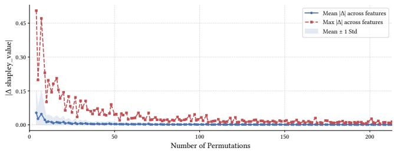  
Figure 1: A representative empirical convergence curve (shown for HGS on the rel-trial dataset for the study-adverse task). The plot tracks the absolute difference in estimated scores (|Δshapley\_value|) between consecutive permutation checkpoints.

$$
\Delta W _ { \mathrm { S h a p l e y - M C } } ^ { ( t ) } ( A _ { i } ) = | W _ { \mathrm { S h a p l e y - M C } } ^ { ( t ) } ( A _ { i } ) - W _ { \mathrm { S h a p l e y - M C } } ^ { ( t - 1 ) } ( A _ { i } ) |
$$

where $W _ { \mathrm { S h a p l e y - M C } } ^ { ( t ) } ( A _ { i } )$ represents the estimated importance score at elapsed hour �. By plotting the mean and maximum absolute diferences over time, we generate a loss-style convergence curve. We terminate once this curve visibly flattens out, indicating that the maximum absolute shift across all attributes has diminished to a negligible noise floor, and the relative order of the most influential data attributes has suficiently stabilized. A representative convergence curve is illustrated in Figure 1 (convergence plots for all other datasets are provided in Section B).

4.2.2 Kernel SHAP (Shapley-KS). An alternative approximation method is Shapley-KS [49], which frames the explanation of a blackbox model as a weighted linear regression. Unlike exact Shapley computations that require evaluating an exponentially large number of permutations, Shapley-KS estimates the importance scores by fitting an additive surrogate model on a bounded set $C \subseteq { \mathcal { P } } ( \operatorname { d a t } ( S ) )$ of sampled attribute coalitions.

To construct the sample set $C ,$ we adopt a structured sampling strategy aligned with the original Shapley-KS implementation [49], and adapted for our global evaluation setting. Coalitions are constructed by fully enumerating small $( \mathbf { e . g . , } | S | \in \{ 1 , 2 \} )$ ) and large (e.g., $| S | \in \{ N - 1 , N - 2 \} )$ subset sizes that naturally carry the highest SHAP kernel weights $\delta ( S )$ . These weights $\delta ( S )$ are theoretically derived to recover the original Shapley values and are defined as:

$$
\delta ( S ) = \frac { \left( N - 1 \right) } { \binom { N } { | S | } | S | ( N - | S | ) }
$$

The remaining evaluation budget is filled by randomly sampling coalitions such that the probability of drawing a coalition � is proportional to its weight � (�). Since � (�) depends only on the coalition size |� |, this is eficiently implemented without explicitly enumerating the entire space: the explainer first samples a subset size � according to the aggregate weights of each size, and then draws a combination of � attributes uniformly at random.

For a sampled coalition $S \in C ,$ we evaluate the characteristic function $\nu ( S )$ as defined in Equation (1). The surrogate explanation model approximates the global Shapley values $W ( A _ { i } )$ for each attribute $A _ { i }$ via the optimized coeficients $\phi _ { i }$ , which are obtained by solving the following weighted least-squares optimization problem:

$$
\left( \phi _ { 0 } , \dots , \phi _ { N } \right) = \arg \operatorname* { m i n } _ { \phi _ { 0 } ^ { \prime } , \dots , \phi _ { N } ^ { \prime } } \sum _ { S \in C } \left[ \nu ( S ) - \left( \phi _ { 0 } ^ { \prime } + \sum _ { A _ { i } \in S } \phi _ { i } ^ { \prime } \right) \right] ^ { 2 } \delta ( S )
$$

Comparing the two approximation strategies, Shapley-KS is generally more computationally eficient than Shapley-MC. This efficiency stems from Shapley-KS optimizing the variance of the estimates over a constrained sample space using weighted leastsquares, whereas Shapley-MC averages marginal contributions over sampled permutations. While Shapley-KS provides a consistent estimator of the Shapley values, it is currently unknown whether it is an unbiased estimator [14].

## 4.3 Mask Learning

The Mask Learning explainer [58] is an optimization-based explanation method designed to identify a small subset of attributes that are suficient to maintain the model’s original prediction. Unlike sampling-based methods (such as Shapley-MC and Shapley-KS), it formulates the explanation task as a mask-learning problem. For a given set of relational tables, the explainer learns a continuous mask vector � $\in \ [ 0 , 1 ] ^ { N }$ corresponding to the attributes in dat(S), where each element �� represents the importance of attribute $A _ { i } \in \operatorname { d a t } ( S )$ across the entire relational schema. Upon convergence, these learned mask values directly serve as our attri bution function, setting $W ( A _ { i } ) = m _ { i }$

Optimization objective. Following [58], the mask � is learned by solving a continuous optimization problem that minimizes the prediction error while encouraging � to promote only a small set of attributes. Let � be a target tuple, and let $f ( t , D )$ be the prediction of the model � on the original input database $D .$ Let $f ( t , D _ { m , \omega } )$ be the prediction on the masked database $D _ { m , \omega }$ under a random perturbation distribution $\omega ,$ which we describe in detail below. The objective employs a loss function to penalize the discrepancy between the original and masked predictions, alongside an $L _ { 1 }$ regularization weighted by a hyperparameter $\lambda$ to encourage the mask � to be sparse. Formally, the objective function is defined as:

$$
\operatorname* { m i n } _ { m \in [ 0 , 1 ] ^ { N } } \mathbb { E } _ { t } \mathbb { E } _ { \omega } \left[ \mathrm { l o s s } ( f ( t , D ) , f ( t , D _ { m , \omega } ) ) \right] + \lambda \| m \| _ { 1 }\tag{2}
$$

Relational masking strategy. The transformation to the masked database $D _ { m , \omega }$ is achieved through a mapping function ℎ(�) that applies the learned masks to the relational attributes. This mapping interpolates between the original value of an attribute $A _ { i }$ and an “uninformative” alternative state, denoted as ${ \bar { A } } _ { i }$ . At each optimization step, this alternative value ${ \bar { A } } _ { i }$ is randomly sampled for each tuple from the attribute’s empirical distribution over the entire database. The continuous mask value $m _ { i }$ dictates the weighting between the original and sampled values to produce the masked representation ${ \tilde { A } } _ { i }$ . The masking operation for each attribute is computed as $\tilde { A _ { i } } = m _ { i } \cdot A _ { i } + \left( 1 - m _ { i } \right) \cdot \bar { A _ { i } }$ . This masking operation is performed directly on the real-valued learned feature embeddings inside the model’s forward pass, ensuring a fully diferentiable formulation.

Implementation and hyperparameter selection. We incorporate an automated selection mechanism for the � hyperparameter aiming to balance the two components of Equation (2) at the beginning of optimization. The optimization is performed using the Adam optimizer over a fixed number of iterations, adopting the optimization hyperparameters reported in [58].

## 5 EXPERIMENTAL EVALUATION

We present comprehensive experiments to evaluate the alignment, consistency, and faithfulness of explanation methods applied to relational deep learning architectures. We aim to address three main research questions: (� ) How do explanation methods difer in the ranking of the attributes? (� ) How do they difer in the distribution of importance scores to the attributes? $( Q _ { 3 } )$ How do they difer in their fidelity scores, and to what extent are these diferences reflected in the ordinal and distributional comparisons?

Summary of results. Our empirical evaluation reveals that explainer consensus depends heavily on the nature of the predictive task. Across both ranking (Section 5.2) and score distribution (Section 5.3) evaluations, we observe that regression problems generally yield a unified subset of critical attributes across diferent methods, whereas classification tasks produce more varied importance assignments. Furthermore, while standard fidelity metrics (Section 5.4) broadly corroborate our direct comparisons, we also observe cases where divergent explanations achieve comparable fidelity. This demonstrates that comparing explainers by standard faithfulness evaluations alone can mask disagreements, making our alignment analysis a required complement to standard evaluations.

## 5.1 Experimental Setup

Next, we describe the general setup of our empirical study. The implementation is in Python 3.12 and publicly available.1

5.1.1 Datasets and Tasks. To evaluate the efectiveness of the explanation methods, we focus on predictive tasks from the RelBench framework, spanning datasets from both its initial release [59] and the updated version [34]. Each dataset represents a realistic relational database schema, and is associated with prediction tasks. We focus on entity-level tasks where the goal is to predict a specific outcome (classification or regression) for a target entity by aggregating information across multiple tables.

rel-trial. The rel-trial dataset [59] is a relational benchmark derived from clinical trial records, consisting of 15 interconnected tables, including studies, interventions, and outcomes. The schema comprises a total of 140 attributes, with approximately 5.5M rows across the entire relational structure. This dataset contains a rich set of attributes, including categorical study types, numerical participant counts, and textual descriptions of medical procedures.

We evaluate our methods on two distinct tasks within this dataset: (1) study-outcome, a binary classification task where the model predicts whether a clinical trial will achieve its primary outcome (defined as reaching a p-value $< 0 . 0 5 )$ , and (2) study-adverse, a regression task where the goal is to predict the exact number of afected patients with severe adverse events during the trial.

rel-arxiv. The rel-arxiv dataset [34] stores physics publications on arXiv between 2018 and 2023, consisting of 6 interconnected tables including papers, authors, and categories. The schema comprises 21 attributes with approximately 2M rows across all tables. This dataset contains diverse attributes such as paper titles and abstracts (represented as pretrained text embeddings).

We evaluate our methods on two tasks within this dataset: (1) paper-citation, a binary classification task predicting whether a paper will receive at least one citation within the next 6 months, and (2) author-publication, a regression task predicting how many papers a given author will publish within the next 6 months.

rel-f1. The rel-f1 dataset [59] is a relational benchmark based on Formula 1 racing data spanning over five decades, consisting of 9 interconnected tables including races, drivers, constructors, and results. The schema comprises a total of 67 attributes with approximately 98K rows across all tables.

We evaluate our methods on two tasks: (1) driver-dnf, a binary classification task predicting if a driver will get a "Did Not Finish" (DNF) status in a race within the next 1 month, and (2) driver-position, a regression task predicting the average finishing position of each driver across all races in the next 2 months.

rel-event. The rel-event dataset [59] is a relational benchmark derived from user activity on the Hangtime social event application, consisting of 5 interconnected tables including users, events, and event\_attendees. The schema comprises a total of 128 attributes with approximately 41.3M rows across all tables.

We evaluate our methods on two tasks within this dataset: (1) user-repeat, a binary classification task where the model predicts whether a user that attended a recent event will attend a future event (i.e., respond "yes" or "maybe"), and (2) user-attendance, a regression task aiming to predict the total number of events to which a user will respond "yes" or "maybe" in the next 7 days.

5.1.2 Prediction Models. Following Fey et al. [22], a database is represented as a graph where each tuple corresponds to a node, and edges are established based on FK/PK relationships. We experiment with two models of diferent paradigms: a message passing GNN and a transformer-based architecture.

• Message passing GNN (HGS): We follow the RelBench methodology [59] and use a model based on the heterogeneous GraphSAGE architecture [23, 36].

• Relational graph transformer (RelGT): The second architecture is the state-of-the-art Relational Graph Transformer (RelGT) framework [19], which operates over the same tuple-level graph constructed via FK/PK relationships.

In both architectures, following the RelBench methodology [59], initial node embeddings are generated using a ResNet-based tabular encoder [30]. To support attribute-level explanations via masking, we utilize the implementation of [58] which augments the default tabular encoders with real-valued masking capabilities.

5.1.3 Explainer Configurations. To enable a methodological alignment among the removal-based explainers (Single Column Ablation,

Shapley-MC, and Shapley-KS), we utilize a unified, deterministic ablation operator: mean imputation for numerical, temporal, and text attributes (computed over their pretrained embeddings), and the Most Frequent Value (MFV) for categorical attributes. This design choice is motivated by the foundational approximations of Shapley-KS [49], which simulates missing attributes using expected marginal values under the assumption of feature independence. Mask Learning inherently relies on a permutation-based masking strategy during its optimization, and is therefore not afected by this choice.

For the Shapley-KS explainer, we follow the standard samplecomplexity heuristic [49] recommending 2� + 2048 samples. In our schemas $N \leq 1 4 0 ,$ and we round up to enable robust empirical approximation, resulting in a fixed budget of 3,000 samples.

## 5.2 Explainer Ranking Alignment

Objectives. In this section, we aim to determine whether distinct explainability methods identify a consistent ranking of attribute importance (�1). To that end, we focus on the attribute ranking and ignore the absolute importance scores given by each explanation method. We aim to examine whether diferent mathematical frameworks converge on the same prioritization of relational database attributes when interpreting identical model decisions.

Evaluation Methodology. Explainers produce an importance score for each attribute. To compare top-� rankings with ties, we utilize the framework of Fagin et al. [20, 21]. There, tied elements are placed into equivalence classes (buckets) and assigned an average rank. Our importance scores may yield practically identical scores that are not exact ties. Therefore, we introduce a custom quantization step where attributes are grouped into equivalence classes using a dynamic, range-based threshold calculated individually for each explainer’s score distribution: $\tau = \left( w _ { \mathrm { m a x } } - w _ { \mathrm { m i n } } \right) / 1 0 0 .$ Bucketing is executed via a greedy pass over attributes sorted in descending order, where a new bucket is initiated only when a score drops by more than � from the highest score in the current bucket. We then follow Fagin’s methodology: average real-valued ranks are assigned to each bucket, and we apply the transformation to project the scores into a unified partial (top-�) ranking $\sigma ,$ where $\sigma ( A _ { i } )$ represents the final rank assigned to attribute $A _ { i } \in \operatorname { d a t } ( S )$ . For each attribute $A _ { i } \in \operatorname { d a t } ( S )$ , its rank is projected to $\sigma ( A _ { i } ) = \mathrm { r a n k } ( A _ { i } )$ if its sorted position (from 1 to �) after alphabetical tie-breaking falls within the top-� window. Attributes falling outside the top-� window are assigned a tied rank of $\ell = \left( N + k + 1 \right) / 2$ , representing the neutral average rank of all unranked items.

To quantify pairwise alignment between two explainers, we follow Fagin et al. [20] and use the $L _ { 1 }$ distance (generalized Spearman footrule) between the rankings $\sigma _ { 1 }$ and $\sigma _ { 2 } .$ . Specifically, for a prefix size $k ,$ define a normalized similarity score using the top-� distance:

$$
{ \mathrm { S i m i l a r i t y } } ( \sigma _ { 1 } , \sigma _ { 2 } ) = 1 - { \frac { \sum _ { A _ { i } \in \operatorname { d a t } ( S ) } | \sigma _ { 1 } ( A _ { i } ) - \sigma _ { 2 } ( A _ { i } ) | } { 2 k \ell - k ( k + 1 ) } }
$$

As expressed in the formula, the disagreement distance is the total sum ofabsolute rank diferences across all attributes. The distance is normalized to [0, 1] by the maximum possible distance, $2 k \ell - k ( k +$ 1), which occurs when the top-� sets are disjoint. We transform the distance to similarity by subtracting it from 1. The results are between 0 (complete disagreement) and 1 (full agreement).

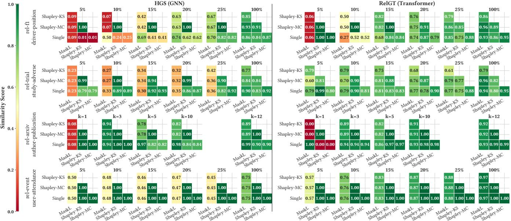  
Figure 2: Pairwise explainer similarity for regression, showing alignment on diferent prefixes (�) for HGS and RelGT.

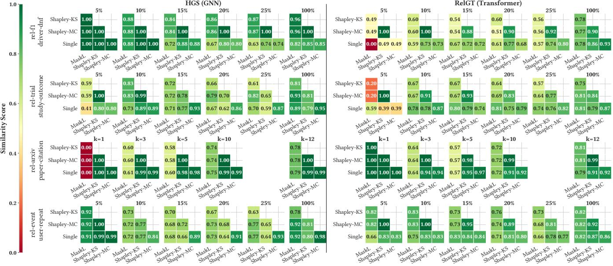  
Figure 3: Pairwise explainer similarity for classification, showing alignment on diferent prefixes (�) for HGS and RelGT.

We visualize alignments using pairwise similarity heatmaps (Figures 2 and 3). As pairwise similarity is symmetric and the diagonal is always 1.0, we display only the lower-triangular matrix to reduce visual redundancy. To maintain structural relevance across varying schema scales, large schemas are evaluated using percentage-based prefixes (5% to 100% of attributes), while compact schemas are tracked via absolute attribute counts. Darker green cells indicate higher agreement, whereas red configurations signal disagreement.

Results. Our analysis reveals that agreement is primarily driven by the nature of the task rather than the choice of the neural architecture. In regression (Figure 2), we observe high agreement among most explanation methods, growing stronger at larger � values. Specifically, Single Column Ablation, Shapley-MC, and Shapley-KS demonstrate strong alignment in their global and top-� rankings while Mask Learning frequently diverges from this consensus. Conversely, classification tasks (Figure 3) exhibit markedly less agreement among the explainers, as evidenced by the consistently lower similarity scores (weaker green intensities) across all � values.

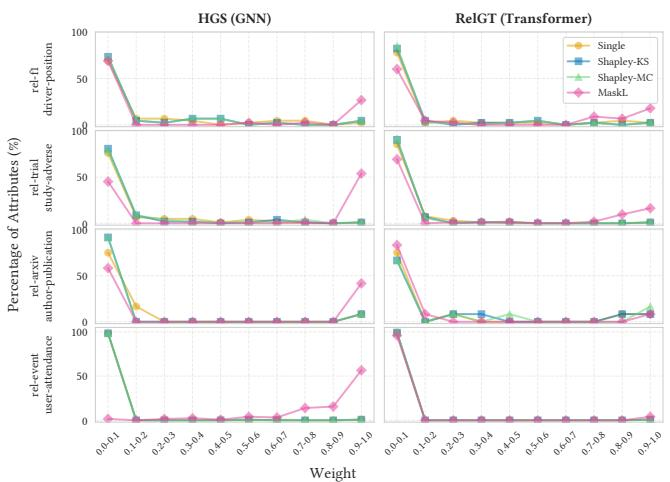  
(a) Regression tasks.

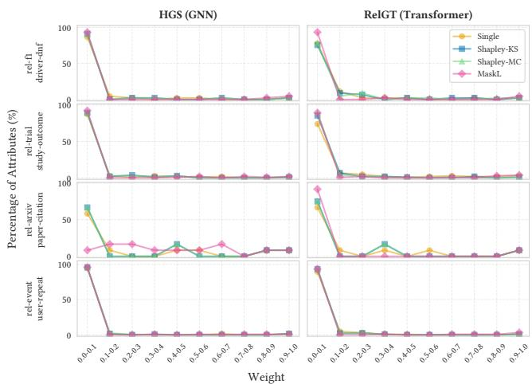  
(b) Classification tasks.  
Figure 4: Score distribution (PDF). Dots show the percentage of attributes within the normalized weight range.

Since Shapley-KS and Shapley-MC are both strategies designed to estimate the exact Shapley values, we often observe a perfect agreement score between them, especially over the top attributes. However, this is not always the case: for example, there were disagreements between the methods in the study-adverse task under RelGT, study-outcome and user-repeat for both architectures. To verify that these discrepancies are not simply artifacts of insuficient sampling, we empirically validated the convergence of both methods (convergence plots for Shapley-KS are provided in Section C alongside those for Shapley-MC in Section B ). Therefore, these differences stem inherently from the distinct estimation mechanisms of the two explainers. Hence, while the two approximations reach strong agreement on the highest-ranked attributes (i.e., at lower � values), their rankings frequently diverge as � increases.

While Single Column Ablation, Shapley-KS, and Shapley-MC often behave similarly in their importance scores, their execution times difer significantly. The runtime of Single Column Ablation depends directly on the number of database columns, whereas Shapley-KS and Shapley-MC also depend on the number of samples. In our empirical evaluation, when measuring execution times at the point of empirical convergence for each method, Shapley-KS completed its execution a median of 37× faster than Monte Carlo sampling. However, the Single Column Ablation explainer remains the most computationally eficient, completing its execution a median of 9.3× faster than Shapley-KS. A more comprehensive evaluation of run times is left for future work. These significant runtime performance trade-ofs highlight the practical advantages of the Single Column Ablation explainer in large-scale relational schemas.

Conclusions. The level of agreement among explanation methods depends heavily on the type of the predictive task. Regression tasks result in significantly higher explainer consensus than classification tasks. In scenarios where multiple methods produce highly similar rankings, they can be distinguished primarily by their computational eficiency. In these high-agreement regimes, Single Column Ablation emerges as an eficient proxy, delivering rankings that are highly aligned with the computationally prohibitive Shapley-MC and Shapley-KS methods. Finally, while Shapley-KS and Shapley MC generally align closely on the top attributes, their distinct estimation strategies prevent strictly identical rankings.

Additionally, the persistent divergence of Mask Learning highlights that an explainer’s behavior is heavily dictated by its mathematical formulation. Specifically, Mask Learning evaluates collaborative impact by optimizing all attributes simultaneously to discover the most predictive joint subset, rather than isolating individual contributions. Furthermore, Mask Learning employs permutationbased masking instead of deterministic baseline imputation. These diferences in core objectives and underlying ablation operators play a critical role in shaping the resulting importance rankings.

## 5.3 Explainer Score Distribution

Objectives. In this section, we aim to determine how explainability methods difer in the distribution of importance scores to attributes (�2). We divide this analysis into two parts: (1) examining whether methods difer in their overall score distribution across the entire attribute space, and (2) determining whether they agree on the specific top relational attributes. Unlike the ranking evaluation (Section 5.2) which considers only ordinal positions, this analysis must also evaluate the actual importance scores, since attributes may hold similar ordinal ranks across diferent explainers, while receiving vastly diferent importance scores.

Evaluation methodology. To enable meaningful comparisons across explainers with diferent score distributions, we apply min-max normalization to map absolute attribution weights onto a standardized

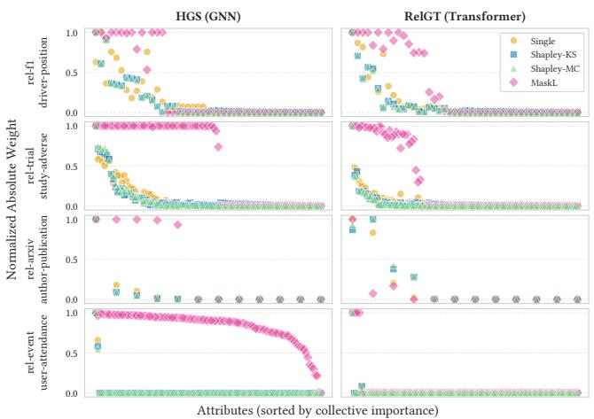  
(a) Regression tasks.

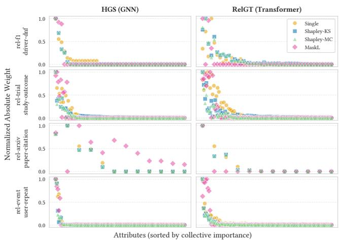  
(b) Classification tasks.  
Figure 5: Normalized score scatter grid. Attributes along the x-axis are sorted by collective importance.

continuous scale [0, 1]:

$$
\tilde { W } ( A _ { i } ) = \frac { | W ( A _ { i } ) | - \operatorname* { m i n } _ { A _ { j } \in \operatorname { d a t } ( S ) } | W ( A _ { j } ) | } { \operatorname* { m a x } _ { A _ { j } \in \operatorname { d a t } ( S ) } | W ( A _ { j } ) | - \operatorname* { m i n } _ { A _ { j } \in \operatorname { d a t } ( S ) } | W ( A _ { j } ) | }
$$

After the transformation, the most vital attribute receives a score of 1.0 and the least important one receives a score of 0.0. We compare the diferent explainers by inspecting their normalized score distributions and the individual attributes with the highest scores.

Results. We first examine the overall score distributions using the probability density function (PDF) of attribution weights (Figure 4), by dividing the normalized range of weights into discrete bins and measuring the percentage of attributes in each bin. Across both task types, most methods assign very low importance scores to the vast majority of attributes, reserving high scores for only a select few. However, in regression tasks (Figure 4a), Mask Learning exhibits a notably diferent behavior: it is more “generous,” assigning maximum importance values (in the 0.9–1.0 bin) to a considerably larger proportion of attributes compared to the other explainers.

To understand how these scores behave across individual attributes, we plot the individual normalized importance scores as a scatter (Figure 5), where the attributes along the x-axis are ordered by their cumulative normalized weight over all explainers. We ob serve a general consensus among all methods regarding which attributes are highly important versus those that are negligible. In regression tasks (Figure 5a), the individual explainer scores track closely together, forming a tight and steep decay curve, though Mask Learning maintains high scores for a wider range of attributes before decaying. Conversely, in classification tasks (Figure 5b), the scores are noticeably more dispersed, indicating lower explainer agreement on the exact importance magnitudes of the top attributes.

Finally, we construct an ensemble consensus score grid (Figures 6a and 6b) to inspect the specific attributes driving the predictions. To do so, we isolate the union of attributes that rank within the top � = 15 of at least one method and display the top 10 attributes from this union, ordered by the number of explainers that included them. Within each panel cell, we present the explainer’s ordinal rank position (#) and the normalized score (encoded by the bar width). As previously noted, alphabetical tie-breaking is applied when attributes share identical importance scores. It is critical to keep this tie-breaking strategy in mind, as it heavily influences the exact top-� choices when an explainer (such as Mask Learning in regression tasks) assigns the identical maximum score of 1.0 to a large number of attributes. These grids corroborate our previous findings while providing semantic insights into the model’s logic.

An inspection of these top-ranked attributes suggests that the explainers tend to prioritize historical indicators that directly relate to the target. For instance, in the rel-f1 driver-position regression task under the RelGT architecture, all explainers agree that res.posOrder (the finishing position in previous races) is the most critical attribute (Mask Learning also assigns it the maximum score of 1.0, placing it at #4 due to alphabetical tie-breaking). This aligns with the intuition that a driver’s past finishing positions are strong indicators of their future average position.

Similarly, in the rel-event user-attendance task under the RelGT architecture, we observe a strong preference for behavioral signals. Here, event\_attendees.stat, representing the user’s historical RSVP responses (invited, yes, maybe, no), is unanimously identified as the leading attribute. This aligns with the intuition that a participant’s future event attendance is strongly influenced by their past attendance behavior.

Conclusions. The manner in which explainers distribute importance scores is driven by the predictive task. Regression tasks foster a strong consensus where multiple explainers agree on both the identity and the steep decay of the most critical attributes, providing practitioners with high confidence in the derived explanations. While Mask Learning tends to be more generous with its score distributions in these settings, its ordinal alignment across the top attributes remains consistent with the other methods. In contrast, classification tasks yield more scattered and inconsistent score distributions, reflecting higher uncertainty among the explanations. Despite the distribution diferences, when methods converge on specific semantic attributes, such as a driver’s historical finishing order or a user’s past RSVP behavior, they reveal highly logical, intuitive insights into the underlying model’s predictive mechanisms.

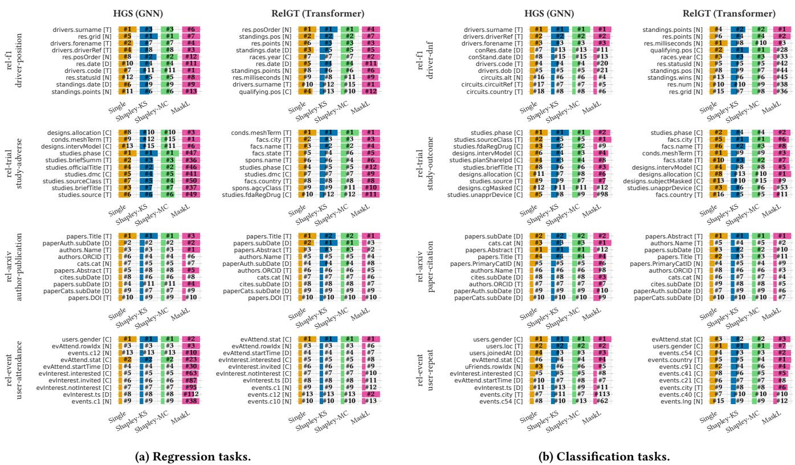  
Figure 6: Consensus min-max normalized score grids across all tasks (top-15 evaluation, displaying top 10 consensus attributes). Cells display individual ranks (#) and bar widths represent normalized scores. Data type are in brackets: [N] Numerical, [C] Categorical, [D] Date, and [T] Text. Alphabetical tie-breaking may afect the exact top-� choices (See Section 5.2).

## 5.4 Fidelity Metrics Evaluation

Objectives. Fidelity metrics are a widely used method to evaluate AI explainability tools [75]. fidelity aims to quantify explanation faithfulness, or, how well do the explanations capture and reflect the prediction model’s decisions. Following standard conventions [75], Fidelity+ evaluates the necessity ofthe top-ranked attributes by measuring the absolute prediction shift when those specific attributes are ablated. Conversely, Fidelity− assesses the suficiency of the top attributes by measuring the prediction shift when only those attributes are retained and the rest are ablated. We now investigate to what extent the diferences and similarities among explanation methods are reflected in their fidelity scores (�3).

Evaluation methodology. Across both classification and regression, fidelity (of either type) is evaluated via the absolute prediction shift induced on model output predictions. To enable the comparison over schemas with varying numbers of attributes, we evaluate the fidelity across relative � values (5% to 100%) for schemas with a large number of data attributes, and with absolute counts for schemas with fewer attributes. It is important to note that our fidelity evalu ation employs the same deterministic ablation strategy used by all explanation methods, with the exception of Mask Learning, which relies on its own permutation-based ablation during optimization.

Results. We examine how explanation subsets impact model performance by comparing Fidelity+ and Fidelity− scores across varying top-� subsets in all combinations of tasks and models (Figure 7).

Overall, the fidelity scores are consistent with the results of our ranking analyses (Section 5.2). Methods that produce similar attribute rankings generally yield similar fidelity scores. For example, in the rel-trial study-adverse regression task under HGS, Single Column Ablation, Shapley-MC, and Shapley-KS achieve high ranking similarity, while Mask Learning receives very low agreement scores. This behavior is reflected in the fidelity metrics: the three aligned methods yield closely matched Fidelity+ and Fidelity− scores, whereas Mask Learning produces significantly different fidelity scores. A similar pattern emerges in the rel-arxiv paper-citation classification task under RelGT, where Mask Learning diverges significantly in both ranking and fidelity across most � values. The only exception occurs at � = 1, where all four explainers reach full ranking agreement, which is directly mirrored by identical fidelity scores across all methods at that specific point.

While fidelity scores validate our previous findings, they evaluate the predictive utility of a subset rather than its exact content. Thus, fidelity can difer from ranking alignment. As aforesaid, Mask Learning’s tendency to assign identical maximum scores can trigger alphabetical tie-breaking, causing apparent fidelity deviations at small � values (e.g., rel-arxiv author-publication at � = 1). Furthermore, diferent subsets can sometimes have the same predictive power. For instance, in the rel-trial study-adverse regression task under RelGT at � = 20%, we observe a ranking disagreement between Shapley-KS and Mask Learning (with a similarity score of 0.68), yet their fidelity is tightly clustered.

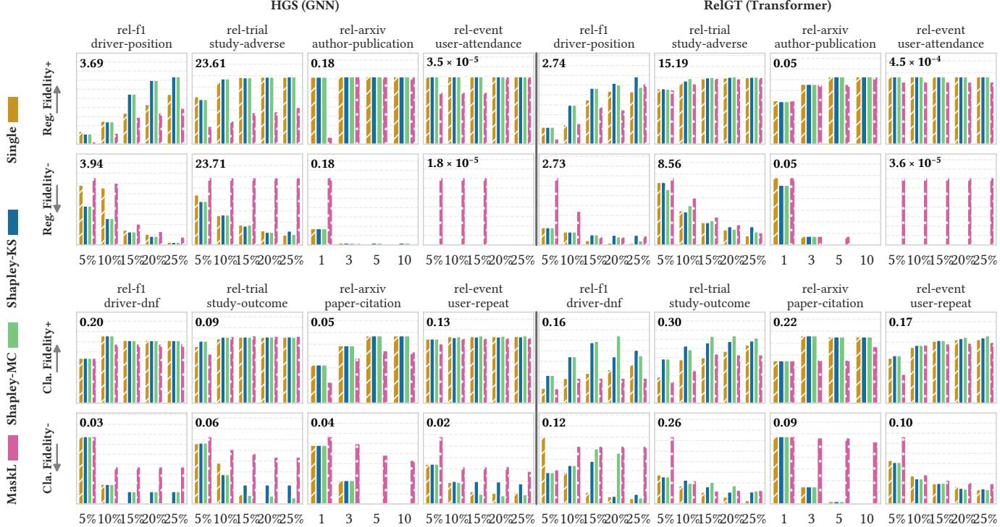  
Figure 7: Explainer fidelity in regression (top 2 rows) and classification (bottom 2 rows) tasks, over HGS (left) and RelGT (right). Bars represent Fidelity+ (necessity, higher is better) and Fidelity− (suficiency, lower is better) across varying top-� attribute subsets. The maximum y-axis value for each subplot is annotated in its top-left corner.

Conclusions. Fidelity metrics provide a valuable perspective that is broadly consistent with our direct explainer comparisons: Single Column Ablation and the Shapley-based approximations often group together in their predictive degradation profiles, while Mask Learning exhibits distinct behavior. However, as fidelity evaluates the predictive utility of a set rather than its specific composition, it does not replace direct ordinal and distributional comparisons. Similar fidelity can sometimes stem from diferent attributes. Thus, pairing fidelity with dedicated ranking and distributional evaluations provides a more comprehensive picture of explainer agreement.

## 6 CONCLUSIONS

We presented a systematic study of importance attribution methods for database columns in relational deep learning. We considered four representative methods and developed quantitative analyses and visualizations for comparing both the rankings they induce and the distributions of their importance scores. We applied these methods across multiple datasets and prediction tasks using two relational deep learning architectures, HGS and RelGT, and examined their relationship to conventional fidelity measures.

Our results demonstrate that the extent of agreement among explanation methods is context-dependent. Specifically, explainer agreement is driven by the nature of the predictive task, with regression tasks yielding a much higher consensus than classification tasks. Furthermore, the agreement depends on the underlying mathematical objective of the explainer. While Single Column Ablation and the two Shapley approximations often align closely, Mask Learning frequently diverges, reflecting its distinct focus on collective subset suficiency rather than individual marginal contributions.

Our findings do not imply that any one explanation method is universally preferable. Rather, they suggest that importance scores should be interpreted in light ofthe method that produces them. In cases where explanations play a substantive role, a system may benefit from presenting results from more than one method, or at least from clarifying the essence and notion of importance captured by the selected method. Similarly, scientific studies that draw conclusions from attribute-importance scores may strengthen their conclusions by examining whether they persist across alternative explanation methods. Finally, our results motivate considering the stability of explanations across diferent predictive tasks as a complementary aspect of model evaluation, alongside predictive performance. We view these as directions for practice and future investigation, rather than as general requirements.

Our study opens several directions for future investigation. First, while our empirical results often showed strong alignment between computationally expensive Shapley approximations and the highly eficient single-column ablation, a critical avenue for future work is identifying the specific dataset characteristics, model complexities, or problem domains where the rigorous game-theoretic properties of the Shapley value provide a tangible advantage that justifies its computational overhead. Second, as the ultimate goal of explainability is to provide actionable insights to users, our current evaluation is limited to quantitative algorithmic metrics. Future research should incorporate human-centric case studies to determine which mathematical notions of importance best align with user intuition and domain expertise. Finally, while our evaluation framework is broadly applicable to any predictive model operating over relational data (with the exception of Mask Learning, which requires architecture-specific integration), our experiments focused on graph-based neural networks. An important next step is to expand this methodology to encompass emerging architectures, such as relational foundation models and advanced tabular approaches (e.g., TabPFN), across a wider spectrum of relational datasets.

## REFERENCES

[1] Julius Adebayo, Justin Gilmer, Michael Muelly, Ian Goodfellow, Moritz Hardt, and Been Kim. 2018. Sanity Checks for Saliency Maps. In Advances in Neural Information Processing Systems, S. Bengio, H. Wallach, H. Larochelle, K. Grauman, N. Cesa-Bianchi, and R. Garnett (Eds.), Vol. 31. Curran Associates, Inc.

[2] Chirag Agarwal, Satyapriya Krishna, Eshika Saxena, Martin Pawelczyk, Nari Johnson, Isha Puri, Marinka Zitnik, and Himabindu Lakkaraju. 2022. OpenXAI: Towards a Transparent Evaluation of Model Explanations. In Advances in Neural Information Processing Systems, S. Koyejo, S. Mohamed, A. Agarwal, D. Belgrave, K. Cho, and A. Oh (Eds.), Vol. 35. Curran Associates, Inc., 15784–15799.

[3] Kenza Amara, Zhitao Ying, Zitao Zhang, Zhichao Han, Yang Zhao, Yinan Shan, Ulrik Brandes, Sebastian Schemm, and Ce Zhang. 2022. GraphFramEx: Towards Systematic Evaluation of Explainability Methods for Graph Neural Networks. In Proceedings ofthe First Learning on Graphs Conference (PLMR), Vol. 198. PMLR, 44:1–44:23.

[4] Plamen P. Angelov, Eduardo A. Soares, Richard Jiang, Nicholas I. Arnold, and Peter M. Atkinson. 2021. Explainable artificial intelligence: an analytical review. WIREs Data Mining Knowl. Discov. 11, 5 (2021)

[5] Marcelo Arenas, Pablo Barcelo, Leopoldo Bertossi, and Mikael Monet. 2023. On the Complexity of SHAP-Score-Based Explanations: Tractability via Knowledge Compilation and Non-Approximability Results. Journal of Machine Learning Research 24, 63 (2023), 1–58.

[6] Roland Bacher. 2002. Determinants of matrices related to the Pascal triangle. Journal de Théorie des Nombres de Bordeaux 14 (01 2002).

[7] Pablo Barceló, Alexander Kozachinskiy, Miguel Romero, Bernardo Subsercaseaux, and José Verschae. 2025. Explaining k-Nearest Neighbors: Abductive and Coun terfactual Explanations. Proc. ACM Manag. Data 3, 2, Article 97 (June 2025), 26 pages.

[8] Leopoldo E. Bertossi, Benny Kimelfeld, Ester Livshits, and Mikaël Monet. 2023. The Shapley Value in Database Management. SIGMOD Rec. 52, 2 (2023), 6–17.

[9] Umang Bhatt, Adrian Weller, and José M. F. Moura. 2020. Evaluating and Aggregating Feature-based Model Explanations. In IJCAI. ijcai.org, 3016–3022.

[10] Leo Breiman. 2001. Random forests. Machine learning 45, 1 (2001), 5–32.

[11] Riccardo Cappuzzo, Paolo Papotti, and Saravanan Thirumuruganathan. 2020. Creating Embeddings of Heterogeneous Relational Datasets for Data Integration Tasks. In SIGMOD (SIGMOD ’20). ACM, 1335–1349.

[12] Adriane Chapman and H. V. Jagadish. 2009. Why not?. In SIGMOD (SIGMOD ’09). ACM, 523–534.

[13] Jianbo Chen, Le Song, Martin Wainwright, and Michael Jordan. 2018. Learning to Explain: An Information-Theoretic Perspective on Model Interpretation. In ICML (PLMR), Vol. 80. PMLR, 883–892.

[14] Ian Covert and Su-In Lee. 2021. Improving KernelSHAP: Practical Shapley Value Estimation Using Linear Regression. In AISTATS (PLMR), Vol. 130. PMLR, 3457–3465.

[15] Ian Covert, Scott Lundberg, and Su-In Lee. 2021. Explaining by Removing: A Unified Framework for Model Explanation. Journal ofMachine Learning Research 22, 209 (2021), 1–90.

[16] Milan Cvitkovic. 2019. Supervised learning on relational databases with graph neural networks. In ICLR 2019 Workshop on Representation Learning on Graphs and Manifolds.

[17] Dries Debeer and Carolin Strobl. 2020. Conditional permutation importance revisited. BMC bioinformatics 21, 1 (2020), 307.

[18] Daniel Deutch, Nave Frost, Benny Kimelfeld, and Mikaël Monet. 2022. Comput ing the Shapley Value of Facts in Query Answering. In Proceedings ofthe 2022 International Conference on Management ofData (SIGMOD ’22). ACM, 1570–1583.

[19] Vijay Prakash Dwivedi, Sri Jaladi, Yangyi Shen, Federico Lopez, Charilaos Kanatsoulis, Rishi Puri, Matthias Fey, and Jure Leskovec. 2026. Relational Graph Transformer. In ICLR, C. Vondrick, B. Hariharan, C. Rafel, L. Pinto, D. Yang, and A. Faust (Eds.), Vol. 2026. 154348–154369.

[20] Ronald Fagin, Ravi Kumar, Mohammad Mahdian, D. Sivakumar, and Erik Vee. 2004. Comparing and aggregating rankings with ties. In PODS (Paris, France) (PODS ’04). ACM, New York, NY, USA, 47–58.

[21] Ronald Fagin, Ravi Kumar, and Dakshinamurthi Sivakumar. 2003. Comparing top k lists. SIAM Journal on discrete mathematics 17, 1 (2003), 134–160.

[22] Matthias Fey, Weihua Hu, Kexin Huang, Jan Eric Lenssen, Rishabh Ranjan, Joshua Robinson, Rex Ying, Jiaxuan You, and Jure Leskovec. 2024. Position: Relational Deep Learning - Graph Representation Learning on Relational Databases. In ICML (PLMR), Vol. 235. PMLR, 13592–13607.

[23] Matthias Fey and Jan Eric Lenssen. 2019. Fast graph representation learning with PyTorch Geometric. arXiv preprint arXiv:1903.02428 (2019).

[24] Aaron Fisher, Cynthia Rudin, and Francesca Dominici. 2019. All Models are Wrong, but Many are Useful: Learning a Variable’s Importance by Studying an Entire Class of Prediction Models Simultaneously. Journal of Machine Learning Research 20, 177 (2019), 1–81.

[25] Ruth C. Fong and Andrea Vedaldi. 2017. Interpretable Explanations of Black Boxes by Meaningful Perturbation. In 2017 IEEE International Conference on Computer Vision (ICCV). 3449–3457.

[26] Kareem El Gebaly, Guoyao Feng, Lukasz Golab, Flip Korn, and Divesh Srivastava. 2018. Explanation Tables. IEEE Data Eng. Bull. 41, 3 (2018), 43–51.

[27] Alexandros V. Gerbessiotis. 2025. A survey of Chernof and Hoefding bounds. arXiv:2506.15612 [cs.DM]

[28] Boris Glavic. 2021. Data Provenance - Origins, Applications, Algorithms, and Models. Foundations and Trends® in Databases 9, 3-4 (2021), 209–441.

[29] Boris Glavic, Alexandra Meliou, and Sudeepa Roy. 2021. Trends in Explanations: Understanding and Debugging Data-driven Systems. Found. Trends Databases 11, 3 (Aug. 2021), 226–318.

[30] Yury Gorishniy, Ivan Rubachev, Valentin Khrulkov, and Artem Babenko. 2021. Revisiting deep learning models for tabular data. Advances in neural information processing systems 34 (2021), 18932–18943.

[31] Todd J. Green and Val Tannen. 2017. The Semiring Framework for Database Provenance. In PODS (PODS ’17). ACM, 93–99.

[32] Léo Grinsztajn, Klemens Flöge, Oscar Key, Felix Birkel, Philipp Jund, Brendan Roof, Mihir Manium, Shi Bin Hoo, Magnus Bühler, Anurag Garg, Dominik Sa faric, Jake Robertson, Benjamin Jäger, Simone Alessi, Adrian Hayler, Vladyslav Moroshan, Lennart Purucker, Philipp Singer, Alan Arazi, Julien Siems, Jan Hendrik Metzen, Georg Grab, Nick Erickson, Siyuan Guo, Eliott Kalfon, Simon Bing, David Salinas, Clara Cornu, Lilly Charlotte Wehrhahn, Diana Kriuchkova, Kursat Kaya, Lydia Sidhoum, Marie Salmon, Jerry Chen, Madelon Hulsebos, Yann LeCun, Samuel Müller, Bernhard Schölkopf, Sauraj Gambhir, Noah Hollmann, and Frank Hutter. 2026. TabPFN-3: Technical Report. arXiv:2605.13986 [cs.LG]

[33] Martin Grohe, Benny Kimelfeld, Peter Lindner, and Christoph Standke. 2024. The Importance of Parameters in Database Queries. In ICDT (LIPIcs), Vol. 290. Schloss Dagstuhl - Leibniz-Zentrum für Informatik, 14:1–14:17.

[34] Justin Gu, Rishabh Ranjan, Charilaos Kanatsoulis, Haiming Tang, MartinJurkovic, Valter Hudovernik, Mark Znidar, Pranshu Chaturvedi, Parth Shrof, Fengyu Li, and Jure Leskovec. 2026. RelBench v2: A Large-Scale Benchmark and Repository for Relational Data. arXiv:2602.12606 [cs.LG]

[35] Riccardo Guidotti, Anna Monreale, Salvatore Ruggieri, Franco Turini, Fosca Giannotti, and Dino Pedreschi. 2018. A Survey of Methods for Explaining Black Box Models. ACM Comput. Surv. 51, 5, Article 93 (Aug. 2018), 42 pages. https://doi.org/10.1145/3236009

[36] Will Hamilton, Zhitao Ying, and Jure Leskovec. 2017. Inductive representation learning on large graphs. Advances in neural information processing systems 30 (2017).

[37] Anna Hedström, Leander Weber, Daniel Krakowczyk, Dilyara Bareeva, Franz Motzkus, Wojciech Samek, Sebastian Lapuschkin, and Marina M.-C. Höhne. 2023. Quantus: An Explainable AI Toolkit for Responsible Evaluation of Neural Network Explanations and Beyond. J. Mach. Learn. Res. 24 (2023), 34:1–34:11.

[38] Noah Hollmann, Samuel Müller, Katharina Eggensperger, and Frank Hutter. 2023. TabPFN: A Transformer That Solves Small Tabular Classification Problems in a Second. In ICLR. OpenReview.net.

[39] Sara Hooker, Dumitru Erhan, Pieter-Jan Kindermans, and Been Kim. 2019. A Benchmark for Interpretability Methods in Deep Neural Networks. In Advances in Neural Information Processing Systems, H. Wallach, H. Larochelle, A. Beygelzimer, F. d'Alché-Buc, E. Fox, and R. Garnett (Eds.), Vol. 32. Curran Associates, Inc.

[40] Valter Hudovernik, Federico López, Vid Kocijan, Akihiro Nitta, Jan Eric Lenssen, Jure Leskovec, and Matthias Fey. 2026. KumoRFM-2: Scaling Foundation Models for Relational Learning. arXiv:2604.12596 [cs.LG]

[41] Prajakta Kalmegh, Shivnath Babu, and Sudeepa Roy. 2018. iQCAR: Inter-Query Contention Analyzer. In Proceedings of the ACM Symposium on Cloud Computing (SoCC ’18). ACM, 532.

[42] James Max Kanter and Kalyan Veeramachaneni. 2015. Deep feature synthesis: Towards automating data science endeavors. In DSAA. IEEE, 1–10.

[43] Satyapriya Krishna, Tessa Han, Alex Gu, Steven Wu, Shahin Jabbari, and Himabindu Lakkaraju. 2024. The Disagreement Problem in Explainable Machine Learning: A Practitioner’s Perspective. Transactions on Machine Learning Research (2024).

[44] Seokki Lee, Bertram Ludäscher, and Boris Glavic. 2020. Approximate summaries for why and why-not provenance. Proc. VLDB Endow. 13, 6 (Feb. 2020), 912–924.

[45] Ester Livshits, Leopoldo Bertossi, Benny Kimelfeld, and Moshe Sebag. 2020. The Shapley Value of Tuples in Query Answering. In 23rd International Conference on Database Theory (ICDT 2020) (Leibniz International Proceedings in Informatics (LIPIcs)), Vol. 155. Schloss Dagstuhl–Leibniz-Zentrum für Informatik, 20:1–20:19. https://doi.org/10.4230/LIPIcs.ICDT.2020.20

[46] Ester Livshits, Leopoldo Bertossi, Benny Kimelfeld, and Moshe Sebag. 2021. Query Games in Databases. SIGMOD Rec. 50, 1 (June 2021), 78–85.

[47] Antonio Longa, Steve Azzolin, Gabriele Santin, Giulia Cencetti, Pietro Lio, Bruno Lepri, and Andrea Passerini. 2025. Explaining the Explainers in Graph Neural Networks: a Comparative Study. ACM Comput. Surv. 57, 5, Article 120 (Jan. 2025), 37 pages.

[48] Yuval Lev Lubarsky, Dean Light, Boaz Berger, Shunit Agmon, and Benny Kimelfeld. 2026. Incorporating Deep Learning Design in Database Queries. CoRR abs/2605.24207 (2026). Tabular Data Analysis Workshop at VLDB.

[49] Scott M Lundberg and Su-In Lee. 2017. A Unified Approach to Interpreting Model Predictions. In Advances in Neural Information Processing Systems, Vol. 30.

Curran Associates, Inc.

[50] Joao Marques-Silva. 2023. Logic-Based Explainability in Machine Learning. Springer Nature Switzerland, 24–104.

[51] Joe Meyer, Tomasz Palczewski, Afreen Shaikh, Mahmoud Mohammadi, Dinesh Katupputhur Ramprasath, Karan Paresh, Roshan Reddy Upendra, and Mark Li. 2026. Relational In-Context Learning on Structured Data via Neighborhood Aggregation and Structural Information (Extended Abstract). In AAAI Summer Symposia.

[52] Zhengjie Miao, Qitian Zeng, Chenjie Li, Boris Glavic, Oliver Kennedy, and Sudeepa Roy. 2019. CAPE: explaining outliers by counterbalancing. Proc. VLDB Endow. 12, 12 (Aug. 2019), 1806–1809.

[53] Christoph Molnar. 2025. Interpretable Machine Learning (3rd ed.). Accessed: 2025.

[54] Christoph Molnar, Gunnar König, Bernd Bischl, and Giuseppe Casalicchio. 2024. Model-agnostic feature importance and efects with dependent features: a condi tional subgroup approach. Data Min. Knowl. Discov. 38, 5 (2024), 2903–2941.

[55] Claudia Perlich and Foster J. Provost. 2006. Distribution-based aggregation for relational learning with identifier attributes. Mach. Learn. 62, 1-2 (2006), 65–105.

[56] Rishabh Ranjan, Valter Hudovernik, Mark Znidar, Charilaos Kanatsoulis, Roshan Upendra, Mahmoud Mohammadi, Joe Meyer, Tom Palczewski, Carlos Guestrin, and Jure Leskovec. 2026. Relational Transformer: Toward Zero-Shot Foundation Models for Relational Data. In ICLR, C. Vondrick, B. Hariharan, C. Rafel, L. Pinto, D. Yang, and A. Faust (Eds.), Vol. 2026. 69149–69174.

[57] Marco Tulio Ribeiro, Sameer Singh, and Carlos Guestrin. 2016. "Why Should I Trust You?": Explaining the Predictions of Any Classifier. In KDD (KDD ’16). ACM, 1135–1144.

[58] Agapi Rissaki, Ilias Fountalis, Wolfgang Gatterbauer, and Benny Kimelfeld. 2026. Database Views as Explanations for Relational Deep Learning. Proc. VLDB Endow. 19, 7 (2026), 1643–1658.

[59] Joshua Robinson, Rishabh Ranjan, Weihua Hu, Kexin Huang,Jiaqi Han, Alejandro Dobles, Matthias Fey, Jan Eric Lenssen, Yiwen Yuan, Zecheng Zhang, Xinwei He, and Jure Leskovec. 2024. RelBench: A Benchmark for Deep Learning on Relational Databases. In NeurIPS.

[60] Sudeepa Roy, Laurel Orr, and Dan Suciu. 2015. Explaining query answers with explanation-ready databases. Proc. VLDB Endow. 9, 4 (Dec. 2015), 348–359.

[61] Sudeepa Roy and Dan Suciu. 2014. A formal approach to finding explanations for database queries. In SIGMOD (SIGMOD ’14). ACM, 1579–1590.

[62] Benedek Rozemberczki, Lauren Watson, Péter Bayer, Hao-Tsung Yang, Olivér Kiss, Sebastian Nilsson, and Rik Sarkar. 2022. The Shapley Value in Machine Learning. In IJCAI, Lud De Raedt (Ed.). IJCAI, 5572–5579. Survey Track.

[63] Wojciech Samek and Klaus-Robert Müller. 2019. Towards explainable artificial intelligence. In Explainable AI: interpreting, explaining and visualizing deep learning. Springer, 5–22.

[64] Erich Schubert and Michael Gertz. 2018. Numerically stable parallel computation of (co-) variance. In Proceedings ofthe 30th international conference on scientific and statistical database management. 1–12.

[65] Lloyd S Shapley. 1953. A Value for n-Person Games. In Contributions to the Theory of Games II, Harold W. Kuhn and Albert W. Tucker (Eds.). Princeton University Press, Princeton, 307–317.

[66] Arie Soeteman, Balder ten Cate, Maurice Funk, Benny Kimelfeld, Carsten Lutz, and Moritz Schönherr. 2026. Neuro-Relational Programs: Unifying Queries and Neural Computation over Structured Data. CoRR abs/2606.11946 (2026).

[67] Mukund Sundararajan, Ankur Taly, and Qiqi Yan. 2017. Axiomatic Attribution for Deep Networks. In ICML (PLMR), Vol. 70. PMLR, 3319–3328.

[68] Jan Tönshof, Neta Friedman, Martin Grohe, and Benny Kimelfeld. 2023. Stable Tuple Embeddings for Dynamic Databases. In ICDE. IEEE, 1286–1299.

[69] Guy Van den Broeck, Anton Lykov, Maximilian Schleich, and Dan Suciu. 2022. On the Tractability of SHAP Explanations. J. Artif. Int. Res. 74 (Sept. 2022), 36.

[70] Minjie Wang, Quan Gan, David Wipf, Zhenkun Cai, Ning Li, Jianheng Tang, Yanlin Zhang, Zizhao Zhang, Zunyao Mao, Yakun Song, Yanbo Wang, Jiahang Li, Han Zhang, Guang Yang, Xiao Qin, Chuan Lei, Muhan Zhang, Weinan Zhang, Christos Faloutsos, and Zheng Zhang. 2024. 4DBInfer: A 4D Benchmarking Toolbox for Graph-Centric Predictive Modeling on RDBs. In Advances in Neural Information Processing Systems, Vol. 37. Curran Associates, Inc., 27236–27273.

[71] Yanbo Wang, Xiyuan Wang, Quan Gan, Minjie Wang, Qibin Yang, David Wipf, and Muhan Zhang. 2025. Grifin: Towards a Graph-Centric Relational Database Foundation Model. In ICML (PLMR). PMLR / OpenReview.net.

[72] Eugene Wu and Samuel Madden. 2013. Scorpion: explaining away outliers in aggregate queries. Proc. VLDB Endow. 6, 8 (June 2013), 553–564.

[73] Zhitao Ying, Dylan Bourgeois, Jiaxuan You, Marinka Zitnik, and Jure Leskovec. 2019. GNNExplainer: Generating explanations for graph neural networks. In Advances in Neural Information Processing Systems, H. Wallach, H. Larochelle, A. Beygelzimer, F. d'Alché-Buc, E. Fox, and R. Garnett (Eds.), Vol. 32. Curran Associates, Inc.

[74] Brit Youngmann, Michael Cafarella, Yuval Moskovitch, and Babak Salimi. 2023. On Explaining Confounding Bias. In 2023 IEEE 39th International Conference on Data Engineering (ICDE). 1846–1859.

[75] Hao Yuan, Haiyang Yu, Shurui Gui, and Shuiwang Ji. 2022. Explainability in graph neural networks: A taxonomic survey. IEEE transactions on pattern analysis and machine intelligence 45, 5 (2022), 5782–5799.

[76] Haopeng Zhang, Yanlei Diao, and Alexandra Meliou. 2017. Exstream: Explaining anomalies in event stream monitoring. In Proceedings of the 20th international conference on extending database technology (EDBT). 156–167.

## A PROOF OF THEOREM 4.1

We now prove Theorem 4.1. We consider combined complexity, where the schema is part of the input, as under data complexity, the schema, and, in particular, the number of data attributes, is fixed; hence, the exact Shapley value can be computed in polynomial time in data complexity by enumerating all attribute subsets.

In the proofs below, we use the following equivalent subset-based formula for the Shapley value:

$$
W ( A _ { i } ) = \sum _ { S \subseteq \mathrm { d a t } ( S ) \backslash \{ A _ { i } \} } { \frac { | S | ! ( N - | S | - 1 ) ! } { N ! } } \left[ \nu ( S \cup \{ A _ { i } \} ) - \nu ( S ) \right] .
$$

For simplicity, the reductions below use the Zero ablation strategy, in which every data attribute excluded from a coalition is replaced by 0. The proofs also apply to mean imputation, which is the strategy used in our experiments for numerical attributes; we explain the required adjustment after each proof.

Theorem 4.1. Computing the Shapley value of an attribute under the characteristic function � is #P-hard. This holds alreadyfor a linear model over a single-relation schema. It also holds when the schema consists of multiple relations, all of bounded arity, and the model is a message passing GNN with a single layer and no non-linear activations.

We prove Theorem 4.1 by considering the two restricted schema settings separately. We first establish hardness for a schema consisting of a single relation.

Lemma A.1. Computing the Shapley value of an attribute under the global characteristic function � is #P-hard when the prediction model is linear and the schema consists of a single relation.

Proof. We give a polynomial-time Turing reduction from the #P-hard problem #SUBSETSUM. An instance consists of a multiset $B = \{ \{ b _ { 1 } , \ldots , b _ { n } \} \}$ of positive integers and a target integer � , and the task is to count the subsets $B ^ { \prime } \subseteq B$ whose elements sum to $T .$ We may assume that $\textstyle \sum _ { i = 1 } ^ { n } b _ { i } \geq T$ , since otherwise the answer is 0.

For each $m \in \{ 0 , \ldots , n \}$ , we construct a database $D _ { m }$ over the same schema $s ,$ , which consists of a single relation �. The relation $D _ { m } ( R )$ contains one tuple $t ^ { ( m ) }$ ; its primary-key attribute has an arbitrary value, and there are no foreign-key dependencies. The fixed set of data attributes contains 2� + 2 numerical attributes:

(1) Item attributes: $A _ { 1 } , \ldots , A _ { n } $ where $t ^ { ( m ) } \left[ A _ { i } \right] = b _ { i }$

(2) Probe attribute: $A _ { \mathrm { p r o b e } }$ , where $t ^ { ( m ) } \left[ A _ { \mathrm { p r o b e } } \right] = 1$

(3) Ofset attribute: $A _ { T } ,$ where $t ^ { ( m ) } \left[ A _ { T } \right] = T$

(4) Heavy and padding attributes: $A _ { H _ { 1 } } , \dotsc , A _ { H _ { n } }$ , where

$$
t ^ { ( m ) } [ A _ { H _ { j } } ] = \left\{ \begin{array} { l l } { b _ { H } = \sum _ { i = 1 } ^ { n } b _ { i } + T + 1 0 0 , } & { j \leq m , } \\ { 0 , } & { j > m . } \end{array} \right.
$$

Thus, the first � of these attributes are heavy and the remaining $n - m$ are padding attributes. The evaluation set is $V ^ { ( m ) } = \{ t ^ { ( m ) } \}$ and let $D _ { m , S }$ denote the perturbed database obtained by applying Zero ablation to every data attribute outside the coalition �.

We use the same linear prediction model � for every $D _ { m }$ . Specif ically, $f$ assigns weight +1 to every item attribute and to the probe attribute, and weight −1 to the ofset and all heavy/padding at tributes. The padding attributes have value $0 ,$ so they do not afect any prediction. Deleting them from a uniformly random permutation leaves a uniformly random permutation of the remaining $N _ { m } : = n + m + 2$ attributes, so the Shapley calculation below is unchanged. Let $\nu ^ { ( m ) }$ denote the characteristic function induced by $D _ { m } , f ,$ and $V ^ { ( m ) }$ . Since $V ^ { ( m ) } = \{ t ^ { ( m ) } \}$ }, it is simply the absolute prediction shift on �(�) . Hence, for every coalition � after omitting $t ^ { ( m ) }$ the padding attributes,

$$
\begin{array} { r l } { \nu ^ { ( m ) } ( S ) = \displaystyle \left. f ( t ^ { ( m ) } , D _ { m } ) - f ( t ^ { ( m ) } , D _ { m , S } ) \right. } & { } \\ & { = \displaystyle \left. \left( \displaystyle \sum _ { i = 1 } ^ { n } b _ { i } + 1 - T - m b _ { H } \right) } \\ & { - \left( \displaystyle \sum _ { A _ { i } \in S } b _ { i } + \mathbb { I } \left[ A _ { \mathrm { p r o b e } } \in S \right] - T \cdot \mathbb { I } \left[ A _ { T } \in S \right] - \displaystyle \sum _ { A _ { H } \neq S } b _ { H } \right) \right. } \\ & { = \displaystyle \left. \sum _ { A _ { i } \notin S } b _ { i } + \mathbb { I } \left[ A _ { \mathrm { p r o b e } } \notin S \right] - T \cdot \mathbb { I } \left[ A _ { T } \notin S \right] - \displaystyle \sum _ { A _ { H } \neq S } b _ { H } \right. . } \end{array}
$$

Define

$$
X _ { S } ^ { ( m ) } : = \sum _ { A _ { i } \notin S } b _ { i } - T \cdot \mathbb { 1 } \left[ A _ { T } \notin S \right] - \sum _ { A _ { H _ { i } } \notin S } b _ { H } .
$$

Thus,

$$
\nu ^ { ( m ) } ( S ) = \left| X _ { S } ^ { ( m ) } + \mathbb { 1 } \left[ A _ { \mathrm { p r o b e } } \notin S \right] \right| .
$$

We now compute the Shapley value of $A _ { \mathrm { p r o b e } } .$ . Fix a predecessor coalition

$$
S \subseteq \{ A _ { 1 } , \ldots , A _ { n } , A _ { \mathrm { p r o b e } } , A _ { T } , A _ { H _ { 1 } } , \ldots , A _ { H _ { m } } \} \setminus \{ A _ { \mathrm { p r o b e } } \} .
$$

Its marginal contribution is

$$
\Delta _ { \mathrm { p r o b e } } ( S ) = \nu ^ { ( m ) } ( S \cup \{ A _ { \mathrm { p r o b e } } \} ) - \nu ^ { ( m ) } ( S ) = | X _ { S } ^ { ( m ) } | - | X _ { S } ^ { ( m ) } + 1 | .
$$

Since $X _ { S } ^ { ( m ) }$ is an integer,

$$
\Delta _ { \mathrm { p r o b e } } ( S ) = \left\{ \begin{array} { l l } { - 1 , } & { X _ { S } ^ { ( m ) } \geq 0 , } \\ { 1 , } & { X _ { S } ^ { ( m ) } \leq - 1 . } \end{array} \right.
$$

We next characterize exactly when $X _ { S } ^ { ( m ) } ~ \ge ~ 0$ . If any heavy attribute is excluded from �, then

$$
X _ { S } ^ { ( m ) } \leq \sum _ { i = 1 } ^ { n } b _ { i } - b _ { H } < 0 .
$$

Thus, all heavy attributes must belong to �. Subject to this condition, if $A _ { T } \in S ,$ then

$$
X _ { S } ^ { ( m ) } = \sum _ { A _ { i } \notin S } b _ { i } \ge 0 .
$$

If instead $A _ { T } \notin S ,$ , then

$$
X _ { S } ^ { ( m ) } = \sum _ { A _ { i } \notin S } b _ { i } - T ,
$$

which is nonnegative exactly when the excluded item attributes have total value at least �. Therefore, $X _ { \scriptscriptstyle S } ^ { ( m ) } \geq 0$ if and only if all heavy attributes are in � and either $\mathrm { ( i ) } \ \tilde { A _ { T } } \in S , \mathrm { o r ( i i ) } \ A _ { T } \ \notin S$ and the excluded item attributes sum to at least �.

For a predecessor coalition $S$ as above, the Shapley formula assigns its marginal contribution the weight

$$
\gamma ^ { ( m ) } ( S ) : = \frac { | S | ! ( N _ { m } - | S | - 1 ) ! } { N _ { m } ! } .
$$

Equivalently, $\gamma ^ { ( m ) } ( S )$ is the probability that, in a uniformly random permutation of all $N _ { m }$ attributes, the set of attributes appearing before $A _ { \mathrm { p r o b e } }$ is exactly �. Hence, the weights $\gamma ^ { ( m ) } ( S )$ over all predecessor coalitions sum to 1.

Let

$$
\Gamma _ { \ge T } ^ { ( m ) } : = \sum _ { \tiny S \subseteq \{ A _ { 1 } , \ldots , A _ { n } , A _ { T } , A _ { H _ { 1 } } , \ldots , A _ { H _ { m } } \} } \gamma ^ { ( m ) } ( S )
$$

be the total Shapley weight of the predecessor coalitions for which $X _ { S } ^ { ( m ) } \geq 0 .$ . As shown above, the marginal contribution of $\cdot A _ { \mathrm { p r o b e } } \mathrm { i } s - 1$ for precisely these coalitions and is 1 for all remaining predecessor coalitions. Therefore,

$$
W ^ { ( m ) } ( A _ { \mathrm { p r o b e } } ) = - \Gamma _ { \geq T } ^ { ( m ) } + \left( 1 - \Gamma _ { \geq T } ^ { ( m ) } \right) = 1 - 2 \Gamma _ { \geq T } ^ { ( m ) } ,
$$

and therefore

$$
\Gamma _ { \geq T } ^ { ( m ) } = \frac { 1 - W ^ { ( m ) } ( A _ { \mathrm { p r o b e } } ) } { 2 } .
$$

For $k \in \{ 0 , \ldots , n \}$ , let $c _ { \geq T } ^ { k }$ denote the number of subsets $B ^ { \prime } \subseteq B$ of size � whose elements sum to at least � . We now express $\Gamma _ { \geq T } ^ { ( m ) }$ in terms of these unknown counts.

First, consider predecessor coalitions that contain $A _ { T }$ and all � heavy attributes. For such a coalition, let � be the number of item attributes excluded from �. Then � contains the remaining $n - k$ item attributes, and hence

$$
\left| S \right| = m + n - k + 1 .
$$

Its Shapley weight is therefore

$$
{ \frac { ( m + n - k + 1 ) ! k ! } { ( n + m + 2 ) ! } } .
$$

There are $\binom { n } { k }$ choices for the � excluded item attributes. Moreover, when $A _ { T } \in S$ and all heavy attributes belong to $S ,$ we have $X _ { S } ^ { ( m ) } \geq 0$ regardless of which item attributes are excluded. Hence, the total contribution of these coalitions to $\Gamma _ { \geq T } ^ { ( m ) }$ is the known quantity

$$
K _ { \mathrm { b a s e } } ^ { ( m ) } : = \sum _ { k = 0 } ^ { n } \binom { n } { k } \frac { ( m + n - k + 1 ) ! k ! } { ( n + m + 2 ) ! } .
$$

Now consider predecessor coalitions that exclude $A _ { T } ,$ , contain all heavy attributes, and exclude exactly � item attributes. Such a coalition has size $m + n - k$ . Consequently, its Shapley weight is

$$
C _ { m , k } : = \frac { ( m + n - k ) ! ( k + 1 ) ! } { ( n + m + 2 ) ! } .
$$

By the characterization of $X _ { S } ^ { ( m ) } \geq 0 ;$ , precisely $c _ { \geq T } ^ { k }$ choices of the � excluded item attributes contribute. Therefore,

$$
\Gamma _ { \geq T } ^ { ( m ) } = K _ { \mathrm { b a s e } } ^ { ( m ) } + \sum _ { k = 0 } ^ { n } C _ { m , k } c _ { \geq T } ^ { k } .
$$

For each � $\in \{ 0 , \ldots , n \}$ , we therefore obtain the equation

$$
\Gamma _ { \geq T } ^ { ( m ) } - K _ { \mathrm { b a s e } } ^ { ( m ) } = \sum _ { k = 0 } ^ { n } C _ { m , k } c _ { \geq T } ^ { k } .
$$

Evaluating the Shapley value of the probe for each $m = 0 , \ldots , n$ gives $n + 1$ linear equations in the $n + 1$ unknowns

$$
c _ { 0 , \geq T } , \ldots , c _ { n , \geq T } .
$$

Let � be the $\left( n + 1 \right) \times \left( n + 1 \right)$ coeficient matrix whose $( m , k )$ -entry is $C _ { m , k }$ . To recover the unknown counts $c _ { \geq T } ^ { k }$ , it remains to show that � is invertible. Multiply row � by $( n + m + 2 ) !$ , divide column � by $( k + 1 ) !$ , and then reverse the order of the columns. These are all invertible operations, and they transform � into the matrix � with

$$
H _ { m , k } = ( m + k ) ! , \qquad 0 \leq m , k \leq n .
$$

As shown in [6], the determinant of � is

$$
\operatorname* { d e t } ( H ) = \prod _ { i = 0 } ^ { n } ( i ! ) ^ { 2 } \neq 0 .
$$

Hence $H ,$ and therefore $C ,$ is invertible. We can thus recover all the values $c _ { \geq T } ^ { k } .$

To recover the number of subsets of a given size summing exactly to $T ,$ repeat the same computation with threshold $T + 1$ , obtaining $c _ { k , \geq T + 1 } ,$ , and set

$$
c _ { k } = c _ { \geq T } ^ { k } - c _ { k , \geq T + 1 } .
$$

If $\textstyle \sum _ { i = 1 } ^ { n } b _ { i } \ < \ T + 1$ , then all $c _ { k , \geq T + 1 }$ are simply 0. Therefore, the number of subsets of � whose elements sum exactly to � is

$$
\sum _ { k = 0 } ^ { n } \left( c _ { \geq T } ^ { k } - c _ { k , \geq T + 1 } \right) .
$$

The construction uses polynomially many oracle calls, all numerical values have polynomial bit length, and the resulting rational linear systems can be solved in polynomial time. This concludes our proof.

Mean imputation. The same reduction works when an excluded numerical attribute is replaced by its mean rather than by 0. For each database $D _ { m }$ above, add two auxiliary tuples to �, neither of which belongs to the evaluation set $V ^ { ( m ) }$ : in the first, every data attribute whose value in $t ^ { ( m ) }$ is � is assigned the value $- v ,$ , and in the second, every data attribute is assigned the value 0. Give the auxiliary tuples fresh primary-key values. Thus, for every data attribute, its three values in $R$ are $v , - v , 0$ , and hence its mean is 0. Mean imputation therefore induces exactly the same perturbed values on the evaluated tuple $t ^ { ( m ) }$ as Zero ablation. The two auxiliary tuples do not afect the prediction on $t ^ { ( m ) }$ , because the linear model used in the reduction depends only on the attributes of the tuple being evaluated. Consequently, the characteristic function and the Shapley value of $A _ { \mathrm { p r o b e } }$ are unchanged.

Hardness for bounded arity. While the previous lemma establishes hardness for a schema consisting of a single relation, we now show that computing the Shapley value remains #P-hard even when the number of attributes in each relation is bounded by a constant, while the number of relations is unbounded. For this result, the prediction model must aggregate information across relations. We therefore first formalize the message-passing GNN (MPGNN) architecture used in the reduction.

Given a database � over $s ,$ we represent � as a heterogeneous graph in the standard manner: every tuple is represented by a node, whose type is the relation containing the tuple. For every foreign-key dependency

$$
\lambda : R [ X ] \subseteq \ker ( R ^ { \prime } )
$$

and every pair of tuples $u \in D ( R )$ and $u ^ { \prime } \in D ( R ^ { \prime } )$ satisfying

$$
u [ X ] = u ^ { \prime } [ \mathrm { k e y } ( R ^ { \prime } ) ] ,
$$

the graph contains an edge from � to �′. We allow message passing both along this edge and in the reverse direction. Thus, a messagepassing edge type is determined by a foreign-key dependency � together with an orientation $o \in$ {in, out}.

An MPGNN consists of � message-passing layers. For every tuple � and every layer $\ell \in \{ 0 , \ldots , K \}$ , let $z _ { u } ^ { ( \ell ) }$ denote the representation of the node corresponding to �. The initial representation is obtained using a relation-specific encoder applied to the data attributes of the tuple. Thus, for a tuple � of relation $R ,$

$$
z _ { u } ^ { ( 0 ) } = \mathtt { E n c } _ { R } ( u ) .
$$

For every layer $\ell \in \{ 1 , \ldots , K \}$ , messages are aggregated separately for each foreign-key dependency and orientation. Let ${ \cal N } _ { \lambda } ^ { o } ( u )$ denote the neighbors of � connected through dependency $\ddot { \lambda }$ in orientation �. We define

$$
m _ { \lambda , o } ^ { ( \ell ) } ( u ) = \mathrm { A G G } _ { \lambda , o } ^ { ( \ell ) } \left( \{ \{ z _ { u ^ { \prime } } ^ { ( \ell - 1 ) } \mid u ^ { \prime } \in N _ { \lambda } ^ { o } ( u ) \} \} \right) ,
$$

where $\mathsf { A C G } _ { \lambda , o } ^ { ( \ell ) }$ is a permutation-invariant aggregation function.

The representation of� is then updated by combining its previous representation with the aggregated messages for the diferent edge types:

$$
\boldsymbol { z } _ { u } ^ { ( \ell ) } = \mathsf { U P D } _ { R } ^ { ( \ell ) } \left( \boldsymbol { z } _ { u } ^ { ( \ell - 1 ) } , \left\{ m _ { \lambda , o } ^ { ( \ell ) } ( u ) \right\} _ { \lambda \in \mathrm { F K } ( S ) , o \in \{ \mathrm { i n } , \mathrm { o u t } \} } \right) ,
$$

where � is the relation containing � and $\mathsf { U P D } _ { R } ^ { ( \ell ) }$ is a learnable update function.

Finally, for a target tuple � of the target relation, the prediction is obtained from its final representation through a task-specific prediction head:

$$
f ( t , D ) = { \mathsf { H e a d } } \left( z _ { t } ^ { ( K ) } \right) .
$$

In the reduction below, we use a particularly simple instance of this architecture: $K = 1$ , the encoders are identity maps, every aggregation function is SUM, and both the update function and the prediction head are linear.

Lemma A.2. Computing the Shapley value of an attribute under the global characteristic function � is #P-hard when the schema consists of multiple relations, all of bounded arity, and the MPGNN consists of a single layer without any non-linear activations.

Proof. We reduce from #SUBSETSUM. Let $B = \{ \{ b _ { 1 } , \ldots , b _ { n } \} \}$ and� be the input instance. For every � ∈ $\left\{ 0 , \ldots , n \right\}$ , we construct a database $D _ { m }$ over the same fixed star-shaped schema S. The center of the star is a target relation � containing a single tuple $t ^ { ( m ) }$ . In addition to its primary-key attribute, � has one data attribute �probe, with

$$
t ^ { ( m ) } \left[ A _ { \mathrm { p r o b e } } \right] = 1 .
$$

All remaining data attributes occur in separate relations, each containing a single tuple that references $t ^ { ( m ) }$ through a foreign-key dependency. Specifically, $D _ { m }$ contains:

(1) Item relations: for every $i \in \{ 1 , . . . , n \}$ , a relation $R _ { i }$ whose unique tuple has a data attribute $A _ { i }$ with value $b _ { i } ;$

(2) Ofset relation: a relation $R _ { T }$ whose unique tuple has a data attribute $A _ { T }$ with value $T ;$

(3) Heavy and padding relations: for every $j \in \{ 1 , \ldots , n \}$ , a relation $R _ { H _ { j } }$ whose unique tuple has a data attribute $A _ { H _ { j } }$ with value $\dot { b } _ { H } \mathrm { i f } j \leq$ � and value 0 otherwise, where

$$
b _ { H } = \sum _ { i = 1 } ^ { n } b _ { i } + T + 1 0 0 .
$$

Thus, the first � of these relations are heavy and the remaining $n - m$ are padding relations. Each non-target relation has a singleattribute primary key and a single-attribute foreign key referencing the primary key of �. The foreign-key value of its unique tuple is set to the primary-key value of $\bar { t } ^ { ( m ) }$ . Hence $D _ { m }$ is a valid database, and its tuple-level graph is a star centered at $t ^ { ( m ) }$ . Each non-target relation has three attributes: a primary key, a foreign key, and one data attribute, while � has two. Thus, every relation has at most three attributes, independently of � and �, and the schema is identical for every $D _ { m }$

The evaluation set is $V ^ { ( m ) } = \{ t ^ { ( m ) } \}$ , and let $D _ { m , S }$ denote the perturbed database obtained by applying Zero ablation to every data attribute outside the coalition �. In particular, structural key attributes are not ablated, so the relational topology is unchanged.

We use the same one-layer MPGNN � for every $D _ { m }$ . It has the form described above: its relation-specific encoders are identity maps and its aggregation functions are SUM. Let $\lambda _ { i } , \lambda _ { T } ,$ , and $\lambda _ { H j }$ denote the foreign-key dependencies from the corresponding nontarget relations to �.

Fix a coalition �, and consider the perturbed database $D _ { m , S }$ . Let $u _ { i } ,$ ��, and $u _ { H _ { j } }$ denote the unique tuples of $R _ { i } , R _ { T }$ , and $R _ { H _ { j } }$ , respectively. Since each of these relations contains a single tuple, the identity encoders and SUM aggregation give

$$
\begin{array}{c} \begin{array} { r l } & { m _ { \lambda _ { i } , \mathrm { i n } } ^ { ( 1 ) } ( t ^ { ( m ) } ) = z _ { u _ { i } } ^ { ( 0 ) } = b _ { i } \mathbb { 1 } [ A _ { i } \in S ] , \ \quad \ i \in \{ 1 , . . . , n \} , } \\ & { m _ { \lambda _ { T } , \mathrm { i n } } ^ { ( 1 ) } ( t ^ { ( m ) } ) = z _ { u _ { T } } ^ { ( 0 ) } = T \mathbb { 1 } [ A _ { T } \in S ] , } \\ & { m _ { \lambda _ { H _ { j } } , \mathrm { i n } } ^ { ( 1 ) } ( t ^ { ( m ) } ) = z _ { u _ { H _ { j } } } ^ { ( 0 ) } = \left\{ b _ { H } \mathbb { 1 } [ A _ { H _ { j } } \in S ] , \quad j \le m , \quad j \in \{ 1 , . . . , n \} . \right.} \\ & { j > m , \quad j \in \{ 1 , . . . , n \} . } \end{array}   \end{array}
$$

Similarly, the initial representation of the target tuple is

$$
z _ { t ^ { ( m ) } } ^ { ( 0 ) } = \mathbb { 1 } [ A _ { \mathrm { p r o b e } } \in S ] .
$$

We choose the linear update function at the target tuple to assign coeficient +1 to its previous representation and to the messages from the item relations, and coeficient −1 to the messages from the ofset and heavy/padding relations. Hence,

$$
\begin{array} { l } { { \displaystyle z _ { t ^ { ( m ) } } ^ { ( 1 ) } = z _ { t ^ { ( m ) } } ^ { ( 0 ) } + \sum _ { i = 1 } ^ { n } m _ { \lambda _ { i } , \mathrm { i n } } ^ { ( 1 ) } ( t ^ { ( m ) } ) - m _ { \lambda _ { T } , \mathrm { i n } } ^ { ( 1 ) } ( t ^ { ( m ) } ) - \sum _ { j = 1 } ^ { n } m _ { \lambda _ { H _ { j } } , \mathrm { i n } } ^ { ( 1 ) } ( t ^ { ( m ) } ) } } \\ { { \displaystyle \qquad = \mathbb { 1 } \left[ A _ { \mathrm { p r o b e } } \in S \right] + \sum _ { A _ { i } \in S } b _ { i } - T \cdot \mathbb { 1 } \left[ A _ { T } \in S \right] - \sum _ { 1 \le j \le m } b _ { H } . } } \\ { { \displaystyle \qquad \quad \ A _ { H _ { j } } \in S } } \end{array}
$$

Finally, the prediction head applies unit weight. Therefore,

$$
f ( t ^ { ( m ) } , D _ { m , S } ) = \sum _ { A _ { i } \in S } b _ { i } + \mathbb { 1 } \left[ A _ { \mathrm { p r o b e } } \in S \right] - T \cdot \mathbb { 1 } \left[ A _ { T } \in S \right] - \sum _ { 1 \le j \le m \atop A _ { H _ { j } } \in S } b _ { H } .
$$

The zero-valued padding relations disappear from this expression. Thus, this is exactly the coalition-dependent prediction function used in the proof of Theorem 4.1. Hence, for every coalition $S ,$ the induced characteristic function $\nu ^ { ( m ) } ( S )$ is identical to that in the previous construction. The reduction now continues exactly as in the proof of Theorem 4.1. □

Mean imputation. The reduction also applies when excluded numerical attributes are replaced by their mean values rather than by zero. For every database $D _ { m }$ constructed above, we add two auxiliary copies of each tuple, neither of which belongs to the evaluation set $V ^ { ( m ) }$ ) . In the first copy, every data attribute whose value in the original tuple is � is assigned the value −�; in the second copy, every data attribute is assigned the value 0. All auxiliary tuples receive fresh primary-key values. We assign the foreign-key values of the auxiliary tuples so that each negated tuple references the corresponding negated tuple in the referenced relation, and each zero tuple references the corresponding zero tuple. Hence, all foreign-key dependencies remain satisfied, and the auxiliary tuples form two components that are disconnected from the component containing the evaluated target tuple �(�) .

For every numerical data attribute, the three values in its relation are therefore $v , - v ,$ and $^ { 0 , }$ so its mean is 0. Consequently, mean imputation has exactly the same efect as Zero ablation on the component containing $t ^ { ( m ) }$ . Moreover, since the two auxiliary components are disconnected from $t ^ { ( m ) }$ , they do not afect the MPGNN prediction for $t ^ { ( m ) }$ . Thus, for every coalition �, the perturbed prediction $f ( t ^ { ( m ) } , D _ { m , S } )$ , and therefore the characteristic function $\nu ^ { ( m ) } ( S )$ and the Shapley value of $A _ { \mathrm { p r o b e } ; }$ , are identical to those in the Zero-ablation construction. The same reduction therefore establishes #P-hardness under mean imputation.

## B MONTE CARLO SHAPLEY CONVERGENCE PLOTS

As discussed in Section 4.2, we employ an empirical termination strategy for the Monte Carlo permutation sampling. The sampling process is empirically terminated once the convergence curve visibly flattens out, indicating that the maximum absolute shift across all attributes has diminished to a negligible noise floor.

Figures 8 and 9 present the empirical convergence curves for all remaining tasks and architectures not shown in the main text. Each plot tracks the absolute diference in estimated scores between consecutive permutation checkpoints (|Δshapley\_value|).

## C KERNEL SHAP CONVERGENCE PLOTS

As discussed in Section 5.2, to verify that the ranking discrepancies between Shapley-KS and Shapley-MC are not merely artifacts of insuficient sampling, we empirically validated the convergence of the Shapley-KS method across all tasks.

Figures 10 and 11 present the empirical convergence curves for Shapley-KS across all datasets and architectures. Similar to the Monte Carlo evaluation, each plot tracks the absolute diference in the estimated importance scores between consecutive sampling checkpoints (|Δshap\_value|). The stabilization of these curves confirms that the Shapley-KS estimates have empirically converged within the allocated evaluation budget.

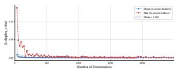

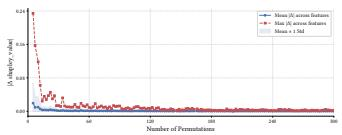

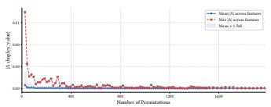  
(a) rel-f1, driver-position (HGS)

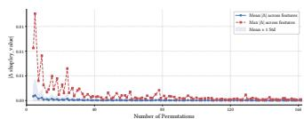  
(c) rel-f1, driver-dnf (HGS)  
(d) rel-f1, driver-dnf (RelGT)

(b) rel-f1, driver-position (RelGT)  
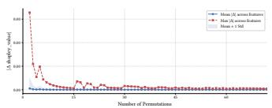  
(e) rel-event, user-atendance (HGS)

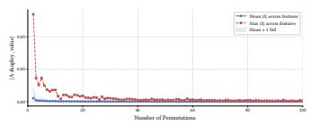  
(f) rel-event, user-atendance (RelGT)

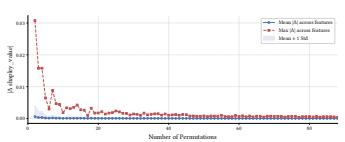  
(g) rel-event, user-repeat (HGS)

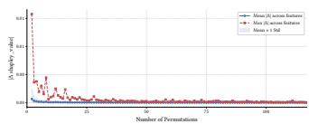  
(h) rel-event, user-repeat (RelGT)

Figure 8: Empirical convergence curves for the Monte Carlo Shapley approximation on the rel-f1 and rel-event datasets.  
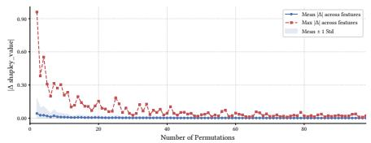  
(a) rel-trial, study-adverse (RelGT)

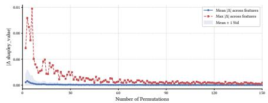  
(b) rel-trial, study-outcome (HGS)

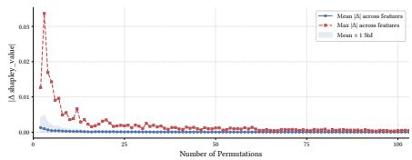  
(c) rel-trial, study-outcome (RelGT)

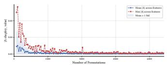  
(d) rel-arxiv, paper-citation (HGS)

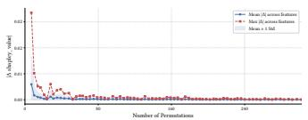  
(e) rel-arxiv, paper-citation (RelGT)

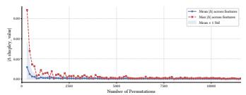  
(f) rel-arxiv, author-publication (HGS)

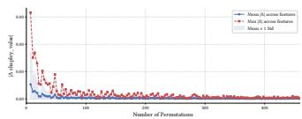  
(g) rel-arxiv, author-publication (RelGT)

Figure 9: Empirical convergence curves for the Monte Carlo Shapley approximation on the rel-trial and rel-arxiv datasets.  
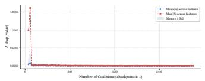  
(a) rel-f1, driver-position (HGS)

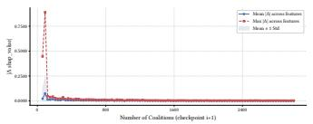  
(b) rel-f1, driver-position (RelGT)

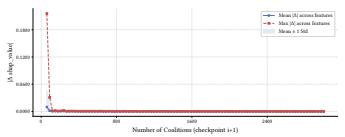  
(c) rel-f1, driver-dnf (HGS)

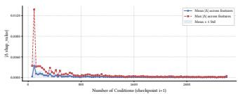  
(d) rel-f1, driver-dnf (RelGT)

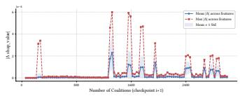  
(e) rel-event, user-atendance (HGS)

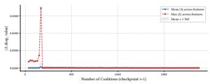  
(f) rel-event, user-atendance (RelGT)

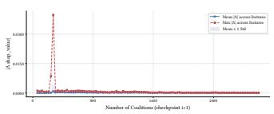  
(g) rel-event, user-repeat (HGS)

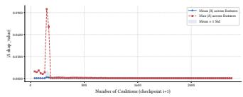  
(h) rel-event, user-repeat (RelGT)  
Figure 10: Empirical convergence curves for the Kernel SHAP approximation on the rel-f1 and rel-event datasets.

(RelGT)  
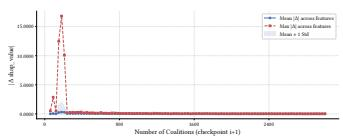  
(a) rel-trial, study-adverse (HGS)

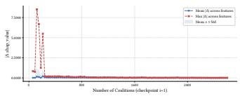  
(b) rel-trial, study-adverse (RelGT)

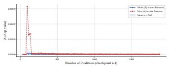  
(c) rel-trial, study-outcome (HGS)

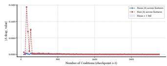  
(d) rel-trial, study-outcome (RelGT)

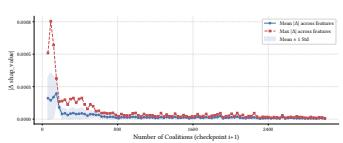  
(e) rel-arxiv, paper-citation (HGS)

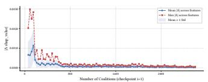  
(f) rel-arxiv, paper-citation

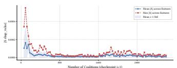  
(g) rel-arxiv, author-publication (HGS)

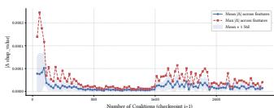  
(h) rel-arxiv, author-publication (RelGT)

Figure 11: Empirical convergence curves for the Kernel SHAP approximation on the rel-trial and rel-arxiv datasets.