# A Controlled Experimental Evaluation of Configuration and Cache Architecture in LLM Serving Engines

MUHAMMAD FAIZAN ANWAR, Thompson Rivers University, Canada SINA KESHVADI, Thompson Rivers University, Canada

Multi-agent LLM applications repeat most of their prompt tokens across requests, and serving engines reuse the cached state of shared prefixes. vLLM and SGLang reuse it at diferent granularities, and benchmarks of their default deployments report large performance gaps, usually credited to the cache. Such comparisons rarely control for other configuration diferences. One of them, whether a long prompt is prefilled in chunks, is set by each engine’s defaults from the hardware and the release, and it confounds the comparison. We built a reproducible testbed on Kubernetes and a seeded multi-agent workload generator, and compared the two engines under vendor defaults and with chunked prefill matched. SGLang’s configuration is the same in both arms, which makes it an internal control across independently provisioned deployments. Under defaults, vLLM’s median time to first token is up to 64 SGLang’s. Matching one setting removes 78% of the capacity gap where that gap is largest and 30 to 67% of the latency gap. Near saturation the remaining latency gap reflects queue growth. A fluid queue model driven only by a 4.4% throughput shortfall reproduces it, and shows that such a gap scales with the length of the benchmark run. What survives matching is a tail-latency advantage of 2.4 to 6.4 at equal throughput, consistent with cache-aware ordering of waiting requests. We derive six recommendations for comparing serving engines.

Additional Key Words and Phrases: LLM serving, KV cache, prefix caching, chunked prefill, performance evaluation, benchmarking methodology

## 1 Introduction

Applications built on large language models increasingly run as multi-agent workflows. A planner decomposes a task, workers call tools and reason over retrieved documents, and an aggregator merges their answers. Every call in such a workflow repeats the same system instructions, tool schemas and shared context. Across five agent and long-context workloads, 85 to 97% of prompt tokens are shared with at least one other request [16], and in a production LLM-based search service over 94% of request tokens recur across users [9]. Recomputing that shared state wastes the resource that limits a serving GPU. The limit is memory, not arithmetic (Section 2).

Two widely used open-source serving engines reuse shared prompts in diferent ways. vLLM stores its key-value (KV) cache in fixed-size blocks and reuses a block when its contents match a cached one [8]. SGLang keeps cached tokens in a radix tree, RadixAttention, and reuses a shared prefix of any length [21]. Operators choose between such engines, and size GPU fleets around them, on the evidence of benchmarks. The SGLang authors report throughput up to 6.4 higher than contemporaneous systems [21], and several serving systems for agent workloads take finer-grained prefix reuse as their starting point [2, 12, 16].

We deployed both engines on one NVIDIA L4 GPU under their documented defaults and measured the gap such benchmarks lead one to expect. It is large. With 8,192-token prompts that share 90% of their tokens, vLLM’s median time to first token (TTFT) is 64.1× SGLang’s. Near vLLM’s saturation point the median gap is 36.4×, and the highest throughput SGLang sustains is 1.94 requests per second against 1.40 for vLLM. A gap of this size invites a simple explanation: the finer-grained cache wins.

That explanation has not been tested. The engines’ defaults difer in a second respect that has nothing to do with caching. A long prompt’s prefill can run as one uninterrupted step, during which every running request waits, or it can be split into chunks interleaved with ongoing decoding [1]. This is a scheduler setting. On our hardware SGLang chunks long prefills by default and vLLM does not. Neither engine is misconfigured: vLLM 0.6.3 enables chunked prefill only above a 32,768-token context, and SGLang 0.4.1 enables it on any GPU with less than 25 GB of memory. A comparison of default deployments therefore varies two factors at once. It cannot say which of them produced the gap.

The particular pairing has since changed upstream. vLLM’s V1 engine enables chunked prefill by default wherever possible, where V0 enabled it conditionally [17]. The confound is a property of defaults rather than of one release. Defaults depend on the GPU and the configured context length, and they change between versions, so a benchmark that does not record the configuration each engine actually resolved cannot state which pairing it measured. Comparisons made against V0-era vLLM, including the baselines behind widely cited speedups, fall within the configuration space we study.

This paper separates the two factors in a controlled experiment and asks four questions:

RQ1 How large is the performance gap between the two engines under their default configurations, and where in the load range does it appear?

RQ2 How much of that gap remains once both engines use the same chunked-prefill configuration?

RQ3 Why do latency and capacity measures of the remaining gap disagree near saturation?

RQ4 Does the gap grow with the degree of prefix sharing, as an explanation based on cache architecture predicts?

We built a testbed on Google Kubernetes Engine and a workload generator that reproduces bursty arrivals, agent dependency graphs and exact prefix sharing from a seed. We ran each engine under its vendor defaults and again with chunked prefill matched at a 2,048-token budget. Only vLLM’s setting changes between the two arms. SGLang resolves the same configuration in both arms, so it serves as an internal control. Rebuilt on an independently provisioned cluster days later, its latencies agree with the first deployment within 0.5 to 11.7%. We report 99 runs and 63,288 requests, analysed as comparisons paired by seed.

Figure 1 summarises the answer. Matching one setting removes 78% of the capacity gap at the load where that gap is largest, and 30 to 67% of the latency gap across conditions. At that load the matched engines difer in throughput by 4.6%, yet their median TTFT still difers by 12.3 . The small shortfall leaves vLLM just short of the ofered load, and beyond that point TTFT measures the growth of a queue rather than the speed of an engine. A fluid queue model driven only by the throughput shortfall reproduces the efect, and shows that the gap grows with the length of the benchmark run. What survives matching is narrower. At equal throughput SGLang retains a 2.4 to 6.4× advantage at the 95th percentile of TTFT, consistent with its cache-aware ordering of waiting requests but not isolated to it. The gap also fails the prediction of RQ4: it narrows as sharing grows and reverses at high sharing, a pattern the scheduling diference predicts as well as the cache does.

This paper makes four contributions:

(1) A controlled decomposition. We separate the performance gap between vLLM and SGLang into the part due to chunked-prefill configuration and the part that remains, with one engine serving as an internal control (Sections 5 and 6).

(2) A methodological result. Near saturation, TTFT amplifies small diferences in capacity nonlinearly, so latency must be reported together with sustained throughput (Sections 4 and 6).

(3) A located residual. We characterise what survives matching through per-request distributions, tails and run-to-run variability (Section 7).

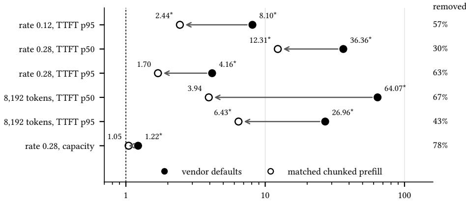  
engine gap (vLLM  SGLang for latency; SGLang  vLLM for capacity)  
Fig. 1. One seting accounts for most of the gap. Each row shows the engine gap under vendor defaults (filled) and with chunked prefill matched on both engines (hollow), for every condition measured in both configurations. Latency gaps are vLLM’s TTFT divided by SGLang’s; the capacity gap is SGLang’s sustained throughput divided by vLLM’s. The right column gives the fraction of each default gap, on a log scale, that matching removes. Geometric means of three seed-paired runs; ∗ marks a paired �-test on log values with $\textstyle p < 0 . 0 5$

(4) A reproducible apparatus. We release a testbed defined entirely in code, a seeded workload generator, and the per-run logs behind every number reported here (Section 3 and Appendix A).

## 2 Background

## 2.1 Prefill, decode and the KV cache

Serving a request takes two phases. Prefill processes every prompt token in parallel and produces the first output token; it is a large matrix computation that keeps the GPU’s arithmetic units busy. Decode then produces one token per step. Each step reads the model’s weights and the request’s cached state to compute a single new token, so decode is limited by memory bandwidth rather than arithmetic. Engines recover decode eficiency by batching the steps of many requests and rebuilding the batch at every iteration [20].

Both phases rely on the KV cache, which holds the attention keys and values of every token processed so far. Its size is easy to underestimate. Llama-3.1-8B has 32 layers and 8 key-value heads of dimension 128; at 16 bits per value each token occupies 128 KiB, so a single 4,096-token prompt holds 512 MiB. On a 24 GB NVIDIA L4 the weights take roughly 16 GB and leave at most about 8 GB for cached state. Memory, not arithmetic, bounds how many requests one GPU can serve at once.

## 2.2 Reusing a shared prefix

Requests that begin with the same tokens produce identical KV entries for those tokens, so an engine can store them once. Figure 2 shows what that is worth on our hardware. Without sharing, at most 15 requests of 4,096 tokens fit in the memory the L4 has left. If 90% of every prompt is a common prefix stored once, 139 fit. The bound ignores activations and engine overhead, so the real budget is lower, but its shape survives the correction: reuse gains little at modest sharing and a great deal at the sharing levels that agent workloads actually exhibit.

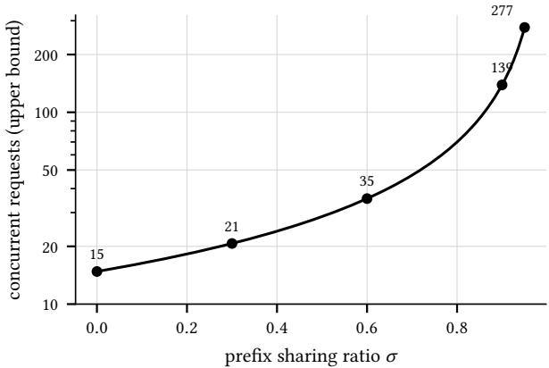  
Fig. 2. Upper bound on concurrent 4,096-token requests whose KV state fits in the memory an NVIDIA L4 has left after the weights of Llama-3.1-8B, as a function of the prefix sharing ratio �. The shared prefix is stored once. Each request adds only its sufix. Computed from the model’s dimensions rather than measured; activations and engine overhead lower the real budget.

The two engines we study find shared prefixes at diferent granularities. vLLM’s PagedAttention stores the cache in fixed blocks of 16 tokens, and its automatic prefix caching reuses a block when a hash ofits tokens, together with the tokens before it, matches a cached block [8]. Reuse is recognised in whole blocks. SGLang’s RadixAttention keeps cached sequences in a radix tree and matches each new prompt against the tree token by token [21]. It therefore recovers a shared prefix of any length, including one that ends inside a block, and it can evict cached state one token at a time. Granularity is the property most often credited when SGLang outperforms vLLM on prefix-heavy trafic.

## 2.3 Chunked prefill

A long prefill creates a scheduling problem that has nothing to do with the cache. If an engine runs a prefill to completion in one iteration, every request already decoding waits until it ends. Agrawal et al. call this a generation stall [1]. It grows with prompt length. Their remedy, chunked prefill, splits a prefill of � tokens into � � chunks under a per-iteration token budget �. Each iteration first admits the decode tokens of running requests and then fills the remaining budget with one chunk of a waiting prefill (Figure 3).

The trade is specific, and it is easy to state it wrongly. Running requests no longer stall, but each of their decode steps now shares an iteration with prefill work and takes longer. The chunked request gains nothing. Its prefill spans several iterations, so its first token arrives somewhat later than it would after one uninterrupted step. Chunking pays of under load: mixed iterations keep the GPU busy, which raises the throughput an engine can sustain and shortens the queue that each new request joins. Section 6 measures exactly this efect.

We did not build this mechanism. Both engines adopted it. SGLang implements it in its scheduler and vLLM exposes it as a command-line option, --enable-chunked-prefill, each following Agrawal et al. The engines difer in the default. vLLM 0.6.3 enables chunked prefill only when the configured context length exceeds 32,768 tokens. SGLang 0.4.1 enables it, with a 2,048-token chunk, on any GPU with less than 25 GB of memory. At our 16,384-token context on a 24 GB GPU, SGLang chunks and vLLM does not (Section 3).

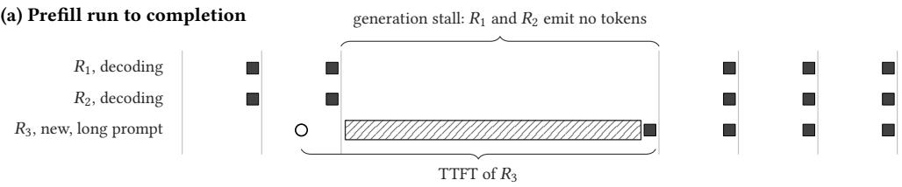

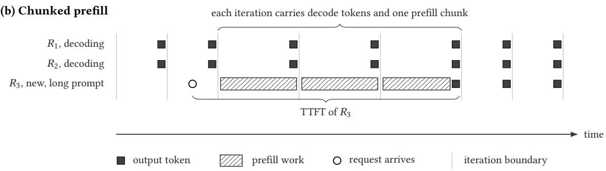  
Fig. 3. Prefill scheduling, illustrative and not to scale. (a) A long prefill runs as one iteration, and the running requests $R _ { 1 }$ and $R _ { 2 }$ emit no tokens until it ends. (b) The same prefill is split into chunks, each sharing an iteration with decode work. The running requests keep emiting tokens at a slower rhythm, and the first token of $R _ { 3 }$ arrives later than in (a).

## 2.4 Request ordering

A separate choice decides which waiting request is admitted when capacity frees. vLLM admits requests in arrival order. SGLang’s default policy, longest prefix match, first admits the waiting request with the most tokens already cached, which favours the requests whose prefill is cheapest. This choice is independent of both chunking and cache granularity. It returns in Section 6 as the leading candidate for the diference that survives once chunking is matched.

## 3 System Model and Testbed

## 3.1 Requirements

A diference between two engines can be attributed to a cause only if everything else is held fixed.   
We designed the apparatus around three requirements.

Req. 1 Identical conditions. Every run sees the same hardware, the same model and, for a given seed, the same request stream.

Req. 2 Known configuration. The configuration of each engine is taken from what the engine resolved at start-up, not from the flags we passed to it.

Req. 3 Reproducibility. Every request stream is derived from a seed, and every measurement can be repeated on a freshly provisioned testbed.

The second requirement proved decisive. Both engines resolve their chunked-prefill setting from the hardware and the configured context length, so the requested and the efective configuration can difer.

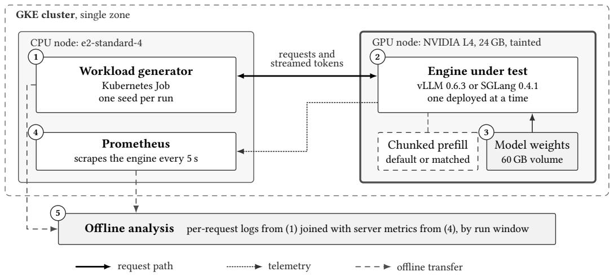  
Fig. 4. Testbed architecture. The workload generator (1) drives the engine under test (2), which loads its weights from a persistent volume (3). Prometheus (4) scrapes the engine every 5 s. After each run, an ofline step (5) joins the generator’s per-request records with the engine’s metrics by run window. Line style carries meaning: thick solid lines are the request path, doted lines telemetry, dashed lines ofline transfer. The thick border marks the tainted GPU node.

## 3.2 Testbed architecture

We ran every experiment on Google Kubernetes Engine (Kubernetes 1.35) in a single zone of the us-central1 region. Terraform provisions the whole environment in two stages: the first creates the cluster, its node pools and a container registry, and the second installs the platform. Because the environment exists only as code, we destroyed it between campaigns and rebuilt it identically. Figure 4 shows the components; the numbers below refer to it.

The cluster has two node pools with separate roles. The GPU pool holds a single g2-standard-8 instance with one NVIDIA L4 GPU (24 GB) and GKE’s managed driver. A NoSchedule taint keeps every workload except the engine under test (2) of this node. We held the pool at one node for the duration of each campaign. Releasing and reacquiring the GPU between runs would have exposed the campaign to regional capacity shortages and left gaps in paired measurements. In the matched campaign the node was a Spot VM, which the provider may reclaim at any time. It did so twice. Each time the pool replaced the node within 20 minutes, and Section 5.4 describes how we treated the conditions that the reclamation interrupted.

The CPU pool holds an always-on e2-standard-4 node for the monitoring stack, the cluster’s control components and the workload generator (1). Placing the generator there removes two sources of error. It cannot compete with the engine’s own CPU-side scheduler, and its requests cross only the cluster network, not a public round trip.

The second Terraform stage installs Prometheus (4) with a 5 s scrape interval, cert-manager, KServe in RawDeployment mode, and KEDA. KServe exposes the engine as a plain Kubernetes Deployment and Service. KEDA is installed but plays no part in this study. We disabled autoscaling for every measurement, and the engine ran as exactly one replica throughout each sweep. Model weights reside on a 60 GB persistent volume (3), so an engine restart reloads them from local disk rather than from a remote registry. After each run, an ofline step (5) retrieves the engine’s metrics for that run’s time window and joins them with the generator’s per-request records.

Table 1. Resolved engine configurations, read from the deployed manifests and the engines’ start-up logs. Only vLLM’s chunked-prefill seting difers between the two arms. The rows above the rule are identical in both arms but difer between the engines; they bound what the gap remaining under matched configuration can be atributed to (Section 9).
<table><tr><td></td><td>vLLM 0.6.3</td><td>SGLang 0.4.1</td></tr><tr><td>Prefix cache</td><td>PagedAttention with APC</td><td>RadixAttention</td></tr><tr><td>Match unit</td><td>16-token block</td><td>token</td></tr><tr><td>Memory budget</td><td>gpu_memory_utilization 0.88</td><td>mem_fraction_static 0.85</td></tr><tr><td>Attention backend Order of waiting requests</td><td>engine default</td><td>FlashInfer</td></tr><tr><td></td><td>arrival order</td><td>longest prefix match</td></tr><tr><td>Chunked prefill</td><td></td><td></td></tr><tr><td>vendor defaults</td><td>off</td><td>on, 2,048 tokens</td></tr><tr><td>matched</td><td>on, 2,048 tokens</td><td>on, 2,048 tokens</td></tr></table>

## 3.3 Systems under test

We compare vLLM 0.6.3 [8] and SGLang 0.4.1 [21]. Both run without modification from their published container images, vllm/vllm-openai:v0.6.3 and lmsysorg/sglang:v0.4.1-cu121, and both serve Llama-3.1-8B-Instruct in bfloat16 with a 16,384-token context and prefix caching enabled. Image digests, which unlike tags cannot be reassigned, are listed in Appendix A.

We chose the model for its KV-cache footprint. With 32 layers and eight key-value heads of dimension 128, it stores 128 KiB per token. A 7B model with four key-value heads and 28 layers, such as Qwen2.5-7B, stores 56 KiB. The larger footprint makes the cache fill, and eviction pressure become reachable, within the load a single 24 GB GPU can sustain.

Table 1 lists the resolved configuration of each engine, with every value read from the engine’s own start-up log rather than from the flags we passed. vLLM runs its V0 engine with automatic prefix caching over 16-token blocks. SGLang runs RadixAttention with the FlashInfer attention backend, its overlap scheduler, and longest-prefix-match ordering of waiting requests.

## 3.4 Configurations

Each engine runs in two configurations.

Vendor defaults. Each engine runs with the chunked-prefill behaviour its authors ship. vLLM enables chunked prefill only when the configured context length exceeds 32,768 tokens, so at 16,384 tokens it runs each prefill as a single step. Our manifest states this value explicitly with --enable-chunked-prefill=False, which pins vLLM’s own resolution rather than changing it. SGLang finds less than 25 GB of GPU memory and resolves a 2,048-token chunk; we pass it no chunking flag. This is the deployment a practitioner following each project’s documentation obtains.

Matched chunked prefill. We enable chunked prefill on vLLM and set its per-iteration token budget to 2,048 tokens, passing --enable-chunked-prefill and --max-num-batched-tokens=2048. vLLM’s start-up log confirms that the setting took efect: it reports chunked prefill enabled with a 2,048-token budget. SGLang needs no change. Its rate runs used the same manifest as in the defaults arm, and for the 8,192-token runs we passed --chunked-prefill-size=2048 explicitly and recorded the resolved value from that pod’s start-up log. Both resolve to the same 2,048-token chunk. The manipulation therefore changes one setting of one engine, and SGLang serves as an internal control.

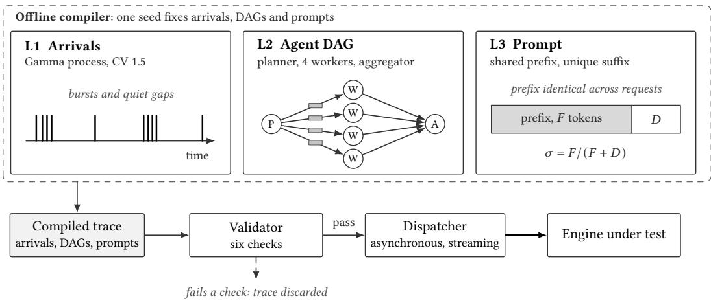  
Fig. 5. Workload generator. An ofline compiler produces a complete trace from one seed: an arrival process (L1) schedules agent DAGs, a topology layer (L2) expands each into dependent requests, and a prompt layer (L3) builds each request from a shared prefix and a unique sufix. Gray bars in L2 mark the simulated tool call that precedes each worker. A trace that fails validation is discarded before any request is sent.

Matching the chunk size does not make the engines identical. The rows above the rule in Table 1 remain diferent, and one of them needs care in interpretation. The two memory-budget parameters measure diferent things. vLLM’s bounds the fraction of GPU memory the whole engine may use; SGLang’s sets the fraction reserved for weights and static state. Equal-looking values therefore need not give equal KV-cache capacity.

## 3.5 Workload model

Multi-agent applications issue requests as dependency graphs whose members share a long prompt prefix and difer in a short sufix. Our generator reproduces that structure under exact control. It compiles a complete trace ofline, so that at run time the dispatcher only waits, sends and records (Figure 5). The trace has three layers.

Arrivals (L1). Agent graphs arrive at times $t _ { 1 } < t _ { 2 } < . .$ . whose gaps are independent draws from a Gamma distribution with mean $1 / \lambda$ and coeficient of variation $c _ { v } = 1 . 5 ,$ , that is, with shape $k = 1 / c _ { v } ^ { 2 } \approx 0$ .444 and scale $\theta = c _ { v } ^ { 2 } / \lambda$ . A coeficient of variation above one produces bursts separated by quiet gaps, which matches the burstiness reported for production LLM trafic [18, 19]. We express � in agent graphs per second.

Topology (L2). Each arrival instantiates a graph $G = \left( V , E \right)$ with $V ~ = ~ \{ p , w _ { 1 } , \ldots , w _ { 4 } , a \}$ and $E ~ = ~ \{ ( p , w _ { i } ) \} \cup \{ ( w _ { i } , a ) \}$ for $i = 1 , \ldots , 4 \colon \mathsf { a }$ planner ${ \boldsymbol { p } } ,$ four workers, and an aggregator $^ { a . }$ A request is issued once all of its predecessors have completed. Each worker $w _ { i }$ additionally waits for a simulated tool call whose duration $\tau _ { i }$ is drawn from published Model Context Protocol tool latencies [2], so the workers do not start in lock-step. Every graph contains six requests, and the request rate is $6 \lambda$ . Output length is capped at 128 tokens for the planner and the workers and at 256 tokens for the aggregator.

Prompts (L3). Every prompt is a fixed prefix of � tokens, identical across all requests of a run, followed by a sufix of $D$ tokens unique to the request. The prompt length is $L = F + D$ , and the

prefix sharing ratio

$$
\sigma = { \frac { F } { F + D } }\tag{1}
$$

is our principal independent variable. We sample tokens uniformly from the model’s vocabulary, excluding special tokens. Decoding a token sequence to text and encoding it again need not return the same sequence, so the generator corrects each segment iteratively until the model’s own tokenizer returns exactly the requested count.

Synthetic tokens are deliberate. Prefix-cache matching compares token identifiers, not meaning, so two byte-identical sequences share cache entries whatever they say. Sampled tokens give exact control over � and �, which no natural corpus provides. What they omit, realistic length distributions and near-duplicate prompts, is discussed in Section 9.

Validation and dispatch. Before any request is sent, a validator checks six properties of the compiled trace: the prefix’s SHA-256 digest matches the trace manifest, the achieved � lies within 1% of its target, every sufix is distinct, every graph is acyclic and resolvable, arrival times are ordered, and tool delays are non-negative and bounded. A trace that fails any check is discarded. The check matters because a subtly broken prefix still produces latency numbers; they simply measure an empty cache. A dispatcher then replays the trace asynchronously, sending each request as a streaming completion and timestamping every returned chunk. Section 4 defines the metrics computed from those timestamps.

## 4 Performance Metrics

We define metrics at three levels: individual requests, individual runs, and comparisons between the two engines. All are computed from the dispatcher’s per-chunk timestamps and the run’s server-side telemetry, with no instrumentation inside either engine.

## 4.1 Request metrics

For request $r ,$ let $s _ { r }$ be the time the dispatcher sends it and $c _ { r , 0 } < c _ { r , 1 } < \cdot \cdot \cdot < c _ { r , n _ { r } - 1 }$ the arrival times of its $n _ { r }$ output tokens. Both engines stream one token per chunk in our configuration, so chunk and token timestamps coincide. The time to first token is

$$
\mathrm { T T F T } _ { r } = c _ { r , 0 } - s _ { r } .\tag{2}
$$

It includes the time the request waits for admission and the time its prefill takes. A request that queues behind other work therefore shows a long TTFT even when the engine processes it quickly once admitted, and this property drives several results in Section 6. The time per output token averages the gaps between the remaining tokens:

$$
\mathrm { T P O T } _ { r } = \frac { c _ { r , n _ { r } - 1 } - c _ { r , 0 } } { n _ { r } - 1 } , \qquad n _ { r } \ge 2 .\tag{3}
$$

TPOT measures decode speed. Agrawal et al. report the same per-step quantity as time between tokens [1]; we use TPOT, the name both engines use in their own metrics.

## 4.2 Run metrics

A run serves one engine, in one configuration, one trace. Its measured requests exclude the first agent graph, which pays connection costs that later graphs do not (Section 5). For each run we report the median (p50) and 95th percentile (p95) of TTFT and the median of TPOT over its measured requests.

The two percentiles answer diferent questions. A median that moves means most requests changed; a 95th percentile that moves while the median does not means a minority of requests waited much longer than the rest. Section 6 relies on that distinction. We do not report the 99th percentile. Our lightest runs contain under two hundred measured requests, so a 99th percentile would rest on one or two observations.

Let $N _ { \mathrm { o k } }$ be the number of requests a run completes and � its wall-clock duration. The achieved throughput is

$$
X = N _ { \mathrm { o k } } / W ,\tag{4}
$$

and the ofered load is $\Lambda = 6 \lambda$ requests per second, since every agent graph contains six requests (Section 3.5). An engine keeps pace with the ofered load when $X \ge 0 . 9 7 \Lambda$ . The tolerance absorbs the variability of bursty arrivals. A run of finite length realises the nominal rate only approximately. At the lightest load a run contains about 45 agent graphs, and a single run’s achieved throughput exceeds Λ by up to 29%. The deviation afects both engines alike, since both receive the identical trace. An engine that falls short of the threshold accumulates a queue over the run, and its TTFT then grows with the run’s length rather than reflecting the engine’s speed. Capacity is the largest ofered load at which an engine keeps pace.

From the engine’s telemetry we take the peak fraction of KV-cache memory in use during the run, which we call KV-cache utilisation, and the number of requests the engine preempted.

## 4.3 Comparing engines

The two engines receive identical request streams for a given seed (Section 3.5). A condition � fixes the arrival rate, the sharing ratio and the prompt length; a repetition � fixes the seed. For a latency metric �, the engine gap in repetition � is the paired ratio

$$
R _ { c , k } = \frac { M _ { c , k } ^ { \mathrm { v L L M } } } { M _ { c , k } ^ { \mathrm { S G L a n g } } } ,\tag{5}
$$

so $R > 1$ means SGLang is faster. For throughput we invert the ratio, $X ^ { \mathrm { S G L a n g } } / X ^ { \mathrm { v L L M } }$ , so that $R > 1$ again favours SGLang.

Ratios are multiplicative quantities, and we aggregate them as such. Over � repetitions, the reported gap is the geometric mean

$$
\bar { R } _ { c } = \exp \Big ( \frac { 1 } { n } \sum _ { k = 1 } ^ { n } \ln R _ { c , k } \Big ) ,\tag{6}
$$

following Fleming and Wallace [3]. The arithmetic mean of ratios is biased upward and depends on which engine is placed in the numerator. The geometric mean has neither defect, and because the runs are paired it equals the ratio of the two engines’ geometric means exactly. Every absolute value we report is therefore consistent with every ratio. We aggregate absolute latencies and throughputs across repetitions the same way. KV-cache utilisation is a bounded proportion, not a multiplicative quantity, so for it we use the arithmetic mean.

## 4.4 Decomposing the gap

Let $\bar { R } _ { c } ^ { \mathrm { d e f } }$ and $\bar { R } _ { c } ^ { \mathrm { m a t } }$ be the gap in condition � under vendor defaults and under matched chunked prefill. On a log scale the default gap splits into a part that matching removes and a part that remains. The removed fraction

$$
\phi _ { c } = \frac { \ln \left( \bar { R } _ { c } ^ { \mathrm { d e f } } / \bar { R } _ { c } ^ { \mathrm { m a t } } \right) } { \ln \bar { R } _ { c } ^ { \mathrm { d e f } } }\tag{7}
$$

is the share of the default gap attributable to the chunked-prefill configuration. At $\phi _ { c } = 1$ matching closes the gap entirely, and at $\phi _ { c } = 0$ it changes nothing. We compute $\phi _ { c }$ only when the default gap

Table 2. Experiment grid. Every condition ran three times per engine, with the seed shared between engines. Rates are in agent graphs per second.
<table><tr><td>Sweep</td><td>Varied</td><td>Held fixed</td><td>Duration per run</td></tr><tr><td>Rate</td><td> $\lambda \in \left\{ 0 . 0 5 , 0 . 1 2 , 0 . 2 0 , 0 . 2 8 , 0 . 4 0 \right\}$ </td><td> $\sigma = 0 . 9 , L = 4 , 0 9 6$ </td><td> $9 0 0 s \mathrm { i f } \lambda \le 0 . 1 2 ,$  else 600 s</td></tr><tr><td>Sharing</td><td> $\sigma \in \{ 0 , 0 . 3 , 0 . 6 , 0 . 9 , 0 . 9 5 \}$ </td><td> $\lambda = 0 . 0 1 2 , L = 4 { , } 0 9 6$ </td><td>2,400 s</td></tr><tr><td>Prompt length</td><td> $L \in \{ 5 1 2 , 2 , 0 4 8 , 8 , 1 9 2 \}$ </td><td> $\sigma = 0 . 9 ;$  λ scaled with L</td><td>300, 400, 900 s</td></tr><tr><td>Matched</td><td>rate 0.12 and 0.28; L = 8,192</td><td>as in the defaults arm</td><td>as in the defaults arm</td></tr></table>

exceeds 10% in either direction, ln $\bar { R } _ { c } ^ { \mathrm { d e f } } | > \ln { 1 . 1 }$ , because below that threshold the denominator approaches zero and the fraction swings with noise in either arm. The guard excludes one condition: the median at 0.12 agent graphs per second, where the default gap is 1.09×.

## 4.5 Statistical inference

Every condition has $n = 3$ repetitions. We give 95% confidence intervals for $\bar { R } _ { c }$ on the log scale, as expln ${ \overline { { R } } } \pm t _ { 0 . 9 7 5 , n - 1 } s / { \sqrt { n } } )$ , where � is the sample standard deviation of ln $R _ { c , k }$ and $t _ { 0 . 9 7 5 , 2 } = 4 . 3 0$ These intervals are asymmetric and strictly positive. An arithmetic interval on a ratio can extend below zero, which has no meaning for a ratio.

We test whether a gap difers from parity with a paired �-test on the log latencies, $d _ { k } = \ln M _ { c , k } ^ { \mathrm { v L L M } } -$ ln $M _ { c , k } ^ { \mathrm { S G L a n g } }$ , and report a diference as significant at $\textstyle p < 0 . 0 5$ . Pairing removes the variance that the arrival process contributes to both engines alike. The efect is large. On the sharing sweep an unpaired test finds a significant diference at one sharing level of five, while the paired test finds one at four. Three repetitions give low statistical power, so we treat a non-significant result as an absence of evidence, never as evidence of equality.

## 5 Experimental Design

## 5.1 Experiment grid

We ran three sweeps under vendor defaults and a subset of their conditions again under matched chunked prefill (Table 2). Each sweep varies one factor and holds the others fixed. The rate sweep varies the arrival rate at $\sigma = 0 . 9$ with 4,096-token prompts. The sharing sweep varies � at a fixed low rate. The prompt-length sweep varies the prompt length at $\sigma = 0 . 9$

Every condition ran three times per engine. Each repetition uses its own seed, and the same seed drives both engines, so the two engines in a repetition receive byte-identical traces. The matched arm repeats the three conditions in which the default gap was significant and throughput could be compared: 0.12 and 0.28 agent graphs per second on the rate sweep, and 8,192-token prompts on the prompt-length sweep. One further matched run, of vLLM at 0.20 agent graphs per second, has no SGLang counterpart. It appears as an absolute value in Section 6 and never in a paired comparison.

## 5.2 Choosing operating points

A comparison of latencies informs only if both engines run in the regime of interest, and that regime depends on each engine’s capacity. We did not know the capacities in advance, so we measured them before choosing any rate.

Establishing capacity. We drove vLLM far past saturation in a diagnostic run at 1.0 agent graphs per second, with $\sigma = 0 . 9$ and 4,096-token prompts. Against an ofered load of 6.0 requests per second it completed 1.56, and its queue reached 230 requests. That places vLLM’s capacity near 0.26 agent graphs per second. The same run showed which resource binds. Peak KV-cache utilisation reached 0.995, so memory rather than arithmetic limited the engine, and prefix caching could therefore afect the outcome.

Table 3. Workload realisation: measured requests per run, by sweep, excluding the first agent graph of every run. Generated from the run logs by make\_workload\_table.py.
<table><tr><td rowspan="2">Sweep</td><td rowspan="2"></td><td colspan="4">Requests per run</td><td rowspan="2">Requests in total</td><td rowspan="2">Lowest success (%)</td></tr><tr><td>Runs Mean</td><td>Median</td><td>Std. dev.</td><td>Range</td></tr><tr><td>Rate sweep</td><td>30</td><td>886</td><td>774</td><td>418</td><td>276-1,674</td><td>26,580</td><td>99.9</td></tr><tr><td>Sharing sweep</td><td>30</td><td>170</td><td>144</td><td>42</td><td>138-228</td><td>5,100</td><td>100.0</td></tr><tr><td>Prompt-length sweep</td><td>18</td><td>919</td><td>594</td><td>708</td><td>240-1,926</td><td>16,548</td><td>99.8</td></tr><tr><td>Matched arm</td><td>21</td><td>717</td><td>720</td><td>294</td><td>240-1,104</td><td>15,060</td><td>100.0</td></tr><tr><td>Total</td><td>99</td><td></td><td></td><td></td><td></td><td>63,288</td><td>99.8</td></tr></table>

Rate sweep. We chose five rates that bracket the measured capacity, from well below the saturation point to well above it. Runs last 900 s at the two lowest rates and 600 s above them, so that every run collects enough requests for stable percentiles.

Sharing sweep. Capacity depends on �. At $\sigma = 0$ every request prefills all 4,096 tokens, about ten times the work at � = 0.9. A preliminary run at 0.12 agent graphs per second saturated vLLM at � = 0 and failed repeatedly. We therefore ran all five sharing levels at a single rate of 0.012, low enough that even � = 0 stays below saturation, and extended each run to 2,400 s. Holding the rate fixed across � keeps a latency diference attributable to prefill work rather than to difering queue depths.

Prompt-length sweep. Capacity also falls as prompts grow. We scaled the rate inversely with length to hold utilisation roughly constant: 1.0, 0.26 and 0.065 agent graphs per second for 512, 2,048 and 8,192 tokens. A fourth point at 12,288 tokens saturated both engines at its assigned rate and completed only 78% of its requests. We excluded it rather than report a measurement dominated by the queue.

## 5.3 Workload realisation

Table 3 reports what the runs contained. The 99 runs measured 63,288 requests, 48,228 under vendor defaults and 15,060 under matched chunked prefill. Request counts vary widely within a sweep because both rate and duration vary; on the sharing sweep, where neither does, they vary much less. Every run completed at least 99.8% of its requests.

The logs confirm the workload’s structure as well as its volume. Across all runs the planner, worker and aggregator requests occur in the ratio 1 : 4 : 1 exactly, as six-request agent graphs require. The dispatcher kept to the compiled schedule. Its median lag behind a graph’s planned start time was 1.1 ms across runs and at most 12 ms in any run, negligible against the latencies we measure.

## 5.4 Measurement protocol

Campaign control. We ran each measurement as a Kubernetes Job on the CPU node. A runner submits the Jobs one at a time, since concurrent runs would share the GPU. It waits 30 s between runs so that one run’s cache state does not carry into the next. A run passes only if its log holds a complete results record and at least 95% of its requests succeeded. The runner retries a failing run up to twice, keeps the log of every failed attempt, and records a run that still fails rather than halting the campaign. Every run writes its full per-request results to its log, so the runner resumes after an interruption by skipping completed runs. We deployed one engine at a time.

Node replacement. When the provider reclaimed the GPU node during a run (Section 3.2), we discarded every repetition of the interrupted condition, including those already complete, and repeated all three on the replacement node. Each condition’s repetitions therefore share one node and one cache history. This happened at 0.20 agent graphs per second for vLLM and at 0.12 for SGLang, both in the matched campaign. The discarded logs are kept in the artifact and excluded from analysis.

Warm-up. Before each run the dispatcher polls the engine’s health endpoint and sends 20 requests whose results it discards. Measurement therefore starts after connections are established and lazily initialised state has been exercised. CUDA-graph capture happens earlier, during engine start-up. The first agent graph of every run is also excluded from analysis, because it pays connection costs that later graphs do not. Requests time out after 300 s.

Telemetry. Prometheus records KV-cache utilisation, queue depth and preemptions from the engine at 5 s resolution. Each run logs its start and end times, and after the run we retrieve the server-side series for exactly that window and join them to the client-side records by run identifier.

Restart measurement. For the restart experiment of Section 7, a separate script deletes the serving pod, waits for it to terminate, applies the deployment again, and records the Kubernetes event timestamps for scheduling, image pull, container start and readiness. The GPU node stays provisioned throughout, so the measurement isolates engine initialisation from node provisioning.

## 6 Results

We report geometric means over three seed-paired repetitions, 95% intervals on the log scale, and paired �-tests on log latencies, all as defined in Section 4. Five findings answer the research questions of Section 1:

F1 Under vendor defaults the gap appears only under load and mainly in the tail, and SGLang pays for it in decode speed (RQ1, Section 6.1).

F2 One configuration diference, chunked prefill, accounts for 30 to 67% of the default latency gap and 78% of the capacity gap (RQ2, Section 6.2).

F3 Near saturation the latency gap measures queue growth. A fluid queue model driven only by the throughput shortfall reproduces it, and predicts that it scales with the length of the benchmark (RQ3, Section 6.3).

F4 A tail-latency advantage of 2.4 to 6.4 survives matching at equal throughput (RQ2, Section 6.4).

F5 The gap shrinks and then reverses as prefix sharing grows, contrary to the architectural prediction (RQ4, Section 6.5).

## 6.1 The gap under vendor defaults

At the two lowest rates the engines cannot be told apart at the median: � = 0.87 and 1.09, neither significant (Figure 6). Above them vLLM’s median TTFT rises steeply. At 0.28 agent graphs per second it is 36.4 SGLang’s (95% interval 13.8, 95.6 ). Read alone, this suggests that the cache architectures difer by more than an order of magnitude.

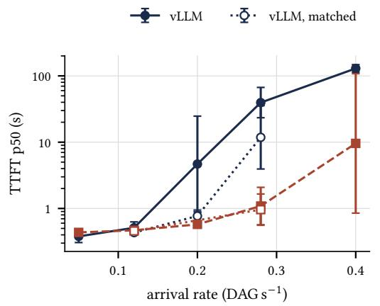

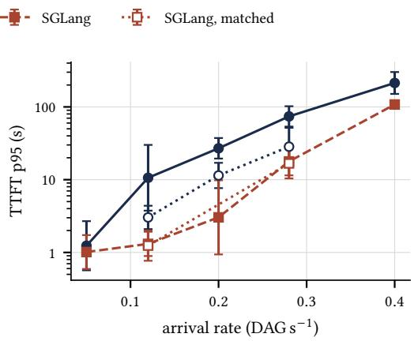

Fig. 6. TTFT against arrival rate at $\sigma = 0 . 9$ with 4,096-token prompts. Filled markers with solid or dashed lines show vendor defaults; hollow markers with doted lines show chunked prefill matched at 2,048 tokens, which we measured at a subset of rates. Bars are 95% intervals on the log scale around geometric means of three runs.  
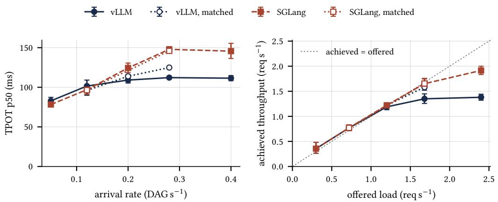  
Fig. 7. Left: median TPOT against arrival rate. Right: achieved against ofered load; points below the diagonal mark an engine that does not keep pace. Markers and lines as in Figure 6. Geometric means of three runs.

Two further observations point away from the cache. First, the median and the tail diverge. At 0.12 agent graphs per second the medians agree, yet the 95th percentiles difer by 8.10 ( 2.0, 32.0 ). A uniformly slower engine would move both percentiles; a gap confined to the tail means that most requests are unafected while a minority wait much longer, the signature of intermittent blocking (Section 7 examines the full distributions). Second, decode speed moves the other way. TPOT agrees within 6% at the two lowest rates, but at 0.20 and 0.28 agent graphs per second SGLang decodes 12% and 24% more slowly (Figure 7). Lower TTFT bought with higher TPOT is exactly the trade of chunked prefill described in Section 2.3, and SGLang is the engine that chunks by default.

## 6.2 Decomposing the gap

The matched arm changes one setting of one engine. SGLang’s resolved configuration is identical in both arms, so its measurements test the apparatus itself. They reproduce closely but not exactly.

Table 4. SGLang under an identical configuration in two independently provisioned deployments, geometric means of three seed-paired runs. E2E is end-to-end latency. ∗ paired $\textstyle p < 0 . 0 5$
<table><tr><td>Condition</td><td>Metric</td><td>First deployment</td><td>Second deployment</td><td>Change</td></tr><tr><td>Rate 0.12</td><td>TTFT p50</td><td>0.468 s</td><td>0.458 s</td><td>-2.2%</td></tr><tr><td>Rate 0.12</td><td>TTFT p95</td><td>1.311 s</td><td>1.241 s</td><td>-5.4%</td></tr><tr><td>Rate 0.12</td><td>E2E p50</td><td>13.75 s</td><td>13.65 s</td><td>-0.8%</td></tr><tr><td>Rate 0.28</td><td>TTFT p50</td><td>1.089 s</td><td>0.961 s</td><td> $- 1 1 . 7 \% ^ { * }$ </td></tr><tr><td>Rate 0.28</td><td>TTFT p95</td><td>17.80 s</td><td>16.72 s</td><td>-6.1%</td></tr><tr><td>Rate 0.28</td><td>E2E p50</td><td>21.17 s</td><td>20.80 s</td><td> $- 1 . 8 \% ^ { * }$ </td></tr><tr><td>8,192 tokens</td><td> $\mathrm { T T F T p } 5 0$ </td><td>0.891 s</td><td>0.866 s</td><td>-2.8%</td></tr><tr><td>8,192 tokens</td><td> $\mathrm { T T F T p } 9 5$ </td><td>4.221 s</td><td>4.088 s</td><td> $- 3 . 2 \% ^ { * }$ </td></tr><tr><td>8,192 tokens</td><td> $\mathrm { E 2 E } \mathrm { p } 5 0$ </td><td>15.50 s</td><td>15.43 s</td><td>-0.5%</td></tr></table>

Table 5. Engine gap $\bar { R }$ (vLLM divided by SGLang for latency, SGLang divided by vLLM for throughput) under vendor defaults and under matched chunked prefill, with the removed fraction $\phi$ of Equation (7). No fraction is given where the default gap is below 10%. ∗ paired $\begin{array} { r } { p < 0 . 0 5 } \end{array}$
<table><tr><td>Condition</td><td>Metric</td><td>Defaults</td><td>Matched</td><td>Removed</td></tr><tr><td>Rate 0.12</td><td>TTFT p50</td><td>1.09</td><td>0.95*</td><td>一</td></tr><tr><td>Rate 0.12</td><td>TTFT p95</td><td>8.10*</td><td> $2 . 4 4 ^ { * }$ </td><td>57%</td></tr><tr><td>Rate 0.28</td><td>TTFT p50</td><td>36.4*</td><td>12.3*</td><td>30%</td></tr><tr><td>Rate 0.28</td><td>TTFT p95</td><td> $4 . 1 6 ^ { * }$ </td><td>1.70</td><td>63%</td></tr><tr><td>8,192 tokens</td><td>TTFT p50</td><td> $6 4 . 1 ^ { * }$ </td><td>3.94</td><td>67%</td></tr><tr><td>8,192 tokens</td><td>TTFT p95</td><td> $2 7 . 0 ^ { * }$ </td><td>6.43*</td><td>43%</td></tr><tr><td>Rate 0.28</td><td>Throughput</td><td> $1 . 2 2 ^ { * }$ </td><td>1.046</td><td>78%</td></tr></table>

The matched runs executed on a separately provisioned cluster days after the defaults arm. Across nine latency measures (median and 95th-percentile TTFT and median end-to-end latency, from sending a request to receiving its last token, at three conditions), SGLang’s values agree with the originals within 0.5 to 11.7% (Table 4), and TPOT agrees within 1.3%. All nine diferences point the same way: the second deployment is faster. Because seed pairing removes workload variation, the paired test resolves this shift, and three of the nine diferences reach $\textstyle p < 0 . 0 5$ . The shift is small and consistent, the signature of a change in the deployment rather than in the engine. The changes in vLLM between the arms are 3.35 or larger, so a shift of this size cannot produce them (Section 9 discusses the remainder).

Enabling chunked prefill moves vLLM a long way. Its TTFT improves 3.5 at the 95th percentile at 0.12 agent graphs per second, 3.35 at the median at 0.28, and 16.8 at the median for 8,192-token prompts. Its TPOT worsens in step, from 112 to 125 ms at 0.28. That is the direction Agrawal et al. predict [1], and it confirms that the setting took efect.

Table 5 and Figure 1 decompose the gap with the removed fraction of Equation (7). On TTFT, matching removes 30 to 67% of the default gap. On throughput the efect is larger: the capacity gap at 0.28 agent graphs per second falls from 1.22 to 1.046 , a removed fraction of 78%. The two measures disagree most at the same condition, where TTFT retains a 12.3× gap after matching. Section 6.3 explains the disagreement.

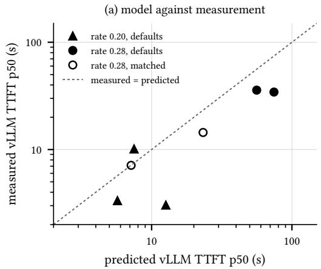

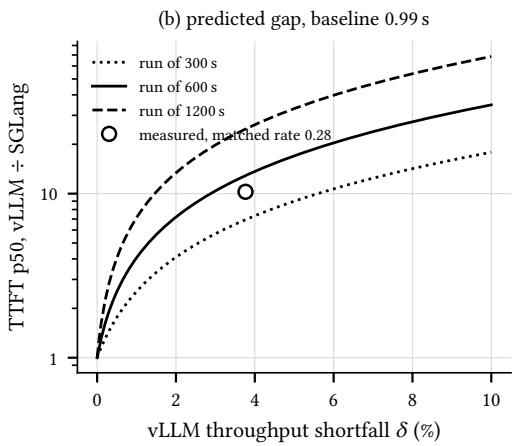  
Fig. 8. Fluid queue model of Equation (8). (a) Predicted against measured median TTFT of vLLM in the seven runs where vLLM falls behind and SGLang keeps pace. (b) Predicted engine gap against vLLM’s throughput shortfall for three run lengths, with SGLang’s measured median as the baseline, and the measured gap at matched rate 0.28.

## 6.3 Latency near saturation measures the queue

At 0.28 agent graphs per second under matched configuration, the ofered load is 1.68 requests per second. SGLang completes 1.66 and keeps pace. vLLM completes 1.58, 4.4% fewer, and falls behind. Its backlog then grows for as long as requests keep arriving. Throughput and TTFT describe the same situation from opposite ends: throughput reports that SGLang serves 4.6% more requests per second, and TTFT reports the waiting time that the diference accumulates.

A fluid queue model makes the relation quantitative. Both engines receive the same trace, so where SGLang keeps pace its throughput $X _ { s }$ estimates the trace’s realised arrival rate. If vLLM serves at $X _ { v } ~ < ~ X _ { s }$ , its backlog grows at $X _ { s } \mathrm { ~ - ~ } X _ { v } ,$ and a request arriving at time � waits about $\left( X _ { s } - X _ { v } \right) t / X _ { v }$ . Writing $\delta = 1 - X _ { v } / X _ { s }$ for vLLM’s throughput shortfall, the request arriving halfway through an arrival window of length � waits

$$
w _ { 5 0 } \approx \frac { \delta } { 1 - \delta } \cdot \frac { T } { 2 } .\tag{8}
$$

We predict vLLM’s median TTFT as SGLang’s median TTFT in the same repetition plus $w _ { 5 0 }$ . The model has no free parameter.

Figure 8a tests the model on the seven runs where vLLM falls more than 1% behind and SGLang keeps pace. Predictions and measurements correlate with $r = 0 . 8 5$ on the log scale. The model overestimates, by a factor of 1.6 on average, and the workload explains why. Workers are issued only after the planner completes, and the aggregator only after the workers, so a congested engine delays the arrival of its own later requests. A partially closed system of this kind accumulates a smaller backlog than the open fluid model assumes. At matched rate 0.28, in the two repetitions where SGLang kept pace, the model predicts a median gap of 13.1 from the throughput shortfall alone; the measured gap is 10.3 . Below capacity the model does not apply. There the apparent shortfall is 0.1 to 0.2%, the requests still in flight when a run ends, and no backlog forms.

Equation (8) has a consequence for any latency benchmark run near saturation. Beyond the knee, the queueing delay is proportional to � (Figure 8b). The same 4.4% shortfall yields a gap about half as large in a 300 s run and about twice as large in a 1,200 s run. A TTFT ratio measured there is a property of the engine and of the benchmark’s duration together, and it cannot be compared across studies without throughput beside it.

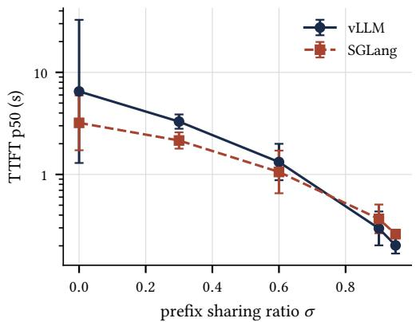

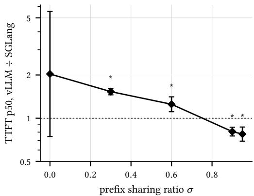  
Fig. 9. Left: median TTFT against prefix sharing ratio � under vendor defaults. Right: paired engine gap; ∗ paired $\textstyle p < 0 . 0 5$ . This sweep was not repeated under matched configuration.

## 6.4 What survives matching

Two conditions retain a significant gap that queueing cannot explain. At 0.12 agent graphs per second both engines keep pace. They complete 0.769 and 0.770 requests per second against 0.72 ofered, so no backlog forms. Their medians are close, with vLLM marginally faster (0.95 , 0.94, 0.95 ), yet SGLang’s 95th percentile remains 2.44 better ( 1.08, 5.53 ). With 8,192-token prompts the engines complete essentially the same work, 0.345 and 0.349 requests per second, both near 89% of the ofered load. Their queues therefore grow at nearly the same rate, and still SGLang’s 95th percentile is 6.43 better ( 1.83, 22.55 ).

When capacity and saturation are matched, the order in which waiting requests are served remains to separate the engines. SGLang admits first the request with the longest cached prefix; vLLM serves in arrival order (Section 2.4). Favouring requests whose prefill is cheapest would shorten the tail without changing throughput, which is the pattern we observe. We state this as a hypothesis. Our experiments hold chunk size constant but not request ordering, attention kernels or memory-budget semantics (Table 1), and none of these is isolated (Section 9).

## 6.5 Sensitivity to prefix sharing

If the gap came from the cache architecture, it would widen with $\sigma ,$ since a finer-grained cache has more to gain when more of each prompt is shared. The data show the opposite (Figure 9). The paired gap falls from 1.53 at $\sigma = 0 . 3$ to 0.81 at $\sigma = 0 . 9$ , crossing parity between 0.6 and 0.9, and is significant at four of five sharing levels. At $\sigma \geq 0 . 9$ vLLM is significantly faster. The result at $\sigma = 0$ is inconclusive, with an interval of 0.75, 5.54 : one repetition drew a burstier arrival realisation that afected both engines.

This sweep ran only under vendor defaults, and the chunked-prefill diference predicts the same pattern. At low $\sigma$ each prompt is long and mostly uncached, so vLLM’s unchunked prefills block the queue. At high $\sigma$ most of each prompt is served from cache, the remaining prefill is short, chunking has little to do, and vLLM’s lower scheduling overhead prevails. We therefore report the reversal as an observation about default configurations. Separating the two explanations needs a matched sharing sweep.

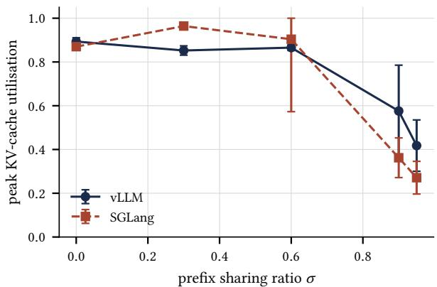  
Fig. 10. Peak KV-cache utilisation against prefix sharing ratio under vendor defaults. Arithmetic means of three runs.

Prefix caching did engage in both engines. Peak KV-cache utilisation falls from 0.89 to 0.42 for vLLM and from 0.87 to 0.27 for SGLang as � rises from 0 to 0.95 (Figure 10), consistent with each engine storing a shared prefix once rather than once per request. No run preempted more than three requests. We do not report per-run prefix-cache hit rates. Both engines expose the hit rate as a counter accumulated since process start, and on the sharing sweep, where runs of diferent � follow one another against one engine process, the counter mixes runs. On the rate sweep, where every run used $\sigma = 0 . 9$ , it reads 0.896 for vLLM and 0.900 for SGLang, matching the configured value.

## 7 Performance Variability

A median summarises a run, and it hides two things. One is how latency is spread across the requests of a run. The other is how far a measurement repeats when only the seed changes. This section examines both, then asks which requests wait, how the choice of percentile shapes the picture, and what restarting an engine costs.

## 7.1 Distribution of request latency

Figure 11 plots the empirical distribution of TTFT, pooled over the three repetitions, for the three conditions measured under both configurations. Table 6 summarises each distribution by its tail ratio, the 95th percentile divided by the median, and by the skewness $g _ { 1 } = \operatorname { E } [ ( Y - \mu ) ^ { 3 } ] / \sigma _ { Y } ^ { 3 }$ of � = ln TTFT. A positive $g _ { 1 }$ marks a long right tail over a fast majority. A negative $g _ { 1 }$ marks mass concentrated near the top of the distribution.

At 0.12 agent graphs per second under vendor defaults, vLLM serves most requests quickly and a minority slowly. The median is 0.52 s and the 95th percentile $1 2 . 5 s ,$ a tail ratio of 24.0 with $g _ { 1 } = + 1 . 2 9$ . SGLang’s ratio is 2.8. Matching cuts vLLM’s ratio to 6.6, and SGLang’s remains lower at 2.7.

At 0.28 agent graphs per second the signs reverse. Under vendor defaults, vLLM has a tail ratio of 1.7 and $g _ { 1 } = - 2 . 5 4$ . The median request waits 45.5 s. Because a queue that grows throughout the run delays almost every request, even the 95th percentile reaches only 79 s, and the distribution piles up against its upper end. Matching moves the median to 13.9 s and the ratio to 2.2, which is still a saturated queue. SGLang’s tail ratio is 16.4 under defaults and 17.7 matched, with positive skew in both, and it kept pace with the ofered load in two of three repetitions at this rate. Its tail ratio peaks here, which places SGLang just below its own knee.

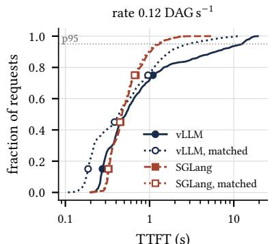  
TTFT (s)

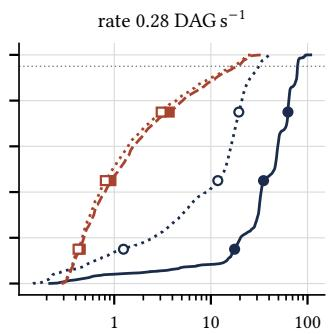  
TTFT (s)

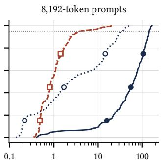  
TTFT (s)  
Fig. 11. Empirical distribution of TTFT per request, pooled over three repetitions, with the 95th percentile marked. Line style and marker shape identify the engine, hollow markers the matched configuration.

Table 6. Dispersion of per-request TTFT, pooled over three repetitions. The tail ratio is the 95th percentil divided by the median, and $g _ { 1 }$ is the skewness of ln TTFT. Generated by make\_dispersion\_table.py.
<table><tr><td rowspan="2">Condition</td><td rowspan="2">Configuration</td><td colspan="2">vLLM</td><td colspan="2">SGLang</td></tr><tr><td>Tail ratio</td><td>91</td><td>Tail ratio</td><td>91</td></tr><tr><td>Rate 0.12</td><td>defaults</td><td>24.0</td><td>+1.29</td><td>2.8</td><td>+0.93</td></tr><tr><td></td><td>matched</td><td>6.6</td><td>+0.79</td><td>2.7</td><td>+0.91</td></tr><tr><td>Rate 0.28</td><td>defaults</td><td>1.7</td><td>-2.54</td><td>16.4</td><td>+0.71</td></tr><tr><td></td><td>matched</td><td>2.2</td><td>-1.16</td><td>17.7</td><td>+0.80</td></tr><tr><td>8,192 tokens</td><td>defaults</td><td>2.2</td><td>-1.93</td><td>4.5</td><td>+1.40</td></tr><tr><td></td><td>matched</td><td>15.4</td><td>-0.08</td><td>4.4</td><td>+1.44</td></tr></table>

With 8,192-token prompts, vLLM under vendor defaults is saturated: tail ratio 2.2, $g _ { 1 } = - 1 . 9 3$ median 63.3 s. Under matched configuration its distribution is the widest we measured. The ratio is 15.4 and $g _ { 1 }$ is near zero. The 75th percentile is 23.5 times the 25th, against at most 6.9 for any other of the twelve distributions.

The two statistics separate two kinds of slowness. A large tail ratio with positive skew marks intermittent blocking, the case of Section 6.1. A ratio near two with negative skew marks a queue that has taken over the whole distribution.

## 7.2 Variability across repetitions

The three repetitions of a condition difer only in their seed. Figure 12b shows how far their median TTFT values disagree, as the standard deviation of ln p50. Below the knee, at 0.12 agent graphs per second and lower, the median spread is 0.01 for SGLang and 0.08 for vLLM, so repetitions agree within about 1% and 8%. Above it, at 0.20 and higher, the median spread is 0.24 for SGLang and 0.21 for vLLM.

Spread peaks at each engine’s knee. vLLM’s reaches 0.67 at 0.20 agent graphs per second, where its three medians are 3.0, 3.3 and 10.1 s. SGLang’s reaches 0.97 at 0.40, where its medians are 6.2,

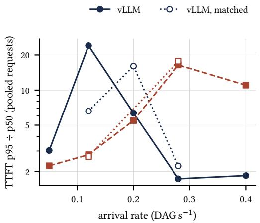

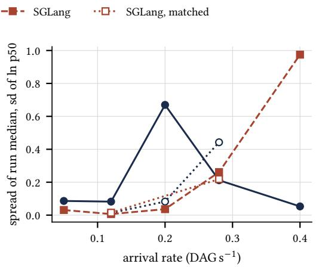  
Fig. 12. Variability against arrival rate. (a) Tail ratio of pooled per-request TTFT, 95th percentile divided by median. (b) Spread of the run-level median TTFT across the three repetitions, as the standard deviation of ln p50. Markers and lines as in Figure 6.

29.3 and 4.8 s. The prompt-length sweep shows the same contrast for vLLM. At 2,048 tokens the spread is 0.07 and the three medians lie between 0.25 and 0.29 s. At 512 and 8,192 tokens it is 1.06 and 0.61, with medians ranging from 0.7 to 6.1 s and from 36 to 114 s. Matched, the 8,192-token medians are 3.2, 9.8 and 1.3 s, a spread of 1.03. It explains why the matched median gap in Table 5 has an interval that includes parity. The tail ratio in Figure 12a peaks at the same place. For vLLM it peaks at 0.12 and falls to 1.7 by 0.28 as the whole distribution moves up. For SGLang it peaks at 0.28. Near the knee, a single burst of arrivals decides whether a queue starts to grow.

Decode speed does not behave this way. The spread of median TPOT across repetitions has a median of 0.021 over all conditions and never exceeds 0.09. A noisy platform would afect TPOT too, so this argues against platform noise as the source of the variability in TTFT. The variability does account for the width of the confidence intervals of Section 6, which are widest at the knee. The interval on the 0.28 gap, for example, spans a factor of 6.9.

## 7.3 Which requests wait

Each agent graph contains three kinds of request, and they do not wait equally. At 0.28 agent graphs per second, workers wait longer than planners under every combination of engine and configuration. SGLang’s median TTFT is 1.42 s for workers and 0.54 s for planners under vendor defaults, a factor of 2.6, and 1.21 s against 0.51 s when matched. For vLLM the factors are 1.3 under vendor defaults (46.9 s against 35.7 s) and 1.7 when matched (15.0 s against 9.0 s). Aggregators fall between the two. Each graph releases its four workers within a short interval after the planner completes, so a worker usually finds siblings queued ahead of it. The data are consistent with this account, and we did not test it directly.

The vLLM tail at light load, in contrast, does not depend on the role. At 0.12 agent graphs per second under vendor defaults the tail ratio is 31 for planners, 21 for workers and 23 for aggregators, against 2.0, 2.6 and 2.1 for SGLang. A planner is the one request in a graph with no siblings, so it reflects the engine’s state at the moment it arrives. Its long tail shows that a long prefill stalls whichever request happens to arrive during it.

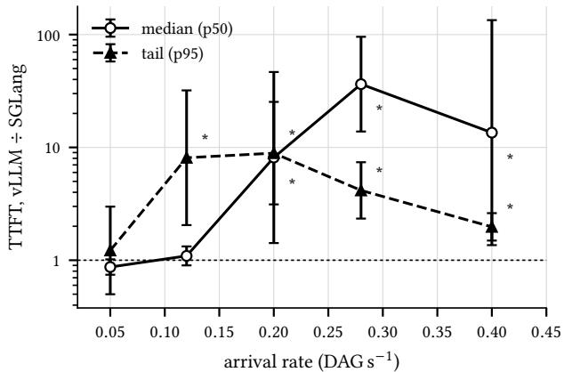  
Fig. 13. Paired engine gap in median and 95th-percentile TTFT across the rate sweep under vendor defaults. Values above 1 indicate that SGLang is faster. ∗ paired � < 0.05.

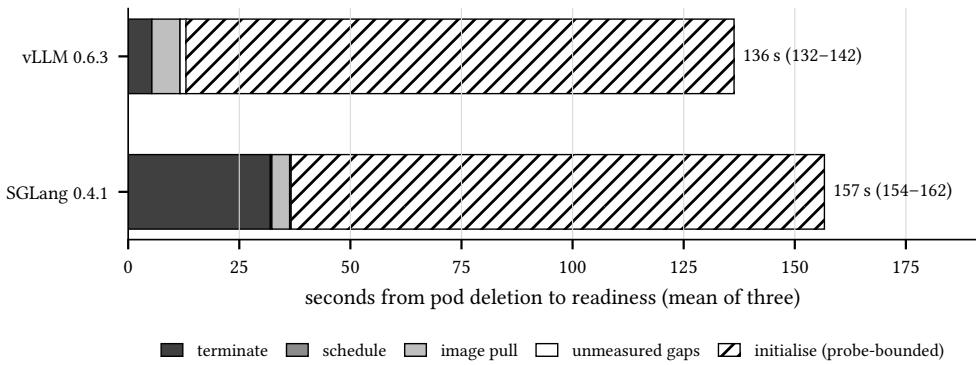  
Fig. 14. Time from pod deletion to readiness, decomposed by phase, mean of three repetitions. The GPU node stayed provisioned. Totals show the mean and the range. The initialisation phase is quantised by the readiness probe and is an upper bound.

## 7.4 The median and the tail

Figure 13 compares the two paired gaps across the rate sweep. The tail gap opens first. At 0.12 agent graphs per second it is 8.10 while the median gap is 1.09 . The two gaps are nearly equal at 0.20 (8.13 at the median and 8.89 at the 95th percentile), and the median gap dominates at 0.28, where it reaches 36.4 against 4.16 . At 0.40 the tail gap closes to 1.98 as both engines saturate and their whole distributions move together.

The choice of percentile therefore moves the apparent onset of degradation. A benchmark that reports the median finds vLLM’s gap significant from 0.20 agent graphs per second, and one that reports the 95th percentile finds it significant from 0.12, at a rate 1.7 times lower. We report both for this reason, and Section 8 returns to the point.

## 7.5 Restarting an engine

We deleted the serving pod and measured the time until its replacement became ready, holding the GPU node provisioned so that engine initialisation is separate from node provisioning (Section 5.4).

The restarts ran during the matched campaign, with each engine in its matched configuration.   
Event timestamps have a resolution of one second.

From deletion to readiness, vLLM took 136 s (range 132 to 142 s) and SGLang 157 s (154 to 162 s), as Figure 14 shows. The diference comes almost entirely from termination. SGLang’s pod took 32 s to shut down in all three repetitions and vLLM’s 5 or 6 s. We did not investigate why. Scheduling was instantaneous, and image pulls took 1 to 9 s because the node already held both images.

Initialisation, from container start to readiness, took exactly 120 s in five of the six runs. The sixth, vLLM’s third, took 130 s. The regularity matches the readiness probe’s schedule, with a 60 s initial delay and a 10 s period, so we read 120 s as the first probe at which the engine answered, not as its loading time. It is an upper bound for both engines, and we draw no comparison between them on this phase. SGLang’s six-fold longer shutdown is the one diference the data support, and it afects how quickly a replica leaves service when a scaling policy removes it.

## 8 Discussion

## 8.1 What the decomposition shows

The question was whether the performance gap between two prefix-caching engines reflects their cache architectures. For the pair we measured, most of it does not. One scheduling setting, chunked prefill, accounts for 78% of the capacity gap at the load where that gap is largest and for 30 to 67% of the latency gap across conditions. A comparison of default deployments cannot separate the two causes, because the engines’ defaults vary both at once.

A diference remains, and it is smaller and more specific. At equal throughput SGLang’s 95th percentile is better by 2.4 to 6.4 . That pattern points to the order in which waiting requests are served. Whether the cause is request ordering, an attention kernel or the engines’ memory-budget semantics is a question our experiments do not settle, and an ablation could. SGLang exposes its scheduling policy as an option, so running it with first-come-first-served ordering is a direct test.

Two observations carry beyond this pair of engines. The first concerns the mechanism. On this workload, interference between prefill and decode explains the larger part of the capacity gap and, in three of five conditions, of the latency gap, and the layout of the cache explains less. Disaggregated designs attack the same interference by placing the two phases on diferent hardware [14, 22]. The second concerns measurement. Near saturation, a latency ratio is a property of the engine and of the length of the benchmark together (Section 6.3). A ratio of 12 can stand for a capacity diference under 5%.

## 8.2 Recommendations for comparing serving engines

Each recommendation follows from a result above.

(1) Record the resolved configuration. Both engines choose their chunked-prefill setting from the hardware and the context length. Read it from the start-up log, not from the flags passed.

(2) Change one setting at a time, and keep a control. Matching chunked prefill altered one engine’s one setting. SGLang, left unchanged, showed that independently provisioned deployments agree within 12%.

(3) Report throughput beside latency. Say whether each engine keeps pace with the ofered load. Without it, a latency ratio near the knee measures a queue.

(4) State the run length when any engine is saturated. The queueing delay grows in proportion to it.

(5) Report the median and the 95th percentile. The percentile moved the apparent onset of degradation by a factor of 1.7 in arrival rate (Section 7.4).

(6) Pair runs by seed. The paired test found a significant diference at four sharing levels where the unpaired test found one.

## 8.3 Relation to prior claims

The RadixAttention authors report throughput up to 6.4× higher than contemporaneous sys- tems [21]. Their measurements used diferent workloads, hardware and engine versions, so ours neither confirm nor contradict that figure. Our result concerns a narrower matter: what a gap between current default deployments can be attributed to.

Agrawal et al. diagnosed the generation stall and introduced chunked prefill to remove it [1]. We apply their diagnosis in a new setting. The technique they proposed to resolve a throughput and latency trade-of within one engine also accounts for much of the trade-of observed between two engines that each adopted it. Our TPOT results reproduce the cost they describe: vLLM’s median TPOT at 0.28 agent graphs per second rose from 112 to 125 ms once chunking was enabled.

Systems for multi-agent workloads add mechanisms above the cache. Examples are eviction that follows the dependency graph [12], KV-cache scheduling aware of the workflow topology [2], prefix-aware request routing [16] and exposing request structure to the serving layer [9]. These mechanisms act on axes we did not vary, and our results do not bear on them. Where a design’s motivation rests on a comparison between default deployments of vLLM and SGLang, the comparison varies cache and scheduling together, and the gap it shows is an upper bound on the efect of the cache.

The pairing we measured has since changed upstream. vLLM’s V1 engine enables chunked prefill by default wherever possible [17], so current defaults of the two engines no longer difer in that respect. We read this as support for the broader point. Defaults depend on hardware and version, and they move. A comparison between current releases needs its own record of resolved configurations, and the protocol of Section 5 applies to it unchanged.

## 8.4 What this study adds

To our knowledge, this is the first controlled decomposition of the vLLM and SGLang performance gap that separates chunked-prefill configuration from cache architecture. It adds a result specific to the pair: the 78% and the 30 to 67%. It adds a general result. Near saturation the latency gap measures queue growth and scales with the length of the run, and a fluid model with no free parameter reproduces it. It also adds an apparatus that others can repeat, namely a testbed defined in code, a seeded workload generator, and the per-run logs behind every number.

The decomposition is also falsifiable. A diferent GPU, context length or release changes the confound, and the same protocol re-measures it. The residual becomes a testable hypothesis, equal throughput with an unequal tail, and Section 11 lists the experiments that would test it.

## 9 Threats to Validity

## 9.1 Construct validity

TTFT includes queueing. TTFT measures the wait for admission as well as the prefill. This is deliberate, since a user experiences both, but it means that TTFT near saturation reports the state of a queue (Section 6.3). We pair every latency with throughput for this reason.

The keeps-pace criterion is a convention. We call an engine saturated when it completes less than 97% of the ofered load (Section 4.2). At the condition that matters most, matched 0.28 agent graphs per second, SGLang achieves 98.5% of the ofered load and vLLM 94.2%, so any tolerance between 1.5 and 5.8% gives the same classification of the two engines. The classification of individual repetitions near the threshold can change, and the fluid model of Section 6.3 uses it to select runs.

The workload is synthetic. Prompts are token sequences sampled from the vocabulary. Prefixcache matching compares token identifiers, so content does not afect it, and the generator controls � and prompt length exactly. It omits the length distributions of real prompts and near-duplicate variation such as reordered tool schemas, which lower hit rates in deployment. Tool-call latencies are simulated draws from published distributions, and every graph has the same wide-branch topology. We did not test deeper chains or a mix of topologies. Production characterisations report that arrival patterns shift over time and that no single stochastic process fits every workload [19], so a stationary Gamma process with one coeficient of variation is a simplification.

## 9.2 Internal validity

The residual is not attributed. Matching chunked prefill leaves several diferences between the engines: the order of waiting requests, attention kernels, SGLang’s overlapped scheduler, and memory-budget parameters that are defined diferently (Table 1). Section 6.4 names request ordering as the likeliest cause, and we did not isolate it.

The explanation of the sharing sweep is post hoc. We expected the gap to grow with � and it did not. We formed the account we give, that the gap tracks prefill scheduling and that sharing shrinks the work scheduling has to do, after seeing the data. It agrees with the decomposition and with the KV-cache measurements, and it needs independent confirmation. The sweep itself ran only under vendor defaults.

Deployment is confounded with configuration for vLLM.. The defaults and matched arms ran on independently provisioned clusters. Within the matched arm, the node replacements of Section 5.4 also put the two engines on diferent physical L4 instances of the same machine type at the matched rates. SGLang, unchanged between arms, bounds the drift between deployments at 11.7% for that engine, and the drift has a direction: all nine measures of Table 4 are lower in the second deployment. SGLang’s token-level timing is just as stable. At the two rates measured in both arms, the median request’s 99th-percentile inter-token latency difers by at most 19% between arms in every paired repetition for SGLang, while enabling chunked prefill lowers vLLM’s by a factor of 2.2 to 2.3. We have no direct bound for vLLM. If it shared SGLang’s shift, up to about 12% of its improvement between arms would come from the deployment rather than the configuration. The efects we attribute to its configuration are 3.35 or larger, far beyond that figure, so ordinary drift cannot account for them, though it could account for part of a small one.

Thefluid model is approximate. It over-predicts vLLM’s median TTFT by a factor of1.6 on average, because agent graphs issue later requests only after earlier ones complete, so a congested engine slows its own arrivals. It rests on seven runs, applies only above capacity, and takes SGLang’s throughput as the realised arrival rate, which holds only where SGLang keeps pace. We use it to show that a small shortfall can produce the gap we measured and that the gap scales with run length. We do not use it as a predictor.

Cache state and the hit-rate counter. We wait 30 s between runs and exclude the first agent graph, but we cannot prove that no cached state survives between runs. Both engines report the prefixcache hit rate as a counter accumulated since process start, so we do not report it per run on the sharing sweep. The evidence that prefix caching engaged is the fall in KV-cache utilisation, which is indirect.

The platform is shared. The engine runs in a virtual machine whose host we do not control. The spread of median TPOT across repetitions is small, with a median of 0.021 (Section 7.2), which argues against large interference, and we cannot exclude a small one.

## 9.3 External validity

One GPU, one model, one context length. All results come from an NVIDIA L4 with Llama-3.1-8B-Instruct and a 16,384-token context. Both engines’ chunked-prefill defaults depend on these, so the out-of-the-box comparison would difer on other hardware or at other context lengths. The conditionality is part of our finding and also bounds it.

Engine versions. We measured vLLM 0.6.3 and SGLang 0.4.1. vLLM’s V1 engine has since changed the default [17], so the specific pairing we measured does not arise between current releases. We make no claim about later versions of either engine. The protocol applies to them.

One replica. Each engine ran as a single replica with autoscaling disabled. Multi-replica deployments add routing and scaling efects that we did not measure. The restart experiment holds the GPU node provisioned, so it measures engine initialisation and not node provisioning, and the readiness probe quantises its initialisation phase (Section 7.5).

## 9.4 Statistical validity

Three repetitions. Each condition has � = 3. Confidence intervals use $t _ { 0 . 9 7 5 , 2 } = 4 . 3 0$ and are wide, and the tests have low power. We read a non-significant result as an absence of evidence. Small diferences can reach significance when the runs agree closely, as the 5% median diference at 0.12 agent graphs per second does, so we do not rely on significance alone to judge an efect’s size.

Multiple comparisons. The analysis computes 64 paired tests across four metrics and the conditions of the study, and 42 fall below $\textstyle p = 0 . 0 5$ . If no diference existed, about three would do so by chance. We apply no correction. Our conclusions rest on efect sizes that exceed their intervals by large factors and on the consistency of the pattern across conditions, not on any single �-value.

## 10 Related Work

Serving engines and prefix reuse. Iteration-level scheduling [20] lets an engine rebuild its batch at every decoding step, and both engines we study inherit it. PagedAttention adds block-structured KV-cache memory and automatic prefix caching over hashed blocks [8]. RadixAttention indexes cached tokens in a radix tree and reuses a shared prefix of any length [21]. These two mechanisms, and the comparison between them, are the subject of this paper.

Prefill and decode scheduling. Agrawal et al. identify the generation stall and remove it by splitting prefills into chunks interleaved with decode steps on the same GPU [1]. Both engines we study adopted this technique. DistServe [22] and Splitwise [14] instead place prefill and decode on separate hardware. Our result concerns the first approach: the presence or absence of chunking is the configuration diference we isolate.

Serving multi-agent workloads. Several systems target agent and structured workloads directly. KVFlow manages prefix caching for multi-agent workflows [12]. TokenCake is a KV-cache-centric serving framework for multi-agent applications [2]. Preble schedules prompts across a distributed deployment [16], Parrot exposes application structure to the serving layer through semantic variables [9], and SAGA schedules agent workflows atomically on GPU clusters [4]. These systems change mechanisms that we hold fixed. Section 8.3 discusses how our results bear on comparisons of this kind.

Workload and cost characterisation. BurstGPT provides traces from production LLM serving [18], and its finding of bursty arrivals informs our arrival layer. ServeGen characterises production serving workloads across language, multimodal and reasoning models, and reports that workloads generated naively are easier to serve than real ones [19]. Patil estimates the cost of LLM infrastructure with a methodology that accounts for concurrency [15]. These studies characterise a workload or a single deployment. Neither compares engines under controlled configuration.

Performance-evaluation methodology. Our methods draw on an established literature. Fleming and Wallace show that benchmark ratios should be summarised by their geometric mean [3]. Mytkowicz et al. demonstrate that a seemingly innocuous aspect of an experimental setup can lead to wrong conclusions [10], and the same authors analyse how omitted variables bias the evaluation of compiler optimisations [11]. The chunked-prefill default is an omitted variable of exactly this kind, set by the engine rather than chosen by the experimenter. Hoefler and Belli propose twelve rules for reporting performance results, after finding the state of practice wanting in a sample of papers from three conferences [5]. Papadopoulos et al. propose eight principles for reproducible performance evaluation in cloud environments [13], and Iosup et al. measure how far the performance of production cloud services varies [7]. Ilyushkin et al. compare seven autoscaling policies experimentally on workflow workloads and find that parametrisation matters a great deal [6]. Our study follows their structure and applies the same discipline to LLM serving engines.

To our knowledge, no prior study isolates a configuration default as the cause of a performance gap between LLM serving engines, or shows that a latency gap measured near saturation scales with the length of the run.

## 11 Conclusion and Future Work

A large performance gap between two LLM serving engines, measured under their default configurations, is usually read as a verdict on their cache architectures. We tested that reading in a controlled experiment. Under vendor defaults vLLM’s median TTFT is up to 64 SGLang’s, but the engines’ defaults difer in whether they chunk long prefills. Matching that one setting removes 78% of the capacity gap at the load where it is largest and 30 to 67% of the latency gap. Near saturation, the latency gap that remains measures the growth of a queue: a 4.4% shortfall in throughput produces a 12 diference in median TTFT, and a fluid queue model predicts that the diference grows with the length of the run. What survives matching is a tail advantage of 2.4 to 6.4× at equal throughput. Several experiments would extend these results Several experiments would extend these results.

Isolating the residual. Running SGLang with first-come-first-served ordering would test whether request ordering accounts for the tail advantage. Matching the memory budget and the attention kernel would address the other remaining diferences.

• A matched sharing sweep. Repeating the sharing sweep with chunked prefill matched would separate the two explanations of the reversal in Section 6.5.

Current releases. vLLM’s V1 engine enables chunked prefill by default. Measuring current releases of both engines, with their resolved configurations recorded, would show which default diferences remain.

Other hardware, models and workloads. The defaults depend on GPU memory and context length, so other GPUs, larger models and traces from natural-language agent workloads would test how far the decomposition generalises.

A closed queueing model. Agent graphs throttle their own arrivals when the engine falls behind. A model that captures this dependency should remove most of the fluid model’s overestimate.

Scaling. Multi-replica deployments with autoscaling, and restarts that include node provisioning, remain unmeasured.

## Acknowledgments

We thank the Mitacs Globalink Research Internship program and Thompson Rivers University for supporting this research.

## References

[1] Amey Agrawal, Nitin Kedia, Ashish Panwar, Jayashree Mohan, Nipun Kwatra, Bhargav S. Gulavani, Alexey Tumanov, and Ramachandran Ramjee. 2024. Taming Throughput-Latency Tradeof in LLM Inference with Sarathi-Serve. In 18th USENIX Symposium on Operating Systems Design and Implementation (OSDI). 117–134.

[2] Zhuohang Bian, Feiyang Wu, Zhuoran Li, Teng Ma, and Youwei Zhuo. 2025. TokenCake: A KV-Cache-centric Serving Framework for LLM-based Multi-Agent Applications. arXiv:2510.18586

[3] Philip J. Fleming and John J. Wallace. 1986. How Not to Lie with Statistics: The Correct Way to Summarize Benchmark Results. Commun. ACM 29, 3 (1986), 218–221. doi:10.1145/5666.5673

[4] Dongxin Guo, Jikun Wu, and Siu Ming Yiu. 2026. SAGA: Workflow-Atomic Scheduling for AI Agent Inference on GPU Clusters. arXiv:2605.00528

[5] Torsten Hoefler and Roberto Belli. 2015. Scientific Benchmarking of Parallel Computing Systems: Twelve Ways to Tel the Masses When Reporting Performance Results. In Proceedings of the International Conference for High Performance Computing, Networking, Storage and Analysis (SC). Article 73, 12 pages. doi:10.1145/2807591.2807644

[6] Alexey Ilyushkin, Ahmed Ali-Eldin, Nikolas Herbst, André Bauer, Alessandro V. Papadopoulos, Dick Epema, and Alexandru Iosup. 2018. An Experimental Performance Evaluation of Autoscalers for Complex Workflows. ACM Transactions on Modeling and Performance Evaluation ofComputing Systems 3, 2, Article 8 (2018), 32 pages. doi:10. 1145/3164537

[7] Alexandru Iosup, Nezih Yigitbasi, and Dick Epema. 2011. On the Performance Variability of Production Cloud Services. In 11th IEEE/ACM International Symposium on Cluster, Cloud and Grid Computing (CCGrid). 104–113.

[8] Woosuk Kwon, Zhuohan Li, Siyuan Zhuang, Ying Sheng, Lianmin Zheng, Cody Hao Yu, Joseph E. Gonzalez, Hao Zhang, and Ion Stoica. 2023. Eficient Memory Management for Large Language Model Serving with PagedAttention. In Proceedings ofthe 29th Symposium on Operating Systems Principles (SOSP).

[9] Chaofan Lin, Zhenhua Han, Chengruidong Zhang, Yuqing Yang, Fan Yang, Chen Chen, and Lili Qiu. 2024. Parrot: Eficient Serving of LLM-based Applications with Semantic Variable. In 18th USENIX Symposium on Operating Systems Design and Implementation (OSDI).

[10] Todd Mytkowicz, Amer Diwan, Matthias Hauswirth, and Peter F. Sweeney. 2009. Producing Wrong Data Without Doing Anything Obviously Wrong!. In Proceedings ofthe 14th International Conference on Architectural Supportfor Programming Languages and Operating Systems (ASPLOS). 265–276. doi:10.1145/1508244.1508275

[11] Todd Mytkowicz, Amer Diwan, Matthias Hauswirth, and Peter F. Sweeney. 2010. The Efect of Omitted-Variable Bias on the Evaluation of Compiler Optimizations. Computer 43, 9 (2010), 62–67. doi:10.1109/MC.2010.214

[12] Zaifeng Pan, Ajjkumar Patel, Zhengding Hu, Yipeng Shen, Yue Guan, Wan-Lu Li, Lianhui Qin, Yida Wang, and Yufei Ding. 2025. KVFlow: Eficient Prefix Caching for Accelerating LLM-Based Multi-Agent Workflows. arXiv:2507.07400

[13] Alessandro Vittorio Papadopoulos, Laurens Versluis, André Bauer, Nikolas Herbst, Jóakim von Kistowski, Ahmed Ali-Eldin, Cristina L. Abad, José Nelson Amaral, Petr Tůma, and Alexandru Iosup. 2021. Methodological Principles for Reproducible Performance Evaluation in Cloud Computing. IEEE Transactions on Software Engineering 47, 8 (2021), 1528–1543.

[14] Pratyush Patel, Esha Choukse, Chaojie Zhang, Aashaka Shah, Íñigo Goiri, Saeed Maleki, and Ricardo Bianchini. 2024. Splitwise: Eficient Generative LLM Inference Using Phase Splitting. In 2024 ACM/IEEE 51st Annual International Symposium on Computer Architecture (ISCA). 118–132. doi:10.1109/ISCA59077.2024.00019

[15] Chitral Patil. 2026. Beyond Per-Token Pricing: A Concurrency-Aware Methodology for LLM Infrastructure Cost Estimation. arXiv:2606.11690

[16] Vikranth Srivatsa, Zijian He, Reyna Abhyankar, Dongming Li, and Yiying Zhang. 2025. Preble: Eficient Distributed Prompt Scheduling for LLM Serving. In International Conference on Learning Representations (ICLR).

[17] vLLM Project. 2025. vLLM V1 User Guide: Chunked Prefill. https://docs.vllm.ai/en/stable/usage/v1\_guide/. Accessed October 2026. States that chunked prefill is enabled by default whenever possible in V1, unlike V0, where it was enabled conditionally.

[18] Yuxin Wang, Yuhan Chen, Zeyu Li, Xueze Kang, Yuchu Fang, Yeju Zhou, Yang Zheng, Zhenheng Tang, Xin He, Ru Guo, Xin Wang, Qiang Wang, Amelie Chi Zhou, and Xiaowen Chu. 2025. BurstGPT: A Real-World Workload Dataset to Optimize LLM Serving Systems. In Proceedings ofthe 31st ACM SIGKDD Conference on Knowledge Discovery and Data Mining (KDD), Vol. 2. ACM, Toronto, ON, Canada, 5831–5841. doi:10.1145/3711896.3737413

[19] Yuxing Xiang, Xue Li, Wenyuan Yu, and Ennan Zhai. 2025. ServeGen: Workload Characterization and Generation of Large Language Model Serving in Production. arXiv:2505.09999

[20] Gyeong-In Yu, Joo Seong Jeong, Geon-Woo Kim, Soojeong Kim, and Byung-Gon Chun. 2022. Orca: A Distributed Serving System for Transformer-Based Generative Models. In 16th USENIX Symposium on Operating Systems Design and Implementation (OSDI 22). USENIX Association, Carlsbad, CA, 521–538.

[21] Lianmin Zheng, Liangsheng Yin, Zhiqiang Xie, Chuyue Sun, Jef Huang, Cody Hao Yu, Shiyi Cao, Christos Kozyrakis, Ion Stoica, Joseph E. Gonzalez, Clark Barrett, and Ying Sheng. 2024. SGLang: Eficient Execution of Structured Language Model Programs. In Advances in Neural Information Processing Systems (NeurIPS).

[22] Yinmin Zhong, Shengyu Liu, Junda Chen, Jianbo Hu, Yibo Zhu, Xuanzhe Liu, Xin Jin, and Hao Zhang. 2024. DistServe: Disaggregating Prefill and Decoding for Goodput-optimized Large Language Model Serving. In 18th USENIX Symposium on Operating Systems Design and Implementation (OSDI).

## A Artifact

## A.1 Abstract

The artifact contains everything needed to repeat the measurements and the analysis: Terraform configuration for the testbed, Kubernetes manifests for both engines in both configurations, the workload generator, the campaign runners, the analysis and figure scripts, and the per-run logs from which every table and figure is derived.

## A.2 Scope

The artifact supports two levels of reproduction. Re-analysis regenerates every table and figure from the included logs in a few minutes, without a GPU. It checks the statistics and the decomposition. Re-measurement provisions the testbed and repeats the experiments. The full campaign takes about 33 hours of measured load on one GPU, 60% of it the sharing sweep. The central claim, the decomposition of Table 5, rests only on the three conditions measured in both configurations, which take about 8 hours.

## A.3 Contents

infra/ Terraform for the testbed in two stages, cluster and platform (Section 3.2), and the engine manifests of both configurations.

wlgen/ Trace compiler, validator, dispatcher, and the generators of the sweep and restart Jobs (Section 3.5).

runners/ The sweep and restart runners, which share one success check, the per-engine campaign script that ran the matched arm (Section 5.4), and a script that stages them for either configuration

analysis/ Log parser, statistical analysis, and a script that recomputes every number quoted in this paper.

figures/ Figure and table generators and the shared figure style.

data/ Per-run logs and Prometheus extracts for all 99 runs, the engines’ resolved start-up configurations, and the restart records. Logs of failed attempts and of the repetitions discarded after a node replacement are kept separately, each with a note giving the reason.

## A.4 Hosting

The artifact is available at https://github.com/FaizanAnwar01/llm-serving-config-eval. The commit used for this paper is tagged.

## A.5 Hardware dependencies

The testbed needs one GPU node with an NVIDIA L4 (24 GB), for which we used a GKE g2-standard-8 instance, and one CPU node for the platform and the generator, an e2-standard-4 instance. It also needs a 60 GB persistent volume and GPU quota for one L4. The GPU matters.

SGLang resolves its default chunk size from GPU memory (Section 3.4), so a diferent GPU compares a diferent pair of configurations.

## A.6 Software dependencies

Google Kubernetes Engine (Kubernetes 1.35) and Terraform, with KServe, kube-prometheus-stack and cert-manager installed by the second Terraform stage. The same stage installs KEDA, which these experiments do not use. The model, Llama-3.1-8B-Instruct, is gated; access requires accepting its licence and supplying a Hugging Face token to the cluster as a Kubernetes Secret. The analysis needs Python 3.12 with the versions of pandas, NumPy, SciPy and matplotlib pinned in the repository; regenerating the figures also needs a LaTeX installation. Both engines run from published images without modification (Table 7). A digest identifies an image exactly, whereas a tag can be reassigned.

Table 7. Engine images. Digests are those of the published tags for linux/amd64, taken from the Docker Hub image pages. We did not record digests at run time.
<table><tr><td>Image tag</td><td>Manifest digest</td></tr><tr><td>vllm/vllm-openai:v0.6.3</td><td>sha256:b8374cee0a1acaec8b64525ff77560f3</td></tr><tr><td rowspan="3">1msysorg/sglang:v0.4.1-cu121</td><td>0443f67bd0fc1956a3529504a89f823b</td></tr><tr><td>sha256:50e7c37bda650334e505eb776e97ea92</td></tr><tr><td>0de8dda4fd94811a877330fa684a5a37</td></tr></table>

## A.7 Workflow

(1) Apply the two Terraform stages, cluster and then platform.

(2) Deploy one engine in the chosen configuration, and confirm the resolved chunked-prefill setting in its start-up log before measuring.

(3) Generate the sweep with the paper’s seed series and run it; each run compiles, validates and dispatches its trace as a Kubernetes Job and writes its results to a log. Repeat for the other engine.

(4) Extract each run’s Prometheus window before tearing down the cluster, since the series cannot be recovered afterwards.

(5) Parse the logs, run the analysis, and check every quoted number with make; regenerate the figures and tables with make figures. The parser reports how many logs it found, parsed and skipped, and a non-zero skip count should be investigated before any output is trusted. The analysis refuses to pool runs from the two configurations.

(6) Destroy both Terraform stages to stop billing.

## A.8 Expected results

Re-analysis of the included logs reproduces every table and figure exactly, because the analysis is deterministic; make verify confirms that the regenerated outputs are byte-identical to the published ones. Re-measurement should reproduce each engine’s latencies within the variation we observed between our own independent deployments, up to 12% for SGLang under an unchanged configuration (Table 4), and the engine ratios of the decomposition within their confidence intervals. Absolute values will difer on other GPUs and at other context lengths, because both engines’ chunked prefill defaults depend on them.