# A low-rank decoder bottleneck bounds reliability in foundation-model perturbation prediction

Zheyu Zhang1 Yuanhao Huang2 Fan Feng2 Jie Liu1,2

1Computer Science and Engineering Division 2Gilbert S. Omenn Department of Computational Medicine and Bioinformatics University of Michigan, Ann Arbor, MI 48109 {zheyuz, hyhao, fanfeng, drjieliu}@umich.edu

## Abstract

Foundation-model predictors of perturbation response are evaluated primarily by aggregate accuracy. Using their predictions to prioritize experiments requires assessing each prediction’s reliability. We audit the state-transition (ST) decoder used in STATE across three encoders (SE-600M, scGPT, and Tahoe-x1) and four cell lines under CRISPRi. The decoder’s first attention layer has a low-rank output. Projecting this output onto 4–32 fixed directions estimated from training activations preserves mean per-perturbation Pearson delta correlation (PDC). This low-rank attention bottleneck bounds the decoder’s reliability by distance to training responses: PDC declines as the cosine distance from a perturbation’s observed response to its nearest training response increases. We propose predicted-NN-distance, the cosine distance from a predicted response to its nearest training response, as a per-prediction confidence score. The score has a mean absolute Spearman correlation of 0.81 with PDC, close to the 0.88 obtained with the observed response. Thresholds calibrated on this score transfer across encoders and cell lines, and the score remains predictive of PDC for drug perturbations.1

## 1 Introduction

Predicting how cells respond to a genetic or chemical intervention would let biologists choose which perturbations to test, a goal often described as building a virtual cell [10, 40]. Observational single-cell atlases record correlations across millions of cells [38, 45], and CRISPR-based Perturbseq [17, 33, 39] measures the effect of intervening directly. The perturbation space, however, spans tens of thousands of genes, combinatorial pairs, and diverse cellular contexts, far more than any lab can screen. Predictive models are therefore needed to extrapolate from measured to unmeasured perturbations. Single-cell foundation models [14, 20, 24, 37, 47] pretrain encoders on large single-cell atlases, and models trained on perturbation screens predict responses from the encoders’ representations. STATE [2] pairs a cell-state encoder with a trainable state-transition (ST) decoder: the encoder represents control cells, and the decoder combines these representations with a perturbation embedding to predict post-perturbation gene expression (Figure 1A). Later models pair this decoder with other encoders or use in-context conditioning or generative diffusion instead [12, 19, 25, 44, 51, 56, 57].

Recent benchmarks find that simple linear baselines can match these models on aggregate metrics [3, 13, 54, 55], and Viñas Torné et al. [50] show that a predictor can score well on these metrics by capturing response patterns shared across perturbations. An experiment, however, tests a specific intervention in a specific cellular context, usually one outside the training data. We ask why simple baselines can match these models, and how a user can tell whether a given prediction can be trusted.

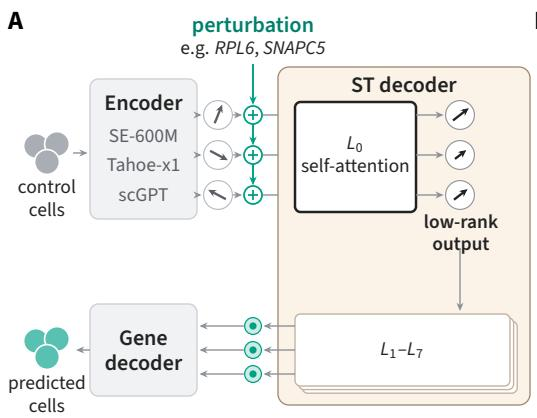  
B

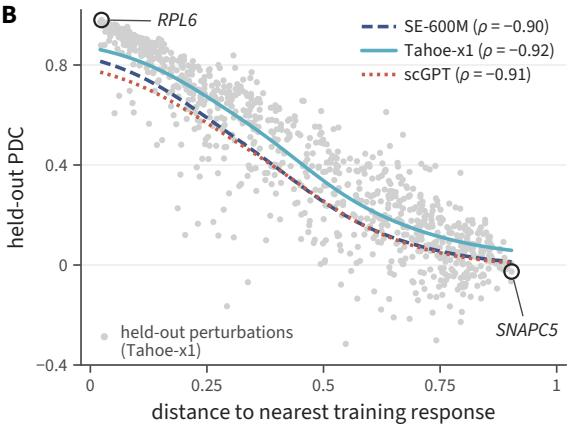  
Figure 1: Per-prediction reliability of encoder+ST models decays smoothly with gene-space distance to the training perturbations. (A) Encoder coupled with ST decoder for perturbation prediction. An upstream encoder (any single-cell foundation model or cell embedding, e.g., SE-600M, Tahoe-x1, scGPT) embeds each control cell, and the perturbation embedding is added to every cell embedding (⊕). The ST decoder (8 attention blocks) and a gene decoder map these to predicted cells. Predictions are averaged into a pseudobulk for evaluation (§3). Each cell is drawn as a vector. Before $L _ { 0 }$ (black outline) the cell vectors point in different directions, and after it they point along one shared direction with different lengths. This is the low-rank output of the $L _ { 0 }$ self-attention (§4.2). (B) HepG2. Each gray dot is one of the 945 held-out perturbations under Tahoe-x1+ST, plotted as Pearson delta correlation (PDC, Eq. (1)) against the cosine distance in gene space from its response to the nearest training response. Lines are kernel-smoothed trends per encoder (Spearman $\rho$ in the legend). RPL6 (small distance) is predicted reliably and SNAPC5 (large distance) is not. The pattern replicates across all four cell lines (§B.2). The deployable analog (Definition 1) and the calibrated threshold are developed in §4.3.

Consider two CRISPRi knockdowns in HepG2, a human liver cell line, both held out from training. With each of three foundation-model encoders, the ST decoder predicts the response to RPL6 accurately and the response to SNAPC5 poorly. RPL6 encodes a ribosomal protein, and knockdowns of other ribosomal genes in the training data produce similar responses. The SNAPC5 response lies far from all training responses. A user who sees only the two predictions needs a way to tell which one to act on. The contrast holds across held-out perturbations. We measure accuracy by per-perturbation Pearson delta correlation (PDC; Eq. (1)), the correlation across genes between predicted and observed expression changes relative to control. PDC declines smoothly as the cosine distance from an observed response to its nearest training response increases (Figure 1B).

The three encoders (SE-600M [2], scGPT [14], and Tahoe-x1 [20]) use different pretraining recipes, yet the decline has the same shape with each. We therefore audit the component they share, the ST decoder, across four CRISPRi cell lines (§3). Its first attention layer is a low-rank bottleneck: for each perturbation, the layer adds nearly the same vector to every control cell. Interventions on this vector with SE-600M and Tahoe-x1 show that the decoder tells perturbations apart by the vector’s direction. Projecting the layer’s output onto 4–32 directions estimated from training activations preserves PDC, so what the later layers need from this layer lies in a few directions fixed by the training perturbations. A perturbation whose response needs other directions is predicted poorly. A linear read-out of the decoder’s inputs is nearly as accurate as the full decoder, and an oracle that averages the training responses nearest to a perturbation’s observed response is more accurate. The decoder’s accuracy therefore comes from the similarity of a held-out response to training responses, and this is why simple baselines can match it.

We propose predicted-NN-distance (Definition 1), the cosine distance from the predicted response to its nearest training response, as a per-prediction confidence score. It needs only the prediction and the training responses, and its correlation with PDC is nearly as high as that of the distance computed from the observed response (Spearman $| \rho | \approx 0 . 8 1$ against 0.88). A threshold on the score fitted on the other encoders and cell lines selects accurate predictions on a held-out one without recalibration.

Our main contributions are:

• We identify a low-rank bottleneck in the ST decoder: its first attention layer passes each perturbation to the later layers through a low-rank output, and its directions lie in a small subspace fixed by the training perturbations (§4.2).

• We show that this bottleneck explains why simple baselines match these models: accuracy falls with distance from the nearest training response, and on perturbations far from training the decoders are no more accurate than a linear model on their inputs (§4.1, 4.2).

• We propose predicted-NN-distance, a confidence score for each prediction computed from the prediction and the training data. One threshold on this score selects accurate predictions across encoders and cell lines, and the score also ranks predictions for drug perturbations (§4.3, 4.4).

## 2 Related work

Perturbation prediction has evolved through several paradigms [16]: linear models [17], VAE-based latent arithmetic [29, 30], optimal transport [9], graph-based approaches with regulatory priors [41], and diffusion in expression space [25]; a parallel line frames perturbation response as causal inference and identifiable-representation learning [18, 28, 58]. Most recently, single-cell foundation models (scFMs) introduce mask-prediction transformers [14, 47] and architectures that couple a cell-state encoder with a state-transition decoder (SE+ST factorizations) [2, 20], with concurrent work pursuing in-context conditioning [19], agentic architecture search [12], ranking-based pretraining [44], and generative diffusion [51, 56]. Yet recent benchmarks find that linear baselines match scFM-decoder performance on standard splits [3, 13, 54, 55], and Viñas Torné et al. [50] show that a predictor can score well on standard metrics by capturing response patterns shared across perturbations. We open the ST decoder hidden state and trace this parity to a low-rank bottleneck inside ST; by pairing the same ST architecture with scGPT, SE, or Tahoe-x1 as the upstream encoder, we test whether the bottleneck is encoder-side or ST-side, finding the latter (§4.2).

Mechanistic interpretability provides activation patching [26, 32, 52], subspace interventions [11, 49], and sparse autoencoders [8, 15, 46], applied in biology to protein language models [1, 36, 43] and scFMs for cell-type analysis [42], and analyses of perturbation predictors have inspected attention maps [2, 14]. We open the ST decoder with low-rank projections and activation patching. For deployment, predicted-NN-distance is a per-prediction confidence score, and Learn-then-Test [5], a method from the conformal prediction framework [4], selects a threshold on it with a finite-sample guarantee. Extended related work is provided in Appendix H.

## 3 Methods

## 3.1 Preliminaries

Model. We study predictors that couple an upstream encoder with a state-transition (ST) decoder, henceforth encoder+ST (Figure 1A). The encoder embeds each of S control cells. The ST decoder adds a perturbation embedding to every cell embedding and passes the S cells through eight attention blocks $L _ { 0 } , \ldots , L _ { 7 }$ , and a gene decoder maps each cell to its predicted post-perturbation expression. We pair three frozen encoders with different pretraining, SE-600M [2], scGPT [14], and Tahoex1 [20], each with an ST decoder of the same architecture and training recipe. This gives three predictors, SE+ST, scGPT+ST, and Tahoe+ST. We denote by $X _ { p } \in \mathbb { R } ^ { S \times H }$ the output of the self-attention sub-layer of $L _ { 0 }$ for perturbation $p ,$ before it is added to the residual stream.

Data and protocol. We use the four cell lines of the Replogle–Nadig CRISPRi panel [33, 39] (HepG2, Jurkat, RPE1, and K562) under the STATE few-shot protocol [2]. For each target cell line, the decoder is trained on all perturbations of the other three cell lines and on the training perturbations of the target line, and it is tested on the remaining perturbations of the target line. Three encoders and four target lines give twelve encoder–cell configurations. Encoder hidden dimensions, HVG count, context size, decoder hyperparameters, and bootstrap settings are listed in Table 2 (§A.1).

Notation and metric. For perturbation $p$ in cell line $c ,$ the model receives $S$ control cells (cells with a non-targeting sgRNA) and predicts their post-perturbation expression profiles. Averaging the S predicted profiles across cells, on the highly variable gene (HVG) evaluation set $G ,$ , gives the pseudobulk prediction $\hat { y } _ { p } \in \mathbb { R } ^ { | G | }$ . Averaging measured cells the same way gives the observed pseudobulk $y _ { p }$ of perturbation $p$ and the control pseudobulk $\mu _ { c } ^ { \mathrm { c t r l } }$ of cell line $c ,$ and $\hat { \mu } _ { c } ^ { \mathrm { c t r l } }$ is the model’s prediction for the control condition. We measure accuracy by the per-perturbation Pearson delta correlation (PDC) [2],

$$
\begin{array} { r } { \mathrm { P D C } ( p , c ) = \mathrm { P e a r s o n } \big ( \hat { y } _ { p } - \hat { \mu } _ { c } ^ { \mathrm { c t r l } } , y _ { p } - \mu _ { c } ^ { \mathrm { c t r l } } \big ) , } \end{array}\tag{1}
$$

the Pearson correlation across genes between the predicted and the observed change relative to control. For comparisons between configurations evaluated on the same perturbations, we report paired perperturbation differences with 95% percentile-bootstrap confidence intervals over perturbations.

## 3.2 Mechanism audit

We characterize the ST decoder’s prediction mechanism in three increasingly specific steps. First, a linear or MLP probe, trained only on training perturbations, asks how much of encoder+ST’s per-prediction quality can be recovered from the decoder’s inputs alone. Second, given high recovery, we locate the prediction inside the decoder by projecting the output of its first attention block onto a few directions, chosen per perturbation or fixed across perturbations. Third, we test whether the leading direction found this way is shared across encoders by moving it between models trained with different encoders.

Probing the decoder. For perturbation $p$ in batch $^ { g , }$ we take three components of the trained ST checkpoint, the mean encoder embedding of the batch’s control cells, the decoder’s learned embedding of $p ,$ and its learned embedding of $^ { g , }$ , and concatenate them,

$$
x _ { p , g } = \left[ { \mathsf { b a s a l \_ m e a n \_ c t r l } } ( g ) ; { \mathsf { p e r t \_ e n c } } ( p ) ; { \mathsf { b a t c h \_ e n c } } ( g ) \right] .\tag{2}
$$

On training perturbations only, we fit a closed-form ridge regression, with λ chosen by grouped cross-validation on PDC, and a two-layer MLP from $x _ { p , g }$ to the mean expression of the cells carrying $p$ in batch $g .$ . We aggregate their predictions per held-out perturbation, score them by PDC $( \mathrm { E q . } ( 1 ) )$ and report the recovery ratio $\mathrm { P D \dot { C } ( p r o b e ) / \dot { P D C } ( e n c + \acute { S T } ) }$ . Appendix A.3 gives the probe settings, the simpler baselines we compare against, the checks that test perturbations do not leak into training, and two larger probes.

Localizing the prediction. To locate the prediction inside the decoder, we compute the SVD of the $L _ { 0 }$ attention output, $\begin{array} { r } { X _ { p } = U _ { p } \Sigma _ { p } V _ { p } ^ { \top } } \end{array}$ , and truncate it to its top-k singular components,

$$
\begin{array} { r } { \hat { X } _ { p } ^ { ( k ) } = U _ { p } ^ { ( k ) } \Sigma _ { p } ^ { ( k ) } V _ { p } ^ { ( k ) \top } , \qquad k \in \{ 1 , 4 , 8 , 1 6 , 3 2 \} , } \end{array}\tag{3}
$$

substituting $\hat { X } _ { p } ^ { ( k ) }$ for $X _ { p }$ at inference time and re-scoring PDC (§A.4 describes the same intervention at $L _ { 1 } { - } L _ { 7 } )$ . As a control, we instead keep $k$ random orthonormal directions (§A.4). Both projections rescale each row to its original norm, so they differ only in which k-dimensional subspace is kept. If the top-k truncation preserves PDC and the random control does not, the prediction depends on the leading singular directions.

Testing a subspace shared across perturbations. The truncation above takes its directions from each perturbation’s own activation. To test whether one subspace serves all perturbations, we also project onto a basis estimated once from training: the top-k eigenvectors $V _ { k } ^ { \mathrm { t r a i n } }$ of $M =$ $\begin{array} { r } { | \mathcal { T } | ^ { - 1 } \sum _ { q \in \mathcal { T } } n _ { q } ^ { - 1 } X _ { q } ^ { \top } X _ { q } } \end{array}$ , where $\tau$ is the set of training perturbations of the target line and $n _ { q }$ is the number of rows of $X _ { q } .$ Each test activation becomes $X _ { p } V _ { k } ^ { \mathrm { t r a i n } } V _ { k } ^ { \mathrm { t r a i n } \top }$ , with rows rescaled as above. We report the sufficient rank, the smallest k at which the fixed basis preserves PDC and outperforms a random basis of the same rank (test in $\ S \mathbf { A } . 4 )$

Testing a direction shared across encoders. We move the leading direction between two models trained on the same cell line with different encoders, a donor and a recipient. In the recipient, we replace the i-th singular component $\sigma _ { i } u _ { i } v _ { i } ^ { \top }$ of $X _ { p }$ at $L _ { 0 }$ with

$$
\sigma _ { i } ^ { ( \mathrm { r e c i p i e n t } ) } u _ { i } ^ { ( \mathrm { r e c i p i e n t } ) } v _ { i } ^ { ( \mathrm { d o n o r } ) \top } ,\tag{4}
$$

keeping the recipient’s $u _ { i }$ and $\sigma _ { i }$ and taking $v _ { i }$ from the donor’s forward pass on the same perturbation. The recipient continues through the remaining attention blocks, and we compare its PDC with that of the recipient without the intervention, perturbation by perturbation. We patch each of the top three components $( i = 1 , 2 , 3 )$ for every encoder pair and cell line. Variants that rescale the patched component, and ablations that separate its direction from its magnitude, are in §A.5. Patching from a donor trained on a different cell line separates encoder-specific from cell-specific structure (§C.2).

## 3.3 Per-prediction confidence score

PDC declines as the cosine distance from a perturbation’s observed response to its nearest training response increases (Figure 1B). We call this the oracle distance,

$$
d _ { \mathrm { N N } } ( p ) = \operatorname* { m i n } _ { q \in \mathrm { t r a i n } } \cos _ { - } \mathrm { d i s t } \bigl ( \Delta _ { p } ^ { \mathrm { o b s } } , \Delta _ { q } ^ { \mathrm { t r a i n } } \bigr ) ,\tag{5}
$$

where $\Delta _ { p } ^ { \mathrm { o b s } } ~ = ~ y _ { p } - \mu _ { c } ^ { \mathrm { c t r l } }$ , the training responses $\Delta _ { q } ^ { \mathrm { t r a i n } } ~ = ~ y _ { q } - \mu _ { c } ^ { \mathrm { c t r l } }$ range over the training perturbations q of cell line $c ,$ and cos\_d ${ \mathrm { s t } } ( a , b ) = 1 - a ^ { \top } b / ( \| a \| _ { 2 } \| b \| _ { 2 } )$ . Predicted-NN-distance computes the same distance from the model’s predicted response, so it is available before the perturbation is measured.

Definition 1 (Predicted-NN-distance). The predicted-NN-distance of a test perturbation p in cell line c is

$$
\begin{array} { r l } & { d _ { \mathrm { N N } } ^ { \mathrm { p r e d } } ( p ) = \displaystyle \operatorname* { m i n } _ { q \in \mathrm { t r a i n } } \cos _ { - } \mathrm { d i s t } \left( \Delta _ { p } ^ { \mathrm { p r e d } } , \Delta _ { q } ^ { \mathrm { t r a i n } } \right) , \qquad \Delta _ { p } ^ { \mathrm { p r e d } } = \hat { y } _ { p } - \hat { \mu } _ { c } ^ { \mathrm { c t r } 1 } . } \end{array}\tag{6}
$$

Selective prediction. Following selective prediction [22], a prediction is accepted when its score is small.

Definition 2 (Accepted prediction). The prediction for perturbation p is accepted $i f d _ { \mathrm { N N } } ^ { \mathrm { p r e d } } ( p ) \leq \tau$ We use one τ for all encoder–cell configurations, chosen to make the accepted predictions as accurate as possible relative to the rank-1 SVD baseline, averaged over configurations (Appendix F.3).

The rank-1 SVD baseline is the accuracy obtained by capturing only the response pattern shared by all perturbations: the mean Pearson correlation between each observed held-out response and its reconstruction from the leading singular direction of the observed held-out responses (Table 8). In deployment, a practitioner computes the score from the prediction and the cached table of training responses, and acts on the prediction if the score is at most τ.

Evaluation. We evaluate the score by its Spearman correlation with per-perturbation PDC, reported as |ρ|, with the same correlation for the oracle distance as a reference. We then accept held-out predictions in order of increasing score and report the mean PDC of the accepted predictions as a function of the share accepted, and the mean PDC of the accepted and rejected predictions under the threshold of Definition 2. Appendix F.2 tests whether the score carries information beyond the size of the predicted response.

## 4 Results

In this section we compare the encoder+ST predictors with simple baselines and relate their accuracy to distance from training (§4.1), locate where the decoder forms its prediction (§4.2), and evaluate predicted-NN-distance on these predictors (§4.3) and on other predictors and perturbation types.

## 4.1 Benchmark accuracy and distance to training

Baselines. We compare each encoder+ST predictor with three simpler predictors: a ridge regression on the decoder’s input embeddings (Eq. (2)), CPA [30], an earlier autoencoder-based predictor, and the train-mean response, which predicts the mean training response for every perturbation. Table 1 also reports each decoder with its $L _ { 0 }$ attention output reduced to its top singular component, which §4.2 uses.

Table 1: Comparison with simple predictors on held-out perturbations. Mean PDC (Eq. (1)) over held-out perturbations and over those far from every training response (cosine distance above 0.5). The decoders score in the range of the simple predictors, and every predictor loses most of its accuracy far from training. Per-cell-line far values, counts, and further baselines are in Appendix B.1.
<table><tr><td colspan="2"></td><td colspan="5">held-out perturbations</td><td>far</td></tr><tr><td colspan="2"></td><td>HepG2</td><td>Jurkat</td><td>RPE1</td><td>K562</td><td>mean</td><td>mean</td></tr><tr><td colspan="2">Train-mean response</td><td>0.293</td><td>0.171</td><td>0.416</td><td>0.148</td><td>0.257</td><td>0.073</td></tr><tr><td colspan="2">CPA [30]</td><td>0.403</td><td>0.330</td><td>0.501</td><td>0.302</td><td>0.384</td><td>0.117</td></tr><tr><td>SE+ST</td><td> $f u l l$ </td><td>0.388</td><td>0.306</td><td>0.475</td><td>0.327</td><td>0.374</td><td>0.093</td></tr><tr><td></td><td>rank-1</td><td>0.385</td><td>0.298</td><td>0.474</td><td>0.331</td><td>0.372</td><td>0.092</td></tr><tr><td></td><td>ridge</td><td>0.369</td><td>0.334</td><td>0.473</td><td>0.331</td><td>0.377</td><td>0.148</td></tr><tr><td>Tahoe+ST</td><td> $f u l l$ </td><td>0.442</td><td>0.376</td><td>0.553</td><td>0.382</td><td>0.438</td><td>0.140</td></tr><tr><td></td><td>rank-1</td><td>0.430</td><td>0.387</td><td>0.535</td><td>0.389</td><td>0.435</td><td>0.142</td></tr><tr><td></td><td>ridge</td><td>0.396</td><td>0.360</td><td>0.490</td><td>0.348</td><td>0.398</td><td>0.159</td></tr><tr><td>scGPT+ST</td><td> $f u l l$ </td><td>0.364</td><td>0.309</td><td>0.477</td><td>0.196</td><td>0.337</td><td>0.071</td></tr><tr><td></td><td>rank-1</td><td>0.295</td><td>0.117</td><td>0.465</td><td>0.182</td><td>0.265</td><td>0.039</td></tr><tr><td></td><td> $r i d g e$ </td><td>0.379</td><td>0.336</td><td>0.460</td><td>0.291</td><td>0.367</td><td>0.140</td></tr></table>

Benchmark accuracy. Table 1 compares the predictors over all held-out perturbations and over those far from every training response. The ridge regression reads the same three embeddings that the decoder receives, so the gap between the two is what the decoder’s attention over control cells contributes. Over all held-out perturbations this gap is small. Each decoder and its ridge regression score within 0.04 PDC of each other, and CPA falls in the same range. On perturbations far from every training response, the decoders drop to 0.07–0.14 PDC, close to the 0.07 of the train-mean response, and each falls below its ridge regression. Most of the accuracy these predictors show on the benchmark therefore comes from perturbations that resemble training perturbations.

Distance to training. Figure 1B shows the same effect as a continuous relationship. Perperturbation PDC declines smoothly with the oracle distance (Eq. (5)), and the curve has the same shape for all three encoders and in all four cell lines (Figure 5; Spearman $\rho$ from −0.92 to −0.73). A perturbation’s position on this curve therefore indicates how accurate its prediction will be, whichever encoder is used. If this distance can be estimated before the experiment, it can indicate which predictions to accept (§4.3). The two examples from §1 lie at the two ends of the curve. RPL6 has close ribosomal neighbors in training and is predicted accurately with every encoder. SNAPC5 has no close neighbor and is predicted poorly.

## 4.2 Where the decoder forms its prediction

We next locate where in the decoder this dependence on the training perturbations arises. We intervene on the attention outputs of a trained decoder (§3.2) and measure the change in PDC.

Where the perturbation enters. For one perturbation, the output of the decoder’s first attention layer over the S control cells is close to rank one (Appendix C.3), $X _ { p } \approx \sigma _ { 1 } u _ { 1 } v _ { 1 } ^ { \top }$ : the layer adds nearly the same vector $v _ { 1 }$ to every control cell, scaled by a cell-specific weight $u _ { 1 i }$ (Figure 1A; Appendix D describes the genes along this direction). Keeping only this component changes mean PDC by at most 0.003 for SE+ST and Tahoe+ST (the rank-1 rows of Table 1). Replacing the layer’s output with a random direction removes the PDC of SE+ST and more than half of the PDC of Tahoe+ST, while the same replacement at any of $L _ { 1 }$ to $L _ { 7 }$ leaves PDC close to that of the decoder without the intervention (Figure 2A). The perturbation-specific signal therefore enters at the first attention layer. Setting its output to zero brings SE+ST to a PDC near zero and costs Tahoe+ST about a third of its PDC, so part of the signal of Tahoe+ST reaches the output by another route (Appendix C.5).

The direction carries the signal. Setting the size of the top component to its mean over perturbations leaves PDC unchanged for SE+ST and Tahoe+ST, while giving each perturbation the direction of another perturbation lowers it (Figure 2B). The prediction then follows the direction it received. For pairs whose two perturbations are both predicted well and have dissimilar responses, the prediction after the swap is closer to the observed response of the perturbation that supplied the direction than to its own in 90% of Tahoe+ST pairs and in all SE+ST pairs (Appendix C.2). The direction is also specific to the encoder and the cell line. Substituting another encoder’s direction lowers PDC by 0.1 to 0.3 in most cell lines (Appendix C.2), and substituting the direction of the same encoder trained on another cell line lowers it by 0.16 to 0.23 for Tahoe+ST in every cell line, and by less for SE+ST and scGPT+ST (Appendix C.2).

A  
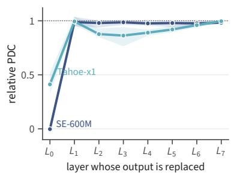

B  
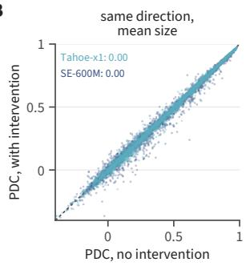  
same size, another perturbation's direction

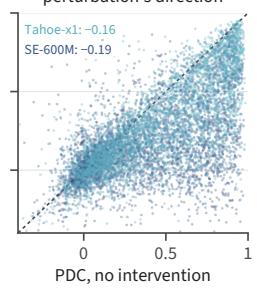

C  
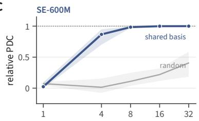

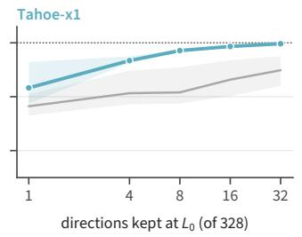

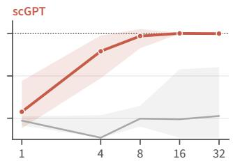  
Figure 2: How the decoder reads the perturbation. (A) PDC after replacing the output of one attention layer with a single random direction, relative to the decoder without the intervention (mean over the four cell lines; band, range). (B) Per-perturbation PDC with and without an intervention on the top $L _ { 0 }$ component, which keeps its direction and sets its size to the mean over perturbations (left), or keeps its size and takes the direction of another perturbation (right). Numbers give the mean change. (C) PDC after projecting the $L _ { 0 }$ output onto k directions shared by all perturbations and estimated from training activations, or onto k random directions, relative to the decoder without the intervention. For scGPT+ST one direction is too few even for each perturbation’s own top direction (Table 1). The perturbation enters at $L _ { 0 }$ as a direction in a small shared subspace, and the perturbation-specific signal lies in this direction.

A small shared subspace. Across perturbations, these directions lie in a small subspace that can be estimated from training data. A single basis estimated from training activations and shared by all perturbations preserves PDC with at most 32 of the 328 dimensions, while the same number of random directions does not (Figure 2C). The shared basis needs more directions than each perturbation’s own top directions, because different perturbations use different directions within it. scGPT+ST needs a few components even for its own top directions.

Retrieval from the training responses. To measure what the training data could support, we use an oracle that never runs the decoder. For a held-out perturbation, it finds the five training perturbations whose observed responses are closest to the perturbation’s own measured response and predicts their weighted average. This oracle scores above the decoder in every configuration, by 0.137 PDC on average (Appendix C.4). It needs the measured response and cannot be used before an experiment, but it shows that the decoder recovers less than the nearest training responses already contain. Because the first attention layer passes the perturbation through directions fixed by the training perturbations, a held-out perturbation is predicted well when its response resembles a training response, which is the dependence on distance in §4.1.

B  
A  
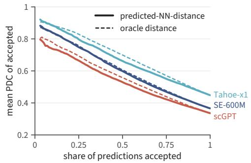

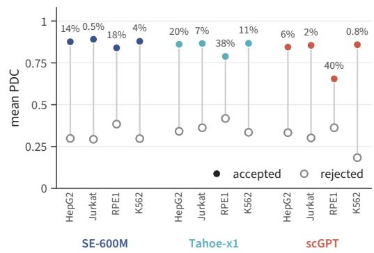  
Figure 3: Selecting predictions with predicted-NN-distance. (A) Mean PDC of the accepted predictions when held-out predictions are accepted in order of increasing distance, averaged over the four cell lines of each encoder; solid, predicted-NN-distance; dashed, the oracle distance from the observed response. At share 1 every curve reaches the mean PDC of all predictions. (B) Mean PDC of the accepted and rejected predictions under the pooled threshold $\tau \approx 0 . 1 0$ in each encoder–cell configuration; numbers give the share accepted. The score selects predictions nearly as well as the oracle, and one threshold selects accurate predictions in every configuration.

## 4.3 A per-prediction confidence score

The distance in §4.1 is computed from the observed response, so it is unavailable before an experiment. We test whether predicted-NN-distance (§3.3), computed from the prediction and the training responses, can take its place when deciding which predictions to accept.

Ranking predictions. Predicted-NN-distance ranks predictions almost as well as the oracle distance (Spearman $| \rho | = 0 . 8 1$ against 0.88, averaged over configurations; Appendix F). Figure 3A shows the mean PDC of the accepted predictions as more of them are accepted in increasing order of distance. For every encoder the curve for predicted-NN-distance nearly coincides with that of the oracle distance, and the tenth of predictions with the smallest distance is about twice as accurate as the average prediction. The score can therefore replace the distance of §4.1 when the observed response is not available.

Beyond the size of the prediction. Predictions with a large predicted response tend to be more accurate. Among predictions of similar size the score still ranks them by PDC, and it ranks them better than the distance to the ten nearest training responses, the Euclidean distance, and the alignment with the leading axis of the training responses (Appendices F.1 and F.2).

One threshold for all configurations. A threshold fitted for each configuration needs observed responses from that configuration. We therefore use one threshold, $\tau \approx 0 . 1 0 ,$ for all configurations (selection rule in Appendix F.3). In every configuration the accepted predictions are far more accurate than the rejected ones (Figure 3B). The share accepted is smallest in Jurkat and K562, which have the fewest held-out perturbations with a close training response. A threshold refitted without one cell line or one encoder gives nearly the same accuracy on the left-out one (Appendix F.3), so a threshold fitted on the other configurations can be used on a left-out cell line or encoder. Under this threshold RPL6 is accepted and SNAPC5 is rejected with every encoder.

A threshold with a guarantee. When a target accuracy is set in advance, Learn-then-Test [5] chooses a threshold whose accepted predictions meet the target with a finite-sample guarantee, provided the calibration and deployment perturbations come from the same population. In our setting it certifies all but one configuration (Appendix F.4). Like a threshold fitted for each configuration, it needs observed responses from that configuration.

A Tahoe-100M, drugs  
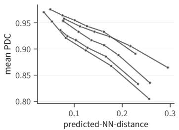

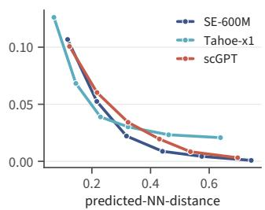

C gene families held out  
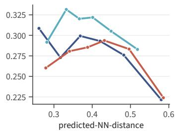  
Figure 4: Predicted-NN-distance outside the audited setting. Mean PDC in six equal-count bins of predicted-NN-distance. (A) Arc’s ST model on Tahoe-100M, drug–dose conditions in five test cell lines, one line per cell line. (B) PDC computed against single cells instead of the pseudobulk, one line per encoder, mean over cell lines. (C) ST decoders retrained with one gene family held out, scored on that family, one line per encoder, mean over cell lines. The score correlates with PDC in A and B (Spearman $| \bar { \rho | } = 0 . 5 7 \bar { - 0 . 8 5 } )$ and more weakly after family-held-out retraining (C; negative in 9 of 12 configurations).

## 4.4 Beyond the audited setting

We now test the account of §4.1–4.3 when the perturbation type, the resolution of the evaluation, and the split change (Figure 4).

Drug perturbations. On Tahoe-100M [57] we ran the ST model that Arc Institute released for this dataset, without retraining, on the drug–dose conditions of its five test cell lines. The score correlates with PDC in all five (Figure 4A), also when references to the same drug are removed from the training pool (Appendix G.2). The model has seen most of these drugs in other cell lines, so this tests distance to training within a cell line rather than drugs the model has never seen.

Single-cell PDC. PDC computed against individual cells instead of the pseudobulk also falls with predicted-NN-distance for all three encoders (Figure 4B). For Tahoe+ST part of this relationship reflects the size of the response, since dividing each perturbation’s single-cell PDC by the highest value its cells allow weakens the correlation (Appendix G.3).

Gene families held out. To test whether accuracy depends on distance or on the presence of the same gene family in training, we removed each of eight gene families from training and validation in all four cell lines, retrained the decoder, and scored only the held-out family. The score stays negatively correlated with PDC in nine of the twelve configurations (Figure 4C). In the three RPE1 configurations the correlation is positive, and its interval includes zero (Appendix G.4). When the nearest training perturbations come from other families, distance ranks predictions less reliably than on random held-out perturbations.

## 5 Discussion

In this work we found that the encoder+ST predictors are reliable for a perturbation when the perturbation’s response is close to a response seen in training. We traced this dependence to the decoder’s first attention layer, where each perturbation is written as one direction in a small subspace estimated from training perturbations. These results suggest why perturbation models built on foundation-model encoders often do no better than linear or mean baselines [3, 13, 50, 55]. Projecting the first-layer output onto a few directions leaves PDC unchanged, and ridge regression on the same embeddings scores about the same as the full decoder (Table 1, Figure 2C). Both predict well when a held-out response resembles a training response and poorly otherwise, so a benchmark score depends largely on how many test perturbations lie close to training.

Replacing a perturbation’s first-layer direction with another perturbation’s direction makes the decoder predict the second perturbation’s response (Appendix C.2). Similar interventions have shown that single directions mediate behaviors in language models [7], and causal abstraction gives a general framework for such tests [23]. Running them on other perturbation decoders is a cheap first test of whether they share this structure. For users of the current models, predicted-NN-distance needs only the prediction and the training responses, so it can be computed before an experiment. A new cell line or encoder rarely comes with the measurements needed to calibrate a threshold. In our data, a threshold chosen without a cell line or an encoder worked on each of the four cell lines and three encoders we held out (Appendix F.3). When a guarantee is needed, Learn-then-Test provides one from measurements in the same setting.

Limitations and future work. We audited one decoder architecture with three encoders, on CRISPRi screens in four cell lines and on drug perturbations in Tahoe-100M. The bottleneck is clearest for SE+ST; in Tahoe+ST part of the perturbation signal bypasses the first attention layer (Figure 2A; Appendix C.5). The score is weaker evidence of accuracy when a whole gene family is absent from training, because the nearest training responses then come from other families (§4.4), and the Learn-then-Test guarantee fails when deployment perturbations lie farther from training than the calibration perturbations (Appendix F.4). We intervened on attention outputs but not on the MLPs of later layers, and we have not established what each perturbation’s direction encodes in biological terms. Predicted-NN-distance also correlates with PDC for TxPert, a GNN-based predictor (Appendix G.1), and auditing such predictors would show whether their dependence on distance has the same cause. Predicted-NN-distance could also guide which perturbations to test next. Perturbations with a large distance are those whose predictions the training data support least, so they are natural candidates for the next experiment. How to choose such experiments is studied in active learning and experimental design for genetic perturbations [6, 31, 48, 59].

Broader impacts. Perturbation predictors are used to choose which experiments to run. Predicted NN-distance is computed from the prediction and the training data, so researchers can tell before an experiment which predictions are likely to hold and spend experiments accordingly. A risk is that accepted predictions are treated as measured responses, although some of them are wrong.

## Acknowledgments and Disclosure of Funding

All authors acknowledge support from NIH awards U24DK138515 and OT2OD038003. The authors declare no competing interests.

## References

[1] Etowah Adams, Liam Bai, Minji Lee, Yiyang Yu, and Mohammed AlQuraishi. From mechanistic interpretability to mechanistic biology: Training, evaluating, and interpreting sparse autoencoders on protein language models. In Proceedings ofthe 42nd International Conference on Machine Learning, volume 267 of Proceedings of Machine Learning Research, pages 460–476. PMLR, 2025.

[2] Abhinav K Adduri, Dhruv Gautam, Beatrice Bevilacqua, Mohsen Naghipourfar, Alishba Imran, Rohan Shah, Noam Teyssier, Rishi Verma, Christopher Carpenter, Basak Eraslan, et al. Predicting cellular responses to perturbation across diverse contexts with State. Cell, 189(19): 5914–5931.e20, 2026. doi: 10.1016/j.cell.2026.07.052.

[3] Constantin Ahlmann-Eltze, Wolfgang Huber, and Simon Anders. Deep-learning-based gene perturbation effect prediction does not yet outperform simple linear baselines. Nature Methods, 22(8):1657–1661, 2025.

[4] Anastasios N Angelopoulos and Stephen Bates. Conformal prediction: A gentle introduction. Foundations and Trends in Machine Learning, 16(4):494–591, 2023.

[5] Anastasios N. Angelopoulos, Stephen Bates, Emmanuel J. Candès, Michael I. Jordan, and Lihua Lei. Learn then test: Calibrating predictive algorithms to achieve risk control. The Annals of Applied Statistics, 19(2):1641–1662, 2025. doi: 10.1214/24-AOAS1998.

[6] Yashas Annadani, Panagiotis Tigas, Stefan Bauer, and Adam Foster. Amortized active causal induction with deep reinforcement learning. In Advances in Neural Information Processing Systems, 2024.

[7] Andy Arditi, Oscar Obeso, Aaquib Syed, Daniel Paleka, Nina Panickssery, Wes Gurnee, and Neel Nanda. Refusal in language models is mediated by a single direction. In Advances in Neural Information Processing Systems, 2024.

[8] Trenton Bricken, Adly Templeton, Joshua Batson, Brian Chen, Adam Jermyn, Tom Conerly, Nick Turner, Cem Anil, Carson Denison, Amanda Askell, Robert Lasenby, Yifan Wu, Shauna Kravec, Nicholas Schiefer, Tim Maxwell, Nicholas Joseph, Zac Hatfield-Dodds, Alex Tamkin, Karina Nguyen, Brayden McLean, Josiah E Burke, Tristan Hume, Shan Carter, Tom Henighan, and Christopher Olah. Towards monosemanticity: Decomposing language models with dictionary learning. Transformer Circuits Thread, 2023. https://transformercircuits.pub/2023/monosemantic-features/index.html.

[9] Charlotte Bunne, Stefan G Stark, Gabriele Gut, Jacobo Sarabia Del Castillo, Mitch Levesque, Kjong-Van Lehmann, Lucas Pelkmans, Andreas Krause, and Gunnar Rätsch. Learning singlecell perturbation responses using neural optimal transport. Nature methods, 20(11):1759–1768, 2023.

[10] Charlotte Bunne, Yusuf Roohani, Yanay Rosen, Ankit Gupta, Xikun Zhang, Marcel Roed, Theo Alexandrov, Mohammed AlQuraishi, Patricia Brennan, Daniel B Burkhardt, et al. How to build the virtual cell with artificial intelligence: Priorities and opportunities. Cell, 187(25): 7045–7063, 2024.

[11] Collin Burns, Haotian Ye, Dan Klein, and Jacob Steinhardt. Discovering latent knowledge in language models without supervision. In International Conference on Learning Representations, 2023.

[12] Xingyi Cheng, Pan Li, Han Guo, Youwei Liang, Jing Gong, William de Vazelhes, Changjiang Gou, Pengtao Xie, Le Song, and Eric P Xing. Harnessing ai to build virtual cells. bioRxiv, pages 2026–04, 2026.

[13] Gerold Csendes, Gema Sanz, Kristóf Z Szalay, and Bence Szalai. Benchmarking foundation cell models for post-perturbation rna-seq prediction. BMC genomics, 26(1):393, 2025.

[14] Haotian Cui, Chloe Wang, Hassaan Maan, Kuan Pang, Fengning Luo, Nan Duan, and Bo Wang. scgpt: toward building a foundation model for single-cell multi-omics using generative ai. Nature methods, 21(8):1470–1480, 2024.

[15] Hoagy Cunningham, Aidan Ewart, Logan Riggs, Robert Huben, and Lee Sharkey. Sparse autoencoders find highly interpretable features in language models. In International Conference on Learning Representations, 2024.

[16] Daniel Dimitrov, Stefan Schrod, Martin Rohbeck, and Oliver Stegle. Interpretation, extrapolation and perturbation of single cells. Nature Reviews Genetics, pages 1–22, 2026.

[17] Atray Dixit, Oren Parnas, Biyu Li, Jenny Chen, Charles P Fulco, Livnat Jerby-Arnon, Nemanja D Marjanovic, Danielle Dionne, Tyler Burks, Raktima Raychowdhury, et al. Perturb-seq: dissecting molecular circuits with scalable single-cell rna profiling of pooled genetic screens. cell, 167(7):1853–1866, 2016.

[18] Mingze Dong, Bao Wang, Jessica Wei, Antonio H de O. Fonseca, Curtis J Perry, Alexander Frey, Feriel Ouerghi, Ellen F Foxman, Jeffrey J Ishizuka, Rahul M Dhodapkar, et al. Causal identification of single-cell experimental perturbation effects with cinema-ot. Nature methods, 20(11):1769–1779, 2023.

[19] Mingze Dong, Abhinav Adduri, Dhruv Gautam, Lujing Wu, Courtney Kernick, Mary Margaret Coons, Yi-Chen Chih, Christopher Carpenter, Rohan Shah, Chiara Ricci-Tam, et al. Stack: In-context learning of single-cell biology. bioRxiv, 2026. doi: 10.64898/2026.01.09.698608.

[20] Shreshth Gandhi, Farnoosh Javadi, Valentine Svensson, Umair Khan, Matthew G Jones, John Yu, Daniele Merico, Hani Goodarzi, and Nima Alidoust. Tahoe-x1: Scaling perturbation-trained single-cell foundation models to 3 billion parameters. bioRxiv, pages 2025–10, 2025.

[21] Yicheng Gao, Zhiting Wei, Kejing Dong, Ke Chen, Jingya Yang, Guohui Chuai, and Qi Liu. Toward subtask-decomposition-based learning and benchmarking for predicting genetic perturbation outcomes and beyond. Nature Computational Science, 4(10):773–785, 2024.

[22] Yonatan Geifman and Ran El-Yaniv. Selective classification for deep neural networks. In Advances in Neural Information Processing Systems, volume 30, 2017.

[23] Atticus Geiger, Duligur Ibeling, Amir Zur, Maheep Chaudhary, Sonakshi Chauhan, Jing Huang, Aryaman Arora, Zhengxuan Wu, Noah Goodman, Christopher Potts, et al. Causal abstraction: A theoretical foundation for mechanistic interpretability. Journal ofMachine Learning Research, 26(83):1–64, 2025.

[24] Minsheng Hao, Jing Gong, Xin Zeng, Chiming Liu, Yucheng Guo, Xingyi Cheng, Taifeng Wang, Jianzhu Ma, Xuegong Zhang, and Le Song. Large-scale foundation model on single-cell transcriptomics. Nature methods, 21(8):1481–1491, 2024.

[25] Siyu He, Yuefei Zhu, Daniel Naveed Tavakol, Haotian Ye, Yeh-Hsing Lao, Zixian Zhu, Cong Xu, Shradha Chauhan, Guy Garty, Raju Tomer, et al. Squidiff: predicting cellular development and responses to perturbations using a diffusion model. Nature methods, 23(1):65–77, 2026.

[26] Stefan Heimersheim and Neel Nanda. How to use and interpret activation patching. arXiv preprint arXiv:2404.15255, 2024.

[27] Romain Lopez, Jeffrey Regier, Michael B. Cole, Michael I. Jordan, and Nir Yosef. Deep generative modeling for single-cell transcriptomics. Nature Methods, 15(12):1053–1058, 2018. doi: 10.1038/s41592-018-0229-2.

[28] Romain Lopez, Natasa Tagasovska, Stephen Ra, Kyunghyun Cho, Jonathan Pritchard, and Aviv Regev. Learning causal representations of single cells via sparse mechanism shift modeling. In Conference on Causal Learning and Reasoning, pages 662–691. PMLR, 2023.

[29] Mohammad Lotfollahi, F Alexander Wolf, and Fabian J Theis. scgen predicts single-cell perturbation responses. Nature methods, 16(8):715–721, 2019.

[30] Mohammad Lotfollahi, Anna Klimovskaia Susmelj, Carlo De Donno, Leon Hetzel, Yuge Ji, Ignacio L Ibarra, Sanjay R Srivatsan, Mohsen Naghipourfar, Riza M Daza, Beth Martin, et al. Predicting cellular responses to complex perturbations in high-throughput screens. Molecular systems biology, 19(6):MSB202211517, 2023.

[31] Arash Mehrjou, Ashkan Soleymani, Andrew Jesson, Pascal Notin, Yarin Gal, Stefan Bauer, and Patrick Schwab. GeneDisco: A benchmark for experimental design in drug discovery. In International Conference on Learning Representations, 2022.

[32] Kevin Meng, David Bau, Alex Andonian, and Yonatan Belinkov. Locating and editing factual associations in gpt. Advances in neural information processing systems, 35:17359–17372, 2022.

[33] Ajay Nadig, Joseph M Replogle, Angela N Pogson, Mukundh Murthy, Steven A McCarroll, Jonathan S Weissman, Elise B Robinson, and Luke J O’Connor. Transcriptome-wide analysis of differential expression in perturbation atlases. Nature Genetics, 57(5):1228–1237, 2025. doi: 10.1038/s41588-025-02169-3.

[34] Thomas M Norman, Max A Horlbeck, Joseph M Replogle, Alex Y Ge, Albert Xu, Marco Jost, Luke A Gilbert, and Jonathan S Weissman. Exploring genetic interaction manifolds constructed from rich single-cell phenotypes. Science, 365(6455):786–793, 2019.

[35] Catherine Olsson, Nelson Elhage, Neel Nanda, Nicholas Joseph, Nova DasSarma, Tom Henighan, Ben Mann, Amanda Askell, Yuntao Bai, Anna Chen, Tom Conerly, Dawn Drain, Deep Ganguli, Zac Hatfield-Dodds, Danny Hernandez, Scott Johnston, Andy Jones, Jackson Kernion, Liane Lovitt, Kamal Ndousse, Dario Amodei, Tom Brown, Jack Clark, Jared Kaplan, Sam McCandlish, and Chris Olah. In-context learning and induction heads. Transformer Circuits Thread, 2022. https://transformer-circuits.pub/2022/in-context-learning-and-induction heads/index.html.

[36] Nithin Parsan, David J Yang, and John J Yang. Towards interpretable protein structure prediction with sparse autoencoders. arXiv preprint arXiv:2503.08764, 2025.

[37] James D Pearce, Sara E Simmonds, Gita Mahmoudabadi, Lakshmi Krishnan, Giovanni Palla, Ana-Maria Istrate, Alexander Tarashansky, Benjamin Nelson, Omar Valenzuela, Donghui Li, et al. TranscriptFormer: A generative cell atlas across 1.5 billion years of evolution. Science, 393(6806):eaec8514, 2026. doi: 10.1126/science.aec8514.

[38] Aviv Regev, Sarah A Teichmann, Eric S Lander, Ido Amit, Christophe Benoist, Ewan Birney, Bernd Bodenmiller, Peter Campbell, Piero Carninci, Menna Clatworthy, et al. The human cell atlas. elife, 6:e27041, 2017.

[39] Joseph M Replogle, Reuben A Saunders, Angela N Pogson, Jeffrey A Hussmann, Alexander Lenail, Alina Guna, Lauren Mascibroda, Eric J Wagner, Karen Adelman, Gila Lithwick-Yanai, et al. Mapping information-rich genotype-phenotype landscapes with genome-scale perturb-seq. Cell, 185(14):2559–2575, 2022.

[40] Jennifer E Rood, Anna Hupalowska, and Aviv Regev. Toward a foundation model of causal cell and tissue biology with a perturbation cell and tissue atlas. Cell, 187(17):4520–4545, 2024.

[41] Yusuf Roohani, Kexin Huang, and Jure Leskovec. Predicting transcriptional outcomes of novel multigene perturbations with gears. Nature Biotechnology, 42(6):927–935, 2024.

[42] Viktoria Schuster. Can sparse autoencoders make sense of gene expression latent variable models? In Machine Learning in Computational Biology, pages 81–94. PMLR, 2025.

[43] Elana Simon and James Zou. Interplm: discovering interpretable features in protein language models via sparse autoencoders. Nature methods, 22(10):2107–2117, 2025.

[44] Glen Taggart and Adam Green. Generative ranking enables scalable pretraining on noisy biological multisets. Markov Biosciences whitepaper, April 2026. URL https://cdn.prod.website-files.com/665760f5eef509d00bd3b239/ 69d67e9451434497a0cf5f45\_main.pdf.

[45] Leyla Tarhan, Jon Bistline, Jean Chang, Bryan Galloway, Emily Hanna, and Eric Weitz. Single cell portal: an interactive home for single-cell genomics data. BioRxiv, 2023.

[46] Adly Templeton, Tom Conerly, Jonathan Marcus, Jack Lindsey, Trenton Bricken, Brian Chen, Adam Pearce, Craig Citro, Emmanuel Ameisen, Andy Jones, Hoagy Cunningham, Nicholas L Turner, Callum McDougall, Monte MacDiarmid, C. Daniel Freeman, Theodore R. Sumers, Edward Rees, Joshua Batson, Adam Jermyn, Shan Carter, Chris Olah, and Tom Henighan. Scaling monosemanticity: Extracting interpretable features from claude 3 sonnet. Transformer Circuits Thread, 2024. URL https://transformer-circuits.pub/2024/ scaling-monosemanticity/index.html.

[47] Christina V Theodoris, Ling Xiao, Anant Chopra, Mark D Chaffin, Zeina R Al Sayed, Matthew C Hill, Helene Mantineo, Elizabeth M Brydon, Zexian Zeng, X Shirley Liu, et al. Transfer learning enables predictions in network biology. Nature, 618(7965):616–624, 2023.

[48] Panagiotis Tigas, Yashas Annadani, Andrew Jesson, Bernhard Schölkopf, Yarin Gal, and Stefan Bauer. Interventions, where and how? Experimental design for causal models at scale. In Advances in Neural Information Processing Systems, 2022.

[49] Alexander Matt Turner, Lisa Thiergart, Gavin Leech, David Udell, Juan J Vazquez, Ulisse Mini, and Monte MacDiarmid. Steering language models with activation engineering. arXiv preprint arXiv:2308.10248, 2023.

[50] Ramon Viñas Torné, Maciej Wiatrak, Zoe Piran, Shuyang Fan, Liangze Jiang, Sarah A. Teichmann, Mor Nitzan, and Maria Brbic. Systema: a framework for evaluating genetic perturbation´ response prediction beyond systematic variation. Nature Biotechnology, 44(6):1050–1059, 2026. doi: 10.1038/s41587-025-02777-8.

[51] Chloe Wang, Mehran Karimzadeh, Neal G Ravindra, Lexi R Bounds, Nader Alerasool, Ann C Huang, Shihao Ma, Daniel R Gulbranson, Haotian Cui, Yongju Lee, et al. X-cell: Scaling causal perturbation prediction across diverse cellular contexts via diffusion language models. bioRxiv, pages 2026–03, 2026.

[52] Kevin Ro Wang, Alexandre Variengien, Arthur Conmy, Buck Shlegeris, and Jacob Steinhardt. Interpretability in the wild: a circuit for indirect object identification in GPT-2 small. In International Conference on Learning Representations, 2023.

[53] Frederik Wenkel, Wilson Tu, Cassandra Masschelein, et al. TxPert: using multiple knowledge graphs for prediction of transcriptomic perturbation effects. Nature Biotechnology, 2026. doi: 10.1038/s41587-026-03113-4.

[54] Aaron Wenteler, Martina Occhetta, Nikhil Branson, Victor Curean, Magdalena Huebner, William Dee, William Connell, Siu Pui Chung, Alex Hawkins-Hooker, Yasha Ektefaie, et al. PertEval-scFM: Benchmarking single-cell foundation models for perturbation effect prediction. In Proceedings of the 42nd International Conference on Machine Learning, volume 267 of Proceedings ofMachine Learning Research, pages 66633–66677. PMLR, 2025.

[55] Daniel R. Wong, Abby S. Hill, and Rob Moccia. Simple controls exceed best deep learning algorithms and reveal foundation model effectiveness for predicting genetic perturbations. Bioinformatics, 41(6):btaf317, 2025. doi: 10.1093/bioinformatics/btaf317.

[56] Xinyu Yuan, Xixian Liu, Ya Shi Zhang, Zuobai Zhang, Hongyu Guo, and Jian Tang. PerturbDiff: Functional diffusion for single-cell perturbation modeling. In Proceedings of the 43rd International Conference on Machine Learning, volume 306 of Proceedings ofMachine Learning Research, pages 151890–151937. PMLR, 2026.

[57] Jesse Zhang, Airol A Ubas, Valentine Svensson, Nicole Thomas, Vishvak Subramanyam, Christopher Carpenter, Aidan Winters, Richard de Borja, Noam Teyssier, Neha Thakar, et al. Tahoe-100M: Mapping drug-induced molecular phenotypes at single-cell resolution. Cell, 189 (19):5945–5961.e8, 2026. doi: 10.1016/j.cell.2026.08.035.

[58] Jiaqi Zhang, Kristjan Greenewald, Chandler Squires, Akash Srivastava, Karthikeyan Shanmugam, and Caroline Uhler. Identifiability guarantees for causal disentanglement from soft interventions. Advances in Neural Information Processing Systems, 36:50254–50292, 2023.

[59] Zheyu Zhang, Jiayuan Dong, Jie Liu, and Xun Huan. Goal-oriented sequential Bayesian experimental design for causal learning. Transactions on Machine Learning Research, 2026. URL https://openreview.net/forum?id=6dVCZT7pO2.

## NeurIPS Paper Checklist

## 1. Claims

Question: Do the main claims made in the abstract and introduction accurately reflect the paper’s contributions and scope?

Answer: [Yes]

Justification: The abstract and introduction present our key contributions: (i) a rank-1, encoder-conditioned bottleneck at the first attention layer of the state-transition (ST) decoder, and (ii) predicted-NN-distance as a deployable per-prediction trust signal, and these claims are validated through empirical studies (§ 4).

## 2. Limitations

Question: Does the paper discuss the limitations of the work performed by the authors?

Answer: [Yes]

Justification: The limitation is discussed in §5.

## 3. Theory assumptions and proofs

Question: For each theoretical result, does the paper provide the full set of assumptions and a complete (and correct) proof?

Answer: [Yes]

Justification: For the definitions mentioned in the manuscript, we stated the assumptions clearly.

## 4. Experimental result reproducibility

Question: Does the paper fully disclose all the information needed to reproduce the main experimental results of the paper to the extent that it affects the main claims and/or conclusions of the paper (regardless of whether the code and data are provided or not)?

Answer: [Yes]

Justification: Please refer to §3 and the extended methods (§A) in Appendix for detailed information.

## 5. Open access to data and code

Question: Does the paper provide open access to the data and code, with sufficient instructions to faithfully reproduce the main experimental results, as described in supplemental material?

Answer: [Yes]

Justification: The data [33, 39] are open-sourced, and the code is available at https: //github.com/HowIII/lowrank-decoder-reliability.

## 6. Experimental setting/details

Question: Does the paper specify all the training and test details (e.g., data splits, hyperparameters, how they were chosen, type of optimizer) necessary to understand the results? Answer: [Yes]

Justification: Please refer to §A.1, §A.3, and§A.7.

## 7. Experiment statistical significance

Question: Does the paper report error bars suitably and correctly defined or other appropriate information about the statistical significance of the experiments?

Answer: [Yes]

Justification: Please refer to §A.7.

## 8. Experiments compute resources

Question: For each experiment, does the paper provide sufficient information on the computer resources (type of compute workers, memory, time of execution) needed to reproduce the experiments?

Answer: [Yes]

Justification: Please refer to §A.8.

## 9. Code of ethics

Question: Does the research conducted in the paper conform, in every respect, with the NeurIPS Code of Ethics https://neurips.cc/public/EthicsGuidelines?

Answer: [Yes]

Justification: We have reviewed the NeurIPS Code of Ethics and confirm that our research fully complies with these guidelines.

## 10. Broader impacts

Question: Does the paper discuss both potential positive societal impacts and negative societal impacts of the work performed?

Answer: [Yes]

Justification: Yes. Please refer to §5.

## 11. Safeguards

Question: Does the paper describe safeguards that have been put in place for responsible release of data or models that have a high risk for misuse (e.g., pre-trained language models, image generators, or scraped datasets)?

Answer: [N/A]

Justification: Our work mainly focuses on understanding the mechanisms of a biological foundation model and quantifying its prediction’s reliability, which does not pose risks of misuse.

## 12. Licenses for existing assets

Question: Are the creators or original owners of assets (e.g., code, data, models), used in the paper, properly credited and are the license and terms of use explicitly mentioned and properly respected?

Answer: [Yes]

Justification: We properly cite all assets used in our research with their license, baseline methods with their original papers, and all open-source libraries used according to their respective licenses. All citations and attributions are included in our references section.

## 13. New assets

Question: Are new assets introduced in the paper well documented and is the documentation provided alongside the assets?

Answer: [N/A]

Justification: The submission introduces no new released datasets, no new released models, and no new released checkpoints. The analysis code is released with documentation at https://github.com/HowIII/lowrank-decoder-reliability.

## 14. Crowdsourcing and research with human subjects

Question: For crowdsourcing experiments and research with human subjects, does the paper include the full text of instructions given to participants and screenshots, if applicable, as well as details about compensation (if any)?

Answer: [N/A]

Justification: Our research does not involve any crowdsourcing or human subjects.

## 15. Institutional review board (IRB) approvals or equivalent for research with human subjects

Question: Does the paper describe potential risks incurred by study participants, whether such risks were disclosed to the subjects, and whether Institutional Review Board (IRB) approvals (or an equivalent approval/review based on the requirements of your country or institution) were obtained?

Answer: [N/A]

Justification: The paper does not involve human subjects.

## 16. Declaration of LLM usage

Question: Does the paper describe the usage of LLMs if it is an important, original, or non-standard component of the core methods in this research? Note that if the LLM is used only for writing, editing, or formatting purposes and does not impact the core methodology, scientific rigor, or originality of the research, declaration is not required.

## Answer: [Yes]

Justification: We used LLM-based assistants for coding, analysis checks, literature search, and writing; LLMs are not part of the methods studied. See Appendix I.

## Appendix

A Extended methods 19   
A.1 Datasets, model variants, and evaluation protocol 19   
A.2 Hidden-state diagnostics 19   
A.3 Linear and MLP probes . 19   
A.4 Projection and ablation of the $L _ { 0 }$ output 20   
A.5 Replacing directions at $L _ { 0 }$ 20   
A.6 Confidence score and thresholds 21   
A.7 Statistical analysis . 21   
A.8 Compute resources 21   
B Benchmark accuracy and distance to training 21   
B.1 Comparison with baselines, all and far perturbations . . 21   
B.2 Reliability-distance relationship across all four cell lines 22   
B.3 Distance and position on the leading axis . 22   
C Extended mechanism evidence 24   
C.1 Where the perturbation enters . 24   
C.2 The direction carries the signal . 24   
C.3 Rank of the $L _ { 0 }$ output and of the data 25   
C.4 Retrieval from the training responses 26   
C.5 What the decoder adds to a linear read-out . 26   
D Gene programs along the leading direction 27   
E Scores that separate perturbations 31   
F Predicted-NN-distance as a confidence score 31   
F.1 Design of the score 31   
F.2 Beyond the size of the prediction . 32   
F.3 Pooled threshold 32   
F.4 Learn-then-Test threshold . 33   
G Tests outside the audited panel 37   
G.1 TxPert . 37   
G.2 Chemical perturbations in Tahoe-100M 37   
G.3 Single-cell resolution and context size 37   
G.4 Strict family-held-out retraining 38   
H Extended related work 39   
I LLM Usage 40

## A Extended methods

## A.1 Datasets, model variants, and evaluation protocol

Table 2: Audit configurations and hyperparameters. The encoder changes across configurations. The ST decoder architecture and training recipe are the same in every run.
<table><tr><td>Setting</td><td>Value</td></tr><tr><td>Encoders (frozen)</td><td></td></tr><tr><td>SE-600M output dimension</td><td>2,058</td></tr><tr><td>scGPT output dimension</td><td>512</td></tr><tr><td>Tahoe-x1 (tx-70m) output dimension</td><td>512</td></tr><tr><td>Inference</td><td></td></tr><tr><td>Control cells per perturbation (S)</td><td>64</td></tr><tr><td>Genes scored (HVGs)</td><td>2,000</td></tr><tr><td>ST decoder</td><td></td></tr><tr><td>Hidden dimension (H)</td><td>328</td></tr><tr><td>Attention blocks</td><td> $8 \left( L _ { 0 } , \ldots , L _ { 7 } \right)$ </td></tr><tr><td>Attention heads / head dimension</td><td>12 / 64</td></tr><tr><td>MLP intermediate size</td><td>3,072</td></tr><tr><td>Statistics</td><td></td></tr><tr><td>Bootstrap resamples / interval</td><td>5,000 / 95%</td></tr></table>

Cell lines and split. We use the four Replogle–Nadig cell lines HepG2, Jurkat, RPE1, and K562 [33, 39] with the few-shot train, validation, and test perturbation lists of Adduri et al. [2]. The test sets have 945 (HepG2), 1,084 (Jurkat), 1,061 (RPE1), and 968 (K562) perturbations. Test perturbations are never used to train probes or to estimate the fixed basis. The replacement experiments of §A.5 act on test perturbations and therefore use their own $L _ { 0 }$ directions. PDC is computed on the 2,000 highly variable genes of the published selection, as in Adduri et al. [2].

Models and inference. Each predictor is a frozen encoder followed by an ST decoder. The encoder computes an embedding for every cell once, and the decoder is trained on these cached embeddings with a one-hot perturbation encoding, so the encoder receives no gradient from the perturbation task. The decoder is a Llama-style transformer with bidirectional attention and a batch encoder (Table 2). SE+ST uses the published few-shot checkpoints of Adduri et al. [2]. For scGPT+ST and Tahoe+ST we trained the decoder with the same configuration, changing only the input embedding, and trained Tahoe+ST on HepG2 with two further seeds. Unless stated otherwise, the decoder receives 64 control cells from the same batch (gem group) as context for each perturbation and returns 64 predicted cells, which we average into a pseudobulk prediction. Comparisons between two predictors are paired on the test perturbations they share.

## A.2 Hidden-state diagnostics

For the comparison in Appendix C.3, we collect, for each perturbation $p ,$ the $L _ { 0 }$ attention output over its context cells, $\boldsymbol { X _ { p } } \in \mathbb { R } ^ { \boldsymbol { \dot { S } } \times \boldsymbol { H } }$ , and compute its singular values $\sigma _ { j } ( X _ { p } )$ . We report the rank-1 fraction $r _ { 1 } ( X _ { p } ) = \textstyle { \sigma _ { 1 } ^ { 2 } } / \sum _ { j } \sigma _ { j } ^ { 2 }$ and the participation ratio PR $\begin{array} { r } { { \bf \Phi } _ { , ( } X _ { p } ) = ( \bar { \sum _ { j } } \sigma _ { j } ^ { 2 } ) ^ { 2 } / \sum _ { j } \sigma _ { j } ^ { 4 } } \end{array}$ , and compare the trained decoder with three random initializations.

## A.3 Linear and MLP probes

The probes measure how much of the decoder’s accuracy a small model recovers from the same conditioning inputs. The ridge probe is the ridge baseline of Table 1, and the other probes are reported in Appendix C.5. For test perturbation p in gem group $^ { g , }$ the input is the mean control-cell embedding of $^ { g , }$ the perturbation encoding of $p ,$ and the batch encoding of $^ { g , }$ with the two encodings taken from the trained decoder (Eq. (2)). The probe sees the mean of the control cells, while the decoder sees the 64 cells themselves.

Training rows are pairs of a training perturbation and a gem group with at least three cells, and test rows are pairs of a test perturbation and a gem group, so no test perturbation contributes to training. The main probe is a two-layer MLP. We also fit ridge regression on the same input, ridge on the control and batch inputs only, ridge on the perturbation and batch inputs only, ridge with shuffled perturbation labels, and a constant prediction equal to the control mean. Two further probes test whether a larger model or an explicit interaction between control state and perturbation changes the result: an MLP with about as many parameters as the decoder’s MLP layers, and a probe that adds a low-rank product of the control and perturbation inputs to a linear model. Table 3 lists the settings. Probe predictions are scored with PDC on the same 2,000 genes as the decoder.

Table 3: Probe settings.
<table><tr><td>Probe</td><td>Settings</td></tr><tr><td>MLP (main)</td><td>2 layers, hidden 256, ReLU, dropout 0.1, Adam, learning rate  $1 0 ^ { - 3 }$  batch 256, 50 epochs</td></tr><tr><td>Ridge</td><td>closed form, penalty chosen by 5-fold grouped cross-validation on PDC</td></tr><tr><td>Large MLP</td><td>3 layers, hidden 2,048 (17–23M parameters), GELU, dropout 0.1, AdamW with cosine schedule, 120 epochs, early stopping on 10% of training rows (patience 15)</td></tr><tr><td>Interaction</td><td>linear term plus  $B ^ { \top }$  (φb(control)  $\odot \ \phi _ { p }$  (perturbation)), rank  $r \in$  {0, 4, 16, 64}, φ: 2-layer MLPs (hidden 128, GELU, dropout 0.1), AdamW (learning rate  $5 \times 1 0 ^ { - 4 }$  , weight decay  $1 0 ^ { - 5 } )$  , 120 epochs, early stopping as above</td></tr></table>

## A.4 Projection and ablation of the $L _ { 0 }$ output

Keeping the top directions. During the forward pass we replace each perturbation’s $L _ { 0 }$ attention output $X _ { p }$ with its truncation to the top k singular directions (Eq. (3)), for $k \in \{ 1 , 4 , 8 , 1 6 , 3 2 \}$ rescale each row to its original norm, and score PDC (the rank-1 rows of Table 1). The random control keeps k random orthonormal directions instead, with the same rescaling, drawn either from the whole space (SE+ST and $\mathrm { s c G P T } { \mathrel { + } } { \mathbf { S } } { \mathrm { T } }$ in Figure 2C) or from the subspace orthogonal to the top 32 singular directions of $X _ { p }$ (Tahoe+ST and the layer scan). The layer scan applies the same top-1 truncation and the same random control to the attention output of one layer at a time, $L _ { 0 }$ to $L _ { 7 }$ (Figure 2A, Appendix C.1). The ablation sets the $L _ { 0 }$ attention output to zero (Appendix C.1).

Fixed training basis and sufficient rank. The fixed basis is estimated from the $L _ { 0 }$ outputs of the target line’s training perturbations only (§3.2). For each k we compare its PDC with that of the unprojected decoder, perturbation by perturbation, and compute a paired bootstrap interval. The fixed basis preserves PDC at rank k if this interval lies within ±0.02 (the margin of Appendix A.7), and it outperforms a random orthonormal basis of the same rank if the interval of their difference lies above 0.02. The sufficient rank is the smallest k at which the fixed basis meets both conditions and the per-perturbation truncation also preserves PDC.

## A.5 Replacing directions at $L _ { 0 }$

Directions from another encoder. For two predictors trained on the same cell line, we run the recipient and replace the component $\sigma _ { i } u _ { i } v _ { i } ^ { \top }$ of $X _ { p }$ with one that keeps the recipient’s $\sigma _ { i }$ and $u _ { i }$ and takes $v _ { i }$ from the donor model’s $L _ { 0 }$ output for the same perturbation (Eq. (4)). We replace $i \in \{ 1 , 2 , 3 \}$ or the components 2 and 3 together (Appendix C.2).

Size and direction of the top component. For Tahoe+ST and SE+ST we change one property of the top component $\sigma _ { 1 } u _ { 1 } v _ { 1 } ^ { \top }$ at a time. We set $\sigma _ { 1 }$ to its mean over perturbations and keep the direction, or keep $\sigma _ { 1 }$ and replace $v _ { 1 }$ by the direction of another perturbation, assigned by a fixed random permutation without fixed points. For Tahoe+ST we also replace $v _ { 1 }$ by the SE-600M direction of the same perturbation. All runs of a configuration use the same checkpoint and the same sampled control cells, and are compared with a run without the intervention under the same conditions. For the direction swap we also compare the prediction for perturbation $p$ with the observed response and the prediction without the intervention of the perturbation whose direction it received (Figure 2B, Appendix C.2).

Directions from another cell line. We replace the top direction with the direction of the same encoder and perturbation in a decoder trained on another cell line, for all three encoders, four recipient cell lines, and the three other cell lines as donors (36 combinations; Appendix C.2). As a check of the procedure, we also run the replacement with the recipient’s own cell line as donor (12 combinations), which should leave PDC unchanged.

## A.6 Confidence score and thresholds

The pooled threshold of §4.3 is chosen as described in Appendix F.3, and the Learn-then-Test threshold as described in Appendix F.4. The per-configuration threshold used in Appendix F.3 is fitted by isotonic regression of held-out PDC on predicted-NN-distance, as the smallest distance at which the fitted PDC falls to the rank-1 SVD baseline (§3.3) plus 0.02.

## A.7 Statistical analysis

A comparison between two conditions is the mean per-perturbation difference in PDC on the shared perturbations, with a paired 95% percentile bootstrap interval over perturbations (5,000 resamples). As a check we also resample whole gene families (the nine groups of Appendix D), which roughly doubles the interval widths (Appendices B.1 and C.5). Rerunning the decoder without any intervention, with different sampled control cells or with a checkpoint from a different training step, changes mean PDC by up to about 0.02. We therefore do not interpret differences of this size, and use 0.02 PDC as the margin in the sufficient rank (Appendix A.4) and in the per-configuration threshold (Appendix A.6).

## A.8 Compute resources

Experiments ran on NVIDIA L40S (48 GB) and H100 (80 GB) GPUs. Training one ST decoder takes 4 to 8 hours on one GPU, and the family-held-out experiment of Appendix G.4 trains 108 of them. One run of the $L _ { 0 }$ interventions on a configuration takes 1.5 to 4 hours, and the probes about 3.5 hours. Distances, thresholds, and statistics run on CPUs. Batch jobs for this paper used about 780 GPU-hours in total, including runs not reported here. Scripts are in the code release.

## B Benchmark accuracy and distance to training

Section 4.1 reports means over the four cell lines. Here we give the values for each cell line: the comparison with baselines on all held-out perturbations and on the far slice (Appendix B.1), and the relationship between accuracy and distance to training (Appendices B.2 and B.3).

## B.1 Comparison with baselines, all and far perturbations

Table 4 extends Table 1 with per-cell-line values and additional reference rows. Every row is scored on the same held-out perturbations, those that every predictor scores; the first row of the table gives their number. The far slice keeps the perturbations whose observed response is farther than 0.5 cosine from the observed response of every training perturbation in the 2,000-HVG space. The shuffled lookup predicts each perturbation with the response of a random training perturbation, and the co-expression baseline weights training responses by the control-cell correlation between their target genes and the held-out target. Experimental reproducibility correlates two half-sample estimates of the same response and is therefore a reference for data noise; models are scored against the full-sample response. On the far slice, every predictor scores at most 0.19 PDC in every cell line.

Clustered inference. With gene families as the resampling unit (Appendix A.7), the full decoder is significantly more accurate than the ridge probe in 9 of 12 configurations on perturbations near training with above-median response size, and significantly less accurate on the far slice in 8 of 12. The loss from keeping only the rank-1 component is significant for scGPT+ST in every cell line.

Table 4: Mean PDC on all held-out perturbations and on the far slice. Same gene panel and perturbation support for every row; scVI was scored against a separately built observed response. GEARS was scored on K562 only.
<table><tr><td></td><td colspan="5">All held-out</td><td colspan="5">Far (&gt; 0.5 cosine)</td></tr><tr><td></td><td>K562</td><td>RPE1</td><td>HepG2</td><td>Jurkat</td><td>Mean</td><td>K562</td><td>RPE1</td><td>HepG2</td><td>Jurkat</td><td>Mean</td></tr><tr><td>Perturbations (n)</td><td>963</td><td>1,029</td><td>903</td><td>1,077</td><td></td><td>521</td><td>274</td><td>403</td><td>549</td><td></td></tr><tr><td>Shuffled-perturbation lookup</td><td>0.072</td><td>0.240</td><td>0.151</td><td>0.090</td><td>0.138</td><td>0.032</td><td>0.034</td><td>0.040</td><td>0.044</td><td>0.037</td></tr><tr><td>Train-mean response</td><td>0.148</td><td>0.416</td><td>0.293</td><td>0.171</td><td>0.257</td><td>0.065</td><td>0.072</td><td>0.078</td><td>0.078</td><td>0.073</td></tr><tr><td>Co-expression (gene-gene)</td><td>0.153</td><td>0.419</td><td>0.292</td><td>0.169</td><td>0.258</td><td>0.067</td><td>0.073</td><td>0.077</td><td>0.076</td><td>0.073</td></tr><tr><td>CPA [30]</td><td>0.302</td><td>0.501</td><td>0.403</td><td>0.330</td><td>0.384</td><td>0.117</td><td>0.086</td><td>0.117</td><td>0.147</td><td>0.117</td></tr><tr><td>scVI [27]</td><td>0.251</td><td>0.421</td><td>0.338</td><td>0.280</td><td>0.323</td><td>0.090</td><td>0.084</td><td>0.089</td><td>0.111</td><td>0.094</td></tr><tr><td>GEARS [41]</td><td>0.151</td><td></td><td></td><td></td><td></td><td>0.045</td><td></td><td></td><td></td><td></td></tr><tr><td>Experimental reproducibility</td><td>0.399</td><td>0.617</td><td>0.455</td><td>0.411</td><td>0.470</td><td></td><td></td><td></td><td></td><td></td></tr><tr><td>SE+ST full</td><td>0.327</td><td>0.475</td><td>0.388</td><td>0.306</td><td>0.374</td><td>0.108</td><td>0.082</td><td>0.076</td><td>0.106</td><td>0.093</td></tr><tr><td>SE+ST rank-1</td><td>0.331</td><td>0.474</td><td>0.385</td><td>0.298</td><td>0.372</td><td>0.112</td><td>0.083</td><td>0.073</td><td>0.099</td><td>0.092</td></tr><tr><td>SE+ST ridge</td><td>0.331</td><td>0.473</td><td>0.369</td><td>0.334</td><td>0.377</td><td>0.151</td><td>0.116</td><td>0.144</td><td>0.180</td><td>0.148</td></tr><tr><td>Tahoe+ST full</td><td>0.382</td><td>0.553</td><td>0.442</td><td>0.376</td><td>0.438</td><td>0.152</td><td>0.119</td><td>0.132</td><td>0.156</td><td>0.140</td></tr><tr><td>Tahoe+ST rank-1</td><td>0.389</td><td>0.535</td><td>0.430</td><td>0.387</td><td>0.435</td><td>0.159</td><td>0.128</td><td>0.119</td><td>0.163</td><td>0.142</td></tr><tr><td>Tahoe+ST ridge</td><td>0.348</td><td>0.490</td><td>0.396</td><td>0.360</td><td>0.398</td><td>0.165</td><td>0.130</td><td>0.152</td><td>0.190</td><td>0.159</td></tr><tr><td>scGPT+ST full</td><td>0.196</td><td>0.477</td><td>0.364</td><td>0.309</td><td>0.337</td><td>0.050</td><td>0.058</td><td>0.072</td><td>0.104</td><td>0.071</td></tr><tr><td>scGPT+ST rank-1</td><td>0.182</td><td>0.465</td><td>0.295</td><td>0.117</td><td>0.265</td><td>0.040</td><td>0.049</td><td>0.051</td><td>0.014</td><td>0.039</td></tr><tr><td>scGPT+ST ridge</td><td>0.291</td><td>0.460</td><td>0.379</td><td>0.336</td><td>0.367</td><td>0.148</td><td>0.098</td><td>0.136</td><td>0.180</td><td>0.140</td></tr></table>

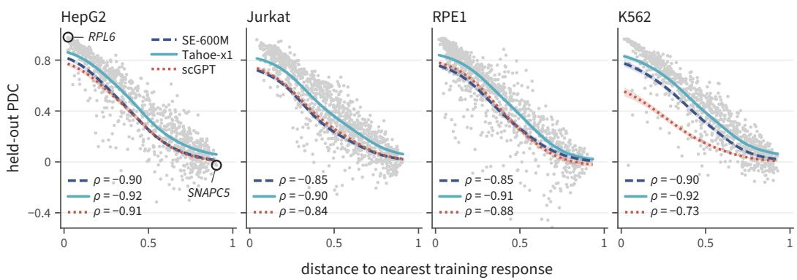  
Figure 5: Reliability-distance relationship across all four cell lines. Each panel plots held-out per-perturbation PDC against cosine distance to the nearest training perturbation in 2,000-HVG gene-expression space. Gray dots in the background are individual perturbations under Tahoe-x1+ST. Lines are kernel-smoothed trends per encoder with 95% bootstrap bands, and the lower-left key of each panel gives the per-encoder Spearman ρ. RPL6 and SNAPC5 are annotated on the HepG2 panel as the running example (§1). Every panel shows the HepG2 pattern: PDC falls smoothly with distance and the three encoders agree. The weakest configuration is scGPT/K562, with $\rho { = } - 0 . 7 3$

## B.2 Reliability-distance relationship across all four cell lines

Figure 5 repeats Figure 1B for all four cell lines. In every cell line PDC falls smoothly with the oracle distance, the three encoders give curves of the same shape, and the per-encoder Spearman ρ between the oracle distance and per-perturbation PDC is between −0.73 and −0.92.

## B.3 Distance and position on the leading axis

A perturbation whose response lies close to the leading axis of the responses also tends to lie close to a training response. Table 5 separates the two for Tahoe+ST, using the distance to the nearest training response in gene space and in the Tahoe-x1 embedding space, and the alignment of the observed response with the top singular direction of the held-out responses (Figure 6 for HepG2). Each is strongly associated with PDC on its own: the Spearman ρ is −0.90 to −0.92 for the gene-space distance and 0.74 to 0.86 for the alignment. Given the alignment, the gene-space distance keeps a partial correlation of $- 0 . 6 3 \mathrm { t o } - 0 . 7 9$ with PDC; given the distance, the alignment keeps 0.00 to 0.14. In gene space, closeness to a training response accounts for nearly all of the association. In the embedding space the two share it more evenly (partial correlations −0.30 to −0.45 for the distance and 0.39 to 0.50 for the alignment). Appendix G.4 retrains the decoder with whole gene families held out, so that the nearest training responses come from other families.

Table 5: Tahoe+ST: association of PDC with the distance to the nearest training response in gene space $( d _ { \mathrm { H V G } } )$ and in the Tahoe-x1 embedding space $( d _ { \mathrm { T a h o e } } )$ , and with the alignment | cos | of the observed response with the top singular direction of the held-out responses. Spearman $\rho$ for each alone; partial Pearson r given the variable after the bar.
<table><tr><td>Cell</td><td> $n _ { \mathrm { t e s t } }$ </td><td> $n _ { \mathrm { t r a i n } }$ </td><td> $\rho _ { \mathrm { P D C } , d _ { \mathrm { H V G } } }$ </td><td> $\rho _ { \mathrm { P D C } , d _ { \mathrm { T a h o e } } }$ </td><td>ρPDC,| cos |</td><td>rPDC,dHVGl| cos |</td><td>rPDC,| cos ||dHVG</td><td> $r _ { \mathrm { P D C } , d _ { \mathrm { T a h o e } } | | \cos { \mid } }$ </td></tr><tr><td>HepG2</td><td>945</td><td>395</td><td>-0.92</td><td>-0.88</td><td>0.86</td><td>-0.64</td><td>0.06</td><td>-0.38</td></tr><tr><td>Jurkat</td><td>1084</td><td>453</td><td>-0.90</td><td>-0.76</td><td>0.74</td><td>-0.76</td><td>0.09</td><td>-0.33</td></tr><tr><td>RPE1</td><td>1061</td><td>438</td><td>-0.91</td><td>-0.86</td><td>0.84</td><td>-0.63</td><td>0.14</td><td>-0.30</td></tr><tr><td>K562</td><td>968</td><td>415</td><td>-0.92</td><td>-0.81</td><td>0.78</td><td>-0.79</td><td>0.00</td><td>-0.45</td></tr></table>

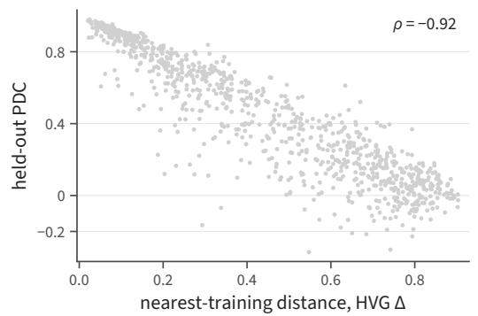

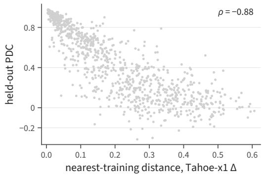

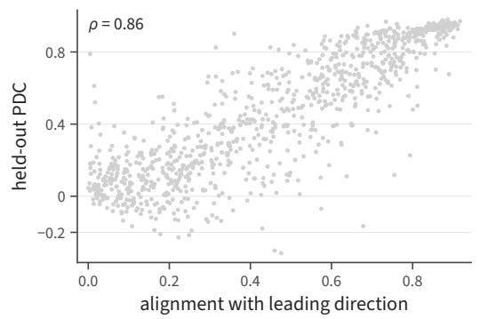

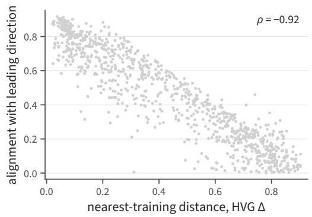  
Figure 6: Tahoe+ST on HepG2, 945 held-out perturbations. PDC against the distance to the nearest training response in gene space and in the Tahoe-x1 embedding space (top), PDC against the alignment with the top singular direction (bottom left), and the alignment against the gene-space distance (bottom right).

## C Extended mechanism evidence

Section 4.2 summarizes the mechanism. Here we give the experiments behind it for each encoder and cell line; the interventions are defined in Appendices A.4–A.5.

## C.1 Where the perturbation enters

Figure 2A shows, averaged over cell lines, the PDC after the attention output of one layer is reduced to a random direction. Table 6 gives each cell line, together with the same reduction to the top singular direction. Keeping the top direction preserves most of the PDC at every layer. A random direction removes the PDC of SE+ST at $L _ { 0 }$ and leaves 33–52% of that of Tahoe+ST, while at $L _ { 1 } { - } L _ { 7 }$ it leaves at least 84%; the exception is Tahoe+ST on K562 at $L _ { 3 }$ (76%). $L _ { 0 }$ is the only layer at which the kept direction matters.

Setting the $L _ { 0 }$ attention output to zero brings the PDC of SE+ST from 0.31–0.48 to near zero on HepG2, Jurkat, and RPE1, and lowers that of Tahoe+ST by 33–40% on the same cell lines. In Tahoe+ST part of the perturbation therefore reaches the output without passing through the $L _ { 0 }$ attention output (Appendix C.5).

Table 6: PDC at each layer when the attention output of that layer is reduced to one direction, as a percentage of the PDC without the intervention. Top direction: the top singular direction of the layer’s output. Random direction: a random direction outside the top 32, with each row rescaled to its original norm. Values near 100 mean that the layer’s output can be reduced this way with little loss. The largest losses are for the random direction at $L _ { 0 }$
<table><tr><td></td><td></td><td colspan="8">Top direction</td><td colspan="8">Random direction</td></tr><tr><td>Encoder</td><td>Cell line</td><td>L0 L1</td><td></td><td>L2</td><td>L3</td><td>L4</td><td>L5</td><td>L6</td><td>L7</td><td>L0</td><td>L1</td><td>L2</td><td>L3</td><td>L4</td><td>L5</td><td>L6</td><td>L7</td></tr><tr><td>SE+ST</td><td>HepG2</td><td>99</td><td>98</td><td>97</td><td>98</td><td>97</td><td>99</td><td>99</td><td>99</td><td>4</td><td>99</td><td>100</td><td>101</td><td>97</td><td>99</td><td>95</td><td>98</td></tr><tr><td>SE+ST</td><td>Jurkat</td><td>96</td><td>98</td><td>96</td><td>99</td><td>98</td><td>97</td><td>97</td><td>98</td><td>-3</td><td>95</td><td>94</td><td>96</td><td>96</td><td>94</td><td>96</td><td>97</td></tr><tr><td>SE+ST</td><td>RPE1</td><td>99</td><td>99</td><td>99</td><td>98</td><td>99</td><td>101</td><td>99</td><td>100</td><td>2</td><td>103</td><td>99</td><td>100</td><td>99</td><td>99</td><td>99</td><td>98</td></tr><tr><td>SE+ST</td><td>K562</td><td>102</td><td>99</td><td>98</td><td>100</td><td>99</td><td>99</td><td>99</td><td>99</td><td>-4</td><td>98</td><td>98</td><td>98</td><td>99</td><td>99</td><td>100</td><td>100</td></tr><tr><td>Tahoe+ST</td><td>HepG2</td><td>97</td><td>99</td><td>95</td><td>93</td><td>89</td><td>87</td><td>95</td><td>100</td><td>42</td><td>96</td><td>88</td><td>94</td><td>91</td><td>94</td><td>97</td><td>99</td></tr><tr><td>Tahoe+ST</td><td>Jurkat</td><td>103</td><td>101</td><td>97</td><td>91</td><td>81</td><td>84</td><td>89</td><td>100</td><td>38</td><td>104</td><td>85</td><td>87</td><td>87</td><td>90</td><td>95</td><td>99</td></tr><tr><td>Tahoe+ST</td><td>RPE1</td><td>97</td><td>100</td><td>95</td><td>89</td><td>89</td><td>93</td><td>93</td><td>100</td><td>52</td><td>97</td><td>93</td><td>88</td><td>92</td><td>95</td><td>98</td><td>100</td></tr><tr><td>Tahoe+ST</td><td>K562</td><td>102</td><td>99</td><td>82</td><td>75</td><td>79</td><td>81</td><td>86</td><td>100</td><td>33</td><td>100</td><td>85</td><td>76</td><td>86</td><td>89</td><td>94</td><td>100</td></tr></table>

## C.2 The direction carries the signal

Figure 2B shows the size and direction interventions on the top component $\sigma _ { 1 } u _ { 1 } v _ { 1 } ^ { \top }$ of the $L _ { 0 }$ output. Here we give their ranges, the comparison behind the direction swap, and two further replacements of the direction.

Size and direction. Setting $\sigma _ { 1 }$ to its mean over perturbations changes mean PDC by at most 0.003 for Tahoe+ST and 0.014 for SE+ST in every cell line. Giving each perturbation the direction of another perturbation lowers it by 0.10–0.20 for Tahoe+ST and 0.16–0.23 for SE+ST. We then take pairs of perturbations $p , q$ that are both predicted well (PDC above 0.7) and have dissimilar observed responses (correlation below 0.3). After p receives the direction of $q ,$ its prediction is closer to the prediction for q than to that for p in 69 of 73 pairs for Tahoe+ST and in all 24 for SE+ST (Figure 7), and closer to the observed response of q in 66 of 73 and 24 of 24. The prediction follows the direction it receives.

Direction from another encoder. Giving a perturbation the direction that another encoder produces for it, at the recipient’s size, lowers PDC. The SE-600M direction lowers Tahoe+ST by 0.11–0.29 in every cell line. The Tahoe-x1 and scGPT directions lower SE+ST by 0.21–0.27 on HepG2, Jurkat, and K562; the exception is RPE1, where the loss is below 0.03. Replacing the second or third component of SE+ST with another encoder’s changes PDC by at most 0.027.

Direction from another cell line. Table 7 replaces the direction with the one that a decoder of the same encoder, trained on another cell line, gives the same perturbation. Tahoe+ST loses 0.16–0.23 in every cell line, about as much as with the direction of another encoder. SE+ST and scGPT+ST lose less, and almost nothing on RPE1. Except on RPE1, the direction a decoder uses for a perturbation does not carry over to a decoder trained on other cell lines or with another encoder.

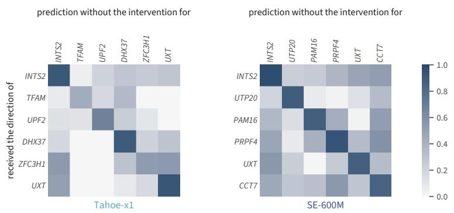  
Figure 7: Direction swap in K562. Each row is the prediction for a perturbation that received the $L _ { 0 }$ direction of the perturbation named on the row, and each column is the prediction without the intervention for the perturbation named on the column. Entries are correlations of the responses. Six pairs per encoder that are both predicted well and have dissimilar observed responses, chosen so that the column perturbations differ from each other.

Table 7: Change in mean PDC when the top $L _ { 0 }$ direction of each perturbation is replaced by the one the same encoder gives it in a decoder trained on another cell line (mean over the three other cell lines). “Same cell line” rows use a direction from another run on the recipient’s own cell line, as a check of the replacement itself.
<table><tr><td>Encoder</td><td>Donor</td><td>HepG2</td><td>Jurkat</td><td>RPE1</td><td>K562</td></tr><tr><td>SE-600M</td><td>other cell lines</td><td>-0.139</td><td>-0.112</td><td>-0.008</td><td>-0.117</td></tr><tr><td rowspan="2">Tahoe-x1</td><td>same cell line</td><td>-0.013</td><td>0.004</td><td>-0.005</td><td>-0.004</td></tr><tr><td>other cell lines</td><td>-0.208</td><td>-0.159</td><td>-0.226</td><td>-0.164</td></tr><tr><td rowspan="2">scGPT</td><td>same cell line</td><td>-0.001</td><td>-0.001</td><td>0.000</td><td>-0.005</td></tr><tr><td>other cell lines</td><td>-0.057</td><td>-0.073</td><td>-0.007</td><td>-0.082</td></tr><tr><td></td><td>same cell line</td><td>0.020</td><td>-0.012</td><td>-0.003</td><td>0.036</td></tr></table>

## C.3 Rank of the $L _ { 0 }$ output and of the data

Section 4.2 states that the $L _ { 0 }$ output of each perturbation is close to rank one. After training, its rank-1 fraction (Appendix A.2), averaged over perturbations, is 0.97–0.996 for SE+ST, 0.49–0.94 for scGPT+ST, and 0.82–0.85 for Tahoe+ST. It is 0.983 and 0.9999 at initialization for SE-600M and Tahoe-x1, so training lowers it for Tahoe+ST by about the same amount in every cell line $( - 0 . 1 6 0 \pm 0 . 0 1 2$ across three seeds on HepG2). The remaining energy of Tahoe+ST is spread over several directions: after each perturbation’s mean over its 64 cells is subtracted, the participation ratio of the remainder is 8.1–9.7, against 2.2–4.0 for SE+ST.

The observed responses are not close to rank one (Table 8). Their participation ratio is 2.6–13.1 across cell lines, and their rank-1 SVD approximation reaches a correlation of 0.29–0.57 with the responses, against 0.83–0.92 for a resampled copy of the same responses. The low rank of the $L _ { 0 }$ output comes from the decoder. Tahoe+ST, the most accurate decoder, scores close to the rank-1 approximation on RPE1 and HepG2, between the rank-1 and rank-4 approximations on Jurkat and K562, and 0.18–0.23 below the rank-16 approximation everywhere.

Table 8: Rank of the observed responses of the held-out perturbations in each cell line (2,000 HVGs). PR: participation ratio; $\mathrm { P R } _ { \mathrm { c e n } } { \mathrm { : } }$ after subtracting the mean response. Rank k: mean per-perturbation correlation between the observed responses and their top-k SVD approximation. Resampled: median correlation of each perturbation’s response with itself after resampling its cells. Last column: PDC of Tahoe+ST on all held-out perturbations, from the run of Appendix C.4 (Table 1 uses the perturbations scored by every predictor).
<table><tr><td>Cell line</td><td>PR</td><td> $\mathrm { P R } _ { \mathrm { c e n } }$ </td><td>rank 1</td><td>rank 4</td><td>rank 16</td><td>resampled</td><td>Tahoe+ST</td></tr><tr><td>HepG2</td><td>4.29</td><td>8.26</td><td>0.448</td><td>0.548</td><td>0.661</td><td>0.854</td><td>0.446</td></tr><tr><td>Jurkat</td><td>10.96</td><td>19.85</td><td>0.337</td><td>0.496</td><td>0.624</td><td>0.840</td><td>0.396</td></tr><tr><td>RPE1</td><td>2.60</td><td>5.37</td><td>0.566</td><td>0.631</td><td>0.736</td><td>0.923</td><td>0.558</td></tr><tr><td>K562</td><td>13.05</td><td>19.81</td><td>0.290</td><td>0.457</td><td>0.586</td><td>0.830</td><td>0.393</td></tr></table>

## C.4 Retrieval from the training responses

Section 4.2 compares the decoder with retrieval from the training responses. The retrieval oracle never runs the decoder. For a held-out perturbation it finds the training perturbations whose observed responses are closest, in cosine distance over the 2,000 HVGs, to the perturbation’s own observed response, and predicts a weighted average of the five nearest, with weights $w _ { i } \propto \exp ( - d _ { i } / \tau )$ and $\tau \stackrel { . } { = } \mathrm { m a x } ( \mathrm { m e d i a n } ( d _ { 2 } - d _ { 1 } ) , \stackrel { . } { 1 0 } ^ { - 3 } )$ in each configuration. Each retrieved response is added to the control cell the decoder used for that row, passed through the decoder’s non-negativity floor, and averaged into a pseudobulk, so the oracle and the decoder are scored the same way.

Table 9 shows that the oracle is more accurate than the decoder in all twelve configurations, by 0.137 PDC on average. Copying the nearest response instead gives a mean gain of 0.118. The gain is smallest for Tahoe+ST and largest for scGPT+ST on K562.

Table 9: PDC of the five-neighbor retrieval oracle minus PDC of the decoder, on all held-out perturbations. Positive means retrieval is more accurate.
<table><tr><td>Encoder</td><td>HepG2</td><td>Jurkat</td><td>RPE1</td><td>K562</td></tr><tr><td>SE-600M</td><td>+0.144</td><td>+0.174</td><td>+0.163</td><td>+0.136</td></tr><tr><td>Tahoe-x1</td><td>+0.076</td><td>+0.074</td><td>+0.074</td><td>+0.064</td></tr><tr><td>scGPT</td><td>+0.159</td><td>+0.160</td><td>+0.152</td><td>+0.268</td></tr></table>

## C.5 What the decoder adds to a linear read-out

Table 1 includes a ridge probe on the decoder’s inputs. Here we compare the decoder with all probes of Appendix A.3, which take the decoder’s three conditioning inputs (Eq. (2)), are trained on training perturbations, and are scored on the same genes and perturbations as the decoder. A ridge on the control and batch inputs alone reaches PDC 0.27–0.46, the same to three decimals for the three encoders, so what the probes know about the perturbation comes from the decoder’s perturbation embedding.

For SE+ST and scGPT+ST the probes are about as accurate as the decoder. The ridge probe reaches mean PDC 0.377 and 0.367, against 0.374 and 0.337, and the two-layer MLP recovers 94–108% and 94–130% of the decoder’s PDC (the largest ratio is scGPT+ST on K562, where the decoder’s PDC is small). An MLP tuned by grouped cross-validation is not more accurate than the ridge for any encoder.

Tahoe+ST is the exception. Its ridge probe reaches 0.398 against 0.438. The two-layer MLP recovers 80–84% of its PDC, an MLP with about as many parameters as the decoder’s MLP layers 85–88%, and the interaction probe 68–78% at every rank from 0 to 64. The decoder’s advantage over the ridge probe is significant in all four cell lines, also with gene families as the resampling unit (Appendix A.7).

Tahoe+ST is also the decoder in which part of the perturbation reaches the output without passing through the $L _ { 0 }$ attention output: setting that output to zero leaves about two thirds of its PDC on HepG2, Jurkat, and RPE1, while keeping only its top direction keeps 97–103% (Appendix C.1). The probes see the same inputs but not this route.

## D Gene programs along the leading direction

Section 4.2 shows that each perturbation enters the decoder along one leading direction. Here we map this direction to genes for Tahoe+ST on HepG2 (945 held-out perturbations, 2,000 HVGs; responses are pseudobulk differences from the mean of the control cells) and check the other cell lines.

The best-predicted perturbations. The ten held-out perturbations with the highest PDC are nine knockdowns of large-subunit ribosomal proteins or 60S biogenesis factors and one of the translation initiation factor EIF2B2 (Table 10). Their observed responses share the ribosomal-stress program described by Replogle et al. [39]: p53 targets (MDM2, TP53I3, RPS27L, FDXR) and the lncRNAs NEAT1 and MALAT1 go up, while tubulins, G2/M genes (MKI67, CENPF, BIRC5), replicationdependent histones and HMG proteins go down. For these ten perturbations the predicted and observed responses have cosine 0.90–0.96 and share 13 to 17 of their top-20 genes with the same sign.

Table 10: The ten held-out perturbations with the highest PDC for Tahoe+ST on HepG2. Cosine: between predicted and observed responses over the 2,000 HVGs, with the observed control mean subtracted from both. Jaccard top-20: overlap of the 20 genes with the largest predicted and observed changes. Shared+sign: genes in both top-20 lists with the same sign.
<table><tr><td>Pert</td><td>PDC</td><td>n test cells</td><td>Jaccard top-20</td><td> $\cos ( \delta _ { \mathrm { o b s } } , \delta _ { \mathrm { p r e d } } )$ </td><td>shared+sign/20</td></tr><tr><td>RPL6</td><td>0.980</td><td>106</td><td>0.67</td><td>0.962</td><td>16</td></tr><tr><td>RPL23A</td><td>0.975</td><td>67</td><td>0.67</td><td>0.952</td><td>16</td></tr><tr><td>RPL35A</td><td>0.973</td><td>174</td><td>0.54</td><td>0.943</td><td>14</td></tr><tr><td>RPL23</td><td>0.973</td><td>134</td><td>0.60</td><td>0.943</td><td>15</td></tr><tr><td>RPL7</td><td>0.971</td><td>110</td><td>0.60</td><td>0.933</td><td>15</td></tr><tr><td>RRS1</td><td>0.970</td><td>132</td><td>0.67</td><td>0.948</td><td>16</td></tr><tr><td>EIF2B2</td><td>0.968</td><td>175</td><td>0.67</td><td>0.946</td><td>16</td></tr><tr><td>RPL18</td><td>0.964</td><td>76</td><td>0.48</td><td>0.927</td><td>13</td></tr><tr><td>WDR12</td><td>0.962</td><td>108</td><td>0.74</td><td>0.931</td><td>17</td></tr><tr><td>NOL8</td><td>0.962</td><td>120</td><td>0.54</td><td>0.902</td><td>14</td></tr></table>

Genes along the leading direction. We regress each perturbation’s observed response on the top right singular vector $v _ { 1 }$ of its $L _ { 0 }$ output, with ridge regression and five-fold cross-validation, and project the coefficients onto the first principal axis of the $v _ { 1 }$ vectors (Table 11). The largest loadings are tubulins, STMN1, H2AFZ, HMGB1/HMGB2, CENPF, and MKI67 on one side and MALAT1, NEAT1, MDM2, and RHOC on the other, so the direction runs from proliferating to arrested, p53-active cells. It is a linear summary of the decoder: across genes, the cross-validated $\bar { R } ^ { 2 }$ is 0.12 at the median and at most 0.62 (STMN1).

Table 11: Genes with the largest loadings on the leading direction for Tahoe+ST on HepG2. The sign is that of the first principal axis of the $v _ { 1 }$ vectors and has no biological orientation.
<table><tr><td>gene</td><td>loading</td><td>gene</td><td>loading</td><td>gene</td><td>loading</td><td>gene</td><td>loading</td></tr><tr><td>TUBA1B</td><td>1.06</td><td>STMN1</td><td>1.02</td><td>H2AFZ</td><td>0.90</td><td>MALAT1</td><td>-0.75</td></tr><tr><td>HMGB2</td><td>0.73</td><td>TUBB</td><td>0.72</td><td>HMGB1</td><td>0.70</td><td>CENPF</td><td>0.67</td></tr><tr><td>NEAT1</td><td>-0.67</td><td>HIST1H4C</td><td>0.63</td><td>PCLAF</td><td>0.62</td><td>MDM2</td><td>-0.62</td></tr><tr><td>MKI67</td><td>0.61</td><td>HMGN2</td><td>0.59</td><td>BIRC5</td><td>0.58</td><td>NASP</td><td>0.58</td></tr><tr><td>CALR</td><td>0.57</td><td>MCM3</td><td>0.56</td><td>PTMA</td><td>0.54</td><td>HSP90B1</td><td>0.52</td></tr><tr><td>SCD</td><td>0.52</td><td>ACTG1</td><td>0.51</td><td>TOP2A</td><td>0.51</td><td>TPX2</td><td>0.49</td></tr><tr><td>DBI</td><td>0.48</td><td>ACAT2</td><td>0.48</td><td>PTTG1</td><td>0.48</td><td>RHOC</td><td>-0.48</td></tr><tr><td>TK1</td><td>0.47</td><td>FADS1</td><td>0.46</td><td></td><td></td><td></td><td></td></tr></table>

Other cell lines. Table 12 gives the top Hallmark category of the 30 genes with the largest loadings on the first principal axis of each cell line’s observed responses, which has cosine 0.91–0.99 with the leading direction: E2F targets in HepG2 and RPE1, Myc targets in Jurkat, and mTORC1 signaling, tied with hypoxia, in K562. In every cell line the category comes from the proliferation side of the axis, except one of the eight mTORC1 genes and two of the six hypoxia genes in K562; the arrested, p53 side is identified in HepG2. The axis is close to the mean response of all held-out perturbations (cosine 0.98–1.00), that is, to the shift that perturbed cells share relative to control cells, which Viñas Torné et al. [50] call systematic variation. In the Replogle RPE1 screen they find 46% of perturbed and 25% of control cells in G1, which they attribute to arrest of p53-positive RPE1 cells after perturbation-induced chromosomal instability, and a much smaller cell-cycle shift in p53-negative K562 cells. In K562 and Jurkat a perturbation’s position on the axis also follows its change in total UMIs per cell: the Pearson correlation with the change in mean log UMI count is 0.53 and 0.74, against 0.22 in HepG2 and 0.03 in RPE1. It stays at 0.49 and 0.68 when pseudobulks sum counts before normalizing, so it reflects a change in total RNA per cell rather than the log transform. In K562 and Jurkat the axis therefore combines the proliferation program with the change in total RNA.

Table 12: Hallmark category with the smallest adjusted p-value (MSigDB Hallmark 2020, Benjamini– Hochberg, background the 2,000 HVGs) among the 30 genes with the largest absolute loadings on the first right singular vector of each cell line’s matrix of observed responses.
<table><tr><td>Cell line</td><td>Top-FDR Hallmark category</td><td>padj</td></tr><tr><td>HepG2</td><td>E2F-Targets</td><td> $4 . 7 8 \times 1 0 ^ { - 8 }$ </td></tr><tr><td>RPE1</td><td>E2F-Targets</td><td> $2 . 1 4 \times 1 0 ^ { - 9 }$ </td></tr><tr><td>Jurkat</td><td>Myc-Targets-V1</td><td> $1 . 0 4 \times 1 0 ^ { - 5 }$ </td></tr><tr><td>K562</td><td>mTORC1-Signaling</td><td> $2 . 6 7 \times 1 0 ^ { - 4 }$ </td></tr><tr><td></td><td>Hypoxia (tied)</td><td> $2 . 6 7 \times 1 0 ^ { - 4 }$ </td></tr></table>

Gene-level agreement. Over all 945 held-out perturbations the cosine between predicted and observed responses has median 0.26 (Table 13) and rises with PDC (Spearman 0.91; Table 14). In the three lowest PDC deciles its median is below 0.06: for these perturbations, mostly with weak responses, the prediction does not point along the observed response. The ten perturbations with the lowest cosine all have weak responses (norm at most 4.8) and slightly negative cosines (for example GFOD2 −0.24 and DHX29 −0.19).

Table 13: Agreement between predicted and observed responses over all 945 held-out perturbations (Tahoe+ST, HepG2), by percentile.
<table><tr><td>percentile</td><td>cosine</td><td>Jaccard top-20</td><td>shared+sign / 20</td></tr><tr><td>p10</td><td>-0.034</td><td>0.000</td><td>0</td></tr><tr><td>p25</td><td>0.056</td><td>0.026</td><td>0</td></tr><tr><td>median</td><td>0.257</td><td>0.081</td><td>3</td></tr><tr><td>p75</td><td>0.648</td><td>0.290</td><td>9</td></tr><tr><td>p90</td><td>0.858</td><td>0.575</td><td>15</td></tr></table>

Table 14: Agreement between predicted and observed responses by PDC decile (≈ 95 perturbations each; decile 1 has the lowest PDC).
<table><tr><td>PDC decile</td><td>PDC med</td><td>cosine  $p 2 5$ </td><td>cosine median</td><td>Jaccard med</td></tr><tr><td>1</td><td>-0.045</td><td>-0.060</td><td>-0.007</td><td>0.026</td></tr><tr><td>2</td><td>0.056</td><td>-0.033</td><td>0.027</td><td>0.026</td></tr><tr><td>3</td><td>0.142</td><td>-0.008</td><td>0.058</td><td>0.026</td></tr><tr><td>4</td><td>0.239</td><td>0.061</td><td>0.122</td><td>0.026</td></tr><tr><td>5</td><td>0.372</td><td>0.132</td><td>0.186</td><td>0.053</td></tr><tr><td>6</td><td>0.520</td><td>0.259</td><td>0.353</td><td>0.111</td></tr><tr><td>7</td><td>0.655</td><td>0.354</td><td>0.475</td><td>0.176</td></tr><tr><td>8</td><td>0.771</td><td>0.561</td><td>0.651</td><td>0.290</td></tr><tr><td>9</td><td>0.879</td><td>0.740</td><td>0.812</td><td>0.481</td></tr><tr><td>10</td><td>0.934</td><td>0.866</td><td>0.890</td><td>0.667</td></tr></table>

A well-predicted perturbation off the direction. A high PDC does not imply agreement at the level of genes. GFM1, a mitochondrial translation factor, has PDC 0.85, and its 20 most changed genes include four mitochondrially encoded transcripts (MT-ATP6, MT-ND2, MT-CO3, MT-ND3) next to the proliferation genes of the leading direction (Figure 8). The prediction contains three of the four with smaller changes, and eight of its other top-20 genes are proliferation genes. Predicted and observed top-20 lists share 7 genes with the same sign, and their cosine, defined as in Table 10, is 0.61. RPL18, whose response lies closer to the leading direction, reaches 0.93 and shares 13 genes.

A  
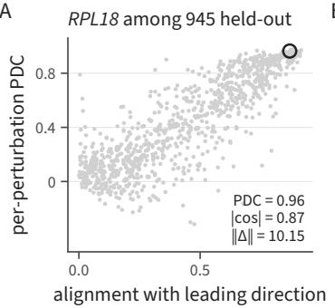  
B

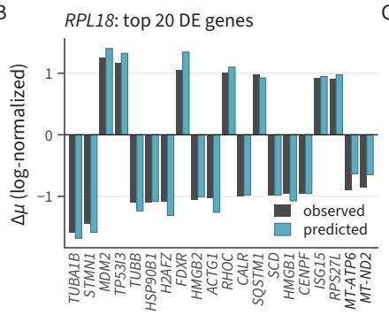

C  
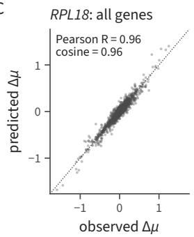

D  
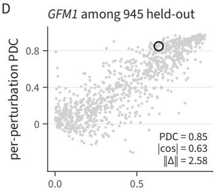  
E

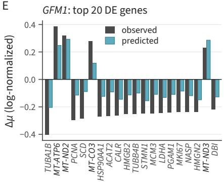

F  
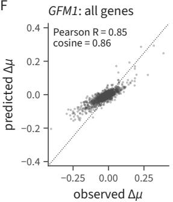  
Figure 8: RPL18 (top) and GFM1 (bottom) under Tahoe+ST on HepG2. (A, D) Cosine of each held-out perturbation’s response with the leading direction against its PDC, with the perturbation marked. (B, E) The 20 genes with the largest observed change, observed (grey) and predicted; mitochondrially encoded transcripts are labelled. (C, F) Predicted against observed change for all 2,000 HVGs, each relative to its own control mean, with their cosine and Pearson R (the PDC).

Gene families. We assign each held-out perturbation to the first matching family: cytoplasmic ribosomal (RPL\*, RPS\*, RACK\*); mitoribosomal (MRPL\*, MRPS\*); OXPHOS (MT-\*, NDUF\*, COX\*, ATP5\*, ATP6\*, UQCR\*, SDH[A-D]); mitochondrial translation (GFM1/2, TSFM, TFAM, TFB1M, TUFM, OPA1, LONP1/2, MRPP1-4, PNPT1, FASTKD5); splicing (SNRP\*, SF3\*, U2AF\*, PRPF\*, RBM\*); translation initiation and tRNA synthetases (EIF\* and the aaRS genes); cell cycle and replication (CDC\*, CDK\*, CCN\*, MCM\*, CENP\*, BUB\*, AURK\*, KIF\*, PLK\*, CHK\*, RAD\*, BRCA\*, TOP\*, RFC\*, CHEK\*, ORC\*, WEE\*, and POL\* other than POLR\*); RNA polymerase (POLR\*); and other. In all twelve configurations the cytoplasmic ribosomal family has the highest median PDC, and the three mitochondrial families have lower medians than both the cytoplasmic ribosomal and the translation-initiation families (Figure 9). For Tahoe+ST the median PDC is 0.84– 0.94 for cytoplasmic ribosomal perturbations and 0.36–0.58 for the three mitochondrial families together. In HepG2, Jurkat, and K562 the mitochondrial responses are about as large as those of the other perturbations; in RPE1 they are smaller.

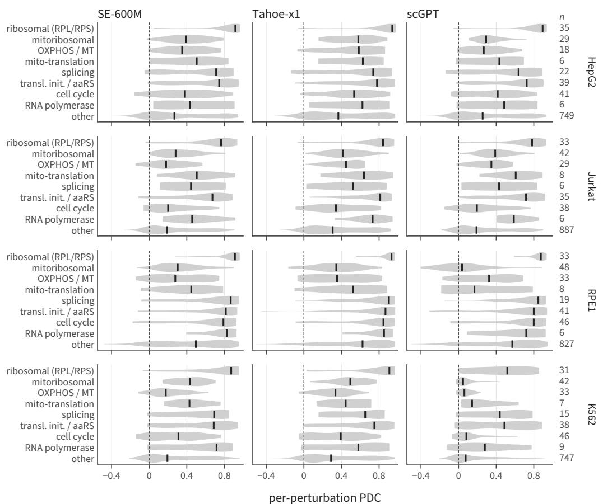  
Figure 9: Per-perturbation PDC by gene family for the three encoders (columns) in the four cell lines (rows). Violins show the distribution and ticks the median; n is the number of perturbations in each family.

## E Scores that separate perturbations

PDC is a correlation over genes, so a prediction that reproduces the shared response of Appendix D scores well on every perturbation whose response lies along it, without telling perturbations apart. We add two scores that measure this. For each held-out perturbation we take the cells’ responses (each cell minus the mean of the observed control cells, over the 2,000 HVGs) and their top right singular vector, the gene-space direction of the response, for the predicted and for the observed cells. Direction recovery is the absolute cosine between the predicted and observed directions, averaged over perturbations. Identity retrieval asks whether the predicted directions keep which perturbations resemble each other: for each held-out perturbation we take the other held-out perturbation whose predicted direction is closest to its predicted direction, and the one whose observed direction is closest to its observed direction, and report the fraction of perturbations for which the two are the same.

Tahoe+ST recovers the direction best in every cell line, by 0.026–0.068 over SE+ST, and reaches 0.874 on RPE1. Identity retrieval is low for all three decoders: 0.034–0.054 for SE+ST, 0.050–0.074 for Tahoe+ST, and 0.013–0.046 for scGPT+ST. Chance level is $1 / ( N - 1 )$ , about 0.001. An oracle that predicts the response of the training perturbation whose observed response is closest to the perturbation’s own gives 0.201, 0.109, and 0.123 on HepG2, Jurkat, and RPE1. The decoders recover the direction of each response well but keep little of which perturbations resemble each other, in line with Appendices C.2 and D.

## F Predicted-NN-distance as a confidence score

Section 4.3 evaluates predicted-NN-distance as a confidence score. Here we compare it with other scores, test it among predictions of similar size, and give the details of the pooled threshold and of Learn-then-Test.

## F.1 Design of the score

Other scores. Table 15 compares predicted-NN-distance with four other scores computed from the prediction and the training responses. Averaged over the 12 configurations, its Spearman |ρ| with PDC is 0.806, against 0.784 for the mean distance to the ten nearest training responses, 0.555 for the Euclidean distance, and 0.664 for the alignment with the leading axis of the training responses (paired Wilcoxon $p < 0 . 0 1$ for all three). The norm of the predicted response reaches 0.725. It is higher than predicted-NN-distance in the three RPE1 configurations, and the difference over the 12 configurations is not significant $( p = 0 . 0 5 5 )$ ); Appendix F.2 compares the two among predictions of similar norm.

Table 15: Spearman |ρ| between each score and PDC on the held-out perturbations. (a) predicted-NN-distance (cosine, nearest training response); (b) norm of the predicted response; (c) mean cosine distance to the ten nearest training responses; (d) Euclidean distance to the nearest training response; (e) alignment of the predicted response with the leading axis of the training responses.
<table><tr><td>Encoder</td><td>Cell line</td><td>(a)</td><td>(b)</td><td>(c)</td><td>(d)</td><td>(e)</td></tr><tr><td>SE</td><td>HepG2</td><td>0.844</td><td>0.769</td><td>0.827</td><td>0.322</td><td>0.744</td></tr><tr><td>SE</td><td>Jurkat</td><td>0.832</td><td>0.692</td><td>0.819</td><td>0.498</td><td>0.652</td></tr><tr><td>SE</td><td>RPE1</td><td>0.817</td><td>0.822</td><td>0.797</td><td>0.707</td><td>0.712</td></tr><tr><td>SE</td><td>K562</td><td>0.878</td><td>0.751</td><td>0.870</td><td>0.511</td><td>0.719</td></tr><tr><td>Tahoe</td><td>HepG2</td><td>0.840</td><td>0.823</td><td>0.808</td><td>0.585</td><td>0.702</td></tr><tr><td>Tahoe</td><td>Jurkat</td><td>0.850</td><td>0.828</td><td>0.822</td><td>0.688</td><td>0.662</td></tr><tr><td>Tahoe</td><td>RPE1</td><td>0.724</td><td>0.798</td><td>0.662</td><td>0.703</td><td>0.527</td></tr><tr><td>Tahoe</td><td>K562</td><td>0.862</td><td>0.833</td><td>0.833</td><td>0.670</td><td>0.626</td></tr><tr><td>scGPT</td><td>HepG2</td><td>0.830</td><td>0.776</td><td>0.819</td><td>0.485</td><td>0.754</td></tr><tr><td>scGPT</td><td>Jurkat</td><td>0.852</td><td>0.758</td><td>0.840</td><td>0.600</td><td>0.695</td></tr><tr><td>scGPT</td><td>RPE1</td><td>0.559</td><td>0.730</td><td>0.524</td><td>0.669</td><td>0.404</td></tr><tr><td>scGPT</td><td>K562</td><td>0.785</td><td>0.115</td><td>0.782</td><td>0.222</td><td>0.765</td></tr><tr><td>Mean</td><td></td><td>0.806</td><td>0.725</td><td>0.784</td><td>0.555</td><td>0.664</td></tr></table>

HVGs and the full transcriptome. The 2,000-gene panel is fixed by the ST decoder’s output layer, so scoring all transcripts would require retraining every model. On the observed responses, the leading axis of the 2,000-HVG space and of the full 6,546-gene space have cosine $\geq 0 . 9 9$ on three of four cell lines and 0.89 on K562, and the association between the oracle distance and PDC changes by less than 0.02 in all 12 configurations $( | \rho | = 0 . 8 7 3$ on the full panel against 0.876 on HVGs). scGPT without the ST decoder outputs all 6,546 genes; scored on every gene, its mean PDC changes by −0.053 to +0.017 relative to the HVG panel. On the full transcriptome the leading axis explains a smaller share of the variance.

Aggregating distances. Besides the minimum distance, we tested 24 aggregators of the distances from a prediction to the training responses: means of the bottom k or bottom percentile, percentiles, soft-min at several temperatures, and neighbor counts within a radius. None is significantly better than the minimum; the mean of the bottom 1% lowers $| \rho |$ by 0.010 and improves on the minimum in no configuration. The number of training neighbors within cosine 0.15 carries a small additional signal (mean partial $\rho$ with PDC given the minimum distance +0.069, positive in 10 of 12), but 32–96% of held-out perturbations have no neighbor at that radius.

Other distance spaces. We also computed the distance in two other spaces. In the space of perturbation embeddings, the cosine distance between a held-out perturbation’s column of the decoder’s perturbation encoder and the closest training column gives a weaker score than the genespace distance in all 12 configurations $( | \rho |$ lower by 0.33 to 0.74, 0.48 on average). Along the decoder’s leading $L _ { 0 }$ coordinate, the gap to the nearest training perturbation has Spearman ρ of +0.20 to +0.45 with PDC, and the gene-space distance keeps a partial correlation of −0.87 to −0.48 with PDC given this gap.

## F.2 Beyond the size of the prediction

Predictions with a large predicted response lie closer to a training response: the Spearman $\rho$ between predicted-NN-distance and the norm of the predicted response is −0.72 to −0.89 in 11 of the 12 configurations (+0.27 for scGPT+ST on K562). We therefore split each configuration’s held-out perturbations into five equal-count bins of predicted norm and compute, within each bin, the Spearman $\rho$ between predicted-NN-distance and PDC (Tables 16 and 17, Figure 10).

Within bins the median $| \rho |$ over configurations is 0.40 in the bin of smallest predictions and 0.73 in the bin of largest. In 10 of the 12 configurations $| \rho |$ is at least 0.2 in three or more bins; the exceptions are Tahoe+ST and scGPT+ST on RPE1, and finer bins (7 or 10) give the same pattern. Within the same bins predicted-NN-distance is more strongly associated with PDC than the remaining variation in predicted norm in 52 of the 60 bins (paired Wilcoxon over configurations, $p = 0 . 0 0 1 2 )$ . Regressing the predicted norm out of both the score and PDC leaves a median partial $| \rho |$ of 0.58, against 0.84 without it.

The loss from binning is largest where the observed responses lie closest to one direction (Table 18, Figure 11). In RPE1, with participation ratio 2.6, the score keeps 39% of its unbinned |ρ|, against 66–77% in the other cell lines. The oracle distance keeps a partial $| \rho |$ of 0.81 (median) and 0.86 for Tahoe+ST on RPE1. The observed responses in RPE1 therefore still carry this information; the predictions there collapse toward the leading direction and lose it.

## F.3 Pooled threshold

Selection and leave-one-out refits. The pooled threshold is chosen on a grid of 50 values of τ between 0.048 and 0.82. For each value we compute, in each of the 12 configurations, the mean PDC of the accepted predictions above that cell line’s rank-1 SVD baseline, and we keep the value with the largest mean over configurations among those at which every configuration accepts at least five predictions. This gives $\tau = 0 . 0 9 5 7$ . Over 5,000 bootstrap resamples that draw configurations and, within each, perturbations with replacement, with the grid rebuilt in each resample, the selected τ has mean 0.099 and 95% interval [0.073, 0.116]. Refitting with one cell line left out (four folds) or one encoder left out (three folds) selects τ between 0.092 and 0.107. Applied to the left-out cell line or encoder, the refitted threshold changes the mean PDC of accepted predictions above the baseline by at most 0.011 (cell lines) and 0.019 (encoders), and by more than 0.05 in none of the 11 configurations that accept at least five predictions in every refit. Because the pooled threshold is chosen on the same held-out predictions that Figure 3B reports, these leave-one-out refits measure how much this choice inflates the reported accuracy.

Table 16: Spearman ρ between predicted-NN-distance and PDC on all held-out perturbations (unbinned) and within five equal-count bins of the norm of the predicted response (Q1 smallest). MOD: at least 3 of 5 bins with $| \bar { \rho } | \geq 0 . 2 ;$ STR: at least 4 of 5 bins with $| \rho | \geq 0 . { \overset { \cdot } { 4 } }$
<table><tr><td>Encoder</td><td>Cell line</td><td> $n _ { \mathrm { t e s t } }$ </td><td>unbin. ρ</td><td>Q1</td><td>Q2</td><td>Q3</td><td>Q4</td><td>Q5</td><td>MOD</td><td>STR</td></tr><tr><td>SE</td><td>HepG2</td><td>945</td><td>-0.844</td><td>-0.412</td><td>-0.555</td><td>-0.549</td><td>-0.669</td><td>-0.830</td><td>√</td><td>√</td></tr><tr><td>SE</td><td>Jurkat</td><td>1084</td><td>-0.832</td><td>-0.484</td><td>-0.473</td><td>-0.657</td><td>-0.835</td><td>-0.871</td><td>√</td><td>√</td></tr><tr><td>SE</td><td>RPE1</td><td>1061</td><td>-0.817</td><td>-0.395</td><td>-0.375</td><td>-0.371</td><td>-0.410</td><td>-0.647</td><td>√</td><td></td></tr><tr><td>SE</td><td>K562</td><td>968</td><td>-0.878</td><td>-0.436</td><td>-0.593</td><td>-0.767</td><td>-0.790</td><td>-0.813</td><td>√</td><td>√</td></tr><tr><td>Tahoe-x1</td><td>HepG2</td><td>945</td><td>-0.840</td><td>-0.367</td><td>-0.536</td><td>-0.368</td><td>-0.589</td><td>-0.739</td><td>√</td><td></td></tr><tr><td>Tahoe-x1</td><td>Jurkat</td><td>1084</td><td>-0.850</td><td>-0.483</td><td>-0.512</td><td>-0.458</td><td>-0.517</td><td>-0.741</td><td>√</td><td>√</td></tr><tr><td>Tahoe-x1</td><td>RPE1</td><td>1061</td><td>-0.724</td><td>-0.196</td><td>-0.016</td><td>0.063</td><td>-0.423</td><td>-0.623</td><td>一</td><td></td></tr><tr><td>Tahoe-x1</td><td>K562</td><td>968</td><td>-0.862</td><td>-0.388</td><td>-0.466</td><td>-0.573</td><td>-0.594</td><td>-0.729</td><td>√</td><td>√</td></tr><tr><td>scGPT</td><td>HepG2</td><td>945</td><td>-0.830</td><td>-0.380</td><td>-0.530</td><td>-0.510</td><td>-0.622</td><td>-0.707</td><td>√</td><td>√</td></tr><tr><td>scGPT</td><td>Jurkat</td><td>1084</td><td>-0.852</td><td>-0.419</td><td>-0.604</td><td>-0.600</td><td>-0.704</td><td>-0.756</td><td>√</td><td>√</td></tr><tr><td>scGPT</td><td>RPE1</td><td>1061</td><td>-0.559</td><td>-0.261</td><td>0.031</td><td>0.162</td><td>0.002</td><td>-0.091</td><td>一</td><td>一</td></tr><tr><td>scGPT</td><td>K562</td><td>968</td><td>-0.785</td><td>-0.564</td><td>-0.738</td><td>-0.905</td><td>-0.796</td><td>-0.504</td><td>√</td><td>√</td></tr></table>

Table 17: Within-bin $| \rho |$ over the 12 configurations: median, interquartile range, and the number of configurations above 0.2 and 0.4.
<table><tr><td>Bin</td><td>Cross-config median |ρ|</td><td>IQR (25%/75%)</td><td> $\# | \rho | \geq 0 . 2$ </td><td> $\# | \rho | \geq 0 . 4$ </td></tr><tr><td>Q1</td><td>0.404</td><td>0.377/0.448</td><td>11/12</td><td>6/12</td></tr><tr><td>Q2</td><td>0.521</td><td>0.443/0.565</td><td>10/12</td><td>9/12</td></tr><tr><td>Q3</td><td>0.529</td><td>0.370/0.614</td><td>10/12</td><td>8/12</td></tr><tr><td>Q4</td><td>0.608</td><td>0.494/0.726</td><td>11/12</td><td>11/12</td></tr><tr><td>Q5</td><td>0.734</td><td>0.641/0.770</td><td>11/12</td><td>11/12</td></tr></table>

Transfer between configurations. Figure 12 applies the per-configuration threshold of Appendix A.6, fitted on each source configuration (rows), to each target configuration (columns), scored as the mean PDC of accepted predictions above the target’s rank-1 SVD baseline. Because the per-configuration thresholds differ, a threshold taken from another configuration accepts a different share of the target’s predictions, so the entries vary in both directions around the diagonal. One pair (scGPT/RPE1 as source, SE/Jurkat as target) accepted fewer than five predictions and is masked.

Coverage. Figure 13 gives, for each configuration, the mean PDC of the accepted predictions as the threshold is raised, the per-configuration version of Figure 3A. The pooled threshold accepts 13.4% of the predictions on average, with mean PDC 0.43 above the rank-1 SVD baseline. Over configurations, the median mean PDC of the accepted predictions is 0.86 at 5% of predictions accepted, 0.72 at 30%, and 0.61 at 50%, still 0.17 above the baseline.

## F.4 Learn-then-Test threshold

Table 19 compares Learn-then-Test with a decile rule over 200 random splits into calibration and deployment halves. For each configuration it reports the mean share of all predictions accepted and the realized mean PDC of the accepted predictions. Learn-then-Test uses target $0 . 3 0 , \delta = 0 . 1 0 $ , a 201-point grid, and Bonferroni-simultaneous one-sided Hoeffding bounds. The decile rule sorts the calibration perturbations by predicted-NN-distance into ten equal-count deciles, computes a one-sided 95% percentile-bootstrap lower bound (1,000 resamples) on the mean PDC of each decile, and accepts the largest contiguous prefix of lowest-distance deciles whose bounds are at least the target 0.30; τ is the largest calibration distance in that prefix. A split that Learn-then-Test does not certify counts as accepting nothing. No certified split in any configuration had realized mean PDC below 0.30.

The guarantee holds when the calibration and deployment perturbations are drawn from the same population, as in these random splits. To check a split that breaks this condition, we calibrate on the half of the held-out perturbations nearest the training responses (by oracle distance) and deploy on

A  
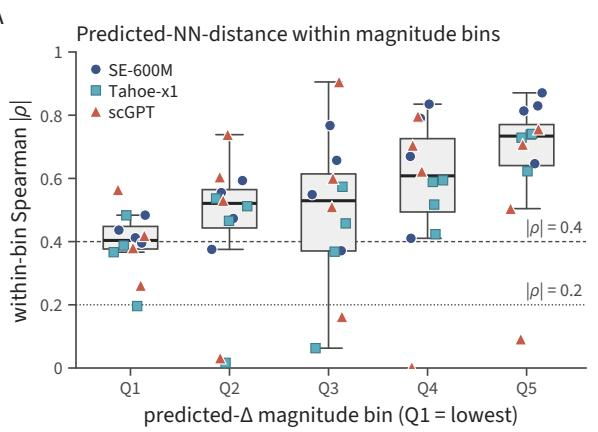  
B

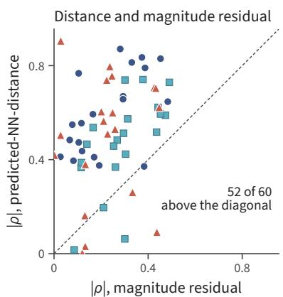  
Figure 10: (A) Within-bin $| \rho |$ between predicted-NN-distance and PDC in five bins of predicted norm, one marker per configuration; boxes summarize the 12 configurations; dotted and dashed lines at 0.2 and 0.4. (B) For each configuration and bin, $| \rho |$ of predicted-NN-distance against $| \rho |$ of the remaining variation in predicted norm.

Table 18: Mean within-bin $| \rho |$ (over the three encoders and five bins) and mean unbinned $| \rho |$ in each cell line, their ratio, and the participation ratio of the observed responses (Table 8).
<table><tr><td>Cell line</td><td>target  $\mathrm { P R } _ { \mathrm { c t r l - r e l } }$ </td><td>mean stratified  $| \rho |$ </td><td>mean unbinned  $| \rho |$ </td><td>attenuation ratio</td></tr><tr><td>HepG2</td><td>4.29</td><td>0.558</td><td>0.838</td><td>0.665</td></tr><tr><td>Jurkat</td><td>10.96</td><td>0.608</td><td>0.845</td><td>0.719</td></tr><tr><td>RPE1</td><td>2.60</td><td>0.271</td><td>0.700</td><td>0.387</td></tr><tr><td>K562</td><td>13.05</td><td>0.644</td><td>0.842</td><td>0.765</td></tr></table>

the far half. The realized mean PDC of the accepted predictions then falls below 0.30 in 11 of the 12 configurations.

Table 19: Learn-then-Test and the decile rule over 200 random calibration/deployment splits: share of predictions accepted and mean PDC of accepted predictions.
<table><tr><td></td><td></td><td colspan="2">Learn-then-Test</td><td colspan="2">Decile rule</td></tr><tr><td>Encoder</td><td>Cell line</td><td>Accepted</td><td>PDC</td><td>Accepted</td><td>PDC</td></tr><tr><td>SE</td><td>HepG2</td><td>0.696</td><td>0.520</td><td>0.465</td><td>0.654</td></tr><tr><td>SE</td><td>Jurkat</td><td>0.380</td><td>0.574</td><td>0.342</td><td>0.600</td></tr><tr><td>SE</td><td>K562</td><td>0.506</td><td>0.553</td><td>0.419</td><td>0.603</td></tr><tr><td>SE</td><td>RPE1</td><td>0.987</td><td>0.475</td><td>0.612</td><td>0.651</td></tr><tr><td>Tahoe</td><td>HepG2</td><td>0.897</td><td>0.494</td><td>0.584</td><td>0.646</td></tr><tr><td>Tahoe</td><td>Jurkat</td><td>0.759</td><td>0.493</td><td>0.535</td><td>0.590</td></tr><tr><td>Tahoe</td><td>K562</td><td>0.725</td><td>0.510</td><td>0.513</td><td>0.618</td></tr><tr><td>Tahoe</td><td>RPE1</td><td>1.000</td><td>0.558</td><td>0.826</td><td>0.622</td></tr><tr><td>scGPT</td><td>HepG2</td><td>0.630</td><td>0.532</td><td>0.459</td><td>0.628</td></tr><tr><td>scGPT</td><td>Jurkat</td><td>0.447</td><td>0.552</td><td>0.387</td><td>0.587</td></tr><tr><td>scGPT</td><td>K562</td><td>0.000</td><td>not certified</td><td>0.213</td><td>0.557</td></tr><tr><td>scGPT</td><td>RPE1</td><td>0.998</td><td>0.481</td><td>0.690</td><td>0.583</td></tr><tr><td>Mean</td><td></td><td>0.669</td><td></td><td>0.504</td><td></td></tr></table>

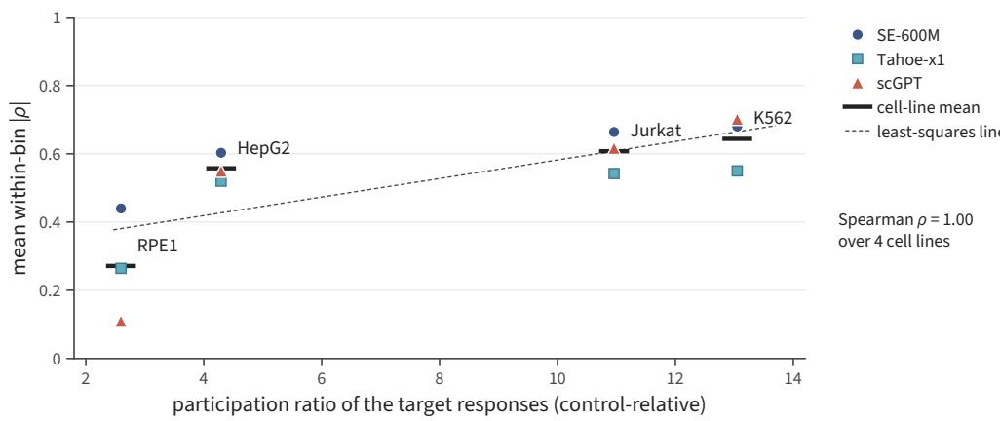  
Figure 11: Mean within-bin $| \rho |$ against the participation ratio of the observed responses in each cell line, one marker per encoder; bars give the mean over encoders.

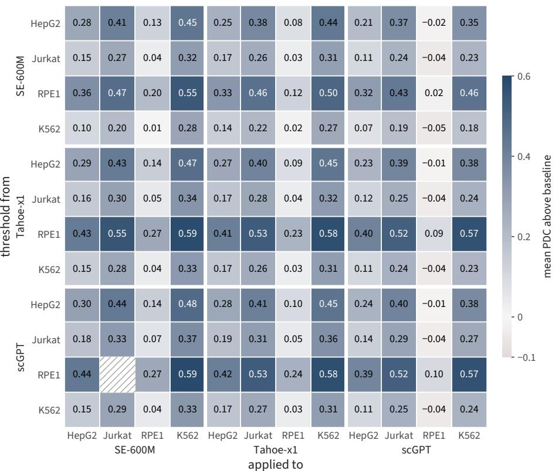  
Figure 12: Transfer of the per-configuration threshold between all $1 2 \times 1 2$ source–target pairs. Entry: mean PDC above the rank-1 SVD baseline among predictions accepted on the target (columns) using the threshold fitted on the source (rows). Hatched: fewer than five accepted predictions. White rules separate the encoder blocks.

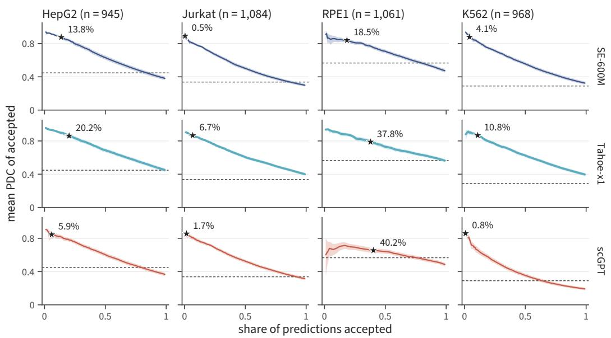

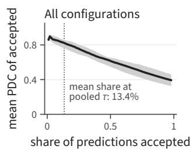  
Figure 13: Mean PDC of the accepted predictions against the share accepted, as the threshold on predicted-NN-distance is raised (rows: encoders; columns: cell lines). Shaded: bootstrap 95% interval (5,000 resamples); dashed: rank-1 SVD baseline; star: the pooled threshold, labeled with its share accepted. Lower right: median and interquartile range over the 12 configurations.

## G Tests outside the audited panel

Section 4.4 tests the score outside the audited setting. Here we give the details for TxPert, for chemical perturbations in Tahoe-100M, for single-cell scoring and other context sizes, and for retraining with whole gene families held out.

## G.1 TxPert

We ran the released TxPert [53] GAT and Exphormer checkpoints for unseen perturbations on their 272 held-out Replogle K562 perturbations. We intervened on the 64-dimensional perturbation latent that enters TxPert’s two-layer MLP decoder, the closest analogue of the ST decoder’s $L _ { 0 }$ . PDC follows TxPert’s evaluation: both responses are centred on the observed batch-matched control, over TxPert’s gene set. The projection basis is the SVD of all latent rows, including test perturbations, so it differs from the training-only fixed basis of §3.2. Table 20 reports the distance score and the projection test. Keeping only the top direction of the latent lowers mean PDC from 0.599 to 0.366 (Exphormer) and from 0.595 to 0.344 (GAT), a random direction lowers it to 0.031 and −0.176, and eight directions keep 90% of it. Controlling for the magnitude of the predicted response, the score retains partial $| \rho | = 0 . 3 3$ (Exphormer) and 0.13 (GAT), both with intervals excluding zero. The predicted responses have 0.32× (Exphormer) and 0.42× (GAT) the participation ratio of the observed responses. A released cross-cell-line transfer checkpoint, trained on other cell lines and evaluated on K562, retains 90.5% of PDC at rank 16, with predicted participation ratio 0.29× observed.

Table 20: TxPert: distance score and rank-k projection of the perturbation latent (mean PDC). Exphormer checkpoints: the distance rows (top block) use K562\_unseen\_pert\_exphormer\_mg (STRING and GO graphs); the projection rows (bottom block) and the participation ratio in the text use K562\_unseen\_pert\_exphormer (STRING graph).
<table><tr><td></td><td>Exphormer</td><td>GAT</td></tr><tr><td>Mean PDC</td><td>0.600</td><td>0.595</td></tr><tr><td>Oracle distance vs PDC, |ρ|</td><td>0.821</td><td>0.802</td></tr><tr><td>Predicted vs observed distance, ρ</td><td>0.607</td><td>0.443</td></tr><tr><td>Predicted-NN-distance vs PDC, |ρ|</td><td>0.697</td><td>0.481</td></tr><tr><td>Top-1 singular direction</td><td>0.366</td><td>0.344</td></tr><tr><td>Random direction, rank 1</td><td>0.031</td><td>-0.176</td></tr><tr><td>Top-8 singular directions</td><td>0.555</td><td>0.555</td></tr><tr><td>Random subspace, rank 8</td><td>0.163</td><td>0.033</td></tr><tr><td>Smallest rank retaining 90%</td><td>8</td><td>8</td></tr></table>

## G.2 Chemical perturbations in Tahoe-100M

We used Arc’s released ST-SE-Tahoe checkpoint and its published evaluation predictions on the five few-shot cell lines of Tahoe-100M [57]; we trained no model. In each of these cell lines, 402 drug–dose conditions are in the checkpoint’s training data and 734–735 conditions from 268 drugs are evaluated. Responses are computed as differences of log-normalized means; our PDC reproduces Arc’s published pearson\_delta column at Pearson 1.000000. The training pool for the distance is the set of training conditions of the same cell line. Intervals resample whole drugs so that doses of one compound are not treated as independent, and permutation tests permute drugs.

The association holds when references to the same drug are removed from the pool for every condition $( - 0 . 6 7 8 \mathrm { t o } - 0 . 8 4 5 )$ , on the conditions whose drug is absent from the pool (−0.694 to −0.821), when doses are collapsed to one point per drug $( - 0 . 6 \bar { 3 } 0 \ \mathrm { t o \ - } 0 . 8 5 5 )$ , and after controlling for alignment with the leading response axis (partial −0.599 to −0.681). The oracle distance gives −0.780 to −0.874.

## G.3 Single-cell resolution and context size

Table 22 reports the association between the score and per-perturbation PDC, with PDC computed from pseudobulk or from individual cells, and with the number of context cells S varied. Across $S \in \{ 1 6 , 3 2 , 6 4 , 1 2 8 , 2 5 6 \}$ , every configuration keeps a negative association with $| \rho | \geq 0 . 3 0$ , and every paired-bootstrap interval for the change from $S = 6 4$ lies within ±0.10. The largest point change from the S = 64 value is 0.031, and the largest range over the five context sizes is 0.048, both in Tahoe+ST/RPE1. Predictions vary across the cells of a perturbation, but this variation does not follow the variation between its observed cells (correlation of the residuals 0.00–0.02). The single-cell column therefore measures how well the per-perturbation ranking holds when PDC is computed against individual cells. Dividing each perturbation’s single-cell PDC by its ceiling (the single-cell PDC of the observed pseudobulk) lowers $| \rho |$ to 0.04–0.47 for Tahoe+ST, while SE+ST and scGPT+ST keep 0.55–0.73, so for Tahoe+ST part of the single-cell association reflects the size of the response.

Table 21: Tahoe-100M chemical perturbations: Spearman $\rho$ between predicted-NN-distance and per-condition PDC with drug-clustered 95% intervals, and participation ratio (PR) of observed and predicted responses.
<table><tr><td>Cell line</td><td>ρ</td><td>95% interval</td><td>PR observed</td><td>PR predicted</td></tr><tr><td>C32</td><td>-0.849</td><td>[-0.871, -0.821]</td><td>3.48</td><td>2.39</td></tr><tr><td>HOP62</td><td>-0.788</td><td>[−0.819, −0.749]</td><td>5.55</td><td>4.44</td></tr><tr><td>HepG2-C3A</td><td>-0.683</td><td>[−0.723, -0.635]</td><td>5.60</td><td>4.12</td></tr><tr><td>Hs 766T</td><td>-0.726</td><td>[−0.767, -0.680]</td><td>7.79</td><td>5.92</td></tr><tr><td>PANC-1</td><td>-0.710</td><td>[-0.750, -0.667]</td><td>7.03</td><td>5.37</td></tr></table>

Table 22: Spearman $| \rho |$ between predicted-NN-distance and PDC: pseudobulk and single-cell scoring, and pseudobulk scoring at context size S. The S = 64 column is an independent rerun of the pseudobulk column; the two differ by at most 0.020.
<table><tr><td colspan="5"></td><td colspan="5">Context size S</td></tr><tr><td>Encoder</td><td>Cell line</td><td>Pseudobulk</td><td>Single cell</td><td>16</td><td>32</td><td>64</td><td>128</td><td></td><td>256</td></tr><tr><td>SE</td><td>HepG2</td><td>0.844</td><td>0.744</td><td>0.852</td><td>0.841</td><td>0.850</td><td>0.837</td><td></td><td>0.841</td></tr><tr><td>SE</td><td>Jurkat</td><td>0.832</td><td>0.647</td><td>0.862</td><td>0.852</td><td>0.849</td><td></td><td>0.855</td><td>0.858</td></tr><tr><td>SE</td><td>K562</td><td>0.878</td><td>0.753</td><td>0.878</td><td>0.884</td><td>0.879</td><td></td><td>0.890</td><td>0.881</td></tr><tr><td>SE</td><td>RPE1</td><td>0.817</td><td>0.765</td><td>0.811</td><td>0.823</td><td>0.817</td><td></td><td>0.822</td><td>0.813</td></tr><tr><td>Tahoe</td><td>HepG2</td><td>0.840</td><td>0.712</td><td>0.870</td><td>0.855</td><td>0.841</td><td></td><td>0.833</td><td>0.839</td></tr><tr><td>Tahoe</td><td>Jurkat</td><td>0.850</td><td>0.660</td><td>0.855</td><td>0.857</td><td>0.850</td><td></td><td>0.846</td><td>0.852</td></tr><tr><td>Tahoe</td><td>K562</td><td>0.862</td><td>0.739</td><td>0.865</td><td>0.869</td><td></td><td>0.862</td><td>0.862</td><td>0.868</td></tr><tr><td>Tahoe</td><td>RPE1</td><td>0.724</td><td>0.721</td><td>0.743</td><td>0.734</td><td></td><td>0.726</td><td>0.702</td><td>0.695</td></tr><tr><td>scGPT</td><td>HepG2</td><td>0.830</td><td>0.750</td><td>0.836</td><td>0.830</td><td></td><td>0.837</td><td>0.835</td><td>0.823</td></tr><tr><td>scGPT</td><td>Jurkat</td><td>0.852</td><td>0.724</td><td>0.852</td><td>0.844</td><td></td><td>0.832</td><td>0.847</td><td>0.841</td></tr><tr><td>scGPT</td><td>K562</td><td>0.785</td><td>0.639</td><td>0.776</td><td>0.786</td><td></td><td>0.781</td><td>0.787</td><td>0.794</td></tr><tr><td>scGPT</td><td>RPE1</td><td>0.559</td><td>0.566</td><td>0.550</td><td>0.533</td><td></td><td>0.559</td><td>0.561</td><td>0.556</td></tr></table>

## G.4 Strict family-held-out retraining

We grouped perturbations into eight disjoint gene families (cell cycle, mitochondrial translation, mitoribosomal, oxidative phosphorylation, cytoplasmic ribosomal, RNA polymerase, splicing, translation initiation). For each family and each configuration we removed every member of the family from training and validation, retrained the ST decoder from scratch, and computed predicted-NN-distance and PDC only on that family’s held-out perturbations (96 retrained models, plus 12 ordinary models trained on the same schedule). Within a configuration we pool the eight held-out families, each predicted by the model that excluded it. Table 23 gives the pooled Spearman $\rho .$ It is negative in 9 of the 12 configurations, with joint mean signed ρ = −0.254 (95% interval [−0.345, −0.221]), and a family-stratified centered-rank analysis is negative in 10 of 12. Averaged over leave-one-family tasks, mean signed ρ is −0.553 (HepG2), −0.416 (K562), −0.318 (Jurkat), and +0.071 (RPE1) by cell line, and −0.340 (SE), −0.301 (scGPT), and −0.271 (Tahoe) by encoder. The family-clustered 95% intervals of the three RPE1 configurations include zero. Averaging the Spearman ρ computed within each family over the twelve configurations, seven of eight families are negative; some families are small (mitochondrial translation has seven to nine perturbations per configuration).

Table 23: Strict family-held-out retraining: Spearman ρ between predicted-NN-distance and PDC on pooled held-out families (n perturbations), and mean PDC.
<table><tr><td rowspan="2">Cell line (n)</td><td colspan="2">SE+ST</td><td colspan="2">Tahoe+ST</td><td colspan="2">scGPT+ST</td></tr><tr><td>ρ</td><td>PDC</td><td>ρ</td><td>PDC</td><td>ρ</td><td>PDC</td></tr><tr><td>HepG2 (290)</td><td>-0.697</td><td>0.251</td><td>-0.486</td><td>0.316</td><td>-0.588</td><td>0.316</td></tr><tr><td>Jurkat (280)</td><td>-0.363</td><td>0.279</td><td>-0.168</td><td>0.281</td><td>-0.505</td><td>0.170</td></tr><tr><td>K562 (313)</td><td>-0.474</td><td>0.114</td><td>-0.478</td><td>0.176</td><td>-0.464</td><td>0.133</td></tr><tr><td>RPE1 (328)</td><td>+0.366</td><td>0.471</td><td>+0.314</td><td>0.463</td><td>+0.497</td><td>0.466</td></tr></table>

## H Extended related work

Perturbation prediction before foundation models. Latent-arithmetic methods such as scGen [29] treat a perturbation as a vector added in a learned VAE latent space. Graph models such as GEARS [41] use gene regulatory networks and the Gene Ontology; they work well when the prior annotation covers a perturbation and less well otherwise. Optimal-transport methods, including CellOT [9] and CINEMA-OT [18], learn maps between unpaired control and perturbed cells, and CINEMA-OT separates confounding variation from the effect of the intervention. Causal representation learning treats perturbations as sparse mechanism shifts [28], building on identifiability results [58]. Dimitrov et al. [16] review the field. The encoder+ST factorization we study is more recent than these families.

Single-cell foundation models and the encoder–decoder split. Geneformer trains a transformer on about 30M cells with masked rank prediction [47], and scGPT uses a generative masked objective with task-specific fine-tuning [14]; both predict perturbations with the same network that encodes the cell. STATE [2] separates the two: a cell-state encoder (SE-600M) feeds a trainable state-transition decoder (ST). Tahoe-x1 [20] is another cell-state encoder, trained on data that include the Tahoe-100M chemical-perturbation atlas [57], and Stack [19] uses in-context conditioning instead of a separate decoder. We pair the same ST architecture with SE-600M, scGPT, or Tahoe-x1, which separates what the decoder does from what each encoder’s pretraining contributes.

Concurrent work on perturbation prediction. VCHarness runs an agentic architecture search over a library of scFM components [12] on the same four Replogle–Nadig cell lines. Markov-GPL replaces the count-based pretraining objective with a Plackett–Luce ranking likelihood [44]. X-Cell is a masked discrete-diffusion transformer with multi-modal cross-attention [51]; its weights were not available in a form we could probe. PerturbDiff [56] treats the perturbed population as a random variable in a reproducing kernel Hilbert space and runs diffusion over kernel mean embeddings, and Squidiff [25] is a conditional diffusion model in expression space whose semantic latents add for combined perturbations. These works change the architecture, objective, or generative model; we study the internal computation of one existing architecture.

Mechanistic interpretability. Activation patching replaces the value of a hidden component with its value from another run and measures the effect downstream; Meng et al. [32] used it for factual recall in GPT-2, and Heimersheim and Nanda [26] discuss its use as a method. Causal tracing of circuits was extended to in-context behavior by Olsson et al. [35], Wang et al. [52]. Interventions on low-rank subspaces rely on the linear-feature view behind steering vectors [11, 49] and sparse autoencoder dictionaries [8, 15, 21, 46], and sparse autoencoders have been applied to protein language models [1, 36, 43]. Our interventions are of these kinds, with the L attention output as the site; replacing the top direction with that of another encoder or another cell line is the one addition. Causal abstraction [23] formalizes the correspondence between a high-level causal model and the network that implements it.

Perturbation biology and shared responses. Genome-scale CRISPRi Perturb-seq [39] and its extension to more cell lines [33] provide our benchmark; combinatorial CRISPRa screens [34] raise the question of how perturbations compose, which we do not address. The mean responses in these screens are dominated by a few co-regulated programs, and Viñas Torné et al. [50] describe the shift shared by perturbed cells as systematic variation. We locate this structure in the decoder (L0,

Appendix C), relate the leading direction to gene programs (Appendix D), and show that the direction is specific to the encoder and the cell line. Benchmarks report that simple linear baselines match scFM predictors [3, 13, 54], and Ahlmann-Eltze et al. [3] show that PDC rewards predictions that collapse toward the mean on small-effect perturbations, which Appendix E addresses with scores that separate perturbations.

## I LLM Usage

We used LLM-based assistants, Claude (Anthropic) and Codex (OpenAI), to implement and review analysis code, check analyses, search the literature, and help write and revise the text. We formulated the research questions, designed the study, and interpreted the results, and we take full responsibility for the content of the paper.