# Where It Breaks: Diagnosing Perception, Memory, and Decision Failures of a Vision-Language Agent in Pac-Man

Xinglu Wang, Edward Wang, Yong Zhang, Zhenan Fan

## Abstract

Training an agent to play Pac-Man with only up, down, left and right actions raises a basic question: when performance is poor, what should be improved? Dificulty can arise from reading the screen or from choosing actions over a long se- quence. We examine these problems in a Qwen3.5-9B-based agent through separate perception checks and primitive-policy reinforcement-learning studies. In the policy study, which uses textual boards to remove image transcription from the decision interface, completion on eight held-out mazes increased from 0% before this optimization to 80.2% at a selected check- point, with three extra lives. The perception checks show that accurate static screenshot reading can coexist with er- rors during interaction. A separate policy comparison also shows that further optimization can accompany worse action choices. Together, these findings motivate concrete checks for post-training: evaluate perception in use, distinguish training success from full-game validation, and examine decisions and later performance rather than relying on one selected score. The study provides empirical lessons for improving future agent training and evaluation.

## 1 Introduction

Long-horizon spatial control requires an agent to interpret its observations and choose actions whose consequences unfold over many steps. Even when the action interface is only up, down, left and right, successful post-training is not estab- lished by a high training win rate or one strong validation checkpoint. The central question in this paper is which mea- sured perception and decision problems must be checked before interpreting a primitive-action RL result as a reliable improvement in play.

We examine this question using the development records of a Qwen3.5-9B-based Pac-Man agent (Qwen Team 2026). The main setting is deliberately simple: a policy selects primitive directions to clear ordinary pellets while avoiding ghosts. Perception and policy learning are studied through distinct evidence families. Screenshot audits measure the reading of visible board state; historical ASCII primitive- action runs study decisions without image transcription. They are related parts of agent development, not one uniform end- to-end RL experiment.

The primary empirical result is a documented normal-start validation improvement on eight fixed held-out mazes: check- point 0 before this policy optimization clears 0/96 episodes, and selected checkpoint 270 clears 77/96. The complete re- tained trajectory is less simple than that endpoint contrast. Its highest observed count is 78/96 at 335, while the last complete check at 425 is 60/96. Earlier-stage validation also shows mixed outcomes while lower-stage rehearsal contin- ues. These observations distinguish attained performance on a repeatedly used panel from stable retention or generaliza- tion to a fresh maze sample.

The other records identify pitfalls relevant to interpreting that training result. A reader can transcribe a static image bank correctly yet make errors on diferent observations dur- ing interaction. In a separate ASCII primitive-policy lineage, continued optimization reduces validation clears and replay cases include immediately lethal choices. Neither result iden- tifies a single cause of RL failure: prompt compatibility, observation conditions, start distributions and the learning objective require separate tests. Higher success after end-to-end training likewise leaves open whether skills transfer or gains reflect overfitting to familiar layouts, including possible memorization of layout-specific action patterns.

A small action vocabulary does not remove the scientific dificulty of evaluating a learned controller. The same avail- able direction can collect a pellet, enter a dangerous corridor or postpone a mistake whose consequence appears much later. A completion score combines these choices across the game. To improve an agent, a developer therefore needs ev- idence that connects the score to an actionable question: whether the observation was read correctly, whether the cho- sen direction was useful, and whether the evaluation still measures the intended starting task.

The contribution is empirical rather than algorithmic. We organize the retained measurements around three compar- isons: selected and later normal-start checkpoints, static and interactive perception tasks, and training wins from difer- ent starting situations. Each comparison supplies a diferent unit of evidence. Together they show why learning-curve in- terpretation requires more than reporting an endpoint, while leaving the causal contribution of individual training choices open.

Interactive-agent benchmarks compare performance across tasks and interfaces (Paglieri et al. 2024; Hu et al. 2025); studies of learned control and agent interfaces provide further context (Wang et al. 2025; Ichter et al. 2023). Ap- pendix P.1 gives the full positioning. The anonymous com- panion provides papers and demonstrations;1 Appendix Q records material scope and release status.

## 2 Primitive-action Task and Protocols

The task is to clear ordinary pellets in Pac-Man while avoid- ing ghosts. The primitive policy outputs one of $\mathrm { U / D / L / R ; }$ the ASCII protocol restricts selection to its declared open- action support. Full-game panels retain their stated 512- environment-step budget and 0- or 3-extra-life setting. The primary eight-maze comparison uses three extra lives and normal resets. Power pellets need not be cleared. Actions advance the game between model decisions. Exact stage di- mensions, game rules and timing contracts are retained in the appendices.

The observation conditions must be kept distinct. Per- ception audits present RGB screenshots and score struc- tured board/entity readings. The primitive-policy RL panels presented here use native ASCII boards with the declared state/history summaries, bypassing image transcription. A correct reading score is not a game completion score, and the ASCII result does not measure an image-only policy. The precise input and action contracts are given in Appendix G.

The historical protocol documents a frozen multi-layout catalog and fixed validation layouts, rather than new mazes generated at every update. The eight-maze endpoint compari- son has paired layout, environment-seed and policy-sampling bindings. Complete per-training-slot map identities are not retained, so panel names alone cannot independently prove global train/validation separation. We use the documented held-out panel for descriptive validation and keep stronger transfer claims separate. Catalog examples and binding limits appear in Appendix M.

The ASCII policy receives a spaced board representa- tion together with the state/navigation history declared for that run, and emits one direction token at each decision. It therefore has to connect positions, available exits and mov- ing threats to an action, but it does not have to locate those objects in pixels. In the perception studies, by contrast, the model reads visible board contents or actor positions from a screenshot. This separation lets us ask whether a failure concerns reading or action selection without claiming that text input makes all state interpretation correct.

For the documented ASCII restart continuation, let $x _ { t }$ be the textual board and declared state/history at decision $t ,$ and let $\mathcal { A } _ { t } \subseteq \{ \mathrm { U } , \mathrm { D } , \mathrm { L } , \mathrm { R } \}$ be its nonempty advertised open- action support. With policy parameters $\theta ,$ direction-token logits $\ell _ { \theta } ( a ; x _ { t } )$ and sampling temperature $\tau = 0 . 7$ , the sup- ported action distribution is

$$
\pi _ { \theta } ^ { \mathrm { o p e n } } ( a \mid x _ { t } ) = \frac { \mathbf { 1 } \{ a \in \mathcal { A } _ { t } \} \exp ( \ell _ { \theta } ( a ; x _ { t } ) / \tau ) } { \sum _ { b \in \mathcal { A } _ { t } } \exp ( \ell _ { \theta } ( b ; x _ { t } ) / \tau ) } .
$$

Here a is a candidate direction, b indexes the supported directions and 1 is an indicator. Maskin makes directions outside the declared support have zero probability. An open direc- tion is not a safe one: the mask does not establish whether it avoids a ghost or preserves a useful future route. This defi- nition is scoped to the named ASCII continuation, not every historical action interface.

Normal-start evaluation begins at the ordinary initial game state. Restart training instead restores an already reached simulator state and asks the policy to complete the remaining game within the original total budget. A win from such a state is a valid training outcome, but it can involve a diferent remaining objective and decision horizon. We keep these units separate when comparing the training and validation curves.

The open-action distribution specifies which direction to- kens may be selected, not the value of selecting them. Clear- ing ordinary pellets requires repeated decisions until a ter- minal condition or the budget is reached. Moving ghosts and changing remaining objectives mean that local passability alone is insuficient: a legal step can leave poor options on a later step. The distinction matters for interpreting the ASCII control. Removing pixels removes one transcription task, but does not supply a solution to future action selection. Conversely, a screenshot reader can be tested on a correct visible-state target without asking it to complete a game.

## 3 Primitive-policy Post-training and Evaluation

The records concern the Qwen3.5-9B model family but different checkpoints and objectives. The perception measure-ments concern visual adaptation and frozen-reader audits; they do not establish an RL improvement. The primary train- ing trajectory concerns an ASCII primitive-action policy, including curriculum changes and a later restoration from checkpoint 330. A separate ASCII decision-regression com- parison retains its own validation panel. We do not combine these records into one continuous training run.

Training outcomes, normal-start validation, static screen- shots and repeated queries have diferent units. We therefore report completion counts with their panel and checkpoint, and perception counts with their images and query condi- tions. The full trajectory reaches 430 completed updates, but its last complete validation is at 425. Selected checkpoints are shown together with later outcomes. Hyperparameters, reward definitions, branch identities and complete secondary records remain in Appendices G, J and M.

## 3.1 Curriculum and training starts

The curriculum progresses through seven stages with chang- ing maze geometry, objectives and ghost counts; the saved catalog examples are shown in Appendix M. A stage label denotes the main training allocation, not exclusive exposure. In the later continuation, each batch requests thirteen current- stage groups and three earlier-stage groups, with twelve sam- pled episodes per group. This gives 192 slots and a 13:3 main-stage/rehearsal allocation. From updates 250–430, the retained first-pass and efective batches both contain 156 final-stage and 36 earlier-stage slots, so earlier-stage rehearsal continues at 18.75%.

Training starts also change. Backplay is recorded for up- dates 251–270; the later failure-state-restart continuation uses states saved before deaths, including from episodes that eventuall clear. That continuation re uests restarts for 80% of each allocation, falling back to normal starts when a suit- able state is unavailable. These requests are not evidence that every rollout starts near failure or that every saved source game loses. The restart bank evolves during training; val- idation instead uses the fixed normal-start tasks. Detailed sampling and reward settings remain in Appendix G.4.

## 3.2 What the curves measure

Figure 1 separates first-pass training batches from the batches accepted after reward filtering, and compares them with normal-start validation. Both training summaries contain 192 slots; they are overlapping views of the collection process, not two independent sets of episodes. Validation uses twelve samples on each of eight documented held-out layouts, or 96 attempts per stage. Reusing that panel is useful for monitor- ing, but checkpoint selection and reporting on it are not a new independent test.

For checkpoint k, let $Y _ { k m j }$ equal one if sampling replica j on retained layout m clears all ordinary pellets within the declared budgets, and zero otherwise. The reported normal- start completion estimate is

$$
\widehat { p } _ { k } ^ { \mathrm { n o r m a l } } = \frac { 1 } { 8 \cdot 1 2 } \sum _ { m = 1 } ^ { 8 } \sum _ { j = 1 } ^ { 1 2 } Y _ { k m j } .
$$

Here m indexes the eight fixed held-out layouts and $j$ the twelve samples per layout; this panel uses three extra lives and a 512-step cap. Percentages report $1 0 0 \widehat { p } _ { k } ^ { \mathrm { n o r m a l } }$ . The 96 attempts are repeated samples on eight layouts, not 96 inde- pendently drawn layouts.

Checkpoint 0 precedes policy optimization in this run; it is not a model without pretraining. The 0-to-270 endpoint com- parison is bound to the same retained task/replica pairs. The wider trajectory includes curriculum and software changes and a restoration from 330, so it describes learning history rather than identifying the contribution of one training tech- nique. We show the selected window through 335 while re- taining the later counts through 425 in Appendix M.1.

The binary clear statistic is distinct from the training re- turn. In the documented ASCII continuation, twelve sampled episodes form a group, and successful episodes can receive diferent life/speed bonuses. Thus an all-win group need not have equal returns, while zero normal-start clears do not es- tablish zero reward variation in every training group. We do not reconstruct the bonus or advantage normalization from the adjacent visual action-head experiment.

## 3.3 Policy objective and learning signal

For the verified ASCII restart continuation, the clipped- surrogate component of the documented PPO-style update can be written as

$$
r _ { i t } ( \theta ) = \frac { \pi _ { \theta } ( a _ { i t } \mid x _ { i t } ) } { \pi _ { \mathrm { o l d } } ( a _ { i t } \mid x _ { i t } ) } ,\tag{1}
$$

$$
J _ { \mathrm { c l i p } } ( \theta ) = \mathbb { E } _ { i , t } [ \operatorname* { m i n } ( r _ { i t } A _ { i } , \mathrm { c l i p } ( r _ { i t } , 1 - \epsilon , 1 + \epsilon ) A _ { i } ) ]\tag{2}
$$

Here i indexes episodes and t their primitive decisions; $x _ { i t }$ is the declared textual observation/history, $a _ { i t }$ the sampled direction and $A _ { i }$ the episode advantage used by the run. The denominator uses the generating policy $\pi _ { \mathrm { o l d } } .$ , on the same declared support; clip clamps the ratio to $[ 1 - \epsilon , 1 + \epsilon ]$ The expectation summarizes sampled decisions. This is a surrogate component, not a full specification of ClipCov, to- ken/episode weighting or advantage normalization. This con- tinuation uses $\epsilon = 0 . 0 5$ , with zero explicit KL and entropy coeficients and the documented ClipCov modification. Its success return includes declared life/speed bonuses. These settings belong to this continuation, not every historical arm (Appendix G.4).

A separate historical arithmetic diagnostic explains why grouping is scientifically relevant:

Episode-level grouping. Rollouts from the same start state are compared by their episode returns. Pooling intermediate returns from diferent decisions into one group is misleading: the pooled mean estimates the value of no particular state, and a single death penalty inflates the standard deviation and compresses all other advantages. In a three-episode example, changing one late death from −100 to +2 flipped the advantage of an unchanged early decision from +0.17 to −1.26 under pooling, while episode-level grouping changed it only from −1.41 to −1.31. This is a worked arithmetic diagnostic, not an independently evaluated training intervention.

A return-based objective can reinforce an episode that re-covers from a poor move, without assigning that move a separate outcome. This motivates checking group composi- tion and action-level evidence when learning stalls; it is not evidence that the surrogate or any one reward choice caused the observed regressions.

## 3.4 Questions answered by the comparisons

The learning trajectory asks whether the policy attains better normal-start completion on the documented validation layouts and whether that level persists. Its paired initial and selected endpoints give a more specific comparison than a training-batch curve alone. Later checks add a second ques- tion: does continued optimization retain the attained result and the earlier-stage performance? The stage allocation is reported because an apparent retention result has a diferent meaning when earlier tasks remain in training.

The perception panels ask a component question. They compare generated descriptions with visible-pixel labels, counting complete images or query outputs rather than game wins. The independent ASCII regression asks whether de- cision problems remain when image transcription is absent. These panels cannot be pooled into a single success estimate: their observations, checkpoints and outcomes difer. Their usefulness is in choosing the next comparison. A reading discrepancy calls for an observation-specific test; a textual decision regression calls for inspecting action choices and the learning signal under the declared inputs.

## 4 Empirical Findings

## 4.1 Primitive-policy improvement and its retained trajectory

On the eight documented held-out normal-start mazes, checkpoint 0 before this policy optimization clears 0/96 at- tempts, while selected checkpoint 270 clears 77/96 (80.2%). Zero here counts completed games on the final-stage panel, not whether the model can execute a move. The initial easiest- stage panel clears 2/96 (2.1%), illustrating that cold-start difficulty depends on the task. The checkpoint-0/270 compari- son uses three extra lives and a 512-step budget, with twelve attempts per maze. Recovered summaries bind the same 96 task/replica pairs, including the initial inputs. This supports a descriptive checkpoint improvement, not an isolated ef- fect of one curriculum technique or a fresh independent test (Appendix M.1).

<table><tr><td>Stage</td><td>At 249</td><td>At 425</td><td>Change</td></tr><tr><td>T1</td><td>95</td><td>96</td><td>+1</td></tr><tr><td>T2</td><td>96</td><td>96</td><td>0</td></tr><tr><td>T3</td><td>80</td><td>76</td><td>-4</td></tr><tr><td>T4</td><td>91</td><td>89</td><td>-2</td></tr><tr><td>T5</td><td>83</td><td>91</td><td>+8</td></tr><tr><td>T6</td><td>79</td><td>85</td><td>+6</td></tr><tr><td>T7</td><td>57</td><td>60</td><td>+3</td></tr></table>

Table 1: Retained validation clears at the last check before the final main stage (249) and the last complete check (425). Each cell has 96 attempts; stage labels match Figure 1. Changes are aggregate count diferences under continued earlier-stage rehearsal, not paired-episode efects.

Figure 1 shows the selected trajectory window through 335. The final trained stage first appears as the main training label at update 250; its validation count was already 57/96 at 249. Thus the full improvement from checkpoint 0 cannot be assigned only to training after that boundary. The later peak is 78/96 at selected checkpoint 335, whereas the last complete validation at 425 is 60/96. These are repeated checks of the retained panel, not independent replications or evidence of stable improvement.

Earlier-stage rehearsal continued: in updates 250–430, each exported first-pass batch has 156 final-stage slots and 36 earlier-stage slots out of 192; efective batches keep the same stage allocation. Retention is mixed under this rehearsal. Relative to the last check before the final main stage, the last complete check is higher on three of six earlier-stage pan- els, unchanged on one and lower on two, with substantial intervening fluctuations. These are panel-level observations; complete earlier-stage per-episode identity matching is not available. Appendix M.1 preserves the full later counts and binding boundaries.

Table 1 makes the mixed outcome concrete. Earlier-stage T3 and T4 lose four and two clears respectively, while T5 and T6 gain eight and six. Higher endpoint counts on some panels coexist with intermediate declines; the full later records re- main in Appendix M.1. These observations support monitor- ing each stage rather than interpreting the final-stage headline as uniform preservation of earlier performance.

Performance on these layouts does not establish transfer to a diferent task configuration; the separate task-shift eval- uations remain in Appendix M.

<table><tr><td>Ordinary pellets remaining</td><td>Restart states</td><td>Attempts</td></tr><tr><td>1</td><td>4</td><td>48</td></tr><tr><td>10-15</td><td>4</td><td>48</td></tr><tr><td>58-60</td><td>3</td><td>36</td></tr></table>

Table 2: Initial objective size for the eleven T7 restart states in the original stopped branch’s batch 333; each state is sampled twelve times. The original tasks contain 118 ordinary pellets. Thus 96/132 T7 restart attempts begin with at most fifteen pellets remaining, including 48 with only one. These are correlated attempts from eleven states, not 132 independent situations.

## 4.2 Why training wins can overstate progress

The original stopped branch provides a concrete example of the start-distribution issue. Its mixed-start batch 333 clears 192/192 first-pass episodes:132 final-stage restarts,24 final- stage ordinary starts and 36 earlier-stage restarts. No group is rejected in that batch, so filtering did not create its 100% binary win rate. Yet 96 of the 132 final-stage restart attempts begin with at most fifteen of the original 118 ordinary pellets remaining. Table 2 shows the retained objective sizes.

This original batch is not the point at 333 in Figure 1: the plotted branch was restored from 330 and records 180/192 (93.75%) there. The eleven-state source audit below applies only to the original stopped branch.

These attempts come from eleven restart states on two training maps and three source episodes. Many rollouts there- fore revisit a small set of situations even though their sam- pling seeds difer. The branch’s last complete normal-start validation at checkpoint 330 is 54/96; batch 333 uses difer- ent served weights and starts, so the contrast is not a matched estimate of the efect of restarting. Its practical meaning is narrower: a high training clear rate must be interpreted to- gether with the remaining task, source diversity and normal- start evaluation. A rapidly refreshed restart bank does not by itself establish diverse experience. Appendix M retains the complete sampling audit.

State turnover and source coverage are diferent. A sep- arate fifty-update study of the original branch examines why changing restart states need not produce broad experience. The bank is completely replaced after 49 of those 50 up- dates, yet a bank covers only two to five maps and four to twelve source episodes. Across 520 sampled restart-state slots, 514 distinct state identifiers appear. This is substantial state turnover within narrow sources, not evidence that the policy encountered equally broad independent games. Sev- eral states from one episode can expose related corridors, threats and remaining objectives. The relevant coverage unit therefore depends on the question: state novelty, source-game variety and layout variety measure diferent properties of the training distribution.

Filtering adds another distinction. Over this window, the mean efective-minus-first-pass clear-rate shift is 1.45 per- centage points, with a maximum of 11.98, unlike the later all-win batch 333, which rejects no group. A filtered training summary can therefore change partly through which col- lected groups enter the update. Figure 1 reports both training views rather than treating them as independent evaluations. The window describes the original branch’s updates 271– 320; it is not an audit of every later restored batch or a controlled estimate of filtering benefit.

B Normal-start validation  
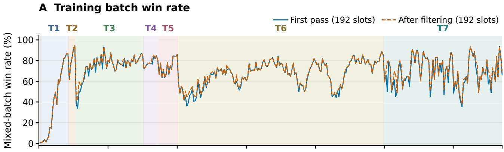

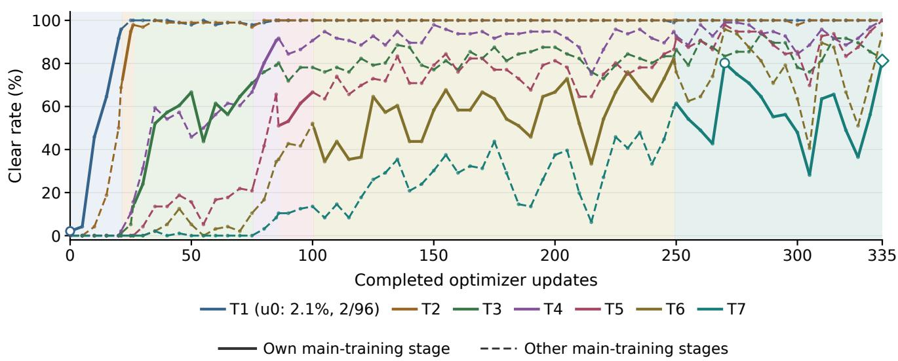  
Figure 1: Primitive ASCII learning, selected window through 335. A: mixed-start training batch clear rates before and afte filtering (192 slots each); B: normal-start validation. Backgrounds identify the main training tier; validation lines are solid within their own main stage and dashed otherwise, not indicating absence of rehearsal. Circle: 270; diamond: 335, the highest final-stage count among 90 retained checks. Training continued to 430; the last complete validation at 425 was 60/96. Later fluctuations and distinct start protocols are retained in Appendix M.

These measurements make the training-start pitfall opera- tional. A high win fraction should be read with the source- game coverage and the collection stage at which it is com- puted, while the intended normal-start task keeps its own validation measure. Simply refreshing state identifiers or re- porting accepted samples does not answer whether the pol- icy has learned to complete more whole games. The exist- ing records establish this measurement distinction without identifying bank concentration or filtering as the cause of a particular validation decline. Detailed cohort counts remain in Appendix M.

## 4.3 Perception accuracy depends on the measurement setting

A later frozen-model audit reuses the original training prompt and visible-pixel labels on 24 distinct screenshots: six tempo- ral samples from each of four episodes on one canonical map. Greedy raw generation transcribes 24/24 exactly, while three samples per image at temperature 0.7 are exact on 69/72; all outputs have valid strict JSON/spacing. Repeating one ini- tial image ten times yields identical correct text and tokens, a stability check rather than ten independent images. These counts do not establish unseen-layout generalisation.

During three separate 0-extra-life 64-action diagnostic windows, the hybrid reader makes 20 full-map queries (18 exact) and 138 actor queries (131 exact visible actor sets). Pac-Man is exact on all 138 actor queries; the remaining er- rors concern ghosts. Only 158 actions are executed because one episode dies at action 30. These are correlated observa- tion records, not 158 independent games or full-game success rates. The map errors each replace an occluded unknown cell with asserted empty floor, showing why valid formatting is insuficient. Static and closed-loop panels difer in images, decoding and query type and are not a before/after compar- ison. Checking alignment with the trained prompt/schema helps diagnose interface mismatch; it does not certify reli- able state tracking throughout play.

Table 3: Separate perception tasks and denominators. The first three rows reuse the same 24-image bank; the last two come from three short game windows. No row measures game clear rate.
<table><tr><td>Query panel</td><td>Valid</td><td>Exact</td></tr><tr><td>Raw greedy, 24 images</td><td>24/24</td><td>24/24</td></tr><tr><td>Raw sampled, three per image</td><td>72/72</td><td>69/72</td></tr><tr><td>Initial-image greedy repeats</td><td>10/10</td><td>10/10</td></tr><tr><td>Periodic full-map queries</td><td>20/20</td><td>18/20</td></tr><tr><td>Actor queries</td><td>138/138</td><td>131/138</td></tr></table>

Table 3 separates response validity from exact visible-state content. A valid answer obeys the output contract; exactness additionally requires agreement with the visible-pixel labels, including unknown cells. The same image bank supplies the first three rows, so 72 samples and ten repeated decodes do not provide 82 additional layouts. Correct Pac-Man locations on all 138 actor queries also do not certify complete actor readings: the exact visible-actor sets number 131. These dis- tinctions matter when selecting a diagnostic target.

In the static sampled outputs, 37,797 of 37,800 cells are correct, yet three complete-map answers are wrong. The ob- served errors include boundary walls read as empty and a ghost read as the house door. An almost perfect cell average can therefore conceal an incorrect board-level interpretation. Conversely, repeated greedy agreement measures decoding consistency on the same image, not success over changing observations.

The relevant distinction is between recognizing the visible scene and producing a response that the decision interface can use. A correct static map is evidence about that image and decoding condition. It does not show that later actor observations, occlusions or output formatting will remain reliable. Conversely, malformed output need not mean that every underlying visual judgment was wrong. These obser-vations motivate se arate checks of visible- ixel semantics and the actual prompt/parser contract before interpreting a game failure as a policy-learning problem.

This is why we evaluate perception separately from the ASCII learning curve. The screenshot records locate con- crete reading problems; the textual policy records ask what happens when image transcription is removed. Neither sub- stitutes for evaluating a complete screenshot-driven policy on the intended games.

## 4.4 Further optimization can coincide with worse decisions

A separate primitive-action ASCII lineage falls from 59/96 validation clears at an early checkpoint to 37/96 later in training on the same 96-attempt panel. Thirty matched re- gression cases were replayed; retained cases include imme- diately lethal choices while an exit is available, or earlier choices that enter a ghost pincer before the final loss of options. An available exit does not prove a safe complete escape, and these cases do not identify one cause of the re- gression. The independent historical records and checkpoint conditions are retained in Appendix P.6.

ASCII removes image transcription, but not state inter- pretation or long-horizon decision dificulty. The observed regression therefore motivates checks of action choices and the learning objective even when pixels are absent. It does not establish that RL is generally harmful or that any particular reward or credit-assignment mechanism caused the decline.

For the independent ASCII regression, the useful next check is therefore not another static-image test. One must examine which alternatives were available at the decision, whether the policy assigns them diferent probabilities, and whether the training objective distinguishes the resulting out-comes. The existing cases motivate these checks but do not identify terminal-reward credit assignment, filtering or pol- icy drift as the cause. They connect an aggregate decline to concrete action errors without turning a local replay into proof of a complete-game repair.

Primitive decisions have both immediate and delayed con- sequences. The small action vocabulary helps separate two questions that a completion score combines. First, can the policy choose a direction that is open in the current obser- vation? Second, can a sequence of such choices complete the remaining game? Masking closed directions addresses the first question, not the second. A locally available move can lead toward a threat or leave fewer alternatives later. The replayed regression cases illustrate this temporal distinction: some losses concern the final choice, while others are pre- ceded by entry into a pincer. Counting only the final invalid or lethal move would miss the earlier decision that changed the available options.

The learning signal also spans that sequence. The episode- based surrogate in Section 3.3 weights sampled decisions us- ing the episode advantage; a binary completion count sum- marizes the final outcome. Neither quantity is a direct label of the quality of every intermediate direction. The worked grouping example shows why the population used to compare returns matters even when one early action is unchanged. It supplies a reason to inspect how returns become advantages before changing the policy objective, rather than assuming that a larger training win fraction means that every relevant action has improved.

Use the two curves to locate the next decision question. The training and validation panels make this distinction ob- servable at diferent scales. Training records describe per- formance on the situations presented to the learner, includ- ing short remaining objectives; normal-start validation asks whether the policy can reach completion through the full se- quence of decisions. A successful sufix demonstrates useful behavior from its sampled state, but leaves the earlier route to that state untested. This is why the remaining-objective table and source-coverage counts accompany the learning curve: they explain what part of the task a training win actually exercises.

## 5 Supported Post-training Pitfalls

The findings suggest how to choose the next measurement or training change.

Check what is being learned. The reading and action re- sults answer diferent questions. Static-image accuracy tests a component under a specified prompt and decoding condi- tion; normal-start game completion tests the consequences of many decisions. When interactive reading is wrong, addi- tional policy optimization need not address that error. When decisions regress on ASCII, better pixel reading alone cannot explain or repair the observation. A useful evaluation there- fore tests the suspect component and then measures whether its change improves the intended game outcome.

Check what a win represents. Restart training deliber- ately changes the problem presented to the learner. It can expose useful situations, but a win near the end of a game is not interchangeable with a win from the initial state. The all-win batch and its concentrated source states make this distinction concrete. Reporting first-pass outcomes along- side accepted batches helps separate sampling from filter- ing; retaining normal-start validation prevents a change in the training metric from silently becoming a claim of full- game mastery.

Check what survives continued optimization. The at- tained 80.2% checkpoint is useful evidence of improvement on the retained eight mazes. The later trajectory is equally informative for deciding what to test next: the selected peak, subsequent declines and mixed earlier-stage outcomes show why a single reported score is insuficient. Continued re- hearsal rules out describing these records as retention with- out old-task exposure. Follow-up comparisons should distin- guish checkpoint selection, layout transfer and repeatability across training seeds, rather than collapsing them into one generalization claim.

Use the measurement unit to choose an intervention. A component score and a task score can disagree without ei- ther measurement being wrong. The static reader bank tests descriptions of particular images; the training curve counts success from sampled starts; normal-start validation tests completion from the intended initial condition. For example, repairing an output-format mismatch should first be checked against the corresponding reading contract, then against the downstream outcome it is expected to afect. Improving restart sufixes should be reported as such until normal-start performance changes. The distinction keeps an engineering change testable instead of allowing every score increase to stand for an unspecified improvement in the whole agent.

Separate attained skill from checkpoint selection. Re- peated validation is valuable for detecting regressions, but the best observed checkpoint and the last observed checkpoint answer diferent questions. The former records an attained level on the selection panel; the latter helps assess whether later optimization retained it. The retained trajectory supplies both, and the earlier-stage panels expose changes hidden by a single final-stage average. A future comparison can select a checkpoint on one panel and reserve a separate layout sam- ple for reporting, while repeating training to study variability across seeds. Those measurements would address questions that the current repeated panel cannot settle; they are not pre- requisites for reporting the existing historical improvement accurately.

Limitations and future work. The final two training stages have longer logged updates than earlier stages, while validation can decline during extended training. Logged time combines waiting and training; it is not calendar duration, per-episode cost or inference latency, and it does not increase monotonically by stage. Long-horizon credit assignment and reward design are possible explanations to test, not isolated causes of these declines. The study also lacks independent training-seed replication and a complete historical per-slot map manifest.

Complementary fixed-model runtime-control compar- isons and exploratory assistance records are retained in Ap- pendices H and F.1. They motivate future studies that im- prove policy post-training and runtime support together, us- ing the lessons from both. A combined or autonomous self- improvement gain has not been measured; this is a research direction, not a new algorithmic result.

## 6 Conclusion

Primitive directions do not make long-horizon learning triv- ial. The retained Pac-Man records show an attained normal- start validation improvement, but also fluctuating later perfor- mance, mixed retention under rehearsal, observation-specific reading errors and a separate decision regression. The con- tribution is the measured scope of these perception and post- training pitfalls, with explicit distinctions between records and unresolved mechanisms. Artifact scope is stated in Ap- pendix Q. AI assisted drafting, source inspection, analysis and presentation; the authors retain responsibility for claims and artifacts.

## References

Bajpai, U.; Rückin, J.; Stachniss, C.; and Popović, M. 2025. Uncertainty-Informed Active Perception for Open Vocabulary Object Goal Navigation. arXiv preprint arXiv:2506.13367.

Boutilier, C.; Friedman, N.; and Halpern, J. Y. 1998. Belief Revision with Unreliable Observations. In Proceedings of the Fifteenth National Conference on Artificial Intelligence, 127–134.

Chen, B.; Xu, Z.; Kirmani, S.; Ichter, B.; Driess, D.; Florence, P.; Sadigh, D.; Guibas, L.; and Xia, F. 2024. SpatialVLM: Endowing Vision-Language Models with Spatial Reasoning Capabilities. In Proceedings of the IEEE/CVF Conference on Computer Vision and Pattern Recognition.

Clopper, C. J.; and Pearson, E. S. 1934. The Use of Confi- dence or Fiducial Limits Illustrated in the Case of the Bino- mial. Biometrika, 26(4): 404–413.

Cui, G.; Zhang, Y.; Chen, J.; et al. 2025. The Entropy Mech- anism of Reinforcement Learning for Reasoning Language Models. arXiv preprint arXiv:2505.22617.

Florensa, C.; Held, D.; Wulfmeier, M.; Zhang, M.; and Abbeel, P. 2017. Reverse Curriculum Generation for Re- inforcement Learning. In Proceedings of the 1st Annual Conference on Robot Learning, 482–495.

Gao, M.; Li, Z.; Huang, H.; Zhang, W.; Niu, Y.; Zhou, H.; Li, C.; Li, J.; Tang, S.; and Zhuang, Y. 2026. Beyond the Remem- bered World: Predictive 4D Belief for Persistent Navigation in Evolving Worlds. arXiv preprint arXiv:2609.39166.

Hornung, A.; Wurm, K. M.; Bennewitz, M.; Stachniss, C.; and Burgard, W. 2013. OctoMap: An Eficient Probabilistic 3D Mapping Framework Based on Octrees. Autonomous Robots, 34(3): 189–206.

Hu, E. J.; Shen, Y.; Wallis, P.; Allen-Zhu, Z.; Li, Y.; Wang, S.; Wang, L.; and Chen, W. 2022. LoRA: Low-Rank Adaptation of Large Language Models. In International Conference on Learning Representations.

Hu, L.; Huo, M.; Zhang, Y.; Yu, H.; Xing, E. P.; Stoica, I.; Rosing, T.; Jin, H.; and Zhang, H. 2025. lmgame-Bench: How Good are LLMs at Playing Games? arXiv preprint arXiv:2505.15146.

Ichter, B.; Brohan, A.; Chebotar, Y.; Finn, C.; Hausman, K.; et al. 2023. Do As I Can, Not As I Say: Grounding Language in Robotic Afordances. In Proceedings of The 6th Conference on Robot Learning, volume 205, 287–318.

Lu, R.; Zhou, Y.; Cheng, H.; Meng, J.; and Zheng, W.-S. 2025. monoVLN: Bridging the Observation Gap between Monocular and Panoramic Vision and Language Navigation. In Proceedings of the IEEE/CVF International Conference on Computer Vision, 9477–9486.

Mnih, V.; Kavukcuoglu, K.; Silver, D.; Rusu, A. A.; Veness, J.; Bellemare, M. G.; Graves, A.; Riedmiller, M.; Fidjeland, A. K.; Ostrovski, G.; et al. 2015. Human-Level Control through Deep Reinforcement Learning. Nature, 518(7540): 529–533.

OmniJev. 2026. PlayJev: A Multimodal JEV-Like Model for Small Games (model card). Model card, https://huggingface. co/OmniJev/PlayJev-0.8B.

Paglieri, D.; Cupiał, B.; Coward, S.; Piterbarg, U.; Wolczyk, M.; Khan, A.; Pignatelli, E.; Kuciński, Ł.; Pinto, L.; Fergus, R.; Foerster, J. N.; Parker-Holder, J.; and Rocktäschel, T. 2024. BALROG: Benchmarking Agentic LLM and VLM Reasoning On Games. arXiv preprint arXiv:2411.13543.

Qwen Team. 2026. Qwen3.5: Towards Native Multimodal Agents. Oficial release blog and model card, https://qwen. ai/blog?id=qwen3.5; https://huggingface.co/Qwen/Qwen3. 5-9B.

Rahmanzadehgervi, P.; Bolton, L.; Taesiri, M. R.; and Nguyen, A. T. 2024. Vision Language Models Are Blind: Failing to Translate Detailed Visual Features into Words. arXiv preprint arXiv:2407.06581.

Resnick, C.; Raileanu, R.; Kapoor, S.; Peysakhovich, A.; Cho, K.; and Bruna, J. 2018. Backplay: “Man muss immer umkehren”. arXiv preprint arXiv:1807.06919.

Ross, S.; Gordon, G.; and Bagnell, D. 2011. A Reduction of Imitation Learning and Structured Prediction to No-Regret Online Learning. In Proceedings of the Fourteenth International Conference on Artificial Intelligence and Statistics, volume 15 of Proceedings of Machine Learning Research, 627–635. PMLR.

Shao, Z.; Wang, P.; Zhu, Q.; Xu, R.; Song, J.; Bi, X.; Zhang, H.; Zhang, M.; Li, Y. K.; Wu, Y.; and Guo, D. 2024. DeepSeekMath: Pushing the Limits of Mathemati- cal Reasoning in Open Language Models. arXiv preprint arXiv:2402.03300.

Shi, H.; Li, Z.; Ding, M.; Deng, X.; Wang, Y.; and Nie, L. 2026. NavHarness: Adaptive Goals for Agentic Vision- Language Navigation. arXiv preprint arXiv:2609.39915.

Sun, Y.; and Zhang, Y. 2026. When Memory Lies: An Em- pirical Study of Spatial Memory Staleness in VLM Agents. arXiv preprint arXiv:2608.04574.

Sünderhauf, N.; and Protzel, P. 2012. Switchable Constraints for Robust Pose Graph SLAM. In IEEE/RSJ International Conference on Intelligent Robots and Systems, 1879–1884.

Sutton, R. S.; Precup, D.; and Singh, S. 1999. Between MDPs and Semi-MDPs: A Framework for Temporal Abstraction in Reinforcement Learning. Artificial Intelligence, 112(1–2): 181–211.

Tang, J.; Yang, X.; Zhang, Z.; Wang, Z.; Cheng, Q.; Zhao, H.; Li, M.; Li, W.; Xia, X.; and Pei, J. 2026. Realtime-Bench: Can Frontier Models Solve Real-time Interactive Problems? arXiv preprint arXiv:2610.22155.

Tong, S.; Liu, Z.; Zhai, Y.; Ma, Y.; LeCun, Y.; and Xie, S. 2024. Eyes Wide Shut? Exploring the Visual Shortcomings of Multimodal LLMs. In Proceedings of the IEEE/CVF Conference on Computer Vision and Pattern Recognition, 9568–9578.

van Seijen, H.; Fatemi, M.; Romof, J.; Laroche, R.; Barnes, T.; and Tsang, J. 2017. Hybrid Reward Architecture for Reinforcement Learning. In Advances in Neural Information Processing Systems.

Wang, K.; Zhang, P.; Wang, Z.; Gao, Y.; Li, L.; Wang, Q.; Chen, H.; Wan, C.; Lu, Y.; Yang, Z.; Wang, L.; Krishna, R.; Wu, J.; Fei-Fei, L.; Choi, Y.; and Li, M. 2025. VAGEN:

Reinforcing World Model Reasoning for Multi-Turn VLM Agents. arXiv preprint arXiv:2510.16907.

Yang, J.; Yang, S.; Gupta, A. W.; Han, R.; Fei-Fei, L.; and Xie, S. 2025. Thinking in Space: How Multimodal Large Language Models See, Remember, and Recall Spaces. In Proceedings of the IEEE/CVF Conference on Computer Vision and Pattern Recognition, 10632–10643.

Yu, Q.; Zhang, Z.; Zhu, R.; et al. 2025. DAPO: An Open-Source LLM Reinforcement Learning System at Scale. arXiv preprint arXiv:2503.14476.

## A Reproducibility Notes

The retained evidence ledgers record, where available, the run identifier, source revision, the checkpoint actually loaded by the inference server, evaluation configuration (feedback interface, fallback, image resolution, life budget, hori- zon), seed list, layout identities, and aggregation procedure. Training-time audits are kept separate from held-out evalu- ation. Runs with diferent feedback, fallback, resolution, or extra-life settings are never pooled into one comparison.

## B Training Details

Scope. This section describes historical headline runs. Their remaining provenance gaps are kept explicit; the sep- arately verified action-head and ASCII restart settings are specified in Appendix G and must not be substituted for these runs.

Optimisation. Group-relative policy optimisation (Shao et al. 2024) with a terminal win reward (1 for clearing all reg- ular pellets within 512 decisions without losing a life). Training on 8×H800 GPUs; inference on one GPU per model. These historical records do not recover the group size, learn- ing rate, KL coeficient or per-update rollout budget; verified settings below belong only to their named runs. The histor- ical episode-grouping arithmetic diagnostic is discussed in Section 3.3; it is not an evaluated intervention.

Curriculum. Tiers grow maze size first and ghost count second: 13×13/2 ghosts → 15×15/2 → 15×15/4 → 17×17/4 → 19×21/4 → 21×25/4 (columns × rows). A tier is promoted when the training win rate over a three-batch win- dow passes a threshold (70–80%) with at least 384 episodes on 8 layouts, on two consecutive checks; promotion takes efect after the optimiser update. 13/16 rollout groups come from the current tier and 3/16 review easier tiers. Validation never triggers promotion. In this configuration every episode starts from the initial state. This ordinary-start configuration is separate from the verified failure-state restart continuation in Appendix G; it does not imply that every curriculum run used ordinary starts.

Fit versus generalisation. The pipeline can fit fixed train- ing seeds (training-seed evaluation 83.33%), while the best validation win rate in a separate run was 44.17%; these are diferent evaluation populations and should not be read as one learning curve.

Preventing entropy collapse. We use Clip-Cov (Cui et al. 2025), which detaches the gradient of a small fraction of tokens whose log-probability and advantage have the highest covariance, restricting those selected token gradients; its ef- fect in these runs is not isolated. Historical token fractions, thresholds and matched with/without entropy curves are un- available; no causal benefit is attributed to Clip-Cov. Raising the upper clipping bound (Clip-Higher) and discarding rollout groups with identical rewards (Dynamic Sampling), both from DAPO (Yu et al. 2025), are alternatives that target the same collapse and the zero-signal groups of C3, respectively; we did not use them.

Restart-state provenance. Appendix G details the verified failure-state restart continuation, including pre-death sam- pling and source concentration. Source episodes can eventu- ally succeed; these starts are not uniformly sampled backward from a successful terminal state. A controlled success-versus- distance curve remains unavailable.

## C Engineering Pitfalls

Several failures during development came from the training system rather than from the learning problem. We list them so that others can rule them out early; each result must be tied to its source and checkpoint bindings to identify which fixes were in force. This appendix is a catalogue of engineering issues, not a completed timing audit of every historical result. The per-run revision/fix-status ledger is incomplete.

## Rollout–training consistency (fixed).

• Lost action constraints. A missing cross-process patch dropped the allowed-token list, and in the vLLM v1 en- gine a row swap of the allowed-token mask written as a tuple assignment of tensor views overwrote one row with the other, so a request could sample outside its legal set. Fixed by copying through a cloned bufer.

• Temperature. Rollout and training rescoring used difer-ent temperatures; aligned.

• Multimodal position IDs. The rollout engine’s fused 1D RoPE kernel read only the temporal row of the $3 \times N$ multimodal position IDs, and the training path did not generate per-axis (temporal, height, width) positions for the vision tokens. Fixed with an mRoPE-aware kernel and per-sample position IDs preserved through splitting and packing, verified on full-model action log-probabilities rather than kernel tests alone.

• Recurrent-state leakage. Packing several samples into one FSDP sequence leaked Gated DeltaNet recurrent state across samples. Fixed by running samples separately and accumulating gradients.

## Training-system reliability (fixed).

• CPU ofload device mismatch. With FSDP2 parameter ofload, the vision model read its positional-embedding weight’s device while the shard was still on CPU, created indices on CPU, and then indexed a CUDA weight. Fixed by taking the device from the multimodal input.

• Uneven micro-batches. Token-balanced allocation across data-parallel ranks does not equalise the number of se- quences, so ranks could run diferent numbers of micro- batches and hence diferent numbers of collectives, caus- ing errors or deadlocks. Fixed by padding with zero-loss dummy rows so all ranks pack the same number of rows.

Remaining training–inference mismatch. Enabling prefix-cache reuse in the inference engine increased the gap between rollout and training log-probabilities; we kept it for throughput and did not implement a correction. Smaller numerical diferences also remain from operator implementations and precision (projection results that depend on padded length, convolution and activation outputs, Q/K normalisation, the Gated DeltaNet recurrence, BF16 logit rounding) and from batch composition in the inference engine. These observations concern historical configurations that retained prefix reuse. The audited ASCII restart continuation disables prefix/radix caching and CUDA graphs; no claim about its prefix-cache error follows from those earlier observations. No matched numerical with/without prefix-reuse gap is available for these historical configurations.

## D Harness Details

Options. At each decision the harness ofers up to 4 Col- lect options (C0–C3), 4 Avoid options (A0–A3), and 2 Eliminate options (E0–E1), each mapped to a fixed singleletter code (e.g., B/F/G/H, J/K/M/N, P/Q) whose target changes with the state. After the model picks a code, Route- option harness converts the target into U/D/L/R moves, re-validates the option at every step, and calls the model again when the target is reached, the option becomes invalid, or a step limit is hit.

Information. In the engine-state condition the harness reads Pac-Man and ghost positions and states from the en- gine at every step, so that condition is not purely visual. The verified factorial route gates and shared fallback boundary are specified in Appendix H; the public-memory execution sketch is in Appendix G.1. These descriptions apply to their named versions, not every historical harness.

## E Prompts and Output Schemas

Appendix G.6 supplies the frozen perception wording, parser schema and valid/invalid examples. Decision outputs select one advertised code; exact menu text and renderer remain experiment-specific, so a single reconstructed prompt is not asserted for all historical runs.

## F Additional Results

## F.1 Early single-goal intervention screen

On eight ghost-free single-pellet cases (frozen model, 256 actions), direct play, one reminder and short thinking each completed 4/8; one BFS action followed by student control completed 5/8. Five cases triggered each intervention; all thinking calls used the 256-token cap. BFS rescued one loop; three direct failures remained. This is assisted inference, not learning or full-game performance.

## F.2 External-model baselines

GPT-6 Luna Decisions API runs used 50 seeds, one layout, normal ghosts, no fruit, 0 extra lives and 512 game steps. Na- tive prompts included structured state. Image Route-option harness used refusal fallback and had 3 API refusals; ASCII Route-option harness used risk-ranked fallback and had 1. Failures count as non-clears, without retries. Neither unseen- layout generalisation nor a modality efect is established.

In a separate exploratory Codex CLI run, GPT-6.1 Sol with ASCII and an experimental Route-option harness com- pleted one game (1/1), scoring 11,920 in 386 steps with 129 model calls and no deaths (Table 5). Final normal and power pellet counts were both zero. The original post-game prompt/harness audit error prevented summary export. Of- fline replay with frozen launch sources and recorded choices subsequently matched every prompt, legal choice set and all 387 original frames; trajectory and route audits passed, confirming the terminal condition all\_normal\_pellets. This is a confirmed single-game preliminary result; the sam- ple does not establish a stable win rate.

<table><tr><td>Input</td><td>Agent</td><td>Clears</td><td>Win rate</td><td>Mean score</td></tr><tr><td>Image</td><td>Primitive Route-option</td><td>0/50</td><td>0%</td><td>490.2</td></tr><tr><td>Image</td><td>harness</td><td>10/50</td><td>20%</td><td>5104.5</td></tr><tr><td>ASČII</td><td>Primitive Route-option</td><td>0/50</td><td>0%</td><td>242.6</td></tr><tr><td>ASCII</td><td>harness</td><td>14/50</td><td>28%</td><td>5571.0</td></tr></table>

Table 4: External baseline: GPT-6 Luna via Decisions API; each input includes structured state. Fixed layout, 50 seeds, 0 extra lives, no fruit, 512 game steps. Win rates include API failures as non-clears; mean scores use completed episodes (50, 47, 50, 49). Image Route-option harness uses refusal fallback; ASCII Route-option harness uses risk-ranked fall back.

<table><tr><td>Model / interface</td><td>Clears</td><td>Score</td><td>Game steps</td></tr><tr><td>GPT-6.1 Sol / Codex CLI</td><td>1/1</td><td>11,920</td><td>386</td></tr></table>

Table 5: Preliminary single-game result: ASCII input, ex- perimental Route-option harness, seed 0, low reasoning ef- fort. The game cleared all normal pellets with zero deaths in 129 model calls. Ofline replay with frozen launch sources matched all 387 original frames and passed trajectory and route audits. The 1/1 outcome is not a reliable estimate of population win rate.

Per-seed outcomes and compute are provided where re- tained below; missing historical counts, selection records and stage-specific compute are not reconstructed from other protocols.

## G Experiment-specific Protocols

The experiments below answer diferent questions and re- tain their own training distributions, checkpoints and evalu- ation panels. We distinguish optimizer updates from roll- out batches, training starts from normal-start validation, and an execution seed from a new map. In particular, the fixed-map visual action-head experiment is not a replication of the multi-map ASCII curriculum, and neither supplies an unseen-layout success rate for the complete screenshot- driven system.

## G.1 Visible Inputs and Public-feedback Memory

This subsection describes the later typed-receipt public- feedback variant, not the early events prototype in Figure 6, whose retained feedback has no relative-displacement vector (Appendix P.6). The public-feedback variant starts with one screenshot-based map transcription and then reads visible ac- tors after native actions. It maintains static terrain separately from ordinary pellets, power pellets and actor estimates; writ- ing an actor never overwrites remembered terrain. Coordi- nates are zero-based [row, column], increasing downward and rightward. The initial map must have the prescribed di- mensions and exactly one Pac-Man. The strict parser retains hidden cells as unknown rather than replacing them with engine truth.

After an action, the environment-facing adapter projects a typed public receipt containing the frame number, elapsed logic ticks, self-relative motion, localized pickup events, death, respawn, terminal status and ghost-eaten events. This projection contains no hidden map, ghost coordinates, ghost identities, planned ghost paths, random-number-generator state or private vulnerability timer. A receipt is consumed once and must follow the preceding frame. Pellet contacts update the appropriate set before death/respawn handling. Unlocalized contacts retain uncertainty. Death clears vulner- ability memory; respawn restores the visually observed initial spawn; terminal states clear the current position. Position is otherwise propagated only onto known floor. The public vul- nerability rule supplies an interval based on a 360-logic-tick duration, rather than an exact private timer.

The actor query asks for all visible characters, including partial occlusions, with a Pac-Man coordinate or null and a list of ghost coordinates and states (normal, vulnerable or eyes), sorted by row and column. The parser preserves extra detections and multiplicity. Temporal ghost association min- imizes Manhattan displacement over possible assignments; ambiguous ties remain uncertain. Its per-observation dis- placement bounds are two cells for normal/vulnerable ghosts and four for eyes. These are visual estimates, not persistent engine identities or guaranteed next-step headings. Existing options continue only while their public validity checks hold; a new Agent decision is required when an option is absent or invalidated.

Audit boundary. Privileged engine state is retained by a separate replay auditor. It checks RGB, state/RNG restora- tion, receipts and action-before state, but is not available to the policy or gradient computation. An audit failure blocks the afected training update instead of providing corrective labels. A perception fault is recorded separately with an un- defined game reward; it is not relabeled as a death or an or- dinary zero-reward loss. Exact audited Pac-Man, pellet and clock state does not imply exact ghost perception.

## Public-memory execution sketch.

1. Parse the initial visible map; stop with a perception fault if the contract fails.

2. Read visible actors and update only public memory. Keep ambiguous state unknown.

3. Continue a valid option, or ask the Agent to select among the public legal candidates.

4. Execute the native action; consume the next typed public receipt exactly once.

5. Record the public trajectory. Run the separate private audit before admitting a training group; repeat until native

Table 6: Documented D5A reconstruction recipe. Final planned checkpoints, rather than minimum validation cross- entropy, are selected. These settings do not certify byte iden- tity with the original D5 training data.
<table><tr><td>Setting</td><td>Vision stage</td><td colspan="2">Language stage</td></tr><tr><td>Trainable part</td><td>Encoder merger</td><td colspan="3">and Language only</td></tr><tr><td>Updates / batch</td><td>6,000 / 16</td><td colspan="3">1,000 / 16</td></tr><tr><td>Peak learning rate</td><td> $1 0 ^ { - 5 }$ </td><td colspan="3"> $1 0 ^ { - 4 }$ </td></tr><tr><td>LoRA tion</td><td>configura- Not used</td><td colspan="3">Rank 16, alpha 32</td></tr><tr><td>LoRA dropout/ bias Not used</td><td></td><td colspan="3">0.05 / none</td></tr><tr><td>Optimizer</td><td>AdamW</td><td>AdamW</td><td colspan="2"></td></tr><tr><td>Adam betas</td><td>(0.9,0.999)</td><td></td><td colspan="2">(0.9,0.999)</td></tr><tr><td>Weight decay / clip</td><td>0.01 / 1</td><td>0.01 / 1</td><td colspan="2"></td></tr><tr><td>norm Schedule</td><td>10% warmup, co- 10% warmup, co-</td><td></td><td colspan="2"></td></tr><tr><td></td><td>sine</td><td>sine</td><td colspan="2"></td></tr><tr><td>Final rate multiplier 0.1</td><td></td><td colspan="3">0.1</td></tr></table>

termination or the step cap.

## G.2 D5A Perception SFT and Image Contract

The documented reconstruction recipe uses Qwen3.5-9B and two supervised stages: vision encoder/merger adaptation fol- lowed by language-only LoRA for visual questions. The reconstruction regenerates screenshots and labels from the game; it is not asserted to be byte-identical to the original multi-round D5 dataset. We therefore distinguish this exe- cutable recipe from measurements attached to the original frozen D5A checkpoints.

Native screenshots use 16-pixel cells. The shared image function applies exactly 2× bicubic enlargement, producing 32-pixel cells, with processor limits of 4,096 and 537,600 pixels. The same contract is used for SFT, evaluation and serving, targeting one visual token per board cell for boards up to $\bar { 2 5 } \times \bar { 2 1 }$ . The prompt’s board coordinates remain native grid coordinates after enlargement. The system instruction is “You answer questions about the visible Pacman screen- shot precisely.” The user prompt specifies board dimensions, coordinate axes and symbols: wall, ghost-house door, ordi- nary/power pellets, Pac-Man, three ghost states, empty and hidden cells. It requests JSON only. Hidden labels describe pixel occlusion, including sprites and the HUD; they do not reveal objects behind an occluder. The language-model chat template disables thinking, and cross-entropy is computed only on answer and end-of-sequence tokens; image/prompt and padding tokens are masked.

The vision implementation uses four-way FSDP2, FP32 master parameters and AdamW states, BF16 computation and FP32 gradient reduction. The language stage accumu- lates 16 single-example microbatches on one GPU; all vision parameters and non-language adapters are explicitly frozen after adapter construction. The vision sampling-plan seed is 20261008; the language sampling-plan seed is 20261010. Plan generation and model initialization seeds are distinct fields and should not be conflated. Reconstruction test fam- ilies include two native levels excluded from training and unseen procedural $2 5 \times 2 1$ maps; the size panel covers 18 sizes from $1 1 \times 1 1$ through $2 5 \times 2 1$ . The shipped-map stream panel tests unfiltered map transcription. These VQA/whole-map scores are not full-game win rates.

## G.3 Public-feedback Action-head RL

This experiment freezes the base model, perception and public-feedback harness, and learns only a rank-8, alpha- 8 residual at the output head: $z = z _ { 0 } + ( \alpha / r ) U ( D x )$ . Its 2,019,328 FP32 parameters are initialized with a random down projection and zero up projection, using seed 314159. The adapter is disabled for perception calls. This head adapta- tion is distinct from language LoRA and from the full ASCII policy training below.

The additional-update protocol uses training batches con- taining two execution seeds with four complete native episodes per seed (eight rollouts, 0 extra lives, maximum 512 native steps). The 128 training seeds are 987000– 987127, shufled by a deterministic epoch schedule with seed 30020261029. The experiment uses normal starts on one fixed $2 5 \times 2 1$ layout, four normal ghosts and no fruit; it does not use failure-state restarts. Temperature is 0.7 on the legal action support. There is no replacement/backfill of faulty episodes. Four returns from one seed form an advan- tage group, standardized using the population standard de- viation and $1 0 ^ { - 8 }$ stabilizer. Constant-return groups receive zero advantage and are skipped.

For a valid episode, the run-specific reward is zero without a clear, and on a clear is

$$
R = 1 + 0 . 1 ( 1 - d / 3 ) + 0 . 0 5 ( 1 - s / 5 1 2 ) ,
$$

where d is the death count and s the native step count. Faults have no game reward. This bonus-bearing reward should not be substituted for the binary terminal reward used in other experiments. At most 32 actual Agent decisions per episode are sampled uniformly without replacement for the update. Episodes receive equal weight; each retained decision receives weight $1 / ( N L _ { i } )$ for N retained episodes and $L _ { i }$ selected decisions in episode i.

The loss uses a PPO-style clipped surrogate (clip 0.2) and categorical KL penalty 0.01 to the frozen base, both normal- ized over the same legal support at temperature 0.7. AdamW uses learning rate $5 \times 1 0 ^ { - 4 }$ , betas (0.9, 0.999), epsilon $1 0 ^ { - 8 }$ zero weight decay and gradient-norm clipping at 1. Behavior log probabilities are recomputed before the update with max- imum permitted absolute discrepancy $2 \times \bar { 1 0 } ^ { - 4 }$ . An actual update requires finite, nonzero gradients and a completed optimizer step. The saved Adam counter, parameter hash and exact reload-logit check bind the counted update to its checkpoint; qualification gradients do not count as training.

The continuation protocol allowed up to 300 additional updates after the initial three. The comparison here uses the checkpoint at 20 total actual updates (17 additional), not the planned total of 303. A separate eight-seed monitoring set, 988000–988007, is evaluated in both extra-life settings; seed 989000 is a qualification case. These are separate from the 64-seed comparison panel and are not used to select the reported “last” checkpoint.

Table 7: Fixed-map public-feedback action-head compari- son. “Reads” counts perception calls; deaths count events, so 3-extra-life totals can exceed 64. Each cell contains 64 complete episodes with zero faults.
<table><tr><td>Extra lives</td><td>Updates</td><td>Clears</td><td>Deaths</td><td>Agent</td><td>Reads</td></tr><tr><td>0</td><td>3</td><td>18/64</td><td>43</td><td>6,698</td><td>16,139</td></tr><tr><td>0</td><td>20</td><td>9/64</td><td>49</td><td>6,309</td><td>15,564</td></tr><tr><td>3</td><td>3</td><td>55/64</td><td>101</td><td>10,941</td><td>25,628</td></tr><tr><td>3</td><td>20</td><td>50/64</td><td>109</td><td>10,796</td><td>25,993</td></tr></table>

Paired comparison. The three-update and twenty-update heads use execution seeds 940000–940063, each with 0-extra-life and 3-extra-life play, on the same fixed map and 512-step cap. The internal mode name original\_three\_lives denotes three extra lives plus the current life. A CPU action generator seeded by execu- tion seed plus 10,000,000 supplies a continuous multinomial stream within each episode and is reset for the other arm. State/RNG restoration and the initial screenshot are bound per pair. All 128 new twenty-update episodes passed the re- play audits. Table 7 reports the complete panel; these seeds vary execution, not layouts.

On 0-extra-life pairs, five outcomes improve and four- teen regress; on 3-extra-life pairs, eight improve and thir- teen regress. Exact two-sided paired-discordance tests give $p = 0 . 0 6 3 6$ and $p = 0 . 3 8 3 3$ , respectively. This panel shows no observed benefit from the additional updates; it does not establish universal harm from RL. Aggregate call reduc- tions accompany more deaths. Among pairs that both clear, the twenty-update head uses 46.75 more steps and 5.5 more Agent calls on average in the four 0-extra-life pairs; in the 42 3-extra-life pairs it uses 6.45 more steps and 3.86 fewer Agent calls. These small, conditioned subsets are descriptive rather than an eficiency claim.

The paired clearance changes are −14.1 and −7.8 percent-age points, with conservative 95% bounds $[ - 3 3 . 5 , + 7 . 3 ]$ and $[ - 2 9 . 1 , + 1 4 . 4 ]$ . These conditional fixed-map bounds and their assumptions appear in Appendix L.

## G.4 ASCII Failure-state-restart Continuation

This lineage trains a primitive ASCII policy, not the visual action head. Observations use spaced ASCII maps, actions generate one response token, the prompt cap is 2,048 tokens, temperature is 0.7 and the episode cap is 512 native steps. The run uses the 3-extra-life mode. Each rollout batch has 16 groups of 12 samples (192 episodes), actor microbatch size 2 and global batch size 192. Eight actor GPUs use ten- sor/pipeline/context parallel sizes of one. The visual module is frozen. Adam has constant learning rate $5 \times 1 0 ^ { - 7 }$ , be- tas (0.9, 0.999), zero weight decay, and gradient clipping at 1. Both PPO clipping bounds are 0.05; ClipCov is enabled with bounds 1–5 and ratio 0.002. Explicit KL and entropy coeficients are zero. Success rewards include life and speed bonus coeficients 0.1 and 0.05. BF16 training uses FP32 gra- dient accumulation and softmax; rollout log probabilities are consumed directly. This continuation disables radix/prefix caching and CUDA graphs in its SGLang rollout backend,

## Fixed-map action-head evaluation

(a) 0 extra lives  
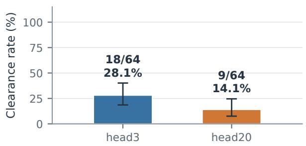

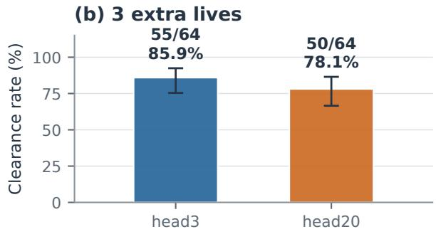

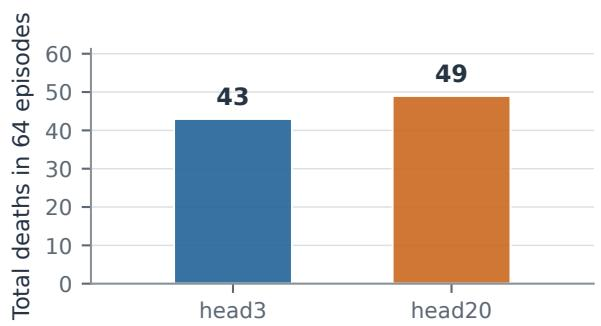

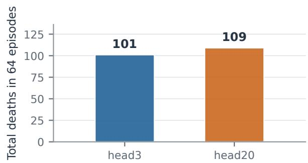  
Error bars: Wilson 95% intervals for clearance rates. No faults in the 128 new episodes.  
Observed outcomes on one layout; not a claim of unseen-layout generalisation or significant decline.

Figure 2: Fixed-map public-feedback comparison: three versus twenty total Adam updates of the action head, with frozen base model and perception. Each extra-life setting uses 64 paired execution seeds and a 512-step cap. Upper panels: clear rates with Wilson 95% intervals. Lower panels: total deaths. All 128 new episodes passed private replay audits. The panel does not establish unseen-layout generalisation or statistically significant degradation.

so a cache-related observation from another run should not be assigned to it.

The frozen curriculum requests 13 current-tier groups and three lower-tier replay groups, with 80% restart requests within each class and fallback to ordinary starts when a suitable state is unavailable. Restart banks contain full simu- lator states sampled before a recorded death, with lookback bins 4–7, 8–15 and 16–32. Source episodes need not ulti- mately lose. The bank evolves during training; it is not a fixed validation set. The continuation restores model, Adam, scheduler, RNGs, curriculum controller and restart bank. For the original resume at 270, a restore parity check matched 672 normal-start validation outcomes/rewards and 5,327 de- cisions across 16 sampled trajectories; that check made no model updates.

The original stopped branch completed 334 actual opti- mizer updates, comprising 270 inherited and 64 continuation updates. Models were saved and normally validated every five updates; checkpoint 330 was that branch’s final com- plete saved/validated model, not checkpoint 334. Its tier-7 normal-start result is 54/96 versus 77/96 at checkpoint 270.

The 96 validation episodes use eight disjoint held-out tier-7 maps, identifiers 0032–0039, with twelve samples per map. They do not draw initial states from the restart bank.

In that original branch, the mixed-start training batch at completed-update label 333 wins 192/192 first-pass episodes. Appendix M gives its start-state composition, remaining-objective dificulty, weight-version boundary and the separate bank-turnover audit, alongside the original T8 evaluations. These training successes do not certify normal- start generalisation or identify a causal restart efect. The later extension restored 330 rather than inheriting the old un- saved 331–334 updates; its separate validation through 425 and saved-but-not-fully-validated checkpoint 430 appear in Appendix M.1.

## G.5 External Model-call Baselines

The GPT-6 Luna Decisions API baseline replaces the model- call boundary while retaining the corresponding primitive or Route-option harness, native environment and 512-step cap. Fifty execution seeds (0–49), normal ghosts, no fruit and 0-extra-life play are used. The screenshot primitive baseline clears 0/50, screenshot Route-option harness 10/50, ASCII primitive 0/50 and ASCII Route-option harness 14/50. The reported mean scores are 490.2, 5,104.5, 242.6 and 5,571.0, respectively; Route-option harness means use only the 47 and 49 completed score records, whereas clear fractions re- tain all 50 attempts, including three and one API refusals. Screenshot and ASCII Route-option harness runs also use diferent refusal/fallback settings, so this is not an isolated causal comparison of observation modality.

The GPT-6.1 Sol Codex CLI result is a separate single- game preliminary demonstration: one confirmed clear in one attempt, score 11,920, 386 native steps, 129 model calls and zero deaths. The final replay has no ordinary pellets remain- ing, which satisfies the native clear condition; collecting all power pellets is not required. Its ASCII experimental Route- option harness interface, execution seed 0 and low-reasoning configuration difer from the fixed 50- and 64-seed panels. We therefore report $1 / 1$ with its count and preliminary sta- tus, rather than estimating population success from one game. Replay-audit errors are interpreted by the field they invali- date; they do not overturn a clear established by the original terminal state and pellet record.

## G.6 Frozen Perception Prompts and MinimalOutputs

The following wording is recovered from the label mod- ule explicitly hash-checked by the frozen screenshot run- ner and the public actor reader. The local reconstruction contains the same label-module bytes. This equality estab- lishes the prompt contract, not equality of the original and reconstructed datasets. The system message is the instruc- tion quoted in Section G.2. The user message consists of one image followed by the common prefix below and one task sufix. Line wrapping here is for presentation.

The image is a 25-row by 21-column board of 16-pixel cells, starting at image top-left. Grid coordinates are 0-based [row,col], row downward, col rightward. Pixel coordinates [x,y] are absolute image pixels, never grid coordinates. Symbols: # wall tile, - red ghost-house door, . visible small pellet, o visible power pellet, P Pacman, G normal ghost, V vulnera- ble blue/white ghost, E eyes-only ghost, \_ empty. A character is written at the cell holding most of its visible sprite; if two characters share a cell, write the one you see on top. ? means hidden: something drawn over the cell (a character, fruit, score text or the bottom score/lives bar) covers it so its contents cannot be seen. A blinking power pellet absent in this frame is empty. Portals look empty. Empty cells are under- scores; spaces only separate cells. Return only the requested JSON, without explanation.

## Initial-map sufix.

Transcribe this entire visible board. Output exactly {“rows”:[25 strings]}, each string exactly 21 symbols sepa-rated by single spaces. No indices.

The quotation marks above denote ordinary JSON double quotes. The decoder generates greedily, with a 2,048-new- token cap, and requires an end-of-sequence token. The inpu cap is 4,096 tokens. The parser accepts only the key rows; a full-board answer must contain exactly 25 strings, each of length 41 with exactly one ASCII space between adjacent symbols. Only #-.o\_PGVE? is accepted. A compact row such as ### fails even if its intended symbols are recogniz-able.

## Actor sufix.

Locate all visible characters, including any partly hidden behind another. Schema: {“pacman\_rc”:[row,col] or null,“ghosts”:[{“rc”:[row,col],“state”:“normal|vulnerable| eyes”}]}; ghosts sorted by row then col.

Minimal illustrative JSON follows; the three-by-three map demonstrates serialization only, using the parser’s dimension arguments set to three. It is not a reduced evaluation board or a measured perception result.

$$
\begin{array} { r l } { \{ \ " \} \Sigma \circ \mathsf { w s } ^ { \boldsymbol { \mathsf { w } } } \colon [ \mathsf { \ " { \boldsymbol { \mathsf { u } } } } \oplus \mathsf { \# } } & { \sharp \mathsf { \# } ^ { \boldsymbol { \mathsf { u } } } , } \\ { \mathsf { \ " { \boldsymbol { \mathsf { u } } } } \oplus \mathsf { \mathsf { P } } } & { \cdot \mathsf { \ " { \boldsymbol { \mathsf { u } } } } ^ { \prime } , } \\ { \mathsf { \ " { \boldsymbol { \mathsf { u } } } } \oplus \mathsf { \mathsf { o } } } & { \sharp \mathsf { \ " { \boldsymbol { \mathsf { u } } } } ^ { \prime } ] \} } \end{array}
$$

$$
\begin{array} { r l } & { \{ \mathfrak {" } \} \mathtt { p a c m a n \_ r c c " } : [ 1 , 1 ] , \mathfrak { " } \mathtt { g h o s t s " } : [ } \\ & { \{ \mathfrak {" } \} \mathtt { r c c " } : [ 1 , 2 ] , \mathfrak { " } \mathfrak { s t a t e " } : \mathfrak {" } \mathfrak { n o r m a l " } \} ] \ \mathtt { j } } \end{array}
$$

An unspaced map, additional engine-state keys, an out-of- board actor coordinate, or an unrecognized ghost-state string is invalid. The minimal actor example omits invisible charac- ters; the public parser does not insert ghosts to meet the public expected count. For Agent decisions, the output is a single advertised code token rather than JSON. If the actual support advertises B and F, output B is admissible, whereas explanatory text or a code outside that support is not. The code-to- option assignment is generated per menu. The frozen histor- ical decision wrapper preserves fixed-text/image/dynamic- text order, substitutes “screenshot-derived estimates” for “au- thoritative state” in visual play, and appends the public uncer- tainty notice. A complete decision prompt must additionally bind its exact renderer, state and candidate list; we do not present one modern menu as the prompt for every historical experiment.

## G.7 Fault Isolation Before Further Training

The initial-map repair diagnostic contains six failure-log en- tries but only two distinct RGB images. Greedy decoding and four stochastic samples (temperatures 0.2, 0.2, 0.7, 0.7) recover neither image: first-valid and ensemble recovery are both 0/2. Six training-image controls are exact in both con- ditions, while their total decoding time rises from 88.83 to 445.75 seconds. These controls test decoding behavior, not unseen-map accuracy. In eight matched native short-horizon episodes, failed initial maps stop before any action with a perception fault and undefined reward. The controls execute eight steps without death; this is not a full-game win-rate comparison.

A separate language-LoRA isolation sweep records 117 observations: 109 format-valid exact outputs and eight mal- formed outputs, with no format-valid semantic error in that sample. RGB deduplication leaves 32 distinct images, includ- ing two associated with the malformed outputs. The planned 144 observations were not all collected. The 0-extra-life and 3-extra-life jobs each stopped after 125/144 planned roll-out records and eight faults, before any optimizer update. These are qualification failures with zero learning updates, not learning curves or trained-policy success estimates.

## H Harness Factorial: Protocol and Model Dependence

This completed historical panel contains 1,024 episodes: two fixed models, two extra-life settings, four arms and 64 execu- tion seeds (940000–940063) per cell. It uses one canonical 25×21 map, four normal ghosts, no fruit, temperature 0.7 and a 512-native-step limit. Sampling uses a CPU multinomial stream seeded by execution seed plus 10,000,000 and reset for each arm. The 768 newly collected historical episodes are combined with 256 accepted exact-latest episodes; four real-model parity episodes validate reuse. Re-aggregation checks complete per-cell seed coverage, outcome semantics and matched initial images across 128 extra-life/seed groups. This manuscript update collects no new episodes.

What changes. B0 maintains the selected target, recom- putes its route after every move, and caps commitment at 8/3/6 moves for Collect/Avoid/Eliminate (one for fallback). B1 binds the selected route and continues its recorded se- quence until completion, invalidation or safety interruption. Consequently B changes both execution commitment and the timing of subsequent model calls. S0 applies historical per-strategy route acceptance and continuation gates; S1 ap- plies a two-move motion-envelope check and a near-target escape guard. For Collect targets within two moves, the lat- ter searches up to four additional moves for an escape to a junction and checks the resulting path. These are bounded checks, not a full-route safety guarantee.

What stays fixed. All arms use the same geometric multi- route Collect proposals, the same native Avoid/Eliminate proposals with their existing pre-screen, candidate ordering, visit penalty, route summaries, public-kinematics risk-ranked fallback and escape hints. S therefore isolates route eligibil- ity/continuation conditional on this scafold; it does not re- move every source of candidate screening. B0S0 is not the original Route-option harness planner. B0 prompts truthfully describe target replanning; B1 prompts describe bound exe- cution. The original-plus-risk bridge is a separate reference, not another factorial arm.

Table 8: Complete fixed-map factorial. Each entry gives clears/64; death events appear in parentheses. B0: target re- planning; B1: bound route. S0/S1: historical/improved route gates.
<table><tr><td>Model</td><td>Arm</td><td>0 extra lives</td><td>3 extra lives</td></tr><tr><td>Qwen</td><td>BOSO</td><td>2/64 (44)</td><td>17/64 (114)</td></tr><tr><td>Qwen Qwen</td><td>B0S1 B1S0</td><td>11/64 (35) 3/64 (50)</td><td>37/64 (49) 27/64 (113)</td></tr><tr><td>Qwen</td><td>B1S1</td><td>9/64 (34)</td><td>37/64 (58)</td></tr><tr><td>D5A</td><td>BOSO</td><td>7/64 (46)</td><td>40/64 (92)</td></tr><tr><td>D5A D5A</td><td>B0S1 B1S0</td><td>18/64 (35) 9/64 (52)</td><td>59/64 (55) 39/64 (108)</td></tr></table>

Under S1, binding changes unadapted Qwen clears from 11 to 9 (0 extra lives) and 37 to 37 (3 extra lives), compared with 18 to 27 and 59 to 62 for D5A. On paired episodes

that both arms clear, mean calls decrease by 43.67/46.40 for Qwen and 47.88/26.91 for D5A (0/3 extra lives). The matched-success subsets have $n = 3$ and 20 for Qwen, and n = 8 and 57 for D5A, for 0 and 3 extra lives respectively. 3- extra-life deaths nevertheless rise from 49 to 58 for Qwen and 55 to 57 for D5A. Matched-success call costs are conditional descriptive statistics; they do not establish a population-wide eficiency advantage or general safety improvement.

## I Independent Checkpoint Evaluation and Latency

This historical diagnostic profile independently loads the base Qwen3.5-9B and three saved RL checkpoints (19, 48 and 49 completed updates). It evaluates five conditions, in-cluding a separate direct-action base condition, with twelve games each: four execution seeds 4000–4003, three genera- tion seeds per seed (180918–180929), one fixed maze, nor-mal ghosts, 0-extra-life termination and a 512-environment- step cap. The model receives real images, generates one legal token, uses temperature 0.7/top-p 1 and disables thinking. Route-option harness conditions retain the saved screenshot- plus-structured-live-state/history interface and refusal fall- back. Direct versus Route-option harness therefore changes both information and control; it is not an isolated options- only intervention.

The checkpoint named best by the historical run was se- lected by training task-reward average, not held-out win rate. The selected update-19 training batch won 22/48 before the optimizer update that produced that checkpoint. Updates 48 and 49 had 12/48 and 10/48 training wins. Those batches can use diferent sampled outcomes and must not be read as independent post-checkpoint evaluation or paired checkpoint efects. They do not establish the provenance of the separate 55.17% headline row.

Table 9: Independent profile outcomes, twelve attempts per condition. Refusals are harness safety stops, not service er- rors; they count as non-clears. No completed model evalu- ation is silently dropped. Here harness denotes the Route- option harness; base identifies the base model and update labels identify the saved RL checkpoints.
<table><tr><td>Condition</td><td>Clears</td><td>Deaths</td><td>Refusals</td><td>Limit</td></tr><tr><td>Direct base</td><td>0</td><td>12</td><td>0</td><td>0</td></tr><tr><td>Base + harness</td><td>4</td><td>0</td><td>7</td><td>1</td></tr><tr><td>RL update 19 + harness</td><td>3</td><td>1</td><td>8</td><td>0</td></tr><tr><td>RL update 48 + harness</td><td>3</td><td>0</td><td>9</td><td>0</td></tr><tr><td>RL update 49 + harness</td><td>2</td><td>0</td><td>8</td><td>2</td></tr></table>

The update numbers in this profile belong to a diferent training lineage from the later frozen-base D5A action-head experiment. Update 19 here is not the predecessor of head20.

Serving and timing. Each model uses one H800 80GB GPU, TP=1, BF16, vLLM 0.22.1/MRv1 eager execution, 1,024-token context and one concurrent request per service; prefix and multimodal processor caching are disabled. Eight warmup requests precede each seed block and are excluded.

These are historical measurement resources, not GPUs used to prepare this manuscript.

The timing protocol is stated explicitly for comparison with timing-sensitive game evaluations (Tang et al. 2026). During these evaluations, the game clock waits for model inference and advances when actions execute.

Mean one-token request time is 115.04 ms for direct base and 114.60 ms for the base model with the Route-option harness, including image processing, prefill, generation and server-local HTTP. Observation-return-to-action-start means are 169.11 and 271.12 ms. The base model with the Route- option harness executes 2,433 actions over 1,330 decisions (1.829 actions/decision), spreading its decision cost across multiple actions and yielding the approximately 148 ms amortized decision pause reported in Appendix P.6. These mean timings quantify sub-second request and decision costs, with lower amortized decision pause in the options condition. The decision-pause interval covers harness preparation and the model call; game advancement/rendering inside the en- vironment call, option reuse, model startup/warmup and the Windows-to-server network round trip lie outside it. Full step wall time was not measured. A separate 64-request identical- image/prompt bank is replayed on all four model identities to profile serving diferences.

Record recovery and re-audit. Four first-seed blocks had completed trajectories and requests but missing wrapper-written summaries. They were reconstructed from the origi- nal matched trials, with source hashes, and not rerun or ex- cluded. This manuscript re-aggregates the preserved archive: 60 distinct trial pairs, native pellet/event confirmation of ev- ery clear, trajectory/request-ID agreement, one-token image payload checks and warmup separation. All numerical sum- maries match the saved report; only operating-system path separators in recovery metadata are normalized. This audit makes no new model request. The small correlated fixed-map sample does not establish a stable ranking among check- points.

## I.1 Legacy Exploratory Percentages

The original project presentation reported the percentages in Table 10 as a 20-seed by 12-sample panel. The presentation is a secondary source, not the underlying trial ledger. The retained denominator and source checkpoint of the RL row have not been recovered in this audit. In particular, 55.17% is not a realizable integer clear fraction out of 240 rounded to two decimal places. We preserve this table for provenance and review, but exclude it from the paper’s independently verified evidence for an RL gain. Its claimed best-validation selection must not be conflated with the training-reward selection of update 19 in the separate profile above.

Original stopped branch records. The original branch completed 334 training updates, including 270 inherited up- dates; its last complete saved model and validation were at 330 (T7: 54/96), versus 77/96 at 270. Its batch 333 cleared 192/192 mixed-start attempts. The separate normal-start T8 panels at 270 and 310 both remain 0/96 (Table 12). These records are retained independently of the extension restored from 330: Figure 1 shows the shared prefix and selected post- restore window, not the old branch’s unsaved 331–334 tail. The original plot file is retained for provenance.

<table><tr><td>Condition</td><td>Win rate</td></tr><tr><td>Base model, primitive moves (U/D/L/R)</td><td>0%</td></tr><tr><td>Base model selects harness options</td><td>22.92%</td></tr><tr><td>RL model selects harness options</td><td>55.17%</td></tr></table>

Table 10: Historical exploratory panel, reported as matched layouts, seeds and temperature with 20 seeds × 12 samples per condition. The RL row’s retained denominator has not yet been recovered; 55.17% must not be converted to a win count out of 240 or treated as an independently re-audited im- provement estimate. A win clears all regular pellets within 512 decisions without losing a life. The presentation de- scribes the RL model as the best validation checkpoint; that binding remains unverified. The legacy RL denominator and checkpoint provenance remain unresolved; no count or inter- val is inferred from that percentage.

## J Perception Panels and the Unit of Evidence

## J.1 Archived-prompt Raw-generation Audit

The frozen initial D5+LoRA A model is tested on 24 unique RGB screenshots from four pre-fixed execution seeds, 972001–972004, on the same $2 5 \times 2 1$ map. Six approxi- mately equally spaced temporal quantiles are selected per episode from a 16-action sampling grid, before inspecting model outputs. The images span 192 to two ordinary pellets remaining, with vulnerable/eyes sprites, overlap and HUD occlusion. They are new recorded views of a familiar layout, not 24 held-out layouts. The connected-rounded renderer is bound for this panel; byte identity with all original training appearances is not asserted.

Visible-pixel labels are computed on native 336×400 RGB before the shared 2× bicubic enlargement. Private targets never enter the model prompt. The original full-map ques- tion and strict single-space JSON contract are used without GridGrammar or cell repair. Each image receives one greedy output and three temperature-0.7 samples; one initial image also receives ten extra greedy repetitions. All 106 outputs terminate with EOS. Re-scoring each saved raw text with the bound label module reproduces every stored score, and its prompt/input-image hashes match the frame manifest.

Table 3 in the main text collects these static and interactive measurement units.

The three sampled errors are two boundary walls tran- scribed as empty and a visible ghost transcribed as the ghost- house door: 37,797/37,800 cells are correct. Per-cell majority over the three sampled outputs is exact on all 24 images, but uses the same bank and extra calls; it is not an independent reliability test. The ten initial greedy outputs have one dis- tinct text and token sequence. Repeated determinism is not additional layout coverage.

## J.2 Hybrid Closed-loop Observation Audit

The separate three-seed 0-extra-life audit uses seeds 984001– 984003, a 64-action window and the same fixed-map family. The hybrid reader asks for a full map initially and every eight actions, and actors between; actual executed lengths are 64, 30 and 64. Re-summing all 158 per-observation audit records gives Table 3: 18/20 exact maps, 131/138 exact visible-ghost multisets, 138/138 exact Pac-Man positions and 137/138 cor- rect ghost counts. Two map errors replace a hidden cell with asserted empty floor. Occluded unknown cells do not count as newly verified terrain. The two surviving windows are not two full-game clears, and the premature death changes aggregate call/step totals.

## J.3 Historical References Kept Separate

The documented D5 reconstruction README reports schema-constrained map scores for the original model lin- eage: stream 401/531 to 427/531 after language LoRA; un- seen family 50/64 to 51/64; unseen sizes 182/216 to 189/216. These are historical reference scores, not measurements re- generated by the reconstruction and not the raw-generation bank above. The original multi-round training data are not recovered byte-for-byte.

An earlier fixed-size project study reports staged fulllanguage SFT at 16/16 versus joint full-model SFT at 0/16 on its unseen family. A separate data study reports exact VQA-answer counts 161 to 297, and an anchoring experiment mix- ing 25% hard decision targets reports action entropy 0.85 to 0.06. A 765-decision-prompt fixture reports KL(before LoRA ∥ after LoRA) of 0.011. These supporting figures cur-rently have presentation/documentation provenance rather than a fully reconstructed trial ledger in this audit. They do not establish memorisation location, RL exploration gains or convergence improvements, and the fixed-size full-language result must not be attributed to the final multi-size LoRA checkpoint.

## K Frozen Native Rules and Time Accounting

This code audit applies to the paired engine/public-feedback panel and head3/head20 panel whose protocols bind game- source SHA-256 b087d6563cd2589c8. . . . The de-ployed game file was retrieved read-only and its complete byte hash matches both protocol records. The associated frozen environment wrapper and worker were also read with- out running the game. This is the project’s native Pac-Man implementation, not a claim of arcade-ROM or Atari rule- set fidelity. Earlier experiment generations and the ASCII curriculum retain their own source bindings.

Clear, lives and collectibles. A level clears when the ordinary-pellet counter reaches zero and emits the native clear event. Power pellets are not required for this termi- nal condition. In the bound implementation, ordinary pel- lets award ten raw score points and power pellets 100; this raw game score is distinct from an experiment’s learning re- ward. Power pickup sets a 360-active-logic-tick vulnerability timer, without consuming a tick immediately on the contact frame. The public-feedback policy tracks a rule-derived in- terval rather than reading the hidden timer. Fruit is disabled in these panels. 0-extra-life episodes stop at the first death; the 3-extra-life setting permits three spares in addition to the current life. A raw HUD spare counter must not override the 0-extra-life contract.

Native ghost and portal behavior. Normal ghosts ini- tially receive paths to randomly selected ordinary-pellet cells. When a path finishes, native pathfinding targets Pac-Man; this is not an asserted recreation of four arcade ghost person- alities. In this renderer, normal-ghost pupils point according to Pac-Man’s relative position rather than the ghost velocity, so eye direction is not a direct velocity observation. Normal ghosts outside the house cannot re-enter through its door. Eaten ghosts return as eyes to the pen and then leave again. The horizontal/vertical portal handler relocates Pac-Man be- tween paired map tiles, with a direction-dependent exit of- set. That player handler does not establish that ghosts share the same teleport rule. Safety predictions are conditional on the observed/declared graph and bounded motion model; an unknown portal destination is not a certified safe endpoint.

Actions, logic ticks and model calls. The wrapper’s nom- inal movement budget is sixteen logic frames per environ- ment action, not sixteen model decisions. Native terminal states can end an action early; death/respawn handling can in- stead continue until the corresponding transition completes, so the recorded atomic-frame count is authoritative. A 512- step episode cap counts environment actions. A bound option can execute several such actions after one Agent selection, while a visual-feedback action may additionally require a per- ception query. Logic ticks, environment steps, Agent calls, perception calls and wall-clock latency are therefore distinct quantities. Model inference pauses game advancement. No result in this paper is a wall-clock interactive benchmark.

## L Statistical Units and Paired Uncertainty

The observed fraction in a completed panel is a descrip- tion of those records. Uncertainty intervals require a sam- pling model. For the action-head comparison we treat the 64 execution-seed pairs within each extra-life setting as indepen- dent draws from one fixed-map execution distribution, with both checkpoints fixed. The interval does not cover new lay- outs, independent training runs, protocol changes or model selection. These assumptions are an inferential idealization of the seed panel, not additional experimental replication.

Preserve the pair. Let $Y _ { 0 } , Y _ { 1 } \in \{ 0 , 1 \}$ indicate clearing with three and twenty total updates. Write $p _ { + } = \mathrm { P r } ( Y _ { 0 } =$ $0 , Y _ { 1 } \ = \ 1 )$ and $p _ { - } ~ = ~ \mathrm { P r } ( Y _ { 0 } ~ = ~ 1 , Y _ { 1 } ~ = ~ 0 )$ . Then $\Delta = p _ { + } - p _ { - }$ , estimated by $( n _ { + } - n _ { - } ) / 6 4$ . We construct sep- arate 97.5% exact Clopper–Pearson intervals (Clopper and Pearson 1934) $[ L _ { + } , U _ { + } ]$ and $[ L _ { - } , U _ { - } ]$ for these two within- pair event probabilities, using 64 as each denominator. The diference bound is

$$
[ L _ { + } - U _ { - } , U _ { + } - L _ { - } ] .
$$

By a union bound, its coverage is at least 95% under the stated sampling model, without assuming independence between improvements and regressions. It is conservative. It is a per- setting bound, not simultaneous coverage across both extra- life endpoints. This difers from subtracting marginal Wilson bounds as if the two arms were independent.

Table 11: Paired clearance diference: twenty minus three updates. Units are percentage points; bounds are rounded. Each row uses 64 pairs on one fixed layout.
<table><tr><td></td><td></td><td>Extra lives Observed change Conservative 95% bound</td></tr><tr><td>0</td><td>-14.1</td><td> $[ - 3 3 . 5 , + 7 . 3 ]$ </td></tr><tr><td>3</td><td>-7.8</td><td> $[ - 2 9 . 1 , \dot { + } 1 4 . 4 \dot { ] }$ </td></tr></table>

The 0-extra-life discordances are five improvements and fourteen regressions; 3-extra-life discordances are eight and thirteen. The exact two-sided McNemar test conditions on their totals, giving unadjusted $p \ = \ 0 . 0 6 3 6$ and p = 0.3833. These are exploratory summaries without a multiple-endpoint correction or a confirmatory model-selection claim. Both conservative bounds include zero. The panel documents an observed decline; it does not establish that additional RL is generally harmful.

Other panels use other units. The ASCII normal-start validations repeat policy samples on eight held-out layouts. A cross-layout interval would resample or model layouts, rather than treating all 96 samples as independent layouts. Perception banks contain temporal frames and repeated de- codes, so 106 outputs do not give 106 independent visual scenes. The independent 60-game profile is structured as four execution seeds by three generation seeds per condition on one map. The Codex result remains one preliminary game. We retain their counts and scopes rather than assigning every denominator the same binomial interpretation.

Cost conditioning and reproduction. Calls and steps on pairs that both clear are conditional descriptive statistics. Selecting this subset depends on both policies; it cannot es- tablish population-wide eficiency or a causal cost advan- tage. Across all episodes, early death changes interaction length. The repository includes 128 sanitized seed-matched rows and a standard-library reproduction script. It checks complete seed coverage, discordances, boundary cases and exact-interval values against a published numerical refer- ence; optional plotting uses Matplotlib. Reproduction needs no model server or new episode.

## M Full-T8 Transfer and Restart-distribution Audits

Two independently loaded checkpoints on the original T8 panel. The inherited failure-state-restart checkpoint at 270 completed updates and its continuation at 310 both clear zero of 96 normal-start T8 episodes (Table 12). Each panel includes all eight original held-out T8 layouts, with twelve samples per layout, four normal ghosts, 192 ordi- nary pellets, four power pellets, temperature 0.7 and the original 512-step total budget. The configured life mode is original\_three\_lives. Inputs use spaced ASCII and the lineage’s declared live-state/navigation-history interface; these are primitive-action tests, not the visual action-head or Route-option harness panels. There are no state restarts, prefix-action starts or outcome filtering in either evaluation. The fixed task/replica policy-seed rule is preserved. Bothjobs perform zero optimizer updates and pass their model/RNG restore and trajectory/logger audits. Evaluation used eight GPUs for checkpoint 270 and two for 310; these are resource diferences, not a policy intervention.

<table><tr><td>Checkpoint</td><td>Clears</td><td>Game over</td><td>Time limit</td><td>Decisions</td></tr><tr><td>270</td><td>0/96</td><td>92</td><td>4</td><td>25,066</td></tr><tr><td>310</td><td>0/96</td><td>84</td><td>12</td><td>28,994</td></tr></table>

Table 12: Independent normal-start evaluations on the orig- inal eight-map T8 panel. Every layout yields 0/12 clears at both checkpoints. Decisions are totals from the audited tra- jectories. A shift from game-over to time-limit terminations does not demonstrate improved completion or a causal ben- efit of restart training. The 96 attempts per checkpoint are repeated samples on eight layouts, not 96 independent lay- outs.

The next stage changes topology and objective size as well as maze size: it contains 192 ordinary pellets, compared with 118 in the headline stage. Thus the comparison exposes a task-shift boundary rather than isolating maze size. The termination mix also changes between checkpoints, from 92 game overs and four time limits to 84 and twelve, while completion stays zero. More decisions or a diferent fail- ure termination cannot substitute for the stated completion objective.

This distinction gives the positive result a useful scope. The eight-maze improvement measures performance on doc- umented held-out layouts within one stage; the next-stage result asks whether that capability extends to a diferent task configuration. Reporting both avoids calling every held-out result broad generalization or interpreting a harder zero-score panel as inability to act. Neither the zero counts nor the within-stage gain identifies memorization, a particular cur- riculum cause or a universal efect of RL. The independent evaluation conditions are specified above.

At these checkpoints, separate T7 normal-start validation is 77/96 and 61/96, respectively. We do not pool the two T8 panels into a 192-layout estimate or infer a general efect of reinforcement learning from their zero clears.

Why the all-win training batch is not normal-start mas- tery. In the original stopped branch, the batch labelled 333 completed updates is rollout index 332, sampled with served weight version 63 before that optimizer update. All 192 first- pass attempts win: eleven T7 restart groups (132/132), two T7 ordinary-start groups (24/24), and three lower-tier T2 restart groups (36/36). All sixteen generated groups are accepted in one round, with zero rejected groups; filtering did not create this batch’s 100% binary win rate. Each group uses twelve distinct sampling seeds. Life and speed bonuses can still vary among wins, so binary all-win groups need not have zero reward variance or zero gradient.

Table 2 in the main text gives the retained restart-state objective counts.

The eleven T7 states derive from only two training maps and three source episodes/death windows. All three source episodes eventually clear despite recording deaths: “fail- ure state” denotes a pre-death snapshot, not necessarily a state from an ultimately failed game. Restart sufixes average 117.05 steps (range 9–354), compared with 362.71 (299– 434) for that batch’s T7 ordinary starts; some restarts re-main long. The original total step budget is preserved rather than extended on restart. For that stopped branch, the latest complete normal-start validation is checkpoint 330, served version 61, with 54/96 clears on eight disjoint held-out T7 layouts. Batch 333 uses version 63 and diferent maps/start distributions, so its 192/192 versus 54/96 is not a matched- checkpoint efect or a generalisation-gap estimate. The next batch also separates restart and ordinary-start performance: 114/120 versus 16/36 T7 clears, alongside 36/36 lower-tier clears; its sampled states and weights difer again.

A changing bank can still have concentrated sources. A separate audit covers completed-update labels 271–320, not the entire original 334-update branch. The 64-state T7 bank is completely replaced after 49 of these 50 updates, with mean replacement 99.84375%, but each bank covers only two to five maps and four to twelve source episodes. Across 520 sampled T7 restart-state slots there are 514 distinct state IDs; all 520 slots have no recorded prior outcome in the sampling audit. Fast ID turnover therefore does not imply broad or inde- pendent source coverage. First-pass T7 restart, T7 ordinary- start and lower-tier attempts clear 4,081/6,240, 986/1,560 and 1,685/1,800, respectively. Their initial-state/task distri- butions difer, so these fractions are not treatment–control estimates. Filtering rejects 28 all-loss groups across sixteen updates, while 209 all-win groups remain accepted; its mean efective-minus-first-pass win-rate shift is 1.45 percentage points, with maximum 11.98. This wider filtering efect must be distinguished from batch 333’s zero-rejection result. Neither the bin-level outcomes nor this observational audit sup- plies a controlled restart-distance curve or isolates the cause of later validation changes.

## M.1 A Later Extension Resumed from Checkpoint 330

A later, separately launched extension restores the complete checkpoint 330, rather than the old stopped branch’s unsaved updates 331–334. Its initial seven-panel normal-start valida- tion reproduces the saved 330 aggregate counts, including T7 54/96. Figure 1 in the main text shows this extension through the selected checkpoint 335; the full later valida- tion counts remain below. The extension then completes 100 further optimizer updates, giving checkpoint 430 along this ancestry. The local stop records state that the user ended this extension; the latest complete normal-start validation is 425, not 430. Payloads 335 and 430 are retained, but no complete validation result for 430 is available in these records.

The protocol retains primitive spaced ASCII plus the declared live-state/navigation-history interface, four nor- mal ghosts, 118 ordinary pellets, temperature 0.7, the original 512-step budget and life-mode configuration original\_three\_lives. Each complete validation contains seven panels of 96 attempts, including the eight T7 layouts 0032–0039; normal-start validation is separate from the evolving restart bank. These are new evaluation obser- vations of a continuing model lineage on a repeatedly used validation set, not an independent training-seed replication. The local aggregate query records do not retain per-map win counts, so they cannot supply a layout-level interval.

<table><tr><td>Update</td><td>T7 clears</td><td>Update</td><td>T7 clears</td></tr><tr><td>330 (restored)</td><td>54/96</td><td>380</td><td>29/96</td></tr><tr><td>335</td><td>78/96</td><td>385</td><td>67/96</td></tr><tr><td>340</td><td>76/96</td><td>390</td><td>68/96</td></tr><tr><td>345</td><td>57/96</td><td>395</td><td>73/96</td></tr><tr><td>350</td><td>59/96</td><td>400</td><td>69/96</td></tr><tr><td>355</td><td>39/96</td><td>405</td><td>51/96</td></tr><tr><td>360</td><td>67/96</td><td>410</td><td>53/96</td></tr><tr><td>365</td><td>77/96</td><td>415</td><td>67/96</td></tr><tr><td>370</td><td>52/96</td><td>420</td><td>68/96</td></tr><tr><td>375</td><td>17/96</td><td>425</td><td>60/96</td></tr></table>

Table 13: The resumed-from-330 branch’s complete T7 normal-start validations, shown in two parallel column pairs for space. Each point uses the same eight held-out T7 layouts with twelve samples per layout; it is not a new set of 96 lay- outs. Checkpoint 430 has no complete validation here. The original stopped branch’s 331–334 batches are not spliced into this extension.

The maximum T7 count is 78/96 (81.25%) at 335, selected as the best among nineteen post-resume complete validation checks; this same validation set is used for selection and reporting. It is not an independent test score or established improvement over the earlier 270 result of 77/96. Only 335 and 365 reach 80%, and no adjacent complete validation checks do. The latest complete result 425 is 60/96 (62.5%); T1–T7 wins are 96, 96, 76, 89, 91, 85, 60 out of 96 each. These fluctuations do not establish stable recovery, a general RL efect, or a causal efect of restarting.

Update labels also require a branch identity: the orig- inal stopped branch’s batch 333 is 192/192, whereas the resumed-from-330 branch’s batch 333 is 180/192. The eleven-state/two-map/three-source concentration audit ap- plies only to the former. Likewise, validation 80% is not a curriculum-promotion rule: promotion uses ordinary-start training windows and the configured tier cap is 7. In the cap- tured controller history no T7 event passes, and its largest window contains 216 games, below the required 384. Nei- ther the absence of promotion nor the validation curve alone is a controlled T8 capability test; this extension has no new T8 evaluation in the local records.

Continued rehearsal and mixed earlier-stage validation. The first main T7 update is 250. Re-counting the exported first-pass and efective slots separately gives 156 T7 slots and 36 T1–T6 slots in every 192-slot batch from 250–430: 18.75% earlier-tier rehearsal, totaling 6,516 slots over 181 updates. The two exports overlap and must not be added as independent episodes. Their panel labels identify tiers, not train/validation splits; task, map and split fields are absent from these compact exports. Before 250 no training slot car- ries a T7 label, although its validation at 249 is already 57/96; this is descriptive, not a controlled transfer efect.

Table 1 in the main text gives the complete 249/425 stage counts and their diferences under continued rehearsal. At 375, T3–T7 are 73,70,58,25,17/96. This is mixed retention under continued rehearsal, not preservation without earlier- task exposure or a significance claim. Full per-episode T1–T6 identity pairing is unavailable; the u0/u270 eight-map bind- ings provide stronger endpoint evidence than the aggregate later panels.

Logged time by main training stage. The 430 retained perf/step\_time values sum to 174.974 hours. Their means for T1–T7 are 6.38,12.08,16.01,16.47,19.69,31.39,24.23 minutes per update, over 21,5,49,11,14,149,181 updates. Thus the last two stages have higher logged means than the earlier stages, but T7 is lower than T6. The logging contract is training wait plus training time on the reporting rank, excluding unlogged downtime and standalone evaluation. It is not per-episode cost, inference latency, GPU-hours or total calendar duration. Protocol and runtime changes confound a causal explanation of the timing diference.

Historical curriculum layouts. Figure 3 shows one saved validation example per tier, catalog map 0032. Training catalog maps are 0000–0031; these examples do not de- scribe ever trainin start, includin later re la and failure- state restarts. The dimensions and active ghost counts in- crease across tiers, but the figure is not a controlled size- only comparison. The original metadata retain diferent cat- alog/runtime recipe and backend source annotations, while the displayed geometry and core task/prompt bindings agree. Per-map engine revisions include their map trees; they are not evidence by themselves of changed game behavior. These source distinctions remain in the retained metadata rather than being replaced by a single inferred runtime.

Historical checkpoint comparison. The recovered end- point summaries contain 192 episode rows forming the same 96 (task, replica) pairs: twelve attempts on each of eight held-out T7 layouts. Checkpoint 0, before this policy optimization, cleared 0/96; checkpoint 270 cleared 77/96 (80.2%). Checkpoint 0 is a pre-RL endpoint for this run, not a model without pretraining or earlier supervision. The paired rows agree on layout identity, environment seed, frozen policy-sampling seed, initial prompt identity and ini- tial allowed actions; the supplied first-prompt examples are byte-identical. The source audit records the same normal- start contract: three extra lives, 512 steps, normal ghosts, no restart or action prefix, ASCII primitive actions with open- action masking, one output token, temperature 0.7 and top-p 1.0. The recorded win criterion is clearing all ordinary pel- lets. Later prompts can difer as actions diverge.

The supplied audit reports zero mismatches across 23 con- tract fields. Our independent recheck covers the exported pairing fields and counts, not all 192 full trajectories. The recorded generation\_seed=null is distinct from the frozen policy-sampling context used by validation. In the supplied code excerpts, reward filtering is restricted to train- ing; restored primitive history requires a saved restart and is not tri ered b these normal resets. Trainin curriculum limits changed from tier 8 to 7, and complete recipe/slime source identities difer. Full original training/launch files and the serving stack were not independently replayed. This is a descriptive historical checkpoint comparison, not an iso- lated curriculum efect, stable recovery, multiple-training- seed replication or generalisation beyond this retained panel.

Complete trajectory and selection boundaries. Figure 1 displays a selected window through 335, the highest final- stage count among all 90 retained validation checks, not the final checkpoint. The retained lineage continues to 430, with the last complete check at 425. The complete validation table above retains later checks, including the last complete check at 425; checkpoint 430 has no complete validation. The complete 430-update run records 174.97 logged step- hours; its complete-trajectory source figure is retained in the source files. The earlier stopped branch’s unsaved 331–334 tail is not spliced into this restored lineage. Tier backgrounds denote the main training tier; the recovered catalog examples in Figure 3 do not specify every training episode.

At update 335, T1–T7 normal-start validation counts are respectively 96, 96, 79, 96, 96, 90 and 78 out of 96 each. The separate checkpoint-425 counts remain above. Back- play uses updates 251–270 and failure-state restart uses 271– 430; restart training mixes start conditions, while validation uses normal starts. Lines connect actual chronological mea- surements across protocol and restoration changes, without smoothing, added observations or causal stage attribution. Logged hours sum training wait plus training time, not cal- endar duration or GPU-days.

## N Public-memory Fields, Motion Inputs, and Diagnostic Scope

The following retained panels concern later screenshot- feedback harness variants, not the older 0/64 prototype or the fixed-map action-head comparison. They use frozen D5+LoRA A weights and the source-bound original candi- date, route-binding and risk-ranked routines, with estimated rather than engine-provided motion inputs. They are sepa- rate evaluation and audit records; their episode, frame, ghost and query counts must not be pooled. This editorial audit re- aggregates the saved structured records without new model calls or games.

The public receipt is part of the interface. The re- vised memory protocol reports which pellet was contacted, its relative displacement from the preceding player an- chor, and elapsed logic frames. It processes pickup before death/respawn relocation, leaving uncertain locations un- known. This is stronger than a single Boolean “pellet eaten” event; no absolute landing coordinates, global pellet set or ghost-internal timer is supplied. The memory derives a con- servative frightened-time interval from public power events and elapsed ticks, resetting at death. Ground truth is used only for scoring.

A fixed-action CPU replay covers three earlier trajectories of 64, 173 and 168 actions. The old ordinary-pellet mem- ory difers from truth in 0, 80 and 159 frames; the revised interface and update rule have no pellet-set diferences in these 405 replayed actions, including three pickup-plus-death transitions. All 396 applicable non-death/nonterminal timer checks contain the native value. Seventeen CPU tests pass. This verifies the strengthened receipt/update implementation on those recorded actions, not an isolated memory-rule efect or new policy success: the public protocol changes together with the rule, and the actions are held fixed.

Saved catalog map 0032: T1-T7  
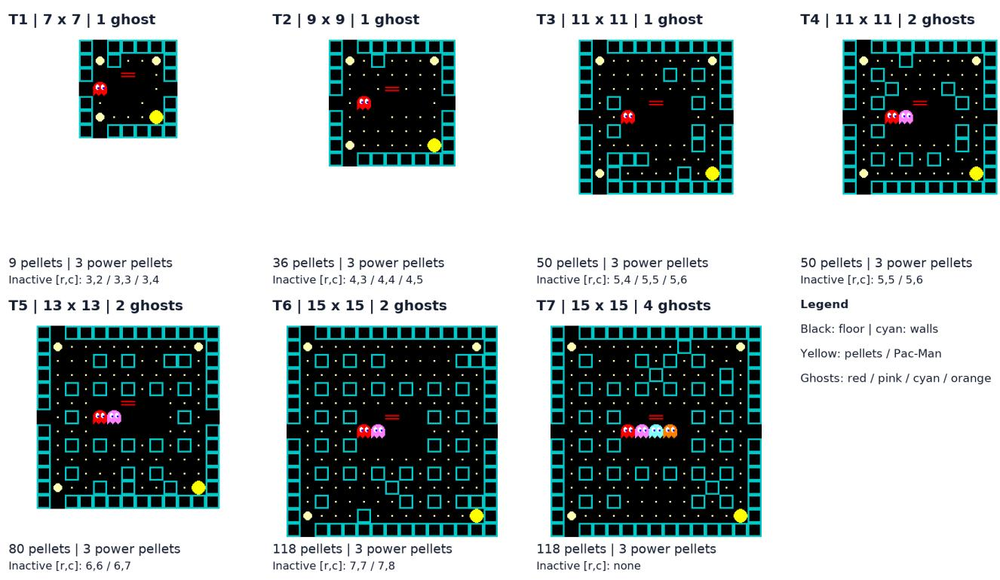  
Figure 3: Saved historical validation catalog grids for T1–T7, illustrated with native-engine sprites and cell-wall rendering, not recorded screenshots. Dimensions and active ghost counts are shown. The native stationary yellow Pac-Man glyph marks the player start without asserting motion direction or a historical animation phase; colored ghosts mark active spawns; inactive configured spawns are listed below each panel as zero-based row/column coordinates. Native pellet, power-pellet and ghost-door glyphs retain the saved cells. Portal codes and positions are retained as native invisible openings. Each map-0032 example uses ordinary reset, three extra lives and a 512-step budget, not every training start. Historical per-map renderer revisions are retained in the source metadata; the illustration does not establish their exact runtime a earance.

Exact selected fields do not certify a complete state. An independent four-game initial panel uses seeds 986000 and 986001 under 0-extra-life and 3-extra-life settings, with a 512-action native cap. Every episode terminates by death or life exhaustion; there are zero clears, timeouts or technical faults (Table 14). All 431 pre-action player positions and ordinary/power pellet sets match private replay truth; every fri htened-time interval contains the native value. Termina receipts also pass the final-memory audit; terminal player position is null by contract, not a claim about a post-game absolute location. The four games make 383 Agent choices and 431 perception calls. These statements concern checked fields, not exact ghost observations or general state-tracking reliability.

<table><tr><td>Extra lives Seed</td><td></td><td>Steps</td><td></td><td>Deaths Pellets left Agent calls</td><td></td></tr><tr><td>0</td><td>986000</td><td>83</td><td>1</td><td>160</td><td>73</td></tr><tr><td>0</td><td>986001</td><td>30</td><td>1</td><td>192</td><td>30</td></tr><tr><td>3</td><td>986000</td><td>180</td><td>4</td><td>130</td><td>157</td></tr><tr><td>3</td><td>986001</td><td>138</td><td>4</td><td>144</td><td>123</td></tr></table>

Table 14: Four terminal public-memory games on one fixed map; none clears. Remaining ordinary pellets are private outcome measurements. Two seeds crossed with two extra- life settings are not four independent maps or a stable win-rate estimate.

At least one normal/vulnerable ghost has unknown esti- mated heading in 291/431 frames. Position-only association matches 1,627 ghost observations: 1,599 at zero Manhattan error, 26 at one cell and two at two cells; another 97 true- ghost observations are unmatched and there are no extras. These are ghost observations across correlated frames, not

<table><tr><td>Method</td><td>Eligible</td><td>Correct/ known</td><td>No heading resolved</td><td>Un-</td></tr><tr><td>Current image</td><td>40</td><td>1/8</td><td>32</td><td>8</td></tr><tr><td>Two images</td><td>37</td><td>2/21</td><td>16</td><td>11</td></tr><tr><td>Position difference</td><td>40</td><td>23/27</td><td>13</td><td>8</td></tr></table>

Table 15: Heading diagnostic on twelve states from one tra- jectory. “Known” means an explicit direction on an eligible pair; “unknown” is an eligible pair without one; unresolved is positional/identity ambiguity or failed matching. Each row has 48 true-ghost observations. Conditional accuracy is not complete-state accuracy.

1,627 independent entities. Only 48 actions continue an al- ready bound route; the others require new Agent choices. The frozen short-horizon gate returns false when an active ghost has unsupported heading input, even before excluding a dis- tant irrelevant ghost. A false result can therefore mean “not verified under this input” rather than a predicted collision.

Selected same-state input replacements. The retained private diagnostic selects the first three snapshots per game with four distinct ghost cells, exact position/state association and at least one unknown active heading. In all four games these are steps 0, 4 and 5; repeated early states and this se- lection criterion limit the sample. At each of these twelve snapshots the visible map, player, food and frozen safety function remain fixed. With observed inputs every open di- rection fails the one-step gate. Replacing only ghost headings with private truth makes at least one direction pass in 12/12; replacing only subcell ghost pixels does so in 0/12; replacing both does so in 12/12. This identifies an input precondition in these selected local checks. It neither establishes that a di- rection is safe for the whole subsequent route nor measures a full-game rescue or the fraction of deaths caused by heading uncertainty. Oracle fields never enter the deployed policy.

A separate bounded heading-reading probe. Twelve pre-fixed dynamic states come from one trajectory, including normal, vulnerable and eyes states. Each receives one greedy current-image query and one previous/current-image query: 24 model calls, all valid JSON with natural EOS and no truncation. Headings are an added task, not the po- sition/state target of the original adaptation. Scoring asso- ciates by position alone; only assignment pairs unique across minimum-distance solutions and within one Manhattan cell are eligible. True heading cannot break a positional tie. Ta- ble 15 retains all 48 true-ghost observations per method, including unmatched/ambiguous cases. Temporal diferenc- ing uses existing VLM position readings without extra model calls.

The two-image model emits U for all 21 explicit eligi- ble predictions. Temporal direction is more accurate on this probe, but estimates past-interval motion, not guaranteed fu- ture heading at a corner. Neither temporal association nor ex- tra images therefore supplies engine-equivalent motion truth.

The subsequent matched windows remain bounded. On seed 986010, one 0-extra-life and one 3-extra-life case each compare privileged original inputs against the revised public- memory inputs for 64 actions under the same repaired en- vironment, model, processor, sampling and original harness routines. All four records pass exact native replay and public- receipt checks. Both public windows have exact player/pellet fields and containing timer intervals over 128 observations; one frame with five raw ghost records is retained without forcing the count to four. Both arms survive the window, with zero deaths in 0 extra lives and one death in 3 extra lives. Privileged versus public remaining-pellet counts are 140 versus 156 and 152 versus 165; Agent calls are 37 versus 45 and 40 versus 60. This does not demonstrate improvement or a return to the older 62/64 engine-state result. The latter used diferent seeds and an earlier environment. The win- dows do not complete games; their final memory is the last pre-action observation when no post-window query occurs.

<table><tr><td>States</td><td>Baseline Direction Pixel Both</td><td></td><td></td><td></td></tr><tr><td>All recorded (431)</td><td>292</td><td>92</td><td>292</td><td>93</td></tr><tr><td>Strict matched (321)</td><td>190</td><td>1</td><td>190</td><td>2</td></tr></table>

Table 16: Number of states for which every tested action re- ceives a false gate output. Denominators are recorded states, not games or ghost observations. The strict subset requires exactly four estimated and four native ghosts, distinct cells in each list, and a unique exact one-to-one cell/state match; it is not selected by heading availability.

Complete recorded-state gate sensitivity. A subsequent CPU-only audit removes the earlier twelve-snapshot selec- tion: it evaluates all 431 recorded pre-action states from the same four games with the frozen one-step gate and the same recorded open-action set in four arms. The baseline retains the estimated inputs. Direction replacement fills only unknown headings of active normal/vulnerable ghosts, and only where an exact cell/state match is unique in both di- rections and the native direction is valid. Pixel replacement uses finite native pixel positions on the same unambiguous active matches. Unmatched or ambiguous records remain un- changed: no ghost is added, removed or merged, and no map is repaired. Native fields are privileged diagnostic interven- tions, not public policy inputs.

Across all 431 states, direction replacement changes 559 ghost headings; pixel replacement is applied to 1,453 matched active ghost observations and changes 214 pixel fields. These ghost-observation counts difer from the 291 states containing an unknown active heading. Direction-only changes 200 baseline all-false outputs to at least one true output; both replacements change 199. Pixel-only leaves the frame-level classes unchanged. The combined arm is not strictly better than direction alone. These deterministic gate outputs are not ground-truth safety labels, counterfactual tra- jectories or full-game rescues. The four games contain cor-related states; the audit runs no new game steps, model calls or optimizer updates and shows sensitivity of this local gate to missing motion information, not learned improvement.

A small paired motion-prompt pilot. A separate pi- lot added public motion evidence to the same heading- hypothesis harness on four fixed-map seeds per extra-life setting (eight paired comparisons, sixteen episodes). With 0 extra lives, both arms cleared 0/4; deaths fell from four to two because two augmented episodes instead reached the step cap. With 3 extra lives, clears changed from 4/4 to 3/4 and deaths from four to eight. The three pairs that both cleared used a mean of nine fewer Agent calls with the added prompt, but total Agent calls over all four 3-extra-life episodes rose from 683 to 691. This selected-success cost does not estab- lish an overall eficiency benefit. All sixteen episodes passed the recorded native replay and public-receipt audits without technical faults; four seeds on one layout do not establish a general efect.

One-step alternatives at recorded deaths. A separate CPU diagnostic replayed each legal one-step alternative at 24 recorded death snapshots: eight had at least one alternative with no immediate death, whereas all open alternatives died in sixteen. The observed-input gate assessed the recorded choice as safe in ten snapshots and the private-truth gate in none. These are selected local checks, distinct from the 431- state input-sensitivity panel and its 321-state strict subset. A one-step survivor is neither a complete counterfactual tra- jectory nor a measured full-game rescue, and the 8/24 count must not be reported as an episode-level rescue rate.

The separate panel ledger motion-pilot.json records per-episode outcomes, costs and audit status; it is not part of the preceding gate-state denominator.

## O A Separate Visual-policy Training Diagnosis

This retrospective panel concerns a public-feedback, 3-extra- life language-LoRA training lineage. It is distinct from the fixed-map residual action-head comparison and from the primitive ASCII curriculum. We freeze the analysis at its recorded policy checkpoints 4–15 and complete rollout batches 32–63; later reward revisions and ongoing work are outside this panel. The audit reuses accepted native trajecto-ries and stored SGLang behavior probabilities, without new model calls, games or optimizer updates. Technical faults re- main null and mask their original twelve-sample group; no failed attempt is replaced by a successful retry.

Policy drift on identical recorded inputs. Fifteen initial- decision pairs match image bytes, prompt, processed token IDs and ordered legal support. For the twelve inputs advertis- ing the verified A0/Avoid option, its mean probability rises from 15.22% at checkpoint 4 to 80.10% at checkpoint 15. Across all fifteen inputs, mean entropy falls from 1.277 to 0.795 nats, mean maximum-option probability rises from 50.80% to 72.84%, and mean total variation between the two distributions is 61.33%. These are reused initial inputs, not fifteen independent layouts or a matched full-game interven- tion. The observation identifies a policy-distribution change on that input set; it does not isolate its cause or show that every later action is avoidance.

<table><tr><td>Recorded statistic</td><td>CP4-13</td><td>CP14-15</td></tr><tr><td>Clears / planned attempts</td><td>57/2,304</td><td>1/2,964</td></tr><tr><td>Technical faults (separate)</td><td>155</td><td>168</td></tr><tr><td>Time limits / valid games</td><td>76/2,149</td><td>352/2,796</td></tr><tr><td>Mean valid-game steps</td><td>248.5</td><td>301.5</td></tr><tr><td>Mean ordinary pellets left</td><td>43.8</td><td>46.4</td></tr></table>

Table 17: Retrospective visual-policy training outcomes at 60% pellet density. Faults stay in the planned-attempt de- nominator for the clear fraction and are separately excluded from valid-game descriptive statistics. These are not inde- pendent test episodes or a comparison with the action-head panel.

Outcome changes within one density stratum. The recorded 60%-pellet-density tasks share a 36-map file inven- tory across the two eras, but their game seeds and stochas- tic trajectories are not fully paired. Table 17 therefore de-scribes training attempts rather than held-out win rates or a causal checkpoint comparison. The checkpoint ranges also pool multiple weights. Fewer deaths or longer episodes do not alone imply better completion when more games time out and leave pellets uncollected.

Rollout collection is not an optimizer update. Batches 32–63 contain 6,144 planned attempts and 423 technical faults. Masking any original group containing a fault ex- cludes 72 of 512 groups, leaving 440 groups. Under the orig- inal success-based objective, none of those 440 groups has informative within-group advantage; collection can there- fore continue while optimizer updates are skipped. An of- fline proxy based on diferences in remaining ordinary pel- lets varies within all 440 eligible groups. This demonstrates available outcome variation under a diferent scalar, not suc- cessful learning with a new reward. It neither runs a new optimizer step nor establishes that pellet shaping improves independent play. A revised objective must remain a separate protocol and be tested without using held-out outcomes to tune it.

Backend qualification is a separate question. Stored diagnostics for eleven real updates show mean SGLang/Hugging Face distribution TV of approximately 3.6–4.3%, while roughly 40.5–47.3% of selected-action probability ratios already lie outside the PPO interval [0.95, 1.05] before that update. Around 19.7–27.2% of informative choices meet the surrogate clipping condition. A small mean distribution diference is thus not automatically negligible relative to a narrow clipping interval. This observation does not establish backend mismatch as the cause of the behavioral drift; the recorded rollout log probabilities remain the behavior reference. Source checks and reconstructions of selected losses likewise do not constitute a full causal decomposition of LoRA, KL and Adam updates.

Evidence boundary. The repository ledger preserves the fifteen probability summaries, separate era counts and all 32 batch summaries. The editorial pass independently recom- putes entropy/TV, probability means, group masking totals and native outcome aggregates from retained structured au- dit records. It does not reopen all original remote episodes or replace an independent evaluation. This panel motivates checking reward variation and optimizer-step counters before spending more rollout compute; it does not prove a general harmful efect of RL or a completed repair.

## P Expanded Context, Methods, and Interpretation

## P.1 Related Work

## Tasks and evaluation

Interactive game benchmarks. Games expose the con- sequences of sequences of decisions, rather than isolated answers. BALROG evaluates VLM agents across games and compares visual and textual interfaces (Paglieri et al. 2024). lmgame-Bench studies game control with perception and memory support, including transfer through game-specific RL (Hu et al. 2025). These benchmarks ask how agents perform across tasks and interfaces. Our Pac-Man study instead follows one development process, using targeted compar- isons and traceable failures to ask which explanations a re- sult supports. It does not introduce a general benchmark or establish a cross-game ranking.

## Potential problems

Perception, spatial understanding and visual uncertainty. Fine-grained tests reveal dificulties with simple patterns and precise visual localisation (Tong et al. 2024; Rahmanzadehgervi et al. 2024). SpatialVLM improves spatial question answering with spatial training data (Chen et al. 2024), while Thinking in Space examines spatial recall from sequential vi- sual observations (Yang et al. 2025). Uncertainty-aware map- ping represents uncertain semantic readings (Bajpai et al. 2025); monoVLN acquires further views when observations are incomplete (Lu et al. 2025). These works distinguish unreliable readings from missing information. Our largely visible board can still be misread, and the resulting error can afect later state and actions. Static answer accuracy therefore measures a diferent requirement from reliable closed-loop control.

State memory and updating. Remembered information can become stale, as studied by When Memory Lies (Sun and Zhang 2026); EvolvingNav maintains time-indexed beliefs about moving objects outside the current view (Gao et al. 2026). Belief revision provides a classical foundation for reconciling new evidence with retained beliefs (Boutilier, Friedman, and Halpern 1998). Our fixed-maze case concerns a complementary failure: a new actor misreading overwrites correct terrain. The traced failure and bounded checks of revised rules support that diagnosis, while their full-episode benefit remains a separate question. State uncertainty is thus broader than uncertainty in the current image.

Decision, planning and skill execution. Even useful ob- servations and retained state must be turned into feasible action sequences. Uncertainty about action consequences can persist after image transcription is removed; it is not simply visual uncertainty. Our textual controls, action-head training outcomes and fixed-weight harness comparisons ad- dress diferent parts of this problem. They provide evidence about particular decision and execution limitations, without completing full-episode causal replacements of perception, memory and policy.

## Solving approaches

Teacher supervision and imitation. PlayJev is a model re- lease that first imitates programmatic action teachers through behavior cloning, then obtains teacher action labels for states visited by the learner (OmniJev 2026). DAgger (Dataset Ag- gregation) adds these visited-state labels to earlier data and retrains, addressing distribution shift and compounding er- rors when the learner’s mistakes take it away from demonstra- tion states (Ross, Gordon, and Bagnell 2011). This supplies a dense-supervision alternative to our reward-driven action training. We do not assume an additional competent action teacher, while retaining pretrained models and environment- derived perception supervision. Diferent game and obser- vation contracts prevent treating the releases as a matched performance comparison.

RL and post-training. DQN learns game control from reward (Mnih et al. 2015); hybrid reward decomposition addresses the structure of Ms. Pac-Man control (van Seijen et al. 2017). VAGEN trains multi-turn visual agents to reason about states and transitions (Wang et al. 2025). These approaches motivate learning better decisions, but a changed overall score does not by itself identify which component im- proved. We report protocol-specific training outcomes along- side comparisons that hold model weights fixed. Our contri- bution is evidence-grounded development experience, not a new general RL objective or demonstrated transfer of the resulting lessons.

Curricula and start-state design. Backplay moves starts backwards through a successful demonstration (Resnick et al. 2018); reverse curriculum generation expands starts outwards from a goal (Florensa et al. 2017). Both organize practice to make useful learning signals easier to obtain. Our failure-state restart lineage instead samples states be- fore recorded deaths. Concentrated training starts and weaker normal-start validation motivate checking the training distri- bution, but do not isolate a causal benefit or harm of reverse curricula.

Harnesses, robust updates and executable options. NavHarness combines goal generation, completion verifi- cation and memory compression (Shi et al. 2026). Robust mapping rejects unreliable constraints (Sünderhauf and Protzel 2012), and occupancy integration fuses uncertain evidence (Hornung et al. 2013). Skill selection (Ichter et al. 2023) and temporally extended options (Sutton, Precup, and Singh 1999) structure decisions around executable behavior. Our fixed-weight comparisons examine bounded risk checking and route binding under a shared candidate scaf- fold within their named panel. Together with traceable failure evidence, these comparisons connect a development problem to an intervention and its actual validation unit; they neither introduce a new o tions framework nor establish universal gains or a full-game benefit for every state-update revision.

## P.2 Problem Setup

Environment. We use a grid-based Pac-Man engine with mazes of up to $2 5 \times 2 1$ cells (rows × columns), up to four ghosts, and an episode horizon of 512 environment steps. An episode succeeds when all regular pellets are cleared before the agent runs out of lives; we evaluate both a 0-extra-life and a 3-extra-life budget. The source-bound normal-ghost, power-pellet and portal rules for the newer paired panels appear in Appendix K; earlier generations and variable-size curricula keep their own source contracts.

Environment API and field routing. At inspected recipe commit 730cf345, PygamePacmanEnv is a plain class with a Gym-style interface, not a complete Gymnasium im- plementation: it declares no Gymnasium spaces or reset- options interface. reset accepts either a seed or a saved state and returns RGB plus info. step accepts primitive $\mathrm { U } / \mathrm { D } / \mathrm { L } / \mathrm { R } / \mathrm { S }$ and returns RGB, raw score increment, terminated, truncated and info. The runner’s learning reward is computed separately. A route code is resolved by the harness before primitive execution; a continuing op- tion need not call the model again at each step.

Table 18 separates API availability, protocol permission and confirmed consumption. The inspected wrapper and de- cision renderer are in the current recipe, not a recovered source manifest for all frozen panels. Wrapper anchors are pygame\_environment.py: reset at line 293, step at 318, snapshot at 626 and info at 933; current prompt rendering is in level1/prompts.py, including decision-state selection at line 109. The source revision and file/line anchors identify the inspected implementation; repository-identifying details are withheld during anonymous review.

Agent decomposition. Let $s _ { t }$ be the true engine state and $o _ { t }$ the observation the agent is permitted to see. For visual harnesses, we use the following functional decomposition:

$$
z _ { t } = V _ { \theta } ( o _ { t } ) \mathrm { ( p e r c e p t i o n ) }\tag{3}
$$

$$
m _ { t } = U ( m _ { t - 1 } , z _ { t } , e _ { t } ) { \mathrm { ( s t a t e ~ m a i n t e n a n c e ) } }\tag{4}
$$

$$
a _ { t } = \pi _ { \phi } ( o _ { t } , m _ { t } , \mathcal { C } _ { t } ) \mathrm { ( d e c i s i o n ) }\tag{5}
$$

$V _ { \theta }$ is the VLM’s reading of the screen (map cells and entity positions), U is the harness’s update rule, $e _ { t }$ is explicitly permitted feedback, and $\pi _ { \phi }$ selects either a primitive move or one of the route candidates $\mathcal { C } _ { t }$ proposed by the harness. These are functional dependencies, not full-memory model inputs. Protocol-specific renderers select state/history sum- maries and candidates; direct ASCII policies bypass image transcription. A failure in the final score can originate in any of the three stages, and errors in an earlier stage can be amplified by a later one.

Information contract. We distinguish the visual informa- tion conditions and a separate textual control. Engine-state (diagnostic reference): the harness uses the engine fields de-clared by the panel. In the inspected current recipe, the model receives a screenshot plus selected state and candidate sum- maries; this current renderer is not a source mapping for every historical frozen panel. Screenshot-feedback: in the later typed-receipt variant, all state comes from screenshots plus public interaction feedback—the realised relative dis- placement of Pac-Man, pellet and life events, and episode termination—together with publicly stated game rules such as tunnel teleportation and respawn locations. The engine’s full map, absolute coordinates, and ghost internals (targets, timers, paths) are never available to the agent in this condition and are used only for scoring and failure attribution. Because realised-displacement feedback is more informa- tive than a binary moved/blocked signal, we report it as part of the interface rather than as a property of the memory algorithm. ASCII controls replace pixels with the native textual board/state under their own protocol. They remove im- age transcription from the loop; they are distinct from the screenshot-feedback condition and do not measure visual grounding. External screenshot-plus-structured-state base- lines likewise retain their stated information access rather than being called image-only.

Metrics. Besides completion, we report pellet clearance, deaths per episode, timeouts, harness aborts (kept separate from deaths), model calls, and environment steps. Static perception is measured independently by whole-map exact match and per-entity accuracy. Generalisation is reported separately for new random seeds on seen layouts and for held-out layouts. Each panel retains its own layout/seed split and denominator rather than a universal train/test pool. A new execution seed on one map is not a held-out layout. The action-head figure shows marginal Wilson 95% intervals; paired outcomes and matched-success costs are reported sep- arately. The perception panels distinguish frames, repeated decodes and query records (Appendix J).

Appendix L distinguishes marginal rates, paired difer- ences and clustered/repeated observations; its intervals refer to their explicit fixed-map sampling model.

## P.3 System and Diagnostic Method

Figure 5 expands the runtime loop of Figure 4 into the stages we diagnose. The components below recur across protocol- specific system versions; they do not describe one unchanged agent used in every experiment. We distinguish the docu- mented visual-adaptation reconstruction from measurements on the original frozen D5A checkpoints, and engine-state reference, screenshot-feedback and ASCII conditions from one another. A mechanism comparison uses only its declared matched arms; sharing a model family or a harness name does not make separate evaluation rounds a controlled compari- son. Appendix G records the experiment-specific contracts.

Targeted visual adaptation The documented reconstruc- tion uses two-stage perception adaptation motivated by the base model’s transcription errors (Appendix J); its settings are not a verified manifest of every original D5 training run (Appendix G.2). Stage V (vision): the reconstruction trains the vision encoder and multimodal merger with full parame- ters while freezing the language model, for 6,000 updates at learning rate $1 0 ^ { - 5 }$ , on diverse real screenshots across maze sizes up to $2 5 \times 2 1$ , supervised to transcribe the grid and entity positions. Stage L (language-side alignment): the reconstruction freezes vision and adds a LoRA adapter (Hu et al. 2022) (rank $1 6 , \alpha = 3 2 )$ to the language model, trained for 1,000 updates at $1 0 ^ { - 4 }$ on visual question answering only, then merged. Freezing language in Stage V restricts where the supervised update can act; it is intended to reduce language- side shortcut fitting, but does not prove that visual features or the resulting policy are free of layout shortcuts. The doc- umented image contract keeps the prompt, JSON schema, and image preprocessing (a shared 2× scaling, checked on 19/19 prompt-token comparisons) identical between training and serving; mismatches here alone produced apparent “perception errors” early in the project.

<table><tr><td>Field group</td><td>Consumer and protocol permission</td><td>Source confirmation and remaining gap</td></tr><tr><td>RGB frame</td><td>Visual reader; current engine-reference policy also receives the screenshot. ASCII policy uses text in- stead.</td><td>Current engine messages and ASCII text-only adapter inspected; screenshot-public decision serialization not recovered.</td></tr><tr><td>Raw info/snapshot</td><td>Environment/runner data include absolute posi- tions, ghost/timer fields and saved state. Availability is not permission to pass them to every agent.</td><td>Wrapper confirms these fields; raw source events are not already public receipts.</td></tr><tr><td>Public receipt</td><td>Later typed-receipt screenshot-public harness may consume frame/elapsed ticks, realized rel- ative movement, localized pickups, ghost-eaten,</td><td>Paper contract and logs support these cat- egories; exact projector keys/types, por- tal/respawn projection and model-facing sub-</td></tr><tr><td>Maintained state</td><td>death/respawn and termination events. Public terrain, pellet sets and actor estimates sup- port candidates and permitted summaries; unknown</td><td>set remain unlocated. Contract and bounded audits exist; the com- plete frozen public updater and final serializer</td></tr><tr><td>Engine-derived summaries</td><td>values stay unknown. Current engine planner reads level/snapshot in- formation. Its model gets selected position, ghost state/id, timer, navigation-history and candidate</td><td>remain unlocated. Current prompts confirm selected fields. The latest planner also uses pixel/motion fields and excludes stored ghost paths/targets; this does</td></tr><tr><td>Private au- dit/restore data</td><td>summaries, not all memory. Hidden maps, engine coordinates, ghost inter- nals and RNG may support restore or diagnosis. Screenshot-public forbids their use to repair pol-</td><td>not establish every historical planner&#x27;s behav- ior. Panel-specific information contracts govern access; current recipe is not a complete map-</td></tr><tr><td>Score and reward</td><td>icy/harness inputs. Environment score increment, runner reward and diagnostic records have distinct roles.</td><td>ping to frozen factorial/public/head panels. Current renderer does not serialize the com- plete audit state or learning reward merely be-</td></tr></table>

Table 18: Field routing by protocol and evidence source. Permissions stated for screenshot-public are its declared contract, not a new source-level isolation verification. Exact public projector, updater and serializer sources remain to be bound to the frozen runs.

The Route-option harness Rather than emitting prim- itive moves, the VLM selects among route candidates gener- ated by the Route-option harness. Options come in three families—Collect (reach nearby pellets while keeping an escape route), Avoid (move to a distant junction with enough exits when ghosts approach), and Eliminate (chase an edible ghost with time to spare)—and are presented as singleletter codes whose meaning changes with the state, so a code is not a fixed direction command; this does not rule out other shortcuts. Legal-code decoding and matching the rollout/rescoring support and temperature are the intended policy contract. The verified action-head panel uses that contract; it is not a blanket qualification of all historical runs, some of which retained a cache-related mismatch (Ap- pendix C). Two mechanisms are studied as separate factors:

• Risk check—before a candidate is ofered, the harness estimates over a bounded horizon whether a ghost can reach the route first, and ranks or filters candidates ac- cordingly. It is a bounded check, not a guarantee of route safety.

• Route binding—after the VLM picks a route, the har-ness executes it across several steps until completion or an interrupt condition, while the factorial control instead retains the target and replans within a capped commit- ment; both can reuse a model choice. This follows the idea of temporally extended options (Sutton, Precup, and Singh 1999).

Fallback is protocol-specific: historical refusal stops the episode when safe execution is unavailable, whereas later risk-ranked fallback may continue despite residual risk. Only the factorial arms share the same candidate scafold; his- torical harness generations can also difer in proposal and information rules (Appendix H).

Screenshot-feedback state maintenance In screenshot- feedback conditions the harness maintains state from its de- clared observations and public receipts. The contamination trace in Figure 6 shows an actor reading being written into terrain; the revised public-feedback variant instead separates updates by type. Its static map comes from the initial visual read and retains unknown cells; pellets change through public pickup events; and dynamic actors are re-read from screenshots. Actor–map conflicts do not overwrite terrain. Visually observed spawn points and public teleport/respawn rules handle discontinuous moves. This describes the revised update rule, not a rule retroactively shared by all historical harnesses. The traced fault and bounded revised-memory checks motivate a controlled full-episode comparison; they do not isolate a full-episode benefit caused by this revision.

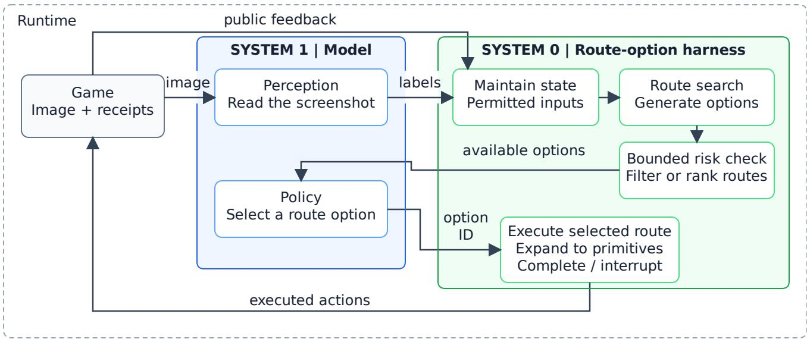  
Figure 4: Screenshot-feedback runtime of the Route-option harness. System 1 supplies perception and route selection. System 0 maintains permitted state, searches for route options, applies a bounded risk check, and expands the selected route into primitive actions until completion or interruption. Protocol-specific information contracts are detailed in Appendix P.2.

Replay, state audits, and intervention boundaries We preserve native engine/RNG states, observed frames, model choices and the harness execution trace so a reported outcome can be replayed and its fields checked. In the paired harness panels, arms start from matched initial states; subsequent actions and states can diverge. Private state is used to audit the declared interface, not to repair policy inputs. A replay that reproduces a trace validates the record; it is not itself a successful counterfactual intervention.

The diagnostic question is whether changing one compo- nent at the same state changes subsequent behavior. Replac- ing perception zt, memory $m _ { t }$ or the selected action at with an oracle alternative is a useful experimental design, but a replay audit alone does not establish those efects. Here we report a traced memory-write error, bounded checks of re- vised state maintenance, paired whole-harness outcomes and a small action-assistance screen. A controlled full-episode perception-versus-memory replacement study remains missing. A successful local repair can implicate a component in that case; failure to rescue cannot exonerate it when down- stream failures also remain. For every probe, the reported unit is its actual window or episode, rather than an assumed

full-game rescue.

## P.4 Discussion: Deciding What to Fix

The five insights suggest a rule for spending a finite devel- opment budget: locate the failing stage before choosing the intervention. Table 19 separates an observed diagnostic sig-nal from the next intervention to validate. Evidence for an input contract, a typed update rule or an exact replay concerns those specific fields; it is not by itself evidence that changing a component rescues a full game. The human investigator chooses which comparison can resolve the remaining uncer- tainty.

Why brute force was not enough. Direct RL on primitive actions asked one model to solve all three stages at once, from a sparse terminal reward. Errors at several stages can confound the terminal signal. Separation makes the questions testable: perception can be measured as supervised transcrip- tion, state maintenance as a rule with explicit invariants, and decision quality under controlled inputs. It does not guarantee that the remaining policy learns: the action-head continuation did not improve the fixed panel. Denser credit assignment, in- cluding reward decomposition as in van Seijen et al. (2017), is a hypothesis to test against the observed shaped-reward failure, not a demonstrated fix here. This is consistent with the view of an agent as a coordinated system—a slower plan- ner selecting among options and a faster executor carrying them out—rather than a single policy to be scaled.

Separating state accuracy from usable control information. The later public-memory records provide a sharper distinction: the checked player, pellet and timer fields agree over 431 recorded decisions, while active-ghost headings remain unknown in 291 frames. The frozen gate-input au- dit in Appendix N tests all recorded frames rather than twelve selected early snapshots. Oracle heading substitution changes gate feasibility, not observed game outcomes; it nei- ther supplies a deployable estimator nor establishes that a newly admitted action is safe. Separately, Appendix O docu- ments policy drift and uninformative training groups in a vi- sual language-LoRA lineage. These findings motivate testing heading estimation and reward discrimination independently, before attributing failure to a single component.

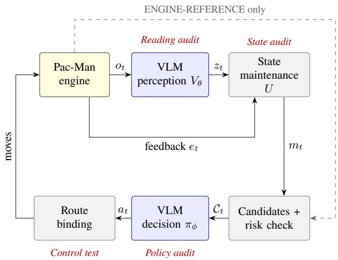  
Figure 5: Route-selection pipeline and diagnostic sites. Blue nodes denote learned functions; grey nodes denote harness code. Permitted feedback et updates state separately from ex-ecuted moves. The dashed branch supplies declared engine- derived candidate inputs only in the engine-state reference protocol; scoring paths are not shown.

Fit to geometric and spatial reasoning. The failures we observe are spatial: localising entities to the right grid cell, maintaining a consistent topology over time, and reasoning about whether a ghost can reach an intersection first. Our results suggest that spatial-reasoning benchmarks for VLMs should evaluate these abilities in the loop and over time, because the static versions can be nearly solved while the closed-loop task is not.

Future work: learning from failures. Future researchers could use the student’s actual failure states to select correc- tive exercises for post-training RL, compare a search-based teacher with simpler rules, and test whether action supervi- sion or optional reasoning supervision transfers to indepen- dent play. Such transfer remains to be evaluated. The central evaluation must remove the teacher and extra reasoning as- sistance, check for regression on prior skills, and account for teacher and training costs. Our small single-goal interven- tion screen (Appendix F.1) tests assistance at inference, not learned improvement.

Limitations. This is a single game and a specific harness; the main training experiments use a single model family, supplemented by separate external-model baselines. Several numbers come from separate evaluation rounds with difer- ent configurations and are not directly comparable; we mark them as such. ASCII primitive evaluations include disjoint held-out maps, but systematic unseen-layout generalisation of the full screenshot-driven system, multiple training seeds, and a controlled full-episode comparison of state-update rules remain missing. Some historical RL configurations re- tained a residual training–inference mismatch from prefix- cache reuse; the verified ASCII restart continuation disables that cache (Appendix C). Oracle component replacements are diagnostic proposals, not deployable fixes; our replay au- dits and short-window checks do not supply a completed full-episode component ablation. The policy still plans im- plicitly when it picks a route; exposing that reasoning (e.g., with a thinking mode) or distilling explicit search into the model are natural next steps. Finally, the diagnose–modify– evaluate loop was carried out by people; we do not claim an agent that improves itself.

<table><tr><td>Stage</td><td>Evidence in this study</td><td>Next intervention to validate</td></tr><tr><td>Perception</td><td>Transcription errors and separate static/closed- loop query audits</td><td>Align prompt and format; assess vi- sual adaptation un- der its declared pro- tocol</td></tr><tr><td>State</td><td>A traced actor-to-terrain write; bounded revised- memory checks</td><td>Enforce typed writes and explicit unknowns; compare full episodes</td></tr><tr><td>Decision</td><td>ASCII decision failures; no gain on the paired action-head panel</td><td>Retain matched risk-check com- parisons; test corrective supervi- sion separately</td></tr></table>

Table 19: From recorded evidence to the next test. Harness comparisons support their named mechanisms; revised mem- ory and corrective supervision still require their own outcome comparisons.

## P.5 Conclusion

A VLM agent that can describe a Pac-Man board can still fail to play it, and the reasons are not uniform. In our case study the agent broke at three distinct places—nearsighted perception, memory corrupted by a single misread, and lethal decisions made on correct state—and each points to a dif- ferent intervention and validation requirement. We establish bounded improvements and failure diagnoses, not a complete solution of all three stages. Scaling post-training without first locating the failing stage spent compute without addressing the bottleneck. We hope the information contract, matched- state replay, and the resulting decision guide help others find where their own spatial agents break.

## P.6 Detailed Development Evidence Task Interfaces and Evaluation Units

Task and timing. The native grid engine uses up to 25×21 cells and four ghosts. Named full-game panels cap play at

512 environment steps with 0 or 3 extra lives. Clearing all ordinary pellets wins; power pellets are not required. The game advances as actions execute between model decisions; latency is profiled separately in Appendix I. Variable-size curricula and older generations retain their own rules (Ap- pendices G, K).

Stages and information. The environment accepts prim- itive directions and returns a frame, raw score change, out- come flags and transition metadata; protocols restrict what reaches the agent (Appendix P.2). For a visual harness, $z _ { t } = V _ { \theta } ( o _ { t } )$ interprets the current permitted observation $o _ { t } ,$ $m _ { t } = U ( m _ { t - 1 } , z _ { t } , e _ { t } )$ updates maintained state using public feedback $\textstyle e _ { t } ,$ , and $a _ { t } = \pi _ { \phi } ( o _ { t } , m _ { t } , \mathcal { C } _ { t } )$ selects an action. Here $V _ { \theta }$ is the perception function, $z _ { t }$ its output, U the update rule, and $\mathcal { C } _ { t }$ the current primitive-action or route-candidate set. These are functional dependencies: state afects candidates and protocol-specific prompt summaries, not necessarily a direct input of the full $m _ { t }$ . The decomposition is not a shared implementation of every experiment.

Action abstraction and information access are separate axes. A primitive policy outputs a direction; a route policy outputs a code that the harness executes through multiple primitive steps, so decisions and environment steps need not coincide. Screenshot-feedback uses screenshot predictions, declared game rules and public movement, pickup, life and termination receipts. In this condition, private maps, absolute engine coordinates and ghost internals are diag- nostic/scoring inputs only; relative displacement is stronger than moved/blocked feedback. Engine-state reference uses the fields allowed by its panel: the inspected current recipe supplies the model with a screenshot and limited structured- state/candidate summaries, not full memory. ASCII controls bypass image transcription using their declared textual-state/history contract. Current recipe inputs do not retrospec- tively specify every frozen panel.

Units and metrics. We report clears/attempts, deaths, tech- nical faults, aborts, steps and model calls separately. A new execution seed on a fixed map is not a new layout. Frames and repeated decodes are not independent games; training samples are not held-out evaluations. Pairing applies within named panels only. Appendix L distinguishes marginal inter- vals, paired efects and the fixed-map sampling assumptions.

## Model and Intervention Specification

Visual adaptation. Transcription errors motivated vision- encoder/merger adaptation with language frozen, followed by VQA-only language LoRA (Hu et al. 2022). The doc-umented reconstruction’s settings are given separately from evaluations ofthe original frozen D5+LoRA A policy (D5A): it is not a recovered manifest for every historical run (Ap- pendix G.2). Prompt, schema, preprocessing and decoding must match their trained contracts; apparent perception fail- ure can otherwise be an interface mismatch.

Options and execution. The Route-option harness of- fers state-dependent Collect, Avoid and Eliminate routes as single-letter codes. A code is not a fixed direction. A bounded risk check filters or ranks routes; the factorial’s im-proved gate uses a two-move motion-envelope check and a near-target escape guard (Appendix H). Route binding exe-cutes the selected route until completion or interruption. The factorial control retains its target but replans within a capped commitment, so it can also reuse model choices. Arms share a candidate scafold and fallback only within that factorial (Ap- pendix H). Historical refusal fallback can stop an episode; later risk-ranked fallback can continue despite residual risk. Neither is a safety guarantee.

Binding a reported update to a model. The paired action- head panel learns only a rank-8, alpha-8 output residual with 2,019,328 FP32 parameters; base weights, perception and the harness remain frozen. This is distinct from the language- LoRA diagnosis and primitive ASCII training. Each update collects eight 0-extra-life episodes: two execution seeds, four samples per seed. Four returns from the same seed form an advantage group; constant-return groups receive zero advan- tage. The reward is zero without a clear and adds declared life/speed bonuses on a clear. Faulty episodes have no game reward and are not replaced. The loss uses a clipped surrogate (0.2) and KL coeficient 0.01 against the frozen base, on identical legal support at temperature 0.7. AdamW uses learning rate $5 \times 1 0 ^ { - 4 }$ and gradient clipping at one. Recomputed be- havior log probabilities must agree within $2 \times 1 0 ^ { - 4 }$ before an update; a completed optimizer step, saved Adam counter, parameter hash and reload-logit check establish the counted checkpoint. The reported twenty-update model contains sev- enteen additional updates after the initial three, not a planned training budget or a count of collected batches. Appendix G.3 preserves the seed schedule and complete loss/weighting de- tails.

Memory and verification. The revised screenshot- feedback rule separates static terrain, event-based pellets and re-observed actors; actor conflicts cannot overwrite terrain, and uncertain cells remain unknown. This is a revised pro- tocol, not a property retroactively shared by older harnesses. We preserve native state/RNG, observations, choices and ex- ecution records for exact replay. Private truth audits interfaces without repairing deployed inputs. A matched-state oracle re- placement diagnoses component sensitivity; a replay match only verifies the record. Full-episode component rescue re- quires its own outcome comparison. Extended methods and historical engineering qualifications appear in Appendices P and C.

Development Findings and Secondary Panels We present the findings in the order in which they shaped the project; each insight motivated the next intervention. The evidence spans several historical experiments with diferent models, feedback, start distributions and checkpoints. Pair- ing applies only within the explicitly identified panels; we do not pool their rates. The newer full-episode panels use 64 execution seeds on one fixed map, not 64 independent layouts. The independently reloaded profile in Table 20 is separate from legacy exploratory percentages, whose un- resolved provenance is retained in Appendix I.1. Detailed verified protocols appear in Appendix G.

Historical primitive-action training and curriculum difi- culties. Our first agent mapped each screenshot directly to one primitive move token and was trained with group-relative policy optimisation (Shao et al. 2024) and a curriculum over maze size and ghost count. It improved on the easiest stages but stalled on harder ones: after five to six days of train- ing, success on later stages had not converged. Stage-specific compute curves are not available in the retained historical records. Alongside the engineering faults catalogued in Ap- pendix C, we identified five interacting learning and interface challenges. Per-run fix status remains incomplete; we do not attribute every historical failure to learning alone.

• C1 Limited exploration and shortcut risk. Training- seed fit without matching held-out performance, weak visual transcription and low policy entropy are consis- tent with layout-specific shortcuts. They do not localize memorisation to the language component or prove that visual error caused entropy collapse. Sparse terminal re- wards can reinforce a narrow set of successful trajecto-ries, consistent with the covariance account of entropy collapse (Cui et al. 2025). We used Clip-Cov to limit this concentration (Appendix B), but the absent matched with/without curves prevent a causal claim about how much it preserved exploration.

• C2 Credit assignment under sparse reward. The only reward came at the end of a long episode. Training was slow and unstable, with reward sometimes dropping for long stretches. A win that followed a recovered mistake rewarded every action in the episode, including the mis- take. Denser shaped rewards were not a safe fix: in one run, shaped evaluation reward rose from 48.78 to 126.38 while wins fell from 15/96 to 2/96, consistent with an ob- jective mismatch, although that historical run was not independently reloaded and re-evaluated. We therefore kept a terminal win reward and grouped returns per episode rather than per intermediate state (Appendix B).

• C3 Cold start and curriculum calibration. On hard stages an initial policy may never win, leaving groups with no reward variation and no learning signal. The initial model also oscillated at the start. Starting closer to success, as in Backplay (Resnick et al. 2018), is one possible intervention. Our verified continuation instead samples states before recorded deaths, including from episodes that eventually win. Its training-start concentra- tion and separate normal-start validation are described below; it is not a controlled demonstration of Backplay benefit.

• C4 A single frame is not a Markov state. One screenshot does not directly expose ghost velocity (normal pupils in this renderer track Pac-Man, not motion; Appendix K), separates overlapping ghosts poorly, and does not show how long a frightened ghost has left before it turns dan- gerous again. Short of reading the engine’s internal state, acting well requires memory across frames. Asking the model to emit one action token per step also forces it to plan implicitly, which makes its behaviour a black box.

• C5 Cost. Every step is a model call, and an episode has hundreds of steps, so rollouts are expensive and slow down training further. With options, one model decision covers 1.83 environment steps on average, and the amor- tised decision pause falls from 169 to 148 ms per step even though each harness decision takes longer to prepare. These decision-cost measurements come from a separate 12-game-per-condition profile (Appendix I).

C1 includes a possible perception bottleneck and short- cut risk, C2–C3 are learning-signal problems, and C4–C5 are problems of the interface itself. C4 in particular means that even a perfect perceiver would need history or memory to infer ghost heading, speed, and frightened timers; imple- menting that memory in a harness is our design choice. This motivated the next two steps: visual adaptation (Appendix J) and placing memory and candidate generation in a harness so that the model chooses among a few routes instead of hun- dreds of primitive moves (Appendix H). Table 20 previews the outcome.

An independent ASCII primitive curriculum illustrates the calibration problem without visual perception errors. A frozen checkpoint cleared 59/96 normal-start episodes at tier 7 but 0/96 at tier 8; two candidate intermediate tiers also yielded 0/96 each. Two maps in one candidate had invalid portal exits; the other six maps still yielded 0/72. Map size, topology and pellet counts changed together, so this is not a size-only efect. In a separate failure-state-restart contin- uation, normal-start tier-7 validation varied from 77/96 at checkpoint 270 to 27/96 at 305 and 61/96 at 310; indepen- dently loaded checkpoints 270 and 310 each obtained 0/96 on the original eight-map tier-8 panel (Appendix M). These are validation panels, not training-rollout rates or a controlled estimate of the restart method’s benefit.

The original historical continuation stopped after 334 completed optimizer updates; checkpoint 330 was its last complete saved model and validation panel. Normal-start tier-7 validation was 54/96 at 330, com ared with 77/96 at the continuation’s starting checkpoint 270. Its later mixed- start batch 333 nevertheless cleared 192/192 attempts. Of its 132 tier-7 restarts, 96 began with at most 15 ordinary pellets remaining, concentrated on two maps. These check- points and start-state distributions difer: the contrast diag- noses curriculum concentration, not a controlled causal efect of restarting. The pre-death restart sources could themselves eventually win. Appendix G gives that branch’s records and protocol. A subsequent extension restored 330 and stopped at 430; its last complete normal-start T7 validation was 425 at 60/96, with no complete validation at 430 (Appendix M.1; the selected window through 335 in Figure 1).

Perception adaptation and closed-loop reading records. The base VLM’s weak grid transcription motivated staged vi- sion/language adaptation. The historical schema-constrained reference reports 401/531 exact level-1 stream maps af- ter vision adaptation and 427/531 after VQA-only lan-guage LoRA; its unseen-size panel changes from 182/216 to 189/216. These are separate from the unconstrained, archived-prompt audit below. Earlier data-diversity, joint-versus-staged training and hard-label anchoring results are retained with their narrower provenance in Appendix J; they are not a single learning curve or a controlled proof of

<table><tr><td>Independently loaded condition</td><td>Clears / attempts</td></tr><tr><td>Base, primitive moves</td><td>0/12</td></tr><tr><td>Base + harness</td><td>4/12</td></tr><tr><td>RL update 19 + harness</td><td>3/12</td></tr><tr><td>RL update 48 + harness</td><td>3/12</td></tr><tr><td>RL update 49 + harness</td><td>2/12</td></tr></table>

Table 20: Independent historical checkpoint profile on one fixed map: four execution seeds, three generation seeds each, 0 extra lives and 512 environment steps. All attempts, includ- ing safety refusals, are counted. Direct versus Route-option harness changes information and control. This small panel does not establish checkpoint ranking or an RL gain; com- plete protocol and termination counts appear in Appendix I. Here harness denotes the Route-option harness.
<table><tr><td>Execution</td><td>Route gate</td><td>0 extra</td><td>3 extra</td></tr><tr><td>Target replan</td><td>historical</td><td>7/64</td><td>40/64</td></tr><tr><td>Target replan</td><td>improved</td><td>18/64</td><td>59/64</td></tr><tr><td>Bound route</td><td>historical</td><td>9/64</td><td>39/64</td></tr><tr><td>Bound route</td><td>improved</td><td>27/64</td><td>62/64</td></tr></table>

Table 21: D5A episodes completed out of 64 paired execu- tion seeds on one fixed map (engine-state condition). Model weights, proposal scafold and fallback are fixed. Execution changes target replanning versus bound-route continuation; the route gate changes historical versus improved checks. The target-replanning control is not the original Route-option har- ness planner.

language-side memorisation.

The static and interactive reading measurements are re- ported in Section 4.3; their image and decoding conditions remain distinct.

Supplementary fixed-weight control comparison. This complementary historical comparison records how named control changes alter task completion with learned weights fixed. Table 21 reports the D5A two-factor comparison on one fixed map in the engine-state reference condition, with 64 paired execution seeds per cell and separate life budgets. With three extra lives, the joint change from historical acceptance with target replanning to improved acceptance with bound execution raises completion from 40/64 (62.5%) to 62/64 (96.9%). This is an observed improvement in the evaluated agent configuration, not a learned-weight improvement.

The individual contrasts show why the joint result should not be attributed to binding alone. Under the historical gate, binding changes 0-extra-life completion from 7/64 to 9/64, but 3-extra-life completion from 40/64 to 39/64. Under the improved gate, the respective counts change from 18/64 to 27/64 and from 59/64 to 62/64. The observed benefit is there- fore not uniform across acceptance rules and life budgets. These counts do not establish statistical significance, syn- ergy or universal superiority of route binding.

Because weights, proposals and fallback are held fixed within this factorial, the joint contrast supports an efect of its specified risk and execution changes on this panel. It does not separate every possible agent component or establish performance on unseen maps or screenshot-feedback inputs. The practical implication is that an agent score is a property of the evaluated model–harness configuration: improvements in route acceptance or execution can otherwise be mistaken for improvements learned by the model. The complete panel, deaths, costs and model-specific contrasts are retained in Appendix H.

Harness comparisons and historical baselines. Ta- ble 20 gives an independently reloaded checkpoint profile: base+harness clears 4/12 games and the three RL check- points clear 3/12, 3/12 and 2/12. This small diagnostic panel does not show a stable RL advantage. Table 21 isolates two harness mechanisms in a 2×2 design with the adapted model fixed (part of a 1,024-episode factorial). The improved risk check alone raises 0-extra-life completion from 7/64 to 18/64; adding route binding raises it further to 27/64, and 3-extra- life completion reaches 62/64. Here the target-replanning control retains the selected target and executes up to 8/3/6 moves for Collect/Avoid/Eliminate before asking again; it is not a one-model-call-per-step control. All arms share a multi- route proposal scafold and risk-ranked fallback. Under the historical gate, binding changes D5A completions from 7/64 to 9/64 (0 extra lives) and from 40/64 to 39/64 (3 extra lives), without a uniform observed benefit; unadapted Qwen obtains 11/64 → 9/64 (0 extra lives) and 37/64 → 37/64 (3) with the improved gate. Thus binding is not a universal success improvement. On cases both D5A arms clear with the im- proved gate, binding reduces mean Agent calls by 47.88 (0 extra lives) and 26.91 (3 extra lives). Appendix H gives both models and the exact intervention boundaries. Completion is not the whole story: in the 3-extra-life setting adding binding can slightly increase total deaths, so we report deaths along- side wins. The implication is that a VLM agent’s score is a property of the model and its harness; attributing all of it to the model overstates what the model has learned.

An additional external-model baseline shows a similar pattern. Using GPT-6 Luna via the Decisions API on one fixed layout and 50 seeds, the screenshot-and-state primitive agent cleared 0/50 attempts, versus 10/50 with Route-option harness. The ASCII-and-state counterparts cleared 0/50 and 14/50. These are separate historical runs, not a matched com- parison with our trained model; the two Route-option harness runs also used diferent fallback rules, so the diference be- tween image and ASCII cannot be attributed to input modal- ity. API refusals are counted as non-clears. Details and an exploratory Codex CLI run appear in Appendix F.2.

Memory overwrite and unresolved engine artifacts. In a separate frozen evaluation, the engine-state harness com- pleted 28/64 (0 extra lives) and 57/64 (3 extra lives) episodes, while the first screenshot-feedback prototype completed 0/64 in both settings, with 14 and 34 episodes ending in harness aborts rather than deaths. This gap alone does not identify a cause. In the retained trace, the recovered full-map read- ing placed Pac-Man at [17, 17] instead of the true [17, 16]. The update rule treated the occupied cell as passable, over- writing the correct wall with floor. Figure 6 illustrates this propagation into static memory, not a clean separation of engine, perception and memory causes. Its prevalence and full-episode cost remain unmeasured.

Recovered trace and engine confound. The newly sup- plied states independently confirm the wall at [17, 17] in observation 58 and its replacement by floor in 59–60; the player reading is correct again at 60 but the terrain remains wrong. The earlier observation-61 persistence report relies on the older trajectory record: the new package contains only states 58–60. At 59, the primary actor output gives [17, 16] but has five ghost records and fails parsing; the recovered full-map text places Pac-Man at [17, 17], matching the stored belief. Thus the erroneous location should not be attributed to the valid output of that primary actor query.

The same native trace contains a pink ghost at wall cell [20, 10] in observation 58. At 59 its nearest cell is corridor [20, 11], although the sprite still overlaps the wall; at 60 it is at corridor [19, 11]. The supplied frame 59 matches the fig-ure image; 58 and 60 were exported by replaying the saved state and recorded actions. A supplied receipt reports RGB matches for observations 0–60, but this review independently checks only the three provided frames and states. The run- time identity binds the actual game/environment sources and level, with both repository heads marked dirty; the com- plete dirty runtime and engine root cause are not recovered. No engine fix or counterfactual efect on the visual reader is established. This early events prototype records changed- cell, pickup/score, life and termination feedback, without a relative-displacement vector; it must not inherit the later typed-receipt contract in Appendix G.1.

The revised state maintenance (static map with explicit unknowns, event-based pellets, actors that cannot overwrite ter- rain) removed this contamination in the replays we examined: in two short-horizon replays, maintained positions and pellet sets matched ground truth for 64 steps (0 extra lives) and 57 steps (3 extra lives), where the latter stopped because the model emitted five ghost records. Simply freezing the map would instead preserve initial misreadings. A matched full- episode overwrite/frozen-map/typed-update comparison, in- cluding initial-map errors, remains untested.

A separate later full-episode evaluation used the same original D5+LoRA A policy and 64 paired seeds on one fixed map; its source revision does not establish a resolu- tion of the earlier trace anomaly. The engine-assisted harness cleared 26/64 0-extra-life and 60/64 3-extra-life episodes; the public-feedback harness cleared 19/64 and 55/64. The latter incurred 42 0-extra-life deaths and 93 3-extra-life deaths, versus 32 and 58 for engine assistance, and made 16,420 and 25,810 additional perception calls respectively. Public feed- back includes relative movement, events and game rules; it is not image-only. Private frame-level audits found no posi- tion, pellet or clock errors but did find ghost omissions and location errors. These results compare whole harness sys- tems, not one isolated change, and do not show unseen-map generalisation or equal-compute eficiency.

Textual-state and action-head regressions. To examine decision failures without image transcription, we trained the same action interface on an ASCII rendering of the board. This control does not by itself establish correct memory or state interpretation. On the same 96 validation episodes, com- pletion fell from 59/96 at an early checkpoint to 37/96 later in training, and also dropped on the training set before fil- tering, so this is not only a generalisation gap. Replaying 30 matched regression cases, the later policy more often chose an immediately lethal move while an exit was available, or entered a ghost pincer early and only ran out of options at the last step. An available exit does not establish a safe complete escape. Whether this stems from terminal-reward credit as- signment, training-data filtering, or policy drift is still open. The point for this paper is narrower: decision failures exist independently of vision, so better perception alone cannot close the gap.

<table><tr><td>Extra lives</td><td>Head3 clears</td><td>Head20 clears</td><td>Deaths (3/20)</td></tr><tr><td>0</td><td>18/64</td><td>9/64</td><td>43/49</td></tr><tr><td>3</td><td>55/64</td><td>50/64</td><td>101/109</td></tr></table>

Table 22: Fixed-map public-feedback action-head compari- son: 64 paired execution seeds per extra-life setting, frozen base/perception/harness and 512-step cap. All 128 head20 episodes pass private replay audits; this does not certify ex- act ghost perception or a general RL efect. The chart is in Appendix G, Figure 2.

A separate fixed-map public-feedback experiment also showed no benefit from further action-head RL. With the base VLM, perception and harness frozen, moving from three to twenty total Adam updates reduced 0-extra-life clears from 18/64 to 9/64 and 3-extra-life clears from 55/64 to 50/64 on the same execution seeds (Table 22). Death counts in-creased from 43 to 49 and from 101 to 109. All 128 new head20 episodes passed private replay audits: action-before position, pellet and clock checks were exact, although ghosts remained visually estimated. This is an observed decline on one fixed panel, not a demonstrated general efect of RL. Lower aggregate call counts in some conditions accompany more deaths and do not establish equal-outcome eficiency. Detailed paired outcomes and costs appear in Appendix G; conservative paired diference bounds and sampling assump- tions are given in Appendix L.

What the paired decline does and does not establish. 0- extra-life outcomes contain five seed pairs that improve and fourteen that regress; the 3-extra-life counts are eight and thir- teen. The observed twenty-minus-three-update diferences are −14.1 and −7.8 percentage points. Conservative per-life 95% paired bounds are [−33.5, +7.3] and [−29.1, +14.4] points, respectively (Appendix L). Both include zero. The bounds use exact intervals for improvement/regression event probabilities and a union bound, rather than treating the matched arms as independent. Their sampling model holds checkpoints and layout fixed and varies execution seeds; it does not cover new layouts, independent training seeds or model selection. Thus the evidence supports “no demon- strated improvement on this panel,” not a general conclusion that RL is harmful. Likewise, fewer aggregate calls can re- flect earlier deaths; an eficiency comparison must retain the jointly successful cases and its own denominator.

Recorded native screenshot  
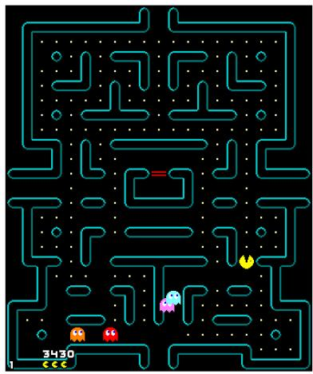  
Maintained belief

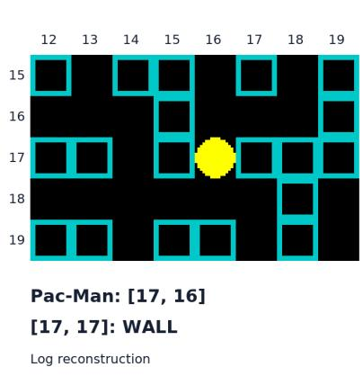

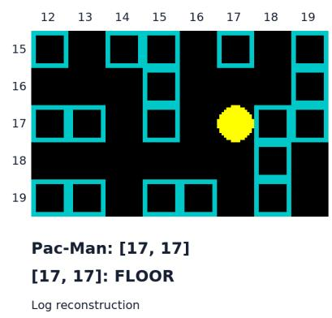  
Figure 6: Historical screenshot-feedback trace with memory overwrite and an unresolved engine artifact, at observation 59 on the fixed map with seed 984001 and single-life termination. Left: recorded native screenshot, with original RGB pixels, HUD, actor orientations and ghost/wall overlap retained; enlargement uses nearest-neighbor scaling. Right: the same 5 × 8 visible label and maintained-belief crops, drawn with native-engine glyphs from logged cell labels, not recorded game frames or new experimental runs. The stationary Pac-Man glyph carries no heading claim; no pellets or ghosts have been added to the origina diagnostic crop. The primary actor query gives the correct [17, 16] but has five ghost records and is rejected; the subsequent full-map recovery incorrectly places Pac-Man at [17, 17], preceding a wall-to-floor overwrite confirmed at observations 59–60. Its unknown cell [23, 2] remains in the full recovery record outside this crop; the maintained belief is not native game truth. The preceding native record places a pink ghost on a wall tile, so no engine anomaly has been repaired or hidden, and this example does not isolate visual failure. Private truth is diagnostic only; details appear in Appendix P.6.

## Diagnostic Checks and Open Interventions

Choose the layer before the intervention. Target the im- plicated layer. The harness factorial supports its named mech- anisms; traces and local oracle tests do not measure full- game rescue. Human investigators select interventions; au- tonomous self-improvement remains untested (Appendix P).

Accurate fields can still leave a controller without mo- tion. In a later four-game public-memory panel, checked player positions and pellet sets are exact and frightened-time intervals contain native values across 431 decisions; none clears. At least one active ghost has unknown heading in 291 frames. Harness versions, seeds and interfaces difer from earlier panels. Selected-field accuracy therefore does not certify complete control state.

The frozen one-step gate audits every pre-action state over its recorded open-action set: original inputs, unknown active-heading replacement, active-ghost pixel replacement, or both. Substitutions require bidirectionally unique ex- act cell/state matches, preserving known headings, ambigu- ous/unmatched records and ghost counts. Native values re- main private diagnostics. Table 23 includes all frames and a heading-independent strict 321-state subset with four dis- tinct, uniquely matched estimated/native ghosts.

Heading replacement changes 200 all-false frames to ad- mit an action; both replacements change 199. Pixel-only leaves these classes unchanged, but the combined arm is not strictly better, precluding universal pixel irrelevance. Unsup- ported heading can reject an action before excluding distant ghosts: false can mean insuficient input, rather than inevitable collision. The 559 heading substitutions difer in unit from 291 afected frames. No game advances or subse- quent route survival is established (Appendix N, including matching, coverage and earlier probes).

<table><tr><td>Recorded states</td><td>Original</td><td>Heading</td><td>Pixel</td><td>Both</td></tr><tr><td>All 431</td><td>292</td><td>92</td><td>292</td><td>93</td></tr><tr><td>Strict 321</td><td>190</td><td>1</td><td>190</td><td>2</td></tr></table>

Table 23: Frames with no action admitted by the frozen gate. Heading fills only unknown active headings; pixel changes only matched native subcell positions. Counts are correlated recorded states, not games, safe-action labels or win-rate improvements.

A separate learning-signal diagnosis. A separate public- feedback language-LoRA lineage distinguishes collection from learning. Across fifteen matched inputs, checkpoint 4 to 15 has mean total variation 61.33%; for twelve ver- ified A0/Avoid inputs, mean option probability rises from 15.22% to 80.10%. In batches 32–63, 423 of 6,144 attempts fault, masking 72 of 512 twelve-sample groups. All 440 remaining groups have constant original reward; an ofline pellet-progress proxy varies within all 440. This is unused discriminatory information, not trained improvement or an explanation of the action-head panel. Neither policy drift nor numerical mismatch proves outcome causation; backend qualifications remain in Appendix O.

A minimum component claim needs its own intervention. Verify trajectories and suspect fields before freezing comparisons. Memory interventions change only the overwrite rule, holding native/RNG state, public receipts, policy, candidates and action budget fixed; retain initial-map errors separately. Score headings against declared motion targets, then eval- uate deployable estimators in full games. Fixed actions test bookkeeping; new actions test closed-loop benefits. Retain deaths, faults and costs, since aborts can prevent deaths with- out clearing. These interventions remain proposed.

Implications for spatial-agent evaluation. Separate ge- ometry from decisions, distinguishing walls, consumable pellets and moving actors; cell accuracy hides persistent er- rors. Declare motion targets: past displacement difers from future heading after a turn. State each score’s and compar- ison’s information contract for pixels, feedback, rules and private state; engine positions change the screenshot task. Retain outcomes, field audits, costs and within-seed pairing; distinguish new topologies from new executions. Fixed-map and held-out ASCII panels do not replace full visual-agent unseen-layout evaluation. Selected traces do not establish population-level causation.

Limits and next tests. This single-game, mostly single- family study lacks multiple training seeds and system- atic unseen-layout evaluation of the complete screenshot system; held-out ASCII results do not fill that gap. Un- resolved provenance remains historical. Repeated checks and best-checkpoint selection do not establish stable re- covery. Full-episode memory-rule and heading-estimator in- terventions remain future work. Corrective practice needs search-teacher/simple-rule comparisons, assistance-free stu- dent evaluation, retained-skill checks and costs; the existing 4/8 versus 5/8 screen tests inference assistance only (Ap- pendix F.1).

Reproducibility and AI assistance. Appendices docu- ment interfaces, checkpoints, denominators and missing provenance. Recipe release depends on company approval and proprietary-infrastructure boundaries (Appendix Q). AI assisted draftin , code/source ins ection, anal sis and re- sentation; model outputs remain observations. Authors retain responsibility for claims, citations, artifacts and submission.

## Q Artifact Scope and Release Status

The accompanying review package is deliberately narrower than a full training release. It contains sanitized evidence ledgers, CPU-only fixed-map paired-statistics code, recorded gate-output aggregation, and a reference input-substitution core. The paired analysis recomputes 128 seed pairs; the gate census re-aggregates all 431 recorded outputs and its

321-state strict subset. The packaged checks were rerun af- ter extraction. Gate-output aggregation verifies the supplied outputs, not the original gate computation: repeating that computation requires raw states and the frozen gate callback, which are not distributed in this package.

The package excludes model weights, private trajectories, credentials, server paths, repository history and third-party game sources. It is not a complete game environment or train- ing reproducer. Historical settings and unavailable original manifests remain marked as such in the relevant appendices. All numerical claims retain the unit and source scope of their panel.

Subject to employer and other rights-holder authorization, we plan to release the experimental recipe supporting this case study: task-specific configurations and procedures, re- leasable training/evaluation logic, and analysis scripts for the reported findings. The contribution is the documented failure analysis and condition-specific lessons, rather than a new infrastructure stack. Company-proprietary infrastruc- ture is outside this commitment; its disclosure is governed by company policy. For internal dependencies, the recipe will document their role, interfaces and required settings, with portable alternatives where available. Model weights and third-party sources are not implicitly included. The release will distinguish original configurations from reconstructions and identify unavailable historical inputs rather than promise exact recovery of every run.

The maintained companion is https://where-it-breaks- review.vercel.app/; it provides the manuscript and recorded demonstrations. Apache-2.0 is proposed for original recipe code only where the employer and other rights holders au- thorize its release and licensing; third-party dependencies retain their own terms. The current analysis archive is not a complete training release, and local source candidates are not claimed publicly available. Identifying repository links are omitted during review. The anonymous archive’s README identifies runnable analyses, input-dependent reference code and omissions explicitly.