# Act-HiMotif: Hierarchical Daily Activity Schedule Generation via Learned Activity-Structure Motifs

Yushi Bai1,2, Kang Liu1,3,4∗, Ling Yin1,3,4, Wei Wang5, Yilin Lyu1,3,6

1Shenzhen Institutes of Advanced Technology, Chinese Academy of Sciences, Shenzhen, China

2School of Computer Science and Engineering, Macau University of Science and Technology, Macau, China

3Shenzhen University of Advanced Technology, Shenzhen, China

4University of Chinese Academy of Sciences, Beijing, China

5City University of Hong Kong, Hong Kong, China

6Beijing Normal-Hong Kong Baptist University, Zhuhai, China

3250009371@student.must.edu.mo, kang.liu@siat.ac.cn, yinling@siat.ac.cn

wwang326@cityu.edu.hk, lyuyilin@uic.edu.cn

## Abstract

Generating daily activity schedules from individual attributes (e.g., age and income) is valuable for activity-based travel modeling and human behavior simulation. The task is challenging because exact activity structures follow a highly imbalanced, long-tailed distribution, while the same structure can admit multiple duration allocations under a fixed fullday budget. Direct generation must therefore learn many exact activity structures from highly uneven observations while modeling their possible temporal realizations. However, many exact structures share recurring activity organization. Based on this observation, we propose Act-HiMotif, a hierarchical motif-based generative model that introduces learned, reusable activity-structure motifs as an intermediate representation between individual profiles and specific activity structures. Act-HiMotif first distinguishes home-only days from active days, then samples a motif from a profile-conditioned prior to guide activity-structure generation, and finally applies a budget-constrained duration allocator to generate activity durations that sum exactly to the full-day horizon. This hierarchy models home-only routing, activity-structure generation, and duration allocation at their corresponding levels, while motifs allow related structures to share statistical support without losing their distinct sequences. Experiments on large-scale travel survey data show that Act-HiMotif outperforms strong baselines in both in-distribution and spatial generalization settings, demonstrating the efectiveness of hierarchical generation and reusable activity-structure motifs for producing realistic profile-conditioned daily activity schedules.

## Introduction

Daily activity schedules describe which activities individuals perform, in what order, and for how long (Krishna et al. 2018; Yuan et al. 2024, 2022). They provide important behavioral inputs for activity-based travel demand modeling, synthetic population simulation, and human mobility analysis (Bowman and Ben-Akiva 2001; Luca et al. 2021; Kapp, Hansmeyer, and Mihaljević 2023; Fan et al. 2026). Because household travel surveys are costly to collect at scale (Badu-Marfo, Farooq, and Patterson 2020; Lyu et al. 2026), profileconditioned daily activity schedule generation seeks to synthesize plausible complete schedules from attributes such as age, employment status, and income (Shone and Hillel 2026; Liao et al. 2026; Li et al. 2024), enabling activity behavior to be assigned to synthetic populations and profile-aware agents (Drchal, Čertický, and Jakob 2019; Shone and Hillel 2025; Liu et al. 2024; Park et al. 2023; Wang et al. 2024).

Traditional activity-based models assemble schedules through prespecified behavioral components and contextspecific calibration, while recent deep generative methods learn schedules directly from travel records but generally model complete schedules or activity chains as a single generation target (Pougala, Hillel, and Bierlaire 2023; Bowman and Ben-Akiva 2001; Arentze and Timmermans 2004; Bhat 2008; Shone and Hillel 2026; Liao et al. 2026). Prior mobility studies have also identified recurring daily motifs and long-tailed visitation patterns (Schneider et al. 2013; Xu et al. 2024). Figure 1 highlights two dificulties of activityschedule generation. First, exact activity structures are highly imbalanced and long-tailed: in the 2017 U.S. National Household Travel Survey (NHTS), the home-only structure accounts for 19.1% of person-days, whereas 90.5% of distinct structures occur no more than five times. Nevertheless, many structures share recurring work- or school-centered organization. Second, the same ordered activity structure can have multiple duration allocations, all of which must satisfy the fixed full-day budget. Consequently, direct generation must learn diverse activity structures from highly uneven observations while simultaneously producing temporally valid schedules.

To address these challenges, we propose Act-HiMotif based on two key ideas. The first is a hierarchical formulation tailored to the distinct components of a daily schedule. The model must determine whether a day is home-only or active, generate the ordered activities for an active day, and allocate the full-day duration among them. Treating these decisions as a flat generation target requires a single model to simultaneously handle the prominent home-only outcome, combinatorial activity structures, and the global temporal constraint. A coarse-to-fine formulation instead models these sources of variation at their corresponding levels while producing a complete and valid schedule. The second key idea is the use of activity-structure motifs. Although exact activity structures follow a long-tailed distribution, many rare structures are variations of recurring activity organizations. For example, the home–work–home, home–work–meal–home, and home–work–shop–home structures in Figure 1A share a recognizable work-centered organization. Modeling each exact structure independently prevents rare structures from benefiting from related observations, whereas assigning them to a single predefined category would remove meaningful differences in activity presence and ordering. Learned activitystructure motifs allow related structures to share statistical support while preserving their distinct activity sequences.

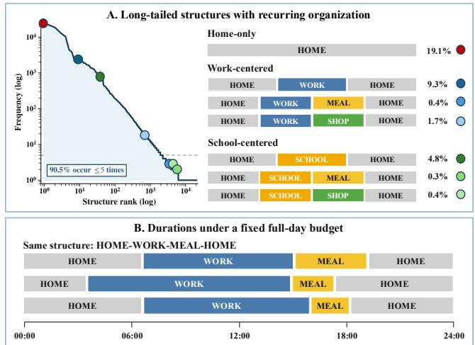  
Figure 1: Motivating properties of daily activity schedules: A. long-tailed activity structures with recurring patterns and B. multiple duration allocations for the same structure under the full-day time constraint.

Act-HiMotif integrates these ideas into a hierarchical motif-based generation process. A Profile Encoder represents the individual profile and day-of-week information, and an Active-Day Gate first distinguishes home-only from active days. A home-only outcome directly produces the full-day home schedule. For an active day, a Profile-Conditioned Motif Prior samples a motif from the discrete space learned from duration-free activity structures by the Vector-Quantized Motif Learner. The Motif-Conditioned Structure Decoder then generates an exact activity structure, after which the Budget-Constrained Duration Allocator assigns positive episode durations that sum exactly to the fullday horizon. The resulting hierarchy separates home-only routing, activity-structure generation, and constrained duration allocation, while motif conditioning enables statistica sharing across related structures.

Experiments on 264,234 person-day schedules derived from the 2017 U.S. NHTS show that Act-HiMotif consistently improves the structural and temporal fidelity of profile-conditioned daily activity schedules under both indistribution and spatial generalization evaluation.

Our main contributions are summarized as follows:

• We develop a hierarchical profile-conditioned generative framework that separates home-only routing, exact activity-structure generation, and budget-constrained duration allocation, producing complete schedules under a fixed full-day budget.

• We introduce learned, reusable activity-structure motifs as an intermediate representation between profile conditions and exact activity structures, enabling information sharing across long-tailed structures while preserving their distinct activity sequences.

• We conduct extensive experiments on large-scale travel survey data and demonstrate consistent improvements over strong baselines under both in-distribution and spatial generalization settings, with code provided in the Supplementary Material.

## Related Work

Traditional activity-based schedule generation. Traditional activity-based travel demand models generate daily schedules by decomposing activity participation and scheduling into linked behavioral decisions concerning activities, tours, destinations, modes, and timing (Bowman and Ben-Akiva 2001). Computational process models such as ALBATROSS implement these decisions through rule- or decision-tree-based mechanisms, while MDCEV formulations jointly model participation in multiple activities and the allocation of finite temporal resources (Arentze and Timmermans 2004; Bhat 2008). These approaches provide behaviorally interpretable scheduling mechanisms and explicitly represent behavioral or temporal constraints. However, they rely on prespecified decision structures, behavioral assumptions, and substantial context-specific calibration.

Deep generative activity-schedule generation. Deep generative methods learn activity participation, ordering, and timing directly from observed diaries, reducing the need for manually specified behavioral rules. Early data-driven schedulers use recurrent models to generate sequential activity decisions from travel-survey records (Badu-Marfo, Farooq, and Patterson 2020; Drchal, Čertický, and Jakob 2019; Shone and Hillel 2025). More recent methods introduce stochastic latent representations or structured behavioral mechanisms: ActVAE employs a conditional variational autoencoder to generate diverse schedules from individual attributes, Need-Dynamics models activity generation through evolving human needs, and DeepActivity generates profile-conditioned activity and location chains (Shone and Hillel 2026; Yuan et al. 2024; Liao et al. 2026). Although these approaches improve data-driven activity generation, they generally model complete schedules or activity chains directly.

LLM-based activity and travel-diary generation. Recent LLM-based approaches generate daily activities and travel diaries by incorporating semantic knowledge, individual profiles, and explicit behavioral reasoning. LLMob represents individuals as language-model agents whose mobility decisions are guided by habitual patterns and current motivations (Wang et al. 2024). MobAgent uses individual profiles to extract mobility patterns and generate personalized travel diaries, while TravelReasoner reformulates trip-chain generation as an explicit reasoning process (Li et al. 2024; Liu, Xu, and Li 2026). ActivityEditor further employs generation and editing agents to iteratively refine activity chains under behavioral and physical constraints (Yang et al. 2026). These methods enhance semantic and intention-aware activity generation, but typically depend on language-model reasoning or iterative refinement.

## Problem Formulation

We study profile-conditioned daily activity schedule generation. Each person-day is associated with a profile condition $\mathbf { x } = ( x _ { 1 } , \ldots , x _ { F } ) \in \mathcal { X }$ , which includes individual attributes and day-of-week information. Here, $F$ is the number of conditioning fields, $x _ { f }$ is the value of the f-th field, and X is the profile space.

A daily activity schedule contains a variable number of ordered activity episodes and is represented as

$$
Y = \left( ( c _ { 1 } , d _ { 1 } ) , \dots , ( c _ { K } , d _ { K } ) \right) = ( S , \mathbf { d } ) ,\tag{1}
$$

where K is the number of episodes, $c _ { k } \in \mathcal { C }$ is the activity type of episode $k ,$ and $d _ { k } \in \mathbb { N } _ { + }$ is its duration in discrete time slots. The activity structure $\boldsymbol { S } = \left( c _ { 1 } , \dots , c _ { K } \right)$ records the ordered activity types, and the duration vector $\mathbf { d } = \left( d _ { 1 } , \ldots , d _ { K } \right)$ specifies their temporal allocation. For a full-day horizon of $T$ slots, a valid schedule satisfies

$$
c _ { k } \neq c _ { k + 1 } ( 1 \leq k < K ) , \qquad d _ { k } \geq 1 , \qquad \sum _ { k = 1 } ^ { K } d _ { k } = T .\tag{2}
$$

The first condition reflects the canonical episode-level representation obtained by merging adjacent occurrences of the same activity type, while the remaining conditions ensure that all episodes have positive duration and exactly cover the full-day horizon.

Given an observed dataset $\mathcal { D } = \{ ( \mathbf { x } ^ { ( i ) } , Y ^ { ( i ) } ) \} _ { i = 1 } ^ { N }$ , our goal is to learn a conditional distribution $P _ { \theta } ( Y \mid \mathbf { x } )$ over valid daily schedules, where θ denotes the learnable model parameters. This distributional formulation allows the same or similar profile conditions to correspond to multiple plausible activity structures and duration allocations.

## Methodology

Act-HiMotif generates a daily activity schedule in a coarseto-fine manner. Given a profile condition, it first distinguishes home-only from active days. For an active day, it samples a reusable activity-structure motif, generates an activity structure conditioned on the profile and motif, and allocates episode durations under the fixed full-day budget. Figure 2(a) presents the complete generation path, while Figures 2(b) and 2(c) detail the training-only motif learner and the budget-constrained duration allocator, respectively.

## Profile-Conditioned Activity-Structure Generation

Profile Encoding and Active-Day Gate Each categorical profile field, including day-of-week information, is mapped through a field-specific embedding. The field embeddings are concatenated and transformed by a multilayer perceptron $f _ { x }$ to obtain the shared profile representation $\mathbf { h } _ { x } = f _ { x } ( \mathbf { x } )$ which conditions the subsequent generation modules.

Let $A \in \{ 0 , 1 \}$ be the active-day indicator, where $A = 0$ denotes a home-only day and $A = 1$ denotes a day containing at least one non-home activity. The Active-Day Gate computes

$$
p _ { A } ( \mathbf { x } ) = P _ { \theta _ { A } } ( A = 1 \mid \mathbf { x } ) = \sigma ( g _ { A } ( \mathbf { h } _ { x } ) ) ,\tag{3}
$$

where $g _ { A }$ is a binary prediction head, $\sigma ( \cdot )$ is the sigmoid function, and $p _ { A } ( \mathbf { x } )$ is the active-day probability. If $\bar { A } = 0 ,$ the model directly returns the full-day home schedule $Y =$ $( ( \mathrm { H } , T ) )$ . Conditional on $A = 1$ , the remaining generation process factorizes as

$$
\begin{array} { r l } & { P _ { \theta } ( z , S , \mathbf { d } \mid \mathbf { x } , A = 1 ) = P _ { \theta _ { z } } ( z \mid \mathbf { x } , A = 1 ) } \\ & { \ \cdot P _ { \theta _ { S } } ( S \mid z , \mathbf { x } , A = 1 ) \cdot P _ { \theta _ { D } } ( \mathbf { d } \mid S , z , \mathbf { x } , A = 1 ) , } \end{array}\tag{4}
$$

where the motif z captures reusable structural organization, $S$ specifies its exact activity sequence, and d provides a valid temporal realization under the full-day budget.

Learning Reusable Activity-Structure Motifs We learn motifs from duration-free active-day structures so that they capture recurring activity presence and ordering. Given an observed active-day structure $\boldsymbol { S } ~ = ~ \left( c _ { 1 } , \ldots , c _ { K } \right)$ , a bidirectional GRU encodes the activity-token sequence into a continuous structure representation $\mathbf { h } _ { S }$ . Let $\{ \bar { \mathbf { e } } _ { m } \} _ { m = 1 } ^ { M }$ be a codebook of M learnable motif embeddings. The structure is assigned to its nearest motif according to

$$
z ^ { \star } = \arg \operatorname* { m i n } _ { 1 \leq m \leq M } \left\| \mathbf { h } _ { S } - \mathbf { e } _ { m } \right\| _ { 2 } ^ { 2 } ,\tag{5}
$$

where $z ^ { \star }$ is the nearest-motif index and $\mathbf { e } _ { z ^ { \star } }$ is the selected motif embedding.

A GRU reconstruction decoder is initialized from $\mathbf { e } _ { z } ,$ ⋆ and reconstructs the exact activity structure autoregressively. Let $c _ { 0 } = \langle \mathrm { B O S } \rangle$ and $c _ { K + 1 } = \langle \mathrm { E O S } \rangle$ . The token-level reconstruction loss is

$$
\mathcal { L } _ { \mathrm { r e c } } = - \sum _ { k = 1 } ^ { K + 1 } \log P _ { \phi } ( c _ { k } \mid c _ { 0 : k - 1 } , \mathbf { e } _ { z ^ { \star } } ) ,\tag{6}
$$

where $c _ { 0 : k - 1 }$ denotes the observed tokens preceding position $k .$ . Reconstructing the exact sequence encourages each motif to retain information about activity ordering.

We use the standard nearest-neighbor vector-quantization bottleneck of VQ-VAE (van den Oord, Vinyals, and kavukcuoglu 2017), while adopting a task-specific BiGRU– GRU autoencoder for activity structures. Its core objective is

$$
\mathcal { L } _ { \mathrm { V Q } } = \mathcal { L } _ { \mathrm { r e c } } + \Vert \mathrm { s g } [ \mathbf { h } _ { S } ] - \mathbf { e } _ { z ^ { \star } } \Vert _ { 2 } ^ { 2 } + \beta \left. \mathbf { h } _ { S } - \mathrm { s g } [ \mathbf { e } _ { z ^ { \star } } ] \right. _ { 2 } ^ { 2 } ,\tag{7}
$$

where $\mathrm { s g } [ \cdot ]$ is the stop-gradient operator and $\beta$ is the commitment weight. The forward pass uses the selected motif embedding, while the straight-through estimator propagates reconstruction gradients to the structure encoder.

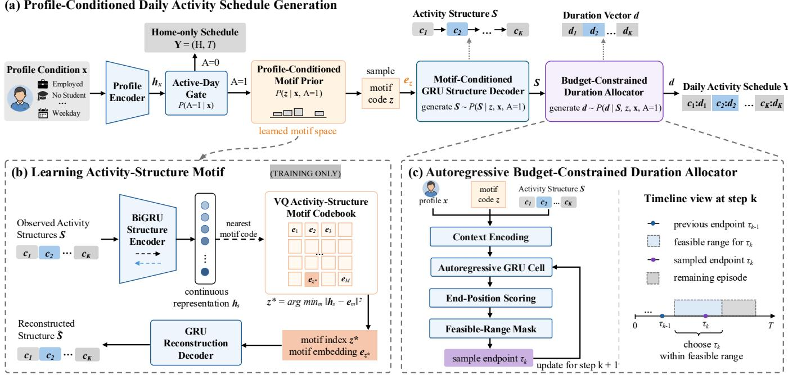  
Figure 2: Overview of Act-HiMotif: (a) hierarchical profile-conditioned schedule generation, (b) training-only learning of reusable activity-structure motifs, and (c) autoregressive budget-constrained duration allocation.

We additionally discourage codebook collapse through a batch-level usage regularizer. For a mini-batch of size $B ,$ $\begin{array} { r } { \mathbf { l e t } q _ { i m } = \operatorname { s o f t m a x } _ { m } ( - \| \mathbf { h } _ { S } ^ { ( i ) } - \mathbf { e } _ { m } \| _ { 2 } ^ { 2 } / \tau _ { \mathrm { d i v } } ) } \end{array}$ denote the soft assignment probability of structure i to motif $m _ { : }$ , where $\tau _ { \mathrm { d i v } }$ is the soft-assignment temperature. The batch average $\bar { q } _ { m } =$ $B ^ { - 1 } \textstyle \sum _ { i = 1 } ^ { B } q _ { i m }$ therefore represents the expected usage of motif m. The complete motif-learning objective is

$$
\mathcal { L } _ { \mathrm { m o t i f } } = \mathcal { L } _ { \mathrm { V Q } } + \lambda _ { \mathrm { d i v } } D _ { \mathrm { K L } } ( \bar { \bf q } \| { \bf u } _ { M } ) ,\tag{8}
$$

where $\mathbf { u } _ { M }$ is the uniform distribution over the M motifs. The regularizer encourages broader codebook utilization, while the forward path continues to use the hard nearest-neighbor assignment in Eq. (5). After this stage, the nearest-motif label $z ^ { \star }$ assigned to each active training structure is fixed and used to supervise the profile-conditioned generator.

Profile-Conditioned Motif Prior For an active day, the Profile-Conditioned Motif Prior predicts which high-level activity organizations are plausible for profile x. A prediction head $g _ { z }$ maps the profile representation $\mathbf { h } _ { x }$ to M motif logits:

$$
P _ { \theta _ { z } } ( z = m \mid \mathbf { x } , A = 1 ) = [ \mathrm { s o f t m a x } ( g _ { z } ( \mathbf { h } _ { x } ) ) ] _ { m } ,\tag{9}
$$

where $m \in \{ 1 , \ldots , M \}$ . The prior is supervised by the nearest-motif label assigned by the frozen motif learner,

$$
\mathcal { L } _ { \mathrm { p r i o r } } = - \log P _ { \theta _ { z } } ( z = z ^ { \star } \mid \mathbf { x } , A = 1 ) .\tag{10}
$$

This categorical prior allows the same profile condition to support multiple plausible activity organizations.

Motif-Conditioned Exact-Structure Decoder A motif captures reusable structural information but does not determine a unique activity sequence. We therefore initialize an autoregressive GRU decoder from the profile representation $\mathbf { h } _ { x }$ and motif embedding $\mathbf { e } _ { z } .$ During training, the decoder uses the observed motif label $z ^ { \star }$ and preceding activity tokens:

$$
\mathcal { L } _ { \mathrm { s t r u c t } } = - \sum _ { k = 1 } ^ { K + 1 } \log P _ { \theta _ { S } } ( c _ { k } \mid c _ { 0 : k - 1 } , \mathbf { h } _ { x } , \mathbf { e } _ { z ^ { \star } } , A = 1 ) ,\tag{11}
$$

where $c _ { 0 : k - 1 }$ denotes the observed preceding tokens. The motif embedding provides shared structural information across related schedules, while the profile representation retains individual- and day-specific conditioning. At inference, adjacent identical decoded activity tokens are merged before duration allocation, yielding the canonical episode-level structure defined in Eq. (2).

## Autoregressive Budget-Constrained Duration Allocation

Given an exact activity structure, episode durations remain stochastic but must be positive and jointly exhaust the fixed daily budget. We therefore parameterize duration allocation through a strictly increasing sequence of episode endpoints. For a structure $\boldsymbol { S } = \left( c _ { 1 } , \dots , c _ { K } \right)$ , let $\tau _ { k }$ denote the endpoint of episode k. We set $\tau _ { 0 } = 0$ and fix $\tau _ { K } = T$ , such that

$$
0 = \tau _ { 0 } < \tau _ { 1 } < \cdot \cdot \cdot < \tau _ { K } = T , \qquad d _ { k } = \tau _ { k } - \tau _ { k - 1 } .\tag{12}
$$

The allocator combines activity-type and episode-position embeddings and encodes the complete structure with a bidirectional GRU, producing contextual episode representations. A pooled structure representation, together with the profile representation $\mathbf { h } _ { x }$ and motif embedding $\mathbf { e } _ { z } ,$ , initializes the recurrent allocation state.

At allocation step k, let $\mathbf { u } _ { k }$ denote the step context that combines three types of information: global profile and motif conditioning, the contextual representation of the complete activity structure, and the current allocation state, including the previous endpoint and duration, remaining time budget, and remaining episode count. The recurrent update and endpoint scoring are

$$
\begin{array} { r } { \mathbf { s } _ { k } = \mathrm { G R U C e l l } ( \mathbf { u } _ { k } , \mathbf { s } _ { k - 1 } ) , \qquad \mathbf { o } _ { k } = g _ { \tau } ( \mathbf { s } _ { k } ) , } \end{array}\tag{13}
$$

where s is the recurrent allocation state, $\mathbf { o } _ { k }$ contains the scores of all candidate endpoint positions, and $g _ { \tau }$ is the endpoint-scoring head. This context allows the allocator to account for both previous allocations and upcoming activities.

For each internal endpoint $\tau _ { k } , k = 1 , \ldots , K - 1$ , the candidate scores $\mathbf { o } _ { k }$ are masked outside the feasible range

$$
\tau _ { k - 1 } + 1 \leq \tau _ { k } \leq T - ( K - k ) .\tag{14}
$$

The lower bound assigns at least one time slot to the current episode, while the upper bound reserves at least one slot for every remaining episode. A softmax over the feasible scores defines the endpoint distribution $p _ { k } ( t )$ for candidate position t.

During training, the observed previous endpoints and durations are used as recurrent feedback. Let $\begin{array} { r l } { \bar { \tau } _ { k } } & { { } = } \end{array}$ $\scriptstyle \sum _ { t = 0 } ^ { T } t p _ { k } ( t )$ denote the conditional mean endpoint at step k under the observed preceding allocations. Setting $\bar { \tau } _ { 0 } = 0$ and $\bar { \tau } _ { K } = T$ , we define $d _ { k } = \bar { \tau } _ { k } - \bar { \tau } _ { k - 1 }$ as a boundary-derived duration surrogate for auxiliary supervision. Let τ and τ¯ collect the observed and conditional-mean internal endpoints, and let d¯ collect the corresponding duration surrogates. The duration objective is

$$
\begin{array} { r l } & { \mathcal { L } _ { \mathrm { d u r } } = \mathcal { L } _ { \mathrm { e n d } } + \lambda _ { \tau } \mathrm { H u b e r } ( \bar { \tau } / T , \tau / T ) } \\ & { ~ + ~ \lambda _ { d } \mathrm { H u b e r } \big ( \bar { \bf d } / T , { \bf d } / T \big ) , } \end{array}\tag{15}
$$

where $\begin{array} { r } { \mathcal { L } _ { \mathrm { e n d } } ~ = ~ - \sum _ { k = 1 } ^ { K - 1 } \log p _ { k } ( \tau _ { k } ) } \end{array}$ is the cross-entropy loss on the observed internal endpoints. The endpoint loss trains the autoregressive endpoint distributions, while the two Huber terms provide auxiliary supervision for cumulative timing and boundary-derived duration allocation. For every nonempty structure passed to the allocator, enforcing Eq. (14) and fixing $\tau _ { K } = T$ ensure that the sampled durations are positive integers and sum exactly to the full-day horizon, without post-hoc duration repair.

## Training Objective and Inference

Act-HiMotif is trained in two stages. First, the motif learner is optimized on duration-free active-day structures, producing a VQ codebook and a motif label $z ^ { \star }$ for each active training structure. The VQ motif learner, including its codebook, and the resulting motif assignments are then frozen. In the second stage, a separate generator-side motif embedding table is initialized from the frozen codebook and optimized jointly with the remaining generation modules. For notational simplicity, $\mathbf { e } _ { z }$ in the generator equations denotes this adaptive generatorside embedding, while the motif assignments $z ^ { \star }$ remain defined by the frozen VQ codebook. Thus, the discrete motif partition learned in the first stage remains fixed, while its generator-side embeddings adapt to the profile-conditioned generation objective.

The Active-Day Gate is trained with the binary crossentropy $\mathcal { L } _ { A }$ over all person-days. The second-stage objective is

$$
\begin{array} { r } { \mathcal { L } = \lambda _ { A } \mathcal { L } _ { A } + \lambda _ { M } \mathcal { L } _ { \mathrm { p r i o r } } + \lambda _ { S } \mathcal { L } _ { \mathrm { s t r u c t } } + \lambda _ { D } \mathcal { L } _ { \mathrm { d u r } } , } \end{array}\tag{16}
$$

where $\mathcal { L } _ { \mathrm { p r i o r } } , \mathcal { L } _ { \mathrm { s t r u c t } } ,$ and ${ \mathcal { L } } _ { \mathrm { d u r } }$ are evaluated only on activeday schedules. The coeficients control the relative contributions of the four training objectives. During second-stage training, the structure decoder uses the observed activity prefix, while the duration allocator uses the observed preceding endpoints and durations. At inference, the model first samples the active-day indicator. A home-only outcome directly yields $Y = \mathrm { ( ( H , } \mathbf { \bar { \it { T } } } \mathrm { ) ) }$ ; otherwise, it successively samples a motif, decodes an exact activity structure, and allocates feasible episode endpoints to produce the complete schedule.

## Experiments

## Experimental Setup

Dataset. We use the public 2017 U.S. National Household Travel Survey (NHTS), which records assignedday travel together with demographic and household attributes (McGuckin and Fucci 2018). We construct 264,234 person-day schedules with nine activity categories and 48 half-hour slots, merging adjacent identical activities into episodes. The profile condition includes age band, sex, employment status, student status, education level, householdincome group, and day of week. We use a person-disjoint 70/15/15 split for in-distribution evaluation. For spatial generalization, we use a CBSA-disjoint 70/15/15 split, where CBSAs are county-based U.S. statistical areas centered on urban cores; no disclosed CBSA overlaps across the subsets.

Baselines. We compare four activity-schedule generators—ConditionalRNN (Koushik et al. 2023), GenerativeRNN (Shone and Hillel 2025), ActVAE (Shone and Hillel 2026), and DeepActivity-ZS (Liao et al. 2026)— and four mobility generators: ControlTraj (Zhu et al. 2024), TrajGPT (Hsu et al. 2024), CoDifMob (Zhang et al. 2025), and MobilityGPT (Haydari et al. 2026). DeepActivity-ZS is evaluated zero-shot without target-region fine-tuning. All methods use the same splits, generation sizes, and evaluation procedures, and all conditional models receive identical profile fields.

Evaluation Metrics. We evaluate schedule complexity, temporal allocation, and sequential organization. Episode JSD compares episode-count distributions. Duration JSD and Start JSD compare activity-specific duration and starttime distributions and are macro-averaged over activity categories, while Slot JSD compares activity composition over the 48 daily slots. These metrics use Jensen–Shannon divergence (Lin 1991). Transition CPC measures the overlap between observed and generated activity-transition volumes (Simini et al. 2021; Zhang et al. 2025). Lower JSD and higher CPC indicate better fidelity.

Table 1: Five-seed mean performance under in-distribution and spatial-generalization evaluation. Best and second-best results are bolded and underlined.
<table><tr><td rowspan="2">Method</td><td colspan="5">In-distribution</td><td colspan="5">Spatial generalization</td></tr><tr><td>Epi.↓</td><td>Dur.↓</td><td>Start↓</td><td>Slot.↓</td><td>CPC↑</td><td>Epi.↓</td><td>Dur.↓</td><td>Start↓</td><td>Slot.↓</td><td>CPC↑</td></tr><tr><td>ConditionalRNN</td><td>0.3092</td><td>0.3646</td><td>0.4642</td><td>0.0311</td><td>0.4919</td><td>0.3468</td><td>0.3571</td><td>0.4496</td><td>0.0366</td><td>0.4479</td></tr><tr><td>GenerativeRNN</td><td>0.0100</td><td>0.0257</td><td>0.0334</td><td>0.0047</td><td>0.8900</td><td>0.0233</td><td>0.0385</td><td>0.0512</td><td>0.0063</td><td>0.8497</td></tr><tr><td>ActVAE</td><td>0.0314</td><td>0.0419</td><td>0.0325</td><td>0.0088</td><td>0.8591</td><td>0.0459</td><td>0.0571</td><td>0.0429</td><td>0.0071</td><td>0.8770</td></tr><tr><td>DeepActivity-ZS</td><td>0.2310</td><td>0.2817</td><td>0.3593</td><td>0.0269</td><td>0.5136</td><td>0.2200</td><td>0.2623</td><td>0.3722</td><td>0.0282</td><td>0.5092</td></tr><tr><td>ControlTraj</td><td>0.1492</td><td>0.1164</td><td>0.1016</td><td>0.0075</td><td>0.7184</td><td>0.1810</td><td>0.1220</td><td>0.1144</td><td>0.0078</td><td>0.7278</td></tr><tr><td>TrajGPT</td><td>0.0073</td><td>0.0181</td><td>0.0502</td><td>0.0017</td><td>0.9266</td><td>0.0042</td><td>0.0182</td><td>0.0276</td><td>0.0010</td><td>0.9338</td></tr><tr><td>CoDiffMob</td><td>0.1373</td><td>0.1043</td><td>0.1086</td><td>0.0070</td><td>0.7116</td><td>0.1468</td><td>0.0822</td><td>0.1224</td><td>0.0077</td><td>0.7285</td></tr><tr><td>MobilityGPT</td><td>0.1490</td><td>0.0417</td><td>0.0144</td><td>0.0122</td><td>0.8836</td><td>0.1711</td><td>0.0533</td><td>0.0258</td><td>0.0146</td><td>0.8891</td></tr><tr><td>Act-HiMotif</td><td>0.0014</td><td>0.0013</td><td>0.0045</td><td>0.0001</td><td>0.9749</td><td>0.0021</td><td>0.0042</td><td>0.0120</td><td>0.0002</td><td>0.9653</td></tr><tr><td>Improvement</td><td>80.2%</td><td>93.0%</td><td>68.9%</td><td>93.8%</td><td>5.2%</td><td>50.2%</td><td>76.9%</td><td>53.5%</td><td>84.8%</td><td>3.4%</td></tr></table>

Implementation Details. Act-HiMotif uses a motif codebook of size $M = 2 5 6$ . The motif learner and the profileconditioned generator are trained with AdamW using a learning rate of $\mathrm { \check { 1 0 } ^ { - 3 } }$ and a batch size of 1024 for at most 40 epochs. The second stage uses early stopping with a patience of 8 based on validation joint loss. We report results over five seeds, 2026–2030, and generate one schedule for each test profile. All experiments were conducted on a single NVIDIA GeForce RTX 3090 GPU.

Further preprocessing, baseline-adaptation, implementation, and sensitivity details are provided in Appendix A.

## Overall Performance

Table 1 compares both evaluation protocols. Among the baselines, MobilityGPT is most competitive on activity start times, whereas TrajGPT better captures schedule complexity, duration distributions, daily activity composition, and transitions. In contrast, Act-HiMotif achieves the best performance across all structural and temporal metrics. Its gains in Duration and Slot JSD indicate more faithful allocation of the daily time budget, while the improvements in Episode JSD and Transition CPC show that this temporal fidelity does not sacrifice activity-sequence organization.

These advantages persist under CBSA-disjoint evaluation, where the test regions are absent from training. The consistent improvements across both protocols indicate that Act-HiMotif captures transferable schedule regularities rather than relying on region-specific exact structures, thereby improving the fidelity of the complete schedule distribution. Full mean±standard-deviation results are reported in Appendix B.

## Ablation Study

Table 2 isolates Act-HiMotif’s three main design choices. Removing activity-structure motifs causes the largest degradation in Episode JSD and Transition CPC under both protocols and consistently worsens temporal metrics. This indicates that, beyond compactly representing activity structures, motifs share statistical support across related activity organizations, stabilizing exact-structure generation and the structural basis for duration allocation.

Table 2: Five-seed mean ablation results for the hierarchical components of Act-HiMotif.
<table><tr><td colspan="5">In-distribution</td></tr><tr><td>Variant</td><td>Epi.↓</td><td>Dur.↓</td><td>Start↓</td><td>Slot↓</td><td>CPC↑</td></tr><tr><td>w/o Active-Day Gate (A)</td><td>0.0029</td><td>0.0016</td><td>0.0047</td><td>0.0002</td><td>0.9706</td></tr><tr><td>w/o Act.-Stru. Motifs (z)</td><td>0.0223</td><td>0.0051</td><td>0.0089</td><td>0.0021</td><td>0.8910</td></tr><tr><td>w/o Hie. Gen.  $( \mathbf { x } \to Y )$ </td><td>0.0029</td><td>0.0017</td><td>0.0069</td><td>0.0007</td><td>0.9067</td></tr><tr><td>Act-HiMotif</td><td>0.0014</td><td>0.0013</td><td>0.0045</td><td>0.0001</td><td>0.9749</td></tr><tr><td colspan="6"></td></tr><tr><td colspan="6">Spatial generalization</td></tr><tr><td>Variant</td><td>Epi.↓</td><td>Dur.↓</td><td>Start↓</td><td>Slot↓</td><td>CPC↑</td></tr><tr><td>w/o Active-Day Gate (A)</td><td>0.0025</td><td>0.0045</td><td>0.0125</td><td>0.0003</td><td>0.9568</td></tr><tr><td>w/o Act.-Stru. Motifs (z)</td><td>0.0211</td><td>0.0079</td><td>0.0175</td><td>0.0020</td><td>0.8929</td></tr><tr><td>w/o Hie. Gen. (x → Y)</td><td>0.0052</td><td>0.0022</td><td>0.0160</td><td>0.0008</td><td>0.9170</td></tr><tr><td>Act-HiMotif</td><td>0.0021</td><td>0.0042</td><td>0.0120</td><td>0.0002</td><td>0.9653</td></tr></table>

Removing hierarchical generation produces a diferent failure mode. Although direct profile-to-schedule generation attains lower Duration JSD under spatial generalization, it substantially worsens start-time placement, daily activity composition, and transitions. Thus, matching an isolated duration marginal does not ensure schedule coherence, supporting separate structure generation and budget-constrained duration allocation. Removing the Active-Day Gate causes a smaller but consistent decline, supporting its role in separating home-only from heterogeneous active days. Full five-seed results are provided in Appendix C.

## Further Analysis

Long-Tail Structure-Support Analysis. Figure 3 reveals a clear support-dependent pattern. On Head structures, the motif-free variant is competitive and attains higher Transition CPC, whereas Act-HiMotif maintains stronger duration fidelity. As exact-structure support decreases, Act-HiMotif consistently achieves the best Duration JSD and Transition CPC across the Medium, Rare, Singleton, and Unseen groups under both evaluation protocols. These results indicate that motif conditioning is particularly beneficial for test persondays whose ground-truth structures have limited or no exact support in the training data, consistent with its role in sharing statistical support across related activity organizations.

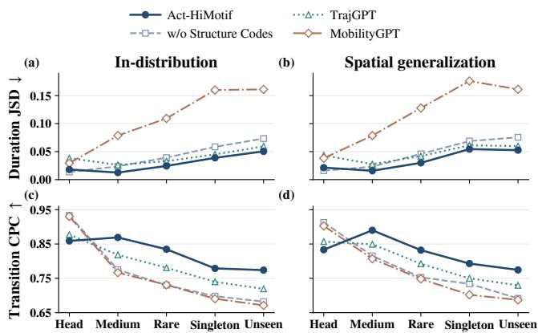  
Figure 3: Duration and transition fidelity by ground-truth structure support. Groups are defined by training frequency: Head $( f _ { \mathrm { t r a i n } } \ ' \ge 1 0 0 )$ , Medium (10–99), Rare (2–9), Singleton (1), and Unseen (0).

Profile–Activity-Chain Alignment. Figure 4 examines whether profile conditioning preserves profile-specific preferences over exact activity structures. For employment and day type, the figure shows the four active-day chains with the largest training-set prevalence diferences toward each profile group. Under CBSA-disjoint spatial generalization, Act-HiMotif generally follows the real contrasts across all four groups, preserving non-employed versus employed and weekend versus weekday preferences. Competing generators more often attenuate these diferences toward zero or distort their relative strengths. This indicates that Act-HiMotif better retains profile-specific preferences over exact activity structures. Full chain-alignment and subgroup-level profile analyses are provided in Appendix D.

Structural and Joint Temporal Fidelity. Marginal Start and Duration JSD do not reveal whether activity durations occur at appropriate times of day. Figure 5 therefore compares their joint distributions under CBSA-disjoint spatial generalization. Across Home, Work, Shopping, and Recreation, Act-HiMotif more closely matches the observed joint temporal patterns than ActVAE and TrajGPT, preserving the broad Home distribution, the concentrated morning-start, long-duration Work mode, and the distinct patterns of Shopping and Recreation. Together with its strong Transition CPC in Table 1, these results indicate that Act-HiMotif captures start–duration dependence while maintaining sequential organization. Additional activity-wise results, transition matrices, and in-distribution analyses are reported in Appendix E.

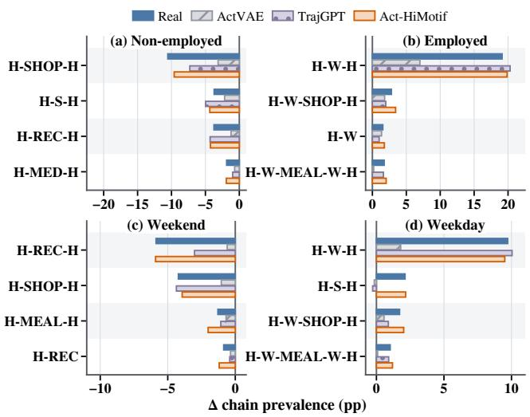  
Figure 4: Profile–activity-chain alignment under CBSAdisjoint spatial generalization. The top four active-day chains by training-set prevalence diference for the corresponding group.

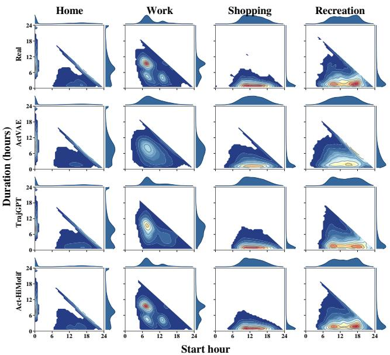  
Figure 5: Observed and generated joint start-time–duration distributions for four representative activities under CBSAdisjoint spatial generalization.

## Conclusion

Act-HiMotif addresses profile-conditioned daily activity schedule generation through a hierarchical motif-based framework that introduces learned, reusable activitystructure motifs between profile conditions and exact activity structures, followed by budget-constrained duration allocation. The results show that activity-structure motifs are especially beneficial for exact structures with limited training support, while separating structure generation from budget-constrained duration allocation improves completeschedule coherence. More broadly, profile-conditioned generators can assign diverse schedules to synthetic population profiles that can be constructed from demographic statistics and microdata such as ACS and PUMS (U.S. Census Bureau 2024, 2021), providing a practical route to population-scale activity-schedule datasets for computational social science, human behavior simulation, activity-based travel modeling, and other profile-aware downstream applications.

Generative AI Use Statement. Large language models were used solely for language polishing. The authors reviewed the final manuscript and take full responsibility for its content.

## References

Arentze, T. A.; and Timmermans, H. J. P. 2004. A Learning-Based Transportation Oriented Simulation System. Transportation Research Part B: Methodological, 38(7): 613–633.

Badu-Marfo, G.; Farooq, B.; and Patterson, Z. 2020. A Differentially Private Multi-Output Deep Generative Networks Approach for Activity Diary Synthesis. arXiv:2012.14574.

Bhat, C. R. 2008. The Multiple Discrete-Continuous Extreme Value (MDCEV) Model: Role of Utility Function Parameters, Identification Considerations, and Model Extensions. Transportation Research Part B: Methodological, 42(3): 274–303.

Bowman, J. L.; and Ben-Akiva, M. E. 2001. Activity-Based Disaggregate Travel Demand Model System with Activity Schedules. Transportation Research Part A: Policy and Practice, 35(1): 1–28.

Drchal, J.; Čertický, M.; and Jakob, M. 2019. Data-driven activity scheduler for agent-based mobility models. Transportation Research Part C: Emerging Technologies, 98: 370– 390.

Fan, Z.; Loo, B. P. Y.; Duarte, F.; Ratti, C.; and Moro, E. 2026. Hidden Patterns of Urban Mixing across Five Global Cities. Nature Cities.

Haydari, A.; Chen, D.; Lai, Z.; Zhang, M.; and Chuah, C.-N. 2026. MobilityGPT: Enhanced Human Mobility Modeling With a GPT Model. IEEE Transactions on Intelligent Transportation Systems, 27(1): 1681–1694.

Hsu, S.-L.; Tung, E.; Krumm, J.; Shahabi, C.; and Shafique, K. 2024. TrajGPT: Controlled Synthetic Trajectory Generation Using a Multitask Transformer-Based Spatiotemporal Model. In Proceedings ofthe 32nd ACM International Conference on Advances in Geographic Information Systems, SIGSPATIAL ’24, 362–371. New York, NY, USA: Association for Computing Machinery. ISBN 9798400711077.

Kapp, A.; Hansmeyer, J.; and Mihaljević, H. 2023. Generative Models for Synthetic Urban Mobility Data: A Systematic Literature Review. ACM Comput. Surv., 56(4).

Koushik, A.; Manoj, M.; Nezamuddin, N.; and Prathosh, A. P. 2023. Activity Schedule Modeling Using Machine Learning. Transportation Research Record: Journal of the Transportation Research Board, 2677(8): 1–23.

Krishna, K.; Jain, D.; Mehta, S. V.; and Choudhary, S. 2018. An LSTM-Based System for Prediction of Human Activities

with Durations. Proceedings of the ACM on Interactive, Mobile, Wearable and Ubiquitous Technologies, 1(4): 1–31.

Li, X.; Huang, F.; Lv, J.; Xiao, Z.; Li, G.; and Yue, Y. 2024. Be More Real: Travel Diary Generation Using LLM Agents and Individual Profiles. arXiv:2407.18932.

Liao, X.; Jiang, Q.; He, B. Y.; Liu, Y.; Kuai, C.; and Ma, J. 2026. Deep Activity Model: A Generative Deep Learning Approach for Human Mobility Pattern Synthesis. IEEE Transactions on Intelligent Transportation Systems, 27(6): 6519–6536.

Lin, J. 1991. Divergence Measures Based on the Shannon Entropy. IEEE Transactions on Information Theory, 37(1): 145–151.

Liu, K.; Jin, X.; Cheng, S.; Gao, S.; Yin, L.; and Lu, F. 2024. Act2Loc: a synthetic trajectory generation method by combining machine learning and mechanistic models. International Journal of Geographical Information Science, 38(3): 407–431.

Liu, P.; Xu, F.; and Li, Y. 2026. TravelReasoner: Leveraging Large Reasoning Models to Address Mobility Data Gap. In Proceedings ofthe ACM Web Conference 2026, WWW ’26, 9341–9351. New York, NY, USA: Association for Computing Machinery. ISBN 9798400723070.

Luca, M.; Barlacchi, G.; Lepri, B.; and Pappalardo, L. 2021. A Survey on Deep Learning for Human Mobility. ACM Computing Surveys, 55(1): 1–44.

Lyu, Y.; Liu, K.; Cao, Z.; Luo, Y.; Yin, L.; Yang, T.; and Chen, Z. 2026. FLAIR: An LLM-integrated multi-layer framework for fine-grained activity type inference in human trajectory data. Transportation Research Part C: Emerging Technologies, 190: 105787.

McGuckin, N.; and Fucci, A. 2018. Summary of Travel Trends: 2017 National Household Travel Survey. Technical Report FHWA-PL-18-019, Federal Highway Administration, Ofice of Policy and Governmental Afairs, Washington, DC. Prepared by Westat, Inc.

Park, J. S.; O’Brien, J.; Cai, C. J.; Morris, M. R.; Liang, P.; and Bernstein, M. S. 2023. Generative Agents: Interactive Simulacra of Human Behavior. In Proceedings of the 36th Annual ACM Symposium on User Interface Software and Technology, UIST ’23. New York, NY, USA: Association for Computing Machinery. ISBN 9798400701320.

Pougala, J.; Hillel, T.; and Bierlaire, M. 2023. OASIS: Optimisation-based Activity Scheduling with Integrated Simultaneous choice dimensions. Transportation Research Part C: Emerging Technologies, 155: 104291.

Schneider, C. M.; Belik, V.; Couronné, T.; Smoreda, Z.; and González, M. C. 2013. Unravelling Daily Human Mobility Motifs. Journal of the Royal Society Interface, 10(84): 20130246.

Shone, F.; and Hillel, T. 2025. Synthesising Activity Participations and Scheduling with Deep Generative Machine Learning. Transportation Research Part C: Emerging Technologies, 179: 105273.

Shone, F.; and Hillel, T. 2026. Black box behavioural modelling: Predicting human activity schedules with a deep conditional generative approach. arXiv:2512.04223.

Simini, F.; Barlacchi, G.; Luca, M.; and Pappalardo, L. 2021. A Deep Gravity Model for Mobility Flows Generation. Nature Communications, 12: 6576.

U.S. Census Bureau. 2021. Understanding and Using the American Community Survey Public Use Microdata Sample Files: What Data Users Need to Know. U.S. Census Bureau, Washington, DC.

U.S. Census Bureau. 2024. American Community Survey and Puerto Rico Community Survey Design and Methodology. Technical Report Version 4.0, U.S. Census Bureau, Washington, DC.

van den Oord, A.; Vinyals, O.; and kavukcuoglu, k. 2017. Neural Discrete Representation Learning. In Guyon, I.; Luxburg, U. V.; Bengio, S.; Wallach, H.; Fergus, R.; Vishwanathan, S.; and Garnett, R., eds., Advances in Neural Information Processing Systems, volume 30. Curran Associates, Inc.

Wang, J.; Jiang, R.; Yang, C.; Wu, Z.; Onizuka, M.; Shibasaki, R.; Koshizuka, N.; and Xiao, C. 2024. Large Language Models as Urban Residents: An LLM Agent Framework for Personal Mobility Generation. In Advances in Neural Information Processing Systems, volume 37, 124547– 124574. Neural Information Processing Systems Foundation.

Xu, X.; Jiang, R.; Yang, C.; Fan, Z.; and Sezaki, K. 2024. Taming the Long Tail in Human Mobility Prediction. In Advances in Neural Information Processing Systems, volume 37, 54748–54771.

Yang, C.; Jiang, Y.; Liang, A.; Qi, W.; Wu, C.; and Zhang, J. 2026. ActivityEditor: Learning to Synthesize Physically Valid Human Mobility. arXiv:2604.05529.

Yuan, Y.; Ding, J.; Wang, H.; and Jin, D. 2024. Generating Daily Activities with Need Dynamics. ACM Transactions on Intelligent Systems and Technology, 15(2): 1–28.

Yuan, Y.; Ding, J.; Wang, H.; Jin, D.; and Li, Y. 2022. Activity Trajectory Generation via Modeling Spatiotemporal Dynamics. In Proceedings of the 28th ACM SIGKDD Conference on Knowledge Discovery andData Mining, KDD ’22, 4752–4762. New York, NY, USA: Association for Computing Machinery.

Zhang, Y.; Yuan, Y.; Ding, J.; Yuan, J.; and Li, Y. 2025. Noise Matters: Difusion Model-based Urban Mobility Generation with Collaborative Noise Priors. In Proceedings ofthe ACM on Web Conference 2025, WWW ’25, 5352–5363. New York, NY, USA: Association for Computing Machinery. ISBN 9798400712746.

Zhu, Y.; Yu, J. J.; Zhao, X.; Liu, Q.; Ye, Y.; Chen, W.; Zhang, Z.; Wei, X.; and Liang, Y. 2024. ControlTraj: Controllable Trajectory Generation with Topology-Constrained Difusion Model. In Proceedings of the 30th ACM SIGKDD Conference on Knowledge Discovery and Data Mining, KDD ’24, 4676–4687. New York, NY, USA: Association for Computing Machinery. ISBN 9798400704901.

## A. Experimental Details

## Data Processing and Dataset Statistics

Person-day schedules are constructed from the public person and trip records of the 2017 U.S. National Household Travel Survey (NHTS) (McGuckin and Fucci 2018). Trip records are ordered by departure time within each assigned survey day. Time before the first recorded departure is labeled as Home, and each subsequent interval is assigned the destination-purpose activity of the corresponding trip. Travel is not represented as a separate activity category; each interval following a recorded trip is labeled by the destination-purpose activity associated with that trip. Persondays without a valid trip departure are retained as home-only schedules. Adjacent episodes with the same activity label are merged.

Table 3 summarizes the processed dataset statistics and the exact numbers of person-days used under the two evaluation protocols.

Table 3: Processed dataset statistics and evaluation splits.
<table><tr><td>Dataset statistics Statistic Value</td></tr><tr><td>Person-day schedules 264,234 Activity categories 9</td></tr><tr><td>Temporal resolution 48 slots (30 min)</td></tr><tr><td>Profile fields 7</td></tr><tr><td>Distinct exact activity structures 20,425</td></tr><tr><td>Distinct complete schedules 109,669</td></tr><tr><td>Evaluation splits (person-days) Protocol Train Val.</td></tr><tr><td>Test</td></tr><tr><td>In-distribution 184,964 39,635 39,635 Spatial generalization 81,426 17,408 17,394</td></tr></table>

148,006 person-days without a disclosed CBSA are excluded from the spatial-generalization protocol.

Categorical vocabularies are constructed exclusively from the corresponding training partition, with missing or unseen values mapped to an unknown category. Validation partitions are used for model selection, and test partitions are reserved for final generation and evaluation.

## Baseline Adaptation

Each baseline is adapted to the common 48-slot activityschedule representation while retaining its recurrent, variational, autoregressive, or difusion-based generation mechanism. ConditionalRNN (Koushik et al. 2023), GenerativeRNN (Shone and Hillel 2025), ActVAE (Shone and Hillel 2026), and DeepActivity (Liao et al. 2026) generate daily activity schedules directly. TrajGPT (Hsu et al. 2024) and MobilityGPT (Haydari et al. 2026) generate semantic activity tokens autoregressively, while ControlTraj (Zhu et al. 2024) and CoDifMob (Zhang et al. 2025) generate categorical activity representations through difusion-based models.

Activity vocabularies and any transition or topology information required by a baseline are estimated exclusively from its training partition.

DeepActivity-FT20 uses 20% of the target-CBSA schedules for adaptation and is evaluated on the remaining target schedules. Its results are reported separately from methods that do not access target-CBSA schedules.

## Implementation Details

The motif learner uses 64-dimensional activity and motif representations and a bidirectional GRU with hidden size 128. The commitment weight is set to $\beta \ : = \ : 0 . 2 5$ , while the motif-usage regularizer uses $\lambda _ { \mathrm { d i v } } ~ = ~ 0 . 2$ and $\begin{array} { r l } { \tau _ { \mathrm { d i v } } } & { { } = } \end{array}$ 0.5. The motif checkpoint is selected according to validation reconstruction loss.

The Profile Encoder and Structure Decoder use hidden dimensions of 128, and the Duration Allocator uses a hidden dimension of 192. The second-stage loss weights are $( \lambda _ { A } , \lambda _ { M } , \lambda _ { S } , \lambda _ { D } ) = ( 0 . 2 , 1 , 1 , 1 )$ , while the auxiliary endpoint and duration weights are $\lambda _ { \tau } = \lambda _ { d } = 0 . 1$ . At inference, the motif, structure, and duration sampling temperatures are set to 1.0, 0.8, and 1.0, respectively. These settings are fixed across evaluation protocols and random seeds.

## Hyperparameter Sensitivity

We conduct one-at-a-time sensitivity analyses for the codebook size $M ,$ commitment weight $\beta ,$ and second-stage loss weights $\lambda _ { A } , \lambda _ { M } , \lambda _ { S }$ , and $\lambda _ { D }$ . When one hyperparameter is varied, all others are fixed at $M = 2 5 6 , \beta = 0 . 2 5 , \lambda _ { A } = 0 . 2$ and $\lambda _ { M } = \lambda _ { S } = \lambda _ { D } = 1$

Figure 6 reports the resulting Duration JSD and Transition CPC under both evaluation protocols. The codebook size exhibits the clearest capacity efect: increasing M from 32 to 256 improves both metrics, while the additional gains at $M = 5 1 2$ are limited. The remaining hyperparameters produce moderate variations around their default values, with the selected configuration lying in a relatively stable region under both protocols.

## B. Overall Results

Table 4 reports mean±standard deviation over five seeds for all compared methods. DeepActivity-FT20 is presented in a separate target-adapted block.

## C. Ablation and Model Analyses

## Full Ablation Results

Table 5 reports mean±standard deviation over five seeds for the three ablation variants and the full Act-HiMotif model.

## Learned Activity-Structure Motifs

We analyze the motif codebook using active-day training schedules under both evaluation protocols. Coverage statistics are obtained by ranking motifs by training frequency within each run and aggregating the resulting ranks across five seeds. Concrete motif identities, dominant structures, and profile compositions are visualized using the fixed seed 2026 because motif code indices are not aligned across independently trained codebooks.

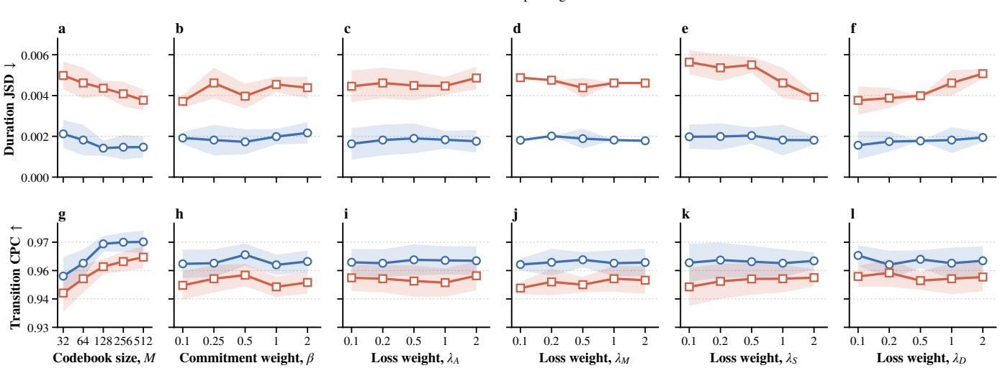  
Figure 6: One-at-a-time sensitivity of Duration JSD and Transition CPC to the codebook size M, commitment weight β, and loss weights $\lambda _ { A } , \lambda _ { M } .$ , λS, and $\lambda _ { D } .$ . Lines report five-seed means, and shaded regions indicate ±1 standard deviation separately under each evaluation protocol.

Figure 7 shows a pronounced head–tail usage distribution. The four most frequent motifs account for approximately 31% of active-day schedules under both protocols, while the top 20 motifs cover approximately half. Thus, the 256- entry codebook organizes thousands of distinct exact activity structures while retaining a broad tail of lower-frequency motifs.

As shown in Figure 8, the four most frequent motifs have the same dominant activity structures under both protocols: H-W-H, H-SHOP-H,H-S-H, andH-REC-H. Together, these motifs cover 30.93% and 31.16% of active-day training schedules under the in-distribution and spatial-generalization protocols, respectively. Although their code indices difer across independently trained codebooks, the recurring work-, shopping-, school-, and recreation-centered structures are consistent across protocols.

Figure 9 reports the profile compositions of the 16 most frequent motifs, ordered by active-day training frequency for the fixed seed 2026. The top-16 motifs exhibit distinct profile compositions under both evaluation protocols. Workcentered motifs such as H-W-H and H-W-SHOP-H contain large shares of employed individuals and weekdays, whereas the school-centered H-S-H motif is concentrated in the 0– 17 age group. Shopping- and recreation-centered motifs contain larger shares of non-employed individuals or weekend schedules, while medical-centered motifs are more prevalent among older age groups. These qualitative associations are broadly consistent between the two evaluation protocols.

Overall, Figures 7–9 show that the learned codebook provides a compact and interpretable organization of the longtailed exact-structure space, with frequent motifs corresponding to recurring daily structures and distinct profile compositions.

## D. Profile-Conditioned Analyses

## Profile–Activity-Chain Alignment

For each profile contrast, the prevalence diference is computed in percentage points among active-day schedules. Positive values indicate higher prevalence in the group shown on the right side of each panel, and negative values indicate higher prevalence in the group shown on the left. The four largest positive and four largest negative training-set diferences are displayed.

Figure 10 reports student-status and age-band contrasts under CBSA-disjoint spatial generalization. School-centered chains, particularly H-S-H, show strong positive prevalence diferences for students and the 0–17 age group, while several older age bands show negative contrasts for these chains. Figure 11 shows corresponding patterns under indistribution evaluation, including the strong association of H-W-H with employed individuals and H-S-H with students and younger individuals. Across both figures, Act-HiMotif generally tracks the direction and relative magnitude of the observed chain-prevalence diferences.

## Profile-Stratified Schedule Fidelity

Figure 12 reports subgroup-level results under CBSAdisjoint spatial generalization, and Figure 13 reports the corresponding in-distribution results. Across all retained employment, student-status, day-type, and age-band subgroups, Act-HiMotif achieves the lowest Duration JSD and highest Transition CPC under both protocols.

To avoid unstable subgroup-level distribution estimates, only groups with at least 500 test person-days are included in Figures 12 and 13. The Non-student subgroup, with only 54 and 12 test person-days under the in-distribution and spatialgeneralization protocols, respectively, is therefore omitted. This sample-size filter is applied identically to all methods and only to these subgroup-level distributional metrics.

Table 4: Complete five-seed results under in-distribution and spatial-generalization evaluation. Values are mean±standard deviation. Best and second-best results among methods using no target-CBSA schedules are shown in bold and underline, respectively.
<table><tr><td rowspan="2">Method</td><td rowspan="2">Target data</td><td colspan="5">In-distribution</td><td colspan="5">Spatial generalization</td></tr><tr><td>Epi.↓</td><td>Dur.↓</td><td>Start↓</td><td>Slot↓</td><td>CPC↑</td><td>Epi.↓</td><td>Dur.↓</td><td>Start↓</td><td>Slot↓</td><td>CPC↑</td></tr><tr><td>No target-CBSA schedules</td><td></td><td></td><td></td><td></td><td></td><td></td><td></td><td></td><td></td><td></td><td></td></tr><tr><td>ConditionalRNN</td><td>0%</td><td> $0 . 3 0 9 2 \pm 0 . 0 0 7 4$ </td><td>0.3646 ± 0.0199 0.4642 ± 0.0179 0.0311 ± 0.0035 0.4919 ± 0.0256 0.3468 ± 0.0076</td><td></td><td></td><td></td><td></td><td> $0 . 3 5 7 1 \pm 0 . 0 3 1 4$ </td><td>0.4496 ± 0.0321 0.0366 ± 0.0046</td><td></td><td> $0 . 4 4 7 9 \pm 0 . 0 2 7 0$ </td></tr><tr><td>GenerativeRNN</td><td>0%</td><td> $0 . 0 1 0 0 \pm 0 . 0 0 2 1$ </td><td> $0 . 0 2 5 7 \pm 0 . 0 0 5 7$ </td><td></td><td></td><td></td><td>0.0334 ± 0.0053 0.0047 ± 0.0019 0.8900 ± 0.0207 0.0233 ± 0.0100 0.0385 ± 0.0094 0.0512 ± 0.0129</td><td></td><td></td><td> $0 . 0 0 6 3 \pm 0 . 0 0 3 3$ </td><td> $0 . 8 4 9 7 \pm 0 . 0 2 6 3$ </td></tr><tr><td>ActVAE</td><td>0%</td><td> $0 . 0 3 1 4 \pm 0 . 0 0 7 5$  0.0419 ± 0.0097</td><td></td><td> $0 . 0 3 2 5 \pm 0 . 0 0 2 7$ </td><td> $0 . 0 0 8 8 \pm 0 . 0 0 2 2$ </td><td></td><td>0.8591 ± 0.0125 0.0459 ± 0.0059 0.0571 ± 0.0058 0.0429 ± 0.0046</td><td></td><td></td><td> $0 . 0 0 7 1 \pm 0 . 0 0 3 2$ </td><td> $0 . 8 7 7 0 \pm 0 . 0 2 8 8$ </td></tr><tr><td>DeepActivity-ZS</td><td>0%</td><td> $0 . 2 3 1 0 \pm 0 . 0 4 2 7$   $0 . 2 8 1 7 \pm 0 . 0 4 3 6$ </td><td></td><td> $0 . 3 5 9 3 \pm 0 . 0 2 0 5$ </td><td>0.0269 ± 0.0045 0.5136 ± 0.0396 0.2200 ± 0.0440</td><td></td><td></td><td> $0 . 2 6 2 3 \pm 0 . 0 3 9 2$ </td><td>0.3722 ± 0.0104</td><td> $0 . 0 2 8 2 \pm 0 . 0 0 4 5$ </td><td> $0 . 5 0 9 2 \pm 0 . 0 6 9 2$ </td></tr><tr><td>ControlTraj</td><td>0%</td><td>0.1492 ± 0.0100 0.1164 ± 0.0068 0.1016 ± 0.0032 0.0075 ± 0.0010 0.7184 ± 0.0217 0.1810 ± 0.0175 0.1220 ± 0.0132 0.1144 ± 0.0067</td><td></td><td></td><td></td><td></td><td></td><td></td><td></td><td>0.0078 ± 0.0006</td><td> $0 . 7 2 7 8 \pm 0 . 0 1 7 4$ </td></tr><tr><td>TrajGPT</td><td>0%</td><td>0.0073 ± 0.0038 0.0181 ± 0.0124</td><td></td><td>0.0502 ± 0.0285</td><td>0.0017 ±0.0014</td><td>0.9266 ± 0.0242</td><td>0.0042 ± 0.0014</td><td>0.0182 ± 0.0111</td><td>0.0276 ± 0.0057</td><td>0.0010 ± 0.0004</td><td>0.9338 ± 0.0121</td></tr><tr><td>CoDiffMob</td><td>0%</td><td>0.1373 ± 0.0128 0.1043 ± 0.0064</td><td></td><td>0.1086 ± 0.0051</td><td>0.0070 ± 0.0006 0.7116 ± 0.0211</td><td></td><td>0.1468 ± 0.0030</td><td>0.0822 ± 0.0104</td><td>0.1224 ± 0.01060.0077 ± 0.0008</td><td></td><td>0.7285 ± 0.0196</td></tr><tr><td>MobilityGPT</td><td>0%</td><td>0.1490 ± 0.0041 0.0417 ± 0.0030</td><td></td><td>0.0144 ± 0.0011</td><td>0.0122 ± 0.0011 0.8836 ± 0.0082</td><td></td><td>0.1711 ± 0.0058</td><td>0.0533 ± 0.0032</td><td>0.0258 ± 0.0026</td><td>0.0146 ± 0.0013</td><td> $0 . 8 8 9 1 \pm 0 . 0 0 7 4$ </td></tr><tr><td>Act-HiMotif</td><td>0%</td><td>0.0014 ± 0.0007 0.0013 ± 0.0001</td><td>0.0045 ± 0.0003</td><td></td><td></td><td></td><td>0.0001 ± 0.0001 0.9749 ± 0.0027 0.0021 ± 0.0009 0.0042 ± 0.0003 0.0120 ± 0.0010 0.0002 ± 0.0001 0.9653 ± 0.0038</td><td></td><td></td><td></td><td></td></tr><tr><td>Target-adapted setting</td><td></td><td></td><td></td><td></td><td></td><td></td><td></td><td></td><td></td><td></td><td></td></tr><tr><td>DeepActivity-FT20 20%</td><td></td><td></td><td></td><td></td><td></td><td></td><td>0.1961 ± 0.0639 0.2206 ± 0.0292 0.3513 ± 0.0229 0.0249 ± 0.0053 0.5663 ± 0.0743</td><td></td><td></td><td></td><td></td></tr></table>

Table 5: Full five-seed ablation results reported as mean±standard deviation.
<table><tr><td colspan="6">In-distribution</td></tr><tr><td>Variant</td><td>Epi.↓</td><td>Dur.↓</td><td>Start↓</td><td>Slot.↓</td><td>CPC↑</td></tr><tr><td>w/o Active-Day Gate (A)</td><td> $0 . 0 0 2 9 \pm 0 . 0 0 0 6$ </td><td> $0 . 0 0 1 6 \pm 0 . 0 0 0 4$ </td><td> $0 . 0 0 4 7 \pm 0 . 0 0 0 4$ </td><td> $0 . 0 0 0 1 7 \pm 0 . 0 0 0 0 5$ </td><td> $0 . 9 7 0 6 \pm 0 . 0 0 3 8$ </td></tr><tr><td>w/o Act.-Stru. Motifs (z)</td><td> $0 . 0 2 2 3 \pm 0 . 0 0 4 8$ </td><td> $0 . 0 0 5 1 \pm 0 . 0 0 0 6$ </td><td> $0 . 0 0 8 9 \pm 0 . 0 0 0 8$ </td><td> $0 . 0 0 2 1 3 \pm 0 . 0 0 0 5 2$ </td><td> $0 . 8 9 1 0 \pm 0 . 0 0 9 8$ </td></tr><tr><td>w/o Hie. Gen. (x → Y)</td><td> $0 . 0 0 2 9 \pm 0 . 0 0 0 6$ </td><td> $0 . 0 0 1 7 \pm 0 . 0 0 0 3$ </td><td> $0 . 0 0 6 9 \pm 0 . 0 0 1 0$ </td><td> $0 . 0 0 0 7 0 \pm 0 . 0 0 0 1 1$ </td><td> $0 . 9 0 6 7 \pm 0 . 0 0 5 7$ </td></tr><tr><td>Act-HiMotif</td><td> $\mathbf { 0 . 0 0 1 4 \pm 0 . 0 0 0 7 }$ </td><td> $\mathbf { 0 . 0 0 1 3 \pm 0 . 0 0 0 1 }$ </td><td> $\mathbf { 0 . 0 0 4 5 \pm 0 . 0 0 0 3 }$ </td><td> $\mathbf { 0 . 0 0 0 1 1 \pm 0 . 0 0 0 0 6 }$ </td><td> ${ \bf 0 . 9 7 4 9 \pm 0 . 0 0 2 7 }$ </td></tr><tr><td colspan="6">Spatial generalization</td></tr><tr><td>Variant</td><td> $\mathrm { E p i . } \downarrow$ </td><td>Dur.↓</td><td>Start↓</td><td> $\mathbf { S l o t } \downarrow$ </td><td>CPC↑</td></tr><tr><td>w/o Active-Day Gate (A)</td><td> $0 . 0 0 2 5 \pm 0 . 0 0 0 8$ </td><td> $0 . 0 0 4 5 \pm 0 . 0 0 0 9$ </td><td> $0 . 0 1 2 5 \pm 0 . 0 0 1 0$ </td><td> $0 . 0 0 0 2 8 \pm 0 . 0 0 0 0 7$ </td><td> $0 . 9 5 6 8 \pm 0 . 0 0 4 3$ </td></tr><tr><td>w/o Act.-Stru. Motifs (z)</td><td> $0 . 0 2 1 1 \pm 0 . 0 0 2 8$ </td><td> $0 . 0 0 7 9 \pm 0 . 0 0 1 3$ </td><td> $0 . 0 1 7 5 \pm 0 . 0 0 1 5$ </td><td> $0 . 0 0 1 9 9 \pm 0 . 0 0 0 6 0$ </td><td> $0 . 8 9 2 9 \pm 0 . 0 0 7 8$ </td></tr><tr><td>w/o Hie.  ${ \mathrm { G e n . } } ( \mathbf { x } \to Y )$ </td><td> $0 . 0 0 5 2 \pm 0 . 0 0 2 3$ </td><td> $\mathbf { 0 . 0 0 2 2 \mathop { \pm } 0 . 0 0 0 7 }$ </td><td> $0 . 0 1 6 0 \pm 0 . 0 0 0 6$ </td><td> $0 . 0 0 0 8 1 \pm 0 . 0 0 0 2 7$ </td><td> $0 . 9 1 7 0 \pm 0 . 0 0 9 6$ </td></tr><tr><td>Act-HiMotif</td><td> $\mathbf { 0 . 0 0 2 1 \pm 0 . 0 0 0 9 }$ </td><td> $0 . 0 0 4 2 \pm 0 . 0 0 0 3$ </td><td> $\mathbf { 0 . 0 1 2 0 \pm 0 . 0 0 1 0 }$ </td><td> $\mathbf { 0 . 0 0 0 1 5 \pm 0 . 0 0 0 0 9 }$ </td><td> $\mathbf { 0 . 9 6 5 3 \pm 0 . 0 0 3 8 }$ </td></tr></table>

## E. Structural–Temporal Analyses

## Joint Start-Time–Duration Distributions

Figure 14 reports the joint start-time–duration distributions of Home, Work, Shopping, and Recreation under in-distribution evaluation. Home exhibits broad temporal support, Work contains concentrated morning-start modes with relatively long durations, Shopping is concentrated at shorter durations, and Recreation spans broader afternoon and evening periods. Act-HiMotif generally preserves these activity-specific shapes, including the multiple Work modes and the broader temporal structure of Recreation.

Figures 15 and 16 report School, Medical, Escort, Meal, and Other under CBSA-disjoint spatial generalization and indistribution evaluation, respectively. School exhibits a concentrated morning-start and relatively long-duration pattern, while Medical, Escort, and Meal are concentrated at shorter durations over daytime periods. Other spans a broader range ofstart times and durations. Across both figures, Act-HiMotif generally reproduces the locations and dispersions of these activity-specific patterns more closely, including the concentrated School pattern, the short-duration Escort and Meal patterns, and the broader temporal support of Other.

## Activity-Transition Distributions

Figure 17 compares the row-normalized activity-transition distributions under both evaluation protocols, where each row represents the conditional distribution of the next activity given the current activity. The observed schedules contain strong Home-directed transitions together with activityspecific patterns among non-Home activities. ActVAE produces more difuse transition patterns, while TrajGPT assigns more probability mass to a smaller set of Home-directed transitions than observed. Act-HiMotif more closely reproduces the dominant Home-related transitions and the relative organization of non-Home transitions under both protocols, consistent with its Transition CPC results.

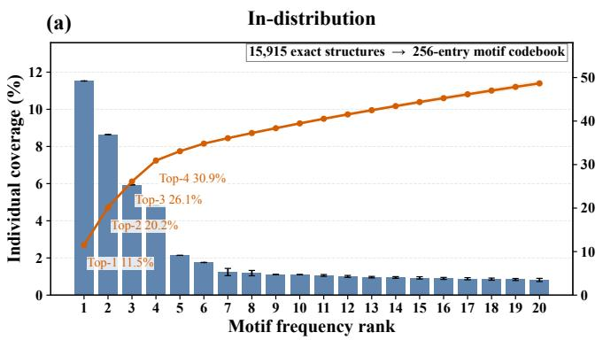

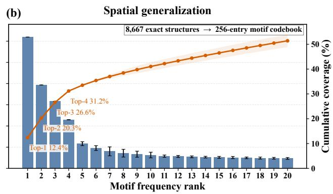  
Figure 7: Frequency and cumulative coverage of the learned motifs. Bars report the mean individual coverage of the 20 most frequent motifs across five seeds, with error bars denoting one standard deviation. Curves and shaded regions show the corresponding mean cumulative coverage and across-seed variation. The in-distribution and spatial-generalization training sets contain 15,915 and 8,667 distinct exact activity structures, respectively, organized using a 256-entry motif codebook under each protocol.

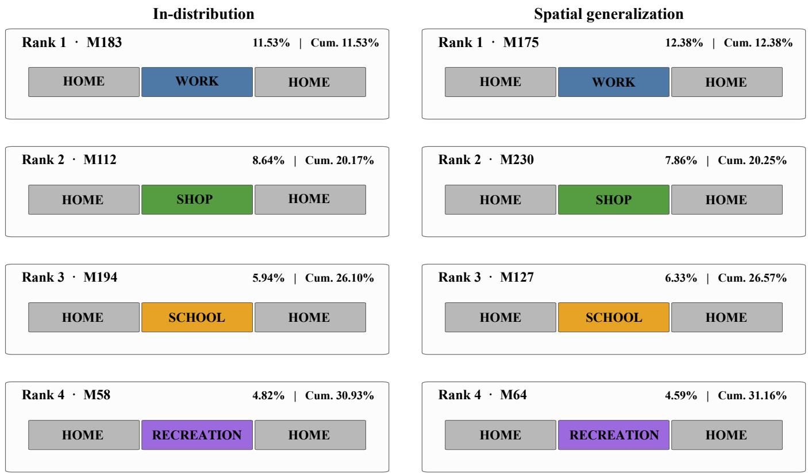  
Figure 8: Dominant activity structures of the four most frequent motifs for the fixed canonical seed 2026. Each row reports the motif-frequency rank, run-specific code index, individual and cumulative training coverage, and dominant exact activity structure.

In-distribution  
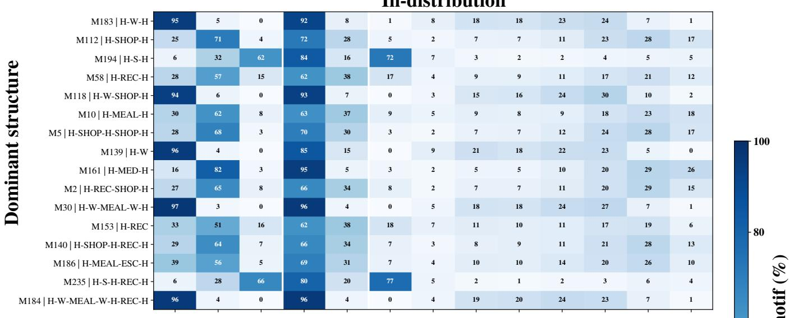

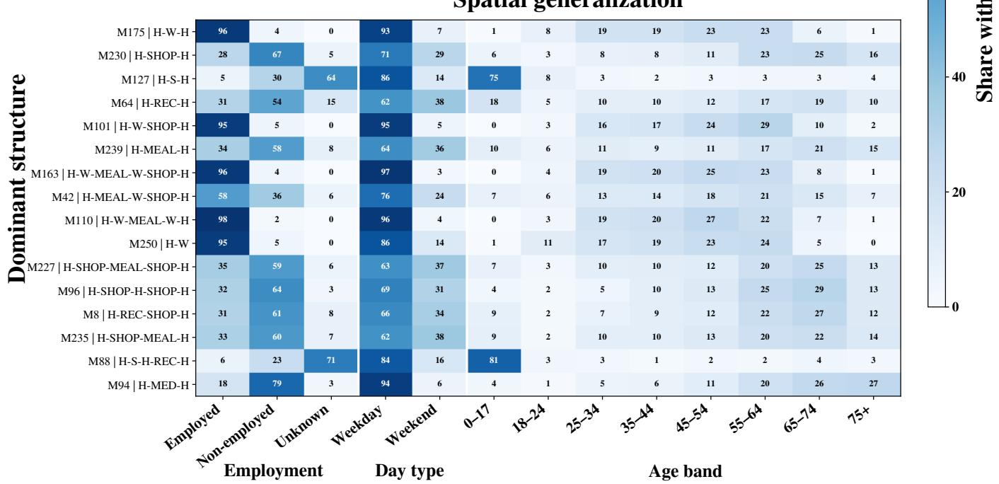  
Figure 9: Profile composition of the 16 most frequent motifs (frequency ranks 1–16) for the fixed canonical seed 2026 unde each evaluation protocol. Rows are ordered by active-day training frequency and labeled with the motif index and dominant exact structure. For each motif, percentages sum to 100% separately across employment categories, day types, and age bands.

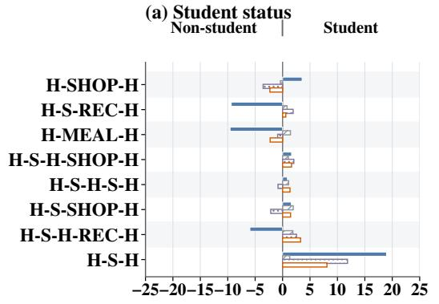  
(d) Age 25–34 All other ages | Age 25-34

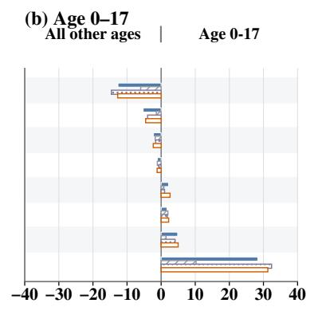

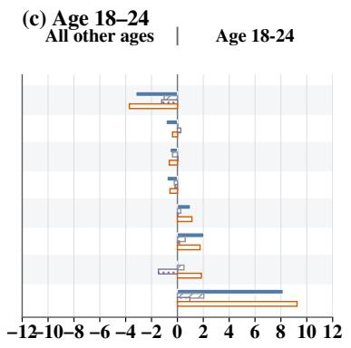  
(f) Age 45–54 All other ages | Age 45-54

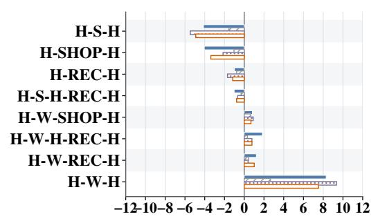  
(g) Age 55–64 All other ages | Age 55-64

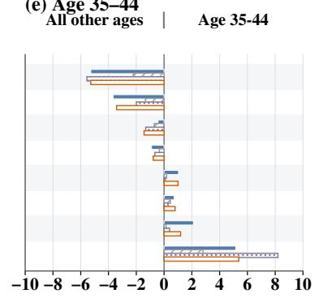

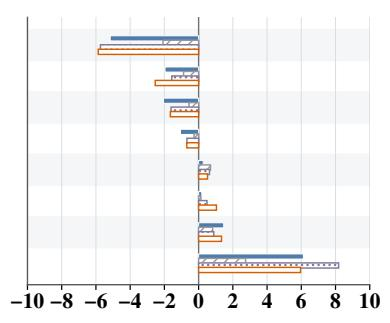  
(i) Age 75+ All other ages | Age 75+

(h) Age 65–74 All other ages | Age 65-74  
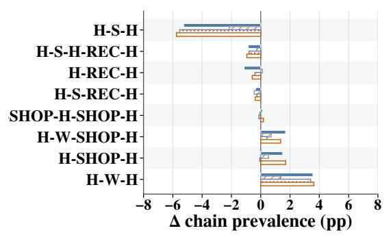

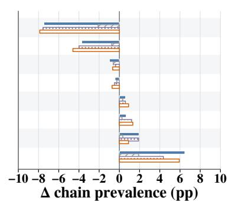

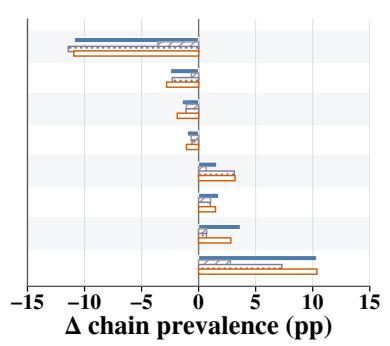  
Figure 10: Profile–activity-chain alignment for student-status and age-band contrasts under CBSA-disjoint spatial generalization. Displayed active-day chains are selected using training-set prevalence diferences.

(a) Employment Non-employed | Employed

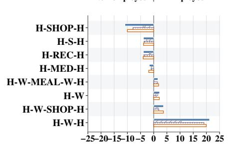

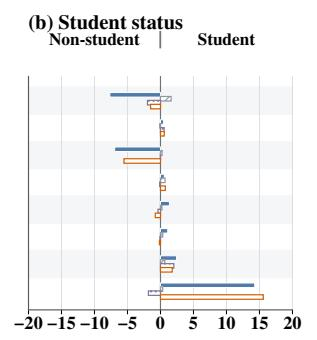

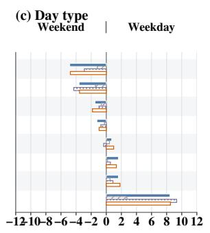

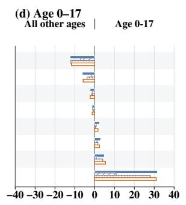

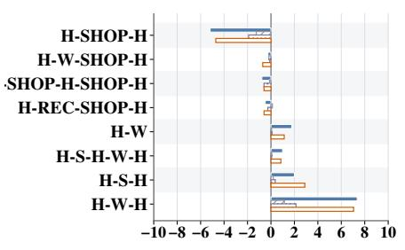

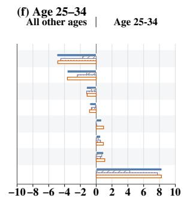  
(h) Age 45–54 All other ages | Age 45-54

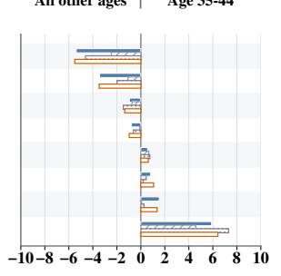

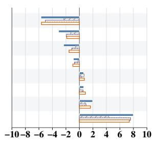

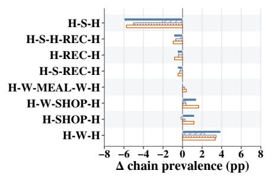

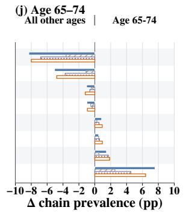

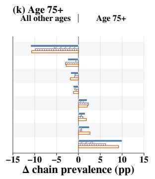  
Figure 11: Profile–activity-chain alignment for all analyzed profile contrasts under in-distribution evaluation. Displayed active day chains are selected using training-set prevalence diferences.

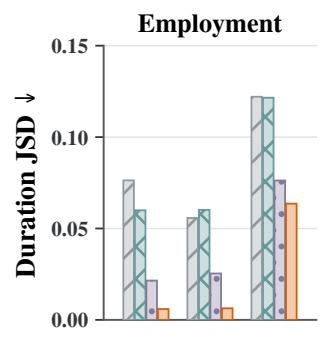

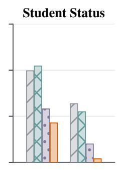

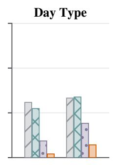

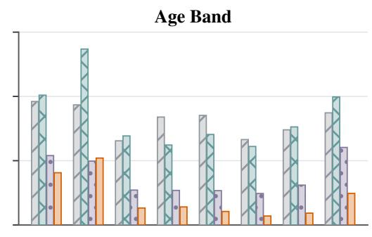

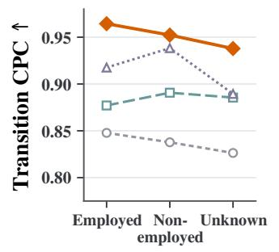

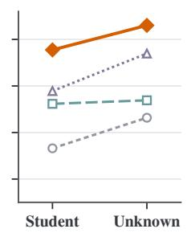

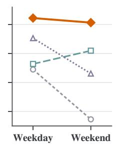

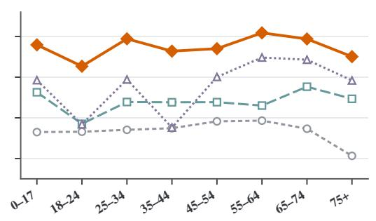  
Figure 12: Profile-stratified Duration JSD and Transition CPC under CBSA-disjoint spatial generalization.

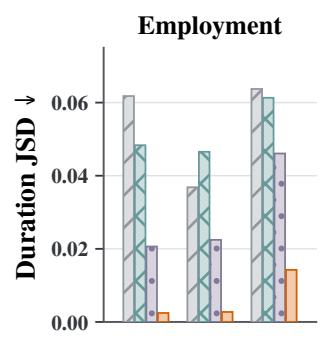

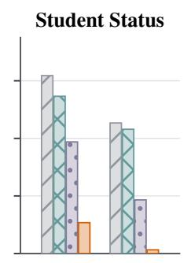

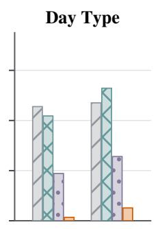

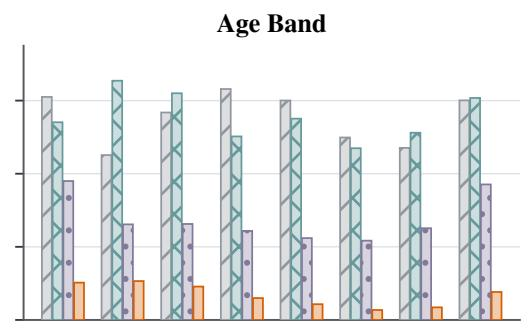

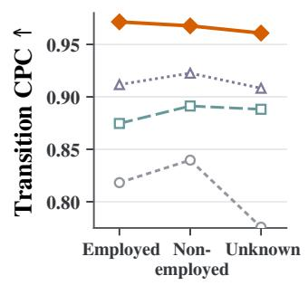

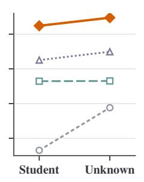

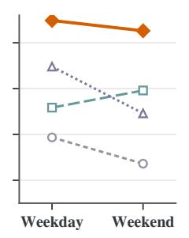

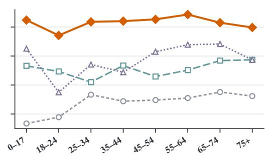  
Figure 13: Profile-stratified Duration JSD and Transition CPC under in-distribution evaluation.

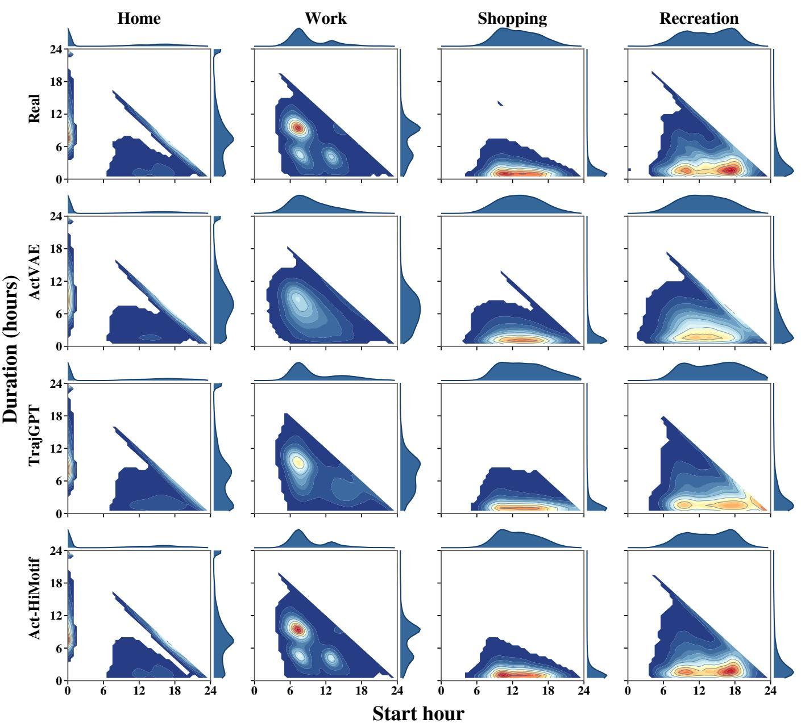  
Figure 14: Observed and generated joint start-time–duration distributions for Home, Work, Shopping, and Recreation under in-distribution evaluation.

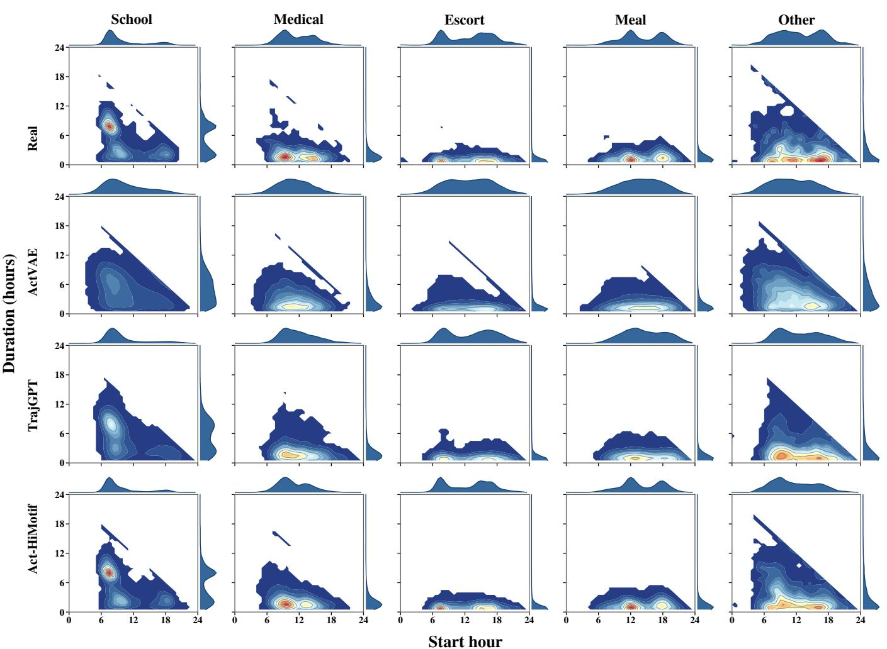  
Figure 15: Observed and generated joint start-time–duration distributions for School, Medical, Escort, Meal, and Other under CBSA-disjoint spatial generalization.

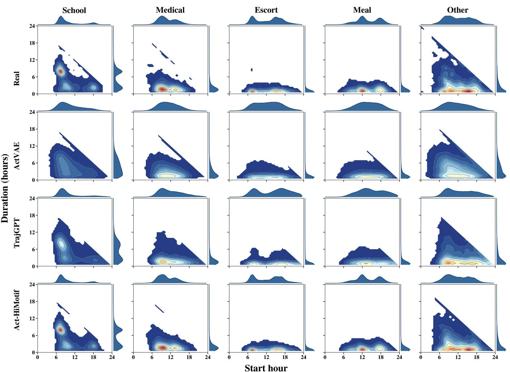  
Figure 16: Observed and generated joint start-time–duration distributions for School, Medical, Escort, Meal, and Other under in-distribution evaluation.

  
Figure 17: Row-normalized activity-transition distributions under CBSA-disjoint spatial generalization (top) and in-distribution evaluation (bottom). Rows denote current activities and columns denote next activities.