AMM vs. other optimizers (same functions and budgets)

# Adaptive Multi Mode: Budget-Aware Routing of Optimizers By Online Landscape Probes

Benjamin Jacob Bodner

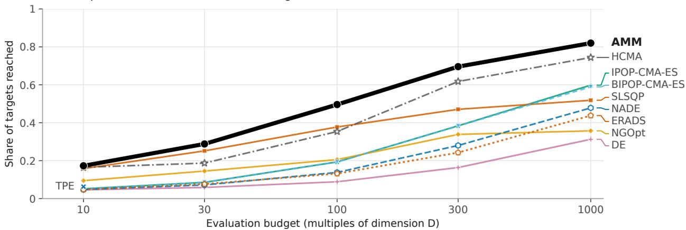  
Figure 1: Held-out bbob instances 101–110 (f1–f24), equal budgets; field runs, SLSQP included, restart until the budget is spent or the final target is reached. Points: share of 51 targets reached per run, averaged over 10 instances and 120 function–dimension cells (� = 2–40). HCMA (published COCO archive, own instances): � = 2–20 only; there AMM is level at 10·� (+.016) and leads by +.10 to +.17 from 30·�. TPE ran every � only at 10·�. NADE (2025 MA-BBOB winner) and ERADS (van Stein’s 2024 algorithm): authors’ code, run after the final test. Against the pre-registered field AMM is highest in 382 of 600 function–dimension–budget cells (236 outright, 146 tied; 380, 234 outright, with NADE and ERADS added) and leads IPOP-CMA-ES by +.121 to +.312.

## Abstract

The best classical optimizer for a continuous black-box problem de- pends on its budget and landscape. Existing routers decide from the dimension and budget, past improvement or features fitted to one benchmark, and few test an optimizer’s implicit assumptions online. AMM (Adaptive Multi Mode) routes a known budget among quasi-Newton, trust-region, coordinate, multistart and evolution-strategy optimization engines with online probes of curvature, plateaus, separability, kinks, basins and fractal structure. Each probe has a default, a dimension-by-budget validity range and a cost charged to the budget. In its pre-registered development loop on bbob, 32 of 36 predictions held over the last 16 confirmations. AMM was then tested once on held-out bbob instances 101–110 (� = 2–40, 10·�–1000·�) against up to seven competitors. It has the highest target share in 382 of 600 function–dimension–budget cells (236 outright, 146 tied) and, by a descriptive posterior rule, is credibly behind in 35, mostly at 10·� and 30·�. At every budget it also leads the controls built from its own engines (the best engine alone, the best engine per dimension and budget, and a greedy sched- ule), narrowly at 10·� and 30·�, and nevergrad’s NgIohTuned. In pre-registered runs its lead over IPOP-CMA-ES holds under afine and box transformations, on box-constrained bbob and, pooled, on rotated f2–f4, but rotating the separable f3 and f4 removes most of the lead there. On held-out MA-BBOB its final share at 2000·� is level with IPOP-CMA-ES’s and its anytime area lower. We pub lished AMM as an open-source Python package (pip install amm-optimizer; https://github.com/BjBodner/amm-optimizer).

## Keywords

black-box optimization, algorithm selection, hybrid algorithms, online landscape probes, CMA-ES, quasi-Newton methods, benchmarking

## 1 Introduction

Which classical algorithm is best for a continuous black-box prob- lem depends on how many evaluations it may spend (Hansen et al., 2010). Around 10·�, model-based trust-region methods such as COBYLA lead (Raponi et al., 2025). On smooth functions, quasi-Newton methods with finite-diference gradients converge fast (Brockhof and Villain, 2025; Varelas and Dahito, 2019). With thou-sands of evaluations per dimension, restarted CMA-ES with grow- ing populations finds global structure that local methods miss (Auger and Hansen, 2005; Hansen, 2009). A user often knows the budget before the run; the landscape, which moves these bands, is unknown.

Existing routers decide without testing � , or test it only through generic features fitted to a training suite. Wizards such as Never-grad’s NGOpt follow rules on dimension, budget and variable types (Meunier et al., 2022), so at a given � and � every function gets the same chain. Races such as HCMA’s keep the engine that improves and pay for the loser (Loshchilov et al., 2013). Ofline schedules fix one budget split for all problems (Schäpermeier, 2025), and selectors built on exploratory landscape analysis (ELA) fall back towards the single best solver on held-out problems (Petelin and Cenikj, 2025).

AMM (Adaptive Multi Mode) decides by testing �. An online probe is a short test, paid from the budget, of whether the assumption behind one classical engine holds near the incumbent. A mir- rored loss that grows quadratically with the step calls for a quasi- Newton method, additivity over coordinate pairs for a coordinate search, converged descents in separate basins for restarts. A probe that does not fire leaves the run on a general path, so a misreading costs evaluations, not the run. Every rule reads only �, �, the box and evaluated �-values, as COCO (Comparing Continuous Optimizers) requires (Hansen et al., 2021; Hansen, Tušar, Mersmann, Auger and Brockhof, 2016).

None of these statistics is new, and Section 2 credits each one’s ancestor. To our knowledge, AMM is the first black-box optimizer that routes a known evaluation budget among quasi-Newton, trustregion, coordinate, population and multistart solvers through a decision list of cheap mechanism tests, each a known statistic with a default outcome, a calibrated dimension-by-budget validity range and a cost charged to the budget.

A rule set developed on the 24 bbob functions invites the objection that it is a decision tree fitted to them (Bartz-Beielstein et al., 2020; Meunier et al., 2022). In its final form the loop kept a fix only if a prediction written before its run held on unseen instances, and the held-out tests measure robustness (tested regime in Section 4.2, limits in Section 6) to new instances, new afine combinations and relabelled, rotated and box-constrained versions of the 24 functions and to unseen dimensions and budget multipliers, not to an un- seen function (an unregistered check on 20 other functions is in Appendix P).

Contributions. The claims concern one configuration of AMM, run once on bbob instances 101–110, which no design decision used. The paper makes four contributions.

• AMM, a router whose online probes test an engine’s assumption before the engine runs (Section 3).

• Held-out evidence that from 100·� up its routing, not only its engine pool, carries its pooled lead, though not in every cell (Section 5.6). AMM has the highest target share among up to seven competitors (Section 4.3) in 382 of 600 function–dimension–budget cells and is credibly behind in 35 (Figure 1; Sections 5.1 and 5.6). Against a ladder of controls that separates the routing from the engine pool, every rung except a post-hoc oracle trails AMM at every budget, its best engine alone, a per-dimension, per-budget selector and a greedy schedule only narrowly at 10·� and 30·�, and AMM exceeds the oracle only at 1000·� (Section 5.2); a leave-one-route-out ablation shows every route family paying on its own slice, and route-firing logs show where each route fires (Section 5.4).

• Pre-registered tests ofhow far the lead carries, losses named (Sections 5.3 and 5.6): the lead over IPOP-CMA-ES holds under afine and box transformations, on the box-constrained suite and, pooled, on rotated f2–f4, but rotating f3 and f4 removes most of the lead on those two functions (on rotated f4 it is level), and on MA-BBOB AMM is level with IPOP-CMA-ES in final share at 2000·� and behind in anytime area.

• A development loop that can say no: in its last 16 confirmations 32 of 36 pre-registered predictions held, and no failed fix was promoted (Section 4.1).

AMM is an open-source Python package (Software availability).

## 2 Related work

Table 1 contrasts AMM with the closest routing approaches. Sin-gle classical solvers and restarted or surrogate-assisted CMA-ES variants each own a budget band (Appendix D); AMM uses such solvers unchanged and claims only a better allocation of a known budget.

Fixed hand-overs and races. HCMA opens with NEWUOA for 10·�, then races STEP against surrogate-assisted BIPOP-CMA-ES (Loshchilov et al., 2013). Hansen (2019) compared lq-CMA-ES with a portfolio that runs SLSQP (sequential least-squares quadratic pro-gramming) before CMA-ES; AMM’s prefix (the route for budgets up to 100·�, Section 3.1), which picks restarted SLSQP or, on a rugged reading, an evolution strategy (at 100·�, surrogate-ranked populations), descends from it. COCOpf, MOS and EGO-CMA switch or chain engines by realised improvement or a fixed rule (Baudiš, 2014; LaTorre et al., 2011; Mohammadi et al., 2015). So do memetic schemes such as MTS and SHADE-ILS, whose choice between a coordinate search and L-BFGS-B is closest to AMM’s (Molina et al., 2018; Tseng and Chen, 2008). All decide by schedule or by which engine improved.

A-priori wizards. Shiwa and NGOpt select by hand-written rules on problem metadata (Liu et al., 2020; Meunier et al., 2022). Never-grad’s current wizards (NGOpt39, the NgIoh family, NgIohTuned and Wiz) refine them into finer rules on � and �, with Cobyla at small budgets and a fixed Cobyla, MetaModel and SQP chain at middle budgets (Rapin and Teytaud, 2018). They share AMM’s inputs and much of its pool.

Schedules, selection and switching. Greedy restart schedules and sequential portfolios learn one budget split from bbob data (Dinu et al., 2026; Schäpermeier, 2025). The greedy schedule closed 95.6% of the gap between the single and the virtual best solver across instances, but about 27% when whole problems were held out (Schäpermeier, 2025). Exploratory landscape analysis reads � through generic features (Mersmann et al., 2011) for cost-sensitive (Bischl et al., 2012) and fixed-budget (Jankovic and Doerr, 2020) selection, and probing trajectories select from short runs of the candidate solvers (Renau and Hart, 2024). A prototype chooses its operators, not engines, online from a separability analysis (Epitropakis et al., 2014), and dynamic algorithm configuration learns policies that change a configuration during a run (Adriaensen et al., 2022). Feature-based, warm-started, learned and image-based selectors and switchers (Kerschke and Trautmann, 2019; Kostovska et al., 2022; Tanabe, 2022; van der Schelling et al., 2026; Vermetten et al., 2020; Vermetten, Wang, Sim and Hart, 2023; Wang et al., 2026) lose most of their advantage under leave-problem-out validation and on MA-BBOB (Cenikj et al., 2025; Dietrich et al., 2024; Petelin and Cenikj, 2025). Tanabe (2022) found that SLSQP as a pre-solver significantly improved such selectors, as in AMM’s prefix.

Table 1: How AMM difers from the closest routing approaches (from the cited sources; Section 2).
<table><tr><td>Method</td><td>Routes on</td><td>Decides</td><td>Reads about f before choosing</td><td>Evaluated on</td></tr><tr><td>BIPOP-CMA-ES</td><td>two fixed restart regimes</td><td>at each restart</td><td>nothing</td><td>bbob (archive)</td></tr><tr><td>HCMA</td><td>a fixed opening, then the engine ahead</td><td>NEWUOA for 10·D, then a race</td><td>which engine improved</td><td>bbob (archive, 2013)</td></tr><tr><td>SLSQP+lq-CMA-ES</td><td>a fixed sequence</td><td>fixed hand-over</td><td>nothing</td><td>bbob (archive, 2020)</td></tr><tr><td>NGOpt39. NgIohTuned</td><td>D, B, bounds, noise</td><td>before the run</td><td>nothing</td><td>Nevergrad suites</td></tr><tr><td>Greedy restart schedules Per-run selection</td><td>training-set statistics per D</td><td>before the run</td><td>nothing</td><td>bbob, D ≤ 10</td></tr><tr><td></td><td>features and a trained model</td><td>after a 30·D CMA-ES run</td><td>generic landscape features</td><td>bbob; YABBOB</td></tr><tr><td>LLaMEA AMM</td><td>a generated program</td><td>at design time</td><td>nothing at run time</td><td>bbob 5-D (anytime area) bbob 101-110; MA-BBOB rows 900-999;</td></tr><tr><td></td><td>D, B and online probes</td><td>before each engine</td><td>mechanism probes with defaults, paid from B</td><td>transformed, rotated and bbob-boxed bbob, ids 810-849</td></tr></table>

Probes inside optimizers. The curvature probe reads a mirrored second diference, as in the finite-diference intervals of Gill et al. (1983) and in HE-ES (Glasmachers and Krause, 2020), and the plateau probe pre-empts CMA-ES’s flat-fitness restart (Hansen, 2016). The pair test samples the additivity checks of LINC-R and diferential grouping (Omidvar et al., 2014; Tezuka et al., 2004) and SPAM’s separability index (Carafini et al., 2014); the hill-valley test comes from Ursem (1999) and HillVallEA (Maree et al., 2018). The kink probe relates to finite-diference noise estimation (Moré and Wild, 2012), and the fractal probe’s slope comes from Wang et al. (2023), who in policy optimization read a log-log slope below 2 as non-diferentiability. AMM contributes the routing semantics, not the statistics; its fractal route to restarted SLSQP runs against that reading and rests on its own confirmation.

AutomatedandLLMdesign. AMM’s rules, proposed by AI codingagent sessions, are a form of automated design, as in LLaMEA (van Stein and Bäck, 2025) and the related work of Appendix D, but a supervised one: the author approved every pre-registration and every promotion of a fix into the method (Section 4.1). Accordingly, AMM reports its design budget, audits its inputs and meets the 2025 MA-BBOB winner in the competition’s setting on held-out public rows (van Stein, 2025; Vermetten, de Nobel, Bäck and Doerr, 2025; Vermetten, Ye, Bäck and Doerr, 2023; 2025).

What AMM changes. Unlike these routers, AMM reads � before an engine runs and maps each reading to an engine by a stated mechanism. Its thresholds and validity ranges were hand-calibrated on bbob f1–f24 at the development dimensions, not learned by a model fitted to a training suite; Sections 5.2 and 5.6 test whether this pays and where earlier routers are stronger.

## 3 AMM: routing by online probes

Figure 2 shows the routing, Algorithms 1 and 2 its control loop, Table 2 every gate and probe and Table 6 the nine rules added by composites c44–c46. The benchmarked configuration is the code’s preset c46, which sets 67 of the 160 configuration fields away from their defaults (Appendix A); it is the last composite, a numbered configuration of AMM from the development loop (Section 4.1).

Inputs and compliance. One configuration serves all functions. AMM reads only the dimension �, the budget �, the box [ℓ, �] and the � -values of points it evaluates, never the function or instance identifier, the optimal value or any other property of the problem.

Its thresholds depend on � and � only, as COCO allows. Every evaluation, probes included, counts against �, and every evaluated point lies in the box. The benchmark harness enforces �; the pack- age does not (Software availability). A code audit confirms that the entry point receives only the objective, a start point, the budget, the box and a seed (or a random generator), with the configuration and a profiling switch as options, and that no module reads anything else (Appendix A).

## 3.1 Routing by dimension and budget

Algorithm 1 first applies three whole-budget gates (lines 2–11), which can give the whole budget to one engine before any gen- eral search. Restarted COBYQA takes it at $D \ \leq \ 3$ and � ≤ 10� (line 2), where no probe pays for itself. From � = 5 and 100·�, the pair test at the start point (line 5) sends a separable reading to STEP (select the easiest point) restarts, the separable route, and, from 300·�, a coupling of only adjacent coordinates that the band check confirms to a decoupled coordinate search, the chain route. At � = 2–3 from 100·�, a basin reading on a Sobol design (line 9) sends several smooth basins to MLSL (multi-level single linkage) and, up to 300·�, a single smooth basin to one SLSQP descent first (line 11). A gate that does not fire costs only its evaluations, and its best point stays a candidate for the result; the run continues from the start point or, after a basin reading, from the design’s best point, also when the descent of line 11 ran.

Up to 100·� the prefix spends the whole budget (line 12; Algorithm 2) on a design, STEP and the curvature probe, which picks restarted SLSQP or a (1+1)-CMA-ES; from � = 5 above 30·� a plateau reading sends the rest to IPOP-aCMA-ES populations, and up to 30·� two rules can hand it to restarted COBYQA (Table 6, rules (i)–(iii)). Above 100·�, the ATM sampler, a population-based random search (Section 3.3), takes a fifth of the budget (at most 60·� from � = 10; line 13), and STEP, with a separability check, half of the rest (line 14). If the check fails, from $D = 5$ the local probes (line 16) send plateau and rugged readings to IPOP-aCMA-ES pop- ulations, smooth readings to an SLSQP stage and, from $D = 2 0$ fractal readings to restarted SLSQP. Exit-status, basin and kink readings can end that stage in favour of L-BFGS-B, sampled SLSQP restarts or a scaled finite-diference BFGS (line 25). Two of these routes appear unpublished: the kink reading to the scaled BFGS, and the fractal reading to restarted SLSQP, whose ablation efect is null (Section 5.4). A run that no route has ended goes to the finisher (line 29), a restarted (1+1)-CMA-ES that hands stalls to aCMA-ES populations; Appendix B gives every rule.

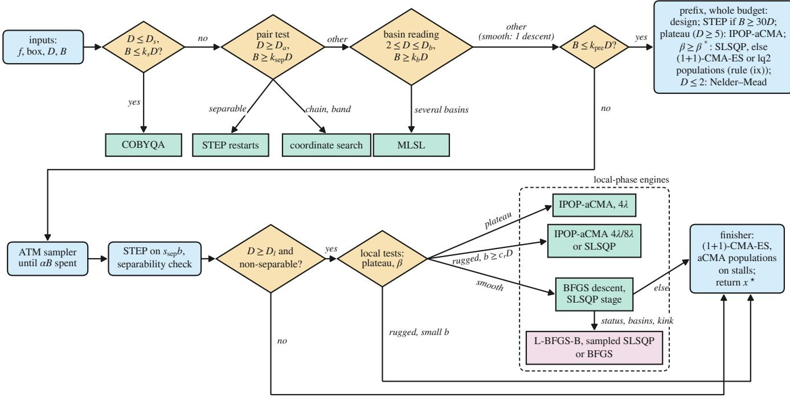  
Figure 2: Routing of AMM (simplified). Rounded boxes are phases, diamonds are probes or gates, square boxes are engines; a dashed box groups the engines that spend the rest of the budget. Guards use the symbols of Table 2; “lq2 populations” are populations ranked by a quadratic surrogate. Not shown: the prefix’s single SLSQP descents (at $D \le 2$ up to 30·�; below min $( k _ { \mathrm { d e s } } D , 2 0 0 ) _ { \mathrm { . } }$ ), its COBYQA hand-overs and the conditions of its lq2 populations (Algorithm 2); and, on a rugged reading with $b < c _ { r } D _ { : }$ , the capped BFGS try of 100·� at $D \leq 9 , B \leq 5 0 0 D$ and $b \geq 2 0 0 D$ , which rule (vii) replaces at $0 . 5 \leq \beta < 1$ by an immediate start of the finisher’s populations and rule (vi) continues to the end of the budget at a kink (Algorithm 1, lines 27–29).

## 3.2 Probes

The curvature probe is the slope � of the logarithm of the mirrored loss ${ \textstyle { \frac { 1 } { 2 } } } ( f ( x + h u ) + f ( x - h u ) ) - f ( x )$ against log ℎ at three scales (a quadratic gives $\beta \ : = \ : 2 )$ . The plateau probe reads ties at tiny steps, the pair test an additivity residual over coordinate pairs, the basin reading a rank-quadratic fit with second diferences and the hill-valley test a point between two converged ends; the kink probe reads mirrored second diferences at $1 0 ^ { - 7 }$ of the box width, and the fractal probe their slopes up to 10−4 (Appendix B.1). The curvature, pair and fractal statistics and the basin reading’s second diferences are invariant to $f \mapsto a f + c ( a > 0 ) ;$ ; the plateau and hill-valley tests and the basin reading’s rank fit are invariant to any strictly increasing transformation of � . The kink threshold, the stall monitor, the exit-status test and the absolute tolerances of Section 6 are not.

## 3.3 Engines

The engines are SciPy’s SLSQP (Kraft, 1988), L-BFGS-B (Byrd et al., 1995) and COBYQA (Ragonneau, 2022; Ragonneau and Zhang, 2026; Virtanen et al., 2020); a scaled finite-diference BFGS after the nonsmooth BFGS of Lewis and Overton (2013); STEP, a round-robin coordinate search in the style of BSrr (Pošík and Baudiš, 2015; Swarzberg et al., 1994); MLSL from Sobol points (Rinnooy Kan and Timmer, 1987); and Nelder–Mead restarts at $D \ \leq \ 2$ (Nelder and Mead, 1965). The pool also holds a (1+1)-Cholesky-CMA-ES (Igel et al., 2006) with active update (Arnold and Hansen, 2010) and quadratic-model steps, IPOP-aCMA-ES and the ATM sampler (Bodner, 2019), a population-based random search with success-rate step control. Only the chain route uses a decoupled coordinate search, the one engine not run alone in Section 5.2. Appendix B.2 lists every setting.

## 4 Development process and experimental design

## 4.1 The development loop

The development log of AMM lists 71 cycles. From composite c32 on, a cycle finds a losing cell (a function, dimension and budget where AMM trails the field ofSection 4.3) on development instances and traces its mechanism. It then pre-registers a fix (a probe and an engine, the slice and numeric range of its gain, the accepted losses and the decision rule), screens it on development instances and confirms it once against the method without it on never-used bbob instances, which are then spent. A fix is kept, or promoted, only if its prediction held; promoted fixes enter the next composite (c23–c46 in the code; c47 was the last candidate). AI coding-agent sessions (Claude Code) proposed the fixes, wrote the pre-registrations, and ran and analysed the batches; the author decided on and approved every pre-registration and promotion.

Algorithm 1: Control loop of AMM, preset c46. Run(E, �) runs engine E from � until it converges, stalls or spends its share (unless stated, all of�, the budget left); the incumbent $x ^ { \star }$ never gets worse. Roman numerals: rules in Table 6; (viii) first maps the box onto $[ - 5 , 5 ] ^ { D }$ . Prefix: Algorithm 2; probes, LocalTests, Finisher: Appendix B; symbols: Table 2.

Input : objective �; box $[ \ell , u ] \subset \mathbb { R } ^ { D }$ ; budget �; start point �0   
1 $\hat { x ^ { \star } } \gets x _ { 0 } ; b \gets B$   
2 if � ≤ � and $B \le k _ { s } D$ then   
3 return Run(Cobyqa, $x ^ { \star } )$   
4 i $\dot { \cdot } D \geq D _ { a }$ and $B \geq k _ { \mathrm { { s e p } } } D$ then   
5 $r \gets \mathsf { P a i r T e s t } ( x _ { 0 } ) ^ { \ast }$ // 3� evaluations   
6 if � = separable then return Run(Step restarts $, x ^ { \star } )$   
7 if � = chain and $B \geq k _ { \mathrm { c h } } D$ and $\mathtt { B a n d C h e c k } ( x _ { 0 } ) < \tau _ { \mathrm { b a n d } }$ then return   
Run(CoordSearch, $x ^ { \star } )$   
8 if 2 ≤ $D \leq D _ { b }$ and $B \geq k _ { b } D$ then   
9 $( m , s , x ^ { \star } )$ ← BasinReading $( ) ; x _ { 0 } \gets x ^ { \star }$ // Sobol design   
10 if � then return Run(Mlsl $x ^ { \star } )$   
11 if � and $B \leq k _ { d } D$ then �★ ← Run(Slsqp descent, �0) // not in ��   
12 if $B \leq k _ { \mathrm { p r e } } D$ then return Pref $\mathsf { i x } ( x _ { 0 } )$ // Algorithm 2   
13 $x ^ { \star } \gets$ Run(Atm, �0) until �� are spent (at most $c _ { A } D \mathrm { i f } D \geq 1 0 )$   
14 $( x ^ { \star } ,$ sep) ← Run(Step, $x ^ { \star } )$ on $s _ { \mathrm { s e p } } b ,$ with its separability check   
15 if � ≥ �� and not sep then   
16 � ← LocalTest $\tilde { \mathbf { \Xi } } s \dot { ( } \boldsymbol { x } ^ { \star } )$ // plateau, then �   
17 switch � do   
18 case plateau do   
19 return Run(IPOP-aCMA 4�, uniform point)   
20 case rugged and $b \geq c _ { r } D$ do   
21 if $\stackrel { \sim } { \cal D } \geq 2 0$ and fractal then return Run(Slsqp restarts) else   
return Run(IPOP-aCMA 4� or 8�)   
22 case smooth do   
23 if � ≤ $k _ { \mathrm { b f } } D$ then $x ^ { \star } \gets$ Run(Bfgs, one descent)   
24 $x ^ { \star } \gets$ Run(Slsqp stage, min $( b / 3 , c _ { q } D )$ , stall monitor at the   
cap)   
25 if exit status, basins or kink fire then return Run(L-Bfgs-B |   
sampled Slsqp | Bfgs)   
26 otherwise do   
27 if $0 . 5 \leq \beta < 1$ then direct $ ( b \geq g D )$ // (vii)   
28 else if $D \le D _ { \mathrm { t r y } }$ and $B \le k _ { \mathrm { r t } } D$ and $b \ge 2 k _ { \mathrm { t r y } } D$ then $x ^ { \star } \gets$   
Run(Bfgs, $k _ { \mathrm { t r y } } D ;$ on to the end at a Kink()) // (vi)   
29 return Finisher(�★) // (1+1)-CMA-ES; aCMA on stalls or if direct

The record. In the 16 confirmations of c32–c47, 32 of 36 written predictions held; the last candidate, c47, failed and was not pro- moted (full record and a worked pass of the loop in Appendix C). Single probe-and-engine pairs raised the target share on their slices by up to +.773 (the chain route on f20) and +.711 (the separable route on f3; Table 7). These add-one results show robustness to new instances of the same 24 functions, not a component’s marginal value in the final configuration (Section 5.4) or that AMM works on other functions (Section 5.3).

## 4.2 Held-out evaluation

Data split. Ids are COCO’s instance numbers (split in Appendix H). The field comparisons on ids 61–70 steered about twenty composites, so counts computed on them are in-sample. The fi- nal test used 101–110 once (10 instances, where COCO’s archive uses 15, to keep 111–115 in reserve). MA-BBOB rows 900–999 were never run before the test; an earlier composite (c44) ran once on rows 3–302 for information, and that run set the MA-BBOB test’s predicted ranges, not a design decision.

Algorithm 2: Prefix of preset c46 (Algorithm 1, line 12),   
which spends the whole budget at $B \leq k _ { \mathrm { p r e } } D .$ . Roman nu-   
merals as in Algorithm 1.   
$_ { 1 } \ x ^ { \star } \gets$ best of � and max(4 �) uniform oints from 30·� $( \boldsymbol { x } ^ { \star } , \boldsymbol { s e p } ) \gets$   
Run(Step, $x ^ { \star } )$ on �/2   
2 if $\cdot _ { D \leq 2 }$ then u to 30·� $) , x ^ { \star } \gets$ one Slsqp descent (v); return   
Run(Nelder–Mead restarts, $x ^ { \star } )$   
3 if � < min $( k _ { \mathrm { d e s } } D ,$ 200) then   
4 $x ^ { \star } \gets$ Run(Slsqp, one descent) // retried (v) or read by (ii)   
5 return Run $( ( 1 + 1 ) – C M A – E S , x ^ { \star } )$ // COBYQA under (ii)   
6 i $\mathrm { ~ f ~ } D \geq 5$ and $B > 3 0 D$ and Plateau $( x ^ { \star } )$ then return Run(IPOP-aCMA,   
$x ^ { \star } )$ // (i)   
7 $\beta \gets$ Curvatur $\mathsf { e } ( x ^ { \star } ) .$ , smooth if undefined unless Plateau(�★) // (iv)   
8 $\mathbf { i f } \ \beta \geq \beta ^ { * }$ then return Run(Slsqp restarts $x ^ { \star } ; L$ -Bfgs-B after a failed   
majority) // COBYQA: (ii), (iii)   
9 i $\mathrm { ~ f ~ } B = k _ { \mathrm { p r e } } D$ and not sep and $( D < 1 0 $ or $\beta \ge 0 . 1 5$ or � undefined) then   
return Run $( l q 2 )$ populations, $x ^ { \star } )$ // (ix)   
10 return Run $_ 1 ( ( 1 + 1 ) { \ - C } M A { - } E S , x ^ { \star } )$ // COBYQA under (ii)

Measure and the tested regime. For each function, dimension, instance and budget $B = k D ,$ a method runs once and scores its target share: the share of 51 equally weighted targets, $1 0 ^ { 2 }$ to $1 0 ^ { - 8 }$ that its best �-value reaches, which is the value at � of COCO’s runtime empirical cumulative distribution (ECDF) (Hansen, Auger, Brockhof, Tušar and Tušar, 2016); Appendix F adds the final target and log-precision. The final test’s $k \in \{ 1 0 , 3 0 , 1 0 0 , 3 0 0 , 1 0 0 0 \}$ and $D \in \{ 2 , 5 , 1 0 , 2 0 , 4 0 \}$ are development grid points (development also used 3000·� and $D = 3 ,$ outside the pre-registered test grid), so the test measures robustness to new instances only. We call this setting, bbob f1–f24 at these � and � with � known before the run, the tested regime (limits in Section 6). AMM uses � to choose its route, so each � is a separate COCO dataset; results are compared per � over (function, dimension, budget) cells, and pooled diferences average the 24 functions and five dimensions (per-dimension intervals in Appendix F).

Statistics. Diferences are paired by function, dimension, instance and seed. Final-test and ladder intervals are 95% percentile boot- straps over the 120 (function, dimension) cell means (2,000 resam-ples; Appendix F repeats them over the 24 functions); Holm’s correction over the five budgets of a comparison applies to its tests, not its intervals, and per-(dimension, budget) intervals are uncorrected. AMM has the highest target share in a cell if its mean is within $1 0 ^ { - 1 2 }$ of the best competitor’s, as fixed before the results were read; outright and tied cells are reported apart. Two methods are level when the 95% interval of their diference contains zero. A cell is credibly behind if, under a two-level moment-shrinkage model over its 10 paired runs (eb2; Appendix C), the posterior probability of a deficit larger than .02 exceeds .9 against any competitor, and credi- bly ahead if that holds for a lead against every competitor that ran it. The rule has no multiplicity control: on a 480-cell development A/A slice (one configuration run twice) a similar count produced 15 false behind cells, so these counts describe the data and are not significance statements.

Table 2: Gates and probes of AMM (one setting for all functions; values as benchmarked). Columns: the thresholds, with the symbols of Figure 2 and Algorithms 1 and ${ \bf 2 ; }$ what a positive reading selects; cost in evaluations (charged to �); default; where it acts (� is the budget left); the function and composite (cNN) whose confirmation introduced it (Section 4.1; Table 7 for $\mathbf { c } 3 2 \mathbf { - c } 4 6 ,$ Appendix C for the earlier composites; rows marked development or calibration rest on development data). The last column lists the functions where the route fires in at least half of the runs in its range on the final test’s grid (“none” with the largest shares where none does; A2: where a replication on fresh ids 810–829 difers; first call of each run).
<table><tr><td rowspan=1 colspan=11>Thresholds               Reading → route                   $\mathrm { C o s t }$         $\mathrm { D e f a u l t }$         Acts at           Motivated by           Fires on</td></tr><tr><td rowspan=1 colspan=4> $D _ { s } { = } 3 , k _ { s } { = } 1 0$              COBYQA gate: the whole budget to</td><td rowspan=4 colspan=7>next gate       $D \leq 3 , B \leq 1 0 D$     small budgets, D = 2–3  f1-f24(c43)f1-f5</td></tr><tr><td rowspan=3 colspan=3>Dq=5, ksen=100, τadd=10−6</td><td></td></tr><tr><td rowspan=2 colspan=3>Da=5, ksep=100, τadd=10−6</td><td rowspan=2 colspan=1>Da=5, ksep=10</td><td rowspan=2 colspan=4>pair test: additive over pairs → STEPrestarts</td><td rowspan=2 colspan=2>3D next gate D ≥ 5, B ≥ 100D</td></tr><tr><td rowspan=1 colspan=1></td></tr><tr><td rowspan=1 colspan=3> $k _ { \mathrm { c h } } { = } 3 0 0 , \tau _ { \mathrm { b a n d } } { = } 0 . 0 2$ </td><td rowspan=1 colspan=1>only adjacent pairs interact, band check→ coordinate search</td><td rowspan=1 colspan=3>6D</td><td rowspan=1 colspan=1>next gate</td><td rowspan=1 colspan=1> $D \geq 5 , B \geq 3 0 0 D$ </td><td rowspan=1 colspan=1>f20 (c38)</td><td rowspan=1 colspan=1>f20</td></tr><tr><td rowspan=1 colspan=3> ${ D _ { b } } \mathrm { { = } } 3 , \quad { k _ { b } } \mathrm { { = } } 1 0 0 , \quad { \tau _ { r 2 } } \mathrm { { = } } 0 . 5 ,$ </td><td rowspan=1 colspan=1>basin reading: several basins → MLSL</td><td rowspan=1 colspan=3>design +4D</td><td rowspan=1 colspan=1>design&#x27;s  best</td><td rowspan=1 colspan=1> $D = 2 \mathrm { - } 3 , B \geq 1 0 0 D$ </td><td rowspan=1 colspan=1>f21, f22 (c39)</td><td rowspan=1 colspan=1>none (f21 .40, f22 .30)</td></tr><tr><td rowspan=1 colspan=3> $\tau _ { \mathrm { l c } } { = } 0 . 1$ </td><td></td><td></td><td></td><td></td><td></td><td></td><td></td><td></td></tr><tr><td rowspan=2 colspan=3> $k _ { d } = 3 0 0$ </td><td></td><td></td><td></td><td></td><td></td><td></td><td></td><td></td></tr><tr><td rowspan=1 colspan=1>one smooth basin → one SLSQP descent</td><td rowspan=1 colspan=5>point $D = 2 \mathrm { - } 3 , B \leq 3 0 0 D$ </td><td rowspan=1 colspan=1>f6, f8, f9, f12, f13 (c42)</td><td rowspan=1 colspan=1>f24; A2: none</td></tr><tr><td rowspan=1 colspan=1>kpre=</td><td rowspan=1 colspan=2> $k _ { \mathrm { p r e } } { = } 1 0 0 , k _ { \mathrm { d e s } } { = } 3 1$ </td><td rowspan=1 colspan=1>prefix spends the whole budget; belowmin(31D, 200) one descent, no probe</td><td rowspan=1 colspan=4></td><td rowspan=1 colspan=1> $B \leq 1 0 0 D$ </td><td rowspan=1 colspan=1>30·D-100·D (c36); 10·D(c40)</td><td rowspan=1 colspan=1>f1-f24</td></tr><tr><td rowspan=1 colspan=3> $\beta ^ { * } { = } 1 . 4 5$ </td><td rowspan=1 colspan=1>curvature: $\beta \geq 1 . 4 5  \mathrm { S L S Q P ( p r e f i x ) o r }$ </td><td rowspan=1 colspan=3>24 (12 below</td><td rowspan=1 colspan=1>(1+1)-CMA-ES</td><td rowspan=1 colspan=1> $\mathrm { p r e f i x } ; D \ge 5$ </td><td rowspan=1 colspan=1>f1, f2, f6, f8–f14, f20–f22 vs</td><td rowspan=5 colspan=1>f6, f8–f14, f21–f22f6-f19, f21–f24f7</td></tr><tr><td rowspan=1 colspan=3></td><td rowspan=1 colspan=1>the smooth route</td><td rowspan=1 colspan=3>30·D)</td><td rowspan=1 colspan=1>or populations</td><td rowspan=1 colspan=1></td><td rowspan=2 colspan=1>f7, f15–f19, f23, f24 (calibra-tion)development; D 1 5,</td></tr><tr><td rowspan=1 colspan=3> $\alpha { = } 0 . 2 , ~ c _ { A } { = } 6 0 , ~ s _ { \mathrm { s e p } } { = } 0 . 5 ,$ </td><td rowspan=1 colspan=1>ATM stage, then STEP with a separability</td><td rowspan=1 colspan=3>re-</td><td rowspan=1 colspan=1>local probes</td><td rowspan=1 colspan=1> $B > 1 0 0 D$ </td></tr><tr><td rowspan=1 colspan=3> $k _ { \mathrm { s t } } = 1 0 0 0$ </td><td rowspan=1 colspan=1>check (two-axis from 1000D)</td><td rowspan=1 colspan=3>evaluations</td><td rowspan=1 colspan=1></td><td rowspan=1 colspan=1></td><td rowspan=1 colspan=1>3000·D (c39)</td></tr><tr><td rowspan=1 colspan=3> $D _ { l } { = } 5 , h _ { \mathrm { t i e } } { = } 3 { \cdot } 1 0 ^ { - 4 }$ </td><td rowspan=1 colspan=1>plateau: ties → IPOP-aCMA-ES, 4λ</td><td rowspan=1 colspan=3>4</td><td rowspan=1 colspan=1>curvature</td><td rowspan=1 colspan=1> $\begin{array} { r l r l } { D } & { { } \ge } & { } & { { } 5 , } \end{array}$ non-separable</td><td rowspan=1 colspan=1>f7 (c28)</td></tr><tr><td rowspan=1 colspan=3> $c _ { r } = 6 4 0 \quad / \quad 2 0 0 0 , \quad c _ { 8 } = 2 5 0 0 ,$ </td><td rowspan=1 colspan=1>rugged with $b ~ \geq ~ 6 4 0 D ~ ( D ~ \geq ~ 2 0 )$ or</td><td rowspan=1 colspan=3>32 (fractal)</td><td rowspan=1 colspan=1>finisher</td><td rowspan=1 colspan=1>D ≥ 5; fractal D ≥</td><td rowspan=1 colspan=1>f17, f18 (c33); f15 (c37); f23</td><td rowspan=5 colspan=1>f15–f19, f23–f24f6, f8–f14, f21–f22</td></tr><tr><td rowspan=1 colspan=3> $\tau _ { \mathrm { f r } } { = } 1 . 5$ </td><td rowspan=1 colspan=1>2000D $( D \ = \ 5 \ – 1 9 ) $ IPOP (8λ from</td><td rowspan=1 colspan=3></td><td rowspan=1 colspan=1></td><td rowspan=1 colspan=1>20</td><td></td></tr><tr><td rowspan=2 colspan=3></td><td rowspan=2 colspan=1>D = 20 with b ≥ 2500D); fractal reading</td><td rowspan=2 colspan=3></td><td rowspan=2 colspan=1></td><td rowspan=2 colspan=1></td><td></td></tr><tr><td rowspan=1 colspan=1>(c36)</td></tr><tr><td rowspan=1 colspan=3> $k _ { \mathrm { b f } } = 3 0 0$ </td><td rowspan=1 colspan=1>smooth reading → one scaled BFGS de-scent</td><td rowspan=1 colspan=4>SLSQP stage</td><td rowspan=1 colspan=1> $D \geq 5 , B \leq 3 0 0 D$ </td><td rowspan=1 colspan=1>f6, f12–f14 (c41)</td></tr><tr><td rowspan=1 colspan=3> $c _ { q } = 1 0 0 , h _ { \mathrm { f d } } { = } 1 0 ^ { - 9 } , c _ { 2 } { = } 4 0 0$ </td><td rowspan=1 colspan=1>SLSQP stage of min(b/3, 100D); stall</td><td rowspan=1 colspan=4>0          finisher</td><td rowspan=1 colspan=1>smooth route</td><td rowspan=1 colspan=1>f10, f11, f14 (development);</td><td rowspan=1 colspan=1>f6, f8–f12, f21–f22; A2: f6,</td></tr><tr><td rowspan=2 colspan=3></td><td></td><td rowspan=1 colspan=3></td><td rowspan=1 colspan=1></td><td rowspan=1 colspan=1></td><td rowspan=1 colspan=1>f8, f9 (c34)</td><td rowspan=1 colspan=1>f8-f14, f21-f22</td></tr><tr><td rowspan=1 colspan=1>exit status: failed majority → L-BFGS-B;</td><td rowspan=1 colspan=3> $0 ; ~ \le ~ 9 ~ ( 3$ </td><td rowspan=1 colspan=1>finisher</td><td rowspan=1 colspan=1>smooth route (exit</td><td rowspan=2 colspan=1>f12 (c32); f21, f22 (c35)</td><td rowspan=5 colspan=1>f21-f22none (f13 .36)</td></tr><tr><td rowspan=1 colspan=3></td><td rowspan=1 colspan=1>hill-valley: separate basins → sampled</td><td rowspan=1 colspan=3>points, up to</td><td rowspan=1 colspan=1></td><td rowspan=1 colspan=1>status also in the pre-</td></tr><tr><td></td><td></td><td></td><td></td><td rowspan=2 colspan=3>3 pairs)</td><td rowspan=2 colspan=1></td><td rowspan=2 colspan=1>fix&#x27;s SLSQP restarts)</td><td></td></tr><tr><td></td><td></td><td></td><td></td><td rowspan=1 colspan=1></td></tr><tr><td rowspan=1 colspan=3> $\tau _ { k } { = } 5 { \cdot } 1 0 ^ { 7 } , c _ { k } { = } 1 0 0$ </td><td rowspan=1 colspan=1>kink: second difference at $1 0 ^ { - 7 }$ of thewidth $\geq 5 { \cdot } 1 0 ^ { 7 }  \mathrm { s c a l e d \ B F G S }$ </td><td rowspan=1 colspan=3>6</td><td rowspan=1 colspan=1>finisher</td><td rowspan=1 colspan=1>stalled stage, b ≥100D</td><td rowspan=1 colspan=1>f13 (c37)</td></tr><tr><td rowspan=1 colspan=3> $k _ { \mathrm { t r y } } { = } 1 0 0 , D \mathrm { t r y } { = } 9 , k _ { \mathrm { r t } } { = } 5 0 0$ </td><td rowspan=1 colspan=1>rugged reading → one BFGS try of 100D</td><td rowspan=1 colspan=3></td><td rowspan=1 colspan=1>finisher</td><td rowspan=1 colspan=1> $D \leq 9 , B \leq 5 0 0 D ,$ </td><td rowspan=1 colspan=1>f13, D = 5 (c37)</td><td rowspan=1 colspan=1>f13, f15, f18, f24; A2: f13, f15,f17, f19, f24</td></tr><tr><td rowspan=1 colspan=3> $\scriptstyle g = 1 0 0 , \quad c _ { \mathrm { r u n } } = 1 5 0 , \quad k _ { \mathrm { p r } } = 3 0 ,$ </td><td rowspan=1 colspan=1>finisher: (1+1)-CMA-ES; aCMA popula-</td><td rowspan=1 colspan=2>βprobe</td><td rowspan=1 colspan=1></td><td rowspan=1 colspan=1></td><td rowspan=1 colspan=1>all</td><td rowspan=1 colspan=1>f17, f18 (development)</td><td rowspan=1 colspan=1>not logged</td></tr><tr><td rowspan=3 colspan=3> $\beta _ { \mathrm { i n } } { = } 1 . 3 , D _ { \beta } { = } 5 , \epsilon _ { f } { = } 1 0 ^ { - } 1 1$ </td><td></td><td></td><td></td><td></td><td></td><td></td><td></td><td></td></tr><tr><td rowspan=2 colspan=1>of 150D (D ≥ 10) or i $\mathrm { f } \ \beta < 1 . 3 \mathrm { a t } 3 0 D$ </td><td></td><td></td><td></td><td></td><td></td><td></td><td></td></tr><tr><td rowspan=2 colspan=5></td><td rowspan=2 colspan=2></td></tr><tr><td rowspan=1 colspan=3></td><td rowspan=1 colspan=1>(D ≥ 5)</td></tr></table>

Same harness. Same-harness methods run on AMM’s instances, dimensions and budgets, once per budget: pycma 4.5.0 IPOP-aCMA-ES and BIPOP-aCMA-ES (Hansen et al., 2019), restarted SciPy SLSQP, SciPy diferential evolution (DE) (Virtanen et al., 2020), optuna 5.0 TPE (tree-structured Parzen estimator) (Akiba et al., 2019) on a capped slice and nevergrad 1.0.12 NGOpt (Rapin and Teytaud, 2018). With HCMA’s archive levels, the per-budget tar-get shares read from its archived anytime runs (its own instances, which difer by submission year, $D = 2 \AA \mathrm { - } 2 0 )$ , they form the field, up to seven competitors per cell. Every arm, a method with its settings, starts from a uniform point in the box, runs at its library defaults

Design budget and pre-registration. Appendix C counts the devel-opment’s batches, confirmation runs and composites; the variants screened and the total compute were not logged in full. The fi- nal test, the MA-BBOB test, both parts of the ladder, the ablation, the generalization runs, the route-firing predictions, the anytime mode’s final-test runs, the $1 0 ^ { 4 } { \cdot } D$ and $\bar { 1 0 ^ { 5 } } { \cdot } D$ runs, the probes-at- default control, the NGOpt rerun and the runs of the development grid were pre-registered before their results existed.

## 4.3 Baselines and the ladder of controls

except ${ \mathrm { S L S Q P } } ^ { \prime } s$ and DE’s stopping tolerances, and restarts until � is spent or the final target is reached; nevergrad’s MetaModel step needed an in-memory fix for NumPy 2.5 that touches nothing else. Appendix E gives the seeds, settings, TPE slice and methods not run, among them lq-CMA-ES, TuRBO-1 and an ELA selector over AMM’s engines. Our harness’s IPOP-CMA-ES reads .020 to .057 below the archive’s pycma IPOP entry per budget, so archive curves are not handicapped.

Ladder of controls. To separate the value of the routing from that of the engine pool, AMM is compared on instances 101–110 with a ladder of controls, whose rungs are (1) each of its engines alone except the chain route’s coordinate search; (2) fixed handovers between its stages: the earliest composite, and SLSQP then IPOP-CMA-ES with 20% and 80% of the budget (Hansen, 2019); (3) a selector that picks the best of the ten engines and a greedy schedule of up to three fixed-share stages of them, both fitted per dimension and budget on development ids 61–70, the schedule in the spirit of, not as a reproduction of, greedy restart schedules (Schäpermeier, 2025); (4) nevergrad’s NgIohTuned, an a-priori wizard; and (5) a post-hoc oracle, the per-cell best of all other methods (the field included, HCMA’s archive levels excepted). The ladder was pre-registered in two parts, the first before the final test’s results were read; Appendix E gives both parts, the rungs’ settings and their exceptions.

Parity of efort. No competitor was tuned, while AMM’s 67 nondefault fields (Appendix A) were set in development. Two comparisons address part of this asymmetry. First, the selector and the greedy schedule draw on AMM’s development data (ids 61–70, in sample: Section 4.2) to choose and split among its engines, though they do not tune the engines. Second, the COCO archive’s pycma IPOP entry, run outside our harness, trails AMM by +.100 to +.274 (Appendix E), against +.121 to +.312 for the harness’s arm. A com-petitor tuned on the development ids was not run, so the part of AMM’s lead that tuning would close is not measured.

MA-BBOB. The same configuration also runs MA-BBOB (Vermetten, Ye, Bäck and Doerr, 2025) in the setting of its competitions (Vermetten, de Nobel, Bäck and Doerr, 2025), with the same generator, 2-D and 5-D, 2000·� and the normalized anytime area, on the held-out public rows 900–999 ofthe 2024 and 2025 problem sets (the competitions’ own test instances are hidden), five seeds, against the organisers’ archived baseline runs, the 2025 winner NADE (van Stein, 2025) and our harness’s pycma IPOP-CMA-ES; Appendix E describes the archived runs, a check of our NADE transcription and the target-share views reported beside the anytime area. The 10-D and 20-D problems and a bbob-tuned modular CMA-ES were not run.

## 5 Results

## 5.1 Final test on the oficial instances

Every arm ran once on instances 101–110, and every run returned a finite value within its budget (6,000 runs per arm; 2,880 for TPE’s slice). AMM has the highest target share in 382 of the 600 cells (by budget in Table 3 and Figure 1, per dimension in Figure 3), 236 outright and 146 tied (115 ties at a share of 1, all targets reached, and 25 at 0). No other method leads in more than 23 cells at any budget. It is credibly ahead of every competitor that ran the cell in 110 cells, credibly behind in 35 and neither in 455; without HCMA’s archive levels it is highest in 415 (288 outright). Most of its mean margin over the per-cell best of all seven (+.0435) comes from f20, f3 and f4 (59.6%), where the chain and separable routes act. Without them it is highest in 319 of 525 cells (60.8%, against 63.7%). Against pycma’s IPOP-CMA-ES it leads by +.121 [+.080, +.168] at 10·�, +.203 [+.153, +.254] at 30·�, +.303 [+.244, +.361] at 100·�, +.312 [+.251, +.375] at 300·� and +.222 [+.170, +.280] at 1000·�, above zero under Holm’s correction at every budget and in 25 of 25 dimension–budget cells. Against restarted SLSQP it leads by +.015, +.037, +.118, +.225 and +.302, with per-cell intervals that include zero in 4 of 25 (� = 2 at 10·� and 30·�; � = 5 and 10 at 30·�; Appendix F). Against HCMA’s archive levels it is ahead from 30·� upward (by +.10 to +.17) and level at 10·� (+.016), where HCMA has the highest mean in 13 cells. The pre-registered predictions held for the IPOP and SLSQP diferences at every budget, and the predicted ranges for the credibly-behind and credibly-ahead counts (30–75 and 70–120) were met. After the final test, the 2025 MA-BBOB winner NADE (van Stein, 2025) and van Stein’s 2024 algorithm ERADS (van Stein and Bäck, 2025) were also run from their authors’ code on the same grid and seeds; the decision to report this run was made after its results were seen. Both trail AMM at every budget and IPOP-CMA-ES from 100·� up (at 1000·�, .478 and .438 against .820 and .598), AMM is credibly behind NADE in one cell and ERADS in none, and with both in the field it would be highest in 380 cells instead of 382 (Appendix F.1). Appendix I post-processes COCO-observer recordings of the same runs against archived algorithms, with two budgets run after the final test under their own pre-registration, 10000·� and 100000·�; they lie beyond the developed budgets and enter no headline claim (Section 5.5 uses them as the anytime mode’s reference).

Figures 3 and 4 draw the final-test runs per dimension (intervals in Table 9). At each of the five dimensions restarted SLSQP stays within .010 to .019 of AMM at 10·� and falls behind as the budget grows, by +.238 to +.351 at 1000·�. AMM’s own share at 1000·� falls with the dimension, from .920 at � = 2 to .831 at � = 10 and .712 at � = 40 (Table 14). NGOpt’s curve is flat or falls from 300·� to 1000·� at � = 10 (.324 to .314) and drops at � = 5 (.501 to .177), one of the falls Section 5.2 counts.

## 5.2 The value of the routing

Against every control we ran except the post-hoc oracle, AMM leads at every budget under the pre-registered one-sided tests (Holm over the five budgets; Table 3). From 100·� up the pooled margins show that the routing, not the pool alone, carries the gain, though not in every cell: the greedy schedule of the same engines is credibly ahead in 18 cells there (Section 5.6). With every probe forced to its default on the same engines and schedule (pre-registered; fresh ids 880–899), AMM’s share falls by .022, .043, .160, .289 and .221 at 10·� to 1000·�, each fall above zero under Holm, and its engines on that schedule are then no better than the best engine alone (Appendix N). The best of its ten engines alone (Table 11), the selector and the greedy schedule trail by only +.015 to +.031 at 10·� and 30·�. At 30·� the intervals of the selector and the schedule reach zero (Table 3), so at these budgets AMM is mostly the right engine run well. These rungs run the engines other than STEP, MLSL and the scaled BFGS at the harness’s settings, not AMM’s (Appendix E). No arm with AMM’s settings for them was run, so part of the small margins at 10·� and 30·� may come from those settings. Against the per-cell oracle of all these methods and the field (HCMA’s levels not), AMM is lower at 10·�–100·�, level at 300·� and higher only at 1000·� (+.038 [+.013, +.069], though resampled over the 24 functions [−.001, +.095]). It closes .49, .38, .60, .98 [.82, 1.21] and 1.26 [1.09, 1.51] of the gap between the ten-engine selector and that oracle at 10·� to 1000·�. Of the 23 pre-registered ranges of the ladder’s first part, 15 held and 8 were exceeded in AMM’s favour; of the 42 ranges of its second part, 37 held. Appendix F lists the five others and the two category predictions that missed.

NGOpt, the a-priori wizard of the field, trails by +.078 at 10·� to +.463 at 1000·�, above zero under Holm’s correction at every budget (intervals in Appendix F). Nevergrad’s NgIohTuned, a rung of the ladder, trails at every budget too (Table 3); it is about as good as NGOpt except at 100·� and 1000·�, where it is better by .076 and .228. As an eighth competitor NgIohTuned would leave AMM highest in 373 of 600 cells (225 outright), credibly behind in 39 and ahead of every competitor in 107. As pre-registered, it stays a rung, and the counts of Section 5.1 exclude it. NGOpt’s own share fails a budget check: it falls by more than .02 from one budget to the next larger one in 49 of its 120 function–dimension series (AMM’s series fall in 8, Section 6), and a pre-registered rerun traces the fall at � = 5 to NGOpt itself: above 500·� at $5 \leq D < 1 0$ it switches to a portfolio of nine short CMA-ES runs, and a rerun without the harness’s NumPy patch (NumPy 2.3.5, 1,440 runs) agrees within .014 at all six settings checked (Appendix E). Credited with its best smaller-budget level in each cell, NGOpt trails by +.375 at 1000·�, and AMM is highest in 381 cells instead of 382.

Table 3: AMM on held-out instances 101–110 (never used in design), per budget ��. Top: function–dimension cells of 120, against the same-harness field and HCMA’s archive levels (NgIohTuned is a rung of the ladder below, not a competitor), with the tie and posterior rules of Section 4.2. Bottom: AMM minus each control, pooled over functions and dimensions, with 95% bootstrap intervals over cells (intervals over functions in Appendix F); the engines-alone row reuses the field’s SLSQP and IPOP-CMA-ES runs; the oracle leaves out HCMA’s levels.
<table><tr><td></td><td colspan="6">budget kD, k =</td></tr><tr><td></td><td>10</td><td>30</td><td>100</td><td>300</td><td>1000</td><td></td></tr><tr><td>Final test, instances 101–110: cells of 120</td><td></td><td></td><td></td><td></td><td></td><td></td></tr><tr><td>highest target share</td><td>57</td><td>61</td><td>79</td><td>90</td><td></td><td>95</td></tr><tr><td>of which tied with the best competitor</td><td>30</td><td>16</td><td>15</td><td>35</td><td></td><td>50</td></tr><tr><td>credibly ahead of every competitor that ran the cell</td><td></td><td>12</td><td>33</td><td>32</td><td></td><td>31 4</td></tr><tr><td>credibly behind at least one competitor</td><td>11</td><td>10</td><td>4</td><td>6</td><td></td><td></td></tr><tr><td>neither credibly ahead nor credibly behind</td><td>107</td><td>98</td><td>83</td><td>82</td><td></td><td>85</td></tr><tr><td>Ladder of controls: ∆ = AMM minus the rung [95% CI] fixed hand-over of AMM&#x27;s stages without probes (the earliest composite)</td><td>+.049</td><td></td><td></td><td></td><td></td><td></td></tr><tr><td></td><td>[+.031, +.071]</td><td>+.094 [+.062, +.132]</td><td>+.166 [+.118, +.218]</td><td>+.211</td><td>[+.163, +.269]</td><td>+.143 [+.102, +.189]</td></tr><tr><td>SLSQP then IPOP-CMA-ES (20% / 80% of the budget)</td><td>+.120 [+.080, +.166]</td><td>+.144 [+.109, +.182]</td><td>+.218 [+.171, +.269]</td><td>+.262</td><td>[+.211, +.318]</td><td>+.200 [+.151, +.255]</td></tr><tr><td>selector: best of ten engines per dimension and budget, from development ids</td><td>+.016 [+.011, +.020]</td><td>+.030 [+.000, +.060]</td><td>+.067 [+.036, +.103]</td><td>+.153</td><td>[+.109, +.201]</td><td>+.187 [+.138, +.244]</td></tr><tr><td>greedy schedule of the engines, built on development ids</td><td>+.016 [+.012, +.020]</td><td>+.028 [−.002, +.058]</td><td>+.061 [+.029, +.098]</td><td>+.112</td><td>[+.075, +.151]</td><td>+.154 [+.111, +.203]</td></tr><tr><td>best of its ten engines alone, per budget (Table 11)</td><td>+.015 [+.007, +.022]</td><td>+.031 [+.016, +.047]</td><td>+.073 [+.040, +.111]</td><td>+.154</td><td>[+.109, +.204]</td><td>+.222 [+.170, +.280]</td></tr><tr><td>NgIohTuned (nevergrad 1.0.12), an a-priori wizard</td><td>+.083 [+.048, +.126]</td><td>+.132 [+.095, +.172]</td><td>+.214 [+.170, +.263]</td><td>+.359</td><td>[+.299, +.419]</td><td>+.235 [+.186, +.289]</td></tr><tr><td>per-cell oracle of every row above and the field (post hoc)</td><td>-.016 [−.022, −.011]</td><td>-.050 [−.072, −.031]</td><td>-.045 [−.060, −.030]</td><td>-.003</td><td>[−.030, +.029]</td><td>+.038</td></tr></table>

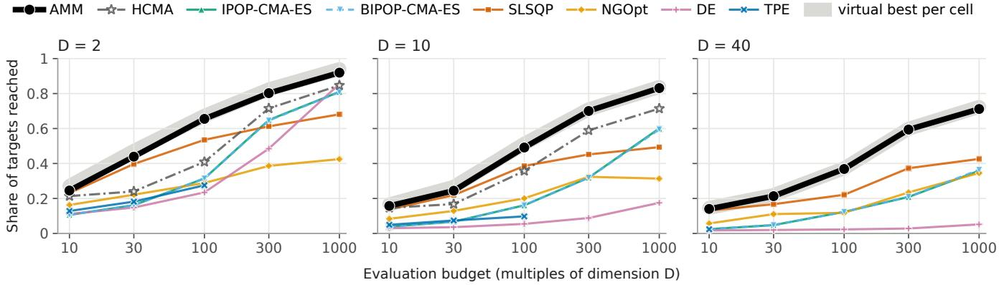  
Figure 3: Final test per dimension (instances 101–110; same harness, one seed, each budget a separate run): share of the 51 targets reached (functions weighted equally) against the budget at � = 2, 10 and 40 (� = 5 and 20 in Figure 4, Appendix F); SLSQP restarted, TPE on its slice, HCMA from its archive levels (� = 2–20). Grey band: the per-cell virtual best of the methods drawn, AMM included. NADE and ERADS, run after the final test, are not drawn (Figure 1 and Table 12).

## 5.3 Beyond bbob’s function identities

On MA-BBOB (setting in Section 4.3), AMM has a higher mean anytime area than every archived 2024 baseline (modcma by +.047 [+.023, +.071] at � = 2 and +.046 [+.014, +.078] at � = 5). Among the archived 2025 runs, NADE’s and three baselines, it is level with the 2025 winner NADE at $D = 2 \left( - . 0 0 7 \left[ - . 0 1 9 , + . 0 0 9 \right] \right)$ , second to it at $D = 5 \left( - . 0 4 9 \left[ - . 0 6 8 , - . 0 2 9 \right] \right)$ and level there with van Stein’s 2024 algorithm ERADS (van Stein and Bäck, 2025) (+.001 [−.034, +.038]); the 2025 archives hold one run per problem, so these comparisons are unpaired. Its final target share at 2000·� is level with IPOP-$\mathbf { C M A - E S _ { \lambda } } \left( - . 0 0 2 \left[ - . 0 1 2 , + . 0 0 8 \right] \mathrm { t o } + . 0 1 6 \left[ - . 0 0 1 , + . 0 3 5 \right] \right)$ , while its anytime area trails IPOP-CMA-ES by .026 to .064. On the 2024 set’s budget grid (point values over two seeds) it leads IPOP-CMA-ES in final target share by +.031 to +.161 at 10·�–100·�, less than on bbob, trails it at 300·� for $D = 5 \ : ( . 6 1 0$ against .733; at $D = 2$ it leads $\mathrm { b y } + . 0 0 7 )$ , and leads by +.013 and +.044 at 1000·�. On MA-BBOB its strength is thus the fixed-budget share at small and medium budgets. Every pre-registered prediction held, except one budget-grid cell that came out above its range in AMM’s favour.

Transformed, rotated and box-constrained bbob. In a batch preregistered before any of its runs, AMM and same-harness com-petitors ran on fresh instances of three bbob variants. All 17 of its predictions (58 numeric ranges) held, with one fix to how runs were paired before its second analysis (Appendix L). COCO’s bbob-boxed suite, formerly sbox-cost (Vermetten, López-Ibáñez, Mersmann, All mendinger and Kononova, 2023), adds bound constraints and moves the optimum within the box for 19 of the 24 functions. On it (ids 840–849, $D = 2 \ – 4 0 ;$ the field of Section 4.3 without HCMA, NGOpt at $D = 2$ only), AMM leads IPOP-CMA-ES by +.117 to +.308 and SLSQP by +.011 to +.291, above zero under Holm’s correction at every budget and within .012 of its final-test lead over IPOP-CMA-ES. It has the highest share in 451 of 600 cells and is credibly ahead of every competitor in 155 and behind in 26. Under two afine maps of �, a box shrunk tenfold and the first map with that box (ids 810–819, $D = 2 \ – 2 0 ;$ ; definitions in Appendix L), AMM’s lead over IPOP-CMA-ES stays above zero in all 16 tests of the four variants at 30·�–1000·� (Holm over 20 with the identity). AMM is not invariant to the afine maps, though (Section 6): its share falls by .032, .053 and .030 under the first, the second and the combined change, while IPOP-CMA-ES’s does not change under the afine maps; the box change alone leaves AMM’s unchanged (+.001). Rotating f1–f4 about their optima (ids 820–839, $D = 2 \cdot$ –40; f5 is not rotated, Appendix L) leaves the sphere unchanged for every solver. It cuts AMM’s lead over IPOP-CMA-ES on f3 from +.505 to +.029 and on f4 from +.301 to a level +.011, as predicted: there the lead comes from the coordinate-wise routes. On the rotated ellipsoid it keeps +.390, and over rotated f2–f4 it stays ahead of IPOP-CMA-ES at every budget (+.015 to +.265).

Dimensions and budgets ofthe development grid. Every dimen-sion and budget multiplier of the final test is a point of the grid that Table 2’s thresholds were set on. At $D = 4 , 7 ,$ , 15 and 30 and at $2 0 \cdot D ,$ 200·�, 350·� and 600·� (pre-registered; fresh ids 870–879, all 24 functions), AMM leads IPOP-CMA-ES at each of 13 pooled settings under Holm (by +.118 to +.295 at the new dimensions and +.160 to +.272 at the new budgets of the old dimensions) and restarted SLSQP at each (+.018 to +.293), and on these fresh instances the final test’s margins replicate within .014. The margin over IPOP-CMA-ES is about .02 below the grid’s interpolation (−.018 [−.031, −.005]) and about .06 below at $D = 4 ,$ where above 100·� no gate and no landscape probe is active and the lead shrinks to +.076– +.090 at 300·�–600·�, with intervals reaching zero (Appendix O).

## 5.4 Parts of the method: ablation and route firing

A leave-one-route-out ablation of AMM on fresh development ids (770–809, 206,280 runs) shows that every route family pays on its own slice. Removing any one of the twelve route families lowers its slice’s target share by .0108 or more in point estimate, up to .7714 for the chain route on f20 (Table 4), and the thirteenth arm, without the two COBYQA hand-overs (rules (ii) and (iii) of Table 6), lowers it by .0069. Outside its own slice no removal gained more than +.0013, and on its own slice the ATM stage costs less to remove than nine of the other eleven route families. The plateau and fractal family is mixed: its fractal exemption (the route that sends fractal readings to restarted SLSQP instead of IPOP populations) alone does nothing measurable on f23 at $D = 5 { - } 4 0 \left( + . 0 0 1 \left[ - . 0 1 0 , + . 0 1 2 \right] \right)$ , where it acts only from $D = 2 0$ . The family’s fall (Table 4) was narrowly outside its predicted range, the one slice-efect prediction missed (per-route values, A/A draws and code-identity checks in Appendix J). A leaveone-out measures a family’s marginal contribution given the others, and six rows (the COBYQA hand-overs row included) bundle two to four mechanisms.

Route-firing logs (last column of Table 2; heat-maps in Appendix K) show that the separable and chain routes fire exactly on the functions that have their property: STEP on f1–f5 and the coordi-nate search on f20 only. Elsewhere most routes fire on the group of functions that share the property their probe reads (not the one-descent-first route of $D = 2 \AA ^ { - 3 ) }$ , and six of the twelve function- motivated rows of Table 2 fire on a function outside those that motivated them. Of 17 pre-registered predictions about firing, each with a range and a separate falsifying threshold, 12 held, four missed their ranges without being falsified and one was falsified. On the fresh ids the basin route reads f21 and f22 as multi-basin in only 41% and 19% of the runs at $D = 2 \AA { - 3 }$ (at least 50% predicted).

## 5.5 The anytime mode

AMM plans its phases from the budget it is given, so a run cut short is not the run that budget would have made. An optional anytime mode, added after the final test and not used by the configuration benchmarked above, reruns AMM on doubling plans (10·�, 20·�, $\ldots )$ from the same start point and seed, answers every point evalu- ated before from memory, and hands over to an ordinary run once the next plan would exceed $1 0 ^ { 4 }$ evaluations (Appendix M). On the final-test problems, which its development never used, all seven ranges of its own pre-registration held: it is level with AMM told its budget at $1 0 ^ { 4 } { \cdot } D$ and $1 0 ^ { 5 } \cdot D ,$ , and before the hand-over it pays for not knowing the budget, by .05 to .12 at 30·�–1000·� (Table 17). Against the field it stays above every method at every budget ex- cept SLSQP at $3 0 { \cdot } D \left( - . 0 1 8 \ \left[ - . 0 2 7 , - . 0 0 8 \right] \right)$ . Appendix M gives its mechanism, its cost in CPU time and when to use it.

## 5.6 Where AMM does not win

In the final test AMM is credibly behind at least one competitor in 35 of 600 cells (by budget in Table 3), by dimension $( D = 2 , 5 , 1 0 ,$ 20, 40) in 11, 7, 8, 4 and 5. The per-cell map, with the full lists of the cells named below, is Figure 5 (Appendix G), and the counts are descriptive (Section 4.2).

The smallest budgets, smooth functions. Restarted SLSQP is credibly ahead in 11 cells, 10 of them at 10·�–30·� on smooth functions at $D = 2 { - } 1 0$ . The largest gaps are f10 at � = 5 and 30·� (−.31) and f12 at � = 2 and 30·� (−.26). There a probe costs a large share of the budget, so AMM probes least and inherits the limits of COBYQA, SLSQP and the (1+1)-CMA-ES. Its COBYQA gate was accepted in development with named trades, losses accepted in advance, of .05 on f13 (� = 2) and f11 (� = 3) and .04 on f10 (� = 3). A deficit against SLSQP seen in development on f9 $( D = 1 0 , 3 0 0 { \cdot } D )$ is not among the 35 cells.

Table 4: Leave-one-route-out analysis of AMM on fresh bbob ids 770–809 (one seed per id; 206,280 runs): each arm is AMM with one route family switched of. Δ = target share without the family minus with it, on the family’s slice (where its confirmation measured a gain; negative means the family helps), with its 95% cluster-bootstrap interval over the 40 ids. Further columns: the range predicted before the run, and Δ on the cells outside the slice $( ^ { \omega } - ^ { \gamma }$ where the slice is the whole block). Holm over the 13 rows rejects every row. Nothing was pruned.
<table><tr><td>Route family (switch removed)</td><td>From</td><td>Slice</td><td>∆ on the slice [95% CI]</td><td>Predicted</td><td></td><td>∆ off the slice</td></tr><tr><td>COBYQA gate at  $D \leq 3 , B \leq 1 0 D$ </td><td>c43</td><td>all, D 2–3, 10 ·D</td><td>-.0158 [-.0196, -.0121]</td><td></td><td>-.035 to −.008</td><td></td></tr><tr><td>pair test → STEP restarts (separable)</td><td>c38</td><td>f3, D 5-40, 100-1000 ·D</td><td>-.2239[−.2352, −.2118]</td><td></td><td>-.70 to −.15</td><td>+.0005 [−.0040, +.0051]</td></tr><tr><td>pair test → coordinate search (chain)</td><td>c38</td><td>f20, D 5-40, 300-3000 ·D</td><td>-.7714[-.7818, -.7600]</td><td></td><td>-.90 to −.50</td><td>+.0013 [−.0020, +.0046]</td></tr><tr><td>basin reading → MLSL; basin descent</td><td>c39, c42</td><td>f21, f22, D 2-3, 100–3000 ·D</td><td>-.1000 [−.1293, -.0716]</td><td></td><td>-.20 to −.05</td><td>-.0061 [-.0143, +.0020]</td></tr><tr><td>prefix curvature routing; descent first ATM stage (its share goes to the next</td><td>c25-c40</td><td>13 smooth functions, D 3-40, 10-100 ·D</td><td>-.1327 [-.1346, −.1308]</td><td></td><td>-.35 to −.08</td><td>-.0035 [-.0043, −.0027]</td></tr><tr><td>stage)</td><td>c23</td><td>f15-f24, D 2-40, 300-1000 ·D</td><td>-.0202[-.0291, -.0116]</td><td></td><td>-.07 to 0</td><td>-.0212 [-.0280, −.0146]</td></tr><tr><td>STEP stall check</td><td>c39</td><td>all, D 5-10, 1000–3000 ·D</td><td>-.0108 [−.0145, −.0073]</td><td></td><td>-.06 to −.003</td><td>-.0008 [−.0038, +.0021]</td></tr><tr><td>smooth reading → scaled BFGS descent SLSQP stage gates: L-BFGS-B, cap gate,</td><td>c41 c32, c34</td><td>f6, f12, f13, f14, D 5–40, 300 ·D</td><td>-.1676 [-.1773, -.1580]</td><td></td><td>-.30 to −.08</td><td>-.0085 [-.0120, -.0051]</td></tr><tr><td>second descent</td><td></td><td>f8, f9, f12, D 10–40, 100–1000 ·D</td><td>-.0985[-.1111, -.0865]</td><td></td><td>-.30 to −.05</td><td>-.0028[-.0031, -.0025]</td></tr><tr><td>hill-valley → sampled SLSQP restarts</td><td>c35</td><td>f21, f22, D 10-40, 1000–3000 ·D</td><td>-.2327[-.2687, -.1965]</td><td></td><td>-.30 to −.08</td><td>-.0120 [-.0143, -.0097]</td></tr><tr><td>kink route and rugged BFGS try</td><td>c37 c28-c37</td><td>f13, D 5-40, 300-1000 ·D</td><td>-.1645 [-.1791, -.1496]</td><td></td><td>−.45 to −.10</td><td>+.0003 [+.0000, +.0006]</td></tr><tr><td>plateau and rugged IPOP routes, fractal exemption</td><td></td><td>f7, f15, f17, f18, f23, D 5–40, 100–3000 ·D</td><td>-.0368[-.0413, -.0317]</td><td></td><td>-.25 to −.04</td><td>+.0003 [+.0002, +.0004]</td></tr><tr><td>COBYQA hand-overs (Table 6, rules (ii), (iii)</td><td>c44, c45</td><td> $\mathrm { a l l } , \mathrm { D } 5 { - } 2 0 , 1 0 { - } 3 0 \cdot D$ </td><td>-.0069[−.0075, -.0063]</td><td></td><td>-.025 to −.003</td><td></td></tr></table>

HCMA’s archive levels. They lead alone in nine cells, the largest on f7, the step ellipsoid, at $D = 2 0$ and 300·� (−.27), and share two cells on f14 with IPOP- and BIPOP-CMA-ES (below).

NGOpt. NGOpt leads in six cells: f9 at � = 5 and 10 at 10·�, f17 at � = 5 at 100·� and 300·� (by up to −.090), and f20 and f23 at � = 40 at 10·�.

Restarted CMA-ES and TPE. IPOP- and BIPOP-CMA-ES lead in seven cells on f12, f14, f17 and f18, the three largest on f18 at � = 2 and 1000·� (BIPOP, −.15) and on f12 and f14 at � = 2 and 300·� (−.14, −.12). TPE leads on f17 and f18 at � = 5 and 30·� (−.06, −.04).

Against the controls. By the same rule, AMM is credibly behind the greedy schedule of its engines in 25 cells, 7 at 30·� and 18 from 100·� up, the largest on f2 at � = 40 and 30·� (−.70), and behind NgIohTuned in 7 cells, five at 300·� and two at 10·�, four of them not among the 35 (the largest on f16 at � = 2 and 300·�, −.33).

Rotated, anytime and cheap problems. Coordinate-wise routes cannot fire on rotated separable functions and fall back at the price of their probes. On rotated f3 and f4 (Section 5.3) the best of IPOP-, BIPOP-CMA-ES, SLSQP and DE leads AMM by more than .02 in 4 of the 25 cells of each (in none unrotated). An anytime measure such as MA-BBOB’s area ranks AMM lower than its final value does: on the 2025 set at � = 5 it has the highest anytime area among itself and the four archived runs on that set (NADE’s and three baselines) on only 10% of the problems (ERADS on 57%). COBYQA alone takes about 4.4 ms per evaluation at � = 2–3 (outside COCO’s procedure), which matters when � is cheap.

## 6 Discussion and limitations

What probes do that other routers cannot. A probe separates problems that metadata cannot: f3 and f15 are the same Rastrigin func- tion without and with a rotation. A router that reads only � and � must send both to the same engine, while the pair test’s 3� evalu- ations send f3 to STEP restarts (the separable route’s gain in Section 4.1) and leave f15 on the general path. The probes’ thresholds were not designed leave-one-function-out (an in-sample comparison with fitted routers is in Appendix C); the pooled value ofreading � (Section 5.2) is measured against one definition of the probes’ defaults, and at 10·� that definition also removes a COBYQA stage that no reading chooses.

The budget must be known. AMM told its budget chooses its route from �, so it is not an anytime algorithm (Section 5.5 evaluates an optional anytime mode), and its share need not grow with �. In 8 (function, dimension) pairs its mean share drops by more than .02 from one budget to the next larger one, the two largest on f14 at � = 40 (1.00 at 300·�, .865 at 1000·�) and f12 at � = 10 (.986 to .880).

Absolute constants and coordinates. The kink threshold $\tau _ { k } = 5 { \cdot } 1 0 ^ { 7 }$ is tied to the scale of bbob’s �-values. The restart tolerance $1 0 ^ { - 1 1 }$ SLSQP’s ftol $= 1 0 ^ { - 1 4 }$ and the finite-diference step $1 0 ^ { - 9 }$ are absolute, and the probe scales are fixed shares of the box width. The pair test, the chain route and STEP read structure in the given coordinates. The chain route detects a coupling that, among the bbob functions used in calibration, only f20 showed, and may be read as an f20 device. Section 5.3 measures what both cost: under the afine maps of � AMM’s share falls by .03 to .05, so its target shares hold only at bbob’s scale of �, and rotating f3 and f4 removes most of the lead their coordinate-wise routes give.

Probes outside their calibrated range. In development, a separability route calibrated at 300·�–1000·� misrouted rugged functions at 3000·� (−.18 to −.25 per cell). A fractal exemption lost .16 on f16 because Weierstrass’s function read as rough as Katsuura’s on other instances. Validity ranges limit such failures but cannot exclude a misreading on a problem class unlike bbob’s.

Scope. The final test, and with it the tested regime of Section 4.2, covers noiseless, box-bounded problems with � = 2–40 and budgets of10·�–1000·�. No function family outside bbob’s was tested under pre-registration; an exploratory check on 20 other functions at � = 2–4 (Appendix P) found AMM level with restarted SLSQP at 30·�, ahead at 100·�, level with IPOP-CMA-ES at 300·�–1000·� and behind NADE at 1000·�. The �-keyed thresholds (Appendix B) come from the development grid; of it the lead held (Section 5.3), but at � = 4, where above 100·� no gate and no landscape probe is active (only STEP’s separability check and the finisher’s stall rule) and a run takes the general path of the ATM stage, STEP and the finisher, the lead over IPOP-CMA-ES shrinks to about +.08 at 300·�–600·�. Dimensions above 40 were not tested. The box sets probe scales, trust radii and restart points (it is mapped onto $[ - 5 , 5 ] ^ { D }$ inside AMM), so it should bound the region where the optimum plausibly lies; no box wider than bbob’s or unbounded problem was tested. Finite diferences assume exact �-values, and the quasi-Newton engines cost $O ( D ^ { 2 } )$ or more per step. COCO’s timing experiment was not run, for AMM or for its anytime mode.

## 7 Conclusion and future work

On bbob, a router that tests each engine’s assumption before run- ning it spent a known budget better, pooled over cells, than any engine it routes among. Run once on held-out instances, one configuration of AMM has the highest target share among up to seven competitors in 382 of 600 cells (236 outright), leads IPOP-CMA-ES by +.12 to +.31 and beats every ladder control except the post-hoc oracle at every budget.

Within the tested regime (Section 6), the routing, not the pool alone, carries the pooled gain from 100·� up; at 10·� and 30·�, where most of the 35 credibly-behind cells lie, AMM is mostly the right engine run well and restarted SLSQP comes close. In preregistered runs the lead over IPOP-CMA-ES holds under afine and box transformations of bbob, on its box-constrained suite and, pooled, on rotated f2–f4, but the coordinate-wise routes pay only in the given coordinates (rotating f3 and f4 removes most oftheir lead); on MA-BBOB AMM’s final share at 2000·� is only level with IPOP-CMA-ES’s and its anytime area lower; and without a known budget the anytime mode loses .05 to .12 at 30·�–1000·� (Section 5.5).

Future work. MA-BBOB’s generator could serve development and a held-out final test. Fitted and scale-free thresholds, rotation- invariant separability probes, shared batch evaluations and a com- piled core would address Section 6’s limitations and the overhead on cheap �; and resumable engines would narrow the anytime mode’s gap.

## Software availability

AMM is an open-source Python package (Apache-2.0) that de-pends only on NumPy and SciPy, installable with pip install amm-optimizer (import amm\_optimizer). Its entry point minimize takes the inputs listed in Section 3 (signature in Appendix A), and runs are deterministic given the seed. The benchmark harnesses stop each run at its budget; minimize itself does not cap the budget and can overrun it when the caller does not stop it. The source, at tag v0.3.0, is at https://github.com/BjBodner/amm-optimizer. Its preset c46 is the configuration benchmarked here (the anytime mode of Section 5.5 is in release 0.5.0, not in this tag; releases 0.3.0 and 0.5.0 reproduce every final-test run of c46 bit for bit), and the repository holds the benchmark runner and the development’s screening records (benchmarks/). The pre-registrations, the result files and the scripts behind the tables of this paper are not yet in the repository; they will be archived with a DOI and cited in the next version.

## Acknowledgments

The author used Claude models (Anthropic), through Claude Code, for code development, for running and analysing the experiments, for literature search, and for initial drafting and editing the text. However, the text, tables and figures have been heavily edited and mostly rewritten/recreated by the author. The author is responsible for the content of this paper. The author received no external funding for this work.

## References

Adriaensen, S., Biedenkapp, A., Shala, G., Awad, N., Eimer, T., Lindauer, M. and Hutter, F. (2022), ‘Automated dynamic algorithm configuration’, Journal ofArtificial Intelligence Research 75, 1633–1699. doi: 10.1613/jair.1.13922

Akiba, T., Sano, S., Yanase, T., Ohta, T. and Koyama, M. (2019), Optuna: A nextgeneration hyperparameter optimization framework, in ‘Proceedings of the 25th ACM SIGKDD International Conference on Knowledge Discovery & Data Mining’, ACM, pp. 2623–2631. doi: 10.1145/3292500.333070

Arnold, D. V. and Hansen, N. (2010), Active covariance matrix adaptation for the (1+1)-CMA-ES, in ‘Proceedings of the 12th annual conference on Genetic and evolutionary computation’, ACM, pp. 385–392. doi: 10.1145/1830483.1830556

Auger, A. and Hansen, N. (2005), A restart CMA evolution strategy with increasing population size, in ‘2005 IEEE Congress on Evolutionary Computation’, IEEE, pp. 1769–1776. doi: 10.1109/cec.2005.1554902

Bajer, L., Pitra, Z., Repický, J. and Holeňa, M. (2019), ‘Gaussian process surrogate models for the CMA evolution strategy’, Evolutionary Computation 27(4), 665–697. doi: 10.1162/evco\_a\_00244

Bartz-Beielstein, T., Doerr, C., van den Berg, D., Bossek, J., Chandrasekaran, S., Eftimov, T., Fischbach, A., Kerschke, P., La Cava, W., López-Ibáñez, M., Malan, K. M., Moore, J. H., Naujoks, B., Orzechowski, P., Volz, V., Wagner, M. and Weise, T. (2020), ‘Benchmarking in optimization: Best practice and open issues’, arXiv preprint arXiv:2007.03488. URL: https://arxiv.org/abs/2007.03488

Baudiš, P. (2014), ‘COCOpf: An algorithm portfolio framework’, arXiv preprint arXiv:1405.3487. URL: https://arxiv.org/abs/1405.3487

Bischl, B., Mersmann, O., Trautmann, H. and Preuss, M. (2012), Algorithm selection based on exploratory landscape analysis and cost-sensitive learning, in ‘Proceedings of the 14th annual conference on Genetic and evolutionary computation’, ACM, pp. 313–320. doi: 10.1145/2330163.2330209

Bodner, B. (2019), Benchmarking the ATM algorithm on the BBOB 2009 noiseless function testbed, in ‘Proceedings of the Genetic and Evolutionary Computation Conference Companion’, ACM, pp. 1897–1904. doi: 10.1145/3319619.3326802

Brockhof, D. and Villain, T. (2025), Benchmarking Powell’s legacy: Performance of five derivative-free solvers in dfo on the bbob test suite, in ‘Proceedin s of the Genetic and Evolutionary Computation Conference Companion’, ACM, pp. 1833–1841. doi: 10.1145/3712255.3734343

Byrd, R. H., Lu, P., Nocedal, J. and Zhu, C. (1995), ‘A limited memory algorithm for bound constrained optimization’, SIAM Journal on Scientific Computing 16(5), 1190– 1208. doi: 10.1137/0916069

Carafini, F., Neri, F. and Picinali, L. (2014), ‘An analysis on separability for memetic computing automatic design’, Information Sciences 265, 1–22. doi: 10.1016/j.ins.2013.12.044

Cenikj, G., Petelin, G., Seiler, M., Cenikj, N. and Eftimov, T. (2025), ‘Landscape features in single-objective continuous optimization: Have we hit a wall in algorithm selection generalization?’, Swarm and Evolutionary Computation 94, 101894. doi: 10.1016/j.swevo.2025.101894

de Nobel, J., Vermetten, D., Kononova, A. V., Doerr, C. and Bäck, T. (2026), ‘The modular CMA-ES: A framework for modern evolution strategies’, arXiv preprint arXiv:2610.09699. URL: https://arxiv.org/abs/2610.09699

Dietrich, K., Vermetten, D., Doerr, C. and Kerschke, P. (2024), Impact of training instance selection on automated algorithm selection models for numerical black box optimization, in ‘Proceedings of the Genetic and Evolutionary Computation Conference’, ACM, pp. 1007–1016. doi: 10.1145/3638529.3654100

Dinu, C.-V., Vermetten, D. and Doerr, C. (2026), ‘How sequential algorithm portfolios can benefit black box optimization’, arXiv preprint arXiv:2601.16896. URL: https://arxiv.org/abs/2601.16896

Epitropakis, M. G., Carafini, F., Neri, F. and Burke, E. K. (2014), A separability prototype for automatic memes with adaptive operator selection, in ‘2014 IEEE Symposium on Foundations of Computational Intelligence (FOCI)’, IEEE, pp. 70–77. doi: 10.1109/foci.2014.7007809

Gill, P. E., Murray, W., Saunders, M. A. and Wright, M. H. (1983), ‘Computing forward diference intervals for numerical optimization’, SIAM Journal on Scientific and Statistical Computing 4(2), 310–321. doi: 10.1137/0904025

Glasmachers, T. and Krause, O. (2020), The Hessian estimation evolution strategy, in ‘Parallel Problem Solving from Nature – PPSN XVI’, Lecture Notes in Computer Science, Springer International Publishing, pp. 597–609. doi: 10.1007/978-3-030-58112-1\_41

Hansen, N. (2009), Benchmarking a BI-population CMA-ES on the BBOB-2009 function testbed, in ‘Proceedin s of the 11th Annual Conference Com anion on Genetic and Evolutionary Computation Conference: Late Breaking Papers’, ACM, pp. 2389– 2396.

Hansen, N. (2016), ‘The CMA evolution strategy: A tutorial’, arXiv preprint arXiv:1604.00772. URL: https://arxiv.org/abs/1604.00772

Hansen, N. (2019), A global surrogate assisted CMA-ES, in ‘Proceedings of the Genetic and Evolutionary Computation Conference’, ACM, pp. 664–672. doi: 10.1145/3321707.3321842

Hansen, N., Akimoto, Y. and Baudiš, P. (2019), ‘CMA-ES/pycma on Github’, Zenodo doi: 10.5281/zenodo.2559635

Hansen, N., Auger, A., Brockhof, D., Tušar, D. and Tušar, T. (2016), ‘COCO: Performance assessment’, arXiv preprint arXiv:1605.03560. URL: https://arxiv.org/abs/1605.03560

Hansen, N., Auger, A., Ros, R., Finck, S. and Pošík, P. (2010), Comparing results of 31 algorithms from the black-box optimization benchmarking BBOB-2009, in ‘Pro ceedings of the 12th annual conference companion on Genetic and evolutionary computation’, ACM, pp. 1689–1696. doi: 10.1145/1830761.1830790

Hansen, N., Auger, A., Ros, R., Mersmann, O., Tušar, T. and Brockhof, D. (2021), ‘COCO: a platform for comparing continuous optimizers in a black-box setting’, Optimization Methods and Software 36(1), 114–144. doi: 10.1080/10556788.2020.1808977

Hansen, N. and Ros, R. (2010), Black-box optimization benchmarking of NEWUOA compared to BIPOP-CMA-ES: on the BBOB noiseless testbed, in ‘Proceedings of the 12th annual conference companion on Genetic and evolutionary computation’, ACM, pp. 1519–1526. doi: 10.1145/1830761.1830768

Hansen, N., Tušar, T., Mersmann, O., Auger, A. and Brockhof, D. (2016), ‘COCO: The experimental procedure’, arXiv preprint arXiv:1603.08776. URL: https://arxiv.org/abs/1603.08776

Igel, C., Suttorp, T. and Hansen, N. (2006), A computational eficient covariance matrix update and a (1+1)-CMA for evolution strategies, in ‘Proceedings of the 8th annual conference on Genetic and evolutionary computation’, ACM, pp. 453–460. doi: 10.1145/1143997.1144082

Jankovic, A. and Doerr, C. (2020), Landscape-aware fixed-budget performance regression and algorithm selection for modular CMA-ES variants, in ‘Proceedings of the 2020 Genetic and Evolutionary Computation Conference’, ACM, pp. 841–849. doi: 10.1145/3377930.3390183

Kerschke, P. and Trautmann, H. (2019), ‘Automated algorithm selection on continuous black-box problems by combining exploratory landscape analysis and machine learning’, Evolutionary Computation 27(1), 99–127. doi: 10.1162/evco\_a\_00236

Kostovska, A., Jankovic, A., Vermetten, D., de Nobel, J., Wang, H., Eftimov, T. and Doerr, C. (2022), Per-run algorithm selection with warm-starting using trajectory-based features, in ‘Parallel Problem Solving from Nature – PPSN XVII’, Lecture Notes in Computer Science, Springer International Publishing, pp. 46–60. doi: 10.1007/978-3-031-14714-2\_4

Kraft, D. (1988), A software package for sequential quadratic programming, Technical Report DFVLR-FB 88-28, DLR German Aerospace Center.

LaTorre, A., Muelas, S. and Peña, J.-M. (2011), ‘A MOS-based dynamic memetic differential evolution algorithm for continuous optimization: a scalability test’, Soft Computing 15(11), 2187–2199. doi: 10.1007/s00500-010-0646-3

Lewis, A. S. and Overton, M. L. (2013), ‘Nonsmooth optimization via quasi-Newton methods’, Mathematical Programming 141(1-2), 135–163.

doi: 10.1007/s10107-012-0514-2

Liu, J., Moreau, A., Preuss, M., Ra in, J., Roziere, B., Te taud, F. and Te taud, O. (2020), Versatile black-box o timization, in ‘Proceedings of the 2020 Genetic and Evolutionary Computation Conference’, ACM, pp. 620–628. doi: 10.1145/3377930.3389838

Loshchilov, I., Schoenauer, M. and Sebag, M. (2012a), Alternative restart strategies for CMA-ES, in ‘Parallel Problem Solving from Nature – PPSN XII’, Lecture Notes in Computer Science, Springer Berlin Heidelberg, pp. 296–305. doi: 10.1007/978-3-642-32937-1\_30

Loshchilov, I., Schoenauer, M. and Sebag, M. (2012b), Self-adaptive surrogate-assisted covariance matrix adaptation evolution strategy, in ‘Proceedings of the 14th annual conference on Genetic and evolutionary computation’, ACM, pp. 321–328. doi: 10.1145/2330163.2330210

Loshchilov, I., Schoenauer, M. and Sebag, M. (2013), Bi-population CMA-ES agorithms with surrogate models and line searches, in ‘Proceedings of the 15th annual confer ence companion on Genetic and evolutionary computation’, ACM, pp. 1177–1184. doi: 10.1145/2464576.2482696

Maree, S. C., Alderliesten, T., Thierens, D. and Bosman, P. A. N. (2018), Real-valued evolutionary multi-modal optimization driven by hill-valley clustering, in ‘Proceed ings of the Genetic and Evolutionary Computation Conference’, ACM, pp. 857–864. doi: 10.1145/3205455.320547

Mersmann, O., Bischl, B., Trautmann, H., Preuss, M., Weihs, C. and Rudolph, G. (2011), Exploratory landscape analysis, in ‘Proceedings of the 13th annual conference on Genetic and evolutionary computation’, ACM, pp. 829–836. doi: 10.1145/2001576.2001690

Meunier, L., Rakotoarison, H., Wong, P. K., Roziere, B., Rapin, J., Teytaud, O., Moreau, A. and Doerr, C. (2022), ‘Black-box optimization revisited: Improving algorithm se lection wizards through massive benchmarking’, IEEE Transactions on Evolutionary Computation 26(3), 490–500. doi: 10.1109/tevc.2021.3108185

Mohammadi, H., Le Riche, R. and Touboul, E. (2015), Making EGO and CMA-ES complementary for global optimization, in ‘Learning and Intelligent Optimization’, Lecture Notes in Computer Science, Springer International Publishing, pp. 287–292. doi: 10.1007/978-3-319-19084-6\_29

Molina, D., LaTorre, A. and Herrera, F. (2018), SHADE with iterative local search for large-scale global optimization, in ‘2018 IEEE Congress on Evolutionary Computation (CEC)’, IEEE, pp. 1–8. doi: 10.1109/cec.2018.8477755

Moré, J. J. and Wild, S. M. (2012), ‘Estimating derivatives of noisy simulations’, ACM Transactions on Mathematical Software 38(3), 1–21. doi: 10.1145/2168773.2168777

Nelder, J. A. and Mead, R. (1965), ‘A simplex method for function minimization’, The Computer Journal 7(4), 308–313. doi: 10.1093/comjnl/7.4.308

Omidvar, M. N., Li, X., Mei, Y. and Yao, X. (2014), ‘Cooperative co-evolution with diferential grouping for large scale optimization’, IEEE Transactions on Evolutionary Computation 18(3), 378–393. doi: 10.1109/tevc.2013.2281543

Petelin, G. and Cenikj, G. (2025), The pitfalls of benchmarking in algorithm selection: What we are getting wrong, in ‘Proceedings of the Genetic and Evolutionary Computation Conference’, ACM, pp. 1181–1189. doi: 10.1145/3712256.3726336

Pošík, P. and Baudiš, P. (2015), Dimension selection in axis-parallel Brent-STEP method for black-box optimization of separable continuous functions, in ‘Proceedings of the Companion Publication ofthe 2015 Annual Conference on Genetic and Evolutionary Computation’, ACM, pp. 1151–1158. doi: 10.1145/2739482.2768469

Pošík, P. and Huyer, W. (2012), ‘Restarted local search algorithms for continuous black box optimization’, Evolutionary Computation 20(4), 575–607. doi: 10.1162/evco\_a\_00087

Ragonneau, T. M. (2022), Model-Based Derivative-Free Optimization Methods and Software, PhD thesis, Department of Applied Mathematics, The Hong Kong Poly technic Universit , Hon Kon , China. URL: https://theses.lib.polyu.edu.hk/handle/200/12294

Ragonneau, T. M. and Zhang, Z. (2026), ‘COBYQA version 1.1.4’, https://www.cobyqa. com.

Rapin, J. and Teytaud, O. (2018), ‘Nevergrad - a gradient-free optimization platform’, https://GitHub.com/FacebookResearch/Nevergrad.

Raponi, E., Rakotonirina, N. C., Rapin, J., Doerr, C. and Teytaud, O. (2025), ‘Optimizing with low budgets: A comparison on the black-box optimization benchmarking suite and OpenAI Gym’, IEEE Transactions on Evolutionary Computation 29(1), 91–101. doi: 10.1109/tevc.2023.3346788

Renau, Q. and Hart, E. (2024), On the utility of probing trajectories for algorithmselection, in ‘Applications of Evolutionary Computation’, Lecture Notes in Com puter Science, Springer Nature Switzerland, pp. 98–114. doi: 10.1007/978-3-031-56852-7\_7

Rinnooy Kan, A. H. G. and Timmer, G. T. (1987), ‘Stochastic global optimization methods part II: Multi level methods’, Mathematical Programming 39(1), 57–78.

doi: 10.1007/bf02592071

Schä ermeier, L. (2025), Greed restart schedules: A baseline for d namic al orithm selection on numerical black-box optimization problems, in ‘Proceedings of the Genetic and Evolutionary Computation Conference’, ACM, pp. 1199–1207. doi: 10.1145/3712256.3726408

Swarzberg, S., Seront, G. and Bersini, H. (1994), S.T.E.P.: the easiest way to optimize a function, in ‘Proceedings of the First IEEE Conference on Evolutionary Computation. IEEE World Congress on Computational Intelligence’, IEEE, pp. 519–524. doi: 10.1109/icec.1994.349896

Tanabe, R. (2022), ‘Benchmarking feature-based algorithm selection systems for black-box numerical optimization’, IEEE Transactions on Evolutionary Computation 26(6), 1321–1335. doi: 10.1109/tevc.2022.3169770

Tezuka, M., Munetomo, M. and Akama, K. (2004), Linkage identification by nonlinearity check for real-coded genetic algorithms, in ‘Genetic and Evolutionary Computation – GECCO 2004’, Lecture Notes in Computer Science, Springer Berlin Heidelberg, pp. 222–233. doi: 10.1007/978-3-540-24855-2\_20

Tseng, L.-Y. and Chen, C. (2008), Multiple trajectory search for large scale global optimization, in ‘2008 IEEE Congress on Evolutionary Computation (IEEE World Congress on Computational Intelligence)’, IEEE, pp. 3052–3059. doi: 10.1109/cec.2008.4631210

Ursem, R. K. (1999), Multinational evolutionary algorithms, in ‘Proceedings of the 1999 Congress on Evolutionary Computation-CEC99 (Cat. No. 99TH8406)’, IEEE, pp. 1633–1640. doi: 10.1109/cec.1999.785470

van der Schelling, M., Toshniwal, D. and Bessa, M. A. (2026), ‘Reinforcement learning to choose optimizers’, arXiv preprint arXiv:2609.01811. URL: https://arxiv.org/abs/2609.01811

van Stein, N. (2025), Neighborhood adaptive diferential evolution, in ‘Proceedings of the Genetic and Evolutionary Computation Conference Companion’, ACM, pp. 1–2. d i: 10 1145/3712255 3735092

van Stein, N. and Bäck, T. (2025), ‘LLaMEA: A large language model evolutionary algorithm for automatically generating metaheuristics’, IEEE Transactions on Evolutionary Computation 29(2), 331–345. doi: 10.1109/tevc.2024.3497793

van Stein, N., Kononova, A. V., Yin, H. and Bäck, T. (2025), BLADE: Benchmark suite for LLM-driven automated design and evolution of iterative optimisation heuristics, in ‘Proceedings of the Genetic and Evolutionary Computation Conference Companion’, ACM, pp. 2336–2344. doi: 10.1145/3712255.3734347

Varelas, K. and Dahito, M.-A. (2019), Benchmarking multivariate solvers of SciPy on the noiseless testbed, in ‘Proceedings of the Genetic and Evolutionary Computation Conference Companion’, ACM, pp. 1946–1954. doi: 10.1145/3319619.3326891

Vermetten, D., de Nobel, J., Bäck, T. and Doerr, C. (2025), ‘GECCO 2025 competition: Anytime algorithms for many-afine BBOB functions’, https://iohprofiler.github.io/ competitions/mabbob25.

Vermetten, D., López-Ibáñez, M., Mersmann, O., Allmendinger, R. and Kononova, A. V. (2023), Analysis of modular CMA-ES on strict box-constrained problems in the SBOX-COST benchmarking suite, in ‘Proceedings of the Companion Conference on Genetic and Evolutionary Computation’, ACM, pp. 2346–2353. doi: 10.1145/3583133.3596419

Vermetten, D., Wan , H., Bäck, T. and Doerr, C. (2020), Towards d namic al orithm selection for numerical black-box optimization: investigating BBOB as a use case, in ‘Proceedings of the 2020 Genetic and Evolutionary Computation Conference’, ACM, pp. 654–662. doi: 10.1145/3377930.3390189

Vermetten, D., Wang, H., Sim, K. and Hart, E. (2023), To switch or not to switch: Predicting the benefit of switching between algorithms based on trajectory features, in ‘Applications of Evolutionary Computation’, Lecture Notes in Computer Science, Springer Nature Switzerland, pp. 335–350. doi: 10.1007/978-3-031-30229-9\_22

Vermetten, D., Ye, F., Bäck, T. and Doerr, C. (2023), ‘MA-BBOB: Many-afine combinations of BBOB functions for evaluating AutoML approaches in noiseless numerical black-box optimization contexts’, arXiv preprint arXiv:2306.10627. URL: https://arxiv.org/abs/2306.10627

Vermetten, D., Ye, F., Bäck, T. and Doerr, C. (2025), ‘MA-BBOB: A roblem enerator for black-box optimization using afine combinations and shifts’, ACM Transactions on Evolutionary Learning and Optimization 5(1), 1–19. doi: 10.1145/3673908

Virtanen, P. et al. (2020), ‘SciPy 1.0: fundamental algorithms for scientific computing in Python’, Nature Methods 17(3), 261–272. doi: 10.1038/s41592-019-0686-2

Wang, J., Shi, X., Yuan, Y. and Misir, M. (2026), Geometric probing for algorithm selection in continuous black-box optimisation, in ‘Proceedings of the Genetic and Evolutionary Computation Conference Companion’, ACM, pp. 353–356. doi: 10.1145/3795101.3805304

Wang, T., Herbert, S. and Gao, S. (2023), Fractal landscapes in policy optimization, in ‘Advances in Neural Information Processing Systems 36’, Neural Information Processing Systems Foundation, Inc. (NeurIPS), pp. 4277–4294. doi: 10.52202/075280-0189

## A Code map and input audit

Algorithms 1 and 2 in Section 3.1 give the benchmarked configura- tion’s control loop and its prefix, and Table 5 where each of their lines lives in the code.

Code map. At tag v0.3.0 of the public repository the control loop is src/amm\_optimizer/api.py (minimize and the helpers it calls), and its phases are the modules named after them in the same folder (cobyqa\_phase.py, chain\_phase.py, basin\_phase.py, es\_phase.py, step\_phase.py, qn\_phase.py, pop\_cma.py, cma\_phase.py; search.py for the ATM stage). The benchmarked configuration is the preset c46 in presets.py; with the presets it builds on, it sets 67 of the 160 fields of the dataclass Variant in config.py (which holds every default) away from their defaults, and its local-phase route is QN\_ROUTES["qn44"] in qn\_phase.py. The tag renames the package and fixes two crashes outside the benchmarked range; its recorded runs of c46 are unchanged.

Input audit. Every source file of the benchmarked package was searched for reads of a function or instance identifier, an optimal value or a target, and the suite position. The search returned 4 candidate lines, none of which reaches a decision: two chain-route docstring lines describing its calibration toy, a dataclass field-name lookup in the configuration module, and a quasi-Newton-phase docstring mentioning instances with a large |� t|. The entry point is minimize(fun, x0, budget, \*, seed, rng, config, profile, bounds).

## B Routing, probes and engines in full

This appendix gives every rule of the benchmarked configuration (thresholds and symbols in Table 2).

Whole-budget gates. Section 3.1 walks through the three gates (Algorithm 1, lines 2–11). COBYQA is a trust-region method on quadratic interpolation models. The basin gate’s Sobol design has min(16�, max(� + 1, ⌊�/4⌋)) points, and the gate reads the basins at the design’s best point; after a basin reading that does not fire, the run continues from that point.

The prefix (� ≤ 100�). The prefix spends the whole budget (Algorithm 2): it evaluates a uniform design of max(4, �) points and, from 30·�, runs STEP on halfofthe remaining evaluations. The curvature probe then sends a smooth reading to restarted SLSQP (L-BFGS-B after a majority of failed exits) and a rugged one to the (1+1)-CMA-ES or, at 100·� on a rugged non-separable reading, to IPOP populations ranked by a quadratic surrogate. Below 31·� and 200 evaluations, where the probe would take a large share, the prefix skips it: one SLSQP descent from the design’s best point, then the (1+1)-CMA-ES on the rest. At � ≤ 2, Nelder–Mead restarts replace the evolution strategy, preceded up to 30·� by one SLSQP descent.

Table 5: Where each line of Algorithms 1 and 2 lives in the code (package amm\_optimizer; line numbers at tag v0.3.0 of the public repository, whose preset c46 is the benchmarked configuration; the tag renames the package and fixes two crashes outside the benchmarked range, and its recorded runs of c46 are unchanged). The configuration is the preset c46 in presets.py; its local-phase route is QN\_ROUTES["qn44"] in qn\_phase.py.
<table><tr><td>Line</td><td>Step</td><td>Module and function</td></tr><tr><td></td><td>rule (viii): the box mapped onto [–5, 5]D</td><td>api.py:minimize (L102-129)</td></tr><tr><td>2</td><td>COBYQA gate</td><td>api.py:minimize (L220-232); cobyqa_phase.py:run_cobyqa_restarts (L28)</td></tr><tr><td>5</td><td>pair test, separable and chain routes</td><td>api.py:_additive_route (L508); chain_phase.py:pair_test (L66), band_consistency (L182), run_coord_hess (L566); step_phase.py: run_step_phase (L40)</td></tr><tr><td>9-11</td><td>basin reading, MLSL, basin descent</td><td>api.py:minimize (L279–315); basin_phase.py:multi_basin_route (L209), rank_quadratic_r2 (L85), local_reading (L103)</td></tr><tr><td></td><td>12; Alg. 2 prefix, with rules (i)–(v) and (ix)</td><td>api.py:_prefix_runs (L685), _prefix_kind (L695), _small_switch_kw (L629), _prefix_ridge_kw (L648), _parked2_kw (L663); es_phase.py:run_es_phase (L54),</td></tr><tr><td></td><td></td><td>_guarded_descents (L615); qn_phase.py:plateau_check (L1458), curvature_beta (L1332), run_slsqp_restarts (L426); cobyqa_phase.py:run_cobyqa_from (L90), run_cobyqa_restarts</td></tr><tr><td>13</td><td>ATM stage</td><td>(L28); pop_cma.py:run_population_restarts (L34) api.py:minimize (L383-431); search.py:Search (L37)</td></tr><tr><td>14</td><td>STEP hand-over and separability check</td><td>api.py:minimize (L439-468); step_phase.py:run_step_phase (L40)</td></tr><tr><td>16</td><td>local probes and routes</td><td>api.py:_local_phase (L838), _qn_local_phase (L896); qn_phase.py:plateau_check (L1458), curvature_beta (L1332), micro_slopes (L720), run_scaled_bfgs (L902);</td></tr><tr><td>25</td><td>early ends of the smooth route</td><td>pop_cma.py:run_population_restarts (L34) qn_phase.py:failure_majority (L1232), run_1bfgsb_restarts (L1238), multi_basin (L1486),</td></tr><tr><td>27-28</td><td>rules (vii) and (vi): direct populations, capped BFGS</td><td>run_sampled_restarts (L1057), kink_check (L687) api.py:_qn_local_phase (L1265-1316), _kink_reads (L1332); qn_phase.py:run_scaled_bfgs</td></tr><tr><td>29</td><td>try</td><td>(L902) api.py:_finish_gated_then_ipop (L1339, direct start L1354); cma_phase.py:run_cma (L409);</td></tr></table>

The ATM stage and the hand-over $( B > 1 0 0 D )$ . The samples of the ATM stage (line 13) later warm-start the covariance of the (1+1)- CMA-ES; a separable verdict of STEP’s check (Appendix B.1, line 14) goes straight to the finisher.

Local probes and routes $\left( D \ge 5 , \right.$ non-separable). The plateau and curvature probes classify the incumbent as on a plateau, smooth or rugged (line 16). On a plateau, IPOP-aCMA-ES runs from a uniform point with four times the default population, doubling per restart, to the end of the budget. A rugged reading with at least $c _ { r } D$ left (Table 2) gets the same IPOP schedule. From $D = 2 0$ a fractal probe first diverts fractal readings to restarted SLSQP, and with at least $c _ { 8 } D$ left the schedule starts at eight times the default population. Other rugged readings get one capped BFGS try at $D \leq 9$ up to 500·�, with at least 200·� left, then the finisher with populations sized to the budget left (lines 27–28); at $0 . 5 ~ \leq$ $\beta < 1$ rule (vii) of Table 6 skips the try and, with at least 100·� left, starts those populations at once, and rule (vi) lets a try that reads a kink at its cap run to the end of the budget. A smooth reading up to 300·� gets one descent of a scaled finite-diference BFGS. An SLSQP stage follows on a third of the remaining budget, capped at 100·�. If a stall monitor, read once at the cap, says the first descent is still progressing, the descent may continue past the cap; otherwise it continues, unless finished, for at most another 100·�. Three readings ofthe stage end the local phase early (line 25), each handing the rest to one engine. A majority of failed SLSQP exits sends it to L-BFGS-B, converged descents in separate basins to sampled SLSQP restarts, and, when the stage stalled, a kink with at least 100·� left to the scaled BFGS. If a single converged descent passed the monitor with at least 400·� left, one more descent follows from a uniform point; otherwise the finisher continues from the stage’s best point.

The finisher. A restarted (1+1)-Cholesky-CMA-ES (Appendix B.2) runs from the incumbent (line 29). It hands over when it stalls with at least 100·� left, when an in-run curvature probe at 30·� reads $\beta \ < \ 1 . 3 \ ( D \ \ge \ 5 )$ , or when a run reaches 150·� $( D ~ \ge ~ 1 0 )$ . The protected restarted aCMA-ES populations that take over do not grow: twice the default size 4 + ⌊3 ln �⌋ or, after a rugged local reading, four, two or one times it by the budget left (start points and step sizes in api.py and pop\_cma.py). Protected means that the schedule stops after a run that fails to improve on the incumbent. From � = 10 the (1+1) then resumes at the best point, and a final uniform restart uses any evaluations left.

Rules added by the last three composites. Composites c44–c46 added the rules of Table 6, which Table 2 does not list as rows and Algorithms 1 and 2 mark by their numerals (their fields in the preset c46, Appendix A; their confirmations in Table 7). The COBYQA hand-overs (ii) and (iii) are the ablation’s thirteenth arm (Table 4).

## B.1 Probes

Curvature �: mirrored pairs � ± ℎ� at $h \in \{ 0 . 0 3 , 0 . 1 , 0 . 3 \}$ of the box width along four random unit directions (two below 30·�); � is the least-squares slope of the logarithm of the mean mirrored loss of Section 3.2 against log ℎ; $\beta \geq 1 . 4 5$ reads smooth (24 or 12 evaluations). Plateau: four mirrored probes at $3 \cdot 1 0 ^ { - 4 }$ of the box width; a plateau if at least half of them repeat �(�) exactly (4 evaluations). Pair test: the additivity residual $\vert f _ { i j } - f _ { i } - f _ { j } + f _ { 0 } \vert / ( \vert f _ { i } - f _ { 0 } \vert + \vert f _ { j } - f _ { 0 } \vert )$ over the $D - 1$ adjacent and � random distant coordinate pairs. A residual of at least $1 0 ^ { - 6 }$ on a distant pair reads non-separable; on adjacent pairs only, it reads a chain (3� evaluations: � at the point, � single moves and the 2� − 1 pairs). The band check com-pares banded factors of finite-diference Hessians at two points (6� evaluations). Basin reading: the �2 of a full quadratic fit to the ranks of � on the design (at most 0.5 reads several basins), and the median over axes of $\vert \log _ { 1 0 } | c _ { i } ( 1 0 ^ { - 5 } ) / c _ { i } ( 1 0 ^ { - 3 } ) \vert \vert$ , where $c _ { i } ( h ) =$ $( f ( x + h e _ { i } ) + f ( x - h e _ { i } ) - 2 f ( x ) ) / h ^ { 2 }$ and ℎ is a share of the mean box width (at most 0.1 reads smooth). Both readings also need fewer than half of the axes to be flat, with all four diferences zero (4� evaluations). STEP check: it fails if a stored point, re-evaluated after the incumbent moved along another axis, difers from its separable prediction by more than $\bar { 1 0 } ^ { - 7 }$ relative. From 1000·�, once STEP stalls, a two-axis additivity check replaces it: a stalled STEP never moves the incumbent, so the one-axis check would always pass. Exit status: after at least two SLSQP descents, more failed than converged exits. Stall monitor: SLSQP’s iterations rebuilt from its evaluation stream; progressing while, over the last ten iterations, the median ratio of actual to predicted decrease is positive and at most 60% of the line searches backtrack (no extra evaluations). Hillvalley: two converged end points lie in separate basins if a point at ${ \begin{array} { l } { { \frac { 1 } { 4 } } , \ { \frac { 1 } { 2 } } \ \mathbf { o r } \ { \frac { 3 } { 4 } } } \end{array} }$ of the segment between them is worse than both (up to three pairs; Maree et al., 2018). Kink: the median over three fixed unit directions � of $| f ( x + h u ) + f ( x - h u ) - 2 f ( x ) | / h ^ { 2 } .$ , at $h = 1 0 ^ { - 7 }$ of the mean box width, is at least $5 \cdot 1 0 ^ { 7 }$ (6 evaluations). Fractal: raw mirrored second diferences $| f ( x + h u ) + f ( x - h u ) - 2 f ( x ) |$ not divided by $h ^ { 2 }$ , at $h = 1 0 ^ { - 7 } , \dotsc , 1 0 ^ { - 4 }$ of the mean box width along four fixed directions. Their $\log _ { 1 0 }$ ratio between neighbouring scales is 2 where $f$ is smooth; the reading is fractal if the medians of the two finest ratios are both below 1.5, unless the probe line shows a kink or a plateau (32 evaluations). Section 3.2 states their invariances.

Table 6: Rules added by composites c44–c46 (Appendix B), with where each acts, the reading that triggers it, the action and the evaluations it adds $( \mathbf { \bar { \Psi } } ^ { \omega } - \mathbf { \bar { \Psi } } )$ none beyond the action). Rules (ii) and (iii) are the two COBYQA hand-overs.
<table><tr><td>Rule</td><td>Acts at</td><td>Reading</td><td>Action</td><td>Evaluations</td><td>From</td></tr><tr><td>(i)</td><td>D ≥ 5 and B &gt; 30D: the prefix, after its design and STEP</td><td>the plateau probe reads a plateau</td><td>the rest of the prefix to IPOP-aCMA-ES populations</td><td>4</td><td>c44; f7</td></tr><tr><td>(ii)</td><td>B ≤ 10D and 4 ≤ D ≤ 20 (below, the COBYQA gate takes the budget): the pre- fix&#x27;s first SLSQP descent, read after its first</td><td>the first line search took at least six trials, or the first two gradients are not parallel (| cos | &lt; 0.99), unless the second line search accepted its first trial</td><td>the rest of the budget to restarted COBYQA (trust radius 0.25 of the box width); COBYQA also replaces the prefix&#x27;s (1+1)- CMA-ES after a descent that ended early or a rugged curvature</td><td></td><td>c44</td></tr><tr><td>(iii)</td><td>and second line searches B ≤ 30D: the prefix&#x27;s SLSQP descent on a smooth reading, read once after seven</td><td>a ridge: every full step overshoots by a similar factor and one backtrack recovers it, as across f13&#x27;s sharp ridge</td><td>reading the rest of the prefix to restarted COBYQA (trust radius 0.1 of the box width)</td><td></td><td>c45</td></tr><tr><td>(iv)</td><td>iterations every prefix budget</td><td>an undefined prefix curvature reading (fewer than two positive mirrored losses)</td><td>counts as smooth unless the plateau probe then reads a plateau</td><td></td><td>c45</td></tr><tr><td>(v)</td><td>the one-descent prefixes</td><td>a descent that did not move, unless its first gradient was exactly zero</td><td>the descent is retried from uniform points, up to five times</td><td></td><td>c45</td></tr><tr><td>(vi)</td><td>a capped rugged BFGS try  $( D \leq 9 )$ </td><td>the kink probe reads a kink at the try&#x27;s best point at its cap</td><td>the try continues to the end of the budget</td><td>6</td><td>c45; f13</td></tr><tr><td>(vii)</td><td>a rugged local curvature reading</td><td> $0 . { \dot { 5 } } \leq \beta < 1$ </td><td>the capped BFGS try and the finisher&#x27;s first (1+1)-CMA-ES are skipped: the finisher&#x27;s aCMA-ES populations start at once from a uniform point (with at least 100·D left)</td><td></td><td>c45</td></tr><tr><td>(viii)</td><td>every box</td><td></td><td>mapped onto [  $- 5 , 5 ] ^ { D }$  inside AMM (no change on bbob)</td><td></td><td>c45</td></tr><tr><td>(ix)</td><td> $D \geq 1 0 , B = 1 0 0 D$ </td><td>a finite rugged prefix curvature reading below 0.15</td><td>the (1+1)-CMA-ES is kept instead of the surrogate-ranked IPOP populations</td><td></td><td>c46; f23</td></tr></table>

## B.2 Engines

Restarted engines restart from uniform points until their share is spent. SLSQP runs with the box as bounds, a forward-diference step of10−9 (SciPy’s default left a truncation floor on ill-conditioned functions in calibration) and ftol $= 1 0 ^ { - 1 4 }$ . L-BFGS-B uses ten correc- tion pairs and no tolerance stop. COBYQA starts with a trust radius of 0.25 of the box width (0.1 after rule (iii) of Table 6). The scaled finite-diference BFGS (“scaled BFGS” in the tables; one engine for the smooth and the kink routes) follows Lewis and Overton (2013). It takes forward diferences along the eigenvectors of its inverse

Hessian with steps clipped to $\left[ 1 0 ^ { - 1 2 } , 1 0 ^ { - 6 } \right]$ , uses an Armijo and weak-Wolfe line search and, where the uasi-Newton ste leaves the box, takes the uadratic model’s minimizer over the box, as in SLSQP. STEP takes arabolic ste s in the se arable route. The decou pled coordinate search runs global line searches along the columns of $M ^ { - 1 }$ , where $H = M ^ { \top } \Lambda M$ is the unit-triangular factorization of a finite-diference Hessian; each direction moves one decou led coordinate. MLSL (Rinnoo Kan and Timmer, 1987) evaluates a scrambled Sobol design of 16� points. In each round it then starts up to three SLSQP descents (step $1 0 ^ { - 9 } , \mathrm { f t o l } = 1 0 ^ { - 1 4 } ) .$ , in increasing $f ,$ from design points with no better design point or descent end within MLSL’s critical radius $r _ { N } \left( \sigma = 2 , \right.$ � the design points so far), and adds 16� Sobol points. The sampled SLSQP restarts of the smooth route add 10� uniform points before each descent and start it from the best sample point farther than $0 . 1 \sqrt { D }$ mean box widths from the incumbent, ever earlier start and ever earlier descent’s end (from a uniform point if none is). Their descents use SciPy’s diference step and $\mathrm { f t o l } = 1 0 ^ { - 1 4 } ;$ a descent still above the incumbent stops once its last $3 ( D + 1 )$ evaluations gained less than 1% of its a to the incumbent. The (1+1)-CMA-ES’s active u date is triggered by a candidate worse than the fifth-last accepted point, and model steps in its own coordinates $z = A ^ { - 1 } ( x - m ) / \sigma .$ . Up to $D = 1 0 ;$ , every other step goes to the minimizer of a full quadratic model fitted by least squares to the run’s last $( D + 1 ) ( D + 2 )$ points (once $( D + 1 ) ( D + 2 ) / 2 + D$ exist since the last restart), capped at $\left\| z \right\| = 3 \sqrt { D }$ and skipped unless the model’s Hessian is positive definite. Above $D = 1 0 ,$ a diagonal quadratic model $( 2 D + 1$ terms, fitted with rank weights to recent points) is tried at a period that adapts to its ratio of actual to predicted decrease (cma\_phase.py), with steps capped at $\| z \| = { \sqrt { D } } + 2 .$ . An improving model step is accepted but does not adapt � or the covariance. IPOP-aCMA-ES is a standard $( \mu / \mu _ { w } , \lambda )$ -CMA-ES with active update and box clipping. Its surrogate variant (the prefix’s populations at 100·�) keeps its run’s last evaluated points and fits the largest linear, diagonal or full quadratic model (� terms; full only up to � = 20) whose 1.1� is at most three quarters of the points kept, by weighted least squares on values over the best 75% of the latest 2� of them. The model sorts each generation, and true evaluations proceed down that order in growing batches until the model’s Kendall � with the true values of the recent points reaches 0.85. Evaluated candidates rank by their true values and the others by the model; after a generation evaluated in full, the model pauses (surrogate.py). Both CMA-ES engines are reimplementations in NumPy. In the ATM sampler, four sub-samplers draw perturbations around the incumbent and steps along the last improving direction, and a resource allocator moves samples between them. Their widths follow success-rate control with target rates from 0.05 to 0.3; a rank-� covariance is learned up to � = 10, the initial design is uniform, and samples are folded into the box.

## C How the method was built: rules and full record

All results in this appendix are validation or development data, not the held-out evaluation.

Decision rules. Diferences between configurations are paired by function, dimension, instance and seed, with 95% intervals from a cluster bootstrap over (function, dimension, instance). Every confirmation stated its predictions, slices and numeric ranges before the first run, named the cells where a loss was accepted (named trades), and applied Holm’s correction across its predictions. If some predictions failed but the guards held, only the components whose predictions held were promoted. Screens on development instances used a fixed acceptance rule: no Holm-significant harm in any function group and budget, no dimension-budget confidence interval below zero, no flag from a two-level shrinkage gate (eb2) outside the named trades, and the predicted sign on the primary slice.

The eb2 rule. For a pair of arms, the paired diferences of each (instance, seed) are averaged over the budgets; the mean and standard error of these means give each (function, dimension) group’s mean. Group means are shrunk toward their grand mean with a between-group variance estimated by moments. Each (function, dimension, budget) cell’s mean paired diference over its instances is then shrunk toward its group’s shrunk mean with a between-cell variance estimated by moments. Its normal posterior carries the variance of the shrunk group mean. A cell is flagged when the poste- rior probability of a diference below −.02 exceeds .9; the same rule on negated diferences finds credible gains. The 25% narrowness below concerns per-cell bootstrap intervals, not eb2.

Calibration with A/A runs. A/A runs, the same configuration twice with shifted seeds, calibrated the rules and changed the pro- tocol. The guardrail “no group loses more than .02” failed about 59% of the time with no true efect. A count of “clearly behind” cells produced 15 false clearly-behind cells on a 480-cell A/A slice, against a limit of 4 that had rejected several arms. Per-cell bootstrap intervals were about 25% too narrow (mean $z ^ { 2 } = 1$ .60 over 14 A/A cells), so single-cell intervals are widened by a factor of 1.25. The eb2 gate raised no false flag in its A/A replay and detected 79% of injected harms of −.10. That calibration was itself in-sample, and the gate was later found uncalibrated on slices without smooth functions, where it is reported but does not decide.

Every component, on new instances. The 13 holdout or confirmation runs before c32’s (fresh ids within 16–100 and 116–175, for the composites up to c31) were pre-registered too, their predictions written in the development log before each run. This paper does not score those predictions; its counts cover c32–c47. Candidates reached a confirmation only after passing a pre-registered develop- ment screen: in cycles 63–71, 7 of the 15 screens with a recorded outcome rejected their candidate (the development batches’ results notes record them). In the twelve confirmations ofc32–c43 (Table 7), 24 of 27 pre-registered predictions held. The three that failed were not promoted: a kink route for f13, in its first confirmation and in a retest on more instances, and a plateau check in the prefix for f7. The three composites confirmed after c43 (c44–c46, fresh ids 610–729) held all 8 of their predictions; the last candidate, c47 (ids 730–769), failed its single prediction and was not promoted. Over these 16 confirmations, 32 of 36 predictions held. These are add-one results (Section 4.1).

A pass of the loop. On f13, bbob’s sharp-ridge function, SLSQP stalls at a kink. A first fix (a smaller SLSQP step, predicted to gain +.04 to +.15 in target share) gained +.028 with an interval that included zero and failed again on a retest (predicted +.02 to +.08). The redesign (a scaled finite-diference BFGS, predicted +.10 to +.35) gained +.304 and was kept (Table 7).

Design budget. The development log lists 92 numbered batches (104 entries with sub-batches and repeats) and 29 holdout or confirmation runs on fresh ids; the code records 24 composites (c23– c46), the last of which is benchmarked here. The 230 arm files in benchmarks/arms are the only record of the arms screened, which, like the total compute, were not logged in full.

Against restarted CMA-ES, on new instances. Three confirmations compared an intermediate composite with pycma’s IPOP-CMA-ES, run in the same harness on never-used instances. c23 led by +.116 [+.106, +.127] in the primary score (mean over 30·�–300·�, � = 2– 20; ids 46–60), and c31 by +.199 [+.179, +.219] over the cells of its confirmation (ids 166–175). c32 led by +.208 [+.195, +.222] over � = 5–40 and 30·�–1000·� (ids 176–185), each of its 16 dimension– budget intervals above zero, from +.141 to +.300 (rescored with exact f12 optima, like the pooled lead). These comparisons use one seed per instance; the final test is the first comparison of the bench- marked configuration with IPOP-CMA-ES on unused instances.

Routers fitted in development. In development data (in-sample, without intervals), a router given the function’s identity closed 53– 70% of the gap to the per-run oracle under leave-one-instance-out validation and none under leave-one-function-out; the unfitted rule “separable verdict, then SLSQP” closed 34%.

The 2019 entry ofthe ATM sampler, reproduced. Bodner (2019) benchmarked the ATM sampler on the BBOB-2009 noiseless testbed; its headline, 23 of 24 functions solved in 2-D, is at 2 · 105 · � eval-uations. AMM’s reimplementation reproduces the archived data: at � = 2 and 1000·� its mean target share is .459, against .460 and .466 for the two archived trials.

The first quasi-Newton comparison changed the design. When restarted SciPy SLSQP was added to the development field (ids 61– 70), c23 had been predicted to lead it by +.10 to +.25 in the primary score. Instead SLSQP led c23 by .032 [.018, .047], on the smooth functions f6 and f8–f14 and on Gallagher’s f21 and f22, at budgets up to 300·�. Every quasi-Newton route of AMM was added after this result, and SLSQP is in the field and in the SLSQP-then-IPOP-CMA-ES rung of the ladder (Section 4.3).

Table 7: Pre-registered confirmations of the components added from c32 to c46, and of the rejected c47 (validation data). Each composite was compared with its predecessor on bbob instance ids never used before, one seed per instance (two for c40, c42 and c43); estimates are diferences in target share with 95% cluster-bootstrap intervals. Rows: the 22 component predictions of c32–c43, the 8 of c44–c46 and c47’s prediction; the five other predictions of the c32–c43 confirmations (each composite against its predecessor over all cells, or against IPOP-CMA-ES) also held. These results show robustness to new instances of the same functions only.
<table><tr><td>Composite</td><td>Component (test → engine)</td><td>Target slice</td><td>Fresh ids</td><td>Estimate [95% CI]</td><td></td><td>Held</td></tr><tr><td>c32</td><td>SLSQP exit-status majority → L-BFGS-B</td><td>f12  $, D = 1 0 \mathrm { - } 4 0 , 1 0 0 \cdot D \mathrm { - } 1 0 0 0 \cdot D$ </td><td>176-185</td><td></td><td>+.356 [+.281, +.427]a</td><td>yes</td></tr><tr><td>c33</td><td>rugged reading, D ≥ 20 → IPOP from a uniform point</td><td> $\mathrm { f 1 7 , f 1 8 , } D = 2 0 \mathrm { - } 4 0 \mathrm { , } 1 0 0 0 \cdot D \mathrm { - } 3 0 0 0 \cdot D$ </td><td>186-195</td><td></td><td>+.171 [+.100, +.241]</td><td>yes</td></tr><tr><td>c34</td><td>stall monitor at the stage cap; second descent</td><td> $\mathrm { f } 8 , \mathrm { f } 9 , D = 2 0 { - } 4 0 , 3 0 0 { \cdot } D { - } 1 0 0 0 { \cdot } D$ </td><td>196-210</td><td></td><td>+.172 [+.122, +.224]</td><td>yes</td></tr><tr><td>c35</td><td>hill-valley basins → sampled SLSQP restarts</td><td> $\mathrm { f } 2 1 , \mathrm { f } 2 2 , D = 1 0 \mathrm { - } 4 0 , 1 0 0 0 \cdot D \mathrm { - } 3 0 0 0 \cdot D$ </td><td>211-245</td><td></td><td>+.191 [+.155, +.228]</td><td>yes</td></tr><tr><td>c35</td><td>kink route (smaller SLSQP step)</td><td> $\mathrm { f } 1 3 , D = 2 0 \mathrm { - } 4 0 , 1 0 0 0 \cdot D \mathrm { - } 3 0 0 0 \cdot D$ </td><td>211-225</td><td></td><td>+.028 [−.011, +.069]</td><td>no</td></tr><tr><td>c36</td><td>prefix: separable smooth reading → SLSQP; no ATM tail up to 100·D</td><td>all  $, D = 2 \mathrm { - } 4 0 , 3 0 { \cdot } D \mathrm { - } 1 0 0 { \cdot } D$ </td><td>246-285</td><td></td><td>+.016 [+.015, +.018]</td><td>yes</td></tr><tr><td>c36</td><td>fractal reading → restarted SLSQP</td><td> $\mathrm { f } 2 3 , D = 2 0 \mathrm { - } 4 0 , 1 0 0 0 \cdot D \mathrm { - } 3 0 0 0 \cdot D$ </td><td>246-285</td><td></td><td>+.044 [+.036, +.053]</td><td>yes</td></tr><tr><td>c36</td><td>same kink route, retested</td><td> $\mathrm { f } 1 3 , D = 2 0 \mathrm { - } 4 0 , 1 0 0 0 \cdot D \mathrm { - } 3 0 0 0 \cdot D$ </td><td>246-285</td><td></td><td>+.017 [−.006, +.039]</td><td>no</td></tr><tr><td>c37</td><td>kink → scaled BFGS</td><td> $\mathrm { f } 1 3 , D = 1 0 \mathrm { - } 4 0 , 1 0 0 0 \cdot D$ </td><td>286-325</td><td></td><td>+.304 [+.280, +.328]</td><td>yes</td></tr><tr><td>c37</td><td>rugged reading,  $D \leq 9 \longrightarrow \mathrm { o n e ~ B F G S ~ t r y }$ </td><td>f13, D = 5, 300·D</td><td>286-325</td><td></td><td>+.377 [+.289, +.461]</td><td>yes</td></tr><tr><td>c37</td><td>rugged reading,  $D = 5 { - } 1 9 \to \mathrm { I P O P }$ </td><td> $\mathrm { f 1 } 5 , D = 5 \mathrm { - } 1 0 , 3 0 0 0 \cdot D$ </td><td>286-325</td><td></td><td>+.106 [+.016, +.196]</td><td>yes</td></tr><tr><td>c37</td><td>plateau check in the prefix</td><td> $\mathrm { f 7 } , D = 5 \mathrm { - } 4 0 , 1 0 0 \cdot D$ </td><td>286-325</td><td></td><td>+.008 [−.004, +.018]</td><td>no</td></tr><tr><td>c38</td><td>pair test: chain → coordinate search</td><td> $\mathrm { f } 2 0 , D = 5 \mathrm { - } 4 0 , 3 0 0 \mathrm { \cdot } D \mathrm { - } 3 0 0 0 \cdot D$ </td><td>326-365</td><td></td><td>+.773 [+.758, +.786]</td><td>yes</td></tr><tr><td>c38</td><td>pair test: separable → STEP restarts</td><td>f3, D = 5-40, 100·D</td><td>326-365</td><td></td><td>+.711 [+.675, +.745]</td><td>yes</td></tr><tr><td>c39</td><td>basin reading → MLSL</td><td>f21, f22, D = 2-3, 100·D-3000·D</td><td>490-529</td><td></td><td>+.107 [+.076, +.138]</td><td>yes</td></tr><tr><td>c39</td><td>STEP stall → two-axis check</td><td>all, D = 5, 3000·D</td><td>490-529</td><td></td><td>+.040 [+.029, +.052]</td><td>yes</td></tr><tr><td>c40</td><td>whole budget to the prefix; descent first</td><td>all, D = 5–10, 10·D</td><td>530-569</td><td></td><td>+.024 [+.021, +.028]</td><td>yes</td></tr><tr><td>c40</td><td>descent first below 31·D</td><td>all, D = 3–5, 30·D</td><td>530-569</td><td></td><td>+.050 [+.044, +.056]</td><td>yes</td></tr><tr><td>c41</td><td>smooth reading → one scaled BFGS descent</td><td> $\mathrm { f } 6 , \mathrm { f } 1 2 , \mathrm { f } 1 3 , \mathrm { f } 1 4 , D = 5 \mathrm { - } 4 0 , 3 0 0 \cdot D$ </td><td>570-609</td><td></td><td>+.163 [+.151, +.175]</td><td>yes</td></tr><tr><td>c42</td><td>smooth single-basin reading → one SLSQP descent</td><td> $\mathrm { f } 6 , \mathrm { f } 8 , \mathrm { f } 9 , \mathrm { f } 1 2 , \mathrm { f } 1 3 , D = 2 \mathrm { - } 3 , 1 0 0 \cdot D \mathrm { - } 3 0 0 \cdot D$ </td><td>400-449</td><td></td><td>+.103 [+.092, +.114]</td><td>yes</td></tr><tr><td>c43</td><td> $D \leq 3 , B \leq 1 0 D  \mathrm { C O B Y Q A }$ </td><td>all, D = 2, 10·D</td><td>366-399</td><td></td><td>+.026 [+.019, +.033]</td><td>yes</td></tr><tr><td>c43</td><td>same</td><td> $\mathrm { a l l } , D = 3 , 1 0 \cdot D$ </td><td>366-399</td><td></td><td>+.017 [+.013, +.021]</td><td>yes</td></tr><tr><td>c44</td><td>plateau check in the prefix → IPOP populations</td><td> $\mathrm { f 7 } , D = 5 \mathrm { - } 4 0 , 1 0 0 \cdot D$ </td><td>610-649</td><td></td><td>+.079 [+.043, +.116]</td><td>yes</td></tr><tr><td>c44</td><td>small-budget COBYQA hand-over of the prefix</td><td> $\mathrm { a l l } , D = 5 \mathrm { - } 2 0 , 1 0 \cdot D$ </td><td>610-649</td><td></td><td>+.012 [+.010, +.014]</td><td>yes</td></tr><tr><td>c45</td><td>rugged BFGS try continued on a kink reading</td><td> $\mathrm { f 1 3 , } D = 5 , 3 0 0 { \cdot } D$ </td><td>650-689</td><td></td><td>+.075 [+.055, +.095]</td><td>yes</td></tr><tr><td>c45</td><td>prefix ridge reading → COBYQA</td><td> $\mathrm { f } 1 3 , D = 2 0 \mathrm { - } 4 0 , 3 0 \cdot D$ </td><td>650-689</td><td></td><td>+.095 [+.083, +.108]</td><td>yes</td></tr><tr><td>c45</td><td>undefined prefix reading → smooth unless a plateau</td><td> $\mathrm { f 1 2 - f 1 4 } , D = 2 0 { - } 4 0 , 1 0 0 { \cdot } D$ </td><td>650-689</td><td></td><td>+.045 [+.030, +.061]</td><td>yes</td></tr><tr><td>c45</td><td>descent retries in the one-descent prefix</td><td> $\mathrm { f } 1 0 \mathrm { - } \mathrm { f } 1 2 , D = 2 \mathrm { - } 5 , 3 0 \mathrm { \cdot } D$ </td><td>650-689</td><td></td><td>+.047 [+.030, +.066]</td><td>yes</td></tr><tr><td>c45</td><td>rugged reading,  $0 . 5 \leq \beta < 1  \mathrm { p o p u l a t i o n s a t o n c e }$ </td><td>all,  $D = 5 \mathrm { - } 1 0 , 3 0 0 \cdot D$ </td><td>650-689</td><td></td><td>+.006 [+.005, +.008]</td><td>yes</td></tr><tr><td>c46</td><td>low prefix curvature  $\bar { D } \geq 1 0  ( 1 + 1 ) \mathrm { - C M A \mathrm { - } E S }$ </td><td>f23  $, D = 1 0 \mathrm { - } 4 0 , 1 0 0 \cdot D$ </td><td>690-729</td><td></td><td>+.046 [+.040, +.051]</td><td>yes</td></tr><tr><td>c47</td><td>extended SLSQP-stage restart (not promoted)</td><td>f8,  $\mathrm { f 9 } , D = 5 \mathrm { - } 4 0 , 3 0 0 \cdot D$ </td><td>730-769</td><td></td><td>+.007 [−.002, +.017]</td><td>no</td></tr></table>

�Rescored with exact f12 optima (Appendix C, “A benchmarking pitfall”); first reported as +.296 [+.209, +.386].

A benchmarking pitfall. Optimal values reconstructed from COCO data lines that carry ten significant digits were wrong on 291 f12 instances, by .01 to .36, because � at the origin is of order 108–109 there. This afected two confirmations, c32’s and c33’s: their runs that had stopped on a falsely reached final target were re-run, and all were rescored with exact values, after which only c32’s estimates changed (Table 7, footnote a). Reference values in benchmarking code should be checked by a second route, for example by evaluating � at COCO’s �o t.

## D Related work, continued

One classical solver per budget band. NEWUOA beats BIPOP-CMA-ES on sphere- and Rosenbrock-like functions and, restarted, on the Gallagher functions, but not elsewhere at tight targets (Hansen and Ros, 2010). Under restarts, Nelder–Mead wins in low dimension and quadratic models in higher (Pošík and Huyer, 2012);

Powell’s BOBYQA, NEWUOA and LINCOA trail SciPy’s SLSQP and BFGS (Brockhof and Villain, 2025).

Restart and surrogate CMA-ES. IPOP- and BIPOP-CMA-ES restart CMA-ES with growing or interleaved populations (Auger and Hansen, 2005; Hansen, 2009), and NBIPOP-aCMA-ES adapts the split (Loshchilov et al., 2012a). lq-CMA-ES, saACM-ES and DTS-CMA-ES add surrogates (Bajer et al., 2019; Hansen, 2019; Loshchilov et al., 2012b). Each is one mechanism inside one evolution strategy; AMM runs (1+1)- and IPOP-CMA-ES (Hansen, 2016) as engines.

Automated and LLM design. LLaMEA generates optimizers with a language model and evaluates them on bbob or MA-BBOB (van Stein and Bäck, 2025), and BLADE benchmarks such generators (van Stein et al., 2025). Per-function tuning of a modular CMA-ES, validated on unused instances, matches or improves the BBOB-2009 per-function virtual best on half of the functions (de Nobel et al., 2026).

## E Settings of the same-harness arms

All arms run in the same harness on COCO’s bbob problems, with the start points and restarts of Section 4.3 and the settings of Table 8.

All runs use instances 101–110 and seed 9000. Random streams depend on (seed, function, �, instance), not on the budget, so the five budgets of a problem are dependent, as are HCMA’s levels, read from one an time run. Each com etitor receives the box $[ - 5 , 5 ] ^ { D }$ through its own bounds argument. AMM evaluates only points in the box; its runs used a wrapper that would clip a point outside it and charge a quadratic penalty (weight 1). Every final-test result file records Python 3.12.10, NumPy 2.5.4, SciPy 1.18.1, cocoex 2.8.2, cma 4.5.0, one BLAS thread and Windows 11; the processor model was not recorded. IPOP-aCMA-ES against the archive. Against the COCO archive’s pycma IPOP entry (its own instances, so unpaired), the harness’s arm reads .021, .057, .050, .038 and .020 lower at 10·� to 1000·� (mean .037; lower by more than .05 in 119 of the 600 cells, higher by more than .05 in 15). AMM leads the archived entry by +.100, +.145, +.253, +.274 and +.202. The harness restarts the arm from a new uniform point with a doubled population, and the instances difer; which of these causes the gap was not tested. BIPOP-aCMA-ES returned the same result as IPOP-CMA-ES (final precision and evaluation count) in 5,486 of the 6,000 final-test runs, including every run up to 30·�. NGOpt. nevergrad 1.0.12’s MetaModel calls float() on a one-element array, which NumPy 2.5 rejects, so every NGOpt run that reached its surrogate step crashed. The harness recompiles that one function in memory from its own source, taking the element explicitly, and changes nothing else. The final test’s records do not lo which sub-o timizer NGO t chose. A pre-registered rerun (D=5 and 10, 100·�–1000·�, instances 101– 110, 1,440 runs) logged its choices in a separate environment with NumPy 2.3.5, where nevergrad’s own code runs unmodified, and the patch of: $\mathrm { a t } 5 \le D <$ 10 above 500·� NGOpt replaces its metamodel assisted CMA-ES by a bet-and-run portfolio of nine short CMA-ES runs, of which the best continues, and at $D = 5$ its share falls from .499 to .177 there as in the final test (.501 to .177; the 240 runs of the 1000·� cell are bit-identical to the final test’s). Its share is within .014 of the final test’s at all six settings. nevergrad 1.0.12’s CmaFmin2 calls pycma without a seed, so the final test’s NGOpt cells on that path (� = 5–20 at 100·�–300·�, � = 20–40 at 1000·�) are single clock-seeded draws; rerunning the same configuration moved the share at $D = 5 , 1 0 0 { \cdot } D \mathrm { b y - . 0 0 4 } [ - . 0 2 6 , + . 0 1 3 ]$ . Section 5.2 counts the series with a fall (49 of 120); of their 50 falls, 40 end at 1000·�, while the series of IPOP-, BIPOP-CMA-ES, SLSQP and DE never fall, and NGOpt fell on development ids too (� = 5: .476 to .191 from 300·� to 1000·�). At � = 5 and 1000·� it reaches only .698, .341 and .355 of the targets on the sphere, the ellipsoid and the linear slope, which IPOP-CMA-ES solves; at � = 2 and 1000·� its mean share is .425 against IPOP-CMA-ES’s .810. Its falls from 300·� to 1000·� lie at $D = 2 ,$ 5 and 10 (5, 22 and 12 series) and once at $D = 4 0$ . The rerun covers $D = 5$ and 10 only: the falls at $D = 2$ (5 series) and $D = 4 0 \left( 1 \right)$ were not rerun, and the rerun changed the NumP release and the MetaModel fix to ether, so it does not separate them; the logged optimizer choice attributes the $D = 5$ fall to NGO t’s own switch above 500·� (in never rad 1.0.12’s source: NGOpt14 portfolios at $5 \leq D < 2 0 .$ , nine copies at � = 5 and 1000·�; NGO t21 below $D = 5 ;$ CMA-ES from $D = 2 0 )$ Ladder ofcontrols (Section 4.3): rung (1) ran COBYQA alone at $D \ = \ 2 0 \cdot$ –40 above 100·� on the test ids only, for cost, so there the selector of rung (3) chooses among nine engines, COBYQA alone not having been run on the development ids. The ladder’s second part (STEP, MLSL and the scaled BFGS alone, COBYQA at $D = 2 0 – 4 0$ above 100·�, the ten-engine selector, the greedy schedule and NgIohTuned) was pre-registered before its own runs, and the schedule’s stages were fixed on development ids before any test run of it. Methods not run. Wiz, restarted COBYQA and BOBYQA, TuRBO-1, lq-CMA-ES, IPOP-lq-CMA-ES and an ELA selector over AMM’s engines are not in the field (NgIohTuned and restarted COBYQA alone are rungs of the ladder). The SLSQP-then-lq-CMA-ES portfolio appears only as an unpaired archive curve (Appendix I); the same-harness SLSQPthen-IPOP-CMA-ES rung stands in for it. NADE and ERADS on bbob (Appendix F.1) ran unmodified from their authors’ files (CC BY 4.0), with shims outside them: np.Inf aliased to np.inf for NumPy 2, a problem object with the dimension and the bounds [−5, 5], the budget through their own budget factor, a hard cap that scores the best � within � evaluations, and as seed the first random integer of the final-test seed’s optimizer stream, as for the other library arms. MA-BBOB. The MA-BBOB test compares AMM with the organisers’ baseline runs of the 2024 problem set (modcma, modde, DiagonalCMA, diferential evolution and RCobyla, from the data of Vermetten, Ye, Bäck and Doerr (2025), 50 runs per public problem), with the 2025 winner NADE (van Stein, 2025), and with the three baselines that the 2025 organisers shipped with their training set (Vermetten, de Nobel, Bäck and Doerr, 2025), namely van Stein’s 2024 algorithm ERADS (van Stein and Bäck, 2025), Almonacid’s PSS, second in 2024, and ACA, which we could not identify; the 2025 data hold one run per public problem, and neither competition published a leaderboard. A transcription of NADE in our harness reproduces its archived mean anytime area within .003. Because AMM spends its first evaluations on probes, Section 5.3 also reports the target share at 2000·� and, on the 2024 set (two seeds), at 10·�–1000·�.

## F Final test per dimension

Figure 3 (Section 5.1) and Figure 4 give the target-share curves at every dimension, and Tables 9, 10 and 11 the final test per dimen- sion, over functions and per engine. Over functions (Table 10; each function’s five dimensions resampled together) every diference’s interval stays above zero except those of the selector and the greedy schedule at 30·�, whose lower ends reach zero, and those of the per-cell oracle, which lie below zero at 10·�–100·� and include zero at 300·� and 1000·�. The gap share’s interval at 1000·� in-cludes 1. Under two other measures, the order against the closest competitors holds except at the smallest budgets against SLSQP. On the final target alone (the share of runs that reach $1 0 ^ { - 8 } ) $ , AMM leads IPOP-CMA-ES at every budget (+.080 to +.321) and SLSQP from 100·� up (+.080 to +.363), and is level with SLSQP at 10·� and 30·� (−.006 [−.016, +.002] and −.006 [−.018, +.004]). Its mean $\log _ { 1 0 }$ precision, clipped to [−8, 2], is lower than IPOP-CMA-ES’s by 1.21 to 3.15 and than SLSQP’s by 0.14 to 3.03 at every budget, every interval excluding zero. The normalized area under the ECDF up to � could not be computed for the competitors, because the final test recorded only their final values (AMM’s runs also went through COCO’s observer, Appendix I). Whether the order holds under this anytime measure on bbob is not known; on MA-BBOB, the measure ranks AMM below IPOP-CMA-ES (Section 5.3).

The ladder’s pre-registered ranges. The 8 ranges of the ladder’s first part exceeded in AMM’s favour (Section 5.2) were SLSQP then IPOP-CMA-ES at 10·�–300·�, the earliest composite at 300·� (+.211 against at most +.20), and the gap share at 100·�–1000·� (against .2 to .8). With the smaller oracle of that part (seven engines alone, the two hand-overs and the field), the gap shares from 100·� up were 1.34 to 1.40. In the second part, five of the 42 ranges missed: NgIohTuned at 10·� came out above its range, STEP alone at 30·� and MLSL alone at 100·� and 300·� below theirs, and the schedule’s gain over the selector at 300·� above its range (+.041). Two category predictions also missed: that SLSQP would stay the best engine alone at 30·�–300·� (Table 11), and that the gap share would not fall below .8 at 100·�.

Table 8: Settings of the same-harness arms and the ladder’s engines alone and NgIohTuned (Section 4.3), and of NADE and ERADS, run after the final test (Appendix F.1).
<table><tr><td>Arm</td><td>Package</td><td>Settings</td></tr><tr><td>IPOP-aCMA-ES</td><td>pycma 4.5.0, fmin2</td><td>initial step size 2; population 4 + [3 ln D ], doubled at every harness restart; active update (pycma&#x27;s default); pycma&#x27;s default stopping tolerances (the harness passes only the budget, a seed, the bounds and the population size)</td></tr><tr><td>BIPOP-aCMA-ES</td><td>pycma 4.5.0</td><td>pycma&#x27;s own BIPOP restarts (up to 9), the first from the harness&#x27;s start point and later ones from uniform points in  $\cdot - 4 , 4 ] ^ { D }$ </td></tr><tr><td>SLSQP</td><td>SciPy 1.18.1</td><td>the box as bounds; ftol = 10−14; SciPy&#x27;s default finite-difference step (about 1.5 · 10−8; AMM&#x27;s SLSQP descents use 10−9 except its sampled restarts, Appendix B.2)</td></tr><tr><td>DE</td><td>SciPy differential_evolution</td><td>its defaults (best1bin, population 15D, Latin-hypercube start that includes the harness&#x27;s start point, L-BFGS-B polish); both tolerances 0; at most [B/(15D) ] + 1 generations, about 67 at 1000·D</td></tr><tr><td>TPE</td><td>optuna 5.0 TPESampler</td><td>its defaults; one float per coordinate in [–5, 5]; the start point enqueued as the first trial; a capped slice: D = 2–20 at 10·D and 30·D, D = 2-10 at 100·D, D = 40 at 10·D</td></tr><tr><td>NGOpt</td><td>nevergrad 1.0.12</td><td>an array parameter bounded to the box and initialised at the start point; the remaining budget; one worker; the MetaModel fix (Appendix E, NGOpt)</td></tr><tr><td>Engines alone (rung 1)</td><td>as each engine</td><td>STEP, MLSL and the scaled BFGS with AMM&#x27;s settings (Appendix B.2); SLSQP with SciPy&#x27;s difference step; L-BFGS-B with tolerance stops and SciPy&#x27;s difference step; COBYQA with an initial trust radius of 0.1 of the box width (AMM&#x27;s gate: 0.25); Nelder-Mead and the</td></tr><tr><td>NgIohTuned (rung 4)</td><td>nevergrad 1.0.12</td><td>ATM sampler at their defaults; the (1+1)-CMA-ES without active update or model steps; IPOP-CMA-ES as pycma through NGOpt&#x27;s wrapper, with the same MetaModel fix</td></tr><tr><td>NADE</td><td>authors&#x27; code, Zenodo 15074959</td><td>published defaults (population 50; neighbourhood 5; F 0.5 and CR 0.9, adapted at rate 0.1; a restart after 1,000 evaluations without improvement); budget factor B/D</td></tr><tr><td>ERADS</td><td>authors&#x27; code, Zenodo 11573574</td><td>published defaults (population 50; F rising from 0.55 to 0.85 over the budget; CR 0.95; memory 0.3; no restarts); budget factor B/D</td></tr></table>

## F.1 NADE and ERADS on the final-test grid

After the final test, two MA-BBOB algorithms by van Stein were run from their authors’ published code on the final-test grid (f1–f24, instances 101–110, � = 2–40, 10·�–1000·�, one run per budget, paired with the stored final-test runs by instance and seed): NADE (code: Zenodo 15074959), the 2025 MA-BBOB winner (van Stein, 2025), and ERADS (code: Zenodo 11573574), van Stein’s 2024 al-gorithm; settings in Table 8, shims in Appendix E. A short pre-registration was written before the full run, but the decision to report the run here was made after its results were seen. Re-run through the same runner, 468 stored final-test runs of three field arms came out bit for bit identical. Both trail AMM at every budget. They are close to IPOP-CMA-ES at 10·� and 30·�, .004 to .014 lower in mean (the run’s pre-registration expected them within .02 of it at 10·�), and below it from 100·� up (Table 12). By the posterior rule of Section 4.2, AMM is credibly ahead of NADE in 408 of the 600 cells and behind in one (f7 at � = 5 and 300·�: .778 a ainst .941), and ahead of ERADS in 423 and behind in none. With both in the field, AMM has the highest target share in 380 of the 600 cells (234 outright, 146 tied) instead of the pre-registered 382 (236 and 146), is credibly behind some competitor in 36 instead of 35 and credibly ahead of every competitor in 109 instead of 110; NADE is highest in four cells (f4, f15 and f20 at � = 2 and 1000·�; f7 at � = 5 and 300·�), ERADS in none. The run’s predicted ranges for both algorithms’ means, the two credible counts and the highest count with both added (357–380) held; its predictions on their order, on ERADS’s cells and on where NADE’s cells come from missed, and the one credibly-behind cell lies on f7, not on the multimodal functions predicted. Both algorithms start from a uniform random population of 50 points, so at 10·� for $D \le 5$ their runs are pure random sampling (at 30·� for � = 2, random sampling plus at most one generation), and neither was designed for $D = 1 0 { - } 4 0$ or for budgets other than 2000·� (ERADS was generated by LLaMEA on 5-D bbob (van Stein and Bäck, 2025), NADE tuned on MA-BBOB at � = 2 and 5): the run shows the published entries of their design point, not what a diferential evolution tuned for bbob could do.

## G Final-test loss map

The cells behind. Section 5.6 counts the cells where AMM is credibly behind; these are the cells. Restarted SLSQP leads in 10 cells at 10·�–30·� on f2, f8 and f10–f14 at $D = 2 \substack { - 1 0 } .$ , and on f13 at � = 40 and 100·� (−.025). HCMA’s archive levels lead alone on f7, the step ellipsoid, at � = 10 and 100·� (−.08) and at � = 20 and 300·� (−.27), on f19 at � = 10 at 10·�–300·� (−.03 to −.05), and in three cells on f13 and f24. IPOP- and BIPOP-CMA-ES lead together in six cells: f12 and f14 at � = 2 and 300·� (−.14 and −.12), f14 at � = 20 and 40 and 1000·� (−.037 and −.041), and f17 at � = 40 and f18 at $D = 2 0 ,$ both at 30·� (−.025 and −.033); BIPOP-CMA-ES alone leads on f18 at � = 2 and 1000·� (−.15). The f14 cells at � = 2 and 20 are also HCMA’s. The greedy schedule of AMM’s engines is credibly ahead in 7 cells at 30·� (f2, f3 and f4 at � = 20–40, f12 at � = 2) and in 18 from 100·� up (on f4, f6, f10–f14, f19 and f23 at � = 10–40). The largest gaps are f2 at 30·� at � = 40 and 20 (−.70 and −.63), f12 at � = 2 and 30·� (−.46), f4 at � = 20 and 300·� (−.44) and f10 at � = 40 and 100·� (−.43). Of the 7 cells where NgIohTuned is credibly ahead, four are not among the 35: f16 at � = 2 (−.33), f23 at $D = 4 0$ and 20 (−.09 and −.07) and f19 at � = 20 (−.05), all at 300·�.

## H Data split and spent ids

Spent ids. Ids 1–100 and 116–869 are spent and 111–115 reserved (Table 13). Ids 610–729 confirmed c44–c46, 730–769 the rejected c47 and 770–809 the ablation; 810–869 went to later analyses, among them the route-firing replication on 810–829 (Appendix K), the generalization runs on 810–849 (Appendix L) and the anytime mode’s development on 850–869 (Appendix M). On 810–829 the firing and generalization runs are not independent, though the firing log scores no target share and neither analysis selected on the other.

Table 9: Final test (instances 101–110): AMM minus IPOP-CMA-ES and restarted SLSQP per dimension and budget, and minus NGOpt pooled. Entries: mean target-share diference over the 24 functions with a 95% bootstrap interval over functions (2,000 resamples; not corrected for multiplicity); “pooled”: over the 120 (function, dimension) cells, interval over cells, as in Section 5.1 (which gives IPOP-CMA-ES’s) and Table 3 (NGOpt’s falls: Section 5.2).
<table><tr><td></td><td></td><td colspan="5"> ${ \mathrm { b u d g e t } } k D , k =$ </td></tr><tr><td>Competitor</td><td>D</td><td>10</td><td>30</td><td>100</td><td>300</td><td>1000</td></tr><tr><td>IPOP-CMA-ES</td><td>2</td><td> $+ . 1 3 9 [ + . 0 6 8 , + . 2 3 2 ]$ </td><td> $+ . 2 7 8 \ [ + . 1 7 6 , + . 3 9 1 ]$ </td><td> $+ . 3 4 1 \ [ + . 2 2 5 , + . 4 6 4 ]$ </td><td> $+ . 1 5 4 \ [ + . 0 5 4 , + . 2 5 9 ]$ </td><td> $+ . 1 1 0 \ [ + . 0 3 8 , + . 1 9 7 ]$ </td></tr><tr><td></td><td>5</td><td> $+ . 1 1 9 \ [ + . 0 3 8 , + . 2 2 7 ]$ </td><td> $+ . 2 2 2 \ [ + . 1 1 7 , + . 3 3 8 ]$ </td><td> $+ . 3 2 2 \ [ + . 1 8 9 , + . 4 6 0 ]$ </td><td> $+ . 2 3 3 \ [ + . 1 2 6 , + . 3 5 0 ]$ </td><td> $+ . 1 8 2 \ [ + . 0 7 7 , + . 3 1 3 ]$ </td></tr><tr><td></td><td>10</td><td> $+ . 1 1 8 \ \dot { [ + . 0 3 5 , + . 2 3 4 ] }$ </td><td> $+ . 1 7 7 \ [ + . 0 7 6 , + . 2 9 6 ]$ </td><td> $+ . 3 3 0 \ [ + . 1 9 2 , + . 4 7 1 ]$ </td><td> $+ . 3 8 1 \ [ + . 2 5 0 , + . 5 1 3 ]$ </td><td> $+ . 2 3 1 \ [ + . 1 1 2 , + . 3 6 7 ]$ </td></tr><tr><td></td><td>20</td><td> $+ . 1 1 5 \ \dot { [ + . 0 2 8 , + . 2 3 1 \dot { ] } }$ </td><td> $+ . 1 7 0 \ \dot { [ + . 0 6 9 , + . 2 9 2 ] }$ </td><td> $+ . 2 7 5 \ \dot { [ + . 1 5 0 , + . 4 0 9 ] }$ </td><td> $+ . 4 0 7 \ \dot { [ + . 2 5 3 , + . 5 6 4 \dot { ] } }$ </td><td> $+ . 2 3 3 \dot { [ } + . 1 2 4 , + . 3 5 9 \dot { ] }$ </td></tr><tr><td></td><td>40</td><td> $+ . 1 1 6 [ + . 0 2 2 , + . 2 3 8 ]$ </td><td> $+ . 1 6 6 \ [ + . 0 6 3 , + . 2 8 8 ]$ </td><td> $+ . 2 4 5 \ [ + . 1 2 5 , + . 3 8 7 ]$ </td><td> $+ . 3 8 5 [ + . 2 3 8 , + . 5 3 4 ]$ </td><td> $+ . 3 5 3 \ [ + . 2 1 5 , + . 4 9 9 ]$ </td></tr><tr><td>SLSQP (restarted)</td><td>2</td><td> $+ . 0 1 5 \ [ - . 0 1 7 , + . 0 4 7 ]$ </td><td> $+ . 0 4 2 \ [ - . 0 0 7 , + . 0 9 5 ]$ </td><td> $+ . 1 2 0 \ [ + . 0 7 8 , + . 1 7 1 ]$ </td><td> $+ . 1 9 0 \ [ + . 0 9 9 , + . 2 9 3 ]$ </td><td> $+ . 2 3 8 [ + . 1 3 1 , + . 3 5 7 ]$ </td></tr><tr><td></td><td>5</td><td> $+ . 0 1 8 \ [ + . 0 0 7 , + . 0 2 9 ]$ </td><td> $+ . 0 1 8 \ [ - . 0 2 3 , + . 0 5 4 ]$ </td><td>+.115 [+.048, +.205]</td><td> $+ . 2 1 5 \left[ + . 1 1 6 , + . 3 2 8 \right]$ </td><td> $+ . 2 9 5 \ [ + . 1 6 5 , + . 4 3 8 ]$ </td></tr><tr><td></td><td>10</td><td> $+ . 0 1 9 \ \dot { [ + . 0 1 1 , + . 0 2 9 ] }$ </td><td> $+ . 0 2 5 \ [ - . 0 0 7 , + . 0 5 8 ]$ </td><td> $+ . 1 0 5 \ [ + . 0 3 5 , + . 2 0 5 ]$ </td><td> $+ . 2 4 9 \ [ + . 1 4 5 , + . 3 6 6 ]$ </td><td> $+ . 3 3 8 \ [ + . 2 0 0 , + . 4 9 5 ]$ </td></tr><tr><td></td><td>20</td><td> $+ . 0 1 1 \ [ + . 0 0 0 5 , + . 0 2 1 ]$ </td><td> $+ . 0 5 2 \ [ + . 0 2 5 , + . 0 8 5 ]$ </td><td> $+ . 1 0 4 \ [ + . 0 4 5 , + . 1 8 7 ]$ </td><td> $+ . 2 5 1 \ [ + . 1 4 1 , + . 3 7 6 ]$ </td><td> $+ . 3 5 1 \ [ + . 2 1 3 , + . 5 0 7 ]$ </td></tr><tr><td></td><td>40</td><td> $+ . 0 1 0 \ [ + . 0 0 1 , + . 0 1 9 ]$ </td><td> $+ . 0 4 6 \ \dot { [ + . 0 2 2 , + . 0 7 4 ] }$ </td><td> $+ . 1 4 8 \ \dot { [ + . 0 6 4 , + . 2 6 0 \dot { ] } }$ </td><td> $+ . 2 2 1 \ [ + . 1 1 5 , + . 3 4 8 ]$ </td><td> $+ . 2 8 6 \ \dot { [ + . 1 6 2 , + . 4 2 8 ] }$ </td></tr><tr><td></td><td>pooled</td><td> $+ . 0 1 5 \left[ + . 0 0 7 , + . 0 2 2 \right]$ </td><td> $+ . 0 3 7 \ [ + . 0 2 0 , + . 0 5 3 ]$ </td><td> $+ . 1 1 8 \ [ + . 0 8 5 , + . 1 5 6 ]$ </td><td> $+ . 2 2 5 \ [ + . 1 8 3 , + . 2 7 6 ]$ </td><td> $+ . 3 0 2 \ [ + . 2 4 6 , + . 3 6 2 ]$ </td></tr><tr><td>NGOpt</td><td>pooled</td><td> $+ . 0 7 8 [ + . 0 4 4 , + . 1 2 1 ]$ </td><td> $+ . 1 4 3 [ + . 1 0 1 , + . 1 8 8 ]$ </td><td> $+ . 2 9 0 [ + . 2 3 1 , + . 3 4 9 ]$ </td><td> $+ . 3 5 7 \ [ + . 2 9 7 , + . 4 2 2 ]$ </td><td> $+ . 4 6 3 \ [ + . 4 0 0 , + . 5 2 4 ]$ </td></tr></table>

<table><tr><td></td><td colspan="5">budget kD, k =</td></tr><tr><td>AMM minus</td><td>10</td><td>30</td><td>100</td><td>300</td><td>1000</td></tr><tr><td>IPOP-CMA-ES</td><td> $+ . 1 2 1 \ [ + . 0 4 0 , + . 2 3 2 ]$ </td><td> $+ . 2 0 3 \ [ + . 1 0 4 , + . 3 1 8 ]$ </td><td> $+ . 3 0 3 \ [ + . 1 8 9 , + . 4 2 2 ]$ </td><td> $+ . 3 1 2 \ [ + . 2 0 2 , + . 4 2 0 ]$ </td><td> $+ . 2 2 2 \ [ + . 1 3 1 , + . 3 2 8 ]$ </td></tr><tr><td>SLSQP (restarted)</td><td> $+ . 0 1 5 \ [ + . 0 0 5 , + . 0 2 5 ]$ </td><td> $+ . 0 3 7 \ [ + . 0 1 4 , + . 0 5 8 ]$ </td><td> $+ . 1 1 8 \ [ + . 0 6 6 , + . 1 9 4 ]$ </td><td> $+ . 2 2 5 \left[ + . 1 3 6 , + . 3 3 0 \right]$ </td><td> $+ . 3 0 2 \ [ + . 1 8 8 , + . 4 3 2 ]$ </td></tr><tr><td>NGOpt</td><td> $+ . 0 7 8 \ [ + . 0 1 2 , + . 1 7 5 ]$ </td><td> $+ . 1 4 3 \ [ + . 0 6 2 , + . 2 4 3 ]$ </td><td> $+ . 2 9 0 \ [ + . 1 7 7 , + . 4 1 6 ]$ </td><td> $+ . 3 5 7 \ [ + . 2 4 5 , + . 4 7 6 ]$ </td><td> $+ . 4 6 3 \ [ + . 3 5 8 , + . 5 6 7 ]$ </td></tr><tr><td>earliest composite</td><td> $+ . 0 4 9 \ [ + . 0 2 1 , + . 0 8 8 ]$ </td><td> $+ . 0 9 4 \ [ + . 0 3 6 , + . 1 7 0 ]$ </td><td> $+ . 1 6 6 \ [ + . 0 9 0 , + . 2 6 0 ]$ </td><td> $+ . 2 1 1 \ [ + . 1 2 4 , + . 3 0 3 ]$ </td><td> $+ . 1 4 3 \ [ + . 0 7 9 , + . 2 1 5 ]$ </td></tr><tr><td>SLSQP then IPOP-CMA-ES</td><td> $+ . 1 2 0 \ [ + . 0 4 1 , + . 2 2 8 ]$ </td><td> $+ . 1 4 4 \ [ + . 0 8 1 , + . 2 2 2 ]$ </td><td> $+ . 2 1 8 \ [ + . 1 3 1 , + . 3 1 4 ]$ </td><td> $+ . 2 6 2 \ [ + . 1 6 5 , + . 3 6 6 ]$ </td><td> $+ . 2 0 0 \ [ + . 1 1 0 , + . 3 0 8 ]$ </td></tr><tr><td>ten-engine selector</td><td> $+ . 0 1 6 \ [ + . 0 1 1 , + . 0 2 0 ]$ </td><td> $+ . 0 3 0 \ [ - . 0 0 0 , + . 0 6 8 ]$ </td><td> $+ . 0 6 7 \ [ + . 0 1 5 , + . 1 4 4 ]$ </td><td> $+ . 1 5 3 [ + . 0 6 2 , + . 2 6 1 ]$ </td><td> $+ . 1 8 7 \ [ + . 0 9 2 , + . 3 0 3 ]$ </td></tr><tr><td>greedy schedule</td><td> $+ . 0 1 6 \ [ + . 0 1 2 , + . 0 2 0 ]$ </td><td> $+ . 0 2 8 \ [ - . 0 0 0 , + . 0 6 2 ]$ </td><td> $+ . 0 6 1 \ [ + . 0 1 0 , + . 1 3 5 ]$ </td><td> $+ . 1 1 2 \ [ + . 0 5 3 , + . 1 8 7 ]$ </td><td> $+ . 1 5 4 \ [ + . 0 8 3 , + . 2 3 9 ]$ </td></tr><tr><td>best engine alone</td><td> $+ . 0 1 5 \ \dot { [ + . 0 0 5 , + . 0 2 5 ] }$ </td><td> $+ . 0 3 1 \ [ + . 0 1 1 , + . 0 5 7 ]$ </td><td> $+ . 0 7 3 \ [ + . 0 1 5 , + . 1 5 6 ]$ </td><td> $+ . 1 5 4 \ [ + . 0 6 0 , + . 2 6 4 ]$ </td><td> $+ . 2 2 2 \ [ + . 1 3 1 , + . 3 2 8 ]$ </td></tr><tr><td>NgIohTuned</td><td> $+ . 0 8 3 \ [ + . 0 1 6 , + . 1 8 2 ]$ </td><td> $+ . 1 3 2 \ [ + . 0 6 2 , + . 2 2 2 ]$ </td><td> $+ . 2 1 4 \ [ + . 1 3 7 , + . 3 0 3 ]$ </td><td> $+ . 3 5 9 \ [ + . 2 4 9 , + . 4 7 5 ]$ </td><td> $+ . 2 3 5 [ + . 1 4 4 , + . 3 4 1 ]$ </td></tr><tr><td>per-cell oracle</td><td> $\cdot . 0 1 6 \ [ - . 0 2 5 , - . 0 0 9 ]$ </td><td> $- . 0 5 0 \ [ - . 0 8 9 , - . 0 2 4 ]$ </td><td> $- . 0 4 5 \left[ - . 0 6 1 , - . 0 2 9 \right]$ </td><td> $\cdot . 0 0 3 \ [ - . 0 4 7 , + . 0 5 9 ]$ </td><td> $+ . 0 3 8 \ [ - . 0 0 1 , + . 0 9 5 ]$ </td></tr><tr><td>gap share closed</td><td>.49 [.34, .67]</td><td>.38 [−.00, .65]</td><td>.60 [.24, .76]</td><td>.98 [.67, 1.48]</td><td>1.26 [.99, 1.80]</td></tr></table>

Table 10: Pooled comparisons of the final test (instances 101–110) with 95% bootstrap intervals over the 24 functions instead of the 120 (function, dimension) cells. Rows: AMM minus each method per budget �� (means as in Section 5.1 and Tables 3 and 9) and the share of the gap between the ten-engine selector and the per-cell oracle that AMM closes.  
Table 11: Mean target share over the 120 (function, dimension) cells of the final test (instances 101–110) for AMM and each of its ten engines alone (all but the chain route’s coordinate search), restarted until the budget is spent (exceptions and settings in Appendix E).

<table><tr><td></td><td colspan="5">budget kD, k =</td></tr><tr><td></td><td>10</td><td>30</td><td>100</td><td>300</td><td>1000</td></tr><tr><td>AMM</td><td>.173</td><td>.288</td><td>.496</td><td>.696</td><td>.820</td></tr><tr><td>SLSQP</td><td>.158</td><td>.252</td><td>.378</td><td>.471</td><td>.518</td></tr><tr><td>L-BFGS-B</td><td>.139</td><td>.183</td><td>.297</td><td>.406</td><td>.483</td></tr><tr><td>COBYQA</td><td>.153</td><td>.187</td><td>.271</td><td>.376</td><td>.488</td></tr><tr><td>Nelder-Mead</td><td>.036</td><td>.078</td><td>.175</td><td>.239</td><td>.312</td></tr><tr><td>(1+1)-CMA-ES, restarted</td><td>.087</td><td>.141</td><td>.223</td><td>.340</td><td>.488</td></tr><tr><td>IPOP-CMA-ES</td><td>.052</td><td>.086</td><td>.193</td><td>.384</td><td>.598</td></tr><tr><td>ATM sampler (defaults)</td><td>.024</td><td>.035</td><td>.065</td><td>.122</td><td>.227</td></tr><tr><td>STEP</td><td>.146</td><td>.211</td><td>.270</td><td>.300</td><td>.329</td></tr><tr><td>MLSL</td><td>.157</td><td>.257</td><td>.407</td><td>.510</td><td>.552</td></tr><tr><td>scaled BFGS</td><td>.143</td><td>.242</td><td>.423</td><td>.541</td><td>.595</td></tr></table>

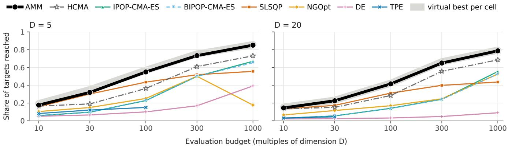  
Figure 4: As Figure 3, at � = 5 and 20.

Table 12: NADE and ERADS on the final-test grid (instances 101–110; run after the final test, Appendix F.1): mean target share over the 120 (function, dimension) cells per budget ��, beside AMM and IPOP-CMA-ES, and AMM minus each of the two.
<table><tr><td>Budget kD, k =</td><td>10</td><td>30</td><td>100</td><td>300</td><td>1000</td></tr><tr><td>AMM</td><td>.173</td><td>.288</td><td>.496</td><td>.696</td><td>.820</td></tr><tr><td>IPOP-CMA-ES</td><td>.052</td><td>.086</td><td>.193</td><td>.384</td><td>.598</td></tr><tr><td>NADE</td><td>.048</td><td>.072</td><td>.138</td><td>.280</td><td>.478</td></tr><tr><td>ERADS</td><td>.048</td><td>.077</td><td>.132</td><td>.243</td><td>.438</td></tr><tr><td>AMM minus NADE</td><td>+.125</td><td>+.216</td><td>+.358</td><td>+.416</td><td>+.342</td></tr><tr><td>AMM minus ERADS</td><td>+.125</td><td>+.211</td><td>+.364</td><td>+.453</td><td>+.382</td></tr></table>

Table 13: Data used to design, validate and evaluate AMM (raw bbob instance ids). Each validation set served one confirmation and was then spent; Appendix H (Spent ids) lists the ids of the ablation and the later analyses (770–869).
<table><tr><td>Role</td><td>Data</td><td>Used for</td><td>In design?</td></tr><tr><td>Calibration</td><td>ids 1-3</td><td>probe scales, thresholds, traces</td><td>yes</td></tr><tr><td>Development</td><td>ids 4, 5, 71, 72; 32 runs per cell</td><td>screening each candi- date</td><td>yes</td></tr><tr><td>Development field</td><td>ids 61–70; one seed</td><td>comparison with the field after each compos- ite (in-sample)</td><td>yes</td></tr><tr><td>Validation</td><td>fresh ids, e.g. 176–</td><td>one pre-registered con-</td><td>once per</td></tr><tr><td>Evaluation</td><td>185, ..., 730–769 ids 101–110 (seed 9000); MA-BBOB</td><td>firmation per composite the headline claims</td><td>composite no</td></tr></table>

## I Oficial COCO ECDFs for all dimensions

AMM’s final-test runs were also recorded through COCO’s observer, one dataset per budget, and every observer trace equals that of the harness run scored in Section 5.1; Figure 6 post-processes these recordings against archived algorithms. Figure 6 adds two budgets run after the final test, 10000·� and 100000·�, under their own preregistration. Table 14 gives AMM’s mean shares of the 51 targets there. Eight of the ten pre-registered ranges for these gains held (from 1000·� to 10000·�, +.02 to +.10; from 10000·� to 100000·�, +.00 to +.06); at � = 40 both gains came out above them (+.125 and +.062). The predicted comparisons with the archive at these budgets were not computed.

Table 14: AMM told its budget at 1000·� and at the two larger budgets run after the final test (instances 101–110): mean share of the 51 targets per dimension.
<table><tr><td>Budget</td><td>D = 2</td><td>5</td><td>10</td><td>20</td><td>40</td></tr><tr><td>1000·D</td><td>.920</td><td>.851</td><td>.831</td><td>.787</td><td>.712</td></tr><tr><td>10000·D</td><td>.967</td><td>.925</td><td>.900</td><td>.884</td><td>.837</td></tr><tr><td>100000·D</td><td>.989</td><td>.957</td><td>.940</td><td>.908</td><td>.899</td></tr></table>

## J Ablation details

The pair test’s STEP route pays only at 100·� (f3: −.670 there, about zero at 300·� and 1000·�). In the plateau and fractal family, the plateau route pays on f7 (−.123) and the IPOP routes on f15, f17 and f18 (about −.02 each). The code-identity check against the released code matched on 480 of 480 traces. With every family active, the switched code (the ablation build with its family switches) difered from the unmodified configuration on 7 runs in two of the 13 arms (3 and 4 of 240), all f7 at � = 5 and 300·�, and only in the last ten evaluations ofthe restarted run; no score changed. The SLSQP stage gates also idle the kink trigger on f13 at � = 10–20, a documented overlap of two families. Three A/A draws gave no rejection among 39 tests, and each slice’s A/A yardstick (.0012 to .0132 across slices) is below that slice’s |Δ|.

## K Route firing

Route-firing logs record, for the first call of each run, whether each route fires; a route’s firing share is the share of runs in which it fires, per function, dimension and budget. Figure 7 covers the final test’s grid (instances 101–110); its logged runs reproduce the recorded traces, so no target share is scored on them. Figure 8 replicates it on fresh instances 810–829 with � = 3 and 3000·� added, and

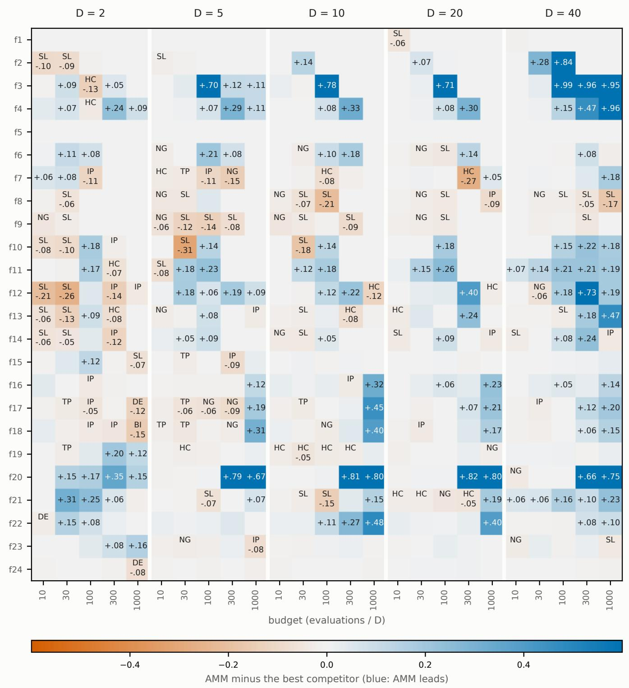  
Figure 5: Final test (bbob instances 101–110, one run per instance, 10 per cell): AMM’s target share minus the best competitor’s per function, dimension and budget (10·� to 1000·�); competitors as in Figure 3, HCMA from its archive levels. Values of at least .05 are printed. Where AMM trails by more than .02 in mean (a descriptive threshold; the 35 credibly-behind cells of Section 5.6 use the posterior rule of Section 4.2), the leader is named: SL restarted SLSQP, HC HCMA’s archive levels, NG NGOpt, IP and BI IPOP- and BIPOP-CMA-ES, TP TPE, DE diferential evolution.

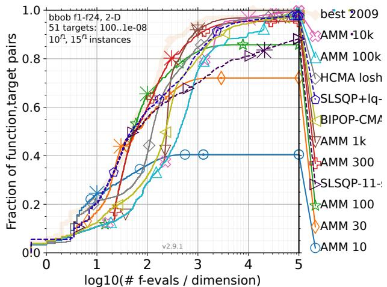

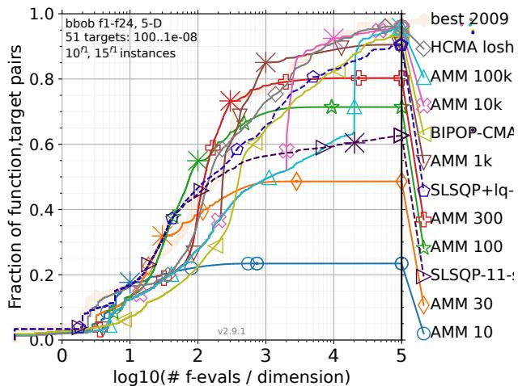

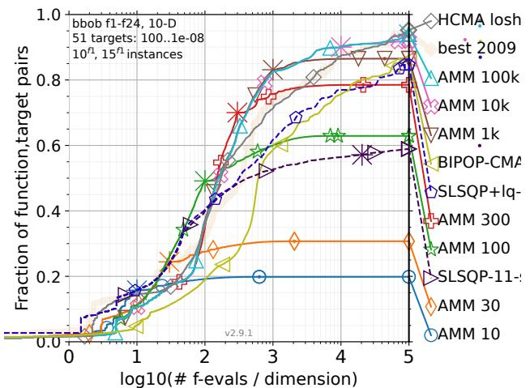

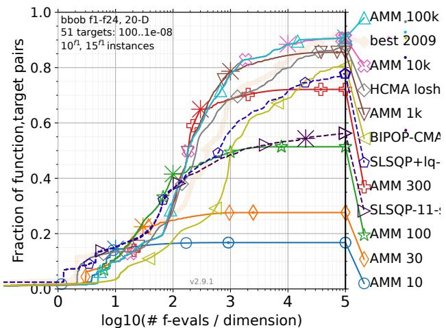

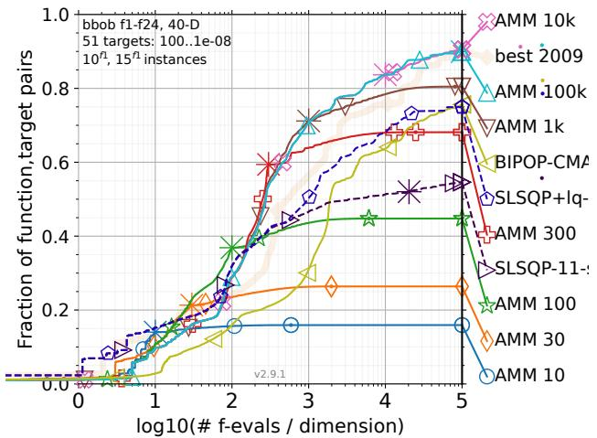  
Figure 6: Oficial COCO runtime ECDFs (cocopp 2.9.1) of AMM on bbob f1–f24, 51 targets from $1 0 ^ { 2 }$ to 10−8. Each AMM curve (“AMM �”; 1k, 10k and 100k are 1000·�, 10000·� and 100000·�) is a separate fixed-budget run with budget �� through COCO’s observer, on 10 instances (101–110). Beyond its budget, an AMM curve comes from cocopp’s simulated restarts, so it is meaningful up to its budget. The 10000·� and 100000·� runs lie beyond the developed budgets and enter no headline claim; at $D = 2 0$ and 40 they used an implementation speedup that changes no evaluation. The other curves are archive entries on their own 15 instances, so the comparison is not paired: HCMA (no archive data at $D = 4 0 ) ;$ , BIPOP-CMA-ES, SLSQP+lq-CMA-ES and SLSQP; the pale curve is the best of the 2009 algorithms.

288 of 288 unlogged reruns on those fresh ids equal their logged records. Cell shares rest on 10 runs (final-test grid) or 20 (fresh grid), so a share has a standard error of up to .16 and .11. The released packages 0.3.0 and 0.5.0 reproduce all 6,000 final-test traces and all 6,000 route logs of Figure 7 run for run, so the last column of Table 2 and these figures describe the released code as well. The kink route reads f13 in 36% of the runs in its range and the plateau route reads f7 in 59%, so a route often misses the function that motivated it. Of the six rows that fire beyond their motivating functions (Section 5.4), five do so on the fresh ids.

## L Generalization runs in full

The generalization batch was pre-registered before any of its runs, with its claims, three blocks of arms, its analysis script and 17 predictions with numeric ranges, and approved by the author. It ran on fresh bbob instance ids 810–849 (seed 9000; one run per function, dimension, instance and budget; budgets of 10·�–1000·�): 153 arms and 141,280 runs, none ofwhich met a non-finite value. A run scores the share of the 51 targets its precision reaches; on a transformed problem, the precision is divided back by the factor � of $\dot { \boldsymbol { f } } \mapsto \boldsymbol { a } \boldsymbol { f } + \boldsymbol { c } .$ The analysis was run after every arm had finished. One deviation: the A/A arm of the transformed block was run, as pre-registered, with the seed shifted by 1,000, but the committed script paired runs by (instance, budget, seed). No A/A run therefore found its partner, and the script stopped before printing any statistic of that block. The A/A runs were re-keyed to their partner’s seed and the script was run again, which reproduced the other two blocks exactly.

bbob-boxed (sbox-cost), ids 840–849, � = 2–40. HCMA’s archive has no levels for these instances; TPE runs on the final test’s capped slice. AMM has the highest share in 84, 78, 90, 99 and 100 of the 120 cells at 10·� to 1000·�. Of its 26 credibly-behind cells, SLSQP leads in 13 (at 10·�–100·�, eight of them at $D = 2 )$ , IPOP- and BIPOP-CMA-ES in 9 (f7, f14, f17, f18), TPE in 3 and DE in 1. Table 15 gives the pooled diferences. AMM’s lead over IPOP-CMA-ES is .142 smaller on the 19 functions whose optimum moved than on the 5 whose problems equal bbob’s at $1 0 \cdot D ,$ and .113 larger at 100·� (reported, as the pre-registration asks, because the diference exceeds .10).

Transformed bbob, ids 810–819, � = 2–20. The solver sees � in the box $[ - 5 s + b , 5 s + b ] ^ { D }$ and $h ( y ) = a f ( ( y - b ) / s ) + c ,$ with $( a , c , s , b )$ equal to $( 1 0 ^ { 3 } , - 1 0 ^ { 5 } , 1 , 0 )$ $( 1 0 ^ { - 3 } ,$ , 100, $1 , 0 ) , ( 1 , 0 , 0 . 1 , 3 )$ and $( 1 0 ^ { 3 } , - 1 0 ^ { 5 } , 0 . 1 , 3 )$ , beside the identity. AMM, IPOP-CMA-ES and SLSQP run every variant, and IPOP-CMA-ES and SLSQP receive the box through their bounds. The box variants test that AMM’s internal map ofany box onto $[ - 5 , 5 ] ^ { D }$ holds in the whole composite. Table 16 gives each solver’s change against the identity, and Table 15 AMM’s lead over IPOP-CMA-ES per variant. Under the afine maps AMM loses most on f10 and f11 (−.240 and −.196 under $1 0 ^ { 3 } f - 1 0 ^ { 5 } )$ and on f11 and f14 (−.210 and −.205 under $1 0 ^ { - 3 } f + 1 0 0 )$ ; under the box change alone no function loses more than .003.

Rotatedf1–f4, ids 820–839, � = 2–40. Each problem is $f ( x _ { \mathrm { o p t } }$ + $R ( x - x _ { \mathrm { o p t } } ) )$ with a seeded random orthogonal � per function, di- mension and instance; the optimum, its value and the box stay put. The same functions unrotated, on the same ids and seeds, are the comparison. f5 is not rotated, as the pre-registration states: its opti-mum is a corner of the box, where a rotation about the optimum has no canonical meaning. AMM minus IPOP-CMA-ES over the 25 (dimension, budget) cells, with intervals over the 20 ids, unrotated and rotated: f2 +.437 [+.429, +.444] and +.390 [+.377, +.404], f3 +.505 [+.490, +.521] and +.029 [+.011, +.048], f4 +.301 [+.295, +.307] and +.011 [−.006, +.026]. The rotation changes these leads by −.047, −.476 and −.290. Over rotated f2–f4, AMM leads IPOP-CMA-ES by +.015, +.097, +.265, +.235 and +.105 at 10·� to 1000·�, every interval above zero.

## M The anytime mode in full

The mode. The anytime mode, added after the final test, is not part of the benchmarked preset c46 (Section 5.5 evaluates it). In its anytime mode AMM first plans 10·� evaluations and, each time a plan is spent while the run goes on, plans twice as many in total $( 2 0 { \cdot } D , 4 0 { \cdot } D , \ldots ) .$ . Each new plan reruns the configuration from the same start point and seed and answers every point evaluated before from memory, without a call of �. Once the next plan would exceed $1 0 ^ { 4 }$ evaluations, one ordinary run planned for the remaining budget takes over, with the points evaluated so far as its archive. Until then the mode never reads the budget.

On the final-test instances. The mode was developed on calibration ids 1–3 and fresh ids 850–869, never on instances 101–110. On the final-test problems all seven ranges of its own pre-registration held. It is level with AMM told its budget at $1 0 ^ { 4 } { \cdot } D$ and $1 0 ^ { 5 } { \cdot } D$ (Table 17; every dimension within ±.01), where every run hands over to an ordinary run after its last replayed plan. Before the hand-over it pays for not knowing the budget, most at 300·� for $D \geq 5 \left( - . 1 3 \right.$ to −.16), because AMM’s plan changes at almost every doubling and a stage rebuilds little of the smaller plan’s state; the 1000·� runs at $D \geq 1 0$ and the 300·� runs at $D = 4 0$ already hand over.

Replay and hand-over. Each stage replays the smaller plan exactly up to the first decision the larger budget changes. The last replayed plan has 6,400 evaluations from � = 5 and 5,120 at � = 2. At the hand-over, the points evaluated so far replace the fresh points that the ordinary run’s phases would draw: the prefix design, the sam- pler’s first population, CMA-ES’s first covariance and the restarted SLSQP’s samples. A point the run asks for again is answered from memory.

Why state is recomputed. With the current components, engine state cannot be kept and continued as the plan grows: SciPy’s local searches expose neither a pause nor their internal state, every phase fixes its budget share and route when it starts, and the route itself changes with the budget. On a calibration problem (id 1), replay rebuilds 0–47% of each stage.

Development tests ofhanding state over. On fresh ids 850–869, handing that state to the larger plan did not close the gap to AMM told its budget. An archive warm start gained +.016 over replay at 30·� but lost .050 and .063 at 100·� and 1000·�; nesting the larger plans on a replayed head lost .026 and .041 at 300·� and 1000·�.

Route firing. Route-firing logs of the anytime mode on the finaltest grid (release 0.5.0, instances 101–110, descriptive; a run is read at its hand-over call if it has one, otherwise at its last stage) show the gates that need a large plan opening later. The pair test never opens at 100·�, where the last plan is 80·�, and at 300·� it opens on f3 and f4 only, because f1, f2 and f5 reach the final target in an earlier stage; the coordinate-search route opens only at 1000·�; the STEP stall check, the rugged IPOP and fractal routes and the rugged BFGS try reach a pooled share of .5 on no function. Three of the twelve function-motivated rows of Table 2 fire beyond the functions that motivated them, against six for AMM. This fits the reason given above for the mode’s loss at 30·�–1000·� but does not prove it. Of the pre-registered firing predictions, 6 of 11 held, 2 fell outside their ranges and 3 were falsified: they ignored that the harness restarts a call that returns early and ends a run at the final target (28% of the anytime runs).

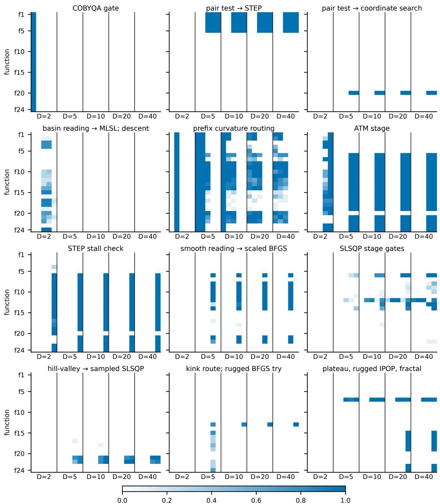  
share of runs in which the route fires in the first call; within each D the budget grows from 10·D (left) to 1000·D (right)  
Figure 7: Where each route fires on the final test’s grid (instances 101–110).

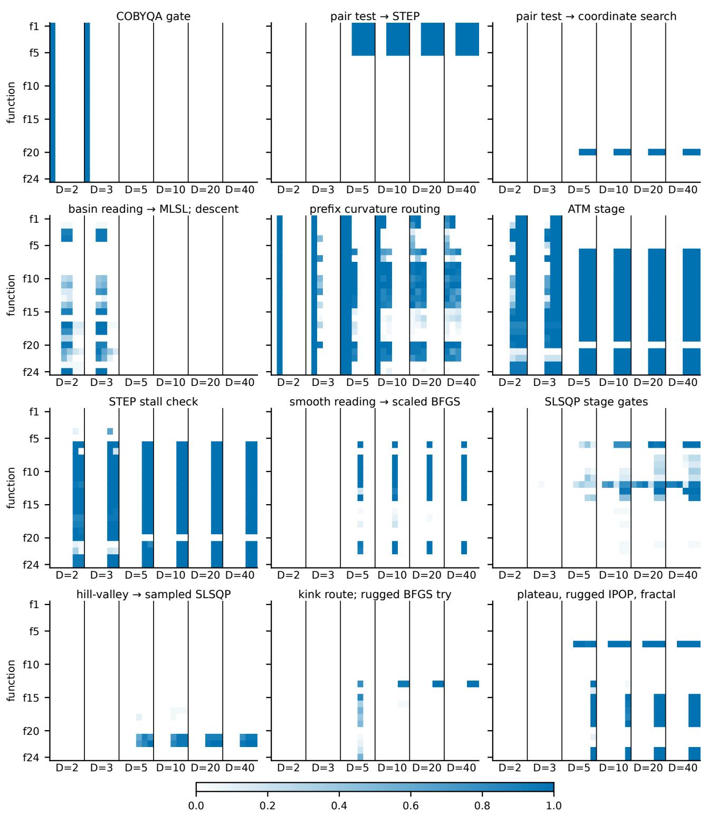  
share of runs in which the route fires in the first call; within each D the budget grows from 10·D (left) to 3000·D (right)  
Figure 8: The same on fresh instances 810–829 (seed 9700), with � = 3 and 3000·� added.

Table 15: Generalization runs: pooled diferences in target share per budget ��, with 95% bootstrap intervals over cells. Holm’s correction runs over the five budgets for bbob-boxed and over the 20 tests of the five transformed rows (the identity included) at 30·�–1000·�; every one is above zero. bbob-boxed: 120 (function, dimension) cells, ids 840–849, � = 2–40. Transformed bbob: 96 cells, ids 810–819, � = 2–20.
<table><tr><td rowspan="2"></td><td colspan="5">budget kD, k =</td></tr><tr><td>10</td><td>30</td><td>100</td><td>300</td><td>1000</td></tr><tr><td>bbob-boxed, AMM minus IPOP-CMA-ES</td><td> $+ . 1 1 7 \ [ + . 0 7 8 , + . 1 6 2 ]$ </td><td> $+ . 1 9 4 \ [ + . 1 4 5 , + . 2 4 5 ]$ </td><td> $+ . 3 0 2 \ [ + . 2 4 4 , + . 3 6 0 ]$ </td><td> $+ . 3 0 8 \ [ + . 2 4 7 , + . 3 6 9 ]$ </td><td> $+ . 2 3 3 [ + . 1 8 3 , + . 2 9 2 ]$ </td></tr><tr><td>bbob-boxed, AMM minus SLSQP</td><td> $+ . 0 1 1 \ [ + . 0 0 2 , + . 0 1 9 ]$ </td><td> $+ . 0 2 8 \ [ + . 0 1 2 , + . 0 4 3 ]$ </td><td> $+ . 1 2 3 \ [ + . 0 8 7 , + . 1 6 4 ]$ </td><td> $+ . 2 2 2 \ [ + . 1 7 6 , + . 2 7 5 ]$ </td><td> $+ . 2 9 1 \ [ + . 2 3 6 , + . 3 5 4 ]$ </td></tr><tr><td colspan="6">Transformed bbob, AMM minus IPOP-CMA-ES</td></tr><tr><td>identity</td><td> $+ . 1 1 9 [ + . 0 7 4 , + . 1 7 1 ]$ </td><td> $+ . 2 0 9 \ [ + . 1 5 3 , + . 2 6 8 ]$ </td><td> $+ . 3 2 0 \ [ + . 2 5 4 , + . 3 8 7 ]$ </td><td> $+ . 2 9 2 \ [ + . 2 3 0 , + . 3 5 9 ]$ </td><td> $+ . 1 9 7 \ [ + . 1 4 3 , + . 2 6 1 ]$ </td></tr><tr><td> $f \mapsto \dot { 1 } 0 ^ { 3 } f - 1 0 ^ { 5 }$ </td><td> $+ . 1 1 1 \ [ + . 0 6 7 , + . 1 6 3 ]$ </td><td> $+ . 1 4 5 \ [ + . 1 0 1 , + . 1 9 5 ]$ </td><td> $+ . 2 7 0 \ [ + . 2 1 3 , + . 3 2 8 ]$ </td><td> $+ . 2 8 0 \ [ + . 2 1 7 , + . 3 4 7 ]$ </td><td> $+ . 1 7 5 \ [ + . 1 1 7 , + . 2 4 1 ]$ </td></tr><tr><td> $f \mapsto 1 0 ^ { - 3 } f + 1 0 0$ </td><td> $+ . 0 6 3 \ [ + . 0 3 7 , + . 0 9 7 ]$ </td><td> $+ . 1 4 2 \ [ + . 0 9 8 , + . 1 9 0 ]$ </td><td> $+ . 2 5 3 \ [ + . 1 9 6 , + . 3 1 1 ]$ </td><td> $+ . 2 6 1 \ [ + . 1 9 5 , + . 3 3 1 ]$ </td><td> $+ . 1 4 9 \ [ + . 1 0 0 , + . 2 0 8 ]$ </td></tr><tr><td> $\mathbf { \bar { b } 0 x } [ 2 . 5 , 3 . 5 ] ^ { D }$ </td><td> $+ . 1 2 1 \ [ + . 0 7 8 , + . 1 7 2 ]$ </td><td> $+ . 2 1 1 \ [ + . 1 5 5 , + . 2 7 0 ]$ </td><td> $+ . 3 2 4 \ [ + . 2 6 0 , + . 3 9 2 ]$ </td><td> $+ . 3 2 8 \ [ + . 2 6 2 , + . 3 9 8 ]$ </td><td> $+ . 2 4 8 \ [ + . 1 9 2 , + . 3 1 0 ]$ </td></tr><tr><td> $1 0 ^ { 3 } f - 1 0 ^ { 5 } { \mathrm { ~ a n d ~ t h e ~ b o x } }$ </td><td> $+ . 1 1 4 \ [ + . 0 7 0 , + . 1 6 5 ]$ </td><td> $+ . 1 4 7 \ [ + . 1 0 2 , + . 1 9 7 ]$ </td><td> $+ . 2 7 4 \ [ + . 2 1 7 , + . 3 3 3 ]$ </td><td> $+ . 3 1 8 \ [ + . 2 5 1 , + . 3 8 8 ]$ </td><td> $+ . 2 2 4 \ [ + . 1 6 7 , + . 2 8 7 ]$ </td></tr></table>

Table 16: Transformed bbob (ids 810–819, � = 2–20): change of each solver’s target share against the identity problem, paired by run, mean over all cells and budgets with a 95% bootstrap interval over the 10 ids. The A/A row reruns the identity with another seed.
<table><tr><td>Change</td><td>AMM</td><td>IPOP-CMA-ES</td><td>SLSQP</td></tr><tr><td> $\mathrm { A / A } \ ( { \mathrm { s e e d } } + 1 0 0 0 )$ </td><td> $- . 0 0 2 \left[ - . 0 1 2 , + . 0 0 6 \right]$ </td><td> $+ . 0 0 2 \ [ - . 0 0 4 , + . 0 0 9 ]$ </td><td> $- . 0 0 2 \left[ - . 0 0 8 , + . 0 0 5 \right]$ </td></tr><tr><td> $f \mapsto 1 0 ^ { 3 } f - 1 0 ^ { 5 }$ </td><td> $- . 0 3 2 \ [ - . 0 3 6 , - . 0 2 8 ]$ </td><td> $- . 0 0 0 \ [ - . 0 0 1 , - . 0 0 0 ]$ </td><td> $- . 0 6 7 \ [ - . 0 7 2 , - . 0 6 2 ]$ </td></tr><tr><td> $\mathrm { ~ \bar { \boldsymbol { f } } ~ } \mapsto 1 0 ^ { - 3 } \boldsymbol { f } + 1 0 0$ </td><td> $- . 0 5 3 \ [ - . 0 5 8 , - . 0 4 9 ]$ </td><td> $+ . 0 0 1 \ [ + . 0 0 0 , + . 0 0 1 ]$ </td><td> $- . 0 4 3 \ [ - . 0 4 8 , - . 0 3 7 ]$ </td></tr><tr><td> $\mathsf { b o x } [ 2 . 5 , 3 . 5 ] ^ { D }$ </td><td> $+ . 0 0 1 \ [ - . 0 0 0 , + . 0 0 2 ]$ </td><td> $- . 0 1 8 \ [ - . 0 2 2 , - . 0 1 3 ]$ </td><td> $- . 0 4 5 \ [ - . 0 5 1 , - . 0 4 0 ]$ </td></tr><tr><td>both</td><td> $- . 0 3 0 \ [ - . 0 3 5 , - . 0 2 7 ]$ </td><td> $- . 0 1 8 \ [ - . 0 2 3 , - . 0 1 3 ]$ </td><td> $- . 1 2 4 \ [ - . 1 2 7 , - . 1 2 1 ]$ </td></tr></table>

Table 17: Anytime mode against AMM told its budget, on the final-test instances 101–110 (seed 9000, $D = 2 , 5 ,$ 10, 20, 40, f1–f24): mean target share per budget �� and the paired diference (anytime minus budget known) with its 95% cluster-bootstrap interval. The two largest budgets lie beyond the developed range.
<table><tr><td>Budget kD, k =</td><td>10</td><td>30</td><td>100</td><td>300</td><td>1000</td><td> $1 0 ^ { 4 }$ </td><td> $1 0 ^ { 5 }$ </td></tr><tr><td>anytime mode</td><td>.171</td><td>.234</td><td>.418</td><td>.571</td><td>.772</td><td>.903</td><td>.940</td></tr><tr><td>AMM, budget known</td><td>.173</td><td>.288</td><td>.496</td><td>.696</td><td>.820</td><td>.903</td><td>.939</td></tr><tr><td>difference</td><td>-.002</td><td>-.054</td><td>-.078</td><td>-.124</td><td>-.048</td><td>+.001</td><td>+.001</td></tr><tr><td>95% interval</td><td> $[ - . 0 0 4 , + . 0 0 1 ]$ </td><td> $[ - . 0 6 4 , - . 0 4 5 ]$ </td><td> $[ - . 0 9 3 , - . 0 6 5 ]$ </td><td> $\left[ - . 1 4 0 , - . 1 0 9 \right]$ </td><td> $[ - . 0 5 9 , - . 0 3 7 ]$ </td><td> $[ - . 0 0 6 , + . 0 0 7 ]$ </td><td> $[ - . 0 0 4 , + . 0 0 6 ]$ </td></tr></table>

should not be used when the budget is known and lies between about 30·� and 1000·�, where AMM told its budget is .05–.12 better, or when � is cheap. Nor should it be used with noisy objectives, since a remembered value stands in for a new evaluation, or when the run may be stopped after the hand-over, since from then on it is an ordinary run planned for the remaining budget.

## N Probes at their defaults

Compute and use. The mode keeps a run’s state by recomputing it, not by storing it: no evaluation of � is repeated, but the optimizer’s own work is. This multiplies AMM’s CPU time per evaluation at 10·�–1000·�. It is for deterministic objectives whose budget is not known in advance or whose run may be stopped early. Until the hand-over a run stopped at any time holds the end of a complete smaller plan plus the best of the earlier ones: the result of AMM told a budget of between half and all of the evaluations spent. It

A pre-registered control (fresh ids 880–899, seed 9000, � = 2–40, f1–f24, 10·�–1000·�, 12,000 runs per arm) runs AMM with every routing probe forced to the branch in Table 2’s “Default” column, without spending its evaluations: the same engine pool under the same budget schedule, minus every decision taken from �. Table 18 gives the mean target shares.

Every diference is above zero under Holm over the five budgets, and it accounts for at least all of AMM’s lead over the better of SLSQP and IPOP-CMA-ES alone (ratio 1.0 to 1.5): with its probes at their defaults, the engines on AMM’s schedule trail SLSQP alone by .053 and .064 at 100·� and 300·� and are level with IPOP-CMA-ES at 1000·�. The value sits on f3, f20, f21–f22 and f6–f14, and on f2, f4 and f5 through the STEP and coordinate routes; it is about zero on f15, f19, f23 and f24. Three caveats: the control is one definition of “every probe at its default” (a hand-built schedule without routing is the greedy-schedule rung of Section 5.2); at 10·�, $D = 5 { - } 2 0 ,$ switching the small-budget probe of also removes a COBYQA stage that no reading chooses, so part of the 10·� diference is not the probe’s; and the best engine alone was chosen on these test ids, which favours the engine. One crash guard was added during the runs (a model fit of the (1+1)-CMA-ES returns no step on a singular matrix, a path AMM itself never reached); AMM’s traces were unchanged by it. Of the control’s 25 pre-registered ranges, 17 held. Six of the eight misses favour the probes: at 300·� and 1000·�, the diference to the default arm and its ratio to AMM’s lead over the better engine alone came out above their ranges, and the default arm’s gap to that engine below them (the pre-registration expected the engines on AMM’s schedule to beat IPOP-CMA-ES at 1000·�; they are level, .591 against .593). The other two are A/A means (+.007 and +.006 at 100·� and 1000·�) outside the predicted ±.005.

Table 18: Probes at their defaults: mean target share per arm and budget, and the diference with its 95% interval (fresh ids 880–899, � = 2–40, f1–f24).
<table><tr><td>Budget kD, k =</td><td>10</td><td>30</td><td>100</td><td>300</td><td>1000</td></tr><tr><td>AMM</td><td>.173</td><td>.286</td><td>.487</td><td>.693</td><td>.812</td></tr><tr><td>every probe at its default</td><td>.151</td><td>.243</td><td>.328</td><td>.404</td><td>.591</td></tr><tr><td>AMM, second seed (A/A)</td><td>.169</td><td>.286</td><td>.494</td><td>.694</td><td>.818</td></tr><tr><td>restarted SLSQP alone</td><td>.157</td><td>.251</td><td>.381</td><td>.468</td><td>.518</td></tr><tr><td>IPOP-CMA-ES alone</td><td>.052</td><td>.087</td><td>.192</td><td>.384</td><td>.593</td></tr><tr><td>coordinate search alone</td><td>.036</td><td>.168</td><td>.202</td><td>.328</td><td>.379</td></tr><tr><td>AMM minus probes at default</td><td>+.022</td><td>+.043</td><td>+.160</td><td>+.289</td><td>+.221</td></tr><tr><td>95% interval</td><td>[+.009, +.038]</td><td>[+.019, +.073]</td><td>[+.113, +.213]</td><td> $[ + . 2 3 2 , + . 3 5 0 ]$ </td><td> $[ + . 1 6 6 , + . 2 7 7 ]$ </td></tr></table>

## O Dimensions and budgets of the development grid

AMM as benchmarked, pycma’s IPOP-CMA-ES and restarted SciPy SLSQP ran at � = 4, 7, 15 and 30 (all nine budgets 10·�, 20, 30, 100, 200, 300, 350, 600 and 1000) and at the final test’s dimensions with the new budgets 20·�, 200, 350 and 600, on fresh ids 870–879 (seed 9000, f1–f24; 58,320 runs; pre-registered). COCO’s suite does not build $D = 4 , 7 ,$ 15 or 30, so those dimensions use COCO’s bare problems; at � = 5 and 10 their � -values are bit-equal to the suite’s. Table 19 gives the margins.

Every pooled margin is above zero under Holm (13 comparisons per competitor, the four new budgets at the old dimensions in- cluded: +.160 to +.272 over IPOP-CMA-ES, +.021 to +.251 over SLSQP). The margin against SLSQP at 200·� for the new dimensions (+.117) fell below its predicted range, with the sign held; every other prediction held (43 of 44). At � = 4 the margin over IPOP-CMA-ES has intervals reaching zero at 300·�, 350·� and 600·�, the only such settings of all 81, and � = 4 holds 16 of the 54 cells in which AMM is credibly behind IPOP-CMA-ES (f7, f8, f13, f14, f16, f17 and f18); whether a gap in the �-keyed gates causes it was not tested. The grid-fit index, the margin at the unseen settings minus the interpolation of this batch’s own grid points, is −.018 [−.031, −.005] overall and −.060 [−.099, −.026] at � = 4; both are inside their predicted ranges. On the fresh instances the final test’s margins over IPOP-CMA-ES and SLSQP replicate within .014 at all five budgets.

## P An exploratory check on other functions

After the final test, an unregistered check ran the released package (version 0.5.0, which reproduces every final-test run of the benchmarked configuration bit for bit; see Software availability) on 20 functions that are not bbob functions. The functions were writ- ten for the check by the AI assistant (Claude), among them jump, Cauchy-loss, ripple, needle, lattice and pinball-loss functions. Each ran at $D = 2 ,$ 3 and 4 on 12 instances with a random shift, scale and ofset (and a random rotation where the function defines one), at budgets of 30·�–1000·�, from scratch per budget, against restarted SLSQP and COBYQA, IPOP-CMA-ES, diferential evolution, NADE and ERADS. It used its own driver, not the harness of Section 4, and scored each run b the $\log _ { 1 0 }$ of its error relative to the median error of random points, floored at −10. Over the 720 problem instances per budget, AMM’s mean error was lower than every other solver’s at 100·�; at 30·� it was level with restarted SLSQP (0.00 [−0.24, +0.25] decades) and behind the best other solver by more than half a decade in 20 of the 60 function–dimension cells. At 300·� and 1000·� it was level with IPOP-CMA-ES (−0.15 [−0.36, +0.06] and −0.10 [−0.28, +0.07] decades), and at 1000·� it was behind NADE, which trails it on bbob (Appendix F.1), by 0.43 [0.28, 0.59] decades. No range was predicted in advance, the dimensions lie at the bottom of the final test’s range, and the result is reported for completeness, not as a transfer test.

<table><tr><td>k (k·D)</td><td>10</td><td>20</td><td>30</td><td>100</td><td>200</td><td>300</td><td>350</td><td>600</td><td>1000</td></tr><tr><td> $\mathrm { A M M - I P O P \mathrm { - } C M A \mathrm { - } E S }$ </td><td>+.118</td><td>+.157</td><td> $+ . 1 9 5$ </td><td>+.295</td><td>+.267</td><td>+.295</td><td>+.268</td><td> $+ . 2 4 2$ </td><td> $+ . 2 0 8$ </td></tr><tr><td> $\mathrm { A M M } - \mathrm { S L S Q P }$ </td><td>+.018</td><td>+.023</td><td> $+ . 0 4 3$ </td><td>+.104</td><td>+.117</td><td>+.202</td><td>+.201</td><td> $+ . 2 4 4$ </td><td> $+ . 2 9 3$ </td></tr><tr><td> $D = 4 \ \mathrm { o n l y , - I P O P \mathrm { - } C M A \mathrm { - } E S }$ </td><td>+.120</td><td>+.191</td><td> $+ . 2 4 3$ </td><td> $+ . 2 8 2$ </td><td>+.146</td><td>+.078</td><td> $+ . 0 7 6$ </td><td> $+ . 0 9 0$ </td><td> $+ . 1 0 9$ </td></tr></table>

Table 19: Margins of the development grid: AMM minus IPOP-CMA-ES and minus restarted SLSQP, pooled over $D = 4 , 7 , 1 5$ and 30 (96 cells per budget), and minus IPOP-CMA-ES at � = 4 alone (fresh ids 870–879).