# Alleviating Limited Efectiveness and Multi-Class Collapse in Deep Graph-level Clustering

Xi<sub>aoya</sub>n<sub>g</sub> Lin H<sub>o</sub>n<sub>g</sub> K<sub>o</sub>n<sub>g</sub> B<sub>ap</sub>ti<sub>s</sub>t Uni<sub>ve</sub>r<sub>s</sub>it<sub>y</sub> H<sub>o</sub>n<sub>g</sub> K<sub>o</sub>n<sub>g</sub> SAR<sub>,</sub> Chin<sub>a</sub> <sub>csxy</sub>li<sub>n@comp.</sub>hkb<sub>u.e</sub>d<sub>u.</sub>hk

Y<sub>uq</sub>i Chen   
H<sub>o</sub>n<sub>g</sub> K<sub>o</sub>n<sub>g</sub> B<sub>ap</sub>ti<sub>s</sub>t Uni<sub>ve</sub>r<sub>s</sub>it<sub>y</sub> H<sub>o</sub>n<sub>g</sub> K<sub>o</sub>n<sub>g</sub> SAR<sub>,</sub> Chin<sub>a</sub>   
<sub>csyqc</sub>h<sub>en@comp.</sub>hkb<sub>u.e</sub>d<sub>u.</sub>hk

R<sub>e</sub>n<sub>c</sub>hi Y<sub>a</sub>n<sub>g</sub><sup>∗</sup> H<sub>o</sub>n<sub>g</sub> K<sub>o</sub>n<sub>g</sub> B<sub>ap</sub>ti<sub>s</sub>t Uni<sub>ve</sub>r<sub>s</sub>it<sub>y</sub> H<sub>o</sub>n<sub>g</sub> K<sub>o</sub>n<sub>g</sub> SAR<sub>,</sub> Chin<sub>a</sub> <sub>renc</sub>hi<sub>@</sub>hkb<sub>u.e</sub>d<sub>u.</sub>hk

Xin H<sub>ua</sub>n<sub>g</sub> H<sub>o</sub>n<sub>g</sub> K<sub>o</sub>n<sub>g</sub> B<sub>ap</sub>ti<sub>s</sub>t Uni<sub>ve</sub>r<sub>s</sub>it<sub>y</sub> H<sub>o</sub>n<sub>g</sub> K<sub>o</sub>n<sub>g</sub> SAR<sub>,</sub> Chin<sub>a</sub> <sub>x</sub>i<sub>n</sub>h<sub>uang@comp.</sub>hkb<sub>u.e</sub>d<sub>u.</sub>hk

## Abstract

Given a collection of � graphs, graph-level clustering (GLC) seeks to <sub>p</sub>artition the � <sub>g</sub>ra<sub>p</sub>hs into semanticall<sub>y</sub> meanin<sub>g</sub>ful <sub>g</sub>rou<sub>p</sub>s<sub>,</sub> <sub>w</sub>hi<sub>c</sub>h <sub>serves</sub> <sub>as</sub> <sub>a</sub> f<sub>un</sub>d<sub>amen</sub>t<sub>a</sub>l t<sub>as</sub>k i<sub>n</sub> <sub>ana</sub>l<sub>yz</sub>i<sub>ng</sub> <sub>grap</sub>h<sub>-s</sub>t<sub>ruc</sub>t<sub>ure</sub>d data. While Graph Isomorphism Networks (GINs) have become the d<sub>e</sub> f<sub>ac</sub>t<sub>o</sub> <sub>enco</sub>d<sub>ers</sub> f<sub>or</sub> GLC<sub>,</sub> th<sub>ey</sub> <sub>s</sub>till f<sub>a</sub>il t<sub>o</sub> di<sub>s</sub>ti<sub>ngu</sub>i<sub>s</sub>h <sub>grap</sub>h<sub>s</sub> due to their ne<sub>g</sub>lect of <sub>g</sub>lobal to<sub>p</sub>olo<sub>gy</sub>. On to<sub>p</sub> of that<sub>,</sub> existin<sub>g</sub> d<sub>eep c</sub>l<sub>us</sub>t<sub>er</sub>i<sub>ng</sub> f<sub>ramewor</sub>k<sub>s su</sub>f<sub>er</sub> f<sub>rom severe</sub> “<sub>c</sub>l<sub>us</sub>t<sub>er</sub>i<sub>ng co</sub>ll<sub>apse</sub>” issues<sub>, p</sub>articularl<sub>y</sub> in imbalanced multi-class scenarios.

To address these challen<sub>g</sub>es, we <sub>p</sub>ro<sub>p</sub>ose S<sup>3</sup>GLC, a novel frame-<sub>wor</sub>k th<sub>a</sub>t i<sub>n</sub>t<sub>egra</sub>t<sub>es g</sub>l<sub>o</sub>b<sub>a</sub>l t<sub>opo</sub>l<sub>og</sub>i<sub>ca</sub>l <sub>c</sub>h<sub>arac</sub>t<sub>er</sub>i<sub>s</sub>ti<sub>cs w</sub>ith l<sub>oca</sub>l <sub>ne</sub>i<sub>g</sub>hb<sub>or</sub>h<sub>oo</sub>d f<sub>ea</sub>t<sub>ures</sub> f<sub>or</sub> b<sub>a</sub>l<sub>ance</sub>d GLC<sub>.</sub> Th<sub>eore</sub>ti<sub>ca</sub>ll<sub>y,</sub> <sub>we</sub> l<sub>everage</sub> the Hofman-Wielandt ine<sub>q</sub>ualit<sub>y</sub> to construct S<sub>p</sub>ectral Si<sub>g</sub>nature as a rigorous lower bound for graph edit distance (GED), providing <sub>a compu</sub>t<sub>a</sub>ti<sub>ona</sub>ll<sub>y e</sub>fi<sub>c</sub>i<sub>en</sub>t <sub>proxy</sub> f<sub>or g</sub>l<sub>o</sub>b<sub>a</sub>l t<sub>opo</sub>l<sub>og</sub>i<sub>ca</sub>l f<sub>ea</sub>t<sub>ures.</sub> We additionally propose a joint manifold-preserving sparse regression module to fuse Spectral Signature with Spatial Representation, eliminatin<sub>g</sub> noise while <sub>p</sub>reservin<sub>g</sub> the com<sub>p</sub>lementar<sub>y</sub> information. Furthermore<sub>,</sub> to miti<sub>g</sub>ate clusterin<sub>g</sub> colla<sub>p</sub>se<sub>,</sub> we introduce a balanced clustering objective based on optimal transport, harnessing the Sinkhorn-Knopp normalization to enforce equipartition con-<sub>s</sub>tr<sub>a</sub>int<sub>s o</sub>n <sub>c</sub>l<sub>us</sub>t<sub>e</sub>r <sub>ass</sub>i<sub>g</sub>nm<sub>e</sub>nt<sub>s.</sub> Ext<sub>e</sub>n<sub>s</sub>i<sub>ve e</sub>x<sub>pe</sub>rim<sub>e</sub>nt<sub>s o</sub>n 10 r<sub>ea</sub>lworld datasets demonstrate that S<sup>3</sup>GLC si<sub>g</sub>nificantl<sub>y</sub> out<sub>p</sub>erforms 15 <sub>s</sub>t<sub>a</sub>t<sub>e-o</sub>f<sub>-</sub>th<sub>e-ar</sub>t b<sub>ase</sub>li<sub>nes,</sub> <sub>ac</sub>hi<sub>ev</sub>i<sub>ng</sub> <sub>remar</sub>k<sub>a</sub>bl<sub>e</sub> i<sub>mprovemen</sub>t<sub>s</sub> on benchmark datasets such as REDDIT-12K and OGBG-PPA.

## 1 Introduction

Graph-level clustering (GLC) [38, 72, 76] involves partitioning a col-<sup>l</sup>ection o<sup>f</sup> grap<sup>h</sup>s into <sup>d</sup>isjoint groups w<sup>h</sup>ere grap<sup>h</sup>s wit<sup>h</sup>in t<sup>h</sup>e same cluster (res<sub>p</sub>. distinct clusters) exhibit hi<sub>g</sub>h (res<sub>p</sub>. low) semantic similarit<sub>y</sub> in to<sub>p</sub>olo<sub>g</sub>ical structure or attributes. The unsu<sub>p</sub>ervised <sub>p</sub>aradi<sub>g</sub>m of GLC b<sub>yp</sub>asses the need for ex<sub>p</sub>ert <sub>p</sub>riors [72, 76] and i<sub>s c</sub>riti<sub>ca</sub>l in d<sub>o</sub>m<sub>a</sub>in<sub>s w</sub>h<sub>e</sub>r<sub>e</sub> l<sub>a</sub>b<sub>e</sub>l <sub>acqu</sub>i<sub>s</sub>iti<sub>o</sub>n i<sub>s cos</sub>t-<sub>p</sub>r<sub>o</sub>hibiti<sub>ve o</sub>r im<sub>p</sub>ractical [26, 61], such as screenin<sub>g</sub> molecular com<sub>p</sub>ounds for dru<sub>g</sub> discover<sub>y</sub> [1, 7, 56], t<sub>yp</sub>olo<sub>g</sub>ical anal<sub>y</sub>sis of social communities [29, 44, 67], and anal<sub>y</sub>zin<sub>g</sub> states in brain networks [32, 33].

As illustrated in Fi<sub>g</sub>. 1<sub>,</sub> molecular clusterin<sub>g</sub> <sub>p</sub>rimaril<sub>y</sub> de<sub>p</sub>ends on functional <sub>g</sub>rou<sub>p</sub>s (e.<sub>g</sub>., Benzene rin<sub>g</sub>s). Molecules that contain similar functional <sub>g</sub>rou<sub>p</sub>s are re<sub>g</sub>arded as belon<sub>g</sub>in<sub>g</sub> to the same com<sub>p</sub>ound (e.<sub>g</sub>., Aromatic). This hi<sub>g</sub>hli<sub>g</sub>hts the im<sub>p</sub>ortance of <sub>p</sub>reserv<sup>i</sup>n<sub>g</sub> <sup>k</sup>e<sub>y</sub> su<sup>b</sup><sub>g</sub>ra<sub>p</sub><sup>h</sup> structures w<sup>h</sup>en <sup>l</sup>earn<sup>i</sup>n<sub>g</sub> <sub>g</sub>ra<sub>p</sub><sup>h</sup> re<sub>p</sub>resentations. Therefore, efective GLC relies on graph representation learning (GRL) to encode such structural characteristics into informative feature vectors. However, rel<sub>y</sub>in<sub>g</sub> solel<sub>y</sub> on s<sub>p</sub>ectral methods [2, 75] t<sub>o</sub> <sub>cap</sub>t<sub>ure</sub> <sub>g</sub>l<sub>o</sub>b<sub>a</sub>l t<sub>opo</sub>l<sub>ogy</sub> <sub>over</sub>l<sub>oo</sub>k<sub>s</sub> th<sub>e</sub> i<sub>mpor</sub>t<sub>ance</sub> <sub>o</sub>f <sub>su</sub>b<sub>grap</sub>h <sub>s</sub>t<sub>ruc</sub>t<sub>ure,</sub> <sub>caus</sub>i<sub>ng</sub> <sub>grap</sub>h<sub>s</sub> th<sub>a</sub>t <sub>s</sub>h<sub>are</sub> th<sub>e</sub> <sub>same</sub> <sub>su</sub>b<sub>grap</sub>h<sub>s</sub> t<sub>o</sub> f<sub>a</sub>il to obtain similar <sub>g</sub>ra<sub>p</sub>h-level re<sub>p</sub>resentations. Meanwhile<sub>,</sub> most <sub>su</sub>b<sub>grap</sub>h<sub>-ma</sub>t<sub>c</sub>hi<sub>ng-</sub>b<sub>ase</sub>d <sub>approac</sub>h<sub>es are</sub> i<sub>n</sub>fl<sub>ex</sub>ibl<sub>e an</sub>d h<sub>ave</sub> hi<sub>g</sub>h time com<sub>p</sub>lexit<sub>y</sub> [27]. Moreover, as shown in the social network clusterin<sub>g</sub> in Fi<sub>g</sub>. 1<sub>, g</sub>ra<sub>p</sub>hs with similar structures often difer in scale. For example, in the cluster Open Forums, the two graphs are structurall<sub>y</sub> similar but have diferent numbers of nodes (9 vs. 17). Since man<sub>y</sub> methods based on GINs commonl<sub>y</sub> use sum <sub>p</sub>oolin<sub>g</sub> [11, 12, 60], diferences in <sub>g</sub>ra<sub>p</sub>h size tend to overshadow <sub>s</sub>t<sub>ruc</sub>t<sub>ura</sub>l dif<sub>erences,</sub> <sub>ma</sub>ki<sub>ng</sub> th<sub>e</sub> <sub>grap</sub>h<sub>-</sub>l<sub>eve</sub>l <sub>em</sub>b<sub>e</sub>ddi<sub>ngs</sub> l<sub>ess</sub> di<sub>s-</sub> criminative. In summar<sub>y,</sub> obtainin<sub>g</sub> <sub>g</sub>ra<sub>p</sub>h embeddin<sub>g</sub>s solel<sub>y</sub> with <sub>spec</sub>t<sub>ra</sub>l <sub>me</sub>th<sub>o</sub>d<sub>s or w</sub>ith GIN<sub>s</sub> h<sub>as non-neg</sub>li<sub>g</sub>ibl<sub>e</sub> d<sub>raw</sub>b<sub>ac</sub>k<sub>s, as a</sub> s<sub>u</sub>btask of <sub>u</sub>ns<sub>up</sub>er<sub>v</sub>ised GRL<sub>,</sub> GLC ine<sub>v</sub>itabl<sub>y</sub> inherits these chal-<sup>l</sup>en<sub>g</sub>es.

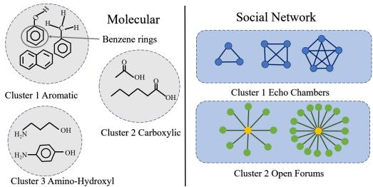  
Figure 1: Example GLC applications.

P<sub>r</sub>i<sub>or wor</sub>k <sub>on grap</sub>h<sub>-</sub>l<sub>eve</sub>l <sub>c</sub>l<sub>us</sub>t<sub>er</sub>i<sub>ng</sub> h<sub>ave evo</sub>l<sub>ve</sub>d f<sub>rom ear</sub>l<sub>y</sub> <sub>g</sub>ra<sub>p</sub>h-kernel methods [8, 9, 20, 28, 43, 50, 50, 51] to recent GNNbased contrastive learnin<sub>g</sub>-based methods [16, 23, 31, 42, 58, 73] and end-to-end clusterin<sub>g</sub> frameworks [11, 12, 14]. Althou<sub>g</sub>h these a<sub>pp</sub>roaches have substantiall<sub>y</sub> im<sub>p</sub>roved <sub>g</sub>ra<sub>p</sub>h re<sub>p</sub>resentation learni<sub>ng</sub> <sub>an</sub>d <sub>c</sub>l<sub>us</sub>t<sub>er</sub>i<sub>ng</sub> <sub>e</sub>fi<sub>c</sub>i<sub>ency,</sub> t<sub>wo</sub> f<sub>un</sub>d<sub>amen</sub>t<sub>a</sub>l <sub>c</sub>h<sub>a</sub>ll<sub>enges</sub> <sub>rema</sub>i<sub>n:</sub> limited expressivity and multi-class collapse. First, as discussed in §4.1, GINs cannot sur<sub>p</sub>ass the 1-WL test and thus fail to distin-<sub>g</sub>uish certain non-isomor<sub>p</sub>hic <sub>g</sub>ra<sub>p</sub>hs (see Fi<sub>g</sub>. 2). Unfortunatel<sub>y</sub>, this limitation stems from the inabilit<sub>y</sub> of GNNs to <sub>p</sub>ercei<sub>v</sub>e the <sub>g</sub>l<sub>o</sub>b<sub>a</sub>l <sub>s</sub>t<sub>ruc</sub>t<sub>ure</sub> <sub>an</sub>d <sub>canno</sub>t b<sub>e</sub> <sub>reme</sub>di<sub>e</sub>d b<sub>y</sub> <sub>con</sub>t<sub>ras</sub>ti<sub>ve</sub> l<sub>earn</sub>i<sub>ng</sub> or hierarchical pooling [37]. Graph edit distance (GED) [48] can <sub>p</sub>recisel<sub>y</sub> measure the similarit<sub>y</sub> between two <sub>g</sub>ra<sub>p</sub>hs and distin-<sub>g</sub>uish <sub>g</sub>ra<sub>p</sub>hs that the 1-WL test fails to tell a<sub>p</sub>art. However<sub>,</sub> its <sub>compu</sub>t<sub>a</sub>ti<sub>on</sub> i<sub>s</sub> NP<sub>-</sub>h<sub>ar</sub>d<sub>.</sub> S<sub>econ</sub>d<sub>,</sub> t<sub>o</sub> <sub>ena</sub>bl<sub>e</sub> <sub>en</sub>d<sub>-</sub>t<sub>o-en</sub>d <sub>c</sub>l<sub>us</sub>t<sub>er</sub>i<sub>ng,</sub> both SOTA methods minimize the Kullback–Leibler (KL) divergence b<sub>e</sub>t<sub>ween</sub> <sub>c</sub>l<sub>us</sub>t<sub>er</sub> <sub>ass</sub>i<sub>gnmen</sub>t<sub>s</sub> <sub>an</sub>d <sub>pseu</sub>d<sub>o-</sub>l<sub>a</sub>b<sub>e</sub>l<sub>s,</sub> b<sub>u</sub>t thi<sub>s</sub> <sub>s</sub>t<sub>ra</sub>t<sub>egy</sub> lacks cluster-size constraints, leadin<sub>g</sub> to cluster colla<sub>p</sub>se. In §4.2, we <sub>quan</sub>tif<sub>y</sub> th<sub>e</sub> i<sub>m</sub>b<sub>a</sub>l<sub>ance</sub> b<sub>e</sub>t<sub>ween</sub> <sub>groun</sub>d<sub>-</sub>t<sub>ru</sub>th l<sub>a</sub>b<sub>e</sub>l<sub>s</sub> <sub>an</sub>d th<sub>e</sub> <sub>pre</sub> di<sub>c</sub>t<sub>e</sub>d l<sub>a</sub>b<sub>e</sub>l<sub>s</sub> <sub>o</sub>f th<sub>ese</sub> SOTA <sub>me</sub>th<sub>o</sub>d<sub>s</sub> <sub>on</sub> 10 <sub>rea</sub>l<sub>-wor</sub>ld d<sub>a</sub>t<sub>ase</sub>t<sub>s</sub> <sub>an</sub>d find that colla<sub>p</sub>se is <sub>p</sub>revalent (see Fi<sub>g</sub>. 3), es<sub>p</sub>eciall<sub>y</sub> <sub>p</sub>ronounced on multi-class datasets such as ENZYMES [45].

T<sub>o a</sub>dd<sub>ress</sub> th<sub>e</sub> t<sub>wo</sub> f<sub>un</sub>d<sub>amen</sub>t<sub>a</sub>l <sub>c</sub>h<sub>a</sub>ll<sub>enges a</sub>b<sub>ove, we presen</sub>t ${ \mathsf { S } } ^ { 3 } { \mathsf { G L C } } .$ <sub>,</sub> a novel S<sub>p</sub>ectral Self-S<sub>up</sub>ervised Gra<sub>p</sub>h-Level Cl<sub>u</sub>sterin<sub>g</sub> <sup>f</sup>ramewor<sup>k</sup> t<sup>h</sup>at joint<sup>l</sup>y tac<sup>kl</sup>es <sup>l</sup>imite<sup>d</sup> expressivity an<sup>d</sup> mu<sup>l</sup>ti-c<sup>l</sup>ass collapse in a unified, end-to-end pipeline. We introduce Spectral Signature based on the Hofman-Wielandt inequality, proving that a<sup>d</sup>jacency eigenva<sup>l</sup>ue <sup>d</sup>istances constitute a rigorous <sup>l</sup>ower <sup>b</sup>oun<sup>d</sup> <sub>on</sub> GED <sub>an</sub>d <sub>ena</sub>bl<sub>e e</sub>fi<sub>c</sub>i<sub>en</sub>t <sub>g</sub>l<sub>o</sub>b<sub>a</sub>l t<sub>opo</sub>l<sub>ogy enco</sub>di<sub>ng</sub> b<sub>eyon</sub>d th<sub>e</sub> 1<sub>-</sub> WL limit, complementing GIN-based Spatial Representation (Fig. 2). We propose joint manifold-preserving sparse regression (JMPSR) to <sup>f</sup>use spectra<sup>l</sup> an<sup>d</sup> spatia<sup>l</sup> views t<sup>h</sup>roug<sup>h</sup> row-sparse projections and manifold preservation, together with GED-guided contrastive learning that aligns spatial embeddings via topology-aware positive <sub>pa</sub>i<sub>rs.</sub> Fi<sub>na</sub>ll<sub>y,</sub> <sub>we</sub> f<sub>ormu</sub>l<sub>a</sub>t<sub>e</sub> b<sub>a</sub>l<sub>ance</sub>d <sub>pseu</sub>d<sub>o-</sub>l<sub>a</sub>b<sub>e</sub>l <sub>genera</sub>ti<sub>on</sub> <sub>as</sub> <sub>an</sub> optimal transport problem with equipartition constraints, solved eficiently by the Sinkhorn-Knopp (SK) algorithm to ensure balanced <sub>c</sub>l<sub>us</sub>t<sub>er ass</sub>i<sub>gnmen</sub>t<sub>s.</sub> I<sub>n summary, our con</sub>t<sub>r</sub>ib<sub>u</sub>ti<sub>ons are</sub> th<sub>ree</sub>f<sub>o</sub>ld<sub>:</sub>

• We derive S<sub>p</sub>ectral Si<sub>g</sub>nature from the Hofman-Wielandt ine<sub>q</sub>ualit<sub>y,</sub> establishin<sub>g</sub> it as a com<sub>p</sub>utationall<sub>y</sub> tractable <sub>y</sub>et ri<sub>g</sub>- oro<sub>u</sub>s lower bo<sub>u</sub>nd for GED that breaks the 1-WL ex<sub>p</sub>ressivit<sub>y</sub> <sub>ce</sub>ilin<sub>g</sub> <sub>w</sub>ith<sub>ou</sub>t in<sub>cu</sub>rrin<sub>g</sub> NP-h<sub>a</sub>rd <sub>pa</sub>ir<sub>w</sub>i<sub>se</sub> m<sub>a</sub>t<sub>c</sub>hin<sub>g.</sub>

• We <sub>p</sub>ro<sub>p</sub>ose JMPSR to<sub>g</sub>ether with GED-<sub>g</sub>uided contrastive learnin<sub>g</sub> to inte<sub>g</sub>rate <sub>g</sub>lobal s<sub>p</sub>ectral and local s<sub>p</sub>atial views<sub>,</sub> <sub>p</sub>reservin<sub>g</sub> <sub>cr</sub>iti<sub>ca</sub>l <sub>comp</sub>l<sub>emen</sub>t<sub>ary</sub> <sub>seman</sub>ti<sub>cs</sub> th<sub>roug</sub>h <sub>man</sub>if<sub>o</sub>ld <sub>s</sub>t<sub>ruc</sub>t<sub>ure</sub> w<sup>h</sup>i<sup>l</sup>e suppressing re<sup>d</sup>un<sup>d</sup>ancy via row-sparse projections.

• We introduce an o<sub>p</sub>timal-trans<sub>p</sub>ort-based balanced clusterin<sub>g</sub> o<sup>b</sup>jective wit<sup>h</sup> SK norma<sup>l</sup>ization, w<sup>h</sup>ic<sup>h</sup> en<sup>f</sup>orces equipartition constraints on cluster assi<sub>g</sub>nments and miti<sub>g</sub>ates the multi-class colla<sub>p</sub>se <sub>p</sub>revalent in existin<sub>g</sub> SOTA methods.

Extensive ex<sub>p</sub>eriments on 10 real-world datasets a<sub>g</sub>ainst 15 com<sub>p</sub>etiti<sub>ve</sub> b<sub>ase</sub>li<sub>nes</sub> d<sub>emons</sub>t<sub>ra</sub>t<sub>e</sub> th<sub>a</sub>t $\mathsf { S } ^ { 3 } \mathsf { G L C }$ <sub>es</sub>t<sub>a</sub>bli<sub>s</sub>h<sub>es new s</sub>t<sub>a</sub>t<sub>e-o</sub>f<sub>-</sub>th<sub>e-</sub> art results<sub>,</sub> with <sub>p</sub>articularl<sub>y p</sub>ronounced <sub>g</sub>ains on challen<sub>g</sub>in<sub>g</sub> multiclass benchmarks (e.g., +14.6% ACC on REDDIT-12K and +35.2% NMI on DD), validating the efectiveness of topology-enhanced, b<sub>a</sub>l<sub>ance</sub>d GLC<sub>.</sub>

## 2 Related Work

## 2.1 Graph-level Representation Learning

C<sub>urren</sub>t f<sub>ramewor</sub>k<sub>s</sub> f<sub>or unsuperv</sub>i<sub>se</sub>d GRL <sub>can</sub> b<sub>e</sub> b<sub>roa</sub>dl<sub>y ca</sub>t<sub>e-</sub> <sub>g</sub>orized into two streams: mutual information-based methods [40, 46, 68] and contrastive learnin<sub>g</sub>-based a<sub>pp</sub>roaches [16, 23, 58]. Re-<sub>g</sub>ardin<sub>g</sub> the former, InfoGraph [53] learns <sub>g</sub>ra<sub>p</sub>h embeddin<sub>g</sub>s b<sub>y</sub> maximizin<sub>g</sub> the mutual information between the <sub>g</sub>lobal <sub>g</sub>ra<sub>p</sub>h re<sub>p</sub>- resentation and multi-scale substructures. Similarl<sub>y</sub>, HeGCL [52] <sub>en</sub>h<sub>ances</sub> th<sub>e mu</sub>t<sub>ua</sub>l i<sub>n</sub>f<sub>orma</sub>ti<sub>on</sub> b<sub>e</sub>t<sub>ween s</sub>i<sub>m</sub>il<sub>ar v</sub>i<sub>ews</sub> th<sub>roug</sub>h a cross-view contrastive mechanism. The second cate<sub>g</sub>or<sub>y,</sub> contrastive learnin<sub>g</sub>, has <sub>g</sub>ained si<sub>g</sub>nificant traction. GraphCL [73] em-<sub>p</sub>lo<sub>y</sub>s diverse <sub>g</sub>ra<sub>p</sub>h au<sub>g</sub>mentations with a contrastive loss to <sub>y</sub>ield hi<sub>g</sub>hl<sub>y</sub> transferable and robust <sub>g</sub>ra<sub>p</sub>h embeddin<sub>g</sub>s. GraphACL [42] i<sub>n</sub>t<sub>ro</sub>d<sub>uces</sub> <sub>an</sub> <sub>a</sub>d<sub>versar</sub>i<sub>a</sub>l b<sub>ranc</sub>h t<sub>o</sub> <sub>genera</sub>t<sub>e</sub> h<sub>ar</sub>d <sub>nega</sub>ti<sub>ve</sub> <sub>samp</sub>l<sub>es.</sub> Be<sub>y</sub>ond these<sub>,</sub> several a<sub>pp</sub>roaches em<sub>p</sub>hasize ca<sub>p</sub>turin<sub>g</sub> <sub>g</sub>lobal <sub>g</sub>ra<sub>p</sub>h semantics [39, 41, 54, 71]. GraphLoG [66] enhances instance-level contrast with hierarchical <sub>p</sub>rotot<sub>yp</sub>es re<sub>p</sub>resentin<sub>g</sub> <sub>g</sub>lobal semantic <sub>c</sub>l<sub>us</sub>t<sub>ers.</sub> Th<sub>ese</sub> f<sub>ramewor</sub>k<sub>s</sub> <sub>prov</sub>id<sub>e</sub> <sub>ro</sub>b<sub>us</sub>t <sub>an</sub>d t<sub>rans</sub>f<sub>era</sub>bl<sub>e</sub> <sub>grap</sub>h embeddin<sub>g</sub>s without su<sub>p</sub>ervision.

## 2.2 Graph-level Clustering

GLC aims to <sub>p</sub>artition a set of unlabeled <sub>g</sub>ra<sub>p</sub>hs into distinct <sub>g</sub>rou<sub>p</sub>s based on semantic similarit<sub>y</sub>. Traditional a<sub>pp</sub>roaches t<sub>yp</sub>icall<sub>y</sub> em-<sub>p</sub>lo<sub>y</sub> <sub>g</sub>ra<sub>p</sub>h kernels [8, 28, 43, 50, 51] to measure <sub>p</sub>airwise similarities v<sup>i</sup>a su<sup>b</sup><sub>g</sub>ra<sub>p</sub><sup>h</sup> structures, su<sup>b</sup>se<sub>q</sub>uent<sup>l</sup><sub>y</sub> a<sub>pp</sub><sup>l</sup><sub>y</sub><sup>i</sup>n<sub>g</sub> s<sub>p</sub>ectra<sup>l</sup> c<sup>l</sup>uster<sup>i</sup>n<sub>g</sub> al<sub>g</sub>orithms to <sub>p</sub>erform the <sub>p</sub>artition. In recent <sub>y</sub>ears<sub>,</sub> GNNs have become the dominant a<sub>pp</sub>roach for <sub>g</sub>ra<sub>p</sub>h encodin<sub>g</sub> [30, 64]. Ins<sub>p</sub>ired b<sub>y</sub> advancements in dee<sub>p</sub> learnin<sub>g</sub> [14, 21, 70], end-to-end clusterin<sub>g</sub> frameworks have been widel<sub>y</sub> ado<sub>p</sub>ted. For instance, DGLC [11] and DCGLC [12] utilize <sub>p</sub>seudo-labels to su<sub>p</sub>ervise the clusterin<sub>g</sub> <sub>p</sub>rocess within a unified framework. However<sub>,</sub> this self-trainin<sub>g p</sub>aradi<sub>g</sub>m <sub>can</sub> i<sub>na</sub>d<sub>ver</sub>t<sub>en</sub>tl<sub>y</sub> <sub>exacer</sub>b<sub>a</sub>t<sub>e</sub> th<sub>e</sub> <sub>r</sub>i<sub>s</sub>k <sub>o</sub>f <sub>c</sub>l<sub>us</sub>t<sub>er</sub>i<sub>ng</sub> <sub>co</sub>ll<sub>apse.</sub> F<sub>ur-</sub> th<sub>ermore,</sub> t<sub>o e</sub>f<sub>ec</sub>ti<sub>ve</sub>l<sub>y</sub> i<sub>n</sub>t<sub>egra</sub>t<sub>e g</sub>l<sub>o</sub>b<sub>a</sub>l <sub>s</sub>t<sub>ruc</sub>t<sub>ura</sub>l f<sub>ea</sub>t<sub>ures w</sub>ith local node attributes, multi-view <sub>g</sub>ra<sub>p</sub>h clusterin<sub>g</sub> methods [22, 36] have been <sub>p</sub>ro<sub>p</sub>osed. However<sub>,</sub> existin<sub>g</sub> a<sub>pp</sub>roaches often fail to f<sub>u</sub>ll<sub>y</sub> <sub>a</sub>dd<sub>ress</sub> th<sub>e</sub> <sub>c</sub>h<sub>a</sub>ll<sub>enge</sub> <sub>o</sub>f <sub>e</sub>f<sub>ec</sub>ti<sub>ve</sub>l<sub>y</sub> <sub>a</sub>li<sub>gn</sub>i<sub>ng</sub> <sub>an</sub>d <sub>exp</sub>l<sub>o</sub>iti<sub>ng</sub> the com<sub>p</sub>lementar<sub>y</sub> information in diferent views.

## 3 Preliminaries

## 3.1 Graph Nomenclature and Terminology

Symbols and Problem Statement. Given a set of � graphs $\mathcal { G } =$ $\overline { { \{ g ^ { ( 1 ) } , g ^ { ( 2 ) } , \ldots , g ^ { ( N ) } \} } }$ <sub>, w</sub>h<sub>ere</sub> th<sub>e</sub> �<sub>-</sub>th <sub>grap</sub>h $\mathcal { G } ^ { ( i ) }$ i<sub>s assoc</sub>i<sub>a</sub>t<sub>e</sub>d <sub>w</sub>ith <sub>a</sub> <sub>no</sub>d<sub>e</sub> <sub>se</sub>t $\mathcal { V } ^ { ( i ) } { } _ { ; }$ , an e<sup>d</sup><sub>g</sub>e set $\boldsymbol { \varepsilon } ^ { ( i ) }$ <sub>, an</sub>d <sub>a no</sub>d<sub>e a</sub>tt<sub>r</sub>ib<sub>u</sub>t<sub>e ma</sub>t<sub>r</sub>i<sub>x</sub> $\mathbf { X } ^ { ( i ) }$ d<sub>eno</sub>t<sub>e</sub>d b<sub>y</sub> $\mathcal { G } ^ { ( i ) } = ( \bar { \mathcal { V } } ^ { ( i ) } , \mathcal { E } ^ { ( i ) } , \mathbf { X } ^ { ( i ) } ,$ ). For each node � $\in \mathcal { G } ^ { ( i ) }$ , we use $N ( u )$ t<sub>o</sub> <sub>represen</sub>t th<sub>e</sub> <sub>se</sub>t <sub>o</sub>f <sub>ne</sub>i<sub>g</sub>hb<sub>or</sub>i<sub>ng</sub> <sub>no</sub>d<sub>es</sub> <sub>o</sub>f <sub>no</sub>d<sub>e</sub> <sub>�.</sub> Th<sub>e</sub> a<sup>d</sup>jacency matrix o<sup>f</sup> grap<sup>h</sup> $\mathcal { G } ^ { ( i ) }$ i<sub>s</sub> <sub>sym</sub>b<sub>o</sub>li<sub>ze</sub>d b<sub>y</sub> $\mathbf { A } ^ { ( i ) }$ <sub>.</sub> W<sub>e</sub> d<sub>e</sub>n<sub>o</sub>t<sub>e</sub> b<sub>y</sub> $\mathbf { L } ^ { \left( i \right) }$ <sub>an</sub>d $\mathbf { \widetilde { L } } ^ { \left( i \right) }$ the La<sub>p</sub>lacian and normalized La<sub>p</sub>lacian of <sub>g</sub>ra<sub>p</sub>h $\mathcal { G } ^ { ( i ) }$ res<sub>p</sub>ectivel<sub>y</sub>. Throu<sub>g</sub>hout this <sub>p</sub>a<sub>p</sub>er<sub>,</sub> sets are denoted b<sub>y</sub> calli<sub>g</sub>ra<sub>p</sub>hic letters, e.<sub>g</sub>., V. Matrices (res<sub>p</sub>. vectors) are written in bold u<sub>pp</sub>ercase (res<sub>p</sub>. lowercase) letters, e.<sub>g</sub>., E (res<sub>p</sub>. e). We use E[�] and $\mathbf { E } [ \cdot , i ]$ to re<sub>p</sub>resent t<sup>h</sup>e $i ^ { \mathrm { { t h } } }$ <sub>row an</sub>d <sub>co</sub>l<sub>umn o</sub>f $\mathbf { E } ,$ res<sub>p</sub>ect<sup>i</sup>ve<sup>l</sup><sub>y</sub>. $\| \mathbf E \| _ { F }$ d<sub>eno</sub>t<sub>es</sub> the Frobenius norm of matrix E, as for the computation of $\| \mathbf { E } \| _ { 2 , 1 } ,$ , is d<sub>e</sub>fi<sub>ne</sub>d <sub>as</sub> th<sub>e sum o</sub>f th<sub>e</sub> $L _ { 2 } \cdot$ <sub>-norms o</sub>f it<sub>s rows.</sub> T<sub>a</sub>bl<sub>e</sub> 1 <sub>summar</sub>i<sub>zes</sub> f<sub>requen</sub>tl<sub>y</sub> <sub>use</sub>d <sub>sym</sub>b<sub>o</sub>l<sub>s.</sub>

The goal of graph-level clustering (GLC) is to partition the graph set $\mathcal { G }$ into � <sup>d</sup>isjoint groups: $\{ C _ { 1 } , C _ { 2 } , \ldots , C _ { K } \}$ <sub>an</sub>d $C _ { i } \cap C _ { j } = \varnothing$ f<sub>or</sub> <sup>an</sup>y $i \neq j ,$ <sub>,</sub> <sub>suc</sub>h th<sub>a</sub>t <sub>grap</sub>h<sub>s</sub> <sub>w</sub>ithi<sub>n</sub> th<sub>e</sub> <sub>same</sub> <sub>c</sub>l<sub>us</sub>t<sub>er</sub> $C _ { i }$ <sub>a</sub>r<sub>e</sub> <sub>s</sub>imil<sub>a</sub>r t<sub>o</sub> <sub>eac</sub>h <sub>o</sub>th<sub>er</sub> i<sub>n</sub> t<sub>erms</sub> <sub>o</sub>f t<sub>opo</sub>l<sub>ogy</sub> <sub>an</sub>d <sub>a</sub>tt<sub>r</sub>ib<sub>u</sub>t<sub>e</sub> <sub>seman</sub>ti<sub>cs,</sub> <sub>w</sub>hil<sub>e</sub> th<sub>ose across c</sub>l<sub>us</sub>t<sub>ers are</sub> di<sub>ss</sub>i<sub>m</sub>il<sub>ar</sub> t<sub>o eac</sub>h <sub>o</sub>th<sub>er.</sub>

Manifold Structure. Given a data matrix X, the manifold structure underl<sub>y</sub>in<sub>g</sub> it can be characterized b<sub>y</sub> its <sub>g</sub>ra<sub>p</sub>h La<sub>p</sub>lacian [6], L<sub>X</sub>. Particularly, a lower-dimensional matrix Y is said to preserve the manifold structure of X if for any node pair $i \neq j$ <sub>w</sub>ith th<sub>e</sub> l<sub>ower</sub> <sub>va</sub>l<sub>ue</sub> i<sub>n</sub> $\mathbf { L } _ { \mathrm { X } } [ i , j ] , \lVert \mathbf { Y } [ i ] - \mathbf { Y } [ j ] \rVert _ { 2 } ^ { 2 }$ i<sub>s</sub> minimiz<sub>e</sub>d<sub>.</sub>

Table 1: Frequently used notations.
<table><tr><td rowspan=1 colspan=1>Symbol</td><td rowspan=1 colspan=1>Description</td></tr><tr><td rowspan=1 colspan=1> $\overline { { { g } ^ { ( i ) } , \mathcal { V } ^ { ( i ) } , \mathcal { E } ^ { ( i ) } } }$ </td><td rowspan=1 colspan=1>The i-th graph sample and its node and edge sets.</td></tr><tr><td rowspan=1 colspan=1> $\overline { { N , K , B } }$ </td><td rowspan=1 colspan=1>The total number of graphs, clusters and batch size.</td></tr><tr><td rowspan=1 colspan=1> $\overline { { \mathbf { X } ^ { ( i ) } , \mathbf { A } ^ { ( i ) } } }$ </td><td rowspan=1 colspan=1>The node attribute matrix and adjacency matrix of $\mathcal { G } ^ { ( i ) }$ </td></tr><tr><td rowspan=1 colspan=1>λ(A(i))</td><td rowspan=1 colspan=1>The vector of sorted eigenvalues of A(i).</td></tr><tr><td rowspan=1 colspan=1>H,F</td><td rowspan=1 colspan=1>The Spatial Representation and Spectral Signatureof graphs.</td></tr><tr><td rowspan=1 colspan=1>Y,Z</td><td rowspan=1 colspan=1>The consensus matrix and fused embeddings ofgraphs.</td></tr><tr><td rowspan=1 colspan=1> $\overline { { h , r , d } }$ </td><td rowspan=1 colspan=1>The dimensions of H, F, Z, respectively</td></tr><tr><td rowspan=1 colspan=1> $\overline { { \mathbf { W } _ { \mathrm { H } } , \mathbf { W } _ { \mathrm { F } } } }$ </td><td rowspan=1 colspan=1>The sparse projection matrices for H and F.</td></tr><tr><td rowspan=1 colspan=1>Q, T</td><td rowspan=1 colspan=1>The soft cluster assignment and the target distribu-tion.</td></tr></table>

Sparse Regression. The sparse regression [25] eliminates feature re<sup>d</sup>un<sup>d</sup>ancy <sup>b</sup>y joint<sup>l</sup>y eva<sup>l</sup>uating <sup>f</sup>eature su<sup>b</sup>sets via sparse mu<sup>l</sup>tioutput regression against the target matrix Y, formulated as:

$$
\operatorname* { m i n } _ { \mathbf { W } } \| \mathbf { Y } - \mathbf { X W } \| _ { \mathrm { F } } ^ { 2 } + \lambda \| \mathbf { W } \| _ { 2 , 1 } .\tag{1}
$$

Int<sub>u</sub>iti<sub>v</sub>el<sub>y,</sub> the $L _ { 2 , 1 }$ <sub>1</sub>-norm induces row-sparsity on the projection matrix W. Since each row of W corresponds to a feature dimension, drivin<sub>g</sub> a row’s $L _ { 2 }$ <sub>-norm</sub> t<sub>o zero e</sub>f<sub>ec</sub>ti<sub>ve</sub>l<sub>y e</sub>li<sub>m</sub>i<sub>na</sub>t<sub>es</sub> th<sub>a</sub>t f<sub>ea</sub>t<sub>ure.</sub>

## 3.2 Graph Isomorphism, WL test, and GED

Given two <sub>g</sub>ra<sub>p</sub>hs $\mathcal { G } ^ { ( i ) }$ <sub>an</sub>d $\mathscr { G } ^ { ( j ) }$ <sub>,</sub> we sa<sub>y</sub> the<sub>y</sub> are isomor<sub>p</sub>hic if t<sup>h</sup>ere exists a <sup>b</sup>ijective mapping <sup>f</sup>unction $f \colon \mathcal { G } ^ { ( i ) }  \mathcal { G } ^ { ( j ) }$ <sub>suc</sub>h th<sub>a</sub>t an e<sup>d</sup><sub>g</sub>e $( u , v ) \in \mathcal { G } ^ { ( i ) }$ if th<sub>e e</sub>d<sub>ge</sub> $( f ( u ) , f ( v ) )$ <sub>e</sub>xi<sub>s</sub>t<sub>s</sub> in $\mathscr { G } ^ { ( j ) }$ <sub>.</sub> Th<sub>e</sub> <sub>g</sub>ra<sub>p</sub>h isomor<sub>p</sub>hism <sub>p</sub>roblem involves determinin<sub>g</sub> whether two <sub>g</sub>ra<sub>p</sub>hs are isomor<sub>p</sub>hic<sub>,</sub> i.e.<sub>,</sub> to<sub>p</sub>olo<sub>g</sub>icall<sub>y</sub> identical<sub>,</sub> which has no known <sub>p</sub>ol<sub>y</sub>nomial-time al<sub>g</sub>orithms for it <sub>y</sub>et [4].

The Weisfeiler-Lehman (WL) test of <sub>g</sub>ra<sub>p</sub>h isomor<sub>p</sub>hism [35] is an efective and fast (<sub>p</sub>ol<sub>y</sub>nomial-time) tool for distin<sub>g</sub>uishin<sub>g</sub> a broad class of <sub>g</sub>ra<sub>p</sub>hs. Its 1-dimensional form (1-WL test) iterativel<sub>y</sub> (i) a<sub>gg</sub>re<sub>g</sub>ates the labels of nodes and their nei<sub>g</sub>hbors, and (ii) hashes th<sub>e</sub> <sub>aggrega</sub>t<sub>e</sub>d l<sub>a</sub>b<sub>e</sub>l<sub>s</sub> i<sub>n</sub>t<sub>o</sub> <sub>un</sub>i<sub>que</sub> <sub>new</sub> l<sub>a</sub>b<sub>e</sub>l<sub>s.</sub> Th<sub>e</sub> t<sub>es</sub>t d<sub>e</sub>t<sub>erm</sub>i<sub>nes</sub> th<sub>a</sub>t t<sub>wo</sub> <sub>grap</sub>h<sub>s</sub> <sub>are</sub> <sub>non-</sub>i<sub>somorp</sub>hi<sub>c</sub> if<sub>,</sub> <sub>a</sub>t <sub>some</sub> it<sub>era</sub>ti<sub>on,</sub> th<sub>e</sub> l<sub>a</sub>b<sub>e</sub>l<sub>s</sub> <sub>o</sub>f th<sub>e</sub> <sub>no</sub>d<sub>es</sub> b<sub>e</sub>t<sub>ween</sub> th<sub>e</sub> t<sub>wo</sub> <sub>grap</sub>h<sub>s</sub> <sub>are</sub> dif<sub>eren</sub>t<sub>.</sub>

In the literature, graph edit distance (GED) [48] generalizes iso-<sub>morp</sub>hi<sub>sm an</sub>d <sub>ac</sub>t<sub>s as a s</sub>t<sub>an</sub>d<sub>ar</sub>d <sub>con</sub>ti<sub>nuous measure</sub> f<sub>or quan</sub>tif<sub>y</sub> in<sub>g</sub> the to<sub>p</sub>olo<sub>g</sub>ical similarit<sub>y</sub> of a <sub>g</sub>ra<sub>p</sub>h <sub>p</sub>air. More concretel<sub>y,</sub> the GED $\operatorname* { g e d } ( \bar { g } ^ { ( i ) } , \bar { g } ^ { ( j ) } )$ <sup>b</sup>etween two <sub>g</sub>ra<sub>p</sub><sup>h</sup>s $\mathcal { G } ^ { ( i ) }$ <sub>an</sub>d $\mathscr { G } ^ { ( j ) }$ i<sub>s</sub> d<sub>e</sub>fi<sub>ne</sub>d <sub>as</sub> th<sub>e m</sub>i<sub>n</sub>i<sub>mum num</sub>b<sub>er o</sub>f<sub>e</sub>dit <sub>opera</sub>ti<sub>ons</sub> t<sub>o ma</sub>k<sub>e</sub> $\mathcal { G } ^ { ( i ) }$ isomor<sub>p</sub>hic to $\mathscr { G } ^ { ( j ) }$

$$
\operatorname* { g e d } ( \mathcal { G } ^ { ( i ) } , \mathcal { G } ^ { ( j ) } ) = \operatorname* { m i n } _ { \Upsilon \in \mathcal { P } ( \mathcal { G } ^ { ( i ) } , \mathcal { G } ^ { ( j ) } ) } \sum _ { e _ { i } \in \Upsilon } c ( e _ { i } ) ,\tag{2}
$$

<sub>w</sub>h<sub>ere</sub> $\mathcal { P } ( \mathcal { G } ^ { ( i ) } , \mathcal { G } ^ { ( j ) } )$ d<sub>eno</sub>t<sub>es</sub> th<sub>e se</sub>t <sub>o</sub>f <sub>a</sub>ll <sub>va</sub>lid <sub>e</sub>dit <sub>pa</sub>th<sub>s</sub> t<sub>rans-</sub> formin<sub>g</sub> $\mathcal { G } ^ { ( i ) } \mathrm { t o } \mathcal { G } ^ { ( j ) }$ <sub>.</sub> An <sub>e</sub>dit <sub>ope</sub>r<sub>a</sub>ti<sub>o</sub>n<sup>1</sup> $e _ { i }$ <sub>can</sub> b<sub>e e</sub>ith<sub>er one o</sub>f th<sub>e</sub> followin<sub>g</sub> node-wise/ed<sub>g</sub>e-wise o<sub>p</sub>erations of cost $c ( e _ { i } ) \colon \mathrm { ( i ) }$ insert or delete an isolated vertex; and (ii) insert or delete an ed<sub>g</sub>e.

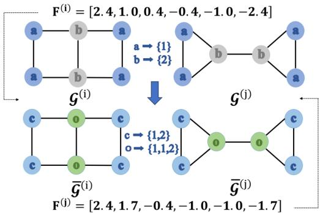  
Figure 2: A toy example for 1-WL test.

## 3.3 Graph Isomorphism Networks

Compared to generic GNNs, graph isomorphism networks (GINs) [65] achieve higher discriminative power through an injective neighb<sub>or</sub>h<sub>oo</sub>d <sub>aggrega</sub>ti<sub>on sc</sub>h<sub>eme.</sub> Th<sub>a</sub>t i<sub>s,</sub> th<sub>e ru</sub>l<sub>e</sub> f<sub>or up</sub>d<sub>a</sub>ti<sub>ng no</sub>d<sub>e</sub> <sub>represen</sub>t<sub>a</sub>ti<sub>ons</sub> th<sub>ere</sub>i<sub>n</sub> i<sub>s</sub> f<sub>ormu</sub>l<sub>a</sub>t<sub>e</sub>d <sub>as:</sub>

$$
{ \bf h } _ { v } ^ { ( \ell ) } = { \sf M L P } ^ { ( \ell ) } \big ( ( 1 + \gamma ^ { ( \ell ) } ) \cdot { \bf h } _ { v } ^ { ( \ell - 1 ) } + \sum _ { u \in N ( v ) } { \bf h } _ { u } ^ { ( \ell - 1 ) } \big ) ,\tag{3}
$$

<sub>w</sub>h<sub>ere</sub> $\mathbf { h } _ { v } ^ { ( \ell ) }$ <sub>represen</sub>t<sub>s</sub> th<sub>e</sub> l<sub>a</sub>t<sub>en</sub>t <sub>em</sub>b<sub>e</sub>ddi<sub>ng</sub> f<sub>or no</sub>d<sub>e � a</sub>t th<sub>e</sub> ℓ<sub>-</sub>th <sup>l</sup>a<sub>y</sub>er $( 1 \leq \ell \leq L ) _ { : }$ <sub>an</sub>d $\gamma ^ { ( \ell ) }$ i<sub>s a we</sub>i<sub>g</sub>htin<sub>g coe</sub>fi<sub>c</sub>i<sub>e</sub>nt<sub>.</sub> Di<sub>s</sub>tin<sub>c</sub>t fr<sub>o</sub>m <sub>g</sub>eneric GNNs that em<sub>p</sub>lo<sub>y</sub> mean o<sub>p</sub>erators<sub>,</sub> GINs a<sub>gg</sub>re<sub>g</sub>ates the f<sub>ea</sub>t<sub>ures</sub> f<sub>rom ne</sub>i<sub>g</sub>hb<sub>or</sub>h<sub>oo</sub>d <sub>v</sub>i<sub>a a summa</sub>ti<sub>on</sub> $\begin{array} { r } { ( \mathrm { i . e . } \sum _ { u \in N ( v ) } \mathbf { h } _ { u } ^ { ( \ell - 1 ) } ) _ { : } } \end{array}$ w<sup>h</sup>ic<sup>h</sup> guarantees t<sup>h</sup>e injectivity o<sup>f</sup> t<sup>h</sup>e aggregation <sup>f</sup>unction over <sub>mu</sub>lti<sub>se</sub>t<sub>s,</sub> th<sub>ere</sub>b<sub>y</sub> <sub>a</sub>ll<sub>ow</sub>i<sub>ng</sub> th<sub>e</sub> <sub>mo</sub>d<sub>e</sub>l t<sub>o</sub> <sub>ac</sub>hi<sub>eve</sub> di<sub>scr</sub>i<sub>m</sub>i<sub>na</sub>ti<sub>ve</sub> <sub>p</sub>ower e<sub>q</sub>uivalent to the 1-WL test. Subse<sub>q</sub>uentl<sub>y,</sub> GINs derive the S<sub>p</sub>atial Re<sub>p</sub>resentation for each <sub>g</sub>ra<sub>p</sub>h $\hat { g } ^ { ( i ) }$ <sup>b</sup><sub>y</sub> a<sub>pp</sub><sup>l</sup><sub>y</sub><sup>i</sup>n<sub>g</sub> <sub>g</sub><sup>l</sup>o<sup>b</sup>a<sup>l</sup> <sub>summa</sub>ti<sub>on</sub> <sub>poo</sub>li<sub>ng</sub> <sub>over</sub> <sub>a</sub>ll fi<sub>na</sub>l<sub>-</sub>l<sub>ayer</sub> <sub>no</sub>d<sub>e</sub> <sub>em</sub>b<sub>e</sub>ddi<sub>ngs</sub> i<sub>n</sub> $\mathcal { G } ^ { ( i ) }$ $\begin{array} { r } { \mathbf { H } _ { i } = \mathsf { R E A D O U U } ( \{ \mathbf { h } _ { v } ^ { ( L ) } : v \in \mathcal { V } ^ { ( i ) } \} ) = \sum _ { v \in \mathcal { V } ^ { ( i ) } } \mathbf { h } _ { v } ^ { ( L ) } } \end{array}$

## 4 Design Motivation

In this section, we elaborate on our motivation for <sub>p</sub>ro<sub>p</sub>osin<sub>g</sub> S<sup>3</sup>GLC b<sub>y</sub> anal<sub>y</sub>zin<sub>g</sub> the inherent deficiencies of existin<sub>g</sub> solutions.

## 4.1 Limited Efectiveness of GINs

Whil<sub>e</sub> GIN<sub>s ma</sub>t<sub>c</sub>h th<sub>e</sub> th<sub>eore</sub>ti<sub>ca</sub>l li<sub>m</sub>it <sub>o</sub>f th<sub>e</sub> 1<sub>-</sub>WL t<sub>es</sub>t<sub>, an</sub>d th<sub>us,</sub> s<sub>u</sub>r<sub>p</sub>ass <sub>g</sub>eneric GNNs in discriminabilit<sub>y,</sub> the nat<sub>u</sub>re of their a<sub>gg</sub>re-<sub>ga</sub>ti<sub>on</sub> <sub>mec</sub>h<sub>an</sub>i<sub>sm</sub> i<sub>n</sub>h<sub>eren</sub>tl<sub>y</sub> <sub>ma</sub>k<sub>es</sub> th<sub>em</sub> bli<sub>n</sub>d t<sub>o</sub> <sub>g</sub>l<sub>o</sub>b<sub>a</sub>l t<sub>opo</sub>l<sub>og</sub>i<sub>-</sub> cal <sub>p</sub>ro<sub>p</sub>erties. Particularl<sub>y,</sub> some <sub>g</sub>ra<sub>p</sub>hs cannot be distin<sub>g</sub>uished b<sub>y</sub> the 1-WL test<sub>,</sub> e.<sub>g</sub>.<sub>,</sub> distinct <sub>g</sub>ra<sub>p</sub>hs with similar nei<sub>g</sub>hborhoods b<sub>u</sub>t dif<sub>eren</sub>t <sub>g</sub>l<sub>o</sub>b<sub>a</sub>l t<sub>opo</sub>l<sub>og</sub>i<sub>es</sub> <sub>are</sub> <sub>poss</sub>ibl<sub>y</sub> <sub>mappe</sub>d t<sub>o</sub> id<sub>en</sub>ti<sub>ca</sub>l embeddin<sub>g</sub>s b<sub>y</sub> GINs (Theorem 4.1).

Theorem 4.1. $I f { \cal G } ^ { ( i ) }$ and $\mathscr { G } ^ { ( j ) }$ cannot be distinguished by the 1-WL test, then their Spatial Representations by GINs are indistinguishable.

We use a to<sub>y</sub> exam<sub>p</sub>le in Fi<sub>g</sub>. 2 for illustration. It can be ob-<sub>serve</sub>d th<sub>a</sub>t $\mathcal { G } ^ { ( i ) }$ <sub>an</sub>d $\bar { g ^ { ( j ) } }$ <sub>p</sub>r<sub>ese</sub>nt di<sub>s</sub>tin<sub>c</sub>t <sub>s</sub>tr<sub>uc</sub>t<sub>u</sub>r<sub>es,</sub> i<sub>.e.,</sub> <sub>a</sub>r<sub>e</sub> n<sub>o</sub>nisomor<sub>p</sub>hic<sub>, g</sub>iven that $\mathcal { G } ^ { ( i ) }$ contains 4-c<sub>y</sub>cles and is bi<sub>p</sub>artite<sub>,</sub> whilst $\mathscr { G } ^ { ( j ) }$ contains 3-c<sub>y</sub>cles and is non-bi<sub>p</sub>artite. Initiall<sub>y,</sub> nodes in <sub>g</sub>ra<sub>p</sub>hs $\mathcal { G } ^ { ( i ) }$ <sub>an</sub>d $\mathscr { G } ^ { ( j ) }$ <sub>are</sub> l<sub>a</sub>b<sub>e</sub>l<sub>e</sub>d <sub>w</sub>ith 1 <sub>or</sub> 2<sub>.</sub> Aft<sub>er ne</sub>i<sub>g</sub>hb<sub>or</sub>h<sub>oo</sub>d <sub>aggre-</sub> <sub>ga</sub>ti<sub>ons,</sub> <sub>eac</sub>h <sub>no</sub>d<sub>e</sub> i<sub>n</sub> th<sub>e</sub> <sub>up</sub>d<sub>a</sub>t<sub>e</sub>d <sub>grap</sub>h $\overline { { \boldsymbol { G } } } ^ { ( i ) }$ <sub>an</sub>d $\overline { { \boldsymbol { G } } } ^ { ( j ) }$ p<sup>ossesses</sup> <sup>a</sup> new set of labels (� or �). At the <sub>g</sub>ra<sub>p</sub>h level, the label multi-sets of $\overline { { \boldsymbol { G } } } ^ { ( i ) }$ <sub>an</sub>d $\overline { { \boldsymbol { G } } } ^ { ( j ) }$ <sub>are</sub> id<sub>en</sub>ti<sub>ca</sub>l<sub>,</sub> $\mathrm { i . e . , } \left\{ c , c , o , o , c , c \right\}$ <sub>,</sub> <sub>w</sub>hi<sub>c</sub>h <sub>corro</sub>b<sub>ora</sub>t<sub>es</sub> our above claim and im<sub>p</sub>lies that the S<sub>p</sub>atial Re<sub>p</sub>resentations <sub>p</sub>rod<sub>uce</sub>d b<sub>y</sub> GIN<sub>s</sub> <sub>canno</sub>t <sub>so</sub>l<sub>e</sub>l<sub>y</sub> <sub>represen</sub>t th<sub>e</sub> <sub>grap</sub>h<sub>s</sub> <sub>e</sub>f<sub>ec</sub>ti<sub>ve</sub>l<sub>y</sub> d<sub>ue</sub> to its inabilit<sub>y</sub> to ca<sub>p</sub>ture the <sub>g</sub>lobal to<sub>p</sub>olo<sub>gy</sub>.

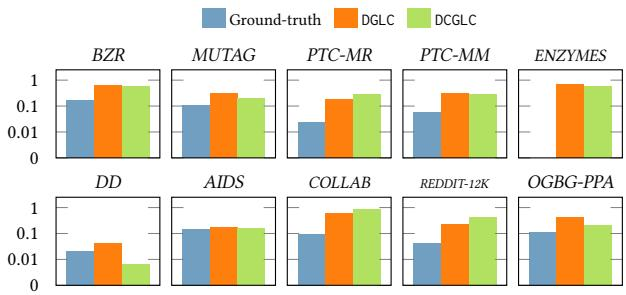  
Figure 3: The PCR of existing models on real datasets.

Lemma $4 . 2 ( [ 4 8 ] ) . \forall G ^ { ( i ) }$ and $\mathscr { G } ^ { ( j ) }$ , ged $( \mathcal { G } ^ { ( i ) } , \mathcal { G } ^ { ( j ) } ) = 0 \ i f f \mathcal { G } ^ { ( i ) }$ and $\mathscr { G } ^ { ( j ) }$ are isomorphic $( \boldsymbol { G } ^ { ( i ) } \cong \boldsymbol { G } ^ { ( j ) } )$ .

Accordin<sub>g</sub> to Lemma 4.2, the GED ged $( \mathcal { G } ^ { ( i ) } , \mathcal { G } ^ { ( j ) } ) = 4$ <sub>can</sub> b<sub>e</sub> used as an efective indicator for <sub>g</sub>ra<sub>p</sub>h isomor<sub>p</sub>hism and <sub>q</sub>uantitative metric for measurin<sub>g</sub> the to<sub>p</sub>olo<sub>g</sub>ical diferences between $\mathcal { G } ^ { ( i ) }$ <sub>an</sub>d $\mathscr { G } ^ { ( j ) }$ <sub>,</sub> <sub>p</sub>articularl<sub>y</sub> where GINs fails. However<sub>,</sub> inte<sub>g</sub>ratin<sub>g</sub> the GED as au<sub>g</sub>mented features into the re<sub>p</sub>resentation learnin<sub>g</sub> of <sub>g</sub>ra<sub>p</sub>hs <sub>p</sub>resents a <sub>p</sub>rohibitive com<sub>p</sub>utational barrier. The exact com<sub>p</sub>utation of GED is known to be NP-hard [10, 74], and even the a<sub>pp</sub>roximation of a sin<sub>g</sub>le <sub>p</sub>air of <sub>g</sub>ra<sub>p</sub>hs with dozens of nodes is intractable [19], not to mention for the � × � <sub>g</sub>ra<sub>p</sub>h <sub>p</sub>airs.

## 4.2 Imbalanced Multi-Class Clustering

The SOTA GLC models DCGLC [12] and DGLC [11] enable end-to-end trainin<sub>g</sub> for efective self-su<sub>p</sub>ervised clusterin<sub>g</sub> b<sub>y</sub> minimizin<sub>g</sub> the Kullback-Leibler (KL) diver<sub>g</sub>ence between a soft cluster assi<sub>g</sub>nment Q and a sharpened target distribution T [62].

Des<sub>p</sub>ite shar<sub>p</sub>enin<sub>g</sub> the soft cluster assi<sub>g</sub>nments<sub>,</sub> this mechanism sufers from a critical flaw: it lacks explicit global constraints on the cluster sizes and tends to produce imbalanced clusters, which is <sub>p</sub>artic<sub>u</sub>larl<sub>y</sub> se<sub>v</sub>ere in m<sub>u</sub>lti-class scenarios. To be s<sub>p</sub>ecific<sub>,</sub> <sub>u</sub>nlike binar<sub>y</sub> clusterin<sub>g</sub> (widel<sub>y</sub> ado<sub>p</sub>ted in <sub>p</sub>revious GLC works [11, 12]), where assi<sub>g</sub>nments are naturall<sub>y</sub> anta<sub>g</sub>onistic<sub>,</sub> in multi-class settings, existing mo<sup>d</sup>e<sup>l</sup>s can easi<sup>l</sup>y co<sup>ll</sup>apse t<sup>h</sup>e majority o<sup>f</sup> samp<sup>l</sup>es into a few dominant <sub>g</sub>rou<sub>p</sub>s while leavin<sub>g</sub> others em<sub>p</sub>t<sub>y</sub> [3, 13].

As em<sub>p</sub>irical evidence<sub>,</sub> we <sub>q</sub>uantif<sub>y</sub> the discre<sub>p</sub>anc<sub>y</sub> in distributi<sub>ona</sub>l i<sub>m</sub>b<sub>a</sub>l<sub>ance</sub> b<sub>e</sub>t<sub>ween</sub> th<sub>e groun</sub>d<sub>-</sub>t<sub>ru</sub>th <sub>c</sub>l<sub>ass</sub> di<sub>s</sub>t<sub>r</sub>ib<sub>u</sub>ti<sub>on an</sub>d the <sub>p</sub>redicted clusterin<sub>g</sub> results b<sub>y</sub> DCGLC and DGLC. To this end, we employ a metric derived from the Normalized Shannon Entropy [49], referred to here as the Partition Collapse Ratio (PCR), defined as:

$$
\mathrm { P C R } ( C _ { 1 } , \dots , C _ { K } ) = 1 - \frac { - \sum _ { k = 1 } ^ { K } { p _ { k } \log { \mathcal { P } } _ { k } } } { \log { K } } .\tag{4}
$$

Here, $p _ { k } = | C _ { k } | / N$ denotes the <sub>p</sub>ro<sub>p</sub>ortion of sam<sub>p</sub>les assi<sub>g</sub>ned to th<sub>e</sub> �<sub>-</sub>th <sub>c</sub>l<sub>us</sub>t<sub>er, an</sub>d th<sub>e</sub> d<sub>enom</sub>i<sub>na</sub>t<sub>or</sub> l<sub>og</sub> � <sub>represen</sub>t<sub>s</sub> th<sub>e max</sub>i<sub>-</sub> m<sub>u</sub>m <sub>p</sub>ossible entro<sub>py</sub>. The PCR of cl<sub>u</sub>sters $\{ C _ { 1 } , C _ { 2 } , \ldots , C _ { K } \}$ <sup>ran</sup>g<sup>es</sup> from 0 to 1, and the lar<sub>g</sub>er (res<sub>p</sub>. smaller) value indicates a hi<sub>g</sub>her (res<sub>p</sub>. lower) de<sub>g</sub>ree of cluster colla<sub>p</sub>se or imbalance. Fi<sub>g</sub>. 3 re<sub>p</sub>orts th<sub>e</sub> PCR <sub>va</sub>l<sub>ues ca</sub>l<sub>cu</sub>l<sub>a</sub>t<sub>e</sub>d <sub>u on groun</sub>d<sub>-</sub>t<sub>ru</sub>th <sub>c</sub>l<sub>us</sub>t<sub>ers an</sub>d th<sub>ose ou</sub>t<sub>-</sub> <sub>p</sub>ut b<sub>y</sub> baselines DCGLC and DGLC over 10 real datasets with multi<sub>p</sub>le classes (see Table 2). It can be observed that the PCRs achieved b<sub>y</sub> DCGLC and DGLC are consistentl<sub>y</sub> and cons<sub>p</sub>icuousl<sub>y</sub> hi<sub>g</sub>her than the ground-truth PCR values. For example, on ENZYMES dataset, the PCR values b<sub>y</sub> DCGLC and DGLC are over 0.55, whereas the <sub>g</sub>roundtruth PCR is almost 0. This si<sub>g</sub>nificant <sub>g</sub>a<sub>p</sub> demonstrates that the b<sub>ase</sub>li<sub>ne</sub> <sub>mo</sub>d<sub>e</sub>l<sub>s</sub> <sub>su</sub>f<sub>er</sub> f<sub>rom</sub> <sub>severe</sub> <sub>c</sub>l<sub>us</sub>t<sub>er</sub>i<sub>ng</sub> <sub>co</sub>ll<sub>apse</sub> <sub>pro</sub>bl<sub>ems</sub> <sub>on</sub> <sub>mu</sub>lti<sub>-c</sub>l<sub>ass</sub> <sub>grap</sub>h d<sub>a</sub>t<sub>ase</sub>t<sub>s,</sub> <sub>w</sub>hi<sub>c</sub>h<sub>,</sub> i<sub>n</sub> t<sub>urn,</sub> hi<sub>n</sub>d<sub>ers</sub> th<sub>em</sub> f<sub>rom</sub> <sub>g</sub>ainin<sub>g</sub> further inroads on clusterin<sub>g p</sub>erformance.

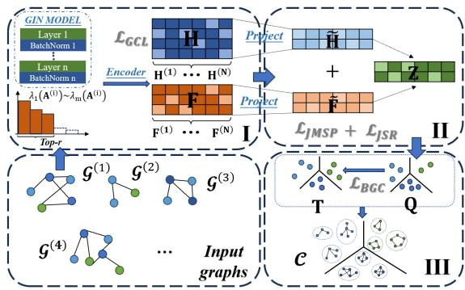  
Figure 4: The overall framework of $\mathsf { S } ^ { 3 } \mathsf { G L C } .$

## 5 Methodology

In this section<sub>,</sub> we <sub>p</sub>resent our <sub>p</sub>ro<sub>p</sub>osed $\mathsf { S } ^ { 3 } \mathsf { G L C }$ <sub>mo</sub>d<sub>e</sub>l t<sub>o cope w</sub>ith the fore<sub>g</sub>oin<sub>g</sub> limitations of existin<sub>g</sub> <sub>w</sub>orks in GLC. We be<sub>g</sub>in <sub>w</sub>ith a s<sub>y</sub>no<sub>p</sub>tic overview of $\mathsf { S } ^ { 3 } \mathsf { G L C }$ in §5.1, followed b<sub>y</sub> elaboratin<sub>g</sub> on the al<sub>g</sub>orithmic details for constructin<sub>g</sub> S<sub>p</sub>ectral Si<sub>g</sub>nature in §5.2, the fusion of <sub>g</sub>ra<sub>p</sub>h feature vectors in §5.3, and trainin<sub>g</sub> and balanced clusterin<sub>g</sub> loss functions in §5.4. Lastl<sub>y</sub>, §5.5 <sub>p</sub>rovides the com<sub>p</sub>lexit<sub>y</sub> <sub>ana</sub>l<sub>ys</sub>i<sub>s o</sub>f $\mathsf { S } ^ { 3 } \mathsf { G L C }$

## 5.1 Synoptic Overview

As illustrated in Fi<sub>g</sub>. 4, the major sta<sub>g</sub>es S<sup>3</sup>GLC include learnin<sub>g</sub> th<sub>e</sub> fi<sub>na</sub>l <sub>grap</sub>h <sub>represen</sub>t<sub>a</sub>ti<sub>ons</sub> $ { \boldsymbol { Z } } \in \mathbb { R } ^ { N \times d }$ <sub>an</sub>d d<sub>er</sub>i<sub>v</sub>i<sub>ng c</sub>l<sub>us</sub>t<sub>ers</sub> $\{ C _ { 1 } , C _ { 2 } , \ldots , C _ { K } \}$ th<sub>ere</sub>f<sub>rom.</sub> M<sub>ore concre</sub>t<sub>e</sub>l<sub>y,</sub> th<sub>e represen</sub>t<sub>a</sub>ti<sub>on</sub> learnin<sub>g</sub> involves three main com<sub>p</sub>onents. The first is to construct the S<sub>p</sub>ectral Si<sub>g</sub>nat<sub>u</sub>re $\mathbf { F } \in \mathbb { R } ^ { N \times r }$ f<sub>or</sub> � <sub>grap</sub>h<sub>s,</sub> <sub>w</sub>h<sub>ose</sub> hi<sub>g</sub>h<sub>-</sub>l<sub>eve</sub>l i<sup>d</sup>ea is to <sup>d</sup>erive t<sup>h</sup>e spectra<sup>l</sup> signatures o<sup>f</sup> eac<sup>h</sup> grap<sup>h’</sup>s a<sup>d</sup>jacency matrix to a<sub>pp</sub>roximate the GED<sub>,</sub> and thus<sub>,</sub> ca<sub>p</sub>ture the <sub>g</sub>lobal structural signatures. In the meantime, Spatial Representation H $\in \mathbb { R } ^ { N \times h }$ th<sub>a</sub>t <sub>enco</sub>d<sub>es</sub> b<sub>o</sub>th <sub>no</sub>d<sub>e a</sub>tt<sub>r</sub>ib<sub>u</sub>t<sub>es an</sub>d l<sub>oca</sub>l <sub>ne</sub>i<sub>g</sub>hb<sub>or</sub>h<sub>oo</sub>d<sub>s</sub> i<sub>n eac</sub>h g<sup>ra</sup>p<sup>h</sup> $\mathcal { G } ^ { ( i ) }$ is <sub>g</sub>enerated b<sub>y</sub> classic GINs models:

$$
\mathbf { H } ^ { ( i ) } = \mathrm { G I N } ( \mathcal { G } ^ { ( i ) } , \mathbf { X } ^ { ( i ) } ) \in \mathbb { R } ^ { h } .\tag{5}
$$

Aft<sub>erwar</sub>d<sub>s,</sub> $\mathsf { S } ^ { 3 } \mathsf { G L C }$ seeks to fuse F and H into the final representations $\mathbf { Z }$ so as to retain com<sub>p</sub>lementarit<sub>y</sub> while eliminatin<sub>g</sub> redund<sub>ancy.</sub> T<sub>owar</sub>d<sub>s</sub> thi<sub>s</sub> <sub>en</sub>d<sub>,</sub> $\mathsf { S } ^ { 3 } \mathsf { G L C }$ <sup>l</sup>earns two projection matrices $\mathrm { \Delta W _ { H } }$ <sub>an</sub>d $\mathbf { W } _ { \mathrm { F } }$ through JMPSR module, which projects F and H into a <sub>un</sub>ifi<sub>e</sub>d l<sub>ower-</sub>di<sub>mens</sub>i<sub>ona</sub>l <sub>space,</sub> i<sub>.e.,</sub>

$$
\begin{array} { r } { \tilde { \mathbf { H } } = \mathbf { H } \mathbf { W } _ { \mathrm { H } } \in \mathbb { R } ^ { d } , \tilde { \mathbf { F } } = \mathbf { F } \mathbf { W } _ { \mathrm { F } } \in \mathbb { R } ^ { d } . } \end{array}\tag{6}
$$

Based thereon, the unified representation Z is obtained by

$$
\begin{array} { r } { \mathbf { Z } = \tilde { \mathbf { H } } + \tilde { \mathbf { F } } = \mathbf { H } \mathbf { W } _ { \mathrm { H } } + \mathbf { F } \mathbf { W } _ { \mathrm { F } } . } \end{array}\tag{7}
$$

I<sub>n</sub> th<sub>e</sub> fi<sub>rs</sub>t <sub>s</sub>t<sub>age,</sub> $\mathsf { S } ^ { 3 } \mathsf { G L C }$ facilitates the learning of H via a GEDguided contrastive learning objective, and includes a self-supervised clusterin<sub>g</sub> loss that ex<sub>p</sub>licitl<sub>y</sub> harnesses the Sinkhorn-Kno<sub>pp</sub> nor-<sub>ma</sub>li<sub>za</sub>ti<sub>on</sub> t<sub>o aver</sub>t <sub>c</sub>l<sub>us</sub>t<sub>er co</sub>ll<sub>apse.</sub>

## 5.2 Spectral Signature for Graphs

Instead of calculatin<sub>g</sub> the GED of <sub>g</sub>ra<sub>p</sub>h <sub>p</sub>airs for the construction of embeddin<sub>g</sub> vectors [5], which entails <sub>p</sub>rohibitive com<sub>p</sub>ut<sub>a</sub>ti<sub>ona</sub>l <sub>an</sub>d t<sub>ra</sub>i<sub>n</sub>i<sub>ng</sub> <sub>over</sub>h<sub>ea</sub>d<sub>,</sub> $\mathsf { S } ^ { 3 } \mathsf { G L C }$ resorts to directl<sub>y</sub> derivin<sub>g</sub> <sub>s</sub>i<sub>gna</sub>t<sub>ures</sub> f<sub>rom</sub> th<sub>e spec</sub>t<sub>rum o</sub>f <sub>eac</sub>h <sub>grap</sub>h i<sub>n</sub>d<sub>epen</sub>d<sub>en</sub>tl<sub>y as</sub> th<sub>e</sub> GED-a<sub>pp</sub>roximate embeddin<sub>g</sub> for the <sub>g</sub>ra<sub>p</sub>h.

More concretel<sub>y,</sub> we reformulate the GED com<sub>p</sub>utation as an equivalent problem of finding the optimal permutation matrix P that o<sub>p</sub>timizes the followin<sub>g</sub> objective [77]:

$$
\operatorname* { g e d } ( \boldsymbol { \mathcal { G } } ^ { ( i ) } , \boldsymbol { \mathcal { G } } ^ { ( j ) } ) = \operatorname* { m i n } _ { \mathbf { P } \in \mathbb { \mathbb { T } } } \frac { 1 } { 2 } \left\| \mathbf { A } ^ { ( i ) } - \mathbf { P } ^ { \top } \mathbf { A } ^ { ( j ) } \mathbf { P } \right\| _ { \mathrm { F } } ^ { 2 } ,\tag{8}
$$

where Π denotes the set of all valid <sub>p</sub>ermutation matrices and P $\mathbf { \bar { A } } ^ { ( j ) } \mathbf { P }$ <sub>represen</sub>t<sub>s</sub> th<sub>e permu</sub>t<sub>a</sub>ti<sub>ons o</sub>f th<sub>e rows an</sub>d <sub>co</sub>l<sub>umns</sub> i<sub>n</sub> $\mathbf { A } ^ { ( j ) }$ f<sub>or no</sub>d<sub>e ma</sub>t<sub>c</sub>hi<sub>ng</sub> b<sub>e</sub>t<sub>ween</sub> $\mathcal { G } ^ { ( i ) }$ <sub>an</sub>d $\mathscr { G } ^ { ( j ) }$ <sub>.</sub> N<sub>o</sub>t<sub>e</sub> th<sub>a</sub>t <sub>w</sub>h<sub>en</sub> $\vert \mathcal { V } ^ { ( i ) } \vert \neq \vert \mathcal { V } ^ { ( j ) } \vert$ <sub>,</sub> <sub>we</sub> <sub>can</sub> <sub>s</sub>i<sub>mp</sub>l<sub>y</sub> <sub>pa</sub>d <sub>zero</sub> <sub>rows</sub> <sub>an</sub>d <sub>co</sub>l<sub>umns</sub> t<sub>o</sub> th<sub>e</sub> sma<sup>ll</sup>er a<sup>d</sup>jacency matrices to ensure t<sup>h</sup>e <sup>d</sup>imension consistency.

Lemma 5.1 (Spectral Permutation Invariance). Let A be the adjacency matrix of a graph. For any permutation matrix $\mathbf { P } \in \mathbb { \Pi }$ , the spectrum ofthe permuted matrix $\mathbf { P } ^ { \top } \mathbf { A P }$ is identical to that ofA.

Theorem 5.2 (Hoffman-Wielandt Ineqality [24]). Let $\lambda _ { 1 } ( \mathbf { A } )$ $\geq . . . \geq \lambda _ { n } ( \mathbf { A } )$ denote the eigenvalues ofa real symmetric matrix A sorted in descending order. For any two such matrices A and B, the following inequality holds: $\begin{array} { r } { \sum _ { k = 1 } ^ { n } \left( \lambda _ { k } ( \mathbf { A } ) - \lambda _ { k } ( \mathbf { B } ) \right) ^ { 2 } \leq \| \mathbf { A } - \mathbf { B } \| _ { F } ^ { 2 } } \end{array}$

The direct o<sub>p</sub>timization of E<sub>q</sub>. (8) is still NP-hard. Our core idea is to levera<sub>g</sub>e our Lemma 5.1 and the Hofman-Wielandt theorem [24] (Theorem 5.2) for an a<sub>pp</sub>roximate solution. More <sub>p</sub>recisel<sub>y</sub>, from Lemma 5.1<sub>,</sub> the ei<sub>g</sub>envalue se<sub>q</sub>uences corres<sub>p</sub>ond exactl<sub>y</sub> under an<sub>y</sub> <sub>p</sub>ermutat<sup>i</sup>on:

$$
\lambda _ { k } ( \mathbf { A } ) \equiv \lambda _ { k } ( \mathbf { P } ^ { \top } \mathbf { A } \mathbf { P } ) , \quad \forall k = 1 , \ldots , n .
$$

Using T<sup>h</sup>eorem 5.2, our optimization o<sup>b</sup>jective in $\operatorname { E q . } \left( 8 \right)$ <sub>can</sub> b<sub>e</sub> l<sub>ower</sub> b<sub>oun</sub>d<sub>e</sub>d <sub>as</sub> f<sub>o</sub>ll<sub>ows:</sub>

$$
\begin{array} { l } { \displaystyle \operatorname* { m i n } _ { \mathbf { P } \in \mathbb { T } } \Big \| \mathbf { A } ^ { ( i ) } - \mathbf { P } ^ { \top } \mathbf { A } ^ { ( j ) } \mathbf { P } \Big \| _ { \mathrm { F } } ^ { 2 } \geq \operatorname* { m i n } _ { \mathbf { P } \in \mathbb { T } } \sum _ { k = 1 } ^ { n } \Big ( \lambda _ { k } ( \mathbf { A } ^ { ( i ) } ) - \lambda _ { k } ( \mathbf { P } ^ { \top } \mathbf { A } ^ { ( j ) } \mathbf { P } ) \Big ) ^ { 2 } } \\ { = \displaystyle \sum _ { k = 1 } ^ { n } \Big ( \lambda _ { k } ( \mathbf { A } ^ { ( i ) } ) - \lambda _ { k } ( \mathbf { A } ^ { ( j ) } ) \Big ) ^ { 2 } = \| \boldsymbol { \lambda } ( \mathbf { A } ^ { ( i ) } ) - \boldsymbol { \lambda } ( \mathbf { A } ^ { ( j ) } ) \| _ { 2 } ^ { 2 } , } \end{array}\tag{9}
$$

<sub>w</sub>h<sub>ere</sub> $\lambda ( \mathbf { A } ^ { ( i ) } )$ <sub>an</sub>d $\lambda ( \mathbf { A } ^ { ( j ) } )$ d<sub>eno</sub>t<sub>e</sub> th<sub>e vec</sub>t<sub>ors con</sub>t<sub>a</sub>i<sub>n</sub>i<sub>ng</sub> th<sub>e re-</sub> s<sub>p</sub>ective sorted ei<sub>g</sub>envalues of $\mathbf { A } ^ { ( i ) }$ <sub>an</sub>d $\mathbf { A } ^ { ( j ) }$ , referred to as Spectral Signature hereafter.

E<sub>q</sub>. (9) reveals that the Euclidean distance between S<sub>p</sub>ectral Si<sub>g</sub>- nature serves as a rigorous lower bound for the GED of graph pair $( \mathcal { G } ^ { ( i ) } , \mathcal { G } ^ { ( j ) } )$ <sub>,</sub> which accuratel<sub>y</sub> ca<sub>p</sub>tures the to<sub>p</sub>olo<sub>g</sub>ical similarit<sub>y</sub> between <sub>g</sub>ra<sub>p</sub>hs. On to<sub>p</sub> of that<sub>,</sub> the S<sub>p</sub>ectral Si<sub>g</sub>nature of each <sub>g</sub>ra<sub>p</sub>h can be ver<sub>y</sub> eficientl<sub>y</sub> com<sub>p</sub>uted b<sub>y</sub> merel<sub>y</sub> a<sub>pp</sub>l<sub>y</sub>in<sub>g</sub> the hi<sub>g</sub>h-<sub>p</sub>erformance ei<sub>g</sub>envalue solvers [34] in common numeric computation libraries over its small and sparse adjacency matrix (often with onl<sub>y</sub> dozens of nodes and ed<sub>g</sub>es) in GLC tasks. Since the small ei<sub>g</sub>envalue <sub>p</sub>art is ne<sub>g</sub>li<sub>g</sub>ible<sub>,</sub> we <sub>p</sub>ick the to<sub>p</sub>-<sub>�</sub> lar<sub>g</sub>est ei<sub>g</sub>envalues in $\bar { \lambda } ( \mathbf { A } ^ { ( i ) } )$ <sub>o</sub>f <sub>eac</sub>h <sub>grap</sub>h $\mathcal { G } ^ { ( i ) }$ to act as its S<sub>p</sub>ectral Si<sub>g</sub>nat<sub>u</sub>re $\mathbf { F } ^ { ( i ) }$

$$
\mathbf { F } ^ { ( i ) } = [ \lambda _ { 1 } ( \mathbf { A } ^ { ( i ) } ) , \lambda _ { 2 } ( \mathbf { A } ^ { ( i ) } ) , \dots , \lambda _ { r } ( \mathbf { A } ^ { ( i ) } ) ] ^ { \top } .\tag{10}
$$

We re<sub>v</sub>isit the exam<sub>p</sub>le in Fi<sub>g</sub>. 2. With the S<sub>p</sub>ectral Si<sub>g</sub>nat<sub>u</sub>re $\left[ 2 . 4 , 1 , 0 . 4 , - 0 . 4 , - 1 , - 2 . 4 \right]$ <sub>an</sub>d $\left[ 2 . 4 , 1 . 7 , - 0 . 4 , - 1 , - 1 , - 1 . 7 \right]$ f<sub>or</sub> $\mathcal { G } ^ { ( i ) }$ <sub>an</sub>d $\mathscr { G } ^ { ( j ) }$ <sub>,</sub> res<sub>p</sub>ectivel<sub>y,</sub> these two <sub>g</sub>ra<sub>p</sub>hs can be easil<sub>y</sub> distin<sub>g</sub>uished now.

## 5.3 Joint Manifold-Preserving Sparse Regression Feature Fusion

We fuse two com<sub>p</sub>lementar<sub>y</sub> <sub>g</sub>ra<sub>p</sub>h views<sub>,</sub> i.e.<sub>,</sub> S<sub>p</sub>atial Re<sub>p</sub>resentation H and Spectral Signature F , whose discrepant information is critical for discriminatin<sub>g</sub> <sub>g</sub>ra<sub>p</sub>hs. Accordin<sub>g</sub>l<sub>y,</sub> our fusion <sub>p</sub>reserves view-s<sub>p</sub>ecific information while su<sub>pp</sub>ressin<sub>g</sub> nois<sub>y</sub> information.

5.3.1 Fusion Objectives. To suppress noisy information during f<sub>us</sub>i<sub>on, we</sub> i<sub>n</sub>t<sub>ro</sub>d<sub>uce a</sub> l<sub>a</sub>t<sub>en</sub>t <sub>consensus space</sub> $\mathbf { Y } ,$ <sub>w</sub>hi<sub>c</sub>h <sub>can gu</sub>id<sub>e</sub> t<sup>h</sup>e <sup>l</sup>earning o<sup>f</sup> t<sup>h</sup>e projection matrices $\bar { \bf W } _ { \mathrm { H } }$ <sub>an</sub>d $\mathbf { W } _ { \mathrm { F } }$ <sub>,</sub> <sub>spec</sub>ifi<sub>ca</sub>ll<sub>y,</sub> we propose the joint sparse regression scheme:

$$
\operatorname* { m i n } _ { \mathbf { W } _ { \mathrm { H } } , \mathbf { W } _ { \mathrm { F } } } \mathcal { L } _ { \mathrm { J S R } } = \underbrace { \| \mathbf { Y } - \tilde { \mathbf { H } } \| _ { \mathrm { F } } ^ { 2 } + \| \mathbf { Y } - \tilde { \mathbf { F } } \| _ { \mathrm { F } } ^ { 2 } } _ { \mathrm { R e g r e s s i o n } } + \underbrace { ( \| \mathbf { W } _ { \mathrm { H } } \| _ { 2 , 1 } + \| \mathbf { W } _ { \mathrm { F } } \| _ { 2 , 1 } ) } _ { \mathrm { S p a r s e \ R e g u l a r i z a t i o n } } ,\tag{11}
$$

<sub>w</sub>h<sub>ere</sub> th<sub>e regress</sub>i<sub>on</sub> t<sub>erm a</sub>li<sub>gns</sub> b<sub>o</sub>th <sub>v</sub>i<sub>ews</sub> t<sub>o</sub> th<sub>e same consensus</sub> s<sub>p</sub>ace<sub>,</sub> while the s<sub>p</sub>arse re<sub>g</sub>ularization term <sub>p</sub>romotes row-s<sub>p</sub>arsit<sub>y</sub> in $\mathbf { W } _ { \mathrm { H } }$ <sub>an</sub>d $\mathbf { W } _ { \mathrm { F } } ,$ w<sup>h</sup>ic<sup>h</sup> is <sup>f</sup>orma<sup>ll</sup>y justi<sup>fi</sup>e<sup>d</sup> in Appen<sup>d</sup>ix A.5. T<sup>h</sup>is row-wise s<sub>p</sub>arsification can act as a denoisin<sub>g</sub> function durin<sub>g</sub> f<sub>us</sub>i<sub>on.</sub>

In m<sub>u</sub>lti-<sub>v</sub>i<sub>ew</sub> f<sub>us</sub>i<sub>o</sub>n<sub>,</sub> di<sub>sc</sub>r<sub>epa</sub>nt inf<sub>o</sub>rm<sub>a</sub>ti<sub>o</sub>n i<sub>s</sub> <sub>o</sub>ft<sub>e</sub>n tr<sub>ea</sub>t<sub>e</sub>d <sub>as</sub> noise and removed [59], so we ex<sub>p</sub>ect the consensus re<sub>p</sub>resentation Y to guide the Spatial Representation H and Spectral Signature F to preserve view-specific complementary information during projection.

Theorem 5.3 ([47]). For $\mathbf { X } \in \mathbb { R } ^ { n \times n }$ , minimizing $\begin{array} { r } { \sum _ { i = 1 } ^ { n } \| \mathbf { X } [ i ] - } \end{array}$ $\textstyle \sum _ { j = 1 } ^ { n } \mathbf { W } [ i , j ] \mathbf { X } [ j ] \rVert$ can force X preserve the manifold structure ofW.

Inspired by Theorem 5.3, we further require Y capturing both th<sub>e s</sub>h<sub>are</sub>d <sub>an</sub>d <sub>v</sub>i<sub>ew-spec</sub>ifi<sub>c man</sub>if<sub>o</sub>ld <sub>s</sub>t<sub>ruc</sub>t<sub>ures o</sub>f th<sub>e</sub> S<sub>pa</sub>ti<sub>a</sub>l Representation H and Spectral Signature $\mathbf { F } ,$ <sub>w</sub>hi<sub>c</sub>h minimiz<sub>es</sub> th<sub>e</sub> wei<sub>g</sub>hted <sub>p</sub>airwise distances in both feature s<sub>p</sub>aces [25]. The corresponding joint manifold structure preservation objective can be f<sub>ormu</sub>l<sub>a</sub>t<sub>e</sub>d <sub>as:</sub>

$$
\operatorname* { m i n } _ { \mathbf { Y } } \mathcal { L } _ { \mathrm { J M S P } } = \frac { 1 } { 2 } \sum _ { i = 1 } ^ { B } \left\| \mathbf { Y } [ i ] - \sum _ { j = 1 } ^ { B } \mathbf { S } _ { \mathrm { C A } } [ i , j ] \cdot \mathbf { Y } [ j ] \right\| ^ { 2 } = \operatorname { T r } \left( \mathbf { Y } ^ { \mathsf { T } } \mathbf { L } _ { \mathrm { C A } } \mathbf { Y } \right) ,\tag{12}
$$

<sub>w</sub>h<sub>ere</sub> $\mathbf { L } _ { \mathbb { C } A } = ( \mathbf { I } - \mathbf { S } _ { \mathbb { C } A } ) ^ { \top } ( \mathbf { I } - \mathbf { S } _ { \mathbb { C } A } )$ <sub>an</sub>d th<sub>e</sub> $\mathsf { S } _ { \mathrm { C A } }$ re<sub>p</sub>resents t<sup>h</sup>e consensus afinity matrix of projected features H<sup>˜</sup> and F<sup>˜</sup> defined in E<sub>q</sub>. (13).

$$
\mathsf { S } _ { \mathrm { C A } } = ( \tilde { \mathbf { H } } + \tilde { \mathbf { F } } ) ( \tilde { \mathbf { H } } + \tilde { \mathbf { F } } ) ^ { \top } = \underbrace { \tilde { \mathbf { H } } \tilde { \mathbf { H } } ^ { \top } } _ { \mathrm { s e l f a f f i n i t y } } + \underbrace { \tilde { \mathbf { F } } \tilde { \mathbf { F } } ^ { \top } } _ { \mathrm { s e l f a f f i n i t y } } + \underbrace { ( \tilde { \mathbf { H } } \tilde { \mathbf { F } } ^ { \top } + \tilde { \mathbf { F } } \tilde { \mathbf { H } } ^ { \top } ) } _ { \mathrm { c r o s s a f f i n i t y } } .\tag{13}
$$

Finall<sub>y,</sub> we kee<sub>p</sub> $\mathsf { S } _ { \mathrm { C A } } [ i , j ] > 0$ <sub>a</sub>nd <sub>se</sub>t th<sub>e</sub> r<sub>e</sub>m<sub>a</sub>inin<sub>g e</sub>ntri<sub>es</sub> t<sub>o</sub> 0 <sub>v</sub>i<sub>a</sub> <sub>e</sub>l<sub>emen</sub>t<sub>-w</sub>i<sub>se</sub> th<sub>res</sub>h<sub>o</sub>ldi<sub>ng.</sub> Th<sub>e cross-a</sub>fi<sub>n</sub>it<sub>y</sub> t<sub>erms preserve</sub> th<sub>e</sub> <sub>s</sub>h<sub>are</sub>d <sub>man</sub>if<sub>o</sub>ld <sub>s</sub>t<sub>ruc</sub>t<sub>ure,</sub> <sub>w</sub>h<sub>ereas</sub> th<sub>e</sub> <sub>se</sub>lf<sub>-a</sub>fi<sub>n</sub>it<sub>y</sub> t<sub>erms</sub> <sub>preserve</sub> th<sub>e</sub> <sub>v</sub>i<sub>ew-spec</sub>ifi<sub>c</sub> <sub>man</sub>if<sub>o</sub>ld <sub>s</sub>t<sub>ruc</sub>t<sub>ure.</sub>

In a nuts<sup>h</sup>e<sup>ll</sup>, t<sup>h</sup>e overa<sup>ll</sup> <sup>f</sup>usion o<sup>b</sup>jective is <sup>f</sup>ormu<sup>l</sup>ate<sup>d</sup> as:

$$
\operatorname* { m i n } _ { \mathrm { Y , W _ { H } , W _ { F } } } \quad \mathcal { L } _ { \mathrm { J M S P } } + \mathcal { L } _ { \mathrm { J S R } } .\tag{14}
$$

5.3.2 Closed-form Solutions. Notice that our optimization objective in Eq. (14) is not jointly convex with respect to all variables. H<sub>owever,</sub> it i<sub>s convex w</sub>ith <sub>respec</sub>t t<sub>o eac</sub>h <sub>var</sub>i<sub>a</sub>bl<sub>e w</sub>h<sub>en</sub> th<sub>e o</sub>th<sub>ers</sub> are fixed. Therefore, we resort to an alternating optimization strate<sub>gy</sub> to iterativel<sub>y</sub> u<sub>p</sub>date the latent feature s<sub>p</sub>ace $\mathbf { Y } ,$ an<sup>d</sup> projection matrices $\mathbf { W } _ { \mathrm { H } }$ <sub>an</sub>d $\mathbf { W } _ { \mathrm { F } }$

Update $\mathbf { W _ { H } }$ and $\mathbf { W _ { F } } .$ . When fixing Y, the optimization for $\mathbf { W } _ { \mathrm { H } }$ (res<sub>p</sub>. W<sub>F</sub>) becomes a standard s<sub>p</sub>arse re<sub>g</sub>ression <sub>p</sub>roblem. Tak ing t<sup>h</sup>e <sup>d</sup>erivative o<sup>f</sup> t<sup>h</sup>e o<sup>b</sup>jective <sup>f</sup>unction wit<sup>h</sup> respect to $\mathbf { W } _ { \mathrm { H } }$ and settin it to zero, we obtain −2H<sup>⊤</sup> $\begin{array} { r } { \left( \mathbf { Y } - \mathbf { H } \mathbf { W } _ { \mathrm { H } } \right) + 2 \Delta _ { \mathrm { H } } \mathbf { W } _ { \mathrm { H } } = 0 , } \end{array}$ <sub>w</sub>h<sub>ere</sub> $\Delta _ { \mathrm { H } }$ i<sub>s a</sub> di<sub>agona</sub>l <sub>ma</sub>t<sub>r</sub>i<sub>x w</sub>h<sub>ose</sub> th<sub>e</sub> �<sub>-</sub>th di<sub>agona</sub>l <sub>e</sub>l<sub>emen</sub>t i<sub>s</sub> $\frac { 1 } { 2 \Vert \mathbf { W } _ { \mathrm { H } } [ k ] \Vert _ { 2 } }$ <sub>,w</sub>hi<sub>c</sub>h <sub>essen</sub>ti<sub>a</sub>ll<sub>y re-we</sub>i<sub>g</sub>ht<sub>s</sub> th<sub>e</sub> f<sub>ea</sub>t<sub>ures</sub> d<sub>ur</sub>i<sub>ng.</sub> A<sub>c-</sub> <sub>cor</sub>di<sub>ng</sub>l<sub>y,</sub> th<sub>e c</sub>l<sub>ose</sub>d<sub>-</sub>f<sub>orm so</sub>l<sub>u</sub>ti<sub>on</sub> i<sub>s:</sub>

$$
\mathbf { W } _ { \mathrm { H } } = ( \mathbf { H } ^ { \top } \mathbf { H } + \boldsymbol { \Delta } _ { \mathrm { H } } ) ^ { - 1 } \mathbf { H } ^ { \top } \mathbf { Y } .\tag{15}
$$

An<sub>a</sub>l<sub>ogous</sub>l<sub>y,</sub> <sub>we</sub> <sub>ca</sub>n d<sub>e</sub>ri<sub>ve</sub> $\mathbf { W } _ { \mathrm { F } } = \left( \mathbf { F } ^ { \top } \mathbf { F } + \Delta _ { \mathrm { F } } \right)$ <sup>−1</sup>F<sup>⊤</sup>Y, where $\Delta _ { \mathrm { F } }$ i<sub>s</sub> <sub>a</sub> di<sub>agona</sub>l <sub>ma</sub>t<sub>r</sub>i<sub>x</sub> <sub>w</sub>h<sub>ose</sub> th<sub>e</sub> �<sub>-</sub>th di<sub>agona</sub>l <sub>e</sub>l<sub>emen</sub>t i<sub>s</sub> $\frac { 1 } { 2 \Vert \mathbf { W } _ { \mathrm { F } } [ k ] \Vert _ { 2 } }$

Update Y. When the projection matrices $\mathbf { W } _ { \mathrm { H } }$ <sub>an</sub>d $\mathbf { W } _ { \mathrm { F } }$ <sub>are</sub> fi<sub>xe</sub>d<sub>,</sub> th<sub>e</sub> optimization problem w.r.t. Y can be rewritten by substituting the optimal W back into the original objective, yielding

$$
\operatorname* { m i n } _ { \mathbf { Y } ^ { \top } \mathbf { Y } = \mathbf { I } } \operatorname { T r } \left( \mathbf { Y } ^ { \top } \mathbf { M } \mathbf { Y } \right) ,\tag{16}
$$

where the auxiliary matrix M is defined as:

$$
{ \bf M } = { \bf L } _ { \mathrm { C A } } + 2 { \bf I } - \left( { \bf H } ( { \bf H } ^ { \top } { \bf H } + { \boldsymbol { \Delta } } _ { \mathrm { H } } ) ^ { - 1 } { \bf H } ^ { \top } + { \bf F } ( { \bf F } ^ { \top } { \bf F } + { \boldsymbol { \Delta } } _ { \mathrm { F } } ) ^ { - 1 } { \bf F } ^ { \top } \right) .\tag{17}
$$

Th<sub>e</sub> d<sub>e</sub>t<sub>a</sub>il<sub>e</sub>d d<sub>er</sub>i<sub>va</sub>ti<sub>ve s</sub>t<sub>eps are</sub> d<sub>e</sub>f<sub>erre</sub>d t<sub>o</sub> A<sub>ppen</sub>di<sub>x</sub> $\mathrm { A . 7 }$ f<sub>or</sub> th<sub>e</sub> interest of s<sub>p</sub>ace. As <sub>p</sub>er K<sub>y</sub> Fan’s trace maximization <sub>p</sub>rinci<sub>p</sub>le [18], the trace minimization <sub>p</sub>roblem in E<sub>q</sub>. (16) can be o<sub>p</sub>timized b<sub>y</sub> computing the � smallest eigenvectors of M as Y, and the shape of M depends on the batch size �, i.e. $\mathbf { M } \in \mathbb { R } ^ { B \times B }$

## 5.4 Self-Supervised Training and Clustering

To facilitate the learning of Spatial Representation H by GINs and its res<sub>u</sub>ltin<sub>g</sub> re<sub>p</sub>resentations $\mathrm { Z ( E q . ( 7 ) ) }$ ), as well as the clusterin<sub>g</sub> of $\mathbf { Z } ,$ we include two self-supervised training objectives: GED-guided contrastive learning loss $\mathcal { L } _ { \mathrm { G C L } }$ and balanced graph-level clustering l<sub>oss</sub> $\mathcal { L } _ { \mathrm { B G C } }$ <sub>,</sub> l<sub>ea</sub>di<sub>ng</sub> t<sub>o</sub> <sub>our</sub> <sub>overa</sub>ll t<sub>ra</sub>i<sub>n</sub>i<sub>ng</sub> l<sub>oss:</sub> $\mathcal { L } _ { \mathrm { G C L } } + \mathcal { L } _ { \mathrm { B G C } }$

5.4.1 GED-guided Contrastive Learning. To create discriminative Spatial Representation H from $\mathrm { G I N } s _ { \mathrm { \scriptscriptstyle \mathrm { i } } }$ , we <sub>p</sub>ro<sub>p</sub>ose to <sup>i</sup>ntro<sup>d</sup>uce a new <sub>g</sub>ra<sub>p</sub>h contrastive learnin<sub>g</sub> objective [63] to incor<sub>p</sub>orate the to<sub>p</sub>olo<sub>g</sub>ical relevance (i.e., GED) of <sub>g</sub>ra<sub>p</sub>h sam<sub>p</sub>les, which is shown to be <sub>p</sub>reserved in their S<sub>p</sub>ectral Si<sub>g</sub>nat<sub>u</sub>re. S<sub>p</sub>ecificall<sub>y,</sub> <sub>g</sub>iven the Spectral Signature F, for each anchor graph sample $\dot { \mathcal { G } } ^ { ( i ) }$ <sub>,</sub> we <sub>p</sub>ick its $\beta \mathfrak { - }$ nearest nei<sub>g</sub>hbors in terms of their embeddin<sub>g</sub> similarities in $\mathbf { F } ,$ <sub>co</sub>n<sub>s</sub>tit<sub>u</sub>tin<sub>g</sub> it<sub>s pos</sub>iti<sub>ve</sub> n<sub>e</sub>i<sub>g</sub>hb<sub>o</sub>r <sub>se</sub>t ${ \cal P } ( \mathcal { G } ^ { ( i ) } )$ <sub>as</sub> f<sub>o</sub>ll<sub>ows:</sub>

$$
P ( \mathcal { G } ^ { ( i ) } ) = \underset { \mathcal { G } ^ { ( j ) } \in \mathcal { G } , j \neq i } { \arg \tan ^ { - } \beta \left( \mathbf { F } [ i ] \cdot \mathbf { F } [ j ] ^ { \top } \right) } ,\tag{18}
$$

<sup>where</sup> <sup>ar</sup>g <sup>to</sup>p<sup>-</sup> $\cdot \beta ( \cdot )$ is an o<sub>p</sub>erator that retrieves the to<sub>p</sub>- $\boldsymbol { \cdot } \beta$ <sub>e</sub>l<sub>emen</sub>t<sub>s</sub> based on the similarit<sub>y</sub>. For sim<sub>p</sub>licit<sub>y,</sub> we fix $\beta = 1 0$ in all ex<sub>p</sub>eriments.

Th<sub>e co</sub>ntr<sub>as</sub>ti<sub>ve</sub> l<sub>oss</sub> i<sub>s</sub> th<sub>e</sub>n f<sub>o</sub>rm<sub>u</sub>l<sub>a</sub>t<sub>e</sub>d t<sub>o</sub> m<sub>a</sub>ximiz<sub>e</sub> th<sub>e s</sub>imil<sub>a</sub>rit<sub>y</sub> between <sub>p</sub>ositive <sub>p</sub>airs in the nei<sub>g</sub>hbor set:

$$
\mathcal { L } _ { \mathrm { G C L } } = - \frac { 1 } { B \beta } \sum _ { i = 1 } ^ { B } \sum _ { g ( j ) \in P ( g ( i ) ) } \log \frac { \exp \left( \frac { \cos ( \mathrm { \bf H } [ i ] , \mathrm { \bf H } [ j ] ) } { \tau } \right) } { \sum _ { l = 1 } ^ { B } \exp \left( \frac { \cos ( \mathrm { \bf H } [ i ] , \mathrm { \bf H } [ l ] ) } { \tau } \right) - \exp \left( \frac { 1 } { \tau } \right) } ,\tag{19}
$$

where cos(·, ·) denotes the cosine similarit<sub>y</sub>, and � is a tem<sub>p</sub>er-<sub>a</sub>t<sub>ure parame</sub>t<sub>er con</sub>t<sub>ro</sub>lli<sub>ng</sub> th<sub>e smoo</sub>th<sub>ness o</sub>f th<sub>e</sub> di<sub>s</sub>t<sub>r</sub>ib<sub>u</sub>ti<sub>on.</sub> N<sub>o</sub>t<sub>a</sub>bl<sub>y,</sub> $e ^ { 1 / \tau }$ i<sub>s su</sub>bt<sub>rac</sub>t<sub>e</sub>d i<sub>n</sub> th<sub>e</sub> d<sub>enom</sub>i<sub>na</sub>t<sub>or</sub> t<sub>o e</sub>li<sub>m</sub>i<sub>na</sub>t<sub>e</sub> th<sub>e</sub> self-similarit<sub>y</sub> efect of the anchor sam<sub>p</sub>le itself [15].

5.4.2 Balanced Graph-level Clustering. We also adopt the followin<sub>g</sub> loss [62] for dee<sub>p</sub> clusterin<sub>g</sub>:

$$
\mathcal { L } _ { \mathrm { B G C } } = \mathsf { K L } ( \mathbf { T } \| \mathbf { Q } ) = \sum _ { i = 1 } ^ { N } \sum _ { k = 1 } ^ { K } \mathbf { T } [ i , k ] \cdot \log \frac { \mathbf { T } [ i , k ] } { \mathbf { Q } [ i , k ] } ,\tag{20}
$$

which is to minimize the KL diver<sub>g</sub>ence between the soft assi<sub>g</sub>nment $\mathbf { Q }$ and the tar<sub>g</sub>et distribution T. In <sub>p</sub>articular, we follow [62] t<sub>o</sub> <sub>cons</sub>t<sub>ruc</sub>t th<sub>e</sub> <sub>so</sub>ft <sub>ass</sub>i<sub>gnmen</sub>t $\mathbf { Q } ,$ b<sub>u</sub>t <sub>propose</sub> t<sub>o</sub> <sub>ac</sub>hi<sub>eve</sub> <sub>c</sub>l<sub>us</sub>t<sub>er</sub> balance by explicitly constraining the target distribution T.

S<sub>pec</sub>ifi<sub>ca</sub>ll<sub>y, a</sub>ft<sub>er o</sub>bt<sub>a</sub>i<sub>n</sub>i<sub>ng</sub> th<sub>e</sub> fi<sub>na</sub>l <sub>represen</sub>t<sub>a</sub>ti<sub>ons</sub> $\mathbf { Z } ,$ <sup>we</sup> p<sup>ar-</sup> tition the � <sub>g</sub>ra<sub>p</sub>hs into � <sub>g</sub>rou<sub>p</sub>s b<sub>y</sub> a<sub>pp</sub>l<sub>y</sub>in<sub>g</sub> �-Means over $\mathbf { Z } ,$ <sub>y</sub>ieldin<sub>g</sub> � initial cluster cluster centroids: $\{ \mathbf { m } _ { 1 } , \mathbf { m } _ { 2 } , \dots , \mathbf { m } _ { K } \}$ <sub>.</sub> F<sub>o</sub>l<sub>-</sub> lowin<sub>g</sub> the standard <sub>p</sub>ractice in [3, 62], we utilize the Student’s �-distribution kernel to <sub>q</sub>uantif<sub>y</sub> the <sub>p</sub>robabilit<sub>y</sub> of assi<sub>g</sub>nin<sub>g</sub> the �<sub>-</sub>th <sub>grap</sub>h t<sub>o</sub> th<sub>e</sub> �<sub>-</sub>th <sub>c</sub>l<sub>us</sub>t<sub>er:</sub>

$$
\mathbf { Q } [ i , k ] = \frac { ( 1 + \| Z [ i ] - \mathbf { m } _ { k } \| ^ { 2 } ) ^ { - 1 } } { \sum _ { j = 1 } ^ { K } ( 1 + \| Z [ i ] - \mathbf { m } _ { j } \| ^ { 2 } ) ^ { - 1 } } ,\tag{21}
$$

Thi<sub>s</sub> f<sub>ormu</sub>l<sub>a</sub>ti<sub>on ensures</sub> th<sub>a</sub>t $\begin{array} { r } { \sum _ { k = 1 } ^ { K } Q [ i , k ] = 1 } \end{array}$ <sub>,</sub> f<sub>orm</sub>i<sub>ng</sub> <sub>a</sub> <sub>va</sub>lid <sub>pro</sub>b<sub>a</sub>bilit<sub>y</sub> di<sub>s</sub>t<sub>r</sub>ib<sub>u</sub>ti<sub>on</sub> f<sub>or</sub> <sub>eac</sub>h <sub>samp</sub>l<sub>e.</sub>

To co<sub>p</sub>e with the multi-class imbalance issue stated in §4.2, we take inspiration from the optimal transport [17]. That is, we first impose the following constraint over the target distribution T, i.e., $\begin{array} { r } { { \bf T 1 } _ { K } = \frac { 1 } { N } { \bf 1 } _ { N } , { \bf T } ^ { \top } { \bf 1 } _ { N } = \frac { 1 } { K } { \bf 1 } _ { K } , } \end{array}$ <sub>, w</sub>hi<sub>c</sub>h f<sub>orces</sub> th<sub>e pro</sub>b<sub>a</sub>bilit<sub>y</sub> di<sub>s</sub>t<sub>r</sub>ib<sub>u-</sub> tion in T to be doubly normalized. Most importantly, the target distribution T should optimize the following objective:

$$
\operatorname* { m i n } _ { \mathbf { T } \in \mathcal { U } ( \mathbf { g } , \mathbf { c } ) } \quad \langle \mathbf { T } , \mathbf { C } \rangle _ { \mathrm { F } } + \varepsilon \sum _ { i = 1 } ^ { N } \sum _ { k = 1 } ^ { K } \mathbf { T } [ i , k ] \log \mathbf { T } [ i , k ] ,\tag{22}
$$

<sub>w</sub>h<sub>ere</sub> $\mathbf { C } = - \log \mathbf { Q }$ <sub>an</sub>d $\langle \cdot , \cdot \rangle _ { \mathrm { F } }$ d<sub>eno</sub>t<sub>es</sub> th<sub>e</sub> F<sub>ro</sub>b<sub>en</sub>i<sub>us</sub> d<sub>o</sub>t<sub>-pro</sub>d<sub>uc</sub>t<sub>.</sub> The first term corresponds to the cross-entropy loss, encouraging T t<sub>o</sub> <sub>a</sub>li<sub>gn</sub> <sub>w</sub>ith hi<sub>g</sub>h<sub>-con</sub>fid<sub>ence</sub> <sub>pre</sub>di<sub>c</sub>ti<sub>ons,</sub> <sub>w</sub>h<sub>ereas</sub> th<sub>e</sub> <sub>secon</sub>d t<sub>erm</sub> acts as an entro<sub>p</sub>ic re<sub>g</sub>ularizer with coeficient $\varepsilon ,$ <sub>w</sub>hi<sub>c</sub>h <sub>ensures</sub> th<sub>e</sub> <sub>pro</sub>bl<sub>em</sub> i<sub>s</sub> <sub>s</sub>t<sub>r</sub>i<sub>c</sub>tl<sub>y</sub> <sub>convex</sub> <sub>an</sub>d <sub>so</sub>l<sub>va</sub>bl<sub>e.</sub> Th<sub>e</sub> <sub>so</sub>l<sub>u</sub>ti<sub>on</sub> <sub>space</sub> is restricted to the transport polytope $\mathcal { U } ( \mathbf { g } , \mathbf { c } ) ~ = ~ \{ \mathbf { T } ~ \in ~ \mathbb { R } _ { + } ^ { N \times K } ~ \}$ $\mathbf { T } \mathbf { 1 } _ { K } = \mathbf { g } , \mathbf { T } ^ { \top } \mathbf { 1 } _ { N } = \mathbf { c } \rbrace$ . B<sub>y</sub> settin<sub>g</sub> the mar<sub>g</sub>inals to $\begin{array} { r } { \mathbf { g } = \frac { 1 } { N } } \end{array}$ 1<sub>�</sub> and ${ \mathfrak { c } } =$ $\begin{array} { r } { \frac { 1 } { K } \mathbf { 1 } _ { K } , } \end{array}$ <sub>,</sub> we strictl<sub>y</sub> enforce the e<sub>q</sub>ui<sub>p</sub>artition constraint<sub>,</sub> theoreticall<sub>y</sub> <sub>guaran</sub>t<sub>ee</sub>i<sub>ng</sub> th<sub>a</sub>t <sub>no</sub> <sub>c</sub>l<sub>us</sub>t<sub>er</sub> <sub>co</sub>ll<sub>apses.</sub>

Lemma 5.4. Let $\mathbf { u } = \mathbf { g } \oslash ( \mathbf { K } \mathbf { v } )$ and $\mathbf { v } = \mathbf { c } \otimes ( \mathbf { K } ^ { \top } \mathbf { u } )$ , where ${ \bf K } =$ <sup>ex</sup>p $\left( { \frac { \log  Q } { \varepsilon } } \right)$ is the kernel matrix and ⊘ denotes the element-wise division. The optimal solution to Eq. (22) is T = diag(u) · K · diag(v).

According to Lemma 5.4, the target distribution T can be constructed through a dual scaling of the kernel matrix K, which is eficiently solved using the celebrated Sinkhorn-Knopp algorithm [17] <sub>as</sub> <sub>ou</sub>tlin<sub>e</sub>d in Al<sub>go</sub>rithm 1<sub>.</sub>

## 5.5 Complete Algorithm and Analysis

Al<sub>g</sub>orithm 2 summarizes the trainin<sub>g</sub> <sub>p</sub>i<sub>p</sub>eline of ${ \mathsf { S } } ^ { 3 } { \mathsf { G L C } } .$ Gi<sub>ve</sub>n <sub>a</sub> <sub>g</sub>ra<sub>p</sub><sup>h</sup> <sup>d</sup>ataset $\mathcal { G }$ <sup>and</sup> <sup>h</sup>yp<sup>er</sup>p<sup>arameters</sup> $( K , d , r , h , T )$ <sub>,</sub> th<sub>e me</sub>th<sub>o</sub>d <sup>fi</sup>rst initia<sup>l</sup>izes t<sup>h</sup>e GINs parameters <sup>�</sup> an<sup>d</sup> t<sup>h</sup>e projection matrices $( \mathbf { W } _ { \mathrm { H } } , \mathbf { W } _ { \mathrm { F } } )$ <sub>,</sub> and then com<sub>pu</sub>tes S<sub>p</sub>ectral Si<sub>g</sub>nat<sub>u</sub>res $\mathbf { g } ^ { ( i ) }$ f<sub>or eac</sub>h <sub>g</sub>ra<sub>p</sub>h. For each e<sub>p</sub>och<sub>,</sub> it extracts S<sub>p</sub>atial Re<sub>p</sub>resentations $\mathbf { H } ^ { ( i ) }$ us<sup>i</sup>n<sub>g</sub>

```latex
Algorithm 1: Sinkhorn-Knopp Normalization [17]
Input: $Q \in \mathbb { R } ^ { N \times K } ,  { \varepsilon } , E .$
Output: $\mathbf { T } \in \mathbb { R } ^ { N \times K } .$
<sub>1</sub> C<sub>a</sub>l<sub>cu</sub>l<sub>a</sub>t<sub>e</sub> $\begin{array} { r } { \mathbf { K } = \exp ( \frac { 1 } { \varepsilon } \log { \mathbf Q } ) ; } \end{array}$
<sub>2</sub> Initi<sub>a</sub>liz<sub>e</sub> $\mathbf { v }  \mathbf { 1 } _ { K } ;$
<sub>3</sub> D<sub>e</sub>fi<sub>ne</sub> $\begin{array} { r } { { \bf g } = \frac { 1 } { N } { \bf 1 } _ { N } } \end{array}$ <sub>an</sub>d $\begin{array} { r } { { \bf c } = \frac { 1 } { K } { \bf 1 } _ { K } ; } \end{array}$
4 for ���� = 1 to � do
5 $\mathbf { u }  \mathbf { g } \oslash ( \mathbf { K } \mathbf { v } ) ;$
6 $\mathbf { v }  \mathbf { c } \oslash ( \mathbf { K } ^ { \top } \mathbf { u } ) ;$
7 end
<sub>8</sub> C<sub>a</sub>l<sub>cu</sub>l<sub>a</sub>t<sub>e</sub> $\begin{array} { r } { \mathbf { T } = \mathrm { d i a g } ( \mathbf { u } ) \mathbf { K } \mathrm { d i a g } ( \mathbf { v } ) ; } \end{array}$
9 return T
```

GIN<sub>s</sub> <sub>w</sub>ith <sub>su</sub>m <sub>poo</sub>lin<sub>g.</sub> N<sub>e</sub>xt<sub>,</sub> it <sub>pe</sub>rf<sub>o</sub>rm<sub>s</sub> <sub>a</sub>lt<sub>e</sub>rn<sub>a</sub>tin<sub>g</sub> <sub>op</sub>timiz<sub>a</sub>ti<sub>o</sub>n to fuse views b<sub>y</sub> iterativel<sub>y</sub> u<sub>p</sub>datin<sub>g</sub> $( \mathbf { W } _ { \mathrm { H } } , \mathbf { W } _ { \mathrm { F } } )$ <sub>an</sub>d th<sub>e consensus</sub> matrix Y until convergence, and then obtains the fused embedding Z. Based on $\mathbf { Z } ,$ it com<sub>p</sub>utes the to<sub>p</sub>olo<sub>gy</sub>-aware contrastive loss ${ \mathcal { L } } _ { \mathrm { G C L } }$ , derives soft cluster assignments Q, and computes an OTbased trans<sub>p</sub>ort <sub>p</sub>lan to enforce balanced clusterin<sub>g</sub>, <sub>y</sub>ieldin<sub>g</sub> L<sub>BGC</sub>. T<sup>h</sup>e parameters <sup>�</sup> are up<sup>d</sup>ate<sup>d b</sup>y <sup>b</sup>ac<sup>k</sup>propagation wit<sup>h</sup> t<sup>h</sup>e joint loss. After trainin<sub>g</sub>, hard clusterin<sub>g</sub> labels C are obtained from T b<sub>y</sub> row-wise ar<sub>g</sub>max (one-hot).

Algorithm 2: The pipeline of $\mathsf { S } ^ { 3 } \mathsf { G L C }$   
Input: Dataset ${ \mathcal { G } } ,$ Cl<sub>us</sub>t<sub>ers</sub> $K , d , r , h , E .$   
Output: Clustering results C.   
/\* Initialization & Preprocessing \*/   
<sub>1</sub> Initi<sub>a</sub>liz<sub>e</sub> �<sub>;</sub> Initi<sub>a</sub>liz<sub>e</sub> ${ \bf W } _ { H } , { \bf W } _ { F }$ <sub>ran</sub>d<sub>om</sub>l<sub>y;</sub>   
2 <sup>C</sup>ompu<sup>t</sup>e $\mathbf { F } ^ { ( i ) }$ <sub>v</sub>i<sub>a</sub> $\operatorname { E q . }$ (10) $\forall G _ { i } \in { \mathcal { G } } ;$   
/\* Joint Training Loop \*/   
3 for $s t e p = 1$ to � do   
4 H[�] ← SUMPOOL $( \mathrm { G I N } ( \mathcal { G } ; \theta ) ) \forall \mathcal { G } _ { i } \in \mathcal { G } ;$   
5 repeat   
6 U<sub>p</sub>date $\mathbf { W } _ { \mathrm { H } } , \mathbf { W } _ { \mathrm { F } }$ via E<sub>q</sub>. (15);   
7 U<sub>p</sub>date Y via E<sub>q</sub>. (17);   
8 until Convergence;   
9 Calculate Z via E<sub>q</sub>. (7);   
10 <sup>C</sup>om<sub>p</sub>ute $\mathcal { L } _ { G C L }$ via E<sub>q</sub>. (19);   
11 Obtain Q via E<sub>q</sub> (21);   
12 Obtain T via Algorithm 1;   
13 <sup>C</sup>om<sub>p</sub>ute $\mathcal { L } _ { B G C }$ via E<sub>q</sub>. (20) ;   
14 U<sub>p</sub>date � via Back<sub>p</sub>ro<sub>p</sub>a<sub>g</sub>ation<sub>;</sub>   
15 end   
16 Invoke T to $C ;$   
17 return C

Complexity Analysis. We analyze the complexity of $\mathsf { S } ^ { 3 } \mathsf { G L C }$ b<sub>ase</sub>d on the com<sub>p</sub>lete al<sub>g</sub>orithm above. Followin<sub>g</sub> [65], and assumin<sub>g</sub> � as the avera<sub>g</sub>e number of nodes <sub>p</sub>er <sub>g</sub>ra<sub>p</sub>h<sub>,</sub> the com<sub>p</sub>lexit<sub>y</sub> of GINs is O (��ℎ). The u<sub>p</sub>dates of $( { \bf W } _ { \mathrm { H } } , { \bf W } _ { \mathrm { F } } )$ and Y are performed within mini-batches of size �. S<sub>p</sub>ecificall<sub>y,</sub> constructin<sub>g</sub> the afinit<sub>y</sub> matrix and updating Y involve operations on $B \times B$ m<sub>a</sub>tri<sub>ces, cos</sub>tin<sub>g</sub> $B ^ { 2 } d$ <sub>per</sub> b<sub>a</sub>t<sub>c</sub>h<sub>,</sub> th<sub>e</sub> t<sub>o</sub>t<sub>a</sub>l <sub>comp</sub>l<sub>ex</sub>it<sub>y</sub> f<sub>or</sub> th<sub>e</sub> f<sub>us</sub>i<sub>on mo</sub>d<sub>u</sub>l<sub>e</sub> i<sub>s</sub> $O ( N B d )$ Si<sub>m</sub>il<sub>ar</sub>l<sub>y,</sub> th<sub>e cos</sub>t f<sub>or</sub> $\mathcal { L } _ { \mathrm { G C L } }$ i<sub>s re</sub>d<sub>uce</sub>d t<sub>o</sub> li<sub>near</sub> d<sub>epen</sub>d<sub>ence on</sub> � via batchin<sub>g</sub>. The number of Sinkhorn-Kno<sub>pp</sub> iterations is set to a <sub>cons</sub>t<sub>an</sub>t<sub>, eac</sub>h <sub>o</sub>f <sub>w</sub>hi<sub>c</sub>h <sub>opera</sub>t<sub>e on an</sub> $N \times K$ <sub>ma</sub>t<sub>r</sub>i<sub>x an</sub>d th<sub>us cos</sub>t<sub>s</sub> $O ( N K )$ . Overall, the time com<sub>p</sub>lexit<sub>y</sub> of S<sup>3</sup>GLC is $O ( N B d )$ <sub>, w</sub>hi<sub>c</sub>h i<sub>s</sub> lin<sub>ea</sub>r <sub>w</sub>ith r<sub>espec</sub>t t<sub>o</sub> �<sub>.</sub>

Table 2: The statistics of tested datasets
<table><tr><td>Dataset</td><td>#Graphs</td><td>#Avg. Nodes</td><td>#Avg. Edges</td><td>#Clusters</td></tr><tr><td>BZR</td><td>405</td><td>35.8</td><td>38.4</td><td>2</td></tr><tr><td>MUTAG</td><td>188</td><td>17.9</td><td>19.8</td><td>2</td></tr><tr><td>PTC-MR</td><td>344</td><td>14.3</td><td>14.7</td><td>2</td></tr><tr><td>PTC-MM</td><td>336</td><td>13.97</td><td>14.32</td><td>2</td></tr><tr><td>ENZYMES</td><td>600</td><td>32.6</td><td>62.1</td><td>6</td></tr><tr><td>DD</td><td>1178</td><td>284.3</td><td>715.7</td><td></td></tr><tr><td>AIDS</td><td>2000</td><td>15.7</td><td>16.2</td><td></td></tr><tr><td>COLLAB</td><td>5,000</td><td>74.5</td><td>2457.8</td><td>223</td></tr><tr><td>REDDIT-12K</td><td>11,929</td><td>391.4</td><td>456.9</td><td>11</td></tr><tr><td>OGBG-PPA</td><td>20,000</td><td>238.7</td><td>2266.1</td><td>13</td></tr></table>

## 6 Experiments

This section ex<sub>p</sub>erimentall<sub>y</sub> eval<sub>u</sub>ates $\mathsf { S } ^ { 3 } \mathsf { G L C }$ a<sub>g</sub>a<sup>i</sup>nst 15 com<sub>p</sub>et<sup>i</sup>tors re<sub>g</sub>ardin<sub>g</sub> clusterin<sub>g q</sub>ualit<sub>y</sub> and eficienc<sub>y</sub> on 10 real GLDs ofvaried <sub>vo</sub>l<sub>umes.</sub> All <sub>exper</sub>i<sub>men</sub>t<sub>s are con</sub>d<sub>uc</sub>t<sub>e</sub>d <sub>on a</sub> Li<sub>nux mac</sub>hi<sub>ne w</sub>ith an NVIDIA Am<sub>p</sub>ere A100 GPU (80 GB memor<sub>y</sub>), AMD EPYC 7513 CPUs (2.6 GHz), and 1TB RAM. The codes of all al<sub>g</sub>orithms are <sub>co</sub>ll<sub>ec</sub>t<sub>e</sub>d f<sub>rom</sub> th<sub>e</sub>i<sub>r</sub> <sub>respec</sub>ti<sub>ve</sub> <sub>au</sub>th<sub>ors.</sub>

## 6.1 Experimental Setup

Datasets. We evaluate across three dataset families [45, 55, 69]: molecular datasets (BZR, MUTAG, PTC-MR, PTC-MM, AIDS), biological datasets (ENZYMES, DD, OGBG-PPA), and social networks datasets (COLLAB, REDDIT-12K). All datasets include node attributes except COLLAB. The class labels range from binary to multi-class (e.g., ENZYMES: 6, REDDIT-12K: 11, COLLAB: 3). Relatively large collections by graph count are REDDIT-12K and OGBG-PPA (>10� <sub>g</sub>ra<sub>p</sub>hs). For detailed statistics of these datasets, <sub>p</sub>lease refer to Table $2 .$

Baselines. We select methods with state-of-the-art results and im-<sub>p</sub>lement them usin<sub>g</sub> their recommended h<sub>yp</sub>er<sub>p</sub>arameter settin<sub>g</sub>s. The baselines fall into three cate<sub>g</sub>ories: (1) Gra<sub>p</sub>h Kernels (GK): SP [8], RW [43], WL [50],LT [28], GLK [51]; (2) Unsu<sub>p</sub>ervised Gra<sub>p</sub>h Re<sub>p</sub>resentation Learnin<sub>g</sub> (UGRL): InfoGraph [53], GraphCL [73], CuCo [16], MVGRL [23], GZL [41], and (3) Gra<sub>p</sub>h-Level Clusterin<sub>g</sub> (GLC): GWF [64], GLCC [30], DGLC [11], DCGLC [12], GPC [14]. For GK and UGRL<sub>,</sub> cl<sub>u</sub>sterin<sub>g</sub> is <sub>p</sub>erformed <sub>w</sub>ith KMeans on the ei<sub>g</sub>en<sub>v</sub>ect<sub>ors</sub> <sub>o</sub>f k<sub>erne</sub>l<sub>-</sub>b<sub>ase</sub>d <sub>s</sub>i<sub>m</sub>il<sub>ar</sub>it<sub>y</sub> <sub>ma</sub>t<sub>r</sub>i<sub>x</sub> <sub>an</sub>d l<sub>earne</sub>d <sub>grap</sub>h <sub>em</sub>b<sub>e</sub>d<sub>-</sub> din<sub>g</sub>s<sub>,</sub> res<sub>p</sub>ectivel<sub>y</sub>.

## 6.2 Clustering Quality Evaluation

We conduct a com<sub>p</sub>rehensive evaluation of clusterin<sub>g</sub> <sub>q</sub>ualit<sub>y</sub> on 10 <sub>grap</sub>h d<sub>a</sub>t<sub>ase</sub>t<sub>s</sub> <sub>aga</sub>i<sub>ns</sub>t 15 b<sub>ase</sub>li<sub>nes.</sub> Wh<sub>en</sub> <sub>a</sub> <sub>me</sub>th<sub>o</sub>d <sub>encoun</sub>t<sub>ers</sub> <sub>ou</sub>t<sub>-</sub> of-memor<sub>y</sub> (OOM) or its runtime exceeds 48 h on a dataset, we mark t<sup>h</sup>e entr<sub>y</sub> ${ \mathrm { a s ~ } } " - " .$ <sub>.</sub> W<sub>e</sub> <sub>ca</sub>t<sub>egor</sub>i<sub>ze</sub> d<sub>a</sub>t<sub>ase</sub>t<sub>s</sub> b<sub>y</sub> th<sub>e</sub> <sub>num</sub>b<sub>er</sub> <sub>o</sub>f <sub>grap</sub>h<sub>s,</sub> datasets with more than (res<sub>p</sub>. less than) 1000 <sub>g</sub>ra<sub>p</sub>hs are cate<sub>g</sub>orized as Lar<sub>g</sub>e datasets (res<sub>p</sub>. Small datasets). For each metric column, th<sub>e</sub> t<sub>op-</sub>1 <sub>resu</sub>lt i<sub>s</sub> hi<sub>g</sub>hli<sub>g</sub>ht<sub>e</sub>d i<sub>n</sub> d<sub>ar</sub>k bl<sub>ue</sub> <sub>an</sub>d th<sub>e</sub> t<sub>op-</sub>2 <sub>resu</sub>lt i<sub>n</sub> li<sub>g</sub>ht bl<sub>ue;</sub> th<sub>e</sub> b<sub>es</sub>t<sub>-per</sub>f<sub>orm</sub>i<sub>ng</sub> b<sub>ase</sub>li<sub>ne</sub> i<sub>s un</sub>d<sub>er</sub>li<sub>ne</sub>d<sub>.</sub> Th<sub>e</sub> l<sub>as</sub>t <sub>row</sub> ("Im<sub>p</sub>rov.") re<sub>p</sub>orts the absolute im<sub>p</sub>rovement (in <sub>p</sub>ercenta<sub>g</sub>e <sub>p</sub>oints) <sub>o</sub>f <sub>our</sub> <sub>me</sub>th<sub>o</sub>d <sub>over</sub> th<sub>e</sub> <sub>s</sub>t<sub>ronges</sub>t b<sub>ase</sub>li<sub>ne</sub> i<sub>n</sub> th<sub>a</sub>t <sub>co</sub>l<sub>umn.</sub>

Table 3: Clustering quality on small datasets (best is highlighted in blue and best baseline underlined).
<table><tr><td rowspan="2">Method</td><td colspan="3">PTC-MM</td><td colspan="3">BZR</td><td colspan="3">PTC-MR</td><td colspan="3">ENZYMES</td><td colspan="3">MUTAG</td></tr><tr><td>ACC ↑</td><td>NMI↑</td><td>ARI↑</td><td>ACC ↑</td><td>NMI↑</td><td>ARI↑</td><td>ACC↑</td><td>NMI↑</td><td>ARI↑</td><td>ACC ↑</td><td>NMI↑</td><td>ARI↑</td><td>ACC ↑</td><td>NMI↑</td><td>ARI↑</td></tr><tr><td>SP [8]</td><td>61.0±0.0</td><td>0.8±0.0</td><td> $\overline { { 2 . 6 _ { \pm 0 . 0 } } }$ </td><td> $\overline { { 5 2 . 5 _ { \pm 0 . 0 } } }$ </td><td> $1 . 6 _ { \pm 0 . 0 }$ </td><td>2.7±0.0</td><td>60.4±0.0</td><td>1.3±0.0</td><td> $\overline { { 1 . 5 _ { \pm 0 . 0 } } }$ </td><td>23.9±0.0</td><td> $\overline { { 5 . 0 _ { \pm 0 . 0 } } }$ </td><td> $\overline { { 2 . 0 _ { \pm 0 . 0 } } }$ </td><td>68.2±0.0</td><td>28.7±0.0</td><td> $1 1 . 8 _ { \pm 0 . 0 }$ </td></tr><tr><td>RW[43]</td><td>65.3±0.0</td><td>0.2±0.0</td><td> $0 . 8 _ { \pm 0 . 0 }$ </td><td> $7 3 . 6 _ { \pm 0 . 0 }$ </td><td> $0 . 3 _ { \pm 0 . 0 }$ </td><td> $1 . 2 _ { \pm 0 . 0 }$ </td><td> $\overline { { 5 9 . 2 _ { \pm 0 . 0 } } }$ </td><td> $0 . 4 _ { \pm 0 . 0 }$ </td><td> $0 . 1 _ { \pm 0 . 0 }$ </td><td> $1 7 . 7 _ { \pm 0 . 0 }$ </td><td> $1 . 9 _ { \pm 0 . 0 }$ </td><td> $0 . 0 _ { \pm 0 . 0 }$ </td><td> $6 8 . 9 _ { \pm 0 . 0 }$ </td><td> $0 . 3 _ { \pm 0 . 0 }$ </td><td> $0 . 9 _ { \pm 0 . 0 }$ </td></tr><tr><td>WL [50]</td><td> $\overline { { 6 2 . 3 _ { \pm 0 . 0 } } }$ </td><td>0.2±0.0</td><td> $1 . 8 _ { \pm 0 . 0 }$ </td><td> $5 0 . 7 _ { \pm 0 . 0 }$ </td><td> $1 . 4 _ { \pm 0 . 0 }$ </td><td> $1 . 2 _ { \pm 0 . 0 }$ </td><td> $5 5 . 3 _ { \pm 0 . 0 }$ </td><td> $0 . 1 _ { \pm 0 . 0 }$ </td><td> $- 0 . 1 _ { \pm 0 . 0 }$ </td><td> $2 3 . 5 _ { \pm 0 . 0 }$ </td><td> $3 . 7 _ { \pm 0 . 0 }$ </td><td> $1 . 7 _ { \pm 0 . 0 }$ </td><td> $7 1 . 9 _ { \pm 0 . 0 }$ </td><td> $2 5 . 4 _ { \pm 0 . 0 }$ </td><td> $1 8 . 4 _ { \pm 0 . 0 }$ </td></tr><tr><td>LT [28]</td><td>64.6±0.3</td><td>2.2±0.5</td><td> $5 . 0 _ { \pm 1 . 1 }$ </td><td> $7 8 . 3 _ { \pm 3 . 8 }$ </td><td> $1 2 . 1 _ { \pm 0 . 2 }$ </td><td> $1 8 . 2 _ { \pm 1 . 4 }$ </td><td>59.2±1.2</td><td> $0 . 9 _ { \pm 0 . 0 }$ </td><td> $2 . 2 _ { \pm 0 . 1 }$ </td><td> $2 4 . 1 _ { \pm 0 . 0 4 }$ </td><td> $4 . 0 _ { \pm 0 . 1 }$ </td><td> $1 . 2 _ { \pm 0 . 1 }$ </td><td>55.6±2.8</td><td>5.6±0.8</td><td> $0 . 6 _ { \pm 0 . 2 }$ </td></tr><tr><td>GLK [51]</td><td>63.3±0.0</td><td>0.1±0.0</td><td> $0 . 9 _ { \pm 0 . 0 }$ </td><td> $6 9 . 8 _ { \pm 0 . 0 }$ </td><td> $8 . 1 _ { \pm 0 . 0 }$ </td><td> $\underline { { 7 . 7 _ { \pm 0 . 0 } } }$ </td><td>57.9±0.0</td><td> $0 . 1 _ { \pm 0 . 0 }$ </td><td> $\underline { { 0 . 0 _ { \pm 0 . 0 } } }$ </td><td> $2 6 . 1 _ { \pm 0 . 0 }$ </td><td> $5 . 2 _ { \pm 0 . 0 }$ </td><td> $2 . 8 _ { \pm 0 . 0 }$ </td><td> $6 7 . 4 _ { \pm 0 . 0 }$ </td><td>23.8±0.0</td><td> $1 1 . 8 _ { \pm 0 . 0 }$ </td></tr><tr><td>InfoGraph [53]</td><td>61.8±1.1</td><td>2.5±0.9</td><td> $3 . 8 _ { \pm 1 . 6 }$ </td><td> $\overline { { 6 2 . 8 _ { \pm 1 . 8 } } }$ </td><td> $1 . 2 _ { \pm 0 . 3 }$ </td><td> $2 . 4 _ { \pm 0 . 2 }$ </td><td> $5 7 . 5 _ { \pm 0 . 8 }$ </td><td> $0 . 6 _ { \pm 0 . 2 }$ </td><td> $1 . 4 _ { \pm 0 . 3 }$ </td><td> $\overline { { 2 3 . 9 _ { \pm 0 . 8 } } }$ </td><td> $4 . 4 _ { \pm 0 . 2 }$ </td><td> $2 . 3 _ { \pm 0 . 1 }$ </td><td> $\overline { { 7 7 . 8 _ { \pm 1 . 6 } } }$ </td><td> $\overline { { 3 4 . 2 _ { \pm 2 . 8 } } }$ </td><td> $3 0 . 5 _ { \pm 2 . 4 }$ </td></tr><tr><td>GraphCL [73]</td><td>58.9±0.6</td><td>0.4±0.2</td><td> $0 . 8 _ { \pm 0 . 3 }$ </td><td>73.2±1.3</td><td>8.5±0.7</td><td>10.3±1.4</td><td>60.0±0.2</td><td> $1 . 0 _ { \pm 0 . 0 }$ </td><td>2.4±0.1</td><td> $2 1 . 2 _ { \pm 0 . 7 }$ </td><td>3.1±0.3</td><td> $0 . 9 _ { \pm 0 . 1 }$ </td><td> $7 4 . 7 _ { \pm 1 . 8 }$ </td><td>23.7±2.3</td><td>22.7±0.8</td></tr><tr><td>CuCo [16]</td><td>60.2±0.3</td><td>0.3±0.0</td><td>2.2±0.9</td><td> $6 8 . 3 _ { \pm 0 . 1 }$ </td><td> $1 . 1 _ { \pm 0 . 1 }$ </td><td> $0 . 6 _ { \pm 0 . 0 }$ </td><td>53.6±0.1</td><td>0.0±0.0</td><td>0.0±0.0</td><td>23.9±0.3</td><td>4.8±0.2</td><td>2.1±0.1</td><td>73.3±0.4</td><td>29.8±1.2</td><td>21.1±0.4</td></tr><tr><td>MVGRL [23]</td><td>61.6±0.7</td><td>0.2±0.0</td><td> $\smash { \overline { { 0 . 7 } } } _ { 1 , 0 . 7 } ^ { \pm 0 . 9 }$  0.7±0.2</td><td> $6 2 . 2 _ { \pm 0 . 3 }$ </td><td> $1 . 7 _ { \pm 0 . 0 }$ </td><td> $2 . 7 _ { \pm 0 . 1 }$ </td><td>55.3±0.1</td><td> $0 . 0 _ { \pm 0 . 0 }$ </td><td> $0 . 0 _ { \pm 0 . 0 }$ </td><td> $2 4 . 5 _ { \pm 0 . 3 }$ </td><td>5.0±0.2</td><td> $2 . 0 _ { \pm 0 . 0 }$ </td><td> $6 8 . 9 _ { \pm 0 . 7 }$ </td><td>22.5±2.4</td><td>13.3±1.2</td></tr><tr><td>GZL[41]</td><td> $5 4 . 8 _ { \pm 1 . 1 }$ </td><td>2.0±0.1</td><td> $0 . 1 _ { \pm 0 . 0 }$ </td><td> $7 1 . 3 _ { \pm 0 . 1 }$ </td><td> $1 3 . 1 _ { \pm 0 . 8 }$ </td><td> $4 . 1 _ { \pm 0 . 2 }$ </td><td> $5 9 . 0 _ { \pm 0 . 0 }$ </td><td> $\underline { { 4 . 9 _ { \pm 0 . 0 } } }$ </td><td> $2 . 1 _ { \pm 0 . 0 }$ </td><td> $2 5 . 2 _ { \pm 0 . 6 }$ </td><td> $5 . 5 _ { \pm 0 . 2 }$ </td><td> $1 . 6 _ { \pm 0 . 2 }$ </td><td> $6 9 . 7 _ { \pm 0 . 1 }$ </td><td> $6 . 9 _ { \pm 0 . 0 }$ </td><td> $7 . 0 _ { \pm 0 . 0 }$ </td></tr><tr><td>GWF [64]</td><td>56.3±2.7</td><td>1.4±0.7</td><td> $\overline { { 2 . 1 _ { \pm 0 . 7 } } }$ </td><td>58.8±1.2</td><td> $\overline { { 0 . 9 _ { \pm 0 . 2 } } }$ </td><td>2.0±0.1</td><td>58.1±0.3</td><td>1.5±0.3</td><td>2.3±0.4</td><td> $\overline { { 2 1 . 5 _ { \pm 1 . 3 } } }$ </td><td>1.5±0.2</td><td>0.2±0.0</td><td>77.7±5.2</td><td>29.5±3.4</td><td>30.3±6.8</td></tr><tr><td>GLCC [30]</td><td>61.8±3.1</td><td>1.2±0.8</td><td>1.8±1.1</td><td> $6 3 . 3 _ { \pm 6 . 4 }$ </td><td>3.3±0.2</td><td>2.4±0.1</td><td>55.6±0.2</td><td>1.3±0.1</td><td>0.9 ±0.0</td><td> $2 3 . 6 _ { \pm 0 . 7 }$ </td><td>2.2±0.2</td><td> $0 . 6 _ { \pm 0 . 1 }$ </td><td> $6 3 . 1 _ { \pm 1 . 2 }$ </td><td>6.8±1.3</td><td> $4 . 5 _ { \pm 0 . 6 }$ </td></tr><tr><td>DGLC [11]</td><td>63.8±0.2</td><td>2.7±0.5</td><td> $5 . 5 _ { \pm 0 . 6 }$ </td><td> $8 1 . 2 _ { \pm 1 . 1 }$ </td><td> $1 1 . 4 _ { \pm 0 . 3 }$ </td><td> $2 0 . 4 _ { \pm 0 . 3 }$ </td><td> $5 9 . 5 _ { \pm 2 . 7 }$ </td><td>2.4±0.6</td><td> $3 . 3 _ { \pm 0 . 8 }$ </td><td> $2 4 . 1 _ { \pm 1 . 2 }$ </td><td> $5 . 4 _ { \pm 0 . 3 }$ </td><td> $1 . 6 _ { \pm 0 . 2 }$ </td><td> $8 4 . 4 _ { \pm 2 . 1 }$ </td><td>33.1±1.3</td><td> $4 6 . 1 _ { \pm 1 . 8 }$ </td></tr><tr><td>DCGLC [12]</td><td> $6 4 . 9 _ { \pm 0 . 7 }$ </td><td>3.8±1.2</td><td> $6 . 0 _ { \pm 0 . 6 }$ </td><td> $8 1 . 7 _ { \pm 1 . 7 }$ </td><td> $1 5 . 2 _ { \pm 1 . 1 }$ </td><td> $2 0 . 6 _ { \pm 1 . 3 }$ </td><td>58.2±1.4</td><td> $2 . 1 _ { \pm 0 . 1 }$ </td><td> $\overline { { 2 . 3 _ { \pm 0 . 3 } } }$ </td><td> $2 6 . 6 _ { \pm 1 . 1 }$ </td><td> $5 . 1 _ { \pm 0 . 6 }$ </td><td> $2 . 4 _ { \pm 0 . 7 }$ </td><td>86.7±0.8</td><td>42.4±3.2</td><td>53.2±2.3</td></tr><tr><td>GPC [14]</td><td> $6 1 . 5 _ { \pm 1 . 2 }$ </td><td>4.6±0.3</td><td> $\overline { { 4 . 9 _ { \pm 0 . 4 } } }$ </td><td> $\overline { { 8 1 . 0 _ { \pm 0 . 0 } } }$ </td><td>9.3±0.0</td><td>18.6±0.0</td><td>51.8±0.1</td><td>2.3±0.0</td><td>2.1±0.0</td><td> $2 6 . 8 _ { \pm 0 . 3 }$ </td><td> $6 . 9 _ { \pm 0 . 1 }$ </td><td> $3 . 4 _ { \pm 0 . 1 }$ </td><td> $7 5 . 5 _ { \pm 0 . 5 }$ </td><td>31.4±0.2</td><td> $2 5 . 6 _ { \pm 0 . 1 }$ </td></tr><tr><td>S3GLC</td><td>67.9±0.6</td><td>3.3±0.9</td><td>6.2±0.5</td><td> $\overline { { 7 9 . 7 _ { \pm 0 . 0 } } }$ </td><td>16.1±0.0</td><td>23.5±0.2</td><td>64.0±1.5</td><td>6.2±2.8</td><td>6.0±1.6</td><td> $3 6 . 5 _ { \pm 2 . 3 }$ </td><td> $2 6 . 0 _ { \pm 2 . 3 }$ </td><td>11.3±2.2</td><td>87.4±0.8</td><td></td><td></td></tr><tr><td>Improv.</td><td>+2.6</td><td>-1.3</td><td>+0.2</td><td>-2.0</td><td>+0.9</td><td>+2.9</td><td>+3.6</td><td>+1.3</td><td>+2.7</td><td>+9.7</td><td>+19.1</td><td>+7.9</td><td>+0.7</td><td> $4 1 . 4 _ { \pm 2 . 0 }$  -1.0</td><td> $5 5 . 0 _ { \pm 2 . 4 }$  +1.8</td></tr></table>

Table 4: Clustering quality on large datasets (best is highlighted in blue and best baseline underlined).
<table><tr><td rowspan="2">Method</td><td colspan="3"></td><td colspan="3">DD</td><td colspan="3">COLLAB</td><td colspan="3">REDDIT-12K</td><td colspan="3">OGBG-PPA</td></tr><tr><td>ACC ↑</td><td>NMI↑</td><td>ARI↑</td><td>ACC ↑</td><td>NMI↑</td><td>ARI↑</td><td>ACC ↑</td><td>NMI↑</td><td>ARI↑</td><td>ACC↑</td><td>NMI↑</td><td>ARI↑</td><td>ACC↑</td><td>NMI↑</td><td>ARI↑</td></tr><tr><td>SP [8]</td><td>83.6±0.0</td><td>35.4±0.0</td><td>38.0±0.0</td><td>58.5±0.0</td><td> $\overline { { 0 . 2 _ { \pm 0 . 0 } } }$ </td><td>0.1±0.0</td><td> $\overline { { 5 5 . 7 _ { \pm 0 . 0 } } }$ </td><td>8.1±0.0</td><td> $\overline { { 2 . 9 _ { \pm 0 . 0 } } }$ </td><td> $\overline { { 1 9 . 2 _ { \pm 0 . 0 } } }$ </td><td>7.8±0.0</td><td>1.3±0.0</td><td>15.6±0.0</td><td>6.7±0.0</td><td> $\overline { { 1 . 8 _ { \pm 0 . 0 } } }$ </td></tr><tr><td>RW[43]</td><td> $7 2 . 3 _ { \pm 0 . 0 }$ </td><td> $7 . 6 _ { \pm 0 . 0 }$ </td><td> $5 . 7 _ { \pm 0 . 0 }$ </td><td> $5 8 . 7 _ { \pm 0 . 0 }$ </td><td> $0 . 1 _ { \pm 0 . 0 }$ </td><td> $0 . 2 _ { \pm 0 . 0 }$ </td><td>52.1±0.0</td><td> $1 . 1 _ { \pm 0 . 0 }$ </td><td> $0 . 1 _ { \pm 0 . 0 }$ </td><td></td><td></td><td></td><td></td><td></td><td></td></tr><tr><td>WL [50]</td><td> $8 7 . 2 _ { \pm 0 . 0 }$ </td><td>45.7±0.0</td><td> $5 0 . 7 _ { \pm 0 . 0 }$ </td><td> $5 8 . 4 _ { \pm 0 . 0 }$ </td><td> $0 . 4 _ { \pm 0 . 0 }$ </td><td> $- 0 . 1 _ { \pm 0 . 0 }$ </td><td> $5 5 . 4 _ { \pm 0 . 0 }$ </td><td> $6 . 7 _ { \pm 0 . 0 }$ </td><td> $2 . 8 _ { \pm 0 . 0 }$ </td><td> $2 0 . 6 _ { \pm 0 . 0 }$ </td><td> $1 2 . 7 _ { \pm 0 . 0 }$ </td><td>5.1±0.0</td><td> $1 5 . 9 _ { \pm 0 . 0 }$ </td><td> $7 . 2 _ { \pm 0 . 0 }$ </td><td> $2 . 5 _ { \pm 0 . 0 }$ </td></tr><tr><td>LT [28]</td><td> $5 3 . 2 _ { \pm 1 . 3 }$ </td><td> $5 . 6 _ { \pm 0 . 6 }$ </td><td> $3 . 4 _ { \pm 0 . 1 }$ </td><td></td><td></td><td></td><td></td><td></td><td></td><td></td><td></td><td></td><td></td><td></td><td></td></tr><tr><td>GLK [51]</td><td> $8 3 . 5 _ { \pm 0 . 0 }$ </td><td> $3 5 . 2 _ { \pm 0 . 0 }$ </td><td> $3 7 . 1 _ { \pm 0 . 0 }$ </td><td> $5 7 . 9 _ { \pm 0 . 0 }$ </td><td> $1 . 5 _ { \pm 0 . 0 }$ </td><td> $1 . 1 _ { \pm 0 . 0 }$ </td><td></td><td></td><td></td><td> $1 8 . 3 _ { \pm 0 . 0 }$ </td><td> $\underline { { 7 . 3 _ { \pm 0 . 0 } } }$ </td><td> $0 . 0 { \scriptstyle \pm 0 . 0 }$ </td><td></td><td></td><td></td></tr><tr><td>InfoGraph [53]</td><td>82.8±2.7</td><td> $\overline { { 2 6 . 0 _ { \pm 2 . 4 } } }$ </td><td> $\overline { { 3 7 . 2 _ { \pm 3 . 8 } } }$ </td><td> $5 8 . 4 _ { \pm 0 . 0 }$ </td><td> $0 . 3 _ { \pm 0 . 0 }$ </td><td> $\overline { { 0 . 0 _ { \pm 0 . 0 } } }$ </td><td> $\overline { { 5 6 . 7 _ { \pm 1 . 1 } } }$ </td><td> $1 6 . 3 _ { \pm 1 . 4 }$ </td><td> $7 . 3 _ { \pm 0 . 9 }$ </td><td> $2 2 . 3 _ { \pm 1 . 1 }$ </td><td> $\overline { { 4 . 2 _ { \pm 0 . 3 } } }$ </td><td> $0 . 5 { _ { \pm 0 . 2 } }$ </td><td> $\overline { { 1 3 . 2 _ { \pm 0 . 2 } } }$ </td><td> $\overline { { 1 . 7 _ { \pm 0 . 4 } } }$ </td><td> $0 . 1 _ { \pm 0 . 0 }$ </td></tr><tr><td>GraphCL [73]</td><td>84.8±0.5</td><td> $3 8 . 7 _ { \pm 0 . 6 }$ </td><td> $4 2 . 7 _ { \pm 1 . 1 }$ </td><td> $5 7 . 6 _ { \pm 1 . 3 }$ </td><td> $1 . 5 _ { \pm 0 . 4 }$ </td><td> $0 . 0 { \scriptstyle \pm 0 . 0 }$ </td><td> $5 5 . 2 _ { \pm 0 . 3 }$ </td><td> $9 . 1 _ { \pm 0 . 1 }$ </td><td> $3 . 1 _ { \pm 0 . 1 }$ </td><td> $2 2 . 1 _ { \pm 0 . 6 }$ </td><td> $3 . 3 _ { \pm 0 . 0 }$ </td><td> $0 . 3 _ { \pm 0 . 0 }$ </td><td>16.2±0.8</td><td>4.3±0.3</td><td> $1 . 1 _ { \pm 0 . 2 }$ </td></tr><tr><td>CuCo [16]</td><td>84.1±0.6</td><td> $3 6 . 7 _ { \pm 0 . 2 }$ </td><td> $3 9 . 6 _ { \pm 0 . 3 }$ </td><td>58.4±0.3</td><td> $0 . 4 _ { \pm 0 . 1 }$ </td><td> $0 . 0 { \scriptstyle \pm 0 . 0 }$ </td><td> $5 6 . 7 _ { \pm 0 . 5 }$ </td><td> $9 . 5 _ { \pm 1 . 1 }$ </td><td>3.4±0.7</td><td>22.4±0.1</td><td>4.2±0.0</td><td>0.5±0.0</td><td>14.1±0.5</td><td>3.0±0.4</td><td>0.8±0.2</td></tr><tr><td>MVGRL [23]</td><td>87.4±2.1</td><td> $4 6 . 3 _ { \pm 1 . 4 }$ </td><td></td><td></td><td></td><td></td><td></td><td></td><td></td><td></td><td></td><td></td><td></td><td></td><td></td></tr><tr><td>GZL [41]</td><td>78.4±1.2</td><td> $2 6 . 5 _ { \pm 0 . 7 }$ </td><td> $^ { 5 1 . 3 _ { \pm 1 . 4 } } _ { 1 5 . 3 _ { \pm 1 . 2 } }$ </td><td>62.3±0.0</td><td> $3 . 3 _ { \pm 0 . 0 }$ </td><td> $4 . 2 _ { \pm 0 . 0 }$ </td><td> $5 9 . 3 _ { \pm 0 . 7 }$ </td><td> $1 8 . 6 _ { \pm 0 . 6 }$ </td><td> $1 5 . 9 _ { \pm 0 . 7 }$ </td><td> $\underline { { 1 9 . 2 _ { \pm 1 . 1 } } }$ </td><td>11.2±0.5</td><td>5.2±0.3</td><td>17.4±0.1</td><td>7.9±0.0</td><td>2.8±0.0</td></tr><tr><td>GWF [64]</td><td> $\overline { { 8 2 . 1 _ { \pm 5 . 4 } } }$ </td><td> $\overline { { 3 1 . 8 _ { \pm 4 . 9 } } }$ </td><td> $\overline { { 3 9 . 1 _ { \pm 6 . 4 } } }$ </td><td> $\overline { { 5 0 . 8 _ { \pm 0 . 3 } } }$ </td><td> $\overline { { 0 . 3 _ { \pm 0 . 0 } } }$ </td><td> $\overline { { 0 . 6 _ { \pm 0 . 1 } } }$ </td><td> $\overline { { 4 8 . 5 _ { \pm 3 . 2 } } }$ </td><td> $\overline { { 9 . 2 _ { \pm 2 . 1 } } }$ </td><td> $\overline { { 2 . 4 _ { \pm 0 . 3 } } }$ </td><td></td><td></td><td></td><td></td><td></td><td></td></tr><tr><td>GLCC [30]</td><td>70.7±3.4</td><td> $6 . 1 _ { \pm 1 . 3 }$ </td><td> $0 . 1 _ { \pm 0 . 0 } ^ { ~ -- }$ </td><td> $6 4 . 8 _ { \pm 3 . 3 }$ </td><td> $3 . 2 _ { \pm 0 . 4 }$ </td><td> $3 . 5 _ { \pm 0 . 2 }$ </td><td> $5 2 . 8 _ { \pm 3 . 3 }$ </td><td> $1 3 . 5 _ { \pm 2 . 2 }$ </td><td> $9 . 6 _ { \pm 1 . 8 }$ </td><td> $2 2 . 6 _ { \pm 0 . 2 }$ </td><td> $1 0 . 8 _ { \pm 0 . 4 }$ </td><td>5.6±0.0</td><td>16.1±0.4</td><td>4.3±0.3</td><td> $2 . 4 _ { \pm 0 . 1 }$ </td></tr><tr><td>DGLC [11]</td><td> $8 8 . 5 _ { \pm 3 . 4 }$ </td><td> $3 9 . 8 _ { \pm 2 . 3 }$ </td><td> $4 7 . 6 _ { \pm 2 . 3 }$ </td><td> $5 8 . 7 _ { \pm 1 . 4 }$ </td><td> $1 . 7 _ { \pm 0 . 3 }$ </td><td> $2 . 1 _ { \pm 0 . 2 }$ </td><td>61.2±2.1</td><td> $2 3 . 5 _ { \pm 1 . 8 }$ </td><td> $1 6 . 0 { \scriptstyle \pm 0 . 9 }$ </td><td> $2 3 . 2 _ { \pm 0 . 6 }$  </td><td> $1 1 . 5 _ { \pm 1 . 4 }$ </td><td>7.2±0.7</td><td> $1 4 . 9 _ { \pm 0 . 8 }$ </td><td>3.6±0.3</td><td> $0 . 0 { \scriptstyle \pm 0 . 0 }$ </td></tr><tr><td>DCGLC [12]</td><td> $9 5 . 5 _ { \pm 2 . 3 }$ </td><td> $6 4 . 8 _ { \pm 3 . 4 }$  </td><td> $7 8 . 4 _ { \pm 3 . 3 }$ </td><td> $7 4 . 2 _ { \pm 1 . 3 }$ </td><td> $1 2 . 8 _ { \pm 0 . 1 }$ </td><td> $2 0 . 3 _ { \pm 0 . 2 }$ </td><td> $\overline { { 5 5 . 2 _ { \pm 0 . 0 } } }$ </td><td> $\overline { { 9 . 1 _ { \pm 0 . 0 } } }$ </td><td> $3 . 1 _ { \pm 0 . 0 }$ </td><td> $\overline { { 2 2 . 2 _ { \pm 0 . 1 } } }$ </td><td> $3 . 2 _ { \pm 0 . 0 }$ </td><td> $0 . 2 _ { \pm 0 . 0 }$ </td><td> $1 7 . 6 _ { \pm 0 . 3 }$ </td><td> $8 . 2 _ { \pm 1 . 4 }$ </td><td> $6 . 7 _ { \pm 1 . 4 }$ </td></tr><tr><td>GPC [14]</td><td> $8 4 . 2 _ { \pm 0 . 3 }$ </td><td> $2 0 . 6 _ { \pm 0 . 4 }$ </td><td> $2 3 . 8 _ { \pm 0 . 3 }$ </td><td> $6 0 . 9 _ { \pm 0 . 2 }$ </td><td> $\overline { { 3 . 2 _ { \pm 0 . 0 } } }$ </td><td> $2 . 1 _ { \pm 0 . 0 }$ </td><td> $6 0 . 4 _ { \pm 0 . 3 }$ </td><td> $\underline { { 1 9 . 9 _ { \pm 0 . 1 } } }$ </td><td> $1 1 . 5 _ { \pm 0 . 1 }$ </td><td> $2 1 . 9 _ { \pm 0 . 1 }$ </td><td> $9 . 3 _ { \pm 0 . 3 }$ </td><td>1.7±0.0</td><td>16.1±0.2</td><td> $\overline { { 4 . 0 _ { \pm 0 . 1 } } }$ </td><td> $\overline { { 1 . 7 _ { \pm 0 . 1 } } }$ </td></tr><tr><td>S3GLC</td><td>99.3±0.2</td><td>93.6±1.6</td><td>96.9±0.9</td><td>84.1±0.7</td><td>48.0±3.6</td><td>46.4±1.8</td><td>69.3±0.5</td><td>29.5±2.9</td><td>25.5±1.1</td><td>37.8±0.6</td><td>39.5±1.2</td><td>18.9±0.5</td><td>25.8±2.1</td><td>24.8±2.8</td><td>10.9±1.7</td></tr><tr><td>Improv.</td><td>+3.8</td><td>+28.8</td><td>+18.5</td><td>+9.9</td><td>+35.2</td><td>+26.1</td><td>+8.1</td><td>+6.0</td><td>+9.5</td><td>+14.6</td><td>+26.8</td><td>+11.7</td><td>+8.2</td><td>+16.6</td><td>+4.2</td></tr></table>

## 6.3 Ablation Study

To <sub>v</sub>erif<sub>y</sub> the efecti<sub>v</sub>eness of each critical com<sub>p</sub>onent <sub>w</sub>ithin the S<sup>3</sup>GLC framework, we conducted a com<sub>p</sub>rehensive ablation anal<sub>y</sub>sis <sub>as presen</sub>t<sub>e</sub>d i<sub>n</sub> T<sub>a</sub>bl<sub>e</sub> 5 <sub>an</sub>d T<sub>a</sub>bl<sub>e</sub> 6<sub>.</sub>

S<sup>3</sup>GLC establishes a new state-of-the-art b<sub>y</sub> deliverin<sub>g</sub> substantial im<sub>p</sub>rovements across datasets of var<sub>y</sub>in<sub>g</sub> sizes and com<sub>p</sub>lexities. S<sub>pec</sub>ifi<sub>ca</sub>ll<sub>y,</sub> it <sub>ac</sub>hi<sub>eves</sub> <sub>remar</sub>k<sub>a</sub>bl<sub>e</sub> b<sub>oos</sub>t<sub>s</sub> <sub>on</sub> <sub>w</sub>id<sub>e</sub>l<sub>y</sub> <sub>use</sub>d bi<sub>nary</sub> datasets in UGRL and GLC. For instance, on AIDS and DD, it increases NMI b<sub>y</sub> 28<sub>.</sub>8% and 35<sub>.</sub>2%<sub>,</sub> and ARI b<sub>y</sub> 18<sub>.</sub>5% and 26<sub>.</sub>1%<sub>,</sub> respectively, culminating in a near-perfect 99.3% ACC on AIDS. Unlike man<sub>y</sub> GLC methods that <sub>y</sub>ield limited <sub>g</sub>ains on com<sub>p</sub>lex multi-class tasks, our approach proves highly efective. On EN-ZYMES, a representative multi-class benchmark, S<sup>3</sup>GLC markedly out<sub>p</sub>erforms the runner-u<sub>p</sub> method GPC b<sub>y</sub> im<sub>p</sub>rovin<sub>g</sub> ACC, NMI, and ARI b<sub>y</sub> 9<sub>.</sub>7%<sub>,</sub> 19<sub>.</sub>1%<sub>,</sub> and 7<sub>.</sub>9%<sub>,</sub> res<sub>p</sub>ectivel<sub>y</sub>.

As discussed in §4.2, multi-class datasets are <sub>p</sub>rone to clusterin<sub>g</sub> colla<sub>p</sub>se. Em<sub>p</sub>iricall<sub>y,</sub> removin<sub>g</sub> $\mathcal { L } _ { \mathrm { B G C } }$ <sub>causes su</sub>b<sub>s</sub>t<sub>an</sub>ti<sub>a</sub>l d<sub>egra</sub>d<sub>a-</sub> tion: ACC drops by 5.3% on ENZYMES (6) and 2.5% on REDDIT-12K (11), whereas fluctuations are negligible on binary datasets like MU-TAG. This confirms that balanced constraints via Sinkhorn-Knopp al<sub>g</sub>orithm successfull<sub>y</sub> <sub>p</sub>revent trivial solutions. An intuitive manif<sub>es</sub>t<sub>a</sub>ti<sub>on o</sub>f th<sub>e c</sub>l<sub>us</sub>t<sub>er-</sub>b<sub>a</sub>l<sub>anc</sub>i<sub>ng e</sub>f<sub>ec</sub>t i<sub>n</sub>d<sub>uce</sub>d b<sub>y</sub> $\mathcal { L } _ { \mathrm { B G C } }$ <sub>can</sub> b<sub>e</sub> found in the visualization results re<sub>p</sub>orted in A<sub>pp</sub>endix B.4.

Most notabl<sub>y</sub>, S<sup>3</sup>GLC demonstrates robust scalabilit<sub>y</sub> on lar<sub>g</sub>e <sub>grap</sub>h<sub>s</sub> <sub>w</sub>h<sub>ere</sub> SOTA b<sub>ase</sub>li<sub>nes</sub> f<sub>requen</sub>tl<sub>y</sub> f<sub>a</sub>il <sub>or</sub> d<sub>egra</sub>d<sub>e</sub> d<sub>ras</sub>ti<sub>ca</sub>ll<sub>y.</sub> On massive datasets with over ten classes, such as REDDIT-12K and OGBG-PPA, our method consistently maintains leading capabilities. S<sub>p</sub>ecificall<sub>y,</sub> it im<sub>p</sub>ro<sub>v</sub>es ACC b<sub>y</sub> 14<sub>.</sub>6% and 8<sub>.</sub>2%<sub>,</sub> NMI b<sub>y</sub> 26<sub>.</sub>8% and 16.6%, and ARI by 11.7% and 4.2% on REDDIT-12K and OGBG-PPA, res<sub>p</sub>ectivel<sub>y,</sub> validatin<sub>g</sub> its su<sub>p</sub>eriorit<sub>y</sub> in handlin<sub>g</sub> lar<sub>g</sub>e-scale <sub>g</sub>ra<sub>p</sub>h clusterin<sub>g</sub>.

To evaluate the JMPSR, we re<sub>p</sub>laced it with standard MLP reducti<sub>on.</sub> R<sub>esu</sub>lt<sub>s revea</sub>l <sub>s</sub>i<sub>gn</sub>ifi<sub>can</sub>t d<sub>ec</sub>li<sub>nes on comp</sub>l<sub>ex</sub> d<sub>a</sub>t<sub>ase</sub>t<sub>s</sub> lik<sub>e</sub> DD and REDDIT-12K, where ACC decreases by 10.7% and 13.2%, res<sub>p</sub>ectivel<sub>y</sub>. As desi<sub>g</sub>ned in §5.3, our mechanism filters noise while <sub>p</sub>reservin<sub>g</sub> com<sub>p</sub>lementar<sub>y</sub> semantics between S<sub>p</sub>atial Re<sub>p</sub>resentation and S<sub>p</sub>ectral Si<sub>g</sub>nat<sub>u</sub>re. F<sub>u</sub>rthermore<sub>,</sub> removin<sub>g</sub> $\mathcal { L } _ { G C L }$ d<sub>egra</sub>d<sub>es</sub> clustering consistency; on ENZYMES, the NMI of w/o $\mathcal { L } _ { G C L }$ <sup>d</sup>ro<sub>p</sub>s <sup>b</sup><sub>y</sub> 7.6%.

To demonstrate the efectiveness of S<sub>p</sub>ectral Si<sub>g</sub>nat<sub>u</sub>re<sub>,</sub> we re-<sub>p</sub>l<sub>ace</sub>d th<sub>e g</sub>l<sub>o</sub>b<sub>a</sub>l <sub>s</sub>t<sub>ruc</sub>t<sub>ura</sub>l f<sub>ea</sub>t<sub>ures w</sub>ith <sub>common</sub> GK <sub>me</sub>th<sub>o</sub>d<sub>s, an</sub>d th<sub>e</sub> <sub>resu</sub>lt<sub>s</sub> <sub>are</sub> <sub>presen</sub>t<sub>e</sub>d i<sub>n</sub> T<sub>a</sub>bl<sub>e</sub> 6<sub>.</sub> It <sub>can</sub> b<sub>e</sub> <sub>seen</sub> th<sub>a</sub>t <sub>our</sub> <sub>me</sub>th<sub>o</sub>d com<sub>p</sub>rehensivel<sub>y</sub> o<sub>u</sub>t<sub>p</sub>erforms traditional GK methods. Notabl<sub>y,</sub> on DD, compared to the best-performing SP, our method improves NMI b<sub>y</sub> 26<sub>.</sub>6%<sub>,</sub> demonstratin<sub>g</sub> that our method efectivel<sub>y</sub> ca<sub>p</sub>tures <sub>g</sub>lobal to<sub>p</sub>olo<sub>g</sub>ical diferences i<sub>g</sub>nored b<sub>y</sub> S<sub>p</sub>atial Re<sub>p</sub>resentation <sub>an</sub>d t<sub>ra</sub>diti<sub>ona</sub>l GK <sub>me</sub>th<sub>o</sub>d<sub>s.</sub>

Table 5: Ablation study.
<table><tr><td colspan="2">Dataset</td><td> $\mathcal { L } _ { \mathrm { B G C } }$ </td><td>w/o LGCL</td><td>JMPSR</td><td>S³GLC</td></tr><tr><td rowspan="3">ENZYMES</td><td>ACC ↑</td><td> $3 1 . 2 _ { \pm 2 . 7 }$ </td><td>34.3±3.2</td><td> $2 6 . 9 _ { \pm 0 . 8 }$ </td><td>36.5±2.3</td></tr><tr><td>NMI↑</td><td> $1 8 . 4 _ { \pm 6 . 3 } ^ { - - }$ </td><td> $1 8 . 4 _ { \pm 6 . 2 } ^ { - }$ </td><td>5.8±0.7</td><td>26.0±2.3</td></tr><tr><td>ARI↑</td><td> $7 . 3 _ { \pm 2 . 8 }$  </td><td> $9 . 9 _ { \pm 3 . 8 } ^ { \mathrm { ~ ~ -- ~ } }$ </td><td> $3 . 1 _ { \pm 0 . 4 }$ </td><td>11.3±2.2</td></tr><tr><td rowspan="3">MUTAG</td><td>ACC ↑</td><td>86.5±0.9</td><td>86.2±0.4</td><td>86.5±0.5</td><td>87.4±0.8</td></tr><tr><td>NMI↑</td><td>39.4±2.2</td><td>38.7±0.9</td><td>38.8±1.7</td><td>41.4±2.0</td></tr><tr><td>ARI↑</td><td>51.8±3.0</td><td> $5 1 . 3 _ { \pm 1 . 4 }$ </td><td>52.2±1.7</td><td>55.0±2.4</td></tr><tr><td rowspan="3">DD</td><td>ACC ↑</td><td>82.9±1.2</td><td>82.8±1.1</td><td>73.4±2.3</td><td>84.1±0.7</td></tr><tr><td>NMI↑</td><td>38.0±6.3</td><td>43.4±5.0</td><td>26.4±4.3</td><td>48.0±3.6</td></tr><tr><td>ARI↑</td><td>43.2±3.2</td><td>43.1±2.9</td><td> $2 2 . 3 _ { \pm 3 . 8 }$ </td><td>46.4±1.8</td></tr><tr><td rowspan="3">REDDIT-12K NMI↑</td><td>ACC ↑</td><td></td><td></td><td> $2 4 . 6 _ { \pm 1 . 5 }$ </td><td>37.8+0.6</td></tr><tr><td></td><td> $^ { 3 5 . 3 _ { \pm 3 . 0 } } _ { \textnormal { o n c e a } }$  39.2±1.7</td><td> $\begin{array} { l } { 3 7 . 7 _ { \pm 2 . 5 } } \\ { 3 9 . 2 _ { \pm 1 . 7 } } \\ { 1 8 . 2 _ { \pm 1 . 3 } } \end{array}$ </td><td> $1 5 . 8 _ { \pm 0 . 6 }$ </td><td> $3 9 . 5 _ { \pm 1 . 2 } ^ { ^ { \scriptstyle \pm \infty . 0 . } }$ </td></tr><tr><td>ARI↑</td><td> $1 7 . 5 _ { \pm 0 . 9 } ^ { - }$ </td><td></td><td> $6 . 4 _ { \pm 0 . 7 } ^ { \mathrm { ~ - ~ } }$ </td><td> $1 8 . 9 _ { \pm 0 . 5 } ^ { ^ { \scriptstyle \pm 2 } }$ </td></tr></table>

Table 6: The efectiveness of Spectral Signature.
<table><tr><td>Dataset</td><td>Structural Features</td><td>ACC ↑</td><td>NMI↑</td><td>ARI↑</td></tr><tr><td rowspan="4">ENZYMES</td><td>SP [8]</td><td>33.2±2.2</td><td> $\overline { { 1 6 . 3 _ { \pm 2 . 7 } } }$ </td><td> $\overline { { 1 0 . 1 _ { \pm 2 . 5 } } }$ </td></tr><tr><td>RW [43]</td><td>26.4±2.3</td><td> $6 . 7 _ { \pm 2 . 3 }$ </td><td> $4 . 2 _ { \pm 2 . 2 } ^ { \mathrm { ~ \tiny ~ - ~ . ~ } }$ </td></tr><tr><td>WL [50]</td><td>32.9±0.9</td><td> $1 3 . 4 _ { \pm 0 . 6 }$ </td><td> $9 . 8 _ { \pm 1 . 0 }$ </td></tr><tr><td>GLK [51]</td><td>33.9±2.5</td><td>15.3±4.0</td><td>9.7±2.4</td></tr><tr><td rowspan="4">MUTAG</td><td>ours SP [8]</td><td>36.5±2.3 82.2±3.8</td><td>26.0±2.3 31.7±7.0</td><td>11.3±2.2 25.2±7.5</td></tr><tr><td>RW [43]</td><td>82.7 ±3.9</td><td>24.8±9.7</td><td>30.7±11.0</td></tr><tr><td>WL [50]</td><td>84.5±1.9</td><td>34.2±2.4</td><td>41.6±3.8</td></tr><tr><td>GLK [51]</td><td>81.0±3.1</td><td>29.4±11.6</td><td>35.1±6.5</td></tr><tr><td rowspan="4">DD</td><td>ours</td><td>87.4±0.8</td><td>41.4±2.0</td><td>55.0±2.4</td></tr><tr><td>SP [8] RW [43]</td><td>71.0±5.3 72.3±5.6</td><td>21.4±8.3</td><td>18.5±8.8</td></tr><tr><td>WL [50]</td><td></td><td>20.2±12.7</td><td>20.5±10.8</td></tr><tr><td>GLK [51]</td><td>68.7±3.7 69.5±6.3</td><td>12.8±6.0 20.2±8.0</td><td>14.4±6.1 16.4±9.8</td></tr><tr><td rowspan="4">REDDIT-12K</td><td>ours SP [8]</td><td>84.1±0.7 23.2±1.1</td><td>48.0±3.6 16.5±2.1</td><td>46.4±1.8 4.4±1.3</td></tr><tr><td>RW [43]</td><td></td><td></td><td></td></tr><tr><td>[WL [50]</td><td>22.4±1.2</td><td>11.2±3.4</td><td></td></tr><tr><td>GLK [51]</td><td>20.7±0.8</td><td>8.8±2.3</td><td>2.1±0.8</td></tr><tr><td></td><td>ours</td><td>37.8±0.6</td><td>39.5±1.2 18.9±0.5</td><td>1.3±0.5</td></tr></table>

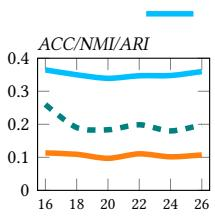  
(a) ENZYMES

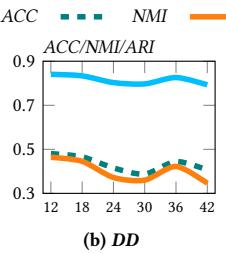

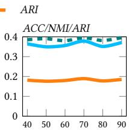  
Figure 5: Varying �  
(c) REDDIT-12K

## 6.4 Hyperparameter Analysis

We investi<sub>g</sub>ate the sensitivit<sub>y</sub> of two <sub>p</sub>ivotal h<sub>yp</sub>er<sub>p</sub>arameters: the S<sub>p</sub>ectral Si<sub>g</sub>nature dimension <sub>�</sub> and the fused feature dimension �. As illustrated in Fi<sub>g</sub>. (5), the model demonstrates stron<sub>g</sub> robustness to variations in <sub>�,</sub> <sub>p</sub>articularl<sub>y</sub> on lar<sub>g</sub>e-scale datasets like REDDIT-12K. This corroborates our theoretical basis relying on the Hofman-Wielandt ine<sub>q</sub>ualit<sub>y</sub>: the to<sub>p</sub>-<sub>�</sub> ei<sub>g</sub>envalues sufice as a ri<sub>g</sub>orous lower bound for GED to ca<sub>p</sub>ture core <sub>g</sub>lobal to<sub>p</sub>olo<sub>gy</sub> without introducin<sub>g</sub> excessive noise. Re<sub>g</sub>ardin<sub>g</sub> � in Fi<sub>g</sub>. (6), the <sub>p</sub>erformance exhibits minimal fluctuation. This stabilit<sub>y</sub> is attributed to the JMPSR, which efectivel<sub>y</sub> filters multi-view redundanc<sub>y</sub>, ensurin<sub>g</sub> the learnin<sub>g</sub> of a com<sub>p</sub>act and consistent manifold re<sub>p</sub>resentation Y regardless of dimensional shifts.

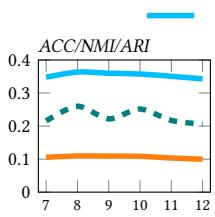  
(a) ENZYMES

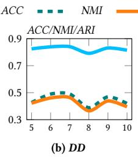  
Figure 6: Varying �

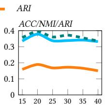  
(c) REDDIT-12K

## 6.5 Eficiency Analysis

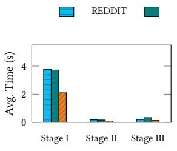  
(a) Runtime Analysis

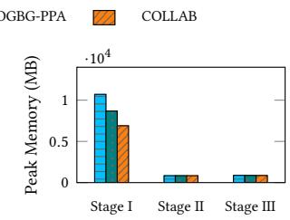  
(b) Memory Usage Analysis  
Figure 7: Eficiency analysis across training stages. (a) Average runtime per epoch. (b) Peak memory usage.

Fi<sub>g</sub>ure 7 <sub>p</sub>resents a detailed eficienc<sub>y</sub> anal<sub>y</sub>sis of S<sup>3</sup>GLC. S<sub>p</sub>ecificall<sub>y</sub>, Fi<sub>g</sub>. 7 (a) re<sub>p</sub>orts the avera<sub>g</sub>e runtime <sub>p</sub>er mini-batch in each e<sub>p</sub>och, while Fi<sub>g</sub>. 7 (b) records the <sub>g</sub>lobal <sub>p</sub>eak memor<sub>y</sub> usa<sub>g</sub>e durin<sub>g</sub> trainin<sub>g</sub> for each e<sub>p</sub>och. As illustrated, both JMPSR (Sta<sub>g</sub>e II) and Balanced clusterin<sub>g</sub> (Sta<sub>g</sub>e III) incur substantiall<sub>y</sub> lower time and memor<sub>y</sub> overheads than GIN encodin<sub>g</sub> (Sta<sub>g</sub>e I), demonstratin<sub>g</sub> th<sub>a</sub>t <sub>our core me</sub>th<sub>o</sub>d<sub>o</sub>l<sub>og</sub>i<sub>ca</sub>l <sub>en</sub>h<sub>ancemen</sub>t<sub>s</sub> i<sub>n</sub>t<sub>ro</sub>d<sub>uce neg</sub>li<sub>g</sub>ibl<sub>e</sub> com<sub>p</sub><sup>l</sup>ex<sup>i</sup>t<sub>y</sub>.

## 7 Conclusion

In this <sub>p</sub>a<sub>p</sub>er<sub>,</sub> to address the limited ex<sub>p</sub>ressi<sub>v</sub>it<sub>y</sub> of GINs in GLC and the clusterin<sub>g</sub> colla<sub>p</sub>se in multi-class settin<sub>g</sub>s<sub>,</sub> we <sub>p</sub>ro<sub>p</sub>ose $\mathsf { S } ^ { 3 } \mathsf { G L C }$ The method levera<sub>g</sub>es S<sub>p</sub>ectral Si<sub>g</sub>nature to ca<sub>p</sub>ture <sub>g</sub>lobal to<sub>p</sub>olo<sub>gy,</sub> <sub>p</sub>erforms JMPSR with feature fusion, and introduces a constraint t<sub>o ac</sub>hi<sub>eve</sub> b<sub>a</sub>l<sub>ance</sub>d <sub>c</sub>l<sub>us</sub>t<sub>er</sub>i<sub>ng.</sub> N<sub>ever</sub>th<sub>e</sub>l<sub>ess,</sub> th<sub>e curren</sub>t d<sub>es</sub>i<sub>gn</sub> is mainl<sub>y</sub> tailored to homo<sub>g</sub>eneous <sub>g</sub>ra<sub>p</sub>hs and is limited to static <sub>grap</sub>h <sub>s</sub>t<sub>ruc</sub>t<sub>ures.</sub> I<sub>n</sub> f<sub>u</sub>t<sub>ure</sub> <sub>wor</sub>k<sub>,</sub> <sub>we</sub> <sub>w</sub>ill <sub>ex</sub>t<sub>en</sub>d th<sub>e</sub> <sub>a</sub>l<sub>gor</sub>ith<sub>m</sub> t<sub>o</sub> th<sub>e</sub> <sub>ana</sub>l<sub>ys</sub>i<sub>s</sub> <sub>o</sub>f h<sub>e</sub>t<sub>erogeneous</sub> <sub>or</sub> d<sub>ynam</sub>i<sub>c</sub> <sub>grap</sub>h d<sub>a</sub>t<sub>a.</sub>

## References

[1] José María Ami<sub>g</sub>ó, Jor<sub>g</sub>e Gálvez, and Vincent M Villar. 2009. A review on molecular topology: applying graph theory to drug discovery and design. Naturwissenschaften 96, 7 (2009), 749–761.

[2] Tejaswini Ananthanara<sub>y</sub>ana, Li<sub>p</sub>isha Chaudhar<sub>y</sub>, and Ifeoma Nwo<sub>g</sub>u. 2022. Si<sub>g</sub>n-Net: Single Channel Sign Generation using Metric Embedded Learning. 2023 IEEE 17th International Conference on Automatic Face and Gesture Recognition (FG) (2022), 1–7. https://api.semanticscholar.org/CorpusID:254274967

[3] Yuki M Asano, Christian Ru<sub>pp</sub>recht, and Andrea Vedaldi. 2020. Self-labellin<sub>g</sub> via simultaneous clustering and representation learning. In International Conference on Learning Representations (ICLR). https://openreview.net/forum?id= B1<sub>es</sub>x6EY<sub>v</sub>r

[4] László Babai. 2016. Graph isomorphism in quasipolynomial time. In Proceedings ofthe forty-eighth annual ACM symposium on Theory ofComputing. 684–697.

[5] Yunshen<sub>g</sub> Bai, Hao Din<sub>g</sub>, Son<sub>g</sub> Bian, Tin<sub>g</sub> Chen, Yizhou Sun, and Wei Wan<sub>g</sub>. 2019. Sim<sub>g</sub>nn: A neural network a<sub>pp</sub>roach to fast <sub>g</sub>ra<sub>p</sub>h similarit<sub>y</sub> com<sub>p</sub>utation. In Proceedings ofthe twelfth ACM international conference on web search and data mining. 384–392.

[6] Mikhail Belkin and Partha Ni<sub>y</sub>o<sub>g</sub>i. 2003. La<sub>p</sub>lacian ei<sub>g</sub>enma<sub>p</sub>s for dimensionalit<sub>y</sub> reduction and data representation. Neural computation 15, 6 (2003), 1373–1396.

[7] Pietro Bon<sub>g</sub>ini, Monica Bianchini, and Franco Scarselli. 2021. Molecular <sub>g</sub>enerative graph neural networks for drug discovery. Neurocomputing 450 (2021), 242–252.

[8] Karsten M. Bor<sub>g</sub>wardt and Hans-Peter Krie<sub>g</sub>el. 2005. Shortest-<sub>p</sub>ath kernels on graphs. Fifth IEEE International Conference on Data Mining (ICDM’05) (2005), 8 <sub>pp</sub>.–. htt<sub>p</sub>s://a<sub>p</sub>i.semanticscholar.or<sub>g</sub>/Cor<sub>p</sub>usID:1550330

[9] Karsten M. Bor<sub>g</sub>wardt, Chen<sub>g</sub> Soon On<sub>g</sub>, Stefan Schönauer, S. V. N. Vish-<sub>wa</sub>n<sub>a</sub>th<sub>a</sub>n<sub>,</sub> Al<sub>e</sub>x Sm<sub>o</sub>l<sub>a,</sub> <sub>a</sub>nd H<sub>a</sub>n<sub>s</sub>-P<sub>e</sub>t<sub>e</sub>r Kri<sub>ege</sub>l<sub>.</sub> 2005<sub>.</sub> Pr<sub>o</sub>t<sub>e</sub>in f<sub>u</sub>n<sub>c</sub>ti<sub>o</sub>n <sub>p</sub>r<sub>e</sub>- diction via graph kernels. Bioinformatics 21 Suppl 1 (2005), i47–56. https: //a<sub>p</sub>i.semanticscholar.or<sub>g</sub>/Cor<sub>p</sub>usID:8174592

[10] Horst Bunke. 1997. On a relation between <sub>g</sub>ra<sub>p</sub>h edit distance and maximum common subgraph. Pattern Recognition Letters 18, 8 (1997), 689–694.

[11] Jin<sub>y</sub>u Cai, Yi Han, Wenzhon<sub>g</sub> Guo, and Jicon<sub>g</sub> Fan. 2023. Dee<sub>p g</sub>ra<sub>p</sub>h-level clusterin<sub>g</sub> usin<sub>g p</sub>seudo-label-<sub>g</sub>uided mutual information maximization net work. Neural Computing and Applications 36 (2023), 9551 – 9566. https: //a<sub>p</sub>i.semanticscholar.or<sub>g</sub>/Cor<sub>p</sub>usID:256615801

[12] Jin<sub>y</sub>u Cai, Yunhe Zhan<sub>g</sub>, Jicon<sub>g</sub> Fan, Yali Du, and Wenzhon<sub>g</sub> Guo. 2024. Dual C<sub>o</sub>ntr<sub>as</sub>ti<sub>ve</sub> Gr<sub>ap</sub>h-L<sub>eve</sub>l Cl<sub>us</sub>t<sub>e</sub>rin<sub>g w</sub>ith M<sub>u</sub>lti<sub>p</sub>l<sub>e</sub> Cl<sub>us</sub>t<sub>e</sub>r P<sub>e</sub>r<sub>spec</sub>ti<sub>ves</sub> Ali<sub>g</sub>n ment. In International Joint Conference on Artificial Intelligence. https://api. semanticscholar.or /Cor <sub>u</sub>sID:271508056

[13] Mathilde Caron, Piotr Bojanowski, Armand Joulin, and Matthijs Douze. 2018. Deep clustering for unsupervised learning of visual features. In Proceedings of the European Conference on Computer Vision (ECCV). 132–149.

[14] Manshen<sub>g</sub> Chen, Pei-Yuan Lai, De-Zhan<sub>g</sub> Liao, Chan<sub>g</sub>don<sub>g</sub> Wan<sub>g</sub>, and Jian Huang Lai. 2025. Graph Prompt Clustering. IEEE Transactions on Pattern Analysis and Machine Intelligence 47 (2025), 5794–5805. https://api.semanticscholar.org Cor usID:277189865

[15] Tin<sub>g</sub> Chen, Simon Kornblith, Mohammad Norouzi, and Geofre<sub>y</sub> Hinton. 2020. A sim le framework for contrastive learnin of visual re resentations. In International conference on machine learning. PmLR, 1597–1607.

[16] Guan<sub>y</sub>i Chu, Xiao Wan<sub>g</sub>, Chuan Shi, and Xun<sub>q</sub>ian<sub>g</sub> Jian<sub>g</sub>. 2021. CuCo: Gra<sub>p</sub>h Representation with Curriculum Contrastive Learning. In International Joint Conference on Artificial Intelligence. htt s://a i.semanticscholar.or /Cor usID: 235671564

[17] Marco Cuturi. 2013. Sinkhorn distances: Li<sub>g</sub>hts<sub>p</sub>eed com<sub>p</sub>utation of o<sub>p</sub>timal transport. In Advances in Neural Information Processing Systems (NIPS), Vol. 26. 2292–2300.

[18] K<sub>y</sub> Fan. 1949. On a theorem of We<sub>y</sub>l concernin<sub>g</sub> ei<sub>g</sub>envalues of linear transformations I. Proceedings of the National Academy of Sciences 35, 11 (1949), 652–655.

[19] Stefan Fankhauser, Kas<sub>p</sub>ar Riesen, and Horst Bunke. 2011. S<sub>p</sub>eedin<sub>g</sub> u<sub>p</sub> <sub>g</sub>ra<sub>p</sub>h edit distance computation through fast bipartite matching. In International Workshop on Graph-Based Representations in Pattern Recognition. Springer, 102–111.

[20] Thomas Gärtner, Peter Flach, and Stefan Wrobel. 2003. On <sub>g</sub>ra<sub>p</sub>h kernels: Hardness results and eficient alternatives. In Learning theory and kernel machines: 16th annual conference on learning theory and 7th kernel workshop, COLT/kernel 2003, washington, DC, USA, August 24-27, 2003. proceedings. Springer, 129–143.

[21] Renda Han, Wenxuan Tu, Junlon<sub>g</sub> Wu, Wenxin Zhan<sub>g</sub>, Jin<sub>g</sub>xin Liu, Haotian Wang, Jieren Cheng, Huajie Lei, Guangzhen Yao, Lingren Wang, Mengfei Li, and Yu Li. 2025. Dual Boost-Driven Graph-Level Clustering Network. 2025 International Joint Conference on Neural Networks (IJCNN) (2025), 1–8. https: //<sup>d</sup>oi.org/10.1109/ijcnn64981.2025.11228488

[22] Renda Han, Guan<sub>g</sub>zhen Yao, Wenxin Zhan<sub>g</sub>, Yu Li, Wen Xin, Huajie Lei, Men<sub>g</sub>fei Li<sub>,</sub> Z<sub>e u</sub> Zh<sub>an , an</sub>d Y<sub>a</sub>h<sub>e</sub> Ti<sub>an.</sub> 2025<sub>.</sub> M<sub>u</sub>lti<sub>-</sub>R<sub>e</sub>l<sub>a</sub>ti<sub>on</sub> G<sub>ra</sub> h<sub>-</sub>K<sub>erne</sub>l St<sub>ren</sub> th<sub>en</sub> Network for Graph-Level Clustering. 2025 International Joint Conference on Neural Networks (IJCNN) (2025), 1–8. https://doi.org/10.1109/ijcnn64981.2025. 11227596

[23] Kaveh Hassani and Amir Hosein Khas Ahmadi. 2020. Contrastive Multi-View Re resentation Learnin on Gra hs. In International Conference on Machine Learning. https://api.semanticscholar.org/CorpusID:219558740

[24] Alan J Hofman, Helmut W Wielandt, et al. 1953. The variation of the s<sub>p</sub>ectrum of a normal matrix. Duke Math. J 20, 1 (1953), 37–39

[25] Chen<sub>p</sub>in<sub>g</sub> Hou, Fei<sub>p</sub>in<sub>g</sub> Nie, Xuelon<sub>g</sub> Li, Don<sub>g</sub> <sub>y</sub>un Yi, and Yi Wu. 2014. Joint Embeddin<sub>g</sub> Learnin<sub>g</sub> and S<sub>p</sub>arse Re<sub>g</sub>ression: A Framework for Unsu<sub>p</sub>ervised Feature Selection. IEEE Transactions on Cybernetics 44 (2014), 793–804. https: //a<sub>p</sub>i.semanticscholar.or<sub>g</sub>/Cor<sub>p</sub>usID:15474528

[26] Weihua Hu, Bowen Liu, Jose<sub>p</sub>h Gomes, Marinka Zitnik, Perc<sub>y</sub> Lian<sub>g</sub>, Vija<sub>y</sub> S. Pande, and Jure Leskovec. 2019. Strate<sub>g</sub>ies for Pre-trainin<sub>g</sub> Gra<sub>p</sub>h Neural Networks. arXiv: Learning (2019). https://api.semanticscholar.org/CorpusID: 213085920

[27] Akihiro Inokuchi, Takashi Washio, and Hiroshi Motoda. 2000. An A<sub>p</sub>riori-Based Algorithm for Mining Frequent Substructures from Graph Data. In European Conference on Principles ofData Mining and Knowledge Discovery. https://api. semanticscholar.or /Cor <sub>u</sub>sID:7847517

[28] Fredrik D. Johansson, Vinay Jethava, Devdatt P. Dubhashi, and Chiranjib Bhattacharyya. 2014. Global graph kernels using geometric embeddings. In International Conference on Machine Learning. https://api.semanticscholar.org/ Cor usID:6718308

[29] Simon Jones and Eamonn O’Neill. 2010. Feasibilit<sub>y</sub> of structural network clustering for group-based privacy control in social networks. In proceedings ofthe sixth symposium on usable privacy and security. 1–13.

[30] Wei Ju, Yi<sub>y</sub>an<sub>g</sub> Gu, Bin<sub>q</sub>i Chen, Gon<sub>g</sub>bo Sun, Yifan<sub>g</sub> Qin, Xin<sub>g</sub> Liu, Xiao Luo, <sub>a</sub>nd Min<sub>g</sub> Zh<sub>a</sub>n<sub>g.</sub> 2022<sub>.</sub> GLCC: A G<sub>e</sub>n<sub>e</sub>r<sub>a</sub>l Fr<sub>a</sub>m<sub>ewo</sub>rk f<sub>o</sub>r Gr<sub>ap</sub>h-l<sub>eve</sub>l Cl<sub>us</sub>t<sub>e</sub>rin<sub>g.</sub> In AAAI Conference on Artificial Intelligence. https://api.semanticscholar.org/ Cor usID:253080427

[31] Wei Ju, Yi<sub>y</sub>an<sub>g</sub> Gu, Xiao Luo, Yifan Wan<sub>g</sub>, Haochen Yuan, Huason<sub>g</sub> Zhon<sub>g</sub>, and Min<sub>g</sub> Zhan<sub>g</sub>. 2023. Unsu<sub>p</sub>ervised <sub>g</sub>ra<sub>p</sub>h-level re<sub>p</sub>resentation learnin<sub>g</sub> with hierarchical contrasts. Neural networks : the oficial journal ofthe International Neural Network Society 158 (2023), 359–368. https://doi.org/10.1016/j.neunet. 2022.11.019

[32] Sofia Ira Ktena, Sarah Parisot, Enzo Ferrante, Martin Rajchl, Matthew Lee, Ben Glocker<sub>,</sub> and Daniel Rueckert. 2017. Distance metric learnin<sub>g</sub> usin<sub>g</sub> <sub>g</sub>ra<sub>p</sub>h convolutional networks: Application to functional brain networks. In International conference on medical image computing and computer-assisted intervention. Springer, 469–477.

[33] Sofia Ira Ktena, Sarah Parisot, Enzo Ferrante, Martin Rajchl, Matthew Lee, Ben Glocker<sub>,</sub> and Daniel Rueckert. 2018. Metric learnin<sub>g</sub> with s<sub>p</sub>ectral <sub>g</sub>ra<sub>p</sub>h convolutions on brain connectivity networks. NeuroImage 169 (2018), 431–442.

[34] Richard B Lehouc<sub>q</sub> and Dann<sub>y</sub> C Sorensen. 1996. Deflation techni<sub>q</sub>ues for an implicitly restarted Arnoldi iteration. SIAM J. Matrix Anal. Appl. 17, 4 (1996), 789–821.

[35] Andrei Leman and Boris Weisfeiler. 1968. A reduction of a <sub>g</sub>ra<sub>p</sub>h to a canonical form and an algebra arising during this reduction. Nauchno-Technicheskaya Informatsiya 2, 9 (1968), 12–16.

[36] Ze<sub>y</sub>i Li, Renda Han, Tian<sub>y</sub>u Hu, Men<sub>g</sub>fei Li, and Caimao Li. 2025. Multi-View Enhancement Graph-Level Clustering Network. IEEE Access 13 (2025), 47996– 48006. htt s://doi.or /10.1109/access.2025.3550185

[37] Zhipeng Li, Si-Guo Wang, Qinhu Zhang, Yi-Jie Pan, Naian Xiao, Jia-Yang Guo, Chan<sub>g</sub>-An Yuan, Wen-Jian Liu, and De-Shuan<sub>g</sub> Huan<sub>g</sub>. 2024. Gra<sub>p</sub>h <sub>p</sub>oolin<sub>g</sub> for graph-level representation learning: a survey. Artificial Intelligence Review 58 (2024). htt<sub>p</sub>s://a<sub>p</sub>i.semanticscholar.or<sub>g</sub>/Cor<sub>p</sub>usID:274944366

[38] Zhi-Peng Li, Si-Guo Wang, Qin-Hu Zhang, Yi-Jie Pan, Nai-An Xiao, Jia-Yang Guo, Chan<sub>g</sub>-An Yuan, Wen-Jian Liu, and De-Shuan<sub>g</sub> Huan<sub>g</sub>. 2024. Gra<sub>p</sub>h <sub>p</sub>oolin<sub>g</sub> for graph-level representation learning: a survey. Artificial Intelligence Review 58, 2 (2024), 45.

[39] Yixin Liu, Yu Zhen<sub>g</sub>, Daokun Zhan<sub>g</sub>, Hon<sub>g</sub>xu Chen, Hao Pen<sub>g</sub>, and Shirui Pan. 2022. Towards Unsupervised Deep Graph Structure Learning. Proceedings ofthe ACM Web Conference 2022 (2022). htt s://doi.or /10.1145/3485447.3512186

[40] Ziwen Liu, Chen<sub>g</sub>uan<sub>g</sub> Wan<sub>g</sub>, Con<sub>gy</sub>in<sub>g</sub> Han, and Tiande Guo. 2021. Learnin<sub>g</sub> <sub>g</sub>ra<sub>p</sub>h re<sub>p</sub>resentation b<sub>y</sub> a<sub>gg</sub>re<sub>g</sub>atin<sub>g</sub> sub<sub>g</sub>ra<sub>p</sub>hs via mutual information maximization. Neurocomputing 548 (2021), 126392. htt s://doi.or /10.1016/j.neucom. 2023.126392

[41] Zi<sub>y</sub>an<sub>g</sub> Liu, Chaokun Wan<sub>g</sub>, Yunkai Lou, and Hao Fen<sub>g</sub>. 2023. Fast Unsu<sub>p</sub>ervised Gra h Embeddin via Gra h Zoom Learnin . In 2023 IEEE 39th International Conference on Data Engineering (ICDE). 2551–2564. https://doi.org/10.1109/ ICDE55515.2023.00196

[42] Xiao Luo, Wei Ju, Yi<sub>y</sub>an<sub>g</sub> Gu, Zhen<sub>gy</sub>an Mao, Luchen Liu, Yuhui Yuan, and Min<sub>g</sub> Zhan<sub>g</sub>. 2023. Self-su<sub>p</sub>ervised Gra<sub>p</sub>h-level Re<sub>p</sub>resentation Learnin<sub>g</sub> with Adversarial Contrastive Learning. ACM Transactions on Knowledge Discovery from Data 18 (2023), 1 – 23. https://doi.org/10.1145/3624018

[43] Pierre Mahé, Nobuhisa Ueda, Tatsu<sub>y</sub>a Akutsu, Jean-Luc Perret, and Jean-Phili<sub>pp</sub>e Vert. 2004. Extensions of marginalized graph kernels. Proceedings of the twenty-first international conference on Machine learning (2004). https://api. semanticscholar.or<sub>g</sub>/Cor<sub>p</sub>usID:18350669

[44] Giovanna Menardi and Domenico De Stefano. 2022. Densit<sub>y</sub>-based clusterin<sub>g</sub> of social networks. Journal ofthe Royal Statistical Society Series A: Statistics in Society 185, 3 (2022), 1004–1029.

[45] Christo<sub>p</sub>her Morris, Nils M. Krie<sub>g</sub>e, Franka Bause, Kristian Kerstin<sub>g</sub>, Petra Mutzel, <sub>an</sub>d M<sub>ar</sub>i<sub>on</sub> N<sub>eumann.</sub> 2020<sub>.</sub> TUD<sub>a</sub>t<sub>ase</sub>t<sub>:</sub> A <sub>co</sub>ll<sub>ec</sub>ti<sub>on o</sub>f b<sub>enc</sub>h<sub>mar</sub>k d<sub>a</sub>t<sub>ase</sub>t<sub>s</sub> f<sub>or</sub> learning with graphs. ArXiv abs/2007.08663 (2020). https://api.semanticscholar. or<sub>g</sub>/Cor<sub>p</sub>usID:220633407

[46] Zhen Pen<sub>g</sub>, Wenbin<sub>g</sub> Huan<sub>g</sub>, Minnan Luo, Q. Zhen<sub>g</sub>, Yu Ron<sub>g</sub>, Tin<sub>gy</sub>an<sub>g</sub> Xu, and Junzhou Huan<sub>g</sub>. 2020. Gra<sub>p</sub>h Re<sub>p</sub>resentation Learnin<sub>g</sub> via Gra<sub>p</sub>hical Mutual Information Maximization. Proceedings of The Web Conference 2020 (2020). https: //doi.or<sub>g</sub>/10.1145/3366423.3380112

[47] Patrick Rubin-Delanchy. 2020. Manifold structure in graph embeddings. ArXiv abs/2006.05168 (2020). htt<sub>p</sub>s://a<sub>p</sub>i.semanticscholar.or<sub>g</sub>/Cor<sub>p</sub>usID:219558619

[48] Alberto Sanfeliu and Kin<sub>g</sub>-Sun Fu. 1983. A distance measure between attributed relational graphs for pattern recognition. IEEE transactions on systems, man, and cybernetics 3 (1983), 353–362.

[49] Claude E Shannon. 1948. A mathematical theory of communication. The Bell System Technical Journal 27, 3 (1948), 379–423.

[50] Nino Shervashidze, Pascal Schweitzer, Erik Jan van Leeuwen, Kurt Mehlhorn, and Karsten M. Borgwardt. 2011. Weisfeiler-Lehman Graph Kernels. J. Mach. Learn. Res. 12 (2011), 2539–2561. https://api.semanticscholar.org/CorpusID:1797579

[51] Nino Shervashidze, S. V. N. Vishwanathan, Tobias Petri, Kurt Mehlhorn, and Karsten M. Bor<sub>g</sub>wardt. 2009. Eficient <sub>g</sub>ra<sub>p</sub>hlet kernels for lar<sub>g</sub>e <sub>g</sub>ra<sub>p</sub>h com<sub>p</sub>arison. In International Conference on Artificial Intelligence and Statistics. https: //a i.semanticscholar.or /Cor usID:17557614

[52] Gen Shi, Yifan Zhu,Jian K. Liu, and Xia Li. 2023. HeGCL: Advance Self-Su<sub>p</sub>ervised Learning in Heterogeneous Graph-Level Representation. IEEE Transactions on Neural Networks and Learning Systems 35 (2023), 13914–13925. https://doi.org/ 10 1109/t l 2023 3273255

[53] Fan-Yun Sun, Jordan Hofmann, and Jian Tan . 2019. InfoGra h: Unsu ervised <sub>a</sub>nd S<sub>e</sub>mi-<sub>su e</sub>r<sub>v</sub>i<sub>se</sub>d Gr<sub>a</sub> h-L<sub>eve</sub>l R<sub>e</sub> r<sub>ese</sub>nt<sub>a</sub>ti<sub>o</sub>n L<sub>ea</sub>rnin<sub>g v</sub>i<sub>a</sub> M<sub>u</sub>t<sub>ua</sub>l Inf<sub>o</sub>rm<sub>a</sub> tion Maximization. ArXiv abs/1908.01000 (2019). https://api.semanticscholar. or<sub>g</sub>/Cor<sub>p</sub>usID:199441876

[54] Xuechen<sub>g</sub> Sun, Zon<sub>g</sub>hui Wan<sub>g</sub>, Zhemin<sub>g</sub> Lu, and Zi<sub>q</sub>ian Lu. 2024. Self-su<sub>p</sub>ervised graph representations with generative adversarial learning. Neurocomputing 592 (2024), 127786. htt<sub>p</sub>s://doi.or<sub>g</sub>/10.1016/j.neucom.2024.127786

[55] Damian Szklarcz<sub>y</sub>k, Annika L. Gable, David L<sub>y</sub>on, AlexanderJun<sub>g</sub>e, Stefan W<sub>y</sub>der, Jaime Huerta-Ce<sub>p</sub>as, Milan Simonovic, Nadezhda T. Doncheva, John H. Morris, Peer Bork, Lars Juhl Jensen, and Christian von Merin<sub>g</sub>. 2018. STRING v11: <sub>p</sub>rotein–<sub>p</sub>rotein association networks with increased covera<sub>g</sub>e<sub>,</sub> su<sub>pp</sub>ortin<sub>g</sub> functional discovery in genome-wide experimental datasets. Nucleic Acids Research 47 (2018), D607 – D613. htt<sub>p</sub>s://a<sub>p</sub>i.semanticscholar.or<sub>g</sub>/Cor<sub>p</sub>usID:53751796

[56] Ichi<sub>g</sub>aku Taki<sub>g</sub>awa and Hiroshi Mamitsuka. 2013. Gra<sub>p</sub>h minin<sub>g</sub>: <sub>p</sub>rocedure, application to drug discovery and recent advances. Drug discovery today 18, 1-2 (2013), 50–57.

[57] Rita Váz<sub>q</sub>uez, Avenilde Romo, Rebeca Romo-Váz<sub>q</sub>uez, and María Tri<sub>g</sub>ueros. 2016. L<sub>a separac</sub>ió<sub>n c</sub>i<sub>ega</sub> d<sub>e</sub> f<sub>uen</sub>t<sub>es: un puen</sub>t<sub>e en</sub>t<sub>re e</sub>l ál<sub>ge</sub>b<sub>ra</sub> li<sub>nea</sub>l <sub>y e</sub>l <sub>an</sub>áli<sub>s</sub>i<sub>s</sub> d<sub>e</sub> señales. Educación matemática 28, 2 (2016), 31–57.

[58] Lian<sub>g</sub>tian Wan, Zhen<sub>q</sub>ian<sub>g</sub> Fu, Lu Sun, Xian<sub>p</sub>en<sub>g</sub> Wan<sub>g</sub>, Gan<sub>g</sub> Xu, Xiaoran Yan, and Fen<sub>g</sub> Xia. 2023. Self-Su<sub>p</sub>ervised Teachin<sub>g</sub> and Learnin<sub>g</sub> of Re<sub>p</sub>resentations on Graphs. Proceedings ofthe ACM Web Conference 2023 (2023). https://doi.org/ 10.1145/3543507.3583441

[59] Ren Wan<sub>g</sub>, Haolian<sub>g</sub> Sun, Yuxiu Lin, Chuanhui Zuo, Yon<sub>g</sub>shun Gon<sub>g</sub>, Yilon<sub>g</sub> Yin, an<sup>d</sup> Wenjia Meng. 2025. SeqMvRL: A Sequentia<sup>l</sup> Fusion Framewor<sup>k f</sup>or Multi-view Representation Learning. In Proceedings ofthe Computer Vision and Pattern Recognition Conference. 25822–25831.

[60] Shan<sub>gy</sub>ou Wan<sub>g</sub>, Zezhon<sub>g</sub> Din<sub>g</sub>, and Xike Xie. 2025. SamGoG: A Sam<sub>p</sub>lin<sub>g</sub>- B<sub>ase</sub>d G<sub>rap</sub>h<sub>-o</sub>f<sub>-</sub>G<sub>rap</sub>h<sub>s</sub> F<sub>ramewor</sub>k f<sub>or</sub> I<sub>m</sub>b<sub>a</sub>l<sub>ance</sub>d G<sub>rap</sub>h Cl<sub>ass</sub>ifi<sub>ca</sub>ti<sub>on.</sub> arXiv:2507.13741 [cs.LG] htt<sub>p</sub>s://arxiv.or<sub>g</sub>/abs/2507.13741

[61] Zon<sub>g</sub>han Wu, Shirui Pan, Fen<sub>g</sub>wen Chen, Guodon<sub>g</sub> Lon<sub>g</sub>, Chen<sub>gq</sub>i Zhan<sub>g</sub>, and Philip S. Yu. 2019. A Comprehensive Survey on Graph Neural Networks. IEEE Transactions on Neural Networks and Learning Systems 32 (2019), 4–24. https: //a<sub>p</sub>i.semanticscholar.or<sub>g</sub>/Cor<sub>p</sub>usID:57375753

[62] Jun<sub>y</sub>uan Xie, Ross Girshick, and Ali Farhadi. 2016. Unsu<sub>p</sub>ervised dee<sub>p</sub> embeddin<sub>g</sub> for clustering analysis. In International conference on machine learning. PMLR, 478–487.

[63] Binbin Xu, Jun Yin, and Nan Zhan<sub>g</sub>. 2024. Gra<sub>p</sub>h based Consistenc<sub>y</sub> Learnin<sub>g</sub> for Contrastive Multi-View Clustering. Proceedings of the 32nd ACM International Conference on Multimedia (2024). https://api.semanticscholar.org/CorpusID: 273643520

[64] Hon<sub>g</sub>ten<sub>g</sub> Xu, Jiachan<sub>g</sub> Liu, Dixin Luo, and Lawrence Carin. 2022. Re<sub>p</sub>resentin<sub>g</sub> Graphs via Gromov-Wasserstein Factorization. IEEE Transactions on Pattern Analysis and Machine Intelligence 45 (2022), 999–1016. https://api.semanticscholar. <sub>o</sub>r /C<sub>o</sub>r <sub>us</sub>ID:247083430

[65] Ke<sub>y</sub>ulu Xu, Weihua Hu, Jure Leskovec, and Stefanie Je<sub>g</sub>elka. 2018. How Powerful are Graph Neural Networks? ArXiv abs/1810.00826 (2018). https: //a<sub>p</sub>i.semanticscholar.or<sub>g</sub>/Cor<sub>p</sub>usID:52895589

[66] Min<sub>g</sub>hao Xu, Han<sub>g</sub> Wan<sub>g</sub>, Bin<sub>g</sub>bin<sub>g</sub> Ni, Hon<sub>gy</sub>u Guo, and Jian Tan<sub>g</sub>. 2021. Selfs<sub>up</sub>ervised Gra<sub>p</sub>h-level Re<sub>p</sub>resentation Learnin<sub>g</sub> with Local and Global Str<sub>u</sub>ct<sub>u</sub>re. ArXiv abs/2106.04113 (2021).

[67] Xiaowei Xu, Nurcan Yuruk, Zhidan Fen<sub>g</sub>, and Thomas AJ Schwei<sub>g</sub>er. 2007. Scan: a structural clustering algorithm for networks. In Proceedings of the 13th ACM SIGKDD international conference on Knowledge discovery and data mining. 824– 833.

[68] Yuhua Xu, Junli Wang, Mingjian Guang, Chungang Yan, and Changjun Jiang. 2024. Graph contrastive learning with min-max mutual information. Inf. Sci. 665 (2024), 120378. htt<sub>p</sub>s://doi.or<sub>g</sub>/10.1016/j.ins.2024.120378

[69] Pinar Yanardag and S. V. N. Vishwanathan. 2015. Deep Graph Kernels. Proceedings of the 21th ACM SIGKDD International Conference on Knowledge Discovery and Data Mining (2015). https://api.semanticscholar.org/CorpusID:207227372

[70] Jinbin Yang, Jinyu Cai, Yunhe Zhang, Sujia Huang, and Shiping Wang. 2025. Towards Adaptive Masked Structural Learning for Graph-Level Clustering. IEEE Transactions on Network Science and Engineering 12 (2025), 2021–2032. https: //doi.or /10.1109/tnse.2025.3543194

[71] Yinin<sub>g</sub> Yan<sub>g</sub>, Ke Xu, and Yin<sub>g</sub> Tan<sub>g</sub>. 2024. GAN-based self-su<sub>p</sub>ervised messa<sub>g</sub>e passing graph representation learning. Expert Syst. Appl. 251 (2024), 124012. <sup>h</sup>ttps://<sup>d</sup>oi.org/10.1016/j.eswa.2024.124012

[72] Zhenyu Yang, Ge Zhang, Jia Wu, Jian Yang, Quan Z Sheng, Shan Xue, Chuan Zhou<sub>,</sub> Charu A<sub>gg</sub>arwal<sub>,</sub> Hao Pen<sub>g,</sub> Wenbin Hu<sub>,</sub> et al. 2024. State of the art and potentialities of graph-level learning. Comput. Surveys 57, 2 (2024), 1–40.

[73] Yunin<sub>g</sub> You, Tianlon<sub>g</sub> Chen, Yon<sub>g</sub>duo Sui, Tin<sub>g</sub> Chen, Zhan<sub>gy</sub>an<sub>g</sub> Wan<sub>g</sub>, and Yang Shen. 2020. Graph Contrastive Learning with Augmentations. ArXiv abs/2010.13902 (2020). htt<sub>p</sub>s://a<sub>p</sub>i.semanticscholar.or<sub>g</sub>/Cor<sub>p</sub>usID:225076220

[74] Zhi<sub>p</sub>in<sub>g</sub> Zen<sub>g</sub>, Anthon<sub>y</sub> KH Tun<sub>g</sub>, Jian<sub>y</sub>on<sub>g</sub> Wan<sub>g</sub>, Jianhua Fen<sub>g</sub>, and Lizhu Zhou. 2009. Comparing stars: On approximating graph edit distance. Proceedings ofthe VLDB Endowment 2, 1 (2009), 25–36.

[75] Min<sub>g</sub>da Zhan<sub>g</sub>, Chun-Te Chu, Andre<sub>y</sub> Zhmo<sub>g</sub>inov, Andrew G. Howard, Brendan Jou, Yukun Zhu, Li Zhan<sub>g</sub>, Rebecca Hwa, and Adriana Kovashka. 2021. BasisNet: Two-stage Model Synthesis for Eficient Inference. 2021 IEEE/CVF Conference on Computer Vision and Pattern Recognition Workshops (CVPRW) (2021), 3075–3084. htt<sub>p</sub>s://a<sub>p</sub>i.semanticscholar.or<sub>g</sub>/Cor<sub>p</sub>usID:234094277

[76] Sheng Zhou, Hongjia Xu, Zhuonan Zheng, Jiawei Chen, Zhao Li, Jiajun Bu, Jia W<sub>u,</sub> Xin W<sub>a</sub>n<sub>g,</sub> W<sub>e</sub>n<sub>wu</sub> Zh<sub>u,</sub> <sub>a</sub>nd M<sub>a</sub>rtin E<sub>s</sub>t<sub>e</sub>r<sub>.</sub> 2024<sub>.</sub> A <sub>co</sub>m<sub>p</sub>r<sub>e</sub>h<sub>e</sub>n<sub>s</sub>i<sub>ve</sub> <sub>su</sub>r<sub>vey</sub> <sub>o</sub>n deep clustering: Taxonomy, challenges, and future directions. Comput. Surveys 57, 3 (2024), 1–38.

[77] Wei Zhuo and Guan<sub>g</sub> Tan. 2022. Eficient <sub>g</sub>ra<sub>p</sub>h similarit<sub>y</sub> com<sub>p</sub>utation with alignment regularization. Advances in Neural Information Processing Systems 35 (2022), 30181–30193.

## A Theoretical Proofs

## A.1 Proof of Theorem 4.1

Proof. O<sub>u</sub>r <sub>g</sub>oal is to <sub>p</sub>rove that for an<sub>y</sub> iteration �<sub>,</sub> if two nodes <sub>�</sub> <sub>an</sub>d <sub>�</sub> h<sub>ave</sub> th<sub>e</sub> <sub>same</sub> WL l<sub>a</sub>b<sub>e</sub>l<sub>,</sub> i<sub>.e.,</sub> $l _ { u } ^ { ( b ) } = l _ { v } ^ { ( b ) }$ <sub>,</sub> th<sub>en</sub> th<sub>ey mus</sub>t also ha<sub>v</sub>e the same GINs node re<sub>p</sub>resentation<sub>,</sub> i.e.<sub>,</sub> $\mathbf { h } _ { u } ^ { ( b ) } = \mathbf { h } _ { v } ^ { ( b ) }$

• (�=0) We initialize $l _ { u } ^ { ( 0 ) } = l _ { v } ^ { ( 0 ) }$ <sub>an</sub>d $\mathbf { h } _ { u } ^ { ( 0 ) } = \mathbf { h } _ { v } ^ { ( 0 ) }$ • (�-1) In the �-1 ste<sub>p</sub> in 1-WL test, if $l _ { u } ^ { ( b - 1 ) } = l _ { v } ^ { ( b - 1 ) }$ h<sub>o</sub>ld<sub>s,</sub> th<sub>en</sub> $\dot { \mathbf { h } } _ { u } ^ { ( b - 1 ) } = \mathbf { h } _ { v } ^ { ( b - 1 ) }$ <sub>a</sub>l<sub>so</sub> h<sub>o</sub>ld<sub>s.</sub>

• (�) At iteration �, if two nodes � and � have the same label ( $\dot { l } _ { u } ^ { ( \dot { b } ) } = l _ { v } ^ { ( b ) } )$ <sub>,</sub> it im<sub>p</sub>lies that their labels at the <sub>p</sub>revious iteration <sub>we</sub>r<sub>e</sub> id<sub>e</sub>nti<sub>ca</sub>l i<sub>.e.</sub> $\dot { l } _ { u } ^ { ( b - 1 ) } = l _ { v } ^ { ( b - 1 ) }$ <sub>,</sub> <sub>an</sub>d th<sub>e</sub> <sub>mu</sub>lti<sub>se</sub>t<sub>s</sub> <sub>o</sub>f th<sub>e</sub>i<sub>r</sub> <sub>ne</sub>i<sub>g</sub>h<sub>-</sub> b<sub>ors</sub>’ l<sub>a</sub>b<sub>e</sub>l<sub>s</sub> f<sub>rom</sub> th<sub>e prev</sub>i<sub>ous</sub> it<sub>era</sub>ti<sub>on,</sub> i<sub>.e.</sub> $l _ { x } ^ { ( b - 1 ) } , x \in N ( u )$ <sub>an</sub>d $l _ { y } ^ { ( b - 1 ) } , y \in N ( v )$ <sub>, were a</sub>l<sub>so</sub> id<sub>en</sub>ti<sub>ca</sub>l<sub>.</sub> I<sub>n</sub> th<sub>a</sub>t <sub>case, we can</sub> d<sub>e</sub>d<sub>uce</sub> th<sub>a</sub>t $\begin{array} { r } { \sum _ { x \in N ( u ) } \mathbf { h } _ { x } ^ { ( b - 1 ) } = \sum _ { y \in N ( v ) } \mathbf { h } _ { y } ^ { ( b - 1 ) } } \end{array}$ <sub>,</sub> accordin<sub>g</sub> to E<sub>q</sub>. 3<sub>,</sub> we h<sub>ave</sub> $\mathbf { h } _ { u } ^ { ( b ) } = \mathbf { h } _ { v } ^ { ( b ) }$

Wh<sub>en</sub> <sub>a</sub>ll <sub>no</sub>d<sub>e</sub> <sub>represen</sub>t<sub>a</sub>ti<sub>ons</sub> i<sub>n</sub> t<sub>wo</sub> <sub>grap</sub>h<sub>s</sub> <sub>are</sub> id<sub>en</sub>ti<sub>ca</sub>l<sub>,</sub> th<sub>e</sub> S<sub>p</sub>atial Re<sub>p</sub>resentation is also identical. In concl<sub>u</sub>sion<sub>,</sub> if a <sub>p</sub>air of <sub>g</sub>ra<sub>p</sub>hs cannot be identical b<sub>y</sub> 1-WL test<sub>,</sub> it also cannot be identical b<sub>y</sub> th<sub>e</sub> GIN<sub>s mo</sub>d<sub>e</sub>l<sub>.</sub> □

## A.2 Proof of Lemma 4.2

Proof. �(�) was defined in §3.2.

(Suficienc<sub>y</sub>): Assume ${ \mathcal { G } } _ { i } \ \cong \ { \mathcal { G } } _ { j }$ <sub>w</sub>ith isomor<sub>p</sub>hism $\phi .$ Let $\Upsilon _ { \phi } ~ =$ $\{ u \to \phi ( u ) \mid u \in \mathcal { V } _ { i } \}$

$$
\mathcal { G } _ { i } \cong \mathcal { G } _ { j } \implies C ( \Upsilon _ { \phi } ) = \sum _ { e \in \Upsilon _ { \phi } } c ( e ) = 0 .\tag{23}
$$

$$
\therefore 0 \leq \operatorname* { g e d } ( \mathcal { G } _ { i } , \mathcal { G } _ { j } ) \leq C ( \Upsilon _ { \phi } ) = 0 \implies \operatorname* { g e d } ( \mathcal { G } _ { i } , \mathcal { G } _ { j } ) = 0 .
$$

(Necessit<sub>y</sub>): Assume $\operatorname* { g e d } ( \mathcal { G } _ { i } , \mathcal { G } _ { j } ) = 0$ with o<sub>p</sub>timal <sub>p</sub>ath $\Upsilon ^ { * }$ . Let $\mathcal { E } _ { s t r }$ be the set of insertion/deletion o<sub>p</sub>erations.

$$
\sum _ { e \in \Upsilon ^ { * } } c ( e ) = 0 \wedge c ( { \mathcal E } _ { s t r } ) > 0 \implies \Upsilon ^ { * } \cap { \mathcal E } _ { s t r } = \emptyset \implies | \mathcal V _ { i } | = | \mathcal V _ { j } | .
$$

Th<sub>us,</sub> $\phi : \mathcal { V } _ { i }  \mathcal { V } _ { j } \implies \mathcal { G } _ { i } \cong \mathcal { G } _ { j }$

## A.3 Proof of Lemma 5.1

Proof. A permutation matrix P is by definition an orthogonal matrix<sub>,</sub> satisf<sub>y</sub>in<sub>g</sub> $\mathbf { P } ^ { \top } = \mathbf { P } ^ { - 1 }$ <sub>. consequen</sub>tl<sub>y,</sub> th<sub>e</sub> t<sub>rans</sub>f<sub>orma</sub>ti<sub>on o</sub>f t<sup>h</sup>e a<sup>d</sup>jacency matrix un<sup>d</sup>er no<sup>d</sup>e permutation can <sup>b</sup>e rewritten as <sub>a s</sub>imil<sub>a</sub>rit<sub>y</sub> tr<sub>a</sub>n<sub>s</sub>f<sub>o</sub>rm<sub>a</sub>ti<sub>o</sub>n:

$$
\tilde { \mathbf { A } } = \mathbf { P A } \mathbf { P } ^ { \top } = \mathbf { P A } \mathbf { P } ^ { - 1 } .\tag{24}
$$

In linear al<sub>g</sub>ebra<sub>,</sub> similar matrices share the same characteristic polynomial . We derive the characteristic polynomial of A<sup>˜</sup> as foll<sub>ows:</sub>

$$
\begin{array} { l } { \operatorname* { d e t } ( \lambda \mathbf { I } - \tilde { \mathbf { A } } ) = \operatorname* { d e t } ( \lambda \mathbf { I } - \mathbf { P A } \mathbf { P } ^ { - 1 } ) } \\ { = \operatorname* { d e t } ( \mathbf { P } ( \lambda \mathbf { I } - \mathbf { A } ) \mathbf { P } ^ { - 1 } ) } \\ { = \operatorname* { d e t } ( \mathbf { P } ) \operatorname* { d e t } ( \lambda \mathbf { I } - \mathbf { A } ) \operatorname* { d e t } ( \mathbf { P } ^ { - 1 } ) } \\ { = \operatorname* { d e t } ( \lambda \mathbf { I } - \mathbf { A } ) . } \end{array}\tag{25}
$$

Since A and $\tilde { \mathbf { A } }$ have identical characteristic <sub>p</sub>ol<sub>y</sub>nomials<sub>,</sub> the<sub>y y</sub>ield th<sub>e exac</sub>t <sub>same se</sub>t <sub>o</sub>f <sub>e</sub>i<sub>genva</sub>l<sub>ues.</sub> Th<sub>us,</sub> $\lambda ( \mathbf { A } ) = \lambda ( \mathbf { P A P } ^ { \top } )$ <sup>f</sup>or an<sub>y</sub> $\mathbf { P } \in \Pi$ □

## A.4 Proof of Theorem 5.2

Proof. Let A and B be two real symmetric matrices with spectral decom<sub>p</sub>ositions $\mathbf { A } = \mathbf { U } \pmb { \Lambda } _ { A } \mathbf { U } ^ { \top }$ <sub>an</sub>d $\mathbf { B } \ = \ \mathbf { V } \pmb { \Lambda } _ { B } \mathbf { V } ^ { \top }$ <sub>, w</sub>h<sub>ere</sub> $\mathbf { U } , \mathbf { V }$ <sub>are</sub> <sub>or</sub>th<sub>ogona</sub>l <sub>ma</sub>t<sub>r</sub>i<sub>ces,</sub> <sub>an</sub>d $\Lambda _ { A } = \operatorname { d i a g } ( \lambda _ { 1 } ( \mathbf { A } ) , \ldots , \lambda _ { n } ( \mathbf { A } ) )$ , $\Lambda _ { B } =$ dia<sub>g</sub> $( \lambda _ { 1 } ( \mathbf { B } ) , \ldots , \lambda _ { n } ( \mathbf { B } ) )$ ) contain ei<sub>g</sub>envalues sorted in descendin<sub>g</sub> <sub>or</sub>d<sub>er.</sub>

Fi<sub>rs</sub>t<sub>,</sub> <sub>we</sub> <sub>expan</sub>d th<sub>e</sub> <sub>square</sub>d F<sub>ro</sub>b<sub>en</sub>i<sub>us</sub> <sub>norm</sub> <sub>o</sub>f th<sub>e</sub> dif<sub>erence:</sub>

$$
\begin{array} { l } { \displaystyle \| \mathbf { A } - \mathbf { B } \| _ { \mathrm { F } } ^ { 2 } = \mathrm { T r } ( ( \mathbf { A } - \mathbf { B } ) ^ { \top } ( \mathbf { A } - \mathbf { B } ) ) } \\ { \displaystyle \quad \quad = \mathrm { T r } ( \mathbf { A } ^ { 2 } + \mathbf { B } ^ { 2 } - 2 \mathbf { A } \mathbf { B } ) } \\ { \displaystyle \quad = \mathrm { T r } ( \mathbf { A } ^ { 2 } ) + \mathrm { T r } ( \mathbf { B } ^ { 2 } ) - 2 \mathrm { T r } ( \mathbf { A } \mathbf { B } ) } \\ { \displaystyle \quad = \sum _ { i = 1 } ^ { n } \lambda _ { i } ^ { 2 } ( \mathbf { A } ) + \sum _ { i = 1 } ^ { n } \lambda _ { i } ^ { 2 } ( \mathbf { B } ) - 2 \mathrm { T r } ( \mathbf { A } \mathbf { B } ) . } \end{array}\tag{26}
$$

Similarl<sub>y,</sub> ex<sub>p</sub>andin<sub>g</sub> the summation term in the ine<sub>q</sub>ualit<sub>y</sub> <sub>g</sub>ives:

$$
\sum _ { i = 1 } ^ { n } ( \lambda _ { i } ( \mathbf { A } ) - \lambda _ { i } ( \mathbf { B } ) ) ^ { 2 } = \sum _ { i = 1 } ^ { n } \lambda _ { i } ^ { 2 } ( \mathbf { A } ) + \sum _ { i = 1 } ^ { n } \lambda _ { i } ^ { 2 } ( \mathbf { B } ) - 2 \sum _ { i = 1 } ^ { n } \lambda _ { i } ( \mathbf { A } ) \lambda _ { i } ( \mathbf { B } ) .\tag{27}
$$

Com<sub>p</sub>arin<sub>g</sub> the two ex<sub>p</sub>ansions<sub>,</sub> <sub>p</sub>rovin<sub>g</sub> the ine<sub>q</sub>ualit<sub>y</sub> is e<sub>q</sub>uivalent <sup>to</sup> p<sup>rovin</sup>g<sup>:</sup>

$$
\operatorname { T r } ( \mathbf { A } \mathbf { B } ) \leq \sum _ { i = 1 } ^ { n } \lambda _ { i } ( \mathbf { A } ) \lambda _ { i } ( \mathbf { B } ) .\tag{28}
$$

Now, we analyze the term Tr(AB):

$$
\begin{array} { r l } & { \mathrm { T r } ( \mathbf { A } \mathbf { B } ) = \mathrm { T r } ( \mathbf { U } \mathbf { A } _ { A } \mathbf { U } ^ { \top } \mathbf { V } \mathbf { A } _ { B } \mathbf { V } ^ { \top } ) } \\ & { \quad \quad \quad = \mathrm { T r } ( \mathbf { A } _ { A } ( \mathbf { U } ^ { \top } \mathbf { V } ) \mathbf { A } _ { B } ( \mathbf { V } ^ { \top } \mathbf { U } ) ) } \\ & { \quad \quad = \mathrm { T r } ( \mathbf { A } _ { A } \mathbf { P } \mathbf { A } _ { B } \mathbf { P } ^ { \top } ) , } \end{array}\tag{29}
$$

<sub>w</sub>h<sub>ere</sub> $\mathbf { P } = \mathbf { U } ^ { \top } \mathbf { V } .$ . Since U and V are orthogonal, P is also an orthog-<sub>o</sub>n<sub>a</sub>l m<sub>a</sub>trix<sub>.</sub> L<sub>e</sub>t $\mathbf { S } [ i , j ] = ( \mathbf { P } [ i , j ] ) ^ { 2 }$ . Since P is orthogonal, we have $\begin{array} { r } { \sum _ { i } { \bf S } [ i , j ] = \sum _ { i } { \bf P } [ i , j ] ^ { 2 } = 1 } \end{array}$ <sub>an</sub>d $\begin{array} { r } { \sum _ { j } { \bf S } [ i , j ] = \sum _ { j } { \bf P } [ i , j ] ^ { 2 } = 1 } \end{array}$ . Thus, S is a doubly stochastic matrix.

Ex<sub>p</sub>andin<sub>g</sub> the trace term element-wise:

$$
\mathrm { T r } ( \Lambda _ { \cal A } { \bf P } \Lambda _ { \cal B } { \bf P } ^ { \top } ) = \sum _ { i = 1 } ^ { n } \sum _ { j = 1 } ^ { n } \lambda _ { i } ( { \bf A } ) { \bf S } _ { i j } \lambda _ { j } ( { \bf B } ) .\tag{30}
$$

Accordin<sub>g</sub> to the Hard<sub>y</sub>-Littlewood-Pól<sub>y</sub>a rearran<sub>g</sub>ement ine<sub>q</sub>ualit<sub>y</sub> [57] <sub>g</sub>eneralized to doubl<sub>y</sub> stochastic matrices (Birkhof’s theorem), the wei<sub>g</sub>hted sum $\begin{array} { r } { \sum _ { i , j } { \bf S } _ { i j } \lambda _ { i } ( { \bf A } ) \lambda _ { j } ( { \bf B } ) } \end{array}$ i<sub>s max</sub>i<sub>m</sub>i<sub>ze</sub>d <sub>w</sub>h<sub>en</sub> th<sub>e</sub> wei<sub>g</sub>hts $\mathsf { S } _ { i j }$ <sub>a</sub>li<sub>gn</sub> th<sub>e</sub> l<sub>arges</sub>t $\lambda _ { i } ( \mathbf { A } )$ <sub>w</sub>ith th<sub>e</sub> l<sub>arges</sub>t $\lambda _ { j } ( \mathbf { B } )$ . S<sub>p</sub>ecifi-<sub>ca</sub>ll<sub>y, s</sub>i<sub>nce</sub> b<sub>o</sub>th <sub>se</sub>t<sub>s o</sub>f <sub>e</sub>i<sub>genva</sub>l<sub>ues are sor</sub>t<sub>e</sub>d i<sub>n</sub> d<sub>escen</sub>di<sub>ng or</sub>d<sub>er,</sub> the maximum is attained when S is the identity matrix I:

$$
\sum _ { i = 1 } ^ { n } \sum _ { j = 1 } ^ { n } \mathbf { S } _ { i j } \lambda _ { i } ( \mathbf { A } ) \lambda _ { j } ( \mathbf { B } ) \leq \sum _ { i = 1 } ^ { n } \lambda _ { i } ( \mathbf { A } ) \lambda _ { i } ( \mathbf { B } ) .\tag{31}
$$

Substitutin<sub>g</sub> this back into E<sub>q</sub>. (28), we confirm that $\operatorname { T r } ( \mathbf { A } \mathbf { B } ) \ \leq$ $\begin{array} { r } { \sum _ { i = 1 } ^ { n } \lambda _ { i } ( \mathbf { A } ) \lambda _ { i } ( \mathbf { B } ) } \end{array}$ <sub>,</sub> which im<sub>p</sub>lies:

$$
- 2 \mathrm { T r } ( { \bf A } { \bf B } ) \geq - 2 \sum _ { i = 1 } ^ { n } \lambda _ { i } ( { \bf A } ) \lambda _ { i } ( { \bf B } ) .\tag{32}
$$

Finall<sub>y,</sub> addin<sub>g</sub> $\begin{array} { r } { \sum \lambda _ { i } ^ { 2 } ( \mathbf { A } ) + \sum \lambda _ { i } ^ { 2 } ( \mathbf { B } ) } \end{array}$ t<sub>o</sub> b<sub>o</sub>th <sub>s</sub>id<sub>es</sub> <sub>comp</sub>l<sub>e</sub>t<sub>es</sub> th<sub>e</sub> <sub>proo</sub>f<sub>:</sub>

$$
\| \mathbf { A } - \mathbf { B } \| _ { F } ^ { 2 } \geq \sum _ { i = 1 } ^ { n } ( \lambda _ { i } ( \mathbf { A } ) - \lambda _ { i } ( \mathbf { B } ) ) ^ { 2 } .\tag{33}
$$

## A.5 Proof of row-sparsity in Eq. (11)

Lemma A<sub>.</sub>1 $( \ell _ { 2 , 1 }$ induces row-sparsity). In the optimization problem

$$
\operatorname* { m i n } _ { \mathbf { W } \in \mathbb { R } ^ { d \times k } } \ f ( \mathbf { W } ) + \lambda \| \mathbf { W } \| _ { 2 , 1 } , \qquad \| \mathbf { W } \| _ { 2 , 1 } = \sum _ { r = 1 } ^ { d } \| \mathbf { W } [ i ] \| _ { 2 } , \lambda > 0 ,
$$

where $f ( \mathbf { W } )$ is convex and diferentiable $( e . g .$ , a least-squares regression loss), the $\ell _ { 2 , 1 }$ regularizer drives many entire rows ofthe optimal $\mathbf { W } ^ { * }$ to be exactly zero $( i . e . ,$ , row-sparsity / group sparsity).

Proof. Since � is convex diferentiable and $\| \cdot \| _ { 2 , 1 }$ is convex, a matrix $\mathbf { W } ^ { * }$ is o<sub>p</sub>timal if it satisfies the first-order (sub<sub>g</sub>radient) o<sub>p</sub>timalit<sub>y</sub> condition

$$
\mathbf { 0 } \in \nabla f ( \mathbf { W } ^ { * } ) + \lambda \partial \| \mathbf { W } ^ { * } \| _ { 2 , 1 } .\tag{34}
$$

B<sub>ecause</sub> $\| \mathbf { W } \| _ { 2 , 1 }$ i<sub>s separa</sub>bl<sub>e across rows,</sub> it<sub>s su</sub>bdif<sub>eren</sub>ti<sub>a</sub>l i<sub>s a</sub>l<sub>so</sub> <sub>row-separa</sub>bl<sub>e:</sub>

$$
\begin{array} { r } { \partial \| \mathbf { W } \| _ { 2 , 1 } = \Big \{ \mathbf { G } \in \mathbb { R } ^ { d \times k } : \mathbf { G } [ i ] \in \partial \| \mathbf { W } [ i ] \| _ { 2 } , \ \forall r \Big \} , } \end{array}
$$

<sub>an</sub>d f<sub>or</sub> <sub>eac</sub>h <sub>row</sub> �<sub>,</sub>

$$
\partial \| \mathbf { W } [ i ] \| _ { 2 } = \left\{ \begin{array} { l l } { \left\{ \displaystyle \frac { \mathbf { W } [ i ] } { \| \mathbf { W } [ i ] \| _ { 2 } } \right\} , } & { \mathbf { W } [ i ] \neq \mathbf { 0 } , } \\ { \left\{ \mathbf { g } \in \mathbb { R } ^ { 1 \times k } : \| \mathbf { g } \| _ { 2 } \leq 1 \right\} , } & { \mathbf { W } [ i ] = \mathbf { 0 } . } \end{array} \right.
$$

Plu<sub>gg</sub>in<sub>g</sub> the above into (34) and examinin<sub>g</sub> the �-th row <sub>g</sub>ives two cases:

(i) Nonzero row. If $\mathbf { W } [ i ] ^ { * } \neq \mathbf { 0 }$ <sub>,</sub> th<sub>en</sub> $\partial \lVert \mathbf { W } [ i ] ^ { * } \rVert _ { 2 }$ is a sin<sub>g</sub>leton and

$$
\nabla f ( \mathbf { W } ^ { * } ) [ i ] + \lambda \frac { \mathbf { W } [ i ] ^ { * } } { \| \mathbf { W } [ i ] ^ { * } \| _ { 2 } } = \mathbf { 0 } ,
$$

which im<sub>p</sub>lies $\left\| \nabla f ( \mathbf { W } ^ { * } ) [ i ] \right\| _ { 2 } = \lambda$

(ii) Zero row. If $\mathbf { \dot { W } } [ i ] ^ { * } = \mathbf { 0 }$ , then there exists some g with $\| \mathbf { g } \| _ { 2 } \leq 1$ <sub>suc</sub>h th<sub>a</sub>t

$$
\nabla f ( \mathbf { W } ^ { * } ) [ i ] + \lambda \mathbf { g } = \mathbf { 0 } \quad \Longrightarrow \quad \left\| \nabla f ( \mathbf { W } ^ { * } ) [ i ] \right\| _ { 2 } = \lambda \| \mathbf { g } \| _ { 2 } \leq \lambda .
$$

E<sub>q</sub>uivalentl<sub>y,</sub> whenever $\left\| \nabla f ( \mathbf { W } ^ { * } ) [ i ] \right\| _ { 2 } < \lambda$ <sub>,</sub> th<sub>e</sub> KKT <sub>co</sub>nditi<sub>o</sub>n <sub>ca</sub>n <sub>on</sub>l<sub>y</sub> b<sub>e</sub> <sub>sa</sub>ti<sub>s</sub>fi<sub>e</sub>d b<sub>y</sub> $\mathbf { W } [ \ddot { i } ] ^ { * } = \mathbf { 0 }$

Th<sub>ere</sub>f<sub>ore,</sub> $\ell _ { 2 , 1 }$ i<sub>mposes a row-w</sub>i<sub>se</sub> th<sub>res</sub>h<sub>o</sub>ldi<sub>ng e</sub>f<sub>ec</sub>t<sub>: rows</sub> whose contribution to decreasin<sub>g</sub> $f ( \mathbf { W } )$ i<sub>s</sub> in<sub>su</sub>fi<sub>c</sub>i<sub>e</sub>nt $( \mathrm { i . e . } ,$ <sub>, w</sub>ith small row-<sub>g</sub>radient norm) are set exactl<sub>y</sub> to zero, <sub>y</sub>ieldin<sub>g</sub> rows<sub>p</sub>arsit<sub>y</sub> (<sub>g</sub>rou<sub>p</sub>-wise feature selection) in $\mathbf { W } ^ { * }$ □

## A.6 Proof of Theorem 5.3

Proof<sub>.</sub> L<sub>e</sub>t

$$
\begin{array} { l } { { \displaystyle { \cal E } ( { \bf X } ) = \sum _ { i = 1 } ^ { n } \left\| { \bf X } [ i ] - \sum _ { j = 1 } ^ { n } { \bf W } [ i , j ] { \bf X } [ j ] \right\| _ { 2 } ^ { 2 } } \ ~ } \\ { { \displaystyle ~ = \left\| { \bf X } - { \bf W } { \bf X } \right\| _ { F } ^ { 2 } } \ ~ } \\ { { \displaystyle ~ = \mathrm { T r } \left( ( { \bf X } - { \bf W } { \bf X } ) ^ { \top } ( { \bf X } - { \bf W } { \bf X } ) \right) } . } \end{array}
$$

S<sub>e</sub>t

$$
\mathbf { M } \ = \ \left( \mathbf { I } - \mathbf { W } \right) ^ { \top } \left( \mathbf { I } - \mathbf { W } \right) \ \in \ \mathbb { R } ^ { n \times n } ,
$$

<sub>so</sub> th<sub>a</sub>t

$$
E ( \mathbf { X } ) \ = \ \operatorname { T r } \left( \mathbf { X } ^ { \top } \mathbf { M } \mathbf { X } \right) .
$$

Since M is symmetric p.s.d. and

$$
\mathbf { M } \mathbf { 1 } = \left( \mathbf { I } - \mathbf { W } \right) ^ { \top } \left( \mathbf { I } - \mathbf { W } \right) \mathbf { 1 } = \left( \mathbf { I } - \mathbf { W } \right) ^ { \top } \mathbf { 0 } = \mathbf { 0 } .
$$

<sub>we</sub> h<sub>ave</sub> $\lambda _ { 0 } ~ = ~ 0$ as an eigenvalue of M. Order the eigenpairs $\{ ( \lambda _ { k } , u _ { k } ) \} _ { k = 0 } ^ { n - 1 }$ <sub>so</sub> th<sub>a</sub>t

$$
0 = \lambda _ { 0 } \leq \lambda _ { 1 } \leq \cdot \cdot \cdot \leq \lambda _ { n - 1 } , \quad U = \left[ u _ { 0 } , u _ { 1 } , \ldots , u _ { n - 1 } \right] \in \mathbb { R } ^ { n \times n }
$$

<sub>or</sub>th<sub>onorma</sub>l<sub>.</sub>

C<sub>ons</sub>id<sub>er</sub> th<sub>e cons</sub>t<sub>ra</sub>i<sub>ne</sub>d <sub>pro</sub>bl<sub>em</sub>

$$
\operatorname* { m i n } _ { \mathbf { X } \in \mathbb { R } ^ { n \times d } } ~ \operatorname { T r } \left( \mathbf { X } ^ { \top } \mathbf { M } \mathbf { X } \right) \quad \mathrm { ~ s . t . ~ } ~ \mathbf { X } ^ { \top } \mathbf { 1 } = \mathbf { 0 } , \quad \mathbf { X } ^ { \top } \mathbf { X } = \mathbf { I } _ { d } .
$$

B<sub>y</sub> th<sub>e</sub> C<sub>ou</sub>r<sub>a</sub>nt–Fi<sub>sc</sub>h<sub>e</sub>r th<sub>eo</sub>r<sub>e</sub>m<sub>,</sub> th<sub>e</sub> minimiz<sub>e</sub>r $\mathbf { X } ^ { * }$ is <sub>g</sub>iven (u<sub>p</sub> to an ortho<sub>g</sub>onal transform) b<sub>y</sub> the ei<sub>g</sub>envectors $\{ u _ { 1 } , \ldots , u _ { d } \}$ corresponding to the � smallest nonzero eigenvalues of M:

$$
\mathbf { X } ^ { * } ~ = ~ \left[ ~ u _ { 1 } , \ldots , u _ { d } \right] .
$$

O<sub>n</sub> th<sub>e o</sub>th<sub>er</sub> h<sub>an</sub>d<sub>,</sub> l<sub>e</sub>t $\phi \colon M \to \mathbb { R } ^ { d }$ b<sub>e a</sub>n i<sub>so</sub>m<sub>e</sub>tri<sub>c coo</sub>rdin<sub>a</sub>t<sub>e</sub> <sub>c</sub>h<sub>ar</sub>t <sub>o</sub>f th<sub>e un</sub>d<sub>er</sub>l<sub>y</sub>i<sub>ng</sub> �<sub>-man</sub>if<sub>o</sub>ld<sub>, an</sub>d d<sub>e</sub>fi<sub>ne</sub>

$$
\Phi = ( \phi ( x _ { 1 } ) , \ldots , \phi ( x _ { n } ) ) ^ { \top } \ \in \ \mathbb { R } ^ { n \times d } .
$$

$\mathrm { B y }$ construction of W via local linear reconstruction on suficiently <sub>sma</sub>ll <sub>ne</sub>i<sub>g</sub>hb<sub>or</sub>h<sub>oo</sub>d<sub>s one s</sub>h<sub>ows</sub> $\mathbf { M } \Phi = \mathbf { 0 }$ <sub>an</sub>d $\Phi ^ { \top } \mathbf { 1 } = \mathbf { 0 } , \ \Phi ^ { \top } \Phi = \mathbf { I } _ { d }$ (u<sub>p</sub> to a <sub>g</sub>lobal scale). Uni<sub>q</sub>ueness of the above minimizer then im<sub>p</sub>lies

$$
\begin{array} { r } { \mathbf { X } ^ { * } \ = \ \alpha \Phi \boldsymbol { R } , \quad \alpha > 0 , \ \boldsymbol { R } \in O ( d ) , } \end{array}
$$

i<sub>.e.</sub> $\mathbf { X } ^ { * }$ <sub>recovers</sub> th<sub>e man</sub>if<sub>o</sub>ld <sub>coor</sub>di<sub>na</sub>t<sub>es</sub> $\phi ( x _ { i } )$ <sub>up</sub> t<sub>o</sub> <sub>sca</sub>l<sub>e</sub> <sub>an</sub>d rotation. This com<sub>p</sub>letes the <sub>p</sub>roof. □

## A.7 The Derivation of Eq (17)

To optimize Y, we start with the overall objective function defined in E<sub>q</sub>. (14). B<sub>y</sub> fixin<sub>g</sub> the <sub>p</sub>rojection matrices $\mathrm { \Delta W _ { H } }$ <sub>an</sub>d $\mathbf { W } _ { \mathrm { F } }$ , t<sup>h</sup>e o<sup>b</sup>jective function related to Y can be expanded as:

$$
\begin{array} { r l } & { \mathcal { J } ( \mathbf { Y } ) = \mathrm { T r } ( \mathbf { Y } ^ { \top } \mathbf { L } _ { \mathrm { C A } } \mathbf { Y } ) + \| \mathbf { Y } - \mathbf { H } \mathbf { W } _ { \mathrm { H } } \| _ { F } ^ { 2 } + \| \mathbf { Y } - \mathbf { F } \mathbf { W } _ { \mathrm { F } } \| _ { F } ^ { 2 } } \\ & { \quad \quad \quad + \mathrm { ~ T r } ( \mathbf { W } _ { \mathrm { H } } ^ { \top } \Delta _ { \mathrm { H } } \mathbf { W } _ { \mathrm { H } } ) + \mathrm { T r } ( \mathbf { W } _ { \mathrm { F } } ^ { \top } \Delta _ { \mathrm { F } } \mathbf { W } _ { \mathrm { F } } ) , } \end{array}\tag{35}
$$

<sub>w</sub>h<sub>ere</sub> th<sub>e</sub> �<sub>2 1-norm</sub> t<sub>erms</sub> <sub>are</sub> <sub>re</sub>f<sub>ormu</sub>l<sub>a</sub>t<sub>e</sub>d <sub>us</sub>i<sub>ng</sub> th<sub>e</sub> <sub>aux</sub>ili<sub>ary</sub> dia<sub>g</sub>onal matrices $\Delta _ { \mathrm { H } }$ <sub>an</sub>d $\Delta _ { \mathrm { F } }$ (e.<sub>g</sub>., � $| \mathbf { W } | | _ { 2 , 1 } = \mathrm { T r } ( \mathbf { W } ^ { \top } \Delta \mathbf { W } ) )$

We first focus on the terms associated with the view H. Substitutin<sub>g</sub> the o<sub>p</sub>timal solution $\mathbf { W } _ { \mathrm { H } } = ( \mathbf { H } ^ { \top } \mathbf { H } + \boldsymbol { \Delta } _ { \mathrm { H } } ) ^ { - 1 } \mathbf { W } _ { \mathrm { H } } ^ { \top } \mathbf { Y }$ d<sub>er</sub>i<sub>ve</sub>d i<sub>n</sub> E<sub>q</sub>. (15) into the re<sub>g</sub>ression and re<sub>g</sub>ularization terms:

$$
\begin{array} { r l } & { \mathcal { J } _ { \mathrm { H } } ( { \mathbf { Y } } ) = \| { \mathbf { Y } } - { \mathbf { H } } { \mathbf { W } _ { \mathrm { H } } } \| _ { F } ^ { 2 } + \mathrm { T r } ( { \mathbf { W } _ { \mathrm { H } } ^ { \top } } { \boldsymbol { \Delta } } _ { \mathrm { H } } { \mathbf { W } _ { \mathrm { H } } } ) } \\ & { \qquad = \mathrm { T r } \left( ( { \mathbf { Y } } - { \mathbf { H } } { \mathbf { W } _ { \mathrm { H } } } ) ^ { \top } ( { \mathbf { Y } } - { \mathbf { H } } { \mathbf { W } _ { \mathrm { H } } } ) + { \mathbf { W } _ { \mathrm { H } } ^ { \top } } { \boldsymbol { \Delta } } _ { \mathrm { H } } { \mathbf { W } _ { \mathrm { H } } } \right) } \\ & { \qquad = \mathrm { T r } \left( { \mathbf { Y } ^ { \top } } { \mathbf { Y } } - 2 { \mathbf { Y } ^ { \top } } { \mathbf { H } } { \mathbf { W } _ { \mathrm { H } } } + { \mathbf { W } _ { \mathrm { H } } ^ { \top } } ( { \mathbf { H } ^ { \top } } { \mathbf { H } } + { \boldsymbol { \Delta } } _ { \mathrm { H } } ) { \mathbf { W } _ { \mathrm { H } } } \right) . } \end{array}\tag{36}
$$

Let $\begin{array} { r } { \mathbf { A } _ { \mathrm { H } } = \mathbf { H } ^ { \top } \mathbf { H } + \Delta _ { \mathrm { H } } } \end{array}$ <sub>.</sub> Th<sub>en</sub> $\mathbf { W } _ { \mathrm { H } } = \mathbf { A } _ { \mathrm { H } } ^ { - 1 } \mathbf { H } ^ { \top } \mathbf { Y } .$ . Substitutin<sub>g</sub> this back:

$$
\begin{array} { r l } & { \mathcal { J } _ { \mathrm { H } } ( { \mathsf { Y } } ) = \mathrm { T r } \left( { \mathsf { Y } } ^ { \top } { \mathsf { Y } } - 2 { \mathsf { Y } } ^ { \top } \mathbf { H } { \mathsf { A } } _ { \mathrm { H } } ^ { - 1 } \mathbf { H } ^ { \top } { \mathsf { Y } } + { \mathsf { Y } } ^ { \top } \mathbf { H } { \mathsf { A } } _ { \mathrm { H } } ^ { - 1 } { \mathsf { A } } _ { \mathrm { H } } { \mathsf { A } } _ { \mathrm { H } } ^ { - 1 } \mathbf { H } ^ { \top } { \mathsf { Y } } \right) } \\ & { \quad \quad \quad \quad \quad = \mathrm { T r } \left( { \mathsf { Y } } ^ { \top } { \mathsf { Y } } - 2 { \mathsf { Y } } ^ { \top } \mathbf { H } { \mathsf { A } } _ { \mathrm { H } } ^ { - 1 } \mathbf { H } ^ { \top } { \mathsf { Y } } + { \mathsf { Y } } ^ { \top } \mathbf { H } { \mathsf { A } } _ { \mathrm { H } } ^ { - 1 } \mathbf { H } ^ { \top } { \mathsf { Y } } \right) } \\ & { \quad \quad \quad \quad = \mathrm { T r } \left( { \mathsf { Y } } ^ { \top } { \mathsf { Y } } - { \mathsf { Y } } ^ { \top } \mathbf { H } ( \mathbf { H } ^ { \top } H + { \mathsf { A } } _ { \mathrm { H } } ) ^ { - 1 } \mathbf { H } ^ { \top } { \mathsf { Y } } \right) } \\ & { \quad \quad \quad \quad = \mathrm { T r } \left( { \mathsf { Y } } ^ { \top } \left( { \mathsf { I } } - \mathbf { H } ( \mathbf { H } ^ { \top } \mathbf { H } + { \mathsf { A } } _ { \mathrm { H } } ) ^ { - 1 } \mathbf { H } ^ { \top } \right) \mathbf { Y } \right) . } \end{array}\tag{37}
$$

An<sub>a</sub>l<sub>ogous</sub>l<sub>y,</sub> f<sub>o</sub>r th<sub>e spec</sub>tr<sub>a</sub>l <sub>v</sub>i<sub>ew</sub> �<sub>, we o</sub>bt<sub>a</sub>in:

$$
\mathcal { T } _ { \mathrm { F } } ( \mathbf { Y } ) = \mathrm { T r } \left( \mathbf { Y } ^ { \top } \left( \mathbf { I } - \mathbf { F } ( \mathbf { F } ^ { \top } \mathbf { F } + \Delta _ { \mathrm { F } } ) ^ { - 1 } \mathbf { F } ^ { \top } \right) \mathbf { Y } \right) .\tag{38}
$$

Combinin<sub>g</sub> $\mathcal { F } _ { \mathrm { H } } ( \mathbf { Y } ) , \mathcal { F } ( \mathbf { Y } )$ <sub>,</sub> <sub>an</sub>d th<sub>e</sub> <sub>man</sub>if<sub>o</sub>ld <sub>preserva</sub>ti<sub>on</sub> t<sub>erm</sub> $\mathrm { T r } ( \mathbf { Y } ^ { \top } \mathbf { L } _ { \mathrm { C A } } \mathbf { Y } )$ , t<sup>h</sup>e tota<sup>l</sup> o<sup>b</sup>jective <sup>b</sup>ecomes:

$$
\operatorname* { m i n } _ { \mathbf { Y } ^ { \top } \mathbf { Y } = I } \mathrm { T r } \left( \mathbf { Y } ^ { \top } \left[ \mathbf { L } _ { \mathbf { C A } } + 2 \mathbf { I } - \mathbf { H } ( \mathbf { H } ^ { \top } \mathbf { H } + \boldsymbol { \Delta } _ { \mathrm { H } } ) ^ { - 1 } \mathbf { H } ^ { \top } - \mathbf { F } ( \mathbf { F } ^ { \top } \mathbf { F } + \boldsymbol { \Delta } _ { \mathrm { F } } ) ^ { - 1 } \mathbf { F } ^ { \top } \right] \mathbf { Y } \right) .\tag{39}
$$

So we define the auxiliary matrix M as:

$$
{ \bf M } = { \bf L } _ { \mathrm { C A } } + 2 { \bf I } - \left( { \bf H } ( { \bf H } ^ { \top } { \bf H } + { \boldsymbol { \Delta } } _ { \mathrm { H } } ) ^ { - 1 } { \bf H } ^ { \top } + { \bf F } ( { \bf F } ^ { \top } { \bf F } + { \boldsymbol { \Delta } } _ { \mathrm { F } } ) ^ { - 1 } { \bf F } ^ { \top } \right) .\tag{40}
$$

Th<sub>u</sub>s<sub>,</sub> the o<sub>p</sub>timization <sub>p</sub>roblem is red<sub>u</sub>ced to $\operatorname { E q . } \left( 1 6 \right)$ <sub>, w</sub>hi<sub>c</sub>h <sub>can</sub> be solved by performing eigendecomposition on M.

## A.8 Proof of Lemma 5.4

Proof. To <sup>d</sup>erive t<sup>h</sup>e optima<sup>l</sup> so<sup>l</sup>ution <sup>f</sup>or t<sup>h</sup>e o<sup>b</sup>jective <sup>f</sup>unction in E<sub>q</sub>. (22), we em<sub>p</sub>lo<sub>y</sub> the method of La<sub>g</sub>ran<sub>g</sub>e multi<sub>p</sub>liers. The <sub>p</sub>roblem seeks to minimize the entro<sub>py</sub>-re<sub>g</sub>ularized trans<sub>p</sub>ort cost su<sup>b</sup>ject to margina<sup>l</sup> constraints. Reca<sup>ll</sup> t<sup>h</sup>at t<sup>h</sup>e cost matrix is <sup>d</sup>e<sup>fi</sup>ne<sup>d</sup> as $\mathbf { C } = - \log Q .$

Takin<sub>g</sub> the <sub>p</sub>artial derivative with res<sub>p</sub>ect to T[�, �] and settin<sub>g</sub> it to zero <sub>y</sub>ields the first-order o<sub>p</sub>timalit<sub>y</sub> condition:

$$
{ \frac { \partial { \mathcal { L } } } { \partial \mathbf { T } [ i , k ] } } = \mathbf { C } [ i , k ] + \varepsilon { \big ( } 1 + \log \mathbf { T } [ i , k ] { \big ) } = 0 .\tag{41}
$$

Rearran<sub>g</sub>in<sub>g</sub> terms to solve for $\mathrm { T } [ i , k ]$

$$
\log \mathbf { T } [ i , k ] = { \frac { - \mathbf { C } [ i , k ] } { \varepsilon } } - 1 .\tag{42}
$$

Substitutin<sub>g</sub> the cost definition $\mathbf { C } [ i , k ] = - \log Q [ i , k ]$ <sub>,</sub> <sub>we</sub> h<sub>ave:</sub>

$$
\begin{array} { l } { \displaystyle \mathbf { T } [ i , k ] \propto \exp \left( \frac { - \mathbf { C } [ i , k ] } { \varepsilon } \right) } \\ { \displaystyle = \exp \left( \frac { \log \mathbf { Q } [ i , k ] } { \varepsilon } \right) . } \end{array}\tag{43}
$$

T<sub>o s</sub>t<sub>r</sub>i<sub>c</sub>tl<sub>y en</sub>f<sub>orce</sub> th<sub>e marg</sub>i<sub>na</sub>l <sub>cons</sub>t<sub>ra</sub>i<sub>n</sub>t<sub>s, we</sub> i<sub>n</sub>t<sub>ro</sub>d<sub>uce</sub> th<sub>e sca</sub>l<sub>-</sub> ing vectors u and v. By defining the kernel matrix K with entries $\begin{array} { r } { { \bf K } [ i , k ] = \exp ( \frac { 1 } { \varepsilon } \log { \bf Q } [ i , k ] ) } \end{array}$ <sub>,</sub> th<sub>e op</sub>ti<sub>ma</sub>l <sub>so</sub>l<sub>u</sub>ti<sub>on can</sub> b<sub>e</sub> f<sub>ac</sub>t<sub>or</sub>i<sub>ze</sub>d i<sub>n</sub>t<sub>o</sub> th<sub>e ma</sub>t<sub>r</sub>i<sub>x</sub> f<sub>orm:</sub>

$$
\mathbf { T } [ i , k ] = \mathbf { u } _ { i } \mathbf { K } [ i , k ] \mathbf { v } _ { k } \iff \mathbf { T } = \mathrm { d i a g } ( \mathbf { u } ) \mathbf { K } \mathrm { d i a g } ( \mathbf { v } ) .\tag{44}
$$

Finally, substituting the optimal T back into the marginal constraints allows us to solve for u and v:

$$
\begin{array} { r } { \left\{ \begin{array} { l l } { \mathbf { T 1 } _ { K } = \mathbf { g } \implies \mathrm { d i a g } ( \mathbf { u } ) \left( \mathbf { K v } \right) = \mathbf { g } \implies \mathbf { u } = \mathbf { g } \odot ( K \mathbf { v } ) , } \\ { \mathbf { T } ^ { \top } \mathbf { 1 } _ { N } = \mathbf { c } \implies \mathrm { d i a g } ( \mathbf { v } ) \left( K ^ { \top } \mathbf { u } \right) = \mathbf { c } \implies \mathbf { v } = \mathbf { c } \odot ( K ^ { \top } \mathbf { u } ) , } \end{array} \right. } \end{array}\tag{45}
$$

where ⊘ denotes element-wise division. These e<sub>q</sub>uations corres<sub>p</sub>ond to the iterative u<sub>p</sub>dates in the Sinkhorn-Kno<sub>pp</sub> al<sub>g</sub>orithm <sub>p</sub>rovided in Al<sub>g</sub>orithm 1. □

## B Additional Experimental Details

## B.1 Experimental Settings

## B.1.1 Datasets.

• BZR: Graphs represent benzodiazepine receptor ligands. Nodes <sub>are a</sub>t<sub>oms, an</sub>d <sub>e</sub>d<sub>ges are c</sub>h<sub>em</sub>i<sub>ca</sub>l b<sub>on</sub>d<sub>s.</sub> Th<sub>e</sub> bi<sub>nary c</sub>l<sub>ass</sub>ifi<sub>ca</sub> tion task determines whether the com<sub>p</sub>ound is active or inactive a<sub>g</sub>a<sup>i</sup>nst t<sup>h</sup>e rece<sub>p</sub>tor.

• MUTAG: Graphs represent mutagenic aromatic and heterochromatic nitro com<sub>p</sub>ounds. Nodes denote atoms and ed<sub>g</sub>es re<sub>p</sub>resent <sub>c</sub>h<sub>em</sub>i<sub>ca</sub>l b<sub>on</sub>d<sub>s.</sub> Th<sub>e</sub> bi<sub>nary c</sub>l<sub>ass</sub>ifi<sub>ca</sub>ti<sub>on</sub> t<sub>as</sub>k di<sub>s</sub>ti<sub>ngu</sub>i<sub>s</sub>h<sub>es</sub> b<sub>e</sub> tween muta<sub>g</sub>enic and non-muta<sub>g</sub>enic efects on bacteria.

• PTC-MR: Graphs depict chemical compounds tested for carcino-<sub>g</sub>enicit<sub>y</sub>. Nodes re<sub>p</sub>resent atoms and ed<sub>g</sub>es re<sub>p</sub>resent bonds. The binar<sub>y</sub> task classifies com<sub>p</sub>ounds based on their carcino<sub>g</sub>enicit<sub>y</sub> i<sub>n ma</sub>l<sub>e ra</sub>t<sub>s.</sub>

• AIDS: Graphs represent chemical compounds from an antiviral <sub>screen.</sub> N<sub>o</sub>d<sub>es are a</sub>t<sub>oms an</sub>d <sub>e</sub>d<sub>ges are</sub> b<sub>on</sub>d<sub>s.</sub> Th<sub>e</sub> bi<sub>nary c</sub>l<sub>ass</sub>i<sub>-</sub> fication task <sub>p</sub>redicts whether a com<sub>p</sub>ound is active or inactive <sub>aga</sub>in<sub>s</sub>t HIV<sub>.</sub>

• ENZYMES: Graphs represent protein tertiary structures. Nodes are secondar<sub>y</sub> structure elements (SSEs) and ed<sub>g</sub>es denote s<sub>p</sub>atial <sub>or</sub> <sub>sequen</sub>ti<sub>a</sub>l <sub>ne</sub>i<sub>g</sub>hb<sub>ors.</sub> Th<sub>e</sub> t<sub>as</sub>k <sub>c</sub>l<sub>ass</sub>ifi<sub>es</sub> <sub>pro</sub>t<sub>e</sub>i<sub>ns</sub> i<sub>n</sub>t<sub>o</sub> <sub>one</sub> <sub>o</sub>f six to<sub>p</sub>-level EC enz<sub>y</sub>me t<sub>yp</sub>es.

• DD: Graphs represent protein structures where nodes are amino acids and ed<sub>g</sub>es indicate s<sub>p</sub>atial <sub>p</sub>roximit<sub>y</sub>. The binar<sub>y</sub> classification task distin<sub>g</sub>uishes between enz<sub>y</sub>mes and non-enz<sub>y</sub>mes.

• OGBG-PPA: Graphs represent protein-protein association net-<sub>wor</sub>k<sub>s.</sub> N<sub>o</sub>d<sub>es</sub> <sub>are</sub> <sub>pro</sub>t<sub>e</sub>i<sub>ns</sub> <sub>an</sub>d <sub>e</sub>d<sub>ges</sub> d<sub>eno</sub>t<sub>e</sub> bi<sub>o</sub>l<sub>og</sub>i<sub>ca</sub>ll<sub>y</sub> <sub>mean-</sub> in<sub>g</sub>ful associations. The multi-class task <sub>p</sub>redicts the taxonomic <sub>g</sub>rou<sub>p</sub> from which the network ori<sub>g</sub>inates.

• COLLAB: Graphs are researcher ego-networks derived from bibli<sub>ograp</sub>hi<sub>es.</sub> N<sub>o</sub>d<sub>es</sub> <sub>represen</sub>t <sub>researc</sub>h<sub>ers</sub> <sub>an</sub>d <sub>e</sub>d<sub>ges</sub> d<sub>eno</sub>t<sub>e</sub> <sub>co</sub>ll<sub>a</sub>b<sub>ora</sub>ti<sub>on.</sub> Th<sub>e mu</sub>lti<sub>-c</sub>l<sub>ass</sub> t<sub>as</sub>k id<sub>en</sub>tifi<sub>es</sub> th<sub>e</sub> fi<sub>e</sub>ld <sub>o</sub>f <sub>s</sub>t<sub>u</sub>d<sub>y:</sub> Hi<sub>g</sub>h Ener<sub>gy,</sub> Condensed Matter<sub>,</sub> or Astro<sub>p</sub>h<sub>y</sub>sics.

• REDDIT-12K:Graphs represent discussion threads where nodes <sub>are users an</sub>d <sub>e</sub>d<sub>ges</sub> d<sub>eno</sub>t<sub>e rep</sub>li<sub>es.</sub> Th<sub>e c</sub>l<sub>ass</sub>ifi<sub>ca</sub>ti<sub>on</sub> t<sub>as</sub>k id<sub>en-</sub> tifi<sub>es w</sub>hi<sub>c</sub>h <sub>o</sub>f th<sub>e</sub> 11 <sub>su</sub>b<sub>re</sub>ddit<sub>s a</sub> th<sub>rea</sub>d b<sub>e</sub>l<sub>ongs</sub> t<sub>o</sub> b<sub>ase</sub>d <sub>on</sub> interaction structure.

## B.1.2 Baselines.

• SP [8]: To balance ex<sub>p</sub>ressiveness and eficienc<sub>y</sub> in <sub>g</sub>ra<sub>p</sub>h kernels, th<sub>e</sub> <sub>au</sub>th<sub>ors</sub> <sub>propose</sub> <sub>pa</sub>th<sub>-</sub>b<sub>ase</sub>d k<sub>erne</sub>l<sub>s</sub> i<sub>ns</sub>t<sub>an</sub>ti<sub>a</sub>t<sub>e</sub>d <sub>as</sub> <sub>s</sub>h<sub>or</sub>t<sub>es</sub>t<sub>-</sub> <sub>pa</sub>th k<sub>erne</sub>l<sub>s, compu</sub>t<sub>a</sub>bl<sub>e</sub> i<sub>n po</sub>l<sub>ynom</sub>i<sub>a</sub>l ti<sub>me an</sub>d <sub>pos</sub>iti<sub>ve</sub> d<sub>e</sub>fi<sub>-</sub> nite. On <sub>p</sub>rotein <sub>g</sub>ra<sub>p</sub>h classification<sub>,</sub> these kernels out<sub>p</sub>erform <sub>wa</sub>lk<sub>-</sub>b<sub>ase</sub>d k<sub>erne</sub>l<sub>s,</sub> <sub>ac</sub>hi<sub>ev</sub>i<sub>ng</sub> hi<sub>g</sub>h<sub>er</sub> <sub>accuracy</sub> <sub>w</sub>hil<sub>e</sub> <sub>preserv</sub>i<sub>ng</sub> <sup>stron</sup>g <sup>re</sup>p<sup>resentational</sup> p<sup>ower.</sup>

• RW [43]: Positive definite <sub>g</sub>ra<sub>p</sub>h kernels enable SVM-based anal<sub>y</sub>- <sub>s</sub>i<sub>s</sub> <sub>o</sub>f l<sub>a</sub>b<sub>e</sub>l<sub>e</sub>d <sub>grap</sub>h<sub>s</sub> b<sub>y</sub> <sub>marg</sub>i<sub>na</sub>li<sub>z</sub>i<sub>ng</sub> <sub>pa</sub>th k<sub>erne</sub>l<sub>s</sub> <sub>over</sub> <sub>ran</sub>d<sub>om</sub> <sub>wa</sub>lk<sub>s.</sub> Th<sub>e</sub> <sub>au</sub>th<sub>ors</sub> <sub>en</sub>h<sub>ance</sub> th<sub>em</sub> <sub>v</sub>i<sub>a</sub> M<sub>organ-enr</sub>i<sub>c</sub>h<sub>e</sub>d <sub>ver</sub>t<sub>ex</sub> l<sub>a-</sub> b<sub>e</sub>l<sub>s</sub> <sub>an</sub>d <sub>a</sub> <sub>no-</sub>b<sub>ac</sub>kt<sub>rac</sub>ki<sub>ng</sub> <sub>ran</sub>d<sub>om</sub> <sub>wa</sub>lk t<sub>o</sub> <sub>re</sub>d<sub>uce</sub> <sub>compu</sub>t<sub>a</sub>ti<sub>on</sub> and im<sub>p</sub>rove similarit<sub>y,</sub> <sub>y</sub>ieldin<sub>g</sub> <sub>p</sub>romisin<sub>g</sub> <sub>g</sub>ains on chemical <sub>compoun</sub>d <sub>c</sub>l<sub>ass</sub>ifi<sub>ca</sub>ti<sub>on</sub> b<sub>enc</sub>h<sub>mar</sub>k<sub>s.</sub>

• WL [50]: A <sub>g</sub>ra<sub>p</sub>h kernel usin<sub>g</sub> the Weisfeiler–Lehman test to <sub>g</sub>enerate se<sub>q</sub>uences o<sup>f</sup> re<sup>l</sup>a<sup>b</sup>e<sup>l</sup>e<sup>d</sup> <sub>g</sub>ra<sub>p</sub><sup>h</sup>s t<sup>h</sup>at ca<sub>p</sub>ture to<sub>p</sub>o<sup>l</sup>o<sub>gy</sub> <sub>an</sub>d l<sub>a</sub>b<sub>e</sub>l<sub>s.</sub> A <sub>su</sub>bt<sub>ree-</sub>lik<sub>e</sub> WL k<sub>erne</sub>l <sub>runs</sub> i<sub>n</sub> li<sub>near</sub> ti<sub>me</sub> i<sub>n</sub> <sub>e</sub>d<sub>ges</sub> and se<sub>q</sub>uence len<sub>g</sub>th<sub>,</sub> and ex<sub>p</sub>eriments show su<sub>p</sub>erior accurac<sub>y</sub> and runtime<sub>,</sub> enablin<sub>g</sub> lar<sub>g</sub>e a<sub>pp</sub>lications.

• LT [28]: This method introduces two <sub>g</sub>ra<sub>p</sub>h kernels for unlabeled <sub>g</sub>ra<sub>p</sub>hs that ca<sub>p</sub>ture <sub>g</sub>lobal <sub>p</sub>ro<sub>p</sub>erties via the Lovász number and its orthonormal re<sub>p</sub>resentation<sub>,</sub> addressin<sub>g</sub> limitations of l<sub>oca</sub>l <sub>su</sub>b<sub>grap</sub>h<sub>-</sub>b<sub>ase</sub>d k<sub>erne</sub>l<sub>s.</sub> P<sub>rov</sub>idi<sub>ng</sub> <sub>a</sub> <sub>marg</sub>i<sub>n-</sub>b<sub>ase</sub>d th<sub>eory</sub> <sub>gu</sub>idi<sub>ng</sub> k<sub>erne</sub>l <sub>c</sub>h<sub>o</sub>i<sub>ce an</sub>d <sub>s</sub>h<sub>ow</sub>i<sub>ng on syn</sub>th<sub>e</sub>ti<sub>c an</sub>d b<sub>enc</sub>h<sub>mar</sub>k d<sub>a</sub>t<sub>ase</sub>t<sub>s</sub> th<sub>a</sub>t th<sub>ese</sub> k<sub>erne</sub>l<sub>s ac</sub>hi<sub>eve</sub> b<sub>e</sub>tt<sub>er or compe</sub>titi<sub>ve accu-</sub> <sup>rac</sup>y<sup>.</sup>

• GLK [51]: To scale <sub>g</sub>ra<sub>p</sub>h kernels to lar<sub>g</sub>e <sub>g</sub>ra<sub>p</sub>hs, the <sub>p</sub>a<sub>p</sub>er com-<sub>p</sub>ares <sub>g</sub>ra<sub>p</sub>hs via counts of <sub>g</sub>ra<sub>p</sub>hlets. Since exhaustive enumeration is costl<sub>y,</sub> the<sub>y</sub> introduce theoreticall<sub>y</sub> <sub>g</sub>rounded s<sub>p</sub>eedu<sub>p</sub>s: <sub>samp</sub>li<sub>ng</sub> <sub>an</sub>d <sub>a</sub> b<sub>oun</sub>d<sub>e</sub>d<sub>-</sub>d<sub>egree</sub> <sub>me</sub>th<sub>o</sub>d<sub>,</sub> <sub>an</sub>d d<sub>emons</sub>t<sub>ra</sub>t<sub>e</sub> <sub>e</sub>fi<sub>-</sub> cient com<sub>p</sub>arison of lar<sub>g</sub>e <sub>g</sub>ra<sub>p</sub>hs be<sub>y</sub>ond the reach of existin<sub>g</sub> k<sub>erne</sub>l<sub>s.</sub>

• InfoGraph [53]: The <sub>p</sub>a<sub>p</sub>er <sub>p</sub>ro<sub>p</sub>oses a method learns <sub>g</sub>ra<sub>p</sub>h-level re<sub>p</sub>resentations b<sub>y</sub> maximizin<sub>g</sub> mutual information between <sub>w</sub>h<sub>o</sub>l<sub>e-grap</sub>h <sub>em</sub>b<sub>e</sub>ddi<sub>ngs an</sub>d <sub>mu</sub>lti<sub>-sca</sub>l<sub>e su</sub>b<sub>s</sub>t<sub>ruc</sub>t<sub>ure em</sub>b<sub>e</sub>d<sub>-</sub> din<sub>g</sub>s (nodes, ed<sub>g</sub>es, trian<sub>g</sub>les), im<sub>p</sub>rovin<sub>g</sub> <sub>g</sub>eneralization over k<sub>erne</sub>l<sub>s</sub> <sub>an</sub>d <sub>grap</sub>h2<sub>vec.</sub>

• GraphCL [73]: This is a <sub>g</sub>ra<sub>p</sub>h contrastive learnin<sub>g</sub> framework that learns unsu<sub>p</sub>ervised <sub>g</sub>ra<sub>p</sub>h re<sub>p</sub>resentations via four <sub>p</sub>rinci<sub>p</sub>led <sub>g</sub>ra<sub>p</sub>h au<sub>g</sub>mentations. Across semi-su<sub>p</sub>ervised<sub>,</sub> unsu<sub>p</sub>ervised<sub>,</sub> transfer<sub>,</sub> and adversarial settin<sub>g</sub>s<sub>,</sub> Gra<sub>p</sub>hCL achieves com-<sub>p</sub>arable or su<sub>p</sub>erior <sub>g</sub>eneralization<sub>,</sub> transferabilit<sub>y,</sub> and robustness without heav<sub>y</sub> tunin<sub>g,</sub> with <sub>p</sub>arameterized au<sub>g</sub>mentations <sub>y</sub>ieldin<sub>g</sub> further <sub>g</sub>ains.

• CuCo [16]: The<sub>y</sub> stud<sub>y</sub> the role of ne<sub>g</sub>ative sam<sub>p</sub>les in contrastive <sub>g</sub>ra<sub>p</sub>h-level re<sub>p</sub>resentation learnin<sub>g,</sub> usin<sub>g</sub> four au<sub>g</sub>mentations<sub>,</sub> GNN encoders<sub>,</sub> and a scorin<sub>g</sub> and <sub>p</sub>acin<sub>g</sub> strate<sub>gy</sub> to <sub>p</sub>ro<sub>g</sub>ressivel<sub>y</sub> select ne<sub>g</sub>atives.

• MVGRL [23]: Pro<sub>p</sub>osin<sub>g</sub> a self-su<sub>p</sub>ervised framework that learns node and <sub>g</sub>ra<sub>p</sub>h re<sub>p</sub>resentations b<sub>y</sub> contrastin<sub>g</sub> structural views. Th<sub>e me</sub>th<sub>o</sub>d <sub>con</sub>t<sub>ras</sub>t<sub>s enco</sub>di<sub>ngs</sub> f<sub>rom</sub> fi<sub>rs</sub>t<sub>-or</sub>d<sub>er ne</sub>i<sub>g</sub>hb<sub>ors w</sub>ith a <sub>g</sub>ra<sub>p</sub>h difusion, avoidin<sub>g</sub> multi-view (>2) or multi-scale cont<sub>ras</sub>t th<sub>a</sub>t <sub>o</sub>f<sub>er</sub> <sub>no</sub> <sub>ga</sub>i<sub>ns.</sub>

• GZL [41]: The work <sub>p</sub>ro<sub>p</sub>oses a self-su<sub>p</sub>ervised, unsu<sub>p</sub>ervised <sub>grap</sub>h <sub>em</sub>b<sub>e</sub>ddi<sub>ng</sub> f<sub>ramewor</sub>k <sub>or</sub>th<sub>ogona</sub>l t<sub>o</sub> <sub>ran</sub>d<sub>om-wa</sub>lk <sub>an</sub>d contrastive <sub>p</sub>aradi<sub>g</sub>ms<sub>,</sub> which com<sub>p</sub>rises <sub>g</sub>ra<sub>p</sub>h zoom-out to create a li<sub>g</sub>htwei<sub>g</sub>ht miniature <sub>g</sub>ra<sub>p</sub>h for eficient trainin<sub>g,</sub> and miniature-sca<sup>l</sup>e <sup>l</sup>earning t<sup>h</sup>at injects community structure an<sup>d</sup> em<sub>p</sub>lo<sub>y</sub>s ne<sub>g</sub>ative-free <sub>p</sub>oint-to-<sub>p</sub>oint contrast to learn node/<sub>g</sub>ra<sub>p</sub>h re<sub>p</sub>resentat<sup>i</sup>ons.

• GWF [64]: Reconstructin<sub>g</sub> each <sub>g</sub>ra<sub>p</sub>h as a wei<sub>g</sub>hted combination of shared factors under GW discre<sub>p</sub>anc<sub>y,</sub> <sub>p</sub>roducin<sub>g</sub> <sub>p</sub>ermutationinvariant re<sub>p</sub>resentations via factor wei<sub>g</sub>hts. Jointl<sub>y</sub> learn factors and <sub>w</sub>ei<sub>g</sub>hts b<sub>y</sub> minimizin<sub>g</sub> reconstr<sub>u</sub>ction error <sub>w</sub>ith <sub>u</sub>n-<sub>co</sub>n<sub>s</sub>tr<sub>a</sub>in<sub>e</sub>d r<sub>epa</sub>r<sub>a</sub>m<sub>e</sub>triz<sub>a</sub>ti<sub>o</sub>n<sub>,</sub> <sub>a</sub>nd <sub>co</sub>m<sub>pu</sub>t<sub>e</sub> GW <sub>v</sub>i<sub>a</sub> PPA <sub>o</sub>r BADMM<sub>;</sub> <sub>e</sub>xt<sub>e</sub>n<sub>s</sub>i<sub>o</sub>n<sub>s</sub> int<sub>eg</sub>r<sub>a</sub>t<sub>e</sub> GNN <sub>au</sub>t<sub>o</sub>-<sub>e</sub>n<sub>co</sub>din<sub>g,</sub> n<sub>o</sub>d<sub>e</sub> <sub>a</sub>ttributes<sub>,</sub> and semi-su<sub>p</sub>ervised re<sub>g</sub>ularization.

• GLCC [30]: Performin<sub>g</sub> <sub>g</sub>ra<sub>p</sub>h-level clusterin<sub>g</sub> across multi<sub>p</sub>le <sub>g</sub>ra<sub>p</sub>hs b<sub>y</sub> buildin<sub>g</sub> an ada<sub>p</sub>tive afinit<sub>y</sub> <sub>g</sub>ra<sub>p</sub>h and a<sub>pp</sub>l<sub>y</sub>in<sub>g</sub> contrastive learnin<sub>g</sub> at instance and cluster levels. It em<sub>p</sub>lo<sub>y</sub>s a <sub>g</sub>ra<sub>p</sub>h-La<sub>p</sub>lacian contrastive loss<sub>,</sub> nei<sub>g</sub>hbor-informed cluster re<sub>p</sub>- <sub>resen</sub>t<sub>a</sub>ti<sub>ons,</sub> <sub>an</sub>d <sub>ne</sub>i<sub>g</sub>hb<sub>or-aware</sub> <sub>pseu</sub>d<sub>o-</sub>l<sub>a</sub>b<sub>e</sub>l<sub>s</sub> i<sub>n</sub> <sub>an</sub> <sub>a</sub>lt<sub>erna</sub>ti<sub>ng</sub> <sub>op</sub>timiz<sub>a</sub>ti<sub>o</sub>n<sub>.</sub>

• DGLC [11]: Learnin<sub>g g</sub>ra<sub>p</sub>h-level re<sub>p</sub>resentations with a <sub>g</sub>ra<sub>p</sub>h isomor<sub>p</sub>hism network b<sub>y</sub> maximizin<sub>g</sub> mutual information bet<sub>ween</sub> <sub>w</sub>h<sub>o</sub>l<sub>e-grap</sub>h <sub>em</sub>b<sub>e</sub>ddi<sub>ngs</sub> <sub>an</sub>d <sub>su</sub>b<sub>s</sub>t<sub>ruc</sub>t<sub>ure</sub> <sub>represen</sub>t<sub>a-</sub> ti<sub>o</sub>n<sub>s.</sub> A <sub>c</sub>l<sub>us</sub>t<sub>e</sub>rin<sub>g</sub> m<sub>o</sub>d<sub>u</sub>l<sub>e</sub> <sub>supp</sub>li<sub>es</sub> <sub>pseu</sub>d<sub>o</sub> l<sub>a</sub>b<sub>e</sub>l<sub>s</sub> t<sub>o</sub> r<sub>egu</sub>l<sub>a</sub>riz<sub>e</sub> <sub>an</sub>d <sub>en</sub>f<sub>orce</sub> di<sub>scr</sub>i<sub>m</sub>i<sub>na</sub>ti<sub>ve em</sub>b<sub>e</sub>ddi<sub>ngs, ena</sub>bli<sub>ng en</sub>d<sub>-</sub>t<sub>o-en</sub>d joint representation <sup>l</sup>earning an<sup>d</sup> grap<sup>h</sup> c<sup>l</sup>ustering.

• DCGLC [12]: Clusterin<sub>g</sub> <sub>g</sub>ra<sub>p</sub>hs via contrastive learnin<sub>g</sub> with two h<sub>ea</sub>d<sub>s—</sub>E<sub>uc</sub>lid<sub>ean-</sub>b<sub>ase</sub>d <sub>an</sub>d <sub>su</sub>b<sub>space-</sub>b<sub>ase</sub>d<sub>—</sub>t<sub>o</sub> <sub>cap</sub>t<sub>ure</sub> <sub>comp</sub>l<sub>e-</sub> mentar<sub>y</sub> cluster structures. A contrastive ali<sub>g</sub>nment mechanism f<sub>uses</sub> th<sub>e</sub>i<sub>r c</sub>l<sub>us</sub>t<sub>er</sub> i<sub>n</sub>f<sub>orma</sub>ti<sub>on, y</sub>i<sub>e</sub>ldi<sub>ng en</sub>d<sub>-</sub>t<sub>o-en</sub>d <sub>mu</sub>t<sub>ua</sub>l <sub>en-</sub> hancement of re<sub>p</sub>resentation learnin<sub>g</sub> and clusterin<sub>g</sub>.

• GPC [14]: Pretrainin<sub>g</sub> a <sub>g</sub>ra<sub>p</sub>h model on a source dataset via mutual information maximization with self-su<sub>p</sub>ervised clusteri<sub>ng</sub> <sub>regu</sub>l<sub>ar</sub>i<sub>za</sub>ti<sub>on.</sub> It th<sub>en</sub> f<sub>reezes</sub> th<sub>e</sub> <sub>mo</sub>d<sub>e</sub>l <sub>an</sub>d l<sub>earns</sub> d<sub>a</sub>t<sub>ase</sub>t<sub>-</sub> s<sub>p</sub>ecific <sub>p</sub>rom<sub>p</sub>t vectors to ada<sub>p</sub>t <sub>g</sub>ra<sub>p</sub>h-level re<sub>p</sub>resentations to diverse tar<sub>g</sub>et distrib<sub>u</sub>tions.

Table 7: Hyper-parameters on diferent datasets.
<table><tr><td>DS</td><td>lr</td><td>h</td><td>B</td><td>epochs</td><td>iter</td><td>seed</td><td>r</td><td> $\overline { { d } }$ </td></tr><tr><td>ENZYMES</td><td> $\overline { { 2 e ^ { - 3 } } }$ </td><td>64</td><td>512</td><td>20</td><td>5</td><td>42</td><td>16</td><td>8</td></tr><tr><td>AIDS</td><td> $1 e ^ { - 3 }$ </td><td>64</td><td>256</td><td>20</td><td>5</td><td>42</td><td>10</td><td>5</td></tr><tr><td>BZR</td><td> $8 e ^ { - 4 }$ </td><td>64</td><td>512</td><td>20</td><td>5</td><td>42</td><td>6</td><td>4</td></tr><tr><td>MUTAG</td><td> $1 e ^ { - 4 }$ </td><td>64</td><td>512</td><td>20</td><td>5</td><td>42</td><td>8</td><td>4</td></tr><tr><td>PTC-MR</td><td> $1 e ^ { - 3 }$ </td><td>64</td><td>512</td><td>20</td><td>5</td><td>42</td><td>5</td><td>3</td></tr><tr><td>DD</td><td> $2 e ^ { - 3 }$ </td><td>64</td><td>512</td><td>20</td><td>5</td><td>42</td><td>12</td><td>4</td></tr><tr><td>PTC-MM</td><td> $2 e ^ { - 3 }$ </td><td>64</td><td>256</td><td>20</td><td>5</td><td>42</td><td>5</td><td>3</td></tr><tr><td>COLLAB</td><td> $1 e ^ { - 3 }$ </td><td>128</td><td>4096</td><td>20</td><td>5</td><td>42</td><td>40</td><td>20</td></tr><tr><td>REDDIT-12K</td><td> $1 e ^ { - 3 }$ </td><td>128</td><td>4096</td><td>20</td><td>5</td><td>42</td><td>70 20</td><td></td></tr><tr><td>OGBG-PPA</td><td> $1 e ^ { - 3 }$ </td><td>128</td><td>4096</td><td>20</td><td>5</td><td>42</td><td>60 20</td><td></td></tr></table>

B.1.3 Hyper-parameters. Table 7 reports the hyper-parameters used for each dataset. For the GINs encoder, the learnin<sub>g</sub> rate (��) <sub>con</sub>t<sub>ro</sub>l<sub>s</sub> th<sub>e op</sub>ti<sub>m</sub>i<sub>zer s</sub>t<sub>ep s</sub>i<sub>ze,</sub> ℎ d<sub>eno</sub>t<sub>es</sub> th<sub>e</sub> di<sub>mens</sub>i<sub>ona</sub>lit<sub>y o</sub>f th<sub>e</sub> Spatial Representation H, and batch-size is the number of training sam<sub>p</sub>les in each mini-batch. We run trainin<sub>g</sub> for multi<sub>p</sub>le re<sub>p</sub>etitions (iter); all results in both the main text and the appendix are averaged over these iter runs. Within each run, epochs is the number of training epochs. seed fixes the random initialization and data shufling for reproducibility. � is the dimensionality of F, and � is the dimensionality of the fused feature Z.

## B.2 Ablation Study

T<sub>a</sub>bl<sub>e</sub> 8 <sub>repor</sub>t<sub>s</sub> th<sub>e a</sub>bl<sub>a</sub>ti<sub>on s</sub>t<sub>u</sub>d<sub>y o</sub>f $\mathsf { S } ^ { 3 } \mathsf { G L C }$ <sup>b</sup><sub>y</sub> remov<sup>i</sup>n<sub>g</sub> one <sup>k</sup>e<sub>y</sub> com<sub>p</sub>onent at a time. Consistent with the motivation in § 4.2, the b<sub>a</sub>l<sub>ance</sub>d <sub>c</sub>l<sub>us</sub>t<sub>er</sub>i<sub>ng</sub> l<sub>oss</sub> $\mathcal { L } _ { \mathrm { B G C } }$ is crucial for <sub>p</sub>reventin<sub>g</sub> clusterin<sub>g</sub> colla<sub>p</sub>se<sub>,</sub> es<sub>p</sub>eciall<sub>y</sub> on multi-class datasets. For exam<sub>p</sub>le<sub>,</sub> on COLLAB and OGBG-PPA, removing $\mathcal { L } _ { \mathrm { B G C } }$ l<sub>ea</sub>d<sub>s</sub> t<sub>o c</sub>l<sub>ear</sub> d<sub>rops</sub> i<sub>n</sub> ACC/NMI/ARI<sub>,</sub> sho<sub>w</sub>in<sub>g</sub> that the Sinkhorn-Kno<sub>pp</sub> e<sub>qu</sub>i<sub>p</sub>artition constraint hel<sub>p</sub>s avoid de<sub>g</sub>enerate assi<sub>g</sub>nments. Moreover<sub>,</sub> removin th<sub>e</sub> GED- <sub>u</sub>id<sub>e</sub>d <sub>co</sub>ntr<sub>as</sub>ti<sub>ve</sub> l<sub>oss</sub> ${ \mathcal { L } } _ { \mathrm { G C L } }$ <sub>genera</sub>ll<sub>y</sub> h<sub>ur</sub>t<sub>s per</sub>f<sub>or-</sub> mance<sub>,</sub> indicatin<sub>g</sub> that to<sub>p</sub>olo<sub>gy</sub>-aware <sub>p</sub>ositive sam<sub>p</sub>lin<sub>g</sub> im<sub>p</sub>roves re<sub>p</sub>resentation consistenc<sub>y</sub>. Finall<sub>y</sub>, re<sub>p</sub>lacin<sub>g</sub> the <sub>p</sub>ro<sub>p</sub>osed Joint Manifold-Preservin<sub>g</sub> S<sub>p</sub>arse Re<sub>g</sub>ression and manifold <sub>p</sub>reservation <sub>mo</sub>d<sub>u</sub>l<sub>e</sub> $( \mathcal { L } _ { \mathrm { J M S P } } + \mathcal { L } _ { \mathrm { J S R } } )$ <sub>resu</sub>lt<sub>s</sub> i<sub>n</sub> th<sub>e</sub> l<sub>arges</sub>t d<sub>egra</sub>d<sub>a</sub>ti<sub>on on sev-</sub> eral datasets (e.g., BZR and COLLAB), validating that our fusion mechanism is necessar<sub>y</sub> to remove redundanc<sub>y</sub> while retainin<sub>g</sub> complementary semantics from the Spatial Representation H and Spectral Signature F, as discussed in § 5.3.

T<sub>a</sub>bl<sub>e</sub> 9 f<sub>ur</sub>th<sub>er ver</sub>ifi<sub>es</sub> th<sub>e e</sub>f<sub>ec</sub>ti<sub>veness o</sub>f S<sub>pec</sub>t<sub>ra</sub>l Si<sub>gna</sub>t<sub>ure.</sub> A<sub>cross</sub> <sub>a</sub>ll <sub>s</sub>h<sub>own</sub> d<sub>a</sub>t<sub>ase</sub>t<sub>s,</sub> <sub>rep</sub>l<sub>ac</sub>i<sub>ng</sub> <sub>our</sub> <sub>spec</sub>t<sub>ra</sub>l f<sub>ea</sub>t<sub>ures</sub> <sub>w</sub>ith <sub>c</sub>l<sub>as-</sub> sical GKs <sub>y</sub>ields consistentl<sub>y</sub> worse clusterin<sub>g</sub> results. This su<sub>pp</sub>orts our claim in § 4.1 that S<sub>p</sub>atial Re<sub>p</sub>resentation alone ma<sub>y</sub> miss <sub>g</sub>lobal to<sub>p</sub>olo<sub>gy,</sub> while the <sub>p</sub>ro<sub>p</sub>osed S<sub>p</sub>ectral Si<sub>g</sub>nature <sub>p</sub>rovides an efficient<sub>,</sub> <sub>p</sub>ermutation-invariant <sub>p</sub>rox<sub>y</sub> of GED that ca<sub>p</sub>tures <sub>g</sub>lobal <sub>s</sub>t<sub>ruc</sub>t<sub>ura</sub>l dif<sub>erences</sub> b<sub>eyon</sub>d 1<sub>-</sub>WL<sub>.</sub>

## B.3 Parameter Analysis

Fi<sub>g</sub>. 8 re<sub>p</sub>orts the sensitivit<sub>y</sub> S<sup>3</sup>GLC to the S<sub>p</sub>ectral Si<sub>g</sub>nature size � and the fused feature dimension � on AIDS . In Fig. 8 (a), ACC/NMI/ARI im<sub>p</sub>rove as <sub>�</sub> increases from 6 to about 10<sub>,</sub> indicatin<sub>g</sub> that the to<sub>p</sub>-<sub>�</sub> ei<sub>g</sub>envalues alread<sub>y</sub> ca<sub>p</sub>ture suficient <sub>g</sub>lobal to<sub>p</sub>olo<sub>gy</sub> as a GED <sub>p</sub>rox<sub>y</sub>. When � becomes lar<sub>g</sub>er $( \mathrm { e } . \mathrm { g } . , r \geq 1 4 )$ , <sub>p</sub>er<sup>f</sup>ormance <sup>d</sup>ro<sub>p</sub>s, su<sub>gg</sub>estin<sub>g</sub> that extra ei<sub>g</sub>envalues contribute limited si<sub>g</sub>nal and

Table 8: Ablation study.
<table><tr><td rowspan="2" colspan="2">Dataset</td><td rowspan="2"> $\mathcal { L } _ { \mathrm { B G C } }$ </td><td colspan="2">w/o</td><td rowspan="2">S3GLC</td></tr><tr><td></td><td>LGCL LJMSP + LJSR</td></tr><tr><td rowspan="3">BZR</td><td>ACC ↑</td><td>79.1±0.4</td><td> $7 9 . 1 _ { \pm 0 . 9 }$ </td><td>77.0±1.8</td><td>79.7±0.0</td></tr><tr><td>NMI↑</td><td>14.3±1.3</td><td>14.5±2.1</td><td>11.1±3.7</td><td>16.1±0.0</td></tr><tr><td>ARI↑</td><td>25.1±0.8</td><td>24.6±1.5</td><td>20.3±4.0</td><td>23.5±0.2</td></tr><tr><td rowspan="3">PTC-MR</td><td>ACC ↑</td><td>63.8±0.3</td><td> $6 3 . 3 _ { \pm 1 . 8 }$ </td><td>63.2±2.1</td><td>64.0±1.5</td></tr><tr><td>NMI↑</td><td>3.9±0.3</td><td> $\stackrel { 3 . 8 } { _ { r } } { } _ { , \stackrel { \scriptstyle \pm 1 . 5 } { } }$ </td><td>3.6±1.4</td><td>6.2±2.8</td></tr><tr><td>ARI↑</td><td>6.1±0.3</td><td> $5 . 7 _ { \pm 1 . 6 }$ </td><td>5.7±1.9</td><td>6.0±1.6</td></tr><tr><td rowspan="3">PTC-MM</td><td>ACC ↑</td><td>67.5±0.6</td><td> $6 7 . 5 _ { \pm 0 . 9 }$ </td><td>66.1±0.2</td><td>67.9±0.6</td></tr><tr><td>NMI↑</td><td>2.4±0.7</td><td> $2 . 4 _ { \pm 1 . 2 }$ </td><td>1.3±0.3</td><td>3.3±0.9</td></tr><tr><td>ARI↑</td><td> $5 . 5 _ { \pm 0 . 3 }$ </td><td> $5 . 3 _ { \pm 1 . 0 }$ </td><td> $4 . 1 _ { \pm 0 . 6 }$ </td><td>6.2±0.5</td></tr><tr><td rowspan="3">AIDS</td><td>ACC ↑</td><td> $9 8 . 7 _ { \pm 0 . 4 }$ </td><td> $9 8 . 7 _ { \pm 0 . 5 }$ </td><td>99.3±0.4</td><td>99.3±0.2</td></tr><tr><td>NMI↑</td><td> $8 9 . 9 _ { \pm 2 . 9 }$ </td><td> $9 0 . 1 _ { \pm 3 . 0 }$ </td><td>94.0±2.8</td><td>93.6±1.6</td></tr><tr><td>ARI↑</td><td> $9 4 . 7 _ { \pm 1 . 6 }$ </td><td> $9 4 . 7 _ { \pm 1 . 9 }$ </td><td>97.3±1.4</td><td>96.9±0.9</td></tr><tr><td rowspan="3">COLLAB</td><td>ACC ↑</td><td>65.5±4.5</td><td> $6 9 . 2 _ { \pm 0 . 7 }$ </td><td> $5 5 . 3 _ { \pm 1 . 2 }$ </td><td>69.3±0.5</td></tr><tr><td>NMI↑</td><td>25.7±4.5</td><td> $2 9 . 3 _ { \pm 3 . 2 }$ </td><td> $1 8 . 7 _ { \pm 1 . 2 } ^ { - - }$ </td><td>29.5±2.9</td></tr><tr><td>ARI↑</td><td> $2 1 . 7 _ { \pm 3 . 0 }$ </td><td> $2 5 . 0 _ { \pm 1 . 0 }$ </td><td> $1 0 . 6 _ { \pm 2 . 2 }$ </td><td>25.5±1.1</td></tr><tr><td rowspan="3">OGBG-PPA NMI ↑</td><td>ACC ↑|</td><td>|21.5±0.2</td><td> $2 5 . 4 { \scriptstyle \pm 2 . 6 }$ </td><td> $1 5 . 4 _ { \pm 0 . 2 }$ </td><td>25.8±2.1</td></tr><tr><td></td><td>27.9±1.8</td><td>24.2±4.2</td><td> $4 . 0 _ { \pm 0 . 1 }$ </td><td>24.8±2.8</td></tr><tr><td>ARI↑</td><td>8.2±1.0</td><td> $1 0 . 8 _ { \pm 3 . 8 }$ </td><td> $2 . 7 _ { \pm 0 . 1 } ^ { - - }$ </td><td>10.9±1.7</td></tr></table>

Table 9: The efectiveness of Spectral Signature.
<table><tr><td rowspan=1 colspan=1>Dataset</td><td rowspan=1 colspan=1>Structural Features</td><td rowspan=1 colspan=1>ACC ↑</td><td rowspan=1 colspan=1>NMI↑</td><td rowspan=1 colspan=1>ARI↑</td></tr><tr><td rowspan=2 colspan=1>BZR</td><td rowspan=2 colspan=1>SP [8]RW [43]WL [50]GLK [51]ours</td><td rowspan=1 colspan=1> $\overline { { 7 1 . 0 _ { \pm 3 . 6 } } }$  $7 3 . 9 _ { \pm 0 . 0 }$ 72.9±2.072.5±2.1</td><td rowspan=1 colspan=1> $\overline { { 4 . 3 _ { \pm 0 . 7 } } }$  $0 . 7 _ { \pm 0 . 0 }$  $3 . 9 _ { \pm 1 . 5 }$  $3 . 1 _ { \pm 0 . 7 }$ </td><td rowspan=1 colspan=1>8.0±2.40.1±0.2 $7 . 9 _ { \pm 3 . 6 }$  $5 . 0 _ { \pm 3 . 8 }$ </td></tr><tr><td rowspan=1 colspan=1>79.7±0.0</td><td rowspan=1 colspan=1>16.1±0.0</td><td rowspan=1 colspan=1>23.5±0.2</td></tr><tr><td rowspan=4 colspan=1>PTC-MM</td><td rowspan=4 colspan=1>SP [8]RW [43]WL [50][GLK [51]ours</td><td rowspan=1 colspan=1>62.4±4.6</td><td rowspan=1 colspan=1>1.7±0.7</td><td rowspan=1 colspan=1>3.1±2.3</td></tr><tr><td rowspan=1 colspan=1>67.4±0.6</td><td rowspan=1 colspan=1>3.5±1.7</td><td rowspan=1 colspan=1>3.5±1.2</td></tr><tr><td rowspan=1 colspan=1>59.9±3.362.3±2.0</td><td rowspan=1 colspan=1>0.9±0.31.1±0.4</td><td rowspan=1 colspan=1>1.3±0.53.2±1.3</td></tr><tr><td rowspan=1 colspan=1>67.9±0.6</td><td rowspan=1 colspan=1>3.3±0.9</td><td rowspan=1 colspan=1>6.2±0.5</td></tr><tr><td rowspan=2 colspan=1>PTC-MR</td><td rowspan=2 colspan=1>SP [8]RW[43]WL [50]GLK [51]ours</td><td rowspan=1 colspan=1>58.9±0.659.9±1.058.0±1.759.2±0.2</td><td rowspan=1 colspan=1>1.5±0.32.5±1.31.7±0.31.8±0.4</td><td rowspan=1 colspan=1>2.2±0.73.4±0.91.5±0.52.1±0.7</td></tr><tr><td rowspan=1 colspan=1>64.0±1.5</td><td rowspan=1 colspan=1>6.2±2.8</td><td rowspan=1 colspan=1>6.0±1.6</td></tr><tr><td rowspan=3 colspan=1>AIDS</td><td rowspan=3 colspan=1>SP [8]RW [43]WL [50]GLK [51]ours</td><td rowspan=1 colspan=1>91.4±5.678.4±0.586.4±6.7</td><td rowspan=2 colspan=1>46.5±6.113.3±1.137.3±4.245.9±7.4</td><td rowspan=2 colspan=1>51.4±9.717.9±2.441.8±6.055.1±15.7</td></tr><tr><td rowspan=1 colspan=1>91.9±4.9</td></tr><tr><td rowspan=1 colspan=1>99.3±0.2</td><td rowspan=1 colspan=1>93.6±1.6</td><td rowspan=1 colspan=1>96.9±0.9</td></tr></table>

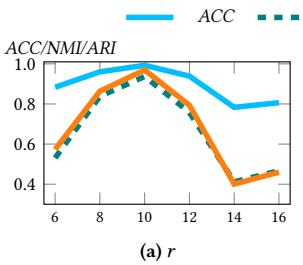

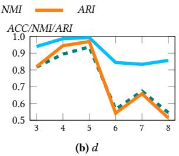  
Figure 8: Clustering quality on AIDS

ma<sub>y</sub> introduce noise. In Fi<sub>g</sub>. 8 (b), the best results are achieved <sub>aroun</sub>d $d \approx 5 ,$ while lar<sub>g</sub>er � de<sub>g</sub>rades metrics, consistent with §5.3: the Joint Manifold-Preservin<sub>g</sub> S<sub>p</sub>arse Re<sub>g</sub>ression favors a com<sub>p</sub>act fused space that removes redundancy between H and F.

## B.4 Cluster Visualizations

Fi<sub>g</sub>. 9 re<sub>p</sub>orts t-SNE visualizations of the learned <sub>g</sub>ra<sub>p</sub>h embeddin<sub>g</sub>s on four datasets. Com<sub>p</sub>ared with DGLC and DCGLC, S<sup>3</sup>GLC

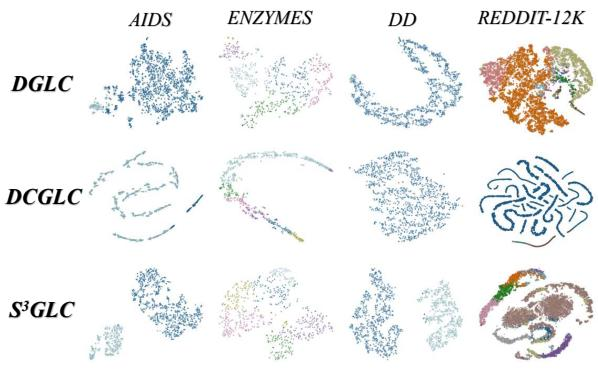  
Figure 9: t-SNE visualization of graph embeddings learned by DGLC, DCGLC, and S<sup>3</sup>GLC  
yields clearer inter-cluster margins, notably in AIDS and DD. On ENZYMES and REDDIT-12K, S<sup>3</sup>GLC maintains balanced, distinct cluster re<sub>g</sub>ions. Conversel<sub>y</sub>, DGLC and DCGLC exhibit severe clusterin<sub>g</sub> <sub>co</sub>ll<sub>apse,</sub> <sub>w</sub>ith <sub>samp</sub>l<sub>es</sub> <sub>concen</sub>t<sub>ra</sub>t<sub>e</sub>d i<sub>n</sub> <sub>a</sub> <sub>s</sub>i<sub>ng</sub>l<sub>e</sub> d<sub>om</sub>i<sub>nan</sub>t <sub>c</sub>l<sub>us</sub>t<sub>er,</sub> failin<sub>g</sub> to <sub>p</sub>reserve the intrinsic multi-cluster structure.