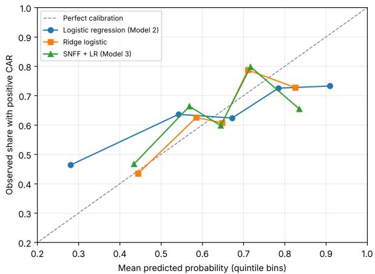
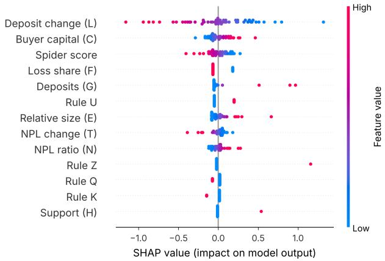

Author preprint, November 2026 (not peer reviewed).

# An Interaction-Aware Decision Framework for FDIC-Assisted Distressed Bank Acquisitions: Empirical Evidence from the FDIC Failed-Bank Panel and the SVB–First Citizens Case

YOUSEF NEJATBAKHSH1, MALIHE ALIASGARI2, (Member, IEEE), PARSA SAFAEE3, SINA SHOKOOHYAR4

1Department of Statistics, Rutgers University, New Brunswick, NJ 08901, USA (e-mail: nejatbakhsh.y@gmail.com)

2Department of Mathematical Sciences, Kean University, Union, NJ 07083, USA (e-mail: malihe.aliasgari@kean.edu)v

3Eindhoven Artificial Intelligence Systems Institute (EAISI), Eindhoven University of Technology, Eindhoven, The Netherlands (e-mail: p.safaee@tue.nl)o 4Department of Computing and Decision Sciences Stillman School of Business Seton Hall University Jubilee Hall 615 400 South Orange Avenue South Orange, NJ. 07079 (e-mail: sina.shokoohyar@shu.edu)

Corresponding author: Malihe Aliasgari (e-mail: malihe.aliasgari@kean.edu).4

This work received no external funding. The authors declare no conflicts of interest.

ABSTRACT Acquirers of failed banks weigh acquisition value, regulatory protection, risk, buyer strength, and execution difficulty jointly, because each signal’s meaning depends on the others: high non-performing loans matter less when government loss sharing absorbs the losses. The proposed Spider Network Filtering Framework encodes such dependencies as four interpretable interaction rules among five dimensions, yielding graph-inspired features for a logistic model and a Pursue/Caution/Avoid decision rule. We evaluate it on 55 acquisitions assisted by the Federal Deposit Insurance Corporation in 2008–2024 by acquirers with a parent listed in the United States. Six financial inputs come from regulatory reports published before each failure; two deal terms, which the winning bidder knows when it bids but investors learn at the announcement, come from the regulator’s press releases. The outcome, a positive three-day abnormal return around the announcement, records the market’s initial reception, not realized success. Under grouped, nested cross-validation, the Spider-enhanced model reaches a mean area under the receiver operating characteristic curve of 0.594, against 0.615 for logistic regression on the same inputs and 0.632 for ridge regression; permutation tests that repeat the full model selection give at most weak evidence that any of them ranks better than chance. The Spider score used directly does not rank better than chance, and an apparent link between target distress and higher returns disappears against a bank-sector benchmark. Thresholds tuned for the F1 score approve most acquisitions with negative returns and realize negative utility when each costs three times what a positively received acquisition gains.

INDEX TERMS Bank failure, distressed mergers and acquisitions, event study, explainable AI, FDIC, interaction rules, logistic regression, reproducibility, risk analytics, Silicon Valley Bank

## I. INTRODUCTION

Distressed bank acquisitions occupy a unique position in financial decision-making. Unlike standard mergers and acquisitions (M&A), they combine the urgency of regulatory intervention, the opacity of distressed balance sheets, and the complexity of government loss-sharing arrangements into a single time-constrained decision. When the Federal Deposit Insurance Corporation (FDIC) markets a failing bank, prospective acquirers typically have a short window of confidential due diligence, often a few weeks, to decide whether to bid and on what terms. The acquisition of Silicon Valley Bank (SVB) by First Citizens BancShares in March 2023 exemplifies this dynamic. SVB’s collapse, at the time the second-largest bank failure in U.S. history, was precipitated by a classic liquidity crisis: concentrated deposit outflows among interconnected venture-capital-backed firms, compounded by unrealized losses in a long-duration securities portfolio accumulated during the low-rate era of 2020– 2021. The FDIC subsequently facilitated the acquisition, transferring approximately \$72 billion in assets, purchased at a discount of about 23%, and \$56 billion in deposits to First Citizens [1], [2].

The academic literature on bank distress prediction is extensive, drawing on Altman’s Z-score [3], logistic regression [4], and more recently machine learning approaches including random forests, gradient boosting, and neural networks [5]. However, the literature on acquisition decisionmaking in the context of distressed banks is considerably thinner. Existing frameworks tend to evaluate acquisition targets through isolated financial ratios rather than through the connected logic that practitioners apply. A high nonperforming loan ratio, for example, is not independently informative: it matters less when FDIC loss sharing absorbs the credit losses, and more when the acquirer’s capital is thin. Standard models do not capture these interdependencies explicitly.

This paper makes three contributions. First, we shift the modeling objective from bank-failure prediction to postfailure acquisition decision support, a distinct and comparatively under-studied problem. Second, we formalize the Spider Network Filtering Framework (SNFF), an interpretable, graph-inspired feature-engineering scheme that encodes the conditional dependencies among credit risk, regulatory protection, liquidity distress, structural deterioration, buyer capital, and execution burden as four explicit interaction rules, and we build a panel of 55 FDIC-assisted acquisitions by U.S.-listed acquirers in which the six financial inputs come from call reports published before the failure, the two deal terms are coded from the FDIC press release, the information available to the bidder when it bids is stated explicitly, and the event day of every outcome is fixed from the verified timing of the announcement. Third, we evaluate the framework against seven alternatives under grouped, nested cross-validation, with uncertainty assessed by procedures that repeat the model fitting and selection, and report what the evidence supports: the Spider features do not improve ranking relative to logistic models on the same inputs and change calibration only slightly, in a direction that depends on the outcome window; the evidence that any model discriminates better than chance is weak at this sample size; and an apparent association between the target’s distress and the acquirer’s announcement return, which would reverse the score’s risk penalty, holds against the S&P 500 but not against a bank-sector benchmark. A prescriptive analysis shows that decision thresholds must reflect the asymmetric cost of acquisition errors rather than classification accuracy, and that under such costs no policy evaluated here improves materially on declining every transaction.

The central research question of this study is: Do interaction-aware Spider Networkfeatures improve the ranking and calibration of distressed bank acquisitions by the sign of the acquirer’s announcement return, relative to traditional financial-ratio models, and can four domainmotivated interaction rules match unstructured interaction and machine-learning models? The ablation study and baseline comparisons in Section VII answer both parts. We state the first part as a testable hypothesis:

H1: The Spider Network Filter generates interaction-based features that improve ranking performance, measured by the area under the receiver operating characteristic curve (AUC-ROC, or AUC), and probability calibration (Brier score) relative to standard logistic regression using the measured inputs only (Model 2).

The evidence in Section VII does not support H1.

The remainder of the paper is organized as follows. Section II reviews the relevant literature on bank distress, M&A decision frameworks, and network-based risk models. Section III presents the Spider Network Filtering Framework, including the component score formulas and interaction rules. Section IV specifies all four models and their evaluation criteria. Section V describes the data structure and variable definitions. Section VI applies the framework to the SVB– First Citizens case. Section VII reports the model comparisons, robustness checks, and decision analysis. Section VIII discusses the findings, including why the data cannot settle the direction of the risk penalty, and their implications for practitioners and regulators. Section IX concludes with recommendations for future research.

## II. LITERATURE REVIEW

## A. BANK DISTRESS PREDICTION

The prediction of bank failure has been a central problem in financial economics since the banking crises of the 1970s and 1980s. Early approaches relied on univariate financial ratio analysis and the CAMELS framework (Capital adequacy, Asset quality, Management, Earnings, Liquidity, Sensitivity), which remains the supervisory standard for U.S. bank examination [6]. Logistic regression models became the dominant statistical tool following Martin [4] and Pettway and Sinkey [7], who demonstrated the predictive power of balance sheet ratios in identifying failing institutions. More recent work has expanded the predictor set to include macroeconomic variables, network centrality measures, and text-derived sentiment signals [8].

## B. DISTRESSED MERGERS AND ACQUISITIONS

The M&A literature on distressed targets is distinct from the broader acquisition literature in several important respects. Distressed acquisitions typically occur at substantial discounts to book value, involve regulatory intermediaries, and create asymmetric information problems that amplify integration risk [9]. The FDIC assisted-transaction framework, which may include loss-sharing agreements, purchase-andassumption structures, and deposit transfer arrangements, introduces a regulatory protection dimension that has no equivalent in standard M&A analysis [10]. Prior studies on failed-bank resolution and acquirer outcomes provide mixed evidence on whether FDIC-assisted acquisitions create sustained value for acquirers: the broader literature on distressed-asset acquisitions documents excess returns to acquirers of distressed and bankrupt firms [9], while studies of bank scale economies suggest integration costs can erode these gains over time for some acquirers [11].

A more direct literature studies the acquirers of failed banks. James and Wier [12] find that winning bidders in FDIC failed-bank auctions earn significant positive abnormal returns, consistent with wealth transfers from the FDIC to acquirers, and Giliberto and Varaiya [13] show, for 322 FDIC auctions between 1965 and 1985, that winning bids rise with the number of competing bidders, consistent with bidders failing to adjust for the winner’s curse. For the 2008– 2013 failure wave, Cowan and Salotti [14] report substantial positive abnormal returns to winning bidders that decline with the amount bid, and identify FDIC loss-share guarantees as an important determinant of bids. Granja, Matvos, and Seru [15] show that failed banks are sold mostly to nearby acquirers with similar loan portfolios and that weak capitalization limits which banks can bid, which links the pool of bidders to the losses the FDIC realizes. The predominance of positive announcement returns in our panel (35 of 55 transactions) is consistent with this evidence. These studies explain average acquirer returns and auction outcomes; we ask instead whether the value of an individual transaction can be ranked in advance from the signals available when a bid is prepared.

## C. MULTI-CRITERIA DECISION MODELS IN FINANCE

Weighted scoring models and multi-criteria decision analysis (MCDA) have a long history in financial decisionmaking, particularly in credit rating, supplier selection, and investment screening [16], [17]. These models offer high interpretability but suffer from two well-known weaknesses: subjective weight assignment and the inability to capture interaction effects among criteria. Hybrid models that combine MCDA with statistical or machine learning methods have been proposed to address these weaknesses [18], but applications to distressed bank acquisitions remain scarce.

## D. NETWORK MODELS IN FINANCIAL RISK

Graph-theoretic and network-based approaches to financial risk have grown substantially since the 2008 global financial crisis revealed the importance of systemic interconnectedness [19], [20]. Network models have been applied to interbank contagion, deposit concentration risk, and counterparty exposure mapping [21]. The application of network logic to individual acquisition decision-making—rather than to systemic risk—is a relatively unexplored direction. Our Spider Network Filtering Framework borrows the language of interaction graphs from this tradition to describe a transactionlevel decision rule; unlike network models of systemic risk, it does not compute on network structure.

## E. DEPOSIT NETWORK CONTAGION

A separate and directly relevant literature documents how depositor interconnectedness and coordination accelerate bank runs. Egan, Hortaçsu, and Matvos [22] show that uninsured depositors above the FDIC insurance limit discipline weak banks by withdrawing funds, a behavior directly relevant to concentrated institutional deposit bases such as SVB’s. Cookson, Fox, Gil-Bazo, Imbet, and Schiller [23] provide direct empirical evidence that social-media activity amplified the speed of the deposit run that preceded SVB’s and Signature Bank’s failures in March 2023, demonstrating that depositor interconnectedness determines contagion speed in a manner not captured by standard balance-sheet ratios. Eisenberg and Noe [24] and Rogers and Veraart [25] formalize how network topology determines the scope of contagion in interbank systems more generally. The Spider Network’s deposit-outflow indicator and interaction rules are a simplified, transaction-level analogue of this broader contagion literature; we do not construct an explicit depositor graph in this paper, and doing so—for example, via a Herfindahl-Hirschman index of depositor concentration—is identified as a direction for future work in Section VIII.

## F. EXPLAINABLE MACHINE LEARNING IN FINANCE

Recent work has emphasized the importance of explainability in financial machine learning [26]. SHAP (SHapley Additive exPlanations) values [27] have been used to decompose model predictions into variable-level contributions, enabling regulators and practitioners to understand why a model recommends a particular action. The integration of explainability methods with distressed acquisition decision models is a natural extension that the current paper begins to address through the Spider Network’s transparent interaction architecture.

Recent research has explored hybrid machine-learning architectures for financial-market prediction. Nejatbakhsh and Aliasgari [28] combined long short-term memory (LSTM) networks, transformer attention, sentiment analysis, and federated learning for stock-market forecasting. In contrast, the present study focuses on interpretable financial interactions and the evaluation of decision-support models for FDICassisted distressed bank acquisitions.

## III. THE SPIDER NETWORK FILTERING FRAMEWORK A. CONCEPTUAL FOUNDATION

The Spider Network Filtering Framework is motivated by the observation that distressed acquisition decisions are relational: the significance of each financial signal depends on the values of connected signals. A high non-performing loan (NPL) ratio is less threatening to an acquirer when FDIC loss sharing covers the loans than when the acquirer bears the credit losses alone. A deposit outflow before failure points to a liquidity problem that a well-funded acquirer may be able to reverse, unless the loan book is deteriorating at the same time. A weakly capitalized buyer is more exposed than a strong one to a target that is large relative to itself or whose credit quality is declining. These dependencies constitute a network of conditional relationships that simple additive scoring models cannot represent.

We summarize these dependencies in a conceptual interaction graph $G = ( V , E , W )$ , where

$$
\begin{array} { r } { V = \{ \mathrm { V a l u e } , \ \mathrm { P r o t e c t i o n } , \ \mathrm { R i s k } , \ } \\ { \mathrm { B u y e r S t r e n g t h } , \ \mathrm { E x e c u t i o n } \} } \end{array}
$$

is the set of five financial dimensions, $E \subseteq V \times V$ is the set of directed edges, each standing for one interaction rule, and $W : E  { \cdot }$ R assigns each rule its score adjustment. The edges are

$$
\begin{array} { r l } & { E = \big \{ \big ( \mathrm { R i s k , ~ P r o t e c t i o n } \big ) , ~ \big ( \mathrm { R i s k , ~ R i s k } \big ) , } \\ & { ~ \big ( \mathrm { R i s k , ~ B u y e r S t r e n g t h } \big ) , } \\ & { ~ \big ( \mathrm { E x e c u t i o n , ~ B u y e r S t r e n g t h } \big ) \big \} , } \end{array}\tag{1}
$$

corresponding to the rules Q, U, Z, and K of Section III-D. The edge from Risk to itself denotes an interaction between two signals within the Risk dimension: rule U combines a deposit outflow with the absence of credit deterioration. The graph documents which dimensions interact and by how much; no part of the framework learns from the graph or computes on its structure, and no propagation, centrality, or spectral quantity is used. The framework is therefore best described as an interpretable, graph-inspired featureengineering scheme: weighted component scores combined with four deterministic interaction rules.

## B. COMPONENT SCORE FORMULAS

Each acquisition candidate i receives five component scores, computed from two kinds of information (Section V-D): financial data published in the call reports of the failed and acquiring banks before the announcement, and two terms of the transaction—loss sharing and government support—that the bidder knows when it bids and the market learns from the FDIC’s announcement. Deal-level purchase discounts are not disclosed consistently across transactions, so the Value dimension rests on the failed bank’s deposit franchise, and asset quality enters once, through the NPL ratio in the Risk dimension. All continuous inputs are min-max normalized to [0, 1], with bounds estimated on the training data (Section IV-F). The weights below are expert-assigned rather than estimated from data or elicited through a formal procedure such as the Analytic Hierarchy Process; none of the weights, adjustment sizes, or rule definitions was estimated from the outcomes analyzed in this paper.

## 1) Value Score

The Value Score measures the franchise the acquirer obtains:

$$
V _ { i } = G _ { i } ,\tag{2}
$$

where $G _ { i }$ is the normalized deposit base of the failed bank in its last public call report.

## 2) Protection Score

The Protection Score $P _ { i }$ measures the extent to which regulatory and governmental arrangements reduce downside risk:

$$
P _ { i } = 0 . 6 0 F _ { i } + 0 . 4 0 H _ { i } ,\tag{3}
$$

where $F _ { i } \in \{ 0 , 1 \}$ indicates an FDIC loss-share agreement in the transaction and $H _ { i } \in \{ 0 , 1 \}$ indicates extraordinary government support (a bridge bank or a systemic-risk exception); both are terms of the transaction (Section V-D).

## 3) Risk Score

The Risk Score $R _ { i }$ aggregates credit risk, liquidity distress, and structural deterioration of the failed bank:

$$
R _ { i } = 0 . 4 0 N _ { i } + 0 . 2 5 L _ { i } + 0 . 3 5 T _ { i } ,\tag{4}
$$

where $N _ { i }$ is the normalized NPL ratio; $L _ { i } \in \{ 0 , 1 \}$ equals 1 when the bank’s deposit change over the two quarters ending at its last public call report lies in the bottom quartile of the training data (a deposit outflow); and $T _ { i } \in \{ 0 , 1 \}$ equals 1 when the change in its NPL ratio over the same two quarters lies in the top quartile (a deteriorating loan book).

## 4) Buyer Strength Score

The Buyer Strength Score $B _ { i }$ captures the acquiring institution’s capital adequacy:

$$
B _ { i } = C _ { i } ,\tag{5}
$$

where $C _ { i }$ is the normalized equity-to-assets ratio of the acquiring bank at the last quarter-end at least 90 days before the failure.

## 5) Execution Difficulty Score

The Execution Difficulty Score $E _ { i }$ proxies the integration burden by the size of the target relative to the acquirer:

$$
E _ { i } = M _ { i } ,\tag{6}
$$

where $M _ { i }$ is the normalized ratio of the failed bank’s total assets to the acquiring bank’s total assets, winsorized at the 95th percentile of the training data.

## C. RAW SPIDER DEAL SCORE

The raw Spider Deal Score $S _ { i }$ combines the five component scores into a single measure of acquisition attractiveness:

$$
S _ { i } = 0 . 3 0 V _ { i } + 0 . 2 0 P _ { i } + 0 . 2 0 B _ { i } - 0 . 2 0 R _ { i } - 0 . 1 0 E _ { i }\tag{7}
$$

The positive components (Value, Protection, Buyer Strength) increase attractiveness; the negative components (Risk, Execution Difficulty) reduce it. The weight constraint $\Sigma \left| w _ { k } \right| =$ 1 is satisfied.

TABLE 1. Spider Network Interaction Rules
<table><tr><td>Rule</td><td>Condition</td><td>Adj.</td></tr><tr><td>Protected Credit Risk (Qi)</td><td> $N _ { i } \geq N _ { 7 5 }$  and  $F _ { i } = 1$ </td><td>+0.08</td></tr><tr><td>Recoverable Distress (Ui)</td><td> $L _ { i } = 1 \mathbf { a n d } T _ { i } = 0$ </td><td>+0.07</td></tr><tr><td>Structural-Risk Penalty  $( Z _ { i } )$ </td><td> $T _ { i } = 1 \mathbf { a n d } C _ { i } < C _ { 2 5 }$ </td><td>-0.10</td></tr><tr><td>Size-Burden Penalty  $( K _ { i } )$ </td><td> $M _ { i } > M _ { 7 5 }$  and  $C _ { i } < C _ { 2 5 }$ </td><td>-0.06</td></tr></table>

## D. SPIDER NETWORK INTERACTION RULES

The interaction rules distinguish the Spider Network from a simple additive model. They encode the conditional dependencies among dimensions identified in Section III-B.

The thresholds $N _ { 7 5 } , C _ { 2 5 }$ , and $M _ { 7 5 }$ are the 75th, 25th, and 75th percentiles of the corresponding normalized variable. During cross-validation they are estimated on the training fold only (Section IV-F), so the threshold that classifies a held-out transaction never depends on that transaction’s own value. Rule $Q _ { i }$ marks high credit risk that loss sharing transfers to the FDIC; rule $U _ { i }$ marks a deposit outflow without credit deterioration, the pattern of a liquidity-driven failure; rules $Z _ { i }$ and $K _ { i }$ penalize a weakly capitalized buyer facing a deteriorating loan book or a target that is large relative to itself. Government support is not a condition of $U _ { i } { : }$ under the narrow definition it applies to only one transaction in the panel and enters through $P _ { i } ;$ a variant that requires it is reported in Section VII.

The adjusted Spider Score is computed as:

$$
S _ { i } ^ { * } = S _ { i } + 0 . 0 8 Q _ { i } + 0 . 0 7 U _ { i } - 0 . 1 0 Z _ { i } - 0 . 0 6 K _ { i }\tag{8}
$$

where each indicator $Q _ { i } , U _ { i } , Z _ { i } , K _ { i } \ \in \ \{ 0 , 1 \}$ according to the conditions in Table 1.

## E. FINAL RESCALED SCORE

Because $S _ { i } ^ { * }$ may not fall in [0, 1] across all observations, it is rescaled as:

$$
\tilde { S } _ { i } = \frac { S _ { i } ^ { * } - \operatorname* { m i n } _ { \mathrm { t r a i n } } ( S ^ { * } ) } { \operatorname* { m a x } _ { \mathrm { t r a i n } } ( S ^ { * } ) - \operatorname* { m i n } _ { \mathrm { t r a i n } } ( S ^ { * } ) }\tag{9}
$$

The bounds are estimated on the training split only and applied unchanged to the test split, with test values clipped to [0, 1], so the test data never influence the normalization applied to themselves. The rescaled score $\tilde { S } _ { i }$ is the framework’s decision index (Models 1 and 4).

## IV. FOUR-MODEL COMPARATIVE FRAMEWORK A. MODEL 1: SPIDER SCORE WITH FIXED THRESHOLDS (BASELINE)

Model 1 is the framework’s model-free decision rule, designed for interpretability and direct executive use. It applies fixed cut-offs to the rescaled Spider score $\tilde { S } _ { i }$ of Eq. (9):

• Pursue: $\tilde { S } _ { i } \geq 0 . 7 0 -$ low risk, strong value

• Caution: $0 . 4 0 \leq \tilde { S } _ { i } < 0 . 7 0 -$ moderate risk

• Avoid: $\tilde { S } _ { i } < 0 . 4 0 { \mathrm { - } } \mathrm { h i g h r i s k }$

Because $\tilde { S } _ { i }$ involves no estimated coefficients, its ranking ability can be assessed directly: Section VII reports the AUC of $\tilde { S } _ { i }$ itself as a score.

## B. MODEL 2: LOGISTIC REGRESSION (STATISTICAL BENCHMARK)

Model 2 is a logistic regression (LR) estimating the probability of a positive announcement return from the eight inputs of Table 5 (six continuous variables and the indicators $F _ { i }$ and $H _ { i } )$ . The log-odds are

$$
z = \beta _ { 0 } + \beta _ { 1 } X _ { 1 } + \beta _ { 2 } X _ { 2 } + \cdot \cdot \cdot + \beta _ { n } X _ { n }\tag{10}
$$

and the predicted probability of a positive announcement return is

$$
\operatorname* { P r } ( Y _ { i } = 1 \mid \mathbf { X } _ { i } ) = \frac { 1 } { 1 + e ^ { - z } } ,\tag{11}
$$

where $\begin{array} { r l r } { Y _ { i } } & { { } = } & { 1 } \end{array}$ denotes a positive announcement return (Section V-E). The inputs are standardized on the training fold, and the coefficients carry a mild L2 penalty with inverse strength fixed at $C = 1$ , which stabilizes the estimates in a sample of this size.

## C. MODEL 3: SPIDER NETWORK FILTER + LOGISTIC REGRESSION

Model 3 extends Model 2 by adding the Spider Network features: the rescaled score $\tilde { S } _ { i }$ and the four interaction indicators $Q _ { i } , U _ { i } , Z _ { i } , K _ { i } .$ , for 13 features in total. Its log-odds are

$$
z _ { i } = \beta _ { 0 } + \sum _ { j } \beta _ { j } X _ { i j } + \gamma { \tilde { S } } _ { i } + \sum _ { k } \delta _ { k } I _ { i k } ,\tag{12}
$$

where $I _ { i k } , k \in \{ Q , U , Z , K \}$ , are the four interaction indicators of Table 1, and the predicted probability follows Eq. (11). The L2 penalty strength is chosen inside each training fold (Section IV-F). The component scores $( V _ { i } , P _ { i } , R _ { i } , B _ { i } , E _ { i } )$ and the unrescaled scores $( S _ { i } , S _ { i } ^ { * } )$ are not added as separate predictors: they are deterministic functions of the inputs, so including them would add collinearity without new information.

Model 3 is compared against six further baselines under the identical cross-validation protocol of Section IV-F (Table 7): logistic regression with the least absolute shrinkage and selection operator (LASSO, an L1 penalty); ridge logistic regression; a decision tree; a random forest; extreme gradient boosting (XGBoost); and a logistic regression with all 28 pairwise interactions of the eight inputs. Ridge logistic regression is not a different model family from Model 2: both are L2-penalized logistic regressions on the same eight inputs, but Model 2 fixes the penalty at $C ~ = ~ 1$ , whereas the ridge comparator chooses it by inner cross-validation, as Model 3 does. The ridge comparator therefore isolates the contribution of the Spider features at a comparable level of regularization. The pairwise-interaction model is the most direct test of the framework: it lets the data choose among all two-way interactions, whereas Model 3 adds only the four interactions specified in Table 1.

## D. MODEL 4: COST-SENSITIVE DECISION POLICY

Model 4 applies prescriptive Pursue/Caution/Avoid decision thresholds to a transaction-level score. We evaluate three configurations rather than treating a single set of cut-offs as given by assumption: (4A) the framework’s fixed thresholds applied to the rescaled Spider score $\tilde { S } _ { i }$ , i.e. the rule of Model 1,

$$
\begin{array} { r } { \mathrm { D e c i s i o n } _ { i } = \left\{ \begin{array} { l l } { \mathbf { P u r s u e } } & { \mathrm { s c o r e } _ { i } \geq 0 . 7 0 } \\ { \mathbf { C a u t i o n } } & { 0 . 4 0 \leq \mathrm { s c o r e } _ { i } < 0 . 7 0 } \\ { \mathbf { A v o i d } } & { \mathrm { s c o r e } _ { i } < 0 . 4 0 ; } \end{array} \right. } \end{array}\tag{13}
$$

(4B) a configuration that maximizes the F1 score (the harmonic mean of precision and recall), in which the Pursue threshold is chosen from $\{ 0 . 5 5 , 0 . 6 0 , \ldots , 0 . 8 0 \}$ inside each training fold, using the inner grouped cross-validation predictions of Model 3, so that the held-out transactions never influence it; and (4C) a cost-sensitive configuration derived from a conservative 3:1 loss-to-benefit scenario. For 4B and 4C, “score ” is Model 3’s out-of-fold predicted probability ${ \hat { P } } ( Y _ { i } { = } 1 )$ ; 4A retains $\tilde { S } _ { i }$ , so the comparison covers three deployable policies rather than three thresholds applied to one score. For binary evaluation, the conservative mapping is

$$
\hat { Y } _ { i } = \left\{ \begin{array} { l l } { 1 } & { \mathrm { i f ~ } \mathrm { D e c i s i o n } _ { i } = \mathbf { P u r s u e } } \\ { 0 } & { \mathrm { i f ~ } \mathrm { D e c i s i o n } _ { i } \in \{ \mathbf { C a u t i o n } , ~ \mathbf { A v o i d } \} . } \end{array} \right.\tag{14}
$$

In distressed M&A, a false positive (recommending an acquisition that the market then receives negatively) is more costly than a false negative. We formalize this with a cost matrix in which B is the benefit of pursuing a transaction with a positive announcement return and L the loss from pursuing one with a negative return, and a utility-adjusted score,

$$
E U _ { i } = \hat { P } ( Y _ { i } { = } 1 ) \cdot B - ( 1 - \hat { P } ( Y _ { i } { = } 1 ) ) \cdot L ,\tag{15}
$$

recommending Pursue only if $\hat { P } ( Y _ { i } { = } 1 ) > L / ( B { + } L )$ . Under the $L { : } B = 3 { : } 1$ scenario this gives a Bayes-optimal Pursue threshold of 0.75 for configuration 4C. The 3:1 ratio is a conservative scenario rather than an externally documented industry parameter, so Table 3 sweeps it from 1:1 to 5:1. Because each row of the sweep assumes a different loss, utilities at each row’s own ratio are not comparable across rows; we report each row’s utility at its own ratio, its gain over the better of the two trivial policies at that ratio, and its utility at the common 3:1 ratio of Table 2. Realized utility is $( B \cdot T P - L \cdot F P ) / n .$ , the average payoff per transaction of the Pursue recommendations, where $T P$ and $F P$ count the transactions with positive and with negative announcement returns among those recommended for pursuit; it is computed on the actual outcomes with $B = 1$ and averaged over the 50 repeated partitions. The results are discussed in Section VII-H.

## E. MODEL COMPARISON

Table 4 summarizes the key properties of all four models.

TABLE 2. Model 4 Decision Policies $( n = 5 5 ;$ Mean over 50 Repeats; Utility with $B = 1 , { \cal L } = 3 )$
<table><tr><td>Policy</td><td>Thresh.</td><td>Pursue</td><td>TP/FP</td><td>F1</td><td>FPR</td><td>Util.</td></tr><tr><td>4A: Fixed (Š)</td><td>0.70/0.40</td><td>3.1</td><td>2.9/0.2</td><td>0.151</td><td>0.011</td><td>0.041</td></tr><tr><td>4B: F1-tuned</td><td>0.55–0.80</td><td>40.2</td><td>27.6/12.6</td><td>0.734</td><td>0.629</td><td>-0.184</td></tr><tr><td>4C: Cost (3:1)</td><td>0.75/0.45</td><td>11.8</td><td>7.9/3.9</td><td>0.332</td><td>0.196</td><td>-0.071</td></tr><tr><td>Trivial policies</td><td></td><td></td><td></td><td></td><td></td><td></td></tr><tr><td>Pursue all</td><td></td><td>55</td><td>35/20</td><td>0.778</td><td>1.000</td><td>-0.455</td></tr><tr><td>Pursue none</td><td></td><td>0</td><td>0/0</td><td></td><td>0.0000.000</td><td>0.000</td></tr></table>

Pursue: transactions recommended for pursuit; TP/FP: of these, transactions with a positive and with a negative announcement return; FPR: share of the 20 negative-CAR transactions recommended; Util.: realized utility $( T P - 3 F P ) / 5 5 $

TABLE 3. Utility Sensitivity to the Assumed Loss-to-Benefit Ratio (Model 3 Probabilities; Mean over 50 Repeats)
<table><tr><td colspan="6"></td><td colspan="2">Own ratio</td><td>3:1</td></tr><tr><td>Ratio</td><td></td><td>Thr. Pursue</td><td>TP/FP</td><td>FPR</td><td>F1</td><td>Util.</td><td>Gain</td><td>Util.</td></tr><tr><td>1:1</td><td>0.50</td><td>45.6</td><td>30.8/14.7</td><td>0.737</td><td>0.765</td><td>0.292</td><td>0.020</td><td>-0.244</td></tr><tr><td>2:1</td><td>0.67</td><td>24.3</td><td>17.6/6.8</td><td>0.339</td><td>0.590</td><td>0.073</td><td>0.073</td><td>-0.051</td></tr><tr><td>3:1</td><td>0.75</td><td>11.8</td><td>7.9/3.9</td><td>0.196</td><td>0.332</td><td>-0.071</td><td>-0.071</td><td>-0.071</td></tr><tr><td>4:1</td><td>0.80</td><td>7.0</td><td>4.3/2.8</td><td>0.138</td><td>0.197</td><td>-0.123</td><td>-0.123</td><td>-0.073</td></tr><tr><td>5:1</td><td>0.83</td><td>5.1</td><td>2.7/2.4</td><td>0.119</td><td>0.133</td><td>-0.167</td><td>-0.167</td><td>-0.080</td></tr></table>

Threshold L/(B+L) applied to Model 3’s out-of-fold probabilities. Gain: utility minus that of the better trivial policy (pursue all or pursue none) at the same ratio.

TABLE 4. Comparative Summary of Four Models
<table><tr><td>Model</td><td>Purpose</td><td>Output</td><td>Interpretability</td></tr><tr><td>Model 1</td><td>Decision baseline</td><td>Spider score</td><td>Very high</td></tr><tr><td>Model 2</td><td>Statistical benchmark</td><td>Probability</td><td>Moderate</td></tr><tr><td>Model 3</td><td>Hybrid predictive model</td><td>Probability</td><td>Moderate to high</td></tr><tr><td>Model 4</td><td>Executive decision rule</td><td>Category</td><td>Very high</td></tr></table>

## F. EVALUATION PROTOCOL AND LEAKAGE CONTROL

With 55 observations, a single train/test split produces noisy metric estimates, so every model is evaluated by repeated cross-validation: 50 repetitions of 5-fold cross-validation, each with a different random partition. Within a repetition, the out-of-fold predictions of the five folds are pooled before the AUC, the Brier score, and the other metrics are computed; we report the mean over the 50 repetitions and the 5th to 95th percentile range across them. The repetitions reuse the same 55 transactions, so this range describes sensitivity to the partition, not sampling uncertainty.

Some failed banks were sold to the same acquirer on the same day, and their transactions share one cumulative abnormal return (CAR) of the acquirer (Section V-E). The largest such group is four subsidiaries of FBOP Corporation sold to U.S. Bank on October 30, 2009; Downey Savings and PFF Bank & Trust, sold to U.S. Bank on November 21, 2008, form another. If such transactions were split across training and test folds, the outcome of a test transaction could be learned from an identical outcome in the training fold. We therefore treat each pair of listed parent and event day (day 0, Section V-E) as a cluster and use grouped stratified folds, in which all transactions of a cluster fall in the same fold. The 55 transactions form 51 clusters.

Within every fold, the following quantities are recomputed using only the training rows of that fold and then applied without modification to the held-out rows: (i) the standardization of the inputs and the min-max normalization bounds; (ii) the quartile thresholds that define $L _ { i }$ and $T _ { i }$ and the rule thresholds $N _ { 7 5 } , C _ { 2 5 } , M _ { 7 5 } ;$ (iii) the winsorization cap of $M _ { i }$ and the score-rescaling bounds of Eq. (9); and (iv) the model coefficients and hyper-parameters. Hyper-parameters (the penalty strength $C \in \{ 0 . 1 , 1 , 1 0 \}$ of the LASSO, ridge, pairwise-interaction, and Spider models; the depth of the tree-based models) are chosen by an inner grouped 3-fold cross-validation on the training rows that minimizes the Brier score. Model 2 keeps $C = 1$ . Computing any of these quantities once on the full sample would let test-fold information influence the features used to classify the test fold.

Sampling uncertainty is assessed with three procedures, each of which resamples or permutes the 51 event clusters rather than individual transactions. The conditional bootstrap resamples clusters 4,000 times, using each transaction’s outof-fold prediction averaged over the 50 repetitions; it is conditional on those fitted predictions and does not reflect the variability that comes from refitting and tuning the models. The refitting bootstrap draws 500 resamples of clusters and reruns the entire nested cross-validation, including the inner tuning, on each resample (copies of a cluster share its label and fall in the same fold); its intervals therefore include that variability. The permutation test permutes outcomes across clusters and reruns the complete nested procedure, including the inner tuning, on each of 400 permutations, averaging the AUC over three partitions per permutation and using the same partition seeds for the observed data. Its one-sided $p \textmd { - }$ values are reported with and without a Holm adjustment for the three models tested.

## G. REPRODUCIBILITY

The pipeline takes the source-verified transaction file as input and produces, in sequence, the measured variables and the source ledger (Section V); the fold-wise Spider features for each of the 50 repeated partitions; the model comparison, paired comparison, permutation tests, and both cluster bootstraps (Tables 7, 8, and 9); the ablation (Table 10); the robustness checks, including the bank-sector benchmark and the influence of single events (Tables 11 and 13); the calibration and SHAP figures (Figs. 1 and 2); and the decision analysis (Tables 2 and 3). Every number reported in this paper is generated by this code from the inputs; the code, the inputs, the source ledger, the software versions, and checksums of every output are released together as one versioned archive (Data and Code Availability).

## V. DATA STRUCTURE AND VARIABLES A. SAMPLECONSTRUCTION

The panel is built from the FDIC Failed Bank List [29] and BankFind Suite call-report data [30]. Of 502 purchase-andassumption failures, 469 have complete call-report data for the failed bank in each of the four quarters before failure and for the acquiring bank. We keep the 150 largest of these by failed-bank total assets in the last quarter before failure, which sets the size cut at \$351.5 million. In 94 of the 150 transactions the acquiring bank’s parent was a U.S. company listed on a U.S. exchange; 44 acquirers were privately held, nine were owned by a foreign bank, and three parents traded only over the counter. Daily prices around the announcement are available for 55 of the 94; the price data collected for this study do not cover the other 39, most of whose parents were later merged or delisted (Section VIII-E). The primary panel therefore consists of 55 transactions announced between 2008 and 2024. The same rules without the size cut give 90 transactions with prices, out of 149 with a U.S.-listed parent, which we use as a broader robustness panel.

## B. DATASETDESIGN

Each observation is one FDIC-assisted acquisition. The dependent variable is positive\_car ∈ {0, 1}, where 1 indicates a positive abnormal return to the acquirer’s shareholders around the announcement (Section V-E). The data come from three public sources: the FDIC Failed Bank List, which records every failure since October 2000 with the acquiring institution and the type of transaction [29]; the quarterly call reports of the failed and acquiring banks in the FDIC BankFind Suite [30]; and the FDIC press release that announced each transaction. SVB is one of the 55 transactions; Section VI uses it only to illustrate how the framework scores a single acquisition.

## C. VARIABLE DEFINITIONS AND SOURCE VERIFICATION

Table 5 defines the eight inputs: six financial inputs measured from call reports that were public before the announcement, and two deal terms, whose availability Section V-D discusses. The failed bank’s figures come from its last public call report: the latest quarter whose 30-day filing deadline fell before the failure date. For 25 of the 55 banks, which failed within 30 days after a quarter-end, this is the quarter before the last quarter-end, and the FDIC’s own press releases cite that earlier quarter’s figures for such banks; for the seven releases we compared, the release figures match the inputs. The deposit change and the NPL-ratio change are measured over the two quarters ending at that report. The acquirer’s capital ratio and total assets come from the acquiring bank’s call report for the last quarter-end at least 90 days before the failure, a report that was public by the announcement and that cannot include the acquired bank.

The two deal terms were coded from the FDIC press release of every transaction, read for all 90 transactions of the broader panel; a source ledger records, for each, the release number, its wording on timing, the loss-share statement, and any bridge bank, systemic-risk exception, or FDIC financing of the buyer. Forty of the 55 primary transactions include an FDIC loss-share agreement. A release that announces a lossshare transaction says so explicitly; where the release is silent we code $F _ { i } = 0$ , and the acquirer’s own filings confirm this for each of the eight such transactions we checked. Under the narrow definition used in the main analysis, government support $( H _ { i } = 1 )$ applies to SVB alone, which was resolved through a bridge bank after a systemic-risk exception. A broad definition that also counts FDIC financing of the buyer adds First Republic, whose acquirer received \$50 billion of five-year fixed-rate financing; it is used as a robustness check.

## D. INFORMATION SET AND DECISION TIME

The framework is designed for the acquiring bank. Its decision point is the bid that the bank submits in the FDIC’s sale process, before the FDIC announces the winning bid, and its inputs fall into two groups with different availability at that point. The six financial inputs (N, G, L, T, C, and M) are published information: they come from call reports whose filing deadlines had passed before the failure, so every bidder and every market participant could observe them before the announcement. The two deal terms (F and H) are not. In the FDIC’s sale process a failing bank is offered under alternative transaction structures, with or without loss sharing, and each bid specifies its structure [15]; the winning bidder therefore knows the loss-share terms of its own bid, and any FDIC financing it negotiated, when it bids. Outside investors learn these terms only from the FDIC’s announcement, the release that starts the event window. The narrow support indicator is an exception: it equals one only for SVB, whose systemicrisk exception and bridge bank were announced on March 12 and 13, 2023 [31], two weeks before its sale. The broad indicator adds First Republic’s FDIC financing, which was disclosed with the transaction. Because bid documents are confidential, we code F and H from the announcement and take the announced terms to be those of the winning bid.

The models are therefore models of the bidder’s decision problem: their information set consists of published financial data and the bidder’s own transaction terms. They are not models of what outside investors could predict before the announcement, for whom the deal terms are part of the news. To show that the conclusions do not depend on information that only the bidder had, Section VII also reports every model restricted to the six published inputs, with F and H removed and the Spider score recomputed without its Protection component and rule Q.

## E. OUTCOME VARIABLE DEFINITION

The outcome variable is defined as

$$
\mathtt { p o s i t i v e \_ c a r } _ { i } = \mathbf { 1 } \big [ C A R _ { i , [ - 1 , + 1 ] } > 0 \big ] ,\tag{16}
$$

where $C A R _ { i , [ - 1 , + 1 ] }$ is the cumulative abnormal return of the acquirer over three trading days centered on the announcement:

$$
A R _ { i , t } = R _ { i , t } - R _ { m , t } , \qquad C A R _ { i , [ - 1 , + 1 ] } = \sum _ { t = - 1 } ^ { + 1 } A R _ { i , t } .\tag{17}
$$

Here $R _ { i , t }$ is the daily return of the acquiring bank’s listed parent, computed from closing prices adjusted for splits and dividends, and $R _ { m , t }$ is the return of the SPDR S&P 500 exchange-traded fund (SPY). A positive CAR means that the market’s initial assessment of the acquisition was favorable. It is not a measure of the acquisition’s realized success, which would require post-acquisition performance data, so we describe transactions with $Y _ { i } = 1$ as positively received at announcement rather than as value-creating.

Day 0 is the first trading session in which the market could act on the FDIC’s announcement of the transaction. The timing of every announcement was checked in the FDIC press release. Fifty-three of the 55 were released after the market close: 52 on a Friday evening and Washington Mutual on a Thursday evening. Each of these releases places the closing in the evening of the release date (typically stating that the bank was closed that day and that the FDIC hotline is open “this evening”), and the three that carry a distribution time were sent between 4:31 and 6:17 p.m. Eastern time. For these transactions day 0 is the next trading session, usually a Monday. First Republic was closed and sold before the market opened on Monday, May 1, 2023, so day 0 is that Monday. SVB was closed on March 10, 2023, and transferred to a bridge bank on March 13; its sale to First Citizens was announced on Sunday, March 26 [1], so day 0 is Monday, March 27. This places the same three sessions around the news for every transaction: the last session before it, the first session after it, and the next one. It follows the event-study principle that day 0 is the first day on which prices can reflect the news [32], [33]; for a Friday-evening release it coincides with the window [0, +2] around the announcement date used by Molyneux and Zhou [34]. Cowan and Salotti [14], who note that the FDIC usually announces closures on Friday evenings, report the windows [0, +1] and [−1, +1] around the announcement date, which we use as robustness checks. Because many of the CARs are small, their sign can depend on the window: 35 of the 55 transactions have a positive CAR under the primary window, 39 under [0, +1] around the announcement date, and 41 under [−1, +1] around it, which changes 14 labels relative to the primary window. The two alternatives also cover the possibility that an announcement reached the market before the close, since both contain the announcement day itself.

The abnormal return is market-adjusted rather than estimated from a market model. Over a three-day window the two approaches give very similar results [32], [35], and a market model would have to be estimated in the months before each failure, which for most of the panel coincide with the 2008–2010 banking crisis. As a check, a market model estimated over trading days −130 to −11 labels 31 of the 55 transactions positive. Because the S&P 500 does not remove movements specific to bank stocks, which were large in 2008–2010, a second check replaces SPY with a bank-sector benchmark. Our price data contain no bank index, so the benchmark is the equal-weighted daily return of the 27 U.S.- listed bank holding companies with complete price histories in the data, leaving out the acquirer and any bank with its own announcement within four days; it labels 39 of the 55 transactions positive. Acquirers owned by a foreign bank (for example, TD Bank, Scotiabank de Puerto Rico, and Compass Bank, then owned by BBVA) are excluded even when the parent’s shares or American depositary receipts trade in the United States: the acquisition is small relative to the parent, whose share price moves mainly with its home market, so a CAR measured against the S&P 500 says little about the deal. Parents traded only over the counter are excluded because their prices are thin. When one acquirer bought several failed banks on the same day, those transactions share a single CAR; Section IV-F accounts for this in the cross-validation. Alternative outcomes, such as the 12-month change in return on assets, deposit retention, and the FDIC’s net resolution cost, are left for future work.

TABLE 5. Variable Definitions, Network Roles, and Distribution in the Primary Pane $( n = 5 5 )$
<table><tr><td>Variable</td><td>Description (timing)</td><td>Network role</td><td>Median [IQR] or count</td></tr><tr><td>N</td><td>NPL ratio of the failed bank, noncurrent loans / loans (%) (last public call report)</td><td>Risk</td><td>13.96 [9.00, 17.23]</td></tr><tr><td>G</td><td>Deposits of the failed bank, billions of USD (same report)</td><td>Value</td><td>1.00 [0.50, 2.63]</td></tr><tr><td>L</td><td>Change in the failed bank&#x27;s deposits over the two quarters ending at that report (%)</td><td>Risk (via Li)</td><td>-4.54 [−11.71, 1.06]</td></tr><tr><td>T</td><td>Change in the failed bank&#x27;s NPL ratio over the same two quarters (percentage points)</td><td>Risk (via Ti)</td><td>2.80 [0.70, 6.56]</td></tr><tr><td>F</td><td>FDIC loss-share agreement (term of the bid; public with the FDIC&#x27;s announcement)</td><td>Protection</td><td>40 of 55</td></tr><tr><td>H</td><td>Bridge bank or systemic-risk exception (SVB only; public before its sale)</td><td>Protection</td><td>1 of 55</td></tr><tr><td>C</td><td>Equity / total assets of the acquiring bank (%) (last quarter-end ≥ 90 days before failure)</td><td>Buyer strength</td><td>9.35 [8.60, 11.63]</td></tr><tr><td>M</td><td>Total assets of the failed bank / total assets of the acquiring bank</td><td>Execution</td><td>0.13 [0.03, 0.27]</td></tr><tr><td>Y</td><td>Positive announcement return:  ${ \cal C } A R _ { [ - 1 , + 1 ] } > 0 ,$  with day 0 the first session that could react</td><td>Target</td><td>35 of 55</td></tr></table>

IQR: interquartile range (25th and 75th percentiles).

## VI. CASE STUDY: SVB–FIRST CITIZENS ACQUISITION

SVB is one of the 55 panel transactions, and this section uses it to illustrate how the Spider Network Filtering Framework scores a single acquisition. It is not evidence of model performance, which Section VII evaluates on the full panel.

## A. BACKGROUND

Silicon Valley Bank was founded in 1983 and grew to become the primary banking institution for the U.S. venture capital and startup ecosystem. At year-end 2022 it had total assets of about \$209 billion [36], which placed it among the 20 largest U.S. banks. Its deposit base was highly concentrated among venture-capital-backed technology and lifesciences firms—a characteristic that proved decisive in its failure.

## 1) Failure Mechanism

SVB’s failure was precipitated by a sequence of connected events rather than a single cause. During 2020–2021, SVB deployed a surge of deposits into long-duration held-tomaturity securities, primarily agency mortgage-backed securities and U.S. Treasury bonds. As the Federal Reserve began raising interest rates aggressively in 2022–2023, the market value of these securities fell sharply. At year-end 2022 the held-to-maturity portfolio had an amortized cost of \$91.3 billion and a fair value of \$76.2 billion, an unrealized loss of about \$15 billion that accounting rules did not require SVB to recognize [37]. On March 8, 2023, SVB’s parent announced that it had sold \$21 billion of available-for-sale securities at an after-tax loss of \$1.8 billion and would raise \$2.25 billion in capital [36]. A run began almost immediately, driven by the interconnectedness of its depositor network: venture capital firms communicated through shared channels and collectively instructed portfolio companies to withdraw funds. SVB lost more than \$40 billion in deposits on March 9, 2023, and expected to lose more than \$100 billion the next day [36].

## 2) FDIC Intervention and Acquisition

The California Department of Financial Protection and Innovation closed SVB on March 10, 2023, and appointed the FDIC as receiver. On March 12, the Treasury, the Federal Reserve, and the FDIC announced that all depositors would be protected under a systemic-risk exception [31], and the FDIC then transferred all deposits and substantially all assets to the newly created Silicon Valley Bridge Bank, N.A. On March 26, 2023, the FDIC announced that First-Citizens Bank & Trust Company, a subsidiary of First Citizens Banc-Shares, would assume all deposits and loans of the bridge bank [1]. The transaction included the purchase of approximately \$72 billion in assets at a discount of \$16.5 billion and a loss-sharing agreement with the FDIC covering commercial loans; approximately \$90 billion in securities and other assets remained in FDIC receivership. First Citizens assumed approximately \$56 billion in deposits [2].

## B. SPIDER NETWORK SCORING: SVB TRANSACTION

Table 6 reports SVB’s inputs and Spider scores. For this illustration the continuous inputs are normalized with the bounds of the full 55-transaction panel, and the rule thresholds are the full-panel quantiles $( N _ { 7 5 } , C _ { 2 5 }$ , and $M _ { 7 5 }$ correspond to an NPL ratio of 17.2%, a buyer capital ratio of 8.60%, and a relative size of 0.27); in the cross-validation of Section VII the same quantities are estimated on each training fold instead.

TABLE 6. Spider Network Inputs and Scores: SVB–First Citizens
<table><tr><td>Component</td><td>Raw value</td><td>Model value</td></tr><tr><td>Deposits (Dec. 31, 2022) Value score V</td><td>$175.4B</td><td> $G = 0 . 9 3 1$  0.931</td></tr><tr><td>FDIC loss share Government support</td><td>Yes Bridge bank</td><td>F = 1 H = 1</td></tr><tr><td>Protection score  $P$  NPL ratio</td><td>0.19%</td><td>1.000  $N = 0 . 0 0 2$ </td></tr><tr><td>Deposit change, two quarters NPL change, two quarters</td><td>-7.8% +0.06 pp</td><td>L = 0 T = 0</td></tr><tr><td>Risk score R Buyer capital (Sep. 30, 2022)</td><td>9.24%</td><td>0.001 C = 0.318</td></tr><tr><td>Buyer strength B Relative size Execution score E</td><td>1.92</td><td>0.318 M = 1.000</td></tr></table>

Applying Eq. (7),

$$
\begin{array} { c c } { { S _ { \mathrm { S V B } } = 0 . 3 0 V + 0 . 2 0 P + 0 . 2 0 B - 0 . 2 0 R - 0 . 1 0 E } } \\ { { } } & { { } } \\ { { = 0 . 4 4 3 . } } & { { ( 1 } } \end{array}\tag{8}
$$

No interaction rule is triggered. The Protected Credit Risk rule requires a high NPL ratio, and SVB’s loan book was clean. The Recoverable Distress rule requires a deposit outflow $( L \ = \ 1 ) \colon$ the run that brought SVB down began on March 9, 2023, after its last public call report, in which deposits had fallen 7.8% over two quarters, short of the panel’s bottom quartile (−11.7%). The public data available before the failure did not show the run. The Structural-Risk Penalty cannot apply because $T = 0 ,$ , and the Size-Burden Penalty, although SVB was almost twice the size of First-Citizens Bank, requires a weakly capitalized buyer, which First-Citizens was not. The adjusted and rescaled scores are

$$
S _ { \mathrm { S V B } } ^ { * } = 0 . 4 4 3 , \qquad \tilde { S } _ { \mathrm { S V B } } = 1 . 0 0 0 ,\tag{19}
$$

the highest of the panel, which places the transaction in the Pursue zone of Model 1: its deposit franchise and full protection outweigh the execution burden of a target larger than the buyer.

The market’s assessment agreed. First Citizens’ shares rose 53.7% on March 27, 2023, the first trading day after the acquisition was announced [38]; the three-day CAR around that day is 54.3%, and the bank later recorded a preliminary after-tax gain on the acquisition of about \$9.8 billion [2]. A single transaction cannot validate or refute the framework, however, and Section VII shows that the Spider score does not rank the panel as a whole in the same order as the market.

## VII. RESULTS

## A. MAIN MODEL COMPARISON

Table 7 reports mean performance over the 50 repeats of grouped 5-fold cross-validation for the eight models of Section IV, together with the Spider score used directly as a ranking (Model 1). Within each repeat the out-of-fold predictions of the five folds are pooled before the metrics are computed; the bracketed ranges show how much a result depends on the partition.

Ridge regression and the logistic model with pairwise interactions rank highest, with a mean AUC of 0.632 each, followed by Model 2 (0.615), the random forest (0.605), XGBoost (0.604), and Model 3 (0.594); the decision tree (0.585) and the LASSO model (0.518) do worse. The ranges across partitions overlap widely. Counting each event once lowers every AUC, to between 0.479 and 0.575. Much of the transaction-level discrimination comes from a single event: the four FBOP subsidiaries sold to U.S. Bank on one day share a negative outcome and are ranked near the bottom of the panel by Model 2, ridge regression, the pairwise model, and Model 3 (mean percentile rank below 0.08), while the remaining transactions with positive and negative CARs receive similar predictions; without this cluster, Model 2’s mean AUC falls from 0.615 to 0.498 (Section VII-D). The pairwise-interaction model has the lowest Brier score (0.216) and ridge regression the next lowest (0.225); the Brier scores of Model 3 (0.232) and Model 2 (0.238) are no better than that of predicting the training-fold share of positive outcomes (0.231). The Spider score itself has a mean AUC of 0.423: used as a ranking, it places transactions with a positive CAR below the others somewhat more often than above them.

## B. PAIRED COMPARISON AND CHANCE-LEVEL TESTS

Table 8 compares Model 3 with selected baselines on identical partitions. Model 3’s AUC is lower than Model 2’s by 0.020 on average and higher in only 28% of the repeats; it is lower than ridge regression’s by 0.038 (higher in 10%) and than the pairwise model’s by 0.038 (higher in 22%), and close to the random forest’s and XGBoost’s. Its Brier score is slightly lower than Model 2’s and XGBoost’s but higher than ridge regression’s and the pairwise model’s. These comparisons hold the 55 transactions fixed. The conditional cluster bootstrap, which resamples the 51 event clusters but keeps each transaction’s repeat-averaged out-of-fold prediction, gives intervals of roughly ±0.2 around each model’s AUC; in it, the paired difference between Model 3 and ridge regression, −0.056 (95% CI [−0.115, −0.010]), excludes zero, and the difference with Model 2, −0.044 ([−0.104, +0.001]), borders it. Because these intervals hold the fitted predictions fixed, they omit the variability of refitting and tuning the models. The refitting bootstrap, which reruns the nested cross-validation on each of 500 resamples of clusters, gives wider intervals: from about 0.25 to 0.82 for each model’s $\operatorname { A U C } , - 0 . 0 2 2 \left( [ - 0 . 1 6 6 , + 0 . 1 1 7 ] \right)$ for the difference with ridge regression, and −0.014 ([−0.155, +0.131]) for the difference with Model 2. Both difference intervals contain zero, although the difference is negative in 62% and 58% of the resamples. The Spider features do not improve ranking, but the data cannot establish that they make it worse.

Table 9 asks whether any model ranks transactions better than chance. Outcomes are permuted across the 51 event clusters, which preserves the shared outcomes within a cluster, and the complete nested procedure, including the inner tuning of ridge regression and Model 3, is rerun on each of 400 permutations, with the AUC averaged over three partitions drawn with the same seeds as for the observed outcomes. Under permutation the mean AUC of each logistic model is about 0.48 rather than one half, a small-sample bias of cross-validation, so the observed AUCs are compared with the permutation distribution rather than with 0.5. On these partitions the observed AUCs of Model 2 (0.635), ridge regression (0.668), and Model 3 (0.600) are reached or exceeded by 8%, 4%, and 12% of the permuted runs (onesided $p = 0 . 0 8 , 0 . 0 4$ , and 0.12). After a Holm adjustment for the three models, the smallest p-value is 0.13. With 51 events, the evidence that any model ranks transactions better than chance is therefore weak, and there is none that the Spider features add to it. The Spider score’s AUC below one half is also within the range of chance (two-sided $p = 0 . 3 6 )$

TABLE 7. Model Comparison: 50 Repeats of Grouped 5-Fold Cross-Validation $( n = 5 5 ,$ 51 Event Clusters)
<table><tr><td>Model</td><td>AUC [5th, 95th pct.]</td><td>Event-weighted AUC</td><td>Brier [5th, 95th pct.]</td><td>Brier skill</td></tr><tr><td>L2 logistic,  $C = 1 ( \mathbf { M o d e l } 2 )$ </td><td>0.615 [0.535, 0.672]</td><td>0.551</td><td>0.238 [0.218, 0.266]</td><td>-2.7%</td></tr><tr><td>LASSO logistic</td><td>0.518 [0.416, 0.620]</td><td>0.479</td><td>0.249 [0.226, 0.282]</td><td>-7.6%</td></tr><tr><td>L2 logistic, C tuned (ridge)</td><td>0.632 [0.556, 0.684]</td><td>0.575</td><td>0.225 [0.211, 0.249]</td><td>2.9%</td></tr><tr><td>Decision tree</td><td>0.585 [0.448, 0.675]</td><td>0.533</td><td>0.291 [0.240, 0.362]</td><td>-25.9%</td></tr><tr><td>Random forest</td><td>0.605 [0.545, 0.666]</td><td>0.569</td><td>0.231 [0.216, 0.244]</td><td>0.1%</td></tr><tr><td>XGBoost</td><td>0.604 [0.534, 0.656]</td><td>0.573</td><td>0.243 [0.223, 0.267]</td><td>-5.0%</td></tr><tr><td>LR + pairwise interactions</td><td>0.632 [0.560, 0.691]</td><td>0.568</td><td>0.216 [0.200, 0.233]</td><td>6.8%</td></tr><tr><td>Spider + LR (Model 3)</td><td>0.594 [0.525, 0.662]</td><td>0.529</td><td>0.232 [0.214, 0.258]</td><td>-0.3%</td></tr><tr><td>Spider score alone (Model 1)</td><td>0.423 [0.400, 0.457]</td><td>0.450</td><td></td><td></td></tr></table>

Means over the 50 repeats of the pooled out-of-fold AUC and Brier score; brackets give the 5th and 95th percentiles across repeats (partition sensitivity, not a confidence interval). Model 2 and the ridge comparator are the same L2-penalized logistic regression on the eight inputs; Model 2 fixes $C = 1$ , the ridge comparator chooses C by inner cross-validation. Event-weighted AUC collapses transactions that share a CAR into one observation. Brier skill is the improvement over predicting the training-fold share of positive-CAR transactions (Brier 0.231). The Spider score is not a probability, so only its ranking is evaluated.

TABLE 8. Paired Comparison of Model 3 with Selected Baselines (Same Partitions, 50 Repeats)
<table><tr><td></td><td colspan="3">50 partitions</td><td colspan="2">Cluster bootstrap, AUC diff. [95% interval]</td></tr><tr><td>Comparison</td><td>AUC diff. [5th, 95th pct.]</td><td>M3 higher</td><td>Brier diff. [5th, 95th pct.]</td><td>Conditional</td><td>Refitting</td></tr><tr><td> $\mathbf { M } 3 - \mathbf { M } 0 \mathbf { d e l } \ : 2 \ : ( C = 1 )$ </td><td> $- 0 . 0 2 0 \left[ - 0 . 0 8 5 , + 0 . 0 1 6 \right]$ </td><td>28%</td><td> $- 0 . 0 0 6 [ - 0 . 0 2 4 , + 0 . 0 1 7 ]$ </td><td> $- 0 . 0 4 4 \left[ - 0 . 1 0 4 , + 0 . 0 0 1 \right]$ </td><td> $[ - 0 . 1 5 5 , + 0 . 1 3 1 ]$ </td></tr><tr><td>M3 – Ridge (C tuned)</td><td>-0.038 [−0.092, +0.010]</td><td>10%</td><td> $+ 0 . 0 0 8 \left[ - 0 . 0 0 9 , + 0 . 0 2 8 \right]$ </td><td> $- 0 . 0 5 6 \left[ - 0 . 1 1 5 , - 0 . 0 1 0 \right]$ </td><td> $[ - 0 . 1 6 6 , + 0 . 1 1 7 ]$ </td></tr><tr><td>M3 – LR + pairwise</td><td>-0.038 [-0.085, +0.032]</td><td>22%</td><td> $+ 0 . 0 1 7 \left[ - 0 . 0 0 4 , + 0 . 0 3 7 \right]$ </td><td> $- 0 . 0 7 0 \ [ - 0 . 2 1 4 , + 0 . 0 4 9 ]$ </td><td></td></tr><tr><td>M3 — Random forest</td><td>-0.011 [-0.079, +0.076]</td><td>44%</td><td>+0.001 [-0.019, +0.027]</td><td> $- 0 . 0 5 0 \left[ - 0 . 1 8 8 , + 0 . 0 6 6 \right]$ </td><td></td></tr><tr><td>M3 - XGBoost</td><td>-0.010 [-0.083, +0.055]</td><td>42%</td><td>-0.011 [-0.031, +0.010]</td><td></td><td></td></tr></table>

Differences are Model 3 minus the comparator on the same partitions; a negative Brier difference favors Model 3. M3 higher: share of the 50 repeats in which Model 3’s AUC is higher. Both bootstraps resample the 51 event clusters. The conditional bootstrap (4,000 draws) uses each transaction’s out-of-fold prediction averaged over the 50 repeats and is conditional on those fitted predictions; the refitting bootstrap (500 draws) reruns the whole nested cross-validation, including tuning, on every resample.

TABLE 9. Permutation Tests: Is Discrimination Above Chance?
<table><tr><td></td><td colspan="3">Null AUC</td><td colspan="3">p-value</td></tr><tr><td>Model</td><td>AUC</td><td>Mean</td><td>95th</td><td>1-sided</td><td>Holm</td><td>2-sided</td></tr><tr><td>Model 2 (C = 1)</td><td>0.635</td><td>0.479</td><td>0.659</td><td>0.08</td><td>0.16</td><td>0.24</td></tr><tr><td>Ridge (C tuned)</td><td>0.668</td><td>0.478</td><td>0.653</td><td>0.04</td><td>0.13</td><td>0.14</td></tr><tr><td>Model 3 (C tuned)</td><td>0.600</td><td>0.477</td><td>0.647</td><td>0.12</td><td>0.16</td><td>0.36</td></tr><tr><td>Spider score (Model 1)</td><td>0.421</td><td>0.499</td><td>0.630</td><td>0.82</td><td></td><td>0.36</td></tr></table>

Outcomes permuted across the 51 event clusters (400 permutations). On every permutation the complete nested procedure, including the inner tuning of C, is rerun; AUC is the mean over three partitions, with the same partition seeds for the observed data. One-sided: AUC above the null; Holm: one-sided p adjusted for the three models tested; two-sided: distance from 0.5.

TABLE 10. Ablation Study: 50 Repeats of Grouped 5-Fold Cross-Validation
<table><tr><td>Stage</td><td>AUC</td><td>Event AUC</td><td>Brier</td></tr><tr><td>A: measured inputs</td><td>0.632</td><td>0.575</td><td>0.225</td></tr><tr><td>B: A + Spider score</td><td>0.630</td><td>0.573</td><td>0.225</td></tr><tr><td>C: A + interaction rules</td><td>0.598</td><td>0.534</td><td>0.231</td></tr><tr><td>D: full SNFF (Model 3)</td><td>0.594</td><td>0.529</td><td>0.232</td></tr><tr><td>E: D without protection inputs</td><td>0.615</td><td>0.556</td><td>0.228</td></tr><tr><td>F: D without buyer capital</td><td>0.632</td><td>0.573</td><td>0.225</td></tr></table>

All stages are L2 logistic regressions with the penalty chosen in the inner crossvalidation; stage A is the ridge model of Table 7. In E and F the Spider score is recomputed without the removed inputs and the rules that use them.

## C. ABLATION STUDY

Table 10 isolates the contribution of each part of the framework. Adding the Spider score to the measured inputs (stage B) leaves the mean AUC essentially unchanged (0.630 against 0.632 for stage A), whereas adding the four interaction rules (stage C) lowers it to 0.598, below stage A in 92% of the partitions; the full specification (stage D, Model 3) inherits this loss (0.594). Removing the protection inputs and rule Q from the full specification (stage E) recovers part of the loss (0.615), and removing buyer capital together with rules Z and K (stage F) recovers all of it (0.632), which suggests that the two rules conditioned on weak buyer capital add the most noise. No stage improves on the measured inputs alone.

TABLE 11. Robustness: Mean AUC over 50 Repeats under Alternative Outcomes, Specifications, and Sample
<table><tr><td>Variant</td><td>Positive CAR</td><td>Model 2</td><td>Ridge</td><td>Model 3</td><td>Spider score</td></tr><tr><td>Primary specification</td><td>35/55</td><td>0.615</td><td>0.632</td><td>0.594</td><td>0.423</td></tr><tr><td>Outcome:  $C A R _ { [ 0 , + 1 ] }$  around announcement date</td><td>39/55</td><td>0.441</td><td>0.508</td><td>0.507</td><td>0.473</td></tr><tr><td>Outcome:  $C A R _ { [ - 1 , + 1 ] } ^ { \cdot }$  around announcement date</td><td>41/55</td><td>0.572</td><td>0.601</td><td>0.591</td><td>0.425</td></tr><tr><td>Outcome: market-model CAR</td><td>31/55</td><td>0.642</td><td>0.648</td><td>0.647</td><td>0.409</td></tr><tr><td>Outcome: CAR against bank-sector index</td><td>39/55</td><td>0.277</td><td>0.280</td><td>0.413</td><td>0.505</td></tr><tr><td>Published inputs only (no F, H)</td><td>35/55</td><td>0.635</td><td>0.646</td><td>0.615</td><td>0.466</td></tr><tr><td>Broad support definition (H)</td><td>35/55</td><td>0.612</td><td>0.632</td><td>0.596</td><td>0.421</td></tr><tr><td>Rule U requires support (broad H)</td><td>35/55</td><td>0.612</td><td>0.632</td><td>0.601</td><td>0.396</td></tr><tr><td>Rule Z removed</td><td>35/55</td><td>0.615</td><td>0.632</td><td>0.593</td><td>0.429</td></tr><tr><td>Broader panel (no size cut)</td><td>56/90</td><td>0.616</td><td>0.632</td><td>0.601</td><td>0.459</td></tr></table>

Variants with the primary outcome use the partitions of Table 7; each alternative outcome uses 50 grouped partitions with the same seeds, stratified on its own labels. Published inputs only: the six call-report inputs, without the deal terms $F$ and H; the Spider score is recomputed without its Protection component and rule Q. The broader panel of 90 transactions (78 event clusters) uses its own 50 grouped partitions.

## D. ROBUSTNESS

Table 11 repeats the comparison under alternative outcomes, inputs, definitions, and samples. The outcome definition matters more than any modeling choice. With the window [0, +1] around the announcement date, which labels 39 transactions positive, every model’s mean AUC is close to one half (0.441 for Model 2, 0.508 for ridge regression, and 0.507 for Model 3). With [−1, +1] around the announcement date (41 positive), the AUCs are slightly lower than in the primary specification (0.572, 0.601, and 0.591), and under the marketmodel outcome (31 positive) the three models perform alike (0.642 to 0.648). Under these three alternatives Model 3 ranks above Model 2, by 0.005 to 0.065, and level with or slightly below ridge regression, by 0.001 to 0.010. Against the bank-sector benchmark (39 positive), every model ranks the transactions worse than chance (0.277 for Model 2, 0.280 for ridge regression, and 0.413 for Model 3). Ten labels change under this benchmark, among them those of the four FBOP transactions, which turn positive while Model 2 still ranks them near the bottom of the panel (mean percentile rank 0.10). The same cluster carries most of the discrimination in the primary specification: without it, Model 2’s mean AUC is 0.498 under the primary outcome and 0.418 under the bank-sector benchmark, against 0.615 and 0.277 with it. An AUC below one half in cross-validation means that the relations fitted on the training folds reverse in the held-out folds, as happens when the fitted relations are mostly noise; the permutation analysis shows the same downward bias. Relative to ridge regression, the Spider features raise the Brier score in the primary specification (by 0.008) and lower it under the four alternative outcomes (by 0.001 to 0.006), small changes of inconsistent sign.

Restricted to the six published inputs, without the deal terms F and H (Section V-D), the models rank about as well as with them, or slightly better (0.635 for Model 2, 0.646 for ridge regression, and 0.615 for Model 3), so none of the conclusions depends on information that only the bidder had. The broad support definition, the variant of rule U that requires government support, and the removal of rule Z change Model 3’s mean AUC by less than 0.01. In the broader panel of 90 transactions, Model 3 (0.601) again ranks below Model 2 (0.616) and ridge regression (0.632), while the pairwise-interaction model (0.676) and the random forest (0.660) rank highest; because this panel contains the primary panel, it is not an independent test. The Spider score used directly has a mean AUC below one half in every variant (0.396 to 0.473) except the bank-sector benchmark (0.505), and in the broader panel (0.459).

  
FIGURE 1. Calibration (reliability) of out-of-fold predicted probabilities, pooled over the 50 repeats and grouped into five quantile bins, for Model 2, ridge regression, and Model 3 (n = 55). The dashed diagonal indicates perfect calibration.

## E. CALIBRATION

Fig. 1 shows the calibration of the out-of-fold probabilities, pooled over the 50 repeats. All three models match the overall share of transactions with a positive CAR (mean predictions of about 0.64 against an observed share of 0.64), but their predictions are more dispersed than the outcomes warrant. For Model 2, the lowest and highest quintiles of predicted probability average 0.280 and 0.910, while the observed shares in them are 0.464 and 0.733. Ridge regression and Model 3 shrink the predictions toward the base rate, with quintile means from about 0.44 to 0.83, but the observed share does not rise steadily across their quintiles: Model 3’s highest quintile, with a mean prediction of 0.835, contains a lower share of positive outcomes (0.655) than its fourth quintile (0.798). The models separate the transactions more sharply than the outcomes support, which is consistent with their weak discrimination and with Brier scores close to that of the base rate.

  
FIGURE 2. SHAP summary for Model 3 fitted on all 55 transactions (descriptive, not out-of-sample). Each point is one transaction’s contribution to the log-odds of a positive CAR; color indicates the feature’s value (red = high, blue = low).

TABLE 12. Direction of the Spider Score and Its Components (AUC against a Positive CAR)
<table><tr><td colspan="2"></td><td colspan="2">Primary panel (55)</td><td colspan="2">Other 35 deals</td></tr><tr><td>Component</td><td>Sign in S</td><td>AUC</td><td>p</td><td>AUC</td><td>p</td></tr><tr><td>Spider score š</td><td>十</td><td>0.414</td><td>0.35</td><td>0.507</td><td>0.96</td></tr><tr><td>Value V</td><td>十</td><td>0.533</td><td>0.72</td><td>0.464</td><td>0.31</td></tr><tr><td>Protection P</td><td>十</td><td>0.454</td><td>0.54</td><td>0.464</td><td>0.71</td></tr><tr><td>Buyer strength B</td><td>十</td><td>0.537</td><td>0.66</td><td>0.714</td><td>0.06</td></tr><tr><td>Risk R</td><td></td><td>0.699</td><td>0.04</td><td>0.724</td><td>0.04</td></tr><tr><td>Execution E</td><td></td><td>0.600</td><td>0.29</td><td>0.675</td><td>0.30</td></tr></table>

Normalization bounds and thresholds fitted on the primary panel only; no outcome is used. “Other 35 deals” are the broader-panel transactions outside the primary panel. AUC above 0.5 means higher component values go with a positive announcement return (SPY-adjusted, primary window); p is two-sided, from 10,000 permutations of outcomes across event clusters. Table 13 repeats the Risk row under other benchmarks

## F. EXPLAINABILITY AND THE DIRECTION OF THESPIDER COMPONENTS

A SHAP analysis of Model 3 fitted on the full sample (Fig. 2) is descriptive only, since the cross-validation shows that the fitted relationships do not generalize reliably. It ranks the failed bank’s deposit change as by far the most influential input, with a negative coefficient: larger deposit outflows before failure go with a higher predicted probability of a positive CAR. Buyer capital, the Spider score, the loss-share indicator, and the deposit base follow, each with between a quarter and a third of that weight. The Spider score and the loss-share indicator both carry negative coefficients. Of the interaction rules, only U carries a weight comparable to that of the inputs; Q and K contribute little, and rule Z, which fires for a single transaction in the full sample, cannot be interpreted. The fitted signs largely agree with Table 12: the model rewards deposit outflows and high NPL ratios, two of the distress signals that the framework penalizes, and gives the Spider score a negative weight.

TABLE 13. Sensitivity of the Risk Component’s Association with Announcement Returns
<table><tr><td colspan="3">A. Benchmark and window: AUC (two-sided p)</td></tr><tr><td>Outcome</td><td>Primary 55</td><td>Other 35</td></tr><tr><td>SPY, reaction day (primary)</td><td>0.699 (0.04)</td><td>0.724 (0.04)</td></tr><tr><td>Bank-sector index, reaction day</td><td>0.514 (0.90)</td><td>0.561 (0.66)</td></tr><tr><td>Market model, reaction day SPY, [0, +1] around release date</td><td>0.644 (0.14)</td><td>0.637 (0.22)</td></tr><tr><td>SPY, [—1, +1] around release date</td><td>0.423 (0.47) 0.343 (0.13)</td><td>0.572 (0.57) 0.562 (0.62)</td></tr><tr><td>B. Influence in the primary panel: AUC</td><td></td><td></td></tr><tr><td colspan="3">Sample</td></tr><tr><td></td><td>SPY</td><td>Bank index</td></tr><tr><td>All 55 transactions</td><td>0.699</td><td>0.514</td></tr><tr><td>Leave one event out (range)</td><td>0.639–0.731</td><td>0.494–0.573</td></tr><tr><td>Without SVB, First Republic, WaMu</td><td>0.736</td><td>0.540</td></tr><tr><td>Without the five largest |CAR| events</td><td>0.733</td><td>0.518</td></tr><tr><td>Announced 2008–2010 (n = 37)</td><td>0.717</td><td>0.442</td></tr><tr><td>Announced  $2 0 1 1 - 2 0 2 4 ( n = 1 8 )$ </td><td>0.679</td><td>0.711</td></tr></table>

AUC of the Risk score R against a positive CAR; p from 10,000 permutations of outcomes across event clusters. Normalization bounds and thresholds are fitted on the primary panel. The bank-sector index is the equal-weighted return of 27 U.S.-listed bank holding companies, excluding the acquirer and banks with their own announcement within four days. Panel B drops, in turn, each of the 51 even clusters, the three largest transactions, and the five event clusters with the largest absolute CAR under each benchmark, and splits the panel by announcement year.

Table 12 examines the score directly. Because the Spider score and its components involve no estimated coefficients, their AUC against the outcome needs no cross-validation; the normalization bounds and thresholds are fitted on the primary panel and applied unchanged to the 35 transactions of the broader panel that are outside it. Value, Protection, and Buyer Strength enter the score with a positive sign but are only weakly related to a positive CAR in the primary panel. Risk and Execution difficulty enter with a negative sign, yet both have AUCs above one half against the primary outcome. For the Risk component the association is the strongest of the six (AUC 0.699, $p \ = \ 0 . 0 3 8 )$ and recurs in the other 35 transactions (AUC 0.724, $p ~ = ~ 0 . 0 4 2 )$ . In those 35 transactions Buyer Strength is also associated with a positive CAR (AUC 0.714, $p \ = \ 0 . 0 5 8 )$ , in the direction the framework assumes, but not in the primary panel. Of the transactions in the lowest third of the Risk score, 7 of 19 have a positive CAR (median CAR −0.9%), against 14 of 18 in each of the other two thirds (median CAR +2.6% and +2.5%).

## G. SENSITIVITY OF THE RISK COMPONENT’SDIRECTION

The association of the Risk component with the primary outcome was found after the six components had been examined, so Table 13 tests it against the other outcome definitions and against influential transactions. It depends on the benchmark. Against the bank-sector benchmark of Section V-E, the Risk component’s AUC is 0.514 $( p = 0 . 9 0 )$ in the primary panel and 0.561 $( p ~ = ~ 0 . 6 6 )$ in the other 35 transactions; under the market model it is 0.644 $( p = 0 . 1 4 )$ , and with the two windows around the announcement date it falls below one half in the primary panel (0.423 and 0.343). Against SPY, the association does not rest on a single event or on the largest transactions: leaving out one event cluster at a time gives AUCs from 0.639 to 0.731, and leaving out SVB, First Republic, and Washington Mutual, or the five event clusters with the largest absolute CAR, gives 0.736 and 0.733. Against the bank-sector benchmark, the same exclusions give AUCs between 0.494 and 0.573, and the association differs by period: it is reversed among the 37 transactions announced in 2008–2010 (0.442) and positive among the 18 announced later (0.711). Against that benchmark, 12 of the 19 transactions in the lowest third of the Risk score have a positive CAR, against 14 and 13 of 18 in the other two thirds. Over the whole panel, the association with the primary outcome therefore reflects the benchmark: it appears when the acquirer’s return is measured against the broad market, which includes the movements of bank stocks, and not when it is measured against other banks. We do not treat it as a finding.

## H. MODEL 4 DECISION-THRESHOLD RESULTS

Table 2 reports the realized utility of the decision policies of Section IV-D. Pursuing every transaction attains the highest F1 score of any policy (0.778), simply because 35 of the 55 transactions have a positive CAR, yet it realizes the lowest utility (−0.455); pursuing none realizes zero. Configuration 4B, tuned for F1, recommends Pursue on 40.2 of 55 transactions on average, approves 62.9% of the acquisitions with a negative CAR, and realizes a utility of −0.184. Configuration 4C, the cost-based threshold, pursues 11.8 transactions with a false-positive rate of 19.6% and realizes −0.071: Model 3’s probabilities do not discriminate well enough for the Bayes threshold to pay off. Configuration 4A realizes a small positive utility (0.041) because it recommends only about three transactions per repeat, almost always the three with the highest Spider scores in the panel—SVB, First Republic, and Washington Mutual—all of which had a positive CAR; at this sample size that is a statement about three large transactions rather than evidence of a deployable rule. The sweep in Table 3 shows that under symmetric costs the model’s decisions barely improve on pursuing every transaction (gain 0.020), that at 2:1 they improve on both trivial policies (gain 0.073), and that from 3:1 upward they lose to declining every transaction; evaluated at the common 3:1 loss, every threshold in the sweep has negative utility.

## I. CHOICE OF METRICS AND ASSESSMENT OF H1

Because a false positive costs more than a false negative, the predictive comparison emphasizes AUC-ROC, which measures how well a model ranks transactions, and the Brier score, which rewards well-calibrated probabilities; the decision layer is evaluated separately by realized utility and falsepositive rate. F1 carries little information here: a constant rule that predicts a positive CAR for every transaction attains F1 = 0.778 at this sample’s base rate, above the F1 of every model at the conventional 0.5 threshold.

H1 is not supported. Model 3 does not improve on Model 2 in ranking (AUC 0.594 against 0.615, higher in 28% of the partitions) and improves on it in calibration only marginally (Brier 0.232 against 0.238), while ridge regression and the pairwise-interaction model score better than it on both criteria. Under the two announcement-date windows and the market model (Table 11), Model 3 does rank above Model 2 and has a lower Brier score, which taken alone would favor H1; but ridge regression, which differs from Model 2 only in its tuned penalty, ranks as high or higher and accounts for most of the reduction in the Brier score, so the improvement comes mainly from regularization rather than from the Spider features. Against the bank-sector benchmark no model ranks better than chance. Without the deal terms and under the support and rule variants, Model 3 remains below Model 2 and ridge regression, and in the broader panel it again ranks below both.

## VIII. DISCUSSION

With the financial inputs taken from call reports published before each failure, every deal term and announcement time checked against the FDIC’s own releases, and a validation design that keeps transactions with a shared outcome in the same fold, none of the eight models predicts reliably which FDIC-assisted acquisitions the market will receive positively. Mean AUCs range from 0.518 to 0.632 and fall to 0.479– 0.575 when each event counts once; most of Model 2’s discrimination comes from a single event of four transactions; permutation tests that repeat the full model selection give at most weak evidence that the best of the models ranks better than chance (Table 9); and with the window [0, +1] around the announcement date or the bank-sector benchmark, every model’s discrimination falls to or below chance level (Table 11). The Spider features do not improve on logistic models that use the same inputs: in the primary specification Model 3 ranks below Model 2 and below ridge regression in most partitions, although the refitting bootstrap cannot exclude that the three rank equally well; under the alternative windows and the market model it never ranks above ridge regression, which uses Model 2’s inputs with a tuned penalty. The conclusions do not depend on the deal terms, which only the bidder knows before the announcement: without them, the models rank about as well as with them.

Three features of the problem plausibly limit what any model can achieve here. The sample contains 51 independent events. The outcome is the sign of a three-day return, and many of the returns are close to zero, so 14 of the 55 labels change with the choice of window. And much of the value of an assisted acquisition is set in the FDIC auction itself, through the price bid and the terms of loss sharing, information that our inputs do not contain beyond a binary loss-share indicator.

TABLE 14. Potential Users of an Interaction-Aware Decision Framework
<table><tr><td>User</td><td>Use of the framework</td></tr><tr><td>Acquiring bank</td><td>Structuring the review of a distressed target</td></tr><tr><td>FDIC / regulators</td><td>Comparing bidders and transaction structures</td></tr><tr><td>Risk committee</td><td>Auditing the drivers of a recommendation</td></tr><tr><td>Board / executives</td><td>Pursue, Caution, or Avoid deliberations</td></tr><tr><td>Investors</td><td>Assessing the sources of acquisition gains</td></tr></table>

## A. THE DIRECTION OF THE RISK PENALTY

The Spider score subtracts the Risk component, as an acquirer screening an open-market target would. The failedbank literature gives a reason to question that sign in FDIC auctions: the target’s distress is priced, through deeper discounts and loss-share coverage, and part of the resulting wealth transfer can accrue to the winning bidder [12], [14], [15]. Measured against the S&P 500, our panel seems to agree, since the Risk component is positively associated with a positive announcement return both in the primary panel and in the 35 transactions outside it. The association does not survive a bank-sector benchmark, and in the primary panel its sign changes with the event window (Table 13). The data therefore do not settle the direction of the risk penalty, in either direction: they give no support to penalizing distress, and no reliable support to rewarding it. Whether distress is priced in the acquirer’s favor can only be judged with the terms of the winning bid, the purchase discount and the lossshare coverage, which our inputs contain only as a binary loss-share indicator.

## B. DECISION ANALYSIS

The Model 4 results in Section VII-H carry the paper’s methodological lesson. A risk committee or board that tuned a decision rule for F1 (Configuration 4B) would, on this sample, approve most acquisitions that the market received negatively and realize a utility well below that of declining every transaction, even though pursuing every transaction attains the highest F1 of any policy. The metric used to tune a decision rule must match the asymmetric cost of the decision. The converse does not hold here: the cost-based threshold (Configuration 4C) also loses to declining every transaction, because probabilities with little discriminating power cannot support a demanding threshold, and the small gain of the fixed-threshold rule (4A) rests on the three largest transactions in the panel.

## C. REGULATORY AND PRACTITIONER APPLICATIONS

Table 14 summarizes how different users could apply an interaction-aware decision framework of this kind. The present evidence does not support using the Spider score to screen transactions; its value for these users lies in making the reasoning behind a recommendation explicit and auditable, so that a committee can see which interactions a recommendation relies on and test them against outcomes, as this paper does.

## D. DIRECTIONS FOR FUTURE WORK

Five extensions follow from the results. First, the purchase discount and the loss-share coverage of the winning bid, which the FDIC reports in its bid summaries for many transactions, would let the framework account for the price the acquirer pays for the target’s risk. Second, the sample can be enlarged: 39 of the 94 transactions with a U.S.-listed acquirer among the 150 largest failures lack price data here, mostly because the acquirer was later merged or delisted, and a price source that covers delisted securities would recover many of them; a larger sample would also allow the association between target distress and announcement returns to be tested with adequate power under several benchmarks. Third, the expert-assigned weights could be estimated, or updated as due-diligence information arrives, within an explicit probabilistic model of the framework; doing so requires such a specification and stage-level data that the current panel does not contain. Fourth, industry-derived variables, such as deposit velocity in the weeks before failure, depositor concentration (the vulnerability illustrated by SVB), keyperson dependency in commercial lending, and core-system compatibility, may carry information that quarterly call reports miss, and resolutions under other regimes, such as the 2017 sale of Banco Popular Español to Santander under the EU Single Resolution Mechanism, would show whether the interaction rules carry over to different protection arrangements. Fifth, outcomes that measure realized success, such as post-acquisition profitability, deposit retention, or the FDIC’s resolution cost, would complement the announcement return, which records only the market’s initial assessment.

## E. LIMITATIONS

Several limitations should be noted. First, the panel has 55 transactions and 51 independent events, which limits statistical power; the permutation tests and the refitting bootstrap, both of which repeat the model fitting and selection, show that the data barely separate the models from one another or from chance. Second, the panel covers only acquirers with a U.S.-listed parent and available prices: 39 of the 94 such transactions among the 150 largest failures are missing, mostly because the parent was later merged or delisted, so the panel over-represents acquirers that remained independent. Third, the outcome is the sign of a three-day abnormal return. It records the market’s initial reception of the acquisition, not its realized success, and its sign is sensitive to the window and to the benchmark when returns are small: 14 of the 55 labels change with the window, and 10 change when a bank-sector index replaces the S&P 500. Fourth, the deal terms are coded from the FDIC’s announcement and taken to be the terms of the winning bid; they belong to the bidder’s information set at the time of its bid, but not to that of outside investors before the announcement. The inputs also omit the price paid: deal-level discounts are not available for most transactions, the loss-share indicator does not distinguish coverage levels, and the support indicator applies to a single transaction. Fifth, announcement timing is established from the wording of the releases and, for a few of them, from their distribution time; the alternative windows cover an announcement that reached the market before the close. Sixth, the component weights and rule adjustments are expert-assigned rather than estimated or elicited through the Analytic Hierarchy Process, and the interaction graph is a conceptual description of the rules rather than a structure that the model learns from. Finally, the analysis is predictive, not causal.

## IX. CONCLUSION

This paper introduced the Spider Network Filtering Framework (SNFF), an interpretable, graph-inspired featureengineering scheme that encodes conditional dependencies among the financial dimensions of a distressed bank acquisition as four interaction rules, and evaluated it on 55 FDIC-assisted acquisitions by U.S.-listed acquirers in which every input, deal term, and announcement time was checked against public sources. The models describe the bidder’s decision, with published financial data and the bidder’s own transaction terms as inputs, and the outcome is the market’s initial reception of the acquisition, not its realized success. Under grouped, nested cross-validation the Spider-enhanced logistic model reached a mean AUC of 0.594, against 0.615 for logistic regression on the same inputs and 0.632 for ridge regression. Permutation tests that repeat the complete model selection give at most weak evidence that any of the models ranks better than chance, the refitting bootstrap does not separate the Spider-enhanced model from either logistic baseline, and the hypothesis that the Spider features improve ranking and calibration (H1) is not supported. The Spider score itself does not rank better than chance (AUC 0.423). An apparent positive association between the target’s measured distress and the acquirer’s announcement return, which would reverse the score’s risk penalty, holds against the S&P 500 but not against a bank-sector benchmark, so the data do not settle the sign of that penalty.

The acquisition of Silicon Valley Bank by First Citizens BancShares served as an illustrative case, not as evidence: the framework placed it at the top of the panel, in agreement with the market, but the panel as a whole does not support the score.

The decision analysis shows that a rule tuned for F1 approves most acquisitions that the market received negatively and realizes negative utility when pursuing such an acquisition costs three times the benefit of pursuing one that the market received positively, while pursuing every transaction maximizes F1; at that cost ratio no policy evaluated here improves materially on declining every transaction. In distressed acquisition decisions, the evaluation metric is itself a modeling decision with economic consequences. Future work should add the terms of the winning bid, enlarge the sample with acquirers whose shares are no longer traded, measure realized acquisition success, and test the revised framework on transactions not used to design it.

## DATA AND CODE AVAILABILITY

The datasets, source documentation, analysis code, and reproducibility materials supporting this study are publicly available in the GitHub repository:

https://github.com/malihealiasgari20/FDIC-SNFF-Decision-Framework

The repository contains the primary 55-transaction panel, the broader 90-transaction panel, the FDIC press-release source-verification ledger documenting transaction terms and announcement timing, the bank-sector benchmark returns, and the Python code used to generate the statistical analyses, tables, and figures presented in this paper.

The materials constitute the Version 4.0 research replication package, dated October 30, 2026. The repository also provides the software dependencies, computational environment information, reproduction instructions, and SHA-256 checksums for verifying the integrity of the included research files.

The transaction-level banking and acquisition data were obtained from publicly available Federal Deposit Insurance Corporation (FDIC) sources, including the FDIC Failed Bank List, the BankFind Suite, and official FDIC press releases. Cumulative abnormal returns (CARs) were calculated using daily closing stock prices adjusted for stock splits and dividends. Historical price data were retrieved in June 2026 from Yahoo Finance using the yfinance Python library, with Financial Modeling Prep serving as an alternative source when necessary.

The repository includes the derived returns, reconstructed analytical datasets, and computational scripts necessary to reproduce the reported statistical analyses. The original historical stock-price series are not redistributed. Consequently, reconstruction of certain upstream market-return calculations requires separate access to the underlying historical price data.

## APPENDIX. SOURCE DOCUMENTATION FOR THE PRIMARY PANEL

Table 15 lists the 55 transactions of the primary panel with the deal terms and announcement timing coded from the FDIC press releases and the resulting outcome. For each transaction the release announcing the purchase and assumption was read in the FDIC press-release archive (https: //archive.fdic.gov) or in the FDIC’s e-mail bulletins, which record the time of distribution. Several institutions acquired in one FDIC transaction share a release: the four FBOP subsidiaries in the panel and five others sold to U.S. Bank (PR-195-2009), and Downey Savings and PFF Bank & Trust (PR-124-2008). PR-30-2024 is the release of April 26, 2024 on Republic First Bank. CARs are shown in percent with two decimals; each outcome is computed from the unrounded CAR. The complete ledger for the 90 transactions of the broader panel, with the wording of each release on timing, loss sharing, bridge banks, and FDIC financing, is part of the data release.

TABLE 15. Primary Panel: Source-Verified Terms, Timing, and Outcome of the 55 Transactions
<table><tr><td>Failed bank</td><td>Parent</td><td>Announced</td><td>FDIC release</td><td>Timing</td><td>LS</td><td>H</td><td>CAR (%)</td><td>Y</td></tr><tr><td>Washington Mutual Bank</td><td>JPM</td><td>2008-09-25</td><td>PR-85-2008</td><td>A</td><td>0</td><td>0</td><td>9.52</td><td>1</td></tr><tr><td>First Republic Bank</td><td>JPM</td><td>2023-05-01</td><td>PR-34-2023</td><td>P</td><td>1</td><td>0</td><td>1.77</td><td>1</td></tr><tr><td>Silicon Valley Bank</td><td>FCNCA</td><td>2023-03-26</td><td>PR-23-2023</td><td>N</td><td>1</td><td>1</td><td>54.31</td><td>1</td></tr><tr><td>Colonial Bank</td><td>BBT</td><td>2009-08-14</td><td>PR-143-2009</td><td>A</td><td>1</td><td>0</td><td>-3.85</td><td>0</td></tr><tr><td>Downey Savings and Loan Assoc., F.A.</td><td>USB</td><td>2008-11-21</td><td>PR-124-2008</td><td>A</td><td>1</td><td>0</td><td>0.71</td><td>1</td></tr><tr><td>Westernbank Puerto Rico</td><td>BPOP</td><td>2010-04-30</td><td>PR-97-2010</td><td>A</td><td>1</td><td>0</td><td>3.33</td><td>1</td></tr><tr><td>United Commercial Bank</td><td>EWBC</td><td>2009-11-06</td><td>PR-201-2009</td><td>A</td><td>1</td><td>0</td><td>53.68</td><td>1</td></tr><tr><td>California National Bank</td><td>USB</td><td>2009-10-30</td><td>PR-195-2009</td><td>A</td><td>1</td><td>0</td><td>-0.91</td><td>0</td></tr><tr><td>Doral Bank</td><td>BPOP</td><td>2015-02-27</td><td>PR-24-2015</td><td>A</td><td>0</td><td>0</td><td>7.32</td><td>1</td></tr><tr><td>Republic Bank</td><td>FULT</td><td>2024-04-26</td><td>PR-30-2024</td><td>A</td><td>0</td><td>0</td><td>6.73</td><td>1</td></tr><tr><td>Franklin Bank, SSB</td><td>PB</td><td>2008-11-07</td><td>PR-113-2008</td><td>A</td><td>0</td><td>0</td><td>5.04</td><td>1</td></tr><tr><td>Park National Bank</td><td>USB</td><td>2009-10-30</td><td>PR-195-2009</td><td>A</td><td>1</td><td>0</td><td>-0.91</td><td>0</td></tr><tr><td>First NBC Bank</td><td>HWC</td><td>2017-04-28</td><td>PR-34-2017</td><td>A</td><td>0</td><td>0</td><td>2.17</td><td>1</td></tr><tr><td>PFF Bank &amp; Trust</td><td>USB</td><td>2008-11-21</td><td>PR-124-2008</td><td>A</td><td>1</td><td>0</td><td>0.71</td><td>1</td></tr><tr><td>San Diego National Bank</td><td>USB</td><td>2009-10-30</td><td>PR-195-2009</td><td>A</td><td>1</td><td>0</td><td>-0.91</td><td>0</td></tr><tr><td>Eurobank</td><td>OFG</td><td>2010-04-30</td><td>PR-95-2010</td><td>A</td><td>1</td><td>0</td><td>-5.23</td><td>0</td></tr><tr><td>First Community Bank</td><td>USB</td><td>2011-01-28</td><td>PR-18-2011</td><td>A</td><td>0</td><td>0</td><td>1.99</td><td>1</td></tr><tr><td>First Regional Bank</td><td>FCNCA</td><td>2010-01-29</td><td>PR-26-2010</td><td>A</td><td>1</td><td>0</td><td>-1.83</td><td>0</td></tr><tr><td>Integra Bank, N.A.</td><td>ONB</td><td>2011-07-29</td><td>PR-128-2011</td><td>A</td><td>1</td><td>0</td><td>9.52</td><td>1</td></tr><tr><td>Pacific National Bank</td><td>USB</td><td>2009-10-30</td><td>PR-195-2009</td><td>A</td><td>1</td><td>0</td><td>-0.91</td><td>0</td></tr><tr><td>United Western Bank</td><td>FCNCA</td><td>2011-01-21</td><td>PR-13-2011</td><td>A</td><td>1</td><td>0</td><td>1.34</td><td>1</td></tr><tr><td>Vineyard Bank, N.A.</td><td>ZION</td><td>2009-07-17</td><td>PR-125-2009</td><td>A</td><td>1</td><td>0</td><td>-16.29</td><td>0</td></tr><tr><td>Peoples First Community Bank</td><td>HBHC</td><td>2009-12-18</td><td>PR-234-2009</td><td>A</td><td>1</td><td>0</td><td>4.98</td><td>1</td></tr><tr><td>County Bank</td><td>WABC</td><td>2009-02-06</td><td>PR-19-2009</td><td>A</td><td>1</td><td>0</td><td>6.54</td><td>1</td></tr><tr><td>Temecula Valley Bank</td><td>FCNCA</td><td>2009-07-17</td><td>PR-126-2009</td><td>A</td><td>1</td><td>0</td><td>-5.99</td><td>0</td></tr><tr><td>Horizon Bank</td><td>WAFD</td><td>2010-01-08</td><td>PR-4-2010</td><td>A</td><td>1</td><td>0</td><td>-3.19</td><td>0</td></tr><tr><td>Alliance Bank</td><td>ZION</td><td>2009-02-06</td><td>PR-18-2009</td><td>A</td><td>1</td><td>0</td><td>-3.46</td><td>0</td></tr><tr><td>Integrity Bank</td><td>RF</td><td>2008-08-29</td><td>PR-74-2008</td><td>A</td><td>0</td><td>0</td><td>24.46</td><td>1</td></tr><tr><td>Columbia River Bank</td><td>COLB</td><td>2010-01-22</td><td>PR-18-2010</td><td>A</td><td>1</td><td>0</td><td>0.53</td><td>1</td></tr><tr><td>Guaranty Bank</td><td>FCNCA</td><td>2017-05-05</td><td>PR-37-2017</td><td>A</td><td>0</td><td>0</td><td>-1.63</td><td>0</td></tr><tr><td>Crescent Bank and Trust Company</td><td>RNST</td><td>2010-07-23</td><td>PR-164-2010</td><td>A</td><td>1</td><td>0</td><td>8.25</td><td>1</td></tr><tr><td>Venture Bank</td><td>FCNCA</td><td>2009-09-11</td><td>PR-170-2009</td><td>A</td><td>1</td><td>0</td><td>0.22</td><td>1</td></tr><tr><td>First Chicago Bank &amp; Trust</td><td>WTFC</td><td>2011-07-08</td><td>PR-117-2011</td><td>A</td><td>1</td><td>0</td><td>6.27</td><td>1</td></tr><tr><td>San Joaquin Bank</td><td>CVBF</td><td>2009-10-16</td><td>PR-185-2009</td><td>A</td><td>1</td><td>0</td><td>4.54</td><td>1</td></tr><tr><td>Fidelity Bank</td><td>HBAN</td><td>2012-03-30</td><td>PR-38-2012</td><td>A</td><td>0</td><td>0</td><td>0.84</td><td>1</td></tr><tr><td>Colorado Capital Bank</td><td>FCNCA</td><td>2011-07-08</td><td>PR-118-2011</td><td>A</td><td>1</td><td>0</td><td>0.38</td><td>1</td></tr><tr><td>TeamBank, N.A.</td><td>GSBC</td><td>2009-03-20</td><td>PR-46-2009</td><td>A</td><td>1</td><td>0</td><td>19.65</td><td>1</td></tr><tr><td>Darby Bank &amp; Trust Company</td><td>ABCB</td><td>2010-11-12</td><td>PR-249-2010</td><td>A</td><td>1</td><td>0</td><td>5.14</td><td>1</td></tr><tr><td>Haven Trust Bank</td><td>BBT</td><td>2008-12-12</td><td>PR-134-2008</td><td>A</td><td>0</td><td>0</td><td>9.82</td><td>1</td></tr><tr><td>Warren Bank</td><td>HBAN</td><td>2009-10-02</td><td>PR-179-2009</td><td>A</td><td>0</td><td>0</td><td>-1.45</td><td>0</td></tr><tr><td>Bank of Whitman</td><td>COLB</td><td>2011-08-05</td><td>PR-132-2011</td><td>A</td><td>0</td><td>0</td><td>-3.35</td><td>0</td></tr><tr><td>K Bank</td><td>MTB</td><td>2010-11-05</td><td>PR-242-2010</td><td>A</td><td>1</td><td>0</td><td>-2.11</td><td>0</td></tr><tr><td>The First National Bank of Olathe</td><td>EFSC</td><td>2011-08-12</td><td>PR-134-2011</td><td>A</td><td>1</td><td>0</td><td>-0.09</td><td></td></tr><tr><td>Sun American Bank</td><td>FCNCA</td><td>2010-03-05</td><td>PR-43-2010</td><td>A</td><td>1</td><td>0</td><td>9.13</td><td>0 1</td></tr><tr><td>Washington First International Bank</td><td>EWBC</td></table>

Ordered by failed-bank total assets. Parent: ticker of the acquiring bank’s listed parent (Hancock Holding appears as HBHC and, for 2017, under its later ticker HWC; BBT is BB&T, now Truist). Timing: A = announced after the close (day 0 is the next session), P = before the open (same day), N = on a non-trading day (next session). LS = FDIC loss-share agreement; H = bridge bank or systemic-risk exception (narrow definition). CAR = market-adjusted $C A R _ { [ - 1 , + 1 ] }$ around dav 0: Y = 1 if the unrounded CAR is positive. Transactions bought by one acquirer on the same day share a CAR.

## REFERENCES

[1] Federal Deposit Insurance Corporation, “First-Citizens Bank & Trust Company, Raleigh, NC, to assume all deposits and loans of Silicon Valley Bridge Bank, N.A., from the FDIC,” Press Release PR-23-2023, Mar. 26, 2023. [Online]. Available: https://www.fdic.gov/news/press-releases/ 2023/pr23023.html

[2] First Citizens BancShares, Inc., “First quarter 2023 earnings release,” Exhibit 99.1 to Form 8-K, U.S. Securities and Exchange Commission, May 10, 2023. [Online]. Available: https://www.sec.gov/Archives/edgar/ data/798941/000079894123000028/earningsrelease-1q2023.htm

[3] E. I. Altman, “Financial ratios, discriminant analysis and the prediction of corporate bankruptcy,” J. Finance, vol. 23, no. 4, pp. 589–609, Sep. 1968.

[4] D. Martin, “Early warning of bank failure: A logit regression approach,” J. Banking Finance, vol. 1, no. 3, pp. 249–276, 1977.

[5] S. Jones, D. Johnstone, and R. Wilson, “Predicting corporate bankruptcy: An evaluation of alternative statistical frameworks,” J. Bus. Finance Account., vol. 44, no. 1-2, pp. 3–34, 2017.

[6] R. A. Cole and J. W. Gunther, “Separating the likelihood and timing of bank failure,” J. Banking Finance, vol. 19, no. 6, pp. 1073–1089, 1995.

[7] R. H. Pettway and J. F. Sinkey, “Establishing on-site bank examination priorities: An early-warning system using accounting and market informa tion,” J. Finance, vol. 35, no. 1, pp. 137–150, 1980.

[8] G. Kou, Y. Xu, Y. Peng, F. Shen, Y. Chen, K. Chang, and S. Kou, “Bankruptcy prediction for SMEs using transactional data and twostage multiobjective feature selection,” Decis. Support Syst., vol. 140, art. 113429, 2021.

[9] J.-M. Meier and H. Servaes, “Distressed Acquisitions,” CEPR Discussion Paper No. 10093 and ECGI Finance Working Paper No. 435/2014, 2014.

[10] C. James, “The losses realized in bank failures,” J. Finance, vol. 46, no. 4, pp. 1223–1242, 1991.

[11] D. C. Wheelock and P. W. Wilson, “Do large banks have lower costs? New estimates of returns to scale for U.S. banks,” J. Money Credit Banking, vol. 44, no. 1, pp. 171–199, 2012.

[12] C. James and P. Wier, “An analysis of FDIC failed bank auctions,” J.

Monetary Econ., vol. 20, no. 1, pp. 141–153, 1987.

[13] S. M. Giliberto and N. P. Varaiya, “The winner’s curse and bidder competition in acquisitions: Evidence from failed bank auctions,” J. Finance, vol. 44, no. 1, pp. 59–75, 1989.

[14] A. R. Cowan and V. Salotti, “The resolution of failed banks during the crisis: Acquirer performance and FDIC guarantees, 2008–2013,” J. Banking Finance, vol. 54, pp. 222–238, 2015.

[15] J. Granja, G. Matvos, and A. Seru, “Selling failed banks,” J. Finance, vol. 72, no. 4, pp. 1723–1784, 2017.

[16] C.-L. Hwang and K. Yoon, Multiple Attribute Decision Making: Methods and Applications. Berlin, Germany: Springer, 1981.

[17] T. L. Saaty, The Analytic Hierarchy Process. New York, NY, USA: McGraw-Hill, 1980.

[18] G. Kou, Y. Lu, Y. Peng, and Y. Shi, “Evaluation of classification algorithms using MCDM and rank correlation,” Int. J. Inf. Technol. Decis. Mak., vol. 11, no. 1, pp. 197–225, 2012.

[19] D. Acemoglu, A. Ozdaglar, and A. Tahbaz-Salehi, “Systemic risk and stability in financial networks,” Amer. Econ. Rev., vol. 105, no. 2, pp. 564– 608, 2015.

[20] F. Allen and D. Gale, “Financial contagion,” J. Political Econ., vol. 108, no. 1, pp. 1–33, 2000.

[21] A. Braverman and A. Minca, “Networks of common asset holdings: Aggregation and measures of vulnerability,” J. Network Theory Finance, vol. 4, no. 3, pp. 53–78, 2018.

[22] M. Egan, A. Hortaçsu, and G. Matvos, “Deposit competition and financial fragility: Evidence from the US banking sector,” Amer. Econ. Rev., vol. 107, no. 1, pp. 169–216, 2017.

[23] J. A. Cookson, C. Fox, J. Gil-Bazo, J. F. Imbet, and C. Schiller, “Social media as a bank run catalyst,” Working Paper, Université Paris-Dauphine Research Paper No. 4422754, 2023. [Online]. Available: https://ssrn.com/abstract=4422754

[24] L. Eisenberg and T. H. Noe, “Systemic risk in financial systems,” Manag. Sci., vol. 47, no. 2, pp. 236–249, 2001.

[25] L. C. G. Rogers and L. A. M. Veraart, “Failure and rescue in an interbank network,” Manag. Sci., vol. 59, no. 4, pp. 882–898, 2013.

[26] A. Barredo Arrieta, N. Díaz-Rodríguez, J. Del Ser, A. Bennetot, S. Tabik, A. Barbado, S. Garcia, S. Gil-Lopez, D. Molina, R. Benjamins, R. Chatila, and F. Herrera, “Explainable artificial intelligence (XAI): Concepts, taxonomies, opportunities and challenges toward responsible AI,” Inf. Fusion, vol. 58, pp. 82–115, 2020.

[27] S. M. Lundberg and S.-I. Lee, “A unified approach to interpreting model predictions,” in Proc. Advances Neural Inf. Process. Syst. (NeurIPS), vol. 30, 2017, pp. 4765–4774.

[28] Y. Nejatbakhsh and M. Aliasgari, “Enhancing stock market prediction with hybrid deep learning: Integrating LSTM, transformer attention, federated learning, and sentiment analysis,” IEEE Access, vol. 14, pp. 3926–3942, 2026, doi: 10.1109/ACCESS.2025.3649668.

[29] Federal Deposit Insurance Corporation, “Failed Bank List,” FDIC, Washington, DC, USA. [Online]. Available: https://www.fdic.gov/bankfailures/failed-bank-list

[30] Federal Deposit Insurance Corporation, “BankFind Suite,” FDIC, Washington, DC, USA. [Online]. Available: https://banks.data.fdic.gov

[31] U.S. Department of the Treasury, Board of Governors of the Federal Reserve System, and Federal Deposit Insurance Corporation, “Joint statement by Treasury, Federal Reserve, and FDIC,” Press Release, Mar. 12, 2023. [Online]. Available: https://www.federalreserve.gov/newsevents/ pressreleases/monetary20230312b.htm

[32] A. C. MacKinlay, “Event studies in economics and finance,” J. Econ. Literature, vol. 35, no. 1, pp. 13–39, 1997.

[33] H. Berkman and C. Truong, “Event day 0? After-hours earnings announcements,” J. Accounting Res., vol. 47, no. 1, pp. 71–103, 2009.

[34] P. Molyneux and T. M. Zhou, “Banking market reaction to auctions of failed banks,” Int. J. Finance Econ., vol. 27, no. 1, pp. 518–534, 2022.

[35] S. J. Brown and J. B. Warner, “Using daily stock returns: The case of event studies,” J. Financial Econ., vol. 14, no. 1, pp. 3–31, 1985.

[36] Board of Governors of the Federal Reserve System, “Review of the Federal Reserve’s supervision and regulation of Silicon Valley Bank,” Washington, DC, USA, Apr. 2023. [Online]. Available: https://www.federalreserve.gov/ publications/files/svb-review-20230428.pdf

[37] SVB Financial Group, “Annual report on Form 10-K for the fiscal year ended December 31, 2022,” U.S. Securities and Exchange Commission, Feb. 2023. [Online]. Available: https://www.sec.gov/Archives/edgar/data/ 719739/000071973923000021/sivb-20221231.htm

[38] CNBC, “CNBC Daily Open,” newsletter, Mar. 28, 2023. [Online]. Available: https://www.cnbc.com/2023/03/28/stock-markets-firstcitizens-struck-a-great-bargain.html