# Attraction–Ranking Mismatch in Out-of-Distribution Detection: Theory and Evidence from Hamiltonian Feature Dynamics

Zilin Wanga, Lianghai Xiaoa,∗

aSchool of Information Science and Technology, Jinan University, Guangzhou, 510632, China

## Abstract

Attracting features toward learned in-distribution (ID) regions is an intuitive strategy for out-of-distribution (OOD) detection, but does such attraction improve detection? We investigate this question using class-conditioned Hamiltonian dynamics as a controlled testbed and identify an attraction–ranking mismatch: improving individual class-afinity scores need not improve the relative2 ordering of ID and OOD samples. Our analysis separates misalignment between the driving field and the detection score from0 ranking failure that persists even when they are aligned. An exact AUROC decomposition and a local boundary analysis identify2 relative score changes at the ID–OOD ranking boundary as the source of first-order AUROC change under regularity conditions.v Experiments demonstrate that a score-aligned rule can improve performance on a held-out source validation split yet consistentlyo degrade it after transfer, even without a single winning-class change. A separate perturbation study finds that near-boundary relative score changes track the direction of small AUROC changes in the tested settings. Finally, centroid approximation and shared scales connect the zero-step score to a static centroid family that includes the existing CTM detector. Together, these results explain why class attraction is insuficient to justify feature refinement and motivate evaluating its efect on the ranking boundary.]

Keywords: Out-of-Distribution Detection, Attraction–Ranking Mismatch, Feature Dynamics, Hamiltonian Framework, Pairwise Ranking.

## 1. Introduction

Post-hoc out-of-distribution (OOD) detection asks whether a test sample belongs to the distribution represented by a fixed classifier (Hendrycks and Gimpel, 2017; Liang et al., 2017).0 Existing detectors extract evidence from confidence, logits, or6 feature geometry (Liu et al., 2020; Wang et al., 2022; Sun et al.,0 2022). A recurring intuition is that an in-distribution (ID) fea-1 ture should lie near, or move toward, a learned class region. The1 unresolved question is whether this pointwise geometric attrac-6 tion improves the relative ordering of ID and OOD samples.2

v We turn that intuition into a minimal dynamical problem. Normalized training features define class-conditioned wells on the unit sphere; a query starts from rest; and the strongest class afinity visited along its trajectory is used as ID evidence.a Hamiltonian dynamics provide a transparent testbed because the force, trajectory, and observed score are all explicit. We use this model to examine whether attraction implies better detection.

The implication fails in two logically distinct ways. First, the field that moves a feature can be misaligned with the instantaneous class evidence used by the detector: summing class forces may reduce the afinity of the currently winning class. Second, even a score-aligned flow can raise OOD scores more than ID scores near the baseline ranking boundary. We call these failures attraction–ranking mismatch. The distinction matters because AUROC is a functional of ID–OOD pairs, not an average of samplewise score changes.

The central ranking result identifies the relative score change at the ID–OOD ranking boundary that determines the first-order AUROC change under regularity conditions. An exact decomposition into corrected and spoiled pairs explains finite changes. A first-step analysis links the driving field to the detection score, while an ordering-preservation result states the limits of universal improvement by deterministic refinement.

Our experiments show that local score alignment does not ensure better OOD ranking. A rule that improves AUROC on a held-out source split reduces it on the target benchmarks when the refinement rule and step count are kept fixed. This failure occurs without observed winning-class changes within the fixed candidate sets, showing that class switching is not required to explain the loss in ranking quality. In a separate perturbation study, near-boundary relative score changes track the direction of small AUROC changes more consistently than their global average. The experiments thus illustrate ranking failure despite local alignment; they do not establish the destructive class interference allowed by the theory.

The T = 0 reference separates the static geometric information from the efect of motion. After removing candidate truncation, we bound the error of replacing each class field by a radial centroid score. Under shared scales, this approximate score is exactly rank-equivalent to centroid cosine similarity. CTM (Nguyen et al., 2023) is an existing full-bank, featurenorm-weighted member of the resulting family. This relation provides a static baseline for studying the contribution of motion.

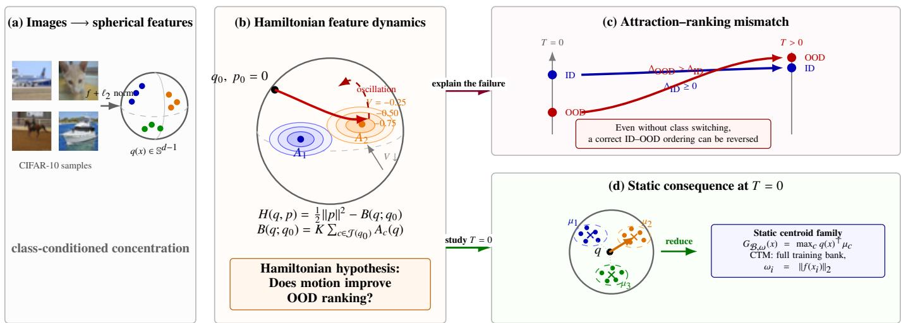  
Figure 1: Research map. Class-conditioned concentration on the feature sphere defines potential wells and a testable Hamiltonian hypothesis. Positive-time attraction need not preserve ID–OOD ordering; the locked score-aligned audit shows that the mismatch can persist without a winning-class switch. The exact T = 0 reference exposes a static geometry that reduces, after explicit candidate expansion, centroid approximation, and scale sharing, to a centroid family containing CTM as a full-bank member.

The contribution of this study is threefold:

• first, we analyze the attraction–ranking mismatch by separating field–score alignment from ID–OOD ranking and identifying the boundary condition that governs first-order AUROC change under regularity conditions;

• second, we show through controlled experiments that local score alignment does not guarantee better ranking, even without winning-class changes, and examine the boundary-based explanation in a separate perturbation study;

• third, we connect zero-step anchor scores to a static centroid family through approximation bounds and sharedscale ranking equivalence. This analysis also shows that CTM is an existing member of this family.

The rest of the paper is organized as follows. Section 2 positions the problem. Section 3 states the fundamental model, Section 4 develops the theory, and Section 5 derives its static consequence. Section 6 tests the theoretical chain, followed by discussion and limitations.

## 2. Related Work

## 2.1. Post-hoc OOD scores andfeature shaping

Post-hoc methods leave the classifier fixed. Outputbased scores include maximum softmax probability (MSP), ODIN, Energy, MaxLogit, generalized entropy, and Logit-Gap (Hendrycks and Gimpel, 2017; Liang et al., 2017; Liu et al., 2020; Hendrycks et al., 2022; Liu et al., 2023; Liang et al., 2025). Feature shaping instead modifies the representation used for scoring: ReAct clips activations, DICE retains high-contribution connections, ASH prunes and rescales acti vations, Scale rescales features, and RankFeat removes a dominant rank-one component (Sun et al., 2021; Sun and Li, 2022; Djurisic et al., 2023; Xu et al., 2024; Song et al., 2022). Gradient Short-Circuit studies post-hoc feature intervention, whereas FEVER-OOD uses dimensionality reduction and singular-value regularization to mitigate free-energy vulnerabilities (Gu et al., 2025; Isaac-Medina et al., 2025). These distinct training-time and inference-time approaches motivate our central question: when can a representation change be expected to improve rank ing?

## 2.2. Geometric and prototype-based detection

Geometric detectors use class statistics, neighborhoods, or residual subspaces. Representative examples include Mahalanobis distance, RMDS, KNN, ViM, and SHE (Lee et al., 2018; Ren et al., 2021; Sun et al., 2022; Wang et al., 2022; Zhang et al., 2023a). NNGuide and SIRC combine geometric evidence with classifier confidence (Park et al., 2023; Xia and Bouganis, 2024). Recent prototype methods refine the class representative or enrich its comparison rule: SPROD suppresses spurious features, POT uses prototype transport with virtual outliers, GROOD introduces an artificial OOD prototype, and uncertainty-aware refinement couples prototype geometry with energy (Zohrabi et al., 2025; Ke et al., 2025; ElAraby et al., 2025; Wei and Liu, 2026). CADRef retains class-aware relative information beyond a single centroid (Ling et al., 2025).

The CTM method is the closest static construction to our zero-step family (Nguyen et al., 2023). It averages unnormalized training features class-wise, normalizes the resulting means, and uses maximum cosine similarity. Section 5 bounds the centroid approximation error and shows that the resulting radial centroid score is rank-equivalent to cosine similarity under shared scales. CTM is recovered as a full-bank special case.

## 2.3. From geometric attraction to ranking

Manifold and class-concentration arguments motivate localized feature geometry (Cayton, 2008; Feferman et al., 2016), while spectral and information-geometric analyses relate learned representations to gradient or predictive geometry (Seleznova et al., 2026; Nguyen et al., 2026). These works explain why geometric structure can be informative. They do not imply that motion generated by this structure improves a distributional ranking.

Hamiltonian mechanics supplies a clean counterexample framework: a scalar potential generates coupled position– momentum motion (Arnold et al., 1989), whereas an OOD score evaluates a separate observable. We analyze why attraction need not improve ranking by separating (i) alignment between the dynamical driver and the observed score from (ii) alignment between samplewise score changes and ID–OOD pair ordering. The resulting pairwise decomposition, boundary derivative, and limitation on universal improvement apply to score refinement beyond this Hamiltonian implementation when their stated assumptions hold.

## 3. A Hamiltonian Model of Feature Refinement

To make the distinction between attraction and ranking explicit, we construct a model in which both the feature dynamics and the detection score are defined by class afinities. Normalized ID training features serve as anchors, and their afinities define a potential that drives query features toward the learned class regions. We then specify the Hamiltonian dynamics and the score evaluated along each trajectory, providing a concrete setting for analyzing how feature motion afects ID–OOD ranking. Further geometric motivation and details of the numerical update schemes are provided in Appendix A.1.

## 3.1. A class-induced landscape

Let $f : \mathcal { X } \to \mathbb { R } ^ { d }$ be the penultimate representation of a fixed classifier, with $f ( x ) \neq 0$ on the populations under consideration, and retain only feature direction,

$$
q ( x ) = \frac { f ( x ) } { \| f ( x ) \| _ { 2 } } \in \mathbb { S } ^ { d - 1 } .\tag{1}
$$

Let $C$ be the number of classes and $K \ge 1$ the number of anchors per class. For $c \in \{ 1 , . . . , C \}$ and $j \in \{ 1 , \ldots , K \}$ , let $a _ { c j } ~ \in ~ \mathbb { S } ^ { d - 1 }$ be normalized training features used as anchors, $w _ { c j } \geq 0$ their weights, and $\sigma _ { c j } > 0$ bandwidths. A decreasing radial kernel $\phi : [ 0 , \infty ) $ R defines the class afinity

$$
A _ { c } ( q ) = \frac { 1 } { K } \sum _ { j = 1 } ^ { K } w _ { c j } \phi \bigg ( \frac { | | q - a _ { c j } | | _ { 2 } } { \sigma _ { c j } } \bigg ) .\tag{2}
$$

The full-class reference potential is $\begin{array} { r } { V ( q ) = - \sum _ { c = 1 } ^ { C } A _ { c } ( q ) } \end{array}$ . In computation, a nonempty candidate set $\mathcal { T } ( q _ { 0 } ) \subseteq \{ 1 , \ldots , C \}$ is selected at the initial feature $q _ { 0 }$ and held fixed. The scalar driving the motion is

$$
B ( q ; q _ { 0 } ) = K \sum _ { c \in \mathcal { T } ( q _ { 0 } ) } A _ { c } ( q ) .\tag{3}
$$

The dynamics then use the conditional potential $\_ B ( q ; q _ { 0 } )$ .

## 3.2. The Hamiltonian question

Let $P _ { q } = I - q q ^ { \top }$ . On the tangent bundle $T \mathbb { S } ^ { d - 1 } = \{ ( q , p )$ ∥q∥2 = 1 $q ^ { \top } p = 0 \}$ , augment q with momentum $p$ and start the query from rest under

$$
\begin{array} { r l } { H ( q , p ) = \frac { 1 } { 2 } \| p \| _ { 2 } ^ { 2 } - B ( q ; q _ { 0 } ) , } & { { } } \\ { \dot { q } = p , } & { { } } \\ { \dot { p } = P _ { q } \nabla _ { q } B ( q ; q _ { 0 } ) - \| p \| _ { 2 } ^ { 2 } q , \qquad ( q _ { 0 } , p _ { 0 } ) = ( q ( x ) , 0 ) . } \end{array}\tag{4}
$$

The normal term preserves tangency. Let $\Delta t > 0$ be the numerical step size, $T \in \{ 0 , 1 , \ldots \}$ the number of steps, and $q _ { n }$ the feature after step n. Define the instantaneous score and the maximum score along the trajectory by

$$
m _ { \mathcal { T } } ( q ; q _ { 0 } ) = \operatorname* { m a x } _ { c \in \mathcal { T } ( q _ { 0 } ) } A _ { c } ( q ) , \qquad S _ { T } ( q _ { 0 } ) = \operatorname* { m a x } _ { 0 \leq n \leq T } m _ { \mathcal { T } } ( q _ { n } ; q _ { 0 } ) .\tag{5}
$$

Thus $S _ { T } \geq S _ { 0 }$ by construction even if instantaneous evidence decreases. The implementation stores $K S _ { T }$ because it sums rather than averages the K anchors; this common positive factor does not change rankings. Figure 2 shows the complete construction: spherical class wells generate motion, while the detector observes a maximum class afinity along the resulting trajectory.

Hypothesis 3.1 (Hamiltonian attraction hypothesis). Within a specified field, step-size, and trajectory-length grid, nonzero attraction toward the learned class regions improves the $I D -$ OOD ranking induced by the zero-step score $S _ { 0 } ,$ and this advantage persists across benchmark scale.

By construction, the trajectory score satisfies $S _ { T } ( q _ { 0 } ) \geq$ $S _ { 0 } ( q _ { 0 } )$ for every query. This samplewise guarantee does not establish the hypothesis, because OOD scores may increase more than ID scores. Moreover, the aggregate field driving the motion difers from the maximum class afinity used for scoring. These distinctions motivate the analysis in the next section.

## 4. Attraction–Ranking Mismatch Theory

We examine two links between feature motion and detection performance. First, does motion driven by the aggregate field increase the instantaneous detection score? Second, do the resulting score changes improve ID–OOD ranking? We begin with a step from rest to characterize the local efect of the driving field, then turn to the relative ordering of ID and OOD scores. Proofs and the connection between a single trajectory step and the continuous score family used in the boundary analysis are provided in Appendix A.2.

## 4.1. Field–score mismatch

Let $\boldsymbol { P } _ { \boldsymbol { q } } = \boldsymbol { I } - \boldsymbol { q } \boldsymbol { q } ^ { \intercal }$ be the tangent projector of the unit sphere. Both the constrained geodesic kick–drift–kick scheme and the original position-normalized update have the same first-step expansion from rest; Appendix A.1 treats both schemes. Gradients are taken with respect to the feature argument; the initial candidate set is held fixed. Smoothness near a point on the sphere refers to a smooth extension to an ambient neighborhood.

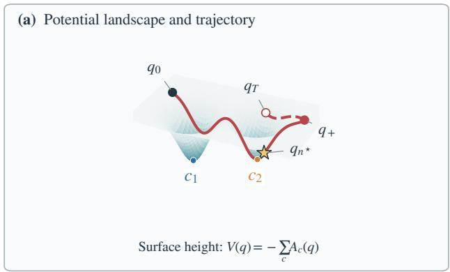

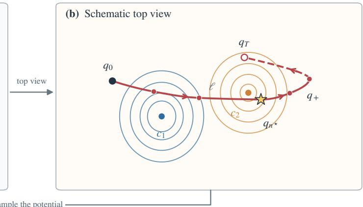

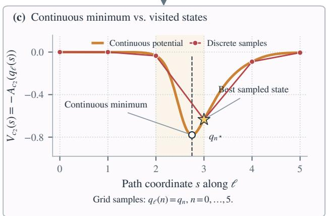

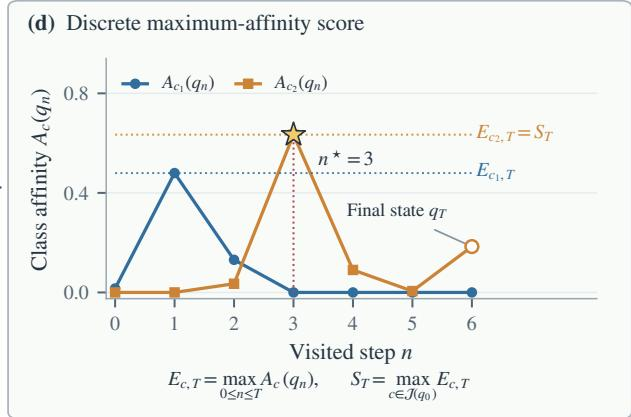  
Figure 2: Schematic construction of the trajectory score. (a) The surface height is $\begin{array} { r } { V ( q ) = - \sum _ { c } A _ { c } ( q ) } \end{array}$ , with wells labeled $c _ { 1 } , c _ { 2 }$ . (b) The same field and path in top view. Both views identify the initial state $q _ { 0 } ,$ best sampled state $q _ { n ^ { \star } }$ , illustrative turning state $q _ { + } ,$ , and final state $q _ { T }$ ; solid and dashed red curves show outward and returning motion. (c) Class potential along the outward branch ℓ, parameterized by $q _ { \ell } ( n ) = q _ { n }$ for $n = 0 , \ldots , 5 .$ Grid lines locate samples, and the red polygon joins their potential values. The continuous minimum (open circle) lies between samples and is lower than the best sampled value (star). (d) Each class contributes its maximum visited afinity $E _ { c , T }$ ; their largest value defines $S _ { T } ,$ which need not equal the final-state afinity. Stars mark the same state in all panels. All panels share afinities and sampled states; the planar motion is schematic, not a Hamiltonian simulation.

Theorem 4.1 (First-step field–score mismatch). Fix $\mathcal { T } ( q _ { 0 } )$ and suppose B and $A _ { c }$ are twice continuously diferentiable near $q _ { 0 } .$ Write $b _ { 0 } = P _ { q _ { 0 } } \nabla B ( q _ { 0 } ; q _ { 0 } )$ and $g _ { c } = P _ { q _ { 0 } } \nabla A _ { c } ( q _ { 0 } )$ . Starting from $p _ { 0 } = 0 ,$

$$
q _ { 1 } = q _ { 0 } + \frac { \Delta t ^ { 2 } } { 2 } b _ { 0 } + O ( \Delta t ^ { 4 } ) .\tag{6}
$$

Consequently,

$$
B ( q _ { 1 } ; q _ { 0 } ) - B ( q _ { 0 } ; q _ { 0 } ) = \frac { \Delta t ^ { 2 } } { 2 } \vert \vert b _ { 0 } \vert \vert _ { 2 } ^ { 2 } + O ( \Delta t ^ { 4 } ) ,\tag{7}
$$

$$
A _ { c } ( q _ { 1 } ) - A _ { c } ( q _ { 0 } ) = \frac { \Delta t ^ { 2 } } { 2 } \langle g _ { c } , b _ { 0 } \rangle + O ( \Delta t ^ { 4 } ) .\tag{8}
$$

Hence the aggregate driver’s leading change is nonnegative, and is positive when $b _ { 0 } \neq 0 ,$ , whereas an individual class afinity can either increase or decrease.

The theorem makes the first mismatch explicit: intuitive attraction follows the sum B, but the detector observes the largest class afinity. Other classes can therefore pull against the class that currently provides the score.

Definition 4.2 (Class-interference index). Let $c ^ { \star }$ be the unique maximizer of $\dot { \bf A } _ { c } ( q _ { 0 } )$ over $\mathcal { T } ( q _ { 0 } )$ and set $g _ { c } = P _ { q _ { 0 } } \nabla A _ { c } ( q _ { 0 } )$ . For

$g _ { c ^ { \star } } \neq 0 ,$ , define

$$
I ( q _ { 0 } ) = \frac { \sum _ { c \in \mathcal { T } ( q _ { 0 } ) \backslash \{ c ^ { \star } \} } \langle g _ { c ^ { \star } } , g _ { c } \rangle } { \| g _ { c ^ { \star } } \| _ { 2 } ^ { 2 } } .\tag{9}
$$

Corollary 4.3 (Destructive class interference). Under Theo rem 4.1 and Definition 4.2,

$$
A _ { c ^ { \star } } ( q _ { 1 } ) - A _ { c ^ { \star } } ( q _ { 0 } ) = \frac { K \Delta t ^ { 2 } } { 2 } \| g _ { c ^ { \star } } \| _ { 2 } ^ { 2 } [ 1 + I ( q _ { 0 } ) ] + O ( \Delta t ^ { 4 } ) .\tag{10}
$$

If $I ( q _ { 0 } ) ~ < ~ - 1$ , then for every suficiently small nonzero $\Delta t ,$ the aggregate field increases while the instantaneous maximum class afinity decreases.

For these suficiently small steps, $S _ { 1 } ( q _ { 0 } ) = S _ { 0 } ( q _ { 0 } )$ : the maximum along the trajectory retains the initial score. The instantaneous score decreases, but the trajectory score does not.

Definition 4.4 (Driver–score alignment). For a diferentiable driver F and instantaneous score s on the sphere, the driver is locally score-aligned at q when

$$
\begin{array} { r } { \mathcal { A } _ { F , s } ( q ) = \langle P _ { q } \nabla s ( q ) , P _ { q } \nabla F ( q ) \rangle \geq 0 , } \end{array}\tag{11}
$$

and strictly aligned when the inequality is strict.

For twice continuously diferentiable F and s, a step from rest changes s by $\begin{array} { r } { \frac { 1 } { \gamma } \Delta t { ' } \mathcal { A } _ { F , s } ( q ) + O ( \Delta t ^ { 4 } ) } \end{array}$ . Choosing $F = s$ therefore removes the local field–score conflict away from ties. This is a statement about a step from rest. At a general point on the continuous trajectory,

$$
\frac { d } { d t } s ( q ( t ) ) = \langle P _ { q ( t ) } \nabla s ( q ( t ) ) , p ( t ) \rangle ,
$$

so alignment of the driver alone does not imply a monotone instantaneous score. The trajectory score $S _ { T }$ is nondecreasing in T because it retains the maximum. Neither property determines the relative changes of ID and OOD scores. Figure 3 contrasts these two levels.

## 4.2. Fromfixed winners to pairwise ranking

For score-aligned dynamics, let $c _ { 0 } = \arg \operatorname* { m a x } _ { c \in \mathcal { T } ( q _ { 0 } ) } A _ { c } ( q _ { 0 } )$ using deterministic tie-breaking. The initial-winner driver is $F _ { \mathrm { i n i t } } \ = \ K A _ { c _ { 0 } } ,$ while the current-winner driver is $\begin{array} { r l } { F _ { \mathrm { c u r } } } & { { } = } \end{array}$ $K m _ { \mathcal { T } } ( \cdot ; q _ { 0 } )$ and reselects its active class at each force evaluation. The initial-winner control retains only $\mathrm { m a x } _ { n \leq T } A _ { c _ { 0 } } ( q _ { n } )$ ; the current-winner control uses $S _ { T }$

Proposition 4.5 (Fixed-winner equivalence). Run the two systems from the same initial state with the same deterministic kick–drift–kick scheme and candidate set. If c0 is the unique maximizer at every retained state of the initial-winner trajectory, then their states, active classes, driver values, and retained scores are identical at every step. For an integrator with additional internal force evaluations, the same condition is required at those evaluation points.

When the winner stays fixed, these controls cannot difer through class selection. Their common score can still change ID–OOD ordering. Define the score increase $\Delta _ { T } ( q ) = S _ { T } ( q ) -$ $S _ { 0 } ( q ) \geq 0$

Let $X _ { \mathrm { i n } } \sim P _ { \mathrm { i n } }$ and $X _ { \mathrm { o u t } } \sim P _ { \mathrm { o u t } }$ be independent input samples, and set $Q _ { \mathrm { i n } } = q ( X _ { \mathrm { i n } } )$ and $Q _ { \mathrm { o u t } } = q ( X _ { \mathrm { o u t } } )$ . For a measurable input score $s :  { \mathcal { X } } \to \mathbb { R }$ , larger values indicate stronger ID evidence. We use

$$
\begin{array} { r l } { \mathrm { A U R O C } ( s ) = \operatorname* { P r } \{ s ( X _ { \mathrm { i n } } ) > s ( X _ { \mathrm { o u t } } ) \} } & { } \\ { \quad \quad \quad \quad \quad \quad + \frac { 1 } { 2 } \operatorname* { P r } \{ s ( X _ { \mathrm { i n } } ) = s ( X _ { \mathrm { o u t } } ) \} . } \end{array}\tag{12}
$$

For feature scores, write $\mathrm { A U R O C } _ { T } = \mathrm { A U R O C } ( S _ { T } \circ q )$

Definition 4.6 (Corrected and spoiled pairs). For the independent features defined above, let

$$
M _ { 0 } = S _ { 0 } ( Q _ { \mathrm { i n } } ) - S _ { 0 } ( Q _ { \mathrm { o u t } } ) , \qquad D _ { T } = \Delta _ { T } ( Q _ { \mathrm { i n } } ) - \Delta _ { T } ( Q _ { \mathrm { o u t } } ) .
$$

The sets

$$
\begin{array} { r } { C _ { T } = \{ M _ { 0 } \leq 0 , M _ { 0 } + D _ { T } > 0 \} , } \\ { S _ { T } = \{ M _ { 0 } > 0 , M _ { 0 } + D _ { T } \leq 0 \} . } \end{array}\tag{13}
$$

contain baseline errors corrected by the trajectory and baseline-correct pairs spoiled by it, respectively.

Theorem 4.7 (Exact AUROC decomposition). Assume score ties have probability zero for $S _ { 0 }$ and $S _ { T } ,$ , and write $\Delta \mathrm { A U R O C } =$ $\mathrm { A U R O C } _ { T } - \mathrm { A U R O C } _ { 0 } .$ . Then

$$
\begin{array} { r l } & { \mathrm { A U R O C } _ { T } - \mathrm { A U R O C } _ { 0 } = \operatorname* { P r } ( C _ { T } ) - \operatorname* { P r } ( S _ { T } ) , } \\ & { \quad \quad \quad | \Delta \mathrm { A U R O C } | \leq \operatorname* { P r } ( | M _ { 0 } | \leq | D _ { T } | ) . } \end{array}\tag{14}
$$

The identity shows why nonnegative score increases are insuficient: ranking improves only when corrected-pair mass exceeds spoiled-pair mass.

This finite-change identity applies to the trajectory score for any fixed T. To identify which pairs control a small change, we next consider a score family indexed by a continuous parameter η. Its expansion and distributional assumptions must be checked separately; integer step counts and maxima along a trajectory do not automatically satisfy them.

Theorem 4.8 (Boundary-conditioned AUROC derivative). For the independent inputs $X _ { \mathrm { i n } } , X _ { \mathrm { o u t } }$ defined above, let $s _ { \eta } : X \to \mathbb { R }$ be a measurable scorefamily with

$$
\begin{array} { c } { { s _ { \eta } ( x ) = s _ { 0 } ( x ) + \eta r ( x ) + R _ { \eta } ( x ) , } } \\ { { { \cal M } _ { 0 } = s _ { 0 } ( X _ { \mathrm { i n } } ) - s _ { 0 } ( X _ { \mathrm { o u t } } ) , } } \\ { { { \cal U } = r ( X _ { \mathrm { i n } } ) - r ( X _ { \mathrm { o u t } } ) . } } \end{array}
$$

Suppose:

1. $\varepsilon _ { \eta } = \Vert R _ { \eta } \Vert _ { L ^ { \infty } ( P _ { \mathrm { i n } } + P _ { \mathrm { o u t } } ) } = o ( \vert \eta \vert ) ;$

2. $\mathbb { E } | U | < \infty ,$ and $( M _ { 0 } , U )$ has a joint density $p _ { M _ { 0 } , U } ( m , u )$ continuous in m at zero for almost every u;

3. for some $\delta > 0$ and measurable $g \ge 0 , p _ { M _ { 0 } , U } ( m , u ) \le g ( u )$ whenever |m| $\leq \delta ,$ with $\int ( 1 + | u | ) g ( u ) d u < \infty ,$ , and $p _ { M _ { 0 } } ( 0 ) =$ $\begin{array} { r } { \int p _ { M _ { 0 } , U } ( 0 , u ) d u > 0 . } \end{array}$

Then

$$
\frac d { d \eta } \operatorname { A U R O C } ( s _ { \eta } ) \bigg \vert _ { \eta = 0 } = p _ { M _ { 0 } } ( 0 ) \mathbb { E } [ U \mid M _ { 0 } = 0 ] .\tag{15}
$$

Here the conditional mean is defined by the density:

$$
\mathbb { E } [ U \mid M _ { 0 } = 0 ] = \frac { \int u p _ { M _ { 0 } , U } ( 0 , u ) d u } { p _ { M _ { 0 } } ( 0 ) } .
$$

If the score family is defined only for $\eta \geq 0$ , the derivative is right-sided. The ranking boundary $M _ { 0 } = 0$ consists of ID–OOD pairs with equal baseline scores; it is not a classifier’s class decision boundary. Relative score change at this boundary controls the first-order AUROC change, whereas the global mean E[U] need not have the same sign.

Theorem 4.9 (No universal AUROC gain from deterministic refinement). Let $s , s _ { \mathrm { r e f } } : \mathcal { X } \to$ R be measurable baseline and deterministic refined scores. If $s ( x ) > s ( y )$ but $s _ { \mathrm { r e f } } ( x ) \leq s _ { \mathrm { r e f } } ( y )$ for some $x , y ,$ then there exist ID and OOD distributions for which $\mathrm { A U R O C } ( s _ { \mathrm { r e f } } ) \ < \ \mathrm { A U R O C } ( s )$ Universal non-decrease over all ID/OOD distributions without baseline ties therefore requires strict preservation of every ordering induced by s; under that condition, the two AUROCs are equalfor all such distributions.

Proof. Choose the point-mass distributions $P _ { \mathrm { i n } } = \delta _ { x }$ and $\boldsymbol { P _ { \mathrm { o u t } } } =$ $\delta _ { y }$ . Equation (12) gives $\mathbf { A U R O C } ( s ) = 1$ , while

$$
\mathrm { A U R O C } ( s _ { \mathrm { r e f } } ) = \left\{ 0 , \begin{array} { l l } { \qquad s _ { \mathrm { r e f } } ( x ) < s _ { \mathrm { r e f } } ( y ) , } \\ { 1 / 2 , } & { s _ { \mathrm { r e f } } ( x ) = s _ { \mathrm { r e f } } ( y ) . } \end{array} \right.
$$

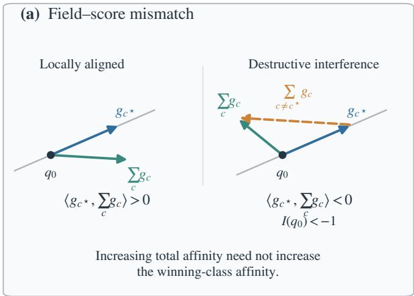

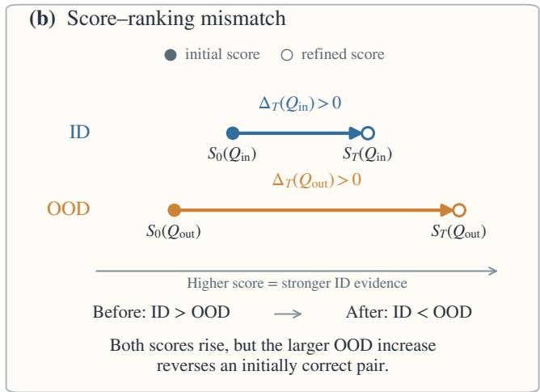  
Figure 3: Two levels of the attraction–ranking mismatch. (a) A projected aggregate force can align with the winning-class score gradient (left), whereas nonwinning classes can reverse that alignment and produce the destructive condition $I ( q _ { 0 } ) < - 1 \ : ( \mathrm { r i g h t } )$ . (b) Even when each sample’s retained trajectory score is nondecreasing, unequal ID and OOD increases can reverse an initially correct pair. All class sums are over J(q ). Panel (a) is a theoretical schematic, not an observed audit sample; the geometry and values are illustrative.

Thus universal non-decrease requires $s ( x ) > s ( y ) \Rightarrow s _ { \mathrm { r e f } } ( x ) >$ $s _ { \mathrm { r e f } } ( y )$ for every pair. Applying this condition also with $x , y$ exchanged preserves the sign of every nonzero baseline diference. If baseline ties have probability zero, then

$$
{ \bf 1 } _ { \{ s ( X _ { \mathrm { i n } } ) > s ( X _ { \mathrm { o u t } } ) \} } = { \bf 1 } _ { \{ s _ { \mathrm { r e f } } ( X _ { \mathrm { i n } } ) > s _ { \mathrm { r e f } } ( X _ { \mathrm { o u t } } ) \} } \quad \mathrm { a l m o s t ~ s u r e l y } ,
$$

and refined ties also have probability zero. Taking expectations proves equality of the two AUROCs. □

The theorem limits guarantees over all ID/OOD distributions; it does not rule out improvement on a particular task. Preserving every strict baseline ordering leaves AUROC unchanged when baseline ties have probability zero, whereas changing such an ordering can reduce AUROC for some distributions.

## 5. Static Scores at Zero Steps

The preceding analysis studies how feature motion changes the ranking relative to the initial score $S _ { 0 } .$ We now examine the structure of this baseline: what geometric information does the detector use before any motion takes place? Setting $T = 0$ in Eq. (5) gives $\begin{array} { r } { S _ { 0 } ( q ) = \operatorname* { m a x } _ { c \in \mathcal { T } ( q ) } A _ { c } ( q ) } \end{array}$

To study its relation to centroid scoring, we consider the fullclass score $S _ { 0 } ^ { \mathrm { a l l } } ( q ) = \operatorname* { m a x } _ { 1 \leq c \leq C } A _ { c } ( q )$ . Removing candidate truncation is an additional modeling choice and need not preserve the original score. We first bound the error of replacing each class field by a centroid score, then examine when the resulting scores induce the same ranking as cosine similarity. Proofs are provided in Appendix A.3.

Write $\begin{array} { r } { W _ { c } = K ^ { - 1 } \sum _ { j } w _ { c j } , \pi _ { c j } = { w _ { c j } } / \sum _ { \ell } w _ { c \ell } , \bar { a } _ { c } = \sum _ { j } \pi _ { c j } a _ { c j } , } \end{array}$ and $\mu _ { c } = \bar { a } _ { c } / | | \bar { a } _ { c } | | _ { 2 }$ . Assume $\sum _ { j } w _ { c j } > 0$ and $\bar { \boldsymbol { a } } _ { c } \neq 0$ for every class considered.

Proposition 5.1 (Centroid approximation). Suppose class c uses a common bandwidth $\sigma _ { c }$ and $\phi$ is $L _ { \phi } { - } L i p s c h i t z .$ Define $\widetilde { A } _ { c } ( q ) = W _ { c } \phi ( \| q - \mu _ { c } \| _ { 2 } / \sigma _ { c } ) .$ Then

$$
| A _ { c } ( q ) - \widetilde { A } _ { c } ( q ) | \leq \frac { W _ { c } L _ { \phi } } { \sigma _ { c } } \left( \sum _ { j } \pi _ { c j } \| a _ { c j } - \bar { a } _ { c } \| _ { 2 } + | 1 - \| \bar { a } _ { c } \| _ { 2 } | \right) .\tag{16}
$$

Consequently, the maximum-field error is bounded by the largest class-wise right-hand side.

Let ϵ be the maximum, over classes, of the right-hand side of Eq. (16), and write $\widetilde { S } _ { 0 } ( q ) = \operatorname* { m a x } _ { c } \widetilde { A } _ { c } ( q )$ . Then $\operatorname* { s u p } _ { q } | S _ { 0 } ^ { \mathrm { a l l } } ( q ) -$ $\widetilde { S } _ { 0 } ( q ) | \le \epsilon .$ . In particular,

$$
S _ { 0 } ^ { \mathrm { a l l } } ( q ) - S _ { 0 } ^ { \mathrm { a l l } } ( q ^ { \prime } ) > 2 \epsilon \quad \Longrightarrow \quad \widetilde { S } _ { 0 } ( q ) > \widetilde { S } _ { 0 } ( q ^ { \prime } ) .\tag{17}
$$

Smaller margins need not be preserved. The following exact equivalence concerns the approximated centroid score, not the original anchor score.

Proposition 5.2 (Common-scale ranking equivalence). $I f W _ { c } =$ $W > 0$ and $\sigma _ { c } = \sigma > 0$ are shared across classes and ϕ is strictly decreasing, then for unit q and $\mu _ { c }$

$$
\operatorname* { m a x } _ { c } \widetilde { A } _ { c } ( q ) = W \phi \left( \frac { \sqrt { 2 - 2 G ( q ) } } { \sigma } \right) , \qquad G ( q ) = \operatorname* { m a x } _ { c } q ^ { \top } \mu _ { c } .\tag{18}
$$

The two scores select the same classes and rank all samples identically.

Definition 5.3 (Static centroid family). Let $\mathcal { B } = ( \mathcal { B } _ { c } ) _ { c = 1 } ^ { C }$ , where $\mathcal { B } _ { c }$ is a nonempty set of training-example indices for class c. For positive directional weights ω such that $\begin{array} { r } { \sum _ { i \in \mathcal { B } _ { c } } \omega _ { i } q ( x _ { i } ) \neq 0 , } \end{array}$ define

$$
\begin{array} { r l } & { \mu _ { c } ( \mathcal { B } , \omega ) = \frac { \sum _ { i \in \mathcal { B } _ { c } } \omega _ { i } q ( x _ { i } ) } { \| \sum _ { i \in \mathcal { B } _ { c } } \omega _ { i } q ( x _ { i } ) \| _ { 2 } } , } \\ & { \quad G _ { \mathcal { B } , \omega } ( x ) = \underset { c } { \operatorname* { m a x } } q ( x ) ^ { \top } \mu _ { c } ( \mathcal { B } , \omega ) . } \end{array}\tag{19}
$$

The collection of all such $G _ { \mathcal { B } , \omega }$ is the static centroid family induced by the zero-step reduction.

Unequal bank sizes are also compatible with a common class multiplier. For $K _ { c } = | \mathcal { B } _ { c } | ,$ , replace $\bar { K } ^ { - 1 } \sum _ { j }$ in the class afinity by $K _ { c } ^ { - 1 } \sum _ { i \in \mathcal { B } _ { c } }$ and choose

$$
w _ { c i } = \frac { K _ { c } W \omega _ { i } } { \sum _ { j \in \mathcal { B } _ { c } } \omega _ { j } } .
$$

Then $\begin{array} { r } { K _ { c } ^ { - 1 } \sum _ { i } w _ { c i } = W } \end{array}$ , while the normalized anchor weights are $\pi _ { c i } = \omega _ { i } / \sum _ { j } \omega _ { j }$ . Thus bank selection and directional weighting identify diferent members of the same family under shared bandwidths.

Proposition 5.4 (CTM is a special case). Let $\mathcal { B } _ { \mathrm { a l l } }$ contain all training indices for each class. Write each training feature as $f ( x _ { i } ) ~ = ~ r _ { i } q ( x _ { i } )$ with $r _ { i } ~ = ~ \| f ( x _ { i } ) \| _ { 2 }$ . CTM’s normalized class mean is $\mu _ { c } ( { \mathcal { B } } _ { \mathrm { a l l } } , r )$ , and its maximum-cosine score is exactly $G _ { \mathcal { B } _ { \mathrm { a l l } , r } } .$ Hence CTM is the full-bank, feature-norm-weighted member ofDefinition 5.3.

The reduction separates three operations: removing candidate truncation, approximating each class field by a centroid, and imposing shared scales. The approximation is controlled by an error bound; the resulting radial centroid and cosine scores are exactly rank-equivalent under the shared-scale conditions. CTM is an existing member of this static family. This connection provides static controls for separating feature motion from score construction; the ranking equivalence does not extend to the original anchor field without accounting for the approximation error.

## 6. Experiments

The experiments address three questions: whether the tested attraction improves OOD ranking, whether local score alignment prevents ranking failure, and whether a boundary statistic explains the direction of small AUROC changes. A final comparison separates the steps of the static reduction. Destructive first-step interference is a theoretical possibility; the real-data studies below do not establish its occurrence.

## 6.1. Protocol

We use OpenOOD v1.5 splits (Zhang et al., 2023b). CIFAR-10, CIFAR-100, and ImageNet-200 use three oficial ResNet-18 checkpoints; ImageNet-1K uses a pinned torchvision ResNet-50 V1, with DenseNet-121 as an additional backbone. Tables A.19–A.20 report the individual Near-/Far-OOD datasets and results.

The original position-normalized dynamics use Gaussian anchor fields, $\Delta t = 0 . 0 5$ , and $T \in \{ 0 , 1 , 3 , 1 0 \}$ . CIFAR uses 80 anchors per class and all-class forces; ImageNet uses five anchors from 12 setup features per class and a fixed initial top-20 candidate set. The separate score-aligned audit uses five anchors from 12 setup features per class on every benchmark, all 10 classes on CIFAR-10, fixed top-20 candidates elsewhere, exact geodesic drift, $\Delta t \ = \ 0 . 0 5 ,$ and $T \in \{ 0 , 1 , 3 , 5 , 1 0 \}$ Currentwinner, $T \ = \ 5$ is selected on an ImageNet-1K tuning split, checked on its disjoint holdout, and transferred without retuning to CIFAR-10, CIFAR-100, and ImageNet-200. The scorealigned rule and step count are fixed across benchmarks; each benchmark uses its own classifier and anchor field. The scorealigned study and the separate stability probe use distinct validation partitions, with parameter selection and holdout evaluation kept separate. The probe step size is selected on the source and fixed across targets. Neither study uses Near-/Far-OOD test loaders. The original trajectory comparisons and static baselines report Near-/Far-OOD test results. Proxy OOD is Tiny ImageNet for CIFAR and OpenImage-O for ImageNet.

Table 1: Gaussian trajectory ablation. The best nonzero T is selected retrospectively from {1 3 10}. Entries are AUROC/FPR@95; ∆ is the AUROC change from $T = 0 .$
<table><tr><td>ID</td><td>Group</td><td> $T = 0$ </td><td>best T &gt; 0</td><td>T</td><td>∆</td></tr><tr><td>CIFAR-10</td><td>Near</td><td>88.59/42.36</td><td>88.95/40.91</td><td>10</td><td>+.36</td></tr><tr><td rowspan="2">CIFAR-100</td><td>Far</td><td>91.07/31.09</td><td>91.56/29.95</td><td>10</td><td>+.49</td></tr><tr><td>Near</td><td>79.46/63.16</td><td>79.72/61.88</td><td>3</td><td>+.26</td></tr><tr><td rowspan="2">IN-200</td><td>Far</td><td>83.41/51.10</td><td>84.01/49.61</td><td>3</td><td>+.60</td></tr><tr><td>Near</td><td>79.44/64.42</td><td>80.22/61.89</td><td>3</td><td>+.78</td></tr><tr><td rowspan="2">IN-1K</td><td>Far</td><td>91.18/31.66</td><td>91.29/31.36</td><td>1</td><td>+.11</td></tr><tr><td>Near</td><td>66.14/77.84</td><td>64.51/79.27</td><td>1</td><td>-1.63</td></tr><tr><td></td><td>Far</td><td>77.44/65.16</td><td>74.37/69.75</td><td>3</td><td>-3.07</td></tr></table>

The static comparisons use the same backbones and loaders. CTM uses the full training bank, while the small-bank control uses 80 directions per class on CIFAR and 12 on ImageNet. Its maximum cosine similarity is combined with MSP at the previously selected weight $\alpha = 0 . 8$ after ID-only standardization. We call this the centroid–MSP baseline and use it to examine the static construction in Section 5.

We report AUROC and FPR@95; higher AUROC and lower FPR@95 are better. Following the evaluation code, FPR@95 uses OOD as positive: it is the ID rejection rate at 95% OOD recall. AUROC assigns half credit to ties. CIFAR and ImageNet-200 results average three independently trained model seeds. ImageNet-1K variability for anchor-based methods is over three sampled banks on a fixed backbone. Selection and calibration settings are described in Appendix A.14.

## 6.2. Testing the attraction hypothesis

Table 1 compares the zero-step Gaussian field with the best nonzero step count in the tested grid. Small gains occur on CIFAR and ImageNet-200, but every tested nonzero Gaussian trajectory is worse on ImageNet-1K: even the retrospective best loses 1 63 Near-OOD and 3 07 Far-OOD AUROC points. The complete T grid, IMQ control, five-kernel study, and anchorweighting ablation appear in Tables A.9, A.10, A.11, and A.12. Nonzero attraction is therefore not consistently better than $T =$ 0 across these benchmarks. This comparison does not exclude improvements at other step sizes or trajectory lengths.

## 6.3. Rankingfailure without class switching

The current-winner flow raises AUROC from 71 79 to 72 93 on the ImageNet-1K holdout, but this improvement does not transfer. Table 2 shows negative AUROC change on every seed of the three target benchmarks. Spoiled pairs exceed corrected pairs in all nine runs, as accounted for exactly by Theorem 4.7. Moreover, none of the 20,205 audited sample–seed trajectories changes its initial winning class. Thus ranking can deteriorate without a change of winning class.

Away from ties, the current-winner flow satisfies the local alignment condition in Definition 4.4. Numerical checks support the local expansion and confirm that the geodesic update preserves the sphere and tangent momentum to numerical precision. The audit finds no destructive first-step interference. Appendix A.4 reports the numerical checks and the comparison with the initial-winner flow; the exact equivalence in Proposition 4.5 additionally requires a unique winner at every force evaluation.

## 6.4. Evaluating the boundary-based diagnostic

To examine the local diagnostic suggested by Theorem 4.8, we use a separate perturbation with an explicit score derivative. A small repulsive step from a fixed class centroid provides this control: its score decrease can be calculated for each sample and compared across ID–OOD pairs. The probe uses the score at the perturbed feature, not the maximum along an attractive trajectory. Let m(x) be MSP, $\hat { c } ( x ) = \arg \operatorname* { m a x } _ { 1 \leq c \leq C } q ( x ) ^ { \top } \mu _ { c } ,$ $\begin{array} { r } { G ( x ) = q ( x ) ^ { \top } \mu _ { \hat { c } ( x ) } , } \end{array}$ with a deterministic rule for ties, and $D ( x ) =$ $( 1 - m ( x ) ) ( 1 - G ( x ) ^ { 2 } )$ . Freeze m, ˆc, and the ID-fit calibration statistics, and set

$$
\begin{array} { r l r } { q _ { \eta } ( x ) = \mathrm { E x p } _ { q ( x ) } \bigl [ - \eta ( 1 - m ( x ) ) P _ { q ( x ) } \mu _ { \hat { c } ( x ) } \bigr ] , } & { } & \\ { s _ { \eta } ^ { \mathrm { p r o b e } } ( x ) = ( 1 - \alpha ) \displaystyle \frac { m ( x ) - \bar { m } } { \sigma _ { m } } + \alpha \displaystyle \frac { q _ { \eta } ( x ) ^ { \top } \mu _ { \hat { c } ( x ) } - \bar { G } } { \sigma _ { G } } , \qquad \alpha = 0 . 8 . } & { } & \end{array}\tag{20}
$$

Here Exp is the spherical exponential map. The means $\bar { m } , \bar { G }$ and positive standard deviations $\sigma _ { m } , \sigma _ { G }$ are fitted on the ID-fit split and held fixed. The probe keeps the initial centroid and uses no maximum over the trajectory. Its score derivative is

$$
\left. \frac { \partial s _ { \eta } ^ { \mathrm { p r o b e } } ( x ) } { \partial \eta } \right| _ { \eta = 0 } = - \frac { \alpha } { \sigma _ { G } } D ( x ) .
$$

Thus D measures the decrease up to the common positive factor $\alpha / \sigma _ { G }$ . Define

$$
M _ { \eta } ^ { \mathrm { p r o b e } } = s _ { \eta } ^ { \mathrm { p r o b e } } ( X _ { \mathrm { i n } } ) - s _ { \eta } ^ { \mathrm { p r o b e } } ( X _ { \mathrm { o u t } } ) .
$$

The repulsive step gives

$$
M _ { \eta } ^ { \mathrm { p r o b e } } = M _ { 0 } ^ { \mathrm { p r o b e } } + { \frac { \alpha \eta } { \sigma _ { G } } } \{ D ( X _ { \mathrm { o u t } } ) - D ( X _ { \mathrm { i n } } ) \} + { \cal O } ( \eta ^ { 2 } ) .\tag{21}
$$

Under the theorem’s density conditions, the first-order AUROC change is positive exactly when $\mathbb { E } [ D ( X _ { \mathrm { o u t } } ) - D ( X _ { \mathrm { i n } } ) \ | \ M _ { 0 } ^ { \mathrm { p r o b e } } =$ $0 ] ~ > ~ 0$ . The uniform score remainder holds here because $m \in [ 0 , 1 ] , G \in [ - 1 , 1 ]$ , and the calibration scales are fixed.

To summarize pairs near this boundary, let $\scriptstyle { \mathcal { I } } _ { \rho }$ contain the empirical fraction $\rho$ of ID–OOD pairs with the smallest absolute baseline margins, and define

$$
B _ { \rho } = \frac { 1 } { | \mathcal { I } _ { \rho } | } \sum _ { ( i , j ) \in \mathcal { I } _ { \rho } } \big [ D ( x _ { j } ^ { \mathrm { o u t } } ) - D ( x _ { i } ^ { \mathrm { i n } } ) \big ] .\tag{22}
$$

Here $x _ { i } ^ { \mathrm { i n } } , x _ { j } ^ { \mathrm { o u t } }$ are validation inputs. We report $B _ { 5 \% }$ and use $B _ { 1 0 0 \% }$ for the mean over all pairs. Writing $p _ { M _ { 0 } ^ { \mathrm { p r o b e } } }$ for the baseline margin density, the theorem gives

$$
\begin{array} { l } { \displaystyle \Delta \mathrm { A U R O C } = \eta { p _ { M _ { 0 } ^ { \mathrm { p r o b e } } } ( 0 ) \frac { \alpha } { \sigma _ { G } } } } \\ { \displaystyle \qquad \times \mathbb { E } [ D ( X _ { \mathrm { o u t } } ) - D ( X _ { \mathrm { i n } } ) \mid M _ { 0 } ^ { \mathrm { p r o b e } } = 0 ] + o ( \eta ) . } \end{array}\tag{23}
$$

Both the boundary density and the calibration scale can vary across settings. We therefore use $B _ { 5 \% }$ as a diagnostic of direction, rather than as a predictor of AUROC-change magnitude across settings.

The primary $\eta = 0 . 0 4$ is selected on ImageNet-1K/ResNet-50 and then fixed before all reported transfers. Table 3 shows small positive changes on both ImageNet-1K backbones but no positive target mean. The 5% boundary statistic has the same sign as AUROC change in 14 of 15 runs across five dataset– backbone settings. In contrast, the unconditional statistic is positive on all three transfer targets and has the opposite sign to their observed changes. Figure 4 visualizes this separation. This finite-window agreement is descriptive, not a direct estimate of the infinitesimal derivative or a significance test. The probe tests this local mechanism, not a performanceimprovement claim; detailed boundary fractions and descriptive correlations are in Appendix A.5.

## 6.5. Auditing the zero-step reduction

The static comparisons distinguish the efect of feature motion from the choices used to construct the zero-step score. The six-stage comparison in Table 4 separates field, scale, centroid, bank, and fusion efects on fixed ImageNet-1K validation features. Candidate truncation is removed before S1, which al ready uses the full class set; S2 then shares the class scales. These are additional modeling choices beyond setting $T = 0 .$ Sharing class scale produces the largest single increase; radial centroid afinity and cosine then give identical rankings, exactly as Proposition 5.2 predicts. The empirical gain from centroid replacement is not certified by the global approximation bound, which preserves no audited pair by itself. Enlarging the bank and adding MSP are empirical controls rather than consequences of the reduction.

The static controls are competitive but not uniformly dominant. CTM is slightly stronger than the centroid–MSP baseline on four of eight Near-/Far-OOD AUROC tasks, CADRef leads on several ImageNet groups, and Scale is strongest on ImageNet-1K. Complete baselines, component ablations, classcount analysis, bank/calibration sensitivity, and batch-one eficiency are therefore placed in Appendix A.9. These comparisons show how training-bank estimation and confidence fusion afect the static baselines.

Table 2: Validation-only score-alignment audit. ImageNet-1K is the holdout after selection; other rows transfer the selected current-winner geodesic $T = 5$ rule without retuning. Entries are mean±standard deviation AUROC/FPR@95; $\Delta _ { 0 }$ is aligned T = 5 AUROC minus T = 0 AUROC.
<table><tr><td>Benchmark</td><td>T = 0</td><td>Aggregate T = 5</td><td>Current winner  $T = 5$ </td><td> $\Delta _ { 0 }$ </td></tr><tr><td>ImageNet-1K</td><td> $7 1 . 7 9 \pm . 8 2 / 7 2 . 6 3 \pm 3 . 1 7$ </td><td> $6 5 . 9 9 \pm . 2 3 / 7 4 . 5 9 \pm 1 . 4 0$ </td><td> $7 2 . 9 3 \pm . 5 7 / 7 2 . 0 3 \pm 2 . 6 6$ </td><td> $+ 1 . 1 4$ </td></tr><tr><td>CIFAR-10</td><td> $8 9 . 4 2 \pm . 3 7 / 3 9 . 6 0 \pm 3 . 2 2$ </td><td> $9 0 . 1 3 \pm . 1 9 / 3 6 . 2 7 \pm 7 . 1 0$ </td><td> $8 7 . 9 8 \pm . 3 9 / 5 4 . 6 7 \pm 7 . 6 3$ </td><td> $- 1 . 4 3$ </td></tr><tr><td>CIFAR-100</td><td> $8 4 . 2 6 \pm . 8 8 / 4 7 . 0 7 \pm 6 . 8 8$ </td><td> $8 5 . 3 8 \pm 1 . 0 2 / 4 5 . 2 7 \pm 4 . 9 7$ </td><td> $8 3 . 8 4 \pm . 8 9 / 4 8 . 9 3 \pm 4 . 0 6$ </td><td> $- . 4 2$ </td></tr><tr><td>ImageNet-200</td><td> $8 8 . 0 9 \pm . 6 9 / 3 8 . 7 8 \pm 2 . 6 7$ </td><td> $8 6 . 7 3 \pm 1 . 4 8 / 3 8 . 6 1 \pm 3 . 1 5$ </td><td> $8 7 . 5 3 \pm . 9 3 / 4 0 . 1 7 \pm 4 . 0 9$ </td><td> $- . 5 6$ </td></tr></table>

Table 3: Stability probe with a fixed step size. Static and probe columns report AUROC; $\overline { { B } } _ { 5 \% }$ is $B { 5 \% }$ from Eq. (22), averaged over three seeds.
<table><tr><td>Target</td><td>Static</td><td>Probe</td><td>Δ</td><td> $1 0 ^ { 3 } \overline { { B } } _ { 5 \% }$ </td><td>Positive seeds</td></tr><tr><td> $\mathrm { I N } { - } 1 \mathrm { K } / \mathrm { R e s N e t } { - } 5 0$ </td><td> $9 1 . 6 7 \pm . 4 5$ </td><td> $9 1 . 7 3 \pm . 4 4$ </td><td>+.056</td><td> $+ 1 3 . 3 2 9$ </td><td>3/3</td></tr><tr><td> $\mathrm { I N } { - } 1 \mathrm { K } / \mathrm { D e n s e N e t - } 1 2 1$ </td><td> $8 9 . 8 2 \pm . 4 0 $ </td><td> $9 0 . 0 4 \pm . 3 8 $ </td><td> $+ . 2 1 9$ </td><td> $+ 3 4 . 3 9 5$ </td><td>3/3</td></tr><tr><td>CIFAR-10</td><td> $8 9 . 4 6 \pm . 8 1$ </td><td> $8 9 . 4 5 \pm . 8 1$ </td><td>-.006</td><td>-.551</td><td>0/3</td></tr><tr><td>CIFAR-100</td><td> $8 4 . 9 6 \pm . 7 3$ </td><td> $8 4 . 9 5 \pm . 7 4$ </td><td>-.016</td><td>-.589</td><td>1/3</td></tr><tr><td>ImageNet-200</td><td> $9 2 . 1 1 \pm . 3 2 $ </td><td> $9 2 . 0 8 \pm . 3 3 $ </td><td>-.027</td><td>-1.871</td><td>0/3</td></tr></table>

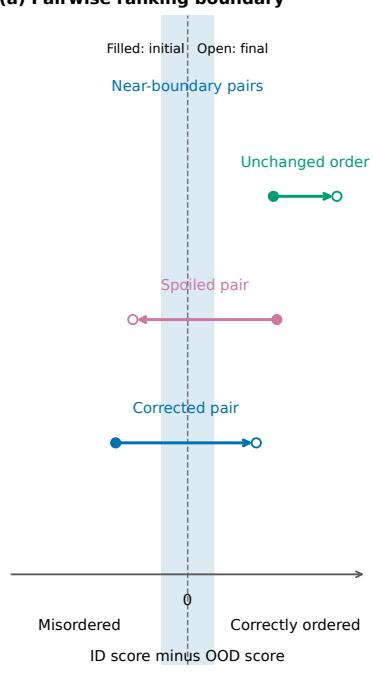

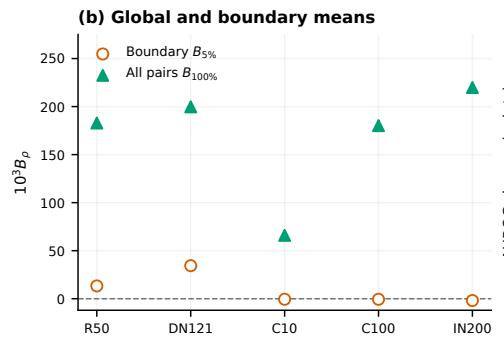

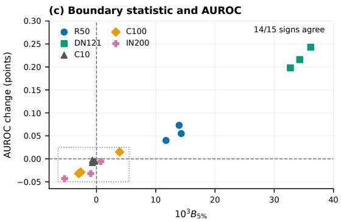

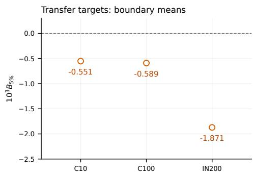

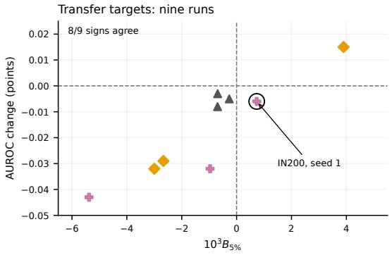  
Figure 4: Boundary-conditioned mechanism and validation evidence. (a) AUROC changes when an ID–OOD pair crosses the ranking boundary; filled and open markers denote initial and final margins. (b) Mean $D _ { \mathrm { o u t } } - D _ { \mathrm { i n } }$ over all pairs and over the closest 5% of baseline margins. The lower view enlarges the negative boundary means on the three transfer targets. (c) Boundary statistic $B { 5 \% }$ versus AUROC change at $\eta = . 0 4 ,$ , with the nine cross-dataset target–seed audits enlarged below. Signs agree in 14 of 15 audits overall and 8 of 9 cross-dataset audits; the circled point is the sole disagreement. AUROC changes are percentage points. R50 and DN121 denote the ImageNet-1K ResNet-50 and DenseNet-121 settings; C10, C100, and IN200 denote CIFAR-10, CIFAR-100, and ImageNet-200. Both statistics are computed on the same validation holdout.

## 7. Discussion and Limitations

## 7.1. Interpretation of the mismatch theory

The theory separates the driving field, the instantaneous detection score, and the relative ordering of ID and OOD scores. The first-step theorem connects the field to the instantaneous score for a step from rest. Keeping the maximum score along a trajectory guarantees a nonnegative score increase, but the exact pair decomposition shows why this need not improve AU-

ROC. For score families satisfying the additional expansion and density conditions, the boundary theorem shows that the mean relative score derivative at equal baseline scores, together with the margin density there, determines the first-order AUROC change.

The transfer experiment shows that local score alignment and an unchanged winning class are insuficient to ensure better ranking. This failure does not require the destructive class interference allowed by the first-step analysis. The separate probe illustrates why averaging score changes over all pairs can miss the direction of AUROC change: the pairs near equal baseline scores can move diferently from the population as a whole.

Table 4: Step-by-step static comparison on ImageNet-1K validation data. Values are mean±standard deviation over three detector banks; deltas are relative to MSP.
<table><tr><td>Stage</td><td>Interpretation</td><td>AUROC</td><td>FPR@95</td><td>ΔAUROC</td><td>∆FPR@95</td></tr><tr><td>MSP</td><td>output reference</td><td> $8 4 . 7 7 \pm . 0 0$ </td><td> $4 9 . 2 6 \pm . 0 0$ </td><td>0.00</td><td>0.00</td></tr><tr><td>S1</td><td>exact full-class field</td><td> $7 3 . 1 6 \pm . 8 6$ </td><td> $7 2 . 3 4 \pm 2 . 6 1$ </td><td>-11.61</td><td>+23.08</td></tr><tr><td>S2</td><td>common class scale</td><td> $8 7 . 0 6 \pm . 6 9$ </td><td> $4 6 . 4 4 \pm . 1 3$ </td><td>+2.30</td><td>-2.82</td></tr><tr><td>S3</td><td>radial anchor centroid</td><td> $9 0 . 2 4 \pm . 6 1$ </td><td> $3 8 . 6 1 \pm . 7 5$ </td><td>+5.47</td><td>-10.65</td></tr><tr><td>S4</td><td>cosine implementation</td><td> $9 0 . 2 4 \pm . 6 1$ </td><td> $3 8 . 6 1 \pm . 7 5$ </td><td>+5.47</td><td>-10.65</td></tr><tr><td>S5</td><td>setup-bank centroid</td><td> $9 1 . 1 9 \pm . 6 7$ </td><td> $3 5 . 3 6 \pm . 3 4$ </td><td>+6.43</td><td>-13.90</td></tr><tr><td>S6</td><td>fixed centroid–MSP control</td><td> $\mathbf { 9 } 2 . \mathbf { 0 } 2 \pm . 5 2$ </td><td> ${ \bf 3 1 . 5 8 \pm . 7 1 }$ </td><td>+7.26</td><td>-17.68</td></tr></table>

The zero-step analysis identifies the geometric information present before motion. Removing candidate truncation is an additional modeling choice. The approximation bound then controls the replacement of full-class anchor fields by radial centroid scores. Under shared scales, the resulting centroid score is rank-equivalent to maximum cosine similarity. CTM is an existing full-bank, feature-norm-weighted member of this centroid family. The step-by-step experiment examines these scoring choices separately from the additional efects of bank size and confidence fusion. These comparisons help attribute static performance to scoring choices; they do not establish that centroid replacement improves AUROC in general.

## 7.2. A practical diagnostic and its scope

Theorem 4.8 suggests a validation diagnostic for score refinements satisfying its regularity conditions. On ID and proxy-OOD validation data allowed by the evaluation protocol, estimate each sample’s score derivative, form ID–OOD pairs, retain a fixed fraction with the smallest absolute baseline margins, and average the ID-minus-OOD relative derivative. Its sign provides a local prediction to compare with the observed validation AUROC change. Stability across seeds and boundary fractions should be checked in the intended validation setting. The mean relative derivative over all pairs provides a useful comparison, because its sign can difer from that near the ranking boundary.

The empirical conclusions are limited to the tested settings. The dynamics use fixed initial candidate sets, and the no-switch audit covers $T ~ \leq ~ 1 0 ;$ the ImageNet audit excludes classes outside the retained top-20 set. The score-aligned transfers and the separate probe use validation data. The probe’s 15 runs cover three seeds in each of five dataset–backbone settings, with shared validation images within each setting. For each ImageNet-1K backbone, variation is over sampled banks. These runs provide descriptive evidence, not 15 independent datasets or a significance test.

The diagnostic also has a local scope. The fixed 5% window summarizes pairs near the ranking boundary; it does not directly estimate the conditional mean at exactly equal scores. The observed AUROC changes at $\eta ~ = ~ 0 . 0 4$ are finite-step changes, several of which are very small. Agreement between their signs and the boundary statistic therefore supports a local interpretation without guaranteeing gains at other step sizes or on other distributions. Theorem 4.9 further shows that changing a strict baseline ordering can reduce AUROC for some ID/OOD distributions.

The numerical model and static approximation impose further limits. The original position-normalized scheme has substantial energy and tangency errors, so the geodesic control provides the evidence for constrained feature motion. The centroid approximation bound is too loose to certify the observed static rankings. Whether the diagnostic extends to transformers and foundation-model features, or can be used with ID-only validation objectives, remains open.

## 8. Conclusion

Class attraction and local score alignment do not guarantee improved OOD ranking. The transfer study demonstrates this failure even without observed winning-class changes within the fixed candidate sets. Under regularity conditions, the mean relative score derivative at the ID–OOD ranking bound ary determines the direction of first-order AUROC change. A separate perturbation study finds that near-boundary relative score changes generally track the direction of small AUROC changes. Through centroid approximation and shared-scale ranking equivalence, the static analysis relates zero-step anchor scores to a centroid family that includes CTM. Together, these results show why samplewise score increases are insuficient and why feature refinement should be evaluated by its efect on ID–OOD ordering.

## Code availability

Implementation and evaluation scripts are available in our public GitHub repository. Software versions, pinned dependencies, and checkpoint identifiers are specified in the appendix.

## Appendix A. Mathematical Details and Supplementary Results

## Appendix A.1. Fundamental-model properties and numerical update

Lemma A.1 (Transport of local class concentration). Let $M _ { c } \subset X$ be the class-c image manifold and let $q :  { \mathcal { X } } \to \mathbb { S } ^ { d - 1 }$ be $L _ { c } – L i p s c h i t z$ on $U _ { c } = \{ x : d _ { X } ( x , M _ { c } ) \leq r _ { c } \}$ . Ifa class-c random image $X _ { c }$ satisfies

$$
\mathrm { P r } [ d _ { X } ( X _ { c } , { \cal M } _ { c } ) \leq r _ { c } ] \geq 1 - \delta _ { c } ,\tag{A.1}
$$

then its normalizedfeature satisfies

$$
\mathrm { P r } [ d _ { \mathbb { S } } ( q ( X _ { c } ) , q ( M _ { c } ) ) \leq L _ { c } r _ { c } ] \geq 1 - \delta _ { c } ,\tag{A.2}
$$

where $\begin{array} { r } { d _ { \mathbb { S } } ( u , B ) = \operatorname* { i n f } _ { \nu \in B } \lVert u - \nu \rVert _ { 2 } . } \end{array}$

Proof. For every $x \in U _ { c }$ and m $\in \mathcal { M } _ { c }$ , Lipschitz continuity gives

$$
d _ { \mathbb { S } } ( q ( x ) , q ( M _ { c } ) ) \leq \| q ( x ) - q ( m ) \| _ { 2 } \leq L _ { c } d _ { X } ( x , m ) .
$$

Taking the infimum over $m \in { \mathcal { M } } _ { c }$ yields $d _ { \mathbb { S } } ( q ( x ) , q ( M _ { c } ) ) \leq L _ { c } d _ { X } ( x , M _ { c } )$ . Applying this deterministic inequality on the event in Eq. (A.1) gives Eq. (A.2). □

Original position-normalized update.. The original trajectory experiments use ambient kicks with position normalization. With the initial candidate set fixed, one update is

$$
\begin{array} { l } { p _ { n + \frac { 1 } { 2 } } = p _ { n } + \displaystyle \frac { \Delta t } { 2 } \nabla _ { q } B ( q _ { n } ; q _ { 0 } ) , } \\ { \widetilde { q } _ { n + 1 } = q _ { n } + \Delta t p _ { n + \frac { 1 } { 2 } } , } \\ { q _ { n + 1 } = \widetilde { q } _ { n + 1 } / \| \widetilde { q } _ { n + 1 } \| _ { 2 } , } \\ { p _ { n + 1 } = p _ { n + \frac { 1 } { 2 } } + \displaystyle \frac { \Delta t } { 2 } \nabla _ { q } B ( q _ { n + 1 } ; q _ { 0 } ) . } \end{array}\tag{A.3}
$$

The normalization keeps positions on $\mathbb { S } ^ { d - 1 }$ , but momentum is not constrained to the tangent space. This is a distinct heuristic discretization, not a symplectic integrator for Eq. (4); no long-time energy or tangency guarantee is claimed for it.

Constrained geodesic update.. For the score-aligned audit, let F denote the aggregate or single-class driver in Section 4.2. Starting with tangent $p _ { n } ,$ set

$$
\begin{array} { r } { \widetilde { \nu } _ { n } = p _ { n } + \frac { 1 } { 2 } \Delta t { P } _ { \boldsymbol { q } _ { n } } \nabla F ( \boldsymbol { q } _ { n } ) , \qquad \nu _ { n } = \vert \widetilde { \nu } _ { n } \vert \vert _ { 2 } . } \end{array}
$$

Exact kinetic drift followed by a tangent kick gives

$$
\begin{array} { r l } & { q _ { n + 1 } = \cos ( \Delta t \nu _ { n } ) q _ { n } + \frac { \sin ( \Delta t \nu _ { n } ) } { \nu _ { n } } \widetilde { \nu } _ { n } , } \\ & { \widetilde { p } _ { n + 1 } = \cos ( \Delta t \nu _ { n } ) \widetilde { \nu } _ { n } - \nu _ { n } \sin ( \Delta t \nu _ { n } ) q _ { n } , } \\ & { p _ { n + 1 } = \widetilde { p } _ { n + 1 } + \frac { 1 } { 2 } \Delta t P _ { q _ { n + 1 } } \nabla F ( q _ { n + 1 } ) . } \end{array}\tag{A.4}
$$

The quotient is interpreted as $\Delta t$ when $\nu _ { n } = 0$ . For a tangent vector v, the spherical exponential map is

$$
\mathrm { E x p } _ { q } ( \nu ) = \cos ( \| \nu \| _ { 2 } ) q + \frac { \sin ( \| \nu \| _ { 2 } ) } { \| \nu \| _ { 2 } } \nu , \qquad \mathrm { E x p } _ { q } ( 0 ) = q .
$$

The two kicks and the drift preserve the tangent bundle in exact arithmetic. A deterministic active class is selected at a current winner tie, and smooth-flow claims are made only away from ties. Both schemes keep $\mathcal { T } ( q _ { 0 } )$ fixed; only the active class within that set may change.

## Appendix A.2. Proofsfor the attraction–ranking analysis

Proof of Theorem 4.1. The first half-step and position update give

$$
p _ { 1 / 2 } = \frac { \Delta t } { 2 } \nabla B ( q _ { 0 } ; q _ { 0 } ) , \qquad \widetilde { q } _ { 1 } = q _ { 0 } + \frac { \Delta t ^ { 2 } } { 2 } \nabla B ( q _ { 0 } ; q _ { 0 } ) .
$$

For a unit vector q and small h,

$$
{ \frac { q + h \nu } { \| q + h \nu \| _ { 2 } } } = q + h ( I - q q ^ { \top } ) \nu + O ( h ^ { 2 } ) .
$$

Substitution of $h = \Delta t ^ { 2 } / 2$ proves Eq. (6) for the original update. For the geodesic scheme, $\begin{array} { r } { \nu _ { 0 } = \frac { 1 } { 2 } \Delta t | | b _ { 0 } | | _ { 2 } } \end{array}$ and $\begin{array} { r } { q _ { 1 } = \mathrm { E x p } _ { q _ { 0 } } ( \frac { 1 } { 2 } \Delta t ^ { 2 } b _ { 0 } ) } \end{array}$ which has the same expansion with remainder ${ \cal O } ( \Delta t ^ { 4 } )$ . Taylor expansion at $q _ { 0 }$ gives

$$
B ( q _ { 1 } ; q _ { 0 } ) - B ( q _ { 0 } ; q _ { 0 } ) = \frac { \Delta t ^ { 2 } } { 2 } \nabla B ( q _ { 0 } ; q _ { 0 } ) ^ { \top } P _ { q _ { 0 } } \nabla B ( q _ { 0 } ; q _ { 0 } ) + O ( \Delta t ^ { 4 } ) ,
$$

which is Eq. (7) because $P _ { q _ { 0 } }$ is an orthogonal projector. The same expansion for $A _ { c }$ yields Eq. (8).

ProofofProposition 4.5. Write $z _ { n } ^ { \mathrm { i n i t } } = ( q _ { n } ^ { \mathrm { i n i t } } , p _ { n } ^ { \mathrm { i n i t } } )$ and $z _ { n } ^ { \mathrm { c u r } } = ( q _ { n } ^ { \mathrm { c u r } } , p _ { n } ^ { \mathrm { c u r } } )$ . The initial states agree. Suppose $z _ { n } ^ { \mathrm { i n i t } } = z _ { n } ^ { \mathrm { c u r } } = z _ { n }$ . Since $c _ { 0 }$ is the unique maximizer at $q _ { n } .$ , continuity gives a neighborhood on which $F _ { \mathrm { c u r } } = F _ { \mathrm { i n i t } } = K A _ { c _ { 0 } }$ . Hence

$$
\begin{array} { r } { P _ { \boldsymbol { q } _ { n } } \nabla F _ { \mathrm { c u r } } ( \boldsymbol { q } _ { n } ) = P _ { \boldsymbol { q } _ { n } } \nabla F _ { \mathrm { i n i t } } ( \boldsymbol { q } _ { n } ) . } \end{array}
$$

The first kicks produce identical intermediate momenta, and the deterministic drift produces the same $q _ { n + 1 }$ and intermediate mo mentum. The unique-winner assumption at $q _ { n + 1 }$ gives the same equality of projected gradients there, so the second kicks imply $z _ { n + 1 } ^ { \mathrm { i n i t } } = z _ { n + 1 } ^ { \mathrm { c u r } }$ . Induction proves equality of all states and active classes. The same argument applies at any additional internal force evaluation points covered by the assumption. Finally, at every retained state,

$$
\begin{array} { r } { m _ { \mathcal { T } } ( q _ { n } ; q _ { 0 } ) = A _ { c _ { 0 } } ( q _ { n } ) , \qquad F _ { \mathrm { c u r } } ( q _ { n } ) = F _ { \mathrm { i n i t } } ( q _ { n } ) . } \end{array}
$$

Taking maxima over $0 \leq n \leq T$ proves equality of trajectory scores.

Proof of Corollary 4.3. Linearity of $P _ { q _ { 0 } }$ and Eq. (3) imply

$$
P _ { q _ { 0 } } \nabla B ( q _ { 0 } ; q _ { 0 } ) = K \sum _ { c \in \mathcal { T } ( q _ { 0 } ) } g _ { c } .
$$

Hence

$$
\left. g _ { c ^ { \star } } , P _ { q _ { 0 } } \nabla B ( q _ { 0 } ; q _ { 0 } ) \right. = K \| g _ { c ^ { \star } } \| _ { 2 } ^ { 2 } [ 1 + I ( q _ { 0 } ) ] ,
$$

which proves Eq. (10). If $I ( q _ { 0 } ) < - 1$ , its leading coeficient is negative. It also follows that $P _ { q _ { 0 } } \nabla B ( q _ { 0 } ; q _ { 0 } ) \neq 0 .$ , so Eq. (7) has a positive leading coeficient. The condition $I ( q _ { 0 } ) < - 1$ requires at least two candidate classes. Since $c ^ { \star }$ is the unique maximizer, define

$$
\delta _ { * } = A _ { c ^ { \star } } ( q _ { 0 } ) - \operatorname* { m a x } _ { c \in \mathcal { T } ( q _ { 0 } ) \backslash \{ c ^ { \star } \} } A _ { c } ( q _ { 0 } ) > 0 .
$$

Continuity and finiteness of the candidate set give a neighborhood U of $q _ { 0 }$ on which $| A _ { c } ( q ) - A _ { c } ( q _ { 0 } ) | < \delta _ { * } / 3$ for every candidate class. Thus $A _ { c ^ { \star } } ( q ) - A _ { c } ( q ) > \delta _ { * } / 3$ for all $q \in U$ and $c \neq c ^ { \star }$ . Since $q _ { 1 }  q _ { 0 }$ as $\Delta t  0 ,$ the maximizer is unchanged for all suficiently small nonzero steps. The instantaneous maximum therefore decreases while B increases. □

Proof of Theorem 4.7. Under the no-tie assumption,

$$
\mathrm { A U R O C } _ { T } = \operatorname* { P r } ( M _ { 0 } + D _ { T } > 0 ) , \qquad \mathrm { A U R O C } _ { 0 } = \operatorname* { P r } ( M _ { 0 } > 0 ) .
$$

The pointwise indicator identity is

$$
{ \bf 1 } _ { \{ M _ { 0 } + D _ { T } > 0 \} } - { \bf 1 } _ { \{ M _ { 0 } > 0 \} } = { \bf 1 } _ { C _ { T } } - { \bf 1 } _ { S _ { T } } .
$$

Taking expectations proves the first statement. A changed ordering requires $| D _ { T } | \ge | M _ { 0 } |$ , so

$$
| \Delta \mathrm { A U R O C } | \le \mathbb { E } | { \bf 1 } _ { C _ { T } } - { \bf 1 } _ { S _ { T } } | \le \mathrm { P r } ( | M _ { 0 } | \le | D _ { T } | ) .
$$

If ties are present, Eq. (12) instead gives the exact identity

$$
\begin{array} { r l } & { \Delta \mathrm { A U R O C } = \mathrm { P r } ( C _ { T } ) - \mathrm { P r } ( S _ { T } ) } \\ & { \qquad + \frac { 1 } { 2 } \big [ \mathrm { P r } ( M _ { 0 } + D _ { T } = 0 ) - \mathrm { P r } ( M _ { 0 } = 0 ) \big ] . } \end{array}\tag{A.5}
$$

Thus empirical pair counts must include the change in tie mass when compared with AUROC computed using half credit for ties.

ProofofTheorem 4.8. First control the tail of the relative score derivative. Omit the remainder and write $Z _ { \eta } = M _ { 0 } + \eta U$ . Set $a _ { \eta } = \delta / ( 2 | \eta | )$ for $\eta \neq 0$ . Since $\mathbb { E } | U | < \infty$

$$
\frac { \operatorname* { P r } ( | U | > a _ { \eta } ) } { | \eta | } \leq \frac { 2 } { \delta } \mathbb { E } \big [ | U | \mathbf { 1 } _ { \{ | U | > a _ { \eta } \} } \big ] \longrightarrow 0 .
$$

Next evaluate the derivative on the remaining region. For $| u | \leq a _ { \eta }$ , the oriented integral identity

$$
\frac { 1 } { \eta } \int _ { - \eta u } ^ { 0 } p _ { M _ { 0 } , U } ( m , u ) d m = u \int _ { 0 } ^ { 1 } p _ { M _ { 0 } , U } ( - t \eta u , u ) d t
$$

is bounded in absolute value by |u|g(u). Continuity in m, dominated convergence, and the negligible tail therefore give

$$
\operatorname* { l i m } _ { \eta \to 0 } \frac { \operatorname* { P r } ( Z _ { \eta } > 0 ) - \operatorname* { P r } ( M _ { 0 } > 0 ) } { \eta } = \int u p _ { M _ { 0 } , U } ( 0 , u ) d u .
$$

Finally restore the remainder. Since

$$
| R _ { \eta } ( X _ { \mathrm { i n } } ) - R _ { \eta } ( X _ { \mathrm { o u t } } ) | \le 2 \varepsilon _ { \eta } \quad \mathrm { a l m o s t ~ s u r e l y } ,
$$

a change in ordering, including the creation of a tie, requires $| Z _ { \eta } | \le 2 \varepsilon _ { \eta }$ . For suficiently small |η|, the corresponding intervals in m lie in $[ - \delta , \delta ]$ whenever $| u | \leq a _ { \eta } ,$ , so

$$
\operatorname* { P r } ( | Z _ { \eta } | \leq 2 \varepsilon _ { \eta } ) \leq 4 \varepsilon _ { \eta } \int g ( u ) d u + \operatorname* { P r } ( | U | > a _ { \eta } ) = o ( | \eta | ) .
$$

Thus the remainder does not change the derivative, also under the usual half-credit convention for ties. Finally, $\begin{array} { r } { \int u p _ { M _ { 0 } , U } ( 0 , u ) d u = } \end{array}$ $p _ { M _ { 0 } } ( 0 ) \mathbb { E } [ U \mid M _ { 0 } = 0 ]$ by the stated density definition. □

Connection to a single trajectory step.. For a unique initial winner, Theorem 4.1 and the positive class margin imply, with $\eta =$ $\Delta t ^ { 2 } / 2 \geq 0$

$$
m _ { \mathcal { T } } ( q _ { 1 } ; q _ { 0 } ) - m _ { \mathcal { T } } ( q _ { 0 } ; q _ { 0 } ) = \eta \langle g _ { c ^ { \star } } , b _ { 0 } \rangle + O ( \eta ^ { 2 } ) .
$$

Since $u \mapsto \operatorname* { m a x } \{ u , 0 \}$ is 1-Lipschitz, retaining the initial score gives

$$
S _ { 1 } ( q _ { 0 } ) - S _ { 0 } ( q _ { 0 } ) = \eta \operatorname* { m a x } \{ \langle g _ { c ^ { \star } } , b _ { 0 } \rangle , 0 \} + O ( \eta ^ { 2 } ) .
$$

This is a pointwise expansion. Applying the boundary theorem to this family would additionally require a uniform remainder over the two populations and the stated joint-density conditions. The separate probe in Section 6.4 provides a simpler score family with a uniform remainder.

## Appendix A.3. Proofs for the static reduction

Proof of Proposition 5.1. The definitions give

$$
A _ { c } ( q ) = W _ { c } \sum _ { j } \pi _ { c j } \phi \biggl ( \frac { | | q - a _ { c j } | | _ { 2 } } { \sigma _ { c } } \biggr ) .
$$

The reverse triangle inequality and Lipschitz continuity of ϕ imply

$$
\begin{array} { l } { \displaystyle  A _ { c } ( q ) - W _ { c } \phi ( \frac { \lVert q - \bar { a } _ { c } \rVert _ { 2 } } { \sigma _ { c } } )  } \\ { \displaystyle \quad \leq \frac { W _ { c } L _ { \phi } } { \sigma _ { c } } \sum _ { j } \pi _ { c j }  q - a _ { c j }  _ { 2 } - \lVert q - \bar { a } _ { c } \rVert _ { 2 }  } \\ { \displaystyle \quad \leq \frac { W _ { c } L _ { \phi } } { \sigma _ { c } } \sum _ { j } \pi _ { c j } \lVert a _ { c j } - \bar { a } _ { c } \rVert _ { 2 } . } \end{array}
$$

Because $\bar { \boldsymbol { a } } _ { c } = \| \bar { \boldsymbol { a } } _ { c } \| _ { 2 } \mu _ { c }$ c and the anchors lie on the unit sphere,

$$
\lVert \bar { \boldsymbol { a } } _ { c } - \boldsymbol { \mu } _ { c } \rVert _ { 2 } = \lvert 1 - \lvert \lvert \bar { \boldsymbol { a } } _ { c } \rvert \rvert _ { 2 } \rvert .
$$

A second application of the Lipschitz inequality bounds the replacement of $\bar { a } _ { c }$ by $\mu _ { c }$ by $W _ { c } L _ { \phi } \left| 1 - \left| \left| \bar { a } _ { c } \right| \right| _ { 2 } \right| / \sigma _ { c }$ . The triangle inequality combines the two displays into Eq. (16). To obtain the score bound, use

$$
\left| \operatorname* { m a x } _ { c } A _ { c } ( q ) - \operatorname* { m a x } _ { c } \widetilde { A } _ { c } ( q ) \right| \leq \operatorname* { m a x } _ { c } \left| A _ { c } ( q ) - \widetilde { A } _ { c } ( q ) \right|
$$

and apply the class-wise bound. For two queries $q , q ^ { \prime } ,$ , it follows that

$$
\widetilde { S } _ { 0 } ( q ) - \widetilde { S } _ { 0 } ( q ^ { \prime } ) \ge S _ { 0 } ^ { \mathrm { a l l } } ( q ) - S _ { 0 } ^ { \mathrm { a l l } } ( q ^ { \prime } ) - 2 \epsilon .
$$

This proves the margin condition in Eq. (17).

Proof of Proposition 5.2. For unit vectors,

$$
\| q - \mu _ { c } \| _ { 2 } ^ { 2 } = 2 - 2 q ^ { \top } \mu _ { c } .
$$

Thus maximizing cosine similarity over classes minimizes radial distance. Because $\phi$ is strictly decreasing and $W > 0 ;$ , substituting the minimizing distance gives Eq. (18). The map $g \mapsto W \phi ( { \sqrt { 2 - 2 g } } / \sigma )$ is strictly increasing on $[ - 1 , 1 ]$ , which proves both the sample-ranking and class-selection statements. □

Proof of Proposition 5.4. CTM forms an unnormalized class mean proportional to

$$
\sum _ { i \in \mathcal { B } _ { c } } f ( x _ { i } ) = \sum _ { i \in \mathcal { B } _ { c } } r _ { i } q ( x _ { i } ) .
$$

Normalizing this vector removes the irrelevant factor $| \mathcal { B } _ { c } | ^ { - 1 }$ and yields $\mu _ { c } ( { \mathcal { B } } _ { \mathrm { a l l } } , r )$ in Eq. (19). Maximizing its cosine with $q ( x )$ is therefore exactly $G _ { \mathcal { B } _ { \mathrm { a l l } } , r } ( x )$ □

## Appendix A.4. Score-aligned transfer and winner-switch audit

Table A.5 gives the per-seed validation results under the locked geodesic $T = 5$ rule. Corrected and spoiled columns are the probability masses from Theorem 4.7, expressed as percentages. AUROC uses half credit for ties; when tie mass changes, the exact relation includes Eq. (A.5). Displayed pair masses and AUROC changes are rounded separately.

Table A.5: Per-seed score-aligned mechanism audit. Static, aggregate, and aligned columns report AUROC; C/S gives corrected/spoiled pair mass in percent for the aligned flow relative to T = 0.
<table><tr><td>Validation benchmark</td><td>Seed</td><td> $T = 0$ </td><td>Aggregate</td><td>Aligned</td><td>C/S</td></tr><tr><td rowspan="3">ImageNet-1K</td><td>0</td><td>72.27</td><td>65.77</td><td>73.07</td><td>2.74/1.94</td></tr><tr><td>1</td><td>70.84</td><td>66.24</td><td>72.30</td><td>3.02/1.57</td></tr><tr><td>2</td><td>72.27</td><td>65.95</td><td>73.41</td><td>3.02/1.88</td></tr><tr><td>CIFAR-10</td><td>0</td><td>89.23</td><td>89.93</td><td>87.63</td><td>0.57/2.17</td></tr><tr><td rowspan="4">CIFAR-100</td><td>1</td><td>89.18</td><td>90.18</td><td>87.93</td><td>0.77/2.01</td></tr><tr><td>2</td><td>89.85</td><td>90.29</td><td>88.39</td><td>0.46/1.92</td></tr><tr><td>0</td><td>85.15</td><td>86.44</td><td>84.73</td><td>0.50/0.91</td></tr><tr><td>1</td><td>83.40</td><td>84.40</td><td>82.95</td><td>0.53/0.97</td></tr><tr><td rowspan="4">ImageNet-200</td><td>2</td><td>84.24</td><td>85.31</td><td>83.84</td><td>0.48/0.88</td></tr><tr><td>0</td><td>87.62</td><td>85.79</td><td>87.16</td><td>0.78/1.25</td></tr><tr><td>1</td><td>88.88</td><td>88.44</td><td>88.59</td><td>0.75/1.04</td></tr><tr><td>2</td><td>87.77</td><td>85.98</td><td>86.85</td><td>0.59/1.51</td></tr></table>

The post-hoc switch audit uses all retained states $T = 0 , \ldots , 1 0$ rather than only the selected $T = 5$ result. Table A.6 aggregates the three seeds. “Candidate classes” denotes the set fixed at initialization; the ImageNet-200 and CIFAR-100 statement does not claim that classes outside the top-20 set were re-evaluated during motion. The two driver implementations also have zero maximum absolute diference in trajectory score, instantaneous score, driver value, and Hamiltonian energy.

Table A.6: Winner-switch audit over 20,205 sample–seed trajectories and 11 retained states. Switch counts are summed over seeds and populations.
<table><tr><td>Benchmark</td><td>Candidates</td><td>ID</td><td>OOD</td><td>Current switches</td><td>Initial switches</td></tr><tr><td>CIFAR-10</td><td>all 10</td><td>3000</td><td>3000</td><td>0</td><td>0</td></tr><tr><td>CIFAR-100</td><td>top 20</td><td>3000</td><td>2916</td><td>0</td><td>0</td></tr><tr><td>ImageNet-200</td><td>top 20</td><td>3000</td><td>5289</td><td>0</td><td>0</td></tr></table>

The mechanism and numerical checks average over ID/OOD populations and three anchor banks. The aggregate and currentwinner alignment cosines are 0 634 and 1 000; neither produces a first-step winner decrease, and the audited fraction satisfying $I ( q _ { 0 } ) ~ < ~ - 1$ is zero. Thus these data do not demonstrate destructive class interference, although they test its local alignmen expansion. Both attain 100% Taylor sign agreement. Winner and driver Taylor residuals have log–log slopes 4 138–4 162 and $3 . 8 3 3 { - } 4 . 1 7 9 .$ , consistent with the ${ \cal O } ( \Delta t ^ { 4 } )$ remainder underlying Definition 4.4. The geodesic controls keep maximum sphere error below $2 . 3 8 \times 1 0 ^ { - 7 }$ and maximum tangency error below $1 . 4 9 \times 1 0 ^ { - 7 } \colon$ ; their mean maximum relative energy drifts are 0 0352 (aggregate) and 0 00265 (current winner). For comparison, the original retraction-based aggregate integrator has drift 1 327 and tangency erro 8 604. The stable geodesic experiments therefore provide the basis for the aligned-flow mechanism claim; their failed locked transfer is not explained by leaving the sphere or tangent bundle.

## Appendix A.5. Boundary-conditioned stability-probe audit

The primary stability-probe rule fixes $\eta = 0 . 0 4$ from the ImageNet-1K ResNet-50 selection split. No transfer target re-selects the step size. A secondary scale control sets

$$
\eta _ { \mathrm { I D } } = 0 . 0 0 2 5 / \mathbb { E } _ { \mathrm { I D , f i t } } [ D ]
$$

using only the ID fit split; its results are retained in the accompanying CSV archive as an additional control rather than in the primary tables. Both rules retain the same MSP component and the same ID-fit standardization as the static score.

The probe in $\operatorname { E q . }$ (20) is generated by the conditional potential $V _ { x } ( q ) = \gamma ( 1 - m ( x ) ) q ^ { \top } \mu _ { \hat { c } ( x ) } .$ , where $\gamma > 0$ and the initial confidence and centroid are held fixed. One geodesic kick–drift step from rest has $\eta = \gamma \Delta t ^ { 2 } / 2 ;$ the final kick does not change its position. Thus this is a one-step repulsive perturbation, not an exact finite-time solution of the full nonlinear flow or a maximum score along a trajectory. For completeness, with $\theta = \eta ( 1 - m ) \sqrt { 1 - G ^ { 2 } }$ , the initial-winning geodesic has the exact endpoint

$$
G _ { \eta } = G \cos \theta - { \sqrt { 1 - G ^ { 2 } } } \sin \theta = G - \eta ( 1 - m ) ( 1 - G ^ { 2 } ) + { \cal O } ( \eta ^ { 2 } ) .
$$

Substitution into the fixed standardized fusion yields Eq. (21) in the main text. Table A.7 reports the primary rule. Corrected and spoiled masses are percentages of all ID–OOD pairs. Their diference gives the AUROC change in percentage points, with the tie adjustment in $\operatorname { E q . } \left( \mathbf { A . } 5 \right)$ when needed.

Table $\mathrm { { A . 7 } } \mathrm { { : } }$ Per-seed stability-probe results. $B _ { 5 \% }$ is the mean $D _ { \mathrm { o u t } } - D _ { \mathrm { i n } }$ among the nearest 5% of pairs to the static ranking boundary. C/S denotes corrected/spoiled pair mass in percent.
<table><tr><td>Validation target</td><td>Seed</td><td>Static</td><td>Probe</td><td>Δ</td><td> $1 0 ^ { 3 } B _ { 5 \% }$ </td><td>C/S</td></tr><tr><td>IN-1K/R50</td><td>0</td><td>92.165</td><td>92.205</td><td>+0.040</td><td>+11.734</td><td>0.296/0.256</td></tr><tr><td rowspan="5">IN-1K/DN121</td><td>1</td><td>91.269</td><td>91.342</td><td>+0.073</td><td>+13.950</td><td>0.336/0.263</td></tr><tr><td>2</td><td>91.583</td><td>91.638</td><td>+0.055</td><td>+14.302</td><td>0.325/0.269</td></tr><tr><td>0</td><td>90.065</td><td>90.281</td><td>+0.216</td><td>+34.302</td><td>0.553/0.337</td></tr><tr><td>1</td><td>89.357</td><td>89.600</td><td>+0.243</td><td>+36.159</td><td>0.581/0.338</td></tr><tr><td>2</td><td>90.049</td><td>90.246</td><td>+0.198</td><td>+32.726</td><td>0.537/0.339</td></tr><tr><td>CIFAR-10</td><td>0</td><td>88.859</td><td>88.851</td><td>-0.008</td><td>-0.694</td><td>0.008/0.016</td></tr><tr><td rowspan="4">CIFAR-100</td><td>1</td><td>89.135</td><td>89.131</td><td>-0.003</td><td>-0.691</td><td>0.006/0.010</td></tr><tr><td>2</td><td>90.377</td><td>90.372</td><td>-0.005</td><td>-0.268</td><td>0.001/0.006</td></tr><tr><td>0</td><td>85.375</td><td>85.343</td><td>-0.032</td><td>-2.998</td><td>0.108/0.140</td></tr><tr><td>1</td><td>84.127</td><td>84.098</td><td>-0.029</td><td>-2.666</td><td>0.122/0.152</td></tr><tr><td rowspan="4">IN-200</td><td>2</td><td>85.392</td><td>85.407</td><td>+0.015</td><td>+3.897</td><td>0.143/0.128</td></tr><tr><td>0</td><td>92.069</td><td>92.026</td><td>-0.043</td><td>-5.378</td><td>0.106/0.149</td></tr><tr><td>1</td><td>92.448</td><td>92.441</td><td>-0.006</td><td>+0.733</td><td>0.113/0.120</td></tr><tr><td>2</td><td>91.819</td><td>91.788</td><td>-0.032</td><td>-0.966</td><td>0.109/0.141</td></tr></table>

The single sign disagreement occurs for ImageNet-200 seed 1, where both the boundary statistic and the AUROC change are close to zero. The pair decomposition accounts for AUROC change by construction. The additional finding is the sign agreemen with $B _ { 5 \% }$ , which is computed from baseline margins and score derivatives on the same holdout. Across the 15 runs in five dataset– backbone settings, the descriptive Pearson and Spearman correlations between $B _ { 5 \% }$ and AUROC change are 0 991 and 0 979. These pooled correlations do not establish a common quantitative relation across settings: the boundary density and calibration scale also enter the first-order AUROC change. Runs within a setting share validation images, so these correlations are not significance tests based on 15 independent datasets.

Table A.8 varies the width of the empirical boundary layer. ImageNet-1K has a positive boundary statistic throughout. For every transfer target the full-pair mean is positive, yet the narrowest layers are negative. This is the observed global-to-boundary sign reversal behind the failed transfer.

Table A.8: Mean boundary statistic $B _ { \rho } { } ,$ , multiplied by $1 0 ^ { 3 } ,$ over three seeds. Columns retain the stated fraction of ID–OOD pairs with the smallest absolute static margin.
<table><tr><td>Validation target</td><td>1%</td><td>2.5%</td><td>5%</td><td>10%</td><td>25%</td><td>100%</td></tr><tr><td>IN-1K/R50</td><td>11.128</td><td>12.013</td><td>13.329</td><td>18.480</td><td>43.652</td><td>182.907</td></tr><tr><td>IN-1K/DN121</td><td>32.548</td><td>33.590</td><td>34.395</td><td>38.253</td><td>59.390</td><td>199.719</td></tr><tr><td>CIFAR-10</td><td>-0.527</td><td>-0.567</td><td>-0.551</td><td>-0.457</td><td>0.277</td><td>65.996</td></tr><tr><td>CIFAR-100</td><td>-0.934</td><td>-1.616</td><td>-0.589</td><td>1.831</td><td>16.693</td><td>180.182</td></tr><tr><td>IN-200</td><td>-4.551</td><td>-3.871</td><td>-1.871</td><td>4.976</td><td>40.295</td><td>219.853</td></tr></table>

The predefined transfer criteria for AUROC and boundary consistency are not met, although the FPR@95 criterion is met. The probe was therefore not evaluated on the Near-/Far-OOD test sets; no corresponding test loader or score file was accessed in this study.

## Appendix A.6. Full ImageNet trajectory ablation

Table A.9 reports the aggregated ImageNet trajectory grid. Values are Near-/Far-OOD macro averages; each cell is AU-ROC/FPR@95. The Gaussian and IMQ fields share the same anchors, optimizer schedule, candidate count, and step size.

Table A.9: ImageNet trajectory ablation. ImageNet-200 varies three oficial model seeds; ImageNet-1K varies three centroid banks on one fixed backbone
<table><tr><td>ID</td><td>Potential</td><td> $T = 0$ </td><td> $T = 1$ </td><td> $T = 3$ </td><td> $T = 1 0$ </td></tr><tr><td>IN-200 Near</td><td>Gaussian</td><td>79.44/64.42</td><td>79.64/63.99</td><td>80.22/61.89</td><td>79.63/62.10</td></tr><tr><td>IN-200 Far</td><td>Gaussian</td><td>91.18/31.66</td><td>91.29/31.36</td><td>90.68/33.10</td><td>88.82/34.61</td></tr><tr><td>IN-200 Near</td><td>IMQ</td><td>78.23/65.27</td><td>78.41/64.95</td><td>79.34/62.99</td><td>78.16/63.37</td></tr><tr><td>IN-200 Far</td><td>IMQ</td><td>89.79/34.33</td><td>89.90/34.06</td><td>90.17/33.50</td><td>87.09/37.39</td></tr><tr><td>IN-1K Near</td><td>Gaussian</td><td>66.14/77.84</td><td>64.51/79.27</td><td>61.42/79.63</td><td>60.94/79.63</td></tr><tr><td>IN-1K Far</td><td>Gaussian</td><td>77.44/65.16</td><td>72.71/71.29</td><td>74.37/69.75</td><td>68.51/70.71</td></tr><tr><td>IN-1K Near</td><td>IMQ</td><td>63.46/80.45</td><td>60.91/82.52</td><td>61.94/81.33</td><td>58.03/82.91</td></tr><tr><td>IN-1K Far</td><td>IMQ</td><td>73.76/69.48</td><td>65.68/78.21</td><td>75.58/66.79</td><td>63.44/75.60</td></tr></table>

Table A.10 gives the uncertainty and precision–recall statistics for the ImageNet-1K $T = 1 0$ column.

Table A.10: ImageNet-1K T = 10 full-evaluation results over three independently sampled centroid banks on the fixed ResNet-50. Values are mean±standard deviation; ID accuracy is 76 1867% for every run.
<table><tr><td>Potential</td><td>Group</td><td>AUROC</td><td>FPR@95</td><td>AUPR-IN</td><td>AUPR-OUT</td></tr><tr><td>Gaussian</td><td>Near</td><td> $6 0 . 9 4 \pm . 0 7$ </td><td> $7 9 . 6 3 \pm 1 . 2 9$ </td><td> $7 5 . 1 4 \pm . 1 7$ </td><td> $3 4 . 7 0 \pm . 2 4$ </td></tr><tr><td>Gaussian</td><td>Far</td><td> $6 8 . 5 1 \pm . 3 3 $ </td><td> $7 0 . 7 1 \pm 1 . 7 5$ </td><td> $9 0 . 8 6 \pm . 2 6$ </td><td> $2 6 . 1 5 \pm . 0 4$ </td></tr><tr><td>IMQ</td><td>Near</td><td> $5 8 . 0 3 \pm . 8 3$ </td><td> $8 2 . 9 1 \pm 1 . 7 9$ </td><td> $7 3 . 5 2 \pm . 2 2$ </td><td> $3 3 . 2 7 \pm . 1 4$ </td></tr><tr><td>IMQ</td><td>Far</td><td> $6 3 . 4 4 \pm 1 . 0 5$ </td><td> $7 5 . 6 0 \pm 1 . 5 2$ </td><td> $8 8 . 9 6 \pm . 5 3 $ </td><td> $2 3 . 2 1 \pm . 1 5$ </td></tr></table>

Table A.11: Five potential families on CIFAR. Bandwidths are fitted from zero-step class afinities and scores use $T = 1 2 0$ . Values are macro averages over all six OOD datasets and three seeds.
<table><tr><td>ID</td><td>Potential</td><td>AUROC</td><td>FPR@95</td></tr><tr><td>CIFAR-10</td><td>Gaussian Laplacian Cauchy</td><td> $8 9 . 7 7 \pm 0 . 1 3$   ${ \bf 9 0 . 9 7 \pm 0 . 3 6 }$   $8 9 . 9 4 \pm 0 . 2 4$ </td><td> $3 5 . 1 8 \pm 1 . 2 4$   $3 2 . 8 2 \pm 2 . 1 9$   $3 4 . 5 5 \pm 1 . 1 1$ </td></tr><tr><td></td><td>IMQ Matérn-3/2</td><td> $9 0 . 6 6 \pm 0 . 0 5$   $8 9 . 9 7 \pm 0 . 4 4 $ </td><td> ${ \bf 3 1 . 7 3 \pm 1 . 2 7 }$   $3 7 . 4 6 \pm 3 . 1 8$ </td></tr><tr><td>CIFAR-100</td><td>Gaussian</td><td> $\mathbf { 8 2 . 5 8 \pm 0 . 6 1 }$ </td><td> ${ \bf 5 3 . 7 0 \pm 0 . 9 1 }$ </td></tr><tr><td></td><td>Laplacian</td><td> $8 1 . 6 0 \pm 0 . 4 6$ </td><td> $5 5 . 1 6 \pm 0 . 9 4$ </td></tr><tr><td></td><td></td><td></td><td></td></tr><tr><td></td><td>Cauchy</td><td> $8 1 . 1 9 \pm 0 . 3 6$ </td><td> $5 4 . 9 9 \pm 0 . 8 1$ </td></tr><tr><td></td><td>IMQ</td><td> $8 2 . 3 5 \pm 0 . 5 3 $ </td><td> $5 4 . 4 4 \pm 0 . 7 3$ </td></tr><tr><td></td><td>Matérn-3/2</td><td> $8 1 . 0 7 \pm 0 . 7 4$ </td><td> $5 4 . 4 6 \pm 0 . 9 2$ </td></tr></table>

## Appendix A.7. Efective-rank anchor-weighting ablation

Table A.12 reports the fitted anchor-weighting variants, and Fig. A.5 displays changes from uniform weights. Image weights are the efective rank of mean-centered luminance arrays, computed as the exponential entropy of normalized singular values. Bandwidths are refitted for each variant; global weight normalization alone would leave a fixed static field’s ranking unchanged.

Table A.12: Static Gaussian anchor-weighting ablation. Each Near/Far entry is AUROC/FPR@95 at T = 0 over three seeds. “Class” and “global” divide raw efective-rank weights by their class-wise or global mean.
<table><tr><td>ID</td><td>Anchor weighting</td><td>Near-OOD</td><td>Far-OOD</td></tr><tr><td>CIFAR-10</td><td>Uniform Effective rank/raw Effective rank/class</td><td>88.59/42.36 76.99/77.43 88.53/42.85</td><td>91.07/31.09 81.43/55.91 91.04/31.12</td></tr><tr><td>CIFAR-100</td><td>Effective rank/global Uniform Effective rank/raw Effective rank/class Effective rank/global</td><td>79.35/71.87 79.46/63.16 72.55/74.41 79.41/63.35 75.69/71.72</td><td>83.17/55.49 83.41/51.10 84.33/50.11 83.66/50.63 85.27/48.29</td></tr><tr><td>IN-200</td><td>Uniform Effective rank/raw Effective rank/class Effective rank/global</td><td>79.44/64.42 77.17/69.34 78.67/65.05 75.03/69.75</td><td>91.18/31.66 89.14/41.41 90.11/33.86 85.22/48.57</td></tr></table>

raw class-normalized global-normalized  
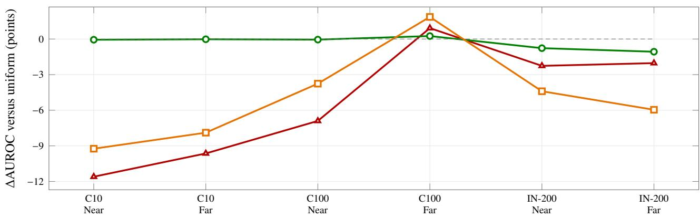  
Figure A.5: Efective-rank anchor weighting relative to the uniform static field. Raw and global normalization usually reduce AUROC; class-wise normalization mostly returns to the uniform baseline. The isolated CIFAR-100 Far-OOD gain does not transfer to its Near-OOD counterpart or ImageNet-200.

## Appendix A.8. Validation analysis of the static reduction

The staged analysis uses 5000 ImageNet-1K ID and 1763 OpenImage-O validation examples. Table 4 reports stage performance; the following diagnostics quantify adjacent transitions and approximation error.

Table A.13: Full-split transition deltas in the static-reduction sequence. Each entry is the mean change over the three detector seeds and is written as AU-ROC/FPR@95.
<table><tr><td>Transition</td><td>ΔAUROC</td><td>∆FPR@95</td></tr><tr><td>S1 → S2</td><td>+13.91</td><td>-25.90</td></tr><tr><td>S2 → S3</td><td>+3.18</td><td>-7.83</td></tr><tr><td>S3 → S4</td><td>0.00</td><td>0.00</td></tr><tr><td>S4 → S5</td><td>+0.95</td><td>-3.25</td></tr><tr><td> $S 5  { \mathrm { S } } 6$ </td><td>+0.83</td><td>-3.78</td></tr><tr><td>MSP → S6</td><td>+7.26</td><td>-17.68</td></tr></table>

The radial-centroid bound audit evaluates S2 to S3. All six seed/population combinations satisfy the bound, with zero violations and negative maximum bound excess. The empirical class-level MAE ranges from 0 0340 to 0 0429, and maximum observed errors range from 0 209 to 0 295. Mean class bounds are approximately 0 685–0 692, with maxima 0 974–1 042. The bound identifies the dependence on class dispersion and directional coherence, but is conservative in this experiment. The uniform Gaussian scores lie in [0 1], whereas the global 2ϵ from Eq. (17) exceeds the largest possible score margin. Consequently, the global error bound does not certify any pairwise ranking here. The observed ranking improvement is an empirical result, not a consequence of a tight error guarantee.

## Appendix A.9. Complete local baseline matrix

Tables A.14 and A.15 expose the complete local baseline matrix used to locate the static controls. Each entry is mean AU-ROC/FPR@95 under the same OpenOOD loaders and checkpoints. ImageNet-1K KNN and ViM were not evaluated and are marked with a dash. The best AUROC and FPR@95 in each task column are boldfaced independently.

Table A.14: Complete Near-OOD local comparison including CTM, CADRef, and LogitGap. Each entry is AUROC/FPR@95 under the unified OpenOOD v1.5 protocol. FPR@95 is the ID rejection rate at 95% OOD recall (OOD positive).
<table><tr><td>Method</td><td>CIFAR-10</td><td>CIFAR-100</td><td>IN-200</td><td>IN-1K</td></tr><tr><td>MSP</td><td>88.03/48.17</td><td>80.27/54.80</td><td>83.34/54.84</td><td>76.02/65.67</td></tr><tr><td>Energy</td><td>87.58/61.33</td><td>80.91/55.60</td><td>82.50/60.22</td><td>75.89/68.57</td></tr><tr><td>MaxLogit</td><td>87.52/61.32</td><td>81.05/55.46</td><td>82.90/59.75</td><td>76.46/67.85</td></tr><tr><td>GEN</td><td>88.20/53.67</td><td>81.31/54.41</td><td>83.71/55.11</td><td>76.85/65.30</td></tr><tr><td>ReAct</td><td>87.11/63.55</td><td>80.77/56.39</td><td>81.87/62.46</td><td>77.38/66.74</td></tr><tr><td>Scale</td><td>82.55/80.46</td><td>80.99/55.68</td><td>84.84/57.30</td><td>81.36/59.77</td></tr><tr><td>KNN</td><td>90.64/34.00</td><td>80.18/61.23</td><td>81.57/60.18</td><td></td></tr><tr><td>ViM</td><td>88.68/44.85</td><td>74.98/62.63</td><td>78.68/59.19</td><td></td></tr><tr><td>ASH</td><td>75.27/86.79</td><td>78.19/65.72</td><td>82.38/64.88</td><td>78.17/63.33</td></tr><tr><td>DICE</td><td>78.40/70.12</td><td>79.38/57.95</td><td>81.78/61.87</td><td>73.07/72.45</td></tr><tr><td>SHE</td><td>81.54/79.64</td><td>78.95/59.06</td><td>80.18/66.79</td><td>73.78/73.03</td></tr><tr><td>RMDS</td><td>86.20/47.20</td><td>80.15/55.47</td><td>82.57/54.02</td><td>76.54/65.24</td></tr><tr><td>RankFeat</td><td>79.46/60.89</td><td>61.88/80.58</td><td>56.92/92.04</td><td>50.99/91.83</td></tr><tr><td>CADRef</td><td>88.97/39.46</td><td>79.63/57.18</td><td>85.57/52.97</td><td>79.62/61.57</td></tr><tr><td>LogitGap</td><td>88.72/52.34</td><td>81.37/54.36</td><td>83.37/57.63</td><td>76.70/66.47</td></tr><tr><td>Centroid-only</td><td>89.35/38.16</td><td>80.12/59.07</td><td>82.57/60.11</td><td>74.34/69.41</td></tr><tr><td>Centroid-MSP</td><td>89.27/38.15</td><td>80.35/58.75</td><td>83.33/58.62</td><td>76.29/67.93</td></tr><tr><td>CTM</td><td>89.49/37.29</td><td>80.16/59.18</td><td>83.13/58.21</td><td>75.69/67.86</td></tr></table>

Table A.15: Complete Far-OOD local comparison including CTM, CADRef, and LogitGap. Each entry is AUROC/FPR@95 under the unified OpenOOD v1.5 protocol. FPR@95 is the ID rejection rate at 95% OOD recall (OOD positive).
<table><tr><td>Method</td><td>CIFAR-10</td><td>CIFAR-100</td><td>IN-200</td><td>IN-1K</td></tr><tr><td>MSP</td><td>90.73/31.72</td><td>77.76/58.71</td><td>90.13/35.44</td><td>85.23/51.46</td></tr><tr><td>Energy</td><td>91.21/41.70</td><td>79.77/56.58</td><td>90.86/34.85</td><td>89.47/38.38</td></tr><tr><td>MaxLogit</td><td>91.10/41.67</td><td>79.67/56.73</td><td>91.11/34.03</td><td>89.58/38.21</td></tr><tr><td>GEN</td><td>91.35/34.73</td><td>79.68/56.71</td><td>91.36/32.11</td><td>89.77/35.62</td></tr><tr><td>ReAct</td><td>90.42/44.90</td><td>80.39/54.21</td><td>92.31/28.50</td><td>93.67/26.31</td></tr><tr><td>Scale</td><td>86.39/67.54</td><td>81.42/54.08</td><td>93.98/26.47</td><td>96.53/16.53</td></tr><tr><td>KNN</td><td>92.96/24.28</td><td>82.40/53.64</td><td>93.16/27.27</td><td></td></tr><tr><td>ViM</td><td>93.48/25.06</td><td>81.70/50.73</td><td>91.26/27.20</td><td></td></tr><tr><td>ASH</td><td>78.49/79.03</td><td>80.58/59.20</td><td>93.90/27.30</td><td>95.74/19.53</td></tr><tr><td>DICE</td><td>84.29/51.71</td><td>80.01/56.25</td><td>90.80/36.51</td><td>90.95/41.82</td></tr><tr><td>SHE</td><td>85.32/66.48</td><td>76.92/64.12</td><td>89.81/42.16</td><td>90.92/41.43</td></tr><tr><td>RMDS</td><td>91.30/29.41</td><td>82.92/52.82</td><td>88.06/32.45</td><td>86.95/39.65</td></tr><tr><td>RankFeat</td><td>75.87/57.44</td><td>67.10/69.45</td><td>38.22/97.72</td><td>53.93/87.15</td></tr><tr><td>CADRef</td><td>91.51/28.19</td><td>83.49/50.33</td><td>95.50/19.58</td><td>96.27/16.85</td></tr><tr><td>LogitGap</td><td>91.88/33.41</td><td>79.74/55.95</td><td>91.24/32.17</td><td>89.69/36.02</td></tr><tr><td>Centroid-only</td><td>91.62/28.24</td><td>82.52/52.43</td><td>94.18/23.72</td><td>94.50/24.54</td></tr><tr><td>Centroid-MSP</td><td>91.58/28.18</td><td>81.70/52.88</td><td>94.02/24.17</td><td>94.85/23.60</td></tr><tr><td>CTM</td><td>91.68/27.76</td><td>82.62/52.50</td><td>93.89/24.52</td><td>95.20/21.68</td></tr></table>

Table A.17: Additional CTM precision–recall metrics on ImageNet-1K/DenseNet-121. AUROC and FPR@95 are reported in Table A.20. The ID accuracy is 74 86%.

Table A.16: Recent and centroid references on ImageNet-1K/DenseNet-121. CADRef, LogitGap, and CTM are single fixed-model estimates; centroid-only and fixed fusion show mean±standard deviation over three sampled setup banks on the same model. Boldface compares the displayed methods. FPR@95 uses OOD as the positive class, as defined in Section 6.
<table><tr><td>Group</td><td>Method</td><td>AUROC</td><td>FPR@95</td></tr><tr><td>Near</td><td>CADRef</td><td>76.13</td><td>66.60</td></tr><tr><td rowspan="5"></td><td>LogitGap</td><td>75.49</td><td>67.42</td></tr><tr><td>CTM</td><td>72.91</td><td>71.61</td></tr><tr><td>Centroid-only</td><td>71.18 ± 0.35</td><td> $7 3 . 2 9 \pm 0 . 5 6$ </td></tr><tr><td>Centroid-MSP</td><td>73.88 ± 0.31</td><td>70.80 ± 0.88</td></tr><tr><td>CADRef</td><td>95.32</td><td>21.46</td></tr><tr><td rowspan="4">Far</td><td>LogitGap</td><td>89.14</td><td>39.69</td></tr><tr><td>CTM</td><td>94.02</td><td>25.88</td></tr><tr><td>Centroid-only</td><td> $9 3 . 0 1 \pm 0 . 5 3 $ </td><td> $2 9 . 5 9 \pm 1 . 6 3$ </td></tr><tr><td>Centroid-MSP</td><td> $9 3 . 9 5 \pm 0 . 4 3$ </td><td> $2 6 . 9 7 \pm 1 . 4 6$ </td></tr></table>

<table><tr><td>OOD dataset</td><td>AUPR-IN</td><td>AUPR-OUT</td></tr><tr><td>SSB-hard</td><td>63.73</td><td>64.98</td></tr><tr><td>NINCO</td><td>96.83</td><td>36.02</td></tr><tr><td>iNaturalist</td><td>98.65</td><td>82.65</td></tr><tr><td>Textures</td><td>99.67</td><td>87.78</td></tr><tr><td>OpenImage-O</td><td>95.99</td><td>76.59</td></tr></table>

## Appendix A.10. Complete-coverage ranking

For each ID/group pair, all available methods are ranked by AUROC and FPR@95, including KNN and ViM on the six tasks they cover. Ties receive the minimum rank. Table A.18 reports mean ranks for the 16 scoring configurations with complete eight-task coverage, including centroid-only. Ranks use the two-decimal means displayed in the complete baseline matrices. The composite averages the AUROC and FPR@95 ranks.

Table A.18: Mean ranks for scoring configurations with complete eight-task coverage, ordered by AUROC rank. Per-task rankings include all available configu rations, including KNN and ViM where evaluated; only complete-coverage configurations are listed. Ranks use the two-decimal means displayed in Tables A.14 and A.15, with minimum ranks for ties. Lower is better.
<table><tr><td>Configuration AUROC rank</td><td>FPR rank</td><td>Composite</td></tr><tr><td>CADRef</td><td>4.000 3.250</td><td>3.625</td></tr><tr><td>Centroid-MSP</td><td>5.750</td><td>6.375 6.063</td></tr><tr><td>CTM</td><td>6.000</td><td>6.000 6.000</td></tr><tr><td>Scale</td><td>6.000</td><td>7.625 6.813</td></tr><tr><td>Centroid-only</td><td>6.750</td><td>7.250 7.000</td></tr><tr><td>LogitGap</td><td>6.875</td><td>7.750 7.313</td></tr><tr><td>GEN</td><td>7.375</td><td>7.750 7.563</td></tr><tr><td>ReAct</td><td>9.125</td><td>10.375 9.750</td></tr><tr><td>MaxLogit</td><td>10.000</td><td>10.375 10.188</td></tr><tr><td>RMDS</td><td>10.250</td><td>6.750 8.500</td></tr><tr><td>ASH</td><td>10.375</td><td>12.375 11.375</td></tr><tr><td>Energy</td><td>10.625</td><td>11.625 11.125</td></tr><tr><td>MSP</td><td>11.250</td><td>9.125 10.188</td></tr><tr><td>DICE</td><td>13.625</td><td>13.500 13.563</td></tr><tr><td>SHE</td><td>14.625</td><td>15.375 15.000</td></tr><tr><td>RankFeat</td><td>17.250</td><td>16.250 16.750</td></tr></table>

Appendix A.11. Per-dataset OOD detection results

Tables A.19 and A.20 report the named OOD datasets underlying the Near-/Far-OOD aggregates in the main text. Each cell is AUROC/FPR@95. CIFAR-10, CIFAR-100, and ImageNet-200 values are mean±standard deviation over three oficial model seeds. ImageNet-1K uses a fixed pretrained backbone: MSP and Scale are therefore single runs, while the centroid–MSP baseline reports variation over three independently sampled centroid banks. Within each dataset row, the highest AUROC and the lowest FPR@95 are boldfaced independently.

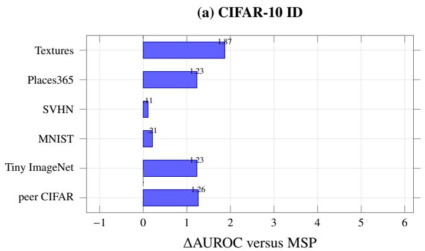

(b) CIFAR-100 ID  
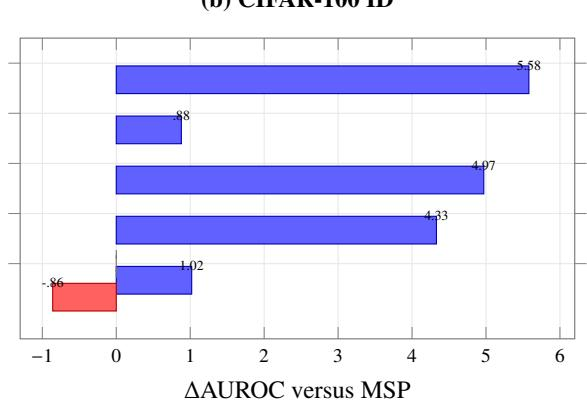  
Figure A.6: Per-dataset AUROC change of the centroid–MSP baseline relative to MSP on CIFAR. Blue bars indicate improvement and red indicates degradation. Gains are broad but heterogeneous; peer CIFAR under CIFAR-100 is the only negative case. Exact AUROC/FPR@95 values are reported in Table A.19.

Table A.19: Per-dataset CIFAR results under the unified OpenOOD v1.5 protocol. Each entry is AUROC/FPR@95; all values are mean±standard deviation over three oficial ResNet-18 seeds.
<table><tr><td>ID</td><td>OOD dataset</td><td>Type</td><td>MSP</td><td>Scale</td><td>CTM</td><td>Centroid-MSP</td></tr><tr><td>CIFAR-10</td><td>CIFAR-100</td><td>Near</td><td> $8 7 . 1 9 \pm . 4 0 / 5 3 . 0 9 \pm 6 . 0 2$ </td><td> $8 1 . 2 7 \pm . 9 1 / 8 1 . 7 8 \pm 4 . 8 7$ </td><td> $\mathbf { 8 8 . 6 6 \pm . 1 7 / 4 0 . 7 9 \pm . 9 1 }$ </td><td> $8 8 . 4 5 \pm . 1 8 / 4 1 . 9 6 \pm 1 . 4 1$ </td></tr><tr><td></td><td>Tiny ImageNet Near</td><td></td><td> $8 8 . 8 7 \pm . 2 4 / 4 3 . 2 5 \pm 3 . 6 4$ </td><td> $8 3 . 8 4 \pm . 0 2 / 7 9 . 1 4 \pm 4 . 9 5$ </td><td> $\mathbf { 9 0 . 3 2 \pm . 3 0 / 3 3 . 7 9 \pm 1 . 0 9 }$ </td><td> $9 0 . 1 0 \pm . 3 3 / 3 4 . 3 3 \pm 1 . 4 3$ </td></tr><tr><td></td><td>MNIST</td><td>Far</td><td> $9 2 . 6 3 \pm 1 . 9 2 / 2 3 . 6 4 \pm 7 . 1 3$ </td><td> $9 0 . 5 8 \pm 3 . 6 2 / 4 8 . 6 9 \pm 1 8 . 8 4$ </td><td> $9 2 . 8 2 \pm . 4 9 / 2 3 . 8 4 \pm 2 . 1 4$ </td><td> $9 2 . 8 4 \pm . 4 5 / 2 3 . 7 2 \pm 1 . 7 5$ </td></tr><tr><td></td><td>SVHN</td><td>Far</td><td> $9 1 . 4 6 \pm . 5 0 / 2 5 . 8 0 \pm 2 . 0 1$ </td><td> $8 4 . 6 3 \pm 3 . 7 4 / 7 0 . 5 4 \pm 1 0 . 6 7$ </td><td> $9 1 . 4 5 \pm . 2 8 / 2 6 . 7 2 \pm 1 . 1 7$ </td><td> $9 1 . 5 7 \pm . 6 0 / 2 7 . 0 5 \pm 1 . 7 9$ </td></tr><tr><td></td><td>Places365</td><td>Far</td><td> $8 8 . 9 2 \pm . 5 7 / 4 2 . 4 7 \pm 4 . 6 8$ </td><td> $8 6 . 4 1 \pm 2 . 3 5 / 7 0 . 5 1 \pm 7 . 3 2$ </td><td> $\mathbf { 9 0 } . 5 2 \pm . 3 \mathbf { 0 } / 3 3 . 4 6 \pm . 7 \mathbf { 0 }$ </td><td> $9 0 . 1 5 \pm . 3 2 / 3 4 . 7 7 \pm . 6 5$ </td></tr><tr><td></td><td>Textures</td><td>Far</td><td> $8 9 . 8 9 \pm . 8 7 / 3 4 . 9 7 \pm 5 . 7 1$ </td><td> $8 3 . 9 3 \pm . 4 2 / 8 0 . 4 0 \pm 4 . 8 0$ </td><td> $\mathbf { 9 1 . 9 3 \pm . 2 6 / 2 7 . 0 3 \pm . 3 3 }$ </td><td> $9 1 . 7 6 \pm . 2 8 / 2 7 . 1 6 \pm . 6 3$ </td></tr><tr><td>CIFAR-100</td><td>CIFAR-10</td><td>Near</td><td> $7 8 . 4 7 \pm . 0 8 / 5 8 . 9 0 \pm 1 . 1 4$ </td><td> $7 9 . 2 6 \pm . 1 2 / 5 9 . 1 1 \pm 1 . 0 3$ </td><td> $7 7 . 2 5 \pm . 2 1 / 6 8 . 3 6 \pm . 3 5$ </td><td> $7 7 . 6 1 \pm . 1 4 / 6 7 . 8 2 \pm . 7 1$ </td></tr><tr><td></td><td>Tiny ImageNet Near</td><td></td><td> $8 2 . 0 7 \pm . 2 0 / 5 0 . 6 9 \pm . 4 3$ </td><td> $8 2 . 7 1 \pm . 1 8 / 5 2 . 2 5 \pm . 8 9$ </td><td> $8 3 . 0 8 \pm . 2 5 / 5 0 . 0 0 \pm . 2 9$ </td><td> $\mathbf { 8 3 . 0 9 \pm . 2 3 / 4 9 . 6 8 \pm . 1 6 }$ </td></tr><tr><td></td><td>MNIST</td><td>Far</td><td> $7 6 . 0 8 \pm 2 . 2 8 / 5 7 . 2 4 \pm 5 . 7 2$ </td><td> $8 0 . 2 7 \pm 1 . 4 2 / 5 1 . 6 4 \pm 4 . 3 7$ </td><td> $\mathbf { 8 1 . 3 2 \pm 2 . 2 0 / 5 0 . 1 9 \pm 5 . 1 5 }$ </td><td> $8 0 . 4 1 \pm 2 . 0 7 / 5 0 . 4 7 \pm 4 . 8 0$ </td></tr><tr><td></td><td>SVHN</td><td>Far</td><td> $7 8 . 4 2 \pm 1 . 0 9 / 5 9 . 0 8 \pm 3 . 1 0$ </td><td> $8 4 . 4 5 \pm 1 . 3 3 / 4 9 . 2 7 \pm 3 . 1 8$ </td><td> $8 4 . 5 6 \pm 1 . 5 9 / 4 9 . 9 7 \pm 4 . 0 4$ </td><td> $8 3 . 3 9 \pm . 8 5 / 5 0 . 4 3 \pm 2 . 6 8$ </td></tr><tr><td></td><td>Places365</td><td>Far</td><td> $7 9 . 2 3 \pm . 3 5 / 5 6 . 6 2 \pm 1 . 0 6$ </td><td> $8 0 . 4 7 \pm . 2 8 / 5 6 . 9 8 \pm . 8 3$ </td><td> $8 0 . 4 3 \pm . 5 0 / 5 8 . 8 0 \pm 1 . 0 4$ </td><td> $8 0 . 1 1 \pm . 3 7 / 5 9 . 0 0 \pm 1 . 1 3$ </td></tr><tr><td></td><td>Textures</td><td>Far</td><td> $7 7 . 3 2 \pm . 8 6 / 6 1 . 9 0 \pm 1 . 5 9$ </td><td> $8 0 . 5 0 \pm . 8 6 / 5 8 . 4 4 \pm 2 . 4 1$ </td><td> $\mathbf { 8 4 . 1 7 \pm . 6 6 / 5 1 . 0 5 \pm 2 . 2 8 }$ </td><td> $8 2 . 9 0 \pm . 6 5 / 5 1 . 6 3 \pm 1 . 9 1$ </td></tr></table>

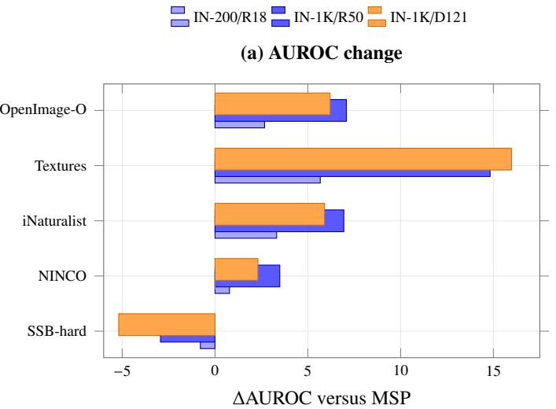

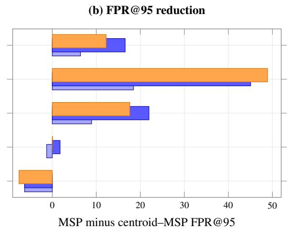  
Figure A.7: Per-dataset change of the centroid–MSP baseline relative to MSP on the ImageNet benchmarks. Positive values are favorable in both panels. Grouping the three backbone/scale settings within each dataset exposes the shared pattern: large Far-OOD gains, especially on Textures, and a consistent loss on SSB-hard. Exact values appear in Table A.20.

Table A.20: Per-dataset ImageNet results. Each entry is AUROC/FPR@95. ImageNet-200 uses three oficial ResNet-18 seeds. ImageNet-1K MSP, Scale, and CTM use one fixed backbone, whereas Centroid–MSP varies three centroid banks.
<table><tr><td>ID/backbone</td><td>OOD dataset</td><td>Type</td><td>MSP</td><td>Scale</td><td>CTM</td><td>Centroid-MSP</td></tr><tr><td>IN-200/R18</td><td>SSB-hard</td><td>Near</td><td> $8 0 . 3 8 \pm . 0 4 / 6 6 . 0 0 \pm . 1 4$ </td><td> $8 2 . 0 8 \pm . 3 3 / 6 7 . 3 9 \pm . 7 8$ </td><td> $7 9 . 4 3 \pm . 2 5 / 7 1 . 3 2 \pm . 2 9$ </td><td> $7 9 . 5 9 \pm . 2 4 / 7 2 . 2 9 \pm . 3 6$ </td></tr><tr><td></td><td>NINCO</td><td>Near</td><td> $8 6 . 2 9 \pm . 1 3 / 4 3 . 6 7 \pm . 9 3$ </td><td> $8 7 . 5 9 \pm . 3 6 / 4 7 . 2 1 \pm 1 . 5 5$ </td><td> $8 6 . 8 3 \pm . 1 7 / 4 5 . 1 0 \pm 1 . 3 1$ </td><td> $8 7 . 0 7 \pm . 1 6 / 4 4 . 9 5 \pm 1 . 3 5$ </td></tr><tr><td></td><td>iNaturalist</td><td>Far</td><td> $9 2 . 8 0 \pm . 3 0 / 2 6 . 4 9 \pm . 9 1$ </td><td> $9 5 . 7 9 \pm . 5 6 / 1 8 . 4 1 \pm 2 . 3 0$ </td><td> $9 5 . 9 0 \pm . 1 8 / 1 8 . 7 0 \pm . 9 9$ </td><td> $\mathbf { 9 6 . 1 2 \pm . 3 3 / 1 7 . 5 6 \pm . 6 8 }$ </td></tr><tr><td></td><td>Textures</td><td>Far</td><td> $8 8 . 3 6 \pm . 1 6 / 4 4 . 5 8 \pm . 8 6$ </td><td> $9 4 . 1 1 \pm . 0 8 / 2 9 . 8 0 \pm . 6 4$ </td><td> $\mathbf { 9 4 . 4 2 \pm . 0 7 } / 2 5 . 1 3 \pm . 8 5$ </td><td> $9 4 . 0 3 \pm . 2 0 / 2 6 . 1 3 \pm . 8 7$ </td></tr><tr><td></td><td>OpenImage-O</td><td>Far</td><td> $8 9 . 2 4 \pm . 0 2 / 3 5 . 2 4 \pm . 2 7$ </td><td> $9 2 . 0 4 \pm . 3 0 / 3 1 . 2 0 \pm 1 . 3 2$ </td><td> $9 1 . 3 4 \pm . 1 2 / 2 9 . 7 4 \pm . 7 0$ </td><td> $9 1 . 9 1 \pm . 0 6 / 2 8 . 8 3 \pm . 2 7$ </td></tr><tr><td>IN-1K/R50</td><td>SSB-hard</td><td>Near</td><td>72.09/74.48</td><td>77.35/67.73</td><td>68.53/80.07</td><td> $6 9 . 1 5 \pm . 2 0 / 8 0 . 7 7 \pm . 3 0$ </td></tr><tr><td></td><td>NINCO</td><td>Near</td><td>79.95/56.87</td><td>85.37/51.81</td><td>82.85/55.65</td><td> $8 3 . 4 4 \pm . 2 5 / 5 5 . 1 0 \pm . 8 9$ </td></tr><tr><td></td><td>iNaturalist</td><td>Far</td><td>88.41/43.35</td><td>98.02/9.50</td><td>95.83/19.33</td><td> $9 5 . 3 5 \pm . 5 6 / 2 1 . 3 8 \pm 2 . 3 6$ </td></tr><tr><td></td><td>Textures</td><td>Far</td><td>82.43/60.90</td><td>97.63/11.90</td><td>97.75/12.71</td><td> $9 7 . 2 5 \pm . 0 9 / 1 5 . 8 3 \pm . 7 8$ </td></tr><tr><td></td><td>OpenImage-O</td><td>Far</td><td>84.86/50.14</td><td>93.95/28.18</td><td>92.01/33.00</td><td> $9 1 . 9 4 \pm . 4 6 / 3 3 . 5 8 \pm 1 . 3 4$ </td></tr><tr><td>IN-1K/D121</td><td>SSB-hard</td><td>Near</td><td>71.11/75.52</td><td>72.75/75.26</td><td>64.95/82.91</td><td> $6 5 . 9 2 \pm . 2 4 / 8 3 . 0 9 \pm . 2 6$ </td></tr><tr><td></td><td>NINCO</td><td>Near</td><td>79.53/58.58</td><td>83.56/55.78</td><td>80.86/60.31</td><td> $8 1 . 8 4 \pm . 3 9 / 5 8 . 5 1 \pm 1 . 5 1$ </td></tr><tr><td></td><td>iNaturalist</td><td>Far</td><td>88.61/42.78</td><td>97.25/13.94</td><td>94.80/23.09</td><td> $9 4 . 5 1 \pm . 7 7 / 2 5 . 1 7 \pm 3 . 0 8$ </td></tr><tr><td></td><td>Textures</td><td>Far</td><td>81.28/64.32</td><td>96.17/19.47</td><td>97.49/13.44</td><td> $9 7 . 2 5 \pm . 1 2 / 1 5 . 4 1 \pm . 9 3$ </td></tr><tr><td></td><td>OpenImage-O</td><td>Far</td><td>83.88/52.59</td><td>92.74/33.02</td><td>89.78/41.10</td><td> $9 0 . 0 8 \pm . 5 8 / 4 0 . 3 5 \pm 1 . 7 3$ </td></tr></table>

## Appendix A.12. Validation mechanism, sample eficiency, and calibration budget

The following tables and plots give the numerical detail for Section 6.5. Pointwise best weights maximize mean AUROC on the designated validation holdout retrospectively; the evaluated rule remains fixed at $\alpha = 0 . 8$

Table A.21: Exact values for the controlled nested class-count validation study. $\alpha ^ { * }$ maximizes mean holdout AUROC at each class count. The two ∆ columns evaluate the single pre-test choice α = 0 8 against MSP (α = 0) and centroid-only (α = 1); positive values favor the fixed mixture. Results use one nested class sequence.
<table><tr><td>Classes</td><td>Pointwise α*</td><td>∆ vs. MSP</td><td>∆ vs. centroid</td><td> $0 . 8 = \alpha ^ { * }$ </td></tr><tr><td>10</td><td>1.0</td><td>+0.64</td><td>-1.00</td><td>一</td></tr><tr><td>25</td><td>0.9</td><td>+2.39</td><td>-0.14</td><td>一</td></tr><tr><td>50</td><td>0.8</td><td>+2.37</td><td>+0.33</td><td> $\checkmark$ </td></tr><tr><td>100</td><td>0.8</td><td>+2.76</td><td>+0.67</td><td>√</td></tr><tr><td>200</td><td>0.8</td><td>+4.74</td><td>+0.45</td><td> $\checkmark$ </td></tr><tr><td>500</td><td>0.8</td><td>+5.45</td><td>+0.69</td><td>√</td></tr><tr><td>1000</td><td>0.7</td><td>+6.45</td><td>+0.86</td><td>一</td></tr></table>

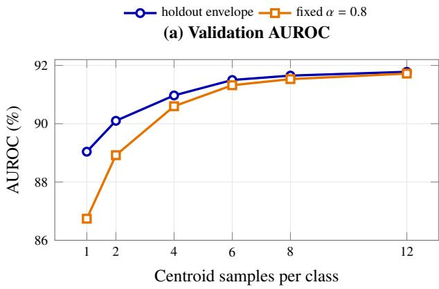

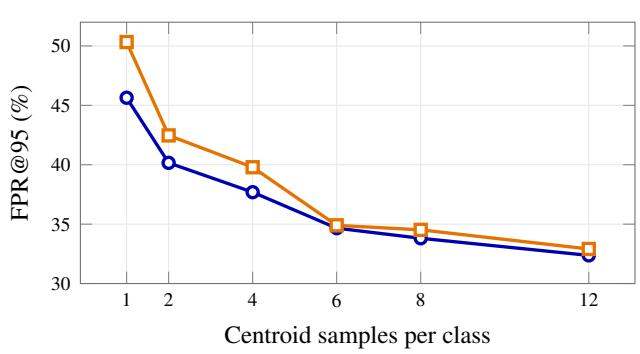  
Figure A.8: ImageNet-1K validation-only sample eficiency over three centroid seeds. Six samples per class capture most of the 12-sample performance, and the fixed $\alpha = 0 . 8$ curve nearly meets the retrospective holdout envelope from six samples onward. The blue curve maximizes mean holdout AUROC over α separately at each bank size; panel (b) uses the corresponding weights.

Table A.22: ImageNet-1K validation-only calibration-budget sensitivity of the centroid–MSP baseline. Columns vary the number of ID calibration images per class; each entry is AUROC/FPR@95. One ID image per class is held out for evaluation, calibration subsets are nested within the other four, and all OOD validation examples are evaluated. The centroid bank is fixed. Positive afine standardization leaves either component’s rankings unchanged.
<table><tr><td>Method</td><td>1 image</td><td>2 images</td><td>3 images</td><td>4 images</td></tr><tr><td>Fixed  $\alpha = 0 . 8$ </td><td>92.185/31.17</td><td>92.184/31.13</td><td>92.185/31.13</td><td>92.183/31.13</td></tr></table>

Table A.23: Validation-holdout mechanism audit on the five natural dataset/backbone targets. “Corr.” is Pearson correlation between MSP and centroid scores on the designated OOD validation holdout. Score cells are AUROC/FPR@95; values aggregate three centroid seeds where applicable.
<table><tr><td>Target</td><td>Classes</td><td>OOD corr.</td><td>Best α</td><td>MSP</td><td> $\mathrm { F i x e d } \alpha = 0 . 8$ </td><td>Centroid-only</td></tr><tr><td>CIFAR-10/R18</td><td>10</td><td> $. 8 8 0 \pm . 0 0 2$ </td><td>1.0</td><td>88.65/42.73</td><td>89.72/36.40</td><td>89.80/36.53</td></tr><tr><td>CIFAR-100/R18</td><td>100</td><td> $. 8 2 8 \pm . 0 0 3$ </td><td>1.0</td><td>83.62/46.53</td><td>84.99/45.07</td><td>85.00/44.67</td></tr><tr><td>IN-200/R18</td><td>200</td><td> $. 6 7 7 \pm . 0 1 6$ </td><td>1.0</td><td>87.81/38.33</td><td>90.75/30.94</td><td>90.77/31.44</td></tr><tr><td>IN-1K/R50</td><td>1000</td><td> $. 4 1 0 \pm . 0 1 5$ </td><td>.8</td><td>85.27/47.13</td><td>91.72/32.91</td><td>90.86/36.89</td></tr><tr><td>IN-1K/D121</td><td>1000</td><td> $. 3 1 5 \pm . 0 0 3$ </td><td>.6</td><td>83.77/51.90</td><td>90.31/39.16</td><td>88.81/42.57</td></tr></table>

Recomputing the 12-sample centroids reproduces the archived checkpoint within $4 . 4 7 \times 1 0 ^ { - 8 }$ maximum absolute error for each of the three seeds.

## Appendix A.13. Extended batch-one eficiency comparison

Table A.24 reports the complete batch-one latency ratios underlying the abbreviated discussion in Section 6. All measurements use the same RTX 4090 D, include the backbone forward pass, exclude data loading, and use MSP measured in the corresponding timing session as ratio one. CTM and the centroid–MSP baseline are measured in one paired runner on identical preloaded inputs.

## Appendix A.14. Implementation details

For the small-bank static control, normalized feature directions are averaged within each class and renormalized to obtain $\mu _ { c }$ The query statistic is $G ( x ) = \mathrm { m a x } _ { c } q ( x ) ^ { \top } \mu _ { c }$ . If m(x) is MSP and $\widetilde { m } , \widetilde { G }$ denote pooled ID-standardized components, the reported fixed control is $( 1 - \alpha ) \widetilde { m } + \alpha \widetilde { G }$ with $\alpha = 0 . 8$

Table A.24: End-to-end batch-one latency relative to MSP. Lower is better. Per-image latency measures online inference; setup-sample counts for CTM and the centroid–MSP baseline are described in the accompanying resource audit.
<table><tr><td>Method</td><td>CIFAR-10</td><td>CIFAR-100</td><td>IN-200</td><td>IN-1K</td></tr><tr><td>CTM</td><td>0.994</td><td>1.043</td><td>1.037</td><td>1.016</td></tr><tr><td>MSP</td><td>1.000</td><td>1.000</td><td>1.000</td><td>1.000</td></tr><tr><td>Centroid-MSP</td><td>1.041</td><td>1.085</td><td>1.090</td><td>1.039</td></tr><tr><td>SHE</td><td>1.045</td><td>1.180</td><td>0.776</td><td>1.069</td></tr><tr><td>RMDS</td><td>1.137</td><td>1.146</td><td>1.103</td><td>1.509</td></tr><tr><td>Scale</td><td>1.141</td><td>1.122</td><td>1.158</td><td>1.516</td></tr><tr><td>DICE</td><td>1.146</td><td>1.120</td><td>1.138</td><td>1.670</td></tr><tr><td>ASH</td><td>1.149</td><td>1.115</td><td>1.207</td><td>1.735</td></tr><tr><td>RankFeat</td><td>3.073</td><td>3.045</td><td>4.741</td><td>4.505</td></tr></table>

Training banks and candidate classes.. All feature directions are normalized before anchor or centroid construction. The original trajectory settings below are distinct from the mechanism audits. For the original CIFAR trajectories, 80 anchors per class are sampled from the extracted training features using a seeded random permutation. All classes participate in both bandwidth fitting and inference. For ImageNet, the setup bank contains 12 training examples per class, and five are selected by a seeded random permutation as field anchors. The normalized mean of all 12 feature directions defines the class centroid used for candidate selection. At inference, the 20 classes with the largest cosine similarities to the initial query are retained for both force computation and trajectory scoring. This candidate set remains fixed as the query moves. The centroid–MSP baseline uses all class centroids, without candidate truncation.

The score-aligned mechanism audit instead uses five anchors from 12 setup features per class on every benchmark, fits on that setup bank, and uses min(C 20) initial candidates. The stability probe uses normalized means of all 12-feature setup banks on every benchmark, compares all class centroids, and does not evaluate an anchor kernel during the probe.

Bandwidth fitting.. The reported trajectory grids, anchor-weighting study, and five-kernel comparison fit bandwidths using zero step afinities. With the backbone, anchors, and anchor weights fixed, the objective is

$$
\mathcal { L } ( \sigma ) = - \frac { 1 } { N } \sum _ { i = 1 } ^ { N } \log \frac { \exp \{ K A _ { y _ { i } } ( q _ { i } ) \} } { \sum _ { c \in \mathcal { T } _ { i } ^ { \mathrm { f i } } } \exp \{ K A _ { c } ( q _ { i } ) \} } ,\tag{A.6}
$$

where $( q _ { i } , y _ { i } )$ are ID fitting features and labels. On CIFAR, $\mathcal { T } _ { i } ^ { \mathrm { f i t } }$ contains every class and fitting uses the extracted training features. On ImageNet, fitting uses the setup bank and $\mathcal { I } _ { i } ^ { \mathrm { f i t } }$ contains the true class and the 19 other classes with highest centroid cosine. The true class is included only because labels are available during fitting; inference uses the 20 highest-scoring classes without this intervention.

The factor K matches the implementation’s summed-anchor afinities. It does not change the ordering of a fixed field, but it matters in the fitting loss and force magnitude. We optimize log-bandwidths with Adam at an initial learning rate of $1 0 ^ { - 3 }$ and cosine learning-rate decay. Bandwidths are initialized to 1 0 on CIFAR and 0 5 on ImageNet and constrained to [0 05 4 0]. CIFAR uses 25 epochs with batches of 64; ImageNet uses 10 epochs with batches of 32. No trajectory is diferentiated through in this fitting objective, even when inference uses a nonzero step count. The static centroid–MSP baseline requires neither bandwidth fitting no integration.

Score calibration andfusion.. The aligned audit uses a seeded floor-half split within each ID class and a separate floor-half OOD split for tuning, with the complements held out. Current-winner $T \in \{ 1 , 3 , 5 , 1 0 \}$ is selected by mean ImageNet-1K tuning AUROC over three banks, breaking ties by lower FPR@95 and then smaller T. The selected $T = 5$ is transferred without retuning. The no-switch audit uses the full validation caches, rather than only the evaluation holdouts. Per seed, the ImageNet-1K selection and holdout counts are respectively 2000/881 and 3000/882 (ID/OOD). Target holdouts contain 500/500 for CIFAR-10, 500/486 for CIFAR-100, and 600/882 for ImageNet-200; no target-side selection is performed for this study.

The probe uses a separate partition with calibration seed zero: two ID examples per class for fit, one for selection, and the remainder for the holdout. A separate OOD permutation has split endpoints $\lvert . 3 5 N _ { \mathrm { o u t } } \rvert$ and $ { \lfloor . 6 0 N _ { \mathrm { o u t } } \rfloor } ;$ OOD-fit examples are not used for calibration. On ResNet-50 source selection data, $\eta \in \{ 0 , . 0 1 , . 0 2 , . 0 4 , . 0 8 , . 1 6 \}$ is chosen by mean AUROC over three banks, breaking ties by smaller $\eta .$ The selected 04 is fixed for all other settings; target selection subsets are unused. Probe statistics and AUROC changes are measured on the same holdout, so their agreement is descriptive rather than an independent prediction test. Per seed, ImageNet-1K uses 2000 ID-fit examples, 1000/440 selection examples, and 2000/706 holdout examples (ID/OOD), for both backbones; only ResNet-50 is used to select η. CIFAR-10, CIFAR-100, and ImageNet-200 use 20, 200, and 400 ID-fit examples, respectively, with holdout counts of 970/400, 700/389, and 400/706. ID-fit examples standardize the probe scores; training-feature banks are separate.

For each benchmark and backbone, the two component scores are standardized using the same deterministic, class-stratified subset of ID validation data. The stored statistics are the pooled means and population standard deviations; inference denominators are floored at $1 0 ^ { - 1 2 }$ . Selecting the maximum-cosine rule and $\alpha = 0 . 8$ uses an ImageNet-1K ID/OOD tuning split for the static baseline, with scanned on $\{ 0 , . 0 5 , . . . , 1 \}$ and only the ID tuning part used for standardization. The rule is checked on the complementary holdout. The probe inherits this fixed $\alpha ;$ its separate selection split is used to choose , as described above. These choices remain fixed during transfer, while the ID calibration statistics are recomputed for each target. In the static bridge, S1 already uses all classes; S2 replaces the bandwidths by their per-bank median and uses uniform anchor weights, S3 normalizes each anchor mean to obtain a radial centroid, and S4 applies the equivalent maximum-cosine score. Thus scale sharing and candidate expansion are explicit modeling changes, not consequences of setting $T = 0$

## Appendix A.15. Reproducibility notes

The experiments were executed with Python 3.10.8, PyTorch 2.1.2, torchvision 0.16.2, CUDA 12.1, and an NVIDIA RTX 4090 D. The archived evaluation code records OpenOOD commit 3c35632ee91b54b09d1f085d04f94744cece7d0b; the CTM completion metadata records oficial reference commit . Dataset preparation validates archive integrity, image-list counts, and missing paths. The ImageNet-1K ResNet-50 file has SHA256 06 76ba61b6795bbe1773cffd859882e5e297624d384b6993f7c9e683e722fb8a; the pinned DenseNet-121 file has SHA256 42bd2c384fae0b346f977fe9feed1bcfdbd6ea4727478c6c76177d725b218e89. The extended audit covers 50 full dataset ASH/DICE/SHE/RMDS/RankFeat runs. RankFeat uses full exact SVD, and RMDS streaming statistics match direct tensor computation within $2 . 8 4 \times 1 0 ^ { - 1 4 }$ in float64. The CADRef/LogitGap audit adds 22 full-dataset method/model runs: 11 runs per method across the five dataset/backbone targets. The two fixed ImageNet-1K backbones are not counted as independent training seeds. CADRef processes all ID training images for setup, while fixed LogitGap is training-free; neither uses OOD data for setup or parameter selection. The accompanying CADRef/LogitGap export includes raw Near-/Far-OOD rows, mean and standard deviation summaries, and completion metadata. The expanded rank table is regenerated from the displayed two-decimal baseline means so that its tie convention is reproducible from the paper itself. The score-aligned mechanism study stores its ImageNet 1K selection gate, locked cross-benchmark transfer gate, pair-decomposition rows, and all stepwise winner traces. The transfer gate has SHA256 1199cf9e330f4e2f623ce7409193306bfc38672daa5bfb1d6c2471624563ec2b; the winner-switch explanation gate has SHA256 f75a83c4a94edd36713ca5e505a01f8a4df28fafd6ae0bf210a8327bd747d9a2. Both studies are validation-only and record that no Near-/Far-OOD test loader was accessed. The boundary-conditioned stability-probe transfer uses the previously saved validation caches and formal detectors only. Its locked gate has SHA256 c824da104d547c804166 82c39e12b55041af190b0312534bd19787f35b06a6bb and rejects benchmark-test access. The accompanying result archive has SHA256 a2ed6b0dfed5310b343dec71dc7dd5a3d7538d45a3e4100cd77b2d954db34401. The complete result matrix, per-run configurations, completion markers, and summary CSV files are retained in the accompanying reproducibility archive. The main text and supplementary tables report the formal full-dataset aggregate experiment families; smoke tests, exploratory score-rule candidates, and duplicate per-seed raw rows remain available in the audit archive.

## References

Arnold, V. I., Vogtmann, K., and Weinstein, A. (1989). Mathematical methods ofclassical mechanics, volume 60. Springer.

Cayton, L. (2008). Algorithms for manifold learning. Technical report, Department of Computer Science & Engineering, UC San Diego. https: //escholarship.org/uc/item/8969r8tc.

Djurisic, A., Bozanic, N., Ashok, A., and Liu, R. (2023). Extremely simple activation shaping for out-of-distribution detection. In The Eleventh International Conference on Learning Representations. https://openreview .net/forum?id=ndYXTEL6cZz.

ElAraby, M., Sahoo, S., Pequignot, Y., Novello, P., and Paull, L. (2025). GROOD: Gradient-aware out-of-distribution detection. Transactions on Machine Learning Research.

Feferman, C., Mitter, S., and Narayanan, H. (2016). Testing the manifold hypothesis. Journal of the American Mathematical Society, 29(4):983–1049. https://doi.org/10.1090/jams/852.

Gu, J., Qiao, Z., and Li, Z. (2025). Gradient short-circuit: Eficient outof-distribution detection via feature intervention. In Proceedings of the IEEE/CVF International Conference on Computer Vision, pages 457–466.

Hendrycks, D., Basart, S., Mazeika, M., Zou, A., Kwon, J., Mostajabi, M., Steinhardt, J., and Song, D. (2022). Scaling out-of-distribution detection for real-world settings. In Proceedings ofthe 39th International Conference on Machine Learning, volume 162 of Proceedings of Machine Learning Research, pages 8759–8773. PMLR. https://proceedings.mlr.press/ v162/hendrycks22a.html.

Hendrycks, D. and Gimpel, K. (2017). A baseline for detecting misclassified and out-of-distribution examples in neural networks. In International Conference on Learning Representations. https://openreview.net/forum ?id=Hkg4TI9xl.

Isaac-Medina, B. K. S., Che, M., Gaus, Y. F. A., Akcay, S., and Breckon, T. P. (2025). FEVER-OOD: Free energy vulnerability elimination for robust out-of-distribution detection. In Proceedings ofthe IEEE/CVF International Conference on Computer Vision, pages 4529–4538.

Ke, A., Chen, W., Feng, C., Cao, Y., Xie, X., Zhou, S. K., and Feng, L. (2025). Prototype-based optimal transport for out-of-distribution detection. In Kwok, J., editor, Proceedings of the Thirty-Fourth International Joint Conference on Artificial Intelligence, IJCAI-25, pages 3018–3026. International Joint Conferences on Artificial Intelligence Organization. Main Track.

Lee, K., Lee, K., Lee, H., and Shin, J. (2018). A simple unified framework for detecting out-of-distribution samples and adversarial attacks. In Bengio, S., Wallach, H., Larochelle, H., Grauman, K., Cesa-Bianchi, N., and Garnett, R., editors, Advances in Neural Information Processing Systems, volume 31. Curran Associates, Inc. https://proceedings.neurips.cc/paper\_f iles/paper/2018/file/abdeb6f575ac5c6676b747bca8d09cc2-P aper.pdf.

Liang, J., Hou, R., Hu, M., Chang, H., Shan, S., and Chen, X. (2025). Revisiting logit distributions for reliable out-of-distribution detection. In Advances in Neural Information Processing Systems, volume 38.

Liang, S., Li, Y., and Srikant, R. (2017). Principled detection of out-ofdistribution examples in neural networks. CoRR, abs/1706.02690. http: //arxiv.org/abs/1706.02690.

Ling, Z., Chang, Y., Zhao, H., Zhao, X., Chow, K., and Deng, S. (2025). CADRef: Robust out-of-distribution detection via class-aware decoupled relative feature leveraging. In Proceedings of the IEEE/CVF Conference on Computer Vision and Pattern Recognition, pages 4968–4977.

Liu, W., Wang, X., Owens, J., and Li, Y. (2020). Energy-based out-ofdistribution detection. In Larochelle, H., Ranzato, M., Hadsell, R., Balcan, M., and Lin, H., editors, Advances in Neural Information Processing Systems, volume 33, pages 21464–21475. Curran Associates, Inc. https: //proceedings.neurips.cc/paper\_files/paper/2020/file/f54 96252609c43eb8a3d147ab9b9c006-Paper.pdf.

Liu, X., Lochman, Y., and Zach, C. (2023). Gen: Pushing the limits of softmaxbased out-of-distribution detection. In Proceedings of the IEEE/CVF Conference on Computer Vision and Pattern Recognition (CVPR), pages 23946– 23955. https://openaccess.thecvf.com/content/CVPR2023/htm l/Liu\_GEN\_Pushing\_the\_Limits\_of\_Softmax-Based\_Out-of-Dis tribution\_Detection\_CVPR\_2023\_paper.html.

Nguyen, A., Bertrand, A., Le Hégarat-Mascle, S., Aldea, E., El-Korso, M. N., Lustrat, R., and Florin, F. (2026). Fisher–rao sensitivity for out-

of-distribution detection in deep neural networks. In The Fourteenth International Conference on Learning Representations.

Nguyen, N.-H., Nguyen, H.-Q., Ta, T.-A., Nguyen-Tang, T., Doan, K. D., and Hoang, T.-T. (2023). A cosine similarity-based method for out-ofdistribution detection. In ICML 2023 Workshop on Spurious Correlations, Invariance, and Stability. https://openreview.net/forum?id=QuXA pqb8Yl.

Park, J., Jung, Y. G., and Teoh, A. B. J. (2023). Nearest neighbor guidance for out-of-distribution detection. In Proceedings ofthe IEEE/CVF International Conference on Computer Vision, pages 1686–1695.

Ren, J., Fort, S., Liu, J. Z., Roy, A. G., Padhy, S., and Lakshminarayanan, B. (2021). A simple fix to mahalanobis distance for improving near-ood detection. CoRR, abs/2106.09022. https://arxiv.org/abs/2106.090 22.

Seleznova, M., Chou, H.-H., Mayrink Verdun, C., and Kutyniok, G. (2026). GradPCA: Leveraging NTK alignment for reliable out-of-distribution detection. In The Fourteenth International Conference on Learning Representations.

Song, Y., Sebe, N., and Wang, W. (2022). RankFeat: Rank-1 feature removal for out-of-distribution detection. In Advances in Neural Information Processing Systems, volume 35, pages 17885–17898. https://proceeding s.neurips.cc/paper\_files/paper/2022/hash/71c9eb0913e6c7f da3afd69c914b1a0c-Abstract-Conference.html.

Sun, Y., Guo, C., and Li, Y. (2021). React: Out-of-distribution detection with rectified activations. In Advances in Neural Information Processing Systems, volume 34. https://proceedings.neurips.cc/paper/2021/hash /01894d6f048493d2cacde3c579c315a3-Abstract.html.

Sun, Y. and Li, Y. (2022). DICE: Leveraging sparsification for out-ofdistribution detection. In Computer Vision – ECCV 2022, pages 691–708. https://www.ecva.net/papers/eccv\_2022/papers\_ECCV/papers /136840680.pdf.

Sun, Y., Ming, Y., Zhu, X., and Li, Y. (2022). Out-of-distribution detection with deep nearest neighbors. In Chaudhuri, K., Jegelka, S., Song, L., Szepesvari, C., Niu, G., and Sabato, S., editors, Proceedings of the 39th International Conference on Machine Learning, volume 162 of Proceedings of Machine Learning Research, pages 20827–20840. PMLR. https://proceeding s.mlr.press/v162/sun22d.html.

Wang, H., Li, Z., Feng, L., and Zhang, W. (2022). Vim: Out-of-distribution with virtual-logit matching. In Proceedings of the IEEE/CVF Conference on Computer Vision and Pattern Recognition (CVPR), pages 4921–4930. https://openaccess.thecvf.com/content/CVPR2022/html/Wang \_ViM\_Out-of-Distribution\_With\_Virtual-Logit\_Matching\_CV PR\_2022\_paper.html.

Wei, T. and Liu, M. (2026). Uncertainty-aware prototype refinement for outof-distribution detection. Neurocomputing, 699:134310.

Xia, G. and Bouganis, C.-S. (2024). Augmenting the softmax with additional confidence scores for improved selective classification with out-ofdistribution data. International Journal of Computer Vision, 132(9):3714– 3752.

Xu, K., Chen, R., Franchi, G., and Yao, A. (2024). Scaling for training time and post-hoc out-of-distribution detection enhancement. In Kim, B., Yue, Y., Chaudhuri, S., Fragkiadaki, K., Khan, M., and Sun, Y., editors, International Conference on Learning Representations, volume 2024, pages 16316–16329. https://proceedings.iclr.cc/paper\_files/pape r/2024/file/46d943bc6a15a57c923829efc0db7c7a-Paper-Confe rence.pdf.

Zhang, J., Fu, Q., Chen, X., Du, L., Li, Z., Wang, G., Liu, X., Han, S., and Zhang, D. (2023a). Out-of-distribution detection based on in-distribution data patterns memorization with modern hopfield energy. In The Eleventh International Conference on Learning Representations. https://openre view.net/forum?id=KkazG4lgKL.

Zhang, J., Yang, J., Wang, P., Wang, H., Lin, Y., Zhang, H., Sun, Y., Du, X., Li, Y., Liu, Z., Chen, Y., and Li, H. (2023b). Openood v1.5: Enhanced benchmark for out-of-distribution detection. arXiv preprint arXiv:2306.09301. https://arxiv.org/abs/2306.09301.

Zohrabi, R., Hasani, H., Baghshah, M., Rohrbach, A., Rohrbach, M., and Rohban, M. H. (2025). Spurious-aware prototype refinement for reliable outof-distribution detection. In Advances in Neural Information Processing Systems, volume 38.