# CHIRON: CACHE MANAGEMENT EMPOWERED BY LLM INTELLIGENCE FOR AI WORKLOADS

Bohan Zhang Renshu Ge Tianze Wang Chen Chen

Shanghai Jiao Tong University

## ABSTRACT

AI clusters keep data in remote object stores and rely on local caches to stop GPUs from waiting for data. A cache performs well only when its prefetching and eviction policies match the access pattern, yet these patterns differ across AI workloads and change between phases of one workflow. Existing methods either need code changes, which compromises user transparency, or use low-end heuristics, which cannot follow such changes. Large language models (LLMs) can infer access behavior without user hints, but direct LLM control of cache actions suffers from long reasoning delay, high token cost, and poor decision quality. We present Chiron, a cache system based on advisory switching control. An LLM asynchronously diagnoses the access pattern and recommends a policy. A deterministic harness gates this advice, executes expert-designed policies locally, and returns cache feedback for review. We implement Chiron atop JuiceFS and evaluate it on nine AI workloads. It reduces job completion time by 14.3–41.2% over the best baseline on popular AI workloads.

## 1 INTRODUCTION

AI clusters run diverse workloads, from data preprocessing to model training and evaluation (He et al., 2016; Hu et al., 2022; Ruiz et al., 2023; Li et al., 2021). As datasets and models grow, these clusters keep data in remote object stores such as Amazon S3 (Amazon Web Services, 2026) and serve it through a local cache layer such as Alluxio or JuiceFS (Alluxio, 2026a; JuiceFS, 2026). Remote accesses can stall input pipelines and leave GPUs waiting for data (Mohan et al., 2021; Murray et al., 2021; Kuchnik et al., 2022), while local capacity is limited. Prefetching and eviction policies therefore crucially affect the cache hit ratio (CHR) and job completion time (JCT).

AI workloads make these policies hard to set. Sequential, random, and skewed accesses are all common, each prefers different policies, and one workflow may pass through all three as it moves between phases (Section 2.2). An AI cache thus needs both adaptivity, matching its policy to the current pattern, and transparency, doing so without user hints (Section 2.3). Existing methods do not provide both (Section 3.1). Code-intrusive adaptations such as Quiver (Kumar & Sivathanu, 2020) and NoPFS (Dryden et al., 2021) exploit workload knowledge through customized interfaces, which compromises transparency. Low-end adaptations such as ARC (Megiddo & Modha, 2003), LeCaR (Vietri et al., 2018), and SFP (Wang et al., 2021) need no hints, but they follow variations within one pattern rather than transitions between patterns, which compromises efficacy.

Providing both requires inferring the upper-level computation logic from low-level accesses, a task that fits large language models (LLMs), which already assist networking (Wu et al., 2024) and database (Zhou et al., 2024) management. Directly controlling the cache with an LLM, however, is impractical. We build a prototype in which an LLM lists the blocks to prefetch or evict after every read, and it reveals three challenges (Section 3.2):

• Long reasoning delay. Qwen3.8 Flash takes 41 s at P50 even with thinking off, while a storage client can issue hundreds of reads per second.

• High token cost. 128 reads consume over 10 M tokens, so a workflow of about 60k reads would need about 5 billion.

• Poor decision quality. The model chooses among up to 1,963 candidate blocks and may hallucinate; the best prefetching accuracy across models is 48.2% lower than that of SFP.

We present Chiron, a fast, cheap, and effective cache system for AI workloads based on advisory switching control. As in supervisory switching control (Morse, 1996; Liberzon, 2003), the LLM recognizes the operating regime and selects among expert-designed policies instead of acting on individual blocks. Since an LLM may hallucinate, it only advises: a deterministic harness decides whether to adopt its advice and returns cache feedback (Section 4). This design addresses the three challenges as follows:

• Asynchronous diagnosis. Inference stays off the read path: reads continue under the active policy while the LLM reasons in the background. This suffices because access patterns persist across many reads.

• Pattern-level advice. The LLM returns a short pattern label with a confidence score rather than block lists, and it runs only for routine checks or when cache feedback requests a review. One diagnosis then serves many reads, which keeps token cost low.

• Harnessed execution. Choosing among three patterns replaces choosing among thousands of blocks. Deterministic executors pick objects locally, a confidence gate defers uncertain advice, and feedback-triggered review revises outdated diagnoses, which contains hallucination.

We implement Chiron atop JuiceFS with about 4,000 LoC of Go and 400 LoC of Python, and evaluate it on nine AI workloads with data on remote storage (Section 6). On three multi-phase workflows, Chiron achieves the highest CHR and reduces JCT by 14.3–41.2% over the best baseline. Ablations confirm that structured statistics, confidence gating, and feedback reflection are each necessary. In a simulation with a 1 TB dataset, Chiron also has the highest CHR and lowest JCT at every tested cache size.

## 2 BACKGROUND

## 2.1 Caches Used for AI Workloads

AI techniques have substantially transformed many fields such as computer vision (He et al., 2016), natural language processing (Vaswani et al., 2017), and autonomous driving (Bojarski et al., 2016). Developing them requires diverse workloads such as data preprocessing, training, and inference, which are hosted in GPU clusters. With the drastic increase of dataset and model sizes, many enterprises such as Tencent (Zheng et al., 2022) and RedNote (Alluxio, 2026b) now store data remotely in cloud object stores such as AWS S3 (Amazon Web Services, 2026) and Azure Blob (Microsoft, 2026). Such a compute-storage disaggregated architecture (Figure 1) allows storage capacity to scale independently of GPU resources, attaining low cost and high reliability.

Under compute-storage disaggregation, caches are commonly adopted to improve remote I/O performance. Accessing remote storage incurs network latency and consumes bandwidth, which can stall input pipelines and leave GPUs waiting for data (Mohan et al., 2021; Murray et al., 2021; Kuchnik et al., 2022); to mitigate such overhead, frameworks such as Alluxio and JuiceFS provide a caching layer between computation and remote storage (Alluxio, 2026a; JuiceFS, 2026). As shown in Figure 1, workflows access data through a POSIX-facing cache framework that retains data locally and serves cache hits without remote I/O.

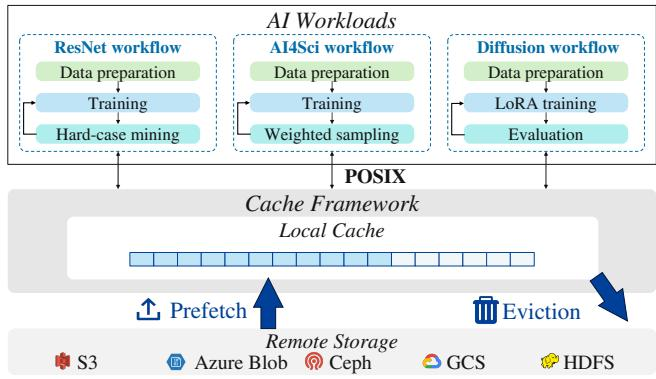  
Figure 1. Caching across AI workloads and workflow phases.

Local cache capacity is limited relative to the datasets it serves, so appropriate cache-management policies are essential. Two key aspects are prefetching, which decides what data to fetch before it is requested (Dryden et al., 2021; Garg et al., 2024; Wang et al., 2021), and eviction, which decides what resident data to remove when space is needed (Qureshi et al., 2007; Yang et al., 2023b; Zhang et al., 2024b). These policies crucially affect the cache hit ratio and further the end-to-end execution time of workloads.

## 2.2 Unique I/O Properties of AI Workloads

Effective caching depends on how workloads traverse data, and AI workloads differ fundamentally from conventional ones (Megiddo & Modha, 2003; Gu et al., 2023; Floratou et al., 2016) in two aspects.

(1) Diverse temporal access patterns across AI workloads. AI clusters support a wide range of workloads (Figure 1), including model training (Qwen Team, 2026; DeepSeek-AI et al., 2026; Kimi Team, 2026), model evaluation (Zhang et al., 2024a; Li et al., 2026; Di Natale et al., 2026), and data preprocessing (Penedo et al., 2025; Gowtham et al., 2026). These tasks differ in how they traverse data (Table 1). There are in general three typical patterns: sequential, for workloads like preprocessing and testing; random, for workloads like training (Mohan et al., 2021); and skewed (i.e., with hotspots), for workloads like quality analysis and RAG (Jin et al., 2025).

(2) Dynamic temporal access patterns within one AI workflow. An AI development workflow may comprise multiple dependent tasks, each a phase such as preprocessing, training, or evaluation (Figure 1). For example, NVIDIA NeMo connects data curation, model training, evaluation, and deployment in one workflow (Srivastava, 2025), and data-generation workflows alternate generation, filtering, de-duplication, and example selection (Desai et al., 2026). The access pattern over one dataset may thus change at any moment and is hard to identify in one shot.

Table 1. Representative file access patterns with example workloads, access sequences, and desired cache policies.
<table><tr><td>Temporal patterns</td><td>Workloads</td><td>Example access sequence</td><td>Desired prefetching policy Desired eviction policy</td><td></td></tr><tr><td>Sequential</td><td>LLM model loading (Fu et al., 2024), LLM tokenization (Raffel et al., 2020), · . </td><td>1 . jpeg → 2 . jpeg → 3. jpeg → 4. jpeg</td><td>Stride prefetching (Chen &amp; Eager eviction (Li et al., Baer, 1995)</td><td>2008)</td></tr><tr><td>Random</td><td>Vision fine-tuning (Dosovitskiy et al., 2021), Speech fine-tuning (Seo et al., 2021), · . .</td><td>10969.jpeg → 13625.jpeg → 19003.jpeg → 8077.jpeg</td><td>No prefetching (Azure, 2026)</td><td>No eviction (Mohan et al., 2021)</td></tr><tr><td>Skewed</td><td>Recommendation training (Naumov et al., 2019), RAG retrieval (Jin et al., 2025), · . .</td><td>A. csv → B.csv → A.csv → A.csv</td><td>Neighborhood prefetching (Li et al., 2004)</td><td>LRU eviction (Mattson et al., 1970)</td></tr></table>

In summary, AI workloads exhibit high diversity and dynamicity in temporal I/O characteristics, involving three comparably common access patterns. By contrast, conventional workloads such as operating systems (Denning, 1968), databases (Zhou et al., 2025), and big data analytics (Ananthanarayanan et al., 2012) usually have one dominant pattern, typically skewed. This distinctness yields distinct design requirements for AI caches.

## 2.3 Design Requirements of AI Caches

Caching preferences follow I/O patterns. Different access patterns desire different prefetching and eviction policies (Table 1). Sequential accesses prefer stride prefetching (i.e., prefetching sequential items) and eager eviction (i.e., removing an item once it is accessed). Random accesses prefer no prefetching, as a low success rate wastes bandwidth and can pollute the cache (Azure, 2026), and no eviction, as eviction has no impact when each sample is accessed once per epoch (Mohan et al., 2021). Skewed accesses prefer neighborhood prefetching (e.g., based on data-path locality) and LRU eviction, the classical policy adopted in caching frameworks like Alluxio. A mismatched policy lowers the cache hit ratio and prolongs job completion (Section 6).

Cache management requirements: adaptivity and transparency. An AI developer usually maintains a dedicated cache (JuiceFS, 2023; Alluxio, 2026c), so the policy should match each workload at each instant. This adaptivity must not come at the price of user transparency: application hints through customized cache APIs bring a code-intrusion burden that is impractical for public users (Kumar & Sivathanu, 2020). It is thus desirable for the cache to select suitable policies automatically, without user hints. In a nutshell, we need an easy-to-use (with preserved user transparency), high-efficacy (with good workload adaptivity) cache for modern AI workloads.

## 3 MOTIVATION

## 3.1 Limitations of Existing Works

Adaptivity and transparency are both desirable for an AI cache, yet they conflict, and existing works do not achieve

both.

Code-intrusive adaptations compromise user transparency. Given the distinct policy preferences of different access patterns (Table 1), some existing works adapt through customized caching interfaces. For example, Quiver exploits sample substitutability in shuffled training (Kumar & Sivathanu, 2020), and NoPFS predicts training accesses from the shuffle seed (Dryden et al., 2021). Extending them to other phases requires new knowledge of how those phases access data and which cache behavior suits them, which conflicts with using the cache without workload-specific modifications or manual tuning.

Low-end adaptations compromise caching efficacy. Given the limitations of interface-based adaptations, other methods adopt simple heuristics or lightweight learning that automatically adjust cache policies according to the observed access history. For eviction, ARC balances recency and frequency (Megiddo & Modha, 2003), and LeCaR uses regret minimization to choose between LRU and LFU (Vietri et al., 2018); for prefetching, SFP analyzes access correlations between files with a Markov chain and adapts its prefetching window (Wang et al., 2021). Without workload hints, however, these methods handle microscopic variations within one pattern (e.g., skewed), not macroscopic transitions across the patterns in Table 1. As a result, their cache hit ratio is substantially below that of code-intrusive adaptations (Figure 2).

Lessons learned: the need for LLM intelligence to attain high-end adaptivity. Given the limitations of both code-intrusive and low-end adaptations, what we need is a sufficientlyflexible caching method that works smoothly for arbitrary AI workloads. Under the transparency requirement, the cache itself must infer the upper-level computation logic, and then the desired policies in Table 1, from lowlevel access sequences. Given heterogeneous data semantics, intra-workflow dynamics, and the difficulty of telling random from skewed patterns, deterministic heuristics can hardly do so. Large language models (LLMs) (Brown et al., 2020) have the potential to fill this gap: with their zero-shot problem-solving capability, they have been exploited in networking (Wu et al., 2024) and databases (Zhou et al., 2024).

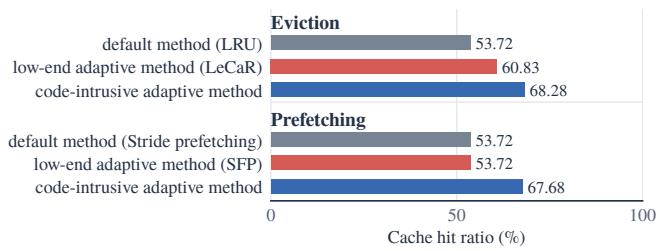

Figure 2. Caching performance (cache hit ratio) of low-end and code-intrusive adaptations on ResNet-50 workflow (W1 in Table 2). For code-intrusive, we manually select the most suitable prefetching or eviction policy for each workflow phase according to its access pattern.
<table><tr><td rowspan=1 colspan=1>System prompt</td><td rowspan=1 colspan=1>Input</td><td rowspan=1 colspan=1>Output</td></tr><tr><td rowspan=1 colspan=1>Minimize future cache misses usingrecent block accesses and residentcache state. Return block IDs toprefetch and evict.</td><td rowspan=1 colspan=1>&quot;accesses&quot;: [...,7428, 2280, 347,30692]&quot;resident&quot;: [[id,bytes], ...]</td><td rowspan=1 colspan=1>&quot;prefetch&quot;:[id_1, ...]&quot;evict&quot;:[id_2, ...]</td></tr></table>

Figure 3. Input/output interface of our end-to-end cache-control prototype.

We therefore explore how to exploit LLM intelligence in cache management for AI workloads.

## 3.2 Challenges in Enforcing LLM-Based Adaptations

While promising, exploiting LLM intelligence in adaptive cache management is non-trivial. Here we empirically elaborate the challenges therein. As shown in Figure 3, we build a straightforward prototype atop JuiceFS that exploits LLM intelligence in an end-to-end manner: given a JSON input with recent block accesses and the resident cache state, the model outputs the block IDs to prefetch or evict after every read request. We measure<sup>1</sup> its behavior with Qwen3.8 Flash on a small-scale diffusion LoRA development workflow (Section 6.1), a 1,024-access history, and a 1 GiB cache. The results reveal three challenges.

Challenge-I: long reasoning delay. Inference is far too slow for real-time control on the read path. Cloud-storage clients can issue hundreds of read requests per second: Bodner et al. report 250–350 asynchronous read requests per second from a single client instance accessing S3 (Bodner et al., 2025). Synchronous cache control makes read requests wait for model decisions, so inference must keep pace with frequent data accesses. Yet Qwen3.8 Flash takes 136 s at P50 and 210 s at P95 with thinking on, and 41 s at

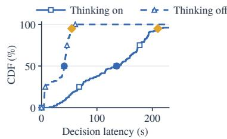

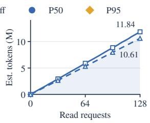

Figure 4. Qwen3.8 Flash overhead over 128 calls per configuration. Left: latency CDF. Right: token cost including input and output tokens. Both include the two cases of thinking-on and thinking-off.  
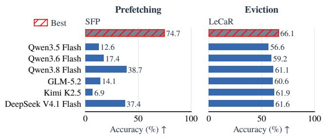  
Figure 5. Cache-action quality. Prefetching accuracy is the fraction of prefetched blocks used before eviction or the end of the workload. Eviction accuracy is the fraction of evicted blocks next requested beyond the Belady boundary (Song et al., 2020) or not requested again in the remaining trace.

## P50 with thinking off and capped output (Figure 4, left).

Challenge-II: high token cost. The prototype repeatedly submits the updated history and resident state (Figure 3). Over 128 read requests, total tokens reach 11.84 M with thinking on and 10.61 M with thinking off, so the full diffusion LoRA workflow (about 60k read requests) would require about 5 billion tokens.

Challenge-III: poor decision quality. Despite their reasoning capability, LLMs make less accurate cache decisions than existing heuristics (Figure 5). The prefetching accuracy of the best LLM is 48.2% lower than that of SFP, and even the highest model CHRs stay below the baselines: 80.8% (DeepSeek) versus 82.3% (SFP) for prefetching, and 82.6% (Kimi) versus 83.9% (LeCaR) for eviction. A key reason is the large decision space: the LLM must choose prefetching targets from 1,963 candidates and eviction targets from 63. Potential LLM hallucination further lowers decision quality.

In summary, to bring LLM-powered adaptive caching into practice, we need to shorten the reasoning delay, reduce the token cost, and also improve the decision quality.

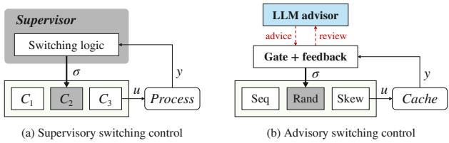  
Figure 6. Supervisory versus advisory switching control. (a) A trusted supervisor switches (σ) among controllers C<sub>i</sub> based on output y. (b) In Chiron, the LLM only advises; a deterministic harness gates its advice, switches among policy tools, and returns feedback for review. Thick arrows carry switching authority; dashed arrows are asynchronous.

## 4 SOLUTION

## 4.1 Overview

Design insight: advisory switching control. We propose Chiron, a fast, cheap, and effective cache system for AI workloads. Instead of end-to-end LLM control, Chiron borrows supervisory switching control from control theory (Morse, 1996; Liberzon, 2003): a supervisor recognizes the operating regime and switches among pre-designed controllers, each encapsulating expert knowledge for one regime (Figure 6a). Replacing continuous tuning with discrete switching responds quickly to large regime changes and keeps the system modular and controllable, balancing LLM flexibility with reliability and efficiency. Unlike a trusted supervisor, an LLM may hallucinate. We thus adopt advisory switching control (Figure 6b): the LLM only recommends a policy, while a deterministic harness decides whether to adopt it and returns cache feedback so the LLM can revise its advice.

Architecture and workflow. As Figure 7 shows, Chiron has two layers. In the LLM intelligence layer, an executorswitching advisor asynchronously diagnoses the access pattern: a runtime prompt packages recent FUSE accesses, precomputed statistics, and review context, and the advisor combines it with a fixed system prompt and returns a short JSON with a pattern and its confidence. In the LLM harness layer, the statistical analyzer prepares the statistics; the policy executor orchestrates one policy tool per pattern and adopts a recommendation only if it passes a confidence gate, after which the active executor makes every prefetching, admission, and eviction decision locally; and thefeedback drafter monitors cache outcomes and requests routine or early checks with a drafted context.

Why fast, cheap, and effective. Chiron is fast because inference stays off the read path and outputs are short; this asynchrony suffices because access patterns persist across many reads. It is cheap because the LLM selects policies instead of listing blocks and is invoked only when routine checks or feedback call for review. It is effective because choosing among expert-designed policies shrinks the decision space from thousands of candidate blocks to three patterns, while deterministic execution, gated adoption, and feedback-triggered review contain hallucination.

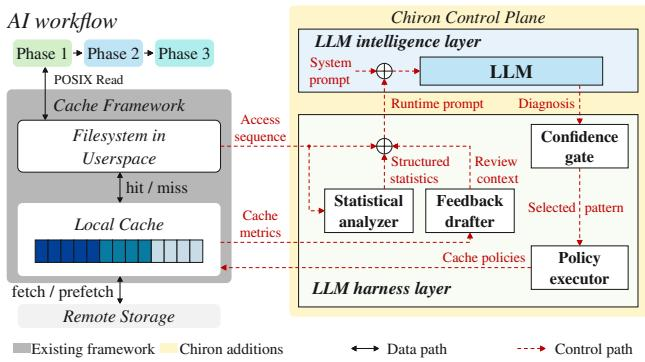  
Figure 7. Chiron architecture.

## 4.2 LLM Intelligence Layer

A key part of the Chiron design is the input and output format of the LLM advisor, summarized in Figure 8.

## 4.2.1 Succinct yet Informative LLM Input

The input must support accurate judgment at low token cost. We therefore combine expert knowledge in a system prompt with runtime cache status in a runtime prompt. The system prompt describes the diagnosis task, which encodes the pattern knowledge of Table 1, explains how to interpret the runtime prompt, and constrains the output format (Section 4.2.2). The runtime prompt has three parts, numbered 1–3 in Figure 8; Appendix A gives both prompts in full.

• Access sequence. Diagnosis depends on access order and recurrence. Access sequence preserves the observed sequence so the advisor can inspect traversal and repeated objects directly. The harness copies a recent window<sup>2</sup> from each cache unit, a file or directory managed together, keeping submitted evidence fixed while reads continue.

• Structured statistics. Deriving stride and reuse statistics from raw IDs is inefficient and can produce unreliable judgments. Structured statistics therefore supplies precomputed values from the statistical analyzer, such as access entropy, which provide cues for sequential, random, and skewed patterns at two window scales (Section 4.3.1).

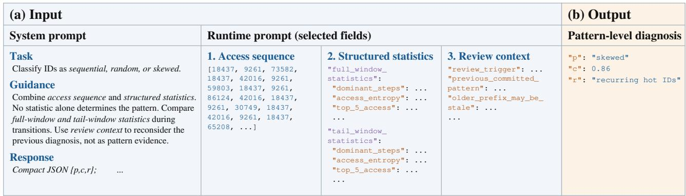  
Figure 8. The diagnosis interface combines fixed instructions and three groups of runtime input with a compact pattern-level response. Only key instructions and selected runtime prompt fields are shown; ellipses omit details given in Appendix A. The response is illustrative.

• Review context. An accepted diagnosis may be incorrect or become outdated as accesses change. The feedback drafter therefore requests a new diagnosis when cache feedback suggests a mismatch (Section 4.3.4). To interpret this request, the advisor needs the earlier decision and the reason for reconsidering it, which Review context supplies.

## 4.2.2 Token-efficient LLM Output

Listing actions for individual objects would lengthen the response as the working set grows. We instead return the compact pattern-level diagnosis in Figure 8, which limits generation work and lets the policy executor reuse an accepted diagnosis and choose objects locally. The pattern (p) specifies which prefetching and eviction strategies to consider for adoption (Section 4.3.2). Since the advisor may hallucinate a pattern unsupported by the evidence, the system prompt also asks for a self-assessed confidence score (c) in [0, 1], which the confidence gate uses (Section 4.3.3). An optional brief reason (r) can be enabled during debugging.

## 4.3 LLM Harness Layer

The LLM harness layer prepares statistical references, executes timely actions, defers unsupported policy changes, and reconsiders diagnoses as accesses change, through the four components below.

## 4.3.1 Statistical Analyzerfor Reliable Evidence

The statistical analyzer, essentially a tool for LLM use, computes the Structured statistics introduced in Section 4.2.1 from the Access sequence and supplies them to the runtime prompt. These statistics serve as references for assessing how closely the sequence matches the three access patterns. Figure 8 shows three example metrics, which provide cues for sequential, random, and skewed access, respectively. For a sequence $X = ( x _ { 1 } , \ldots , x _ { n } ) $ dominant steps counts each adjacent ID difference $\delta =$ $x _ { i + 1 } - x _ { i }$ and reports up to five most frequent differences with their counts, exposing repeated traversal steps. To compute access entropy, the analyzer counts occurrences $c _ { u }$ of each distinct ID u and normalizes them as $p _ { u } = c _ { u } / n$ With m distinct IDs, the metric is $\begin{array} { r } { E = - \frac { \sum _ { u } p _ { u } \log _ { 2 } p _ { u } } { \log _ { 2 } m } } \end{array}$ , with E = 0 for $m \leq 1 ;$ ; larger values indicate more evenly distributed access frequencies. Finally, top 5 access sums the counts of the five most frequent IDs and divides by n: $\begin{array} { r } { S _ { 5 } = \sum _ { j = 1 } ^ { \operatorname* { m i n } ( 5 , m ) } c _ { [ j ] } / n , } \end{array}$ , where $c _ { [ j ] }$ is the jth largest count. Appendix A.2 gives the complete set of metrics. The analyzer also reports these statistics separately for the full window and its recent tail. This helps the advisor identify recent behavior during pattern transitions, when accesses from the previous phase may dilute the evidence in the full-window summary.

## 4.3.2 Deterministic Policy Executorfor Fast Action

Cache contents can change during inference, making object choices from a diagnosis snapshot outdated. The deterministic policy executor therefore applies the active policy to current accesses and cache state, selecting prefetching and eviction actions locally. The sequential executor uses stride prefetching; the random executor disables pattern-based prefetching and rejects new admissions when full to retain the cached subset; the skewed executor combines neighborhood prefetching with LRU eviction. An accepted pattern change switches the active executor. Reads initially use the framework’s default policy, and pending diagnoses leave the active policy unchanged.

## 4.3.3 Confidence Gate for Hallucination Avoidance

To control inference cost, some deployments may use models with limited reasoning capability as advisors. Such advisors may hallucinate an access pattern, leading the executor to adopt an unsuitable cache policy. We observe that hallucinated diagnoses often coincide with low model confidence, so the score c (Section 4.2.2) can identify some of them before adoption. For example, in the training phase of the ResNet-50 workflow with randomly shuffled accesses (Section 6.1), filtering diagnoses with $c < 0 . 7$ while retaining the existing policy improves CHR from 13.84% to 15.45% (Figure 9). The confidence gate therefore requires $c \geq \tau$ before adopting a proposed pattern $p ,$ and otherwise retains the existing policy. Since a simple filter does not correct a wrong diagnosis, the harness collects more accesses and retries sooner than the routine interval, allowing fresh evidence to help correct the diagnosis.

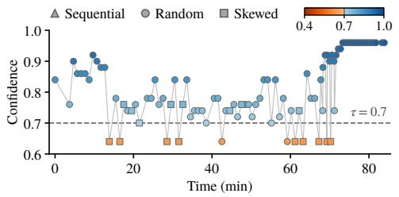

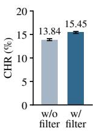

Figure 9. Patterns and confidence scores of diagnoses from Qwen3- Max (released in September 2025 and relatively dated compared with models we evaluate in Section 6) (left) and CHR with and without a confidence filter (right) during the training phase of the ResNet-50 workflow.  
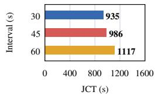

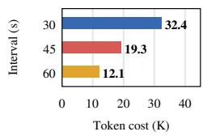  
Figure 10. Diagnosis schedule tradeoff in the ResNet-50 workflow (W1 in Table 2): JCT and token cost under different diagnosis intervals.

## 4.3.4 Feedback Reflectionfor Fewer LLM Calls

Invoking the LLM periodically creates a tradeoff: frequent calls consume tokens even when the last accepted diagnosis still matches the access pattern, while longer intervals can delay adaptation when the pattern changes. Figure 10 illustrates this tradeoff in a replay of the ResNet-50 workflow, using a quarter of the dataset and cache budget. The feedback drafter therefore monitors runtime I/O with lightweight local rules and requests an early LLM review when necessary, allowing less frequent routine reviews.

The drafter uses CHR fluctuations as a sign that the current pattern may no longer fit. For example, a random-to-skewed transition can raise CHR through increased reuse, yet the random executor’s fixed cached subset can exclude new hot objects that the skewed executor would admit. Let $h _ { t }$ be CHR in round $t ,$ and $H _ { t } = \alpha h _ { t } + ( 1 - \alpha ) H _ { t - 1 }$ its exponentially weighted moving average (EWMA), with smoothing weight $\alpha .$ . A review is requested when $| h _ { t } -$ $H _ { t - 1 } | \geq \theta$ , where θ is the fluctuation threshold. The drafter then sends the CHR fluctuation and the previous diagnosis to the advisor in the Review context (Section 4.2.1), alerting it that the earlier diagnosis may be outdated.

## 5 IMPLEMENTATION

We implement Chiron as an extension to JuiceFS, comprising a client-side controller written in Go and an LLM diagnosis server written in Python, with about 4,000 LoC of Go and 400 LoC of Python. The controller implements the policy executor and the feedback drafter of the LLM harness layer; the server implements the statistical analyzer and hosts the executor-switching advisor.

Diagnosis service and asynchronous interaction. The server connects the advisor to the LLM through LangChain’s chat-model interface and exposes it to the controller via a FastAPI endpoint. To keep cache control asynchronous with LLM inference, the controller snapshots the access history and review context, then launches a background goroutine for the HTTP exchange while foreground reads continue under the active policy. The server constructs the runtime prompt from this input and from statistics computed on the access history, and returns the diagnosis as JSON.

Client-side controller. To obtain the access sequence in Figure 7, we add a hook to JuiceFS’s FUSE Read() handler that collects each demand request’s inode, offset, and length. The controller converts this information into block IDs using the file-to-block mapping in metadata and records them in access order. The feedback drafter uses a background goroutine to periodically compute CHR fluctuations and update the review context. The policy executor calls VFS.Read() to fetch prefetch targets and removes selected cache files through the chunk store, which calls os.Remove(). Prefetch reads bypass the foreground hook to keep speculative accesses out of the access history.

Scalability. To maintain effective cache management and controlled diagnosis cost as datasets, caches, and access histories grow, Chiron keeps LLM input and output lengths bounded. The advisor uses a recent window of access history and returns a compact pattern-level diagnosis, so asynchronous inference can overlap with foreground reads as scale increases. Bounded inputs and outputs also control the token cost of each diagnosis, and the feedback drafter reduces the frequency of reviews.

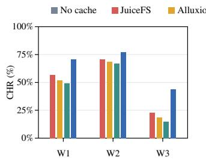

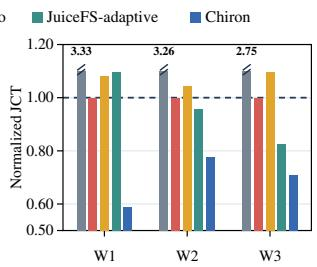  
Figure 11. Five-policy comparison on multi-phase workflows W1– W3 in Table 2. No-cache has zero CHR in all three workflows and is omitted from the CHR plot. JCT is normalized to JuiceFS within each workflow.

## 6 EVALUATION

We evaluate Chiron from five perspectives. First, we measure its end-to-end effectiveness across multi-phase and single-phase workloads (§6.1). Second, we assess the advantage of its pattern-aware eviction and prefetching over fixed policies (§6.2). Third, we test the necessity of structured statistics, confidence gating, and feedback reflection (§6.3). Fourth, we analyze how LLM capability affects Chiron (§6.4). Finally, we assess its cache performance at large dataset scale in simulation (§6.5).

## 6.1 End-to-End Performance

Workload and hardware setup. We use nine representative AI workloads (Table 2): three multi-phase workflows, which involve both pattern heterogeneity and dynamicity, and six single-phase tasks, which involve only pattern heterogeneity. Computations run on a server with eight A800 GPUs and an SSD-based cache, and datasets are stored remotely on S3 at a measured network latency of roughly 250 ms. To avoid trivial cases where the entire dataset can be cached without prefetching or eviction, we set a modest cache size for each experiment based on the original dataset size. The dataset and cache sizes<sup>3</sup> are listed in Table 2.

Baselines. We compare Chiron with four baselines: (1) Nocache, which fetches demand data from remote storage without retaining read blocks; (2) JuiceFS, which uses sequential block prefetching and 2-random eviction, repeatedly evicting the older of two sampled blocks (JuiceFS); (3) Alluxio<sup>4</sup>, using its default LRU eviction without prefetching; and (4) JuiceFS-Adaptive, a variant of JuiceFS using LeCaR for eviction and SFP for prefetching. Later micro-benchmarks use other prefetching and eviction baselines.

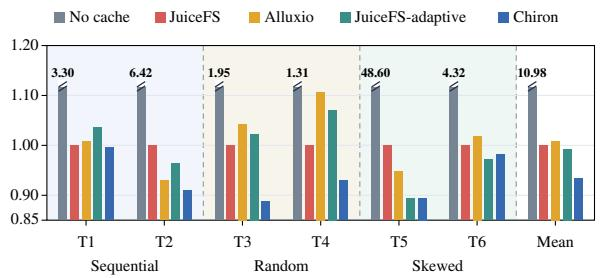  
Figure 12. JCT on single-phase tasks T1–T6 in Table 2, normalized to JuiceFS for each task.

Chiron setup. By default, the LLM is DeepSeek-V4-flash; Section 6.4 tests other models. We set the confidence threshold τ to 0.70 (§4.3.3), and for feedback reflection (§4.3.4) the EWMA smoothing weight α to 0.35 and the absolute CHR fluctuation threshold θ to 0.18. Appendix B analyzes the sensitivity to this threshold.

Metrics. We report block-level cache hit ratio (CHR) and end-to-end job completion time (JCT), which are common in the literature (Khan et al., 2023; Kumar & Sivathanu, 2020). Micro-benchmarks also report token cost and pattern diagnosis accuracy.

Overall improvements. As Figure 11 shows, adopting a cache substantially reduces JCT. More importantly, Chiron has the highest CHR and lowest JCT on multi-phase workflows, reducing JCT by 41.2%, 18.8%, and 14.3% over the best baseline on the three workflows. This confirms the power of LLM intelligence in adjusting the caching policy at runtime. On single-phase tasks (Figure 12), Chiron reduces JCT by an average of 5.22% over the best baseline on four of six tasks, and is near parity on the other two, skewed workloads that JuiceFS-Adaptive already suits. Chiron thus yields generally effective caching across AI workloads.

## 6.2 Microscopic Performance Deep Dive

We next examine prefetching and eviction separately on the Stable Diffusion 1.5 workflow (W3 in Table 2), with the setup of Section 6.1 unless otherwise specified.

Eviction performance. We compare Chiron with LRU, LeCaR, and JuiceFS 2-random, with prefetching disabled and the same cache size in all arms. Chiron has the highest CHR and reduces JCT by 17.65% relative to the best baseline (Figure 13a), which confirms that its eviction policy is better than static or low-end adaptive methods.

Prefetching performance. We compare Chiron with sequential prefetching at fixed depth, sequential prefetching at adaptive depth (JuiceFS, 2026), and SFP (Wang et al., 2021), with the same cache size and LRU eviction in all arms. Chiron outperforms all three, improving CHR by

Chiron: Cache Management Empowered by LLM Intelligence for AI Workloads
<table><tr><td rowspan=1 colspan=1>ID</td><td rowspan=1 colspan=1>Workloads</td><td rowspan=1 colspan=1>Dataset</td><td rowspan=1 colspan=1>Dataset Size (Cache Budget)</td><td rowspan=1 colspan=1>Access Pattern</td></tr><tr><td rowspan=1 colspan=1>W1</td><td rowspan=1 colspan=1>ResNet-50 workflow (He et al., 2016)</td><td rowspan=1 colspan=1>ImageNet subset (ILSVRC)</td><td rowspan=1 colspan=1>1.395 GiB (1 GiB)</td><td rowspan=1 colspan=1>Sequential, random, skewed</td></tr><tr><td rowspan=1 colspan=1>W2</td><td rowspan=1 colspan=1>Minimal-FNO workflow (Takamoto et al., 2022)</td><td rowspan=1 colspan=1>PDEBench (PDEBench)</td><td rowspan=1 colspan=1>7.67 GiB (4 GiB)</td><td rowspan=1 colspan=1>Sequential, random, skewed</td></tr><tr><td rowspan=1 colspan=1>W3</td><td rowspan=1 colspan=1>Stable Diffusion 1.5 workflow (Stable Diffusion)</td><td rowspan=1 colspan=1>Mercity LAION subset (Mercity)</td><td rowspan=1 colspan=1>3.87 GiB (1 GiB)</td><td rowspan=1 colspan=1>Random, sequential</td></tr><tr><td rowspan=1 colspan=1>T1</td><td rowspan=1 colspan=1>Qwen tokenization task (Qwen Team)</td><td rowspan=1 colspan=1>C4 shards (Allen Institute for AI)</td><td rowspan=1 colspan=1>2.37 GiB (2 GiB)</td><td rowspan=1 colspan=1>Sequential</td></tr><tr><td rowspan=1 colspan=1>T2</td><td rowspan=1 colspan=1>Qwen2.5-3B weight loading task (Qwen Team)</td><td rowspan=1 colspan=1>Qwen2.5-3B weights (Qwen Team)</td><td rowspan=1 colspan=1>5.75 GiB (4 GiB)</td><td rowspan=1 colspan=1>Sequential</td></tr><tr><td rowspan=1 colspan=1>T3</td><td rowspan=1 colspan=1>ViT-Base fine-tuning task (Dosovitskiy et al., 2021)</td><td rowspan=1 colspan=1>COCO 2014 subset (NaiveDev)</td><td rowspan=1 colspan=1>6.09 GiB (1 GiB)</td><td rowspan=1 colspan=1>Random</td></tr><tr><td rowspan=1 colspan=1>T4</td><td rowspan=1 colspan=1>Wav2Vec2 fine-tuning task (Baevski et al., 2020)</td><td rowspan=1 colspan=1>Speech Commands v0.02 (Google)</td><td rowspan=1 colspan=1>2.48 GiB (1 GiB)</td><td rowspan=1 colspan=1>Random</td></tr><tr><td rowspan=1 colspan=1>T5</td><td rowspan=1 colspan=1>DLRM training task (Naumov et al., 2019)</td><td rowspan=1 colspan=1>Criteo_x1 trace (RECZOO)</td><td rowspan=1 colspan=1>1.99 GiB (1 GiB)</td><td rowspan=1 colspan=1>Skewed</td></tr><tr><td rowspan=1 colspan=1>T6</td><td rowspan=1 colspan=1>RAG retrieval task (Lewis et al., 2020)</td><td rowspan=1 colspan=1>Wikipedia / MMLU (Cyro1; Centerfor AI Safety)</td><td rowspan=1 colspan=1>3.04 GiB (0.5 GiB)</td><td rowspan=1 colspan=1>Skewed</td></tr></table>

Table 2. Workloads named by model in the end-to-end experiment. IDs label the workloads in Figures 11 and 12.

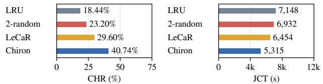  
(a) Eviction

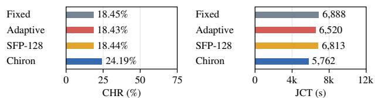  
(b) Prefetch  
Figure 13. Eviction and prefetch comparisons on the Stable Diffusion 1.5 workflow (W3 in Table 2).

31.11% (24.19% versus 18.45%) and JCT by 11.63% (Figure 13b).

## 6.3 Ablation Study

Section 4 adopts multiple techniques to make Chiron fast, cheap, and effective, such as structured statistics, confidence gating, and feedback reflection. We evaluate each of them here, on diverse workflows for representativeness.

Necessity of structured statistics. We compare Chiron with a variant that has no structured statistics in its prompt, on the Stable Diffusion 1.5 workflow. Without structured statistics, the F1 score of pattern diagnosis degrades by 45% and CHR falls by 43% (Figure 14a), so these statistics improve both pattern recognition and end-to-end performance.

Necessity of confidence gate. On the ResNet-50 workflow<sup>5</sup>, enabling the gate raises CHR by 12.60% in relative terms and reduces JCT from 1,838.5 to 1,799.4 s (Figure 14b). Confidence gating is thus necessary to handle unstable LLM decisions.

Necessity of feedback reflection. Also on the ResNet-50 workflow, we compare LLM calls once per 30 s without reflection and once per 45 s with reflection, which allows early calls triggered by feedback. With reflection, Chiron attains comparable CHR and JCT with 28.1% fewer tokens (Figure 14c).

## 6.4 Sensitivity Analysis to LLM Capability

We replay the ResNet-50 workflow with six models: Qwen3.8-Flash, Qwen3.7-Flash, Qwen3.5-Flash, Qwen3.5- 9B, Qwen3.5-4B, and R1-Distill-Qwen-1.5B. Chiron yields similar caching performance from Qwen3.8-Flash to Qwen3.5-9B, with JCT between 4.61k and 4.70k s, yet degrades markedly at 4B and below, with JCT of 5.37k s for Qwen3.5-4B and 6.21k s for R1-Distill-Qwen-1.5B (Figure 15). A modest LLM, larger than 4B, is thus desirable. Token cost also grows monotonically as the LLM shrinks, from 276k to 607k tokens, because weaker models need more thinking tokens.

## 6.5 Large-Scale Simulation

We build an event-driven cache simulator to assess Chiron at large scale, simulating the ResNet-50 workflow on an expanded 1 TB ImageNet dataset. This matches the TB-scale sizes of widely used AI datasets such as the 1.31 TB fullresolution ImageNet-21K archive (Alibaba-MIIL) and the approximately 10 TB LAION-400M WebDataset (LAION, 2021). Each access costs 2 ms on a cache hit and 250 ms on a miss, and cache sizes are 10%, 25%, 50%, and 85% of the dataset. In a fidelity test, the simulator differs from end-to-end measurements by 2.82 percentage points of CHR on average and 4.42 at most.

According to Figure 16, Chiron has the highest CHR and lowest simulated JCT at every cache size, improving CHR by 3.61–8.79 percentage points and reducing JCT by 5.72– 16.69% over the best baseline. The average LLM call delay stays below 1.3 s and is not on the critical path. With bounded input and output lengths and asynchronous decisions, both independent of dataset size, Chiron can scale to production scenarios.

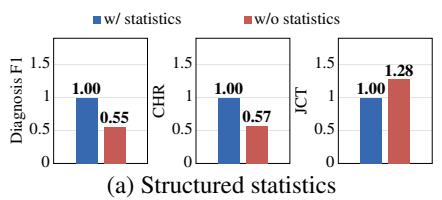

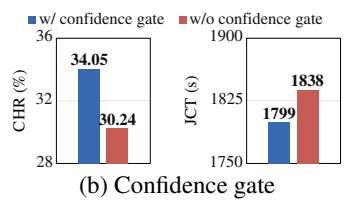

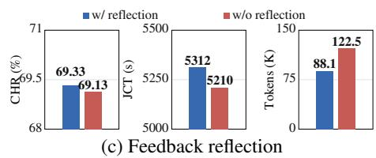  
Figure 14. Ablation studies. Structured statistics are evaluated on the Stable Diffusion 1.5 workflow (W3 in Table 2), normalized to full Chiron; confidence gating and feedback reflection are evaluated on the ResNet-50 workflow trace.

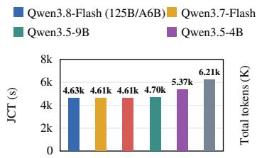

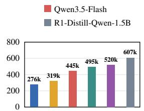

Figure 15. Diagnosis-model sensitivity on the ResNet-50 workflow replay.  
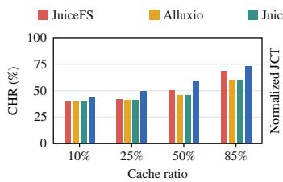

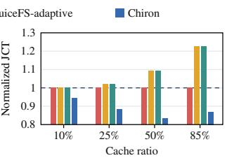  
Figure 16. Policy comparison in the large-scale dataset simulation. Cache capacity is expressed as a fraction of dataset bytes. JCT is normalized to JuiceFS at each capacity.

## 7 RELATED WORK

Workload-aware caching for AI workloads. AI storage systems exploit training structure to reduce data-loading costs (Graur et al., 2022; Jha et al., 2025; Sun et al., 2022; Xie et al., 2022). Quiver (Kumar & Sivathanu, 2020) exploits sample substitutability, CoorDL (Mohan et al., 2021) retains samples across shuffled epochs, and NoPFS (Dryden et al., 2021) predicts accesses from sampling seeds to coordinate caching and prefetching. SHADE (Khan et al., 2023) uses sample importance to guide sampling and caching, and SiloD (Zhao et al., 2023) co-designs caching and cluster scheduling. Chiron instead diagnoses observed file accesses to select policies across workflow phases, without sampling seeds or sample-importance scores.

Adaptive and learning-based cache management. Adaptive policies infer useful cache behavior from access history (Jiang & Zhang, 2002; Jiang et al., 2005; Beckmann et al., 2018; Yang et al., 2023a). ARC (Megiddo & Modha, 2003) balances recency and frequency, LeCaR (Vietri et al., 2018) and CACHEUS (Rodriguez et al., 2021) learn to combine replacement experts, LRB (Song et al., 2020) approximates Belady-style eviction, and SFP (Wang et al., 2021) learns file-access patterns for prefetching. Learning-Augmented Heuristics (Xia et al., 2026) also select cache parameters asynchronously while deterministic heuristics process requests; Chiron shares this separation, but uses LLM-based pattern diagnosis to coordinate prefetching, admission, and eviction.

LLM-assisted systems management. LLMs increasingly support system diagnosis, tuning, and runtime decisions (Singh et al., 2024; Cummins et al., 2024; Chen et al., 2024; Huang et al., 2024). D-Bot (Zhou et al., 2024) uses LLMs for database diagnosis, GPTuner (Lao et al., 2024) extracts documentation knowledge to guide tuning, λ- Tune (Giannakouris & Trummer, 2025) generates and evaluates database configurations, NetLLM (Wu et al., 2024) adapts LLMs to networking tasks, and An Expert in Residence (Liargkovas et al., 2025) explores online OS tuning. PF-LLM (Xu et al., 2026) separates offline assembly analysis from runtime hardware prefetching through LLMgenerated hints; Chiron extends this division to online file caching, using reusable diagnoses and cache feedback to track changing access patterns.

## 8 CONCLUSION

AI workloads need a cache that adapts to diverse and changing access patterns without user hints. Chiron provides it through advisory switching control: an LLM asynchronously diagnoses the access pattern and recommends a policy, while a deterministic harness gates this advice, executes expert-designed policies, and feeds cache outcomes back for review. Implemented atop JuiceFS, Chiron reduces JCT by 14.3–41.2% over the best baseline on multi-phase workflows. The same division of work may suit other systems whose decisions are too frequent for an LLM to make directly.

## REFERENCES

Alibaba-MIIL. ImageNet-21K-P: Dataset preprocessing instructions. URL https://github.com/Aliba ba-MIIL/ImageNet21K/blob/main/datase t\_preprocessing/processing\_instructi

ons.md. Original full-resolution ImageNet-21K archive size: 1.31 TB. Accessed October 27, 2026.

Allen Institute for AI. C4 dataset, English shards. https: //huggingface.co/datasets/allenai/c4 /tree/1588ec454efa1a09f29cd18ddd04fe 05fc8653a2/en. Accessed October 29, 2026.

Alluxio. Caching: Alluxio storage overview, 2026a. URL https://documentation.alluxio.io/o s-en/core-services/caching. Retrieved on September 23, 2026.

Alluxio. RedNote accelerates model training and distribution with Alluxio, 2026b. URL https://www.al luxio.io/customer-stories/rednote. Retrieved on September 23, 2026.

Alluxio. Multi tenancy and unified management, 2026c. URL https://documentation.alluxio.io /ee-ai-en/ai-3.6/overview/multi-tenan cy-cluster-federation-and-unified-man agement. Retrieved on September 23, 2026.

Amazon Web Services. Amazon S3, 2026. URL https: //aws.amazon.com/s3/. Retrieved on September 23, 2026.

Ananthanarayanan, G., Ghodsi, A., Warfield, A., Borthakur, D., Kandula, S., Shenker, S., and Stoica, I. PACMan: Coordinated memory caching for parallel jobs. In 9th USENIX Symposium on Networked Systems Design and Implementation (NSDI 12), pp. 267–280, 2012.

Azure. Access data in a job, 2026. URL https://le arn.microsoft.com/en-us/azure/machin e-learning/how-to-read-write-data-v2. Retrieved on September 23, 2026.

Baevski, A., Zhou, Y., Mohamed, A., and Auli, M. wav2vec 2.0: A framework for self-supervised learning of speech representations. In Advances in Neural Information Processing Systems, volume 33, 2020.

Beckmann, N., Chen, H., and Cidon, A. LHD: Improving cache hit rate by maximizing hit density. In 15th USENIX Symposium on Networked Systems Design and Implementation (NSDI 18), pp. 389–403, 2018.

Bodner, T., Radig, T., Justen, D., Ritter, D., and Rabl, T. An empirical evaluation of serverless cloud infrastructure for large-scale data processing. In Proceedings of the 28th International Conference on Extending Database Technology (EDBT), pp. 935–948, 2025. doi: 10.48786/e dbt.2025.76.

Bojarski, M., Testa, D. D., Dworakowski, D., Firner, B., Flepp, B., Goyal, P., Jackel, L. D., Monfort, M., Muller,

U., Zhang, J., Zhang, X., Zhao, J., and Zieba, K. End to end learning for self-driving cars, 2016. URL https: //arxiv.org/abs/1604.07316.

Brown, T. B., Mann, B., Ryder, N., Subbiah, M., Kaplan, J., Dhariwal, P., Neelakantan, A., Shyam, P., Sastry, G., Askell, A., Agarwal, S., Herbert-Voss, A., Krueger, G., Henighan, T., Child, R., Ramesh, A., Ziegler, D. M., Wu, J., Winter, C., Hesse, C., Chen, M., Sigler, E., Litwin, M., Gray, S., Chess, B., Clark, J., Berner, C., McCandlish, S., Radford, A., Sutskever, I., and Amodei, D. Language models are few-shot learners. In Advances in Neural Information Processing Systems, volume 33, pp. 1877– 1901, 2020.

Center for AI Safety. MMLU dataset. https://hugg ingface.co/datasets/cais/mmlu. Accessed October 29, 2026.

Chen, H., Wen, Y., Cheng, L., Kuang, S., Liu, Y., Li, W., Li, L., Zhang, R., Song, X., Li, W., Guo, Q., and Chen, Y. AutoOS: Make your OS more powerful by exploiting large language models. In Forty-first International Conference on Machine Learning, 2024. URL https: //openreview.net/forum?id=Rp8R9C0Sth.

Chen, T.-F. and Baer, J.-L. Effective hardware-based data prefetching for high-performance processors. IEEE transactions on computers, 44(5):609–623, 1995.

Cummins, C., Seeker, V., Grubisic, D., Roziere, B., Gehring, J., Synnaeve, G., and Leather, H. Meta large language model compiler: Foundation models of compiler optimization. arXiv preprint arXiv:2407.02524, 2024.

Cyro1. English Wikipedia pageviews dataset. https: //huggingface.co/datasets/Cyro1/enwi ki\_pageviews\_m. Accessed October 29, 2026.

DeepSeek-AI et al. DeepSeek-V4: Towards highly efficient million-token context intelligence, 2026. URL https: //arxiv.org/abs/2606.19348.

Denning, P. J. The working set model for program behavior. Communications ofthe ACM, 11(5):323–333, 1968.

Desai, D., Ghita, L., and Boier, I. Synthetic data generation for financial AI research with NVIDIA NeMo. NVIDIA Technical Blog, July 2026. URL https://develo per.nvidia.com/blog/synthetic-data-g eneration-for-financial-ai-research-w ith-nvidia-nemo/. Retrieved on October 12, 2026.

Di Natale, F., Bermudez, E., Casagrande, A., Kotila, M., Komali, H., and Kudleppanavar, G. Benchmarking LLM inference at scale with AIPerf. NVIDIA Technical Blog, September 2026. URL https://developer.nv idia.com/blog/benchmarking-llm-infer

ence-at-scale-with-aiperf/. Retrieved on October 13, 2026.

Dosovitskiy, A., Beyer, L., Kolesnikov, A., Weissenborn, D., Zhai, X., Unterthiner, T., Dehghani, M., Minderer, M., Heigold, G., Gelly, S., Uszkoreit, J., and Houlsby, N. An image is worth 16x16 words: Transformers for image recognition at scale. In International Conference on Learning Representations (ICLR), 2021. URL http s://arxiv.org/abs/2010.11929.

Dryden, N., Bohringer, R., Ben-Nun, T., and Hoefler, T.¨ Clairvoyant prefetching for distributed machine learning I/O. In Proceedings ofthe International Conferencefor High Performance Computing, Networking, Storage and Analysis (SC), pp. 1–15, 2021. doi: 10.1145/3458817.34 76181.

Floratou, A., Megiddo, N., Potti, N., Ozcan, F., Kale, U., and<sup>¨</sup> Schmitz-Hermes, J. Adaptive caching in Big SQL using the HDFS cache. In Proceedings of the Seventh ACM Symposium on Cloud Computing, pp. 321–333, 2016.

Fu, Y., Xue, L., Huang, Y., Brabete, A.-O., Ustiugov, D., Patel, Y., and Mai, L. ServerlessLLM: Low-latency serverless inference for large language models. In 18th USENIX Symposium on Operating Systems Design and Implementation (OSDI 24), pp. 135–153. USENIX Association, 2024. URL https://www.usenix.org/confe rence/osdi24/presentation/fu.

Garg, S., Zhang, J., Pitchumani, R., Parashar, M., Xie, B., and Kannan, S. CrossPrefetch: Accelerating I/O prefetching for modern storage. In Proceedings ofthe 29th ACM International Conference on Architectural Support for Programming Languages and Operating Systems, Volume 1, pp. 102–116, 2024.

Giannakouris, V. and Trummer, I. λ-Tune: Harnessing large language models for automated database system tuning. Proceedings ofthe ACM on Management ofData, 3(1): 1–26, 2025.

Google. Speech Commands dataset (Hugging Face mirror). https://huggingface.co/datasets/goog le/speech\_commands. Accessed October 29, 2026.

Gowtham, Rupesh, S., Kumar, S., Saravanan, and Chaithanya, V. FLUX: Data worth training on, 2026. URL https://arxiv.org/abs/2603.13972.

Graur, D., Aymon, D., Kluser, D., Albrici, T., Thekkath, C. A., and Klimovic, A. Cachew: Machine learning input data processing as a service. In 2022 USENIX Annual Technical Conference (USENIX ATC 22), pp. 689–706. USENIX Association, 2022.

Gu, R., Li, S., Dai, H., Wang, H., Luo, Y., Fan, B., Basat, R. B., Wang, K., Song, Z., Chen, S., Wang, B., Huang, Y., and Chen, G. Adaptive online cache capacity optimization via lightweight working set size estimation at scale. In 2023 USENIX Annual Technical Conference (USENIX ATC 23), pp. 467–484, Boston, MA, July 2023. USENIX Association. ISBN 978-1-939133-35-9. URL https://www.usenix.org/conference/at c23/presentation/gu.

He, K., Zhang, X., Ren, S., and Sun, J. Deep residual learning for image recognition. In Proceedings of the IEEE Conference on Computer Vision and Pattern Recognition (CVPR), pp. 770–778, 2016. doi: 10.1109/CVPR.2016.90.

Hu, E. J., Shen, Y., Wallis, P., Allen-Zhu, Z., Li, Y., Wang, S., Wang, L., and Chen, W. LoRA: Low-rank adaptation of large language models. In Proceedings of the International Conference on Learning Representations (ICLR), 2022.

Huang, X., Li, H., Zhang, J., Zhao, X., Yao, Z., Li, Y., Zhang, T., Chen, J., Chen, H., and Li, C. E2ETune: Endto-end knob tuning via fine-tuned generative language model. arXiv preprint arXiv:2404.11581, 2024.

ILSVRC. ImageNet-1K dataset (Hugging Face mirror). https://huggingface.co/datasets/ILSV RC/imagenet-1k. Accessed October 29, 2026.

Jha, K. V., Pandey, S., Annavaram, M., and Basu, A. Hy-Cache: Hybrid caching for accelerating DNN input preprocessing pipelines. In 2025 USENIX Annual Technical Conference (USENIX ATC 25), pp. 433–448. USENIX Association, 2025.

Jiang, S. and Zhang, X. LIRS: An efficient low interreference recency set replacement policy to improve buffer cache performance. In Proceedings of the 2002 ACM SIGMETRICS International Conference on Measurement and Modeling of Computer Systems, pp. 31–42, 2002. doi: 10.1145/511334.511340.

Jiang, S., Chen, F., and Zhang, X. CLOCK-Pro: An effective improvement of the CLOCK replacement. In 2005 USENIX Annual Technical Conference (USENIX ATC 05), pp. 323–336. USENIX Association, 2005.

Jin, C., Zhang, Z., Jiang, X., Liu, F., Liu, S., Liu, X., and Jin, X. RAGCache: Efficient knowledge caching for retrievalaugmented generation. ACM Transactions on Computer Systems, 44(1):2:1–2:27, 2025. doi: 10.1145/3768628.

JuiceFS. Cache: JuiceFS cloud service documentation. https://juicefs.com/docs/cloud/guide /cache/.

JuiceFS. Achieving elastic throughput in the cloud with a distributed file system to boost AI training, 2023. URL https://juicefs.com/en/blog/solution s/accelerate-ai-training-flexible-ela stic-throughput-cloud. Retrieved on September 23, 2026.

JuiceFS. Cache: JuiceFS community edition documentation, 2026. URL https://juicefs.com/docs/com munity/guide/cache/. Retrieved on September 23, 2026.

Khan, R. I. S., Yazdani, A. H., Fu, Y., Paul, A. K., Ji, B., Jian, X., Cheng, Y., and Butt, A. R. SHADE: Enable fundamental cacheability for distributed deep learning training. In 21st USENIX Conference on File and Storage Technologies (FAST 23), pp. 135–152, 2023.

Kimi Team. Kimi K3: Open frontier intelligence, 2026. URL https://arxiv.org/abs/2607.24653.

Kuchnik, M., Klimovic, A., Simsa, J., Smith, V., and Amvrosiadis, G. Plumber: Diagnosing and removing performance bottlenecks in machine learning data pipelines. In Proceedings ofMachine Learning and Systems (ML-Sys), 2022.

Kumar, A. V. and Sivathanu, M. Quiver: An informed storage cache for deep learning. In 18th USENIX Conference on File and Storage Technologies (FAST 20), pp. 283–296. USENIX Association, 2020.

LAION. LAION-400M Open Dataset, 2021. URL https: //laion.ai/blog/laion-400-open-datas et/. Image-caption WebDataset size: 10 TB. Accessed October 27, 2026.

Lao, J., Wang, Y., Li, Y., Wang, J., Zhang, Y., Cheng, Z., Chen, W., Tang, M., and Wang, J. GPTuner: A manualreading database tuning system via GPT-guided Bayesian optimization. Proceedings ofthe VLDB Endowment, 17 (8):1939–1952, 2024. doi: 10.14778/3659437.3659449.

Lewis, P., Perez, E., Piktus, A., Petroni, F., Karpukhin, V., Goyal, N., Kuttler, H., Lewis, M., tau Yih, W.,¨ Rocktaschel, T., Riedel, S., and Kiela, D. Retrieval-¨ augmented generation for knowledge-intensive NLP tasks. In Advances in Neural Information Processing Systems, volume 33, pp. 9459–9474, 2020.

Li, B., Yin, Y., Chai, W., Fu, X., and Liu, Z. UEval: A benchmark for unified multimodal generation, 2026. URL https://arxiv.org/abs/2601.22155.

Li, M., Varki, E., Bhatia, S., and Merchant, A. TaP: Tablebased prefetching for storage caches. In Proceedings of the 6th USENIX Conference on File and Storage Technologies (FAST ’08), pp. 81–96, San Jose, CA, 2008. USENIX Association.

Li, Z., Chen, Z., Srinivasan, S. M., and Zhou, Y. C-Miner: Mining block correlations in storage systems. In 3rd USENIX Conference on File and Storage Technologies (FAST 04), San Francisco, CA, March 2004. USENIX Association. URL https://www.usenix.org/c onference/fast-04/c-miner-mining-blo ck-correlations-storage-systems.

Li, Z., Kovachki, N., Azizzadenesheli, K., Liu, B., Bhattacharya, K., Stuart, A., and Anandkumar, A. Fourier neural operator for parametric partial differential equations. In Proceedings ofthe International Conference on Learning Representations (ICLR), 2021.

Liargkovas, G., Jabrayilov, V., Franke, H., and Kaffes, K. An expert in residence: LLM agents for always-on operating system tuning. Machine Learning for Systems, 2025.

Liberzon, D. Switching in Systems and Control. Systems & Control: Foundations & Applications. Birkhauser,¨ Boston, MA, 2003. doi: 10.1007/978-1-4612-0017-8.

Mattson, R. L., Gecsei, J., Slutz, D. R., and Traiger, I. L. Evaluation techniques for storage hierarchies. IBM Systems Journal, 9(2):78–117, 1970. doi: 10.1147/sj.92.00 78.

Megiddo, N. and Modha, D. S. ARC: A self-tuning, low overhead replacement cache. In 2nd USENIX Conference on File and Storage Technologies (FAST 03). USENIX Association, 2003.

Mercity. LAION subset for LCM-LoRA training. https: //huggingface.co/datasets/Mercity/la ion-subset. Accessed October 29, 2026.

Microsoft. Azure Blob Storage, 2026. URL https://az ure.microsoft.com/en-us/products/sto rage/blobs/. Retrieved on October 27, 2026.

Mohan, J., Phanishayee, A., Raniwala, A., and Chidambaram, V. Analyzing and mitigating data stalls in DNN training. Proceedings ofthe VLDB Endowment, 14 (5):771–784, 2021. doi: 10.14778/3446095.3446100.

Morse, A. S. Supervisory control of families of linear setpoint controllers—part I: Exact matching. IEEE Transactions on Automatic Control, 41(10):1413–1431, 1996. doi: 10.1109/9.539424.

Murray, D. G., Simsa, J., Klimovic, A., and Indyk, I. tf.data: A machine learning data processing framework. Proceedings of the VLDB Endowment, 14(12):2945–2958, 2021.

NaiveDev. COCO 2014 instance dataset (Hugging Face mirror). https://huggingface.co/dataset

s/NaiveDev/coco-2014-instance. Accessed October 29, 2026.

Naumov, M., Mudigere, D., Shi, H.-J. M., Huang, J., Sundaraman, N., Park, J., Wang, X., Gupta, U., Wu, C.-J., Azzolini, A. G., Dzhulgakov, D., Mallevich, A., Cherniavskii, I., Lu, Y., Krishnamoorthi, R., Yu, A., Kondratenko, V., Pereira, S., Chen, X., Chen, W., Rao, V., Jia, B., Xiong, L., and Smelyanskiy, M. Deep learning recommendation model for personalization and recommendation systems, 2019.

PDEBench. PDEBench Burgers dataset. https://hugg ingface.co/datasets/pdebench/Burgers. Accessed October 29, 2026.

Penedo, G., Kydl´ıcek, H., Sabolˇ cec, V., Messmer, B.,ˇ Foroutan, N., Kargaran, A. H., Raffel, C., Jaggi, M., Werra, L. V., and Wolf, T. FineWeb2: One pipeline to scale them all—adapting pre-training data processing to every language, 2025. URL https://arxiv.org/ abs/2506.20920.

Qureshi, M. K., Jaleel, A., Patt, Y. N., Steely, Jr., S. C., and Emer, J. Adaptive insertion policies for high performance caching. ACM SIGARCH Computer Architecture News, 35(2):381–391, 2007. doi: 10.1145/1273440.1250709.

Qwen Team. Qwen2.5-3B model and tokenizer. https:// huggingface.co/Qwen/Qwen2.5-3B. Accessed October 29, 2026.

Qwen Team. Qwen3.5-Omni technical report, 2026. URL https://arxiv.org/abs/2604.15804.

Raffel, C., Shazeer, N., Roberts, A., Lee, K., Narang, S., Matena, M., Zhou, Y., Li, W., and Liu, P. J. Exploring the limits of transfer learning with a unified text-to-text transformer. Journal ofMachine Learning Research, 21 (140):1–67, 2020. URL https://www.jmlr.org /papers/v21/20-074.html.

RECZOO. Criteo x1 dataset. https://huggingface. co/datasets/reczoo/Criteo\_x1/tree/4e cadde5eb8473e6ed6c570d9fb57e71079c0e f4. Accessed October 29, 2026.

Rodriguez, L. V., Yusuf, F., Lyons, S., Paz, E., Rangaswami, R., Liu, J., Zhao, M., and Narasimhan, G. Learning cache replacement with CACHEUS. In 19th USENIX Conference on File and Storage Technologies (FAST 21), pp. 341–354. USENIX Association, 2021.

Ruiz, N., Li, Y., Jampani, V., Pritch, Y., Rubinstein, M., and Aberman, K. DreamBooth: Fine tuning text-to-image diffusion models for subject-driven generation. In Proceedings of the IEEE/CVF Conference on Computer Vision and Pattern Recognition (CVPR), pp. 22500–22510, 2023.

Seo, D., Oh, H.-S., and Jung, Y. Wav2KWS: Transfer learning from speech representations for keyword spotting. IEEE Access, 9:80682–80691, 2021. doi: 10.1109/ACCESS.2021.3078715.

Singh, V., Vaidya, K. E., Kumar, V. B., Khosla, S., Narayanaswamy, M., Gangadharaiah, R., and Kraska, T. Panda: Performance debugging for databases using LLM agents.(2024). URL https://www.amazon.science/publications/pandaperformance-debugging-for-databases-using-llmagents, 2024.

Song, Z., Berger, D. S., Li, K., and Lloyd, W. Learning relaxed Belady for content distribution network caching. In 17th USENIX Symposium on Networked Systems Design and Implementation (NSDI 20), pp. 529–544. USENIX Association, 2020. URL https://www.usenix.o rg/conference/nsdi20/presentation/so ng.

Srivastava, A. NVIDIA accelerates inference on Meta Llama 4 Scout and Maverick. NVIDIA Technical Blog, April 2025. URL https://developer.nvidia.c om/blog/nvidia-accelerates-inference -on-meta-llama-4-scout-and-maverick/. Retrieved on October 12, 2026.

Stable Diffusion. Stable Diffusion v1.5. https://hugg ingface.co/stable-diffusion-v1-5/sta ble-diffusion-v1-5. Accessed October 29, 2026.

Sun, B., Yu, X., Zhang, C., Tian, J., Jin, S., Iskra, K., Zhou, T., Bicer, T., Beckman, P., and Tao, D. SOLAR: A highly optimized data loading framework for distributed training of CNN-based scientific surrogates. arXiv preprint arXiv:2211.00224, 2022.

Takamoto, M., Praditia, T., Leiteritz, R., MacKinlay, D., Alesiani, F., Pfluger, D., and Niepert, M. PDEBench:¨ An extensive benchmark for scientific machine learning. In Advances in Neural Information Processing Systems, volume 35, 2022.

Vaswani, A., Shazeer, N., Parmar, N., Uszkoreit, J., Jones, L., Gomez, A. N., Kaiser, Ł., and Polosukhin, I. Attention is all you need. Advances in neural information processing systems, 30, 2017.

Vietri, G., Rodriguez, L. V., Martinez, W. A., Lyons, S., Liu, J., Rangaswami, R., Zhao, M., and Narasimhan, G. Driving cache replacement with ML-based LeCaR. In 10th USENIX Workshop on Hot Topics in Storage and File Systems (HotStorage 18). USENIX Association, 2018.

Wang, H., Luo, L., Shi, L., Li, C., Xue, C. J., Zhuge, Q., and Sha, E. H.-M. SFP: Smart file-aware prefetching for

flash based storage systems. In Proceedings of the 2021 Great Lakes Symposium on VLSI (GLSVLSI), 2021. doi: 10.1145/3453688.3461492.

Wu, D., Wang, X., Qiao, Y., Wang, Z., Jiang, J., Cui, S., and Wang, F. NetLLM: Adapting large language models for networking. In Proceedings ofthe ACM SIGCOMM 2024 Conference, pp. 661–678, 2024. doi: 10.1145/3651 890.3672268.

Xia, H., Nixon, W., Marthen, B. D., Bhandari, P., and Yang, J. Learning-Augmented heuristics: Simple yet smart, robust and interpretable cache eviction. In 20th USENIX Symposium on Operating Systems Design and Implementation (OSDI 26), pp. 2241–2259, Seattle, WA, July 2026. USENIX Association. ISBN 978-1-939133-55-7. URL https://www.usenix.org/conference/os di26/presentation/xia.

Xie, J., Xu, J., Wang, G., Yao, Y., Li, Z., Cao, C., and Tong, H. A deep learning dataloader with shared data preparation. Advances in Neural Information Processing Systems, 35:17146–17156, 2022.

Xu, C., Sun, X., Li, W., Bai, C., Wang, B., Li, M., Xie, Z., and Xie, Y. PF-LLM: Large language model hinted hardware prefetching. In Proceedings of the 31st ACM International Conference on Architectural Support for Programming Languages and Operating Systems, Volume 2 (ASPLOS 2026), pp. 1430–1444, 2026. doi: 10.1145/ 3779212.3790202.

Yang, J., Mao, Z., Yue, Y., and Rashmi, K. GL-Cache: Group-level learning for efficient and high-performance caching. In 21st USENIX Conference on File and Storage Technologies (FAST 23), pp. 115–134, 2023a.

Yang, J., Zhang, Y., Qiu, Z., Yue, Y., and Rashmi, K. V. FIFO queues are all you need for cache eviction. In Proceedings of the 29th Symposium on Operating Systems Principles (SOSP), pp. 130–149, 2023b. doi: 10.1145/36 00006.3613147.

Zhang, K., Li, B., Zhang, P., Pu, F., Cahyono, J. A., Hu, K., Liu, S., Zhang, Y., Yang, J., Li, C., and Liu, Z. LMMs-Eval: Reality check on the evaluation of large multimodal models, 2024a. URL https://arxiv.org/abs/ 2407.12772.

Zhang, Y., Yang, J., Yue, Y., Vigfusson, Y., and Rashmi, K. V. SIEVE is simpler than LRU: An efficient turnkey eviction algorithm for web caches. In 21st USENIX Symposium on Networked Systems Design and Implementation (NSDI 24), pp. 1229–1246. USENIX Association, 2024b. URL https://www.usenix.org/confe rence/nsdi24/presentation/zhang-yazhu o.

Zhao, H., Han, Z., Yang, Z., Zhang, Q., Li, M., Yang, F., Zhang, Q., Li, B., Yang, Y., Qiu, L., Zhang, L., and Zhou, L. SiloD: A co-design of caching and scheduling for deep learning clusters. In Proceedings ofthe Eighteenth European Conference on Computer Systems, EuroSys, 2023.

Zheng, B., Mao, B., and Pan, Z. Thousand-node Alluxio cluster powers game AI platform: A production case study from Tencent, 2022. URL https://www.allu xio.io/blog/thousand-node-alluxio-clu ster-powers-game-ai-platform-product ion-case-study-from-tencent. Retrieved on September 23, 2026.

Zhou, X., Li, G., Sun, Z., Liu, Z., Chen, W., Wu, J., Liu, J., Feng, R., and Zeng, G. D-Bot: Database diagnosis system using large language models. Proceedings of the VLDB Endowment, 17(10):2514–2527, 2024. doi: 10.14778/3675034.3675043.

Zhou, X., Hao, X., Yu, X., and Stonebraker, M. Tiered-Indexing: Optimizing access methods for skew. The VLDB Journal, 34(4):45, 2025.

## A DIAGNOSIS PROMPT AND INPUT FIELDS

This appendix provides the full system prompt, an example runtime prompt, and definitions of its fields to accompany Section 4.2.1 and Figure 8. The prompt and its statistics fields use the terminology of the main text and Figure 8.

Classify an ordered block-ID sequence as exactly one pattern: "sequential", "random", or "   
skewed".   
Definitions:   
- sequential: ordered traversal or a stable stride; it need not use only ±1 steps.   
- random: broadly dispersed accesses without stable order or concentrated reuse.   
- skewed: repeated accesses concentrated on a comparatively small subset of IDs.   
Use access sequence and structured statistics jointly to assess the candidate   
patterns; no single statistic is a mandatory classification rule. Compare   
full-window and tail-window statistics to distinguish recent behavior from   
older accesses during a phase transition. Use review context to identify the   
reason for review, the previous diagnosis, and potentially outdated accesses.   
Treat this context as a reason to reconsider the diagnosis, not as evidence   
for a pattern, and do not assume the previous diagnosis remains correct.   
Normalize confidence to a score between 0 and 1 inclusive, not a percentage.   
The confidence score expresses a model judgment, not a calibrated probability.   
r is optional debugging output.   
Return only valid JSON:   
{"p":"sequential|random|skewed","c":<number from 0 to 1>,"r":"optional debug reason"}

## A.1 Runtime prompt

The runtime prompt below uses the illustrative sequence W = (0, 2, . . . , 798) and a routine review of a previously accepted random pattern. Only the sequence is abbreviated; all statistics and context fields are shown.

```jsonl
Access sequence: [0,2,4,...,794,796,798]
Structured statistics:
{"window": {
"length": 400, "unique ratio": 1.0, "access entropy": 1.0,
"gini": 0.0, "top 5 access": 0.013, "reuse ratio": 0.0,
"short reuse ratio": 0.0, "mean reuse distance": 400.0,
"adjacent steps": {
"zero ratio": 0.0, "pm1 ratio": 0.0,
"small jump ratio": 1.0, "large jump ratio": 0.0,
"dominant steps": [{"delta": 2, "count": 399}]}},
"recent tail": {
"length": 200, "unique ratio": 1.0, "access entropy": 1.0,
"gini": 0.0, "top 5 access": 0.025, "reuse ratio": 0.0,
"short reuse ratio": 0.0, "mean reuse distance": 200.0,
"adjacent steps": {
"zero ratio": 0.0, "pm1 ratio": 0.0,
"small jump ratio": 1.0, "large jump ratio": 0.0,
"dominant steps": [{"delta": 2, "count": 199}]}}}
Review context:
{"review trigger": "periodic retry", "previous control state": "stable",
"previous committed pattern": "random", "older prefix may be stale": false,
"recent tail length": 200}
```

## A.2 Runtime prompt field definitions

The runtime prompt consists of an ordered access sequence followed by two JSON objects containing structured statistics and review context. The three groups are labeled Access sequence, Structured statistics, and Review context, as in Figure 8. Table 3 defines the structured statistics; the notation used in its formulas is specified below.

Chiron: Cache Management Empowered by LLM Intelligence for AI Workloads
<table><tr><td>Field</td><td>Meaning</td><td>Definition</td></tr><tr><td colspan="3">Scalar fields in both window and recent_tail</td></tr><tr><td>length</td><td>Number of accesses</td><td>n</td></tr><tr><td>unique_ratio</td><td>Distinct IDs per access</td><td> $m / n$ </td></tr><tr><td>access_entropy</td><td>Diversity of ID frequencies</td><td> $\begin{array} { r } { - \sum _ { u \in U } p _ { u } \log _ { 2 } p _ { u } / \log _ { 2 } } \end{array}$  m if  $m > 1 ; 0$  otherwise  $\begin{array} { r } { \sum _ { j = 1 } ^ { m } ( 2 j - m - 1 ) c _ { ( j ) } } \end{array}$ </td></tr><tr><td> ${ \mathfrak { g i n i } }$ </td><td>Inequality of ID frequencies</td><td> $\frac { \sum _ { j = 1 } ^ { m \mathrm { i n } ( 5 , m ) } c _ { [ j ] } } { n }$ </td></tr><tr><td>top_5_access</td><td>Share of accesses to the five most frequent IDs</td><td></td></tr><tr><td> $\mathtt { r e u s e \_ r a t i o }$ </td><td>Share of accesses that repeat an ID</td><td> $r / n$ </td></tr><tr><td> $\mathtt { s h o r t \_ r e u s e \_ r a t i o }$ </td><td>Share of repeats with short gaps</td><td> $\frac { 1 } { r } \sum _ { i \in R } \mathbf { 1 } [ d _ { i } < 1 0 ]$ </td></tr><tr><td> $\mathtt { m e a n \_ r e u s e \_ d i s t a n c e }$ </td><td>Mean gap between repeated IDs</td><td> $\frac { 1 } { r } \sum _ { i \in R } d _ { i } \mathrm { ~ i f ~ } r > 0 ;$  n otherwise</td></tr><tr><td colspan="3">Fields inside adjacent_steps in either summary, for n &gt; 1</td></tr><tr><td> $_ \mathrm { z e r o \_ r a t i o }$ </td><td>Consecutive repeated IDs</td><td> $q _ { 0 } / ( n - 1 )$ </td></tr><tr><td>pm1_ratio</td><td>Unit-step traversal</td><td> $( q _ { - 1 } + q _ { 1 } ) / ( n - 1 )$ </td></tr><tr><td> $\mathsf { s m a l l - j u m p { \_ } r a t i o }$ </td><td>Small nonzero ID steps</td><td> ${ \frac { 1 } { n - 1 } } \sum _ { 0 < | \delta | \leq 5 } q _ { \delta }$ </td></tr><tr><td> $\mathtt { l a r g e \_ j u m p \_ r a t i o }$ </td><td>Large ID steps</td><td> $\frac { 1 } { n - 1 } \sum _ { | \delta | > 1 0 0 } q _ { \delta }$ </td></tr><tr><td>dominant_steps</td><td>Most frequent ID steps</td><td>Up to five pairs  $( \delta , q _ { \delta } )$  with largest  $q _ { \delta } ,$  , ordered by decreasing count; ties follow first appearance.</td></tr><tr><td>delta, count</td><td>Step value and its frequency</td><td>The two members of each pair:  $\delta$  and  $q _ { \delta } .$ </td></tr></table>

Table 3. Structured statistics computed from the access sequence. Ratios with zero denominators are 0 unless an explicit fallback is shown. Ratios, entropy, and Gini are rounded to three decimal places; mean reuse gap is rounded to one. Lengths, step differences, and counts are integers.

Within the statistics object, window and recent tail correspond to full window statistics and tail window statistics.

Let $W = \left( b _ { 1 } , \ldots , b _ { N } \right)$ denote Access sequence, and let

$$
t = \operatorname* { m i n } \{ N , 2 0 0 , \operatorname* { m a x } \{ 1 0 , \lfloor N / 2 \rfloor \} \} , \qquad T = ( b _ { N - t + 1 } , \ldots , b _ { N } ) .
$$

The window object summarizes $W ;$ recent tail summarizes T with the same scalar and adjacent-step fields, computed within each sequence. For either analyzed sequence $X = ( x _ { 1 } , \ldots , x _ { n } )$ , define

$$
U = \{ x _ { i } : 1 \leq i \leq n \} , \quad m = | U | , \quad c _ { u } = \sum _ { i = 1 } ^ { n } \mathbf { 1 } [ x _ { i } = u ] , \quad p _ { u } = c _ { u } / n .
$$

Write $c _ { ( 1 ) } \leq \cdots \leq c _ { ( m ) }$ for ascending counts and $c _ { [ 1 ] } \geq \cdot \cdot \cdot \geq c _ { [ m ] }$ for descending counts. For repeated accesses, let

$$
R = \{ i : \exists j < i , x _ { j } = x _ { i } \} , \quad r = | R | , \quad d _ { i } = i - \operatorname* { m a x } \{ j < i : x _ { j } = x _ { i } \} \quad ( i \in R ) .
$$

All reuse gaps count sequence positions within the analyzed window, rather than elapsed time or byte distance. For adjacent steps, let $\Delta _ { i } = x _ { i + 1 } - x _ { i }$ and $\begin{array} { r } { \bar { q } _ { \delta } = \sum _ { i = 1 } ^ { n - 1 } \mathbf { 1 } [ \Delta _ { i } = \delta ] } \end{array}$

For review context, let g denote the diagnosis trigger, s the controller state when the snapshot is taken, and $p$ the previously committed pattern. The state defaults to default when unavailable; the pattern is null when no valid previous pattern

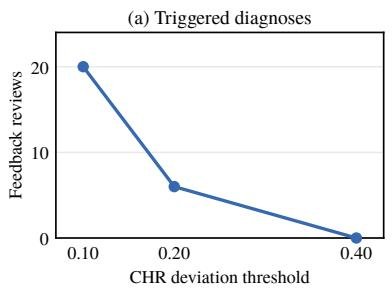

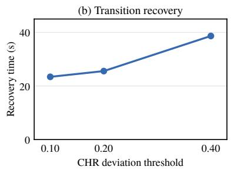

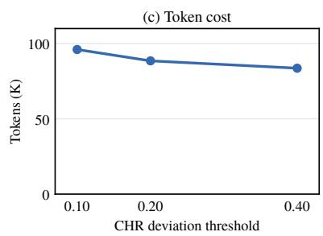  
Figure 17. Sensitivity to the CHR reflection threshold on the ResNet-50 workflow. Both the drop and increase thresholds take the value shown. Recovery time is the mean time from a phase boundary until an accepted diagnosis commits the matching pattern.

is available. Let P = {sequential, random, skewed}. Table 4 defines the context fields; t is the tail length defined above.

<table><tr><td>Review-context field</td><td>Meaning</td><td>Value</td></tr><tr><td>review_trigger</td><td></td><td>Reason for requesting diagnosis chr_anomaly if g = chr; periodic_retry otherwise</td></tr><tr><td>previous_control_state</td><td>Earlier controller state</td><td>S</td></tr><tr><td>previous_committed_pattern</td><td>Earlier committed pattern</td><td>p ∈P∪ {nul1}</td></tr><tr><td>older-prefix_may_be_stale</td><td>Possible outdated access prefix (g = chr) ∨ (s = transition)</td><td></td></tr><tr><td>recent_tail_length</td><td>Number of tail accesses</td><td>t</td></tr></table>

Table 4. Review-context fields in Review context. The stale-prefix flag is a Boolean warning, not an observed phase boundary.

## B SENSITIVITY TO THE CHR REFLECTION THRESHOLD

A lower CHR deviation threshold makes feedback reflection more sensitive: it can request more diagnoses and react sooner to pattern changes, at the cost of additional diagnosis tokens. To examine this tradeoff, we replay the ResNet-50 workflow W1 from Section 6.1. We set both the CHR drop and increase thresholds relative to the previous EWMA to 0.40, 0.20, and 0.10, while holding the other settings fixed.

Figure 17 shows that lowering the threshold from 0.40 to 0.10 increases feedback-triggered diagnoses from 0 to 20, while mean recovery time across pattern transitions falls from 38.7 to 23.4 s. Total diagnosis tokens increase from 83.7k to 96.1k. The data indicates that a more sensitive feedback gate can improve adaptation at the expense of diagnosis cost. However, CHR remains nearly identical across the settings, ranging from 69% to 70%. This is because, as the dataset and its phases grow longer, the accesses made before a periodic diagnosis corrects the pattern account for a smaller fraction of the workflow. The resulting difference in cache hits is therefore diluted by the many accesses served after the policy has adapted.