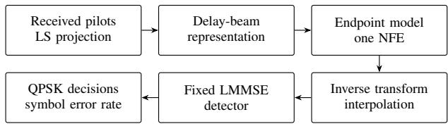
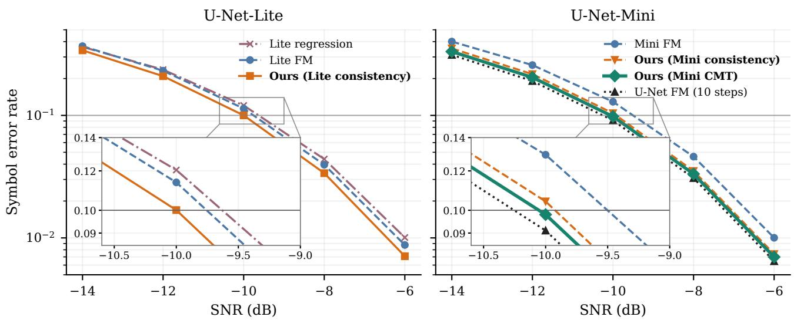
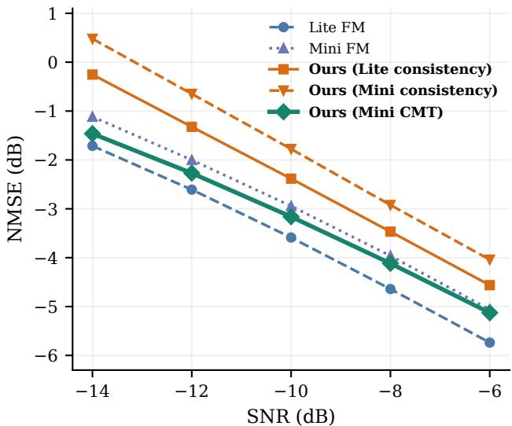

# Consistency Learning and Distillation for One-Step MIMO-OFDM Channel Estimation

Fredrik Nguyen

KTH Royal Institute of Technology

Stockholm, Sweden

fnguyen@kth.se

Qiwen Wang

Stockholm, Sweden

wangqiwen2008@gmail.com

Abstract—Iterative neural channel estimators can improve recovery under pilot contamination, but repeated network evaluations increase inference cost. This paper develops observation-anchored consistency and Consistency Mid-Training (CMT) estimators for one-step channel estimation in multipleinput multiple-output orthogonal frequency-division multiplexing (MIMO-OFDM) systems. Both estimators refine pilot-derived least-squares channel estimates in the delay-beam domain. Consistency learning couples endpoint predictions along noisy-toclean paths. CMT then refines a compact consistency-trained student to predict a flow-matching teacher’s endpoint from intermediate trajectory states. Across the evaluated SNR range, the compact CMT student reduces uncoded symbol error rate (SER) by 9.6–20.2% relative to the one-step flow-matching baseline (0.44–0.98 dB in logarithmic SER reduction), while using 74.5% fewer parameters and 73.0% fewer network multiply– accumulates.

Index Terms—Channel estimation, MIMO-OFDM, pilot contamination, consistency models, flow matching, one-step inference.

## I. INTRODUCTION

Accurate channel state information (CSI) is required for coherent detection in MIMO-OFDM systems. Pilot-aided estimation is impaired by thermal noise and by interference from users transmitting overlapping pilots. Least-squares (LS) estimation provides a simple observation [1], but does not separate the desired channel from pilot contamination. Statistical estimators and learned channel priors can improve recovery by exploiting structure across frequency and space [1], [2].

Generative approaches provide flexible channel priors, yet their inference procedures often require repeated neural evaluations. Flow matching learns a time-dependent velocity field [3], and has been applied to channel restoration and plug-and-play estimation [4], [5]. One-step channel estimation is already possible with average-velocity learning [6], while consistency priors have been incorporated into iterative channel recovery [7]. We compare endpoint consistency and teacher-trajectory supervision with one-step flow matching for detection, using matched-backbone and regression controls.

Building on consistency learning [8], [9] and Consistency Mid-Training (CMT) [10], we develop channel estimators that refine pilot-contaminated LS estimates with one neural function evaluation (NFE). Our contributions are:

• We develop an observation-anchored endpointconsistency estimator for pilot-contaminated MIMO-

OFDM channels, enforcing agreement between endpoint predictions at adjacent states along observation-to-clean paths.

• A compact teacher-trajectory student, compared with continued consistency training from shared initial weights and an equal student epoch budget.

• Matched-backbone comparisons with standard FM and a regression control, reporting normalized mean squared error (NMSE), data-symbol error rate (SER), and estimator parameter and multiply–accumulate (MAC) counts.

## II. RELATED WORK

Recent generative approaches learn channel distributions to support estimation from noisy or contaminated pilots. Arvinte and Tamir use score-based priors for iterative MIMO channel recovery [2]. Fesl et al. use a compact angular-domain network with SNR-matched deterministic reverse diffusion [11]. Zhou et al. combine a diffusion prior and approximate likelihood scores for pilot-limited recovery [12].

More recently, Liu et al. learn a noisy-to-clean channel flow [4], while Zhang and Nadeem use flow-derived denoising in plug-and-play proximal gradient descent [5]. Zhao et al. combine range–null space decomposition with noise-aware iterative flow refinement under latency constraints [13]. Jiang et al. learn an average velocity field for one-step estimation [6]. Diff-Rx embeds one-step conditional diffusion in an iterative receiver, using soft data-symbol feedback to refine subsequent channel estimates [14].

Another line of research uses consistency models to map trajectory states to a common endpoint [8], [9]. Li et al. use a consistency prior in an iterative MIMO estimator that alternates pilot-observation updates with angular-domain denoising [7]. CMT trains a student to predict a teachergenerated endpoint from intermediate states along the teacher’s solver trajectory [10].

## III. SYSTEM MODEL AND PROBLEM FORMULATION

Bold lowercase and uppercase letters denote vectors and matrices, respectively. The norms $\lVert \cdot \rVert _ { 2 }$ and $\lVert \cdot \rVert _ { F }$ denote the Euclidean and Frobenius norms.

## A. Received Signal and Pilot Projection

Consider a multiuser MIMO-OFDM uplink with one desired user transmitting a single spatial stream, four single-stream interferers, $N _ { r } = 6 4$ receive ports and $K = 1 9 2$ subcarriers. At subcarrier k and OFDM symbol $\ell ,$ the received vector is

$$
\pmb { y } _ { k , \ell } = \pmb { H } _ { k , \ell } x _ { k , \ell } + \sum _ { i = 1 } ^ { 4 } \pmb { H } _ { k , \ell } ^ { ( i ) } x _ { k , \ell } ^ { ( i ) } + \pmb { n } _ { k , \ell } ,\tag{1}
$$

where $x _ { k , \ell }$ is the transmitted symbol and ${ \mathbf { } } n _ { k , \ell } \sim \mathcal { C N } ( 0 , I )$ denotes normalized Gaussian noise. The desired-user channel $\mathbf { H } _ { k , \ell } ~ \in ~ \mathbb { C } ^ { N _ { r } \times 1 }$ includes power scaling. With normalized underlying channels H, define ${ \cal H } = \sqrt { \gamma } \overline { { { \cal H } } }$ and $\pmb { H } ^ { ( i ) } =$ $\sqrt { \eta _ { i } } \overline { { H } } ^ { ( i ) }$ . Here, γ and $\eta _ { i }$ control the desired-signal and interference powers relative to the normalized noise power.

Each slot contains 14 OFDM symbols: two carry demodulation reference signals (DMRS) and twelve carry data. DMRS occupy every other subcarrier (Comb-2), with 96 occupied subcarriers per pilot symbol. Pilot power is normalized to unit average over the complete frequency grid, including unoccupied comb positions. On an occupied resource element, dividing the received vector by the known desired pilot $x _ { k , \ell } = p _ { k , \ell } \neq 0$ gives the LS estimate

$$
\widehat { \pmb { H } } _ { k , \ell } ^ { \mathrm { L S } } = \pmb { H } _ { k , \ell } + \sum _ { i = 1 } ^ { 4 } \rho _ { k , \ell } ^ { ( i ) } \pmb { H } _ { k , \ell } ^ { ( i ) } + \widetilde { \pmb { n } } _ { k , \ell } ,\tag{2}
$$

where $\rho _ { k , \ell } ^ { ( i ) } = p _ { k , \ell } ^ { ( i ) } / p _ { k , \ell }$ and $\widetilde { \pmb { n } } _ { k , \ell } = { \pmb { n } } _ { k , \ell } / p _ { k , \ell } .$ Interferers on the other comb do not overlap the desired pilot subcarriers, giving $\rho _ { k , \ell } ^ { ( i ) } = 0$ . Two interferers contribute to each LS estimate in this configuration. Pilot-induced noise scaling is absorbed into the effective SNR. The clean target is the desired channel H.

## B. Representation and Receiver Interface

Multipath energy often concentrates over a limited region of delays and spatial frequencies. You et al. relate angledelay channel power to wideband array-channel statistics [15]. Fourier angle-delay representations are also used in learned CSI recovery [16]. We use a fixed transform to expose this structure to the estimator while retaining all delay-beam coefficients.

We apply a 128-point orthonormal inverse DFT across frequency and a two-dimensional spatial DFT within each polarization’s $4 \times 8$ array. Zero-padding the 96 occupied subcarriers and stacking the real and imaginary parts of both DMRS-symbol estimates gives a real 4×128×64 input tensor: two DMRS symbols times two real components. The clean training target has the same shape. We denote the transformed LS estimate and clean target by $h _ { 0 }$ and $\pmb { h } _ { 1 }$ , using vector notation in the learning objectives. The network operates on the tensors and also receives context $c = \log ( \mathrm { s t d } ( h _ { 0 } ) + 1 0 ^ { - 6 } )$ computed over all observation entries.

After inversion, linear frequency interpolation restores the full channel grid, with edge copying at the band limits. For each subcarrier and receive port, the two pilot-symbol channel estimates are averaged to obtain one estimate used for all twelve data symbols. All estimates feed the same linear minimum mean square error (LMMSE) detector. Only the channel-estimation module changes across methods (Fig. 1).

  
Fig. 1. One-step estimation and evaluation chain. The network processes both pilot symbols in one call. All estimators use the same oracle interference-plusnoise covariance in the detector.

## IV. ENDPOINT CONSISTENCY AND CMT

## A. Standard Flow-Matching Reference

The FM baseline follows the noisy-to-clean channelrestoration construction of Liu et al. [4], grounded in conditional flow matching [3]. We adapt this construction to pilot-contaminated delay-beam observations and the U-Net backbones studied here.

For a transformed LS estimate and its paired clean channel $\left( \boldsymbol { h } _ { 0 } , \boldsymbol { h } _ { 1 } \right)$ , use the linear path

$$
\pmb { h } _ { t } = ( 1 - t ) \pmb { h } _ { 0 } + t \pmb { h } _ { 1 } , \qquad t \in [ 0 , 1 ] .\tag{3}
$$

The conditional path velocity is $\textbf { \em u } = \ h _ { 1 } \ - \ h _ { 0 }$ . FM and direct regression use the same adaptively weighted squarederror criterion [17, Sec. 4.3 and App. B.2]. The weighting reduces the relative influence of training examples with large prediction errors. For the per-example FM error $\begin{array} { r l } { \ell _ { \mathrm { F M } } } & { { } = } \end{array}$ $\mathbf { \bar { \| } } v _ { \phi } ( \pmb { h } _ { t } , t , c ) - \pmb { u } \| _ { 2 } ^ { 2 } / D$ , where D is the number of real entries per example, the objective is

$$
\mathcal { L } _ { \mathrm { F M } } = \mathbb { E } \left[ \frac { \ell _ { \mathrm { F M } } } { ( \mathrm { s g } [ \ell _ { \mathrm { F M } } ] + \epsilon ) ^ { p } } \right] ,\tag{4}
$$

where $\mathrm { s g }$ denotes stop-gradient, $p$ controls the weighting strength, and $\epsilon \ > \ 0$ stabilizes the denominator. Weighted per-example losses are averaged over the batch. Regression uses the same criterion with per-example error $\ell _ { \mathrm { r e g } } =$ $\left\| g _ { \psi } ( h _ { 0 } , c ) - h _ { 1 } \right\| _ { 2 } ^ { 2 } / D$ . FM training times follow a logitnormal distribution (see the Appendix). A one-step Euler estimate is

$$
\widehat { \pmb { h } } _ { \mathrm { F M } } = \pmb { h } _ { 0 } + v _ { \phi } ( \pmb { h } _ { 0 } , 0 , c ) .\tag{5}
$$

The teacher uses repeated Euler updates on a uniform time grid.

The identity $h _ { t } + ( 1 - t ) { \pmb u } = h _ { 1 }$ connects velocity and endpoint predictions on this path. The consistency objectives below couple endpoint predictions across path states.

## B. Observation-Anchored Endpoint Consistency

We formulate an observation-anchored endpoint-consistency estimator for one-step channel restoration, building on the boundary-preserving parameterization and training principles of consistency models [8], [9]:

$$
f _ { \theta } ( h , t , c ) = c _ { \mathrm { s k i p } } ( t ) h + c _ { \mathrm { o u t } } ( t ) F _ { \theta } ( h , 1 - t , c ) .\tag{6}
$$

For a fixed preconditioning scale $\sigma _ { d } > 0$ , the coefficients are

$$
\begin{array} { l } { c _ { \mathrm { s k i p } } ( t ) = \displaystyle \frac { \sigma _ { d } ^ { 2 } } { ( 1 - t ) ^ { 2 } + \sigma _ { d } ^ { 2 } } , } \\ { c _ { \mathrm { o u t } } ( t ) = \displaystyle \frac { ( 1 - t ) \sigma _ { d } } { \sqrt { ( 1 - t ) ^ { 2 } + \sigma _ { d } ^ { 2 } } } . } \end{array}\tag{7}
$$

These enforce $f _ { \theta } ( h , 1 , c ) = h$ at the clean boundary. As in FM, $t = 0$ denotes the noisy observation and t = 1 the clean channel.

For adjacent levels $t _ { a } < t _ { b } ,$ form both states using the same pair in (3). The endpoint-consistency objective is

$$
\mathcal { L } _ { \mathrm { E C } } = \mathbb { E } \left[ \rho _ { \delta } \left( f _ { \theta } ( h _ { t _ { a } } , t _ { a } , c ) - \mathrm { s g } [ f _ { \theta } ( h _ { t _ { b } } , t _ { b } , c ) ] \right) \right] ,\tag{8}
$$

$$
\rho _ { \delta } ( z ) = \sqrt { \| z \| _ { 2 } ^ { 2 } + \delta ^ { 2 } - \delta } .\tag{9}
$$

Here, $\delta \ > \ 0$ is the loss smoothing parameter. The batchaveraged loss and detached current-weight target follow improved consistency training (iCT) [9, Secs. 3.2–3.3]. Adjacent states are sampled on paired observation-to-clean paths using a progressively refined grid, adapting iCT’s exponential intervalgrowth curriculum [9, Sec. 3.4]. A logit-normal draw selects an adjacent pair, with the higher-t branch supplying the detached target in (8). The Appendix specifies the sampling schedule. At inference,

$$
\widehat { \pmb { h } } _ { \mathrm { E C } } = f _ { \theta } ( \pmb { h } _ { 0 } , 0 , c ) ,\tag{10}
$$

requiring one NFE.

## C. CMT with a Compact Endpoint Student

The student is initialized from a consistency-trained checkpoint. Following CMT [10], we freeze a standard-FM teacher and construct its trajectory from the observation:

$$
z _ { 0 } = h _ { 0 } , \qquad z _ { m + 1 } = z _ { m } + { \frac { 1 } { M } } v _ { \phi } ( z _ { m } , m / M , c ) ,\tag{11}
$$

for $m = 0 , \ldots , M - 1$ . We sample a nonterminal state $\widetilde { z } _ { t }$ uniformly from a grid along the interpolated teacher trajectory. Following CMT’s trajectory-to-endpoint objective [10, Sec. 3.2], we use an MSE discrepancy:

$$
\mathcal { L } _ { \mathrm { C M T } } = \mathbb { E } _ { h _ { 0 } , t } \left[ \frac { 1 } { D } \left. f _ { \theta } ( \widetilde { z } _ { t } , t , c ) - \mathrm { s g } [ z _ { M } ] \right. _ { 2 } ^ { 2 } \right] .\tag{12}
$$

The loss is averaged over batch and vector entries. At inference, the student maps the noisy observation directly to an endpoint using (10). Intermediate teacher states are used only during training.

## V. SIMULATION SETUP

## A. Channel Data

Training channels are generated using QuaDRiGa v2.8.1 [18], [19], based on the 3GPP TR 38.901 urbanmacro non-line-of-sight scenario [20]. Table I summarizes the physical configuration. Each UE port is treated as a separate channel example. The corpus contains 816,000 snapshot/port examples, split 99/1 for training and validation. Samples from the same trajectory can occur in both partitions. Channel blocks are power-normalized jointly across antennas and subcarriers, with the first-snapshot scale reused across snapshots.

TABLE I  
CHANNEL AND TRANSMISSION CONFIGURATION.
<table><tr><td>Parameter</td><td>Value</td></tr><tr><td>Carrier frequency</td><td>3.5 GHz</td></tr><tr><td>Subcarriers; spacing</td><td>192; 30 kHz</td></tr><tr><td>Sampled bandwidth</td><td>5.76 MHz</td></tr><tr><td>Base-station array</td><td>4 × 8 dual-polarized panels (64 ports)</td></tr><tr><td>UE antenna ports</td><td>2, cross-polarized</td></tr><tr><td>Delay-spread reference</td><td>363 ns</td></tr><tr><td>UE speed</td><td>1 km/h</td></tr><tr><td>Desired users; interfering users</td><td>1;4</td></tr><tr><td>OFDM symbols per slot</td><td>14</td></tr><tr><td>Pilot symbols; occupied subcarriers Pilot/data constellation</td><td>2; 96 per symbol (Comb-2) QPSK</td></tr></table>

Receiver evaluation uses a separate CDL-B test set [20, Sec. 7.7.1] with the physical settings in Table I. It contains 1,000 transmission time intervals (TTIs), with a fixed desired user and four interferers.

## B. Training Protocol

Each training snapshot is held constant across a synthesized slot. Four interference channels are sampled with replacement from the desired example’s partition. During training, QPSK pilot realizations are drawn from pilot banks. Receiver evaluation uses fixed pilot realizations. Table II lists training settings and operating points.

Regression, FM, and direct consistency train uninterrupted for ten epochs. CMT starts from the same epochfive consistency-model weights as the continued-consistency control and receives five CMT epochs, giving both ten total student epochs. The post-training variant adds five consistency epochs using (8) after CMT. These budgets exclude teacher training and trajectory generation.

AdamW uses a constant base learning rate, with a brief initial warmup for regression, FM, and consistency. The weighting exponent $p = 1$ was chosen after comparing $p \in \{ 0 , 1 \}$ where $p = 0$ gives unweighted MSE. Other hyperparameters were chosen through manual experimentation. Regression, FM, and consistency use the lowest-validation-NMSE weights among the non-averaged and exponential moving average (EMA) variants evaluated.

FM time sampling and consistency interval selection use the Gaussian parameters in Table II. The Appendix specifies their sampling schedules.

CMT linearly interpolates the frozen teacher’s ten-step trajectory onto a uniform grid of 40 intervals. One nonterminal grid state per example is supplied to the student, using a common sampled time within each batch. The teacher endpoint is its target.

Training and validation use pilot-derived channel examples. Receiver evaluation additionally measures data-symbol detection. All estimators use one network evaluation, except for the ten-step teacher reference.

TABLE II  
TRAINING SETTINGS AND OPERATING POINTS.
<table><tr><td>Parameter</td><td>Value</td></tr><tr><td>Optimizer; training batch size</td><td>AdamW; 64</td></tr><tr><td>Base learning rate; weight decay</td><td> $2 \times 1 0 ^ { - 4 } ; 1 0 ^ { - 4 }$ </td></tr><tr><td>Warmup</td><td>1% of updates</td></tr><tr><td>Residual weighting (p, €)</td><td> $( 1 , 1 0 ^ { - \dot { 4 } } )$ </td></tr><tr><td>Consistency  $( \sigma _ { d } , \delta )$ </td><td> $( 1 . { \overset { \cdot } { 6 } } 3 9 7 , { \overset { \cdot } { 1 } } 0 ^ { - 4 } )$ </td></tr><tr><td>FM time Gaussian  $( \mu , s )$ </td><td> $( - 0 . 4 , 1 )$ </td></tr><tr><td>Consistency time Gaussian (µ, s)</td><td>(1.1, 2)</td></tr><tr><td>Training observations</td><td></td></tr><tr><td>SNR (dB)</td><td>Truncated  $\mathcal { N } ( - 1 0 , 2 . 5 ^ { 2 } )$  on  $[ - 1 6 , - 4 ]$ </td></tr><tr><td>INR (dB)</td><td>Independent uniform [0, 8]</td></tr><tr><td>Validation and receiver evaluation</td><td></td></tr><tr><td>SNR (dB)</td><td>−14, −12, −10, −8, −6</td></tr><tr><td>Receiver INR (dB)</td><td>5.229, 5.229, 5.229, 1.0914</td></tr></table>

TABLE III

BACKBONES AND COST PER NETWORK EVALUATION IN GMAC $( 1 0 ^ { 9 }$ MACS) FOR FOUR-CHANNEL 128 × 64 INPUTS. BLOCK COUNTS ARE PER RESOLUTION LEVEL.
<table><tr><td>Setting</td><td></td><td>U-Net U-Net-Lite U-Net-Mini</td></tr><tr><td>Base width Channel multipliers [1, 2, 4] Encoder blocks</td><td>32 2</td><td>16 [1, 1, 2] [1, 1, 2] 1</td></tr><tr><td>Decoder blocks</td><td>3</td><td>2 49.3 k</td></tr><tr><td>Parameters</td><td>3.95 M</td><td>193 k</td></tr><tr><td>GMAC</td><td>4.68</td><td>0.330 0.0892</td></tr></table>

## C. Network Architecture and Reference Estimators

All backbones adapt Liu et al.’s residual U-Net for channel estimation [4], with encoder–decoder skip connections [21] and time/context embeddings. All learned estimators receive the input’s log-standard-deviation context through the scalarconditioning embedding. Residual blocks use two $3 \times 3$ convolutions with GroupNorm and SiLU. All variants include single-head bottleneck attention. The large U-Net also applies attention at feature-map height 32. Compact variants reduce width and depth. Table III reports parameter counts and GMAC, including convolutional and linear layers and both attention matrix products.

We evaluate the proposed consistency estimators using two network architectures, U-Net-Lite and U-Net-Mini, and compare their performance against standard FM. As an additional control, direct regression without the FM framework is implemented using U-Net-Lite. For CMT, a large U-Net serves as the teacher, while U-Net-Mini is employed as the student. The teacher model is evaluated with both one and ten Euler steps. One-step FM with U-Net-Lite serves as the baseline reference for evaluating the SER reduction achieved by the compact CMT student.

## D. Receiver and Metrics

The receiver forms an oracle interference-plus-noise covariance from the true scaled channels. With $H _ { \mathrm { i n t f } }$ = $[ H ^ { ( 1 ) } , \dots , H ^ { ( 4 ) } ]$ , it averages $H _ { \mathrm { i n t f } } H _ { \mathrm { i n t f } } ^ { H } + I$ over all OFDM

symbols and contiguous windows of 48 subcarriers. For unitaverage-power data symbols and estimated desired channel $\hat { H }$ the LMMSE output is

$$
\widehat { x } = \left( \widehat { H } ^ { H } R _ { u u } ^ { - 1 } \widehat { H } + I \right) ^ { - 1 } \widehat { H } ^ { H } R _ { u u } ^ { - 1 } y .\tag{13}
$$

Nearest-neighbor QPSK decisions give uncoded SER $N _ { \mathrm { e r r } } / N _ { \mathrm { s y m } }$ over desired-user data symbols, excluding DMRS. SER is the primary performance metric because it directly measures downstream data-symbol recovery with the common detector. NMSE provides a complementary measure of channel reconstruction accuracy.

For Mini CMT relative to one-step Lite FM at the same evaluated SNR, the SER reductions in percent and dB are

$$
\begin{array} { l } { { \displaystyle R _ { \mathcal { V } _ { 0 } } = 1 0 0 \left( 1 - \frac { \mathrm { S E R } _ { \mathrm { C M T } } } { \mathrm { S E R } _ { \mathrm { F M } } } \right) , } } \\ { { \displaystyle R _ { \mathrm { d B } } = 1 0 \log _ { 1 0 } \frac { \mathrm { S E R } _ { \mathrm { F M } } } { \mathrm { S E R } _ { \mathrm { C M T } } } . } } \end{array}\tag{14}
$$

The latter is a logarithmic SER reduction.

Channel reconstruction is evaluated on all occupied Comb-2 pilot subcarriers. For reference and estimated channel matrices $H _ { n }$ and $\widehat { \pmb { H } } _ { n }$ in TTI n, the pooled NMSE is

$$
\mathrm { N M S E _ { \mathrm { d B } } } = 1 0 \log _ { 1 0 } \frac { \sum _ { n = 1 } ^ { N _ { \mathrm { T T I } } } \left\| \widehat { \pmb { H } } _ { n } - \pmb { H } _ { n } \right\| _ { F } ^ { 2 } } { \sum _ { n = 1 } ^ { N _ { \mathrm { T T I } } } \left\| \pmb { H } _ { n } \right\| _ { F } ^ { 2 } } .\tag{15}
$$

Here, $N _ { \mathrm { T T I } }$ is the number of evaluated TTIs.

## VI. RESULTS AND DISCUSSION

## A. Consistency Relative to Standard Flow Matching

Table IV and Fig. 2 compare receiver performance. With U-Net-Lite, our consistency estimator reduces uncoded SER at −10 dB from 0.114 to 0.100, a 12.0% relative reduction. With U-Net-Mini, SER decreases from 0.129 to 0.104, or 19.4%. Across all five SNRs, consistency reduces SER by 7.5–19.0% with U-Net-Lite and 12.1–26.4% with U-Net-Mini versus matched-backbone FM.

With the same backbone and ten-epoch training budget, Lite consistency achieves lower SER than Lite regression at all five evaluated SNRs. At −10 dB, SER decreases from 0.120 to 0.100. Regression learns the direct noisy-to-clean mapping, while consistency trains endpoint predictions at adjacent path states to agree. These comparisons suggest that pathwise consistency may help the learned restoration map preserve channel information useful for detection.

## B. CMT Performance and Network Cost

Mini CMT reduces SER relative to Lite FM from 0.367 to 0.332 at −14 dB and from 0.00876 to 0.00699 at −6 dB. Across the five evaluated points, relative SER reduction is 9.6–20.2% (0.44–0.98 dB in logarithmic SER reduction). Mini CMT has the lowest one-step SER at −12, −10, −8, and −6 dB. At −14 dB, one-step U-Net and CMT are nearly tied. With shared initialization and equal student epochs, CMT reduces Mini consistency SER at −10 dB by 5.9% (0.104 to 0.0980).

TABLE IV  
UNCODED SER AT ALL FIVE EVALUATED SNRS. BOLD VALUES MARK THE LOWEST ONE-STEP SER AT THE DISPLAYED PRECISION, INCLUDING TIES. CALCULATIONS USE UNROUNDED VALUES. THE TEN-STEP TEACHER IS SHOWN SEPARATELY.
<table><tr><td>Estimator</td><td>SER at −14 dB</td><td>SER at −12 dB</td><td></td><td>SER at −10 dB</td><td>SER at —8 dB</td><td></td><td>SER at —6 dB</td></tr><tr><td colspan="6">One-step estimators (one network evaluation)</td><td></td><td></td><td></td></tr><tr><td>U-Net FM (1 step)</td><td>0.332</td><td></td><td>0.206</td><td>0.100</td><td>0.0353</td><td></td><td>0.00783</td></tr><tr><td>Lite regression</td><td>0.363</td><td></td><td>0.236</td><td>0.120</td><td>0.0440</td><td></td><td>0.0101</td></tr><tr><td>Lite FM</td><td>0.367</td><td></td><td>0.232</td><td>0.114</td><td>0.0396</td><td></td><td>0.00876</td></tr><tr><td>Mini FM</td><td>0.401</td><td></td><td>0.258</td><td>0.129</td><td>0.0461</td><td></td><td>0.0100</td></tr><tr><td>Ours (Lite consistency)</td><td>0.340</td><td></td><td>0.209</td><td>0.100</td><td>0.0338</td><td></td><td>0.00709</td></tr><tr><td>Ours (Mini consistency)</td><td>0.352</td><td></td><td>0.217</td><td>0.104</td><td>0.0352</td><td></td><td>0.00738</td></tr><tr><td>Ours (Mini CMT)</td><td>0.332</td><td></td><td>0.204</td><td>0.0980</td><td>0.0333</td><td></td><td>0.00699</td></tr><tr><td>Mini CMT + post-training</td><td>0.343</td><td></td><td>0.211</td><td>0.101</td><td>0.0342</td><td></td><td>0.00728</td></tr><tr><td colspan="2">Iterative teacher reference</td><td></td><td></td><td></td><td></td><td></td><td></td></tr><tr><td>U-Net FM (10 steps)</td><td></td><td>0.312</td><td>0.191</td><td>0.0910</td><td></td><td>0.0308</td><td>0.00645</td></tr></table>

  
Fig. 2. Uncoded SER of regression, FM, and our consistency/CMT estimators. Insets magnify the boxed regions using the same logarithmic SER scale. Markers denote measured points.

Mini CMT uses 74.5% fewer parameters and 73.0% fewer network MACs than Lite FM (Table III).

CMT originally serves as initialization for flow-map posttraining [10, Sec. 3.1]. After CMT, five additional consistency epochs increase SER at every evaluated SNR, including from 0.0980 to 0.101 at −10 dB.

## C. Reconstruction Error and Symbol Detection

Channel-estimation NMSE measures reconstruction fidelity but need not predict downstream detection error [22, Sec. VI-A]. Application-oriented MIMO training therefore considers subsequent equalization and precoding [23].

In our results (Fig. 3), direct consistency lowers uncoded SER despite higher NMSE than matched FM at both backbone sizes. At −10 dB, Lite FM and Lite consistency have NMSE −3.59 and −2.38 dB, respectively. Mini CMT reaches −3.16 dB, outperforming Mini FM (−2.94 dB) but not Lite FM. These rankings hold at all five SNRs.

For illustration, with fixed interference covariance in (13), positive rescaling of the estimated channel can change NMSE while preserving the detector output’s phase and hence QPSK hard decisions.

## VII. CONCLUSION

Observation-anchored consistency learning and teachertrajectory distillation enable compact, one-step channel estimation under pilot contamination. With matched backbones, consistency improves downstream uncoded SER over standard flow matching despite higher channel NMSE. Mini CMT reduces uncoded SER by 9.6–20.2% relative to one-step U-Net-Lite FM while using approximately 75% fewer parameters and 73% fewer network MACs. These results concern simulated pilot-contaminated QPSK with oracle interference covariance. Practical covariance estimation and broader propagation conditions remain directions for further evaluation.

  
Fig. 3. NMSE on pilot subcarriers for one-step estimators. Lower values are better.

## ACKNOWLEDGMENT AND DISCLOSURE

OpenAI ChatGPT and Codex assisted with drafting and revising text in the Abstract, Sections I–VII, and Appendix, as well as with figure preparation. The authors reviewed and verified the scientific content, methodology, and reported results.

## APPENDIX TRAINING IMPLEMENTATION

FM samples t = sigmoid(Z), with $Z \sim { \mathcal { N } } ( \mu , s ^ { 2 } )$ and the parameters in Table II. For consistency, a uniform grid in t increases from 10 to 1,280 intervals over eight stages defined by optimizer-update count. Let S be the total number of optimizer updates and $j \in \{ 0 , \ldots , S - 1 \}$ } the update index. The number of grid points is

$$
\begin{array} { r l } & { N _ { j } = 1 + \operatorname* { m i n } \Bigl \{ 1 2 8 0 , 1 0 \cdot 2 ^ { \lfloor j / K _ { 0 } \rfloor } \Bigr \} , } \\ & { K _ { 0 } = \operatorname* { m a x } \bigl \{ 1 , \lfloor S / 8 \rfloor \bigr \} . } \end{array}\tag{16}
$$

With the consistency Gaussian parameters in Table II, draw $Z \sim { \mathcal { N } } ( \mu , s ^ { 2 } )$ and select the interval index

$$
i = \operatorname* { m i n } ( N _ { j } - 2 , \lfloor ( N _ { j } - 1 ) \operatorname { s i g m o i d } ( Z ) \rfloor ) .\tag{17}
$$

Its endpoints are $t _ { a } = i / ( N _ { j } - 1 )$ and $t _ { b } = ( i + 1 ) / ( N _ { j } - 1 )$ in (8). The backbone receives 1 − t.

## REFERENCES

[1] Y. Liu, Z. Tan, H. Hu, L. J. Cimini, and G. Y. Li, “Channel estimation for OFDM,” IEEE Communications Surveys & Tutorials, vol. 16, no. 4, pp. 1891–1908, 2014.

[2] M. Arvinte and J. I. Tamir, “MIMO channel estimation using score-based generative models,” IEEE Transactions on Wireless Communications, vol. 22, no. 6, pp. 3698–3713, 2023.

[3] Y. Lipman, R. T. Q. Chen, H. Ben-Hamu, M. Nickel, and M. Le, “Flow matching for generative modeling,” in International Conference on Learning Representations, 2023.

[4] W. Liu, N. Ma, J. Chen, X. Qi, and Y. Ma, “Flow matching-based generative models for MIMO channel estimation,” arXiv:2511.10941, 2025. [Online]. Available: https://arxiv.org/abs/2511.10941

[5] Y. Zhang and Q.-U.-A. Nadeem, “Channel estimation in MIMO systems using flow matching models,” in IEEE International Conference on Communications (ICC), 2026, pp. 1–6. [Online]. Available: https://arxiv.org/abs/2601.13827

[6] Z. Jiang, F. Zhu, S. Jiang, C. Huang, Z. Yang, R. Jin, Z. Zhang, and M. Debbah, “One-step generative channel estimation via average velocity field,” in IEEE Wireless Communications and Networking Conference (WCNC), 2026, pp. 1–5.

[7] J. Li, K. Fang, P. Yang, Z. Xiong, X. Cao, and D. O. Wu, “Adaptive plug-and-play channel estimation with consistency models for MIMO systems,” arXiv:2604.23595v2, 2026. [Online]. Available: https://arxiv.org/abs/2604.23595v2

[8] Y. Song, P. Dhariwal, M. Chen, and I. Sutskever, “Consistency models,” in Proceedings of the 40th International Conference on Machine Learning, ser. Proceedings of Machine Learning Research, vol. 202, 2023, pp. 32 211–32 252.

[9] Y. Song and P. Dhariwal, “Improved techniques for training consistency models,” in International Conference on Learning Representations, 2024.

[10] Z. Hu, C.-H. Lai, Y. Mitsufuji, and S. Ermon, “CMT: Mid-training for efficient learning of consistency, mean flow, and flow-map models,” in International Conference on Learning Representations, 2026.

[11] B. Fesl, M. Baur, F. Strasser, M. Joham, and W. Utschick, “Diffusionbased generative prior for low-complexity MIMO channel estimation,” IEEE Wireless Communications Letters, vol. 13, no. 12, pp. 3493–3497, 2024.

[12] X. Zhou, L. Liang, J. Zhang, P. Jiang, Y. Li, and S. Jin, “Generative diffusion models for high dimensional channel estimation,” IEEE Transactions on Wireless Communications, vol. 24, no. 7, pp. 5840–5854, 2025.

[13] J. Zhao, G. Liang, X. Liu, and D. Liu, “Null-space flow matching for MIMO channel estimation in latency-constrained systems,” arXiv:2604.22005v2, 2026. [Online]. Available: https: //arxiv.org/abs/2604.22005v2

[14] W. Zhou, Z. Zhang, Z. Kong, and Z. Yang, “MIMO-OFDM AI receiver based on incrementally conditioned diffusion with soft decision,” arXiv:2609.25923, 2026. [Online]. Available: https: //arxiv.org/abs/2609.25923v1

[15] L. You, X. Gao, A. L. Swindlehurst, and W. Zhong, “Channel acquisition for massive MIMO-OFDM with adjustable phase shift pilots,” IEEE Transactions on Signal Processing, vol. 64, no. 6, pp. 1461–1476, 2016.

[16] C.-K. Wen, W.-T. Shih, and S. Jin, “Deep learning for massive MIMO CSI feedback,” IEEE Wireless Communications Letters, vol. 7, no. 5, pp. 748–751, 2018.

[17] Z. Geng, M. Deng, X. Bai, J. Z. Kolter, and K. He, “Mean flows for one-step generative modeling,” in Advances in Neural Information Processing Systems, vol. 38, 2025.

[18] S. Jaeckel, L. Raschkowski, K. Börner, and L. Thiele, “QuaDRiGa: A 3-D multi-cell channel model with time evolution for enabling virtual field trials,” IEEE Transactions on Antennas and Propagation, vol. 62, no. 6, pp. 3242–3256, 2014.

[19] S. Jaeckel, L. Raschkowski, L. Thiele, F. Burkhardt, and E. Eberlein, “QuaDRiGa—quasi deterministic radio channel generator, user manual and documentation,” Fraunhofer Heinrich Hertz Institute, Tech. Rep. v2.8.1, 2023.

[20] 3GPP, “Study on channel model for frequencies from 0.5 to 100 GHz,” 3rd Generation Partnership Project, Technical Report 38.901, 2026, v19.2.0.

[21] O. Ronneberger, P. Fischer, and T. Brox, “U-Net: Convolutional networks for biomedical image segmentation,” in Medical Image Computing and Computer-Assisted Intervention (MICCAI), ser. Lecture Notes in Computer Science, vol. 9351. Springer, 2015, pp. 234–241.

[22] J. K. Tugnait, S. He, and H. Kim, “Doubly selective channel estimation using exponential basis models and subblock tracking,” IEEE Transactions on Signal Processing, vol. 58, no. 3, pp. 1275–1289, 2010.

[23] D. Katselis, C. R. Rojas, M. Bengtsson, E. Björnson, X. Bombois, N. Shariati, M. Jansson, and H. Hjalmarsson, “Training sequence design for MIMO channels: An application-oriented approach,” EURASIP Journal on Wireless Communications and Networking, vol. 2013, 2013, art. no. 245.