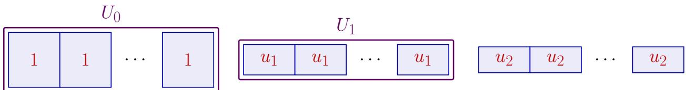
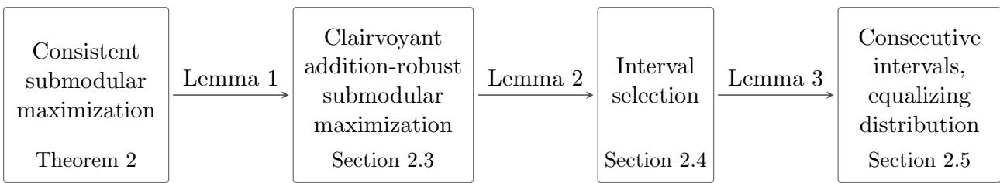
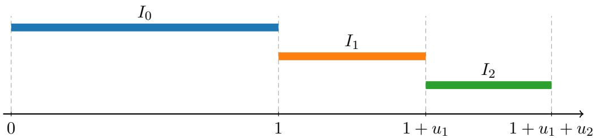
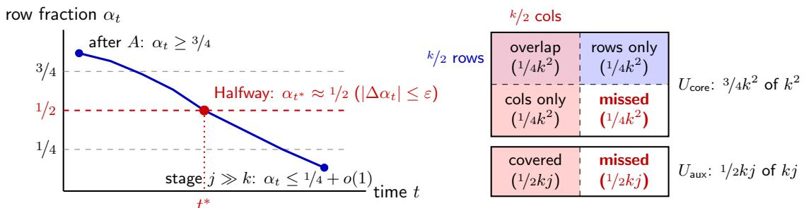
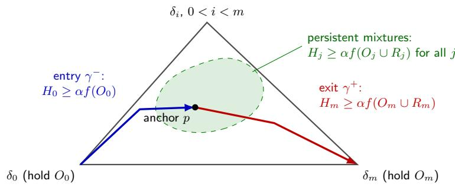
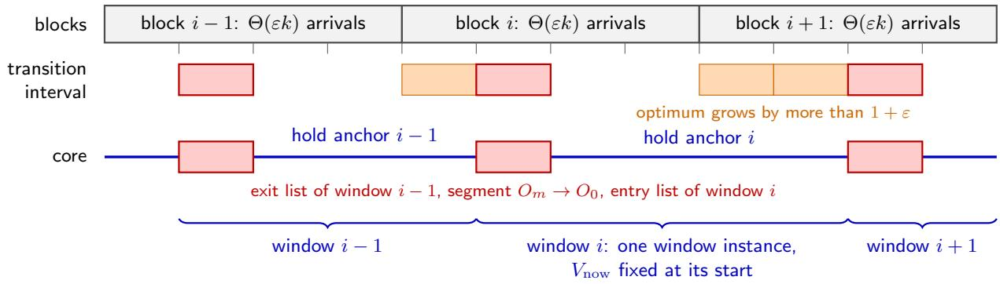
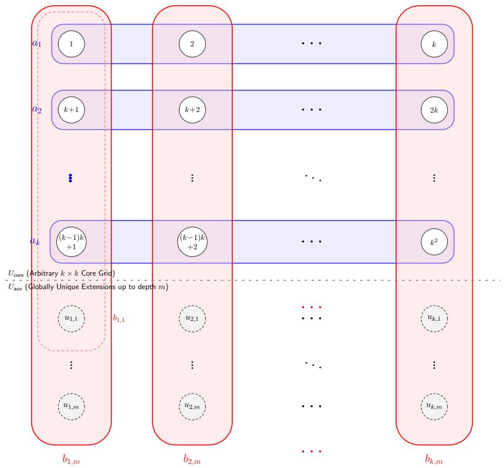

# Consistent Submodular Maximization with Full Foresight∗

Eric Balkanski† Paul D¨utting‡ Federico Fusco§ Silvio Lattanzi‡

Ashkan Norouzi-Fard‡ Ola Svensson¶ Morteza Zadimoghaddam‡

## Abstract

Online algorithms with bounded recourse face three intertwined obstacles: uncertainty about the future, computational limits, and a limited budget for changes. We ask a fundamental question that separates consistency from the other two: what does solution stability cost when the entire future is known and computation is unlimited?

We answer this question for monotone submodular maximization, where an algorithm must maintain a solution of at most k arrived elements, with a constant number of changes per step. We determine the optimal approximation thresholds: $3 / 4$ for deterministic algorithms and $\xi ^ { \star } \approx 0 . 7 9 4 2$ for randomized algorithms. For $\mathrm { e v e r y } \varepsilon > 0 .$ we get within ε of these thresholds with worst-case recourse polynomial in $1 / \varepsilon$ , independent of k and the stream length. We prove matching impossibility results even for coverage functions.

We attain the sharp bounds by optimally balancing two opposing forces: preparing for future arrivals and protecting the current solution. For randomized algorithms, we use addition robustness against prefixes of the known future, which we analyze tightly via an interval-selection problem. For deterministic algorithms, we introduce certificates, paths in a fractional relaxation that maintain high value, which we round into an update schedule.

## Contents

1 Introduction 1   
1.1 The Model 1   
1.2 Results and Techniques 2   
1.3 Related Work 4   
2 The Tight Randomized Bound 5   
2.1 The Impossibility Result for Randomized Algorithms . 5   
2.2 Overview of the Randomized Algorithm 6   
2.3 The Clairvoyant Addition-Robust Problem 7   
2.4 The Interval Selection Problem 8   
2.5 The Hard Structure for Interval Selection 9   
3 The Tight Deterministic Bound 10   
3.1 Impossibility for Deterministic Algorithms . 10   
3.2 Framework for Deterministic Algorithms: Clairvoyant Certificates 11   
A Proofs for the Tight Randomized Bound 18   
A.1 Properties of the Polynomial Ψ 18   
A.2 Impossibility for Randomized Algorithms 19   
A.3 From Clairvoyant Addition-Robustness to Consistency 21   
A.4 From Interval Selection to Clairvoyant Addition-Robustness 23   
A.5 From Structured to General Interval Selection . 24   
A.6 The Adaptivity Gap for Structured Interval Selection 27   
A.7 Combining the Reductions: The Randomized Approximation Guarantee 29   
B Proofs for the Tight Deterministic Bound 30   
B.1 Impossibility for Deterministic Algorithms . 30   
B.1.1 Instance Construction . 30   
B.1.2 Algorithms behavior on stream Σ 31   
B.2 Deterministic Clairvoyant Algorithms 33   
B.2.1 Window bounds and mixture comparisons 33   
B.2.2 An elementary certificate at level 1/ 2 36   
B.2.3 Simultaneous deterministic rounding . 40   
B.2.4 The protected schedule and the recourse calculation 42

## 1 Introduction

Online algorithms with recourse have emerged as a central paradigm for optimization over evolving inputs: they maintain good solutions as the input changes, while limiting how much these solutions change, either at each update or in aggregate over the entire sequence. This paradigm has been developed for a broad range of fundamental problems, including Steiner trees [Imase and Waxman, 1991, Gu et al., 2016], minimum spanning trees and TSP [Megow et al., 2016], scheduling [Sanders et al., 2009], bin packing [Feldkord et al., 2018], set cover [Gupta et al., 2017], bipartite matching [Bosek et al., 2014, Bernstein et al., 2019], k-clustering [Lattanzi and Vassilvitskii, 2017, Fichtenberger et al., 2021], and submodular maximization [D¨utting et al., 2024, 2025].

Such algorithms face three intertwined obstacles: uncertainty about the future, computational limits, and a limited budget for changes. Approximation guarantees reflect the joint efect of all three, so they do not reveal what stability itself costs. Isolating this cost requires removing the other two obstacles, which leads to the following question:

How much solution quality must be sacrificed to maintain stability when the entire future is known and computation is unlimited?

We study this question for monotone submodular maximization under a cardinality constraint [Nemhauser et al., 1978, Krause and Golovin, 2014]. We give the algorithm full knowledge of the arrival sequence and unrestricted computational power. Each maintained solution must use only elements that have already arrived, and consecutive solutions may difer by only a constant number of elements. Even with full foresight, preparing a solution for future arrivals can compromise its current value, while postponing changes can leave too little time to complete them. The challenge is to plan solutions and transitions that remain close to the current optimum while respecting the recourse bound.

## 1.1 The Model

Let $f : 2 ^ { X } \to \mathbb { R } _ { > 0 }$ be a monotone submodular function accessible through value queries, and let $k \geq 1$ be an integer cardinality bound. Elements $x _ { 1 } , \ldots , x _ { n } \in X$ arrive one at a time, and the algorithm knows the entire arrival sequence in advance. After the t-th arrival, the algorithm must maintain a solution $\mathrm { A L G } _ { t } \subseteq X _ { t }$ , where $X _ { t } = \{ x _ { 1 } , \ldots , x _ { t } \}$ , satisfying $| \mathrm { A L G } _ { t } | \le k$ for every realization of its randomness. We set $\mathrm { A L G } _ { 0 } = \emptyset$ and let $\mathrm { O P T } _ { t }$ denote a set maximizing $f ( S )$ over all $S \subseteq X _ { t }$ with $| S | \le k$ Computation and the number of value queries are unrestricted, and queries may involve elements that have not yet arrived.

We evaluate a possibly randomized algorithm according to two guarantees:

• Approximation. For $\alpha \leq 1$ , an algorithm is an α-approximation if, on every instance and at every time t, $\mathbb { E } [ f ( \mathrm { A L G } _ { t } ) ] \geq \alpha f ( \mathrm { O P T } _ { t } )$ . The expectation is over the algorithm’s internal randomness, with the instance and time t fixed; the guarantee need not hold simultaneously at all times for a single realization. For deterministic algorithms, we use $f ( \mathrm { A L G } _ { t } )$ instead of $\mathbb { E } [ f ( \mathrm { A L G } _ { t } ) ]$

• Consistency. An algorithm is C-consistent if, on every instance and for every realization of its randomness, $| \mathrm { A L G } _ { t } \triangle \mathrm { A L G } _ { t - 1 } | \leq C$ for all $t = 1 , \ldots , n$ . Here $\triangle$ denotes the symmetric diference.∗ An algorithm is consistent if it is C-consistent for some constant C independent of the input instance, including k and n. For algorithms parameterized by an accuracy $\varepsilon > 0$ the constant C may depend on $\varepsilon .$

<table><tr><td></td><td>poly time</td><td>info-theoretic</td></tr><tr><td>det.</td><td>[0.3818, 1/2] Dütting et al. [2024]</td><td>[0.3818,1/2] Dütting et al. [2024]</td></tr><tr><td>rand.</td><td> $2 - { \sqrt { 2 } }$  ≈ 0.5858 Fu et al. [2026]</td><td>3/4 (coverage) and 2/3 (submod.) Dütting et al. [2025]</td></tr></table>

(a) Non-clairvoyant algorithms

<table><tr><td></td><td>poly time</td><td>info-theoretic</td></tr><tr><td>det.</td><td> $[ 0 . 3 8 1 8 , 1 - 1 / e ]$  Dütting et al. [2024] Thm. 3 &amp; Thm. 4</td><td> $3 / 4$ </td></tr><tr><td>rand.</td><td> $[ 2 - \sqrt { 2 } , 1 - 1 / e ]$  Fu et al. [2026]</td><td> $\xi ^ { \star } \approx 0 . 7 9 4 2$  Thm. 1 &amp; Thm. 2</td></tr></table>

(b) Clairvoyant algorithms  
Figure 1: Overview of results. A single value is a tight threshold; an interval gives the best known lower and upper bounds. Poly time refers to algorithms that make polynomially many value queries and run in polynomial time, and info-theoretic to algorithms with unrestricted computation. The upper bound of $1 - 1 / e$ in polynomial time holds even without consistency constraints [Nemhauser and Wolsey, 1978, Feige, 1998].

We allow arbitrary constant recourse budgets to identify approximation barriers that persist for every fixed number of changes permitted per arrival.

Apart from the algorithm’s knowledge of the arrival sequence, this is the model of consistent submodular maximization introduced by D¨utting et al. [2024] and further studied by D¨utting et al. [2025] and Fu et al. [2026], in which each element is revealed only upon arrival.† We refer to their setting as non-clairvoyant and to ours as clairvoyant.

## 1.2 Results and Techniques

We establish tight information-theoretic bounds for consistent clairvoyant algorithms, both deterministic and randomized.

For randomized algorithms we show:

Main Result 1 (Tight randomized bound; see Thm. 1 & Thm. 2). For every $\varepsilon \in ( 0 , 1 )$ , there is a randomized clairvoyant algorithm for monotone submodular maximization under a cardinality constraint that is $O ( \varepsilon ^ { - 2 } )$ -consistent and achieves a $( \xi ^ { \star } - \varepsilon )$ -approximation, where $\xi ^ { \star } \approx 0 . 7 9 4 2 . ^ { \ddagger }$ No consistent randomized clairvoyant algorithm can achieve an approximation ratio greater than $\xi ^ { \star }$ even for coverage functions.

For this result, we handle transitions through the addition-robustness framework of D¨utting et al. [2025]. The algorithm periodically samples a new set of elements that have already arrived and transitions to it at a random time, so that any fixed time is rarely afected. This framework reduces the problem to constructing an addition-robust distribution, whose samples stay competitive in expectation as new elements arrive.

Foresight changes the nature of this task: the upcoming arrivals are known, but a single distribution must still be good at all times. Via minimax duality, as in the non-clairvoyant setting, it sufices to compare a single solution, fixed in advance, with the best choice in hindsight when the evaluation time is random. Our key insight is that, because the future arrival prefixes form a known nested sequence, this question can be cast as an interval-selection problem, quite diferent from the correlation-gap question that arises without foresight [D¨utting et al., 2025].

We solve this problem exactly. The crux is to show that the worst case consists of only three consecutive intervals, corresponding to just two future insertions; optimizing over such instances yields $\xi ^ { \star }$ . The same analysis yields both bounds at once: every instance admits a robust distribution that is ξ⋆-competitive, and the worst case translates directly into a family of coverage instances that rules out a better approximation ratio for consistent algorithms.

For deterministic algorithms we show:

Main Result 2 (Tight deterministic bound; see Thm. 3 & Thm. 4). For every $\varepsilon \in ( 0 , 1 )$ there is a deterministic clairvoyant algorithm for monotone submodular maximization under a cardinality constraint that is $O ( \varepsilon ^ { - 3 } \log ( 1 / \varepsilon ) ) ,$ )-consistent and achieves a $( 3 / 4 - \varepsilon )$ -approximation. $N o$ consistent deterministic clairvoyant algorithm can achieve an approximation ratio greater than $3 / 4$ , even for coverage functions.

The randomized construction places transitions at random times, so that any fixed time is afected by a transition only with small probability. A deterministic algorithm must maintain its approximation guarantee throughout each transition. A simple coverage construction makes this obstacle concrete: the algorithm is forced to move gradually from the rows of a $k \times k$ grid to increasingly valuable columns. Halfway through, its $k / 2$ rows and $k / 2$ columns cover only $3 / 4$ of the grid, while the optimal solution covers all of it.

Obtaining the matching algorithmic guarantee requires a way to construct safe transitions. We introduce a framework of clairvoyant certificates, which combines a fractional solution that remains valuable throughout a window of arrivals with a transition path of controlled complexity connecting the initial and final optimizers through that solution. The entry and exit portions satisfy the required value guarantees under the initial and final objectives, respectively. A certificate thus balances preparing for future arrivals against protecting the current solution. The main technical contribution is a reduction that rounds the entire transition path simultaneously, preserving the required value guarantees while controlling the number of changes. The rounding argument establishes the existence of a single realization satisfying all requirements, which can be found deterministically by exhaustive search. Scheduling the resulting changes then yields a consistent algorithm with an arbitrarily small loss in approximation.

This framework reduces the algorithmic problem to establishing the existence of suitable fractional certificates. We give an elementary construction at level $1 / \sqrt { 2 } > 1 - 1 / e$ that illustrates the framework, and prove in Lean that every window admits a certificate at the sharp level $3 / 4$ yielding the optimal deterministic guarantee.

Discussion. Even with full foresight and unrestricted computation, constant recourse imposes a strict approximation loss. Our results quantify this loss exactly and show that randomization remains beneficial in the absence of uncertainty about future arrivals. Figure 1 compares our thresholds with those for non-clairvoyant algorithms: foresight raises the deterministic threshold from at most $1 / 2$ [D¨utting et al., 2024] to $3 / 4 .$ , and the randomized threshold from $2 / 3$ to $\xi ^ { \star }$ for submodular functions and from $3 / 4$ to $\xi ^ { \star }$ for coverage functions [D¨utting et al., 2025]. Without foresight, randomized algorithms do better on coverage functions than on general submodular functions; with foresight, the two classes have the same thresholds.

Open Problems. Both of our thresholds exceed $1 - 1 / e$ , the best ratio achievable eficiently even without stability constraints [Nemhauser and Wolsey, 1978, Feige, 1998]. Can eficient clairvoyant algorithms with constant recourse approach $1 - 1 / e ,$ , so that stability costs nothing beyond computation? This would require exploiting foresight: without it, deterministic algorithms cannot exceed $1 / 2$ [D¨utting et al., 2024], and eficient randomized algorithms cannot exceed $2 - { \sqrt { 2 } }$ [Fu et al., 2026]. The information-theoretic threshold for deterministic non-clairvoyant algorithms also remains open, between 0.3818 and $1 / 2$ [D¨utting et al., 2024]. More broadly, it would be interesting to determine the cost of stability for the other problems and constraints studied with recourse.

## 1.3 Related Work

Consistent Submodular Maximization. In the non-clairvoyant setting, D¨utting et al. [2024] gave a deterministic $( 0 . 3 8 1 8 - \varepsilon )$ -approximation with constant recourse and showed that no consistent deterministic algorithm can exceed $1 / 2$ . D¨utting et al. [2025] introduced addition robustness and a randomized checkpointing reduction, and determined the information-theoretic thresholds for randomized algorithms: $2 / 3$ for monotone submodular functions and $3 / 4$ for coverage functions. Fu et al. [2026] showed that $2 - { \sqrt { 2 } }$ is the best ratio achievable with polynomially many value queries. D¨utting et al. [2026] studied consistency in the fully dynamic setting, with both insertions and deletions. A diferent notion of stability underlies the submodular objectives chasing problem of Buchbinder et al. [2025], in which both the objective and the ground set change over time: their algorithms maintain a $( 1 - 1 / e - \varepsilon )$ -approximation while keeping the total recourse competitive with that of exact ofline algorithms. In contrast, we bound the recourse of every step by a constant.

Incremental and Multistage Optimization. Several models study how solutions evolve when the input is known in advance. In incremental maximization, the solutions for increasing budgets must be nested, and each must be competitive for its own budget [Bernstein et al., 2022, Disser et al., 2023]; for submodular functions under increasing cardinality constraints, the greedy algorithm achieves $1 - 1 / e ,$ , and Bienkowski et al. [2026] recently improved on it. In incrementaldecremental maximization, an initial solution is transformed one element at a time, and the order must keep every intermediate stage competitive with the optimum for that stage [Disser et al., 2026]. In multistage optimization, a sequence of instances is given, and the quality of each stage’s solution is traded of against the cost of changing it, or the changes between consecutive stages are bounded [Gupta et al., 2014, Eisenstat et al., 2014, An et al., 2017, Bampis et al., 2018, Fluschnik et al., 2022]. In our model, by contrast, the cardinality is fixed while the ground set grows, every solution must approximate the current optimum, and only a constant number of elements may change per arrival.

Streaming, Preemptive, and Dynamic Submodular Maximization. Streaming submodular maximization [Chakrabarti and Kale, 2015, Badanidiyuru et al., 2014, Feldman et al., 2020] focuses on bounding working memory (O(k log $k / \varepsilon )$ for a $( 1 / 2 - \varepsilon )$ -approximation) rather than solution stability. Buchbinder et al. [2019], Chan et al. [2018] study online submodular maximization under cardinality constraints with preemption but no recall. Fully dynamic submodular maximization under insertions and deletions [Lattanzi et al., 2020, Monemizadeh, 2020, Chen and Peng, 2022, D¨utting et al., 2023, Banihashem et al., 2023] optimizes query update time; however, dynamic algorithms can achieve polylogarithmic expected amortized update time while still incurring Ω(k) worst-case recourse during rebuild steps.

Online Algorithms with Bounded Recourse. Maintaining solutions with bounded recourse has been widely studied for combinatorial problems including Steiner trees [Imase and Waxman, 1991], set cover [Gupta et al., 2017], k-clustering [Lattanzi and Vassilvitskii, 2017, Fichtenberger et al., 2021], and matching [Bernstein et al., 2019]. Studying clairvoyant (ofline dynamic) counterparts of online recourse problems separates the intrinsic cost of smooth transitions from online uncertainty; our results show that for submodular maximization, step-by-step consistency imposes a fundamental approximation barrier even under full foresight.

  
Figure 2: The hard coverage instance for the randomized lower bound.

## 2 The Tight Randomized Bound

The optimal approximation ratio for randomized clairvoyant algorithms with a consistency bound independent of the cardinality constraint is $\xi ^ { \star } \approx 0$ .794 for both coverage and monotone submodular functions, where $\xi ^ { \star }$ is the unique§ root in $( 1 / 2 , 1 )$ of the polynomial

$$
\Psi ( \xi ) = 8 9 \xi ^ { 4 } - 4 4 \xi ^ { 3 } - 1 9 \xi ^ { 2 } - 3 \xi + 1 .
$$

We give the impossibility result in Section 2.1 using a simple hard instance, then obtain a matching algorithmic guarantee in Sections 2.2–2.5 by showing that this instance is a worst-case instance. The proofs for this section are deferred to Appendix A.

## 2.1 The Impossibility Result for Randomized Algorithms

Quite surprisingly, there is a very simple hard-instance construction based on only two insertions which yields this impossibility result for possibly randomized consistent algorithms. Moreover, the instance is based on a coverage function, thus showing—together with the matching algorithm— that there is no separation between coverage and monotone submodular functions. We state the result and provide a proof sketch, while the details can be found in Section A.2.

Theorem 1. For any $\varepsilon \in [ 1 / k , 1 ]$ , no randomized εk-consistent clairvoyant algorithm can achieve an approximation ratio better than $\xi ^ { \star } + O ( \varepsilon ) \approx 0 . 7 9 4 2 + O ( \varepsilon )$ for Maximum Coverage subject to a cardinality constraint k.

Proof sketch. We describe a weighted coverage instance on which every randomized εk-consistent clairvoyant algorithm has approximation ratio at most $\xi ^ { \star } + O ( \varepsilon )$ . Appendix A.2 converts it to an unweighted instance. Partition a universe U of 3k elements into groups $U _ { 0 } , U _ { 1 } , U _ { 2 }$ of k elements each, with respective element weights $1 > u _ { 1 } > u _ { 2 } > 0$ . The arrival sequence consists of the 3k singleton subsets of $U ,$ , followed by the two large sets $U _ { 0 }$ and $U _ { 1 }$ , in that order. Thus the sequence contains 3k +2 sets; the singleton sets may arrive in any order. Figure 2 illustrates the construction.

Relabel the last three time steps as 0, 1, and 2: immediately before $U _ { 0 }$ arrives, immediately after $U _ { 0 }$ arrives, and immediately after $U _ { 1 }$ arrives. Let $k _ { i }$ be the expected number of singleton sets from $U _ { i }$ in the algorithm’s solution at time 0. These counts sufice to bound the algorithm’s expected value at all three time steps: we include each large set in the algorithm’s solution as soon as it arrives, without counting it toward the cardinality constraint, and consistency limits the algorithm to at most εk additional singleton sets per insertion. Since every singleton has weight at most 1, these additions contribute only $O ( \varepsilon k )$ to its value.

In this sketch, we omit the ${ \cal O } ( \varepsilon k )$ contribution of these additional singleton sets to the value of the solutions of the algorithm and assume the large sets also do not count toward the cardinality constraint for the optimal solutions. With these simplifications, the algorithm’s expected values at time steps 0, 1, and 2 are at most $k _ { 0 } + u _ { 1 } k _ { 1 } + u _ { 2 } k _ { 2 } , k + u _ { 1 } k _ { 1 } + u _ { 2 } k _ { 2 }$ , and $k ( 1 + u _ { 1 } ) + u _ { 2 } k _ { 2 }$ . The corresponding optimal values are $k , k ( 1 + u _ { 1 } )$ , and $k ( 1 + u _ { 1 } + u _ { 2 } )$ . We can thus bound the optimal approximation ratio with the following LP.

  
Figure 3: Proof roadmap for the randomized algorithm.

$$
\begin{array} { r l } { \mathrm { M a x i m i z e } } & { \rho } \\ { \mathrm { s u b j e c t ~ t o } } & { k _ { 0 } + k _ { 1 } + k _ { 2 } \leq k , } \\ & { k _ { 0 } + u _ { 1 } k _ { 1 } + u _ { 2 } k _ { 2 } \geq \rho \cdot k , } \\ & { k + u _ { 1 } k _ { 1 } + u _ { 2 } k _ { 2 } \geq \rho \left( 1 + u _ { 1 } \right) \cdot k , } \\ & { k ( 1 + u _ { 1 } ) + u _ { 2 } k _ { 2 } \geq \rho \left( 1 + u _ { 1 } + u _ { 2 } \right) \cdot k , } \\ & { k _ { i } \geq 0 \quad \mathrm { f o r ~ } i = 0 , 1 , 2 . } \end{array}
$$

To bound the optimal value of this program, we take a convex combination of its three approximation constraints with weights u2, $\frac { u _ { 2 } } { u _ { 1 } } - u _ { 2 }$ , and $\textstyle 1 - { \frac { u _ { 2 } } { u _ { 1 } } }$ and obtain

$$
\rho \leq \frac { 1 + u _ { 1 } - u _ { 2 } } { \left( 1 + u _ { 1 } + u _ { 2 } - u _ { 1 } u _ { 2 } - \frac { u _ { 2 } ^ { 2 } } { u _ { 1 } } \right) } .
$$

To minimize this bound on $\rho ,$ we choose $u _ { 1 }$ as the unique root in (0, 1) of the polynomial $\Phi ( x ) = $ $x ^ { 4 } + x ^ { 3 } - 2 x ^ { 2 } - 3 x + 2$ and set $u _ { 2 } = u _ { 1 } ^ { 2 } ( 1 { + } u _ { 1 } )$ , which makes the bound equal to $1 / ( 1 + u _ { 1 } u _ { 2 } ) = \xi ^ { \star }$ □

## 2.2 Overview of the Randomized Algorithm

In this section, we present the randomized algorithm that achieves the tight $\xi ^ { \star }$ approximation. The result follows from a chain of reductions, summarized in Figure 3. As a first step, in Section 2.3, we introduce the notion of clairvoyant addition-robust algorithms, building on the non-clairvoyant notion introduced by D¨utting et al. [2025]. Using a similar checkpoint-based construction, we show that finding a solution robust to prefixes of the known arrival sequence sufices to obtain consistent algorithms with a comparable approximation guarantee. Minimax duality applied to the linear program induced by addition-robustness then reformulates the task: instead of finding a single randomized solution that performs well at every prefix, it sufices to find, for each fixed distribution over prefixes, a deterministic solution that performs well in expectation.

Our main technical contribution in this section is to connect this minimax problem to an interval selection problem and give a tight analysis of it. In this formulation, each interval corresponds to a prefix of the arrival sequence: its left endpoint is the value of that prefix, and its length is the maximum marginal contribution of a feasible solution to that prefix. In Section 2.5, we then reduce the general interval selection problem to instances with consecutive intervals of nonincreasing lengths. Finally, we pinpoint the exact approximation guarantee $\xi ^ { \star }$ by explicitly solving the interval selection problem for this restricted family, whose worst-case instance consists of only three intervals and corresponds to the hard coverage instance from Theorem 1.

Theorem 2. For every $\varepsilon \in \mathsf { \Gamma } ( 0 , 1 )$ , there is a randomized clairvoyant algorithm for monotone submodular maximization under a cardinality constraint k that is ${ \cal O } ( ^ { 1 / \varepsilon ^ { 2 } } )$ -consistent and achieves a $( \xi ^ { \star } - \varepsilon )$ -approximation.

## 2.3 The Clairvoyant Addition-Robust Problem

In clairvoyant addition-robust submodular maximization, we are given a monotone submodular function f, a partition of the ground set into present elements $V _ { \mathrm { n o w } }$ and future elements $V _ { \mathrm { f u t u r e } } =$ $( v _ { 1 } , \ldots , v _ { m } )$ whose arrival order is given in advance, and a cardinality budget κ. Write $R _ { j } ~ =$ $\{ v _ { 1 } , \ldots , v _ { j } \}$ , with $R _ { 0 } = \varnothing$ , and let

$$
O _ { j } \in \underset { | \overline { { O } } | \leq \kappa } { \arg \operatorname* { m a x } } f ( O \cup R _ { j } ) .
$$

The goal is to find a (possibly randomized) set $S \subseteq V _ { \mathrm { n o w } }$ of cardinality at most κ which is “robust” with respect to the insertion of all possible prefixes of Vfutu $V _ { \mathrm { f u t u r e } } .$ , i.e., such that the value of $S \cup R _ { j }$ is a good approximation of that of $O _ { j } \cup R _ { j }$ , for all $j$ at the same time.

Definition 2.1 (Clairvoyant Addition Robustness). In the clairvoyant setting, a possibly randomized set $S \subseteq V _ { \mathrm { n o w } }$ is α-addition-robust if

$$
\mathbb { E } [ f ( S \cup R _ { j } ) ] \geq \alpha f ( O _ { j } \cup R _ { j } ) \qquad \forall j = 0 , \ldots , m .
$$

We call such a distribution α-addition-robust.

The algorithm knows $V _ { \mathrm { f u t u r e } } ,$ so it can compute up front all sets $O _ { i }$ , which are best responses to the corresponding prefixes $R _ { i }$ . In the consistent problem, however, it cannot move freely from one $O _ { i }$ to $O _ { i + 1 }$ . The addition-robust algorithm therefore commits, possibly in a randomized way, to one fixed set of present elements. We highlight that the diference with respect to the non-clairvoyant definition in D¨utting et al. [2025] lies in the fact that here the robustness is only with respect to known prefixes of the known sequence $V _ { \mathrm { f u t u r e } }$ of “future” elements, and not with respect to all possible unknown futures. The benchmark $f ( O _ { i } \cup R _ { i } )$ upper-bounds the optimum attainable from $V _ { \mathrm { n o w } } \cup R _ { i }$ with at most κ elements. The following reduction converts addition robustness into a consistent algorithm.

Lemma 1. Suppose that, for every instance of the clairvoyant addition-robust problem, an algorithm returns an α-addition-robust distribution, where $0 \leq \alpha \leq 1$ . For every $\gamma \in ( 0 , 1 / 8 )$ , this yields a randomized clairvoyant $O ( \gamma ^ { - 2 } )$ )-consistent algorithm that achieves an $( \alpha - 3 \gamma )$ -approximation.

The structure of the reduction is similar to the one in D¨utting et al. [2025]. It relies on a partition of the arrivals into contiguous blocks of $\gamma k$ elements, interleaved by checkpoints. At each checkpoint, the algorithm computes an addition-robust solution using as $V _ { \mathrm { n o w } }$ the elements that have arrived so far, and as $V _ { \mathrm { f u t u r e } }$ all the elements in the following two blocks. Then the algorithm selects uniformly at random a subblock of size $\gamma ^ { 2 } k$ where it transitions from the addition-robust solution inherited from the previous checkpoint to the solution computed at the current checkpoint. Robustness guarantees that the approximation factor is maintained throughout each block, while the random choice of the transition subblock ensures that, at each time step, the probability of hosting a transition is at most $\gamma .$ . Consistency is ensured because we use $\gamma ^ { 2 } k$ time steps to transition from one solution to the other maintaining $O ( \gamma ^ { - 2 } )$ consistency. For more details on the checkpoint algorithm and the proof of Lemma 1, we refer to Section A.3.

The addition-robustness LP. To obtain the desired guarantee, it sufices to consider distributions supported on $O _ { 0 } , \ldots , O _ { m }$ . The best such distribution is given by the following LP, which generalizes the LP in the analysis of the hard instance for Theorem 1.

$$
\begin{array} { r l } { \mathrm { M a x i m i z e } } & { \rho } \\ { \mathrm { s u b j e c t ~ t o } } & { \displaystyle \sum _ { i = 0 } ^ { m } \alpha _ { i } f ( O _ { i } \cup R _ { j } ) \geq \rho f ( O _ { j } \cup R _ { j } ) \quad \mathrm { ~ f o r ~ } j = 0 , \ldots , m , } \\ & { \displaystyle \sum _ { i = 0 } ^ { m } \alpha _ { i } = 1 , \qquad \alpha _ { i } \geq 0 \quad \mathrm { ~ f o r ~ } i = 0 , \ldots , m , \qquad 0 \leq \rho \leq 1 . } \end{array}\tag{1}
$$

For the normalized formulation below, assume $\kappa \geq 1$ and $f ( O _ { 0 } ) > 0$ . Optimality and monotonicity then give $f ( O _ { j } \cup R _ { j } ) \geq f ( O _ { 0 } ) > 0$ for every $j .$ Let $\Delta$ denote the simplex of probability distributions over $\{ 0 , \ldots , m \}$ . Writing $\rho ^ { \star }$ for the value of the linear program (1), we have

$$
\rho ^ { \star } = \operatorname* { m a x } _ { \alpha \in \Delta } \operatorname* { m i n } _ { j = 0 , \ldots , m } \sum _ { i = 0 } ^ { m } \alpha _ { i } \cdot \frac { f ( O _ { i } \cup R _ { j } ) } { f ( O _ { j } \cup R _ { j } ) } .
$$

This program can be interpreted as a game between the algorithm which picks a distribution over sets $O _ { i }$ , knowing that there is an adversary which is going to select the prefix $R _ { j }$ for which the expected normalized value of the randomized solution is worst. By finite minimax duality, we may reverse the order of play: the adversary first commits to a distribution $\beta \in \Delta$ over prefixes, and the algorithm then chooses a deterministic solution $O _ { i }$ maximizing its expected normalized value:

$$
\rho ^ { \star } = \operatorname* { m i n } _ { \beta \in \Delta } \operatorname* { m a x } _ { i = 0 , \ldots , m } \sum _ { j = 0 } ^ { m } \beta _ { j } \cdot \frac { f ( O _ { i } \cup R _ { j } ) } { f ( O _ { j } \cup R _ { j } ) } .
$$

## 2.4 The Interval Selection Problem

There is a geometric interpretation of the minimax formulation for $\rho ^ { \star }$ in terms of an interval selection problem. In this problem, given a distribution over intervals, an interval is selected before the realized interval is drawn. If interval $[ \ell _ { i } , r _ { i } ]$ is chosen and interval $[ \ell _ { j } , r _ { j } ]$ is realized, the value is $v ( i , j ) = \ell _ { j } + \left| [ \ell _ { i } , r _ { i } ] \cap [ \ell _ { j } , \infty ) \right|$ , the sum of the left endpoint of $[ \ell _ { j } , r _ { j } ]$ and the length of $[ \ell _ { i } , r _ { i } ]$ that extends to the right of $\ell _ { j }$

Definition 2.2. Let $[ \ell _ { 0 } , r _ { 0 } ] , \ldots , [ \ell _ { N } , r _ { N } ]$ be intervals with $0 \leq \ell _ { i } \leq r _ { i }$ , and let $p = ( p _ { 0 } , \dotsc , p _ { N } )$ be a probability distribution over their indices. The adaptivity gap of the interval-selection problem $i s ^ { \ P }$

$$
\Gamma ( \ell , r , p ) = \frac { \underset { i = 0 , \ldots , N } { \operatorname* { m a x } } \underset { j \sim p } { \mathbb { E } } [ v ( i , j ) ] } { \underset { j \sim p } { \mathbb { E } } \left[ \underset { i = 0 , \ldots , N } { \operatorname* { m a x } } v ( i , j ) \right] } .
$$

The numerator is the best expected value of a fixed interval; the denominator allows the choice to depend on the realized interval. In the reduction from clairvoyant addition-robustness, each interval corresponds to a prefix of the future elements; its left endpoint $\ell _ { i } = f ( R _ { i } )$ is the value of the prefix alone, while its right endpoint $r _ { i } = f ( O _ { i } \cup R _ { i } )$ is the addition-robustness benchmark at prefix $R _ { i }$ . Selecting interval i corresponds to committing to $O _ { i }$ , and realization $j$ corresponds to evaluating this choice against prefix $R _ { j }$ . The interval value $v ( i , j )$ then lower-bounds $f ( O _ { i } \cup R _ { j } )$ , the value of this set of present elements together with the realized prefix.

  
Figure 4: Interval representation of the hard coverage instance in Figure 2, with values normalized by k. The future prefixes $\mathcal { O } , \ \{ U _ { 0 } \}$ , and $\{ U _ { 0 } , U _ { 1 } \}$ give the intervals $I _ { 0 } = [ 0 , 1 ] , I _ { 1 } = [ 1 , 1 + u _ { 1 } ]$ and $I _ { 2 } = [ 1 + u _ { 1 } , 1 + u _ { 1 } + u _ { 2 } ]$ , respectively. Their lengths 1, u1, u2 are the normalized gains from selecting all k singleton sets in the first, second, and third groups, respectively.

The interval distribution $p$ is obtained from the minimax distribution $\beta$ by reweighting each probability $\beta _ { j }$ by $1 / r _ { j }$ and normalizing. An adaptivity-gap bound that holds for every distribution $p$ can therefore be converted, through minimax duality, into one randomized choice of a set of present elements that performs well against every future prefix simultaneously. The following lemma makes this connection precise.

Lemma 2. Let $\alpha \in [ 0 , 1 ]$ $I f \Gamma ( \ell , r , p ) \geq \alpha$ for every interval-selection instance, then every instance of clairvoyant addition-robust submodular maximization admits an α-addition-robust distribution.

It remains to bound the adaptivity gap of the interval selection problem.

## 2.5 The Hard Structure for Interval Selection

We establish the adaptivity gap of the interval selection problem through a lossless reduction to the family of nonincreasing consecutive intervals with the equalizing distribution, for which we establish an adaptivity gap of $\xi ^ { \star }$

Definition 2.3. An instance $( \ell , r , p )$ has nonincreasing consecutive intervals if $\ell _ { 0 } = 0 , \ell _ { i + 1 } = r _ { i }$ for $i < N$ , and $r _ { 0 } - \ell _ { 0 } \ge \dots \ge r _ { N } - \ell _ { N } > 0$ . Its distribution p is equalizing $i f$ every fixed interval i has the same expected value $\mathbb { E } _ { j \sim p } [ v ( i , j ) ]$

Appendix A.5 derives the unique equalizing distribution for these intervals. We show that restricting our attention to this structured family is without loss.

Lemma 3. Let $\alpha \in [ 0 , 1 ]$ $I f \Gamma ( \ell , r , p ) \geq \alpha$ for every instance of nonincreasing consecutive intervals with the equalizing distribution, then $\Gamma ( \ell , r , p ) \geq \alpha$ for every interval-selection instance.

The final step of the proof of our positive result for randomized algorithms establishes that the adaptivity gap of this family of instances is $\xi ^ { \star }$

Lemma 4. For every instance $( \ell , r , p )$ of nonincreasing consecutive intervals with the equalizing distribution, $\Gamma ( \ell , r , p ) \geq \xi ^ { \star }$ . Equality holds for the three-interval instance $[ \ell _ { 0 } , r _ { 0 } ] = [ 0 , 1 ] , [ \ell _ { 1 } , r _ { 1 } ] =$ $[ 1 , 1 + u _ { 1 } ]$ , and $[ \ell _ { 2 } , r _ { 2 } ] = [ 1 + u _ { 1 } , 1 + u _ { 1 } + u _ { 2 } ]$ with the equalizing distribution, where $u _ { 1 }$ is the unique root in (0, 1) of $\Phi ( x ) = x ^ { 4 } + x ^ { 3 } - 2 x ^ { 2 } - 3 x + 2$ and $u _ { 2 } = u _ { 1 } ^ { 2 } ( 1 + u _ { 1 } )$

The equality case in Lemma 4 is the interval representation of the hard coverage instance from Theorem 1, which is illustrated in Figure 4. Combining this lemma with the reductions in Lemmas 1, 2, and 3 proves Theorem 2.

  
Figure 5: Left: Consistency forces the row fraction $\alpha _ { t }$ to pass within ε of $1 / 2$ at some step $t ^ { * }$ . Right: The idealized halfway state, with $k / 2$ rows and $k / 2$ columns, covers ${ } ^ { 3 / 4 }$ of $U _ { \mathrm { c o r e } }$ and $^ 1 / 2$ of $U _ { \mathrm { a u x } }$ , while the complete stage $B _ { j }$ covers both completely.

## 3 The Tight Deterministic Bound

We first give the rows-to-columns obstruction that limits deterministic algorithms to $3 / 4$ . We then introduce clairvoyant certificates, which let us match this bound up to an arbitrarily small loss. The supporting proofs appear in Appendix B.

## 3.1 Impossibility for Deterministic Algorithms

Theorem 3. For $1 / k \le \varepsilon \le 1$ , no deterministic εk-consistent clairvoyant algorithm can achieve an approximation ratio better than $3 / 4 + O ( \varepsilon )$ for Maximum Coverage subject to a uniform cardinality constraint k.

Proof sketch. We suppress $O ( \varepsilon + 1 / k )$ losses in this sketch; Appendix B.1 accounts for them explicitly. Consider a $k \times k$ grid $U _ { \mathrm { c o r e } } \ ( k ^ { 2 }$ elements) and an auxiliary pool $U _ { \mathrm { a u x } }$ (Figure 5). First, k disjoint row sets $A = \{ a _ { 1 } , \ldots , a _ { k } \}$ arrive, covering $U _ { \mathrm { c o r e } }$ row by row. Next, column sets arrive in stages $B _ { 1 } , \ldots , B _ { \ell }$ for some $\ell \gg k :$ in stage $j$ , the k disjoint sets in $B _ { j }$ cover $U _ { \mathrm { c o r e } }$ column by column, and each column $b _ { i , j }$ also covers $j$ auxiliary elements in $U _ { \mathrm { a u x } }$ . Therefore, each column $b _ { i , j }$ covers $k + j$ elements, and the collection $B _ { j }$ of k columns in stage j covers $k ^ { 2 } + k j$ elements.

Consider any deterministic 3/4-approximation algorithm A. Let $\alpha _ { t } \in [ 0 , 1 ]$ be the fraction of sets in A that A selects at time t (Figure 5, left). Right after A arrives, $\mathrm { O P T }$ covers $U _ { \mathrm { c o r e } } \ ( k ^ { 2 }$ elements), so A starts with $\alpha _ { t } \geq 3 / 4$ . At the end of a stage $j \gg k$ , the auxiliary bonus $j$ dominates the core size k, so $\mathrm { O P T } = B _ { j }$ covers $k ^ { 2 } + k j \approx k j$ elements and forces ALG to switch mostly to columns $( \alpha _ { t } \le 1 / 4 + O ( k / j ) )$ . Since ALG is deterministic and changes at most $\varepsilon k$ sets per step, $\alpha _ { t }$ changes by at most ε per step and must cross a halfway state $\alpha _ { t ^ { * } } \approx 1 / { } _ { 2 }$ during some stage $B _ { j }$

At step $t ^ { * }$ , we may upper-bound the value of ALG by granting it $k / 2$ rows from A and $k / 2$ distinct columns from $B _ { j }$ , up to the suppressed losses. The preceding completed stage provides a benchmark of value at least $( 1 - O ( 1 / k ) ) f ( B _ { j } )$ (Figure 5, right). On $U _ { \mathrm { c o r e : } }$ , the $k / 2$ rows and $k / 2$ columns overlap on one $k / 2 \times k / 2$ quadrant and miss the opposite quadrant, covering $3 / 4 k ^ { 2 }$ of $k ^ { 2 }$ elements. On $U _ { \mathrm { a u x } } .$ , only the $k / 2$ selected columns contribute, covering $1 / 2 k j$ of $k j$ elements. Thus the halfway state gets $3 / 4$ of the complete-stage benchmark on $U _ { \mathrm { c o r e } }$ and $1 / 2$ on $U _ { \mathrm { a u x } }$ :

$$
\frac { f ( \mathrm { A L G } _ { t ^ { * } } ) } { f ( \mathrm { O P T } _ { t ^ { * } } ) } \approx \frac { \frac { 3 } { 4 } k ^ { 2 } + \frac { 1 } { 2 } k j } { k ^ { 2 } + k j } \leq \frac { 3 } { 4 } .
$$

## 3.2 Framework for Deterministic Algorithms: Clairvoyant Certificates

An advantage of a randomized algorithm over a deterministic one is that it can “hide” the transition between two solutions by performing it at a random time, so that any fixed time step is afected only with small probability. This is the approach taken in Section 2. In contrast, for a deterministic algorithm, every intermediate solution is compared with the current optimum. Indeed, in the instance used in Theorem 3 and illustrated in Figure 5, a consistent algorithm has to switch gradually from rows to columns, and halfway through the switch its solution covers only ${ } ^ { 3 / 4 }$ of the grid (which is strictly less than what is achievable by a randomized algorithm). Our main result in this part is that this simple example is essentially the only obstacle: a deterministic algorithm can always maintain a 3/4-approximation while being $O ( 1 )$ -consistent, up to an arbitrarily small loss ε.

Theorem 4 (Deterministic guarantee). For every $\varepsilon \in \mathsf { \Gamma } ( 0 , 1 )$ , there is a deterministic clairvoyant algorithm for monotone submodular maximization under a cardinality constraint k that is ${ \cal O } ( \varepsilon ^ { - 3 } \log ( 1 / \varepsilon ) ) ,$ -consistent and satisfies

$$
f ( \mathrm { A L G } _ { t } ) \geq ( \mathbb { 3 } / 4 - \varepsilon ) f ( \mathrm { O P T } _ { t } ) \qquad a t \ e v e r y \ t i m e \ t .
$$

Like its randomized counterpart (Theorem 2), the result is information-theoretic: the algorithm computes exact optima and finds the solution via exhaustive search. The heart of the proof, and the main technical contribution of this section, is a reduction theorem (Theorem 5). It shows that a deterministic consistent algorithm exists as soon as a finite object, a clairvoyant certificate, exists for every instance of a problem on a single window of the stream, a problem in which consistency plays no role. What remains is to construct certificates: Theorem 6 gives a guarantee of $^ 1 / \sqrt { 2 }$ by a short argument, and Theorem $7$ gives the tight guarantee ${ } ^ { 3 / 4 }$ , with a Lean proof available on GitHub [Balkanski et al., 2026a]. We first introduce the two notions needed to state the reduction: window instances and mixtures.

Window instances. The algorithm processes the stream in windows of $O ( \varepsilon k )$ consecutive arrivals. Between transitions, it holds a fixed core $S$ of about $\kappa = ( 1 - O ( \varepsilon ) ) k$ elements that were present at the start of the window, and it outputs $S$ together with a bufer of recent arrivals. This bufer includes the arrivals of the current window and retains those needed from the preceding window until the transition finishes. Fix a window, let $V _ { \mathrm { n o w } }$ be the set of elements present at its start, $V _ { \mathrm { f u t u r e } } = ( v _ { 1 } , \ldots , v _ { m } )$ its arrivals in order, and $R _ { j } = \{ v _ { 1 } , \ldots , v _ { j } \}$ , with $R _ { 0 } = \varnothing$ . The best core in hindsight after $j$ arrivals defines the benchmark at stage $j$

$$
f ( O _ { j } \cup R _ { j } ) , \qquad \mathrm { w h e r e } \qquad O _ { j } \in \operatorname * { a r g m a x } _ { O \subseteq V _ { \mathrm { n o w } } , | O | \leq \kappa } f ( O \cup R _ { j } ) .\tag{2}
$$

It is at least $( 1 - O ( \varepsilon ) ) f ( \mathrm { O P T } _ { t } )$ at the time t of the j-th arrival, so a core that is α-competitive against it is an $( \alpha - O ( \varepsilon ) )$ -approximation: dropping $k - \kappa$ elements from $\mathrm { O P T } _ { t }$ loses at most a $( k - \kappa ) / k$ fraction of its value, and what remains inside $V _ { \mathrm { n o w } }$ is a feasible core. The tuple $( f , V _ { \mathrm { n o w } } , V _ { \mathrm { f u t u r e } } , \kappa )$ , together with a choice of the sets $O _ { 0 } , \ldots , O _ { m }$ , which we call the candidates, is a window instance with stages $0 , \ldots , m ;$ it is exactly an instance of the clairvoyant addition-robust problem that Section 2.3 studies for randomized algorithms. The candidates are known in advance, but a consistent algorithm cannot jump between them; the question is which core to hold.

Mixtures. For randomized algorithms, a distribution over the candidates answers this question (this is the clairvoyant addition-robustness of Section 2.3): outputting $O _ { i }$ with probability $p _ { i }$ yields expected value $\textstyle \sum _ { i } p _ { i } f ( O _ { i } \cup R _ { j } )$ at stage $j ,$ and by the reduction of Lemma 1 such a distribution is all that is needed. In contrast, a deterministic algorithm cannot sample. It has to hold a single set that blends the candidates, and since $f$ is submodular, the value of a blend is governed by the “overlaps” of the candidates, not by the average of their values. It is instructive to see what happens on the grid of Theorem 3, which the rows and the columns each cover completely. Outputting the rows with probability $^ 1 / 2$ or the columns with probability $^ 1 / 2$ covers the whole grid either way. If instead every row and every column is picked independently with probability $^ 1 / 2$ each cell is covered with probability $3 / 4 .$ , so only $3 / 4$ of the grid is covered in expectation; this is the value of the multilinear extension at the fractional point that puts weight $^ 1 / 2$ on each of the two candidates. We will work with the simpler quantity (3) below, which gives a lower bound on the multilinear extension: it draws the row candidate and the column candidate independently, each with probability $^ 1 / 2 .$ , and merges them; with probability $1 / 4$ nothing is drawn, so this again covers $3 / _ { 4 }$ of the grid in expectation.

The clairvoyant-certificate framework handles this dificulty in a powerful and modular way. It charges for the overlaps once, in the value (3) it assigns to a blend, and Theorem 5 then turns a randomized-looking guarantee into a deterministic consistent algorithm with the same guarantee. As in the randomized case, designing the algorithm thereby amounts to proving expectation bounds on one window; the rounding, the timing of the transitions, and the accounting for consistency are handled by the general reduction theorem.

Concretely, a mixture is a probability vector $p \in \Delta$ over the candidates, where $\Delta$ is the simplex of distributions on $\{ 0 , \ldots , m \}$ , and its value at stage j is

$$
\begin{array} { r } { H _ { j } ( p ) = \mathbb { E } \Big [ f \Big ( R _ { j } \cup \bigcup _ { i \in I ( p ) } O _ { i } \Big ) \Big ] , } \end{array}\tag{3}
$$

where $I ( p )$ contains each index i independently with probability $p _ { i }$ . By submodularity, $H _ { j } ( p )$ is at most the randomized value $\textstyle \sum _ { i } p _ { i } \cdot f ( R _ { j } \cup O _ { i } )$ ; Appendix B.2.1 proves this comparison and the lower bound on the multilinear extension. On the other hand, one set of about $\kappa$ elements can simultaneously attain these guarantees at every stage, up to an ε loss; this is the rounding step of the reduction. An advantage of the above definition over the multilinear extension is that it is much less sensitive to small changes in the probabilities. In particular, changing the probability $p _ { i }$ assigned to $O _ { i }$ by ϵ changes the function value by at most $\epsilon f ( O _ { i } )$ . For the multilinear extension, in contrast, the efect can be much larger. To see this, consider the submodular function $f$ that satisfies $f ( S ) = 1$ for every nonempty set S and $f ( \varnothing ) = 0$ . If $O _ { i }$ has cardinality $k ,$ , then increasing $p _ { i }$ from 0 to ϵ increases the multilinear-extension value from 0 to

$$
1 - ( 1 - \epsilon ) ^ { k } ,
$$

which can be arbitrarily close to 1 even when $\epsilon$ is a small constant.

Clairvoyant certificates. A mixture that is α-competitive against the benchmark (2) at every stage is not enough on its own. The algorithm reaches $O _ { 0 }$ at the start of the window and then moves into the mixture. At the end of the window, it has to move on to $O _ { m }$ , from which the reduction connects to the next window. The intermediate mixtures along both moves have to be good as well. Each move is judged against one benchmark: the entry, made during the first few arrivals of the window, is evaluated against the benchmark at stage $0 ,$ without credit for those arrivals; the exit, made after the last arrival, is evaluated against the benchmark at stage m. One benchmark per move sufices because the reduction moves only while the optimum is nearly flat, or while the recent arrivals alone are a 3/4-approximation. Writing $\delta _ { i } \in \Delta$ for the vertex that puts all weight on $O _ { i }$ , we arrive at the following notion, illustrated in Figure 6.

  
Figure 6: A clairvoyant certificate (Definition 3.1) in the simplex $\Delta$ of mixtures; the top vertex stands for the intermediate candidates. The anchor p is persistent, the entry path from $\delta _ { 0 }$ is safe at stage 0, the exit path to $\delta _ { m }$ is safe at stage m, and the number of segments governs the consistency.

Definition 3.1 (Clairvoyant certificate). An $( \alpha , L )$ -certificate for a window instance consists of a mixture $p \in \Delta$ , the anchor, and two continuous piecewise-afine paths $\gamma ^ { - } , \gamma ^ { + } \colon [ 0 , 1 ] \to \Delta$ with $\gamma ^ { - } ( 0 ) = \delta _ { 0 } , \gamma ^ { - } ( 1 ) = p = \gamma ^ { + } ( 0 )$ , and $\gamma ^ { + } ( 1 ) = \delta _ { m }$ , such that

$$
\begin{array} { r l r l } { H _ { j } ( p ) \geq \alpha f ( O _ { j } \cup R _ { j } ) \qquad } & & { f o r \ a l l \ j = 0 , \dots , m , \qquad } & & { ( p e r s i s t e n c e ) } \\ { H _ { 0 } ( \gamma ^ { - } ( s ) ) \geq \alpha f ( O _ { 0 } ) \qquad } & & { f o r \ a l l \ s \in [ 0 , 1 ] , \qquad } & & { ( s a f e \ e n t r y ) } \\ { H _ { m } ( \gamma ^ { + } ( s ) ) \geq \alpha f ( O _ { m } \cup R _ { m } ) \qquad } & & { f o r \ a l l \ s \in [ 0 , 1 ] , \qquad } & & { ( s a f e \ e x i t ) } \end{array}
$$

and such that the two paths consist of at most L segments in total.

The reduction theorem. We can now state the main technical result of this section.

Theorem 5 (Reduction from consistency to clairvoyant certificates). Let $0 < \alpha \leq 3 / 4$ and suppose that every window instance with stages $0 , \ldots , m$ admits an $( \alpha , L ) { \it - c e r t i f i c a t e }$ with $L \leq C \left( m + 1 \right)$ for a constant C. Then, for every $\varepsilon \in ( 0 , 1 )$ , there is a deterministic clairvoyant $O ( \varepsilon ^ { - 3 } \log ( 1 / \varepsilon ) ) .$ consistent algorithm that satisfies

$$
f ( \mathrm { A L G } _ { t } ) \geq ( \alpha - \varepsilon ) f ( \mathrm { O P T } _ { t } )
$$

at every time t,

where the constant in the consistency bound depends only on $C .$

The proof, given in Appendix B.2.3, has two parts: a schedule, which decides when the transitions take place, and a rounding procedure, the main novelty, which turns a certificate into an integral anchor and two lists of operations. We describe the schedule first, then explain the rounding that supplies its transition lists.

Scheduling. The time structure is shown in Figure 7. The stream is cut into blocks of $\Theta ( \varepsilon k )$ arrivals, and each block hosts one transition, placed using foresight in the first subinterval of $\Theta ( \varepsilon ^ { 2 } k )$ arrivals during which $f ( \mathrm { O P T } _ { t } )$ grows by at most a factor of $1 + \varepsilon ;$ this is why one benchmark per move sufices. If there is no such subinterval, the optimum has at least quadrupled over the block, and the arrivals of the block, which are in the output, are by themselves a 3/4-approximation. We therefore choose the last subinterval of the block for the transition. A window runs from one transition to the next; in between, the core holds the rounded anchor and persistence provides the approximation. A transition executes the exit list of the old window, a connecting segment from the old $O _ { m }$ to the new $O _ { 0 }$ , and the entry list of the new window; the connecting segment retains at least a $^ 3 / 4$ fraction of the common benchmark met by its endpoints. Only $O ( 1 / \varepsilon )$ stages of a window need to be checked, one for each increase of $f ( R _ { j } )$ by $\varepsilon f ( O _ { 0 } )$ , so $L = O ( { 1 } / { \varepsilon } )$ and the $O ( L \kappa )$ operations of a transition cost $O ( \varepsilon ^ { - 3 } )$ changes per arrival; the logarithm in the consistency bound of Theorem 5 covers very small $k ,$ for which one simply recomputes an optimum after every arrival. The factor ${ } ^ { 3 / 4 }$ enters only through the connecting segment and the fallbacks to the arrivals, which is why the theorem is stated for $\alpha \leq 3 / 4$

  
Figure 7: The schedule of the reduction. Blocks of $\Theta ( \varepsilon k )$ arrivals are divided into $\lceil 4 / \varepsilon \rceil$ subintervals of $\Theta ( \varepsilon ^ { 2 } k )$ arrivals. In each block, the transition (red) takes place in the first subinterval during which the optimum grows by at most a factor of $1 + \varepsilon ;$ subintervals in which it grows faster (orange) are skipped. A window runs from one transition to the next; in between, the core holds the rounded anchor of the window, and during a transition, the algorithm performs ${ \cal O } ( { \cal L } / \varepsilon ^ { 2 } )$ changes per arrival.

Rounding. A certificate gives expectation guarantees at the anchor for every stage and at every point of two continuous paths, whereas the algorithm needs one integral core and two lists of insertions and deletions, every prefix of which is good. The first step is a discretization: the anchor is tested at the $O ( 1 / \varepsilon )$ retained stages, and each of the $L$ segments is sampled at $O ( 1 / \varepsilon )$ mesh points, between which H changes by at most $\varepsilon f ( O _ { 0 } )$ . This leaves $M = O ( L { + } 1 / \varepsilon ) = O ( \varepsilon ^ { - 2 } )$ tests, a number that depends only on ε, not on k or the ground set; this is important for the upcoming union bound. The second step uses common thresholds for rounding. Let $\begin{array} { r } { z { ( p ) } = \sum _ { i } p _ { i } \mathbf { 1 } _ { O _ { i } } } \end{array}$ be the fractional vector within the budget κ. Draw one uniform threshold $U _ { e }$ per element once and for all, and round every mixture $p$ to the set of elements with $U _ { e } \le z _ { e } ( p )$ , so that the anchor and all mesh points are rounded with the same randomness. At each test, the rounded set is worth at least $H _ { j } ( p )$ in expectation, since its expected value is the multilinear extension at $z ( p )$ . After the few elements of large marginal value have been forced in, a concentration bound for submodular functions makes the test fail with probability well below $^ 1 / M$ provided k exceeds a suficiently large polynomial in $1 / \varepsilon ;$ the sizes of all sampled sets are controlled in the same way. The expected number of threshold crossings is $O ( L \kappa )$ and Markov’s inequality bounds the probability of exceeding a constant multiple of this number. Together with the union bound over the tests, this leaves a realization that satisfies every value, size, and operation bound; we fix it, and the anchor and both lists become deterministic. The third step is where the common thresholds pay of. Along a segment, every $z _ { e }$ is afine, so an element crosses its threshold at most once per segment. The resulting lists have $O ( L \kappa )$ operations regardless of the mesh. This operation bound is small enough to achieve the desired consistency. Between adjacent mesh points, the two rounded sets both contain the rounding of the coordinatewise smaller type vector, whose value is certified, so performing the deletions before the insertions keeps every intermediate set good, and a list can be paused after any operation.

Constructing certificates. It remains to construct certificates, which we do at two levels.

Theorem 6 (Certificates at $^ 1 / \sqrt { 2 } )$ . Every window instance with stages $0 , \ldots , m$ admits $a \ ( 1 / { \sqrt { 2 } } , 3 )$ certificate.

Together with Theorem 5, this certificate yields a deterministic $( 1 / \sqrt { 2 } - \varepsilon )$ )-approximation; $\mathrm { A p \mathrm { - } }$ pendix B.2.2 proves the certificate theorem. Its anchor is the half-mixture $\begin{array} { r } { p = \frac { 1 } { 2 } ( \delta _ { 0 } + \delta _ { c } ) } \end{array}$ , where we choose the stage c carefully to balance the value of the mixture before and after that stage. The choice makes the anchor competitive throughout the window.

The two paths complete the certificate by showing how to enter and leave the anchor without a large drop in value. The entry is the straight path from $\delta _ { 0 }$ to $p ,$ and the exit goes from $p$ through whichever of $\delta _ { 0 }$ and $\delta _ { c }$ is more valuable at the final stage, and then to $\delta _ { m }$ . This leads to three segments in total and we show that they possess the required guarantees. Thus, together with the anchor they form a certificate with three segments.

One can show that half-mixtures cannot do better than $1 / { \sqrt { 2 } } .$ , and the tight bound is more complex and uses anchors whose weights are tuned to the instance.

Theorem 7 (Certificates at $3 / 4 )$ . Every window instance with stages $0 , \ldots , m$ admits a $( 3 / 4 , m + 3 )$ certificate.

Theorem 4 follows from Theorems 5 and 7, since $m + 3 \leq 3 ( m + 1 )$ . The proof of Theorem 7 is a Lean certificate, formally checked by the Lean proof assistant; a clean, human-readable proof remains open. An AI-generated natural-language proof and the Lean certificate are available on GitHub [Balkanski et al., 2026a].

## AI Disclosure

We acknowledge the use of several state-of-the-art LLM models (such as ChatGPT Astra, Claude Opus, and Gemini Argon) as follows.

For the information-theoretic bound for randomized algorithms (Thm. 1 and Thm. 2), we seeded the models with our earlier paper [D¨utting et al., 2025] and the adjusted LP formulation in (1). We spent significant efort in interpreting and refactoring the resulting proof, and making it as insightful as possible. In particular, the interpretation of the resulting optimization problem as an interval selection problem is based on our reading of the AI-generated proofs, as is the formalization of the connection through the adaptivity gap.

To obtain the information-theoretic bounds for deterministic algorithms (Thm. 3 and Thm. 4) we started from a human-generated impossibility of $3 / 4$ along with a human-generated proof sketch that obtains a 0.57 approximation (see Balkanski et al. [2026b] for that sketch). Iterative prompting allowed us to improve the lower bound and eventually close the gap, showing a tight $3 / 4$ approximation. The first AI-generated proof of the $3 / 4$ guarantee was about 100 pages long and near-impossible to parse and understand. Giving this proof the human-understandable form of Section 3 is our main achievement. To reach this point, we used an AI-assisted refinement approach. We first asked the model to generate a simpler proof that beats $1 - 1 / e$ , which led to the $1 / \sqrt { 2 }$ proof. We subsequently asked the model to abstract the two proofs in a similar manner as the (clairvoyant) addition-robustness notion abstracts the proof for randomized algorithms. This led to a human-understandable proof using the concept of certificates, which formed the basis of the human-written proof outline of Section 3.2.

We have carefully checked the correctness of the certificates framework as well as the elementary construction that leads to the $1 / \sqrt { 2 }$ certificate (included in Appendix B.2). We could not find any meaningful insights in the improved $3 / 4$ certificate, and therefore decided to delegate that proof to an external appendix and Lean proof (see Balkanski et al. [2026a]).

## References

Hyung-Chan An, Ashkan Norouzi-Fard, and Ola Svensson. Dynamic facility location via exponential clocks. ACM Trans. Algorithms, 13(2):21:1–21:20, 2017.

Ashwinkumar Badanidiyuru, Baharan Mirzasoleiman, Amin Karbasi, and Andreas Krause. Streaming submodular maximization: Massive data summarization on the fly. In KDD, pages 671–680, 2014.

Eric Balkanski, Paul D¨utting, Federico Fusco, Silvio Lattanzi, Ashkan Norouzi-Fard, Ola Svensson, and Morteza Zadimoghaddam. Lean certificates for consistent submodular maximization with full foresight. GitHub repository, https://github.com/epfl-thl2/ project-consistent-submodular-full-foresight, 2026a.

Eric Balkanski, Paul D¨utting, Federico Fusco, Silvio Lattanzi, Ashkan Norouzi-Fard, Ola Svensson, and Morteza Zadimoghaddam. Arguments used for initial prompts for deterministic algorithm. GitHub repository, https://github.com/ epfl-thl2/project-consistent-submodular-full-foresight/tree/main/docs/initial\_ deterministic\_algorithm.pdf, 2026b.

Evripidis Bampis, Bruno Escofier, Michael Lampis, and Vangelis Th. Paschos. Multistage matchings. In SWAT, pages 7:1–7:13, 2018.

Kiarash Banihashem, Leyla Biabani, Samira Goudarzi, MohammadTaghi Hajiaghayi, Peyman Jabbarzade, and Morteza Monemizadeh. Dynamic constrained submodular optimization with polylogarithmic update time. In ICML, volume 202, pages 1660–1691, 2023.

Aaron Bernstein, Jacob Holm, and Eva Rotenberg. Online bipartite matching with amortized O(log2 n) replacements. J. ACM, 66(5):37:1–37:23, 2019.

Aaron Bernstein, Yann Disser, Martin Groß, and Sandra Himburg. General bounds for incremental maximization. Math. Program., 191(2):953–979, 2022.

Marcin Bienkowski, Joakim Blikstad, Jaroslaw Byrka, Mart´ın Costa, Yann Disser, and Annette Lutz. Incremental submodular maximization: Better than greedy. In ESA, pages 134:1–134:23, 2026.

Bartlomiej Bosek, Dariusz Leniowski, Piotr Sankowski, and Anna Zych. Online bipartite matching in ofline time. In FOCS, pages 384–393, 2014.

Niv Buchbinder, Moran Feldman, and Roy Schwartz. Online submodular maximization with preemption. ACM Transactions on Algorithms, 15(3):30:1–30:31, 2019.

Niv Buchbinder, Joseph Naor, and David Wajc. Chasing submodular objectives, and submodular maximization via cutting planes. CoRR, abs/2511.13605, 2025. doi: 10.48550/ARXIV.2511. 13605. URL https://doi.org/10.48550/arXiv.2511.13605.

Amit Chakrabarti and Sagar Kale. Submodular maximization meets streaming: matchings, matroids, and more. Math. Program., 154(1-2):225–247, 2015.

T.-H. Hubert Chan, Zhiyi Huang, Shaofeng H.-C. Jiang, Ning Kang, and Zhihao Gavin Tang. Online submodular maximization with free disposal. ACM Transactions on Algorithms, 14(4): 56:1–56:29, 2018.

Xi Chen and Binghui Peng. On the complexity of dynamic submodular maximization. In STOC, pages 1685–1698. ACM, 2022.

Yann Disser, Max Klimm, Kevin Schewior, and David Weckbecker. Incremental maximization via continuization. In ICALP, pages 47:1–47:17, 2023.

Yann Disser, Max Klimm, Annette Lutz, and Lea Strubberg. Incremental-decremental maximization. Acta Informatica, 63(3):31, 2026.

Paul D¨utting, Federico Fusco, Silvio Lattanzi, Ashkan Norouzi-Fard, and Morteza Zadimoghaddam. Fully dynamic submodular maximization over matroids. In ICML, volume 202, pages 8821–8835, 2023.

Paul D¨utting, Federico Fusco, Silvio Lattanzi, Ashkan Norouzi-Fard, and Morteza Zadimoghaddam. Consistent submodular maximization. In ICML, pages 11979–11991, 2024.

Paul D¨utting, Federico Fusco, Silvio Lattanzi, Ashkan Norouzi-Fard, Ola Svensson, and Morteza Zadimoghaddam. The cost of consistency: Submodular maximization with constant recourse. In STOC, pages 1406–1417. ACM, 2025.

Paul D¨utting, Federico Fusco, Silvio Lattanzi, Ashkan Norouzi-Fard, Ola Svensson, and Morteza Zadimoghaddam. A general framework for dynamic consistent submodular maximization. CoRR, abs/2606.04946, 2026.

David Eisenstat, Claire Mathieu, and Nicolas Schabanel. Facility location in evolving metrics. In ICALP, pages 459–470, 2014.

Uriel Feige. A threshold of ln n for approximating set cover. J. ACM, 45(4):634–652, 1998.

Bj¨orn Feldkord, Matthias Feldotto, Anupam Gupta, Guru Guruganesh, Amit Kumar, S¨oren Riechers, and David Wajc. Fully-dynamic bin packing with little repacking. In ICALP, pages 51:1– 51:24, 2018.

Moran Feldman, Ashkan Norouzi-Fard, Ola Svensson, and Rico Zenklusen. The one-way communication complexity of submodular maximization with applications to streaming and robustness. In STOC, pages 1363–1374, 2020.

Hendrik Fichtenberger, Silvio Lattanzi, and Ashkan Norouzi-Fard. Consistent k-clustering for general metrics. In SODA, pages 2660–2678, 2021.

Till Fluschnik, Rolf Niedermeier, Valentin Rohm, and Philipp Zschoche. Multistage vertex cover. Theory Comput. Syst., 66(2):454–483, 2022.

Shi Fu, Qixin Zhang, and Dacheng Tao. A sharp barrier for consistent submodular maximiza-tion: Any improvement over 2 − √2 entails exponential queries or linear recourse. CoRR, abs/2609.09986, 2026.

Albert Gu, Anupam Gupta, and Amit Kumar. The power of deferral: Maintaining a constantcompetitive Steiner tree online. SIAM J. Comput., 45(1):1–28, 2016.

Anupam Gupta, Kunal Talwar, and Udi Wieder. Changing bases: Multistage optimization for matroids and matchings. In ICALP, pages 563–575, 2014.

Anupam Gupta, Ravishankar Krishnaswamy, Amit Kumar, and Debmalya Panigrahi. Online and dynamic algorithms for set cover. In STOC, pages 537–550. ACM, 2017.

Makoto Imase and Bernard M. Waxman. Dynamic Steiner tree problem. SIAM J. Discrete Math., 4(3):369–384, 1991.

Andreas Krause and Daniel Golovin. Submodular function maximization. In Lucas Bordeaux, Youssef Hamadi, and Pushmeet Kohli, editors, Tractability: Practical Approaches to Hard Problems, pages 71–104. Cambridge University Press, 2014.

Silvio Lattanzi and Sergei Vassilvitskii. Consistent k-clustering. In ICML, volume 70, pages 1975– 1984, 2017.

Silvio Lattanzi, Slobodan Mitrovic, Ashkan Norouzi-Fard, Jakub Tarnawski, and Morteza Zadimoghaddam. Fully dynamic algorithm for constrained submodular optimization. In NeurIPS, 2020.

Nicole Megow, Martin Skutella, Jos´e Verschae, and Andreas Wiese. The power of recourse for online MST and TSP. SIAM J. Comput., 45(3):859–880, 2016.

Morteza Monemizadeh. Dynamic submodular maximization. In NeurIPS, 2020.

George L. Nemhauser and Laurence A. Wolsey. Best algorithms for approximating the maximum of a submodular set function. Math. Oper. Res., 3(3):177–188, 1978.

George L. Nemhauser, Laurence A. Wolsey, and Marshall L. Fisher. An analysis of approximations for maximizing submodular set functions—I. Math. Program., 14(1):265–294, 1978.

Peter Sanders, Naveen Sivadasan, and Martin Skutella. Online scheduling with bounded migration. Math. Oper. Res., 34(2):481–498, 2009.

Jan Vondrak. A note on concentration of submodular functions, 2010. URL https://arxiv.org/ abs/1005.2791.

## A Proofs for the Tight Randomized Bound

This appendix proves the results stated in Section 2. We first verify that $\xi ^ { \star }$ is well defined in Appendix A.1 and complete the coverage impossibility proof in Appendix A.2, including the finitek error terms and the conversion to an unweighted instance.

The algorithmic proofs follow the reductions in Figure 3. Appendix A.3 converts clairvoyant addition robustness into consistency, and Appendix A.4 derives addition robustness from an interval-selection bound. We establish that bound by reducing general intervals to consecutive intervals in Appendix A.5 and analyzing the latter in Appendix A.6. Finally, Appendix A.7 combines these ingredients to prove Theorem 2.

## A.1 Properties of the Polynomial Ψ

We begin by checking that the constant used in Section 2 is well defined.

Proposition 1. The polynomial $\Psi ( \xi ) = 8 9 \xi ^ { 4 } - 4 4 \xi ^ { 3 } - 1 9 \xi ^ { 2 } - 3 \xi + 1$ has a unique root $\xi ^ { \star } \approx$ 0.7941970147 in (1/2, 1).

Proof. The polynomial Ψ is continuous and has opposite signs at $1 / 2$ and 1:

$$
\begin{array} { r l } & { \Psi \left( \frac { 1 } { 2 } \right) = \frac { 8 9 } { 1 6 } - \frac { 4 4 } { 8 } - \frac { 1 9 } { 4 } - \frac { 3 } { 2 } + 1 = - \frac { 8 3 } { 1 6 } < 0 , } \\ & { \Psi ( 1 ) = 8 9 - 4 4 - 1 9 - 3 + 1 = 2 4 > 0 . } \end{array}
$$

The intermediate value theorem therefore gives a root in $( 1 / 2 , 1 )$ . To prove uniqueness, we show that Ψ is strictly convex on this interval. Its first three derivatives are

$$
\begin{array} { r l } & { \Psi ^ { \prime } ( \xi ) = 3 5 6 \xi ^ { 3 } - 1 3 2 \xi ^ { 2 } - 3 8 \xi - 3 , } \\ & { \Psi ^ { \prime \prime } ( \xi ) = 1 0 6 8 \xi ^ { 2 } - 2 6 4 \xi - 3 8 , } \\ & { \Psi ^ { \prime \prime \prime } ( \xi ) = 2 1 3 6 \xi - 2 6 4 . } \end{array}
$$

For $\xi \ge 1 / 2$ , we have $\Psi ^ { \prime \prime \prime } ( \xi ) \geq 8 0 4 > 0$ , so $\Psi ^ { \prime \prime }$ is increasing on $[ 1 / 2 , 1 ]$ . Since $\begin{array} { r } { \Psi ^ { \prime \prime } \big ( \frac { 1 } { 2 } \big ) = 2 6 7 - 1 3 2 - 3 8 = } \end{array}$ $9 7 > 0$ , it follows that $\Psi ^ { \prime \prime } > 0$ on $[ \frac 1 2 , 1 ]$ , so Ψ is strictly convex there. Suppose, for a contradiction, that Ψ has two roots $\xi _ { 1 } < \xi _ { 2 }$ in $\left( { \scriptstyle { \frac { 1 } { 2 } } } , 1 \right)$ . Write $\xi _ { 1 } = \lambda \cdot 1 / 2 + ( 1 - \lambda ) \xi _ { 2 }$ with $\lambda \in ( 0 , 1 )$ . By strict convexity,

$$
\begin{array} { r } { \Psi ( \xi _ { 1 } ) < \lambda \Psi \bigl ( \frac { 1 } { 2 } \bigr ) + ( 1 - \lambda ) \Psi ( \xi _ { 2 } ) = \lambda \Psi \bigl ( \frac { 1 } { 2 } \bigr ) < 0 , } \end{array}
$$

contradicting $\Psi ( \xi _ { 1 } ) = 0$ . Hence the root is unique.

For the numerical value, direct evaluation at rational endpoints gives $\Psi ( 0 . 7 9 4 1 9 7 0 1 4 6 ) < 0 <$ $\Psi ( 0 . 7 9 4 1 9 7 0 1 4 8 )$ , locating the unique root in this interval. □

## A.2 Impossibility for Randomized Algorithms

We give the full analysis of the construction in Section 2.1. The limiting linear program in the proof sketch determines the constant $\xi ^ { \star }$ ; here we account for the recourse budget and the exact cardinality constraint, then remove the weights.

Theorem 1. For any $\varepsilon \in [ 1 / k , 1 ]$ , no randomized εk-consistent clairvoyant algorithm can achieve an approximation ratio better than $\xi ^ { \star } + O ( \varepsilon ) \approx 0 . 7 9 4 2 + O ( \varepsilon )$ for Maximum Coverage subject to a cardinality constraint k.

Proof. For $k = 1$ , the statement is trivial since $\varepsilon = 1$ and no approximation ratio exceeds 1. Fix $k \geq 2$ and $\varepsilon \in [ 1 / k , 1 ]$ . We first prove the bound for a weighted coverage instance.

Let $u _ { 1 }$ be the unique root in (0, 1) of $\Phi ( x ) = x ^ { 4 } + x ^ { 3 } - 2 x ^ { 2 } - 3 x + 2 .$ , and set $u _ { 2 } = u _ { 1 } ^ { 2 } ( 1 + u _ { 1 } )$ The parameter analysis in the proof of Lemma 4 establishes $0 < u _ { 2 } < u _ { 1 } < 1$ independently of the construction below. Numerically,

$$
u _ { 1 } \approx 0 . 5 5 0 7 9 4 6 4 5 , \qquad u _ { 2 } \approx 0 . 4 7 0 4 7 1 9 2 3 .
$$

The instance. Partition a universe U into three groups $U _ { 0 } , U _ { 1 } , U _ { 2 }$ of k elements each, assigning weight $u _ { i }$ to every element of $U _ { i }$ , where $u _ { 0 } = 1$ . The stream consists of the 3k singleton subsets of $U _ { : }$ , in any order, followed by the large sets $U _ { 0 }$ and $U _ { 1 }$ . This is the instance in Figure 2.

Relabel the last three time steps as 0, 1, and 2: immediately before $U _ { 0 }$ arrives, immediately after $U _ { 0 }$ arrives, and immediately after $U _ { 1 }$ arrives. Write $o _ { i }$ for the optimal value and $a _ { i }$ for the algorithm’s expected value at these time steps.

At time 0, an optimal solution selects all k singletons from $U _ { 0 } .$ , so $o _ { 0 } = k$ . At time 1, it selects $U _ { 0 }$ and $k - 1$ singletons from $U _ { 1 }$ , giving $o _ { 1 } = k + u _ { 1 } ( k - 1 )$ . At time $2 ,$ it selects both large sets and $k - 2$ singletons from $U _ { 2 }$ , giving $o _ { 2 } = k ( 1 + u _ { 1 } + u _ { 2 } ) - 2 u _ { 2 }$

Fix a randomized εk-consistent algorithm, and let $k _ { i }$ be the expected number of singletons from $U _ { i }$ that it holds at time 0. Granting it the large sets as they arrive and using consistency to bound the additional singleton sets gives

$$
\begin{array} { l } { a _ { 0 } = k _ { 0 } + u _ { 1 } k _ { 1 } + u _ { 2 } k _ { 2 } , } \\ { a _ { 1 } \leq k + u _ { 1 } ( k _ { 1 } + \varepsilon k ) + u _ { 2 } k _ { 2 } , } \\ { a _ { 2 } \leq k + u _ { 1 } k + u _ { 2 } ( k _ { 2 } + 2 \varepsilon k ) . } \end{array}
$$

The terms involving ε account for at most εk newly selected singleton sets per update. At time 1, each new singleton outside $U _ { 0 }$ has weight at most $u _ { 1 } ;$ at time 2, only singletons in $U _ { 2 }$ , each of weight $u _ { 2 }$ , can contribute beyond the two large sets.

Bounding the approximation ratio. Any approximation ratio $\rho$ must satisfy $a _ { i } \geq \rho o _ { i }$ at all three time steps. Substituting the bounds above yields a linear-program relaxation in the expected counts $k _ { i }$ , which need not be integers. Normalize them as $\alpha _ { i } = k _ { i } / k$ and replace both ε and $1 / k$ by $\hat { \varepsilon } = \varepsilon + 1 / k ;$ this only relaxes the constraints. It sufices to consider $0 \leq \rho \leq 1$ , so the program is

$$
\begin{array} { r l } { \mathrm { M a x i m i z e } } & { \rho } \\ { \mathrm { s u b j e c t ~ t o } } & { \alpha _ { 0 } + \alpha _ { 1 } + \alpha _ { 2 } \leq 1 , } \\ & { \alpha _ { 0 } + u _ { 1 } \alpha _ { 1 } + u _ { 2 } \alpha _ { 2 } \geq \rho , } \\ & { 1 + u _ { 1 } \big ( \alpha _ { 1 } + \hat { \varepsilon } \big ) + u _ { 2 } \alpha _ { 2 } \geq \rho \left( 1 + u _ { 1 } - u _ { 1 } \hat { \varepsilon } \right) , } \\ & { 1 + u _ { 1 } + u _ { 2 } \big ( \alpha _ { 2 } + 2 \hat { \varepsilon } \big ) \geq \rho \left( 1 + u _ { 1 } + u _ { 2 } - 2 \hat { \varepsilon } u _ { 2 } \right) , } \\ & { \alpha _ { i } \geq 0 \quad \mathrm { f o r ~ } i = 0 , 1 , 2 , \qquad 0 \leq \rho \leq 1 . } \end{array}
$$

We bound its optimal value by $\xi ^ { \star } + O ( \hat { \varepsilon } ) = \xi ^ { \star } + O ( \varepsilon )$ . We may assume $\alpha _ { 0 } + \alpha _ { 1 } + \alpha _ { 2 } = 1$ , since increasing $\alpha _ { 0 }$ to fill unused capacity only relaxes the first approximation constraint. Take a convex combination of the three approximation constraints with weights

$$
\mu _ { 0 } = u _ { 2 } , \qquad \mu _ { 1 } = { \frac { u _ { 2 } } { u _ { 1 } } } - u _ { 2 } , \qquad \mu _ { 2 } = 1 - { \frac { u _ { 2 } } { u _ { 1 } } } .
$$

The resulting inequality is

$$
1 + u _ { 1 } - u _ { 2 } + ( 1 + \rho ) \overline { { \varepsilon } } ~ \geq ~ \rho \left( 1 + u _ { 1 } + u _ { 2 } - u _ { 1 } u _ { 2 } - \frac { u _ { 2 } ^ { 2 } } { u _ { 1 } } \right) ,
$$

where $\bar { \varepsilon } = \hat { \varepsilon } u _ { 2 } \left( 3 - u _ { 1 } - 2 u _ { 2 } / u _ { 1 } \right) \approx 0 . 3 4 8 5 \hat { \varepsilon }$ . Put $D = 1 + u _ { 1 } + u _ { 2 } - u _ { 1 } u _ { 2 } - u _ { 2 } ^ { 2 } / u _ { 1 } > 0 ;$ ; this is a convex combination of the positive limiting benchmark values. Using $\rho \leq 1$ gives the uniform bound

$$
\rho \le \frac { 1 + u _ { 1 } - u _ { 2 } } { D } + \frac { 2 \overline { { \varepsilon } } } { D } = \frac { 1 + u _ { 1 } - u _ { 2 } } { D } + O ( \varepsilon ) ,
$$

where we use $1 / k \le \varepsilon$ to obtain $\hat { \varepsilon } \le 2 \varepsilon$ . By our choice of $u _ { 1 }$ and $u _ { 2 }$

$$
\left( 1 + u _ { 1 } + u _ { 2 } - u _ { 1 } u _ { 2 } - { \frac { u _ { 2 } ^ { 2 } } { u _ { 1 } } } \right) - ( 1 + u _ { 1 } - u _ { 2 } ) ( 1 + u _ { 1 } u _ { 2 } ) = u _ { 2 } \Phi ( u _ { 1 } ) = 0 ,
$$

so that $\begin{array} { r } { \rho \le \frac { 1 } { 1 + u _ { 1 } u _ { 2 } } + O ( \varepsilon ) = \xi ^ { \star } + O ( \varepsilon ) } \end{array}$ . Indeed, substituting $u _ { 2 } = u _ { 1 } ^ { 2 } ( 1 + u _ { 1 } )$ and using the equation for $u _ { 1 }$ shows that $1 / ( 1 + u _ { 1 } u _ { 2 } )$ lies in $( 1 / 2 , 1 )$ and satisfies $\Psi ( \xi ) = 8 9 \xi ^ { 4 } - 4 4 \xi ^ { 3 } - 1 9 \xi ^ { 2 } - 3 \xi + 1 = 0$

Removing the weights. To obtain an unweighted coverage instance, choose rational weights $0 < \tilde { u } _ { 2 } < \tilde { u } _ { 1 } < 1$ with $| \tilde { u } _ { i } - u _ { i } | < \varepsilon$ for $i = 1 , 2$ . Such weights exist for every real $\varepsilon > 0$ by density of the rationals; they need not satisfy $\tilde { u } _ { 2 } = \tilde { u } _ { 1 } ^ { 2 } ( 1 + \tilde { u } _ { 1 } )$ . This changes the coverage of any solution, and hence each optimal value, by at most $2 \varepsilon k .$ , while all three optimal values remain at least k. The weighted bound applies to every feasible sequence of solutions, including one chosen for the perturbed instance. Each of the three expected approximation ratios changes by at most 4ε, so the bound changes by only $O ( \varepsilon )$ . Multiply all weights by a common denominator and replace each weighted universe element by the corresponding number of unit-weight copies, with the same incidences to the stream sets. This preserves all approximation ratios and the cardinality and consistency constraints. □

Remark 1. For any fixed consistency bound C and any $\delta > 0 _ { ; }$ , choosing k suficiently large yields an unweighted coverage instance on which no randomized C-consistent clairvoyant algorithm can maintain an approximation ratio better than $\xi ^ { \star } { + } \delta$ . Thus the limiting impossibility constant matches the guarantee in Theorem 2.

## A.3 From Clairvoyant Addition-Robustness to Consistency

We prove Lemma 1 from Section 2.3 by adapting the checkpoint construction of D¨utting et al. [2025]. Algorithm 1 retains recent arrivals while gradually replacing a sampled core. In the algorithm, AdditionRobust samples from the α-addition-robust distribution supplied by the lemma’s hypothesis. The proof verifies feasibility, bounds both insertions and deletions at every update, and establishes the expected approximation guarantee at each fixed time.

Algorithm 1 Randomized Clairvoyant Algorithm   
Require: Stream $( x _ { 1 } , \ldots , x _ { n } )$ , submodular function $f ,$ budget k, parameter $\gamma \in ( 0 , 1 / 8 )$   
1: if $k < 8 \gamma ^ { - 2 }$ then   
2: Maintain an exact optimum after every arrival   
3: return   
4: $\ell \gets \lfloor \gamma k \rfloor , \kappa \gets k - 2 \ell , h \gets \lceil 1 / \gamma \rceil$   
5: Partition the stream into blocks $B _ { 1 } , \ldots , B _ { q }$ of length ℓ, padding the last block with zero  
marginal dummy arrivals if needed   
6: $\tau _ { j }  j \ell$ for $j = 0 , \ldots , q ; A _ { 0 } \gets \emptyset$   
7: During $B _ { 1 } ,$ retain all arriving elements   
8: for $j = 1 , \ldots , q - 1$ do   
9: At boundary $\tau _ { j }$ , sample $A _ { j }  \mathrm { A }$ dditionRobust $( X _ { \tau _ { j } } , ( x _ { \tau _ { j } + 1 } , \ldots , x _ { n } ) , f , \kappa )$   
10: $C \gets A _ { j - 1 } \cup B _ { j }$   
11: Pair elements of $C \setminus A _ { j }$ with elements of $A _ { j } \setminus C$   
12: Schedule these exchanges, followed by the remaining deletions or insertions   
13: Partition $B _ { j + 1 }$ into h contiguous subblocks of nearly equal length   
14: Choose a subblock H uniformly at random, independently of checkpoint samples   
15: for each arrival $x _ { t }$ in $B _ { j + 1 }$ do   
16: if $x _ { t } \in H$ then   
17: Execute the next scheduled operations on $C ,$ evenly distributed over H   
18: $\mathrm { A L G } _ { t }  C \cup ( B _ { j + 1 } \cap X _ { t } )$   
19: Discard outputs after the actual end of the stream

Lemma 1. Suppose that, for every instance of the clairvoyant addition-robust problem, an algorithm returns an α-addition-robust distribution, where $0 \leq \alpha \leq 1$ . For every $\gamma \in ( 0 , 1 / 8 )$ , this yields a randomized clairvoyant $O ( \gamma ^ { - 2 } )$ )-consistent algorithm that achieves an (α − 3γ)-approximation.

Proof. For each future prefix $R ,$ an optimum T of size at most κ in $V _ { \mathrm { n o w } } \cup R$ satisfies $T \subseteq ( T \cap$ $V _ { \mathrm { n o w } } ) \cup R$ . Hence

$$
\operatorname* { m a x } _ { | \bar { O } | \leq \kappa } f ( O \cup R ) \geq \operatorname* { m a x } _ { T \subseteq V _ { \mathrm { n o w } } \cup R } f ( T ) .
$$

Thus the addition-robust guarantee also bounds the dynamic optimum at each prefix, as needed below.

If $k < 8 \gamma ^ { - 2 }$ , recompute an exact optimum after every arrival. Its symmetric diference with the previous solution has size at most $2 k = O ( \gamma ^ { - 2 } )$ . Assume henceforth $k \geq 8 \gamma ^ { - 2 }$ and set

$$
\ell = \lfloor \gamma k \rfloor , \qquad \kappa = k - 2 \ell , \qquad h = \lceil 1 / \gamma \rceil .
$$

Split the stream into blocks $B _ { 1 } , B _ { 2 } , \ldots$ of ℓ arrivals, with boundaries $\tau _ { j } = j \ell .$ . For scheduling only, an incomplete final block may be completed by zero-marginal dummy arrivals; outputs after the actual end of the stream are discarded. At each boundary $\tau _ { j }$ , sample a checkpoint solution $A _ { j } \subseteq X _ { \tau _ { j } }$ of size at most κ using the clairvoyant routine with the remaining stream. Set $A _ { 0 } = \varnothing$ The first block is handled by retaining all its arrivals.

Feasibility and recourse. During block $B _ { j + 1 }$ , transition from the old core $A _ { j - 1 } \cup B _ { j }$ to the new core $A _ { j }$ . Including $B _ { j }$ in the old core ensures that its obsolete elements are deleted as part of this transition, rather than all at once at a block boundary. Both cores have size at most $\kappa + \ell = k - \ell$ Throughout the transition, also retain the current prefix of $B _ { j + 1 }$ . To change cores, pair elements to be removed with elements to be inserted, make the resulting exchanges, and then perform any remaining deletions or insertions. There are at most k such operations; each changes at most two elements, and every intermediate core has size at most that of the larger endpoint core. The maintained solution therefore always has size at most k.

Partition $B _ { j + 1 }$ into h contiguous subblocks whose lengths difer by at most one. Independently of all checkpoint samples, choose one subblock uniformly at random and spread the transition operations over its updates. The minimum subblock length d satisfies

$$
d = \lfloor \ell / h \rfloor \geq \frac { \gamma ^ { 2 } k } { 8 } .
$$

Here we use $\ell \geq \gamma k / 2 , h \leq 2 / \gamma$ , and $\ell / h \geq 2$ . Each update needs at most $2 \lceil k / d \rceil + 1 = O ( \gamma ^ { - 2 } )$ changes, including the new arrival. After the transition the solution is $A _ { j }$ plus the current block prefix; at the next boundary this is exactly the next old core. Thus there is no additional boundary cost.

Value at a fixed time. Fix an arrival time t with $x _ { t } \in B _ { j + 1 }$ . Its subblock is selected for transition with probability $1 / h \le \gamma$ . Before the selected subblock, the maintained set is $A _ { j - 1 } \cup ( X _ { t } \setminus X _ { \tau _ { j - 1 } } )$ ; after it, the set is $A _ { j } \cup ( X _ { t } \setminus X _ { \tau _ { j } } )$ . Each added set is a prefix of the future sequence supplied to the corresponding checkpoint routine. The events determining which case occurs are independent of the checkpoint samples. Writing $\mathrm { O P T } _ { t } ^ { ( \kappa ) }$ for the best solution of size at most κ in $X _ { t } .$ , we obtain

$$
\mathbb { E } [ f ( \mathrm { A L G } _ { t } ) ] \geq ( 1 - 1 / h ) \alpha f ( \mathrm { O P T } _ { t } ^ { ( \kappa ) } ) .
$$

This also covers the first old core $A _ { 0 } = \varnothing$ , since its union with the arrivals contains every available element. To compare the reduced-budget optimum with $\mathrm { O P T } _ { t }$ , suppose first that $s = | \mathrm { O P T } _ { t } | \geq \kappa$ By submodularity and nonnegativity, a uniformly sampled κ-subset of $\mathrm { O P T } _ { t }$ has expected value at least $( \kappa / s ) f ( \mathrm { O P T } _ { t } )$ , where $\kappa / s \geq \kappa / k$ . If $\mathrm { O P T } _ { t }$ has fewer than κ elements, retain it in full. Hence

$$
f ( \mathrm { O P T } _ { t } ^ { ( \kappa ) } ) \geq \frac { \kappa } { k } f ( \mathrm { O P T } _ { t } ) \geq ( 1 - 2 \gamma ) f ( \mathrm { O P T } _ { t } ) .
$$

Combining the last two displays gives an approximation ratio of at least $( 1 - \gamma ) ( 1 - 2 \gamma ) \alpha \ \geq$ $\alpha - 3 \gamma$ □

## A.4 From Interval Selection to Clairvoyant Addition-Robustness

Having established the checkpoint reduction, we turn to the addition-robust distribution it requires. We use the prefix optimizers $O _ { i }$ , prefixes $R _ { j }$ , and LP value $\rho ^ { \star }$ from Section 2.3. Let $\Delta$ be the simplex of distributions on $\{ 0 , \ldots , m \}$

If $\kappa = 0$ , returning $\emptyset$ achieves the benchmark $f ( R _ { j } )$ exactly for every prefix. If $\kappa \geq 1$ and $f ( O _ { 0 } ) = 0 .$ , every present element has zero singleton value. Monotonicity and submodularity then imply $f ( O \cup R _ { j } ) = f ( R _ { j } )$ for every $O \subseteq V _ { \mathrm { n o w } }$ and every $j ,$ so returning $O _ { 0 }$ also achieves the benchmark exactly.

For the remainder of this subsection, assume $\kappa \geq 1$ and $f ( O _ { 0 } ) > 0$ . Define the normalized payofs

$$
w _ { i , j } = { \frac { f ( O _ { i } \cup R _ { j } ) } { f ( O _ { j } \cup R _ { j } ) } } ,
$$

which are well defined under these assumptions. We first justify the minimax formulation used in the main text.

Lemma 5. Under the standing assumptions $\kappa \geq 1$ and $f ( O _ { 0 } ) > 0$ , finite minimax duality gives

$$
\rho ^ { \star } = \operatorname* { m a x } _ { \alpha \in \Delta } \operatorname* { m i n } _ { j = 0 , \ldots , m } \sum _ { i = 0 } ^ { m } \alpha _ { i } w _ { i , j } = \operatorname* { m i n } _ { \beta \in \Delta } \operatorname* { m a x } _ { i = 0 , \ldots , m } \sum _ { j = 0 } ^ { m } \beta _ { j } w _ { i , j } .
$$

Proof. A linear function on a simplex attains its maximum and minimum at vertices. Applying this observation before and after finite minimax duality gives

$$
\begin{array} { l } { \displaystyle \underset { \alpha \in \Delta } { \operatorname* { m a x } } \displaystyle \sum _ { j = 0 , \ldots , m } \sum _ { i } \alpha _ { i } w _ { i , j } = \displaystyle \underset { \alpha \in \Delta } { \operatorname* { m a x } } \displaystyle \operatorname* { m i n } _ { \beta \in \Delta } \sum _ { i = 0 } ^ { m } \sum _ { j = 0 } ^ { m } \alpha _ { i } \beta _ { j } w _ { i , j } } \\ { = \displaystyle \operatorname* { m i n } _ { \beta \in \Delta } \operatorname* { m a x } _ { \alpha \in \Delta } \sum _ { i = 0 } ^ { m } \sum _ { j = 0 } ^ { m } \alpha _ { i } \beta _ { j } w _ { i , j } } \\ { = \displaystyle \operatorname* { m i n } _ { \beta \in \Delta } \operatorname* { m a x } _ { i } \sum _ { j = 0 } ^ { m } \beta _ { j } w _ { i , j } . } \end{array}
$$

We now represent each prefix optimizer by an interval. The interval payofs lower-bound the corresponding submodular values, and reweighting the adversary’s distribution lets us apply an adaptivity-gap bound to the normalized payofs in Lemma 5.

Lemma 2. Let $\alpha \in [ 0 , 1 ]$ $I f \Gamma ( \ell , r , p ) \geq \alpha$ for every interval-selection instance, then every instance of clairvoyant addition-robust submodular maximization admits an α-addition-robust distribution.

Proof. It sufices to consider the nontrivial case described above. Associate with each $O _ { i }$ the interval

$$
[ \ell _ { i } , r _ { i } ] = [ f ( R _ { i } ) , f ( O _ { i } \cup R _ { i } ) ] .
$$

We first claim that, for every $i , j$ ,

$$
f ( O _ { i } \cup R _ { j } ) \geq v ( i , j ) .\tag{4}
$$

If $j \leq i ,$ diminishing returns and $R _ { j } \subseteq R _ { i }$ give

$$
f ( O _ { i } \cup R _ { j } ) - f ( R _ { j } ) \geq f ( O _ { i } \cup R _ { i } ) - f ( R _ { i } ) = r _ { i } - \ell _ { i } .
$$

Since $\ell _ { j } \leq \ell _ { i }$ , the right-hand side becomes $v ( i , j )$ after adding $f ( R _ { j } ) = \ell _ { j } . { \mathrm { ~ H ~ } } j \geq i$ , monotonicity gives

$$
f ( O _ { i } \cup R _ { j } ) \geq \operatorname* { m a x } \{ f ( R _ { j } ) , f ( O _ { i } \cup R _ { i } ) \} = \operatorname* { m a x } \{ \ell _ { j } , r _ { i } \} = v ( i , j ) .
$$

Fix any $\beta \in \Delta$ and define

$$
Z = \sum _ { j = 0 } ^ { m } { \frac { \beta _ { j } } { r _ { j } } } , \qquad p _ { j } = { \frac { \beta _ { j } / r _ { j } } { Z } } \qquad ( j = 0 , \ldots , m ) .
$$

Then $p$ is a probability distribution on the intervals $[ \ell _ { j } , r _ { j } ]$ , and $\beta _ { j } = Z p _ { j } r _ { j }$ . This reweighting absorbs the denominators in $w _ { i , j }$ . By (4) and the assumed bound $\Gamma ( \ell , r , p ) \geq \alpha$

$$
\begin{array} { r l } & { \displaystyle \operatorname* { m a x } _ { i } \sum _ { j = 0 } ^ { m } \beta _ { j } \frac { f ( O _ { i } \cup R _ { j } ) } { r _ { j } } = Z \operatorname* { m a x } _ { i } \mathbb { E } _ { j \sim p } [ f ( O _ { i } \cup R _ { j } ) ] } \\ & { \quad \quad \quad \quad \quad \geq Z \operatorname* { m a x } _ { i } \mathbb { E } _ { j \sim p } [ v ( i , j ) ] } \\ & { \quad \quad \quad \quad \quad \quad \geq Z \alpha \mathbb { E } _ { j \sim p } \bigg [ \operatorname* { m a x } _ { h } v ( h , j ) \bigg ] } \\ & { \quad \quad \quad \quad \quad \geq Z \alpha \mathbb { E } _ { j \sim p } [ v ( j , j ) ] } \\ & { \quad \quad \quad \quad \quad \quad \quad = Z \alpha \mathbb { E } _ { j \sim p } [ r _ { j } ] = \alpha . } \end{array}
$$

This holds for every $\beta \in \Delta$ . Lemma 5 therefore gives $\rho ^ { \star } \geq \alpha$ , proving the lossless reduction.

## A.5 From Structured to General Interval Selection

Lemma 2 reduces the algorithmic guarantee to a uniform interval-selection bound. We next prove Lemma 3, which allows us to restrict attention to the structured family in Section 2.5. The proof replaces an arbitrary instance by shadow intervals, normalizes their expected surviving lengths, and expresses the required inequality as an average of inequalities for consecutive intervals under equalizing distributions.

We first derive the equalizing distribution for nonincreasing consecutive intervals. For every fixed interval i,

$$
\mathbb { E } _ { j \sim p } [ v ( i , j ) ] = \mathbb { E } _ { j \sim p } [ \ell _ { j } ] + ( r _ { i } - \ell _ { i } ) \sum _ { j = 0 } ^ { i } p _ { j } .
$$

Since $\begin{array} { r } { \sum _ { j = 0 } ^ { N } p _ { j } = 1 } \end{array}$ , these values are equal for all i if and only if

$$
\sum _ { j = 0 } ^ { i } p _ { j } = \frac { r _ { N } - \ell _ { N } } { r _ { i } - \ell _ { i } } \qquad ( i = 0 , \ldots , N ) .\tag{5}
$$

The positive, nonincreasing interval lengths make these cumulative probabilities nondecreasing and ensure that they end at 1, so they define a unique probability distribution. Every fixed interval then has expected value $\mathbb { E } _ { j \sim p } [ \ell _ { j } ] + ( r _ { N } - \ell _ { N } )$ .

Lemma 3. Let $\alpha \in [ 0 , 1 ] . \ I f \Gamma ( \ell , r , p ) \geq \alpha$ for every instance of nonincreasing consecutive intervals with the equalizing distribution, then $\Gamma ( \ell , r , p ) \geq \alpha$ for every interval-selection instance.

Proof. The case $\alpha = 0$ is immediate. Assume $\alpha > 0$ and put $q _ { \alpha } = ( 1 - \alpha ) / \alpha$

Shadow intervals. Write $I _ { i } = [ \ell _ { i } , r _ { i } ]$ . For each realization j with $p _ { j } > 0$ , set

$$
d _ { j } = \operatorname* { m a x } _ { i } | I _ { i } \cap [ \ell _ { j } , \infty ) | , \qquad \widehat { I } _ { j } = [ \ell _ { j } , \ell _ { j } + d _ { j } ] ,
$$

and choose $i ( j )$ attaining the maximum. We call $\widehat { I } _ { j }$ the shadow interval for realization $j .$ . If $d _ { j } > 0$ the interval $I _ { i ( j ) } \cap [ \ell _ { j } , \infty )$ has length $d _ { j }$ and begins at or to the right of $\ell _ { j }$ . It is therefore a rightward translate of $\widehat { I } _ { j }$ , so

$$
| I _ { i ( j ) } \cap [ x , \infty ) | \geq | \widehat { I } _ { j } \cap [ x , \infty ) | \qquad \mathrm { f o r ~ e v e r y ~ } x \geq 0 .\tag{6}
$$

For $d _ { j } = 0$ , the same inequality is immediate. Consequently the best fixed original interval is at least as good as the best fixed shadow interval. Equation (6) also shows that the adaptive value of the shadow instance cannot exceed that of the original instance. On the other hand, shadow interval $\widehat { I } _ { j }$ attains the original hindsight value at realization $j ,$ so the two adaptive values are equal, namely

$$
\sum _ { j } p _ { j } ( \ell _ { j } + d _ { j } ) ,
$$

the expected diagonal value of the shadow intervals. Discard zero-probability realizations and relabel the shadow intervals. It now sufices to prove the following diagonal bound for every interval family with $p _ { i } > 0$

$$
\alpha \mathbb { E } _ { j \sim p } [ r _ { j } ] \leq \mathbb { E } _ { j \sim p } [ \ell _ { j } ] + \operatorname* { m a x } _ { i } \mathbb { E } _ { j \sim p } \big [ | I _ { i } \cap [ \ell _ { j } , \infty ) | \big ] .\tag{7}
$$

Normalizing the fixed value. Let

$$
B = \mathbb { E } _ { j \sim p } [ \ell _ { j } ] , \qquad C = \mathbb { E } _ { j \sim p } [ r _ { j } - \ell _ { j } ] , \qquad M = \operatorname* { m a x } _ { i } \mathbb { E } _ { j \sim p } \big [ | I _ { i } \cap [ \ell _ { j } , \infty ) | \big ] .
$$

Thus (7) is $B { + } M \geq \alpha ( B { + } C )$ . Subtracting mini $\ell _ { i }$ from every endpoint leaves M and C unchanged. Restoring this translation adds $( 1 - \alpha )$ min $\ell _ { i } \geq 0$ to the slack, so we assume mini $\ell _ { i } = 0$

Define the distribution function of the random left endpoint by

$$
W ( x ) = \operatorname* { P r } _ { j \sim p } [ \ell _ { j } \leq x ] .
$$

Fubini’s theorem gives

$$
M = \operatorname* { m a x } _ { i } \int _ { \ell _ { i } } ^ { r _ { i } } W ( x ) d x .\tag{8}
$$

$\mathrm { ~ I f ~ } M = 0$ , then $\begin{array} { r } { p _ { i } ( r _ { i } - \ell _ { i } ) \le \int _ { \ell _ { i } } ^ { r _ { i } } W ( x ) d x = 0 } \end{array}$ for every $i ,$ so $C = 0$ and the claim follows. Assume $M > 0$ . By homogeneity, divide all endpoints by M and henceforth suppose $M = 1$

Extend each interval to the right until

$$
\int _ { \ell _ { i } } ^ { r _ { i } } W ( x ) d x = 1 \qquad { \mathrm { f o r ~ e v e r y ~ } } i .\tag{9}
$$

Such extensions exist because $W ( x ) \ge W ( 0 ) > 0$ . They increase C while keeping B and $M = 1$ fixed, so it is enough to prove the stronger inequality for the extended instance.

A change of coordinates. The saturation step gives every interval the same area under W. We use this area as a new coordinate, in which every interval has length 1. Set

$$
H ( x ) = \int _ { 0 } ^ { x } W ( t ) d t , \qquad X = H ^ { - 1 } , \qquad g ( y ) = { \frac { 1 } { W ( X ( y ) ) } } .
$$

Then $g$ is nonincreasing, $g \geq 1$ , and $g$ is eventually equal to 1; moreover, $X ^ { \prime } ( y ) = g ( y )$ almost everywhere. The tail-integral formula and the substitution $y = H ( x )$ yield

$$
B = \int _ { 0 } ^ { \infty } ( 1 - W ( x ) ) d x = \int _ { 0 } ^ { \infty } ( g ( y ) - 1 ) d y .\tag{10}
$$

If $J \sim p$ and $S = H ( \ell _ { J } )$ , then (9) implies

$$
r _ { J } - \ell _ { J } = X ( S + 1 ) - X ( S ) = \int _ { S } ^ { S + 1 } g ( y ) d y .
$$

For $y \geq 0$

$$
\operatorname* { P r } [ S \leq y ] = \operatorname* { P r } [ \ell _ { J } \leq X ( y ) ] = W ( X ( y ) ) = { \frac { 1 } { g ( y ) } } .
$$

To average these lengths, integrate $g ( y ) \operatorname* { P r } [ S \leq y \leq S + 1 ]$ over $y \geq 0$ . The contribution from [0, 1) is 1; shifting the remaining integral by 1 gives, with values at jump points irrelevant,

$$
C = 1 + \int _ { 0 } ^ { \infty } \left( 1 - \frac { g ( y + 1 ) } { g ( y ) } \right) d y .\tag{11}
$$

Averaging consecutive instances. The two integral formulas now connect the arbitrary instance to the structured family. Choose an integer N such that $g ( y ) = 1$ for $y \geq N$ . For every $s \in [ 0 , 1 )$ , form consecutive intervals of lengths $g ( s ) , g ( s + 1 ) , \dotsc , g ( s + N ) = 1$ , starting at zero, and equip them with their equalizing distribution. Using the cumulative probabilities in (5), their best fixed expected value is $\begin{array} { r } { \mathbf { \dot { 1 } } + \sum _ { j = 0 } ^ { \operatorname { \overline { { N } } } - 1 } ( g ( s + j ) - 1 ) } \end{array}$ , and their additional expected value from adaptation is $\begin{array} { r } { \sum _ { j = 0 } ^ { N - 1 } ( 1 - g ( s + j + 1 ) / g ( s + j ) ) } \end{array}$ . Rearranging the assumed bound $\Gamma ( \ell , r , p ) \geq \alpha$ for these instances gives

$$
\sum _ { j = 0 } ^ { N - 1 } \left( 1 - \frac { g ( s + j + 1 ) } { g ( s + j ) } \right) \leq q _ { \alpha } \left( 1 + \sum _ { j = 0 } ^ { N - 1 } ( g ( s + j ) - 1 ) \right) .
$$

Integrating over $s \in [ 0 , 1 )$ and using (10) and (11) gives

$$
C - 1 \leq q _ { \alpha } ( 1 + B ) .
$$

Since $\alpha = 1 / ( 1 + q _ { \alpha } )$

$$
\alpha ( B + C ) \leq B + 1 = B + M .
$$

Undoing the extensions, scaling, and translation proves the diagonal bound (7). The shadowinterval comparison then gives $\Gamma ( \ell , r , p ) \geq \alpha$ for the original instance, as required. □

## A.6 The Adaptivity Gap for Structured Interval Selection

By Lemma 3, a sharp bound for consecutive intervals with the equalizing distribution sufices for all interval instances. We prove Lemma 4 by expressing this bound as an inequality in the interval lengths. Optimizing a chain of three intervals identifies the parameters $u _ { 1 } , u _ { 2 }$ used in the coverage construction; we then show that longer chains cannot give a smaller adaptivity gap.

Lemma 4. For every instance $( \ell , r , p )$ of nonincreasing consecutive intervals with the equalizing $d i s t r i b u t i o n , \Gamma ( \ell , r , p ) \geq \xi ^ { \star }$ . Equality holds for the three-interval instance $[ \ell _ { 0 } , r _ { 0 } ] = [ 0 , 1 ] , [ \ell _ { 1 } , r _ { 1 } ] =$ $[ 1 , 1 + u _ { 1 } ]$ , and $[ \ell _ { 2 } , r _ { 2 } ] = [ 1 + u _ { 1 } , 1 + u _ { 1 } + u _ { 2 } ]$ with the equalizing distribution, where $u _ { 1 }$ is the unique root in (0, 1) of $\begin{array} { r } { \dot { } \Phi ( x ) = x ^ { 4 } + x ^ { 3 } - 2 x ^ { 2 } - 3 x + 2 } \end{array}$ and $u _ { 2 } = u _ { 1 } ^ { 2 } ( 1 + u _ { 1 } )$

Proof. Put $q = ( 1 - \xi ^ { \star } ) / \xi ^ { \star }$ . Equivalently, q is the unique root in (0, 1) of

$$
Q ( q ) = q ^ { 4 } + q ^ { 3 } - 2 2 q ^ { 2 } - 8 7 q + 2 4 = 0 .\tag{12}
$$

This characterization follows from $Q ( t ) = ( 1 + t ) ^ { 4 } \Psi ( 1 / ( 1 + t ) ) , Q ( 0 ) > 0 > Q ( 1 )$ , and $Q ^ { \prime } ( t ) < 0$ on $( 0 , 1 )$ . Evaluation at two rational points also gives

$$
\frac { 2 5 9 } { 1 0 0 0 } < q < \frac { 1 3 } { 5 0 } .\tag{13}
$$

By scaling all endpoints, assume $r _ { N } - \ell _ { N } = 1$ . Set $\boldsymbol { d } _ { j } = \boldsymbol { r } _ { j } - \boldsymbol { \ell } _ { j }$ for $j = 0 , \ldots , N$ . Then $d _ { 0 } \geq \dots \geq d _ { N } = 1$ , and (5) gives $\textstyle \sum _ { i = 0 } ^ { j } p _ { i } = 1 / d _ { j }$ . For each fixed interval $i ,$

$$
\mathbb { E } _ { j \sim p } \big [ | [ \ell _ { i } , r _ { i } ] \cap [ \ell _ { j } , \infty ) | \big ] = d _ { i } \sum _ { j = 0 } ^ { i } p _ { j } = 1 .
$$

For realization $j ,$ , interval $j$ is a best interval in hindsight: earlier intervals have no surviving length, and later intervals have length at most $d _ { j }$ . Hence the best fixed expected value is $B + 1$ and the adaptive expected value is $B + C$ , where summation by parts gives

$$
B = \sum _ { j = 0 } ^ { N } p _ { j } \ell _ { j } = \sum _ { j = 0 } ^ { N - 1 } ( d _ { j } - 1 ) , \qquad C = \sum _ { j = 0 } ^ { N } p _ { j } d _ { j } = 1 + \sum _ { j = 0 } ^ { N - 1 } \left( 1 - \frac { d _ { j + 1 } } { d _ { j } } \right) .
$$

Conversely, every finite chain $d _ { 0 } \geq \dots \geq d _ { N } = 1$ defines such an interval instance. Thus the claimed bound is equivalent to the numerical inequality

$$
\sum _ { j = 0 } ^ { N - 1 } \left( 1 - \frac { d _ { j + 1 } } { d _ { j } } \right) \leq q \left( 1 + \sum _ { j = 0 } ^ { N - 1 } ( d _ { j } - 1 ) \right) .\tag{14}
$$

Define

$$
\varphi ( x , y ) = 1 - y / x - q ( x - 1 ) \qquad ( x \geq y \geq 1 ) .
$$

The required inequality is equivalent to $\begin{array} { r } { \sum _ { j = 0 } ^ { N - 1 } \varphi ( d _ { j } , d _ { j + 1 } ) \le q } \end{array}$

Two-edge chains: three intervals. We first optimize over chains $x  y  1$ , which correspond to three consecutive intervals. The smallest coeficient for which (14) holds for all such chains is the maximum of

$$
R ( x , y ) = { \frac { 2 - y / x - 1 / y } { x + y - 1 } } , \qquad x \geq y \geq 1 .
$$

On the boundary $y = 1 , R ( x , 1 ) = ( x - 1 ) / x ^ { 2 } \leq 1 / 4 ; \mathrm { o n } y = x$

$$
R ( x , x ) = \frac { 1 - 1 / x } { 2 x - 1 } \leq \frac { x - 1 } { x ^ { 2 } } \leq \frac { 1 } { 4 } .
$$

Also $R ( x , y ) \leq 2 / x$ , whereas $R ( 2 , 6 / 5 ) = 1 7 / 6 6 > 1 / 4$ . Hence its maximum $q _ { 0 }$ is attained at an interior point $x > y > 1$ . The first-order conditions give

$$
q _ { 0 } = { \frac { y } { x ^ { 2 } } } = { \frac { 1 } { y ^ { 2 } } } - { \frac { 1 } { x } } .
$$

These conditions and $R ( x , y ) = q _ { 0 }$ imply

$$
\Phi ( y / x ) = 0 , \qquad { \frac { 1 } { x } } = \left( { \frac { y } { x } } \right) ^ { 2 } \left( 1 + { \frac { y } { x } } \right) .
$$

The polynomial Φ has exactly one root in $( 0 , 1 )$ because $\Phi ( 0 ) = 2 , \Phi ( 1 ) = - 1$ , and $\Phi ^ { \prime } ( t ) =$ $( t ^ { 2 } - 1 ) ( 4 t + 3 ) < 0$ for $t \in ( 0 , 1 )$ . Since $0 < y / x < 1$ , uniqueness gives $y / x = u _ { 1 }$ , and the definition of u2 gives $1 / x = u _ { 2 }$ . Consequently, $q _ { 0 } = u _ { 1 } u _ { 2 } = 2 u _ { 1 } ^ { 2 } + 3 u _ { 1 } - 2$ . The identity

$$
Q ( 2 t ^ { 2 } + 3 t - 2 ) = \Phi ( t ) ( 1 6 t ^ { 4 } + 8 0 t ^ { 3 } + 1 1 2 t ^ { 2 } + 6 0 t + 5 9 )
$$

evaluated at $t = u _ { 1 }$ shows that $Q ( q _ { 0 } ) = 0$ . Since $q _ { 0 } = u _ { 1 } u _ { 2 } \in ( 0 , 1 )$ , uniqueness of the root of Q gives $q _ { 0 } = q$ . Thus

$$
\varphi ( x , y ) + \varphi ( y , 1 ) \leq q \qquad ( x \geq y \geq 1 ) ,\tag{15}
$$

with equality at $x = 1 / u _ { 2 } , y = u _ { 1 } / u _ { 2 }$ . The interior maximizer also implies $0 < u _ { 2 } < u _ { 1 } < 1$ . A one-edge chain is covered by $y = 1$

Controlling chains of arbitrary length. We next reduce longer chains to the case just analyzed. If an edge $d _ { j } \to d _ { j + 1 }$ has nonpositive φ-value, delete its starting vertex. Deleting the first vertex removes a nonpositive term. Otherwise the preceding edge changes from $d _ { j - 1 } \to d _ { j }$ to $d _ { j - 1 } \to d _ { j + 1 }$ , increasing its value by $( d _ { j } - d _ { j + 1 } ) / d _ { j - 1 } \geq 0$ . These deletions cannot decrease the total φ-value. We may therefore restrict attention to chains whose edges all have positive value. A chain with no edges has value zero, and chains with one or two edges satisfy (15). Assume henceforth that the remaining chain has at least three edges.

A positive edge $x  y$ satisfies

$$
y < h ( x ) : = ( 1 + q ) x - q x ^ { 2 } \leq T : = \frac { ( 1 + q ) ^ { 2 } } { 4 q } .
$$

The bounds in (13) imply $T < 3 1 / 2 0$ and that h is increasing on [1, 31/20]. Hence

$$
d _ { 1 } < T , \qquad d _ { 2 } < h ( d _ { 1 } ) < h ( 3 1 / 2 0 ) = \frac { 3 1 } { 2 0 } - \frac { 3 4 1 q } { 4 0 0 } < \frac { 4 } { 3 } .
$$

Set $L = 1 / ( 1 - q ) > 4 / 3$ . Whenever $1 \leq z \leq y \leq x \leq L$

$$
\begin{array} { c l l } { \displaystyle { \varphi ( x , y ) + \varphi ( y , z ) - \varphi ( x , z ) = ( y - z ) \left( \frac { 1 } { y } - \frac { 1 } { x } \right) - q ( y - 1 ) } } \\ { \displaystyle { \le \left( y - 1 \right) \left( 1 - \frac { 1 } { x } - q \right) \le 0 . } } \end{array}\tag{16}
$$

Thus the tail starting at $d _ { 2 }$ can be collapsed to a single edge ending at 1. It remains to bound three-edge chains $x \to y \to z \to 1$ . If $y \le L$ , another application of (16) reduces to two edges. The

Suppose $y \geq L$ . The arithmetic–geometric mean inequality gives

$$
\begin{array} { c l l } { \displaystyle { \varphi ( x , y ) + \varphi ( y , z ) + \varphi ( z , 1 ) = 3 + 3 q - q y - \left( q x + \frac { y } { x } \right) - \left( \left( q + \frac { 1 } { y } \right) z + \frac { 1 } { z } \right) } } \\ { \displaystyle { \qquad \leq F ( y ) : = 3 + 3 q - q y - 2 \sqrt { q y } - 2 \sqrt { q + 1 / y } . } } \end{array}
$$

For $y \ge L > 4 / 3$

$$
F ^ { \prime } ( y ) = - q - \sqrt { q / y } + \frac { 1 } { y ^ { 2 } \sqrt { q + 1 / y } } \leq - q - \sqrt { q / y } + y ^ { - 3 / 2 } < 0 .
$$

Indeed, $q > 1 / 4$ implies

$$
q y ^ { 3 / 2 } + { \sqrt { q } } y > { \frac { 1 } { 4 } } \left( { \frac { 4 } { 3 } } \right) ^ { 3 / 2 } + { \frac { 1 } { 2 } } \cdot { \frac { 4 } { 3 } } = { \frac { 2 } { 3 { \sqrt { 3 } } } } + { \frac { 2 } { 3 } } > 1 .
$$

Since $q + 1 / L = 1$ and $q < 1 / 2$ , the point $( x , y , z ) = ( \sqrt { L / q } , L , 1 )$ is admissible and attains equality in both arithmetic–geometric mean inequalities. Therefore

$$
F ( y ) \leq F ( L ) = \varphi ( { \sqrt { L / q } } , L ) + \varphi ( L , 1 ) \leq q
$$

by (15). This proves the inequality for all finite chains. Equality holds for

$$
d _ { 0 } = 1 / u _ { 2 } , \qquad d _ { 1 } = u _ { 1 } / u _ { 2 } , \qquad d _ { 2 } = 1 .\tag{17}
$$

The corresponding consecutive intervals, after scaling all endpoints by $u _ { 2 }$ , are precisely those in Lemma 4, with the stated probabilities. The equalizing probabilities are also the weights $\mu _ { 0 } , \mu _ { 1 } , \mu _ { 2 }$ used in the impossibility proof in Appendix A.2. This proves both the bound and its equality case. □

## A.7 Combining the Reductions: The Randomized Approximation Guarantee

All ingredients of the roadmap in Figure 3 are now in place. The interval-selection bound supplies the addition-robust routine assumed by the checkpoint reduction. We finish by choosing its accuracy parameter to obtain the guarantee stated in Theorem 2.

Theorem 2. For every $\varepsilon \in \mathsf { \Gamma } ( 0 , 1 )$ , there is a randomized clairvoyant algorithm for monotone submodular maximization under a cardinality constraint k that is ${ \cal O } ( ^ { 1 } / \varepsilon ^ { 2 } )$ -consistent and achieves a $( \xi ^ { \star } - \varepsilon )$ -approximation.

Proof. By Lemma 4, the adaptivity gap is at least $\xi ^ { \star }$ for every instance of nonincreasing consecutive intervals with the equalizing distribution. Lemma 3 extends this bound to every interval-selection instance. Applying Lemma 2 with $\alpha = \xi ^ { \star }$ therefore yields, for every clairvoyant addition-robustness instance, a ξ⋆-addition-robust distribution. Use an optimal solution to LP (1) to sample from this distribution, and apply Lemma 1 with $\gamma = \mathrm { m i n } \{ \varepsilon / 3 , 1 / 1 6 \}$ . The resulting randomized clairvoyant algorithm achieves an approximation ratio of at least $\xi ^ { \star } - 3 \gamma \ge \xi ^ { \star } - \varepsilon$ and is ${ \cal O } ( \gamma ^ { - 2 } ) = { \cal O } ( \varepsilon ^ { - 2 } ) .$ consistent. □

## B Proofs for the Tight Deterministic Bound

This appendix supplies the details deferred from Section 3. Appendix B.1 makes the rows-tocolumns argument of Section 3.1 precise, including the losses from bounded recourse and partially arrived stages. Appendix B.2 follows the certificate framework in Section 3.2: Appendix B.2.1 proves the mixture comparisons, Appendix B.2.2 gives the elementary certificate construction, and Appendices B.2.3 and B.2.4 prove the reduction to consistent algorithms. The three-quarter certificate proof is supplied separately, as indicated after Theorem 7.

## B.1 Impossibility for Deterministic Algorithms

In this section, we present an impossibility result holding for deterministic algorithms. In particular, we construct a coverage function and a stream of elements such that any εk-consistent algorithm cannot achieve more than a $3 / 4 + O ( \varepsilon )$ approximation of the optimum. More formally, we have the following result, which is proved in the rest of the section.

Theorem 3. For $1 / k \le \varepsilon \le 1$ , no deterministic εk-consistent clairvoyant algorithm can achieve an approximation ratio better than $3 / 4 + O ( \varepsilon )$ for Maximum Coverage subject to a uniform cardinality constraint k.

## B.1.1 Instance Construction

Consider the universe set U composed by two disjoint sets: the “core” $U _ { \mathrm { c o r e } }$ and the “auxiliary” part $U _ { \mathrm { a u x } }$ . More precisely, the set U is composed by

$U _ { \mathrm { c o r e } } = \{ 1 , 2 , \dots , k ^ { 2 } \}$ consists of exactly $k ^ { 2 }$ items, which form a $k \times k$ grid.

$U _ { \mathrm { a u x } } = \{ u _ { i , j } ~ | ~ i \in \{ 1 , \ldots , k \} , ~ j \in \{ 1 , \ldots , m \} \}$ consists of km distinct, newly introduced unique items.

The total size of the universe is thus $| U | = k ^ { 2 } +$ km. We introduce the U family of subsets of U which are used in the stream. There are two types of subsets: A and B.

Construction of A. The elements in A, indexed by $\ell \in \{ 1 , \ldots , k \}$ covers $U _ { \mathrm { c o r e } }$ “by $\mathrm { r o w s } ^ { \mathrm { * } }$ : for each ℓ, the element $a \ell$ covers the ℓ-th block of k items: $a _ { \ell } = \{ ( \ell - 1 ) k + 1 , ( \ell - 1 ) k + 2 , \ldots , \ell k \}$

By this construction, the sets $a \ell$ are pairwise disjoint and perfectly cover $U _ { \mathrm { c o r e } }$ . Selecting all k elements from A yields a coverage of $f ( A ) = k ^ { 2 }$ . Note that $a _ { \ell } \cap U _ { \mathrm { a u x } } = \emptyset$ for all $\ell \in \{ 1 , \ldots , k \}$

Construction of B. Family B is further partitioned into m distinct sequences $B _ { 1 } , B _ { 2 } , \ldots , B _ { m } .$ and the sets in a given column are nested across these sequences. More precisely, $B _ { j }$ is composed by elements $b _ { i , j }$ , one for each column index $i \in \{ 1 , \ldots , k \}$ . In particular, the generic element $b _ { i , j }$ covers all the elements in the $i ^ { t h }$ column of $U _ { \mathrm { c o r e } }$ plus the elements in $U _ { \mathrm { a u x } }$ of the type $\{ u _ { i , 1 } , \dotsc , u _ { i , j } \}$ . By design, we then have that the total cardinality of an extended set grows linearly with j: $| b _ { i , j } | = k { + } j$

Note, any algorithmic strategy that attempts to mix elements from A and elements from B inevitably incurs heavy redundantly-covered items within the core grid. Meanwhile, the unique extension elements $u _ { i , j }$ allow an adversary to finely tune the optimal values of the unpicked bchains. For a visualization, we refer to Figure 8.

Streaming Arrival Sequence. The elements in A and B are presented to the algorithm into $m + 1$ chronological phases. The stream Σ begins by presenting the entire collection A, revealing the core elements $a _ { 1 } , a _ { 2 } , \ldots , a _ { k }$ . Following A, the nested elements of collection B arrive in m distinct stages, ordered by their sequence depth j. Specifically, for each stage j from 1 to $m ,$ the stream sequentially presents the k elements $\langle b _ { 1 , j } , b _ { 2 , j } , \dots , b _ { k , j } \rangle$ associated with that depth. Formally, letting $B _ { j } = \langle b _ { 1 , j } , \dotsc , b _ { k , j } \rangle$ , the complete adversarial sequence is defined by the concatenation of these phases:

$$
\Sigma = A \circ B _ { 1 } \circ B _ { 2 } \circ \cdots \circ B _ { m }
$$

The stream is fixed and may be known to the algorithm in advance; the argument below only relies on how slowly a consistent solution can change.

## B.1.2 Algorithms behavior on stream Σ

Fix any deterministic (and possibly clairvoyant) algorithm for the problem. To maintain a tight competitive ratio any algorithm is forced into a stringent set of mutually exclusive choices regarding the retention of early elements. Denote with $n _ { t } ( \mathrm { A L G } ) = n _ { t }$ the number of elements in A that the algorithm maintains in its solution at the end of round $t \ ( \mathrm { i . e . }$ , after the computation following the insertion of the $t ^ { t h }$ element of the stream). Since the algorithm and the stream are deterministic, the $n _ { t }$ form a deterministic sequence. We have the following lemma.

Lemma 6. Let ALG be any deterministic algorithm for the Maximum Coverage Problem subject to a uniform cardinality constraint k which maintains $a ~ { } ^ { 3 } / 4$ approximation to the dynamic optimum, then:

$$
\begin{array} { r } { 1 . ~ n _ { k } ( \mathrm { A L G } ) \geq \frac { 3 } { 4 } k . } \end{array}
$$

2. There exists a $t > k$ such that $n _ { t } ( \mathrm { A L G } ) \leq \textstyle \frac { 1 } { 3 } k$ , provided that m $\geq k$

Proof. The proof of the first property is immediate: the dynamic optimum after the $k ^ { t h }$ insertion covers all $U _ { \mathrm { c o r e } }$ , which contains $k ^ { 2 }$ elements, while the elements covered by the algorithm is exactly $n _ { k } \cdot k$ (as each element in A covers exactly a distinct row of k elements in $U _ { \mathrm { c o r e } } )$

Consider now a generic time step t of the form $k \times ( j + 1 )$ , for $j \geq 1 , \mathrm { i . e . }$ , the end of stage j. In that moment the optimal solution consists of the last k elements inserted, $\mathrm { i . e . , }$ in $B _ { j }$ , which cover $k ^ { 2 } + k \times j$ universe elements: these sets are disjoint, and no set inserted so far has more than $k + j$ universe elements. Conversely, the value of the algorithm is

$$
\begin{array} { r l } & { f \mathrm { ( A L G } _ { t } ) \leq k \cdot n _ { t } ( \mathrm { A L G } ) + ( k - n _ { t } ( \mathrm { A L G } ) ) \cdot ( j + k ) - n _ { t } ( \mathrm { A L G } ) ( k - n _ { t } ( \mathrm { A L G } ) ) } \\ & { \qquad = n _ { t } ^ { 2 } + ( k - n _ { t } ) ( j + k ) } \end{array}
$$

Indeed, each one of the $n _ { t }$ elements in A maintained by the algorithm covers exactly k elements, and the solution has at most $\left( k - n _ { t } \right)$ elements from B. For an upper bound, these can be replaced by exactly $k - n _ { t }$ elements of $B _ { j }$ from distinct columns, whether or not all of them have arrived: an element from an earlier stage is contained in the element of $B _ { j }$ in its column, repeated columns are dominated by the latest set in that column, and unused slots can be filled with other columns. Each of these replacements covers $j$ elements in $U _ { \mathrm { a u x } }$ and k elements in $U _ { \mathrm { c o r e } }$ , and there are exactly $n _ { t } \cdot \left( k - n _ { t } \right)$ elements in $U _ { \mathrm { c o r e } }$ which are covered by exactly one element from A and one from B. This bound holds at every time step of stage $j ,$ , not only at its end.

Putting everything together, we have:

$$
{ \frac { 3 } { 4 } } \leq { \frac { f ( \mathrm { A L G } _ { t } ) } { f ( \mathrm { O P T } _ { t } ) } } \leq { \frac { n _ { t } ^ { 2 } + ( k - n _ { t } ) ( j + k ) } { k ^ { 2 } + k \times j } }
$$

  
Figure 8: Construction of the hard instance for deterministic consistent algorithms.

For simplicity, set $j = k$ , and let $\alpha _ { t }$ denote the fraction $n _ { t } / k$ . The above inequality becomes:

$$
4 \alpha _ { t } ^ { 2 } - 8 \alpha _ { t } + 2 \geq 0 .
$$

The fraction $\alpha _ { t }$ is at most one, thus solving the inequality we get that $\alpha _ { t }$ is at most $1 - \sqrt { 2 } / 2  \leq 1 / 3$ This concludes the proof. □

Remark 2. Note, the constant 1/3 in the statement of the lemma is not important in itself. We only want to argue, via an intermediate point value argument, that the solution maintained by the algorithm contains approximately half of the elements in A.

We have all the ingredients to prove the main theorem of the section.

Proof of Theorem 3. Consider the instance constructed so far with $m = k$ and any deterministic algorithm which is εk consistent. We may assume that $\varepsilon < 1 / _ { 4 }$ , as otherwise the claim follows from the trivial upper bound of 1 on the approximation ratio. We may also assume that the algorithm maintains a 3/4 approximation at all times, as otherwise the claim already holds. Consistency gives $| n _ { t } - n _ { t - 1 } | \leq | \mathrm { A L G } _ { t } \triangle \mathrm { A L G } _ { t - 1 } | \leq \varepsilon k$ . By an intermediate point argument and Lemma 6 there exists some time step $t \geq k$ such that ${ n _ { t } } / { k } \in \left[ 1 / 2 , 1 / 2 ( 1 + 2 \varepsilon ) \right]$ ], and $t > k$ since $n _ { k } \ge 3 / 4 k > ( 1 / 2 + \varepsilon ) k$ Such time step t will correspond to a batch $B _ { j }$ , for some $j \geq 1$ , where the optimal solution is at least $k \times ( k + j - 1 )$ , as all of $B _ { j - 1 }$ (or all of $A , \operatorname { i f } j = 1 )$ has already arrived. Conversely, by the argument in the proof of Lemma 6, the solution maintained by the algorithm has value at most:

$$
\begin{array} { r l } & { f ( \mathrm { A L G } _ { t } ) \leq n _ { t } k + ( k - n _ { t } ) ( k + j ) - n _ { t } \cdot ( k - n _ { t } ) } \\ & { \qquad \leq k ^ { 2 } + k j - n _ { t } j - n _ { t } k + n _ { t } ^ { 2 } } \\ & { \qquad \leq k ^ { 2 } + k j - k j / 2 - k ^ { 2 } / 2 + ( k + 2 \varepsilon k ) ^ { 2 } / 4 } \\ & { \qquad \leq \displaystyle \frac { 3 } { 4 } ( k + 2 \varepsilon k ) ^ { 2 } + \frac { 1 } { 2 } k j } \end{array}
$$

Therefore we get that

$$
\frac { f ( \mathrm { A L G } _ { t } ) } { f ( \mathrm { O P T } _ { t } ) } \le \frac { \frac 3 4 ( k + 2 \varepsilon k ) ^ { 2 } + \frac 1 2 k j } { k \times ( k + j - 1 ) } \le \frac 3 4 ( 1 + 2 \varepsilon ) ^ { 2 } \frac { k + j } { k + j - 1 } \le 3 / 4 + O ( \varepsilon + 1 / k ) \le 3 / 4 + O ( \varepsilon ) ,
$$

where the third inequality uses $j \geq 1$ , and the last inequality follows from the assumption of the Theorem 3. □

## B.2 Deterministic Clairvoyant Algorithms

Recall the window instances, mixtures, and certificates from Section 3.2. We normalize $f ( \varnothing ) = 0$ throughout the proof; restoring a nonnegative baseline only improves the guarantees.

## B.2.1 Window bounds and mixture comparisons

Window bounds. Fix a window instance with stages $0 , \ldots , m$ , core budget $\kappa \geq 1$ , and candidates $O _ { 0 } , \ldots , O _ { m } .$ , with the initial and terminal choices prescribed. We may keep only selected prefixes as stages, so consecutive bufers can difer by several arrivals. Set

$$
\lambda _ { j } = f ( R _ { j } ) , \qquad P _ { j } = f ( O _ { j } \cup R _ { j } ) , \qquad g _ { j } = P _ { j } - \lambda _ { j } , \qquad V = P _ { 0 } .\tag{18}
$$

Recall that $P _ { j }$ is the benchmark (2) at stage $j ,$ that is, the value attainable by the entire bufer and an optimal old core. Diferent labels may denote the same physical set.

Lemma B.1 (Window bounds). The values $\lambda _ { j }$ and $P _ { j }$ are nondecreasing in $j _ { ; }$ , the residual $g _ { j }$ is nonincreasing in $j$ , and for all stages $s \leq j$

$$
0 \leq g _ { j } \leq V \leq P _ { j } , \qquad 0 \leq P _ { j } - P _ { s } \leq \lambda _ { j } - \lambda _ { s } .\tag{19}
$$

Proof. Monotonicity makes $\lambda _ { j }$ nondecreasing. Fix $s \leq j$ . Since $R _ { s } \ \subseteq \ R _ { j }$ and $O _ { j } \cap R _ { j } = \emptyset$ submodularity applied to $R _ { s } \cup O _ { j }$ and $R _ { j }$ gives

$$
\begin{array} { r } { f ( R _ { s } \cup O _ { j } ) + f ( R _ { j } ) \geq f ( R _ { j } \cup O _ { j } ) + f ( R _ { s } ) . } \end{array}
$$

Crucially, the feasible family of old cores is fixed across stages, so $O _ { j }$ is also feasible in the maxi mization (2) at stage s. Consequently,

$$
\begin{array} { r } { P _ { j } - P _ { s } \leq f ( R _ { j } \cup O _ { j } ) - f ( R _ { s } \cup O _ { j } ) } \\ { \leq f ( R _ { j } ) - f ( R _ { s } ) = \lambda _ { j } - \lambda _ { s } . } \end{array}
$$

Monotonicity also gives $P _ { j } \ge P _ { s }$ , and hence

$$
0 \leq P _ { j } - P _ { s } \leq \lambda _ { j } - \lambda _ { s } .
$$

Rearranging the upper bound shows that

$$
g _ { j } = P _ { j } - \lambda _ { j } \le P _ { s } - \lambda _ { s } = g _ { s } .
$$

Finally, $g _ { j } \geq 0$ because the empty core is feasible, $g _ { 0 } = P _ { 0 } = V$ because $R _ { 0 } = \varnothing$ and $f ( \varnothing ) = 0$ , and $P _ { j } \ge P _ { 0 } = V$ by monotonicity. Therefore,

$$
0 \leq g _ { j } \leq V \leq P _ { j } .
$$

If $V = 0$ , every old set has value zero and $P _ { j } = \lambda _ { j } ;$ the bufer alone sufices. Below we assume $V > 0$

Type and physical mixtures. The physical fractional solutions lie in the cardinality polytope

$$
\mathcal { P } _ { \kappa } = \left\{ z \in [ 0 , 1 ] ^ { V _ { \mathrm { n o w } } } : \sum _ { e \in V _ { \mathrm { n o w } } } z _ { e } \le \kappa \right\} .
$$

For a bufer $Q _ { i }$ define the multilinear extension

$$
F _ { Q } ( z ) = \mathbb { E } \big [ f ( Q \cup S ( z ) ) \big ] ,
$$

where $S ( z ) \subseteq V _ { \mathrm { n o w } }$ includes each physical element e independently with probability $z _ { e }$ . An integral core A is represented by its indicator vector $\mathbf { 1 } _ { A } .$ , for which $F _ { Q } ( \mathbf { 1 } _ { A } ) = f ( Q \cup A )$

We restrict attention to convex combinations of the candidates $O _ { 0 } , \ldots , O _ { m }$ , treating their labels as types. Recall that a mixture is a point $p \in \Delta$ . It determines the physical fractional vector

$$
z ( p ) = \sum _ { i = 0 } ^ { m } p _ { i } { \bf 1 } _ { O _ { i } } , \qquad z _ { e } ( p ) = \sum _ { i : e \in O _ { i } } p _ { i } .\tag{20}
$$

This vector is feasible because $0 \leq z _ { e } ( p ) \leq 1$ and

$$
\sum _ { e \in V _ { \mathrm { n o w } } } z _ { e } ( p ) = \sum _ { i = 0 } ^ { m } p _ { i } | O _ { i } | \leq \kappa .
$$

Thus the type simplex parametrizes conv $\left\{ \mathbf { 1 } _ { O _ { 0 } } , \ldots , \mathbf { 1 } _ { O _ { m } } \right\} \subseteq \mathcal { P } _ { \kappa }$ . The pure type $\delta _ { i }$ maps to the core $O _ { i } .$ , and every afine segment in type space maps to an afine segment of feasible physical vectors. In particular, a polygonal path in $\Delta$ gives a feasible fractional path with at most the same number of segments.

Feasibility alone, however, does not ensure that a path maintains enough value: the high-value regions of $F _ { Q }$ need not be convex. To certify value along our paths, we use the objective $H _ { j }$ of (3). Recall that $I ( p ) \subseteq \{ 0 , \ldots , m \}$ is the random subset obtained by including each type i independently with probability $p _ { i }$ . For a fixed bufer $Q ,$ write $H _ { Q } ( p )$ for the same objective with $R _ { j }$ replaced by $Q ;$ thus $H _ { R _ { j } } = H _ { j }$ . Even though $\textstyle \sum _ { i } p _ { i } = 1$ , the random set $I ( p )$ may contain zero, one, or several types. Consequently, the sampled union need not satisfy the cardinality constraint, and $H _ { j } ( p )$ is generally diferent from the linear average $\textstyle \sum _ { i } p _ { i } f ( R _ { j } \cup O _ { i } )$ . The independent samples defining $H _ { j }$ and $F _ { Q }$ are analytical devices; their deterministic realization is handled later.

The advantage of $H _ { j }$ is that it depends only on values of unions of the candidates, giving explicit formulas when few types are involved. Submodularity makes it a valid lower bound on the physical fractional objective and, as stated in Section 3.2, at most the linear average. The same formula defines $H _ { Q } ( p )$ on the whole type cube $[ 0 , 1 ] ^ { m + 1 }$ , not only on the simplex $\Delta ;$ we need this because the rounding in Appendix B.2.3 also evaluates $H _ { Q }$ at vectors of mass below one.

Lemma B.2 (Mixture comparisons). Fix a bufer $Q$ . For every $p \in [ 0 , 1 ] ^ { m + 1 }$ with $\textstyle \sum _ { i } p _ { i } \leq 1$

$$
F _ { Q } ( z ( p ) ) \geq H _ { Q } ( p ) ,\tag{21}
$$

and for every mixture $p \in \Delta$

$$
H _ { Q } ( p ) \leq \sum _ { i } p _ { i } f ( Q \cup O _ { i } ) .\tag{22}
$$

Proof. For (22), subadditivity after contracting $Q$ gives

$$
f \Bigl ( Q \cup \bigcup _ { i \in I } O _ { i } \Bigr ) - f ( Q ) \leq \sum _ { i \in I } \bigl ( f ( Q \cup O _ { i } ) - f ( Q ) \bigr ) .
$$

Taking expectations and using $\textstyle \sum _ { i } p _ { i } = 1$ proves the claim.

To prove (21), define, on the full type cube $u \in [ 0 , 1 ] ^ { m + 1 }$

$$
\Phi ( u ) = F _ { Q } \left( \operatorname* { m i n } \left\{ { \bf 1 } , \sum _ { i = 0 } ^ { m } u _ { i } { \bf 1 } _ { O _ { i } } \right\} \right) ,
$$

where the minimum is coordinatewise. The multilinear extension of a monotone submodular function has nonnegative first derivatives and nonpositive mixed second derivatives, and hence is concave along every nonnegative direction. Fixing all but one coordinate of $u ,$ between successive capping points, the physical vector moves in a nonnegative direction, so $\Phi$ is concave there. At a capping point, the derivative loses only nonnegative contributions. Therefore $\Phi$ is concave in each type coordinate separately.

Apply the chord inequality successively in all type coordinates. If $B _ { i }$ are independent Bernoulli variables with means $p _ { i } ,$ this gives

$$
\Phi ( p ) \geq \mathbb { E } [ \Phi ( B ) ] .
$$

At a Boolean vector $B ,$ the capped physical vector is exactly the indicator of $\textstyle \bigcup _ { i : B _ { i } = 1 } O _ { i }$ , so the right-hand side is $H _ { Q } ( p )$ . Since $\textstyle \sum _ { i } p _ { i } \leq 1$ , no capping is needed at $p ,$ and $\Phi ( p ) = \dot { F _ { Q } } ( z ( p ) )$ ). This proves (21). □

At a pure type, these quantities agree:

$$
F _ { Q } ( z ( \delta _ { i } ) ) = H _ { Q } ( \delta _ { i } ) = f ( Q \cup O _ { i } ) .
$$

We can therefore construct fractional paths by working entirely in the type simplex: every value guarantee proved for $H _ { j }$ transfers to the corresponding physical vector.

Two-type interpolation. Before giving the reduction and the elementary certificate construction, we record a local estimate for mixtures supported on two types. It serves two purposes: protecting the bridges, that is, the connecting segments that join certificates for consecutive windows, and bounding the value of the half-mixture anchor in the elementary construction.

Fix a bufer $Q$ and two cores A, B. For $s \in [ 0 , 1 ]$ , let $H _ { Q } ( A , B ; s )$ denote the type objective obtained by selecting A with probability 1 − s and $B$ with probability $s ,$ independently. Thus $s = 0$ represents the pure core $A , s = 1$ represents the pure core $B ,$ and varying $s$ traverses the edge between their type vectors.

Write

$$
\lambda = f ( Q ) , \qquad a = f ( Q \cup A ) - \lambda , \qquad b = f ( Q \cup B ) - \lambda ,
$$

and define their residual overlap by

$$
o = f ( Q \cup A ) + f ( Q \cup B ) - f ( Q \cup A \cup B ) - \lambda .
$$

Equivalently, $f ( Q \cup A \cup B ) = \lambda { + } a { + } b { - } o \colon$ the term o measures how much the sum of the two residual values overcounts their combined contribution. Submodularity gives $o \geq 0$ , and monotonicity gives $o \le \operatorname* { m i n } ( a , b )$

Lemma B.3 (Two-type interpolation). For every $s \in [ 0 , 1 ]$

$$
H _ { Q } ( A , B ; s ) = \lambda + ( 1 - s ) a + s b - s ( 1 - s ) o .\tag{23}
$$

Consequently, at the midpoint,

$$
\begin{array} { r } { { H _ { Q } ( A , B ; 1 / 2 ) \geq \lambda + \frac { 1 } { 2 } ( a + b ) - \frac { 1 } { 4 } \operatorname* { m i n } ( a , b ) . } } \end{array}\tag{24}
$$

Moreover, if both cores have value at least $W$ under the same fixed bufer Q, that $i s ,$

$$
f ( Q \cup A ) \geq W , \qquad f ( Q \cup B ) \geq W ,
$$

then every point along the edge has value at least $3 W / 4$

Proof. The events that neither type, only A, only B, or both types are selected have probabilities $s ( 1 - s ) , ( 1 - s ) ^ { 2 } , s ^ { 2 }$ , and $s ( 1 - s )$ , respectively. Averaging their values gives (23). Setting $s = 1 / 2$ and using $o \le$ min(a, b) gives (24).

For the last claim, put $v = \operatorname* { m i n } ( a , b )$ . Since $o \leq v$ and $s ( 1 - s ) \leq 1 / 4$

$$
\begin{array} { r l } & { H _ { Q } ( A , B ; s ) \geq \lambda + \big ( 1 - s ( 1 - s ) \big ) v } \\ & { \qquad \geq \lambda + \frac { 3 } { 4 } v } \\ & { \qquad = \frac { 3 } { 4 } \operatorname* { m i n } \{ f ( Q \cup A ) , f ( Q \cup B ) \} + \frac { 1 } { 4 } \lambda } \\ & { \qquad \geq \frac { 3 } { 4 } W . } \end{array}
$$

Formula (23) expresses the value along the edge as the linear interpolation of the endpoint values, less an overlap penalty. Inequality (24) bounds the value of a half-mixture anchor using only the bufer value and the two endpoint residuals. Applying such a bound at each bufer stage will help establish persistence.

The factor $3 / 4$ is sharp for this interpolation: when $\lambda = 0$ and $a = b = o = W$ , the midpoint has value exactly $3 W / 4$

The last claim of the lemma provides a safe bridge between two cores that meet a common benchmark under one objective. In the reduction, we use it to join certificates for consecutive windows. By (21), both the anchor and path estimates also hold for the corresponding physical fractional vectors. The remaining geometric task is to choose an anchor and paths that satisfy the certificate requirements across the entire window.

## B.2.2 An elementary certificate at level $1 / \sqrt { 2 }$

We prove Theorem 6 through a more general prefix–sufix tradeof. Recall that the anchor is the half-mixture $\begin{array} { r } { p = \frac { 1 } { 2 } ( \delta _ { 0 } + \delta _ { c } ) } \end{array}$ . The partner $O _ { c }$ is an optimizer at a carefully chosen future stage. The selection rule balances the constraints before and after that stage; the same estimates also certify the entry and exit paths.

Fix $A = O _ { 0 }$ and define

$$
r _ { j } = f ( R _ { j } \cup A ) - \lambda _ { j } , \qquad K _ { j } = 2 g _ { j } - r _ { j } .\tag{25}
$$

Here $g _ { j }$ is the remaining optimum and $g _ { j } - r _ { j }$ is the initial core’s deficit; $K _ { j }$ is their sum. We have $0 \leq r _ { j } \leq g _ { j }$ , and

$$
K _ { j } \leq P _ { j } .\tag{26}
$$

To see this, note that Lemma B.1 and monotonicity give $g _ { j } \leq V \leq f ( R _ { j } \cup A ) = \lambda _ { j } + r _ { j }$ ; therefore $2 g _ { j } - r _ { j } \le \lambda _ { j } + g _ { j } = P _ { j }$

Theorem B.4 (Prefix–sufix tradeof). For $1 / 2 < \beta \leq 3 / 4$ , set

$$
\gamma = 4 \beta - 2 , \qquad D = \operatorname* { m a x } _ { 0 \leq j \leq m } \{ 2 K _ { j } - 4 ( 1 - \beta ) P _ { j } \} , \qquad c = \operatorname* { m a x } \{ j : K _ { j } \geq D \} .\tag{27}
$$

The index c exists. The half-mixture of $O _ { 0 }$ and $O _ { c }$ has value at least $\beta P _ { j }$ for $j \le c$ and at least $P _ { j } / ( 2 \beta ) ~ f o r ~ j > c .$ . It admits an entry path of one segment and an exit path of at most two segments at common level

$$
\alpha ( \beta ) = \operatorname* { m i n } \{ \beta , 1 / ( 2 \beta ) \} .\tag{28}
$$

The envelope in (27) records the contribution needed from the partner to protect the prefix. Choosing the last eligible partner turns every later failure of eligibility into a sufix guarantee. We establish the two inequalities behind this argument before proving the theorem.

Lemma B.5 (Prefix bound). If $B = O _ { c }$ is the candidate at stage $^ { c , }$ then at every stage $j \leq c ,$

$$
\begin{array} { r } { H _ { R _ { j } } ( A , B ; 1 / 2 ) \geq \lambda _ { j } + \frac { 1 } { 2 } r _ { j } + \frac { 1 } { 4 } K _ { c } . } \end{array}\tag{29}
$$

Proof. Diminishing returns gives

$$
f ( R _ { j } \cup B ) - \lambda _ { j } \geq g _ { c }
$$

and

$$
\begin{array} { r l } & { f ( R _ { j } \cup A \cup B ) - f ( R _ { j } \cup A ) \geq f ( R _ { c } \cup A \cup B ) - f ( R _ { c } \cup A ) } \\ & { \qquad \geq ( f ( R _ { c } \cup B ) - f ( R _ { c } ) ) - ( f ( R _ { c } \cup A ) - f ( R _ { c } ) ) } \\ & { \qquad \geq g _ { c } - r _ { c } . } \end{array}
$$

The sum of the values of the four equally likely type outcomes is therefore at least

$$
\lambda _ { j } + \left( \lambda _ { j } + r _ { j } \right) + \left( \lambda _ { j } + g _ { c } \right) + \left( \lambda _ { j } + r _ { j } + g _ { c } - r _ { c } \right) = 4 \lambda _ { j } + 2 r _ { j } + K _ { c } .
$$

Divide by four.

Lemma B.6 (Sufix bound). Let $\lambda , g , u , z \ge 0$ and $0 \leq \gamma \leq 2$ . If $2 g - u \le \gamma ( \lambda + z )$ , then

$$
\lambda + { \textstyle \frac { 1 } { 2 } } ( u + z ) - { \textstyle \frac { 1 } { 4 } } \operatorname* { m i n } ( u , z ) \ge \frac { 2 } { 2 + \gamma } ( \lambda + g ) .\tag{30}
$$

Proof. The premise gives $2 ( \lambda + g ) \le ( 2 + \gamma ) \lambda + u + \gamma z$ . Put $w = \operatorname* { m i n } ( u , z )$ . Since the coeficients of $u , z$ below are nonnegative, we get:

$$
\begin{array} { r l } & { ( 2 + \gamma ) \left[ \frac 1 2 ( u + z ) - \frac 1 4 w \right] - u - \gamma z } \\ & { \quad = \frac { \gamma } { 2 } u + ( 1 - \frac { \gamma } { 2 } ) z - \frac { 2 + \gamma } { 4 } w } \\ & { \quad \geq \left( \frac { \gamma } { 2 } + 1 - \frac { \gamma } { 2 } - \frac { 2 + \gamma } { 4 } \right) w = \frac { 2 - \gamma } { 4 } w \geq 0 . } \end{array}
$$

Adding (2 + γ)λ and dividing by $( 2 + \gamma )$ proves the claim as follows.

$$
{ \begin{array} { r l } & { ( 2 + \gamma ) \left[ { \frac { 1 } { 2 } } ( u + z ) - { \frac { 1 } { 4 } } w \right] - u - \gamma z \geq 0 \implies } \\ & { ( 2 + \gamma ) \left[ \lambda + { \frac { 1 } { 2 } } ( u + z ) - { \frac { 1 } { 4 } } w \right] - u - \gamma z \geq ( 2 + \gamma ) \lambda \implies } \\ & { ( 2 + \gamma ) \left[ \lambda + { \frac { 1 } { 2 } } ( u + z ) - { \frac { 1 } { 4 } } w \right] \geq ( 2 + \gamma ) \lambda + u + \gamma z \geq 2 ( \lambda + g ) \implies } \\ & { \lambda + { \frac { 1 } { 2 } } ( u + z ) - { \frac { 1 } { 4 } } w \geq { \frac { 2 } { 2 + \gamma } } ( \lambda + g ) } \end{array} }
$$

□

The prefix bound explains the envelope in Theorem B.4, particularly why we define variable D and index c in this way. To obtain level $\beta$ at stage $j ,$ , we should show:

$$
\begin{array} { r } { \lambda _ { j } + \frac 1 2 r _ { j } + \frac 1 4 K _ { c } \ge \beta P _ { j } \iff K _ { c } \ge 4 \beta P _ { j } - 4 \lambda _ { j } - 2 r _ { j } } \end{array}
$$

We rewrite this requirement as follows:

$$
\begin{array} { r l } & { K _ { c } \geq 4 \beta P _ { j } - 4 \lambda _ { j } - 2 r _ { j } } \\ & { \quad \quad = 4 P _ { j } - 4 \lambda _ { j } - 2 r _ { j } - 4 ( 1 - \beta ) P _ { j } } \\ & { \quad \quad = 4 g _ { j } - 2 r _ { j } - 4 ( 1 - \beta ) P _ { j } } \\ & { \quad \quad = 2 K _ { j } - 4 ( 1 - \beta ) P _ { j } } \end{array}
$$

Therefore to obtain level $\beta$ at stage $j ,$ it is suficient that $K _ { c } \ge 2 K _ { j } - 4 ( 1 - \beta ) P _ { j }$

To obtain level $\beta$ at stage $j ,$ it is suficient that

$$
K _ { c } \ge 4 \beta P _ { j } - 4 \lambda _ { j } - 2 r _ { j } = 2 K _ { j } - 4 ( 1 - \beta ) P _ { j } .
$$

Taking the maximum of the right side gives a single requirement on the partner. In Theorem B.4, we choose index c as the last partner that meets this requirement. This will ensure level $\beta$ is obtained up to index $c .$ The maximality in definition of $c$ will turn every later failure of eligibility into the premise of Lemma B.6 (Sufix bound lemma).

Proof of Theorem B.4. Existence of the partner and its benchmark credit. At stage zero $K _ { 0 } = P _ { 0 } =$ V , so $D \geq \gamma V > 0$ . If index h attains the maximum value of expression that defines D in (27), then (26) gives

$$
\begin{array} { r l } & { D = 2 K _ { h } - 4 ( 1 - \beta ) P _ { h } \leq ( 4 \beta - 2 ) K _ { h } = \gamma K _ { h } \leq K _ { h } , } \\ & { D \leq ( 4 \beta - 2 ) P _ { h } = \gamma P _ { h } . } \end{array}
$$

Here $0 < \gamma \leq 1$ because $\beta \leq 3 / 4$ . The first inequality, $D \le K _ { h }$ , implies that index $h$ is an eligible choice. In other words, $h \in \{ j : K _ { j } \geq D \}$ . This ensures the set of eligible candidates is non-empty, and therefore index c is well-defined (it exists). Since $h$ is eligible, $c \geq h$ , and Lemma B.1 gives

$$
P _ { c } \ge P _ { h } \ge D / \gamma .\tag{31}
$$

Let $B = O _ { c }$

Persistence on the prefix. For $j \leq c ,$ Lemma B.5 and the definition of $D$ yield

$$
\begin{array} { r l } & { 4 \big ( H _ { R _ { j } } ( A , B ; 1 / 2 ) - \beta P _ { j } \big ) \geq K _ { c } - \big [ 2 K _ { j } - 4 ( 1 - \beta ) P _ { j } \big ] } \\ & { \qquad \geq K _ { c } - D \geq 0 . } \end{array}
$$

Persistence on the sufix. For $j > c ,$ put $u = r _ { j }$ and $z = f ( R _ { j } \cup B ) - \lambda _ { j }$ . Last eligibility, i.e. $K _ { j } < D$ , and (31) imply

$$
2 g _ { j } - u = K _ { j } < D \le \gamma P _ { c } \le \gamma ( \lambda _ { j } + z ) .\tag{32}
$$

The last inequality uses monotonicity of $f ,$ namely $f ( R _ { j } \cup B ) \geq f ( R _ { c } \cup B )$ , and the optimality of $B$ at c. Lemma B.6, together with (24), gives

$$
H _ { R _ { j } } ( A , B ; 1 / 2 ) \ge L _ { j } : = \lambda _ { j } + \frac { 1 } { 2 } ( u + z ) - \frac { 1 } { 4 } \operatorname* { m i n } ( u , z ) \ge \frac { 2 } { 2 + \gamma } P _ { j } = \frac { P _ { j } } { 2 \beta } .\tag{33}
$$

Safe entry. Use the single edge from A to its midpoint with B. Initially $f ( B ) \leq f ( A ) = V$ , and diferentiation of (23) gives

$$
{ \frac { d } { d s } } H _ { \mathcal { Q } } ( A , B ; s ) = f ( B ) - V - ( 1 - 2 s ) o \leq 0 \qquad ( 0 \leq s \leq 1 / 2 ) .
$$

Since the derivative is non-positive throughout the entry, from $s : 0 \to 1 / 2$ , the entire entry is at least its final value, which is at least $\beta V$ by the prefix calculation (Lemma B.5).

Safe exit. We start by lower bounding the value at the starting point of the exit path. We would like to show $H _ { m } ( p ) \geq \alpha P _ { m }$ , where $\alpha = \alpha ( \beta )$ . At the terminal stage write $u = r _ { m } , z =$ $f ( R _ { m } \cup B ) - \lambda _ { m }$ . If $c < m$ , (33) gives $L _ { m } \ge P _ { m } / ( 2 \beta )$ . If $c = m$ , then $z = g _ { m } \ge u$ , so

$$
\begin{array} { r } { L _ { m } = \lambda _ { m } + \frac { 1 } { 4 } r _ { m } + \frac { 1 } { 2 } g _ { m } = \lambda _ { m } + \frac { 1 } { 2 } r _ { m } + \frac { 1 } { 4 } K _ { m } \geq \beta P _ { m } } \end{array}
$$

by the same prefix calculation. We note that since $c = m$ , the above inequality is equivalent to showing $K _ { c } \ge 2 K _ { c } - 4 ( 1 - \beta ) P _ { c }$ which is achieved by definition of c and D in this case. Hence $L _ { m } \ge \alpha P _ { m }$ in both cases.

From the midpoint move toward whichever of A, B has larger terminal residual $v = \operatorname* { m a x } ( u , z )$ The value is nondecreasing on that half edge because throughout the movement toward the larger endpoint, the derivative of the value for is the nonnegative endpoint diference plus $( 2 s - 1 ) o$ . Note that $( 2 s - 1 ) o$ is also non-negative since $s \in [ 1 / 2 , 1 ]$ . So far, we are maintaining the lower bound value of $\alpha P _ { m }$ in our exit path. Next move from that endpoint (whichever of $A , B$ has larger terminal residual $v = \operatorname* { m a x } ( u , z ) )$ to the prescribed terminal optimizer $O _ { m }$ , whose residual is $g _ { m } \geq v$ . The second edge has value at least

$$
\begin{array} { r } { \lambda _ { m } + [ 1 - s ( 1 - s ) ] v \ge \lambda _ { m } + \frac 3 4 v \ge \lambda _ { m } + \frac 1 2 ( u + z ) - \frac 1 4 \operatorname* { m i n } ( u , z ) = L _ { m } \ge \alpha P _ { m } . } \end{array}
$$

Both exit segments therefore satisfy the required terminal guarantee.

If $c = 0$ , perform the calculation using a second label for the same core $O _ { 0 }$ . Merge the two labels afterwards. For duplicate types with probabilities $a , b ,$ separate selection includes their common set with probability $a + b - a b .$ , whereas the merged label includes it with probability $a { + } b$ . Monotonicity shows that merging can only increase every value. It maps afine paths to afine paths and turns the anchor into $\delta _ { 0 }$ , so all the conclusions hold on the original simplex.

Finally, $\beta$ increases and $1 / ( 2 \beta )$ decreases. Their balance is $\beta ^ { 2 } = 1 / 2$ , giving $1 / ( 2 \beta ) = \beta = 1 / \sqrt { 2 }$ The physical lift (21) preserves the anchor and its paths. □

Taking $\beta = 1 / \sqrt { 2 }$ proves Theorem 6, with one entry segment and at most two exit segments. The limiting ratio $1 / \sqrt { 2 } \approx 0 . 7 0 7 1 0 7$ exceeds $1 - 1 / e \approx 0 . 6 3 2 1 2 1$ . Its source is the balance between prefix and sufix persistence. The transition analysis preserves that balance: the sufix calculation gives the stronger reserve $L _ { m }$ needed for the exit, and the entry is monotone toward the anchor. The rational choice $\beta = 7 / 1 0$ gives prefix level $7 / 1 0$ and sufix level $5 / 7$ , hence a $0 . 7 - \varepsilon$ guarantee by the same proof.

## B.2.3 Simultaneous deterministic rounding

We now prove Theorem $5 ;$ the proof continues in Appendix B.2.4. We first prove the simultaneous rounding statement. Fix a certificate at level $\alpha \leq 3 / 4$ with L segments. All its cores are subsets of the same set $V _ { \mathrm { n o w } }$ , have size at most $\kappa ,$ and have value at most V. Fix $0 < \eta < 1 / 1 0 0$

Reducing number of stages to $m = { \cal O } ( 1 / \eta )$ . We first show that we can always reduce the number of stages $j = 0 , 1 , \cdots , m$ to ${ \cal O } ( 1 / \eta )$ by losing at most ${ \cal { O } } ( \eta )$ in the approximation guarantee. We simply keep a subset of stages $j \in \{ 0 , 1 , \cdots , m \}$ as follows. We always keep the first and last stages $j = 0$ and $j = m$ . We keep track of the value of the bufer set $R _ { j }$ . For every non-negative integer i, we assign stage $j$ to bin i if the value $f ( R _ { j } )$ is in range $[ i \eta V , ( i + 1 ) \eta V )$ . From each bin with $i \eta \le 3$ , we keep the first stage in it. Note that for larger value bins, the bufer set already provides a value of at least $3 V$ , while $P _ { j } \leq \lambda _ { j } + V$ by Lemma B.1. In those stages, the approximation factor of $3 / 4$ is guaranteed independent of what sets we choose for the certificate. Since the value of bufer set does not change by more than $\eta V$ in each bin, neither does the benchmark $P _ { j }$ by Lemma B.1, so retaining only one stage sufices to have the same approximation guarantee with an extra loss of $\eta .$ . This reduction ensures that we can always work with only $m = { \cal O } ( 1 / \eta )$ stages.

Finite tests and continuity. Every type marginal under every bufer is at most $f ( O _ { i } ) \leq V$ Consequently, on the type cube $[ 0 , 1 ] ^ { m + 1 }$ ，

$$
| H _ { Q } ( p ) - H _ { Q } ( q ) | \leq V \| p - q \| _ { 1 } .\tag{34}
$$

Indeed, changing one type probability changes the expectation at a rate equal to that type’s expected marginal contribution, which lies in [0, V ].

If needed, approximate the original path vertices and anchor by rational simplex points within $\eta$ in $\ell _ { 1 }$ , retaining the same shared anchor and keeping pure endpoints fixed. For each path vertex, one can always find a simplex point with $\ell _ { 1 }$ distance at most $\eta$ to the vertex and also its coordinates are all rational. Linear interpolation stays within $\eta$ of each original segment. To ensure segments are not too long, sub-divide each segment into sub-segments of length at most η in $\ell _ { 1 }$ distance. This is doable while keeping coordinates rational, and it will increase the number of segments/vertices by a factor of $1 / \eta$ . Include value tests at all sampled points, all retained anchor stages, and the additional safety points described below; include cardinality tests at the sampled points. The total number M of tests is

$$
M = O ( ( L + 1 ) / \eta ) .\tag{35}
$$

We may increase M to be at least two. Each value comparison is to its corresponding ideal point; the error does not accumulate along the path. A value test at a rounded set simply checks that the realized value of the set does not decrease from its expected value by more than ${ \cal { O } } ( \eta )$ fraction. The cardinality test checks its size does not increase by more than this fraction.

Force the elements with large marginal value. Let U be the union of the cores used in the certificate. Set

$$
\theta = \frac { \eta ^ { 2 } } { 4 \log ( 8 M ) } , \qquad h = \lceil 1 / \theta \rceil .
$$

Assume $\kappa \geq h$ . Starting with $D = \emptyset$ , greedily add an element of $U$ while its marginal under f exceeds $\theta V$ . The procedure selects fewer than h elements: otherwise its first $h \leq \kappa$ elements would have value greater than $h \theta V \geq V$ . Thus

$$
| D | < h = O ( \eta ^ { - 2 } \log M ) .\tag{36}
$$

After contracting $D$ and any future bufer, every remaining singleton marginal is at most $\theta V$ . Here the contraction means adding set D and the bufer to all sets during the entire window $j = 0 , \cdots , m$

Use one threshold per element. Draw independent uniforms $U _ { e }$ for $e \in U \setminus D$ , shared by all sampled points, both paths, and the anchor. For a type vector $p$ of mass at most one, set

$$
T ( p ) = D \cup \{ e \in U \setminus D : U _ { e } \leq z _ { e } ( p ) \} .
$$

Forcing D can only improve the expected value. Hence Lemma B.2 gives $\mathbb { E } [ f ( Q \cup T ( p ) ) ] \geq H _ { Q } ( p )$ We use two standard concentration bounds.

Lemma B.7 (Concentration). Let G be a nonnegative monotone submodular set function whose marginal values are at most $c > 0$ , let S be a random set containing each element independently, and put $\mu = \mathbb { E } [ G ( S ) ]$ . Then, for $0 < a < \mu _ { ; }$

$$
\mathbb { P } \{ G ( S ) \leq \mu - a \} \leq \exp \left( - \frac { a ^ { 2 } } { 2 c \mu } \right) .\tag{37}
$$

$I f X$ is a sum of independent Bernoulli variables with mean at most $\kappa ,$ then, for $0 < \eta \leq 1$

$$
\mathbb { P } \{ X > ( 1 + \eta ) \kappa \} \le e ^ { - \eta ^ { 2 } \kappa / 3 } .\tag{38}
$$

Proof. The first bound is Vondrak [2010, Corollary 3.2], applied to $G / c$ with $\delta = a / \mu$ . The second is the standard multiplicative Chernof bound, applied with the upper bound κ on the mean.

To bound the deviation independently of $| U |$ , put $G _ { Q } ( S ) = f ( Q \cup D \cup S ) - f ( Q \cup D )$ . Submodularity gives $G _ { Q } ( S ) \leq f ( S )$ . Partitioning S into sets of size at most κ and using subadditivity yields

$$
G _ { Q } ( S ) \leq f ( S ) \leq \left\lceil { \frac { | S | } { \kappa } } \right\rceil V \leq \left( 1 + { \frac { | S | } { \kappa } } \right) V .
$$

The random part of $T ( p )$ has expected size at most $\kappa ,$ so $\mathbb { E } [ G _ { Q } ] \le 2 V$ . After contracting $D _ { : }$ the marginal values of $G _ { Q }$ are at most $\theta V$ , and the random part of $T ( p )$ contains each element independently. Since $H _ { Q } ( p ) \leq \mathbb { E } [ f ( Q \cup T ( p ) ) ] = f ( Q \cup D ) + \mathbb { E } [ G _ { Q } ]$ , applying (37) with $c = \theta V$ and $a = \eta V$ gives

$$
\mathbb { P } \{ f ( Q \cup T ( p ) ) < H _ { Q } ( p ) - \eta V \} \le \exp \{ - \eta ^ { 2 } / ( 4 \theta ) \} = \frac { 1 } { 8 M } .\tag{39}
$$

If the residual mean is at most $\eta V$ , the corresponding downward deviation is impossible, so the same assertion holds. The size of the random part of $T ( p )$ is a sum of independent Bernoulli variables, so (38) gives

$$
\mathbb { P } \{ | T ( p ) \setminus D | > ( 1 + \eta ) \kappa \} \le e ^ { - \eta ^ { 2 } \kappa / 3 } \le \frac { 1 } { 8 M } ,\tag{40}
$$

using $\kappa \ge h \ge 4 \eta ^ { - 2 } \log ( 8 M )$ . Note that for smaller values of $\kappa$ (and hence $k )$ , the consistency objective is achieved trivially since the change from any solution to the next is 2k-consistent.

On an original segment with endpoints $p , q ,$ each physical probability varies afinely. The expected number of membership changes is

$$
\sum _ { e \notin D } \left. z _ { e } ( p ) - z _ { e } ( q ) \right. \leq \sum _ { i } \left. p _ { i } - q _ { i } \right. \left. O _ { i } \right. \leq \kappa \| p - q \| _ { 1 } \leq 2 \kappa .
$$

Thus the expected number on both paths is at most $2 L \kappa$ . Markov’s inequality shows that it exceeds $8 L \kappa$ with probability at most $1 / 4$ . Together with all the value and cardinality tests, the union bound has probability below one. Fix one successful threshold assignment deterministically. With rational sampled probabilities there are finitely many threshold cells, so exhaustive search sufices. Rational certificates with the allowed slack can likewise be found by enumerating rational path vertices and checking a suficiently fine mesh using (34). No eficiency bound is claimed.

Protect every intermediate set. For adjacent subdivisions $p , q ,$ put $v _ { i } = \operatorname* { m i n } ( p _ { i } , q _ { i } )$ . This is a type vector of mass at most one, and $\| p - v \| _ { 1 } \leq \eta$ . Include the value test for $T ( v )$ under the objective used on that path. Since $z _ { e } ( v ) \leq \operatorname* { m i n } ( z _ { e } ( p ) , z _ { e } ( q ) )$ , common thresholds ensure

$$
T ( v ) \subseteq T ( p ) \cap T ( q ) .
$$

Delete $T ( p ) \backslash T ( q )$ , then insert $T ( q ) \backslash T ( p )$ . Every intermediate set contains $T ( v )$ and has size at most the larger endpoint size. The Lipschitz loss to $v ,$ the rationalization loss, and the concentration loss are together ${ \cal O } ( \eta ) V$

At a pure type $\delta _ { i } , T ( \delta _ { i } ) = O _ { i } \cup D$ . Add D at the initial pure endpoint and remove it at the terminal pure endpoint; these extra operations preserve the endpoint value. We obtain a single rounded anchor with coupled entry and exit, such that

$$
\mathrm { c o r e ~ s i z e } \leq ( 1 + \eta ) \kappa + h ,\tag{41}
$$

$$
\mathrm { t o t a l ~ o p e r a t i o n s } \leq 8 L \kappa + 2 h .\tag{42}
$$

The anchor is $( \alpha - O ( \eta ) )$ -good at every bufer stage, and every entry and exit intermediate set loses at most ${ \cal O } ( \eta ) V$ from its required value. A one-edge bridge between pure cores is rounded by the same argument, using its own forced set and thresholds. The estimates remain valid when the fixed bufer overlaps a core: its elements then have zero marginal value after contraction. The pure endpoints allow these forced sets to be removed before the next is added.

## B.2.4 The protected schedule and the recourse calculation

We complete the proof of Theorem 5. Write $X _ { t }$ for the arrived prefix and

$$
\mathrm { O P T } _ { t } ( r ) = \operatorname* { m a x } \{ f ( A ) : A \subseteq X _ { t } , | A | \leq r \} ,
$$

so that $\mathrm { O P T } _ { t } ( k ) = f ( \mathrm { O P T } _ { t } )$ . First, for $1 \leq r \leq k$

$$
\mathrm { O P T } _ { t } ( r ) \geq \frac { r } { k } \mathrm { O P T } _ { t } ( k ) .\tag{43}
$$

Indeed, for a normalized monotone submodular function and a set $S _ { ; }$ diminishing returns and telescoping imply

$$
\sum _ { e \in S } \left[ f ( S ) - f ( S \setminus \{ e \} ) \right] \leq f ( S ) .
$$

Some deletion therefore keeps at least $( | S | - 1 ) / | S |$ of the value. Repeated deletion from an optimal set of size at most k proves (43).

Parameters and transition intervals. Fix suficiently small $\eta > 0$ and put

$$
\kappa = \lfloor ( 1 - 1 0 \eta ) k \rfloor , \quad b = \lfloor \eta k \rfloor , \quad J = \lceil 4 / \eta \rceil , \quad \ell = \lfloor b / J \rfloor .
$$

For now assume $k \geq K _ { \eta } = c \eta ^ { - 3 } \log ( e / \eta )$ for a suficiently large constant c. Then $\kappa \geq 1$ and $\ell = \Theta ( \eta ^ { 2 } k )$ . Keep the rolling bufer

$$
R _ { t } = X _ { t } \setminus X _ { \operatorname* { m a x } \{ 0 , t - 4 b \} } ,
$$

which uses at most 4b slots and changes by at most two elements per update.

For each block starting at $b _ { i } = i b , i \geq 1$ , inspect the J successive intervals $[ b _ { i } + j \ell , b _ { i } + ( j + 1 ) \ell ]$ $0 \le j < J$ . Choose the first interval $[ u , u + \ell ]$ for which

$$
\mathrm { O P T } _ { u + \ell } ( k ) \leq ( 1 + \eta ) \mathrm { O P T } _ { u } ( k ) .\tag{44}
$$

If none exists, choose the last interval. Let $\tau _ { i }$ be the chosen start. The intervals lie within their blocks and do not overlap in their interiors.

When no interval is stable, the preceding J − 1 increases give

$$
\mathrm { O P T } _ { \tau _ { i } } ( k ) \geq ( 1 + \eta ) ^ { J - 1 } \mathrm { O P T } _ { b _ { i } } ( k ) \geq 4 \mathrm { O P T } _ { b _ { i } } ( k ) .
$$

For the last inequality, Bernoulli’s inequality gives $( 1 + \eta ) ^ { J - 1 } \ge 1 + ( J - 1 ) \eta \ge 5 - \eta > 4$ . For every $t \in [ \tau _ { i } , \tau _ { i } + \ell ]$ , let $B _ { t } = X _ { t } \setminus X _ { b _ { i } }$ . Split an optimal solution into its old part and its part in $B _ { t }$ . Subadditivity and monotonicity imply

$$
f ( B _ { t } ) \geq \mathrm { O P T } _ { t } ( k ) - \mathrm { O P T } _ { b _ { i } } ( k ) \geq \frac { 3 } { 4 } \mathrm { O P T } _ { t } ( k ) .\tag{45}
$$

Moreover $B _ { t } \subseteq R _ { t }$ . Thus each chosen interval is protected either by (44) or by the bufer itself. This includes the case $\mathrm { O P T } _ { b _ { i } } ( k ) = 0$

The local windows. Window i freezes $N _ { i } = X _ { \tau _ { i } }$ as its set $V _ { \mathrm { n o w } }$ and uses the growing bufer $R _ { i } ( t ) = X _ { t } \setminus X _ { \tau _ { i } }$ for $\tau _ { i } \leq t \leq \tau _ { i + 1 }$ . Its initial value is $V _ { i } = \mathrm { O P T } _ { \tau _ { i } } ( \kappa )$ . Its local benchmark satisfies

$$
P _ { i } ( t ) \geq \mathrm { O P T } _ { t } ( \kappa ) ,\tag{46}
$$

because the old part of any size-κ solution is a feasible old core and all of its new elements lie in $R _ { i } ( t )$

Choose a prescribed initial optimizer $O _ { i }$ of value $V _ { i }$ and a prescribed terminal old-core optimizer $C _ { i }$ for the bufer at $\tau _ { i + 1 } ;$ these are the candidates $O _ { 0 }$ and $O _ { m }$ of window i. Retain ${ \cal O } ( 1 / \eta )$ stages and apply the fractional hypothesis, then Appendix B.2.3. Denote the rounded anchor by $T _ { i }$ . After transition $i ,$ hold $T _ { i }$ until transition $i + 1$ . If $V _ { i } = 0$ , take the old core empty: all its residuals are zero and the local bufer gives the full benchmark.

Joining two windows. During transition $i ,$ for $i \geq 2$ , execute the following ordered list: the old exit from $T _ { i - 1 }$ to $C _ { i - 1 ; }$ a bridge from $C _ { i - 1 }$ to $O _ { i ; }$ the new entry from $O _ { i }$ to $T _ { i }$ . The old exit is evaluated under the fixed bufer $Q = R _ { i - 1 } ( \tau _ { i } )$ and gives

$$
\alpha P _ { i - 1 } ( \tau _ { i } ) - O ( \eta ) V _ { i - 1 } \geq ( \alpha - O ( \eta ) ) V _ { i } ,
$$

since $P _ { i - 1 } ( \tau _ { i } ) ~ \geq ~ V _ { i }$ and $V _ { i - 1 } \leq V _ { i }$ . Both bridge endpoints, under this same $Q ,$ , have value at least $V _ { i } .$ Lemma B.3 therefore gives $3 V _ { i } / 4$ before rounding. Round this bridge in old set $N _ { i }$ , with normalization $V _ { i } ;$ it loses $O ( \eta ) V _ { i }$ . Finally the new entry gives $( \alpha - O ( \eta ) ) V _ { i }$ even with an empty bufer. All elements used have arrived by $\tau _ { i }$

At the shared pure cores, remove the previous forced set before adding the next. During this operation the pure core remains present, so the endpoint value is preserved and the forced sets do not accumulate. A zero-value old window needs no rounding; if the new value is positive, its old terminal endpoint is still protected by $Q$ and the same bridge argument applies. If the new value is also zero, the newly arriving bufer supplies all value during the transition.

The required bufer $Q$ remains inside $R _ { t }$ until the transition ends: $\tau _ { i } + \ell - \tau _ { i - 1 } \leq 2 b$ . The same age bound protects $R _ { i } ( t )$ throughout the subsequent holding interval. Additional arrivals can only improve the values of the protected sets.

On a stable transition interval, (43) and (44) give

$$
\begin{array} { r l r } {  { f ( \mathrm { A L G } _ { t } ) \geq ( \alpha - O ( \eta ) ) V _ { i } } } \\ & { \geq ( \alpha - O ( \eta ) ) \frac { \kappa } { k ( 1 + \eta ) } \mathrm { O P T } _ { t } ( k ) = ( \alpha - O ( \eta ) ) \mathrm { O P T } _ { t } ( k ) . } \end{array}
$$

On an unstable transition interval, (45) gives the stronger $3 / 4$ guarantee. During holding intervals, anchor persistence, (46), and thinning give the same $( \alpha - O ( \eta ) )$ ratio directly.

Capacity, worst-case changes, and endpoints. After retaining the stages, $L = O ( 1 / \eta )$ and the rounding test count is $M = { \cal { O } } ( \eta ^ { - 2 } )$ . Increasing c in $K _ { \eta }$ ensures that every forced set has size at most $\eta k$ and that all rounding premises hold. Equations (41) and the bufer size give

$$
| \mathrm { A L G } _ { t } | \leq ( 1 + \eta ) \kappa + \eta k + 4 b \leq k .
$$

Deletion-first updates preserve the same bound at every intermediate operation. The concatenated list at a transition contains

$$
O ( L \kappa + \eta ^ { - 2 } \log ( e / \eta ) ) = O ( k / \eta )
$$

operations. Execute at most the ceiling of this count divided by ℓ at each of the ℓ actual updates. This gives ${ \cal O } ( \eta ^ { - 3 } )$ operations per update, plus at most two bufer changes. Full symmetric diference is at most the number of insertions and deletions performed.

Before the first transition ends there are at most 2b arrived elements, and the rolling bufer contains the entire prefix. This protects initialization: construct $O _ { 1 }$ and then follow its rounded entry during that interval, adding at most κ extra operations. For a finite stream, append enough formal zero-value arrivals to define the final windows and transitions, then restrict the sequence to the actual stream. Every core used before the real end consists of elements already present at its window start; the padding does not authorize any unarrived real element.

For $\begin{array} { l l } { k } \ <  & { K _ { \eta } } \end{array}$ , recompute an exact optimum at each update, with recourse at most $2 k \mathbf { \Omega } =$ $O ( \eta ^ { - 3 } \log ( e / \eta ) )$ . The constant consistency in this case is implied due to the constant upper bound on k. Choose η a suficiently small multiple of $\varepsilon .$ For $\varepsilon < \alpha \le 3 / 4$ , log $( e / \varepsilon ) = O ( \log ( 1 / \varepsilon ) )$ , as used in the theorem, and for $\varepsilon \geq \alpha$ , the empty solution already gives the claimed nonpositive approximation guarantee with zero recourse. This proves Theorem 5. If $f ( \varnothing ) > 0$ , apply the argument to $f - f ( \emptyset )$ ; restoring the baseline only improves an approximation ratio at most one.