# Continual Classification Beyond the Kernel Regime: Harnessing the Sparsity Bias of L2 Regularization in Diagonal Linear Networks

Gilad Karpel Technion

Itay Evron NVIDIA

Ron Meir Technion

Daniel Soudry Technion

## Abstract

We study logistic regression for continual learning with linear predictors in a highdimensional statistical setting. Existing theoretical work has largely focused on continual linear regression with variants of L2 regularization, motivated by their analytical simplicity and connection to the kernel regime of neural networks. We first derive the optimal L2 regularization strength for continual linear classification and characterize its generalization performance, recovering behavior analogous to prior results for continual linear regression. Next, we examine the efect of L2 regularization in deeper models using a minimal two-layer diagonal linear network. In the single-task setting, L2 regularization on the weights of such models is known to promote sparsity in the resulting predictor, yielding a rich, sparse feature-learning regime beyond the kernel regime (a similar efect arises in twolayer ReLU networks). However, in continual learning, where L2 regularization is typically centered on previous-task weights, this sparsity bias is no longer preserved. We therefore propose a weighted variant of L2 regularization that extends this beneficial sparsity bias to continual learning. We show theoretically and empirically that, for a suficiently sparse teacher, our variant converges substantially faster than directly learning a linear predictor with conventional continual L2 or L1 regularization, trading some long-horizon bias for markedly improved performance over moderate task horizons.

## 1 INTRODUCTION

In continual learning (CL), a learner sequentially learns from a stream of tasks. The key challenge is to accumulate expertise by learning new tasks without forgetting previously seen ones (McCloskey & Cohen, 1989; Lopez-Paz & Ranzato, 2017; Parisi et al., 2019; Dohare et al., 2024). In modern large models, continual adaptation is especially important, as environments evolve over time (e.g., in user-facing agents, e-commerce, and social networks), requiring models to incorporate new knowledge while retaining previously acquired capabilities, whereas retraining from scratch requires enormous computational resources.

We theoretically study continual classification in a statistical setting. Specifically, our work provides a precise high-dimensional characterization of continual logistic regression with linear predictors under Gaussian features. Such statistical settings have recently facilitated theoretical advances in continual linear regression, shedding light on factors such as task similarity, model complexity, and regularization strength (e.g., Lin et al., 2023; Zhao et al., 2025; Karpel et al., 2026). The framework we develop allows us, for the first time, to theoretically study both L2 and other regularizers in a statistical setting for continual classification, focusing on the efects of the number of learned tasks and the amount of sparsity in the system.

Regularization methods have been a central focus of the continual learning community (e.g., Kirkpatrick et al. 2017; see survey in Shi et al. 2025). Typically, these works incorporate an additive L2 regularizer in the objective of task t, i.e., minimize ${ \mathcal { L } } _ { t } ( \mathbf { w } ) + \lambda \left\| \mathbf { w } - \mathbf { w } _ { t - 1 } \right\| _ { \mathbf { M } } ^ { 2 }$ over w, with $\mathcal { L } _ { t }$ being the per-task loss, $\mathbf { w } _ { t - 1 }$ the solution to the previous task, and M typically being diagonal (e.g., Benzing, 2022) or even simply isotropic, M = I (e.g., Lubana et al., 2022).

While empirical works have focused on regularizing changes in the weights of neural networks (NNs), the theoretical literature on regularization has mostly analyzed shallow, linear models (e.g., Li et al., 2023,

2026; Cai & Diakonikolas, 2025; Levinstein et al., 2025; Karpel et al., 2026). Thus, it remains unclear whether even isotropic L2 regularization induces a similar efect or algorithmic bias in linear models as it does in NNs. For example, for a single task, minimizing L2 regularization over the weights of a two-layer ReLU network is equivalent to minimizing L1 regularization on the second layer (Neyshabur et al., 2014, 2015; Savarese et al., 2019). In the infinite-width limit, this further corresponds to sparse penalties on the predictor in function space (Savarese et al., 2019; Ongie et al., 2020). Similar efects arise in other homogeneous models, where L2 regularization on the weights of depth-h models typically translates into “sparser” penalties, such as the $\mathrm { L } _ { p }$ quasi-norm with $p = 2 / h$ for linear networks (Dai et al., 2021) and certain deep ReLU networks (Savarese et al., 2019; Zhang & Wang, 2023).

Such explicit or implicit sparse penalties are often viewed as driving the rich feature-learning behavior of NNs, enabling them to outperform standard kernel methods (Woodworth et al., 2020; Parhi & Nowak, 2022). Even in simple linear settings, when a sparse solution exists, an L1 penalty yields sample complexity with only logarithmic dependence on the dimension d, compared with the linear dependence under L2 regularization (Ng, 2004). In other words, sparsity bias may be a key mechanism enabling overparameterized models (e.g., NNs) to generalize.

So far, the efect of sparsity bias in continual learning has not been explored theoretically. Intuitively, sparse solutions may interfere less across tasks and thereby reduce forgetting. As our paper shows, this intuition can be efective, but only when the sparsity-inducing penalty is designed appropriately. A natural candidate is the L1 regularizer $\left\| \mathbf { w } - \mathbf { w } _ { t - 1 } \right\| _ { 1 }$ , the direct analogue of the standard L2 penalty $\left. \mathbf { w } - \mathbf { w } _ { t - 1 } \right. _ { 2 } ^ { 2 }$ . We prove that this L1 regularizer can exploit a sparse ground truth, with excess risk decaying nearly linearly in the sparsity factor s. However, both of these continual regularizers are nonhomogeneous in w, making it hard to align them with the natural sparsity bias we observe in a single task of deeper models.

We design a continual regularizer that avoids this nonhomogeneity pitfall, preserving a direct connection to the literature on sparsity bias. Specifically, we introduce a homogeneous and analyzable “sign weighted L1” regularizer in predictor space, defined as

$$
f ( \mathbf { w } , \mathbf { w } _ { t - 1 } ) = \sum _ { i = 1 } ^ { d } \frac { | w _ { i } | } { [ \mathrm { s i g n } ( w _ { i } ) w _ { t - 1 , i } ] _ { + } + \epsilon } .
$$

Intuitively, this regularizer promotes sparsity in the predictor while encouraging preservation of the coordinatewise signs of the previous iterate (see Figure 1).

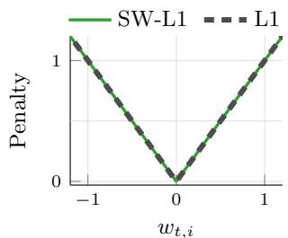  
(a) Previously inactive coordinate $( w _ { t - 1 , i } = 0 )$ SW-L1 and L1 coincide, so activation is equally penalized in either direction.

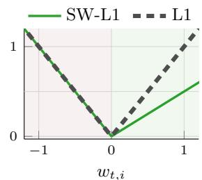  
(b) Previously positive coordinate $( w _ { t - 1 , i } > 0 )$ SW-L1 penalizes same-sign updates less than sign flips. Here $w _ { t - 1 , i } = \epsilon = 1$  
Figure 1: Coordinate-wise comparison of L1 and our sign-weighted L1 regularization.

Importantly, our proposed regularizer arises naturally at the predictor level when weighted L2 regularization is applied to the parameter space of a two-layer diagonal linear network (DLN; Woodworth et al. 2020). Its benefit goes beyond this connection to the sparsitybias literature: we show theoretically and empirically that this regularizer achieves a substantially better convergence rate and exhibits less forgetting than the direct L1 analogue.

## Specifically, our contributions are:

• We develop the first high-dimensional characterization of continual linear classification, deriving an analytic expression for the asymptotic performance of general regularized continual logistic regression.

• In a 1-layer setting (where simply $\hat { y } = \mathbf { w } ^ { \top } \mathbf { x } )$

– We derive the optimal L2 regularization strength and excess risk in continual linear classification in high dimensions. We show that the optimal strength scales with the task horizon T as T/ log T and the excess risk scales as log $T / T _ { : }$ , mirroring the linear regression case (Karpel et al., 2026).   
– For the direct L1 regularizer $\left\| \mathbf { w } - \mathbf { w } _ { t - 1 } \right\| _ { 1 }$ , we establish global convergence guarantees with nearlinear dependence on the sparsity factor s, namely s log  1 , but only polylogarithmic dependence on the task horizon T.

• In a two-layer DLN (where $\begin{array} { r } { \hat { y } = \sum _ { j } \theta _ { ( 1 ) , j } \theta _ { ( 2 ) , j } x _ { j } ) \colon } \end{array}$

– We design a weighting scheme for L2 regularization on the weight space that induces a sign weighted L1 regularizer the predictor space.

– We prove that the sign weighted regularizer attains a tight linear dependence on s.

• We empirically validate, using linear models and neural networks, that sign weighted L1 outperforms competing regularizers in the presence of sparsity.

## 2 SETTING: REGULARIZED CONTINUAL LOGISTIC REGRESSION

Continual classification tasks. In our setting, the learner recieves a sequence of T tasks $\begin{array} { r } { \{ ( \mathbf { X } _ { t } , \mathbf { y } _ { t } ) \} _ { t = 1 } ^ { T } , } \end{array}$ each having n samples. In each iteration t a learner is exposed to the samples from the current task $\left( \mathbf { X } _ { t } , \mathbf { y } _ { t } \right)$ with no access to data from previous tasks.

Statistical data model: Gaussian features and a noisy linear teacher. For each task $t ,$ datapoints are sampled i.i.d. from the Gaussian distribution, $i . e . ,$ $\{ \mathbf { x } _ { t , i } \} _ { i = 1 } ^ { n } \stackrel { \mathrm { i i d } } { \sim } \mathcal { N } ( \mathbf { 0 } _ { d } , d ^ { - 1 } \mathbf { I } )$ independently of all other tasks. Labels are drawn from a logistic model using a teacher vector $\mathbf { w } _ { \star } \in \mathbb { R } ^ { d }$ whose entries are sampled independently from a distribution Π, and a label-flip noise level of $\rho \in [ 0 , \frac { 1 } { 2 } )$ That is, for any task $t =$ $1 , \ldots , T$ and sample $i = 1 , \ldots , n$ , the label is drawn as

$$
\begin{array} { r l } & { \mathbb { P } ( y _ { t , i } = 1 \mid \mathbf { x } _ { t , i } ) = 1 - \mathbb { P } ( y _ { t , i } = 0 \mid \mathbf { x } _ { t , i } ) } \\ & { \qquad = \rho + ( 1 - 2 \rho ) \frac { e ^ { \mathbf { x } _ { t , i } ^ { \top } \mathbf { w } _ { \star } } } { 1 + e ^ { \mathbf { x } _ { t , i } ^ { \top } \mathbf { w } _ { \star } } } . } \end{array}\tag{1}
$$

This setting has been extensively studied in the deep learning theory literature (Salehi et al., 2019; Thrampoulidis et al., 2020; Gao et al., 2026).

Studied algorithm: Regularized continual logistic regression. To learn sequentially without forgetting, we follow a large body of continual learning works that penalize deviations from the previous predictor (Kirkpatrick et al., 2017; Schwarz et al., 2018; Zhao et al., 2024) using weighted L2 regularization. Extending the theoretical analysis of continual learning with weighted L2 regularization on linear predictors $( i . e . ,$ depth-one neural networks) to deep neural networks is nontrivial. We therefore consider a depth-h diagonal linear network (DLN), which is a popular (Woodworth et al., 2020; Nacson et al., 2022; Azulay et al., 2021) minimal model for the efect of depth, of the form

$$
\mathbf { w } ( \pmb { \theta } ) = \pmb { \theta } _ { ( 1 ) } \odot \cdots \odot \pmb { \theta } _ { ( h ) } ,
$$

where $\pmb \theta = \left\lceil \pmb \theta _ { ( 1 ) } , \cdot \cdot \cdot , \pmb \theta _ { ( h ) } \right\rceil \in \mathbb { R } ^ { d \times h }$ are the parameters of all the layers, ⊙ denotes component-wise product, and for an input x the predictor is $\hat { y } = \mathbf { w } ^ { \top } ( \pmb \theta ) \mathbf { x }$ . In this paper, we focus on two cases: $h = 1$ and $h = 2$

Specifically, the objective function incorporates an additive regularization term $f ( \pmb \theta , \pmb \theta _ { t - 1 } )$ to discourage deviations from the previously learned predictor.

Algorithm 1 Regularized Continual Logistic Regr.   
Input: $\overline { { \{ ( \mathbf { X } _ { t } , \mathbf { y } _ { t } ) \} _ { t = 1 } ^ { T } } }$ , regularization strength $\lambda > 0$   
Initialize $\pmb { \theta } _ { 0 } = \mathbf { 0 } _ { d }$   
For each iteration $t = 1 , \dots , T \colon$   
$\theta _ { t } = \underset { \pmb { \theta } \in \mathbb { R } ^ { d \times h } } { \operatorname { a r g m i n } } \frac { 1 } { n } \sum _ { i = 1 } ^ { n } \log \left( \frac { 1 + e ^ { \mathbf { x } _ { t , i } ^ { \top } \mathbf { w } ( \pmb { \theta } ) } } { e ^ { y _ { t , i } \mathbf { x } _ { t , i } ^ { \top } \mathbf { w } ( \pmb { \theta } ) } } \right) + \frac { \lambda } { d } f ( \pmb { \theta } , \pmb { \theta } _ { t - 1 } )$   
Output: $\pmb { \theta } _ { T }$

We consider regularizers that are convex in their first argument and decompose additively across coordinates. That is, there exists $\tilde { f } : \mathbb { R } \times \mathbb { R } \to \mathbb { R } _ { \geq 0 }$ such that,

$$
f ( \pmb \theta , \mathbf v ) = \sum _ { j = 1 } ^ { d } \widetilde f ( \pmb \theta _ { j } , v _ { j } ) \quad \mathrm { f o r \ a l l \ } \pmb \theta , \mathbf v \in \mathbb { R } ^ { d } .
$$

Notation. Throughout the paper, we write $\xrightarrow { d }$ for convergence in distribution, and define the softplus function by $\phi ( z ) = \log ( 1 { + } e ^ { z } )$ . We write $a _ { n } = \Theta _ { x } \left( b _ { n } \right)$ if there exist constants $0 < c _ { x } < C _ { x } < \infty .$ , depending only on $x ,$ such that $c _ { x } b _ { n } \leq a _ { n } \leq C _ { x } b _ { n }$ for all suficiently large n. Similarly, $a _ { n } = \mathcal { O } _ { x } \left( b _ { n } \right)$ and $a _ { n } \ = \ \Omega _ { x } \left( b _ { n } \right)$ denote the corresponding one-sided bounds. A function $f : \mathbb { R } ^ { d } $ R is called ξ homogeneous if $f ( \alpha \mathbf { w } ) = \alpha ^ { \xi } f ( \mathbf { w } )$ for every $\alpha \geq 0 .$ , and $\mathbf { w } \in \mathbb { R } ^ { d }$ . Its proximal operator is defined by

$$
\operatorname* { P r o x } _ { \boldsymbol { \lambda } f ( \cdot ) } ( \mathbf { y } ) = \underset { \mathbf { x } \in \mathbb { R } ^ { d } } { \operatorname { a r g m i n } } \frac { 1 } { 2 \lambda } \| \mathbf { y } - \mathbf { x } \| _ { 2 } ^ { 2 } + f ( \mathbf { x } ) .
$$

Loss metric. Following earlier theoretical work (Guo et al., 2017; Ovadia et al., 2019), we analyze the negative log-likelihood on an independent test sample, i.e.,

$$
\begin{array} { r } { \mathcal L ( \mathbf w ) \triangleq \underset { \mathbf x \sim \mathcal N ( \mathbf 0 , d ^ { - 1 } \mathbf I ) } { \mathbb { E } } \left[ \log \left( 1 + e ^ { \mathbf x ^ { \top } \mathbf w } \right) - \pi _ { \rho } ( \mathbf x ^ { \top } \mathbf w _ { \star } ) \mathbf x ^ { \top } \mathbf w \right] . } \end{array}
$$

where $\begin{array} { r } { \pi _ { \rho } ( u ) = \rho + ( 1 - 2 \rho ) \frac { e ^ { u } } { 1 + e ^ { u } } } \end{array}$ is the link function (1).

The nature of our analysis. In this paper, we study regularized continual learning in the high-dimensional regime, where $n , d \to \infty$ with $\textstyle { \frac { n } { d } } \to \delta > 0$ . Our main results characterize the performance of the predictors produced by Algorithm 1 under diferent choices of regularization, as a function of the task horizon $T ,$ noise level $\rho ,$ aspect ratio $\delta ,$ and signal strength $\nu \triangleq \frac { \| \mathbf { w } _ { \star } \| } { \sqrt { d } }$

For ease of presentation, throughout the paper we state simplified versions of our lemmas and theorems that capture the essence of the results, deferring the precise statements to the appendices.

## 3 SINGLE LAYER ANALYSIS

In this section we have a single layer $( h = 1 )$ , i.e., a simple linear model where $\mathbf { w } ( \pmb { \theta } ) = \pmb { \theta }$ . Thus, we simply denote $\mathbf { w } = \mathbf { w } ( \pmb { \theta } )$ for brevity.

## 3.1 High-Dimensional Characterization

In this section, we characterize the iterates of Algorithm 1 asymptotically as $n , d \to \infty$ with $n / d  \delta .$ Our result shows that each coordinate of the learned predictor behaves as a scalar proximal estimator applied to an efective signal corrupted by Gaussian noise. This general expression provides a foundation for studying specific regularization functions.

For each task $t ,$ let $\eta _ { t } , a _ { t } .$ , and $b _ { t }$ denote the efective regularization, signal, and noise parameters, respectively, given by the state evolution $\left( \operatorname { E q . } \ ( 9 ) \right)$ in App. C.1.

Simplified Theorem 1 (Asymptotic Performance). Under the statistical model (Section 2), suppose that the state-evolution system (9) in App. C.1 admits a unique solution $( \eta _ { t } , a _ { t } , b _ { t } )$ at each task $t \leq T$ . Then, in the proportional high-dimensional limit $n , d \to \infty$ after sequentially learning T tasks using Algorithm $^ { 1 , }$ the entries of w converge as follows,

$$
w _ { T , j } \stackrel { d } { \to } \mathrm { P r o x } _ { \eta _ { T } { \tilde { f } } ( \cdot , F _ { T - 1 } ) } ( a _ { T } w ^ { \star } + b _ { T } { \cal Z } ) ,
$$

where $w ^ { \star } \sim \Pi , F _ { T - 1 }$ are independent of $Z \sim { \mathcal { N } } ( 0 , 1 )$ ${ \bf F } _ { T - 1 }$ is history statistic (that may depend on previous tasks), and $F _ { T - 1 } \textit { i s }$ the limiting law of a uniformly sampled coordinate from ${ \bf F } _ { T - 1 }$

The precise version of Theorem 1 in App. C.1. Throughout the remainder of the paper, unless stated otherwise, we assume that the system in Eq. (9) admits a unique saddle point solution for every $t \leq T$

Next, we use our derived characterization to analyze common regularizers and their pitfalls, and to design a new regularizer that outperforms them under sparsity.

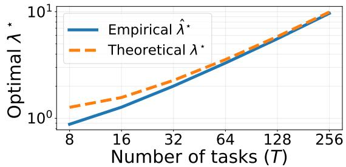  
(a) Optimal regularization strength grows as predicted by the full Theorem 2 (App. D.3). Theoretical $\lambda ^ { \star }$ is computed from Theorem 2. Empirical $\hat { \lambda } ^ { \star }$ is obtained by an exhaustive search (choosing $\textstyle { \delta \triangleq { \frac { n } { d } } = 2 ) }$

## 3.2 Isotropic L2 Regularization: Optimal Regularization Scaling Law

Following recent theoretical work (e.g., Levinstein et al., 2025; Karpel et al., 2026), we consider the L2 (isotropic) regularization, where

$$
f ( \mathbf { w } , \mathbf { w } _ { t - 1 } ) = \| \mathbf { w } - \mathbf { w } _ { t - 1 } \| _ { 2 } ^ { 2 } = \sum _ { j = 1 } ^ { d } ( w _ { j } - w _ { t - 1 , j } ) ^ { 2 } .\tag{2}
$$

In practice, Hsu et al. (2018); Lubana et al. (2022) find that this simple regularizer often performs similarly to more sophisticated L2 regularizers that, $e . g .$ , use Fisher information from previous tasks to weight deviations across coordinates (Kirkpatrick et al., 2017; Zenke et al., 2017; Aljundi et al., 2018; Benzing, 2022).

First, we derive an explicit asymptotic characterization of the optimal regularization strength, clarifying how it should scale with the number of learned tasks.

Simplified Theorem 2 (L2 regularization decays near-linearly in the task horizon T). In the proportional high-dimensional limit $n , d \to \infty$ , let $\lambda ^ { \star }$ denote the fixed regularization strength that minimizes the generalization loss after T tasks. Then, there exist constants $C = C ( \nu , \rho , \delta ) > 0$ and $\kappa = \kappa ( \nu , \rho ) > 0$ such that, for all $\epsilon > 0$ and $T > T _ { 0 } = \mathcal { O } ( 1 / \epsilon ^ { 2 } )$ , the optimal regularization strength is bounded as,

$$
( 1 - \epsilon ) \frac { \kappa T } { \log \left( C \kappa T \right) } < \lambda ^ { \star } < ( 1 + \epsilon ) \frac { \kappa T } { \log \left( C \kappa T \right) } .
$$

Moreover, under this strength scaling the excess risk decreases in T as,

$$
\mathcal { L } ( \mathbf { w } _ { T } ) - \operatorname* { i n f } _ { \mathbf { w } } \mathcal { L } ( \mathbf { w } ) = \operatorname* { \Theta } _ { \nu , \delta , \rho } \left( \frac { \log T } { T } \right) .
$$

In App. D.3, we prove Theorem 2 and give explicit expressions for $\kappa , C ,$ and the excess risk, making their dependence on $\nu , \delta , \rho$ explicit.

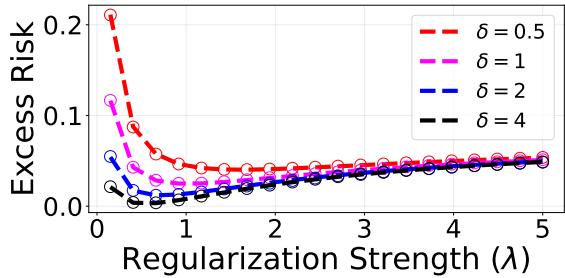  
(b) L2-regularized continual logistic regression over 10 tasks. Dashed lines delineate the theoretical risk from the full Theorem 1 (App. C.1). Circles show empirical results under diferent aspect ratios $\delta \triangleq { \frac { n } { d } }$  
Figure 2: Qualitative validation of Theorems 1 and 2. Empirical values are averaged over 100 runs.

Empirical validation on synthetic data. Figure 2 validates the predictions of Theorems 1 and 2 using finite-dimensional data. We set dimension $d = 5 0$ and noise level $\rho = 0 . 1$ , draw the teacher as $\mathbf { w } ^ { \star } \sim \mathcal { N } ( \mathbf { 1 } _ { d } , \mathbf { I } )$ ， and sample data points as $\{ \mathbf { x } _ { t , i } \} _ { i = 1 } ^ { n } \overset { \mathrm { i i d } } { \sim } \mathcal { N } ( \mathbf { 0 } , d ^ { - 1 } \mathbf { I } )$

Near-optimal convergence under L2. Interestingly, L2 is already near-optimal: under the optimal scaling of λ given in Theorem 2, the generalization error decays as $\log ( T ) / T$ . This is within a logarithmic factor of the lower bound $\Omega _ { \nu , \delta , \rho } \left( 1 / T \right) ^ { 1 }$ applicable to any learning algorithm as we establish in App. F.8.

Is L2 always the optimal choice? Across multiple tasks, L2 regularization does not take advantage of sparsity because it penalizes changes from the previous solution quadratically. It therefore spreads each update across many coordinates rather than exploit a sparse underlying predictor. In App. B, we empirically validate with synthetic data that across various sparsity levels the excess risk attained by regularizing with L2 remains approximately fixed (see Figure 4).

## 3.3 L1 Regularization Can Exploit Sparsity

This lack of sparsity adaptation motivates us to study sparsity-inducing regularizers that can better exploit a sparse teacher and thereby improve generalization.

In single-task learning, L1 regularization is one of the most common approaches to recover sparse solutions (Vaddireddy et al., 2020; Islam et al., 2024). Such regularization has played a significant rule in compressed sensing (Yin et al., 2008), MRI (Lustig et al., 2007), medical image reconstruction (Zhu et al., 2013), and biological image deconvolution (Ikoma et al., 2018).

A natural, yet underexplored, continual-learning analogue is to set, at iteration $t ,$

$$
f ( \mathbf { w } , \mathbf { w } _ { t - 1 } ) = \| \mathbf { w } - \mathbf { w } _ { t - 1 } \| _ { 1 } = \sum _ { j = 1 } ^ { d } \left| w _ { j } - w _ { t - 1 , j } \right| .\tag{3}
$$

To examine the potential sparsity advantage of this regularizer, we specialize the teacher distribution to a standard teacher prior. This lets us to explicitly track how the excess risk depends on the sparsity level.

Sparsity modeling. Following earlier works (Sun et al., 2022; Jantre et al., 2024; Kumar et al., 2025), we consider a sparse teacher prior. Specifically, we assume the entries of ${ \bf W } _ { \star }$ are drawn i.i.d. from a distribution,

$$
\Pi \left( w \right) = ( 1 - s ) \delta _ { 0 } ( w ) + s \mathcal { N } \left( w \mid 0 , \frac { \nu ^ { 2 } } { s } \right) ,\tag{4}
$$

where $s \in ( 0 , 1 )$ is the sparsity factor, $\mathcal { N } ( w \mid 0 , \sigma ^ { 2 } )$ is the density of the Gaussian distribution with zero mean and standard deviation $\sigma ,$ and $\delta _ { 0 } ( w )$ represents the Dirac delta at zero. Namely, each entry of $\mathbf { w } _ { \star }$ equals 0 with probability $1 - s .$ , while with probability s it is nonzero and follows a Gaussian distribution.

Finite-horizon sparsity gains under L1. We first consider a fixed, finite task horizon and show that L1 regularization exploits the sparsity of the solution. In this regime, the excess risk is governed by the number of active coordinates and vanishes at a rate of s log  1  as $s  0$ . Thus, even after finitely many tasks, L1 regularization can achieve small error by exploiting the underlying sparse structure.

Simplified Lemma 3 (L1 regularization achieves near– linear decay in the sparsity factor s). For every fixed task horizon $T \geq 1$ and every $s \leq s _ { 0 } = \Theta _ { \nu , \delta } \left( 1 \right)$ , the excess risk satisfies, for all $\lambda > 0$

$$
\mathcal { L } ( \mathbf { w } _ { T } ) - \operatorname* { i n f } _ { \mathbf { w } } \mathcal { L } ( \mathbf { w } ) = \underset { \nu , \delta , \rho } { \underbrace { \Omega } } \left( s \log \left( \frac { 1 } { s } \right) \right) .
$$

Moreover, there exists $\lambda = \Theta _ { \delta } \left( \sqrt { \log ( 1 / s ) + \log T } \right)$ such that

$$
\mathcal { L } ( \mathbf { w } _ { T } ) - \operatorname* { i n f } _ { \mathbf { w } } \mathcal { L } ( \mathbf { w } ) = \underset { \nu , \delta , \rho } { \mathcal { O } } \left( s \log \left( \frac { 1 } { s } \right) \right) .
$$

Limited long-horizon gains under L1. Lemma 3 clarifies that the excess risk vanishes as the teacher becomes sparse. However, this guarantee alone does not characterize the long-term behavior. Next, we show the (slow) convergence rate of the L1 regularizer, being almost logarithmic as the task horizon increases.

Simplified Lemma 4 (L1 regularization decays only poly-logarithmically in the task horizon $T )$ . For any fixed $s \leq s _ { 0 } = \Theta _ { \nu , \delta } \left( 1 \right)$ and every $\lambda > 0$

$$
\mathcal { L } ( \mathbf { w } _ { T } ) - \operatorname* { i n f } _ { \mathbf { w } } \mathcal { L } ( \mathbf { w } ) = \underset { \nu , \delta , \rho } { \Omega } \left( \frac { 1 } { \log ^ { 2 } T } \right) .
$$

Moreover, there exists $\lambda = \Theta _ { \nu , \delta } \left( \sqrt { \log T } \right)$ such that

$$
\mathcal { L } ( \mathbf { w } _ { T } ) - \operatorname* { i n f } _ { \mathbf { w } } \mathcal { L } ( \mathbf { w } ) = \mathcal { O } _ { \nu , \delta } \left( \frac { 1 } { \log T } \right) .
$$

The upper bounds in Lemmas 3 and 4 are proved in Appendices F.3 and F.4, respectively. The corresponding lower bound is proved in Appendix F.5. These appendices provide explicit choices of λ and retain the full dependence of the bounds on $\nu , \delta .$ In particular, we prove slightly stronger results, allowing the task horizon $T$ to grow while the sparsity factor s decreases at the same time, unlike the results presented here, which assume that one of these parameters is fixed.

## 4 TWO-LAYER ANALYSIS

In this section we use two diagonal layers $h = 2$ , inducing a linear model parameterized as

$$
\begin{array} { r } { \hat { \boldsymbol { y } } = \mathbf { w } ^ { \top } ( \pmb { \theta } ) \mathbf { x } = \left( \pmb { \theta } _ { ( 1 ) } \odot \pmb { \theta } _ { ( 2 ) } \right) ^ { \top } \mathbf { x } . } \end{array}
$$

## 4.1 From Parameter-Space L2 Regularization to Predictor-Space Sparsity

We aim to analyze the behavior of this model with L2 regularization on the parameters θ. To do so, we will first show that the dynamics of Algorithm 1 can be reduced to the dynamics of the same algorithm in a single layer, but with a diferent penalty f.

Our main tool for this would be the following proposition (which is a slight generalization of the result in Dai et al. (2021, Theorem 2), proved in App. F.7):

Proposition 5 (Weighted L2 equivalence for DLN). Denote by w(θ) the linear predictor induced by a depthh DLN parameterized by θ. Then, for any predictor $\mathbf { w } \in \mathbb { R } ^ { d }$ and weighting function $c ( \cdot , \cdot ) > 0 .$

$$
\operatorname* { m i n } _ { \theta \in \mathbb { R } ^ { d \times h } : } \frac { 1 } { h } \sum _ { j = 1 } ^ { d } c ( w _ { j } , \cdot ) \sum _ { \ell = 1 } ^ { h } | \theta _ { ( \ell ) , j } | ^ { 2 } = \sum _ { j = 1 } ^ { d } c ( w _ { j } , \cdot ) | w _ { j } | ^ { 2 / h } .
$$

Example 6 (Sparsity bias in L2-regularized DLNs). In a single-task setup, learning a two-layer DLN under a standard L2 penalty on the weights is equivalent to an L1 penalty on the predictor. That is, under common loss functions $\mathcal { L } ( \mathbf { w } ) \it \Psi ( e . g . \Psi )$ , the logistic loss), the following equivalence hold:

$$
\begin{array} { r } { \underset { \pmb { \theta } \in \mathbb { R } ^ { d \times h } } { \operatorname* { m i n } } \mathcal { L } ( \mathbf { w } ( \pmb { \theta } ) ) + \frac { \lambda } { 2 d } \left\| \pmb { \theta } \right\| _ { F } ^ { 2 } = \underset { \mathbf { w } \in \mathbb { R } ^ { d } } { \operatorname* { m i n } } \mathcal { L } ( \mathbf { w } ) + \frac { \lambda } { d } \left\| \mathbf { w } \right\| _ { 1 } . } \end{array}
$$

Such a sparsity bias can substantially improve generalization when the ground-truth predictor is sparse. For example, L1-regularized learning requires sample complexity only logarithmic in the dimension d, whereas L2 regularization generally retains linear dependence on d (Ng, 2004). Related sparsity-promoting biases have also been associated (Woodworth et al., 2020) with the “rich” (a.k.a. active) feature-learning regime of NNs, which can generalize beyond standard kernel methods (Dai et al., 2021; Parhi & Nowak, 2022). Sparsity bias may therefore be an important mechanism through which overparameterized models generalize well.

Can regularized CL also induce a sparsity bias? The analytical mechanism above does not extend to CL by simply centering the regularizer at previous-task parameters. Specifically, the proof of Proposition 5 relies on the homogeneity of the weighted L2 regularizer while $\left\| \mathbf { w } - \mathbf { w } _ { t - 1 } \right\| _ { 2 } ^ { 2 } \left( \mathrm { E q . ~ ( 2 ) } \right)$ is nonhomogeneous in w. Next, we overcome this by shifting the preservation of past expertise to a weighting function $c ( \cdot , \cdot )$

## 4.2 Sign Weighted L1 Regularization: From Rich-Regime Sparsity to Stable CL

We aim to induce a sparsity bias that is both practical for continual learning and readily analyzable using linear dynamics $( e . g . ,$ , with the high-dimensional characterization in Section 3.1). To this end, we employ the following weighted L2 regularizer:

$$
f ( \pmb \theta , \pmb \theta _ { t - 1 } ) = \frac { 1 } { 2 } \sum _ { j = 1 } ^ { d } c ( w _ { j } ( \pmb \theta ) , w _ { j } ( \pmb \theta _ { t - 1 } ) ) \sum _ { \ell = 1 } ^ { h } \theta _ { ( \ell ) , j } ^ { 2 } \ : ,
$$

choosing $\begin{array} { r } { c ( w _ { j } , w _ { t - 1 , j } ) = \frac { 1 } { [ \mathrm { s i g n } ( w _ { j } ) w _ { t - 1 , j } ] _ { + } + \epsilon } } \end{array}$ where $\epsilon > 0$ is a fixed constant.

Importantly, by Proposition 5, this regularizer, which acts in the DLN parameter space, induces a predictorspace sign weighted L1 regularization (SW-L1):

$$
f ( \mathbf { w } , \mathbf { w } _ { t - 1 } ) = \sum _ { i = 1 } ^ { d } \frac { | w _ { i } | } { [ \mathrm { s i g n } ( w _ { i } ) w _ { t - 1 , i } ] _ { + } + \epsilon } .\tag{5}
$$

Our sign weighted L1 regularizer $f$ is designed to satisfy two key properties.

A) Convexity and homogeneity in the first argument. We required convexity in Algorithm 1 to facilitate the high-dimensional characterization of Section 3.1. Homogeneity implies a lower bound on the excess risk, as we will show in Lemma 8.

B) Promotes sparse but stable continual learning. Common nonhomogeneous regularizers in CL $\left( { { e . g . , \left\| { \bf { w } - { w } _ { t - 1 } } \right\| } _ { 2 } ^ { 2 } } \right)$ aim to preserve past expertise by centering norms at previous iterates. In contrast, we encode this preservation through the weighting function $c ( w _ { j } , w _ { t - 1 , j } )$ while maintaining homogeneity. As illustrated in Figure 1a, this weighting promotes not only sparsity but also preservation of the coordinate-wise signs of the previous iterate.

Our results in this section show that sign weighted L1 regularization achieves the optimal convergence rate in sparsity factor s within the broader family of positively homogeneous regularizers. Proofs are in App. F.

Theorem 7 (SW-L1 decays linearly in the sparsity factor s). For any $s \leq s _ { 0 } = \Theta _ { \nu , \delta } \left( 1 \right)$ and any $\lambda = \lambda _ { 0 } >$ 0, set $\begin{array} { r } { \epsilon = \frac { \lambda _ { 0 } } { \sqrt { \frac { 2 } { \delta } \log \left( 6 4 / s \right) } } } \end{array}$ . Then, for every task $T \geq 2$

$$
\mathcal { L } ( \mathbf { w } _ { T } ) - \operatorname* { i n f } _ { \mathbf { w } } \mathcal { L } ( \mathbf { w } ) = \mathcal { O } _ { \nu , \delta } \left( s \right) .
$$

The rate above contrasts with L1 regularization which converges only as s log $\left( { \frac { 1 } { s } } \right)$ , as shown in Lemma 3. This also shows that the advantage of SW-L1 emerges only from the second task: at the first task, where $\mathbf { w } _ { 0 } = \mathbf { 0 }$ the sign-weighted penalty reduces to L1.

Under homogeneous weighting functions $c ( \cdot , \cdot )$ (like ours), the penalties induced by Proposition 5 are overall positively homogeneous as well. This class has an intrinsic limitation: regardless of how the weights are chosen, its excess risk does not vanish with the task horizon for a fixed sparsity level. This shows that the upper bound of Theorem 7 is $t i g h t ,$ and that sign weighted L1 is an optimal positively homogeneous regularizer.

Lemma 8 (Non-vanishing error for positively homogeneous regularizers). Under the statistical setting (Section 2). Assume that the regularizer is order $\xi > 0$ homogeneous. Then, for every $T \geq 1$ and $s \in ( 0 , 1 )$ ,

$$
\mathcal { L } ( \mathbf { w } _ { T } ) - \operatorname* { i n f } _ { \mathbf { w } } \mathcal { L } ( \mathbf { w } ) = \underset { \xi , \nu , \rho , \delta } { \Omega } \left( s \right) .
$$

## 5 EXPERIMENTS: SW-L1 BEST EXPLOITS SPARSITY

## 5.1 Setup

In this section, we empirically evaluate the performance of the three regularizers considered in our paper: L2, L1, and sign weighted L1 (Eqs. (2), (3) and (5), respectively). We consider three increasingly complex settings: logistic regression on synthetic Gaussian data, logistic regression on MNIST, and a two-layer ReLU network on MNIST. In each setting, a fixed sparse teacher generates binary labels with label-flip noise of $\rho = 0 . 1$ , and the student is updated sequentially. Performance is measured by the normalized loss $( L ( \mathbf { w } _ { t } ) - L _ { \mathrm { B a y e s } } ) / L _ { \mathrm { B a y e s } }$ , where $L _ { \mathrm { B a y e s } }$ denotes the entropy of the teacher-induced label distribution representing the irreducible minimum loss.

At each task, the student observes n = 1, 000 randomly selected samples and minimizes the regularized objective: using proximal FISTA for linear classification (Beck & Teboulle, 2009) and Adam for NNs (Kingma & Ba, 2015). Full implementation details are in App. A.

Linear classifier for Gaussian synthetic tasks. We consider data points sampled according to $\mathbf { x } _ { i } \sim$ ${ \mathcal { N } } ( \mathbf { 0 } , d ^ { - 1 } \mathbf { I } )$ with $d = 5 0 0$ . Also, the teacher’s components are sampled from the distribution, as specified in Eq. (4) with $\nu = 5$ . This experiment most closely matches our theoretical setting and provides direct empirical validation of our theoretical predictions.

Linear classifier for MNIST. We convert MNIST (LeCun et al., 1998) into a binary classification problem by partitioning digits into 0–4 versus 5–9. Each pixel is standardized using the training set statistics. The teacher is a sparse logistic model whose support follows a Fisher-based pixel ranking (Duda et al., 2000).

Two-layer ReLU for MNIST. We use the previously considered MNIST setting, with the student as a two-layer ReLU network with $m = 2 , 0 0 0$ neurons trained with Adam. The teacher is a sparse subset of a pretrained dense network, where the active neurons are selected by neuron contribution score. The sign weighted L1 regularizer is regularized by the equivalence established in Proposition 5.

## 5.2 Results

Figure 3 reports the held-out test loss after learning a sequence of T tasks across three sparsity levels. Curves are averaged over 5 seeds, with shaded regions indicating one standard deviation.

Across all settings, regularizer performance depends on teacher sparsity. With highly sparse teachers, L1 leverages sparsity and often beats L2, while SW-L1 provides even larger gain by reducing the loss rapidly and attaining the best performance. As sparsity decreases, this advantage becomes less pronounced, the L1 plateaus early, whereas L2 keeps improving and eventually reaches lower loss. Still, in the two linear model setups, SW-L1 converges quickly and remains better than L2 over the first tasks even at low sparsity.

## 6 RELATED WORK & DISCUSSION

We propose a sign weighted L1 regularizer that exploits sparsity, remains stable over long task horizons, and preserves sparsity bias in continual learning with two-layer diagonal linear networks. It converges substantially faster than existing regularizers, both theoretically and empirically. Below, we relate our results to prior work and discuss future directions.

CL theory beyond linear models. While a few theoretical works extend beyond linear models, their guarantees are limited to local convergence (Han et al., 2023; Schliserman et al., 2026) or neural networks in the lazy regime, where the model stays near its initialization (Bennani et al., 2020; Doan et al., 2021; Lee et al., 2021; Taheri et al., 2026). We contribute a complementary direction by exploiting implicit sparsity biases of deeper models through their induced regularization in predictor space. This allows us to derive global convergence guarantees in a statistical setting while capturing rich-regime feature learning and sparsity bias.

Graldi et al. (2025) study the impact of model scale and feature learning (lazy and rich regimes), for a model trained sequentially via gradient descent. However, their analysis is specific to these dynamics, whereas ours applies to general decomposable convex regularizers used in practice (e.g., Kirkpatrick et al., 2017).

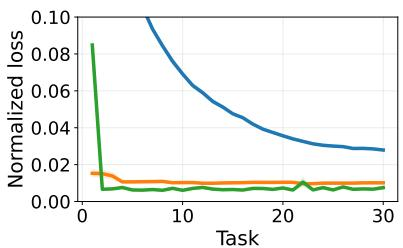  
(a) High sparsity $( s = 1 0 ^ { - 3 } )$

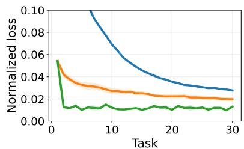  
(b) Medium sparsity $( s = 1 0 ^ { - 2 } )$

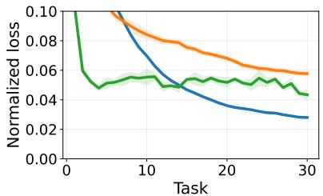  
(c) Low sparsity $( s = 1 0 ^ { - 1 } )$

(Setting I) Linear classifier for Gaussian synthetic tasks.  
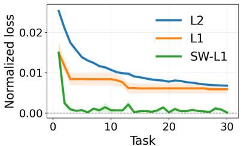  
(d) High sparsity $( s = 1 0 ^ { - 3 } )$

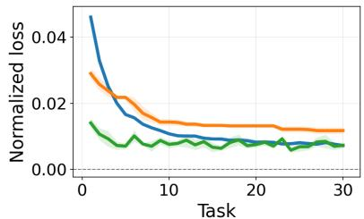  
(e) Medium sparsity $( s = 1 0 ^ { - 2 } )$

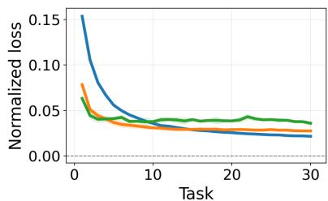  
(f) Low sparsity $( s = 1 0 ^ { - 1 } )$

(Setting II) Linear classifier for MNIST.  
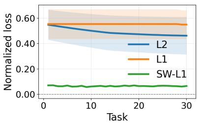  
(g) High sparsity $( s = 1 0 ^ { - 3 } )$

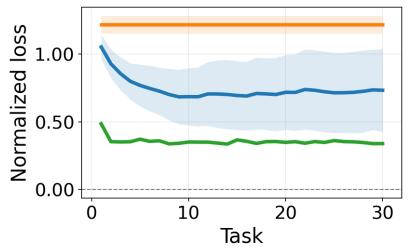  
(h) Medium sparsity $( s = 1 0 ^ { - 2 } )$

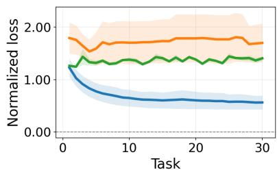  
(i) Low sparsity $( s = 1 0 ^ { - 1 } )$  
(Setting III) Two-layer ReLU for MNIST.

Figure 3: Efect of teacher sparsity across models and datasets. sign weighted L1 performs best at high teacher sparsity and remains competitive at moderate sparsity, while L2 becomes preferable as sparsity decreases.

L1 variants. Improving the performance of L1 regularization has been the focus of several works in the single-task setting. Examples include reweighted L1 regularization (Candes et al., 2008; Foucart & Lai, 2009; Daubechies et al., 2010; Zhao & Li, 2012), nonconcave penalties for variable selection (Fan & Li, 2001), the minimax concave penalty (Zhang, 2010), and, more recently, $\mathrm { L _ { 1 - 2 } }$ regularization (Hu et al., 2026).

Continual L2 regularization in linear settings. Several theoretical works have analyzed isotropic L2 regularization in continual learning (e.g., Li et al., 2023; Zhao et al., 2024; Levinstein et al., 2025; Karpel et al., 2026). However, these works consider the more analytically tractable continual linear regression setting, whereas ours is the first to rigorously characterize continual classification under diferent regularization types and strengths. Interestingly, our findings in Section 3.2 qualitatively mirror several results from the regression setting. For example, Karpel et al. (2026), whose statistical setup is closest to ours, also find that the optimal

L2 regularization strength scales nearly linearly with the number of tasks, consistent with Theorem 2. In a related setting, Karpel & Soudry (2026) find a similar inverse scaling law for the step size in a model trained continually using N gradient steps and step size γ. Levinstein et al. (2025) derive a near-optimal regularization strength scaling as ln(T); however, other choices may perform better, since their result optimizes a worst-case upper bound. Cai & Diakonikolas (2025) analyze a broader proximal framework, but require a cyclic ordering of tasks. We also note Evron et al. (2023), who analyze continual linear classification but require a regularization strength $\lambda  0$ , primarily yielding a theoretical proxy to unregularized settings.

Finally, concurrent work (Guo et al., 2026) studies sparse continual linear regression with an additional regularization matrix constructed from the empirical covariance matrix. Their (global) iterates are essen-

tially equivalent to

$$
\mathbf { w } _ { T } = \mathop { \operatorname { a r g m i n } } _ { \mathbf { w } } \left( \frac { 1 } { 2 n } \sum _ { m = 1 } ^ { T } \left. \mathbf { X } _ { m } \mathbf { w } - \mathbf { y } _ { m } \right. _ { 2 } ^ { 2 } + \lambda \left. \mathbf { w } \right. _ { 1 } \right) \ :
$$

$i . e . _ { \cdot }$ , their method balances the cumulative loss over all tasks seen so far against the L1 norm of the shared parameter vector. However, even for their linear setup, this method requires the storage and continual updating of $d ^ { 2 }$ parameters, which can limit practical scalability (Kirkpatrick et al., 2017; Schwarz et al., 2018; Karpel & Soudry, 2026). In contrast, we use a practical alternative that requires maintaining only two parameters and induces analyzable implicit biases beyond shallow linear models, specifically in diagonal linear networks.

Open directions. Several assumptions could be relaxed, $e . g .$ , by allowing multiple teachers, broader statistical feature models, or multiclass settings. A particularly interesting direction is to identify other implicit biases, potentially in deeper or more practical models, and use them to design improved weighting schemes. Such theory-guided designs could lead to better empirical continual regularization methods.

## References

Rahaf Aljundi, Francesca Babiloni, Mohamed Elhoseiny, Marcus Rohrbach, and Tinne Tuytelaars. Memory aware synapses: Learning what (not) to forget. In Proceedings of the European Conference on Computer Vision (ECCV), pp. 139–154, 2018.

Shahar Azulay, Edward Moroshko, Mor Shpigel Nacson, Blake Woodworth, Nathan Srebro, Amir Globerson, and Daniel Soudry. On the Implicit Bias of Initialization Shape: Beyond Infinitesimal Mirror Descent. In ICML, 2021.

Amir Beck and Marc Teboulle. A fast iterative shrinkage-thresholding algorithm for linear inverse problems. SIAM journal on imaging sciences, 2(1): 183–202, 2009.

Pierre C Bellec and Takuya Koriyama. Existence of solutions to the nonlinear equations characterizing the precise error of m-estimators. arXiv preprint arXiv:2312.13254, 2023.

Mehdi Abbana Bennani, Thang Doan, and Masashi Sugiyama. Generalisation guarantees for continual learning with orthogonal gradient descent. arXiv preprint arXiv:2006.11942, 2020.

Frederik Benzing. Unifying importance based regularisation methods for continual learning. In International Conference on Artificial Intelligence and Statistics, pp. 2372–2396. PMLR, 2022.

Xufeng Cai and Jelena Diakonikolas. Last iterate convergence of incremental methods as a model of forgetting. In The Thirteenth International Conference on Learning Representations, 2025.

Emmanuel J Candes, Michael B Wakin, and Stephen P Boyd. Enhancing sparsity by reweighted $\ell _ { 1 }$ minimization. Journal of Fourier analysis and applications, 14(5):877–905, 2008.

Zhen Dai, Mina Karzand, and Nathan Srebro. Representation costs of linear neural networks: Analysis and design. In M. Ranzato, A. Beygelzimer, Y. Dauphin, P.S. Liang, and J. Wortman Vaughan (eds.), Advances in Neural Information Processing Systems, volume 34, pp. 26884–26896. Curran Associates, Inc., 2021.

Ingrid Daubechies, Ronald DeVore, Massimo Fornasier, and C Sinan G¨unt¨urk. Iteratively reweighted least squares minimization for sparse recovery. Communications on Pure and Applied Mathematics: A Journal Issued by the Courant Institute of Mathematical Sciences, 63(1):1–38, 2010.

Thang Doan, Mehdi Abbana Bennani, Bogdan Mazoure, Guillaume Rabusseau, and Pierre Alquier. A theoretical analysis of catastrophic forgetting through the ntk overlap matrix. In Proceedings of The 24th International Conference on Artificial Intelligence and Statistics, pp. 1072–1080, 2021.

Shibhansh Dohare, J Fernando Hernandez-Garcia, Qingfeng Lan, Parash Rahman, A Rupam Mahmood, and Richard S Sutton. Loss of plasticity in deep continual learning. Nature, 632(8026):768–774, 2024.

Richard O. Duda, Peter E. Hart, and David G. Stork. Pattern Classification (2nd Edition). Wiley-Interscience, USA, 2000. ISBN 0471056693.

Itay Evron, Edward Moroshko, Gon Buzaglo, Maroun Khriesh, Badea Marjieh, Nathan Srebro, and Daniel Soudry. Continual learning in linear classification on separable data. In Proceedings of the 40th International Conference on Machine Learning, volume 202 of Proceedings of Machine Learning Research, pp. 9440–9484. PMLR, 23–29 Jul 2023.

Jianqing Fan and Runze Li. Variable selection via nonconcave penalized likelihood and its oracle properties. Journal of the American statistical Association, 96 (456):1348–1360, 2001.

Simon Foucart and Ming-Jun Lai. Sparsest solutions of underdetermined linear systems via ℓq-minimization for 0< q≤ 1. Applied and Computational Harmonic Analysis, 26(3):395–407, 2009.

Ziqi Gao, Yaotian Zhu, Qingcheng Zeng, Xu Zhao, Ziqing Wang, Feng Ruan, and Kaize Ding. Raptor: Ridge-adaptive logistic probes. arXiv preprint arXiv:2602.00158, 2026.

Jacopo Graldi, Alessandro Breccia, Giulia Lanzillotta, Thomas Hofmann, and Lorenzo Noci. The importance of being lazy: Scaling limits of continual learning. In Forty-second International Conference on Machine Learning, 2025.

Chuan Guo, Geof Pleiss, Yu Sun, and Kilian Q Weinberger. On calibration of modern neural networks. In International conference on machine learning, pp. 1321–1330. PMLR, 2017.

Jingyi Guo, Runze Li, and Lingzhou Xue. Scorepreserving continual lasso under task shift. arXiv preprint arXiv:2610.32708, 2026.

Seungyub Han, Yeongmo Kim, Taehyun Cho, and Jungwoo Lee. On the convergence of continual learning with adaptive methods. In Uncertainty in Artificial Intelligence, pp. 809–818. PMLR, 2023.

Yen-Chang Hsu, Yen-Cheng Liu, Anita Ramasamy, and Zsolt Kira. Re-evaluating continual learning scenarios: A categorization and case for strong baselines. In NeurIPS Continual learning Workshop, 2018.

Yaohua Hu, Hao Wang, and Xiaoqi Yang. ℓ1-2 regularization for sparse optimization: Consistency and global convergence. Mathematics of Operations Research, 2026.

Hayato Ikoma, Michael Broxton, Takamasa Kudo, and Gordon Wetzstein. A convex 3d deconvolution algorithm for low photon count fluorescence imaging. Scientific reports, 8(1):11489, 2018.

Raisa Islam, Subhasish Mazumdar, and Rakibul Islam. An experiment on feature selection using logistic regression. In 2024 5th information communication technologies conference (ICTC), pp. 319–324. IEEE, 2024.

Sanket Jantre, Shrijita Bhattacharya, and Tapabrata Maiti. Spike-and-slab shrinkage priors for structurally sparse bayesian neural networks. IEEE Transactions on Neural Networks and Learning Systems, 36(6):11176–11188, 2024.

Gilad Karpel and Daniel Soudry. Optimal explicit and implicit regularization strengths in highdimensional continual linear regression. arXiv preprint arXiv:2610.20804, 2026.

Gilad Karpel, Edward Moroshko, Ran Levinstein, Ron Meir, Daniel Soudry, and Itay Evron. Optimal l2 regularization in high-dimensional continual linear regression. In Proceedings of The 37th International Conference on Algorithmic Learning Theory, 2026.

Diederik P. Kingma and Jimmy Ba. Adam: A method for stochastic optimization. In International Conference on Learning Representations (ICLR), 2015.

James Kirkpatrick, Razvan Pascanu, Neil Rabinowitz, Joel Veness, Guillaume Desjardins, Andrei A Rusu,

Kieran Milan, John Quan, Tiago Ramalho, Agnieszka Grabska-Barwinska, et al. Overcoming catastrophic forgetting in neural networks. Proceedings of the national academy of sciences, 114(13):3521–3526, 2017.

Takuya Koriyama and Pierre C Bellec. Phase transitions for the existence of unregularized m-estimators in single index models. In Forty-second International Conference on Machine Learning, 2025.

Symantak Kumar, Purnamrita Sarkar, Kevin Tian, and Yusong Zhu. Spike-and-slab posterior sampling in high dimensions. In Proceedings of Thirty Eighth Conference on Learning Theory, volume 291 of Proceedings of Machine Learning Research, pp. 3407– 3462. PMLR, 2025.

Yann LeCun, L´eon Bottou, Yoshua Bengio, Patrick Hafner, et al. Gradient-based learning applied to document recognition. Proceedings of the IEEE, 86 (11):2278–2324, 1998.

Sebastian Lee, Sebastian Goldt, and Andrew Saxe. Continual learning in the teacher-student setup: Impact of task similarity. In International Conference on Machine Learning, pp. 6109–6119. PMLR, 2021.

Ran Levinstein, Amit Attia, Matan Schliserman, Uri Sherman, Daniel Soudry, Tomer Koren, and Itay Evron. Optimal rates in continual linear regression via increasing regularization. In The Thirty-ninth Annual Conference on Neural Information Processing Systems, 2025.

Haoran Li, Jingfeng Wu, and Vladimir Braverman. Fixed design analysis of regularization-based continual learning. In Sarath Chandar, Razvan Pascanu, Hanie Sedghi, and Doina Precup (eds.), Proceedings of The 2nd Conference on Lifelong Learning Agents, volume 232 of Proceedings of Machine Learning Research, pp. 513–533. PMLR, 22–25 Aug 2023.

Haoran Li, Jingfeng Wu, and Vladimir Braverman. Memory-statistics tradeof in continual learning with structural regularization. In The Fourteenth International Conference on Learning Representations, 2026.

Sen Lin, Peizhong Ju, Yingbin Liang, and Ness Shrof. Theory on forgetting and generalization of continual learning. In Proceedings of the 40th International Conference on Machine Learning, volume 202 of Proceedings of Machine Learning Research, pp. 21078–21100. PMLR, 23–29 Jul 2023.

David Lopez-Paz and Marc’Aurelio Ranzato. Gradient episodic memory for continual learning. Advances in neural information processing systems, 30:6467–6476, 2017.

Ekdeep Singh Lubana, Puja Trivedi, Danai Koutra, and Robert Dick. How do quadratic regularizers prevent

catastrophic forgetting: The role of interpolation. In Conference on Lifelong Learning Agents, pp. 819–837. PMLR, 2022.

Michael Lustig, David Donoho, and John M Pauly. Sparse mri: The application of compressed sensing for rapid mr imaging. Magnetic Resonance in Medicine: An Oficial Journal of the International Society for Magnetic Resonance in Medicine, 58(6): 1182–1195, 2007.

Michael McCloskey and Neal J Cohen. Catastrophic interference in connectionist networks: The sequential learning problem. In Psychology of learning and motivation, volume 24, pp. 109–165. Elsevier, 1989.

Mor Shpigel Nacson, Kavya Ravichandran, Nathan Srebro, and Daniel Soudry. Implicit bias of the step size in linear diagonal neural networks. In International Conference on Machine Learning, pp. 16270–16295. PMLR, 2022.

Behnam Neyshabur, Ryota Tomioka, and Nathan Srebro. In search of the real inductive bias: On the role of implicit regularization in deep learning. arXiv preprint arXiv:1412.6614, 2014.

Behnam Neyshabur, Ryota Tomioka, and Nathan Srebro. Norm-based capacity control in neural networks. In Conference on learning theory, pp. 1376–1401. PMLR, 2015.

Andrew Y Ng. Feature selection, l 1 vs. l 2 regularization, and rotational invariance. In Proceedings of the twenty-first international conference on Machine learning, pp. 78, 2004.

Greg Ongie, Rebecca Willett, Daniel Soudry, and Nathan Srebro. A function space view of bounded norm infinite width relu nets: The multivariate case. ICLR, 2020.

Yaniv Ovadia, Emily Fertig, Jie Ren, Zachary Nado, David Sculley, Sebastian Nowozin, Joshua Dillon, Balaji Lakshminarayanan, and Jasper Snoek. Can you trust your model’s uncertainty? evaluating predictive uncertainty under dataset shift. Advances in neural information processing systems, 32, 2019.

Rahul Parhi and Robert D Nowak. What kinds of functions do deep neural networks learn? insights from variational spline theory. SIAM Journal on Mathematics of Data Science, 4(2):464–489, 2022.

German I Parisi, Ronald Kemker, Jose L Part, Christopher Kanan, and Stefan Wermter. Continual lifelong learning with neural networks: A review. Neural Networks, 113:54–71, 2019.

Fariborz Salehi, Ehsan Abbasi, and Babak Hassibi. The impact of regularization on high-dimensional logistic regression. advances in neural information processing systems, 32, 2019.

Pedro Savarese, Itay Evron, Daniel Soudry, and Nathan Srebro. How do infinite width bounded norm networks look in function space? COLT, 2019.

Matan Schliserman, Gon Buzaglo, Itay Evron, and Daniel Soudry. Convergence of continual learning in homogeneous deep networks. In Proceedings of Thirty Ninth Conference on Learning Theory, volume 336 of Proceedings of Machine Learning Research, pp. 5743–5784. PMLR, 2026.

Jonathan Schwarz, Wojciech Czarnecki, Jelena Luketina, Agnieszka Grabska-Barwinska, Yee Whye Teh, Razvan Pascanu, and Raia Hadsell. Progress & compress: A scalable framework for continual learning. In Proceedings of the 35th International Conference on Machine Learning, pp. 4528–4537, 2018.

Haizhou Shi, Zihao Xu, Hengyi Wang, Weiyi Qin, Wenyuan Wang, Yibin Wang, Zifeng Wang, Sayna Ebrahimi, and Hao Wang. Continual learning of large language models: A comprehensive survey. ACM Computing Surveys, 58(5):1–42, 2025.

Yan Sun, Qifan Song, and Faming Liang. Learning sparse deep neural networks with a spike-and-slab prior. Statistics & Probability Letters, 180:109246, 2022. ISSN 0167-7152. doi: https://doi.org/10.1016/ j.spl.2021.109246.

Hossein Taheri, Avishek Ghosh, and Arya Mazumdar. On the theory of continual learning with gradient descent for neural networks. In Forty-third International Conference on Machine Learning, 2026.

Christos Thrampoulidis, Samet Oymak, and Babak Hassibi. Regularized linear regression: A precise analysis of the estimation error. In Conference on Learning Theory, pp. 1683–1709. PMLR, 2015.

Christos Thrampoulidis, Ehsan Abbasi, and Babak Hassibi. Precise error analysis of regularized m - estimators in high dimensions. IEEE Transactions on Information Theory, 64(8):5592–5628, 2018.

Christos Thrampoulidis, Samet Oymak, and Mahdi Soltanolkotabi. Theoretical insights into multiclass classification: A high-dimensional asymptotic view. Advances in Neural Information Processing Systems, 33:8907–8920, 2020.

Harsha Vaddireddy, Adil Rasheed, Anne E Staples, and Omer San. Feature engineering and symbolic regression methods for detecting hidden physics from sparse sensor observation data. Physics of Fluids, 32 (1), 2020.

Blake Woodworth, Suriya Gunasekar, Jason D Lee, Edward Moroshko, Pedro Savarese, Itay Golan, Daniel Soudry, and Nathan Srebro. Kernel and rich regimes in overparametrized models. In Conference on Learning Theory, pp. 3635–3673. PMLR, 2020.

Wotao Yin, Stanley Osher, Donald Goldfarb, and Jerome Darbon. Bregman iterative algorithms for $\ell _ { 1 } -$ minimization with applications to compressed sensing. SIAM Journal on Imaging sciences, 1(1):143– 168, 2008.

Friedemann Zenke, Ben Poole, and Surya Ganguli. Continual learning through synaptic intelligence. In International Conference on Machine Learning, pp. 3987–3995. PMLR, 2017.

Cun-Hui Zhang. Nearly unbiased variable selection under minimax concave penalty. The Annals of Statistics, 38(2):894 – 942, 2010. doi: 10.1214/09-AOS729.

Kaiqi Zhang and Yu-Xiang Wang. Deep learning meets nonparametric regression: Are weight-decayed DNNs locally adaptive? In The Eleventh International Conference on Learning Representations, 2023.

Xuyang Zhao, Huiyuan Wang, Weiran Huang, and Wei Lin. A statistical theory of regularization-based continual learning. In Forty-first International Conference on Machine Learning, 2024.

Yihan Zhao, Wenqing Su, and Ying Yang. Highdimensional asymptotics of generalization performance in continual ridge regression. arXiv preprint arXiv:2508.15494, 2025.

Yun-Bin Zhao and Duan Li. Reweighted ℓ - minimization for sparse solutions to underdetermined linear systems. SIAM Journal on Optimization, 22 (3):1065–1088, 2012.

Zangen Zhu, Khan Wahid, Paul Babyn, David Cooper, Isaac Pratt, and Yasmin Carter. Improved compressed sensing-based algorithm for sparse-view ct image reconstruction. Computational and mathematical methods in medicine, 2013(1):185750, 2013.

## Supplementary Materials: Experiments and Proofs

## A ADDITIONAL IMPLEMENTATION DETAILS FOR THE EXPERIMENTS

## A.1 Setup

All three experiments share the following design. A fixed sparse teacher generates binary labels at each task via a bit-flip model with noise parameter $\rho = 0 . 1$ . In the Gaussian and linear MNIST settings the teacher is a sparse linear model w⋆ and labels satisfy

$$
\mathbb { P } ( y = 1 \mid \mathbf { x } ) = \rho + ( 1 - 2 \rho ) \sigma ( \mathbf { x } ^ { \top } \mathbf { w } _ { \star } ) .\tag{6}
$$

In the ReLU MNIST setting the teacher is a sparse two-layer ReLU network $f _ { \theta ^ { \star } }$ ⋆ with k active neurons, and labels satisfy

$$
\mathbb { P } ( y = 1 \mid \mathbf { x } ) = \rho + ( 1 - 2 \rho ) \sigma \left( \sum _ { i = 1 } ^ { k } { w _ { 2 , i } ^ { \star } \mathrm { R e L U } ( \mathbf { w } _ { \star , 1 , i } ^ { \phantom { } } ^ { \top } \mathbf { x } ) } \right) .\tag{7}
$$

The student is initialized at zero (or from a random Guassian for the ReLU model) and never revisits past data. Hyperparameters $( \lambda , \epsilon )$ are selected by pooled validation NLL: the configuration minimizing the mean validation loss across all seeds at the final task is applied to every seed. For all experiments we find the optima hyperparameter λ using an exhaustive search. The test set is withheld until final reporting.

The three regularizers are:

$$
\mathrm { L 2 : } \quad \lambda | | { \bf w } - { \bf w } _ { t - 1 } | | _ { 2 } ^ { 2 } , \quad \mathrm { L 1 } ; \quad \lambda | | { \bf w } - { \bf w } _ { t - 1 } | | _ { 1 } , \quad \mathrm { s i g n ~ w e i g h t e d ~ L 1 } ; \quad \lambda \sum _ { i } \frac { | w _ { i } | } { [ \mathrm { s i g n } ( w _ { i } ) { w } _ { t - 1 , i } ] _ { + } + \epsilon } .
$$

## A.2 Gaussian Synthetic Experiment

Data. Date samples are drawn i.i.d. as $\mathbf { x } \sim \mathcal { N } ( \mathbf { 0 } , d ^ { - 1 } \mathbf { I } )$ . A fixed training pool of 50, 000 points is drawn once;   
validation and test sets each contain 5, 000 independent points.

Teacher. $\mathbf { w } _ { \star } \in \mathbb { R } ^ { d }$ has exactly k nonzero entries drawn using the spike-and-slab model as in Eq. (4) One teacher is used per sparsity level, shared across seeds.

Protocol. The dimension is d = 500, T = 30 tasks, n = 1, 000 samples per task, three seeds. Sparsity levels: $s \in \{ 0 . 0 0 1 , 0 . 0 1 , 0 . 1 \}$

Student optimizer. Proximal FISTA (Beck & Teboulle, 2009) with adaptive restart and backtracking line search. Step size initialized from a power-iteration estimate of the Lipschitz constant (40 iterations, 1.05× inflation). Up to 1, 000 iterations; early stopping when the normalized proximal-gradient residual falls below $1 0 ^ { - 6 }$

## A.3 Linear MNIST Experiment

Data. MNIST is binarized as $\{ 0 , \ldots , 4 \} \ \mathrm { v s } . \ \{ 5 , \ldots , 9 \} , \ d = 7 8 4$ . Pixels are standardized per-coordinate on the training split using the empirical mean and std (and divided by $\sqrt { d } )$ . Training pool consisting of 50, 000 images. Validation of 5, 000 images and Test with 10, 000 images.

Teacher. Pixels are ranked by a supervised Fisher score on all 60, 000 training images. For each sparsity level, the top-k pixels are extracted and a logistic teacher is refitted on the full training set.

More specifically, for each pixel coordinate $j \in \{ 1 , \dots , 7 8 4 \}$ , let $\begin{array} { r } { \mu _ { j , c } = \frac { 1 } { n _ { c } } \sum _ { i : y _ { i } = c } x _ { i j } } \end{array}$ and $\begin{array} { r } { \sigma { } _ { j , c } ^ { 2 } = { \frac { 1 } { n _ { c } } } \sum _ { i : y _ { i } = c } ( x _ { i j } - } \end{array}$ $\mu _ { j , c } ) ^ { 2 }$ denote the class-conditional mean and variance of coordinate $j$ for class $c \in \{ 0 , 1 \}$ , computed once on the full training set. The Fisher score of coordinate $j$ is then

$$
F _ { j } = \frac { ( \mu _ { j , 1 } - \mu _ { j , 0 } ) ^ { 2 } } { \sigma _ { j , 1 } ^ { 2 } + \sigma _ { j , 0 } ^ { 2 } } .\tag{8}
$$

We rank all 784 coordinates in descending order of $F _ { j }$ and retain the top $k = \lfloor s \cdot 7 8 4 \rceil$ coordinates from the teacher support.

Protocol. The dimension is $d = 2 8 \times 2 8 = 7 8 4$ with $T = 3 0$ tasks, n = 1, 000 samples per task, and three seeds. Sparsity levels: $s \in \{ 0 . 0 0 1 , 0 . 0 1 , 0 . 1 \}$

Student optimizer. Identical to the Gaussian experiment.

## A.4 Two-Layer ReLU MNIST Experiment

Data. Same binarized MNIST as the linear experiment. Pixels are standardized per-coordinate using the empirical mean and std.

Protocol. The dimension is $d = 2 8 \times 2 8 = 7 8 4$ with $T = 3 0$ tasks, n = 1, 000 samples per task, three seeds.   
Validation set: 2, 000 images (held out from the 10, 000 MNIST test images); test set: the remaining 8, 000.

Teacher. A two-layer ReLU network with $m = 2 , 0 0 0$ neurons, $\begin{array} { r } { f ( x ) = \sum _ { i } w _ { 2 , i } \mathrm { R e L U } ( \mathbf { w } _ { 1 , i } ^ { \top } x ) } \end{array}$ , is trained by Adam for 25 epochs (lr $1 0 ^ { - 3 }$ , weight decay $1 0 ^ { - 4 }$ , batch size 512) on the 50, 000 training images. Neurons are ranked by contribution score $| w _ { 2 , i } | \cdot \mathrm { s t d } ( \mathrm { R e L U } ( \mathbf { w } _ { 1 , i } ^ { \top } X ) )$ . For each sparsity level, the top-k neurons are retained and fine-tuned for 10 additional epochs; the remaining neurons are zeroed.

Sign weighted regularizer for ReLU. The sign weighted L1 penalty is applied in its weighted-L2 on the weights form. For neuron i the coeficient $\begin{array} { r } { c _ { i } = \frac { 1 } { [ \mathrm { s i g n } ( w _ { i } ^ { ( 2 ) } ) w _ { t - 1 , i } ^ { ( 2 ) } ] _ { + } + \epsilon } } \end{array}$ is computed with a stop-gradient on $\mathrm { s i g n } ( w _ { i } ^ { ( 2 ) } )$ consistent with treating $c _ { i }$ as fixed at the previous iterate, the penalty $\begin{array} { r } { \frac { 1 } { 2 } c _ { i } ( \| \mathbf { w } _ { 1 , i } \| ^ { 2 } + w _ { 2 , i } ^ { 2 } ) } \end{array}$ is added to the loss.

Student optimizer. Both layers trained jointly by Adam (lr $3 \times 1 0 ^ { - 3 }$ , batch size 256, 300 epochs per task). Student initialized with $w _ { 1 , i } \sim \mathcal { N } ( 0 , d ^ { - 1 } )$ ) and $w _ { 2 , i } \sim \mathcal { N } ( 0 , m ^ { - 1 } )$ ). Proximal step for $\mathrm { L 1 / L 2 }$ applied once per epoch (after all mini-batches).

## A.5 Summary Table

Table 1: Key parameters across the three experimental settings.
<table><tr><td></td><td>Gaussian</td><td>Linear MNIST</td><td>ReLU MNIST</td></tr><tr><td>Dimension d</td><td>500</td><td>784</td><td>784</td></tr><tr><td>Tasks T</td><td>30</td><td>30</td><td>30</td></tr><tr><td>Samples/task n</td><td>1,000</td><td>1,000</td><td>1,000</td></tr><tr><td>Training pool</td><td>50,000</td><td>50,000</td><td>50,000</td></tr><tr><td>Validation</td><td>5,000</td><td>5,000</td><td>2,000</td></tr><tr><td>Test</td><td>5,000</td><td>10,000</td><td>8,000</td></tr><tr><td>Seeds</td><td>3</td><td>3</td><td>3</td></tr><tr><td>Noise  $\rho$ </td><td>0.10</td><td>0.10</td><td>0.10</td></tr><tr><td>Student optimizer</td><td>FISTA</td><td>FISTA</td><td>Adam</td></tr></table>

## B L2 REGULARIZATION DOES NOT EXPLOIT SPARSITY

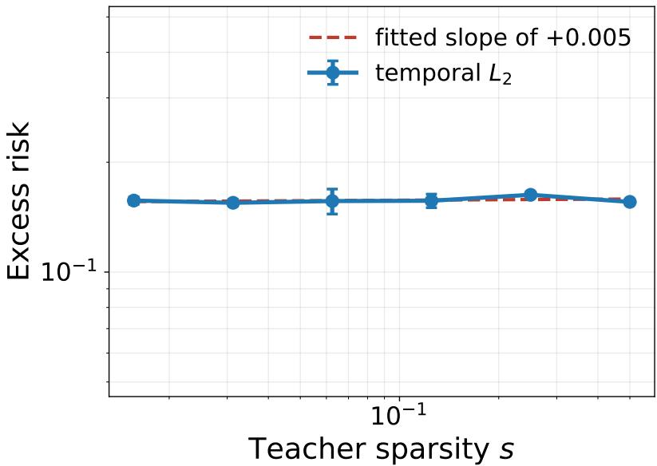  
Figure 4: Temporal L2 does not exploit sparsity of the teacher. Excess risk $\begin{array} { r } { \mathcal { L } ( \mathbf { w } _ { T } ) - \operatorname* { i n f } _ { \mathbf { w } } \mathcal { L } ( \mathbf { w } ) } \end{array}$ after $T = 8$ sequential tasks. The dimension $d = 2 5 6$ , the per-task sample size $n = 1 2 8$ (hence $\delta = n / d = 0 . 5 )$ , the horizon $T ,$ the noise level $\rho = 0$ and the signal strength $\nu = \| \mathbf { w } _ { \star } \| / \sqrt { d } = 0 . 2 5$ are all held fixed. Error bars are one standard error over 3 seeds. The dashed line is the least-squares fit on the log-log scale, with slope +0.005 $( R ^ { 2 } = 0 . 1 1 )$

Experimental setup. We work in the teacher–student setting of Algorithm 1. Features are drawn i.i.d. as $\mathbf { x } \sim \mathcal { N } ( \mathbf { 0 } , \mathbf { I } )$ with $d = 2 5 6$ . The teacher ${ \bf w } _ { \star }$ is k-sparse: a support of size $k = s \mathfrak { c }$ d is drawn uniformly at random, the entries on it are drawn from $\Pi = \mathcal { N } ( 0 , 1 )$ , and $\mathbf { w } _ { \star }$ is then rescaled so that $\nu = \| \mathbf { w } _ { \star } \| / \sqrt { d }$ equals a constant. Labels are generated by the teacher through the noisy logistic model described in Section 2 with label noise $\rho = 0$

The predictor is obtained from Algorithm 1. Each task is solved to convergence by full-batch Adam. We report the excess risk of the last predictor estimated on an independent test set of 8, 000 samples labeled by the same teacher, and $\operatorname { i n f } _ { \mathbf { w } } { \mathcal { L } } ( \mathbf { w } )$ is the corresponding Bayes risk, computed in closed form from the teacher logits. The regularization strength λ is selected for each method and each configuration separately, by minimizing the loss a the final task on a held-out validation set of 4, 000 samples labeled by the same teacher.

To isolate the efect of sparsity we sweep the teacher sparsity s while holding every other quantity of the problem fixed, and fit log $\begin{array} { r } { \left( \mathcal { L } ( \mathbf { w } _ { T } ) - \operatorname* { i n f } _ { \mathbf { w } } \mathcal { L } ( \mathbf { w } ) \right) \approx \beta \log s + \operatorname { c o n s t } } \end{array}$ . Figure 4 reports the outcome for temporal L2: the fitted slope is $\beta = + 0 . 0 0 5$ , and the excess risk stays within 0.155-0.163 across the entire range. This indicates that the L2 penalty does not exploit sparsity of the teacher.

## C PROOFS FOR SECTION 3.1

## C.1 CGMT proof for the bit-flip logistic teacher (general decomposable regularizer)

Full Theorem 1. Under the statistical model (Section 2), assume that the system (9) admits a unique solution $\left( { { \bar { \alpha } } _ { t } } , { { \bar { \sigma } } _ { t } } , { { \bar { r } } _ { t } } , { { \bar { \tau } } _ { t } } , { { \bar { \gamma } } _ { t } } , { { \bar { \theta } } _ { t } } \right)$ for every $t \leq T$ . Then as $n , d \to \infty$ , after learning $T$ tasks with Algorithm 1, for every locally Lipschitz function with at most quadratic growth $\Psi : \mathbb { R } ^ { 2 }  \mathbb { R } ^ { 2 }$ ，

$$
\frac { 1 } { d } \sum _ { j = 1 } ^ { d } \Psi ( w _ { T , j } , w _ { \star , j } ) \stackrel { \mathbb { P } } {  } \mathbb { E } [ \Psi ( \operatorname* { P r o x } _ { \eta _ { T } \tilde { f } ( \cdot , F _ { T - 1 } ) ) } ( a _ { T } w ^ { \star } + b _ { T } Z ) , w ^ { \star } ) ] ,
$$

where $F _ { T - 1 }$ and $w ^ { \star } \sim$ Π are independent of $Z \sim \mathcal { N } ( 0 , 1 ) , \mathbf { F } _ { t - 1 }$ is any coordinatewise state so that for $c > 0$ bounded away from $0 , M _ { \lambda \tilde { f } ( \cdot , F ) } ( x , c ) ^ { 3 }$ is continuous and satisfies $M _ { \lambda \tilde { f } ( \cdot , F ) } ( x , c ) \le C ( 1 + x ^ { 2 } + F ^ { 2 } )$ for $C > 0$ . Also, the past state has a deterministic empirical limit $\begin{array} { r } { i . e . , \ \frac { 1 } { d } \sum _ { i = 1 } ^ { d } \delta _ { ( w _ { \star , j } , F _ { t - 1 , j } ) } \stackrel { \mathbb P } { \to } \mu _ { t - 1 } } \end{array}$ in the 2-Wasserstein distance. Moreover, the saddle-point parameters satisfy for al $t \leq T$ the nonlinear system

$$
\{ \begin{array} { r l } & { \qquad \nu ^ { 2 } \alpha _ { t } = \mathbb { E } [ \nu ^ { \alpha } \mathrm { P r o x } _ { \lambda \sigma _ { t } \geq \tilde { r } \tilde { f } ( \cdot , R _ { t - 1 } ) } ( \sigma _ { t } \tau _ { t } ( \theta _ { t } w ^ { \star } + \frac { r _ { t } } { \sqrt { \delta } } Z ) ) ] , } \\ & { \qquad \gamma _ { t } = \frac { 1 } { r _ { t } \sqrt { \delta } } \mathbb { E } [ Z \mathrm { P r o x } _ { \lambda \sigma _ { t } \geq \tilde { r } \tilde { f } ( \cdot , R _ { t - 1 } ) } ( \sigma _ { t } \tau _ { t } ( \theta _ { t } w ^ { \star } + \frac { r _ { t } } { \sqrt { \delta } } Z ) ) ] , } \\ & { \qquad \nu ^ { 2 } \alpha _ { t } ^ { 2 } + \sigma _ { t } ^ { 2 } = \mathbb { E } [ \mathrm { P r o x } _ { \lambda \sigma _ { t } \geq \tilde { r } \tilde { f } ( \cdot , R _ { t - 1 } ) } ( \sigma _ { t } \tau _ { t } ( \theta _ { t } w ^ { \star } + \frac { r _ { t } } { \sqrt { \delta } } Z ) ) ^ { 2 } ] , } \\ & { \qquad \gamma _ { t } ^ { 2 } = \frac { 2 } { r _ { t } ^ { 2 } } \mathbb { E } [ ( 1 - \pi _ { \rho } ( \nu Z _ { 1 } ) ) ( \nu \alpha _ { t } Z _ { 1 } + \sigma _ { t } Z _ { 2 } - \mathrm { P r o x } _ { \gamma _ { t } \phi } ( \nu \alpha _ { t } Z _ { 1 } + \sigma _ { t } Z _ { 2 } ) ) ^ { 2 } ] , } \\ &  \qquad \gamma _ { t } \theta _ { t } = - 2 \mathbb { E } [ \frac  r _ { t } ^ { 2 } ( \nu _ { t } ^ { 2 } ( \nu _ { t } ) \mathrm { P r o x } _ { \lambda \sigma _ { t } } ( \nu \alpha _ { t } Z _ { 1 } + \sigma _ { t } Z _ { 2 } \ \end{array}\tag{9}
$$

Here $Z , Z _ { 1 } , Z _ { 2 } \stackrel { \mathrm { i i d } } { \sim } \mathcal { N } ( 0 , 1 )$ , and $\begin{array} { r } { \eta _ { t } = \lambda \bar { \sigma } _ { t } \bar { \tau } _ { t } , a _ { t } = \bar { \sigma } _ { t } \bar { \tau } _ { t } \bar { \theta } _ { t } , b _ { t } = \frac { \bar { \sigma } _ { t } \bar { \tau } _ { t } \bar { r } _ { t } } { \sqrt { \delta } } } \end{array}$

Remark 9 (About the uniqueness of the non-linear system (9)). Earlier CGMT (Thrampoulidis et al., 2015) analyses of regularized logistic regression, such as Salehi et al. (2019), assume uniqueness of the associated nonlinear system rather than prove it. However, through numerical evaluations they observed that a fixed-point iterative method converges to a stable solution (see their Remark 2). More recent work has established existence and uniqueness of analogous state-equation systems for broad classes of convex regularized M-estimators in linear models (Bellec & Koriyama, 2023), and for unregularized single-index models, including logistic regression, above some critical threshold $\delta _ { \infty }$ (Koriyama & Bellec, 2025). Although their results do not directly cover our regularized single-index setting, they provide further support for the plausibility of the uniqueness assumption.

Proof. The proof will consist of three main steps, as in Salehi et al. (2019) (see Appendix C)

1. We begin by expressing the optimization problem in bilinear form in order to apply CGMT and derive its corresponding auxiliary optimization problem.

2. We then simplify the auxiliary optimization problem. Characterizing the problem via a scalar optimization.

3. Finally, we solve the auxiliary optimization problem by deriving and solving the first-order optimality conditions.

We begin with characterizing the limiting performance of a specific iteration $t ,$ for ease of presentation we will omit the dependence on t and write ${ \bf X } _ { t } = { \bf X } , { \bf y } _ { t } = { \bf y }$ . The optimization problem is

$$
\widehat { \mathbf { w } } \in \underset { \mathbf { w } \in \mathbb { R } ^ { d } } { \mathrm { a r g m i n } } \frac { 1 } { n } \left[ \sum _ { i = 1 } ^ { n } \log \left( 1 + e ^ { \mathbf { x } _ { i } ^ { \top } \mathbf { w } } \right) - y _ { i } \mathbf { x } _ { i } ^ { \top } \mathbf { w } \right] + \frac { \lambda } { d } f ( \mathbf { w } )\tag{10}
$$

where $f$ is convex, and decomposable.

The optimization problem in Eq. (10) can be re-written as

$$
\widehat { \mathbf { w } } \in \mathop { \mathrm { a r g m i n } } _ { \mathbf { w } \in \mathbb { R } ^ { d } } \left\{ \frac { 1 } { n } \mathbf { 1 } ^ { \top } \phi ( \mathbf { X } \mathbf { w } ) - \frac { 1 } { n } \mathbf { y } ^ { \top } \mathbf { X } \mathbf { w } + \frac { \lambda } { d } f ( \mathbf { w } ) \right\} .\tag{11}
$$

Under the statistical model, $\mathbb { P } ( y _ { i } = 1 \mid x _ { i } ) = \rho + ( 1 - 2 \rho ) \sigma ( x _ { i } ^ { \top } \mathbf { w } _ { \star } )$ , with $\begin{array} { r } { \sigma ( x ) = \frac { 1 } { 1 + e ^ { - x } } } \end{array}$ hence $\mathbb { P } ( y _ { i } = 1 \mid x _ { i } ) =$ $\pi _ { \rho } ( \mathbf { x } _ { i } ^ { \top } \mathbf { w } _ { \star } )$ , where $\pi _ { \rho } ( g ) = \rho + ( 1 - 2 \rho ) \sigma ( g )$ . We therefore obtain the following identities,

$$
\pi _ { \rho } ( - g ) = 1 - \pi _ { \rho } ( g ) , \qquad \pi _ { \rho } ^ { \prime } ( g ) = ( 1 - 2 \rho ) \sigma ( g ) \sigma ( - g ) = ( 1 - 2 \rho ) \phi ^ { \prime \prime } ( g ) .\tag{12}
$$

Let

$$
\mathbf { H } = { \sqrt { d } } { \left[ \begin{array} { l } { - \mathbf { x } _ { 1 } ^ { \top } - } \\ { \vdots } \\ { - \mathbf { x } _ { n } ^ { \top } - } \end{array} \right] } \in \mathbb { R } ^ { n \times d } , \quad \delta = { \frac { n } { d } } .
$$

Then the entries of H are i.i.d. standard Gaussian and Eq. (11) is equivalent to

$$
\widehat { \mathbf { w } } \in \underset { \mathbf { w } \in \mathbb { R } ^ { d } } { \mathrm { a r g m i n } } \left. \frac { 1 } { n } \mathbf { 1 } ^ { \top } \phi \left( \frac { 1 } { \sqrt { d } } \mathbf { H } \mathbf { w } \right) - \frac { 1 } { n } \mathbf { y } ^ { \top } \frac { 1 } { \sqrt { d } } \mathbf { H } \mathbf { w } + \frac { \lambda } { d } f ( \mathbf { w } ) \right. .\tag{13}
$$

In order to apply the CGMT, we need a min-max optimization, so we introduce $\mathbf { u } \in \mathbb { R } ^ { n }$ and rewrite Eq. (13) as

$$
\operatorname* { m i n } _ { \mathbf { w } \in \mathbb { R } ^ { d } , \mathbf { u } \in \mathbb { R } ^ { n } } \frac { 1 } { n } \mathbf { 1 } ^ { \top } \boldsymbol { \phi } ( \mathbf { u } ) - \frac { 1 } { n } \mathbf { y } ^ { \top } \mathbf { u } + \frac { \lambda } { d } f ( \mathbf { w } ) \quad \mathrm { s . t . } \quad \mathbf { u } = \frac { 1 } { \sqrt { d } } \mathbf { H } \mathbf { w } .\tag{14}
$$

Introducing a Lagrange multiplier $\mathbf { v } \in \mathbb { R } ^ { n }$ gives us the desired min-max optimization,

$$
\operatorname* { m i n } _ { \mathbf { w } , \mathbf { u } } \operatorname* { m a x } _ { \mathbf { v } } \frac { 1 } { n } \mathbf { 1 } ^ { \top } \boldsymbol { \phi } ( \mathbf { u } ) - \frac { 1 } { n } \mathbf { y } ^ { \top } \mathbf { u } + \frac { \lambda } { d } f ( \mathbf { w } ) + \frac { 1 } { n } \mathbf { v } ^ { \top } \left( \mathbf { u } - \frac { 1 } { \sqrt { d } } \mathbf { H } \mathbf { w } \right) .\tag{15}
$$

Remark 10. To apply the CGMT, we would also need to restrict the optimization variables $\mathbf { w } , \mathbf { u } , \mathbf { v }$ to some compact and convex sets $S _ { \mathbf { w } } \subset \mathbb { R } ^ { d } , S _ { \mathbf { u } } \subset \mathbb { R } ^ { n } , S _ { \mathbf { v } } \subset \mathbb { R } ^ { n }$ , and perform the min–max optimization over these sets. These sets can be chosen to be arbitrary large and do not $a f f e c t$ the optimization phase. For simplicity, we suppress the dependence on $( S _ { \bf w } , S _ { \bf u } , S _ { \bf v } )$ from the notation.

Since $\tilde { \mathbf { y } }$ depends on H we can not directly apply CGMT. To deal with this problem we introduce $\begin{array} { r } { \mathbf { P } = \frac { \mathbf { w } _ { \star } \mathbf { w } _ { \star } ^ { \top } } { \| \mathbf { w } _ { \star } \| ^ { 2 } } } \end{array}$ , and $\mathbf { P } ^ { \perp } = \mathbf { I } _ { d } - \mathbf { P }$ . We can now decompose the matrix H to $\mathbf { H } = \mathbf { H } _ { 1 } + \mathbf { H } _ { 2 }$ where $\mathbf { H } _ { 1 } = \mathbf { H } \mathbf { P }$ , and $\mathbf { H } _ { 2 } = \mathbf { H } \mathbf { P } ^ { \perp }$ . Then the optimization becomes

$$
\operatorname* { m i n } _ { \mathbf { w } , \mathbf { u } } \operatorname* { m a x } _ { \mathbf { v } } \frac { 1 } { n } \mathbf { 1 } ^ { \top } \boldsymbol { \phi } ( \mathbf { u } ) - \frac { 1 } { n } \mathbf { y } ^ { \top } \mathbf { u } + \frac { \lambda } { d } f ( \mathbf { w } ) + \frac { 1 } { n } \mathbf { v } ^ { \top } \left( \mathbf { u } - \frac { 1 } { \sqrt { d } } \mathbf { H } _ { 1 } \mathbf { w } \right) - \frac { 1 } { n \sqrt { d } } \mathbf { v } ^ { \top } \mathbf { H } _ { 2 } \mathbf { w } .\tag{16}
$$

Since $\mathbf { P } \mathbf { w } _ { \star } = \mathbf { w } _ { \star }$ , we have

$$
{ \frac { 1 } { \sqrt { d } } } \mathbf { H } \mathbf { w } _ { \star } = { \frac { 1 } { \sqrt { d } } } \mathbf { H } _ { 1 } \mathbf { w } _ { \star } = { \frac { \| \mathbf { w } _ { \star } \| } { \sqrt { d } } } \mathbf { q } = \nu \mathbf { q } , \qquad \mathbf { q } \sim { \mathcal { N } } ( \mathbf { 0 } , \mathbf { I } _ { n } ) .
$$

Under our statistical model Section $2 , y _ { i } \mid q _ { i } \sim \mathrm { B e r } ( \pi _ { \rho } ( \nu q _ { i } ) )$ , where $\pi _ { \rho } ( g ) = \rho + ( 1 - 2 \rho ) \sigma ( g )$ . Hence $( \mathbf { y } , \mathbf { H } _ { 1 } )$ is independent of $\mathbf { H } _ { 2 }$ , so the CGMT applies. Since the optimization problem as well as the conditions of CGMT apply we write its corresponding auxiliary optimization problem

$$
\begin{array} { r } { \underset { { \mathbf { w } } , { \mathbf { u } } } { \mathop { \operatorname* { m i n } } } \underset { { \mathbf { v } } } { \mathop { \operatorname* { m a x } } } \frac { 1 } { n } { \mathbf { \bar { \mathbf { \Gamma } } } } \phi ( { \mathbf { u } } ) - \frac { 1 } { n } { \mathbf { y } } ^ { \top } { \mathbf { u } } + \frac { \lambda } { d } f ( { \mathbf { w } } ) + \frac { 1 } { n } { \mathbf { v } } ^ { \top } \left( { \mathbf { u } } - \frac { 1 } { \sqrt { d } } { \mathbf { H } } _ { 1 } { \mathbf { w } } \right) } \\ { - \frac { 1 } { n \sqrt { d } } \left( { \mathbf { v } } ^ { \top } { \mathbf { h } } \| { \mathbf { P } } ^ { \perp } { \mathbf { w } } \| + \| { \mathbf { v } } \| { \mathbf { g } } ^ { \top } { \mathbf { P } } ^ { \perp } { \mathbf { w } } \right) , } \end{array}
$$

where $\mathbf { g } \sim \mathcal { N } ( \mathbf { 0 } , \mathbf { I } _ { d } )$ and $\mathbf { h } \sim { \mathcal { N } } ( \mathbf { 0 } , \mathbf { I } _ { n } )$

We first maximize over v. For fixed (w, u) we have,

$$
\operatorname* { m a x } _ { \mathbf { v } } \frac { 1 } { n \sqrt { d } } \| \mathbf { v } \| \mathbf { g } ^ { \top } \mathbf { P } ^ { \perp } \mathbf { w } + \frac { 1 } { n } \mathbf { v } ^ { \top } \left( \mathbf { u } - \frac { 1 } { \sqrt { d } } \mathbf { H } _ { 1 } \mathbf { w } - \frac { \| \mathbf { P } ^ { \perp } \mathbf { w } \| } { \sqrt { d } } \mathbf { h } \right) .\tag{17}
$$

Let $\begin{array} { r } { r = { \frac { \| \mathbf { v } \| } { \sqrt { n } } } } \end{array}$ , maximizing the objective would yield a vector v with the same direction of the vector it multiplies, therefore Eq. (17) is equivalent to

$$
\operatorname* { m a x } _ { r \geq 0 } \frac { 1 } { n } \mathbf { 1 } ^ { \top } \boldsymbol { \phi } ( \mathbf { u } ) - \frac { 1 } { n } \mathbf { y } ^ { \top } \mathbf { u } + \frac { \lambda } { d } f ( \mathbf { w } ) + \frac { r } { \sqrt { n d } } \mathbf { g } ^ { \top } \mathbf { P } ^ { \bot } \mathbf { w } + r \left. \frac { \mathbf { u } } { \sqrt { n } } - \frac { 1 } { \sqrt { n d } } \mathbf { H } _ { 1 } \mathbf { w } - \frac { \Vert \mathbf { P } ^ { \bot } \mathbf { w } \Vert } { \sqrt { n d } } \mathbf { h } \right. .
$$

Since $\mathbf { H } _ { 1 } = \mathbf { H } \mathbf { P }$ , and writing $\begin{array} { r } { \alpha = \frac { \mathbf { w } ^ { \top } \mathbf { w } _ { \star } } { \| \mathbf { w } _ { \star } \| ^ { 2 } } , \sigma = \frac { \| \mathbf { P } ^ { \perp } \mathbf { w } \| } { \sqrt { d } } , \mathbf { q } = \frac { 1 } { \| \mathbf { w } _ { \star } \| } \mathbf { H } \mathbf { w } , } \end{array}$ ⋆, we have $\mathbf { q } \sim { \mathcal { N } } ( \mathbf { 0 } , \mathbf { I } _ { n } )$ and

$$
{ \frac { 1 } { \sqrt { d } } } \mathbf { H } ( \mathbf { P w } ) = { \frac { 1 } { \sqrt { d } } } \mathbf { H } ( \alpha \mathbf { w } _ { \star } ) = \alpha { \frac { \left\| \mathbf { w } _ { \star } \right\| } { \sqrt { d } } } \mathbf { q } = \nu \alpha \mathbf { q } ,
$$

with $\begin{array} { r } { \nu = \frac { \| \mathbf { w } _ { \star } \| } { \sqrt { d } } } \end{array}$ . Therefore the AO becomes

$$
\operatorname* { m i n } _ { \mathbf { w } , \mathbf { u } , \boldsymbol { \alpha } , \sigma } \operatorname* { m a x } _ { r \geq 0 } \frac { 1 } { n } \mathbf { 1 } ^ { \top } \boldsymbol { \phi } ( \mathbf { u } ) - \frac { 1 } { n } \mathbf { y } ^ { \top } \mathbf { u } + \frac { \lambda } { d } f ( \mathbf { w } ) + \frac { r } { \sqrt { n d } } \mathbf { g } ^ { \top } \mathbf { P } ^ { \perp } \mathbf { w } + r \left\| \frac { \mathbf { u } } { \sqrt { n } } - \frac { \nu \boldsymbol { \alpha } } { \sqrt { n } } \mathbf { q } - \frac { \sigma } { \sqrt { n } } \mathbf { h } \right\| .\tag{18}
$$

Finding the optimal direction of w is cumbersome due to the existence of $f ( \mathbf { w } )$ in the objective, therefore we now introduce $\pmb { \mu } , \mathbf { s } \in \mathbb { R } ^ { d }$ and rewrite the problem as

$$
\operatorname* { m i n } _ { \mathbf { w } , \mathbf { u } , \mu _ { \mathbf { s } } , r \geq 0 } \operatorname { m a x } _ { \mathbf { u } } \mathbf { 1 } _ { \mathbf { \Lambda } ^ { \top } \phi \left( \mathbf { u } \right) } ^ { \top } - \frac { 1 } { n } \mathbf { y } ^ { \top } \mathbf { u } + \frac { \lambda } { d } f ( \mu ) + \frac { r } { \sqrt { n d } } \mathbf { g } ^ { \top } \mathbf { P } ^ { \bot } \mathbf { w } + r \left\| \frac { \mathbf { u } } { \sqrt { n } } - \frac { \nu \alpha } { \sqrt { n } } \mathbf { q } - \frac { \sigma } { \sqrt { n } } \mathbf { h } \right\| + \frac { 1 } { d } \mathbf { s } ^ { \top } ( \mu - \mathbf { w } ) .\tag{19}
$$

We then use the same asymptotically-valid min–max flip where flipping the order of optimizations in $( \mathrm { A O } )$ is justified whenever such a flipping is allowed in the (PO) (see Appendix C.2 of Salehi et al. (2019)), and optimize first over the direction of $\mathbf { P } ^ { \perp } \mathbf { w }$ . This yields

$$
\begin{array} { r l } & { \displaystyle \underset { \mu , { \mathbf { u } } , \alpha , \sigma \geq 0 } { \operatorname* { m i n } } \operatorname* { m a x } _ { - 1 } { \mathbf { 1 } } ^ { \top } \boldsymbol { \phi } ( { \mathbf { u } } ) - \frac { 1 } { n } { \mathbf { y } } ^ { \top } { \mathbf { u } } + \frac { \lambda } { d } f ( \boldsymbol { \mu } ) - \sigma \left\| \frac { 1 } { \sqrt { d } } { \mathbf { P } } ^ { \bot } \left( \frac { r } { \sqrt { \delta } } { \mathbf { g } } - { \mathbf { s } } \right) \right\| } \\ & { \quad \quad \quad \quad \quad \quad + r \left\| \frac { { \mathbf { u } } } { \sqrt { n } } - \frac { \nu \alpha } { \sqrt { n } } { \mathbf { q } } - \frac { \sigma } { \sqrt { n } } { \mathbf { h } } \right\| + \frac { 1 } { d } ( { \mathbf { P } } { \mathbf { s } } ) ^ { \top } \boldsymbol { \mu } + \frac { 1 } { d } ( { \mathbf { P } } ^ { \bot } { \mathbf { s } } ) ^ { \top } \boldsymbol { \mu } - \frac { 1 } { d } ( { \mathbf { P } } { \mathbf { s } } ) ^ { \top } { \mathbf { w } } . } \end{array}
$$

Next, we introduce $\tau , \upsilon \geq 0$ to replace the norms by squared norms which simplifies the preceding analysis

$$
\begin{array} { r l } & { \displaystyle \operatorname* { m i n } _ { \mu , { \bf u } , { \boldsymbol { \alpha } } , { \boldsymbol { \sigma } } , v \geq 0 } \operatorname* { m a x } _ { { \bf s } , r , { \boldsymbol { \tau } } \geq 0 } n ^ { - 1 } \boldsymbol { \mathbf { \bar { \alpha } } } ^ { \top } \boldsymbol { \phi } ( { \bf u } ) - \frac { 1 } { n } { \bf y } ^ { \top } { \bf u } + \frac { \lambda } { d } f ( \mu ) - \frac { \sigma } { 2 \tau } - \frac { \sigma \tau } { 2 } \left\| \frac { 1 } { \sqrt { d } } { \bf P } ^ { \perp } \left( \frac { r } { \sqrt { \delta } } { \bf e } - { \bf s } \right) \right\| ^ { 2 } + \frac { r } { 2 \upsilon } } \\ & { \quad \quad \quad \quad \quad \quad \quad \quad + \frac { r v } { 2 } \left\| \frac { { \bf u } } { \sqrt { n } } - \frac { \nu \alpha } { \sqrt { n } } { \bf q } - \frac { \sigma } { \sqrt { n } } { \bf h } \right\| ^ { 2 } + \frac { 1 } { d } ( { \bf P s } ) ^ { \top } \mu + \frac { 1 } { d } ( { \bf P } ^ { \perp } { \bf s } ) ^ { \top } \mu - \frac { 1 } { d } ( { \bf P s } ) ^ { \top } { \bf w } . } \end{array}\tag{20}
$$

We now optimize over s. Using a completion of squares,

$$
\begin{array} { r l } & { \displaystyle - \frac { \sigma \tau } { 2 } \left\| \frac { 1 } { \sqrt { d } } \mathbf { P } ^ { \perp } \left( \frac { r } { \sqrt { \delta } } \mathbf { g } - \mathbf { s } \right) \right\| ^ { 2 } + \frac { 1 } { d } ( \mathbf { P } ^ { \perp } \mathbf { s } ) ^ { \top } \boldsymbol \mu } \\ & { \displaystyle = - \frac { \sigma \tau } { 2 } \left\| \frac { 1 } { \sqrt { d } } \mathbf { P } ^ { \perp } \left( \frac { r } { \sqrt { \delta } } \mathbf { g } - \mathbf { s } + \frac { 1 } { \sigma \tau } \boldsymbol \mu \right) \right\| ^ { 2 } \quad + \frac { 1 } { 2 d \sigma \tau } \left\| \mathbf { P } ^ { \perp } \boldsymbol { \mu } + \sigma \tau \frac { r } { \sqrt { \delta } } \mathbf { P } ^ { \perp } \mathbf { g } \right\| ^ { 2 } - \frac { \sigma \tau r ^ { 2 } } { 2 n } \| \mathbf { P } ^ { \perp } \mathbf { g } \| ^ { 2 } . } \end{array}
$$

Since $\mathbf { g } \sim \mathcal { N } ( \mathbf { 0 } , \mathbf { I } _ { d } )$ , we have $\begin{array} { r } { \frac { \sigma \tau r ^ { 2 } } { 2 n } \| \mathbf { P } ^ { \perp } \mathbf { g } \| ^ { 2 } \asymp \frac { \sigma \tau r ^ { 2 } } { 2 \delta } } \end{array}$ , and,

$$
\begin{array} { r l } & { \frac { 1 } { d } \left\| \mathbf { P } ^ { \perp } \boldsymbol { \mu } + \sigma \tau \frac { r } { \sqrt { \delta } } \mathbf { P } ^ { \perp } \mathbf { g } \right\| ^ { 2 } = \frac { 1 } { d } \left\| \mathbf { P } ^ { \perp } \left( \boldsymbol { \mu } + \sigma \tau \frac { r } { \sqrt { \delta } } \mathbf { g } \right) \right\| ^ { 2 } = \frac { 1 } { d } \left\| \boldsymbol { \mu } + \sigma \tau \frac { r } { \sqrt { \delta } } \mathbf { g } \right\| ^ { 2 } - \frac { 1 } { d } \left\| \mathbf { P } \left( \boldsymbol { \mu } + \sigma \tau \frac { r } { \sqrt { \delta } } \mathbf { g } \right) \right\| ^ { 2 } } \\ & { \phantom { \frac { 1 } { d } } = \frac { 1 } { d } \left\| \boldsymbol { \mu } + \sigma \tau \frac { r } { \sqrt { \delta } } \mathbf { g } \right\| ^ { 2 } - \frac { 1 } { d } \| \mathbf { P } \boldsymbol { \mu } \| ^ { 2 } - \frac { \sigma ^ { 2 } \tau ^ { 2 } r ^ { 2 } } { \delta d } \| \mathbf { P } \mathbf { g } \| ^ { 2 } - \frac { 2 \sigma \tau r } { \sqrt { \delta } d } ( \mathbf { P g } ) ^ { \top } \boldsymbol { \mu } . } \end{array}
$$

And as $d \to \infty , \ { \frac { 1 } { d } } \| \mathbf { P g } \| ^ { 2 } \to 0$ and $ { \frac { 1 } { d } } (  { \mathbf { P g } } ) ^ { \top } \boldsymbol { \mu } \to 0$ almost surely. Since $\mathbf { P } \pmb { \mu }$ is constrained by $\begin{array} { r } { \frac { 1 } { d } \mathbf { w } _ { \star } ^ { \top } \pmb { \mu } = \alpha \nu ^ { 2 } } \end{array}$ , it follows that $\scriptstyle { \frac { 1 } { d } } \| \mathbf { P } \mu \| ^ { 2 } = \nu ^ { 2 } \alpha ^ { 2 }$ . Therefore Eq. (20) reduces asymptotically to

$$
\begin{array} { r l } & { \displaystyle \operatorname* { m i n } _ { \mu , { \bf u } , { \bf \tilde { \alpha } } , \sigma , v \geq 0 } \displaystyle \operatorname* { m a x } _ { r , \tau \geq 0 } { \bf 1 } ^ { - 1 } \phi ( { \bf u } ) - \frac { 1 } { n } { \bf y } ^ { \top } { \bf u } - \frac { \sigma } { 2 \tau } - \frac { \sigma \tau r ^ { 2 } } { 2 \delta } + \frac { r } { 2 v } - \frac { \nu ^ { 2 } \alpha ^ { 2 } } { 2 \sigma \tau } + \frac { r v } { 2 } \left\| \frac { { \bf u } } { \sqrt { n } } - \frac { \nu \alpha } { \sqrt { n } } { \bf q } - \frac { \sigma } { \sqrt { n } } { \bf h } \right\| ^ { 2 } } \\ & { \quad \quad \quad \quad \quad \quad \quad \quad \quad \quad \quad \quad + \displaystyle \frac { 1 } { 2 d \sigma \tau } \left\| \mu + \sigma \tau \frac { r } { \sqrt { \delta } } { \bf g } \right\| ^ { 2 } + \frac { \lambda } { d } f ( \mu ) \quad \mathrm { s . t . ~ } \frac { 1 } { d } { \bf w } ^ { \star \top } \mu = \alpha \nu ^ { 2 } . } \end{array}\tag{21}
$$

(22)

We now optimize over $\pmb { \mu }$ and attain the following optimization problem,

$$
\operatorname* { m i n } _ { \mu \in \mathbb { R } ^ { d } } \operatorname* { m a x } _ { \theta \in \mathbb { R } } \frac { 1 } { 2 d \sigma \tau } \left\| \mu + \sigma \tau \frac { r } { \sqrt { \delta } } \mathbf { g } \right\| ^ { 2 } + \frac { \lambda } { d } f ( \mu ) \quad \mathrm { s . t . ~ } \frac { 1 } { d } \mathbf { w } _ { \star } \top \mu = \alpha \nu ^ { 2 } .
$$

Introducing a Lagrange multiplier $\theta \in \mathbb { R }$ for the linear constraint, we obtain

$$
\operatorname* { m i n } _ { \mu \in \mathbb { R } ^ { d } } \operatorname* { m a x } _ { \theta \in \mathbb { R } } \frac { 1 } { 2 d \sigma \tau } \left\| \mu + \sigma \tau \frac { r } { \sqrt { \delta } } \mathbf { g } \right\| ^ { 2 } + \frac { \lambda } { d } f ( \mu ) - \frac { \theta } { d } \mathbf { w } _ { \star } ^ { \top } \pmb { \mu } + \alpha \theta \nu ^ { 2 } .\tag{23}
$$

Completing the square,

$$
\frac { 1 } { 2 d \sigma \tau } \left\| \mu + \sigma \tau \frac { r } { \sqrt { \delta } } \mathbf { g } \right\| ^ { 2 } - \frac { \theta } { d } \mathbf { w } _ { \star } ^ { \top } \boldsymbol { \mu } = \frac { 1 } { 2 d \sigma \tau } \left\| \mu + \sigma \tau \frac { r } { \sqrt { \delta } } \mathbf { g } - \sigma \tau \theta \mathbf { w } _ { \star } \right\| ^ { 2 } - \frac { \sigma \tau \theta ^ { 2 } \nu _ { d } ^ { 2 } } { 2 } .
$$

where we omitted the term $\begin{array} { r } { \frac { 1 } { d } \mathbf { g } ^ { \top } \mathbf { w } , } \end{array}$ ⋆ since $\begin{array} { r } { \frac { 1 } { d } \mathbf { g } ^ { \top } \mathbf { w } _ { \star }  0 } \end{array}$ almost surely. Hence the µ-minimization is

$$
\operatorname* { m a x } _ { \theta \in \mathbb { R } } \left\{ \frac { 1 } { d } M _ { \lambda f ( \cdot , \mathbf { F } _ { t - 1 } ) } \left( \sigma \tau \left( \frac { r } { \sqrt { \delta } } \mathbf { g } + \theta \mathbf { w } _ { \star } \right) , \sigma \tau \right) + \alpha \theta \nu ^ { 2 } - \frac { \sigma \tau \theta ^ { 2 } \nu ^ { 2 } } { 2 } \right\} .
$$

Substituting this into Eq. (22), we arrive at

$$
\begin{array} { r } { \displaystyle \underset { \mathbf { u } , \boldsymbol { \alpha } , \boldsymbol { \sigma } , \boldsymbol { v } \geq 0 } { \operatorname* { m i n } } \displaystyle \sum _ { \boldsymbol { r } , \boldsymbol { \tau } \geq 0 , \boldsymbol { \theta } \in \mathbb { R } } \mathbf { 1 } ^ { \top } \boldsymbol { \phi } ( \mathbf { u } ) - \frac { 1 } { n } \mathbf { y } ^ { \top } \mathbf { u } + \frac { r v } { 2 } \left\| \frac { \mathbf { u } } { \sqrt { n } } - \frac { \nu \alpha } { \sqrt { n } } \mathbf { q } - \frac { \boldsymbol { \sigma } } { \sqrt { n } } \mathbf { h } \right\| ^ { 2 } - \frac { \boldsymbol { \sigma } } { 2 \tau } - \frac { \sigma \tau r ^ { 2 } } { 2 \delta } + \frac { r } { 2 v } } \\ { - \displaystyle \frac { \nu ^ { 2 } \alpha ^ { 2 } } { 2 \sigma \tau } + \nu ^ { 2 } \alpha \boldsymbol { \theta } - \frac { \nu ^ { 2 } \sigma \tau \boldsymbol { \theta } ^ { 2 } } { 2 } + \frac { 1 } { d } M _ { \lambda f ( \cdot , \mathbf { F } _ { t - 1 } ) } \left( \sigma \tau \left( \frac { r } { \sqrt { \delta } } \mathbf { g } + \boldsymbol { \theta } \mathbf { w } _ { \star } \right) , \boldsymbol { \sigma \tau } \right) . } \end{array}\tag{24}
$$

We next optimize over u. Consider the u-dependent term

$$
\frac { 1 } { n } { \bf 1 } ^ { \top } \phi ( { \bf u } ) - \frac { 1 } { n } { \bf y } ^ { \top } { \bf u } + \frac { r v } { 2 } \left\| \frac { { \bf u } } { \sqrt { n } } - \frac { \nu \alpha } { \sqrt { n } } { \bf q } - \frac { \sigma } { \sqrt { n } } { \bf h } \right\| ^ { 2 } .
$$

Completing the square gives

$$
\begin{array} { r l } & { - \frac { 1 } { n } { \bf y } ^ { \top } { \bf u } + \frac { r v } { 2 } \left\| \frac { { \bf u } } { \sqrt { n } } - \frac { \nu \alpha } { \sqrt { n } } { \bf q } - \frac { \sigma } { \sqrt { n } } { \bf h } \right\| ^ { 2 } = \frac { r v } { 2 } \left\| \frac { { \bf u } } { \sqrt { n } } - \frac { \nu \alpha } { \sqrt { n } } { \bf q } - \frac { \sigma } { \sqrt { n } } { \bf h } - \frac { 1 } { r v \sqrt { n } } { \bf y } \right\| ^ { 2 } } \\ & { \phantom { \frac { 1 } { \sqrt { n } } } - \frac { 1 } { 2 r v } \frac { \| { \bf y } \| ^ { 2 } } { n } - \nu \alpha \frac { { \bf y } ^ { \top } { \bf q } } { n } - \sigma \frac { { \bf y } ^ { \top } { \bf h } } { n } . } \end{array}
$$

Using, $y _ { i } \mid q _ { i } \sim \operatorname { B e r } ( \pi _ { \rho } ( \nu q _ { i } ) )$ . Therefore

$$
{ \frac { 1 } { n } } \| \mathbf { y } \| ^ { 2 } = { \frac { 1 } { n } } \sum _ { i = 1 } ^ { n } y _ { i } \ { \xrightarrow { \mathrm { a . s . } } } \mathbb { E } [ \pi _ { \rho } ( \nu Z ) ] = { \frac { 1 } { 2 } } ,
$$

using $\pi _ { \rho } ( - t ) = 1 - \pi _ { \rho } ( t )$ , and

$$
{ \frac { 1 } { n } } \mathbf { y } ^ { \top } \mathbf { q } = { \frac { 1 } { n } } \sum _ { i = 1 } ^ { n } y _ { i } q _ { i } \ { \xrightarrow { \mathrm { a . s . } } } \mathbb { E } [ Z \pi _ { \rho } ( \nu Z ) ] = \nu \mathbb { E } [ \pi _ { \rho } ^ { \prime } ( \nu Z ) ] ,
$$

by Stein’s lemma. Also, $\frac { 1 } { n } { \bf y } ^ { \top } { \bf h } \stackrel { \mathbb { P } } {  } 0$ . Thus the u-optimization is asymptotically equivalent to

$$
\frac { 1 } { n } M _ { \phi } \left( \nu \alpha \mathbf { q } + \sigma \mathbf { h } + \frac { 1 } { r v } \mathbf { y } , \frac { 1 } { r v } \right) - \frac { 1 } { 4 r v } - \nu ^ { 2 } \alpha \mathbb { E } [ \pi _ { \rho } ^ { \prime } ( \nu Z ) ] .
$$

Hence Eq. (24) becomes

$$
\begin{array} { r l } & { \displaystyle \operatorname* { m i n } _ { \alpha , \sigma , v \geq 0 } \displaystyle \operatorname* { m a x } _ { r \geq 0 , \theta \in \mathbb { R } } - \frac { \sigma } { 2 \tau } - \frac { \sigma \tau r ^ { 2 } } { 2 \delta } + \frac { r } { 2 v } - \frac { \nu ^ { 2 } \alpha ^ { 2 } } { 2 \sigma \tau } + \nu ^ { 2 } \alpha \theta - \frac { \nu ^ { 2 } \sigma \tau \theta ^ { 2 } } { 2 } - \frac { 1 } { 4 r v } - \nu ^ { 2 } \alpha \mathbb { E } [ \pi _ { \rho } ^ { \prime } ( \nu Z ) ] } \\ & { \quad \quad \quad \quad \quad \quad \quad \quad \quad \quad \quad \quad \quad \quad \quad \quad \quad + \displaystyle \frac { 1 } { d } M _ { \lambda f ( \cdot , \mathbf { F } _ { t - 1 } ) } \left( \sigma \tau \left( \frac { r } { \sqrt { \delta } } \mathbf { g } + \theta \mathbf { w } _ { \star } \right) , \sigma \tau \right) + \frac { 1 } { n } M _ { \phi } \left( \nu \alpha \mathbf { q } + \sigma \mathbf { h } + \frac { 1 } { r v } \mathbf { y } , \frac { 1 } { r v } \right) . } \end{array}\tag{25}
$$

Since the regularizer is coordinatewise decomposable,

$$
\frac { 1 } { d } M _ { \lambda f ( \cdot , \mathbf { F } _ { t - 1 } ) } \left( \sigma \tau \left( \frac { r } { \sqrt { \delta } } \mathbf { g } + \theta \mathbf { w } _ { \star } \right) , \sigma \tau \right) = \frac { 1 } { d } \sum _ { j = 1 } ^ { d } M _ { \lambda \widetilde { f } ( \cdot , F _ { t - 1 , j } ) } \left( \sigma \tau \left( \frac { r } { \sqrt { \delta } } g _ { j } + \theta w _ { \star , j } \right) , \sigma \tau \right) .
$$

Let $\Xi : \mathbb { R } ^ { 3 } \to \mathbb { R }$ be locally Lipschitz and have at most quadratic growth, so that

$$
| \Xi ( u , w , F ) | \le C _ { \Xi } ( 1 + u ^ { 2 } + w ^ { 2 } + F ^ { 2 } ) .
$$

We first show the continuity and growth properties of the proximal operator that will be used later. Fix a compact parameter set $\zeta = ( \sigma , \tau , \theta , r ) \in K$ on which $\sigma \tau$ is bounded away from zero. By the Moreau-envelope identity,

$$
\nabla _ { x } M _ { \lambda \widetilde { f } ( \cdot , F ) } ( x , c ) = \frac { 1 } { c } \left( x - \mathrm { P r o x } _ { \lambda c \widetilde { f } ( \cdot , F ) } ( x ) \right) .
$$

For c bounded away from zero, these gradients are uniformly Lipschitz in x. Because,

$$
\begin{array} { r l } & { \left| \left( x - \operatorname* { P r o x } _ { \lambda \in \tilde { f } ( \cdot , F ) } ( x ) \right) - \left( y - \operatorname* { P r o x } _ { \lambda \in \tilde { f } ( \cdot , F ) } ( y ) \right) \right| ^ { 2 } } \\ & { \leq \left| x - y \right| ^ { 2 } + \left| \operatorname* { P r o x } _ { \lambda \in \tilde { f } ( \cdot , F ) } ( x ) - \operatorname* { P r o x } _ { \lambda \in \tilde { f } ( \cdot , F ) } ( y ) \right| ^ { 2 } - 2 \left( \operatorname* { P r o x } _ { \lambda \in \tilde { f } ( \cdot , F ) } ( x ) - \operatorname* { P r o x } _ { \lambda \in \tilde { f } ( \cdot , F ) } ( y ) \right) ( x - y ) \leq \left| x - y \right| ^ { 2 } . } \end{array}
$$

from the firm non-expansiveness of proximal operator. Hence

$$
\begin{array} { l } { \displaystyle \left. ( x - \mathrm { P r o x } _ { \lambda c \widetilde { f } ( \cdot , F ) } ( x ) ) - ( y - \mathrm { P r o x } _ { \lambda c \widetilde { f } ( \cdot , F ) } ( y ) ) \right. \le | x - y | , } \\ { \displaystyle \left. \nabla _ { x } { \cal M } _ { \lambda \widetilde { f } ( \cdot , F ) } ( x , c ) - \nabla _ { x } { \cal M } _ { \lambda \widetilde { f } ( \cdot , F ) } ( y , c ) \right. \le \frac { 1 } { c } | x - y | . } \end{array}
$$

On compact sets, using $\begin{array} { r } { \left| \nabla _ { x } M ( x , z ) - \frac { M ( x + h , z ) - M ( x , z ) } { h } \right| \le \frac { 1 } { h } \int _ { 0 } ^ { h } | \nabla _ { x } M ( x , z ) - \nabla _ { x } M ( x + t , z ) | \mathrm { d } t \le \frac { h } { 2 c _ { \mathrm { m i n } } } } \end{array}$ . Let $( x _ { n } , z _ { n } ) \to ( x , z )$ . For fixed $h ,$ joint continuity of M gives $\begin{array} { r } { \frac { M ( x + h , z _ { n } ) - M ( x , z _ { n } ) } { h } \longrightarrow \frac { M ( x + h , z ) - M ( x , z ) } { h } } \end{array}$ , together with the uniform Lipschitz of the Moreau gradient which handles $x _ { n } \to x$ imply joint continuity of its gradient. Also the proximal map is jointly continuity when restricted to compact set $K$ by the Moreau envelope identity.

By the direct definition of the Moreau envelope $\begin{array} { r } { M _ { \lambda \widetilde { f } ( \cdot , \upsilon ) } ( x , \tau ) = \operatorname* { m i n } _ { y } \left\{ \lambda \widetilde { f } ( y , \upsilon ) + \frac { 1 } { 2 \tau } ( y - x ) ^ { 2 } \right\} } \end{array}$ , non negativity of fe also gives,

$$
\frac { 1 } { 2 \sigma \tau } \left| \operatorname* { P r o x } _ { \lambda \sigma \tau \bar { f } ( \cdot , F ) } \left( \sigma \tau \left( \theta w + \frac { r } { \sqrt { \delta } } z \right) \right) - \sigma \tau \left( \theta w + \frac { r } { \sqrt { \delta } } z \right) \right| ^ { 2 } \leq M _ { \lambda \bar { f } ( \cdot , F ) } \left( \sigma \tau \left( \theta w + \frac { r } { \sqrt { \delta } } z \right) , \sigma \tau \right) .
$$

The quadratic-growth bound on the Moreau envelope and compactness of K therefore imply,

$$
\operatorname* { s u p } _ { \zeta \in K } \left| \operatorname* { P r o x } _ { \lambda \sigma \tau \widetilde f ( \cdot , F ) } \left( \sigma \tau \left( \theta w + \frac { r } { \sqrt { \delta } } z \right) \right) \right| \leq C _ { K } ( 1 + | w | + | F | + | z | ) .
$$

Consequently,

$$
\operatorname* { s u p } _ { \zeta \in K } \left. \Xi \left( \operatorname* { P r o x } _ { \substack { \lambda \sigma \tau \widetilde { f } ( \cdot , F ) } } \left( \sigma \tau \left( \theta w + \frac { r } { \sqrt { \delta } } z \right) \right) , w , F \right) \right. \le C _ { K , \Xi } ( 1 + w ^ { 2 } + F ^ { 2 } + z ^ { 2 } ) .
$$

We now freeze the scalar parameters at $\bar { \zeta } _ { t } = ( \bar { \sigma } _ { t } , \bar { \tau } _ { t } , \bar { r } _ { t } , \bar { \theta } _ { t } )$ . Conditionally on the teacher and the first $t - 1$ tasks, the pairs $( w _ { \star , j } , F _ { t - 1 , j } )$ are fixed, while $Z _ { 1 } , \ldots , Z _ { d }$ are independent standard Gaussians. Therefore, the random variables $\Xi \left( y , w _ { \star , j } , F _ { t - 1 , j } \right) - \mathbb { E } _ { Z } \left[ \Xi \left( y , w _ { \star , j } , F _ { t - 1 , j } \right) \right]$ with $\begin{array} { r } { y = \mathrm { P r o x } _ { \lambda \bar { \sigma } _ { t } \bar { \tau } _ { t } \widetilde { f } ( \cdot , F _ { t - 1 , j } ) } \left( \bar { \sigma } _ { t } \bar { \tau } _ { t } \left( \bar { \theta } _ { t } w _ { \star , j } + \frac { \bar { r } _ { t } } { \sqrt { \delta } } Z _ { j } \right) \right) } \end{array}$ are conditionally independent and centered.

We split the domain to two regimes, when $( w , F , Z )$ norm is bounded by some R and when its norm is larger than R. Let $\chi _ { R } : \mathbb { R } ^ { 3 }  [ 0 , 1 ]$ be the indicator function that equals 1 when $w ^ { 2 } + F ^ { 2 } + z ^ { 2 } \leq R ^ { 2 }$ and 0 when $w ^ { 2 } + F ^ { 2 } + z ^ { 2 } > R ^ { 2 }$ . Conditionally on the teacher and the first $t - 1$ tasks, the centered summands

$$
\chi _ { R } ( w _ { \star , j } , F _ { t - 1 , j } , Z _ { j } ) \Xi ( y , w _ { \star , j } , F _ { t - 1 , j } ) - \mathbb { E } _ { Z } \left[ \chi _ { R } ( w _ { \star , j } , F _ { t - 1 , j } , Z ) \Xi ( y , w _ { \star , j } , F _ { t - 1 , j } ) \right]
$$

are independent and have conditional mean zero. The map

$$
( w , F , z ) \longmapsto \Xi \left( \operatorname { P r o x } _ { \lambda \bar { \sigma } _ { t } \bar { \tau } _ { t } \tilde { f } ( \cdot , F ) } \left( \bar { \sigma } _ { t } \bar { \tau } _ { t } \left( \bar { \theta } _ { t } w + \frac { \bar { r } _ { t } } { \sqrt { \delta } } z \right) \right) , w , F \right)
$$

is continuous, as it is implied by the local lipschitzness. It is therefore bounded on the compact set where $\{ ( w , F , z ) : w ^ { 2 } + F ^ { 2 } + z ^ { 2 } \leq R ^ { 2 } \}$ . In particular, there is a constant $B _ { R } < \infty$ such that

$$
\left. \chi _ { R } ( w , F , z ) \Xi \left( \mathrm { P r o x } _ { \lambda \bar { \sigma } _ { t } \bar { \tau } _ { t } \widetilde { f } ( \cdot , F ) } \left( \bar { \sigma } _ { t } \bar { \tau } _ { t } \left( \bar { \theta } _ { t } w + \frac { \bar { r } _ { t } } { \sqrt { \delta } } z \right) \right) , w , F \right) \right. \le B _ { R } .
$$

Consequently, conditionally on $\left( \mathbf { w } _ { \star } , \mathbf { F } _ { t - 1 } \right)$ , the variance of each term is at most $B _ { R } ^ { 2 } ,$ , since $\operatorname { V a r } ( X ) \leq \mathbb { E } [ X ^ { 2 } ]$ and its absolute value is at most $B _ { R }$ . Subtracting its conditional expectation does not change its variance.

The centered terms are conditionally independent because each depends only on the corresponding independent Gaussian variable $Z _ { j }$ . Therefore, the variance of their average is the sum of their variances divided by $d ^ { 2 }$ , and hence is bounded by $\begin{array} { r } { \frac { 1 } { d ^ { 2 } } \sum _ { j = 1 } ^ { d } B _ { R } ^ { 2 } = \frac { B _ { R } ^ { 2 } } { d } \longrightarrow 0 } \end{array}$ . Conditional Chebyshev’s inequality then implies that the empirical average of the centered terms converges to zero in probability.

Outside this region, when $w ^ { 2 } + F ^ { 2 } + z ^ { 2 } > R ^ { 2 }$ we use the bound

$$
\left. \Xi \left( \operatorname * { P r o x } _ { \lambda \bar { \sigma } _ { t } \bar { \tau } _ { t } \bar { f } ( \cdot , F ) } \left( \bar { \sigma } _ { t } \bar { \tau } _ { t } \left( \bar { \theta } _ { t } w + \frac { \bar { r } _ { t } } { \sqrt { \delta } } z \right) \right) , w , F \right) \right. \leq C ( 1 + w ^ { 2 } + F ^ { 2 } + z ^ { 2 } ) .
$$

Indeed, $\mathbb { E } \left[ ( 1 + Z ^ { 2 } ) \mathbf { 1 } _ { \left\{ | Z | > R \right\} } \right] = 2 R \varphi ( R ) + 4 \Phi ( - R ) \longrightarrow 0$ , and the assumed 2-Wasserstein distance convergence of the empirical state distribution implies, for every $\epsilon > 0$

$$
\operatorname* { l i m } _ { R \to \infty } \operatorname* { l i m } _ { d \to \infty } \mathbb { P } \left( \frac { 1 } { d } { \sum _ { j = 1 } ^ { d } } ( 1 + { w _ { \star , j } } ^ { 2 } + F _ { t - 1 , j } ^ { 2 } ) \mathbf { 1 } _ { \{ w _ { \star , j } } ^ { 2 } + F _ { t - 1 , j } ^ { 2 } > R ^ { 2 } \}  > \epsilon \right) = 0 .\tag{26}
$$

Since it follows from $w ^ { 2 } + F ^ { 2 } + Z ^ { 2 } > R ^ { 2 }$ that $\begin{array} { r } { w ^ { 2 } + F ^ { 2 } > \frac { R ^ { 2 } } { 2 } } \end{array}$ or $\begin{array} { r } { Z ^ { 2 } > \frac { R ^ { 2 } } { 2 } } \end{array}$

$$
( 1 + w ^ { 2 } + F ^ { 2 } + Z ^ { 2 } ) \mathbf { 1 } _ { \{ w ^ { 2 } + F ^ { 2 } + Z ^ { 2 } > R ^ { 2 } \} } \leq ( 1 + w ^ { 2 } + F ^ { 2 } + Z ^ { 2 } ) \mathbf { 1 } _ { \{ w ^ { 2 } + F ^ { 2 } > \frac { R ^ { 2 } } { 2 } \} } + ( 1 + w ^ { 2 } + F ^ { 2 } + Z ^ { 2 } ) \mathbf { 1 } _ { \{ Z ^ { 2 } > \frac { R ^ { 2 } } { 2 } \} } .
$$

The first term is controlled by the 2-Wasserstein tail bound, and the second by the Gaussian tail together with uniform boundedness of the empirical second moments and $\begin{array} { r } { \mathbb { P } ( Z ^ { 2 } > \frac { R ^ { 2 } } { 2 } )  0 } \end{array}$ . It follows that,

$$
\frac { 1 } { d } \sum _ { j = 1 } ^ { d } \{ \Xi ( \mathrm { P r o x } _ { \lambda \bar { \sigma } _ { t } \bar { \tau } _ { t } \tilde { f } ( \cdot , F _ { t - 1 , j } ) } ( \bar { \sigma } _ { t } \bar { \tau } _ { t } ( \bar { \theta } _ { t } w _ { \star , j } + \frac { \bar { r } _ { t } } { \sqrt { \delta } } Z _ { j } ) ) , w _ { \star , j } , F _ { t - 1 , j } ) - 1 \} _ { \theta _ { t } \bar { \tau } _ { t } ( \frac { \bar { \tau } _ { t } } { \bar { \tau } _ { t } } ) } \} _ { \lambda ^ { \prime } = \frac { 1 } { \sqrt { \delta } } \mathcal { O } _ { t } ^ { 2 } } ,\tag{27}
$$

$$
\begin{array} { r } { \mathbb { E } _ { Z } \left[ \Xi \left( \operatorname { P r o x } _ { \lambda \bar { \sigma } _ { t } \bar { \tau } _ { t } \tilde { f } ( \cdot , F _ { t - 1 , j } ) } \left( \bar { \sigma } _ { t } \bar { \tau } _ { t } \left( \bar { \theta } _ { t } w _ { \star , j } + \frac { \bar { r } _ { t } } { \sqrt { \delta } } Z \right) \right) , w _ { \star , j } , F _ { t - 1 , j } \right) \right] \Bigg \} \xrightarrow { \mathbb { P } } 0 . } \end{array}
$$

Next, for each fixed z the map $\begin{array} { r } { ( w , F ) \longmapsto \Xi \left( \operatorname* { P r o x } _ { \lambda \bar { \sigma } _ { t } \bar { \tau } _ { t } \widetilde { f } ( \cdot , F ) } \left( \bar { \sigma } _ { t } \bar { \tau } _ { t } \left( \bar { \theta } _ { t } w + \frac { \bar { r } _ { t } } { \sqrt { \delta } } z \right) \right) , w , F \right) } \end{array}$ is jointly continuous by the joint continuity of the proximal map and continuity of Ξ, this also shows that,

$$
\left( w , F \right) \longmapsto \mathbb { E } _ { Z } \left[ \Xi \left( \operatorname* { P r o x } _ { \lambda \bar { \sigma } _ { t } \bar { \tau } _ { t } \tilde { f } ( \cdot , F ) } \left( \bar { \sigma } _ { t } \bar { \tau } _ { t } \left( \bar { \theta } _ { t } w + \frac { \bar { r } _ { t } } { \sqrt { \delta } } Z \right) \right) , w , F \right) \right]
$$

is continuous. Indeed, for every series $( w _ { n } , F _ { n } )  ( w , F )$ we have (as $\forall n : \| ( w _ { n } , F _ { n } ) \| < R$ because it converges),

$$
\left. \Xi \left( \operatorname { P r o x } _ { \lambda \bar { \sigma } _ { t } \bar { \tau } _ { t } \tilde { f } ( \cdot , F _ { n } ) } \left( \bar { \sigma } _ { t } \bar { \tau } _ { t } \left( \bar { \theta } _ { t } w _ { n } + \frac { \bar { r } _ { t } } { \sqrt { \delta } } z \right) \right) , w _ { n } , F _ { n } \right) \right. \leq C _ { R } \left( 1 + z ^ { 2 } \right) .
$$

Thus $C _ { R } ( 1 + z ^ { 2 } )$ is integrable with $z \sim \mathcal { N } ( 0 , 1 )$ , and dominated convergence yields convergence of the expectations. The same bound gives

$$
\begin{array} { r l } & { \left. \mathbb { E } _ { Z } \left[ \Xi \left( \operatorname* { P r o x } _ { \lambda \bar { \sigma } _ { t } \bar { \tau } _ { t } \tilde { f } ( \cdot , F ) } \left( \bar { \sigma } _ { t } \bar { \tau } _ { t } \left( \bar { \theta } _ { t } w + \frac { \bar { r } _ { t } } { \sqrt { \delta } } Z \right) \right) , w , F \right) \right] \right. } \\ & { \leq \mathbb { E } _ { Z } \left[ \left. \Xi \left( \operatorname* { P r o x } _ { \lambda \bar { \sigma } _ { t } \bar { \tau } _ { t } \tilde { f } ( \cdot , F ) } \left( \bar { \sigma } _ { t } \bar { \tau } _ { t } \left( \bar { \theta } _ { t } w + \frac { \bar { r } _ { t } } { \sqrt { \delta } } Z \right) \right) , w , F \right) \right. \right] } \\ & { \leq C \mathbb { E } _ { Z } \left[ 1 + w ^ { 2 } + F ^ { 2 } + Z ^ { 2 } \right] = C \left( 2 + w ^ { 2 } + F ^ { 2 } \right) \leq C ^ { \prime } \left( 1 + w ^ { 2 } + F ^ { 2 } \right) . } \end{array}\tag{28}
$$

The weak convergence on a bounded set together with the second moment tail bound (by the assumed convergence in 2-Wasserstein distance) on the complement set, and Eqs. (26) and (28), therefore give,

$$
\begin{array} { r l r } {  { \frac { 1 } { d } \sum _ { j = 1 } ^ { d } \mathbb { E } _ { Z } [ \Xi ( \operatorname* { P r o x } _ { \lambda \bar { \sigma } _ { t } \bar { \tau } _ { t } \bar { f } ( \cdot , F _ { t - 1 , j } ) } ( \bar { \sigma } _ { t } \bar { \tau } _ { t } ( \bar { \theta } _ { t } w _ { \star , j } + \frac { \bar { r } _ { t } } { \sqrt { \delta } } Z ) ) , w _ { \star , j } , F _ { t - 1 , j } ) ] } } \\ & { } & { \stackrel { \mathbb { P } } { \to } \mathbb { E } [ \Xi ( \operatorname* { P r o x } _ { \lambda \bar { \sigma } _ { t } \bar { \tau } _ { t } \tilde { f } ( \cdot , F _ { t - 1 } ) } ( \bar { \sigma } _ { t } \bar { \tau } _ { t } ( \bar { \theta } _ { t } w ^ { \star } + \frac { \bar { r } _ { t } } { \sqrt { \delta } } Z ) ) , w ^ { \star } , F _ { t - 1 } ) ] , } \end{array}\tag{29}
$$

where $Z \sim { \mathcal { N } } ( 0 , 1 )$ is independent of $( w ^ { \star } , F _ { t - 1 } )$

It remains to replace the limiting scalar parameters by the random AO scalar parameters. By the AO proxima representation,

$$
\widehat { w } _ { j } ^ { \mathrm { A O } } = \mathrm { P r o x } _ { \lambda \sigma _ { t , d } \tau _ { t , d } \widetilde { f } ( \cdot , F _ { t - 1 , j } ) } \left( \sigma _ { t , d } \tau _ { t , d } \left( \theta _ { t , d } w _ { \star , j } + \frac { r _ { t , d } } { \sqrt { \delta } } Z _ { j } \right) \right) ,
$$

and, by scalar-optimizer convergence, $\zeta _ { t , d } : = ( \sigma _ { t , d } , \tau _ { t , d } , r _ { t , d } , \theta _ { t , d } ) \stackrel { \mathbb { P } } {  } \bar { \zeta } _ { t }$ . Since $\bar { \sigma } _ { t } \bar { \tau } _ { t } ~ > ~ 0$ , choose a compact neighborhood K of $\bar { \zeta } _ { t }$ on which $\sigma \tau$ is bounded away from zero. Then $\mathbb { P } ( \zeta _ { t , d } \notin K ) \longrightarrow 0$ , for all large d. On the event $\{ \zeta _ { t , d } \in K \}$ , truncate $( w _ { \star , j } , F _ { t - 1 , j } , Z _ { j } )$ to a fixed compact set. Uniform continuity of the composed proximal map on this compact set and $\zeta _ { t , d } \stackrel { \mathbb { P } } { \to } \bar { \zeta } _ { t }$ imply that the empirical average of the diferences converges to zero. The contribution outside the compact set is uniformly controlled by $C _ { K } ( 1 + w ^ { 2 } + F ^ { 2 } + z ^ { 2 } )$ and is therefore negligible by the same 2-Wasserstein distance and Gaussian tail estimates. Hence,

$$
\frac { 1 } { d } \sum _ { j = 1 } ^ { d } \left[ \Xi \left( \widehat { w } _ { j } ^ { \mathrm { A O } } , w _ { \star , j } , F _ { t - 1 , j } \right) - \Xi \left( \operatorname* { P r o x } _ { \lambda \bar { \sigma } _ { t } \bar { \tau } _ { t } \bar { f } ( \cdot , F _ { t - 1 , j } ) } \left( \bar { \sigma } _ { t } \bar { \tau } _ { t } \left( \bar { \theta } _ { t } w _ { \star , j } + \frac { \bar { r } _ { t } } { \sqrt { \delta } } Z _ { j } \right) \right) , w _ { \star , j } , F _ { t - 1 , j } \right) \right] \xrightarrow { \mathbb { F } } 0 .
$$

Combining the parameter-replacement step, the conditional law of large numbers, and the empirical 2-Wasserstein distance convergence gives

$$
\frac { 1 } { d } \sum _ { j = 1 } ^ { d } \Xi \left( \widehat { w } _ { j } ^ { \mathrm { A O } } , w _ { \star , j } , F _ { t - 1 , j } \right) \xrightarrow { \mathbb { P } } \mathbb { E } \left[ \Xi \left( \operatorname { P r o x } _ { \lambda \bar { \sigma } _ { t } \bar { \tau } _ { t } \tilde { f } ( \cdot , F _ { t - 1 } ) } \left( \bar { \sigma } _ { t } \bar { \tau } _ { t } \left( \bar { \theta } _ { t } w ^ { \star } + \frac { \bar { r } _ { t } } { \sqrt { \delta } } Z \right) \right) , w ^ { \star } , F _ { t - 1 } \right) \right] ,\tag{30}
$$

where $Z \sim { \mathcal { N } } ( 0 , 1 )$ is independent of $( w ^ { \star } , F _ { t - 1 } )$ . Likewise, setting

$$
\gamma = \frac { 1 } { r \upsilon } , \qquad B \mid Z _ { 1 } \sim \mathrm { B e r } ( \pi _ { \rho } ( \nu Z _ { 1 } ) ) ,
$$

we have

$$
{ \frac { 1 } { n } } M _ { \phi } \left( \nu \alpha \mathbf { q } + \sigma \mathbf { h } + \gamma \mathbf { y } , \gamma \right) { \xrightarrow { \mathrm { a . s . } } } \mathbb { E } \left[ M _ { \phi } \left( \nu \alpha Z _ { 1 } + \sigma Z _ { 2 } + \gamma B , \gamma \right) \right] .
$$

Therefore, by the preceding convergence of the two empirical Moreau envelopes and (Thrampoulidis et al., 2018, Appendix A, Lemma 9), the finite-dimensional scalar optimization converges to its deterministic limiting counterpart, which leaves us with,

$$
\operatorname* { m i n } _ { \alpha \in \mathbb { R } , \sigma , \upsilon \geq 0 } \operatorname* { m a x } _ { r , \tau \geq 0 , \theta \in \mathbb { R } } \mathcal { C } ( \alpha , \sigma , r , \tau , \upsilon , \theta )\tag{31}
$$

where,

$$
\begin{array} { l } { \displaystyle { \mathcal { C } ( \alpha , \sigma , r , \tau , \nu , \theta ) = - \frac { \sigma } { 2 \tau } - \frac { \sigma \tau r ^ { 2 } } { 2 \delta } + \frac { r } { 2 \upsilon } - \frac { \nu ^ { 2 } \alpha ^ { 2 } } { 2 \sigma \tau } + \nu ^ { 2 } \alpha \theta - \frac { \nu ^ { 2 } \sigma \tau \theta ^ { 2 } } { 2 } - \frac { 1 } { 4 r \upsilon } - \nu ^ { 2 } \alpha \mathbb { E } [ \pi _ { \rho } ^ { \prime } ( \nu Z ) ] } } \\ { \displaystyle \qquad + \ \mathbb { E } \left[ M _ { \lambda \tilde { f } ( \cdot , \mathbf { F } _ { t - 1 } ) } \left( \sigma \tau \left( \frac { r } { \sqrt { \delta } } Z + \theta w ^ { \star } \right) , \sigma \tau \right) \right] + \mathbb { E } \left[ M _ { \phi } \left( \nu \alpha Z _ { 1 } + \sigma Z _ { 2 } + \frac { 1 } { r \upsilon } B , \frac { 1 } { r v } \right) \right] , } \end{array}\tag{32}
$$

and $Z , Z _ { 1 } , Z _ { 2 } \stackrel { \mathrm { i i d } } { \sim } \mathcal { N } ( 0 , 1 )$ , and $B \mid Z _ { 1 } \sim \mathrm { B e r } ( \pi _ { \rho } ( \nu Z _ { 1 } ) )$

We now turn to the first-order optimality conditions of Eq. (31). Let $\begin{array} { r } { \gamma = \frac { 1 } { r v } } \end{array}$ , and write the scalar objective as

$$
\begin{array} { r l } & { \mathcal { C } ( \alpha , \sigma , r , \tau , \nu , \theta ) = - \displaystyle \frac { \sigma } { 2 \tau } - \frac { \sigma \tau r ^ { 2 } } { 2 \delta } + \frac { r } { 2 \upsilon } - \frac { \nu ^ { 2 } \alpha ^ { 2 } } { 2 \sigma \tau } + \nu ^ { 2 } \alpha \theta - \frac { \nu ^ { 2 } \sigma \tau \theta ^ { 2 } } { 2 } - \frac { 1 } { 4 r \upsilon } - \nu ^ { 2 } \alpha \mathbb { E } [ \pi _ { \rho } ^ { \prime } ( \nu Z ) ] } \\ & { \quad \quad \quad \quad \quad \quad \quad \quad + \mathbb { E } \left[ M _ { \lambda \bar { f } ( \cdot , \mathbf { F } _ { t - 1 } ) } \left( \sigma \tau \left( \frac { r } { \sqrt { \delta } } Z + \theta w ^ { \star } \right) , \sigma \tau \right) \right] + \mathbb { E } \left[ M _ { \phi } \left( \nu \alpha Z _ { 1 } + \sigma Z _ { 2 } + \gamma B , \gamma \right) \right] , } \end{array}
$$

Since the objective is smooth on $\{ \sigma > 0 , r > 0 , \tau > 0 , \upsilon > 0 \}$ , the unique saddle point $( \bar { \alpha } , \bar { \sigma } , \bar { r } , \bar { \tau } , \bar { v } , \bar { \theta } )$ satisfies the first-order optimality conditions. We derive them one by one. First we diferentiate the objective with respect to $\theta ,$ only the terms

$$
\nu ^ { 2 } \alpha \theta - \frac { \nu ^ { 2 } \sigma \tau \theta ^ { 2 } } { 2 } + \mathbb { E } \left[ M _ { \lambda \tilde { f } ( \cdot , \mathbf { F } _ { t - 1 } ) } \left( \sigma \tau \left( \frac { r } { \sqrt { \delta } } Z + \theta w ^ { \star } \right) , \sigma \tau \right) \right]
$$

depend on θ. Using the derivative formula for the Moreau envelope Salehi et al. (2019, Lemma 2),

$$
\frac { \partial } { \partial x } M _ { \lambda f ( \cdot , { \bf F } _ { t - 1 } ) } ( x , t ) = \frac { 1 } { T } \left( x - \mathrm { P r o x } _ { t \lambda f ( \cdot , { \bf F } _ { t - 1 } ) } ( x ) \right) ,
$$

we obtain

$$
\begin{array} { r l } & { \frac { \partial \mathcal { C } } { \partial \theta } = \nu ^ { 2 } \alpha - \nu ^ { 2 } \sigma \tau \theta + \mathbb { E } \left[ \frac { 1 } { \sigma \tau } \left( \sigma \tau \left( \frac { r } { \sqrt { \delta } } Z + \theta w ^ { \star } \right) - \mathrm { P r o x } _ { \lambda \sigma \tau \tilde { f } ( \cdot , \mathbf { F } _ { t - 1 } ) } \left( \sigma \tau \left( \frac { r } { \sqrt { \delta } } Z + \theta w ^ { \star } \right) \right) \right) \sigma \tau w ^ { \star } \right] } \\ & { \quad \quad = \nu ^ { 2 } \alpha - \nu ^ { 2 } \sigma \tau \theta + \sigma \tau \theta \mathbb { E } [ w ^ { \star 2 } ] + \frac { r \sigma \tau } { \sqrt { \delta } } \mathbb { E } [ Z w ^ { \star } ] - \mathbb { E } \left[ w ^ { \star } \mathrm { P r o x } _ { \lambda \sigma \tau \tilde { f } ( \cdot , \mathbf { F } _ { t - 1 } ) } \left( \sigma \tau \left( \theta w ^ { \star } + \frac { r } { \sqrt { \delta } } Z \right) \right) \right] . } \end{array}
$$

Since $\mathbb { E } [ ( w ^ { \star } ) ^ { 2 } ] = \nu ^ { 2 }$ and $\mathbb { E } [ Z w ^ { \star } ] = 0$ , the θ-stationarity condition $\partial _ { \theta } \mathcal { C } = 0$ becomes

$$
\nu ^ { 2 } \alpha = \mathbb { E } \left[ w ^ { \star } \mathrm { P r o x } _ { \lambda \sigma \tau \widetilde { f } ( \cdot , \mathbf { F } _ { t - 1 } ) } \left( \sigma \tau \left( \theta w ^ { \star } + \frac { r } { \sqrt { \delta } } Z \right) \right) \right] .
$$

For fixed $( \alpha , \sigma )$ we define $\begin{array} { r } { F _ { \rho } ( \gamma ) = - \frac { \gamma } { 4 } + \mathbb { E } \left[ M _ { \phi } \left( \nu \alpha Z _ { 1 } + \sigma Z _ { 2 } + \gamma B , \gamma \right) \right] } \end{array}$ with $B \mid Z _ { 1 } \sim \mathrm { B e r } ( \pi _ { \rho } ( \nu Z _ { 1 } ) )$ . Then the $( r , v )$ -dependence of C is

$$
- \frac { \sigma \tau r ^ { 2 } } { 2 \delta } + \frac { r } { 2 v } + \mathbb { E } \left[ M _ { \phi } \left( \nu \alpha Z _ { 1 } + \sigma Z _ { 2 } + \frac { 1 } { r v } B , \frac { 1 } { r v } \right) \right] - \frac { 1 } { 4 r v } = - \frac { \sigma \tau r ^ { 2 } } { 2 \delta } + \frac { r } { 2 v } + F _ { \rho } \left( \frac { 1 } { r v } \right) .
$$

We now compute $F _ { \rho } ^ { \prime } ( \gamma )$ . By diferentiation under the expectation and the Moreau-envelope derivative formula,

$$
\begin{array} { l } { { F _ { \rho } ^ { \prime } ( \gamma ) = - \displaystyle \frac { 1 } { 4 } + \frac { \mathrm { d } } { \mathrm { d } \gamma } \mathbb { E } \left[ M _ { \phi } \left( \nu \alpha Z _ { 1 } + \sigma Z _ { 2 } + \gamma B , \gamma \right) \right] } } \\ { { \mathrm { ~ } = - \displaystyle \frac { 1 } { 4 } - \mathbb { E } \left[ \frac { 1 - B } { 2 \gamma ^ { 2 } } \left( \nu \alpha Z _ { 1 } + \sigma Z _ { 2 } - \mathrm { P r o x } _ { \gamma \phi } ( \nu \alpha Z _ { 1 } + \sigma Z _ { 2 } ) \right) ^ { 2 } \right] } } \\ { { \mathrm { ~ } \ - \ \mathbb { E } \left[ \displaystyle \frac { B } { 2 \gamma ^ { 2 } } \left( \nu \alpha Z _ { 1 } + \sigma Z _ { 2 } + \gamma - \mathrm { P r o x } _ { \gamma \phi } ( \nu \alpha Z _ { 1 } + \sigma Z _ { 2 } + \gamma ) \right) ^ { 2 } \right] } } \\ { { \mathrm { ~ } \ + \mathbb { E } \left[ \displaystyle \frac { B } { \gamma } \left( \nu \alpha Z _ { 1 } + \sigma Z _ { 2 } + \gamma - \mathrm { P r o x } _ { \gamma \phi } ( \nu \alpha Z _ { 1 } + \sigma Z _ { 2 } + \gamma ) \right) \right] . } } \end{array}
$$

Using

$$
\mathbb { P } ( B = 1 \mid Z _ { 1 } ) = \pi _ { \rho } ( \nu Z _ { 1 } ) , \qquad \mathbb { P } ( B = 0 \mid Z _ { 1 } ) = 1 - \pi _ { \rho } ( \nu Z _ { 1 } ) ,
$$

the symmetry identity $\mathrm { P r o x } _ { \gamma \phi } ( x + \gamma ) = - \mathrm { P r o x } _ { \gamma \phi } ( - x )$ , and $\pi _ { \rho } ( - t ) = 1 - \pi _ { \rho } ( t )$ , this simplifies to

$$
F _ { \rho } ^ { \prime } ( \gamma ) = - \frac { 1 } { \gamma ^ { 2 } } \mathbb { E } \left[ \left( 1 - \pi _ { \rho } ( \nu Z _ { 1 } ) \right) ( \nu \alpha Z _ { 1 } + \sigma Z _ { 2 } - \mathrm { P r o x } _ { \gamma \phi } ( \nu \alpha Z _ { 1 } + \sigma Z _ { 2 } ) ) ^ { 2 } \right] .\tag{33}
$$

Diferentiating C with respect to $r$ and $v ,$ gives

$$
\frac { \partial \mathcal { C } } { \partial r } = - \frac { \sigma \tau r } { \delta } + \frac { 1 } { 2 v } - \frac { 1 } { v r ^ { 2 } } F _ { \rho } ^ { \prime } \left( \frac { 1 } { r v } \right) + \frac { \partial } { \partial r } \mathbb { E } \left[ M _ { \lambda \bar { f } ( \cdot , \mathbf { F } _ { t - 1 } ) } \left( \sigma \tau \left( \frac { r } { \sqrt { \delta } } Z + \theta w ^ { \star } \right) , \sigma \tau \right) \right] ,
$$

$$
\frac { \partial \mathcal { C } } { \partial v } = - \frac { r } { 2 v ^ { 2 } } - \frac { 1 } { r v ^ { 2 } } F _ { \rho } ^ { \prime } \left( \frac { 1 } { r v } \right) .
$$

For the regularizer-envelope term,

$$
\begin{array} { r l } & { \displaystyle \frac { \partial } { \partial r } \mathbb { E } \left[ M _ { \lambda \widetilde { f } ( \cdot , \mathbf { F } _ { t - 1 } ) } \left( \sigma \tau \left( \frac { r } { \sqrt { \delta } } Z + \theta w ^ { \star } \right) , \sigma \tau \right) \right] } \\ & { = \mathbb { E } \left[ \frac { 1 } { \sigma \tau } \left( \sigma \tau \left( \frac { r } { \sqrt { \delta } } Z + \theta w ^ { \star } \right) - \mathrm { P r o x } _ { \lambda \sigma \tau \widetilde { f } ( \cdot , \mathbf { F } _ { t - 1 } ) } \left( \sigma \tau \left( \frac { r } { \sqrt { \delta } } Z + \theta w ^ { \star } \right) \right) \right) \frac { \sigma \tau } { \sqrt { \delta } } Z \right] } \\ & { = \displaystyle \frac { \sigma \tau r } { \delta } - \frac { 1 } { \sqrt { \delta } } \mathbb { E } \left[ Z \mathrm { P r o x } _ { \lambda \sigma \tau \widetilde { f } ( \cdot , \mathbf { F } _ { t - 1 } ) } \left( \sigma \tau \left( \theta w ^ { \star } + \frac { r } { \sqrt { \delta } } Z \right) \right) \right] . } \end{array}
$$

Substituting this into $\partial _ { r } { \mathcal { C } } = 0$ , and combining with $\partial _ { v } \mathcal { C } = 0$ , we obtain (after setting $\gamma = 1 / ( r v ) ,$ ,

$$
\gamma = \frac { 1 } { r \sqrt { \delta } } \mathbb { E } \left[ Z \mathrm { P r o x } _ { \lambda \sigma \tau \tilde { f } ( \cdot , \mathbf { F } _ { t - 1 } ) } \left( \sigma \tau \left( \theta w ^ { \star } + \frac { r } { \sqrt { \delta } } Z \right) \right) \right]
$$

and

$$
\gamma ^ { 2 } = \frac { 2 } { r ^ { 2 } } \mathbb { E } \left[ \left( 1 - \pi _ { \rho } ( \nu Z _ { 1 } ) \right) ( \nu \alpha Z _ { 1 } + \sigma Z _ { 2 } - \mathrm { P r o x } _ { \gamma \phi } ( \nu \alpha Z _ { 1 } + \sigma Z _ { 2 } ) ) ^ { 2 } \right] .
$$

Diferentiating C with respect to $\tau$ yields

$$
\frac { \partial \mathcal { C } } { \partial \tau } = \frac { \sigma } { 2 \tau ^ { 2 } } - \frac { \sigma r ^ { 2 } } { 2 \delta } + \frac { \nu ^ { 2 } \alpha ^ { 2 } } { 2 \sigma \tau ^ { 2 } } - \frac { \nu ^ { 2 } \sigma \theta ^ { 2 } } { 2 } + \frac { \partial } { \partial \tau } \mathbb { E } \left[ M _ { \lambda \bar { f } ( \cdot , \mathbf { F } _ { t - 1 } ) } \left( \sigma \tau \left( \frac { r } { \sqrt { \delta } } Z + \theta w ^ { \star } \right) , \sigma \tau \right) \right] .
$$

Again by the Moreau-envelope derivative formula,

$$
\frac { \partial } { \partial \tau } \mathbb { E } \left[ M _ { \lambda \hat { f } ( \cdot , \mathbf { F } \epsilon - 1 ) } \left( \sigma \tau \left( \frac { r } { \sqrt { \delta } } Z + \theta w ^ { \star } \right) , \sigma \tau \right) \right] = \frac { \sigma } { 2 } \left( \frac { r ^ { 2 } } { \delta } + \nu ^ { 2 } \theta ^ { 2 } \right) - \frac { 1 } { 2 \sigma \tau ^ { 2 } } \mathbb { E } \left[ \operatorname* { P r o x } _ { \lambda \sigma \tau \hat { f } ( \cdot , \mathbf { F } _ { t - 1 } ) } \left( \sigma \tau \left( \theta w ^ { \star } + \frac { r } { \sqrt { \delta } } Z \right) \right) ^ { 2 } \right] .
$$

Substituting into $\partial _ { \tau } \mathcal { C } = 0$ gives

$$
\nu ^ { 2 } \alpha ^ { 2 } + \sigma ^ { 2 } = \mathbb { E } \left[ \operatorname* { P r o x } _ { \lambda \sigma \tau \tilde { f } ( \cdot , \mathbf { F } _ { t - 1 } ) } \left( \sigma \tau \left( \theta w ^ { \star } + \frac { r } { \sqrt { \delta } } Z \right) \right) ^ { 2 } \right] .
$$

Diferentiating C with respect to $\sigma ,$ we obtain

$$
\begin{array} { c } { \displaystyle \frac { \partial \mathcal { C } } { \partial \sigma } = - \frac { 1 } { 2 \tau } - \frac { \tau r ^ { 2 } } { 2 \delta } + \frac { \nu ^ { 2 } \alpha ^ { 2 } } { 2 \sigma ^ { 2 } \tau } - \frac { \nu ^ { 2 } \tau \theta ^ { 2 } } { 2 } + \frac { \partial } { \partial \sigma } \mathbb { E } \left[ M _ { \lambda \widetilde { f } ( \cdot , \mathbf { F } _ { t - 1 } ) } \left( \sigma \tau \left( \frac { r } { \sqrt { \delta } } Z + \theta w ^ { \star } \right) , \sigma \tau \right) \right] } \\ { + \frac { \partial } { \partial \sigma } \mathbb { E } \left[ M _ { \phi } \left( \nu \alpha Z _ { 1 } + \sigma Z _ { 2 } + \gamma B , \gamma \right) \right] . } \end{array}
$$

For the regularizer part,

$$
\frac { \partial } { \partial \sigma } \mathbb { E } \left[ M _ { \lambda \widetilde { f } ( \cdot , \mathbb { F } _ { t - 1 } ) } \left( \sigma \tau \left( \frac { r } { \sqrt { \delta } } Z + \theta w ^ { \star } \right) , \sigma \tau \right) \right] = \frac { \tau } { 2 } \left( \frac { r ^ { 2 } } { \delta } + \nu ^ { 2 } \theta ^ { 2 } \right) - \frac { 1 } { 2 \sigma ^ { 2 } \tau } \mathbb { E } \left[ \mathrm { P r o x } _ { \lambda \sigma \tau \widetilde { f } ( \cdot , \mathbb { F } _ { t - 1 } ) } \left( \sigma \tau \left( \theta w ^ { \star } + \frac { r } { \sqrt { \delta } } Z \right) \right) ^ { 2 } \right] ,
$$

For the data-fit part,

$$
\begin{array} { r l r } {  { \frac { \partial } { \partial \sigma } \mathbb { E } [ M _ { \phi } ( \nu \alpha Z _ { 1 } + \sigma Z _ { 2 } + \gamma B , \gamma ) ] = \frac { \sigma } { \gamma } - \frac { 2 } { \gamma } \mathbb { E } [ Z _ { 2 } ( 1 - \pi _ { \rho } ( \nu Z _ { 1 } ) ) \operatorname* { P r o x } _ { \gamma \phi } ( \nu \alpha Z _ { 1 } + \sigma Z _ { 2 } ) ] } } \\ & { } & { = \frac { \sigma } { \gamma } ( 1 - \mathbb { E } [ \frac { 2 ( 1 - \pi _ { \rho } ( \nu Z _ { 1 } ) ) } { 1 + \gamma \phi ^ { \prime \prime } ( \operatorname* { P r o x } _ { \gamma \phi } ( \nu \alpha Z _ { 1 } + \sigma Z _ { 2 } ) ) } ] ) , } \end{array}
$$

where in the second equality we used Stein’s lemma together with

$$
\frac { \mathrm { d } } { \mathrm { d } x } \mathrm { P r o x } _ { \gamma \phi } ( x ) = \frac { 1 } { 1 + \gamma \phi ^ { \prime \prime } ( \mathrm { P r o x } _ { \gamma \phi } ( x ) ) } .
$$

Substituting these formulas into $\partial _ { \sigma } { \mathcal { C } } = 0$ , and using the τ -equation already derived, yields

$$
1 - \frac { \gamma } { \sigma \tau } = \mathbb { E } \left[ \frac { 2 ( 1 - \pi _ { \rho } ( \nu Z _ { 1 } ) ) } { 1 + \gamma \phi ^ { \prime \prime } ( \mathrm { P r o x } _ { \gamma \phi } ( \nu \alpha Z _ { 1 } + \sigma Z _ { 2 } ) ) } \right] .
$$

Diferentiating C with respect to α, we get

$$
\frac { \partial \mathcal { C } } { \partial \alpha } = - \frac { \nu ^ { 2 } \alpha } { \sigma \tau } + \nu ^ { 2 } \theta - \nu ^ { 2 } \mathbb { E } [ \pi _ { \rho } ^ { \prime } ( \nu Z ) ] + \frac { \partial } { \partial \alpha } \mathbb { E } \left[ M _ { \phi } \left( \nu \alpha Z _ { 1 } + \sigma Z _ { 2 } + \gamma B , \gamma \right) \right] .
$$

Now

$$
\begin{array} { r } { \displaystyle \frac { \partial } { \partial \alpha } \mathbb { E } \left[ M _ { \phi } \left( \nu \alpha Z _ { 1 } + \sigma Z _ { 2 } + \gamma B , \gamma \right) \right] = \displaystyle \frac { \nu } { \gamma } \mathbb { E } \left[ Z _ { 1 } \left( \nu \alpha Z _ { 1 } + \sigma Z _ { 2 } + \gamma B - \mathrm { P r o x } _ { \gamma \phi } \left( \nu \alpha Z _ { 1 } + \sigma Z _ { 2 } + \gamma B \right) \right) \right] } \\ { = \displaystyle \frac { \nu ^ { 2 } \alpha } { \gamma } + \nu ^ { 2 } \mathbb { E } [ \pi _ { \rho } ^ { \prime } ( \nu Z _ { 1 } ) ] - \displaystyle \frac { \nu } { \gamma } \mathbb { E } \left[ Z _ { 1 } \mathrm { P r o x } _ { \gamma \phi } \left( \nu \alpha Z _ { 1 } + \sigma Z _ { 2 } + \gamma B \right) \right] . } \end{array}
$$

Hence $\partial _ { \alpha } { \mathcal { C } } = 0$ becomes

$$
\gamma \nu \left( \theta - \frac { \alpha } { \sigma \tau } \right) + \nu \alpha = \mathbb { E } \left[ Z _ { 1 } \mathrm { P r o x } _ { \gamma \phi } ( \nu \alpha Z _ { 1 } + \sigma Z _ { 2 } + \gamma B ) \right] .\tag{34}
$$

Conditioning on $B ,$ using $\mathbb { P } ( B = 1 \mid Z _ { 1 } ) = \pi _ { \rho } ( \nu Z _ { 1 } )$ , the symmetry identity $\mathrm { P r o x } _ { \gamma \phi } ( x + \gamma ) = - \mathrm { P r o x } _ { \gamma \phi } ( - x )$ , and then Stein’s lemma, the right-hand side of Eq. (34) simplifies to

$$
- 2 \nu \mathbb { E } \left[ \pi _ { \rho } ^ { \prime } ( \nu Z _ { 1 } ) \mathrm { P r o x } _ { \gamma \phi } ( \nu \alpha Z _ { 1 } + \sigma Z _ { 2 } ) \right] + \nu \alpha \mathbb { E } \left[ \frac { 2 ( 1 - \pi _ { \rho } ( \nu Z _ { 1 } ) ) } { 1 + \gamma \phi ^ { \prime \prime } ( \mathrm { P r o x } _ { \gamma \phi } ( \nu \alpha Z _ { 1 } + \sigma Z _ { 2 } ) ) } \right] .
$$

Using the σ-equation derived above, the last term equals να $\begin{array} { r } { \left( 1 - \frac { \gamma } { \sigma \tau } \right) } \end{array}$ . Substituting this back into Eq. (34) yields

$$
\gamma \theta = - 2 \mathbb { E } \left[ \pi _ { \rho } ^ { \prime } ( \nu Z _ { 1 } ) \mathrm { P r o x } _ { \gamma \phi } ( \nu \alpha Z _ { 1 } + \sigma Z _ { 2 } ) \right] .
$$

Collecting the six stationarity equations, we recover exactly the nonlinear system stated in the theorem.

Finally, by the Moreau-envelope representation used in the scalarization step, the coordinatewise AO optimizer is

$$
\widehat { w } _ { j } ^ { \mathrm { A O } } = \mathrm { P r o x } _ { \lambda \bar { \sigma } \bar { \tau } \widetilde { f } ( \cdot , F _ { t - 1 , j } ) } \left( \bar { \sigma } \bar { \tau } \left( \bar { \theta } w _ { \star , j } + \frac { \bar { r } } { \sqrt { \delta } } Z _ { j } \right) \right) ,
$$

with $Z _ { j } \stackrel { \mathrm { i i d } } { \sim } \mathcal { N } ( 0 , 1 )$ . Let $\Xi : \mathbb { R } ^ { 3 }  \mathbb { I }$ R be locally Lipschitz with at most quadratic growth. For $\zeta = ( \sigma , \tau , r , \theta )$ , define

$$
m _ { \zeta } ( w , F ) = \mathbb { E } _ { Z } \left[ M _ { \lambda \widetilde { f } ( \cdot , F ) } \left( \sigma \tau \left( \frac { r } { \sqrt { \delta } } Z + \theta w \right) , \sigma \tau \right) \right] .
$$

Let $K$ be a compact scalar-parameter set on which $\sigma \tau$ is bounded away from zero. The assumed continuity and uniform quadratic-growth bound of the Moreau envelope, together with dominated convergence in $Z ,$ imply that $( \zeta , w , F ) \mapsto m _ { \zeta } ( w , F )$ is jointly continuous and that

$$
\operatorname* { s u p } _ { \zeta \in K } \vert m _ { \zeta } ( w , F ) \vert \leq C _ { K } ( 1 + w ^ { 2 } + F ^ { 2 } ) .
$$

Conditionally on the teacher and the first $t - 1$ tasks, the pairs $( w _ { \star , j } , F _ { t - 1 , j } )$ are fixed and the $g _ { j } \mathrm { \dot { s } }$ are independent standard Gaussians. Fix $R > 0$ and $\epsilon > 0$ . By continuity of the Moreau envelope and of $m _ { \zeta } .$ and compactness of $K ,$ , there exists a finite net $\zeta _ { 1 } , \ldots , \zeta _ { N }$ such that, for every $\zeta \in K$ , some $\zeta _ { k }$ approximates both $\begin{array} { r } { M _ { \lambda \widetilde { f } ( \cdot , F ) } \left( \sigma \tau \left( \frac { r } { \sqrt { \delta } } z + \theta w \right) , \sigma \tau \right) } \end{array}$ uniformly on $\{ ( w , F , g ) : w ^ { 2 } + F ^ { 2 } + g ^ { 2 } \leq R ^ { 2 } \}$ and $m _ { \zeta } ( w , F )$ uniformly on $\{ ( w , F ) : w ^ { 2 } + \dot { F } ^ { 2 } \leq R ^ { 2 } \}$ to within ϵ. Since the net is finite, the pointwise conditional law of large numbers gives convergence simultaneously at all its points. Hence, on the bounded region, the triangle inequality bounds the supremum over $\zeta \in K$ by the maximum over the finite net plus $2 \epsilon .$ . On the complementary region, the uniform quadratic-growth bound gives,

$$
\begin{array} { l } { \displaystyle \operatorname* { s u p } _ { \zeta \in K } \frac { 1 } { d } \sum _ { j = 1 } ^ { d } \left| { \cal M } _ { \lambda \widetilde { f } ( \cdot , F _ { k } \cdot _ { \lambda , i } ) } \left( \sigma \tau \left( \frac { r } { \sqrt { \delta } } g _ { j } + \theta w _ { \cdot , j } \right) , \sigma \tau \right) \right| \mathbf { 1 } _ { \{ w _ { \cdot , j } ^ { 2 } + F _ { i } ^ { 2 } \cdot _ { 1 , i } + g _ { \lambda } ^ { 2 } > R ^ { 2 } \} } } \\ { \displaystyle \quad \leq \operatorname* { s u p } _ { \zeta \in K } \frac { 1 } { d } \sum _ { j = 1 } ^ { d } C \left( 1 + \sigma \tau \left( \frac { r } { \sqrt { \delta } } g _ { j } + \theta w _ { \cdot , j } \right) ^ { 2 } + F _ { i - 1 , i } ^ { 2 } \right) \leq \frac { C _ { K } } { d } \sum _ { j = 1 } ^ { d } \left( 1 + w _ { \star , j } ^ { 2 } + F _ { t - 1 , j } ^ { 2 } + g _ { j } ^ { 2 } \right) \mathbf { 1 } _ { \{ w _ { \cdot , j } ^ { 2 } + F _ { s - 1 , j } ^ { 2 } + g _ { \widetilde { s } } ^ { 2 } > R ^ { 2 } \} } , } \end{array}
$$

and the analogous bound holds for the conditional expectations defining $m _ { \zeta }$ . The assumed convergence in 2-Wasserstein distance and Gaussian tail integrability imply that these two bounds vanish in probability after first taking $d \to \infty$ and then $R \to \infty$ . Therefore, first letting $d \to \infty$ , then $\epsilon  0 .$ , and finally $R \to \infty ,$ , we obtain,

$$
\operatorname* { s u p } _ { \zeta \in K } \left| \frac { 1 } { d } \sum _ { j = 1 } ^ { d } \left[ M _ { \lambda \widetilde { f } ( \cdot , F _ { t - 1 , j } ) } \left( \sigma \tau \left( \frac { r } { \sqrt { \delta } } g _ { j } + \theta w _ { \star , j } \right) , \sigma \tau \right) - m _ { \zeta } ( w _ { \star , j } , F _ { t - 1 , j } ) \right] \right| \xrightarrow { \mathbb { P } } 0 .
$$

We now use the same arguments to prove a similar result. Fix $R > 0$ and $B _ { R } = \{ ( w , F ) : w ^ { 2 } + F ^ { 2 } \leq R ^ { 2 } \}$ , define $m _ { \zeta , R } ( w , F ) = m _ { \zeta } ( w , F ) \chi _ { R }$ where $\chi _ { R } = 1$ on $B _ { R } , \chi _ { R } = 0$ outside $B _ { 2 R } , 0 \leq \chi _ { R } \leq 1$ and is continuous. Due to joint continuity of $m _ { \zeta }$ we may take (as before) finite net in $K \colon \zeta _ { 1 } , \ldots \zeta _ { N }$ such that for every $\zeta \in K , \epsilon > 0$ there exists some $\zeta _ { k }$ satisfying $\begin{array} { r } { \operatorname* { s u p } _ { ( w , F ) \in B _ { 2 R } } | m _ { \zeta , R } ( w , F ) - m _ { \zeta _ { k } , R } ( w , F ) | \leq \epsilon } \end{array}$ . Thus,

$$
\left| \int m _ { \zeta , R } \mathrm { d } \mu _ { d } - \int m _ { \zeta , R } \mathrm { d } \mu _ { t - 1 } \right| \leq \left| \int m _ { \zeta , { \cal K } , R } \mathrm { d } \mu _ { d } - \int m _ { \zeta , { \cal K } , R } \mathrm { d } \mu _ { t - 1 } \right| + 2 \epsilon ,
$$

where $\begin{array} { r } { \mu _ { d } = \frac { 1 } { d } \sum _ { i = 1 } ^ { d } \delta _ { ( w _ { i } ^ { \star } , F _ { t - 1 , j } ) } } \end{array}$ and $\mu _ { d } \ \xrightarrow { \mathbb { P } } \ \mu _ { t - 1 }$ by the assumption of convergence in $2 \mathrm { - W }$ asserstein distance. Taking the supremum,

$$
\operatorname* { s u p } _ { \zeta \in K } \left| \int m _ { \zeta , R } \mathrm { d } \mu _ { d } - \int m _ { \zeta , R } \mathrm { d } \mu _ { t - 1 } \right| \leq \operatorname* { m a x } _ { 1 \leq K \leq N } \left| \int m _ { \zeta _ { K } , R } \mathrm { d } \mu _ { d } - \int m _ { \zeta _ { K } , R } \mathrm { d } \mu _ { t - 1 } \right| + 2 \epsilon\tag{35}
$$

There are now finitely many function $m _ { \zeta _ { K } , R }$ that are bounded and continuous $( \mathrm { i f ~ } w ^ { 2 } + F ^ { 2 } \leq 4 R ^ { 2 } )$ since $\mu _ { d } \stackrel { \mathbb { P } } { \to } \mu _ { t - 1 }$ For all fixed $k ,$

$$
\begin{array} { r } { \int m _ { \zeta _ { k } , R } \mathrm { d } \mu _ { d } \stackrel { \mathbb { P } } { \longrightarrow } \int m _ { \zeta _ { k } , R } \mathrm { d } \mu _ { t - 1 } \implies \underset { 1 \leq k \leq N } { \operatorname* { m a x } } \left. \int m _ { \zeta _ { k } , R } \mathrm { d } \mu _ { d } - \int m _ { \zeta _ { k } , R } \mathrm { d } \mu _ { t - 1 } \right. \frac { \mathbb { P } } { \epsilon \to 0 \mathrm { ~ i n ~ E q . ~ ( 3 5 ) ~ } } 0 } \\ { \implies \underset { \zeta \in K } { \operatorname* { s u p } } \left. \int m _ { \zeta , R } \mathrm { d } \mu _ { d } - \int m _ { \zeta , R } \mathrm { d } \mu _ { t - 1 } \right. \overset { \mathbb { P } } { \to } 0 . } \end{array}
$$

Now we focus on the case where $w ^ { 2 } + F ^ { 2 } > R ^ { 2 }$ , in this case the convergence is immediate as we show here. Due to the quadratic growth of the Moreau envelope,

$$
\begin{array} { r l } & { \underset { \zeta \in K } { \operatorname* { s u p } } | \int ( m _ { \zeta } - m _ { \zeta , R } ) \mathrm { d } \mu _ { d } | _ { 0 \leq 1 - \chi _ { R } \leq \frac { \leq } { 1 } _ { \{ \| ( w , F ) > R \| \} } } \underset { \zeta \in K } { \operatorname* { s u p } } |  \operatorname* { s u p } _ { \zeta \in K } |  | m _ { \zeta } | \mathbf { 1 } _ { \{ \| ( w , F ) > R \| \} } \mathrm { d } \mu _ { d } | } \\ & { \qquad \leq C _ { K } ^ { \prime } \displaystyle \int ( 1 + w ^ { 2 } + F ^ { 2 } ) \mathbf { 1 } _ { \{ \| ( w , F ) \| > R \} } \mathrm { d } \mu _ { d } , } \end{array}
$$

the same bound holds for $\mu _ { t - 1 }$ . The assumed convergence in 2-Wasserstein distance implies that for every $\epsilon > 0$

$$
\operatorname* { l i m } _ { R \to \infty } \operatorname* { l i m } _ { d \to \infty } \operatorname { l p } \left( \int \left( 1 + w ^ { 2 } + F ^ { 2 } \right) \mathbf { 1 } _ { \{ | | ( w , F ) | | > R \} } \mathrm { d } \mu _ { d } > \epsilon \right) = 0 .
$$

Consequently,

$$
\operatorname* { l i m } _ { R \to \infty } \operatorname* { l i m } _ { d \to \infty } \mathbb { P } \left( \operatorname* { s u p } _ { \zeta \in K } \left| \int \left( m _ { \zeta } - m _ { \zeta , R } \right) \mathrm { d } \mu _ { d } \right| > \epsilon \right) = 0 .
$$

Moreover, $\mu _ { t - 1 }$ has finite second moment, so by dominated convergence,

$$
\int ( 1 + w ^ { 2 } + F ^ { 2 } ) \mathbf { 1 } _ { \{ \| ( w , F ) \| > R \} } \mathrm { d } \mu _ { t - 1 } \xrightarrow [ R  \infty ] { \mathbb { P } } 0 ,
$$

The same quadratic-growth bound then gives $\begin{array} { r } { \operatorname* { s u p } _ { \zeta \in K } \left| \int \left( m _ { \zeta } - m _ { \zeta , R } \right) \mathrm { d } \mu _ { t - 1 } \right| \longrightarrow 0 } \end{array}$ . Combining these bounds with the convergence of the integrals, first letting $d \to \infty$ for fixed $R ,$ and then letting $R  \infty$ , yields $\begin{array} { r } { \operatorname* { s u p } _ { \zeta \in K } | \int m _ { \zeta } \mathrm { d } \mu _ { d } - \int m _ { \zeta } \mathrm { d } \mu _ { t - 1 } | \overset { \mathbb { P } } {  } ( } \end{array}$ . By separability of $f$ and its Moreau envelope, we conclude that, uniformly in $\zeta ,$

$$
\frac { 1 } { d } M _ { \lambda f ( \cdot , \mathbf { F } _ { t - 1 } ) } \left( \sigma \tau \left( \frac { r } { \sqrt { \delta } } \mathbf { g } + \theta \mathbf { w } _ { \star } \right) , \sigma \tau \right) \xrightarrow { \mathbb { P } } \mathbb { E } \left[ M _ { \lambda \widetilde { f } ( \cdot , F _ { t - 1 } ) } \left( \sigma \tau \left( \frac { r } { \sqrt { \delta } } Z + \theta w ^ { \star } \right) , \sigma \tau \right) \right] ,
$$

where $Z \sim { \mathcal { N } } ( 0 , 1 )$ is independent of $( w ^ { \star } , F _ { t - 1 } )$ . For $\epsilon > 0$ , let,

$$
S _ { \varepsilon } : = \left\{ \mathbf { u } \in \mathbb { R } ^ { d } : \left. \frac { 1 } { d } \sum _ { j = 1 } ^ { d } \Xi ( u _ { j } , w _ { \star , j } , F _ { t - 1 , j } ) - \mathbb { E } \left[ \Xi \left( \operatorname { P r o x } _ { \lambda \bar { \sigma } _ { i } : \bar { r } _ { i } , \bar { f } ( \cdot , F _ { i - 1 } ) ) } \left( \bar { \sigma } _ { t } \bar { \tau } _ { t } \left( \bar { \theta } _ { t } w ^ { \star } + \frac { \bar { r } _ { t } } { \sqrt { \delta } } Z \right) \right) , w ^ { \star } , F _ { t - 1 } \right) \right] \right. < \epsilon \right\} .
$$

By Eqs. (27) and (29), $\mathbb { P } \left( \widehat { \mathbf { w } } ^ { \mathrm { A O } } \in S _ { \epsilon } \right) \longrightarrow 1$ . Conditionally on the teacher and the previous tasks, $S _ { \epsilon }$ is fixed. Recall the artificial bounded sets introduced at the proof and consider the variables belong to these bounded sets, the limiting AO objective is continuous and has a unique saddle point whose coordinatewise optimizer belongs to $S _ { \epsilon }$ with probability tending to one. The CGMT theorem (see Salehi et al. (2019, Corollary 3)) therefore yields $\mathbb { P } \left( \widehat { \mathbf { w } } _ { t } \in S _ { \epsilon } \right) \longrightarrow 1$ . It follows that,

$$
\frac { 1 } { d } \sum _ { j = 1 } ^ { d } \Xi ( \widehat { w } _ { t , j } , w _ { \star , j } , F _ { t - 1 , j } ) \xrightarrow { \mathbb { P } } \mathbb { E } \left[ \Xi \left( \operatorname* { P r o x } _ { \lambda \bar { \sigma } _ { t } \bar { \tau } _ { t } \tilde { f } ( \cdot , F _ { t - 1 } ) ) } \left( \bar { \sigma } _ { t } \bar { \tau } _ { t } \left( \bar { \theta } _ { t } w ^ { \star } + \frac { \bar { r } _ { t } } { \sqrt { \delta } } Z \right) \right) , w ^ { \star } , F _ { t - 1 } \right) \right] .
$$

In particular, taking $\Xi ( x , w , F ) = \Psi ( x , w )$ , we obtain, for every locally Lipschitz Ψ with at most quadratic growth,

$$
\frac { 1 } { d } \sum _ { j = 1 } ^ { d } \Psi ( \widehat { w } _ { t , j } , w _ { \star , j } ) \stackrel { \mathbb { P } } {  } \mathbb { E } [ \Psi ( \operatorname* { P r o x } _ { \lambda \bar { \sigma } _ { t } \bar { \tau } _ { t } \widehat { f } ( \cdot , F _ { t - 1 } ) } ( \bar { \sigma } _ { t } \bar { \tau } _ { t } ( \bar { \theta } _ { t } w ^ { \star } + \frac { \bar { r } _ { t } } { \sqrt { \delta } } Z ) ) , w ^ { \star } ) ] .
$$

By induction and the uniqueness of the system solution, we know that $w _ { t }$ is well-defined for all $t \leq T$ , define for some iteration t the following derived system of equations,

$$
\{ \begin{array} { r l } & { \qquad \nu ^ { 2 } \alpha _ { t } = \mathbb { E } [ \nu ^ { * } \mathrm { P r o x } _ { \lambda \sigma _ { t } \tau _ { i } / i , F _ { i - 1 } } ) \Bigg ( \sigma _ { t } \tau _ { i } ( \theta _ { i } w ^ { * } + \frac { r _ { t } } { \sqrt { \delta } } Z ) \Bigg ) ] , } \\ & { \qquad \gamma _ { t } = \frac { 1 } { r _ { t } \sqrt { \delta } } \mathbb { E } [ Z \mathrm { P r o x } _ { \lambda \sigma _ { t } \tau _ { i } / i , F _ { i - 1 } } ) \Bigg ( \sigma _ { t } r _ { t } ( \theta _ { i } w ^ { * } + \frac { r _ { t } } { \sqrt { \delta } } Z ) \Bigg ) ] , } \\ & { \qquad \nu ^ { 2 } \alpha _ { t } ^ { 2 } + \sigma _ { t } ^ { 2 } = \mathbb { E } [ \mathrm { P r o x } _ { \lambda \sigma _ { t } \tau _ { i } / ( i , F _ { i - 1 } ) } \Bigg ( \sigma _ { \tau } \tau _ { t } ( \theta _ { i } w ^ { * } + \frac { r _ { t } } { \sqrt { \delta } } Z ) \Bigg ) ^ { 2 } ] , } \\ & { \qquad \gamma _ { t } ^ { 2 } = \frac { 2 } { r _ { t } ^ { 2 } } \mathbb { E } [ ( 1 - \pi _ { \sigma } ( \nu Z _ { 1 } ) ) ( \nu \alpha _ { t } Z _ { 1 } + \sigma _ { t } Z _ { 2 } - \mathrm { P r o x } _ { \gamma _ { 4 } \phi } ( \nu \alpha _ { t } Z _ { 1 } + \sigma _ { t } Z _ { 2 } ) ) ^ { 2 } ] , } \\ &  \qquad \gamma _ { t } \theta _ { t } = - 2 \mathbb { E } [ \frac { r _ { t } ^ { 2 } ( \nu _ { t } ^ { 2 } ( \nu _ { t } ^ { 2 } ) \mathrm { P r o x } _ { \lambda \sigma _ { t } } ( \nu \alpha _ { t } Z _ { 1 } + \sigma _ { t } Z _ { 2 } ) ) ] }  1 \end{array}
$$

where $Z , Z _ { 1 } , Z _ { 2 } \stackrel { \mathrm { i i d } } { \sim } \mathcal { N } ( 0 , 1 )$

Therefore, by iterating the equations up to iteration $T ,$ for every locally Lipschitz function $\Psi : \mathbb { R } ^ { 2 }  \mathbb { R }$ , we get that,

$$
\frac { 1 } { d } \sum _ { j = 1 } ^ { d } \Psi ( w _ { T , j } , w _ { T , j } ^ { \star } ) \stackrel { \mathbb { P } } {  } \mathbb { E } [ \Psi ( \operatorname* { P r o x } _ { \lambda \bar { \sigma } _ { T } \bar { \tau } _ { T } \tilde { f } ( \cdot , F _ { T - 1 } ) } ( \bar { \sigma } _ { T } \bar { \tau } _ { T } ( \bar { \theta } _ { T } w ^ { \star } + \frac { \bar { r } _ { T } } { \sqrt { \delta } } Z ) ) , w ^ { \star } ) ] ,
$$

Remark 11 (Convergence of $\begin{array} { r } { \frac { 1 } { d } \sum _ { j = 1 } ^ { d } \delta _ { ( w _ { \star , j } , F _ { t - 1 , j } ) ) } \to \mu _ { t - 1 } ) } \end{array}$ . Throughout the paper, we will mostly analyze the case in which $\mathbf { F } _ { t - 1 } = \mathbf { w } _ { t - 1 }$ . We prove by induction that, for every fixed $\begin{array} { r } { \stackrel { ! } { , } \frac { 1 } { d } \sum _ { j = 1 } ^ { d } \delta _ { ( w _ { j } ^ { \star } , w _ { t , j } ) } \xrightarrow [ ] { \mathbb { P } } \mu _ { t } . ^ { 4 } \ A t \ t = 0 } \end{array}$ $\mathbf { w } _ { 0 } = \mathbf { 0 }$ , so $\begin{array} { r } { \frac 1 d \sum _ { j = 1 } ^ { d } \delta _ { ( w _ { j } ^ { \star } , 0 ) } \xrightarrow [ { W _ { 2 } ] { \mathbb { P } } } } \end{array}$ µ0 by the law of large numbers and the finite second moment of $w ^ { \star }$ . Suppose now that $\begin{array} { r } { \frac { 1 } { d } \sum _ { j = 1 } ^ { d } \delta _ { ( w _ { j } ^ { \star } , w _ { t - 1 , j } ) } \xrightarrow [ W _ { 2 } ] { \mathbb { P } } \mu _ { t - 1 } } \end{array}$ . Let $( w ^ { \star } , w _ { t - 1 } ) \sim \mu _ { t - 1 }$ , and let $Z \sim N ( 0 , 1 )$ be independent of this pair, and define $\begin{array} { r } { w _ { t } = \operatorname { P r o x } _ { \lambda \bar { \sigma } _ { t } \bar { \tau } _ { t } \widetilde { f } ( \cdot , w _ { t - 1 } ) } \left( \bar { \sigma } _ { t } \bar { \tau } _ { t } \left( \bar { \theta } _ { t } w ^ { \star } + \frac { \bar { r } _ { t } } { \sqrt { \delta } } Z \right) \right) } \end{array}$ , where the scalar parameters are the unique limiting task-t saddle-point parameters determined by $\mu _ { t - 1 }$

Conditionally on the teacher and the first t − 1 tasks, the pairs $( w _ { j } ^ { \star } , w _ { t - 1 , j } )$ are fixed, while the Gaussian variables in the task-t AO representation are fresh and independent. Hence, for every bounded Lipschitz function ψ, the conditional law of large numbers, the convergence of the empirical distribution, and the convergence of the scalar AO parameters give $\begin{array} { r } { \frac { 1 } { d } \sum _ { j = 1 } ^ { d } \psi ( w _ { \star , j } , \widehat { w } _ { t , j } ^ { \mathrm { A O } } ) \overset { \mathbb { P } } {  } \mathbb { E } [ \psi ( w ^ { \star } , w _ { t } ) ] } \end{array}$ (the same arguments that led to Eq. (30)). Thus the AO empirical distribution converges weakly to $\mu _ { t } .$ Applying the same conditional truncation and tail argument as in the proof (see Eq. (26)) to $\psi ( w , u ) = w ^ { 2 } + u ^ { 2 }$ gives convergence of the second moment. Therefore, $\frac { 1 } { d } \sum _ { j = 1 } ^ { d } \delta _ { ( w _ { \star , j } , \widehat w _ { t , j } ^ { \mathrm { A O } } ) } \frac { \mathbb { P } } { W _ { 2 } } \mu _ { t }$ . The CGMT optimizer-transfer argument transfers both the bounded-Lipschitz convergence and the quadratic-moment convergence from the AO optimizer to the actual estimator, yielding $\textstyle { \frac { 1 } { d } } \sum _ { j = 1 } ^ { d } \delta _ { ( w _ { \star , j } , w _ { t , j } ) } \ { \xrightarrow { \mathbb { P } } } \ \mu _ { t }$ . Since $\mathbf { F } _ { t } = \mathbf { w } _ { t }$ , this is exactly the empirical-state condition required to analyze task t + 1, completing the induction.

## D OPTIMAL L2 REGULARIZATION: PROOFS FOR SECTION 3.2

## D.1 A closed form expression for the limiting performance of the final iterate under L2 regularization

We are specifically interested in L2 regularization, where $\tilde { f } ( w , w _ { t - 1 } ) = ( w - w _ { t - 1 } ) ^ { 2 }$ . We verify the conditions of the full Theorem 1. Its Moreau envelope is given by $\begin{array} { r } { M _ { \lambda \tilde { f } ( \cdot , v ) } ( x , c ) = \frac { \lambda ( x - v ) ^ { 2 } } { 1 + 2 \lambda c } } \end{array}$ it is continuous and admits quadratic bound hold, furthermore, the joint convergence of the empirical distribution follows by Remark 11.

For this specific choice, we show that the the first three equations of the six-equation saddle-point system can be solved explicitly. For every $\eta > 0$

$$
\operatorname { P r o x } _ { \eta \tilde { f } } ( x ) = \underset { u \in \mathbb { R } } { \operatorname { a r g m i n } } \left\{ \frac { 1 } { 2 } ( u - x ) ^ { 2 } + \eta ( u - w _ { t - 1 } ) ^ { 2 } \right\} .
$$

Solving the optimization problem, stationary condition gives

$$
u - x + 2 \eta ( u - w _ { t - 1 } ) = 0 ,
$$

hence $( 1 + 2 \eta ) u = x + 2 \eta w _ { t - 1 }$ , and therefore

$$
\operatorname* { P r o x } _ { \eta \tilde { f } } ( x ) = \frac { x + 2 \eta w _ { t - 1 } } { 1 + 2 \eta } .
$$

Let $\left( \alpha _ { t } , \sigma _ { t } , r _ { t } , \tau _ { t } , \gamma _ { t } , \theta _ { t } \right)$ be the unique solution for every $t \leq T$ . In the scalar saddle-point system,

$$
\mathrm { P r o x } _ { \lambda \sigma _ { t } \tau \tilde { f } } \left( \sigma _ { t } \tau _ { t } \left( \theta _ { t } w ^ { \star } + \frac { r _ { t } } { \sqrt { \delta } } Z \right) \right) = \frac { \sigma _ { t } \tau _ { t } \left( \theta _ { t } w ^ { \star } + \frac { r _ { t } } { \sqrt { \delta } } Z \right) + 2 \lambda \sigma _ { t } \tau _ { t } w _ { t - 1 } } { 1 + 2 \lambda \sigma _ { t } \tau _ { t } } = \frac { \sigma _ { t } \tau _ { t } } { 1 + 2 \lambda \sigma _ { t } \tau _ { t } } \left( \theta _ { t } w ^ { \star } + \frac { r _ { t } } { \sqrt { \delta } } Z + 2 \lambda w _ { t - 1 } \right) .
$$

Then

$$
\left\{ \begin{array} { l l } { \nu ^ { 2 } \alpha _ { t } = \mathbb { E } \left[ w ^ { * } \frac { \sigma _ { t } \tau _ { t } \left( \theta _ { t } w ^ { * } + \frac { r _ { t } } { \sqrt { \delta } } Z \right) + 2 \lambda \sigma _ { t } \tau _ { t } w _ { t - 1 } } { 1 + 2 \lambda \sigma _ { t } \tau _ { t } } \right] , } \\ { \gamma _ { t } = \frac { 1 } { r _ { t } \sqrt { \delta } } \mathbb { E } \left[ Z \frac { \sigma _ { t } \tau _ { t } \left( \theta _ { t } w ^ { * } + \frac { r _ { t } } { \sqrt { \delta } } Z \right) + 2 \lambda \sigma _ { t } \tau _ { t } w _ { t - 1 } } { 1 + 2 \lambda \sigma _ { t } \tau _ { t } } \right] , } \\ { \nu ^ { 2 } \alpha _ { t } ^ { 2 } + \sigma _ { t } ^ { 2 } = \mathbb { E } \left[ \left( \frac { \sigma _ { t } \tau _ { t } \left( \theta _ { t } w ^ { * } + \frac { r _ { t } } { \sqrt { \delta } } Z \right) + 2 \lambda \sigma _ { t } \tau _ { t } w _ { t - 1 } } { 1 + 2 \lambda \sigma _ { t } \tau _ { t } } \right) ^ { 2 } \right] . } \end{array} \right.
$$

Using $\mathbb { E } [ Z ] = 0 , \mathbb { E } [ Z ^ { 2 } ] = 1$ , and the independence of $Z$ from $w ^ { \star } , w _ { t - 1 }$ , this simplifies to

$$
\left\{ \begin{array} { l l } { \displaystyle \nu ^ { 2 } \alpha _ { t } = \frac { \sigma _ { t } \tau _ { t } } { 1 + 2 \lambda \sigma _ { t } \tau _ { t } } \left( \nu ^ { 2 } \theta _ { t } + 2 \lambda \mathbb { E } [ w ^ { \star } w _ { t - 1 } ] \right) , } \\ { \displaystyle \gamma _ { t } = \frac { \sigma _ { t } \tau _ { t } } { \delta ( 1 + 2 \lambda \sigma _ { t } \tau _ { t } ) } , } \\ { \displaystyle \nu ^ { 2 } \alpha _ { t } ^ { 2 } + \sigma _ { t } ^ { 2 } = \left( \frac { \sigma _ { t } \tau _ { t } } { 1 + 2 \lambda \sigma _ { t } \tau _ { t } } \right) ^ { 2 } \left( \nu ^ { 2 } \theta _ { t } ^ { 2 } + 4 \lambda \theta _ { t } \mathbb { E } [ w ^ { \star } w _ { t - 1 } ] + 4 \lambda ^ { 2 } \mathbb { E } [ w _ { t - 1 } ^ { 2 } ] + \frac { r _ { t } ^ { 2 } } { \delta } \right) . } \end{array} \right.
$$

Since $\begin{array} { r } { \frac { \sigma _ { t } \tau _ { t } } { 1 + 2 \lambda \sigma _ { t } \tau _ { t } } = \delta \gamma _ { t } } \end{array}$ , the first identity becomes

$$
\alpha _ { t } = \delta \gamma _ { t } \theta _ { t } + 2 \lambda \delta \gamma _ { t } \frac { \mathbb { E } [ w ^ { \star } w _ { t - 1 } ] } { \nu ^ { 2 } } .
$$

Using the proximal identity and the claim in Theorem 1,

$$
w _ { t } \stackrel { d } {  } \mathrm { P r o x } _ { \lambda \sigma _ { t } \tau _ { t } \tilde { f } } ( \sigma _ { t } \tau _ { t } ( \theta _ { t } w ^ { \star } + \frac { r _ { t } } { \sqrt { \delta } } Z _ { t } ) ) = \frac { \sigma _ { t } \tau _ { t } } { 1 + 2 \lambda \sigma _ { t } \tau _ { t } } ( \theta _ { t } w ^ { \star } + \frac { r _ { t } } { \sqrt { \delta } } Z _ { t } + 2 \lambda w _ { t - 1 } )
$$

For notational convenience, we use = to denote the deterministic values to which the random quantities converge as $n , d \to \infty$ and $n / d  \delta$ . Multiplying with $w ^ { \star }$ of previous equation and taking expectation,

$$
\operatorname { \mathbb { E } } [ w _ { t } w ^ { \star } ] = \delta \gamma _ { t } \left( \theta _ { t } \operatorname { \mathbb { E } } [ w ^ { \star 2 } ] + 2 \lambda \operatorname { \mathbb { E } } \left[ w _ { t - 1 } w ^ { \star } \right] \right) = \delta \gamma _ { t } \left( \theta _ { t } \nu ^ { 2 } + 2 \lambda \operatorname { \mathbb { E } } \left[ w _ { t - 1 } w ^ { \star } \right] \right) = \nu ^ { 2 } \alpha _ { t } ,
$$

hence $\alpha _ { t } = 2 \lambda \delta \gamma _ { t } \alpha _ { t - 1 } + \delta \gamma _ { t } \theta _ { t }$ . Likewise, subtracting $\nu ^ { 2 } \alpha _ { t } ^ { 2 } = \nu ^ { 2 } \left( 2 \lambda \delta \gamma _ { t } \alpha _ { t - 1 } + \delta \gamma _ { t } \theta _ { t } \right) ^ { 2 }$ , the third equation yields

$$
\sigma _ { t } ^ { 2 } = ( 2 \lambda \delta \gamma _ { t } ) ^ { 2 } \sigma _ { t - 1 } ^ { 2 } + \delta \gamma _ { t } ^ { 2 } r _ { t } ^ { 2 } .
$$

Then

$$
w _ { t } \stackrel { d } {  } 2 \lambda \delta \gamma _ { t } w _ { t - 1 } + \delta \gamma _ { t } \theta _ { t } w ^ { \star } + \sqrt { \delta } \gamma _ { t } r _ { t } Z _ { t } ,
$$

with $Z _ { t } \stackrel { \mathrm { i i d } } { \sim } \mathcal { N } ( 0 , 1 )$ , and therefore

$$
\alpha _ { t } = 2 \lambda \delta \gamma _ { t } \alpha _ { t - 1 } + \delta \gamma _ { t } \theta _ { t } , \qquad \sigma _ { t } ^ { 2 } = ( 2 \lambda \delta \gamma _ { t } ) ^ { 2 } \sigma _ { t - 1 } ^ { 2 } + \delta \gamma _ { t } ^ { 2 } r _ { t } ^ { 2 } .
$$

Iterating back to $w _ { 0 } = 0$ ，

$$
w _ { T } \xrightarrow { d } \sum _ { s = 1 } ^ { T } \left( \prod _ { j = s + 1 } ^ { T } 2 \lambda \delta \gamma _ { j } \right) \left( \delta \gamma _ { s } \theta _ { s } w ^ { \star } + \sqrt { \delta } \gamma _ { s } r _ { s } Z _ { s } \right) .
$$

Hence

$$
\alpha _ { T } = \sum _ { s = 1 } ^ { T } \left( \prod _ { j = s + 1 } ^ { T } 2 \lambda \delta \gamma _ { j } \right) \delta \gamma _ { s } \theta _ { s } , \qquad \sigma _ { T } ^ { 2 } = \sum _ { s = 1 } ^ { T } \left( \prod _ { j = s + 1 } ^ { T } 2 \lambda \delta \gamma _ { j } \right) ^ { 2 } \delta \gamma _ { s } ^ { 2 } r _ { s } ^ { 2 } .\tag{36}
$$

From the sixth saddle equation,

$$
1 - \frac { \gamma _ { t } } { \sigma _ { t } \tau _ { t } } = \mathbb { E } \left[ \frac { 2 ( 1 - \pi _ { \rho } ( \nu Z _ { 1 } ) ) } { 1 + \gamma _ { t } \phi ^ { \prime \prime } \left( \mathrm { P r o x } _ { \gamma _ { t } \phi } ( \nu \alpha _ { t } Z _ { 1 } + \sigma _ { t } Z _ { 2 } ) \right) } \right] .
$$

Since $\begin{array} { r } { \gamma _ { t } = \frac { \sigma _ { t } \tau _ { t } } { \delta \left( 1 + 2 \lambda \sigma _ { t } \tau _ { t } \right) } } \end{array}$ , we have $\begin{array} { r } { 2 \lambda \delta \gamma _ { t } = \frac { 2 \lambda \sigma _ { t } \tau _ { t } } { 1 + 2 \lambda \sigma _ { t } \tau _ { t } } } \end{array}$ , and hence

$$
\frac { \gamma _ { t } } { \sigma _ { t } \tau _ { t } } = \frac { 1 } { \delta ( 1 + 2 \lambda \sigma _ { t } \tau _ { t } ) } = \frac { 1 - 2 \lambda \delta \gamma _ { t } } { \delta } .
$$

Thus the sixth saddle equation gives the exact identity

$$
2 \lambda \delta \gamma _ { t } = 1 - \delta + \delta \mathbb { E } \left[ \frac { 2 ( 1 - \pi _ { \rho } ( \nu Z _ { 1 } ) ) } { 1 + \gamma _ { t } \phi ^ { \prime \prime } \left( \operatorname* { P r o x } _ { \gamma _ { t } \phi } ( \nu \alpha _ { t } Z _ { 1 } + \sigma _ { t } Z _ { 2 } ) \right) ) } \right] .
$$

For the bit-flip logistic model, $\pi _ { \rho } ( u ) = \rho + ( 1 - 2 \rho ) \sigma ( u )$ . By Gaussian symmetry and $\sigma ( - x ) = 1 - \sigma ( x )$ $\begin{array} { r } { \mathbb { E } [ \sigma ( \nu Z _ { 1 } ) ] = \frac { 1 } { 2 } } \end{array}$ , hence $\begin{array} { r } { \mathbb { E } [ 1 - \pi _ { \rho } ( \nu Z _ { 1 } ) ] = \frac { 1 } { 2 } } \end{array}$ . Since $\phi ^ { \prime \prime } \leq { \textstyle \frac { 1 } { 4 } } , \gamma _ { t } > 0$ and 2E $[ 1 - \pi _ { \rho } \left( \nu Z _ { 1 } \right) ] = 1$

$$
\left| 1 - \mathbb { E } \left[ \frac { 2 ( 1 - \pi _ { \rho } ( \nu Z _ { 1 } ) ) } { 1 + \gamma _ { t } \phi ^ { \prime \prime } ( \mathrm { P r o x } _ { \gamma _ { \tau } \phi } ( \nu \alpha _ { t } Z _ { 1 } + \sigma _ { t } Z _ { 2 } ) ) } \right] \right| = \left| \gamma _ { t } \mathbb { E } \left[ \frac { 2 ( 1 - \pi _ { \rho } ( \nu Z _ { 1 } ) ) \phi ^ { \prime \prime } ( \mathrm { P r o x } _ { \gamma _ { \tau } \phi } ( \nu \alpha _ { t } Z _ { 1 } + \sigma _ { t } Z _ { 2 } ) ) } { 1 + \gamma _ { t } \phi ^ { \prime \prime } ( \mathrm { P r o x } _ { \gamma _ { \tau } \phi } ( \nu \alpha _ { t } Z _ { 1 } + \sigma _ { t } Z _ { 2 } ) ) } \right] \right| \leq \frac { \gamma _ { t } } { 4 } .
$$

Therefore, $2 \lambda \delta \gamma _ { t } = 1 + O ( \gamma _ { t } )$ . Using $\mathrm { P r o x } _ { \gamma _ { t } \phi } ( x ) = x - \gamma _ { t } \phi ^ { \prime } ( x ) + O ( \gamma _ { t } ^ { 2 } )$ , and $\phi ^ { \prime \prime } ( \mathrm { P r o x } _ { \gamma _ { t } \phi } ( x ) ) = \phi ^ { \prime \prime } ( x ) + O ( \gamma _ { t } )$ , we get

$$
{ \frac { 1 } { 1 + \gamma _ { t } \phi ^ { \prime \prime } ( { \mathrm { P r o x } } _ { \gamma _ { t } \phi } ( \nu \alpha _ { t } Z _ { 1 } + \sigma _ { t } Z _ { 2 } ) ) } } = 1 - \gamma _ { t } \phi ^ { \prime \prime } ( \nu \alpha _ { t } Z _ { 1 } + \sigma _ { t } Z _ { 2 } ) + O ( \gamma _ { t } ^ { 2 } ) .
$$

Hence

$$
\begin{array} { r l } & { 2 \lambda \delta \gamma _ { t } = 1 - \delta + \delta \left[ 2 \mathbb { E } [ 1 - \pi _ { \rho } ( \nu Z _ { 1 } ) ] - 2 \gamma _ { t } \mathbb { E } \left[ ( 1 - \pi _ { \rho } ( \nu Z _ { 1 } ) ) \phi ^ { \prime \prime } ( \nu \alpha _ { t } Z _ { 1 } + \sigma _ { t } Z _ { 2 } ) \right] + O ( \gamma _ { t } ^ { 2 } ) \right] } \\ & { \qquad = 1 - 2 \delta \gamma _ { t } \mathbb { E } \left[ ( 1 - \pi _ { \rho } ( \nu Z _ { 1 } ) ) \phi ^ { \prime \prime } ( \nu \alpha _ { t } Z _ { 1 } + \sigma _ { t } Z _ { 2 } ) \right] + O ( \gamma _ { t } ^ { 2 } ) . } \end{array}
$$

Since $\begin{array} { r } { \gamma _ { t } \ = \ \frac { 1 } { 2 \delta \lambda } + O ( \lambda ^ { - 2 } ) } \end{array}$ , then $\begin{array} { r } { 2 \lambda \delta \gamma _ { t } = 1 - \frac { A _ { t } } { \lambda } + O ( \lambda ^ { - 2 } ) } \end{array}$ , where $A _ { t } = \mathbb { E } \left[ ( 1 - \pi _ { \rho } ( \nu Z _ { 1 } ) ) \phi ^ { \prime \prime } ( \nu \alpha _ { t } Z _ { 1 } + \sigma _ { t } Z _ { 2 } ) \right]$ For the softplus function, $\begin{array} { r } { \phi ^ { \prime \prime } ( x ) = \frac { e ^ { x } } { ( 1 + e ^ { x } ) ^ { 2 } } } \end{array}$ . Writing $s ( x ) = \sigma ( x ) ( 1 - \sigma ( x ) )$ , we have $\phi ^ { \prime \prime } ( x ) = s ( x )$ , so $A _ { t } =$

E $[ ( 1 - \pi _ { \rho } ( \nu Z _ { 1 } ) ) s ( \nu \alpha _ { t } Z _ { 1 } + \sigma _ { t } Z _ { 2 } ) ]$ . By Lemma 12, we obtain that $A _ { t } = \textstyle { \frac { 1 } { 2 } } h \left( { \sqrt { \nu ^ { 2 } \alpha _ { t } ^ { 2 } + \sigma _ { t } ^ { 2 } } } \right)$ , with $h ( q ) = \mathbb { E } [ s ( q Z ) ]$ Next, using the fifth saddle equation, we have

$$
\delta \gamma _ { t } \theta _ { t } = - 2 \delta \mathbb { E } \left[ \pi _ { \rho } ^ { \prime } ( \nu Z _ { 1 } ) \mathrm { P r o x } _ { \gamma _ { t } \phi } ( \nu \alpha _ { t } Z _ { 1 } + \sigma _ { t } Z _ { 2 } ) \right] .
$$

Expanding the proximal map,

$$
\delta \gamma _ { t } \theta _ { t } = - 2 \delta \mathbb { E } [ \pi _ { \rho } ^ { \prime } ( \nu Z _ { 1 } ) ( \nu \alpha _ { t } Z _ { 1 } + \sigma _ { t } Z _ { 2 } ) ] + 2 \delta \gamma _ { t } \mathbb { E } [ \pi _ { \rho } ^ { \prime } ( \nu Z _ { 1 } ) \phi ^ { \prime } ( \nu \alpha _ { t } Z _ { 1 } + \sigma _ { t } Z _ { 2 } ) ] + O ( \gamma _ { t } ^ { 2 } ) .
$$

Now $\pi _ { \rho } ^ { \prime } ( \nu Z _ { 1 } )$ is even in $Z _ { 1 }$ , while $\nu \alpha _ { t } Z _ { 1 } + \sigma _ { t } Z _ { 2 }$ is odd in $Z _ { 1 }$ . Therefore $\mathbb { E } [ \pi _ { \rho } ^ { \prime } ( \nu Z _ { 1 } ) ( \nu \alpha _ { t } Z _ { 1 } + \sigma _ { t } Z _ { 2 } ) ] = 0$ Consequently,

$$
\delta \gamma _ { t } \theta _ { t } = 2 \delta \gamma _ { t } \mathbb { E } [ \pi _ { \rho } ^ { \prime } ( \nu Z _ { 1 } ) \phi ^ { \prime } ( \nu \alpha _ { t } Z _ { 1 } + \sigma _ { t } Z _ { 2 } ) ] + O ( \gamma _ { t } ^ { 2 } ) .
$$

Using again $\begin{array} { r } { \gamma _ { t } = \frac { 1 } { 2 \delta \lambda } + O ( \lambda ^ { - 2 } ) } \end{array}$ , we get $\begin{array} { r } { \delta \gamma _ { t } \theta _ { t } = \frac { B _ { t } } { \lambda } + O ( \lambda ^ { - 2 } ) } \end{array}$ , where $B _ { t } = \mathbb { E } \left[ \pi _ { \rho } ^ { \prime } ( \nu Z _ { 1 } ) \phi ^ { \prime } ( \nu \alpha _ { t } Z _ { 1 } + \sigma _ { t } Z _ { 2 } ) \right]$ . By Lemma 12 we have that, $B _ { t } \equiv B$ is constant, with $\begin{array} { r } { B = \frac { 1 - 2 \rho } { 2 } h ( \nu ) > 0 } \end{array}$ . From the fourth saddle equation,

$$
\gamma _ { t } ^ { 2 } = \frac { 2 } { r _ { t } ^ { 2 } } \mathbb { E } [ ( 1 - \pi _ { \rho } ( \nu Z _ { 1 } ) ) ( \nu \alpha _ { t } Z _ { 1 } + \sigma _ { t } Z _ { 2 } - \mathrm { P r o x } _ { \gamma _ { t } \phi } \big ( \nu \alpha _ { t } Z _ { 1 } + \sigma _ { t } Z _ { 2 } \big ) \big ) ^ { 2 } ] .
$$

Using

$$
\nu \alpha _ { t } Z _ { 1 } + \sigma _ { t } Z _ { 2 } - \mathrm { P r o x } _ { \gamma _ { t } \phi } ( \nu \alpha _ { t } Z _ { 1 } + \sigma _ { t } Z _ { 2 } ) = \gamma _ { t } \phi ^ { \prime } ( \nu \alpha _ { t } Z _ { 1 } + \sigma _ { t } Z _ { 2 } ) + O ( \gamma _ { t } ^ { 2 } ) ,
$$

we obtain

$$
\gamma _ { t } ^ { 2 } = \frac { 2 \gamma _ { t } ^ { 2 } } { r _ { t } ^ { 2 } } \mathbb { E } \left[ ( 1 - \pi _ { \rho } ( \nu Z _ { 1 } ) ) \phi ^ { \prime } ( \nu \alpha _ { t } Z _ { 1 } + \sigma _ { t } Z _ { 2 } ) ^ { 2 } \right] + O ( \gamma _ { t } ^ { 3 } ) .
$$

Thus

$$
r _ { t } ^ { 2 } = 2 \mathbb { E } \left[ ( 1 - \pi _ { \rho } ( \nu Z _ { 1 } ) ) \phi ^ { \prime } ( \nu \alpha _ { t } Z _ { 1 } + \sigma _ { t } Z _ { 2 } ) ^ { 2 } \right] + O ( \lambda ^ { - 1 } ) .
$$

Therefore $\begin{array} { r } { \delta \gamma _ { t } ^ { 2 } r _ { t } ^ { 2 } = \frac { V _ { t } } { \lambda ^ { 2 } } + O ( \lambda ^ { - 3 } ) } \end{array}$ , where

$$
V _ { t } = \frac { 1 } { 2 \delta } \mathbb { E } \left[ ( 1 - \pi _ { \rho } ( \nu Z _ { 1 } ) ) \phi ^ { \prime } ( \nu \alpha _ { t } Z _ { 1 } + \sigma _ { t } Z _ { 2 } ) ^ { 2 } \right] .
$$

Overall, $\begin{array} { r } { 2 \lambda \delta \gamma _ { t } = 1 - \frac { A _ { t } } { \lambda } + O ( \lambda ^ { - 2 } ) , \delta \gamma _ { t } \theta _ { t } = \frac { B _ { t } } { \lambda } + O ( \lambda ^ { - 2 } ) } \end{array}$ , and $\begin{array} { r } { \delta \gamma _ { t } ^ { 2 } r _ { t } ^ { 2 } = \frac { V _ { t } } { \lambda ^ { 2 } } + O ( \lambda ^ { - 3 } ) } \end{array}$ , with $A _ { t } = \textstyle { \frac { 1 } { 2 } } h \left( { \sqrt { \nu ^ { 2 } \alpha _ { t } ^ { 2 } + \sigma _ { t } ^ { 2 } } } \right)$ $B _ { t } = \mathbb { E } \left[ \pi _ { \rho } ^ { \prime } ( \nu Z _ { 1 } ) \phi ^ { \prime } ( \nu \alpha _ { t } Z _ { 1 } + \sigma _ { t } Z _ { 2 } ) \right]$ , and $\begin{array} { r } { V _ { t } = \frac { 1 } { 2 \delta } \mathbb { E } \left[ ( 1 - \pi _ { \rho } ( \nu Z _ { 1 } ) ) \phi ^ { \prime } ( \nu \alpha _ { t } Z _ { 1 } + \sigma _ { t } Z _ { 2 } ) ^ { 2 } \right] } \end{array}$ . Hence,

$$
\alpha _ { t } = \left( 1 - \frac { A _ { t } } { \lambda } \right) \alpha _ { t - 1 } + \frac { B _ { t } } { \lambda } + O ( \lambda ^ { - 2 } ) ,\tag{37}
$$

$$
\sigma _ { t } ^ { 2 } = \left( 1 - { \frac { 2 A _ { t } } { \lambda } } \right) \sigma _ { t - 1 } ^ { 2 } + { \frac { V _ { t } } { \lambda ^ { 2 } } } + { \cal O } ( \lambda ^ { - 3 } ) ,
$$

the last equation follows by Eq. (38) showing that $\sigma _ { t } ^ { 2 } = O ( \lambda ^ { - 1 } )$ . Since $\begin{array} { r } { \phi ^ { \prime } ( x ) = \frac { e ^ { x } } { 1 + e ^ { x } } , \phi ^ { \prime \prime } ( x ) = \frac { e ^ { x } } { ( 1 + e ^ { x } ) ^ { 2 } } } \end{array}$ . Therefore $| \phi ^ { \prime } ( x ) | < 1$ , and $\begin{array} { r } { | \phi ^ { \prime \prime } ( x ) | \le \frac { 1 } { 4 } } \end{array}$ for all $x \in \mathbb { R }$ , so $A _ { t } , B _ { t } , V _ { t }$ are uniformly bounded by $\textstyle { \frac { 1 } { 4 } } , \ { \frac { 1 - 2 \rho } { 4 } }$ , and $\frac { 1 } { 2 \delta }$ , respectively.

## D.2 Auxiliary Lemmas

For this section we introduce the following notations,

$$
\sigma ( x ) = \frac { 1 } { 1 + e ^ { - x } } , \qquad s ( x ) = \sigma ( x ) ( 1 - \sigma ( x ) ) = \phi ^ { \prime \prime } ( x ) , \qquad \pi _ { \rho } ( x ) = \rho + ( 1 - 2 \rho ) \sigma ( x ) ,
$$

where $\begin{array} { r } { 0 \leq \rho < \frac { 1 } { 2 } } \end{array}$ , and $\sigma$ denotes the sigmoid function. Let the population logistic risk be

$$
\mathcal { L } _ { T } ( \lambda ) = \mathbb { E } \left[ \log ( 1 + e ^ { \nu \alpha _ { t } Z _ { 1 } + \sigma _ { t } Z _ { 2 } } ) - \pi _ { \rho } ( \nu Z _ { 1 } ) ( \nu \alpha _ { t } Z _ { 1 } + \sigma _ { t } Z _ { 2 } ) \right] .
$$

This definition follows because $\mathbf { x } ^ { \top } \mathbf { w } _ { \star } \ \xrightarrow { d } \ \nu Z _ { 1 }$ , if we write $\mathbf { w } _ { t } = \alpha _ { t } \mathbf { w } _ { \star } + \left( \mathbf { w } _ { t } - \alpha _ { t } \mathbf { w } _ { \star } \right)$ with $\begin{array} { r } { \alpha _ { t } = \frac { \mathbf { w } _ { t } ^ { \top } \mathbf { w } _ { \star } } { \| \mathbf { w } _ { \star } \| ^ { 2 } } } \end{array}$ then $\mathbf { x } ^ { \top } \mathbf { w } _ { t } \overset { d } {  } \nu \alpha _ { t } Z _ { 1 } + \sigma _ { t } Z _ { 2 }$ . Define the noiseless risk (where $\sigma _ { t } = 0 ) \ \mathrm { a s }$

$$
\mathcal { L } _ { 0 } ( a ) = \mathbb { E } _ { Z } \left[ \log ( 1 + e ^ { \nu a Z } ) - \pi _ { \rho } ( \nu Z ) \nu a Z \right] ,
$$

and let $\alpha ^ { \star } = \mathrm { a r g m i n } _ { a \geq 0 } \mathcal { L } _ { 0 } ( a )$ . We introduce few other notations, gathered from the introduction,

$$
\begin{array} { c } { { \displaystyle h ( q ) = \int _ { - \infty } ^ { \infty } s ( q z ) \varphi ( z ) \mathrm { d } z , \varphi ( z ) = \displaystyle \frac { 1 } { \sqrt { 2 \pi } } e ^ { - \frac { z ^ { 2 } } { 2 } } , A _ { t } = \displaystyle \frac { 1 } { 2 } h \left( \sqrt { \nu ^ { 2 } \alpha _ { t } ^ { 2 } + \sigma _ { t } ^ { 2 } } \right) , B _ { t } = B = \displaystyle \frac { 1 - 2 \rho } { 2 } h ( \nu ) , r = \displaystyle \frac { B } { A } , } } \\ { { A ( a ) = \displaystyle \frac { 1 } { 2 } h ( \nu a ) , A _ { t } \displaystyle \xrightarrow { t \to \infty } A = \displaystyle \frac { 1 } { 2 } h ( \nu r ) , V _ { t } = \displaystyle \frac { 1 } { 2 \delta } { \mathbb E } \left[ ( 1 - \pi _ { \rho } ( \nu Z _ { 1 } ) ) \phi ^ { \prime } ( \nu \alpha _ { t } Z _ { 1 } + \sigma _ { t } Z _ { 2 } ) ^ { 2 } \right] . } } \end{array}
$$

Few of the identities provided here are proved in the following Lemmas.

Lemma 12 (Symmetry identities). We have $A _ { t } = \textstyle { \frac { 1 } { 2 } } h \left( { \sqrt { \nu ^ { 2 } \alpha _ { t } ^ { 2 } + \sigma _ { t } ^ { 2 } } } \right)$ , and $\begin{array} { r } { B _ { t } = \frac { 1 - 2 \rho } { 2 } h ( \nu ) } \end{array}$ . In particular $B _ { t } \equiv B$ is constant.

Proof. By definition, $A _ { t } = \mathbb { E } \left[ ( 1 - \pi _ { \rho } ( \nu Z _ { 1 } ) ) s ( \nu \alpha _ { t } Z _ { 1 } + \sigma _ { t } Z _ { 2 } ) \right]$ . Using the symmetry $( Z _ { 1 } , Z _ { 2 } ) \ { \stackrel { d } { = } } \ ( - Z _ { 1 } , - Z _ { 2 } )$ together with $s ( - u ) = s ( u )$ , and $\pi _ { \rho } ( u ) + \pi _ { \rho } ( - u ) = 1$ , we get

$$
\mathbb { E } [ ( 1 - \pi _ { \rho } ( \nu Z _ { 1 } ) ) s ( \nu \alpha _ { t } Z _ { 1 } + \sigma _ { t } Z _ { 2 } ) ] = \mathbb { E } [ \pi _ { \rho } ( \nu Z _ { 1 } ) s ( \nu \alpha _ { t } Z _ { 1 } + \sigma _ { t } Z _ { 2 } ) ] .
$$

Adding both identities gives

$$
2 \mathbb { E } [ ( 1 - \pi _ { \rho } ( \nu Z _ { 1 } ) ) s ( \nu \alpha _ { t } Z _ { 1 } + \sigma _ { t } Z _ { 2 } ) ] = \mathbb { E } [ s ( \nu \alpha _ { t } Z _ { 1 } + \sigma _ { t } Z _ { 2 } ) ] .
$$

Therefore $\begin{array} { r } { A _ { t } = \frac { 1 } { 2 } \mathbb { E } [ s ( \nu \alpha _ { t } Z _ { 1 } + \sigma _ { t } Z _ { 2 } ) ] } \end{array}$ . Since $\nu \alpha _ { t } Z _ { 1 } + \sigma _ { t } Z _ { 2 } \sim N ( 0 , \nu ^ { 2 } \alpha _ { t } ^ { 2 } + \sigma _ { t } ^ { 2 } )$ , we get $\begin{array} { r } { A _ { t } = \frac { 1 } { 2 } h \left( \sqrt { \nu ^ { 2 } \alpha _ { t } ^ { 2 } + \sigma _ { t } ^ { 2 } } \right) } \end{array}$ For $B _ { t }$ using $\pi _ { o } ^ { \prime } ( u ) = ( 1 - 2 \rho ) s ( u )$ , we have $B _ { t } = ( 1 - 2 \rho ) \mathbb { E } [ s ( \nu Z _ { 1 } ) \sigma ( \nu \alpha _ { t } Z _ { 1 } + \sigma _ { t } Z _ { 2 } ) ]$ from symmetry, let $I _ { t } = \mathbb { E } [ s ( \nu Z _ { 1 } ) \sigma ( \dot { \nu } \alpha _ { t } Z _ { 1 } + \sigma _ { t } Z _ { 2 } ) ] = \mathbb { E } [ s ( - \nu Z _ { 1 } ) \sigma ( - ( \nu \alpha _ { t } Z _ { 1 } + \sigma _ { t } Z _ { 2 } ) ) ]$ . Since $\sigma ( - ( \nu \alpha _ { t } Z _ { 1 } + \sigma _ { t } Z _ { 2 } ) ) = 1 - \sigma ( \nu \alpha _ { t } Z _ { 1 } + \sigma _ { t } Z _ { 2 } )$ $s ( \nu Z _ { 1 } ) = s ( - \nu Z _ { 1 } )$ we have $I _ { t } = \mathbb { E } [ s ( \nu Z _ { 1 } ) ( 1 - \sigma ( \nu \alpha _ { t } Z _ { 1 } + \sigma _ { t } Z _ { 2 } ) ) ]$ ]. Adding this to the definition of $I _ { t } ,$ we have $2 I _ { t } = \mathbb { E } [ s ( \nu Z _ { 1 } ) ] = h ( \nu )$ . Therefore $\begin{array} { r } { \dot { B _ { t } } = \frac { 1 - \dot { 2 } \rho } { 2 } h ( \nu ) } \end{array}$ □

Lemma 13 (Variance bounds). For $\begin{array} { r } { 1 \lesssim \frac { A T } { \lambda } = o ( T ) } \end{array}$ , we have $\begin{array} { r } { \sigma _ { t } ^ { 2 } \asymp \frac { 1 } { \lambda } } \end{array}$

Proof. Since $A _ { t }  A > 0$ and $V _ { t } \to V > 0$ by Lemma 14, for all suficiently large $t ^ { 5 }$

$$
0 < a _ { - } \leq A _ { t } \leq a _ { + } , \qquad 0 < v _ { - } \leq V _ { t } \leq v _ { + } .
$$

Using the developed recursion $\sigma _ { T }$ in $\operatorname { E q }$ . (36),

$$
\sigma _ { T } ^ { 2 } = \sum _ { s = 1 } ^ { T } \left( \frac { V _ { s } } { \lambda ^ { 2 } } + O \left( \lambda ^ { - 3 } \right) \right) \prod _ { j = s + 1 } ^ { T } \left( 1 - \frac { 2 A _ { j } } { \lambda } + O ( \lambda ^ { - 2 } ) \right) \sum _ { \substack { v = \leq V _ { i } \leq v _ { i } , a = \leq A _ { i } \leq a _ { i } } } C \sum _ { s = 1 } ^ { T } \frac { 1 } { \lambda ^ { 2 } } \exp \left( - c \frac { T - s } { \lambda } \right) \leq \frac { C } { \lambda } ,\tag{38}
$$

for some $C , c > 0$ . To establish the lower bound, take only the last ⌊ηλ⌋ terms. For these terms we have $\begin{array} { r } { \prod _ { j = s + 1 } ^ { T } \left( 1 - \frac { 2 A _ { j } } { \lambda } \right) \ge \left( 1 - \frac { 2 a _ { + } } { \lambda } \right) ^ { \eta \lambda } \ge c > 0 } \end{array}$ . Hence

$$
\sigma _ { T } ^ { 2 } \underset { V _ { t } \geq v _ { - } } { \geq } c \sum _ { s = T - \lfloor \eta \lambda \rfloor } ^ { T } \frac { 1 } { \lambda ^ { 2 } } \geq \frac { c } { \lambda } ,
$$

for some $c > 0$ , the existence of uniform lower and upper bounds follows from compactness of the trajectory $\left( \alpha _ { t } , \sigma _ { t } \right)$ , derived in Eq. (38) and Lemma 14. □

Lemma 14 (Positivity of the limiting coeficients). Assume $\lambda \to \infty , \frac { T } { \lambda } \to \tau \in [ 0 , \infty ]$ . Let $\alpha ( \tau )$ be the solution of $\dot { \alpha } ~ = ~ B - \alpha A ( \alpha )$ , with $\alpha ( 0 ) ~ = ~ 0$ , where $A ( a ) ~ = ~ { \textstyle { \frac { 1 } { 2 } } } h ( \nu a ) , ~ B ~ = ~ { \textstyle { \frac { 1 - 2 \rho } { 2 } } } h ( \nu ) . ~ I f ~ \tau ~ = ~ \infty$ , define $\alpha ( \infty ) \ = \ r ,$ where r is the unique fixed point $\boldsymbol { B } \ = \ r \boldsymbol { A } ( \boldsymbol { r } )$ . Then $A _ { T } ~  ~ A _ { \tau } { ~ = ~ } \frac 1 3 h ( \nu \alpha ( \tau ) ) ~ > ~ 0$ , and $\begin{array} { r } { V _ { T }  V _ { \tau } = \frac { 1 } { 2 \delta } \mathbb { E } [ ( 1 - \pi _ { \rho } ( \nu Z ) ) \phi ^ { \prime } ( \nu \alpha ( \tau ) Z ) ^ { 2 } ] > 0 . } \end{array}$

Proof. Recall that $\begin{array} { r } { A _ { t } = \frac { 1 } { 2 } h \left( \sqrt { \nu ^ { 2 } \alpha _ { t } ^ { 2 } + \sigma _ { t } ^ { 2 } } \right) } \end{array}$ , and the signal recursion $\left( \mathrm { E q . ~ ( 3 7 ) } \right)$ ,

$$
\alpha _ { t } = \left( 1 - \frac { A _ { t } } { \lambda } \right) \alpha _ { t - 1 } + \frac { B } { \lambda } + O ( \lambda ^ { - 2 } ) ,
$$

with $\begin{array} { r } { A _ { t } = \frac { 1 } { 2 } h \left( \sqrt { \nu ^ { 2 } \alpha _ { t } ^ { 2 } + \sigma _ { t } ^ { 2 } } \right) , B = \frac { 1 - 2 \rho } { 2 } h ( \nu ) } \end{array}$ . Hence

$$
\alpha _ { t } - \alpha _ { t - 1 } = \frac { 1 } { \lambda } \left( B - A _ { t } \alpha _ { t - 1 } \right) + O ( \lambda ^ { - 2 } ) .
$$

Since $\sigma _ { t } ^ { 2 } = O ( \lambda ^ { - 1 } )$ , we have $A _ { t } = A ( \alpha _ { t - 1 } ) + o ( 1 )$ , with $\begin{array} { r } { A ( a ) = \frac { 1 } { 2 } h ( \nu a ) } \end{array}$ , and therefore

$$
\alpha _ { t } - \alpha _ { t - 1 } = \frac { 1 } { \lambda } \left( B - \alpha _ { t - 1 } A ( \alpha _ { t - 1 } ) \right) + o ( \lambda ^ { - 1 } ) .
$$

Thus $\alpha _ { t }$ is the explicit Euler discretization, with step size $\begin{array} { r } { h = \frac { 1 } { \lambda } } \end{array}$ of the $\mathrm { O D E } \dot { \alpha } = B - \alpha A ( \alpha )$ , with $\alpha ( 0 ) = 0$ . The corresponding ODE time is $\begin{array} { r } { T h = \frac { T } { \lambda } } \end{array}$ . Therefore, if $\textstyle { \frac { T } { \lambda } } \to \tau \in [ 0 , \infty ]$ . Using Lemma 13 we have $\sigma _ { t } ^ { 2 } \to 0$ . Therefore $\nu ^ { 2 } \alpha _ { t } ^ { 2 } \stackrel { . } { + } \sigma _ { t } ^ { 2 } \stackrel { . } {  } \nu ^ { 2 } \alpha ( \tau ) ^ { 2 }$ . By the continuity of h,

$$
A _ { t } = \frac { 1 } { 2 } h ( \sqrt { \nu ^ { 2 } \alpha _ { t } ^ { 2 } + \sigma _ { t } ^ { 2 } } )  \frac { 1 } { 2 } h ( \nu \alpha ( \tau ) ) = A _ { \tau } .
$$

Since $h ( q ) = \mathbb { E } [ \sigma ( q Z ) ( 1 - \sigma ( q Z ) ) ]$ and $0 < \sigma ( q Z ) ( 1 - \sigma ( q Z ) )$ almost surely for every q, we have $A _ { \tau } > 0$ . Next,

$$
V _ { t } = \frac { 1 } { 2 \delta } \mathbb { E } \left[ ( 1 - \pi _ { \rho } ( \nu Z _ { 1 } ) ) \phi ^ { \prime } ( \nu \alpha _ { t } Z _ { 1 } + \sigma _ { t } Z _ { 2 } ) ^ { 2 } \right] .
$$

Since $\alpha _ { t } \to \alpha ( \tau )$ , with $\sigma _ { t }  0$ , and $\phi ^ { \prime }$ is bounded and continuous, dominated convergence gives

$$
V _ { t } \to \frac { 1 } { 2 \delta } \mathbb { E } \left[ ( 1 - \pi _ { \rho } ( \nu Z ) ) \phi ^ { \prime } ( \nu \alpha ( \tau ) Z ) ^ { 2 } \right] = V _ { \tau } .
$$

Finally, $1 - \pi _ { \rho } ( \nu Z ) > 0$ almost surely, and $\phi ^ { \prime } ( \nu \alpha ( \tau ) Z ) ^ { 2 } > 0$ almost surely. Hence $V _ { \tau } > 0$

Lemma 15 (Monotonicity). The map $q \mapsto q h ( q )$ is strictly increasing on $( 0 , \infty )$ . Also, $h ^ { \prime } ( q ) < 0$

Proof. Changing variables $u = q z$

$$
q h ( q ) = \int _ { - \infty } ^ { \infty } s ( u ) \varphi \left( \frac { u } { q } \right) \mathrm { d } u .
$$

For fixed $u \neq 0 ,$ , the map $q \mapsto \varphi \left( { \frac { u } { q } } \right)$ is strictly increasing. Since $s ( u ) > 0 , q h ( q )$ is strictly increasing. For the derivative, $h ^ { \prime } ( q ) = \mathbb { E } [ Z s ^ { \prime } ( q Z ) ]$ , because $\begin{array} { r } { s ^ { \prime } ( x ) = - \operatorname { t a n h } \left( \frac { x } { 2 } \right) s ( x ) } \end{array}$ , we get

$$
Z s ^ { \prime } ( q Z ) = - Z \operatorname { t a n h } \left( { \frac { q Z } { 2 } } \right) s ( q Z ) \leq 0 ,
$$

strictly on a set of positive probability. Hence $h ^ { \prime } ( q ) < 0$

Lemma 16 (Relation between r and $\alpha ^ { \star } )$ . The limiting fixed point $\begin{array} { r } { r = \frac { B } { A ( r ) } } \end{array}$ satisfies $r h ( \nu r ) = ( 1 - 2 \rho ) h ( \nu )$ . The noiseless logistic optimum satisfies $\alpha ^ { \star } h ( \nu \alpha ^ { \star } ) = ( 1 - 2 \rho ) h ( \nu )$ . Consequently, $r = \alpha ^ { \star }$ in this regime.

Proof. By Lemma 14 we let r be the the solution of $\begin{array} { r } { r = \frac { B } { A ( r ) } } \end{array}$ , or equivalently, r is the solution of $r h ( \nu r ) =$ $( 1 - 2 \rho ) h ( \nu )$ , recall that

$$
\begin{array} { r } { \mathcal { L } _ { 0 } ^ { \prime } ( a ) = \nu \mathbb { E } \left[ Z ( \sigma ( \nu a Z ) - \pi _ { \rho } ( \nu Z ) ) \right] . } \end{array}
$$

Using Stein’s identity,

$$
\begin{array} { r } { \mathbb { E } [ Z \sigma ( q Z ) ] = q \mathbb { E } [ \sigma ( q Z ) ( 1 - \sigma ( q Z ) ) ] = q h ( q ) . } \end{array}
$$

Thus

$$
\begin{array} { r } { \mathcal { L } _ { 0 } ^ { \prime } ( a ) = \nu ^ { 2 } \left[ a h ( \nu a ) - ( 1 - 2 \rho ) h ( \nu ) \right] . } \end{array}
$$

Therefore $\mathcal { L } _ { 0 } ^ { \prime } ( \alpha ^ { \star } ) = 0$ gives

$$
\alpha ^ { \star } h ( \nu \alpha ^ { \star } ) = ( 1 - 2 \rho ) h ( \nu ) .
$$

Since $a \mapsto a h ( \nu a )$ is strictly increasing (see Lemma 15), comparing the equations for r and $\alpha ^ { \star }$ proves the claim.

Lemma 17 (Small-noise expansion of the logistic risk). $I f \alpha _ { t }$ remains bounded and $\sigma _ { t }  0$ , then

$$
\mathcal { L } _ { t } ( \lambda ) = \mathcal { L } _ { 0 } ( \alpha _ { t } ) + \frac { \sigma _ { t } ^ { 2 } } { 2 } h ( \nu \alpha _ { t } ) + O ( \sigma _ { t } ^ { 4 } ) .
$$

Proof. For fixed $Z _ { 1 }$ , define

$$
f _ { Z _ { 1 } } ( m ) = \log ( 1 + e ^ { m } ) - \pi _ { \rho } ( \nu Z _ { 1 } ) m .
$$

Then

$$
f _ { Z _ { 1 } } ^ { \prime \prime } ( m ) = \sigma ( m ) ( 1 - \sigma ( m ) ) = s ( m ) .
$$

Expanding in the Gaussian perturbation $\sigma _ { t } Z _ { 2 }$

$$
\mathbb { E } _ { Z _ { 2 } } f _ { Z _ { 1 } } ( \nu \alpha _ { t } Z _ { 1 } + \sigma _ { t } Z _ { 2 } ) = f _ { Z _ { 1 } } ( \nu \alpha _ { t } Z _ { 1 } ) + \frac { \sigma _ { t } ^ { 2 } } { 2 } f _ { Z _ { 1 } } ^ { \prime \prime } ( \nu \alpha _ { t } Z _ { 1 } ) + O ( \sigma _ { t } ^ { 4 } ) .
$$

The odd powers vanish from symmetry of $Z _ { 2 }$ , and the higher derivatives are bounded. Taking expectation over $Z _ { 1 }$ yields the claim. □

Lemma 18 (Bootstrap lower bound). There exists $c _ { 0 } > 0$ such that, $\begin{array} { r } { i f \ \frac { A T } { \lambda } \leq c _ { 0 } \log \left( T \right) } \end{array}$ , then $r - \alpha _ { t } \geq c e ^ { - C \frac { A T } { \lambda } }$

Proof. Let $e _ { t } = r - \alpha _ { t }$ . Using $B = r A ( r )$ in Lemma 14,

$$
e _ { t } = \left( 1 - \frac { A _ { t } } { \lambda } \right) e _ { t - 1 } + \frac { r ( A _ { t } - A ) } { \lambda } + O ( \lambda ^ { - 2 } ) .
$$

Since $A _ { t } = { \textstyle \frac { 1 } { 2 } } h \left( \sqrt { \nu ^ { 2 } \alpha _ { t } ^ { 2 } + \sigma _ { t } ^ { 2 } } \right) , A = A ( r ) = { \textstyle \frac { 1 } { 2 } } h ( \nu r )$ , and h is smooth on bounded sets. Hence, on the bounded trajectory, $\sqrt { \nu ^ { 2 } \alpha _ { t } ^ { 2 } + \sigma _ { t } ^ { 2 } } - \nu r \leq - \nu e _ { t } + C \sigma _ { t } ^ { 2 }$ . Since h is decreasing and Lipschitz on bounded sets, $A _ { t } - A =$ $\begin{array} { r } { \frac { 1 } { 2 } \{ h \left( \sqrt { \nu ^ { 2 } \alpha _ { t } ^ { 2 } + \sigma _ { t } ^ { 2 } } \right) - h ( \nu r ) \} \geq - C \sigma _ { t } ^ { 2 } } \end{array}$ . Therefore $A _ { t } \geq A - C \sigma _ { t } ^ { 2 }$ . Hence $\frac { r ( A _ { t } - A ) } { \lambda } \gtrsim - \lambda ^ { - 2 }$ , so

$$
e _ { T } \geq \left( 1 - \frac { A _ { T } } { \lambda } \right) e _ { T - 1 } - C \lambda ^ { - 2 } .
$$

for some $C > 0$ . Iterating,

$$
e _ { T } \geq e _ { 0 } \prod _ { j = 1 } ^ { T } \left( 1 - \frac { A _ { j } } { \lambda } \right) - C \sum _ { s = 1 } ^ { T } \lambda ^ { - 2 } \prod _ { j = s + 1 } ^ { T } \left( 1 - \frac { A _ { j } } { \lambda } \right) .
$$

Since $A _ { j } \leq A _ { + }$ , we have $\begin{array} { r } { \prod _ { j = 1 } ^ { T } \left( 1 - \frac { A _ { j } } { \lambda } \right) \ge \exp \left( - C \frac { T } { \lambda } \right) } \end{array}$ , and since $A _ { j } \geq A _ { - } > 0$ the accumulated error is

$$
\sum _ { s = 1 } ^ { T } \lambda ^ { - 2 } \prod _ { j = s + 1 } ^ { T } \left( 1 - \frac { A _ { j } } { \lambda } \right) \le \frac { 1 } { \lambda ^ { 2 } } \sum _ { k = 0 } ^ { T } e ^ { - \frac { c k } { \lambda } } \lesssim \frac { 1 } { \lambda } .
$$

for some $c > 0$ . Thus

$$
e _ { T } \geq e _ { 0 } e ^ { - C { \frac { A T } { \lambda } } } - C { \frac { 1 } { \lambda } } .
$$

If $\begin{array} { r } { \frac { A T } { \lambda } \leq c _ { 0 } \log \left( T \right) } \end{array}$ and $c _ { 0 } > 0$ is suficiently small, then $e ^ { - C { \frac { A T } { \lambda } } } > 2 C { \frac { 1 } { \lambda } }$ . Hence

$$
r - \alpha _ { T } = e _ { T } \geq c e ^ { - C \frac { A T } { \lambda } } .
$$

Moreover, the variance bound in Eq. (38) gives

$$
\sigma _ { T } ^ { 2 } \le \frac { C } { \lambda } \lesssim e ^ { - C \frac { A T } { \lambda } } \lesssim e _ { T } .
$$

Local strong convexity of $\mathcal { L } _ { 0 }$ gives

$$
\begin{array} { r } { \mathcal { L } _ { 0 } ( \alpha _ { T } ) - \mathcal { L } _ { 0 } ( \alpha ^ { \star } ) \geq c ( r - \alpha _ { T } ) ^ { 2 } \geq c e ^ { - 2 C \frac { A T } { \lambda } } . } \end{array}
$$

For $c _ { 0 }$ suficiently small, this is much larger than $\frac { \log ( T ) } { T }$

Lemma 19 (Optimal Scaling). There exist constants $T _ { 0 } , C , c > 0$ such that for all $T \geq T _ { 0 }$ the optimal regularizer satisfies $\begin{array} { r } { c _ { \mathrm { l o g } ( T ) } \leq \lambda ^ { \star } \leq C \frac { \bar { T } } { \log ( T ) } } \end{array}$

Proof. We prove the equivalent statement $x ^ { \star } = \Theta ( \log \left( T \right) )$ , with $\begin{array} { r } { x \mathrm { ~ = ~ } \frac { A T } { \lambda } } \end{array}$ . First choose a comparison point $x _ { 0 } = C _ { 0 } \log \left( T \right)$ with $C _ { 0 } > 0$ suficiently large. By linearizing the ode around r and the recursion in Eq. (37) gives $\begin{array} { r } { \frac { \mathrm { d } } { \mathrm { d } x } ( \alpha - r ) = - \beta ( \alpha - r ) + O ( ( \alpha - r ) ^ { 2 } ) + O ( \frac { 1 } { T } ) } \end{array}$ , with $\begin{array} { r } { \beta = 1 + \frac { \nu r h ^ { \prime } ( \nu r ) } { h ( \nu r ) } } \end{array}$ . Solving this yields $\alpha ( x ) - r =$ $\displaystyle C _ { \alpha } e ^ { - \beta x } + O ( e ^ { - 2 \beta x } ) + O ( \frac { x } { T } )$ , where $C _ { \alpha }$ is the solution to $\begin{array} { r } { C _ { \alpha } = \operatorname* { l i m } _ { \tau  \infty } e ^ { \kappa \tau } ( r - \alpha ( \tau ) ) } \end{array}$ and $\begin{array} { r } { \kappa = \frac { 1 } { 2 } \left( h ( \nu r ) + \nu r h ^ { \prime } ( \nu r ) \right) } \end{array}$ therefore for a suficiently large C and $c ,$

$$
| \alpha _ { t } ( x _ { 0 } ) - r | \leq C e ^ { - c x _ { 0 } } + C \frac { x _ { 0 } } { T } .
$$

Choosing $C _ { 0 }$ large enough,

$$
\left| \alpha _ { t } ( x _ { 0 } ) - r \right| \leq C \frac { \log { ( T ) } } { T } .
$$

Also, $\begin{array} { r } { \sigma _ { t } ^ { 2 } ( x _ { 0 } ) = O \left( \frac { \log ( T ) } { T } \right) } \end{array}$ . Therefore in Lemma 17,

$$
\mathcal { L } _ { T } ( x _ { 0 } ) - \mathcal { L } _ { 0 } ( r ) = O \left( \frac { \log { ( T ) } } { T } \right) ,
$$

Now we rule out $x \gg \log { ( T ) }$ , since $\mathcal { L } _ { 0 } ( \alpha _ { t } ) \geq \mathcal { L } _ { 0 } ( \alpha ^ { \star } )$ , so the variance lower bound in Lemma 13 gives

$$
\mathcal { L } _ { T } ( x ) - \mathcal { L } _ { 0 } ( \alpha ^ { \star } ) \geq c \frac { x } { T } .
$$

Thus $x \gg \log { ( T ) }$ is worse than the comparison point, for $x \gg \log { ( T ) } , x = o ( T )$ . If x is not $o ( T )$ , then λ does not diverge, so the variance does not vanish and the risk stays a fixed positive distance above the noiseless floor $\mathcal { L } _ { 0 } ( r )$ . This is again worse than the comparison point. Hence $x ^ { \star } \lesssim \log \left( T \right)$ . Finally, Lemma 18 rules out $x \leq c _ { 0 }$ log (T) for a suficiently small $c _ { 0 } > 0$ . Hence $x ^ { \star } \gtrsim \log { ( T ) }$ . Therefore $x ^ { \star } = \Theta ( \log { ( T ) } )$ . Since $\begin{array} { r } { \lambda ^ { \star } = \frac { A T } { x ^ { \star } } } \end{array}$ , we get $\begin{array} { r } { \lambda ^ { \star } = \Theta \left( \frac { T } { \log ( T ) } \right) } \end{array}$ □

## D.3 Proof of Theorem 2

After the simplifications and auxiliary Lemmas established above we are ready to prove Theorem 2.

Full Theorem 2. As $n \to \infty$ the optimal fixed step size $\lambda ^ { \star }$ that minimizes the resulting generalization loss of the regularized logistic regression after T tasks with non-zero teacher6 satisfies $\begin{array} { r } { \lambda ^ { \star } \asymp \frac { \breve { T } } { \log T } . } \end{array}$ . Specifically, for all suficiently large $\begin{array} { r } { T > T _ { 0 } = O \left( \frac { 1 } { \epsilon ^ { 2 } } \right) } \end{array}$ , the optimal parameters satisfy

$$
( 1 - \epsilon ) \frac { \kappa T } { \log \Big ( \frac { \kappa \nu ^ { 2 } \mathbb { E } [ Z ^ { 2 } \phi ^ { \prime \prime } ( \nu \cdot Z ) ] C _ { \alpha } ^ { 2 } T } { \frac { 1 } { 2 \delta } \mathbb { E } \big [ ( 1 - \pi _ { \rho } ( \nu Z ) ) \frac { 1 } { ( 1 + e ^ { - \nu \cdot \tau } ) ^ { 2 } \big ] } \Big ) } } < \lambda ^ { \star } < ( 1 + \epsilon ) \frac { \kappa T } { \log \Big ( \frac { \kappa \nu ^ { 2 } \mathbb { E } [ Z ^ { 2 } \phi ^ { \prime \prime } ( \nu \cdot Z ) ] C _ { \alpha } ^ { 2 } T } { \frac { 1 } { 2 \delta } \mathbb { E } \big [ ( 1 - \pi _ { \rho } ( \nu Z ) ) \frac { 1 } { ( 1 + e ^ { - \nu \cdot \tau } ) ^ { 2 } } \big ] } \Big ) } ,
$$

where $\begin{array} { r } { \pi _ { \rho } ( u ) = \rho + ( 1 - 2 \rho ) \frac { e ^ { u } } { 1 + e ^ { u } } , \kappa = \mathbb { E } [ \phi ^ { \prime \prime } ( \nu r Z ) ] + \nu r \mathbb { E } [ Z \phi ^ { \prime \prime \prime } ( \nu r Z ) ] . } \end{array}$ , r solves the equation $\begin{array} { r } { r = \frac { ( 1 - 2 \rho ) \mathbb { E } [ \phi ^ { \prime \prime } ( \nu Z ) ] } { \mathbb { E } [ \phi ^ { \prime \prime } ( \nu r Z ) ] } } \end{array}$ and $C _ { \alpha }$ is determined by the limiting ODE

$$
2 \dot { \alpha } = ( 1 - 2 \rho ) \mathbb { E } \left[ \phi ^ { \prime \prime } ( \nu Z ) \right] - \alpha \mathbb { E } \left[ \phi ^ { \prime \prime } ( \nu \alpha Z ) \right] , \qquad \alpha ( 0 ) = 0 ,
$$

through

$$
C _ { \alpha } = \operatorname* { l i m } _ { \tau  \infty } e ^ { \frac { 1 } { 2 } \kappa \tau } ( r - \alpha ( \tau ) ) \in ( 0 , \infty ) ,
$$

and $Z \sim { \mathcal { N } } ( 0 , 1 )$ . Moreover, under this scaling the excess risk decreases in $T \ { \mathrm { a s } } ,$

$$
\mathcal { L } ( \mathbf { w } _ { T } ) - \operatorname* { i n f } _ { \mathbf { w } } \mathcal { L } ( \mathbf { w } ) = \Theta _ { \nu , \delta , \rho } \left( \frac { \log ( T ) } { T } \right) .
$$

Before presenting the proof, we direct the reader to the notations introduced in App. D.2.

The positivity of $\kappa = h ( \nu r ) + \nu r h ^ { \prime } ( \nu r ) > 0$ follows from the strict monotonicity of $q \mapsto q h ( q )$ by Lemma 15. Throughout the proof we set $\begin{array} { r } { \beta = \frac { \kappa } { A } = 1 + \frac { \nu r h ^ { \prime } ( \nu r ) } { h ( \nu r ) } } \end{array}$ and define $\begin{array} { r } { x = \frac { A T } { \lambda } } \end{array}$

Note that, by linearizing the ode around r gives $\begin{array} { r } { \frac { \mathrm { d } } { \mathrm { d } x } ( \alpha - r ) = - \beta ( \alpha - r ) + O ( ( \alpha - r ) ^ { 2 } ) + O ( \frac { 1 } { T } ) } \end{array}$ solving this yields $\begin{array} { r } { \alpha ( x ) - r = C _ { \alpha } e ^ { - \beta x } + O ( e ^ { - 2 \beta x } ) + O ( \frac { x } { T } ) } \end{array}$ . Its stable fixed point r satisfies $r h ( \nu r ) = ( 1 - 2 \rho ) h ( \nu )$ by Lemma 16, and taking Taylor expansion in Eq. (37) leads,

$$
\sigma _ { T } ^ { 2 } = { \frac { V } { 2 A \lambda } } + { \cal O } \left( { \frac { x } { T } } e ^ { - \beta x } + { \frac { x ^ { 2 } } { T ^ { 2 } } } \right) = { \frac { V } { 2 A ^ { 2 } } } { \frac { x } { T } } + { \cal O } \left( { \frac { x } { T } } e ^ { - \beta x } + { \frac { x ^ { 2 } } { T ^ { 2 } } } \right) ,
$$

where $\begin{array} { r } { V = \frac { 1 } { 2 \delta } \mathbb { E } \left[ ( 1 - \pi _ { \rho } ( \nu Z ) ) \phi ^ { \prime } ( \nu r Z ) ^ { 2 } \right] } \end{array}$ . Since $r = \alpha ^ { \star }$ by Lemma 16, which implies $\mathcal { L } _ { 0 } ^ { \prime } ( r ) = 0$ , by performing a small-noise expansions about $r = \alpha ^ { \star }$ , since $\mathcal { L } _ { 0 } ^ { \prime } ( r ) = 0$ we obtain

$$
{ \mathcal L } _ { T } ( \alpha _ { T } ) - { \mathcal L } _ { 0 } ( r ) = \frac { 1 } { 2 } { \mathcal L } _ { 0 } ^ { \prime \prime } ( r ) ( \alpha _ { T } - r ) ^ { 2 } + O ( | \alpha _ { T } - r | ^ { 3 } )
$$

then using the ode linearization,

$$
\mathcal { L } _ { T } ( \alpha _ { T } ) - \mathcal { L } _ { 0 } ( r ) = \frac { 1 } { 2 } \mathcal { L } _ { 0 } ^ { \prime \prime } ( r ) C _ { \alpha } ^ { 2 } e ^ { - 2 \beta x } + O \left( e ^ { - 3 \beta x } + \frac { x } { T } e ^ { - \beta x } + \frac { x ^ { 2 } } { T ^ { 2 } } \right) ,
$$

and because by Lemma 17,

$$
\mathcal { L } _ { T } ( \lambda ) - \mathcal { L } _ { 0 } ( \alpha _ { T } ) = \frac { \sigma _ { T } ^ { 2 } } { 2 } h ( \nu \alpha _ { T } ) + O ( \sigma _ { T } ^ { 4 } ) ,
$$

we finally get, since $r = \alpha ^ { \star }$ and $h ( \nu \alpha _ { T } ) = \underbrace { h ( \nu r ) } _ { = 2 A } + \nu h ^ { \prime } ( \nu r ) ( \alpha _ { T } - r ) + O ( ( \alpha _ { T } - r ) ^ { 2 } ) = 2 A + O ( e ^ { - \beta x } + \frac { x } { T } ) ,$

$$
\mathcal { L } _ { T } ( \lambda ) - \mathcal { L } _ { 0 } ( \alpha ^ { \star } ) = \frac { 1 } { 2 } \mathcal { L } _ { 0 } ^ { \prime \prime } ( r ) C _ { \alpha } ^ { 2 } e ^ { - 2 \beta x } + \frac { V } { 2 A } \frac { x } { T } + O \left( e ^ { - 3 \beta x } + \frac { x } { T } e ^ { - \beta x } + \frac { x ^ { 2 } } { T ^ { 2 } } \right) ,
$$

The leading two-term approximation is therefore

$$
R _ { \mathrm { l e a d } } ( x ) = { \frac { 1 } { 2 } } \mathcal { L } _ { 0 } ^ { \prime \prime } ( r ) C _ { \alpha } ^ { 2 } e ^ { - 2 \beta x } + { \frac { V } { 2 A } } { \frac { x } { T } } .
$$

Its minimizer $x _ { 0 }$ satisfies $- 2 \beta { \textstyle { \frac { 1 } { 2 } } } \mathcal { L } _ { 0 } ^ { \prime \prime } ( r ) C _ { \alpha } ^ { 2 } e ^ { - 2 \beta x _ { 0 } } + \frac { V } { 2 A T } = 0$ , hence $e ^ { - 2 \beta x _ { 0 } } = \frac { V } { 2 A \beta \mathcal { L } _ { 0 } ^ { \prime \prime } ( r ) C _ { \alpha } ^ { 2 } } \frac { 1 } { T }$ . Then

$$
x _ { 0 } = \frac { 1 } { 2 \beta } \log \left( \frac { 2 T A \beta \mathcal { L } _ { 0 } ^ { \prime \prime } ( r ) C _ { \alpha } ^ { 2 } } { V } \right) ,
$$

and the centered approximation for the optimal regularization is

$$
\lambda _ { 0 } = \frac { A T } { x _ { 0 } } = \frac { 2 \beta A T } { \log \Big ( \frac { 2 T A \beta \mathcal { L } _ { 0 } ^ { \prime \prime } ( r ) C _ { \alpha } ^ { 2 } } { V } \Big ) } = \frac { \left( h ( \nu r ) + \nu r h ^ { \prime } ( \nu r ) \right) T } { \log \Big ( \frac { T ( h ( \nu r ) + \nu r h ^ { \prime } ( \nu r ) ) \mathcal { L } _ { 0 } ^ { \prime \prime } ( r ) C _ { \alpha } ^ { 2 } } { V } \Big ) } .
$$

This is indeed the optimal regularization strength even in a regime where the expansion does not hold (i.e. remainder term explodes), this is established in Lemma 19. We now verify the accuracy threshold of the centered approximation. Let $x _ { T } ^ { \star }$ be the minimizer. At $x = x _ { 0 } , e ^ { - \beta x _ { 0 } } = O \left( { \sqrt { \frac { 1 } { T } } } \right)$ . The second derivative of the leading risk satisfies $R _ { \mathrm { l e a d } } ^ { \prime \prime } ( x _ { 0 } ) = 2 \beta ^ { 2 } \mathcal { L } _ { 0 } ^ { \prime \prime } ( r ) C _ { \alpha } ^ { 2 } e ^ { - 2 \beta x _ { 0 } }$ . The derivative of the remainder at $x _ { 0 }$ is bounded by $\begin{array} { r } { O \left( e ^ { - 3 \beta x _ { 0 } } + \frac { x _ { 0 } } { T } e ^ { - \beta x _ { 0 } } + \frac { x _ { 0 } } { T ^ { 2 } } \right) } \end{array}$ . Since $R _ { \mathrm { l e a d } } ^ { \prime } ( x _ { 0 } ) = 0$ . Taylor expansion around $x _ { 0 }$ gives

$$
0 = R _ { \mathrm { l e a d } } ^ { \prime \prime } ( x _ { 0 } ) ( x _ { t } ^ { \star } - x _ { 0 } ) + R _ { \mathrm { m e m } } ^ { \prime } ( x _ { 0 } ) + o ( x _ { t } ^ { \star } - x _ { 0 } ) + o ( R _ { \mathrm { m e m } } ^ { \prime } ( x _ { 0 } ) )
$$

Dividing by $R _ { \mathrm { l e a d } } ^ { \prime \prime } ( x _ { 0 } )$ , we obtain $\begin{array} { r } { x _ { T } ^ { \star } - x _ { 0 } = O \left( x _ { 0 } \sqrt { \frac { 1 } { T } } \right) } \end{array}$ . Consequently, $\begin{array} { r } { \frac { x _ { T } ^ { \star } } { x _ { 0 } } = 1 + O \left( \sqrt { \frac { 1 } { T } } \right) } \end{array}$ , and since $\textstyle \lambda = { \frac { A T } { x } }$ $\begin{array} { r } { \frac { \lambda ^ { \star } } { \lambda _ { 0 } } = 1 + O \left( \sqrt { \frac { 1 } { T } } \right) } \end{array}$ . Therefore, for any fixed $0 < \epsilon < 1$

$$
( 1 - \epsilon ) \lambda _ { 0 } \leq \lambda ^ { \star } \leq ( 1 + \epsilon ) \lambda _ { 0 }
$$

whenever $\sqrt { \frac { 1 } { T } } \lesssim \epsilon$ . Equivalently, $\begin{array} { r } { T \gtrsim \frac { 1 } { \epsilon ^ { 2 } } } \end{array}$ , the optimal regularizer as appears in the Theorem follow by noting that by definition $\begin{array} { r } { V = \frac { 1 } { 2 \delta } \mathbb { E } \big [ ( 1 - \pi _ { \rho } ( \nu Z ) ) \phi ^ { \prime } ( \nu r Z ) ^ { 2 } \big ] , \kappa = \frac { 1 } { 2 } \big ( h ( \nu r ) + \nu r h ^ { \prime } ( \nu r ) \big ) } \end{array}$ , and $\mathcal { L } _ { 0 } ^ { \prime \prime } ( r ) = \nu ^ { 2 } \mathbb { E } [ Z ^ { 2 } \phi ^ { \prime \prime } ( \nu r Z ) ]$ . Now, we develop the optimal rate achieved, recall that the leading excess risk is

$$
R _ { \mathrm { l e a d } } ( x ) = { \frac { 1 } { 2 } } \mathcal { L } _ { 0 } ^ { \prime \prime } ( r ) C _ { \alpha } ^ { 2 } e ^ { - 2 \beta x } + { \frac { V } { 2 A } } { \frac { x } { T } } .
$$

From this expression it follows immediately that for all $\begin{array} { r } { \lambda = \Theta _ { \nu , \delta , \rho } \left( \frac { T } { \log ( T ) } \right) } \end{array}$ the optimal excess risk satisfies $\begin{array} { r } { \mathcal { L } ( \mathbf { w } _ { T } ) - \operatorname* { i n f } _ { \mathbf { w } } \mathcal { L } ( \mathbf { w } ) = \Theta _ { \nu , \delta , \rho } \left( \frac { \log ( T ) } { T } \right) } \end{array}$

## E CONTINUAL SPARSE CLASSIFICATION

We verify the condition in full Theorem 1 for the regularizers considered in this section: L1 and sign weighted L1. For L1 the Moreau envelope is given by (see Lemma 20)

$$
M _ { \lambda \tilde { f } ( \cdot , v ) } ( x , c ) = \left\{ \begin{array} { l l } { \frac { ( x - v ) ^ { 2 } } { 2 c } } & { | x - v | \leq \lambda c } \\ { \lambda | x - v | - \frac { \lambda ^ { 2 } c } { 2 } } & { | x - v | > \lambda c } \end{array} \right.
$$

and for sign weighted L1 (see Lemma 21),

$$
M _ { \lambda \widetilde { f } ( \cdot , v ) } ( x , c ) = \left\{ \begin{array} { l l } { - \frac { \lambda } { \epsilon + ( - v ) _ { + } } x - \frac { c } { 2 } \left( \frac { \lambda } { \epsilon + ( - v ) _ { + } } \right) ^ { 2 } , } & { x < - c \frac { \lambda } { \epsilon + ( - v ) _ { + } } , } \\ { \frac { x ^ { 2 } } { 2 c } , } & { - c \frac { \lambda } { \epsilon + ( - v ) _ { + } } \leq x \leq c \frac { \lambda } { \epsilon + v _ { + } } , } \\ { \frac { \lambda } { \epsilon + v _ { + } } x - \frac { c } { 2 } \left( \frac { \lambda } { \epsilon + v _ { + } } \right) ^ { 2 } , } & { x > c \frac { \lambda } { \epsilon + v _ { + } } . } \end{array} \right.
$$

these are both continuous and admit quadratic growth, furthermore, the joint convergence of the empirical distribution follows by Remark 11.

## E.1 Auxiliary Lemmas

Lemma 20 (Proximal map of the scalar L1 penalty). Let $\lambda > 0$ and define $f ( w , z ) = | w - z |$ . Then

$$
\operatorname* { P r o x } _ { \substack { \lambda f ( \cdot , z ) } } ( v ) = \operatornamewithlimits { a r g m i n } _ { w \in \mathbb { R } } \left\{ | w - z | + \frac { 1 } { 2 \lambda } ( w - v ) ^ { 2 } \right\} = z + S _ { \lambda } ( v - z ) ,
$$

where

$$
\begin{array} { r } { \mathcal { S } _ { \lambda } ( u ) = \mathrm { s i g n } ( u ) ( | u | - \lambda ) _ { + } = \left\{ \begin{array} { l l } { u - \lambda , } & { u > \lambda , } \\ { 0 , } & { | u | \leq \lambda , } \\ { u + \lambda , } & { u < - \lambda . } \end{array} \right. } \end{array}
$$

Proof. Consider $\begin{array} { r } { g ( w ) = | w - z | + \frac { 1 } { 2 \lambda } ( w - v ) ^ { 2 } } \end{array}$ . If $w - z > 0$ , then $| w - z | = w - z .$ , and $\begin{array} { r } { g ^ { \prime } ( w ) = 1 + \frac { w - v } { \lambda } } \end{array}$ Setting $g ^ { \prime } ( w ) = 0$ gives $w = v - \lambda .$ , which is valid only i ${ \textrm { f } } v > z + \lambda$ . If $w - z < 0$ , then $| w - z | = z - w .$ , and $\begin{array} { r } { g ^ { \prime } ( w ) = - 1 + \frac { w - v } { \lambda } } \end{array}$ . Setting $g ^ { \prime } ( w ) = 0$ gives $w = v + \lambda$ , which is valid only if $v < z - \lambda$

Finally, at $w = z$ we use the subgradient condition $\begin{array} { r } { 0 \in \partial | w - z | + \frac { 1 } { \lambda } ( w - v ) } \end{array}$ . Since $\partial | w - z | | _ { w = z } = [ - 1 , 1 ]$ , this becomes $\textstyle 0 \in [ - 1 , 1 ] + { \frac { z - v } { \lambda } }$ , which is equivalent to $| v - z | \leq \lambda$ . Therefore $w = z$ whenever $| v - z | \leq \lambda$ . Combining the three cases gives $\operatorname* { P r o x } _ { \lambda f ( \cdot , z ) } ( v ) = z + S _ { \lambda } ( v - z )$ □

Lemma 21 (Proximal map of the sign weighted L1 regularizer). Fix $u \in \mathbb { R }$ and $\epsilon > 0$ , and define

$$
f ( w ; u ) = \left\{ \begin{array} { l l } { \displaystyle \frac { | w | ^ { 2 } } { [ w u ] _ { + } + \epsilon | w | } , } & { w \neq 0 , } \\ { 0 , } & { w = 0 . } \end{array} \right.
$$

Then $f ( \cdot ; u )$ is convex and positively one-homogeneous. Moreover, for every $q > 0$ , λ0 $> 0$ , and $x \in \mathbb { R }$

$$
\begin{array} { r } { \operatorname { P r o x } _ { \lambda _ { 0 } q f ( \cdot , u ) } ( q x ) = q \mathcal { T } _ { \frac { \lambda _ { 0 } } { [ u ] _ { + } + \epsilon } , \frac { \lambda _ { 0 } } { [ - u ] _ { + } + \epsilon } } ( x ) , } \end{array}
$$

where

$$
\begin{array} { r } { { \mathcal T } _ { a , b } ( x ) = \left\{ \begin{array} { l l } { x - a , } & { x > a , } \\ { 0 , } & { - b \le x \le a , } \\ { x + b , } & { x < - b . } \end{array} \right. } \end{array}
$$

Proof. For $w > 0$ , one has $[ w u ] _ { + } = w [ u ] _ { + }$ , while for $w < 0 , [ w u ] _ { + } = ( - w ) [ - u ] _ { + }$ . Hence

$$
f ( w , u ) = \left\{ \begin{array} { l l } { \frac { w } { [ u ] _ { + } + \epsilon } , } & { w > 0 , } \\ { \frac { - w } { [ - u ] _ { + } + \epsilon } , } & { w < 0 , } \\ { 0 , } & { w = 0 . } \end{array} \right.
$$

Thus $f ( \cdot , u )$ is piecewise linear, with left derivative $- \frac { 1 } { [ - u ] + \epsilon }$ and right derivative $\frac { 1 } { [ u ] _ { + } + \epsilon }$ . Since the left derivative is no larger than the right derivative, $f ( \cdot , u )$ is convex. Also, $f ( c w , u ) = c f ( w , u )$ for every $c \geq 0$ , so f is positively one-homogeneous. Let $y = \mathrm { P r o x } _ { \lambda _ { 0 } q f ( \cdot , u ) } ( q x )$ . Writing $y = q v$ and using $f ( q v , u ) = q f ( v , u )$ , the proximal objective becomes

$$
\frac { 1 } { 2 } ( q v - q x ) ^ { 2 } + \lambda _ { 0 } q f ( q v , u ) = q ^ { 2 } \left( \frac { 1 } { 2 } ( v - x ) ^ { 2 } + \lambda _ { 0 } f ( v , u ) \right) .
$$

Therefore $y = q \mathrm { P r o x } _ { \lambda _ { 0 } f ( \cdot ; u ) } ( x )$ . On $v > 0$ , the minimization problem is

$$
\operatorname * { m i n } _ { v > 0 } \left\{ \frac 1 2 ( v - x ) ^ { 2 } + \frac { \lambda _ { 0 } } { [ u ] _ { + } + \epsilon } v \right\} ,
$$

whose minimizer is $\begin{array} { r } { v = x - \frac { \lambda _ { 0 } } { [ u ] _ { + } + \epsilon } } \end{array}$ when $\begin{array} { r } { x > \frac { \lambda _ { 0 } } { [ u ] _ { + } + \epsilon } } \end{array}$ . Similarly, on $v < 0$ , the minimizer is $\begin{array} { r } { v = x + \frac { \lambda _ { 0 } } { [ - u ] _ { + } + \epsilon } } \end{array}$ when $\begin{array} { r } { x < - \frac { \lambda _ { 0 } } { [ - u ] _ { + } + \epsilon } . } \end{array}$ . In the remaining interval the minimizer is $v = 0$ □

Proposition 22 (Connection between coeficient error and excess risk). Suppose that for some universal constant $c > 0 , \mathbb { E } \left\lceil ( w _ { t } - r w ^ { \star } ) ^ { 2 } \right\rceil \geq c$ then there is a universal constant $c ^ { \prime } > 0$ , such that, $\begin{array} { r } { \mathcal { L } ( \mathbf { w } _ { t } ) - \operatorname* { i n f } _ { \mathbf { w } } \mathcal { L } ( \mathbf { w } ) \geq c ^ { \prime } \frac { 1 } { ( 1 + \nu ) ^ { 6 } } } \end{array}$ for every t,

$$
\mathcal { L } ( \mathbf { w } _ { t } ) - \operatorname* { i n f } _ { \mathbf { w } } \mathcal { L } ( \mathbf { w } ) \leq \frac { 1 } { 8 } \mathbb { E } \left[ ( w _ { t } - r w ^ { \star } ) ^ { 2 } \right] .
$$

If we further assume that $E = \mathbb { E } [ ( w _ { t } - r w ^ { \star } ) ^ { 2 } ] < \infty$ . Then,

$$
\begin{array} { r } { \frac { 1 } { 8 } \operatorname* { m i n } \left\{ \mathbb { E } \left[ e ^ { - ( r \nu + \sqrt { E } ) | Z | } \right] , \mathbb { E } \left[ Z ^ { 2 } e ^ { - ( r \nu + \sqrt { E } ) | Z | } \right] \right\} \mathbb { E } \left[ ( w _ { t } - r w ^ { \star } ) ^ { 2 } \right] \leq \mathcal { L } ( \mathbf { w } _ { t } ) - \operatorname* { i n f } \mathcal { L } ( \mathbf { w } ) . } \end{array}\tag{39}
$$

Proof. For the scalar parameters $\left( \alpha _ { t } , \sigma _ { t } \right)$ , define the population logistic risk

$$
\mathcal { L } ( \mathbf { w } _ { t } ) = \mathbb { E } \left[ \phi \left( \nu \alpha _ { t } Z _ { 1 } + \sigma _ { t } Z _ { 2 } \right) - \pi _ { \rho } ( \nu Z _ { 1 } ) \left( \nu \alpha _ { t } Z _ { 1 } + \sigma _ { t } Z _ { 2 } \right) \right] ,
$$

and define the optimal population risk

$$
\mathcal { L } _ { \star } = \mathbb { E } \left[ \phi ( r \nu Z _ { 1 } ) - \pi _ { \rho } ( \nu Z _ { 1 } ) r \nu Z _ { 1 } \right] ,
$$

where $Z _ { 1 } , Z _ { 2 } \stackrel { \mathrm { i i d } } { \sim } { \mathcal { N } } ( 0 , 1 )$ . Indeed, $\mathcal { L } _ { \star }$ is the optimal population risk. By conditional Jensen’s inequality $\left( \mathrm { { o n } \ Z _ { 2 } } \right)$ and independence, $\mathcal { L } ( \alpha , \sigma ) \ge \mathcal { L } ( \alpha , 0 )$ , so the optimum satisfies $\sigma _ { \star } = 0$ . Moreover,

$$
\frac { \partial } { \partial \alpha } \mathcal { L } ( \alpha , 0 ) = \nu ^ { 2 } \left[ \alpha h ( \nu \alpha ) - ( 1 - 2 \rho ) h ( \nu ) \right] ,
$$

and hence its unique zero is $\alpha = r _ { \mathrm { { ; } } }$ , since $r h ( \nu r ) = ( 1 - 2 \rho ) h ( \nu )$ by Lemma 16. Finally, strict convexity of the logistic loss implies that this stationary point is the unique global minimizer, and therefore in $\mathrm { f } _ { \mathbf { w } } \mathcal { L } ( \mathbf { w } ) = \mathcal { L } ( r , 0 )$ . By the definitions of $\alpha _ { t }$ and $\sigma _ { t } , \mathbb { E } [ w ^ { \star } w _ { t } ] = \nu ^ { 2 } \alpha _ { t } , \mathbb { E } [ w _ { t } ^ { 2 } ] = \nu ^ { 2 } \alpha _ { t } ^ { 2 } + \sigma _ { t } ^ { 2 } , \mathbb { E } [ ( w ^ { \star } ) ^ { 2 } ] = \nu ^ { 2 }$ . Therefore,

$$
\begin{array} { r l r } & { } & { { \mathbb { E } } \left[ ( w _ { t } - r w ^ { \star } ) ^ { 2 } \right] = { \mathbb { E } } [ w _ { t } ^ { 2 } ] - 2 r { \mathbb { E } } [ w ^ { \star } w _ { t } ] + r ^ { 2 } { \mathbb { E } } [ w ^ { \star 2 } ] = \nu ^ { 2 } \alpha _ { t } ^ { 2 } + \sigma _ { t } ^ { 2 } - 2 r \nu ^ { 2 } \alpha _ { t } + r ^ { 2 } \nu ^ { 2 } } \\ & { } & { = \nu ^ { 2 } \left( \alpha _ { t } - r \right) ^ { 2 } + \sigma _ { t } ^ { 2 } . } \end{array}\tag{40}
$$

The defining equation for r (Lemma 16) implies E $[ Z _ { 1 } ( \phi ^ { \prime } ( r \nu Z _ { 1 } ) - \pi _ { \rho } ( \nu Z _ { 1 } ) ) ] = 0$ . Since $Z _ { 2 }$ is independent of $Z _ { 1 }$ and has zero mean,

$$
\begin{array} { r l } & { \mathbb { E } \left[ \left( \phi ^ { \prime } ( r \nu Z _ { 1 } ) - \pi _ { \rho } ( \nu Z _ { 1 } ) \right) \left( \nu ( \alpha _ { t } - r ) Z _ { 1 } + \sigma _ { t } Z _ { 2 } \right) \right] } \\ & { \ = \nu ( \alpha _ { t } - r ) \mathbb { E } \left[ Z _ { 1 } \left( \phi ^ { \prime } ( r \nu Z _ { 1 } ) - \pi _ { \rho } ( \nu Z _ { 1 } ) \right) \right] + \sigma _ { t } \mathbb { E } \left[ \phi ^ { \prime } ( r \nu Z _ { 1 } ) - \pi _ { \rho } ( \nu Z _ { 1 } ) \right] \mathbb { E } [ Z _ { 2 } ] = 0 . } \end{array}
$$

Consequently,

$$
{ \mathcal { L } } ( \mathbf { w } _ { t } ) - \operatorname* { i n f } _ { \mathbf { w } } { \mathcal { L } } ( \mathbf { w } ) = \mathbb { E } { \Big [ } \phi \left( \nu \alpha _ { t } Z _ { 1 } + \sigma _ { t } Z _ { 2 } \right) - \phi ( r \nu Z _ { 1 } ) - \phi ^ { \prime } ( r \nu Z _ { 1 } ) \left( \nu ( \alpha _ { t } - r ) Z _ { 1 } + \sigma _ { t } Z _ { 2 } \right) { \Big ] } .\tag{41}
$$

Taylor’s theorem gives

$$
\begin{array} { r l } & { \phi \left( \nu \alpha _ { t } Z _ { 1 } + \sigma _ { t } Z _ { 2 } \right) - \phi ( r \nu Z _ { 1 } ) - \phi ^ { \prime } ( r \nu Z _ { 1 } ) \left( \nu ( \alpha _ { t } - r ) Z _ { 1 } + \sigma _ { t } Z _ { 2 } \right) } \\ & { \displaystyle = \left( \nu ( \alpha _ { t } - r ) Z _ { 1 } + \sigma _ { t } Z _ { 2 } \right) ^ { 2 } \int _ { 0 } ^ { 1 } ( 1 - u ) \phi ^ { \prime \prime } \left( r \nu Z _ { 1 } + u \left( \nu ( \alpha _ { t } - r ) Z _ { 1 } + \sigma _ { t } Z _ { 2 } \right) \right) \mathrm { d } u . } \end{array}\tag{42}
$$

Since $\begin{array} { r } { 0 < \phi ^ { \prime \prime } ( x ) \le \frac { 1 } { 4 } } \end{array}$ , equations Eqs. (41) and (42) imply

$$
\mathcal { L } ( \mathbf { w } _ { T } ) - \operatorname* { i n f } _ { \mathbf { w } } \mathcal { L } ( \mathbf { w } ) \leq \frac { 1 } { 4 } \int _ { 0 } ^ { 1 } ( 1 - u ) \mathrm { d } u \mathbb { E } \left[ \left( \nu ( \alpha _ { t } - r ) Z _ { 1 } + \sigma _ { t } Z _ { 2 } \right) ^ { 2 } \right] = \frac { 1 } { 8 } \left( \nu ^ { 2 } \left( \alpha _ { t } - r \right) ^ { 2 } + \sigma _ { t } ^ { 2 } \right) .
$$

We now prove the lower bound on bounded-error regions. For every x,

$$
\phi ^ { \prime \prime } ( x ) = \frac { e ^ { x } } { ( 1 + e ^ { x } ) ^ { 2 } } \geq \frac 1 4 e ^ { - | x | } .
$$

Suppose that $\nu ^ { 2 } ( \alpha _ { t } - r ) ^ { 2 } + \sigma _ { t } ^ { 2 } \leq E$ . Then

$$
\sqrt { \nu ^ { 2 } \alpha _ { t } ^ { 2 } + \sigma _ { t } ^ { 2 } } \le r \nu + \sqrt { \nu ^ { 2 } ( \alpha _ { t } - r ) ^ { 2 } + \sigma _ { t } ^ { 2 } } \le r \nu + \sqrt { E } .
$$

Therefore, for every $u \in [ 0 , 1 ]$ , rν $Z _ { 1 } + u \left( \nu ( \alpha _ { t } - r ) Z _ { 1 } + \sigma _ { t } Z _ { 2 } \right)$ is a centered Gaussian random variable whose standard deviation is at most $r \nu + { \sqrt { E } }$ . By rotational invariance of $( Z _ { 1 } , Z _ { 2 } )$ , for every centered Gaussian linear form with standard deviation at most $r \nu + { \sqrt { E } }$ , and every other Gaussian linear form $a Z _ { 1 } + b Z _ { 2 }$

$$
\mathbb { E } \left[ \phi ^ { \prime \prime } ( c Z _ { 1 } + d Z _ { 2 } ) ( a Z _ { 1 } + b Z _ { 2 } ) ^ { 2 } \right] \geq \frac { 1 } { 4 } \operatorname* { m i n } \left\{ \mathbb { E } \left[ e ^ { - ( r \nu + \sqrt { E } ) | Z | } \right] , \mathbb { E } \left[ Z ^ { 2 } e ^ { - ( r \nu + \sqrt { E } ) | Z | } \right] \right\} ( a ^ { 2 } + b ^ { 2 } ) .
$$

To see this, rotate the Gaussian coordinates so that $c Z _ { 1 } + d Z _ { 2 } = q \widetilde { Z } _ { 1 }$ , with $q ^ { 2 } = c ^ { 2 } + d ^ { 2 }$ . Writing $a Z _ { 1 } + b Z _ { 2 } =$ $a _ { \| } \widetilde Z _ { 1 } + a _ { \perp } \widetilde Z _ { 2 }$ , with some $a _ { \parallel } , a _ { \perp }$ (that make an orthogonal rotation) the cross term vanishes, and

$$
\begin{array} { r l } & { \mathbb { E } \left[ \phi ^ { \prime \prime } ( q \widetilde { Z } _ { 1 } ) ( a _ { \| } \widetilde { Z } _ { 1 } + a _ { \perp } \widetilde { Z } _ { 2 } ) ^ { 2 } \right] = a _ { \| } ^ { 2 } \mathbb { E } [ \widetilde { Z } _ { 1 } ^ { 2 } \phi ^ { \prime \prime } ( q \widetilde { Z } _ { 1 } ) ] + a _ { \perp } ^ { 2 } \mathbb { E } [ \phi ^ { \prime \prime } ( q \widetilde { Z } _ { 1 } ) ] } \\ & { \qquad \ge \frac { 1 } { 4 } a _ { \| } ^ { 2 } \mathbb { E } [ Z ^ { 2 } e ^ { - ( r \nu + \sqrt { E } ) | Z | } ] + \frac { 1 } { 4 } a _ { \perp } ^ { 2 } \mathbb { E } [ e ^ { - ( r \nu + \sqrt { E } ) | Z | } ] } \\ & { \qquad \ge \frac { 1 } { 4 } \operatorname* { m i n } \left\{ \mathbb { E } \left[ e ^ { - ( r \nu + \sqrt { E } ) | Z | } \right] , \mathbb { E } \left[ Z ^ { 2 } e ^ { - ( r \nu + \sqrt { E } ) | Z | } \right] \right\} ( a _ { \| } ^ { 2 } + a _ { \perp } ^ { 2 } ) . } \end{array}
$$

Since,

$$
\begin{array} { r } { \mathbb { E } \left[ \left( \nu ( \alpha _ { t } - r ) Z _ { 1 } + \sigma _ { t } Z _ { 2 } \right) ^ { 2 } \right] = \nu ^ { 2 } \left( \alpha _ { t } - r \right) ^ { 2 } + \sigma _ { t } ^ { 2 } , } \end{array}
$$

we obtain

$$
\begin{array} { r l } & { \mathcal { L } ( \mathbf { w } _ { T } ) - \underset { \mathbf { w } } { \operatorname* { i n f } } \mathcal { L } ( \mathbf { w } ) \geq \frac { 1 } { 4 } \operatorname* { m i n } \left\{ \mathbb { E } \left[ e ^ { - ( r \nu + \sqrt { E } ) | Z | } \right] , \mathbb { E } \left[ Z ^ { 2 } e ^ { - ( r \nu + \sqrt { E } ) | Z | } \right] \right\} \int _ { 0 } ^ { 1 } ( 1 - u ) \mathrm { d } u \left( \nu ^ { 2 } \left( \alpha _ { t } - r \right) ^ { 2 } + \sigma _ { t } ^ { 2 } \right) } \\ & { \qquad = \frac { 1 } { 8 } \operatorname* { m i n } \left\{ \mathbb { E } \left[ e ^ { - ( r \nu + \sqrt { E } ) | Z | } \right] , \mathbb { E } \left[ Z ^ { 2 } e ^ { - ( r \nu + \sqrt { E } ) | Z | } \right] \right\} \left( \nu ^ { 2 } \left( \alpha _ { t } - r \right) ^ { 2 } + \sigma _ { t } ^ { 2 } \right) . } \end{array}
$$

This proves $\mathrm { E q . \ ( 3 9 ) }$ . It remains to show that a uniform positive coeficient-error floor implies a positive risk floor even when the iterates are not known to remain bounded,

$$
\operatorname* { m i n } \{ \pi _ { \rho } ( u ) , 1 - \pi _ { \rho } ( u ) \} = \rho + \frac { 1 - 2 \rho } { 1 + e ^ { | u | } }
$$

For fixed u the right-hand side is increasing in $\rho ,$ therefore its minimum over $\begin{array} { r } { 0 \leq \rho < \frac { 1 } { 2 } } \end{array}$ is attained at $\rho = 0$ , hence

$$
\operatorname* { m i n } \{ \pi _ { \rho } ( u ) , 1 - \pi _ { \rho } ( u ) \} \geq \frac { 1 } { 1 + e ^ { | u | } } \geq \frac { 1 } { 2 } e ^ { - | u | }
$$

Thus for $a ^ { 2 } + b ^ { 2 } = 1$

$$
\mathbb { E } \left[ \operatorname* { m i n } \left\{ \pi _ { \rho } ( \nu Z _ { 1 } ) , 1 - \pi _ { \rho } ( \nu Z _ { 1 } ) \right\} \left. a Z _ { 1 } + b Z _ { 2 } \right. \right] \geq \frac { 1 } { 2 } \mathbb { E } \left[ e ^ { - \nu \lvert Z _ { 1 } \rvert } \lvert a Z _ { 1 } + b Z _ { 2 } \rvert \right]
$$

First, if $\begin{array} { r } { a \geq \frac { 1 } { \sqrt { 2 } } } \end{array}$ then,

$$
\begin{array} { r l } & { \mathbb { E } \left[ e ^ { - \nu \left| Z _ { 1 } \right| } \left| a Z _ { 1 } + b Z _ { 2 } \right| \right] = \mathbb { E } _ { Z _ { 1 } } \left[ e ^ { - \nu | Z _ { 1 } | } \mathbb { E } \left[ \left| a Z _ { 1 } + b Z _ { 2 } \right| \bigm | Z _ { 1 } \right] \right] } \\ & { \qquad \geq \mathbb { E } _ { Z _ { 1 } } \left[ e ^ { - \nu | Z _ { 1 } | } \left| \mathbb { E } \left[ a Z _ { 1 } + b Z _ { 2 } \bigm | Z _ { 1 } \right] \right| \right] \geq \frac { 1 } { \sqrt { 2 } } \mathbb { E } \left[ e ^ { - \nu | Z _ { 1 } | } | Z _ { 1 } | \right] . } \end{array}
$$

which evaluates to,

$$
\mathbb { E } \left[ a \left| Z \right| e ^ { - \nu \left| Z \right| } \right] \geq 2 a \varphi \left( 1 \right) e ^ { - 1 } \int _ { 0 } ^ { \frac { 1 } { 1 + \nu } } \left| Z \right| \mathrm { d } z = \frac { \varphi \left( 1 \right) e ^ { - 1 } } { \sqrt { 2 } ( 1 + \nu ) ^ { 2 } }
$$

Otherwise $\begin{array} { r } { b \ge \frac { 1 } { \sqrt { 2 } } } \end{array}$ and then since $\mathbb { E } | x + b Z _ { 2 } |$ is minimized at $x = 0$

$$
\mathbb { E } \left[ e ^ { - \nu | Z _ { 1 } | } | a Z _ { 1 } + b Z _ { 2 } | \right] = \mathbb { E } _ { Z _ { 1 } } \mathbb { E } [ e ^ { - \nu | Z _ { 1 } | } | a Z _ { 1 } + b Z _ { 2 } | \ | \ Z _ { 1 } ] \ge | b | \mathbb { E } | e ^ { - \nu | Z _ { 1 } | } | \ Z _ { 2 } | | \ge \frac { 2 \varphi \left( 1 \right) e ^ { - 1 } } { \sqrt { \pi } \left( 1 + \nu \right) } .
$$

Then,

$$
\begin{array} { r l } & { \mathcal { L } _ { t } = \mathbb { E } \left[ \phi \left( \nu \alpha _ { t } Z _ { 1 } + \sigma _ { t } Z _ { 2 } \right) - \pi _ { \rho } ( \nu Z _ { 1 } ) \left( \nu \alpha _ { t } Z _ { 1 } + \sigma _ { t } Z _ { 2 } \right) \right] } \\ & { \quad \ge \mathbb { E } \left[ \operatorname* { m i n } \{ \pi _ { \rho } ( \nu Z _ { 1 } ) , 1 - \pi _ { \rho } ( \nu Z _ { 1 } ) \} \left| \nu \alpha _ { t } Z _ { 1 } + \sigma _ { t } Z _ { 2 } \right| \right] \ge \frac { 1 } { 2 } \mathbb { E } \left[ e ^ { - \nu | Z _ { 1 } | } | a Z _ { 1 } + b Z _ { 2 } | \right] } \\ & { \quad \ge \frac { \varphi ( 1 ) e ^ { - 1 } } { 2 ( 1 + \nu ) ^ { 2 } } \sqrt { \nu ^ { 2 } \alpha _ { t } ^ { 2 } + \sigma _ { t } ^ { 2 } } . } \end{array}
$$

Moreover,

$$
\sqrt { \nu ^ { 2 } \alpha _ { t } ^ { 2 } + \sigma _ { t } ^ { 2 } } \geq \sqrt { \nu ^ { 2 } ( \alpha _ { t } - r ) ^ { 2 } + \sigma _ { t } ^ { 2 } } - r \nu .
$$

Since the zero predictor has population risk log 2, $\begin{array} { r } { \mathcal { L } _ { \star } \leq \log 2 } \end{array}$ . Set $\begin{array} { r } { E _ { 0 } = \left( r \nu + \frac { 2 ( 1 + \nu ) ^ { 2 } ( \log ( 2 ) + 1 ) } { \varphi ( 1 ) e ^ { - 1 } } \right) ^ { 2 } \cdot \mathrm { I f } \ \nu ^ { 2 } ( \alpha _ { t } - r ) ^ { 2 } + } \end{array}$ $\sigma _ { t } ^ { 2 } \geq E _ { 0 }$ , then

$$
\mathcal { L } ( \mathbf { w } _ { t } ) \geq \frac { \varphi ( 1 ) e ^ { - 1 } } { 2 \left( 1 + \nu \right) ^ { 2 } } \left( r \nu + \frac { 2 \left( 1 + \nu \right) ^ { 2 } \left( \log ( 2 ) + 1 \right) } { \varphi ( 1 ) e ^ { - 1 } } - r \nu \right) = \log 2 + 1 \geq \mathcal { L } _ { \star } + 1 .
$$

Hence $\mathcal { L } ( \mathbf { w } _ { T } ) - \operatorname* { i n f } _ { \mathbf { w } } \mathcal { L } ( \mathbf { w } ) \geq 1$ . Combining both cases,

$$
\begin{array} { r } { \mathcal { L } ( \mathbf { w } _ { T } ) - \underset { \mathbf { w } } { \mathrm { i n f } } \mathcal { L } ( \mathbf { w } ) \geq \operatorname* { m i n } \left. 1 , \frac { c } { 8 } \operatorname* { m i n } \left. \mathbb { E } \left[ e ^ { - ( r \nu + \sqrt { E } _ { 0 } ) | Z | } \right] , \mathbb { E } \left[ Z ^ { 2 } e ^ { - ( r \nu + \sqrt { E } _ { 0 } ) | Z | } \right] \right. \right. . } \end{array}\tag{43}
$$

Restricting $0 \leq Z \leq \left( 1 + r \nu + \sqrt { { \cal E } _ { 0 } } \right) ^ { - 1 }$ , we have $\varphi ( Z ) \geq \varphi ( 1 )$ and $e ^ { - \left( r \nu + \sqrt { E _ { 0 } } \right) Z } \geq e ^ { - 1 }$ , so,

$$
\begin{array} { r l } & { \mathbb { E } \left[ e ^ { - \left( r \nu + \sqrt { E _ { 0 } } \right) | Z | } \right] = \mathbb { E } \left[ e ^ { - \left( 2 r \nu + \frac { 2 ( 1 ) \cdot \nu ^ { 2 } ( \log ( 2 ) \cdot 1 ) } { \psi ( 1 ) \cdot e } \right) | Z | } \right] } \\ & { \qquad \geq 2 \varphi \left( 1 \right) e ^ { - 1 } \int _ { 0 } ^ { \frac { 1 } { 1 + r \nu + \frac { 2 ( 1 + \nu ^ { 2 } ) ( \log ( 2 ) + 1 ) } { \psi ( 1 ) \cdot e } } } \mathrm { d } z = \frac { 2 \varphi \left( 1 \right) e ^ { - 1 } } { 1 + 2 r \nu + \frac { 2 ( 1 + \nu ^ { 2 } ) ( \log ( 2 ) + 1 ) } { \psi ( 1 ) \cdot e ^ { - 1 } } } \mathrm { , ~ } } \\ & { \mathbb { E } \left[ Z ^ { 2 } e ^ { - \left( r \nu + \sqrt { E _ { 0 } } \right) | Z | } \right] = \mathbb { E } \left[ Z ^ { 2 } e ^ { - \left( 2 r \nu + \frac { 2 ( 1 ) \cdot \nu ^ { 2 } ( \log ( 2 ) \cdot 1 ) } { 4 \sqrt { ( 1 ) \cdot e } } \right) | Z | } \right] } \\ & { \qquad \geq 2 \varphi \left( 1 \right) e ^ { - 1 } \int _ { 0 } ^ { \frac { 1 } { 1 + r \nu + \frac { 2 ( 1 + \nu ^ { 2 } ) ( \log ( 2 ) + 1 ) } { \psi ( 1 ) \cdot e } } } z ^ { 2 } \mathrm { d } z = \frac { 2 \varphi \left( 1 \right) e ^ { - 1 } } { 3 \left( 1 + 2 r \nu + \frac { 2 ( 1 + \nu ^ { 2 } ( 2 ) + 1 ) } { \psi ( 1 ) \cdot e ^ { - 1 } } \right) ^ { 3 } } \mathrm { . ~ } } \end{array}
$$

Since $r \leq 1$ , we have $\begin{array} { r } { \frac { 2 \varphi ( 1 ) e ^ { - 1 } } { 3 \left( 1 + 2 r \nu + \frac { 2 ( 1 + \nu ) ^ { 2 } ( \log ( 2 ) + 1 ) } { \varphi ( 1 ) e ^ { - 1 } } \right) ^ { 3 } } \leq C _ { 1 } \frac { 1 } { ( 1 + \nu ) ^ { 6 } } } \end{array}$ for some universal constant $C _ { 1 } > 0$

## F PROOFS FOR SECTION 4.2

## F.1 Proof of Lemma 8

Recall Lemma 8. Assume that for every t, the regularizer is an order $p > 0$ homogeneous, $i . e . , f ( c \mathbf { w } , \mathbf { v } ) =$ $c ^ { p } f ( \mathbf { w } , \mathbf { v } )$ for every $c \geq 0 , \mathbf { w } \in \mathbb { R } ^ { n }$ and a fixed $\mathbf { v } \in \mathbb { R } ^ { n }$ . Then there exists a universal constant $C > 0$ such that for every $T \geq 1$ and $s \in ( 0 , 1 )$ ,

$$
\mathcal { L } ( \mathbf { w } _ { T } ) - \operatorname* { i n f } _ { \mathbf { w } } \mathcal { L } ( \mathbf { w } ) \geq C \operatorname* { m i n } \left\{ 1 , \frac { ( 1 - 2 \rho ) ^ { 2 } } { \left( 1 + \nu \right) ^ { 2 } \operatorname* { m a x } \left\{ 1 , ( p - 1 ) \operatorname* { m a x } \left\{ 2 ^ { 2 - p } , \left( \frac { 3 } { 2 } \right) ^ { p - 2 } \right\} \right\} ^ { 2 } } \operatorname* { m i n } \left\{ \nu ^ { 2 } , \frac { s } { \delta } \right\} \right\} .
$$

Proof. The first scalar equation gives

$$
w _ { t } \stackrel { d } { \to } \mathrm { P r o x } _ { \lambda \sigma _ { t } \tau _ { t } f } \left( \sigma _ { t } \tau _ { t } \left( \theta _ { t } w ^ { \star } + { \frac { r _ { t } } { \sqrt { \delta } } } Z \right) \right) .
$$

We first show directly from the fourth and sixth scalar equations that the fresh Gaussian noise inside this proximal map has non-vanishing variance. The optimality condition for the proximal map appearing in the fourth, fifth, and sixth equations is

$$
\nu \alpha _ { t } Z _ { 1 } + \sigma _ { t } Z _ { 2 } - \mathrm { P r o x } _ { \gamma _ { t } \phi } \left( \nu \alpha _ { t } Z _ { 1 } + \sigma _ { t } Z _ { 2 } \right) = \gamma _ { t } \phi ^ { \prime } \left( \mathrm { P r o x } _ { \gamma _ { t } \phi } \left( \nu \alpha _ { t } Z _ { 1 } + \sigma _ { t } Z _ { 2 } \right) \right) .
$$

where the last transition comes from,

$$
\mathrm { P r o x } _ { \gamma _ { t } \phi } \left( \nu \alpha _ { t } Z _ { 1 } + \sigma _ { t } Z _ { 2 } \right) = \underset { u \in \mathbb { R } } { \mathrm { a r g m i n } } \left\{ \gamma _ { t } \phi ( u ) + \frac { 1 } { 2 } \left( u - \nu \alpha _ { t } Z _ { 1 } - \sigma _ { t } Z _ { 2 } \right) ^ { 2 } \right\}
$$

whose first-order stationary implies

$$
0 = \gamma _ { t } \phi ^ { \prime } ( \mathrm { P r o x } _ { \gamma _ { t } \phi } \left( \nu \alpha _ { t } Z _ { 1 } + \sigma _ { t } Z _ { 2 } \right) ) + \mathrm { P r o x } _ { \gamma _ { t } \phi } ( \nu \alpha _ { t } Z _ { 1 } + \sigma _ { t } Z _ { 2 } ) - \left( \nu \alpha _ { t } Z _ { 1 } + \sigma _ { t } Z _ { 2 } \right)
$$

Substituting this identity into the fourth scalar equation yields

$$
r _ { t } ^ { 2 } = 2 \mathbb { E } \left[ \left( 1 - \pi _ { \rho } ( \nu Z _ { 1 } ) \right) \phi ^ { \prime } \left( \mathrm { P r o x } _ { \gamma _ { t } \phi } \left( \nu \alpha _ { t } Z _ { 1 } + \sigma _ { t } Z _ { 2 } \right) \right) ^ { 2 } \right] .\tag{44}
$$

The sixth scalar equation is

$$
1 - \frac { \gamma _ { t } } { \sigma _ { t } \tau _ { t } } = \mathbb { E } [ \frac { 2 ( 1 - \pi _ { \rho } ( \nu Z _ { 1 } ) ) } { 1 + \gamma _ { t } \phi ^ { \prime \prime } ( \operatorname* { P r o x } _ { \gamma _ { t } \phi } ( \nu \alpha _ { t } Z _ { 1 } + \sigma _ { t } Z _ { 2 } ) ) } ] .
$$

Since $\mathbb { E } \left[ 2 \left( 1 - \pi _ { \rho } ( \nu Z _ { 1 } ) \right) \right] = 1$ , subtract it from both sides, we obtain

$$
\begin{array} { r l r } {  { \frac { 1 } { \sigma _ { t } \tau _ { t } } = 2  { \mathbb { E } } [ ( 1 - \pi _ { \rho } ( \nu Z _ { 1 } ) ) \frac { \phi ^ { \prime \prime } ( \mathrm { P r o x } _ { \gamma _ { t } \phi } ( \nu \alpha _ { t } Z _ { 1 } + \sigma _ { t } Z _ { 2 } ) ) } { 1 + \gamma _ { t } \phi ^ { \prime \prime } ( \mathrm { P r o x } _ { \gamma _ { t } \phi } ( \nu \alpha _ { t } Z _ { 1 } + \sigma _ { t } Z _ { 2 } ) ) } ] } } \\ & { } & { \leq 2  { \mathbb { E } } [ ( 1 - \pi _ { \rho } ( \nu Z _ { 1 } ) ) \phi ^ { \prime \prime } ( \mathrm { P r o x } _ { \gamma _ { t } \phi } ( \nu \alpha _ { t } Z _ { 1 } + \sigma _ { t } Z _ { 2 } ) ) ] . } \end{array}\tag{45}
$$

For $\phi ( u ) = \log ( 1 + e ^ { u } )$ , we have $0 \leq \phi ^ { \prime \prime } ( u ) = \phi ^ { \prime } ( u ) \left( 1 - \phi ^ { \prime } ( u ) \right) \leq \phi ^ { \prime } ( u )$ . Therefore,

$$
\begin{array} { r l r } {  { \frac { 1 } { \sigma _ { t } \tau _ { t } } \leq 2 \mathbb { E } [ ( 1 - \pi _ { \rho } ( \nu Z _ { 1 } ) ) \phi ^ { \prime } ( \operatorname* { P r o x } _ { \gamma _ { t } \phi } ( \nu \alpha _ { t } Z _ { 1 } + \sigma _ { t } Z _ { 2 } ) ) ] } } \\ & { } & { \leq 2 \sqrt { \mathbb { E } [ 1 - \pi _ { \rho } ( \nu Z _ { 1 } ) ] \mathbb { E } [ ( 1 - \pi _ { \rho } ( \nu Z _ { 1 } ) ) \phi ^ { \prime } ( \operatorname* { P r o x } _ { \gamma _ { t } \phi } ( \nu \alpha _ { t } Z _ { 1 } + \sigma _ { t } Z _ { 2 } ) ) ^ { 2 } ] } } \\ & { } & { = 2 \sqrt { \frac { 1 } { 2 } \cdot \frac { r _ { t } ^ { 2 } } { 2 } } = r _ { t } , } \end{array}\tag{46}
$$

where the second inequality is Cauchy–Schwarz and the penultimate equality uses Eq. (44). Consequently, $\sigma _ { t } \tau _ { t } r _ { t } \geq 1$ . It follows that $\begin{array} { r } { \frac { \sigma _ { t } \tau _ { t } r _ { t } } { \sqrt { \delta } } \geq \frac { 1 } { \sqrt { \delta } } } \end{array}$ . We next use the assumption on $f .$ By p-homogeneity,

$$
f ( w , w _ { t - 1 } ) = \left\{ \begin{array} { l l } { w ^ { p } f ( 1 , w _ { t - 1 } ) , } & { w \geq 0 , } \\ { ( - w ) ^ { p } f ( - 1 , w _ { t - 1 } ) , } & { w < 0 . } \end{array} \right.
$$

Condition on $w ^ { \star }$ and on all previous tasks. First, we assume that $w ^ { \star } > 0 ,$ . Since $r > 0$ (see Lemma 16), the target $r w ^ { \star }$ is positive. By the optimality condition for the proximal map, whenever $w _ { t } > 0$

$$
\sigma _ { t } \tau _ { t } \left( \theta _ { t } w ^ { \star } + \frac { r _ { t } } { \sqrt { \delta } } Z \right) = w _ { t } + \lambda \sigma _ { t } \tau _ { t } p f ( 1 , w _ { t - 1 } ) w _ { t } ^ { p - 1 } .
$$

In particular, the input corresponding to the output $r w ^ { \star }$ is $r w ^ { \star } + \lambda \sigma _ { t } \tau _ { t } p f ( 1 , w _ { t - 1 } ) ( r w ^ { \star } ) ^ { p - 1 }$ . Then, for every $\begin{array} { r } { u \in \left[ \frac { r w ^ { \star } } { 2 } , \frac { 3 r w ^ { \star } } { 2 } \right] } \end{array}$ , we have

$$
\begin{array} { r l } & { 1 + \lambda \sigma _ { t } \tau _ { t } p ( p - 1 ) f ( 1 , w _ { t - 1 } ) u ^ { p - 2 } \leq 1 + \lambda \sigma _ { t } \tau _ { t } p ( p - 1 ) f ( 1 , w _ { t - 1 } ) \operatorname* { m a x } \left\{ 2 ^ { 2 - p } , \left( \frac { 3 } { 2 } \right) ^ { p - 2 } \right\} ( r w ^ { \star } ) ^ { p - 2 } } \\ & { \qquad \leq \operatorname* { m a x } \left\{ 1 , ( p - 1 ) \operatorname* { m a x } \left\{ 2 ^ { 2 - p } , \left( \frac { 3 } { 2 } \right) ^ { p - 2 } \right\} \right\} ( 1 + \lambda \sigma _ { t } \tau _ { t } p f ( 1 , w _ { t - 1 } ) ( r w ^ { \star } ) ^ { p - 2 } ) } \\ & { \qquad = \operatorname* { m a x } \left\{ 1 , ( p - 1 ) \operatorname* { m a x } \left\{ 2 ^ { 2 - p } , \left( \frac { 3 } { 2 } \right) ^ { p - 2 } \right\} \right\} \frac { r w ^ { \star } + \lambda \sigma _ { t } \tau _ { t } p f ( 1 , w _ { t - 1 } ) ( r w ^ { \star } ) ^ { p - 1 } } { r w ^ { \star } } . } \end{array}
$$

Hence, $\begin{array} { r } { \mathrm { i f ~ } \left| w _ { t } - r w ^ { \star } \right| < \frac { r w ^ { \star } } { 2 } } \end{array}$ , then $w _ { t } > 0 .$ , and the mean-value theorem gives

$$
| w _ { t } - r w ^ { \star } | \geq \frac { r w ^ { \star } } { \operatorname* { m a x } \left\{ 1 , \ : ( p - 1 ) \operatorname* { m a x } \left\{ 2 ^ { 2 - p } , \binom { \frac { 3 } { 2 } } \right\} ^ { p - 2 } \right\} } \frac { \left| \sigma _ { t } \tau _ { t } \left( \theta _ { t } w ^ { \star } + \frac { r _ { t } } { \sqrt { \delta } } Z \right) - r w ^ { \star } - \lambda \sigma _ { t } \tau _ { t } p f ( 1 , w _ { t - 1 } ) ( r w ^ { \star } ) ^ { p - 1 } \right| } { r w ^ { \star } + \lambda \sigma _ { t } \tau _ { t } p f ( 1 , w _ { t - 1 } ) ( r w ^ { \star } ) ^ { p - 1 } } .
$$

If instead $\begin{array} { r } { | w _ { t } - r w ^ { \star } | \geq \frac { r w ^ { \star } } { 2 } } \end{array}$ , then, since the minimum below is at least $\frac { r w ^ { \star } } { 2 }$ , combining the two cases yields

$$
\begin{array} { r l } & { | w _ { t } - r w ^ { \star } | \geq \frac { r w ^ { \star } } { \operatorname* { m a x } \Big \{ 2 , ~ ( p - 1 ) \operatorname* { m a x } \Big \{ 2 ^ { 2 - p } , \Big ( \frac { 3 } { 2 } \Big ) ^ { p - 2 } \Big \} \Big \} } } \\ & { \qquad \times \operatorname* { m i n } \Bigg \{ 1 , ~ \frac { \Big | \sigma _ { t } \tau _ { t } \Big ( \theta _ { t } w ^ { \star } + \frac { r _ { t } } { \sqrt { \delta } } Z \Big ) - r w ^ { \star } - \lambda \sigma _ { t } \tau _ { t } p f \big ( 1 , w _ { t - 1 } \big ) \big ( r w ^ { \star } \big ) ^ { p - 1 } \Big | } { r w ^ { \star } + \lambda \sigma _ { t } \tau _ { t } p f \big ( 1 , w _ { t - 1 } \big ) \big ( r w ^ { \star } \big ) ^ { p - 1 } } \Bigg \} . } \end{array}\tag{47}
$$

The case $w ^ { \star } < 0$ is identical, using $f ( - 1 , w _ { t - 1 } )$

We next use the following bound. For every $a \in \mathbb { R } , b > 0$ , and $q > 0$

$$
\mathbb { E } \left[ \operatorname* { m i n } \left\{ 1 , \frac { ( a + b Z - q ) ^ { 2 } } { q ^ { 2 } } \right\} \right] \geq \frac { 1 } { 2 4 } \frac { b ^ { 2 } } { a ^ { 2 } + b ^ { 2 } } .
$$

It follows by writing $Y = a + b Z - q .$ , so we have $\mathbb { E } [ Y ^ { 2 } ] = b ^ { 2 } + ( a - q ) ^ { 2 }$ and

$$
\begin{array} { r } { \mathbb { E } [ Y ^ { 4 } ] = 3 b ^ { 4 } + 6 b ^ { 2 } ( a - q ) ^ { 2 } + ( a - q ) ^ { 4 } \leq 3 \left( b ^ { 2 } + ( a - q ) ^ { 2 } \right) ^ { 2 } . } \end{array}
$$

Therefore, by the Paley– $- \mathrm { Z y }$ gmund inequality, $\begin{array} { r } { \mathbb { P } \left( Y ^ { 2 } \geq \frac { 1 } { 2 } \mathbb { E } [ Y ^ { 2 } ] \right) \geq \frac { 1 } { 1 2 } } \end{array}$ , and hence

$$
\mathbb { E } \left[ \operatorname* { m i n } \left\{ 1 , \frac { Y ^ { 2 } } { q ^ { 2 } } \right\} \right] \geq \frac { 1 } { 1 2 } \operatorname* { m i n } \left\{ 1 , \frac { b ^ { 2 } + ( a - q ) ^ { 2 } } { 2 q ^ { 2 } } \right\} \geq \frac { 1 } { 2 4 } \operatorname* { m i n } \left\{ 1 , \frac { b ^ { 2 } + ( a - q ) ^ { 2 } } { q ^ { 2 } } \right\} .
$$

Moreover,

$$
{ \frac { b ^ { 2 } + ( a - q ) ^ { 2 } } { q ^ { 2 } } } \geq \operatorname* { i n f } _ { x > 0 } { \frac { b ^ { 2 } + ( a - x ) ^ { 2 } } { x ^ { 2 } } } = { \frac { b ^ { 2 } } { a ^ { 2 } + b ^ { 2 } } } ,
$$

and the latter quantity is at most one, proving the claim. Squaring Eq. (47) and applying this bound conditionally on $w ^ { \star }$ and all previous tasks gives

$$
\mathbb { E } \left[ ( w _ { t } - r w ^ { \star } ) ^ { 2 } \mid w ^ { \star } , \mathrm { ~ p r e v i o u s ~ t a s k s } \right] \geq \frac { r ^ { 2 } w ^ { \star 2 } } { 2 4 \operatorname* { m a x } \left\{ 2 , ( p - 1 ) \operatorname* { m a x } \left\{ 2 ^ { 2 - p } , \left( \frac { 3 } { 2 } \right) ^ { p - 2 } \right\} \right\} ^ { 2 } } \frac { \left( \frac { \sigma _ { t } \cdot \tau r _ { t } } { \sqrt { \delta } } \right) ^ { 2 } } { ( \sigma _ { t } \cdot \tau _ { t } \theta _ { t } w ^ { \star } ) ^ { 2 } + \left( \frac { \sigma _ { t } \cdot \tau r _ { t } } { \sqrt { \delta } } \right) ^ { 2 } } .
$$

Furthermore,

$$
\begin{array} { r l } & { \theta _ { t } = 2  { \mathbb { E } \left[ \pi _ { \rho } ^ { \prime } ( \nu Z _ { 1 } ) \phi ^ { \prime } \left( \mathrm { P r o x } _ { \gamma _ { t } \phi } \left( \nu \alpha _ { t } Z _ { 1 } + \sigma _ { t } Z _ { 2 } \right) \right) \right] } } \\ & { \quad \le 2  { \mathbb { E } \left[ \left( 1 - \pi _ { \rho } ( \nu Z _ { 1 } ) \right) \phi ^ { \prime } \left( \mathrm { P r o x } _ { \gamma _ { t } \phi } \left( \nu \alpha _ { t } Z _ { 1 } + \sigma _ { t } Z _ { 2 } \right) \right) \right] } } \\ & { \quad \le 2 \sqrt {  { \mathbb { E } \left[ 1 - \pi _ { \rho } ( \nu Z _ { 1 } ) \right] }  { \mathbb { E } \left[ \left( 1 - \pi _ { \rho } ( \nu Z _ { 1 } ) \right) \phi ^ { \prime } \left( \mathrm { P r o x } _ { \gamma _ { t } \phi } \left( \nu \alpha _ { t } Z _ { 1 } + \sigma _ { t } Z _ { 2 } \right) \right) ^ { 2 } \right] } } = r _ { t } , } \end{array}
$$

where we used $\begin{array} { r } { \pi _ { \rho } ^ { \prime } ( u ) = ( 1 - 2 \rho ) \sigma ( u ) ( 1 - \sigma ( u ) ) \le ( 1 - 2 \rho ) \sigma ( u ) = 1 - \pi _ { \rho } ( u ) , \mathbb { E } \left[ 1 - \pi _ { \rho } ( \nu Z _ { 1 } ) \right] = \frac { 1 } { 2 } } \end{array}$ , and $\operatorname { E q } .$ . (44). Consequently, because $\theta _ { t } \leq r _ { t }$

$$
\frac { \left( \frac { \sigma _ { t } \tau _ { t } r _ { t } } { \sqrt { \delta } } \right) ^ { 2 } } { ( \sigma _ { t } \tau _ { t } \theta _ { t } w ^ { \star } ) ^ { 2 } + \left( \frac { \sigma _ { t } \tau _ { t } r _ { t } } { \sqrt { \delta } } \right) ^ { 2 } } = \frac { r _ { t } ^ { 2 } } { \delta \theta _ { t } ^ { 2 } w ^ { \star 2 } + r _ { t } ^ { 2 } } \geq \frac { 1 } { 1 + \delta w ^ { \star 2 } } .
$$

Thus

$$
\begin{array} { r l } & { \mathbb { E } \left[ ( w _ { t } - r w ^ { \star } ) ^ { 2 } \mid w ^ { \star } , \mathrm { ~ p r e v i o u s ~ t a s k s } \right] \geq \frac { r ^ { 2 } w ^ { \star 2 } } { 2 4 \operatorname* { m a x } \left\{ 2 , ( p - 1 ) \operatorname* { m a x } \left\{ 2 ^ { 2 - p } , \left( \frac { 3 } { 2 } \right) ^ { p - 2 } \right\} \right\} ^ { 2 } \left( 1 + \delta w ^ { \star 2 } \right) } } \\ & { \qquad \quad \geq \frac { r ^ { 2 } } { 4 8 \operatorname* { m a x } \left\{ 2 , ( p - 1 ) \operatorname* { m a x } \left\{ 2 ^ { 2 - p } , \left( \frac { 3 } { 2 } \right) ^ { p - 2 } \right\} \right\} ^ { 2 } } \operatorname* { m i n } \left\{ w ^ { \star 2 } , \frac { 1 } { \delta } \right\} . } \end{array}
$$

Averaging over the previous tasks and over $w ^ { \star }$ yields

$$
\mathbb { E } \left[ ( w _ { t } - r w ^ { \star } ) ^ { 2 } \right] \geq \frac { r ^ { 2 } } { 4 8 \operatorname* { m a x } \left\{ 2 , ( p - 1 ) \operatorname* { m a x } \left\{ 2 ^ { 2 - p } , \left( \frac { 3 } { 2 } \right) ^ { p - 2 } \right\} \right\} ^ { 2 } } \mathbb { E } \left[ \operatorname* { m i n } \left\{ w ^ { \star 2 } , \frac { 1 } { \delta } \right\} \right] .
$$

Finally, since $\begin{array} { r } { w ^ { \star } = S \frac { \nu } { \sqrt { s } } G } \end{array}$ , where $S \sim \operatorname { B e r } ( s ) , G \sim { \mathcal { N } } ( 0 , 1 )$ we have E -min $\begin{array} { r } { \{ w ^ { \star 2 } , \frac { 1 } { \delta } \} ] = s \mathbb { E } _ { G } [ \operatorname* { m i n } \{ \frac { \nu ^ { 2 } } { s } G ^ { 2 } , \frac { 1 } { \delta } \} ] } \end{array}$ On the event $\{ | G | \ge 1 \}$ , we have min $\begin{array} { r } { \left\{ \frac { \nu ^ { 2 } } { s } G ^ { 2 } , \frac { 1 } { \delta } \right\} \geq \operatorname* { m i n } \left\{ \frac { \nu ^ { 2 } } { s } , \frac { 1 } { \delta } \right\} } \end{array}$ , and therefore

$$
s \mathbb { E } _ { G } \left[ \operatorname* { m i n } \left\{ \frac { \nu ^ { 2 } } { s } G ^ { 2 } , \frac { 1 } { \delta } \right\} \right] \geq s \mathbb { P } ( | G | \geq 1 ) \operatorname* { m i n } \left\{ \frac { \nu ^ { 2 } } { s } , \frac { 1 } { \delta } \right\} \geq \frac { 3 } { 1 0 } \operatorname* { m i n } \left\{ \nu ^ { 2 } , \frac { s } { \delta } \right\} .
$$

Hence,

$$
\mathbb { E } \left[ ( w _ { t } - r w ^ { \star } ) ^ { 2 } \right] \geq \frac { r ^ { 2 } } { 1 6 0 \operatorname* { m a x } \left\{ 2 , ( p - 1 ) \operatorname* { m a x } \left\{ 2 ^ { 2 - p } , \left( \frac { 3 } { 2 } \right) ^ { p - 2 } \right\} \right\} ^ { 2 } } \operatorname* { m i n } \left\{ \nu ^ { 2 } , \frac { s } { \delta } \right\} .
$$

It remains to consider $0 < p < 1$ . Condition on $w ^ { \star }$ and on all previous tasks. Suppose first that $w _ { t } > 0$ . Since $w _ { t }$ is a global minimizer of the proximal objective,

$$
\frac { 1 } { 2 } \left( w _ { t } - \sigma _ { t } \tau _ { t } \left( \theta _ { t } w ^ { \star } + \frac { r _ { t } } { \sqrt { \delta } } Z \right) \right) ^ { 2 } + \lambda \sigma _ { t } \tau _ { t } f ( 1 , w _ { t - 1 } ) w _ { t } ^ { p } \leq \frac { 1 } { 2 } \left( \sigma _ { t } \tau _ { t } \left( \theta _ { t } w ^ { \star } + \frac { r _ { t } } { \sqrt { \delta } } Z \right) \right) ^ { 2 } .
$$

Moreover, since $w _ { t } > 0$ , the first-order condition gives

$$
\sigma _ { t } \tau _ { t } \left( \theta _ { t } w ^ { \star } + \frac { r _ { t } } { \sqrt { \delta } } Z \right) = w _ { t } + \lambda \sigma _ { t } \tau _ { t } p f ( 1 , w _ { t - 1 } ) w _ { t } ^ { p - 1 } .
$$

Substituting this identity into the preceding inequality yields $w _ { t } ^ { 2 - p } \geq 2 \lambda \sigma _ { t } \tau _ { t } ( 1 - p ) f ( 1 , w _ { t - 1 } )$ . Consequently,

$$
\frac { \mathrm { d } } { \mathrm { d } w _ { t } } \left[ w _ { t } + \lambda \sigma _ { t } \tau _ { t } p f ( 1 , w _ { t - 1 } ) w _ { t } ^ { p - 1 } \right] = 1 - \lambda \sigma _ { t } \tau _ { t } p ( 1 - p ) f ( 1 , w _ { t - 1 } ) w _ { t } ^ { p - 2 } \geq 1 - \frac { p } { 2 } > 0 .
$$

Hence the proximal map is increasing,

$$
\frac { \mathrm { d } } { \mathrm { d } x } \mathrm { P r o x } _ { \lambda \sigma _ { t } \tau _ { t } f } ( x ) = \frac { 1 } { 1 - \lambda \sigma _ { t } \tau _ { t } p ( 1 - p ) f ( 1 , w _ { t - 1 } ) w _ { t } ^ { p - 2 } } \geq 1 .
$$

The same conclusion holds on the negative nonzero branch, with $f ( - 1 , w _ { t - 1 } )$ in place of $f ( 1 , w _ { t - 1 } )$ . On the other hand if $\mathbb { P } ( w _ { t } = 0 \mid w ^ { \star }$ , previous $\mathrm { t a s k s } ) \geq \frac { 1 } { 2 }$ , then

$$
\mathbb { E } \left[ ( w _ { t } - r w ^ { \star } ) ^ { 2 } \ | \ w ^ { \star } , \ \mathrm { p r e v i o u s ~ t a s k s } \right] \geq \frac { 1 } { 2 } r ^ { 2 } w ^ { \star 2 } .
$$

Otherwise, $\mathbb { P } ( w _ { t } \neq 0 \mid w ^ { \star }$ , previous tasks) $> \frac { 1 } { 2 }$ , so at least one of the events $\{ w _ { t } > 0 \} \mathrm { o r } \{ w _ { t } < 0 \}$ has conditional probability at least $\textstyle { \frac { 1 } { 4 } }$ . Let H denote such an event. Since on each nonzero branch the proximal map is increasing with derivative at least one,

$$
\operatorname { V a r } ( w _ { t } \mid H ) \geq \operatorname { V a r } \left( \sigma _ { t } \tau _ { t } \left( \theta _ { t } w ^ { \star } + { \frac { r _ { t } } { \sqrt { \delta } } } Z \right) \left| H \right. \right) .
$$

Since H corresponds to a one-sided Gaussian event of probability at least $^ { \frac { 1 } { 4 } , }$

$$
\mathbb { P } ( H \mid w ^ { \star } , { \mathrm { ~ p r e v i o u s ~ t a s k s } } ) { \mathrm { V a r } } ( Z \mid H ) \geq { \frac { 1 } { 2 0 } } .
$$

Therefore,

$$
\mathbb { E } \left[ ( w _ { t } - r w ^ { \star } ) ^ { 2 } \mid w ^ { \star } , \mathrm { ~ p r e v i o u s ~ t a s k s } \right] \ge \mathbb { P } ( H \mid w ^ { \star } , \mathrm { ~ p r e v i o u s ~ t a s k s } ) \mathrm { V a r } ( w _ { t } \mid H ) \ge \frac { 1 } { 2 0 } \left( \frac { \sigma _ { t } \tau _ { t } r _ { t } } { \sqrt { \delta } } \right) ^ { 2 } \ge \frac { 1 } { 2 0 \delta } .
$$

Thus, for every $0 < p \leq 1$ ，

$$
\mathbb { E } \left[ ( w _ { t } - r w ^ { \star } ) ^ { 2 } \mid w ^ { \star } , \mathrm { ~ p r e v i o u s ~ t a s k s } \right] \ge \frac { 1 } { 2 0 } \operatorname* { m i n } \left\{ r ^ { 2 } w ^ { \star 2 } , \frac { 1 } { \delta } \right\} .
$$

Since $\begin{array} { r } { h ( \nu r ) \leq h ( 0 ) = \frac 1 4 } \end{array}$ , and $\begin{array} { r } { r = \frac { ( 1 - 2 \rho ) h ( \nu ) } { h ( \nu r ) } } \end{array}$ implying $r \geq 4 h ( \nu ) ( 1 - 2 \rho )$ . Also from Eq. (60) $\begin{array} { r } { h ( \nu ) \gtrsim \frac { 1 } { 1 + \nu } } \end{array}$ , and therefore $\begin{array} { r } { r \gtrsim \frac { 1 - 2 \rho } { 1 + \nu } } \end{array}$ . Then Proposition 22 proves the claim. □

## F.2 Proof of Theorem 7

Recall Theorem 7. Let $\begin{array} { r } { \lambda > 0 , \epsilon = \frac { \lambda } { \sqrt { \frac { 2 } { \delta } \log \left( \frac { 6 4 } { s } \right) } } . } \end{array}$ . Then there exist universal constants $C , c > 0$ such that, if $\begin{array} { r } { s \leq c \operatorname* { m i n } { \big \{ } \frac { \delta } { ( 1 + \nu ) ^ { 4 } \log _ { + } \left( \frac { 1 + \nu } { \delta } \right) } , \frac { \delta ( 1 - 2 \rho ) ^ { 2 } \nu ^ { 2 } } { ( 1 + \nu ) ^ { 2 } \log _ { + } ^ { 3 } \left( \frac { ( 1 + \nu ) ^ { 2 } } { \delta ( 1 - 2 \rho ) ^ { 2 } \nu ^ { 2 } } \right) } , \frac { \delta } { ( 1 + \nu ) ^ { 2 4 } } { \big \} } , ^ { 7 } = } \end{array}$ then for every task $t \geq 2$ the following holds.

$$
\mathcal L ( \mathbf w _ { T } ) - \operatorname* { i n f } _ { \mathbf w } \mathcal L ( \mathbf w ) \leq C \frac { s ( 1 + \nu ) ^ { 8 } } \delta
$$

Proof. Recall that we aim to bound $\begin{array} { r } { \mathcal { L } ( \mathbf { w } _ { t } ) - \operatorname* { i n f } _ { \mathbf { w } } \mathcal { L } ( \mathbf { w } ) } \end{array}$ . By Proposition 22 we know that

$$
\mathcal L ( \mathbf w _ { t } ) - \operatorname* { i n f } _ { \mathbf w } \mathcal L ( \mathbf w ) \leq \frac { 1 } { 8 } \mathbb { E } [ ( w _ { t } - r w ^ { \star } ) ^ { 2 } ] ,
$$

therefore it is suficient to minimize $\mathbb { E } [ ( w _ { t } - r w ^ { \star } ) ^ { 2 } ]$ . Since by Eq. (40),

$$
\mathbb { E } [ ( w _ { t } - r w ^ { \star } ) ^ { 2 } ] = \nu ^ { 2 } ( \alpha _ { t } - r ) ^ { 2 } + \sigma _ { t } ^ { 2 }
$$

It is suficient to bound each one of the terms $\alpha _ { t } - r$ and $\sigma _ { t } ^ { 2 }$ . The regularizer is

$$
f ( w ) = \left\{ \begin{array} { l l } { \displaystyle \frac { w } { [ w _ { t - 1 } ] _ { + } + \epsilon _ { s } } , } & { w > 0 , } \\ { \displaystyle \frac { - w } { [ - w _ { t - 1 } ] _ { + } + \epsilon _ { s } } , } & { w < 0 . } \end{array} \right.
$$

By Lemma 21 it is convex and positively one-homogeneous. In particular, the first scalar equation can be written as $w _ { t } = \sigma _ { t } \tau _ { t } V _ { t }$ , where $\begin{array} { r } { V _ { t } = T _ { \frac { \lambda _ { 0 } } { [ w _ { t - 1 } ] _ { + } + \epsilon _ { s } } , \frac { \lambda _ { 0 } } { [ - w _ { t - 1 } ] _ { + } + \epsilon _ { s } } } \left( \theta _ { t } w ^ { \star } + \frac { r _ { t } } { \sqrt { \delta } } Z _ { t } \right) } \end{array}$ and

$$
\begin{array} { r } { { \mathcal T } _ { a , b } ( x ) = \left\{ \begin{array} { l l } { x - a , } & { x > a , } \\ { 0 , } & { - b \le x \le a , } \\ { x + b , } & { x < - b . } \end{array} \right. } \end{array}
$$

Both thresholds are at most $\begin{array} { r } { \frac { \lambda _ { 0 } } { \epsilon _ { s } } = \sqrt { \frac { 2 } { \delta } \log \left( \frac { 6 4 } { s } \right) } } \end{array}$ . Define $\begin{array} { r } { m _ { t } = \frac { \mathbb { E } [ w ^ { \star } V _ { t } ] } { \nu ^ { 2 } } } \end{array}$ . The first and third equations give $\alpha _ { t } = \sigma _ { t } \tau _ { t } m _ { t }$ and $\sigma _ { t } ^ { 2 } = ( \sigma _ { t } \tau _ { t } ) ^ { 2 } \left( \mathbb { E } [ V _ { t } ^ { 2 } ] - \nu ^ { 2 } m _ { t } ^ { 2 } \right)$ . Moreover, conditionally on $( w ^ { \star } , w _ { t - 1 } )$

$$
\frac { \partial V _ { t } } { \partial Z _ { t } } = \frac { r _ { t } } { \sqrt { \delta } } \mathbf { 1 } _ { \left\{ V _ { t } \neq 0 \right\} }
$$

almost surely. Stein’s Lemma therefore gives $\begin{array} { r } { \gamma _ { t } = \frac { \sigma _ { t } \tau _ { t } } { \delta } \mathbb { P } ( V _ { t } \neq 0 ) } \end{array}$ . The equation for $r _ { t }$ is (see $\operatorname { E q . }$ (44) and derivations above it),

$$
r _ { t } ^ { 2 } = 2 {  { \mathbb E } } \left[ ( 1 - \pi _ { \rho } ( \nu Z _ { 1 } ) ) \phi ^ { \prime } ( \mathrm { P r o x } _ { \gamma _ { t } \phi } ( \nu \alpha _ { t } Z _ { 1 } + \sigma _ { t } Z _ { 2 } ) ) ^ { 2 } \right] .\tag{48}
$$

Since $0 < \phi ^ { \prime } ( u ) < 1$ and $2 \mathbb { E } [ 1 - \pi _ { \rho } ( \nu Z _ { 1 } ) ] = 1$ , we have $r _ { t } \le 1$ . Using

$$
\mathrm { P r o x } _ { \gamma _ { t } \phi } \left( \nu \alpha _ { t } Z _ { 1 } + \sigma _ { t } Z _ { 2 } \right) + \gamma _ { t } \phi ^ { \prime } \big ( \mathrm { P r o x } _ { \gamma _ { t } \phi } \left( \nu \alpha _ { t } Z _ { 1 } + \sigma _ { t } Z _ { 2 } \right) \big ) = \nu \alpha _ { t } Z _ { 1 } + \sigma _ { t } Z _ { 2 } ,\tag{49}
$$

in the equation for $\theta _ { t } .$ , and using the fact that $\pi _ { \rho } ^ { \prime } ( \nu Z _ { 1 } )$ is even, gives

$$
\theta _ { t } = 2 \mathbb { E } [ \pi _ { \rho } ^ { \prime } ( \nu Z _ { 1 } ) ( \phi ^ { \prime } ( \operatorname { P r o x } _ { \gamma \neq \phi } ( \nu \alpha _ { t } Z _ { 1 } + \sigma _ { t } Z _ { 2 } ) ) - \frac { \nu \alpha _ { t } Z _ { 1 } + \sigma _ { t } Z _ { 2 } } { \gamma _ { t } } ) ] = 2 \mathbb { E } [ \pi _ { \rho } ^ { \prime } ( \nu Z _ { 1 } ) \phi ^ { \prime } ( \operatorname { P r o x } _ { \gamma \neq \phi } ( \nu \alpha _ { t } Z _ { 1 } + \sigma _ { t } Z _ { 2 } ) ) ]\tag{50}
$$

Consequently, $0 < \theta _ { t } \leq 2 ( 1 - 2 \rho ) h ( \nu )$ . The sixth scalar equation can be rewritten as

$$
\frac { 1 } { \sigma _ { t } \tau _ { t } } = \mathbb { E } \left[ \frac { 2 ( 1 - \pi _ { \rho } ( \nu Z _ { 1 } ) ) \phi ^ { \prime \prime } ( \operatorname* { P r o x } _ { \gamma _ { t } \phi } \left( \nu \alpha _ { t } Z _ { 1 } + \sigma _ { t } Z _ { 2 } \right) ) } { 1 + \gamma _ { t } \phi ^ { \prime \prime } ( \operatorname* { P r o x } _ { \gamma _ { t } \phi } \left( \nu \alpha _ { t } Z _ { 1 } + \sigma _ { t } Z _ { 2 } \right) ) } \right] .
$$

Since $0 \leq \phi ^ { \prime \prime } ( u ) = \phi ^ { \prime } ( u ) \left( 1 - \phi ^ { \prime } ( u ) \right) \leq \phi ^ { \prime } ( u )$ and

$$
\gamma _ { t } = \frac { \sigma _ { t } \tau _ { t } } { \delta } \mathbb { P } \left( V _ { t } \neq 0 \right) \geq \frac { \sigma _ { t } \tau _ { t } } { \delta } \mathbb { P } \left( V _ { t } \neq 0 , w ^ { \star } = 0 \right) \geq ( 1 - s ) \frac { \sigma _ { t } \tau _ { t } } { \delta } \mathbb { P } \left( \left| \frac { r _ { t } } { \sqrt { \delta } } Z _ { t } \right| > \frac { \lambda _ { 0 } } { \epsilon _ { s } } \mid w ^ { \star } = 0 \right) > 0 .
$$

Cauchy–Schwarz yields

$$
\frac { 1 } { \sigma _ { t } \tau _ { t } } \leq 2 \mathbb { E } [ ( 1 - \pi _ { \rho } ( \nu Z _ { 1 } ) ) \phi ^ { \prime } ( \mathrm { P r o x } _ { \gamma _ { t } \phi } \left( \nu \alpha _ { t } Z _ { 1 } + \sigma _ { t } Z _ { 2 } \right) ) ] \leq r _ { t } .
$$

Thus $\sigma _ { t } \tau _ { t } r _ { t } \geq 1$ and $\sigma _ { t } \tau _ { t } \geq 1$ . We next control false coordinates. Put $\zeta _ { t } = \mathbb { P } ( w _ { t } \neq 0 \mid w ^ { \star } = 0 )$ . Suppose $w _ { t - 1 } > 0$ The probability that $w _ { t }$ has the same sign is $\Phi \left( - \frac { \frac { \lambda _ { 0 } } { w _ { t - 1 } + \epsilon _ { s } } \sqrt { \delta } } { r _ { t } } \right)$ since the expression inside $\Phi ( \cdot )$ is negative the probability is at most ${ \frac { 1 } { 2 } } .$ . An output having the opposite sign requires

$$
\frac { r _ { t } } { \sqrt { \delta } } Z _ { t } < - \sqrt { \frac { 2 } { \delta } \log \left( \frac { 6 4 } { s } \right) } ,
$$

whose probability is at most Φ $\left( - \sqrt { 2 \log \left( \frac { 6 4 } { s } \right) } \right)$ . The case $w _ { t - 1 } < 0$ is identical. If $w _ { t - 1 } = 0$ , both directions have threshold $\sqrt { \frac { 2 } { \delta } \log \left( \frac { 6 4 } { s } \right) }$ , and therefore

$$
\mathbb { P } ( w _ { t } \neq 0 \mid w ^ { \star } = 0 , w _ { t - 1 } = 0 ) \leq 2 \Phi \left( - \sqrt { 2 \log \left( \frac { 6 4 } { s } \right) } \right) .
$$

It follows that

$$
\zeta _ { t } \leq \frac { 1 } { 2 } \zeta _ { t - 1 } + 2 \Phi \left( - \sqrt { 2 \log \left( \frac { 6 4 } { s } \right) } \right) .
$$

Since $\zeta _ { 0 } = 0$ , and $2 \Phi ( - u ) \leq e ^ { - \frac { u ^ { 2 } } { 2 } }$ , we obtain, uniformly in $\begin{array} { r } { t , \zeta _ { t } \le \frac { s } { 3 2 } } \end{array}$ . Therefore $\begin{array} { r } { \mathbb { P } ( V _ { t } \neq 0 ) \le s + ( 1 - s ) \zeta _ { t } \le \frac { 3 3 s } { 3 2 } } \end{array}$ and hence $\begin{array} { r } { \frac { \gamma _ { t } } { \sigma _ { t } \tau _ { t } } = \frac { \mathbb { P } ( V _ { t } \neq 0 ) } { \delta } \leq \frac { 3 3 s } { 3 2 \delta } } \end{array}$ . Next, we prove that $\sigma _ { t } \tau _ { t }$ is uniformly bounded. For $q > 0$ and $\eta \geq 0 .$ define $g ( x ) = \phi ^ { \prime } \left( \mathrm { P r o x } _ { q \eta \phi } ( q x ) \right)$ . Then $g$ increases from zero to one and

$$
g ^ { \prime } ( x ) = \frac { q \phi ^ { \prime \prime } ( { \mathrm { P r o x } } _ { q \eta \phi } ( q x ) ) } { 1 + q \eta \phi ^ { \prime \prime } ( { \mathrm { P r o x } } _ { q \eta \phi } ( q x ) ) } .
$$

To prove that $\sigma _ { t } \tau _ { t }$ is bounded we first prove a lower estimate on $\mathbb { E } [ 2 ( 1 - \pi _ { \rho } ( \nu Z _ { 1 } ) ) g ^ { \prime } ( { \sqrt { \mathbb { E } [ V _ { t } ^ { 2 } ] } } Z ) ]$ which appears in equation six this allows us to reach a contradiction. This form follows by orthogonal transformation, we introduce an independent $G \sim \mathcal { N } ( 0 , 1 )$ , and

$$
\left( \begin{array} { c } { Z } \\ { G } \end{array} \right) = \left( \begin{array} { c c } { \frac { \nu m _ { t } } { \sqrt { \mathbb { E } [ V _ { t } ^ { 2 } ] } } } & { \frac { \sqrt { \mathbb { E } [ V _ { t } ^ { 2 } ] - \nu ^ { 2 } m _ { t } ^ { 2 } } } { \sqrt { \mathbb { E } [ V _ { t } ^ { 2 } ] } } } \\ { \frac { \sqrt { \mathbb { E } [ V _ { t } ^ { 2 } ] - \nu ^ { 2 } m _ { t } ^ { 2 } } } { \sqrt { \mathbb { E } [ V _ { t } ^ { 2 } ] } } } & { - \frac { \nu m _ { t } } { \sqrt { \mathbb { E } [ V _ { t } ^ { 2 } ] } } } \end{array} \right) \left( \begin{array} { c } { Z _ { 1 } } \\ { Z _ { 2 } } \end{array} \right)
$$

so $\begin{array} { r } { Z _ { 1 } = \frac { \nu m _ { t } } { \mathbb { E } [ V _ { t } ^ { 2 } ] } h + \sqrt { 1 - \frac { \nu ^ { 2 } m _ { t } ^ { 2 } } { \mathbb { E } [ V _ { t } ^ { 2 } ] } } G . } \end{array}$ , with $G \sim \mathcal { N } ( 0 , 1 )$ , conditionally on $\sqrt { \mathbb { E } [ V _ { t } ^ { 2 } ] } Z = h$ , and from $\alpha _ { t } = \sigma _ { t } \tau _ { t } m _ { t }$ and $\sigma _ { t } ^ { 2 } = ( \sigma _ { t } \tau _ { t } ) ^ { 2 } \dot { ( \mathbb { E } [ V _ { t } ^ { 2 } ] - \nu ^ { 2 } m _ { t } ^ { 2 } ) }$ which follows by the first and third equations, respectively, so

$$
\nu \alpha _ { t } Z _ { 1 } + \sigma _ { t } Z _ { 2 } = \nu \alpha _ { t } \left( \frac { \nu m _ { t } } { \sqrt { \mathbb { E } [ V _ { t } ^ { 2 } ] } } Z + \frac { \sqrt { \mathbb { E } [ V _ { t } ^ { 2 } ] - \nu ^ { 2 } m _ { t } ^ { 2 } } } { \sqrt { \mathbb { E } [ V _ { t } ^ { 2 } ] } } G \right) + \sigma _ { t } \left( \frac { \sqrt { \mathbb { E } [ V _ { t } ^ { 2 } ] - \nu ^ { 2 } m _ { t } ^ { 2 } } Z } { \sqrt { \mathbb { E } [ V _ { t } ^ { 2 } ] } } Z - \frac { \nu m _ { t } } { \sqrt { \mathbb { E } [ V _ { t } ^ { 2 } ] } } G \right) = \sqrt { \mathbb { E } [ V _ { t } ^ { 2 } ] } Z .
$$

Define

$$
\omega _ { t } ( x ) = \mathbb { E } _ { G } \left[ 2 \left( 1 - \pi _ { \rho } \left( \nu \left( \frac { \nu m _ { t } } { \mathbb { E } [ V _ { t } ^ { 2 } ] } x + \sqrt { 1 - \frac { \nu ^ { 2 } m _ { t } ^ { 2 } } { \mathbb { E } [ V _ { t } ^ { 2 } ] } } G \right) \right) \right) \right]
$$

from symmetry, $\omega _ { t } ( 0 ) = 1$ , and, uniformly in $t , | \omega _ { t } ( x ) - 1 | \leq C | x |$ , because

$$
\omega _ { t } ^ { \prime } ( x ) = - \frac { 2 \nu ( \nu m _ { t } ) } { \mathbb { E } [ V _ { t } ^ { 2 } ] } \mathbb { E } _ { G } \left[ \pi _ { \rho } ^ { \prime } \left( \nu \left( \frac { \nu m _ { t } } { \mathbb { E } [ V _ { t } ^ { 2 } ] } x + \sqrt { 1 - \frac { \nu ^ { 2 } m _ { t } ^ { 2 } } { \mathbb { E } [ V _ { t } ^ { 2 } ] } } G \right) \right) \right]
$$

and because sup $\begin{array} { r } { { \mathrm { { \Omega } } _ { u } } \pi _ { \rho } ^ { \prime } ( u ) = ( 1 - 2 \rho ) \operatorname* { s u p } _ { u } \phi ^ { \prime \prime } ( u ) \leq \frac { 1 - 2 \rho } { 4 } \leq \frac { 1 } { 4 } } \end{array}$ and $\omega _ { t } ( 0 ) = 1$ with $\nu m _ { t } < \sqrt { \mathbb { E } [ V _ { t } ^ { 2 } ] }$ the statement holds with $\begin{array} { r } { C = \frac { \nu } { 2 \sqrt { \mathbb { E } [ V _ { t } ^ { 2 } ] } } } \end{array}$ . It will be convenient to use the inverse relation $\begin{array} { r } { a = g ( x ) = \phi ^ { \prime } ( u ) = \frac { 1 } { 1 + e ^ { - u } } } \end{array}$ as the variable. The first order optimality enforces $u + q \eta \phi ^ { \prime } ( u ) = q x ~ ( \mathrm { w h e r e } ~ q = \sigma _ { t } \tau _ { t } )$ . The inverse relation implies $\begin{array} { r } { u = \log \left( \frac { a } { 1 - a } \right) } \end{array}$ , and

$$
x ( a ) = \frac { 1 } { q } \log \left( \frac { a } { 1 - a } \right) + \eta a .
$$

Let $a _ { 0 } = g ( 0 )$ . Then

$$
\log \left( \frac { a _ { 0 } } { 1 - a _ { 0 } } \right) + q \eta a _ { 0 } = 0 .
$$

At $\begin{array} { r } { a = \frac { 1 } { 2 } } \end{array}$ we have log $( 1 ) + { \textstyle { \frac { 1 } { 2 } } } q \eta \ge 0$ and at $\begin{array} { r } { a = \frac { 1 } { q \eta + 2 } } \end{array}$ we have log $\begin{array} { r } { \left( \frac { \frac { 1 } { q \eta + 2 } } { 1 - \frac { 1 } { q \eta + 2 } } \right) + \frac { q \eta } { q \eta + 2 } \le - \frac { q \eta } { q \eta + 1 } + \frac { q \eta } { q \eta + 2 } < 0 } \end{array}$ the monotonicity of the function therefore gives $\begin{array} { r } { \frac { 1 } { q \eta + 2 } \leq a _ { 0 } \leq \frac { 1 } { 2 } } \end{array}$ . For $\begin{array} { r } { a \in [ a _ { 0 } , a _ { 0 } + \frac { 1 } { 4 } ] } \end{array}$

$$
\frac { \mathrm { d } x } { \mathrm { d } a } = \frac { 1 } { q a ( 1 - a ) } + \eta \sum _ { \frac { 1 } { q \eta + 2 } \leq a \leq \frac { 3 } { 4 } } \frac { 4 } { q } ( q \eta + 2 ) + \eta \leq 8 ( \eta + q ^ { - 1 } ) .
$$

If $R < 2 ( 1 + \nu ) ( \eta + q ^ { - 1 } )$ , the interval $\begin{array} { r } { a _ { 0 } \leq a \leq a _ { 0 } + \frac { R } { 8 ( 1 + \nu ) ( \eta + q ^ { - 1 } ) } } \end{array}$ is mapped into $\begin{array} { r } { 0 \leq x \leq \frac { R } { 1 + \nu } } \end{array}$ as $x ( a ) - x ( a _ { 0 } ) =$ $\int _ { a _ { 0 } } ^ { a }$ dxdb db, so

$$
x ( a ) \leq 8 ( \eta + q ^ { - 1 } ) ( a - a _ { 0 } ) \leq 8 ( \eta + q ^ { - 1 } ) \frac { R } { 8 ( 1 + \nu ) ( \eta + q ^ { - 1 } ) } = \frac { R } { 1 + \nu } .
$$

Then, if $R < 2 ( 1 + \nu ) ( \eta + q ^ { - 1 } )$ , since $\mathrm { d } a = g ^ { \prime } ( x )$ dx we have

$$
\begin{array} { r l } & { \mathbb { E } \left[ 2 ( 1 - \pi _ { \rho } ( \nu Z _ { 1 } ) ) g ^ { \prime } ( H _ { t } ) \right] \geq \displaystyle \int _ { a _ { 0 } } ^ { a _ { 0 } + \frac { R } { 8 ( 1 + \nu ) ( \eta + q ^ { - 1 } ) } } \frac { 1 } { 2 \sqrt { 2 \pi } R } e ^ { - \frac { x ( a ) ^ { 2 } } { 2 R ^ { 2 } } } \mathrm { d } a } \\ & { \qquad \geq \frac { e ^ { - \frac { 1 } { 2 } } } { \sqrt { 2 \pi } R } \frac { R } { 1 6 ( 1 + \nu ) ( \eta + q ^ { - 1 } ) } = \frac { e ^ { - \frac { 1 } { 2 } } } { 1 6 \sqrt { 2 \pi } ( 1 + \nu ) ( \eta + q ^ { - 1 } ) } . } \end{array}
$$

Similarly, if $R \ge 2 ( 1 + \nu ) ( \eta + q ^ { - 1 } )$ , the values $a \ \in \ [ a _ { 0 } , a _ { 0 } + \frac { 1 } { 4 } ]$ are mapped into an interval $0 \leq x ( a ) \leq$ $\begin{array} { r } { 8 ( \eta + q ^ { - 1 } ) \frac 1 4 = 2 ( \eta + q ^ { - 1 } ) \le \frac { R } { 1 + \nu } } \end{array}$ . Hence $\begin{array} { r } { \mathbb { E } \left[ 2 ( 1 - \pi _ { \rho } ( \nu Z _ { 1 } ) ) g ^ { \prime } ( H _ { t } ) \right] \geq \int _ { a _ { 0 } } ^ { a _ { 0 } + \frac { 1 } { 4 } } \frac { 1 } { 2 \sqrt { 2 \pi } R } e ^ { - \frac { x ( a ) ^ { 2 } } { 2 R ^ { 2 } } } \mathrm { d } a \geq \frac { e ^ { - \frac { 1 } { 2 } } } { 8 \sqrt { 2 \pi } R } } \end{array}$ . The two cases prove E $\begin{array} { r } { [ 2 ( 1 - \pi _ { \rho } ( \nu Z _ { 1 } ) ) g ^ { \prime } ( H _ { t } ) ] \geq \frac { e ^ { - \frac { 1 } { 2 } } } { 1 6 \sqrt { 2 \pi } ( 1 + \nu ) ( R + \eta + q ^ { - 1 } ) } . } \end{array}$

Suppose now, for contradiction, that no uniform upper bound on $\sigma _ { t } \tau _ { t }$ exists for a suficiently small $s .$ Then there are $s _ { n } \downarrow 0$ , tasks $t _ { n } .$ and scalar solutions such that $\sigma _ { t _ { n } } \tau _ { t _ { n } } \to \infty$ . Let $H _ { n } = \nu m _ { n } Z _ { 1 } + \sqrt { \mathbb { E } [ V _ { n } ^ { 2 } ] - \nu ^ { 2 } m _ { n } ^ { 2 } } Z _ { 2 }$ , this definition follows from $\alpha _ { t } = \sigma _ { t } \tau _ { t } m _ { t }$ and $\sigma _ { t } ^ { 2 } = ( \sigma _ { t } \tau _ { t } ) ^ { 2 } ( \mathbb { E } [ V _ { t } ^ { 2 } ] - \nu ^ { 2 } m _ { t } ^ { 2 } )$ by the first and third equations, respectively. Therefore,

$$
\nu \alpha _ { n } Z _ { 1 } + \sigma _ { n } Z _ { 2 } = \sigma _ { n } \tau _ { n } \left( \nu m _ { n } Z _ { 1 } + \sqrt { \mathbb { E } [ V _ { n } ^ { 2 } ] - \nu ^ { 2 } m _ { n } ^ { 2 } } Z _ { 2 } \right) = \sigma _ { n } \tau _ { n } H _ { n }
$$

The previous bound give $\begin{array} { r } { \mathbb { P } ( V _ { n } \neq 0 ) \le \frac { 3 3 s _ { n } } { 3 2 } \xrightarrow [ n  \infty ] { } 0 } \end{array}$ . Moreover, $\mathbb { E } [ H _ { n } ^ { 2 } ] = \nu ^ { 2 } m _ { n } ^ { 2 } + \mathbb { E } [ V _ { n } ^ { 2 } ] - \nu ^ { 2 } m _ { n } ^ { 2 } = \mathbb { E } [ V _ { n } ^ { 2 } ]$ , which is uniformly bounded because

$$
\mathbb { E } [ V _ { n } ^ { 2 } ] \leq \mathbb { E } \left[ \left( \theta _ { n } w ^ { \star } + \frac { r _ { n } } { \sqrt { \delta } } Z \right) ^ { 2 } \right] \underset { r _ { n } \leq 1 , \theta _ { n } \leq 2 ( 1 - 2 \rho ) h ( \nu ) , w ^ { \star } \bot Z } { \leq } 2 \nu ^ { 2 } ( 1 - 2 \rho ) h ( \nu ) + \frac { 1 } { \delta } .
$$

Define $g _ { n } ( h ) = \phi ^ { \prime } \left( \operatorname { P r o x } _ { \sigma _ { n } \tau _ { n } } { \scriptstyle { \frac { \mathbb { P } ( V _ { n } \neq 0 ) } { \delta } } } \phi ^ { \left( \sigma _ { n } \tau _ { n } h \right) } \right)$ . Multiplying the sixth scalar equation by $\sigma _ { n } \tau _ { n }$ gives

$$
1 = \mathbb { E } \left[ 2 ( 1 - \pi _ { \rho } ( \nu Z _ { 1 } ) ) g _ { n } ^ { \prime } ( H _ { n } ) \right] .
$$

From the lower bound proved for $\mathbb { E } [ 2 ( 1 - \pi _ { \rho } ( \nu Z _ { 1 } ) ) g ^ { \prime } ( { \sqrt { \mathbb { E } [ V _ { n } ^ { 2 } ] } } Z ) ]$ we get,

$$
\begin{array} { r l } & { 1 \ge \frac { \frac { e ^ { - \frac { 1 } { 2 } } } { 1 6 \sqrt { 2 \pi } ( 1 + \nu ) } } { \sqrt { \mathbb { E } [ H _ { n } ^ { 2 } ] } + \frac { \mathbb { P } ( V _ { n } \ne 0 ) } { \delta } + ( \sigma _ { n } \tau _ { n } ) ^ { - 1 } } } \\ & { \implies \sqrt { \mathbb { E } [ H _ { n } ^ { 2 } ] } + \frac { \mathbb { P } ( V _ { n } \ne 0 ) } { \delta } + ( \sigma _ { n } \tau _ { n } ) ^ { - 1 } \ge \frac { e ^ { - \frac { 1 } { 2 } } } { 1 6 \sqrt { 2 \pi } ( 1 + \nu ) } > 0 . } \end{array}\tag{51}
$$

Since $\mathbb { E } [ H _ { n } ^ { 2 } ]$ is uniformly bounded (from above and below) and $\begin{array} { r } { | m _ { n } | \leq \frac { \sqrt { \mathbb { E } [ H _ { n } ^ { 2 } ] } } { \nu } } \end{array}$ by Cauchy-Schwartz then by Bolzano–Weierstrass, there exists a subsequence, still denoted by n,

$$
m _ { n }  m _ { \infty } , \qquad \sqrt { \mathbb { E } [ V _ { n } ^ { 2 } ] - \nu ^ { 2 } m _ { n } ^ { 2 } }  \xi _ { \infty } , \qquad \nu ^ { 2 } m _ { \infty } ^ { 2 } + \xi _ { \infty } ^ { 2 } > 0 .
$$

For every bounded continuous $\psi ,$

$$
\int _ { \mathbb { R } } \psi ( h ) g _ { n } ^ { \prime } ( h ) \mathrm { d } h = \int _ { 0 } ^ { 1 } \psi \left( { \frac { 1 } { ( \sigma _ { n } \tau _ { n } ) ^ { - 1 } } } \log \left( { \frac { a } { 1 - a } } \right) + { \frac { \mathbb { P } ( V _ { n } \neq 0 ) } { \delta } } a \right) \mathrm { d } a \longrightarrow \psi ( 0 ) .
$$

Conditionally on $\begin{array} { r } { { \cal H } _ { n } = h , Z _ { 1 } \stackrel { d } { = } \frac { \nu m _ { n } } { \mathbb { E } [ V _ { n } ^ { 2 } ] } h + \sqrt { 1 - \frac { \nu ^ { 2 } m _ { n } ^ { 2 } } { \mathbb { E } [ V _ { n } ^ { 2 } ] } } { \cal G } } \end{array}$ , where $G \sim \mathcal { N } ( 0 , 1 )$ . In particular, conditional on $H _ { n } = 0$ $Z _ { 1 }$ is symmetric, and therefore

$$
\mathbb { E } [ 2 ( 1 - \pi _ { \rho } ( \nu Z _ { 1 } ) ) \mid H _ { n } = 0 ] = 1 .
$$

The conditional Gaussian formula and the lower bound on $\sqrt { \mathbb { E } [ V _ { n } ^ { 2 } ] }$ imply local uniform convergence of the conditional expectations. Hence the weak convergence of $g _ { n } ^ { \prime } ( h )$ dh gives

$$
\begin{array} { l } { { 1 = \displaystyle \operatorname* { l i m } _ { n \to \infty } \mathbb { E } \left[ 2 ( 1 - \pi _ { \rho } ( \nu Z _ { 1 } ) ) g _ { n } ^ { \prime } ( H _ { n } ) \right] } } \\ { { \mathrm { = } \displaystyle \operatorname* { l i m } _ { n \to \infty } \int \mathbb { E } [ 2 ( 1 - \pi _ { \rho } \left( \nu Z _ { 1 } \right) \mid H _ { n } = h ] \frac { 1 } { \sqrt { 2 \pi \mathbb { E } [ V _ { n } ^ { 2 } ] } } e ^ { - \frac { h ^ { 2 } } { 2 \sqrt { \mathbb { E } [ V _ { n } ^ { 2 } ] } } } g _ { n } ^ { \prime } ( h ) \mathrm { d } h = \frac { 1 } { \sqrt { 2 \pi \mathbb { E } [ V _ { \infty } ^ { 2 } ] } } , } } \end{array}
$$

Thus $\begin{array} { r } { \mathbb { E } [ V _ { \infty } ^ { 2 } ] = \frac { 1 } { \sqrt { 2 \pi } } } \end{array}$ . For every $h \neq 0 , g _ { n } ( h ) \longrightarrow \mathbf { 1 } _ { \{ h > 0 \} }$ . Dominated convergence in the equation for $\theta _ { n }$ gives

$$
\theta _ { n } \longrightarrow 2 \mathbb { E } \left[ \pi _ { \rho } ^ { \prime } ( \nu Z _ { 1 } ) \mathbf { 1 } _ { \left\{ \nu m _ { \infty } Z _ { 1 } + \xi _ { \infty } Z _ { 2 } > 0 \right\} } \right] .
$$

The joint law is invariant under $\left( Z _ { 1 } , Z _ { 2 } \right) \mapsto \left( - Z _ { 1 } , - Z _ { 2 } \right)$ , while $\pi _ { \rho } ^ { \prime } ( \nu Z _ { 1 } )$ is even. Therefore $\theta _ { n } \longrightarrow ( 1 - 2 \rho ) h ( \nu )$ Since $s _ { n } \downarrow 0$ , the bounds give as $\nu | m _ { n } - \theta _ { n } | \leq \sqrt { \mathbb { E } [ ( V _ { n } - \theta _ { n } w ^ { \star } ) ^ { 2 } ] } \longrightarrow 0$ the inequality follows because $m _ { n } w ^ { \star }$ is the L2-projection of $V _ { t }$ onto $w ^ { \star 8 }$ and the convergence is proven later independently, see conclusion in $\mathrm { E q . ~ ( 5 6 ) }$ similarly $\xi _ { n } \xrightarrow { n  \infty } 0$ . It follows that $\sqrt { \mathbb { E } [ V _ { \infty } ^ { 2 } ] } = \nu ( 1 - 2 \rho ) h ( \nu )$ . This contradicts $\nu ( 1 - 2 \rho ) h ( \nu ) < \frac { 1 } { \sqrt { 2 \pi } }$ . Indeed, $\begin{array} { r } { \frac { \mathrm { ~ d ~ } } { \mathrm { ~ d ~ } a } \left( a h ( a ) \right) = \mathbb { E } [ Z ^ { 2 } \phi ^ { \prime } ( a Z ) ] > 0 } \end{array}$ and $\begin{array} { r } { \operatorname* { l i m } _ { a \to \infty } a h ( a ) = \frac { 1 } { \sqrt { 2 \pi } } } \end{array}$ . Therefore there exist $s _ { 0 } > 0$ and $Q _ { \nu , \rho , \delta } <$ ∞ such that $\sigma _ { t } \tau _ { t } \le Q _ { \nu , \rho , \delta }$ for every $s \leq s _ { 0 }$ and every task t. It is enough to consider tasks for which, $\sigma _ { t } \tau _ { t } > 6 4 \sqrt { 2 \pi } e ^ { \frac { 1 } { 2 } } ( 1 + \nu )$ otherwise it immediately follows that $Q _ { \nu , \rho , \delta } = 6 4 \sqrt { 2 \pi } e ^ { \frac { 1 } { 2 } } ( 1 + \nu )$ . The main contradiction of the previous argument lies in the fact that $\begin{array} { r } { \nu ( 1 - 2 \rho ) h ( \nu ) < \frac { 1 } { \sqrt { 2 \pi } } } \end{array}$ , we investigate when it holds

$$
\begin{array} { r l } & { \frac { 1 } { \sqrt { 2 \pi } } - v ( 1 - 2 \rho ) \hat { \rho } ( v , ) } \\ & { \leq | \frac { 1 } { \sqrt { 2 \pi } \hat { \rho } ( X ^ { \rho } ) } - \sqrt { \mathbb { S } } ( Y ^ { \rho } ) | + } \\ & { \qquad - | ( \rho \frac { \sqrt { 2 } ( Y ^ { \rho } ) ^ { T } } { R ^ { 2 } } ) - v \theta \theta | } \\ & { \leq \frac { 1 } { \sqrt { 2 \pi } } \frac { 2 } { \sqrt { 2 \pi } } | \int _ { 0 } ( - \frac { v \theta ^ { 2 } } { \sqrt { 2 } } \| \Gamma ( - \gamma _ { \infty } ) \| \mathcal { H } _ { \infty } ^ { \rho } \| - \delta \| - \Gamma \| - \kappa _ { \infty } ( \rho \chi _ { \infty } ^ { 2 } ) \| \mathcal { H } _ { \infty } - 0 ) | } \\ & { \qquad - \frac { 1 } { \sqrt { 2 \pi } } \frac { 2 } { \sqrt { 2 \pi } } | \int _ { 0 } ( - \frac { v \theta ^ { 2 } } { \sqrt { 2 } } \| \Gamma ( - \gamma _ { \infty } ) \| \mathcal { H } _ { \infty } - \theta \| + 2 \rho \kappa _ { \infty } v \theta ^ { 2 } ( \rho ) \mathbb { L } \| - \kappa _ { \infty } ( \rho \chi _ { \infty } ^ { 2 } ) \| \mathcal { H } _ { \infty } - 0 ) | } \\ & { \qquad + \sqrt { \pi } \mathbb { E } ( [ ( \kappa _ { \infty } - \theta \kappa \omega ^ { 2 } ) ] + \nu ( \rho \kappa _ { \infty } - \theta _ { 1 } + 2 \rho \kappa _ { \infty } v \theta ^ { 2 } ( \rho ) \mathbb { L } \| \rho _ { \infty } \| \mathbb { H } _ { \infty } \| \mathbb { H } _ { \infty } \| \rho _ { \infty } ) - 1 ( \rho \kappa _ { \infty } \rho \kappa ) \| \mathcal { L } _ { \infty } } \\ &  \qquad \frac { \sqrt { 2 } ( 1 - \kappa ) } { 2 } [ \frac { \sqrt { 2 } }   \end{array}\tag{52}
$$

Here [1] follows from the sixth equation. Indeed,

$$
1 = \mathbb { E } \left[ 2 ( 1 - \pi _ { \rho } ( \nu Z _ { 1 } ) ) g _ { t } ^ { \prime } ( H _ { t } ) \right] = \frac { 2 } { \sqrt { 2 \pi \mathbb { E } [ V _ { t } ^ { 2 } ] } } \int _ { \mathbb { R } } e ^ { - \frac { h ^ { 2 } } { 2 \mathbb { E } [ V _ { t } ^ { 2 } ] } } \mathbb { E } \left[ 1 - \pi _ { \rho } ( \nu Z _ { 1 } ) \ | \ H _ { t } = h \right] g _ { t } ^ { \prime } ( h ) \mathrm { d } h .
$$

Since $\begin{array} { r } { \mathbb { E } \left[ 1 - \pi _ { \rho } ( \nu Z _ { 1 } ) \vert H _ { t } = 0 \right] = \frac { 1 } { 2 } } \end{array}$ from symmetry, and $\begin{array} { r } { \int _ { \mathbb { R } } g _ { t } ^ { \prime } ( h ) \mathrm { d } h = 1 } \end{array}$ , multiplying the sixth equation by $\sqrt { \mathbb { E } [ V _ { t } ^ { 2 } ] }$ gives

$$
\sqrt { \mathbb { E } [ V _ { t } ^ { 2 } ] } - \frac { 1 } { \sqrt { 2 \pi } } = \frac { 2 } { \sqrt { 2 \pi } } \int _ { \mathbb { R } } \left( e ^ { - \frac { h ^ { 2 } } { 2 \mathbb { E } [ V _ { t } ^ { 2 } ] } } \mathbb { E } \left[ 1 - \pi _ { \rho } ( \nu Z _ { 1 } ) \mid H _ { t } = h \right] - \frac { 1 } { 2 } \right) g _ { t } ^ { \prime } ( h ) \mathrm { d } h .
$$

Moreover, by the opposite triangle inequality,

$$
\begin{array} { r } { \left| \sqrt { \mathbb { E } [ V _ { t } ^ { 2 } ] } - \nu \theta _ { t } \right| \leq \sqrt { \mathbb { E } [ ( V _ { t } - m _ { t } w ^ { \star } ) ^ { 2 } ] } + \nu | m _ { t } - \theta _ { t } | . } \end{array}
$$

Also, $\mathbb { E } [ \pi _ { \rho } ^ { \prime } ( \nu Z _ { 1 } ) \mathbf { 1 } _ { \{ H _ { t } > 0 \} } ] = \mathbb { E } [ \pi _ { \rho } ^ { \prime } ( \nu Z _ { 1 } ) \mathbf { 1 } _ { \{ H _ { t } < 0 \} } ]$ , because $\pi _ { \rho } ^ { \prime } ( \nu Z _ { 1 } )$ is even and $( Z _ { 1 } , Z _ { 2 } ) \ { \stackrel { d } { = } } \ ( - Z _ { 1 } , - Z _ { 2 } )$ . Since $\sqrt { \mathbb { E } [ V _ { t } ^ { 2 } ] } > 0 , \mathbb { P } ( H _ { t } = 0 ) = 0$ , and therefore

$$
2 \mathbb { E } [ \pi _ { \rho } ^ { \prime } ( \nu Z _ { 1 } ) \mathbf { 1 } _ { \{ H _ { t } > 0 \} } ] = \mathbb { E } [ \pi _ { \rho } ^ { \prime } ( \nu Z _ { 1 } ) ] = ( 1 - 2 \rho ) h ( \nu ) .
$$

For [2], define $F _ { t } ( h ) = e ^ { - \frac { h ^ { 2 } } { 2  { \mathbb { E } } [ V _ { t } ^ { 2 } ] } }  { \mathbb { E } } \left[ 1 - \pi _ { \rho } ( \nu Z _ { 1 } )  { \mid } H _ { t } = h \right]$ . Therefore for a suficiently small $\begin{array} { r } { s \le \frac { \delta e ^ { - \frac { 1 } { 2 } } } { 6 6 \sqrt { 2 \pi } ( 1 + \nu ) } } \end{array}$

$$
| F _ { t } ^ { \prime } ( h ) | \le \frac { | h | } { \mathbb { E } [ V _ { t } ^ { 2 } ] } e ^ { - \frac { h ^ { 2 } } { 2 \mathbb { E } [ V _ { t } ^ { 2 } ] } } + \nu \frac { | \nu m _ { t } | } { \mathbb { E } [ V _ { t } ^ { 2 } ] } \operatorname* { s u p } _ { u } \pi _ { \rho } ^ { \prime } ( u ) \le \frac { e ^ { - \frac { 1 } { 2 } } } { \sqrt { \mathbb { E } [ V _ { t } ^ { 2 } ] } } + \frac { \nu ( 1 - 2 \rho ) } { 4 \sqrt { \mathbb { E } [ V _ { t } ^ { 2 } ] } } \le \frac { 1 } { \frac { e ^ { - \frac { 1 } { 2 } } } { 3 2 \sqrt { 2 \pi } ( 1 + \nu ) } } \left( e ^ { - \frac { 1 } { 2 } } + \frac { \nu ( 1 - 2 \rho ) } { 4 } \right) ,
$$

where we used $| \nu m _ { t } | \leq \sqrt { \mathbb { E } [ V _ { t } ^ { 2 } ] }$ and $\begin{array} { r } { \operatorname* { s u p } _ { u } \pi _ { \rho } ^ { \prime } ( u ) = \frac { 1 - 2 \rho } { 4 } } \end{array}$ . Consequently,

$$
\left| \sqrt { \mathbb { E } [ V _ { t } ^ { 2 } ] } - \frac { 1 } { \sqrt { 2 \pi } } \right| \leq \frac { 6 4 ( 1 + \nu ) } { e ^ { - \frac { 1 } { 2 } } } \left( e ^ { - \frac { 1 } { 2 } } + \frac { \nu ( 1 - 2 \rho ) } { 4 } \right) \int _ { \mathbb { R } } | h | g _ { t } ^ { \prime } ( h ) \mathrm { d } h .
$$

For [3], using the inverse relation

$$
h ( a ) = \frac { 1 } { \sigma _ { t } \tau _ { t } } \log { \left( \frac { a } { 1 - a } \right) } + \frac { \mathbb { P } ( V _ { t } \neq 0 ) } { \delta } a ,
$$

we obtain

$$
\begin{array} { r l r } {  { \int _ { \mathbb { R } } | h | g _ { t } ^ { \prime } ( h ) \mathrm { d } h = \int _ { 0 } ^ { 1 } | \frac { 1 } { \sigma _ { t } \tau _ { t } } \log ( \frac { a } { 1 - a } ) + \frac { \mathbb { P } ( V _ { t } \ne 0 ) } { \delta } a | \mathrm { d } a } } \\ & { } & { \leq \frac { 1 } { \sigma _ { t } \tau _ { t } } \int _ { 0 } ^ { 1 } | \log ( \frac { a } { 1 - a } ) | \mathrm { d } a + \frac { \mathbb { P } ( V _ { t } \ne 0 ) } { \delta } \int _ { 0 } ^ { 1 } a \mathrm { d } a = \frac { 2 \log 2 } { \sigma _ { t } \tau _ { t } } + \frac { \mathbb { P } ( V _ { t } \ne 0 ) } { 2 \delta } . } \end{array}
$$

Furthermore,

$$
\mathbb { E } \left[ \left| g _ { t } ( H _ { t } ) - \mathbf { 1 } _ { \{ H _ { t } > 0 \} } \right| \right] \leq \frac { 1 } { \sqrt { 2 \pi \mathbb { E } [ V _ { t } ^ { 2 } ] } } \underbrace { \int _ { \mathbb { R } } \left| g _ { t } ( h ) - \mathbf { 1 } _ { \{ h > 0 \} } \right| \mathrm { d } h } _ { = \int _ { \mathbb { R } } | h | g _ { t } ^ { \prime } ( h ) \mathrm { d } h } \leq \frac { 6 4 ( 1 + \nu ) } { e ^ { - \frac { 1 } { 2 } } } \left( \frac { 2 \log 2 } { \sigma _ { t } \tau _ { t } } + \frac { \mathbb { P } ( V _ { t } \neq 0 ) } { 2 \delta } \right) .
$$

Note that,

$$
\frac { 2 } { \sqrt { 2 \pi } \frac { e ^ { - \frac { 1 } { 2 } } } { 6 4 \sqrt { 2 \pi } ( 1 + \nu ) } } \left( e ^ { - \frac { 1 } { 2 } } + \frac { \nu ( 1 - 2 \rho ) } { 4 } \right) + \frac { \nu ( 1 - 2 \rho ) } { 2 \sqrt { 2 \pi } \frac { e ^ { - \frac { 1 } { 2 } } } { 6 4 \sqrt { 2 \pi } ( 1 + \nu ) } } = 6 4 e ^ { \frac { 1 } { 2 } } ( 1 + \nu ) \left( 2 e ^ { - \frac { 1 } { 2 } } + \nu ( 1 - 2 \rho ) \right) .
$$

Thus Eq. (52) becomes

$$
\frac { 1 } { \sqrt { 2 \pi } } - \nu ( 1 - 2 \rho ) h ( \nu ) \leq 6 4 e ^ { \frac { 1 } { 2 } } ( 1 + \nu ) \left( 2 e ^ { - \frac { 1 } { 2 } } + \nu ( 1 - 2 \rho ) \right) \left( \frac { 2 \log 2 } { \sigma _ { t } \tau _ { t } } + \frac { 3 3 s } { 6 4 \delta } \right) + 2 \sqrt { \frac { 2 s } { \delta } } \left( 1 + 2 \log \frac { 6 4 } { s } \right) .
$$

It is suficient to decrease $s _ { 0 }$ so that, for every $s \leq s _ { 0 }$

$$
6 4 e ^ { \frac { 1 } { 2 } } ( 1 + \nu ) \left( 2 e ^ { - \frac { 1 } { 2 } } + \nu ( 1 - 2 \rho ) \right) \frac { 3 3 s } { 6 4 \delta } + 2 \sqrt { \frac { 2 s } { \delta } \left( 1 + 2 \log \frac { 6 4 } { s } \right) } \leq \frac { 1 } { 2 } \left( \frac { 1 } { \sqrt { 2 \pi } } - \nu ( 1 - 2 \rho ) h ( \nu ) \right) ,
$$

and $\begin{array} { r } { \frac { 3 3 s } { 3 2 \delta } \leq \frac { e ^ { - \frac { 1 } { 2 } } } { 6 4 \sqrt { 2 \pi } ( 1 + \nu ) } . } \end{array}$ . Then,

$$
\frac { 1 } { 2 } \left( \frac { 1 } { \sqrt { 2 \pi } } - \nu ( 1 - 2 \rho ) h ( \nu ) \right) \leq 6 4 e ^ { \frac { 1 } { 2 } } ( 1 + \nu ) \left( 2 e ^ { - \frac { 1 } { 2 } } + \nu ( 1 - 2 \rho ) \right) \frac { 2 \log 2 } { \sigma _ { t } \tau _ { t } } ,
$$

which implies $\begin{array} { r } { \sigma _ { t } \tau _ { t } \leq \frac { 1 2 8 e ^ { \frac { 1 } { 2 } } ( 1 + \nu ) \left( 2 e ^ { - \frac { 1 } { 2 } } + \nu ( 1 - 2 \rho ) \right) \log 2 } { \frac { 1 } { \sqrt { 2 \pi } } - \nu ( 1 - 2 \rho ) h ( \nu ) } } \end{array}$ . Recall $\begin{array} { r } { h ( \nu ) = \frac { 1 } { \sqrt { 2 \pi } } \int _ { \mathbb { R } } \phi ^ { \prime \prime } \left( \nu z \right) e ^ { - \frac { z ^ { 2 } } { 2 } } \mathrm { d } z } \end{array}$ . We aim to upper bound $\frac { 1 } { \frac { 1 } { \sqrt { 2 \pi } } - \nu ( 1 - 2 \rho ) h ( \nu ) }$ , note that

$$
\sqrt { 2 \pi } \left( \frac { 1 } { \sqrt { 2 \pi } } - \nu ( 1 - 2 \rho ) h ( \nu ) \right) = 2 \rho + \nu ( 1 - 2 \rho ) \int _ { \mathbb { R } } \phi ^ { \prime \prime } \left( \nu z \right) \left( 1 - e ^ { - \frac { z ^ { 2 } } { 2 } } \right) \mathrm { d } z
$$

because $\begin{array} { r } { \int _ { \mathbb { R } } \phi ^ { \prime \prime } ( u ) \mathrm { d } u = 1 } \end{array}$ , and

$$
\int _ { \mathbb { R } } \phi ^ { \prime \prime } \left( u \right) \left( 1 - e ^ { - \frac { u ^ { 2 } } { 2 \nu ^ { 2 } } } \right) \mathrm { d } u \geq \left( 1 - e ^ { - \frac { 1 } { 2 \nu ^ { 2 } } } \right) \int _ { \left| u \right| \geq 1 } \phi ^ { \prime \prime } \left( u \right) \mathrm { d } u \geq 2 \underbrace { \left( 1 - e ^ { - \frac { 1 } { 2 \nu ^ { 2 } } } \right) } _ { \geq \frac { 1 } { 1 + 2 \nu ^ { 2 } } } \underbrace { \left( 1 - \phi ^ { \prime } \left( 1 \right) \right) } _ { = \frac { 1 } { 1 + e } } ,
$$

we can therefore take $\begin{array} { r } { Q = \frac { 1 2 8 \sqrt { 2 \pi } e ^ { \frac { 1 } { 2 } } ( 1 + \nu ) \left( 2 e ^ { - \frac { 1 } { 2 } } + \nu ( 1 - 2 \rho ) \right) \log 2 } { 2 \rho + \frac { 2 ( 1 - 2 \rho ) } { ( 1 + e ) \left( 1 + 2 \nu ^ { 2 } \right) } } , } \end{array}$

We now bound the term $\mathbb { E } [ ( V _ { t } - \theta _ { t } w ^ { \star } ) ^ { 2 } ]$ for every $t \geq 2 .$ . Since $\begin{array} { r } { \gamma _ { t } = \frac { \sigma _ { t } \tau _ { t } \mathbb { P } ( V _ { t } \neq 0 ) } { \delta } \leq Q \frac { 3 3 s } { 3 2 \delta } } \end{array}$ , we get,

$$
\begin{array} { r l } { 0 < | \theta _ { t } - ( 1 - 2 \rho ) h ( \nu ) | = 2 \left| \mathbb { E } \left[ \pi _ { \rho } ^ { \prime } ( \nu Z _ { 1 } ) \left( \phi ^ { \prime } ( \nu \alpha _ { t } Z _ { 1 } + \sigma _ { t } Z _ { 2 } ) - \phi ^ { \prime } ( \mathrm { P r o x } _ { \gamma \epsilon \phi } ( \nu \alpha _ { t } Z _ { 1 } + \sigma _ { t } Z _ { 2 } ) ) \right) \right] \right| } & { } \\ { \leq } & { \frac { 1 } { 4 ^ { \nu \prime \prime } ( u ) \leq \frac { 1 } { 4 } } \mathbb { E } \left[ | \nu \alpha _ { t } Z _ { 1 } + \sigma _ { t } Z _ { 2 } - \mathrm { P r o x } _ { \gamma _ { t } \phi } ( \nu \alpha _ { t } Z _ { 1 } + \sigma _ { t } Z _ { 2 } ) | | \right| } & { } \\ { 0 \leq } & { \gamma _ { t } \mathbb { E } \left[ \phi ^ { \prime } ( \mathrm { P r o x } _ { \gamma \epsilon \phi } ( \nu \alpha _ { t } Z _ { 1 } + \sigma _ { t } Z _ { 2 } ) ) \right] \leq \frac { \gamma _ { t } } { 2 } ( 1 - 2 \rho ) h ( \nu ) } \\ { \mathrm { E q . ~ } ( 4 9 ) } & { \frac { \gamma _ { t } } { 2 } \mathbb { E } \left[ \phi ^ { \prime } ( \mathrm { P r o x } _ { \gamma \epsilon \phi } ( \nu \alpha _ { t } Z _ { 1 } + \sigma _ { t } Z _ { 2 } ) ) \right] \leq \frac { \gamma _ { t } } { 2 } ( 1 - 2 \rho ) h ( \nu ) } \end{array}\tag{53}
$$

where 2E $[ \pi _ { \rho } ^ { \prime } ( \nu Z _ { 1 } ) \phi ^ { \prime } ( \nu \alpha _ { t } Z _ { 1 } + \sigma _ { t } Z _ { 2 } ) ) ] = ( 1 - 2 \rho ) h ( \nu )$ follows because $( Z _ { 1 } , Z _ { 2 } ) \stackrel { d } { = } ( - Z _ { 1 } , - Z _ { 2 } )$ and $\pi _ { \rho } ^ { \prime } ( \nu Z _ { 1 } )$ is even. Explicitly,

$$
\begin{array} { r l } & { 2 \mathbb { E } \left[ \pi _ { \rho } ^ { \prime } \left( \nu Z _ { 1 } \right) \phi ^ { \prime } \left( \nu \alpha _ { t } Z _ { 1 } + \sigma _ { t } Z _ { 2 } \right) \right] = \mathbb { E } \left[ \pi _ { \rho } ^ { \prime } \left( \nu Z _ { 1 } \right) \left( \phi ^ { \prime } \left( \nu \alpha _ { t } Z _ { 1 } + \sigma _ { t } Z _ { 2 } \right) + \phi ^ { \prime } \left( - \nu \alpha _ { t } Z _ { 1 } - \sigma _ { t } Z _ { 2 } \right) \right) \right] } \\ & { \qquad = \mathbb { E } \left[ \pi _ { \rho } ^ { \prime } \left( \nu Z _ { 1 } \right) \right] = \left( 1 - 2 \rho \right) \mathbb { E } \left[ \phi ^ { \prime \prime } \left( \nu Z _ { 1 } \right) \right] = \left( 1 - 2 \rho \right) h \left( \nu \right) , } \end{array}\tag{54}
$$

and by Eq. (50) $\theta _ { t } = 2 \mathbb { E } [ \pi _ { \rho } ^ { \prime } ( \nu Z _ { 1 } ) \phi ^ { \prime } ( \mathrm { P r o x } _ { \gamma _ { t } \phi } \left( \nu \alpha _ { t } Z _ { 1 } + \sigma _ { t } Z _ { 2 } \right) ) ]$ . Therefore, we have $\theta _ { t } = ( 1 - 2 \rho ) h ( \nu ) + O ( s ) . \mathrm { S o }$ there exists $s _ { 0 } .$ , such that for every $s \leq s _ { 0 }$ and every t we have $\theta _ { t } \geq \frac { 1 } { 2 } ( 1 - 2 \rho ) h ( \nu ) = \underline { { \theta } } > 0$ . We first refine the contribution of the active coordinates. From symmetry it is enough to consider $w ^ { \star } > 0$ . Recall that, on $\begin{array} { r } { w ^ { \star } \neq 0 , w ^ { \star } = \frac { \nu } { \sqrt { s } } G } \end{array}$ , with $G \sim N ( 0 , 1 )$ . Put $\begin{array} { r } { a = \frac { 8 \sqrt { \frac { 2 } { \delta } \log \left( \frac { 6 4 } { s } \right) } \sqrt { s } } { ( 1 - 2 \rho ) h ( \nu ) \nu } } \end{array}$ . The coordinates with $| G | < a$ have probability $\begin{array} { r } { \mathbb { P } ( | G | < a ) = 2 \int _ { 0 } ^ { a } \sqrt { \frac { 1 } { 2 \pi } } e ^ { - \frac { t ^ { 2 } } { 2 } } \mathrm { d } t \leq \sqrt { \frac { 2 } { \pi } } a } \end{array}$ . Using the crude bound as both thresholds are at most $\begin{array} { r } { \frac { \lambda _ { 0 } } { \epsilon _ { s } } = \sqrt { \frac { 2 } { \delta } \log \left( \frac { 6 4 } { s } \right) } } \end{array}$

$$
\left| V _ { t } - \theta _ { t } w ^ { \star } \right| ^ { 2 } \leq 2 \frac { r _ { t } ^ { 2 } } { \delta } Z _ { t } ^ { 2 } + \left( 2 \sqrt { \frac { 2 } { \delta } \log \left( \frac { 6 4 } { s } \right) } \right) ^ { 2 } \leq \frac { 2 } { \delta } Z _ { t } ^ { 2 } + \frac { 8 } { \delta } \log \left( \frac { 6 4 } { s } \right) ,
$$

therefore

$$
s \mathbb { E } [ ( V _ { t } - \theta _ { t } w ^ { \star } ) ^ { 2 } \mathbf { 1 } _ { \{ w ^ { \star } \neq 0 , | G | < a \} } ] \leq 2 s \sqrt { \frac { 2 } { \pi } } a \left( \frac { 1 } { \delta } + \frac { 2 } { \delta } \log \left( \frac { 6 4 } { s } \right) \right) = \frac { 1 6 s \sqrt { \frac { 4 s } { \delta \pi } } \log \left( \frac { 6 4 } { s } \right) } { ( 1 - 2 \rho ) h ( \nu ) \nu } \left( \frac { 1 } { \delta } + \frac { 2 } { \delta } \log \left( \frac { 6 4 } { s } \right) \right) = o ( s ) .
$$

For $| G | \geq a ,$ in a ’good’ event (large enough to not destroy the positive teacher signal) $Z _ { t - 1 } \geq - \frac { \underline { { \theta } } w ^ { \star } \sqrt { \delta } } { 4 }$ , we want to find the threshold in the correct direction, in that case we analyze the case $\begin{array} { r } { w ^ { \star } = \frac { \nu } { \sqrt { s } } G \geq \frac { 8 \sqrt { \frac { 2 } { \delta } \log \left( \frac { 6 4 } { s } \right) } } { ( 1 - 2 \rho ) h ( \nu ) } } \end{array}$ and $\begin{array} { r } { Z _ { t - 1 } \geq - \frac { \frac { 1 } { 2 } ( 1 - 2 \rho ) h ( \nu ) w ^ { \star } \sqrt { \delta } } { 4 } } \end{array}$ . Since $r _ { t - 1 } \leq 1$ and $\theta _ { t - 1 } \geq \underline { { \theta } } .$

$$
\theta _ { t - 1 } w ^ { \star } + \frac { r _ { t - 1 } } { \sqrt { \delta } } Z _ { t - 1 } \geq \underline { { \theta } } w ^ { \star } - \frac { \underline { { \theta } } } { 4 } w ^ { \star } = \frac { 3 } { 8 } ( 1 - 2 \rho ) h ( \nu ) w ^ { \star } .
$$

The positive threshold at task t − 1 is at most $\sqrt { \textstyle { \frac { 2 } { \delta } } \log \left( \textstyle { \frac { 6 4 } { s } } \right) }$ , and hence

$$
V _ { t - 1 } \geq \frac { 3 } { 8 } ( 1 - 2 \rho ) h ( \nu ) w ^ { \star } - \sqrt { \frac { 2 } { \delta } } \log \left( \frac { 6 4 } { s } \right) \geq \frac { 3 } { 8 } ( 1 - 2 \rho ) h ( \nu ) w ^ { \star } - \frac { 1 } { 8 } ( 1 - 2 \rho ) h ( \nu ) w ^ { \star } = \frac { 1 } { 4 } ( 1 - 2 \rho ) h ( \nu ) w ^ { \star } .
$$

Since $\sigma _ { t - 1 } \tau _ { t - 1 } \geq 1$

$$
w _ { t - 1 } = \sigma _ { t - 1 } \tau _ { t - 1 } V _ { t - 1 } \geq \frac { 1 } { 4 } ( 1 - 2 \rho ) h ( \nu ) w ^ { \star } .
$$

Consequently, the positive threshold at task t satisfies

$$
\frac { \lambda _ { 0 } } { [ w _ { t - 1 } ] _ { + } + \epsilon _ { s } } \le \frac { 2 \lambda _ { 0 } } { \frac { 1 } { 2 } ( 1 - 2 \rho ) h ( \nu ) w ^ { \star } } .
$$

Since $\begin{array} { r } { \mathbb { E } [ ( V _ { t } - \theta _ { t } w ^ { \star } ) ^ { 2 } ] \leq 2 \frac { r _ { t } ^ { 2 } Z _ { t } ^ { 2 } } { \delta } + 2 \left( \frac { \lambda _ { 0 } } { [ w _ { t - 1 } ] _ { + } + \epsilon _ { s } } \right) ^ { 2 } } \end{array}$ . The second term is bounded by $\frac { 3 2 \lambda _ { 0 } ^ { 2 } s } { ( 1 - 2 \rho ) ^ { 2 } h ( \nu ) ^ { 2 } \nu ^ { 2 } G ^ { 2 } }$ because an active coordinate occurs with probability $s ,$ its contribution is $\frac { 3 2 \lambda _ { 0 } ^ { 2 } s ^ { 2 } } { ( 1 - 2 \rho ) ^ { 2 } h ( \nu ) ^ { 2 } \nu ^ { 2 } } \mathbb { E } \left[ \frac { \mathbf { 1 } _ { \{ G \geq a \} } } { G ^ { 2 } } \right]$ at most, and

$$
\mathbb E \left[ \frac { { \bf 1 } _ { \{ | G | \geq a \} } } { G ^ { 2 } } \right] = 2 \int _ { a } ^ { \infty } \frac { \varphi ( g ) } { g ^ { 2 } } \mathrm { d } g \leq 2 \frac { \varphi ( 0 ) } { a } \leq \sqrt { \frac { 2 } { \pi } } \frac { 1 } { a } ,
$$

this is $O \left( { \frac { s ^ { \frac { 3 } { 2 } } } { \sqrt { { \frac { 2 } { \delta } } \log \left( { \frac { 6 4 } { s } } \right) } } } \right) \ = o ( s )$ . It remains to control the other events. We are left with the event in which $| G | \geq a$ and $Z _ { t - 1 } < - \frac { \theta w ^ { \star } \sqrt { \delta } } { 4 }$ , because $w ^ { \star } > 0$ , and $\begin{array} { r } { w ^ { \star } = \frac { \nu } { \sqrt { s } } G } \end{array}$ this event simply reduces to $G \geq a$ and $\begin{array} { r } { Z _ { t - 1 } < - \frac { ( 1 - 2 \rho ) h ( \nu ) \nu \sqrt { \delta } G } { 8 \sqrt { s } } } \end{array}$ , which we denote by $B _ { t - 1 }$ . For every fixed $b > 0$

$$
\mathbb { E } \left[ \Phi \left( - \frac { b | G | } { \sqrt { s } } \right) \right] = \frac { 1 } { \pi } \arctan \left( \frac { \sqrt { s } } { b } \right) \leq \frac { \sqrt { s } } { \pi b } ,
$$

So,

$$
\begin{array} { r } { \mathbb { E } \left[ ( V _ { t } - \theta _ { t } w ^ { \star } ) ^ { 2 } \mathbf { 1 } _ { \{ w ^ { \star } \neq 0 \} } \mathbf { 1 } _ { \{ B _ { t - 1 } \} } \right] \leq s \left( \displaystyle \frac { 2 } { \delta } + \frac { 4 } { \delta } \log \frac { 6 4 } { s } \right) \mathbb { P } \left( G \geq a , Z _ { t - 1 } < - \displaystyle \frac { b G } { \sqrt { s } } \Big | w ^ { \star } \neq 0 \right) } \\ { \leq s \left( \displaystyle \frac { 2 } { \delta } + \frac { 4 } { \delta } \log \frac { 6 4 } { s } \right) \mathbb { E } \left[ \Phi \left( - \frac { b | G | } { \sqrt { s } } \right) \right] . \qquad } \end{array}
$$

We can drop $G \geq a$ because doing so only increases the probability. Thus both the event contributes at most $\begin{array} { r } { O \left( s ^ { \frac { 3 } { 2 } } \log \left( \frac { 6 4 } { s } \right) \right) = o ( s ) } \end{array}$ . The first term of the Gaussian noise on active coordinates contributes at most $\begin{array} { r } { \mathbb { E } \left[ \frac { 2 r _ { t } ^ { 2 } } { \delta } Z _ { t } ^ { 2 } \mathbf { 1 } _ { \{ w ^ { \star } \neq 0 \} } \right] \leq \frac { 2 s } { \delta } } \end{array}$ . Therefore, after decreasing $s _ { 0 } > 0$ we can require that for all $\begin{array} { r } { s \le s _ { 0 } , o ( s ) \le \frac { s } { 2 \delta } } \end{array}$ , then,

$$
\mathbb { E } \left[ ( V _ { t } - \theta _ { t } w ^ { \star } ) ^ { 2 } \mathbf { 1 } _ { \{ w ^ { \star } \neq 0 \} } \right] \leq \frac { 5 s } { 2 \delta } ,\tag{55}
$$

for all $t \geq 2$ . We now look at the null-coordinate contribution. On $\{ w ^ { \star } = 0 , w _ { t - 1 } \neq 0 \}$ , the previous argument already gives

$$
\mathbb { E } \left[ ( V _ { t } - \theta _ { t } w ^ { \star } ) ^ { 2 } \mathbf { 1 } _ { \left\{ w ^ { \star } = 0 , w _ { t - 1 } \neq 0 \right\} } \right] = \mathbb { E } \left[ V _ { t } ^ { 2 } \mathbf { 1 } _ { \left\{ w ^ { \star } = 0 , w _ { t - 1 } \neq 0 \right\} } \right] \underset { r _ { t } \leq 1 } { \leq } \frac { 1 } { \delta } \mathbb { E } [ Z _ { t } ^ { 2 } ] \underset { \leq \zeta _ { t - 1 } \leq \frac { s } { 3 2 } } { \underbrace { \mathbb { P } ( w ^ { \star } = 0 , w _ { t - 1 } \neq 0 ) } } \leq \frac { s } { 3 2 \delta } .
$$

On $\begin{array} { r } { \{ w ^ { \star } = 0 , w _ { t - 1 } = 0 \} , V _ { t } = \frac { r _ { t } } { \sqrt { \delta } } S _ { \frac { \sqrt { 2 \log ( \frac { 6 4 } { s } ) } } { r _ { t } } } ( Z _ { t } ) } \end{array}$ . For $u > 0$

$$
\begin{array} { r l r } & { } & { \mathbb { E } [ S _ { u } ( Z ) ^ { 2 } ] = \mathbb { E } [ ( | Z | - u ) _ { + } ^ { 2 } ] = 2 \displaystyle \int _ { u } ^ { \infty } ( z - u ) ^ { 2 } \varphi ( z ) \mathrm { d } z = 2 \varphi ( u ) \int _ { 0 } ^ { \infty } y ^ { 2 } e ^ { - u y - \frac { y ^ { 2 } } { 2 } } \mathrm { d } y } \\ & { } & { \qquad \leq 2 \varphi ( u ) \displaystyle \int _ { 0 } ^ { \infty } y ^ { 2 } e ^ { - u y } \mathrm { d } y = \frac { 4 \varphi ( u ) } { u ^ { 3 } } . \qquad } \end{array}
$$

Since $r _ { t } \le 1$ (see conclusion beneath Eq. (48)), then $\frac { \sqrt { 2 \log ( \frac { 6 4 } { s } ) } } { r _ { t } } \geq \sqrt { 2 \log ( \frac { 6 4 } { s } ) }$ . Consequently,

$$
\mathbb { E } \left[ V _ { t } ^ { 2 } \mathbf { 1 } _ { \{ w ^ { \star } = 0 , w _ { t - 1 } = 0 \} } \right] \leq \frac { 4 } { \delta } \frac { \varphi \left( \sqrt { 2 \log ( \frac { 6 4 } { s } ) } \right) } { \left( 2 \log ( \frac { 6 4 } { s } ) \right) ^ { \frac { 3 } { 2 } } } = \frac { 4 } { \delta } \frac { \frac { 1 } { \sqrt { 2 \pi } } e ^ { - \log ( \frac { 6 4 } { s } ) } } { \left( 2 \log ( \frac { 6 4 } { s } ) \right) ^ { \frac { 3 } { 2 } } } = \frac { s } { 1 6 \sqrt { 2 \pi } \delta \left( 2 \log ( \frac { 6 4 } { s } ) \right) ^ { \frac { 3 } { 2 } } } = o ( s ) .
$$

Combining the active and null contributions gives, after decreasing $s _ { 0 } > 0$ we can require that for all $s \leq s _ { 0 }$ $\begin{array} { r } { o ( s ) \le \frac { s } { 3 2 \delta } } \end{array}$ , and then, uniformly in $t \geq 2 .$

$$
\mathbb { E } [ ( V _ { t } - \theta _ { t } w ^ { \star } ) ^ { 2 } ] \leq \left( \frac { 5 } { 2 } + \frac { 1 } { 3 2 } \right) \frac { s } { \delta } = \frac { 8 1 } { 3 2 } \frac { s } { \delta } < \frac { 3 s } { \delta } .\tag{56}
$$

Consequently, since $\begin{array} { r } { m _ { t } - \theta _ { t } = \frac { \mathbb { E } [ w ^ { \star } V _ { t } ] } { \nu ^ { 2 } } - \theta _ { t } = \frac { 1 } { \nu ^ { 2 } } \mathbb { E } [ w ^ { \star } ( V _ { t } - \theta _ { t } w ^ { \star } ) ] } \end{array}$ , we have by Cauchy-Schwartz,

$$
\left| m _ { t } - \theta _ { t } \right| \leq \frac { 1 } { \nu ^ { 2 } } \sqrt { \mathbb { E } [ w ^ { \star 2 } ] } \sqrt { \mathbb { E } [ ( V _ { t } - \theta _ { t } w ^ { \star } ) ^ { 2 } ] } = \frac { 1 } { \nu } \sqrt { \mathbb { E } [ ( V _ { t } - \theta _ { t } w ^ { \star } ) ^ { 2 } ] } \leq \sqrt { \frac { 3 s } { \nu ^ { 2 } \delta } } ,
$$

and, combining both cases and because $m _ { t } w ^ { \star }$ is the $L ^ { 2 } .$ -projection of $V _ { t }$ onto $w ^ { \star 9 }$ ,

$$
\mathbb { E } [ V _ { t } ^ { 2 } ] - \nu ^ { 2 } m _ { t } ^ { 2 } \le \frac { 3 s } { \delta } .
$$

The estimates now imply from the first equation,

$$
\left. \alpha _ { t } - \sigma _ { t } \tau _ { t } \theta _ { t } \right. = \sigma _ { t } \tau _ { t } \vert m _ { t } - \theta _ { t } \vert \leq Q \sqrt { \frac { 3 s } { \nu ^ { 2 } \delta } }
$$

and from the third equation,

$$
\sigma _ { t } ^ { 2 } = ( \sigma _ { t } \tau _ { t } ) ^ { 2 } \left( \mathbb { E } [ V _ { t } ^ { 2 } ] - \nu ^ { 2 } m _ { t } ^ { 2 } \right) \leq \frac { 3 s } { \delta } Q ^ { 2 } .
$$

Also, $\begin{array} { r } { \gamma _ { t } = \frac { \sigma _ { t } \tau _ { t } \mathbb { P } ( V _ { t } \neq 0 ) } { \delta } \leq Q \frac { 3 3 s } { 3 2 \delta } } \end{array}$ . Put $r _ { t } = \sqrt { \nu ^ { 2 } \alpha _ { t } ^ { 2 } + \sigma _ { t } ^ { 2 } }$ . The proximal identity and the bounded derivatives of $\phi ^ { \prime }$ and $\phi ^ { \prime \prime }$ with Eq. (54) give $\ddot { \theta _ { t } } = ( 1 - 2 \rho ) h ( \nu ) + O ( \gamma _ { t } )$ and from symmetry

$$
2 \mathbb { E } [ ( 1 - \pi _ { \rho } ( \nu Z _ { 1 } ) ) \phi ^ { \prime \prime } ( \nu \alpha _ { t } Z _ { 1 } + \sigma _ { t } Z _ { 2 } ) ] = \mathbb { E } [ \phi ^ { \prime \prime } ( \nu \alpha _ { t } Z _ { 1 } + \sigma _ { t } Z _ { 2 } ) ] ] ,
$$

and $\begin{array} { r } { \frac { 1 } { \sigma _ { t } \tau _ { t } } = h \left( \sqrt { \mathbb { E } [ V _ { t } ^ { 2 } ] } \right) + O ( \gamma _ { t } ) } \end{array}$ . Since $\begin{array} { r } { \frac { \alpha _ { t } } { \sigma _ { t } \tau _ { t } } = m _ { t } } \end{array}$ , it follows that

$$
\begin{array} { r l } & { \mathrm { S e } _ { 1 } \int _ { \mathbb { R } } ^ { \infty } \left( \sqrt { \nu _ { 1 } ^ { 2 } \sigma _ { 2 } ^ { 2 } + \sigma _ { 2 } ^ { 2 } } \right) - \| - 2 \nu _ { 2 } \mathrm { d } \nu _ { 1 } \mathrm { d } \nu _ { 2 } \bigg | } \\ & { \quad \le \alpha _ { 1 } \bigg | \bigg \{ \sqrt { \nu _ { 2 } ^ { 2 } \sigma _ { 2 } ^ { 2 } + \sigma _ { 2 } ^ { 2 } } \bigg \} - \bigg | \frac { 1 } { \nu _ { 1 } \sigma _ { 1 } ^ { 2 } } \bigg | \bigg | \frac { \Delta \nu _ { 1 } } { \sigma _ { 2 } ^ { 2 } } \bigg | \bigg | \alpha _ { 2 } \bigg | \bigg | \alpha _ { 1 } \bigg | \quad \le \bigg | \Big | \alpha _ { 2 } \bigg | \bigg | \left( \frac { 1 } { \nu _ { 2 } \sigma _ { 2 } ^ { 2 } + \sigma _ { 2 } ^ { 2 } } \right) \bigg | \bigg | \frac { \Delta \nu _ { 2 } } { \sigma _ { 2 } ^ { 2 } } \bigg | \bigg | \bigg | \mathcal { R } \bigg | } \\ & { \quad - \alpha _ { 1 } \bigg | \bigg | \bigg \{ \sqrt { \nu _ { 2 } ^ { 2 } \sigma _ { 2 } ^ { 2 } + \sigma _ { 2 } ^ { 2 } } \bigg \} - \bigg | \frac { 1 } { \nu _ { 1 } \sigma _ { 1 } ^ { 2 } } \bigg | \bigg | + \| \alpha _ { 2 } \bigg | - \beta _ { 1 } + \bigg | \beta _ { 1 } - \bigg ( 1 - 2 \nu \beta \nu _ { 2 } \nu _ { 2 } \bigg ) \bigg | \bigg | \nabla \nu _ { 2 } \bigg | \bigg | \nu _ { 2 } \bigg | \exp \bigg | \exp _ { 2 , 1 } \bigg | \nu _ { 2 } \bigg | \nu _ { 2 } \bigg | \nu _ { 2 } \bigg | \bigg | \mathcal { R } \bigg | } \\ &  \quad \quad \quad \quad \quad \quad \quad \quad \quad \quad \quad \quad \quad \quad \quad \quad \quad \quad \quad \quad \quad \quad \quad \quad \quad \quad \quad \quad \end{array}
$$

Here, [1] follows from the sixth scalar equation

$$
\frac { 1 } { \sigma _ { t } \tau _ { t } } = \mathbb { E } \left[ \frac { 2 ( 1 - \pi _ { \rho } ( \nu Z _ { 1 } ) ) \phi ^ { \prime \prime } \left( \mathrm { P r o x } _ { \gamma _ { t } \phi } ( \nu \alpha _ { t } Z _ { 1 } + \sigma _ { t } Z _ { 2 } ) \right) } { 1 + \gamma _ { t } \phi ^ { \prime \prime } \left( \mathrm { P r o x } _ { \gamma _ { t } \phi } ( \nu \alpha _ { t } Z _ { 1 } + \sigma _ { t } Z _ { 2 } ) \right) } \right] ,
$$

together with

$$
\begin{array} { r } { 2 \mathbb { E } \left[ ( 1 - \pi _ { \rho } ( \nu Z _ { 1 } ) ) \phi ^ { \prime \prime } ( \nu \alpha _ { t } Z _ { 1 } + \sigma _ { t } Z _ { 2 } ) \right] = \mathbb { E } \left[ \phi ^ { \prime \prime } ( \nu \alpha _ { t } Z _ { 1 } + \sigma _ { t } Z _ { 2 } ) \right] = h \left( \sqrt { \nu ^ { 2 } \alpha _ { t } ^ { 2 } + \sigma _ { t } ^ { 2 } } \right) . } \end{array}
$$

and by Eq. (50) $\theta _ { t } = 2 \mathbb { E } [ \pi _ { \rho } ^ { \prime } ( \nu Z _ { 1 } ) \phi ^ { \prime } ( \mathrm { P r o x } _ { \gamma _ { t } \phi } \left( \nu \alpha _ { t } Z _ { 1 } + \sigma _ { t } Z _ { 2 } \right) ) _ { } ^ { }$ ]. Furthermore, since $\pi _ { \rho } ^ { \prime } ( u )$ is even, $\phi ^ { \prime } ( u ) + \phi ^ { \prime } ( - u ) = 1$

$$
2 \mathbb { E } \left[ \pi _ { \rho } ^ { \prime } ( \nu Z _ { 1 } ) \phi ^ { \prime } ( \nu \alpha _ { t } Z _ { 1 } + \sigma _ { t } Z _ { 2 } ) \right] = \mathbb { E } [ \pi _ { \rho } ^ { \prime } ( \nu Z _ { 1 } ) ] = ( 1 - 2 \rho ) h ( \nu ) .
$$

This gives [2]. For [3], since $0 < \phi ^ { \prime } ( u ) < 1$ , and the proximal optimality give,

$$
\begin{array} { r } { | \nu \alpha _ { t } Z _ { 1 } + \sigma _ { t } Z _ { 2 } - \operatorname* { P r o x } _ { \gamma _ { t } \phi } \left( \nu \alpha _ { t } Z _ { 1 } + \sigma _ { t } Z _ { 2 } \right) | = | \gamma _ { t } \phi ^ { \prime } \left( \operatorname* { P r o x } _ { \gamma _ { t } \phi } \left( \nu \alpha _ { t } Z _ { 1 } + \sigma _ { t } Z _ { 2 } \right) \right) | \leq \gamma _ { t } . } \end{array}
$$

Since $\begin{array} { r } { \operatorname* { s u p } _ { u \in \mathbb { R } } | \phi ^ { \prime \prime \prime } ( u ) | = \frac { 1 } { 6 \sqrt { 3 } } } \end{array}$ , so the function $\phi ^ { \prime \prime } ( u )$ is ${ \frac { 1 } { 6 { \sqrt { 3 } } } } \cdot$ -Lipschitz and,

$$
\left| \phi ^ { \prime \prime } ( \nu \alpha _ { t } Z _ { 1 } + \sigma _ { t } Z _ { 2 } ) - \phi ^ { \prime \prime } \left( \mathrm { P r o x } _ { \gamma _ { t } \phi } ( \nu \alpha _ { t } Z _ { 1 } + \sigma _ { t } Z _ { 2 } ) \right) \right| \leq \frac { \gamma _ { t } } { 6 \sqrt { 3 } } .
$$

Moreover, $2 \mathbb { E } [ 1 - \pi _ { \rho } ( \nu Z _ { 1 } ) ] = 1$ , and hence

$$
\alpha _ { t } \mathbb { E } \left[ 2 ( 1 - \pi _ { \rho } ( \nu Z _ { 1 } ) ) | \phi ^ { \prime \prime } ( \nu \alpha _ { t } Z _ { 1 } + \sigma _ { t } Z _ { 2 } ) - \phi ^ { \prime \prime } ( \operatorname* { P r o x } _ { \gamma _ { t } \phi } ( \nu \alpha _ { t } Z _ { 1 } + \sigma _ { t } Z _ { 2 } ) ) | \right] \leq \frac { \alpha _ { t } \gamma _ { t } } { 6 \sqrt { 3 } } .
$$

For the second term, since $\begin{array} { r } { 0 < \phi ^ { \prime \prime } ( u ) \le \frac { 1 } { 4 } } \end{array}$ , we have

$$
\phi ^ { \prime \prime } ( \mathrm { P r o x } _ { \gamma \neq } \delta \middle ( \nu \alpha _ { t } Z _ { 1 } + \sigma _ { t } Z _ { 2 } ) ) | 1 - \frac { 1 } { 1 + \gamma _ { t } \phi ^ { \prime \prime } ( \mathrm { P r o x } _ { \tau _ { t } \phi } ( \nu \alpha _ { t } Z _ { 1 } + \sigma _ { t } Z _ { 2 } ) ) } | = \frac { \gamma _ { t } \phi ^ { \prime \prime } ( \mathrm { P r o x } _ { \gamma \neq \phi } ( \nu \alpha _ { t } Z _ { 1 } + \sigma _ { t } Z _ { 2 } ) ) ^ { 2 } } { 1 + \gamma _ { t } \phi ^ { \prime \prime } ( \mathrm { P r o x } _ { \tau \neq \phi } ( \nu \alpha _ { t } Z _ { 1 } + \sigma _ { t } Z _ { 2 } ) ) } \leq \frac { \gamma _ { t } } { 1 6 } .
$$

Therefore

$$
\alpha _ { t } \mathbb { E } \left[ 2 ( 1 - \pi _ { \rho } ( \nu Z _ { 1 } ) ) \phi ^ { \prime \prime } ( \operatorname* { P r o x } _ { \gamma _ { t } \phi } ( \nu \alpha _ { t } Z _ { 1 } + \sigma _ { t } Z _ { 2 } ) ) \left| 1 - \frac { 1 } { 1 + \gamma _ { t } \phi ^ { \prime \prime } ( \operatorname* { P r o x } _ { \gamma _ { t } \phi } ( \nu \alpha _ { t } Z _ { 1 } + \sigma _ { t } Z _ { 2 } ) ) } \right| \right] \leq \frac { \alpha _ { t } \gamma _ { t } } { 1 6 } .
$$

Finally, since $\begin{array} { r } { \operatorname* { s u p } _ { u \in \mathbb { R } } \phi ^ { \prime \prime } ( u ) = \frac { 1 } { 4 } } \end{array}$ , which implies that $\phi ^ { \prime } ( u )$ is

$$
\begin{array} { r l } & { 2 \mathbb { E } \left[ \pi _ { \rho } ^ { \prime } ( \nu Z _ { 1 } ) \left| \phi ^ { \prime } \left( \mathrm { P r o x } _ { \gamma _ { \# } \phi } ( \nu \alpha _ { t } Z _ { 1 } + \sigma _ { t } Z _ { 2 } ) \right) - \phi ^ { \prime } ( \nu \alpha _ { t } Z _ { 1 } + \sigma _ { t } Z _ { 2 } ) \right| \right] } \\ & { \leq \frac { 1 } { 2 } \mathbb { E } \left[ \pi _ { \rho } ^ { \prime } ( \nu Z _ { 1 } ) \left| \mathrm { P r o x } _ { \gamma _ { \# } \phi } ( \nu \alpha _ { t } Z _ { 1 } + \sigma _ { t } Z _ { 2 } ) - ( \nu \alpha _ { t } Z _ { 1 } + \sigma _ { t } Z _ { 2 } ) \right| \right] \leq \frac { \gamma _ { t } } { 2 } \mathbb { E } [ \pi _ { \rho } ^ { \prime } ( \nu Z _ { 1 } ) ] = \frac { \gamma _ { t } } { 2 } ( 1 - 2 \rho ) h ( \nu ) . } \end{array}
$$

Consequently,

$$
\left| \alpha _ { t } h \left( \sqrt { \nu ^ { 2 } \alpha _ { t } ^ { 2 } + \sigma _ { t } ^ { 2 } } \right) - ( 1 - 2 \rho ) h ( \nu ) \right| \leq \alpha _ { t } \gamma _ { t } \left( \frac { 1 } { 6 \sqrt { 3 } } + \frac { 1 } { 1 6 } \right) + | m _ { t } - \theta _ { t } | + \frac { \gamma _ { t } } { 2 } ( 1 - 2 \rho ) h ( \nu ) .
$$

Assume s is suficiently small so that

$$
\frac { 3 s } { \delta } \leq \operatorname* { m i n } \left\{ 1 , \frac { 1 6 } { 3 3 Q } , \frac { ( 1 - 2 \rho ) ^ { 2 } \nu ^ { 2 } h ( \nu ) ^ { 2 } } { 1 6 Q ^ { 2 } } \right\} .
$$

Since $\begin{array} { r } { \gamma _ { t } \le \frac { 3 3 Q } { 3 2 } \frac { s } { \delta } } \end{array}$ , we have $\begin{array} { r } { \gamma _ { t } \le \frac { 1 } { 2 } } \end{array}$ . Therefore

$$
\begin{array} { r l r } {  { \vert \theta _ { t } - ( 1 - 2 \rho ) h ( \nu ) \vert \le 2 \mathbb { E } [ \pi _ { \rho } ^ { \prime } ( \nu Z _ { 1 } ) \vert \phi ^ { \prime } ( \mathrm { P r o x } _ { \gamma _ { \ell } \phi } ( \nu \alpha _ { t } Z _ { 1 } + \sigma _ { t } Z _ { 2 } ) ) - \phi ^ { \prime } ( \nu \alpha _ { t } Z _ { 1 } + \sigma _ { t } Z _ { 2 } ) \vert ] } } \\ & { } & { \le \frac { \gamma _ { t } } { 2 } ( 1 - 2 \rho ) h ( \nu ) \le \frac { 1 } { 4 } ( 1 - 2 \rho ) h ( \nu ) . } \end{array}\tag{57}
$$

Moreover, since $\alpha _ { t } - \sigma _ { t } \tau _ { t } \theta _ { t } = \sigma _ { t } \tau _ { t } ( m _ { t } - \theta _ { t } )$ , and $\sigma _ { t } \tau _ { t } \geq 1$ , the previously established bound $\begin{array} { r } { | \alpha _ { t } - \sigma _ { t } \tau _ { t } \theta _ { t } | \leq Q \sqrt { \frac { 3 s } { \nu ^ { 2 } \delta } } } \end{array}$ implies $\begin{array} { r } { | m _ { t } - \theta _ { t } | \leq Q \sqrt { \frac { 3 s } { \nu ^ { 2 } \delta } } \leq \frac { 1 } { 4 } ( 1 - 2 \rho ) h ( \nu ) } \end{array}$ . Consequently, $\begin{array} { r } { \frac { 1 } { 2 } ( 1 - 2 \rho ) h ( \nu ) \leq m _ { t } \leq \frac { 3 } { 2 } ( 1 - 2 \rho ) h ( \nu ) } \end{array}$ . Since $1 \leq \sigma _ { t } \tau _ { t } \leq Q$ and $\alpha _ { t } = \sigma _ { t } \tau _ { t } m _ { t }$ , we obtain $\begin{array} { r } { \frac { 1 } { 2 } ( 1 - 2 \rho ) h ( \nu ) \leq \alpha _ { t } \leq \frac { 3 } { 2 } Q ( 1 - 2 \rho ) h ( \nu ) } \end{array}$ . Using the bound obtained above,

$$
\begin{array} { l } { \displaystyle \left. \alpha _ { t } h \left( \sqrt { \nu ^ { 2 } \alpha _ { t } ^ { 2 } + \sigma _ { t } ^ { 2 } } \right) - ( 1 - 2 \rho ) h ( \nu ) \right. } \\ { \displaystyle \leq \alpha _ { t } \gamma _ { t } \left( \frac { 1 } { 6 \sqrt { 3 } } + \frac { 1 } { 1 6 } \right) + \left. m _ { t } - \theta _ { t } \right. + \frac { \gamma _ { t } } { 2 } ( 1 - 2 \rho ) h ( \nu ) } \\ { \displaystyle \leq \sqrt { \frac { 3 Q ^ { 2 } s } { \nu ^ { 2 } \delta } } + \left[ \frac { 9 9 Q ^ { 2 } ( 1 - 2 \rho ) h ( \nu ) } { 6 4 } \left( \frac { 1 } { 6 \sqrt { 3 } } + \frac { 1 } { 1 6 } \right) + \frac { 3 3 Q ( 1 - 2 \rho ) h ( \nu ) } { 6 4 } \right] \frac { 3 s } { \delta } . } \end{array}
$$

Furthermore,

$$
\sqrt { \nu ^ { 2 } \alpha _ { t } ^ { 2 } + \sigma _ { t } ^ { 2 } } - \nu \alpha _ { t } = \frac { \sigma _ { t } ^ { 2 } } { \sqrt { \nu ^ { 2 } \alpha _ { t } ^ { 2 } + \sigma _ { t } ^ { 2 } } + \nu \alpha _ { t } } \overset { [ 4 ] } { \leq } \frac { \sigma _ { t } ^ { 2 } } { \nu ( 1 - 2 \rho ) h ( \nu ) } \overset { [ 5 ] } { \leq } \frac { Q ^ { 2 } } { \nu ( 1 - 2 \rho ) h ( \nu ) } \frac { 3 s } { \delta } .
$$

Here, [4] follows from

$$
\sqrt { \nu ^ { 2 } \alpha _ { t } ^ { 2 } + \sigma _ { t } ^ { 2 } } + \nu \alpha _ { t } \geq 2 \nu \alpha _ { t } \geq \nu ( 1 - 2 \rho ) h ( \nu ) ,
$$

and [5] follows from $\sigma _ { t } ^ { 2 } \le Q ^ { 2 } \frac { 3 s } { \delta }$ . Since $h ^ { \prime } ( a ) = \mathbb { E } [ Z \phi ^ { \prime \prime \prime } ( a Z ) ]$ and $\begin{array} { r } { \operatorname* { s u p } _ { u \in \mathbb { R } } | \phi ^ { \prime \prime \prime } ( u ) | = \frac { 1 } { 6 \sqrt { 3 } } } \end{array}$ , we have $\begin{array} { r } { | h ^ { \prime } ( a ) | \leq \sqrt { \frac { 2 } { \pi } } \frac { 1 } { 6 \sqrt { 3 } } } \end{array}$ Hence,

$$
\alpha _ { t } \left| h ( \nu \alpha _ { t } ) - h \left( \sqrt { \nu ^ { 2 } \alpha _ { t } ^ { 2 } + \sigma _ { t } ^ { 2 } } \right) \right| \leq \alpha _ { t } \sqrt { \frac { 2 } { \pi } } \frac { 1 } { 6 \sqrt { 3 } } \left( \sqrt { \nu ^ { 2 } \alpha _ { t } ^ { 2 } + \sigma _ { t } ^ { 2 } } - \nu \alpha _ { t } \right)
$$

$$
\leq \frac { 3 } { 2 } Q ( 1 - 2 \rho ) h ( \nu ) \sqrt { \frac { 2 } { \pi } } \frac { 1 } { 6 \sqrt { 3 } } \frac { Q ^ { 2 } } { \nu ( 1 - 2 \rho ) h ( \nu ) } \frac { 3 s } { \delta } = \frac { Q ^ { 3 } } { 4 \nu } \sqrt { \frac { 2 } { 3 \pi } } \frac { 3 s } { \delta } .
$$

Combining the last two estimates,

$$
| \alpha _ { t } h ( \nu \alpha _ { t } ) - ( 1 - 2 \rho ) h ( \nu ) | \leq \sqrt { \frac { 3 s Q ^ { 2 } } { \delta \nu ^ { 2 } } } + \left\lceil \frac { 9 9 Q ^ { 2 } ( 1 - 2 \rho ) h ( \nu ) } { 6 4 } \left( \frac { 1 } { 6 \sqrt { 3 } } + \frac { 1 } { 1 6 } \right) + \frac { 3 3 Q ( 1 - 2 \rho ) h ( \nu ) } { 6 4 } + \frac { Q ^ { 3 } } { 4 \nu } \sqrt { \frac { 2 } { 3 \pi } } \right\rceil \frac { 3 s } { \delta } ,
$$

We aim to use the mean-value theorem to bound the quantity $\left| \alpha _ { t } - r \right|$ , we need to find in which region $\alpha _ { t }$ is located. If we decrease $s _ { 0 }$ so that $\begin{array} { r } { Q ^ { 3 } \frac { s } { \delta } \leq C _ { 1 } \sqrt { \frac { s } { \delta } } } \end{array}$ for all $s \leq s _ { 0 }$ , then, for some $\begin{array} { r } { C _ { 2 } > 0 , \alpha _ { t } h ( \nu \alpha _ { t } ) \le ( 1 - 2 \rho ) h ( \nu ) + \frac { C _ { 2 } } { \nu } \sqrt { \frac { s } { \delta } } } \end{array}$ if also $s _ { 0 }$ is small so that $\begin{array} { r } { \frac { C _ { 2 } } { \nu } \sqrt { \frac { s } { \delta } } \leq \frac { \frac { 1 } { \sqrt { 2 \pi } } - \nu ( 1 - 2 \rho ) h ( \nu ) } { 2 } } \end{array}$ then $\begin{array} { r } { | \alpha _ { t } h ( \nu \alpha _ { t } ) - ( 1 - 2 \rho ) h ( \nu ) | \leq \frac { \frac { 1 } { \sqrt { 2 \pi } } - \nu ( 1 - 2 \rho ) h ( \nu ) } { 2 \nu } } \end{array}$ , also,

$$
\begin{array} { r l r } {  { \frac { 1 } { \nu \sqrt { 2 \pi } } - \alpha _ { t } h ( \nu \alpha _ { t } ) = \frac { 1 } { \nu \sqrt { 2 \pi } } \int _ { \mathbb { R } } \phi ^ { \prime \prime } ( u ) ( 1 - e ^ { - \frac { u ^ { 2 } } { 2 \nu ^ { 2 } \alpha _ { t } ^ { 2 } } } ) \mathrm { d } u } } \\ & { } & { \leq \frac { 1 } { \nu \sqrt { 2 \pi } } \frac { 1 } { 2 \nu ^ { 2 } \alpha _ { t } ^ { 2 } } \int _ { \mathbb { R } } u ^ { 2 } \phi ^ { \prime \prime } ( u ) \mathrm { d } u = \frac { \pi ^ { 2 } } { 6 \sqrt { 2 \pi } \nu ^ { 3 } \alpha _ { t } ^ { 2 } } , } \end{array}
$$

$\begin{array} { r } { \frac { \frac { 1 } { \sqrt { 2 \pi } } - \nu ( 1 - 2 \rho ) h ( \nu ) } { 2 \nu } \leq \frac { \pi ^ { 2 } } { 6 \sqrt { 2 \pi } \nu ^ { 3 } \alpha _ { t } ^ { 2 } } } \end{array}$ implies $\begin{array} { r } { \alpha _ { t } \leq \sqrt { \frac { 2 \nu \pi ^ { 2 } } { 6 \sqrt { 2 \pi } \nu ^ { 3 } \left( \frac { 1 } { \sqrt { 2 \pi } } - \nu ( 1 - 2 \rho ) h ( \nu ) \right) } } \mathrm { ~ a s ~ } \frac { 1 } { \sqrt { 2 \pi } \left( \frac { 1 } { \sqrt { 2 \pi } } - \nu ( 1 - 2 \rho ) h ( \nu ) \right) } \leq \frac { 1 } { 2 \rho + \frac { 2 ( 1 - 2 \rho ) } { ( 1 + c ) \left( 1 + 2 \nu ^ { 2 } \right) } } . } \end{array}$ As function of $\textstyle \rho , \ 2 \rho + { \frac { 2 ( 1 - 2 \rho ) } { ( 1 + e ) ( 1 + 2 \nu ^ { 2 } ) } }$ is increasing indeed taking the derivative with respect to ρ yields that, $\begin{array} { r } { 2 - \frac { 4 } { ( 1 + e ) ( 1 + 2 \nu ^ { 2 } ) } > 0 } \end{array}$ , then $\begin{array} { r } { \frac { 1 } { \sqrt { 2 \pi } \Big ( \frac { 1 } { \sqrt { 2 \pi } } - \nu ( 1 - 2 \rho ) h ( \nu ) \Big ) } \leq \frac { ( 1 + e ) \big ( 1 + 2 \nu ^ { 2 } \big ) } { 2 } \mathrm { s o } \alpha _ { t } \leq \sqrt { \frac { \nu \pi ^ { 2 } } { 6 \nu ^ { 3 } } \left( 1 + e \right) \left( 1 + 2 \nu ^ { 2 } \right) } } \end{array}$ , and since $\nu r \leq \nu .$ thus every a between α and r satisfie $\alpha _ { t }$ $\begin{array} { r } { \nu a < \sqrt { \frac { \pi ^ { 2 } } { 6 } \left( 1 + e \right) \left( 1 + 2 \nu ^ { 2 } \right) } } \end{array}$ . Now $\begin{array} { r } { \frac { \mathrm { ~ d ~ } } { \mathrm { ~ d ~ } a } \left( a h ( \nu a ) \right) = \mathbb { E } [ Z ^ { 2 } \phi ^ { \prime \prime } ( \nu a Z ) ] } \end{array}$ , therefore we have for all $0 < b \leq$ min $\left\{ 1 , \frac { 1 } { \nu a } \right\}$ ,

$$
{ \mathbb E } [ Z ^ { 2 } \phi ^ { \prime \prime } ( \nu a Z ) ] \stackrel { [ 6 ] } { \ge } { \mathbb E } \left[ Z ^ { 2 } { \mathbf 1 } _ { \{ | Z | \le b \} } \right] \phi ^ { \prime \prime } ( 1 ) \stackrel { [ 7 ] } { \ge } \frac { 2 \varphi ( 1 ) } { 3 } b ^ { 3 } \phi ^ { \prime \prime } ( 1 )\tag{58}
$$

Here, [6] follows from $\begin{array} { r } { \phi ^ { \prime \prime } ( u ) = \frac { 1 } { 4 \cosh ^ { 2 } \left( \frac { u } { 2 } \right) } } \end{array}$ (which is ascending in $\mathbb { R } ^ { - }$ and descending in $\mathbb { R } ^ { + } )$ therefore on $\{ | Z | \leq b \}$ we have $\phi ^ { \prime \prime } ( \nu a Z ) > \phi ^ { \prime \prime } ( 1 )$ , since $| \nu a \dot { Z } | \le 1$ . Also [7] follows since for all $a \leq 1$

$$
\mathbb { E } \left[ Z ^ { 2 } \mathbf { 1 } _ { \left\{ | Z | \leq a \right\} } \right] = 2 \int _ { 0 } ^ { a } z ^ { 2 } \varphi \left( z \right) \geq \frac { 2 \varphi \left( 1 \right) } { 3 } a ^ { 3 } .
$$

Since $r h ( \nu r ) = ( 1 - 2 \rho ) h ( \nu )$ , with $\begin{array} { r } { b = \operatorname* { m i n } \left\{ 1 , \frac { 1 } { \operatorname* { m a x } \left\{ \sqrt { \frac { \pi ^ { 2 } } { 6 } \left( 1 + e \right) \left( 1 + 2 \nu ^ { 2 } \right) } , \nu r \right\} } \right\} } \end{array}$ , the mean-value theorem gives

$$
\begin{array} { c } { \displaystyle { | \alpha _ { t } - r | \leq \frac { 3 } { 2 \varphi ( 1 ) \phi ^ { \prime \prime } ( 1 ) } \operatorname* { m a x } \left\{ 1 , \left( \sqrt { \frac { \pi ^ { 2 } } { 6 } \left( 1 + e \right) ( 1 + 2 \nu ^ { 2 } ) } \right) ^ { 3 } \right\} } } \\ { \displaystyle { \left[ \sqrt { \frac { 3 s Q ^ { 2 } } { \delta \nu } } + \left[ \frac { 9 9 Q ^ { 2 } ( 1 - 2 \rho ) h ( \nu ) } { 6 4 } \left( \frac { 1 } { 6 \sqrt { 3 } } + \frac { 1 } { 1 6 } \right) + \frac { 3 3 Q ( 1 - 2 \rho ) h ( \nu ) } { 6 4 } + \frac { Q ^ { 3 } } { 4 \nu } \sqrt { \frac { 2 } { 3 \pi } } \right] \frac { 3 s } { \delta } \right] } } \end{array}
$$

Finally since by Eq. (40),

$$
\mathbb { E } [ ( w _ { t } - r w ^ { \star } ) ^ { 2 } ] = \nu ^ { 2 } ( \alpha _ { t } - r ) ^ { 2 } + \sigma _ { t } ^ { 2 } ,
$$

and therefore using Proposition 22,

$$
\begin{array} { r l } & { \mathcal { L } ( \mathbf { w } _ { T } ) - \underset { \mathbf { w } } { \operatorname* { i n f } } \mathcal { L } ( \mathbf { w } ) \leq \frac { 3 Q ^ { 2 } } { 8 } \frac { s } { \delta } + \frac { \nu ^ { 2 } } { 8 } \left[ \frac { 3 } { 2 \varphi ( 1 ) \phi ^ { \prime \prime } ( 1 ) } \right] ^ { 2 } \operatorname* { m a x } \left\{ 1 , \left( \sqrt { \frac { \pi ^ { 2 } } { 6 } \left( 1 + e \right) ( 1 + 2 \nu ^ { 2 } ) } \right) ^ { 6 } \right\} } \\ & { \qquad \left[ \sqrt { \frac { 3 s Q ^ { 2 } } { \delta \nu ^ { 2 } } } + \left[ \frac { 9 9 Q ^ { 2 } ( 1 - 2 \rho ) h ( \nu ) } { 6 4 } \left( \frac { 1 } { 6 \sqrt { 3 } } + \frac { 1 } { 1 6 } \right) + \frac { 3 3 Q ( 1 - 2 \rho ) h ( \nu ) } { 6 4 } + \frac { Q ^ { 3 } } { 4 \nu } \sqrt { \frac { 2 } { 3 \pi } } \right] \frac { 3 s } { \delta } \right] ^ { 2 } . } \end{array}
$$

with $\begin{array} { r } { Q = \frac { 1 2 8 \sqrt { 2 \pi } e ^ { \frac { 1 } { 2 } } ( 1 + \nu ) \left( 2 e ^ { - \frac { 1 } { 2 } } + \nu ( 1 - 2 \rho ) \right) \log 2 } { 2 \rho + \frac { 2 ( 1 - 2 \rho ) } { ( 1 + e ) \left( 1 + 2 \nu ^ { 2 } \right) } } } \end{array}$ . Note that, $\begin{array} { r } { ( 1 - 2 \rho ) h ( \nu ) \leq \frac { 1 } { 4 } } \end{array}$ and $\textstyle \nu ( 1 - 2 \rho ) h ( \nu ) \leq { \frac { 1 } { \sqrt { 2 \pi } } }$ since $r \leq 1$ overall there exists a universal constant $C > 0$ such that

$$
\mathcal { L } ( \mathbf { w } _ { T } ) - \operatorname* { i n f } _ { \mathbf { w } } \mathcal { L } ( \mathbf { w } ) \leq C ( 1 + \nu ) ^ { 8 } \frac { s } { \delta }
$$

Below, we summarize all conditions used to make s suficiently small.

For some $C _ { 1 } , C _ { 2 } , C _ { 3 } , C _ { 4 } , C _ { 5 } , C _ { 6 } > 0$

$$
\begin{array} { r l } & { \frac { 3 3 s } { 3 2 \delta } \le \displaystyle \frac { C _ { 1 } } { 1 + \nu } , } \\ & { \frac { s } { \delta } \le C _ { 2 } \frac { \frac { 1 } { \sqrt { 2 \pi } } - \nu ( 1 - 2 \rho ) h ( \nu ) } { ( 1 + \nu ) ^ { 2 } } , } \\ & { \frac { s } { \delta } \left( 1 + 2 \log \frac { 6 4 } { s } \right) \le C _ { 3 } \left( \frac { 1 } { \sqrt { 2 \pi } } - \nu ( 1 - 2 \rho ) h ( \nu ) \right) ^ { 2 } , } \\ & { \frac { s } { \delta } \log \frac { 6 4 } { s } \left( 1 + 2 \log \frac { 6 4 } { s } \right) ^ { 2 } \le C _ { 4 } ( 1 - 2 \rho ) ^ { 2 } h ( \nu ) ^ { 2 } \nu ^ { 2 } , } \\ & { \frac { s } { \delta } \le \frac { C _ { 5 } } { Q ^ { 6 } } . } \end{array}\tag{59}
$$

Using

$$
\begin{array} { r l } & { \displaystyle \frac { 1 } { \sqrt { 2 \pi } } - \nu ( 1 - 2 \rho ) h ( \nu ) \gtrsim \frac { 1 } { ( 1 + \nu ) ^ { 2 } } , } \\ & { h ( \nu ) = \mathbb { E } [ \phi ^ { \prime \prime } ( \nu Z ) ] \geq \phi ^ { \prime \prime } ( 1 ) \mathbb { P } \left( | Z | \leq \operatorname* { m i n } \left\{ 1 , \frac { 1 } { \nu } \right\} \right) \geq 2 \phi ^ { \prime \prime } ( 1 ) \varphi ( 1 ) \operatorname* { m i n } \left\{ 1 , \frac { 1 } { \nu } \right\} \geq \frac { 2 \phi ^ { \prime \prime } ( 1 ) \varphi ( 1 ) } { 1 + \nu } , } \end{array}\tag{60}
$$

and, since $\rho \leq { \textstyle { \frac { 1 } { 2 } } } , Q \lesssim ( 1 + \nu ) ^ { 4 }$ , the conditions in Eq. (59) are satisfied provided

$$
s _ { 0 } \leq c \operatorname* { m i n } \left\{ \frac { \delta } { ( 1 + \nu ) ^ { 4 } \log _ { + } \left( \frac { 1 + \nu } { \delta } \right) } , \frac { \delta ( 1 - 2 \rho ) ^ { 2 } \nu ^ { 2 } } { ( 1 + \nu ) ^ { 2 } \log _ { + } ^ { 3 } \left( \frac { ( 1 + \nu ) ^ { 2 } } { \delta ( 1 - 2 \rho ) ^ { 2 } \nu ^ { 2 } } \right) } , \frac { \delta } { ( 1 + \nu ) ^ { 2 4 } } \right\} ,
$$

for some universal constant $c > 0$

Lemma 23. For all $x \geq 0$ , we have

$$
{ \frac { \Phi ( - x ) } { \varphi ( x ) } } \geq { \frac { 1 } { x + 1 } }
$$

Proof. Define $\begin{array} { r } { F ( x ) = \Phi ( - x ) - \frac { \varphi ( x ) } { x + 1 } } \end{array}$ . First, we evaluate the function at the boundary $x = 0 \cdot$

$$
F ( 0 ) = \frac { 1 } { 2 } - \frac { 1 } { \sqrt { 2 \pi } } > 0
$$

Next, we compute the derivative $F ^ { \prime } ( x )$ using the quotient rule. Recall that $\Phi ^ { \prime } ( - x ) = - \varphi ( x )$ and $\varphi ^ { \prime } ( x ) = - x \varphi ( x )$

$$
F ^ { \prime } ( x ) = - \varphi ( x ) - { \frac { \varphi ^ { \prime } ( x ) ( x + 1 ) - \varphi ( x ) } { ( x + 1 ) ^ { 2 } } }
$$

Substituting $\varphi ^ { \prime } ( x ) = - x \varphi ( x )$ into the numerator:

$$
{ \begin{array} { r l } & { F ^ { \prime } ( x ) = - \varphi ( x ) - { \frac { - x \varphi ( x ) ( x + 1 ) - \varphi ( x ) } { ( x + 1 ) ^ { 2 } } } = - \varphi ( x ) + { \frac { \varphi ( x ) [ x ( x + 1 ) + 1 ] } { ( x + 1 ) ^ { 2 } } } } \\ & { \qquad = \varphi ( x ) \left[ - 1 + { \frac { x ^ { 2 } + x + 1 } { ( x + 1 ) ^ { 2 } } } \right] = \varphi ( x ) \left[ { \frac { - ( x ^ { 2 } + 2 x + 1 ) + ( x ^ { 2 } + x + 1 ) } { ( x + 1 ) ^ { 2 } } } \right] } \\ & { \qquad = - { \frac { x } { ( x + 1 ) ^ { 2 } } } \varphi ( x ) . } \end{array} }
$$

Therefore, $F ^ { \prime } ( x ) \leq 0$ for all $x \geq 0$ , meaning $F ( x )$ is monotonically decreasing on this interval. Finally, we examine the asymptotic behavior as $x \to \infty ;$

$$
\operatorname* { l i m } _ { x \to \infty } F ( x ) = \operatorname* { l i m } _ { x \to \infty } \Phi ( - x ) - \operatorname* { l i m } _ { x \to \infty } { \frac { \varphi ( x ) } { x + 1 } } = 0 - 0 = 0
$$

Since $F ( 0 ) > 0$ , and $F ( x )$ decreases monotonically toward 0 as $x \to \infty$ , it must remain non-negative over the entire positive domain. □

Lemma 24 (Shifted Gaussian tail bound). For every $x , q \in \mathbb { R }$ and every $a \in ( 0 , 1 )$ ),

$$
\Phi ( - ( x - q ) ) \leq \exp \left( { \frac { a q ^ { 2 } } { 2 ( 1 - a ) } } \right) \Phi ( - x ) ^ { a } .
$$

Proof. Let $Z \sim { \mathcal { N } } ( 0 , 1 )$ . By a change of variables,

$$
\Phi ( - ( x - q ) ) = \int _ { x - q } ^ { \infty } \varphi ( z ) \mathrm { d } z = \int _ { x } ^ { \infty } \varphi ( u - q ) \mathrm { d } u = \int _ { x } ^ { \infty } \exp \left( q u - { \frac { q ^ { 2 } } { 2 } } \right) \varphi ( u ) \mathrm { d } u = \mathbb { E } \left[ \exp \left( q Z - { \frac { q ^ { 2 } } { 2 } } \right) \mathbf { 1 } _ { \{ z \geq x \} } \right] .
$$

Applying H¨older’s inequality with exponents $\scriptstyle { \frac { 1 } { 1 - a } }$ and $\textstyle { \frac { 1 } { a } }$ gives

$$
\Phi ( - ( x - q ) ) \leq \left( \mathbb { E } \exp \left( \frac { q Z - \frac { q ^ { 2 } } { 2 } } { 1 - a } \right) \right) ^ { 1 - a } \mathbb { P } ( Z \geq x ) ^ { a } = \exp \left( \frac { a q ^ { 2 } } { 2 ( 1 - a ) } \right) \Phi ( - x ) ^ { a } ,
$$

where we used $\begin{array} { r } { \mathbb { E } [ \exp \left( t Z \right) ] = \exp \left( \frac { t ^ { 2 } } { 2 } \right) } \end{array}$

Lemma 25 (Null-coordinate excursion bound). Let $T \geq 2$ . Suppose that

$$
\prod _ { j = 1 } ^ { T } \left[ 1 - 2 \Phi \left( - \left( 1 - \frac { 1 } { 8 \log \left( 2 T \right) } \right) \frac { \lambda \sqrt { \delta } } { r _ { j } } \right) \right] \leq \frac { 1 } { 2 } .
$$

Then

$$
\nu ^ { 2 } ( \alpha _ { T } - r ) ^ { 2 } + \sigma _ { T } ^ { 2 } \geq \frac { ( 1 - s ) \lambda ^ { 2 } } { 4 0 9 6 \log ^ { 2 } ( 2 T ) } .
$$

Proof. Condition on $w ^ { \star } = 0$ . We write for convinience,

$$
a _ { j } = \Phi \left( - \left( 1 - \frac { 1 } { 8 \log { ( 2 T ) } } \right) \frac { \lambda \sqrt { \delta } } { r _ { j } } \right) ,
$$

$$
b _ { j } = \Phi \left( - \left( 1 + \frac { 1 } { 8 \log { ( 2 T ) } } \right) \frac { \lambda \sqrt { \delta } } { r _ { j } } \right) .
$$

For $j = 1 , \dots , T$ , define

$$
A _ { j } ^ { + } = \left\{ Z _ { j } \geq \left( 1 + \frac { 1 } { 8 \log \left( 2 T \right) } \right) \frac { \lambda \sqrt { \delta } } { r _ { j } } , \quad \left| Z _ { k } \right| \leq \left( 1 - \frac { 1 } { 8 \log \left( 2 T \right) } \right) \lambda \frac { \sqrt { \delta } } { r _ { k } } \mathrm { ~ f o r ~ e v e r y ~ } k > j \right\} ,
$$

and similarly

$$
A _ { j } ^ { - } = \left\{ Z _ { j } \leq - \left( 1 + \frac { 1 } { 8 \log \left( 2 T \right) } \right) \frac { \lambda \sqrt { \delta } } { r _ { j } } , \quad \left| Z _ { k } \right| \leq \left( 1 - \frac { 1 } { 8 \log \left( 2 T \right) } \right) \lambda \frac { \sqrt { \delta } } { r _ { k } } \mathrm { ~ f o r ~ e v e r y ~ } k > j \right\} .
$$

The events $\{ A _ { j } ^ { + } , A _ { j } ^ { - } ~ : ~ 1 \le j ~ \le ~ T \}$ are pairwise disjoint. We first show $\begin{array} { r } { A _ { j } ^ { + } \subseteq \{ w _ { t } \geq \frac { \lambda } { 8 \log ( 2 T ) } \} } \end{array}$ . Indeed, at task $j$ the temporal L1 projection interval (see Lemma 20) is $\begin{array} { r } { \left[ \sigma _ { j } \tau _ { j } \left( \frac { r _ { j } } { \sqrt { \delta } } Z _ { j } - \lambda \right) , \sigma _ { j } \tau _ { j } \left( \frac { r _ { j } } { \sqrt { \delta } } Z _ { j } + \lambda \right) \right] } \end{array}$ . On $A _ { j } ^ { + }$ $\begin{array} { r } { \frac { r _ { j } } { \sqrt { \delta } } Z _ { j } \ge \left( 1 + \frac { 1 } { 8 \log \left( 2 T \right) } \right) \lambda } \end{array}$ , and hence the lower endpoint is at least $\begin{array} { r } { ( \sigma _ { j } \tau _ { j } ) \frac { \lambda } { 8 \log ( 2 T ) } \geq \frac { \lambda } { 8 \log ( 2 T ) } } \end{array}$ , where we used $\sigma _ { j } \tau _ { j } \geq 1$ . Therefore $\begin{array} { r } { w _ { j } \geq \frac { \lambda } { 8 \log ( 2 T ) } } \end{array}$ . Now let $k > j$ . On A+j , $\begin{array} { r } { Z _ { k } \ge - \left( 1 - \frac { 1 } { 8 \log ( 2 T ) } \right) \frac { \lambda \sqrt { \delta } } { r _ { k } } } \end{array}$ , so the upper endpoint at task k satisfies

$$
\sigma _ { k } \tau _ { k } \left( \frac { r _ { k } } { \sqrt { \delta } } Z _ { k } + \lambda \right) \geq \left( \sigma _ { k } \tau _ { k } \right) \frac { \lambda } { 8 \log \left( 2 T \right) } \geq \frac { \lambda } { 8 \log \left( 2 T \right) } .
$$

Thus, if $\begin{array} { r } { w _ { k - 1 } \geq \frac { \lambda } { 8 \log ( 2 T ) } } \end{array}$ , projecting $w _ { k - 1 }$ onto the task-k interval cannot produce a value below $\frac { \lambda } { 8 \log ( 2 T ) }$ . By induction, $\begin{array} { r } { w _ { t } \geq \frac { \lambda } { 8 \log ( 2 T ) } } \end{array}$ . Likewise, $\begin{array} { r } { A _ { j } ^ { - } \subseteq \{ w _ { t } \leq - \frac { \lambda } { 8 \log ( 2 T ) } \} } \end{array}$ . Consequently,

$$
\mathbb { P } \left( \left| w _ { t } \right| \geq \frac { \lambda } { 8 \log \left( 2 T \right) } \mid w ^ { \star } = 0 \right) \geq 2 \sum _ { j = 1 } ^ { T } b _ { j } \prod _ { k = j + 1 } ^ { T } ( 1 - 2 a _ { k } ) .\tag{61}
$$

We next lower-bound the right-hand side. Set $\begin{array} { r } { P _ { j } = \prod _ { k = j } ^ { T } ( 1 - 2 a _ { k } ) } \end{array}$ , and $P _ { T + 1 } = 1$ . Then $P _ { j + 1 } - P _ { j } = 2 a _ { j } P _ { j + 1 }$ Hence, by telescoping and the assumption of the lemma,

$$
2 \sum _ { j = 1 } ^ { T } a _ { j } P _ { j + 1 } = 1 - P _ { 1 } \geq \frac { 1 } { 2 } .\tag{62}
$$

Call an index $j$ good if $\begin{array} { r } { a _ { j } \geq \frac { 1 } { 1 6 T } } \end{array}$ . The contribution of the remaining indices satisfies

$$
2 \sum _ { \{ j : a _ { j } < \frac { 1 } { 1 6 T } \} } a _ { j } P _ { j + 1 } \leq 2 \sum _ { \{ j : a _ { j } < \frac { 1 } { 1 6 T } \} } a _ { j } \leq \frac { 1 } { 8 } .
$$

Therefore $\operatorname { E q . }$ . (62) gives $\begin{array} { r } { 2 \sum _ { \{ j : a _ { j } \geq \frac { 1 } { 1 6 T } \} } a _ { j } P _ { j + 1 } \geq \frac { 3 } { 8 } } \end{array}$ . We claim that on every good index, $\begin{array} { r } { b _ { j } \geq \frac { 1 } { 1 6 } a _ { j } } \end{array}$ . To see this, put $\begin{array} { r } { y = \left( 1 - \frac { 1 } { 8 \log ( 2 T ) } \right) \frac { \lambda \sqrt { \delta } } { r _ { j } } } \end{array}$ , and $\begin{array} { r } { z = \left( 1 + \frac { 1 } { 8 \log ( 2 T ) } \right) \frac { \lambda \sqrt { \delta } } { r _ { j } } } \end{array}$ . Since $\textstyle a _ { j } = \Phi ( - y ) \geq { \frac { 1 } { 1 6 T } }$ and $\Phi ( - y ) \leq { \textstyle { \frac { 1 } { 2 } } } e ^ { - { \frac { y ^ { 2 } } { 2 } } }$ , we have $y ^ { 2 } \le 2 \log ( 8 T ) . \mathrm { I f } \ y \le 1$ , then, since for $\begin{array} { r } { T \geq 2 , \frac { 1 + \frac { 1 } { 8 \log ( 2 T ) } } { 1 - \frac { 1 } { 8 \log ( 2 T ) } } \leq \frac { 6 } { 5 } } \end{array}$ , we have $\begin{array} { r } { \frac { \Phi ( - z ) } { \Phi ( - y ) } \ge \frac { \Phi ( - \frac { 6 } { 5 } ) } { \frac { 1 } { 2 } } \ge 2 \Phi \left( - \frac { 6 } { 5 } \right) > \frac { 1 } { 1 6 } . \mathrm { ~ I f ~ } y > 1 } \end{array}$ the Gaussian Mills bounds $\begin{array} { r } { \Phi ( - z ) \geq \frac { z \varphi ( z ) } { 1 + z ^ { 2 } } } \end{array}$ , and $\begin{array} { r } { \Phi ( - y ) \le \frac { \varphi ( y ) } { y } } \end{array}$ give

$$
\frac { \Phi ( - z ) } { \Phi ( - y ) } \geq \frac { z y } { 1 + z ^ { 2 } } \exp \left( - \frac { z ^ { 2 } - y ^ { 2 } } { 2 } \right) .
$$

Here $\begin{array} { r } { \frac { z y } { 1 + z ^ { 2 } } \geq \frac { 5 z ^ { 2 } } { 6 ( 1 + z ^ { 2 } ) } \geq \frac { 5 } { 1 2 } \geq \frac { 1 } { 3 } } \end{array}$ , while

$$
\frac { z ^ { 2 } - y ^ { 2 } } { 2 } = \frac { 2 } { 8 \log { ( 2 T ) } } \left( \frac { \lambda \sqrt { \delta } } { r _ { j } } \right) ^ { 2 } = \frac { \frac { 2 } { 8 \log ( 2 T ) } } { \left( 1 - \frac { 1 } { 8 \log ( 2 T ) } \right) ^ { 2 } } y ^ { 2 } \leq \frac { 3 } { 2 } .
$$

Thus

$$
\frac { \Phi ( - z ) } { \Phi ( - y ) } \geq \frac { 1 } { 3 } e ^ { - \frac { 3 } { 2 } } > \frac { 1 } { 1 6 } .
$$

This proves $\begin{array} { r } { b _ { j } \geq \frac { 1 } { 1 6 } a _ { j } } \end{array}$ . Combining Eq. (61), with $\begin{array} { r } { b _ { j } \geq \frac { 1 } { 1 6 } a _ { j } } \end{array}$ and $\begin{array} { r } { 2 \sum _ { \{ j : a _ { j } \geq \frac { 1 } { 1 6 T } \} } a _ { j } P _ { j + 1 } \geq \frac { 3 } { 8 } } \end{array}$

$$
\mathbb { P } \left( \left| w _ { t } \right| \geq \frac { \lambda } { 8 \log \left( 2 T \right) } \mid w ^ { \star } = 0 \right) \geq 2 \sum _ { \{ j : a _ { j } \geq \frac { 1 } { 1 6 T } \} } b _ { j } P _ { j + 1 } \geq \frac { 2 } { 1 6 } \sum _ { \{ j : a _ { j } \geq \frac { 1 } { 1 6 T } \} } a _ { j } P _ { j + 1 } \geq \frac { 3 } { 1 2 8 } \geq \frac { 1 } { 6 4 } .
$$

Finally, on $\{ w ^ { \star } = 0 \}$ the target $r w ^ { \star }$ is zero, so

$$
\begin{array} { r l r } {  { \nu ^ { 2 } ( \alpha _ { t } - r ) ^ { 2 } + \sigma _ { t } ^ { 2 } = \mathbb { E } [ ( w _ { t } - r w ^ { \star } ) ^ { 2 } ] \geq ( 1 - s ) \mathbb { E } [ w _ { t } ^ { 2 } \ \middle \vert \ w ^ { \star } = 0 ] } } \\ & { } & { \geq ( 1 - s ) ( \frac { \lambda } { 8 \log ( 2 T ) } ) ^ { 2 } \mathbb { P } (  w _ { t }  \geq \frac { \lambda } { 8 \log ( 2 T ) } \ \middle \vert \ w ^ { \star } = 0 ) \geq ( 1 - s ) \frac { ( \frac { 1 } { 8 \log ( 2 T ) } ) ^ { 2 } \lambda ^ { 2 } } { 6 4 } . } \end{array}
$$

We conclude that

$$
\nu ^ { 2 } ( \alpha _ { T } - r ) ^ { 2 } + \sigma _ { T } ^ { 2 } \geq \frac { ( 1 - s ) \lambda ^ { 2 } } { 4 0 9 6 \log ^ { 2 } ( 2 T ) } .
$$

## F.3 A proof of a uniform lower bound for the L1 regularizer

Lemma 26 (Uniform lower bound for L1 regularization). There exist universal constants $C , c > 0$ , such that for every s ≤ s0 = c min $\left\{ \frac { \frac { \delta } { 1 + \nu } } { \log _ { + } ^ { 2 } \left( \frac { e ( 1 + \nu ) } { \delta } \right) } , \frac { \frac { 1 } { \delta ( 1 + \nu ) } } { \log _ { + } ^ { 4 } \left( e \delta ( 1 + \nu ) \right) } , \frac { \delta \nu ^ { 2 } ( 1 - 2 \rho ) ^ { 2 } } { ( 1 + \nu ) ^ { 4 } } \right\}$ , every $T \geq 2$ , and every $\lambda > 0$

$$
{ \mathcal { L } } ( \mathbf { w } _ { T } ) - \operatorname* { i n f } _ { \mathbf { w } } { \mathcal { L } } ( \mathbf { w } ) \geq C { \frac { \nu ^ { 7 } ( 1 - 2 \rho ) ^ { 7 } } { ( 1 + \nu ) ^ { 3 2 } ( 1 + \delta ) ^ { \frac { 3 } { 2 } } } } { \frac { s \log ^ { 3 } \left( { \frac { 1 } { s } } \right) } { \left( \log \left( { \frac { 1 } { s } } \right) + \log \left( { 2 T } \right) \right) ^ { 2 } } } .
$$

Moreover, $i f T = 1$ then there exist universal constants $c , C > 0$ such that, for all $\begin{array} { r } { s \leq c \frac { \delta \nu ^ { 2 } ( 1 - 2 \rho ) ^ { 2 } } { ( 1 + \nu ) ^ { 2 } \log \left( \frac { 1 + \nu } { \delta \nu ^ { 2 } ( 1 - 2 \rho ) ^ { 2 } } \right) } } \end{array}$ and $f o r$ every $\lambda > 0$

$$
{ \mathcal { L } } ( \mathbf { w } _ { 1 } ) - \operatorname* { i n f } _ { \mathbf { w } } { \mathcal { L } } ( \mathbf { w } ) \geq { \frac { C } { ( 1 + \nu ) ^ { 6 } } } { \frac { s } { \delta } } \log \left( { \frac { 1 } { s } } \right) .
$$

Proof. Note that for the special case of $T = 1$ uses the lower bound developed in Theorem 27.

For temporal L1 by Lemma 20,

$$
w _ { t } = w _ { t - 1 } + S _ { \lambda \sigma _ { t } \tau _ { t } } \left( \sigma _ { t } \tau _ { t } \left( \theta _ { t } w ^ { \star } + \frac { r _ { t } } { \sqrt { \delta } } Z _ { t } \right) - w _ { t - 1 } \right) .
$$

Equivalently we may write $w _ { t }$ as the projection of $w _ { t - 1 }$ onto the interval $\begin{array} { r } { \sigma _ { t } \tau _ { t } \left( \theta _ { t } w ^ { \star } + \frac { r _ { t } } { \sqrt { \delta } } Z _ { t } \pm \lambda \right) } \end{array}$

$$
\begin{array} { r } { w _ { t } = \Pi _ { \left[ \sigma _ { t } \tau _ { t } \left( \theta _ { t } w ^ { \star } + \frac { r _ { t } } { \sqrt { \delta } } Z _ { t } - \lambda \right) , \sigma _ { t } \tau _ { t } \left( \theta _ { t } w ^ { \star } + \frac { r _ { t } } { \sqrt { \delta } } Z _ { t } + \lambda \right) \right] } \left( w _ { t - 1 } \right) . } \end{array}
$$

Hence $\begin{array} { r } { \left| \frac { w _ { t } } { \sigma _ { t } \tau _ { t } } - \frac { r _ { t } } { \sqrt { \delta } } Z _ { t } - \theta _ { t } w ^ { \star } \right| \leq \lambda } \end{array}$ . We assume by contradiction that for arbitrarily small s there exist $T \geq 2$ and $\lambda > 0$ such that,

$$
\nu ^ { 2 } ( \alpha _ { t } - r ) ^ { 2 } + \sigma _ { t } ^ { 2 } < c _ { \star } s \frac { \log ^ { 3 } \left( \frac { 1 } { s } \right) } { \left( \log \left( \frac { 1 } { s } \right) + \log \left( 2 T \right) \right) ^ { 2 } } ,\tag{63}
$$

here $c _ { \star } > 0$ is a suficiently small constant whose value be established at the end of the proof. Since

$$
\frac { s \log ^ { 3 } \left( \frac { 1 } { s } \right) } { \left( \log \left( \frac { 1 } { s } \right) + \log \left( 2 T \right) \right) ^ { 2 } } \leq s \log \left( \frac { 1 } { s } \right) \longrightarrow 0 ,
$$

we must have $\alpha _ { t } \longrightarrow r ,$ and $\sigma _ { t } \longrightarrow 0$ . Then $\nu \alpha _ { t } Z _ { 1 } + \sigma _ { t } Z _ { 2 } \longrightarrow \nu r Z _ { 1 }$ . Furthermore, the second equation gives $\begin{array} { r } { \gamma _ { t } = \frac { 1 } { r _ { t } \sqrt { \delta } } \mathbb { E } [ Z _ { t } w _ { t } ] } \end{array}$ . Since $Z _ { t }$ is independent of $w ^ { \star }$ , by Cauchy-Schwartz,

$$
| \mathbb { E } [ Z _ { t } w _ { t } ] | = | \mathbb { E } [ Z _ { t } ( w _ { t } - r w ^ { \star } ) ] | \leq \sqrt { \nu ^ { 2 } ( \alpha _ { t } - r ) ^ { 2 } + \sigma _ { t } ^ { 2 } } .
$$

Using $\sigma _ { t } \tau _ { t } r _ { t } \geq 1$ (see below Eq. (50)), we obtain

$$
0 \leq { \frac { \gamma _ { t } } { \sigma _ { t } \tau _ { t } } } \leq \sqrt { \frac { \nu ^ { 2 } ( \alpha _ { t } - r ) ^ { 2 } + \sigma _ { t } ^ { 2 } } { \delta } } \longrightarrow 0 .
$$

The sixth scalar equation is

$$
1 - \frac { \gamma _ { t } } { \sigma _ { t } \tau _ { t } } = \mathbb { E } \left[ \frac { 2 ( 1 - \pi _ { \rho } ( \nu Z _ { 1 } ) ) } { 1 + \gamma _ { t } \phi ^ { \prime \prime } ( \mathrm { P r o x } _ { \gamma _ { t } \phi } ( \nu \alpha _ { t } Z _ { 1 } + \sigma _ { t } Z _ { 2 } ) ) } \right] .
$$

The left-hand side tends to 1. This forces $\gamma _ { t } \longrightarrow 0$ . Indeed, if $\gamma _ { t }$ converged to a positive finite number, then the denominator on the right would be strictly larger than one with positive probability, since in that case by the proximal relation (Eq. (64)) νr $\begin{array} { r } { \cdot Z _ { 1 } - \gamma _ { \infty } \leq \operatorname* { P r o x } _ { \gamma _ { t } \phi } ( \nu r Z _ { 1 } ) ) \leq \nu r Z _ { 1 } } \end{array}$ , then since $Z _ { 1 }$ is finite almost surely and $\begin{array} { r } { \phi ^ { \prime \prime } ( \mathrm { P r o x } _ { \gamma \neq \phi } ( \nu \alpha _ { t } Z _ { 1 } + \sigma _ { t } Z _ { 2 } ) ) ) = \frac { e ^ { \mathrm { i } ^ { \mathrm { r } _ { \mathrm { r o x } } } \cdot \tau _ { t } \phi ( \sigma \alpha _ { t } Z _ { 1 } + \sigma _ { t } Z _ { 2 } ) ) } } { ( 1 + e ^ { \mathrm { p r o x } _ { \gamma \neq \phi } ( \nu \alpha _ { t } Z _ { 1 } + \sigma _ { t } Z _ { 2 } ) } ) ^ { 2 } } > 0 \mathrm { ~ s o ~ } 1 + \gamma _ { \infty } \phi ^ { \prime \prime } ( \mathrm { P r o x } _ { \gamma \neq \phi } ( \nu \alpha _ { t } Z _ { 1 } + \sigma _ { t } Z _ { 2 } ) ) ) > 1 } \end{array}$ almost surely, and from symmetry $\begin{array} { r } { \mathbb { E } [ \pi _ { \rho } ( \nu Z _ { 1 } ) ] = \frac { 1 } { 2 } } \end{array}$ implying $\mathbb { E } [ 2 ( 1 - \pi _ { \rho } ( - \nu Z _ { 1 } ) ) ] = 1$ so its expectation would have limit strictly smaller than one. $\mathrm { I f } \ \gamma _ { t }  \infty$ , then from the proximal relation

$$
\nu \alpha _ { t } Z _ { 1 } + \sigma _ { t } Z _ { 2 } = \mathrm { P r o x } _ { \gamma _ { t } \phi } \big ( \nu \alpha _ { t } Z _ { 1 } + \sigma _ { t } Z _ { 2 } \big ) + \gamma _ { t } \phi ^ { \prime } \big ( \mathrm { P r o x } _ { \gamma _ { t } \phi } \big ( \nu \alpha _ { t } Z _ { 1 } + \sigma _ { t } Z _ { 2 } \big ) \big ) ,\tag{64}
$$

and $\alpha _ { t }  r , \sigma _ { t }  0$ , one gets $\mathrm { P r o x } _ { \gamma _ { t } \phi } ( \nu \alpha _ { t } Z _ { 1 } + \sigma _ { t } Z _ { 2 } ) \to - \infty$ on every event $\left\{ \left| \nu \alpha _ { t } Z _ { 1 } + \sigma _ { t } Z _ { 2 } \right| \leq M \right\}$ . Indeed, if you suppose there exists $B > 0$ such that $\mathrm { P r o x } _ { \gamma _ { t } \phi } ( \nu \alpha _ { t } Z _ { 1 } + \sigma _ { t } Z _ { 2 } ) > - B$ then by

$$
\nu \alpha _ { t } Z _ { 1 } + \sigma _ { t } Z _ { 2 } = \mathrm { P r o x } _ { \gamma _ { \neq } \phi } ( \nu \alpha _ { t } Z _ { 1 } + \sigma _ { t } Z _ { 2 } ) ) + \gamma _ { t } \phi ^ { \prime } ( \mathrm { P r o x } _ { \gamma _ { \neq } \phi } ( \nu \alpha _ { t } Z _ { 1 } + \sigma _ { t } Z _ { 2 } ) ) ) > - B + \gamma _ { t } \phi ^ { \prime } ( - B ) \xrightarrow { \gamma _ { \neq } \phi \infty } \infty
$$

which contradicts $| \nu \alpha _ { t } Z _ { 1 } + \sigma _ { t } Z _ { 2 } | \le M$ , also we have

$$
\begin{array} { r } { \gamma _ { t } \phi ^ { \prime \prime } ( \mathrm { P r o x } _ { \gamma _ { t } \phi } ( \nu \alpha _ { t } Z _ { 1 } + \sigma _ { t } Z _ { 2 } ) ) ) = \gamma _ { t } \phi ^ { \prime } ( \mathrm { P r o x } _ { \gamma _ { t } \phi } ( \nu \alpha _ { t } Z _ { 1 } + \sigma _ { t } Z _ { 2 } ) ) ( 1 - \phi ^ { \prime } ( \mathrm { P r o x } _ { \gamma _ { t } \phi } ( \nu \alpha _ { t } Z _ { 1 } + \sigma _ { t } Z _ { 2 } ) ) ) } \\ { \frac { \theta 4 } { = } \left( \nu \alpha _ { t } Z _ { 1 } + \sigma _ { t } Z _ { 2 } - \mathrm { P r o x } _ { \gamma _ { t } \phi } ( \nu \alpha _ { t } Z _ { 1 } + \sigma _ { t } Z _ { 2 } ) \right) ( 1 - \phi ^ { \prime } ( \mathrm { P r o x } _ { \gamma _ { t } \phi } ( \nu \alpha _ { t } Z _ { 1 } + \sigma _ { t } Z _ { 2 } ) ) ) \xrightarrow { \gamma _ { t } \to \infty } \infty , } \end{array}
$$

the expectation in the sixth equation would then tend to zero on events whose probability tends to one, again a contradiction. Thus

$$
\begin{array} { r } { | \mathrm { P r o x } _ { \gamma _ { t } \phi } \big ( \nu \alpha _ { t } Z _ { 1 } + \sigma _ { t } Z _ { 2 } \big ) - \nu \alpha _ { t } Z _ { 1 } + \sigma _ { t } Z _ { 2 } \big | = \gamma _ { t } \phi ^ { \prime } \big ( \mathrm { P r o x } _ { \gamma _ { t } \phi } \big ( \nu \alpha _ { t } Z _ { 1 } + \sigma _ { t } Z _ { 2 } \big ) \big ) \le \gamma _ { t } \longrightarrow 0 , } \end{array}
$$

and consequently $\mathrm { P r o x } _ { \gamma _ { t } \phi } ( \nu \alpha _ { t } Z _ { 1 } + \sigma _ { t } Z _ { 2 } ) \longrightarrow \nu r Z _ { 1 }$ in probability. From

$$
r _ { t } ^ { 2 } = 2 \mathbb { E } \left[ ( 1 - \pi _ { \rho } ( \nu Z _ { 1 } ) ) \phi ^ { \prime } ( \mathrm { P r o x } _ { \gamma _ { t } \phi } ( \nu \alpha _ { t } Z _ { 1 } + \sigma _ { t } Z _ { 2 } ) ) ^ { 2 } \right] ,
$$

dominated convergence gives

$$
r _ { t } ^ { 2 } \longrightarrow 2 \mathbb { E } \left[ ( 1 - \pi _ { \rho } ( \nu Z _ { 1 } ) ) \phi ^ { \prime } ( \nu r Z _ { 1 } ) ^ { 2 } \right] > 0 .
$$

Hence $r _ { t } \ge c > 0$ for a suficiently small s. Now we aim to lower bound $\mathbb { E } [ ( w _ { t } - r w ^ { \star } ) ^ { 2 } ] = \nu ^ { 2 } ( \alpha _ { t } - r ) ^ { 2 } + \sigma _ { t } ^ { 2 }$ , note that

$$
\begin{array} { r l } & { \mathbb { E } [ ( w _ { t } - r w ^ { \star } ) ^ { 2 } ] ] \geq \mathbb { E } [ \mathbb { E } [ ( w _ { t } - r w ^ { \star } ) ^ { 2 } ] \mid w ^ { \star } , w _ { t - 1 } ] ] } \\ & { \qquad = \operatorname { V a r } ( w _ { t } \mid w ^ { \star } , w _ { t - 1 } ) + ( \mathbb { E } [ w _ { t } \mid w ^ { \star } , w _ { t - 1 } ] - r w ^ { \star } ) ^ { 2 } \geq \operatorname { V a r } ( w _ { t } \mid w ^ { \star } , w _ { t - 1 } ) } \end{array}
$$

So it is suficient to lower bound $\operatorname { V a r } ( w _ { t } \mid w ^ { \star } , w _ { t - 1 } )$ . By Cauchy-Schwartz,

$$
\operatorname { C o v } ( w _ { t } , Z _ { t } \mid w ^ { \star } , w _ { t - 1 } ) ^ { 2 } \leq \operatorname { V a r } ( w _ { t } \mid w ^ { \star } , w _ { t - 1 } ) { \mathrm { V a r } } ( Z _ { t } \mid w ^ { \star } , w _ { t - 1 } ) .
$$

Since $\operatorname { V a r } ( Z _ { t } \mid w ^ { \star } , w _ { t - 1 } ) = 1$ then $\operatorname { V a r } ( w _ { t } \mid w ^ { \star } , w _ { t - 1 } ) \geq \operatorname { C o v } ( w _ { t } , Z _ { t } \mid w ^ { \star } , w _ { t - 1 } ) ^ { 2 }$ (due to the independence of $Z _ { t }$ in $w ^ { \star }$ and $w _ { t - 1 } )$ . If $w _ { t } \neq w _ { t - 1 }$ that means that soft threshold has magnitude larger than the threshold i.e. 一 $\begin{array} { r } { \left| Z _ { t } + \underbrace { \frac { \sqrt { \delta } } { r _ { t } } \left( \theta _ { t } w ^ { \star } - \frac { w _ { t - 1 } } { \sigma _ { t } \tau _ { t } } \right) } _ { = c } \right| > \frac { \sqrt { \delta } } { r _ { t } } \lambda } \end{array}$ the probability of this event is at least as large when $c = 0$ . Explicitly,

$$
\mathbb { P } \left( | Z _ { t } + c | > \frac { \sqrt { \delta } } { r _ { t } } \lambda \right) \ge \mathbb { P } \left( | Z _ { t } | > \frac { \sqrt { \delta } } { r _ { t } } \lambda \right) = 2 \Phi \left( - \frac { \lambda \sqrt { \delta } } { r _ { t } } \right)
$$

By Gaussian integration by parts and since $\begin{array} { r } { \frac { \partial w _ { t } } { \partial Z _ { t } } = \frac { \sigma _ { t } \tau _ { t } r _ { t } } { \sqrt { \delta } } \mathbf { 1 } _ { \left\{ | Z _ { t } + c | > \frac { \sqrt { \delta } } { r _ { t } } \lambda \right\} } } \end{array}$ , this gives

$$
\begin{array} { r l } & { \nu ^ { 2 } ( \alpha _ { t } - r ) ^ { 2 } + \sigma _ { t } ^ { 2 } \geq \operatorname { C o v } ( w _ { t } , Z _ { t } \mid w ^ { \star } , w _ { t - 1 } ) ^ { 2 } = { \mathbb E } \left[ w _ { t } Z _ { t } \mid w ^ { \star } , w _ { t - 1 } \right] ^ { 2 } } \\ & { = { \mathbb E } \left[ \frac { \sigma _ { t } \tau _ { t } r _ { t } } { \sqrt { \delta } } \mathbf { 1 } _ { \{ | Z _ { t } + c | > \frac { \sqrt { \delta } } { r _ { t } } \lambda \} } \mid w ^ { \star } , w _ { t - 1 } \right] ^ { 2 } \geq \frac { 4 ( \sigma _ { t } \tau _ { t } ) ^ { 2 } r _ { t } ^ { 2 } } { \delta } \Phi \left( - \frac { \lambda \sqrt { \delta } } { r _ { t } } \right) ^ { 2 } \geq \frac { 4 } { \delta } \Phi \left( - \frac { \lambda \sqrt { \delta } } { r _ { t } } \right) ^ { 2 } . } \end{array}
$$

Together with the fact that $r _ { t } > 0$ and by the assumption, this implies $\lambda \to \infty$ . Condition on $w ^ { \star } = 0$ . If $w _ { t - 1 } = 0$ then $\begin{array} { r } { w _ { t } = \sigma _ { t } \tau _ { t } S _ { \lambda } \left( \frac { r _ { t } } { \sqrt { \delta } } Z _ { t } \right) } \end{array}$ , and therefore $w _ { t } \neq 0$ if and only if $\begin{array} { r } { | Z _ { t } | > \frac { \lambda \sqrt { \delta } } { r _ { t } } } \end{array}$ . Once a null coordinate becomes

nonzero it remains nonzero almost surely: if $w _ { t - 1 } \neq 0$ , a later projection can equal exactly zero only if one of the continuously distributed interval endpoints is exactly zero. Hence

$$
\mathbb { P } ( w _ { t } \neq 0 \mid w ^ { \star } = 0 ) = 1 - \prod _ { j = 1 } ^ { t } \left[ 1 - 2 \Phi \left( - \frac { \lambda \sqrt { \delta } } { r _ { j } } \right) \right] .\tag{65}
$$

We first claim that $\mathbb { P } ( w _ { t } \neq 0 \mid w ^ { \star } = 0 ) < \frac { 1 } { 2 }$ . Otherwise, $\begin{array} { r } { \prod _ { j = 1 } ^ { t } \left[ 1 - 2 \Phi \left( - \frac { \lambda \sqrt { \delta } } { r _ { j } } \right) \right] \leq \frac { 1 } { 2 } } \end{array}$ . Since ${ \frac { 1 } { 8 \log ( 2 T ) } } > 0$ , this implies

$$
\prod _ { j = 1 } ^ { t } \left[ 1 - 2 \Phi \left( - \left( 1 - \frac { 1 } { 8 \log { ( 2 t ) } } \right) \frac { \lambda \sqrt { \delta } } { r _ { j } } \right) \right] \leq \prod _ { j = 1 } ^ { t } \left[ 1 - 2 \Phi \left( - \frac { \lambda \sqrt { \delta } } { r _ { j } } \right) \right] \leq \frac { 1 } { 2 }
$$

Since it must hold $\lambda \to \infty$ it means also that $\lambda \geq 1$ then by Lemma 25,

$$
\nu ^ { 2 } ( \alpha _ { t } - r ) ^ { 2 } + \sigma _ { t } ^ { 2 } \geq \frac { 1 - s } { 4 0 9 6 \log ^ { 2 } ( 2 T ) } .
$$

But $\begin{array} { r } { \frac { s \log ^ { 3 } \left( \frac { 1 } { s } \right) } { \left( \log \left( \frac { 1 } { s } \right) + \log ( 2 T ) \right) ^ { 2 } } \\\leq \frac { s \log ^ { 3 } \left( \frac { 1 } { s } \right) } { \log ^ { 2 } ( 2 T ) } } \end{array}$ , so it is enough to take s suficiently small that $c _ { \star } s \log ^ { 3 } \left( \textstyle { \frac { 1 } { s } } \right) \ < \ \textstyle { \frac { 1 } { 8 1 9 2 } }$ . This contradicts Eq. (63). Thus $\mathbb { P } ( w _ { t } \neq 0 \mid w ^ { \star } = 0 ) < \frac { 1 } { 2 }$ . Moreover, Eq. (65) implies 2Φ $\begin{array} { r } { \left( - \frac { \lambda \sqrt { \delta } } { r _ { j } } \right) \ < \ \frac { 1 } { 2 } } \end{array}$ for every $j \le T$ . Hence, we have $\begin{array} { r } { \frac { \lambda \sqrt { \delta } } { r _ { j } } \geq \Phi ^ { - 1 } \left( \frac { 3 } { 4 } \right) > 0 } \end{array}$ , and therefore, using $r _ { j } \ge \sqrt { \frac { h ( \nu ) } { 8 } }$ (see Eq. (73)), then $\lambda \ge \Phi ^ { - 1 } \left( { \textstyle \frac { 3 } { 4 } } \right) \sqrt { \frac { h ( \nu ) } { 8 \delta } }$ . From Eq. (65), and since $\begin{array} { r } { 1 - \prod _ { j = 1 } ^ { t } z _ { j } \le \sum _ { j = 1 } ^ { t } ( 1 - z _ { j } ) } \end{array}$ for all $z _ { j } \in [ 0 , 1 ]$ where $j \in [ 1 , t ]$ therefore, $\begin{array} { r } { \mathbb { P } ( w _ { t } \neq 0 \mid w ^ { \star } = 0 ) \le \sum _ { j = 1 } ^ { t } 2 \Phi \left( - \frac { \lambda \sqrt { \delta } } { r _ { j } } \right) } \end{array}$ . Also by Eq. (65),

$$
- \log \left( 1 - \mathbb { P } ( w _ { t } \neq 0 \mid w ^ { \star } = 0 ) \right) = - \sum _ { j = 1 } ^ { t } \log \left( 1 - 2 \Phi \left( - \frac { \lambda \sqrt { \delta } } { r _ { j } } \right) \right) \sum _ { - \log ( 1 - x ) \geq x \forall x \in [ 0 , 1 ] } \sum _ { j = 1 } ^ { T } 2 \Phi \left( - \frac { \lambda \sqrt { \delta } } { r _ { j } } \right) .
$$

Since the probability on the left is smaller than ${ \frac { 1 } { 2 } } ;$ and $- \log ( 1 - x ) \leq 2 x$ for all $\begin{array} { r } { 0 \leq x \leq \frac { 1 } { 2 } } \end{array}$ so

$$
\mathbb { P } ( w _ { t } \neq 0 \mid w ^ { \star } = 0 ) \leq \sum _ { j = 1 } ^ { T } 2 \Phi \left( - \frac { \lambda \sqrt { \delta } } { r _ { j } } \right) \leq 2 \mathbb { P } ( w _ { t } \neq 0 \mid w ^ { \star } = 0 ) .\tag{66}
$$

We also need a quantitative relation between this probability and the null-coordinate squared error. On $\{ w ^ { \star } = 0 , w _ { t } \neq 0 \}$ let J be the last update time. Then after projecting the update to one of the endpoints,

$$
w _ { t } = \sigma _ { J } \tau _ { J } \left( \frac { r _ { J } } { \sqrt { \delta } } Z _ { J } - \epsilon _ { J } \lambda \right) .
$$

with $\epsilon _ { J } \in \{ - 1 , + 1 \}$ . Thus, $\mathrm { i f ~ } 0 < | w _ { t } | \le a .$ , then, $\begin{array} { r } { \left| \sigma _ { J } \tau _ { J } \left( \frac { r _ { J } } { \sqrt { \delta } } Z _ { J } - \epsilon _ { J } \lambda \right) \right| \leq a } \end{array}$ implies $\begin{array} { r } { \left| Z _ { J } - \epsilon _ { J } \frac { \lambda \sqrt { \delta } } { r _ { J } } \right| \leq a \sqrt { \delta } } \end{array}$ , because σJτJrJ ≥ 1 (see Eq. (46)). Denote for simplicity $\begin{array} { r } { a = \frac { 1 } { 6 4 \sqrt { \delta } ( 1 + L ) } } \end{array}$ where $\begin{array} { r } { L = \sqrt { 2 \log \left( \frac { 4 T } { \sum _ { j = 1 } ^ { T } 2 \Phi \left( - \frac { \lambda \sqrt { \delta } } { r _ { j } } \right) } \right) } } \end{array}$ . Since $\begin{array} { r } { a \sqrt { \delta } = \frac { 1 } { 6 4 ( 1 + L ) } \le \frac { 1 } { 6 4 } < \Phi ^ { - 1 } \left( \frac { 3 } { 4 } \right) } \end{array}$ , we have $\begin{array} { r } { a \leq \frac { \lambda } { r _ { j } } } \end{array}$ . Thus, using the Gaussian density bound $\mathbb { P } ( | Z - x | \leq q ) \leq$ $2 q \varphi ( x - q )$ , whenever x $\geq q > 0$ together with the identity $\varphi ( x ) \leq ( x + 1 ) \Phi ( - x )$ , for all $x \geq 0$ which follows from Lemma 23, we have, if $\begin{array} { r } { \frac { \lambda \sqrt { \delta } } { r _ { j } } \leq L } \end{array}$

$$
\begin{array} { r l } & { \mathbb { P } \left( \left| Z - \frac { \lambda \sqrt { \delta } } { r _ { j } } \right| \leq a \sqrt { \delta } \right) \leq 2 a \sqrt { \delta } \varphi \left( \frac { \lambda \sqrt { \delta } } { r _ { j } } - a \sqrt { \delta } \right) = 2 a \sqrt { \delta } e ^ { \frac { a \lambda } { r _ { j } } - \frac { ( a \sqrt { \delta } ) ^ { 2 } } { 2 } } \varphi \left( \frac { \lambda \sqrt { \delta } } { r _ { j } } \right) } \\ & { \qquad \leq 2 a \sqrt { \delta } e ^ { L a \sqrt { \delta } } ( L + 1 ) \Phi \left( - \frac { \lambda \sqrt { \delta } } { r _ { j } } \right) } \\ & { \qquad \leq \frac { 1 } { a \sqrt { \delta } - \frac { 1 } { 6 4 ( 1 + L ) } } \frac { 1 } { 1 6 } \Phi \left( - \frac { \lambda \sqrt { \delta } } { r _ { j } } \right) , } \end{array}
$$

On the other hand, if $\frac { \lambda \sqrt { \delta } } { r _ { j } } > L$ since $\begin{array} { r } { \imath \sqrt { \delta } \leq \frac { \lambda \sqrt { \delta } } { r _ { j } } } \end{array}$ , then

$$
\mathbb { P } \left( \left| Z - \frac { \lambda \sqrt { \delta } } { r _ { j } } \right| \leq a \sqrt { \delta } \right) \leq 2 a \sqrt { \delta } \varphi ( L - a \sqrt { \delta } ) .
$$

Consequently, using the union bound over the last update time and the two possible signs,

$$
\begin{array} { r l } & { \mathbb { P } \left( 0 \leqslant \left| w _ { 1 } \right| \leq a \right| \ : | w ^ { * } = 0 \right) \leq 2 \displaystyle \sum _ { j = 1 } ^ { k } \mathbb { P } \left( \left| z - \frac { \lambda \sqrt { \delta } } { r _ { j } } \right| \leq a \sqrt { \delta } \right) } \\ & { \qquad \leq \displaystyle \frac { 1 } { 1 6 } \displaystyle \sum _ { \frac { \zeta = \zeta } { 3 } \geq \zeta , \eta } 2 \Phi \left( - \frac { \lambda \sqrt { \delta } } { r _ { \lambda } } \right) + 4 a \sqrt { \delta } \varphi ( L - a \sqrt { \delta } ) } \\ & { \qquad \leq \displaystyle \frac { 1 } { 1 6 } \displaystyle \sum _ { j = 1 } ^ { k } 2 \Phi \left( - \frac { \lambda \sqrt { \delta } } { r _ { j } } \right) + \frac { 4 ( \lambda \sqrt { \delta } } { \sqrt { 2 \pi } } { e } ^ { L \sqrt { \delta } - \frac { 4 \omega \sqrt { 2 } } { 2 } } { e } ^ { - \frac { \lambda \sqrt { 2 } } { 2 } } } \\ & { \qquad \stackrel { \mathrm { [ i ] } } { = } \displaystyle \frac { 1 } { 1 6 } \displaystyle \sum _ { j = 1 } ^ { k } 2 \Phi \left( - \frac { \lambda \sqrt { \delta } } { r _ { j } } \right) + \frac { a \sqrt { \delta } } { \sqrt { 2 \pi } } { e } ^ { L \sqrt { \delta } - \frac { ( \omega \sqrt { 2 } ) ^ { 2 } } { 2 } } \displaystyle \sum _ { j = 1 } ^ { k } 2 \Phi \left( - \frac { \lambda \sqrt { \delta } } { r _ { \lambda } } \right) } \\ &  \qquad \leq \displaystyle \frac { 1 } { 1 6 } \displaystyle \sum _ { j = 1 } ^ { k } 2 \Phi \left( - \frac { \lambda \sqrt { \delta } } { r _ { j } } \right) + \frac { 1 } { 1 6 } \displaystyle \sum _ { j = 1 } ^ { k } 2 \Phi \left( - \frac { \lambda \sqrt { \delta } } { r _ { j } } \right) = \frac { 1 } { 8 } \displaystyle \sum _ { j = 1 } ^ { k } 2 \Phi \left( - \frac { \lambda \sqrt { \delta } }  r _ { j }  \end{array}
$$

where [1] follows from $e ^ { - \frac { L ^ { 2 } } { 2 } } = \frac { \sum _ { j = 1 } ^ { t } 2 \Phi \left( - \frac { \lambda \sqrt { \delta } } { r _ { j } } \right) } { 4 t }$ . Therefore $\begin{array} { r } { \mathbb { P } ( 0 < | w _ { t } | \leq a \mid w ^ { \star } = 0 ) \leq \frac { 1 } { 8 } \sum _ { j = 1 } ^ { t } 2 \Phi \left( - \frac { \lambda \sqrt { \delta } } { r _ { j } } \right) } \end{array}$ . By Eq. (66) it follows that $\begin{array} { r } { \mathbb { P } ( 0 < | w _ { t } | \le a \mid w ^ { \star } = 0 ) \le \frac { 1 } { 4 } \mathbb { P } ( w _ { t } \ne 0 \mid w ^ { \star } = 0 ) } \end{array}$ , so

$$
\begin{array} { r l } & { \mathbb { P } ( | w _ { t } | > a \mid w ^ { \star } = 0 ) = \mathbb { P } ( w _ { t } \ne 0 \mid w ^ { \star } = 0 ) - \mathbb { P } ( 0 < | w _ { t } | \le a \mid w ^ { \star } = 0 ) } \\ & { \qquad \ge \mathbb { P } ( w _ { t } \ne 0 \mid w ^ { \star } = 0 ) - \cfrac { 1 } { 4 } \mathbb { P } ( w _ { t } \ne 0 \mid w ^ { \star } = 0 ) \ge \frac { 1 } { 2 } \mathbb { P } ( w _ { t } \ne 0 \mid w ^ { \star } = 0 ) } \end{array}
$$

Therefore by Markov’s inequality,

$$
\nu ^ { 2 } ( \alpha _ { t } - r ) ^ { 2 } + \sigma _ { t } ^ { 2 } = \operatorname { \mathbb { E } } \left[ ( w _ { t } - r w ^ { \star } ) ^ { 2 } \right] \geq ( 1 - s ) \operatorname { \mathbb { E } } \left[ w _ { t } ^ { 2 } \mid w ^ { \star } = 0 \right] \geq ( 1 - s ) a ^ { 2 } \mathbb { P } \left( \left| w _ { t } \right| > a \mid w ^ { \star } = 0 \right) .
$$

Using $\left( 1 + { \sqrt { 2 x } } \right) ^ { 2 } \leq 1 0 x$ for all $x \ge 1$ , then since log $\left( \frac { 4 t } { \mathbb { P } ( w _ { t } \neq 0 | w ^ { \star } = 0 ) } \right) \geq 1$

$$
\nu ^ { 2 } ( \alpha _ { t } - r ) ^ { 2 } + \sigma _ { t } ^ { 2 } \geq \frac { 3 \left( 1 - s \right) } { 1 6 3 8 4 0 \delta } \frac { \mathbb { P } ( w _ { t } \neq 0 \mid w ^ { \star } = 0 ) } { \log \left( \frac { 4 T } { \mathbb { P } ( w _ { t } \neq 0 \mid w ^ { \star } = 0 ) } \right) } .\tag{67}
$$

If $\mathbb { P } ( w _ { t } \neq 0 \mid w ^ { \star } = 0 ) \le s$ , there is nothing to prove. Otherwise,

$$
\log \left( \frac { 4 T } { \mathbb { P } ( w _ { t } \neq 0 \mid w ^ { \star } = 0 ) } \right) \leq C \left( \log \left( \frac { 1 } { s } \right) + \log \left( 2 T \right) \right) .
$$

Thus Eqs. (63) and (67) imply

$$
\mathbb { P } ( w _ { t } \neq 0 \mid w ^ { \star } = 0 ) \leq s + C c _ { \star } s \frac { \log ^ { 3 } \left( \frac { 1 } { s } \right) } { \log \left( \frac { 1 } { s } \right) + \log \left( 2 T \right) } \leq C s \log ^ { 2 } \left( \frac { 1 } { s } \right) .\tag{68}
$$

Combining this with Eq. (66), we get log $\begin{array} { r } { \left[ \left( \sum _ { j = 1 } ^ { t } 2 \Phi \left( - \frac { \lambda \sqrt { \delta } } { r _ { j } } \right) \right) ^ { - 1 } \right] \ge \log \left( \frac { 1 } { s } \right) - 2 \log \log \left( \frac { 1 } { s } \right) - \log ( C ) } \end{array}$ , therefore,

$$
\log \left[ \left( \sum _ { j = 1 } ^ { t } 2 \Phi \left( - \frac { \lambda \sqrt { \delta } } { r _ { j } } \right) \right) ^ { - 1 } \right] \geq \frac { 1 } { 2 } \log \left( \frac { 1 } { s } \right)\tag{69}
$$

for a suficiently small s. For a null coordinate, any update implies $w _ { t } \neq 0$ almost surely. Hence

$$
\mathbb { P } ( w _ { t } \neq w _ { t - 1 } ) \leq s + \mathbb { P } ( w _ { t } \neq 0 \mid w ^ { \star } = 0 ) \leq C s \log ^ { 2 } \left( \frac { 1 } { s } \right) .
$$

Stein’s Lemma gives $\begin{array} { r } { \frac { \gamma _ { t } } { \sigma _ { t } \tau _ { t } } = \frac { 1 } { \delta } \mathbb { P } ( w _ { t } \neq w _ { t - 1 } ) } \end{array}$ . By the proximal relation $\left( { \mathrm { E q . ~ } } \left( 6 4 \right) \right)$ we have $\nu \alpha _ { t } Z _ { 1 } + \sigma _ { t } Z _ { 2 } \ge$ $\mathrm { P r o x } _ { \gamma _ { t } \phi } ( \nu \alpha _ { t } Z _ { 1 } + \sigma _ { t } Z _ { 2 } )$ . For the logistic sigmoid,

$$
0 \leq \phi ^ { \prime } ( \nu \alpha _ { t } Z _ { 1 } + \sigma _ { t } Z _ { 2 } ) - \phi ^ { \prime } \left( \mathrm { P r o x } _ { \gamma _ { \mathrm { \# } } } \big ( \nu \alpha _ { t } Z _ { 1 } + \sigma _ { t } Z _ { 2 } \big ) \right) \leq \frac { 2 \gamma _ { t } \phi ^ { \prime \prime } \left( \mathrm { P r o x } _ { \gamma _ { t } \phi } \big ( \nu \alpha _ { t } Z _ { 1 } + \sigma _ { t } Z _ { 2 } \big ) \right) } { 1 + \gamma _ { t } \phi ^ { \prime \prime } \left( \mathrm { P r o x } _ { \gamma _ { t } \phi } \big ( \nu \alpha _ { t } Z _ { 1 } + \sigma _ { t } Z _ { 2 } \big ) \right) } .\tag{70}
$$

Indeed, if $\begin{array} { r } { \gamma _ { t } \phi ^ { \prime \prime } ( \operatorname* { P r o x } _ { \gamma _ { t } \phi } ( \nu \alpha _ { t } Z _ { 1 } + \sigma _ { t } Z _ { 2 } ) ) \geq 1 } \end{array}$ this is trivial, because $0 < \phi ^ { \prime } < 1 . \mathrm { \ I f \ } \gamma _ { t } \phi ^ { \prime \prime } ( \mathrm { P r o x } _ { \gamma _ { t } \phi } ( \nu \alpha _ { t } Z _ { 1 } + \sigma _ { t } Z _ { 2 } ) ) < 1$ and $\begin{array} { r } { \phi ^ { \prime } ( \mathrm { P r o x } _ { \gamma _ { t } \phi } ( \nu \alpha _ { t } Z _ { 1 } + \sigma _ { t } Z _ { 2 } ) ) ) \geq \frac { 1 } { 2 } } \end{array}$ 2 , so $\nu \alpha _ { t } Z _ { 1 } + \sigma _ { t } Z _ { 2 } \ge \mathrm { P r o x } _ { \gamma _ { t } \phi } \big ( \nu \alpha _ { t } Z _ { 1 } + \sigma _ { t } Z _ { 2 } \big ) \ge 0$ concavity of the sigmoid $( \phi ^ { \prime \prime \prime } ( v ) = \phi ^ { \prime \prime } ( v ) ( 1 - 2 \phi ^ { \prime } ( v ) ) \leq 0$ for $v \geq 0 )$ , with the proximal equation, gives

$$
\begin{array} { r l } & { \phi ^ { \prime } ( \nu \alpha _ { t } Z _ { 1 } + \sigma _ { t } Z _ { 2 } ) - \phi ^ { \prime } ( \mathrm { P r o x } _ { \gamma _ { t } \phi } ( \nu \alpha _ { t } Z _ { 1 } + \sigma _ { t } Z _ { 2 } ) ) ) } \\ & { \leq \gamma _ { t } \phi ^ { \prime \prime } ( \mathrm { P r o x } _ { \gamma _ { t } \phi } \big ( \nu \alpha _ { t } Z _ { 1 } + \sigma _ { t } Z _ { 2 } \big ) ) \underbrace { \phi ^ { \prime } \big ( \mathrm { P r o x } _ { \gamma _ { t } \phi } \big ( \nu \alpha _ { t } Z _ { 1 } + \sigma _ { t } Z _ { 2 } \big ) \big ) } _ { = \nu \alpha _ { t } Z _ { 1 } + \sigma _ { t } Z _ { 2 } - \mathrm { P r o x } _ { \gamma _ { t } \phi } ( \nu \alpha _ { t } Z _ { 1 } + \sigma _ { t } Z _ { 2 } ) } \leq \gamma _ { t } \phi ^ { \prime \prime } ( \mathrm { P r o x } _ { \gamma _ { t } \phi } \big ( \nu \alpha _ { t } Z _ { 1 } + \sigma _ { t } Z _ { 2 } \big ) \big ) . } \end{array}
$$

If $\begin{array} { r } { \phi ^ { \prime } ( \mathrm { P r o x } _ { \gamma _ { t } \phi } ( \nu \alpha _ { t } Z _ { 1 } + \sigma _ { t } Z _ { 2 } ) ) ) < \frac { 1 } { 2 } , } \end{array}$ , then

$$
\begin{array} { r l } & { \nu \alpha _ { t } Z _ { 1 } + \sigma _ { t } Z _ { 2 } - \operatorname* { P r o x } _ { \gamma _ { t } \phi } ( \nu \alpha _ { t } Z _ { 1 } + \sigma _ { t } Z _ { 2 } ) = \gamma _ { t } \phi ^ { \prime } ( \operatorname* { P r o x } _ { \gamma _ { t } \phi } ( \nu \alpha _ { t } Z _ { 1 } + \sigma _ { t } Z _ { 2 } ) ) } \\ & { \qquad = \frac { \gamma _ { t } \phi ^ { \prime \prime } \left( \operatorname* { P r o x } _ { \gamma _ { t } \phi } \left( \nu \alpha _ { t } Z _ { 1 } + \sigma _ { t } Z _ { 2 } \right) \right) } { 1 - \phi ^ { \prime } \left( \operatorname* { P r o x } _ { \gamma _ { t } \phi } \left( \nu \alpha _ { t } Z _ { 1 } + \sigma _ { t } Z _ { 2 } \right) \right) } \leq 2 \gamma _ { t } \phi ^ { \prime \prime } ( \operatorname* { P r o x } _ { \gamma _ { t } \phi } ( \nu \alpha _ { t } Z _ { 1 } + \sigma _ { t } Z _ { 2 } ) ) , } \end{array}
$$

and the 1 -Lipschitz property of $\phi ^ { \prime }$ gives the same conclusion. From symmetry,

$$
\begin{array} { r l } & { 2 \mathbb { E } [ \pi _ { \rho } ^ { \prime } ( \nu \boldsymbol { Z } _ { 1 } ) \phi ^ { \prime } ( \nu \alpha _ { t } \boldsymbol { Z } _ { 1 } + \sigma _ { t } \boldsymbol { Z } _ { 2 } ) ] } \\ & { = \mathbb { E } [ \pi _ { \rho } ^ { \prime } ( \nu \boldsymbol { Z } _ { 1 } ) \underbrace { ( \phi ^ { \prime } ( \nu \alpha _ { t } \boldsymbol { Z } _ { 1 } + \sigma _ { t } \boldsymbol { Z } _ { 2 } ) + \phi ^ { \prime } ( - \nu \alpha _ { t } \boldsymbol { Z } _ { 1 } - \sigma _ { t } \boldsymbol { Z } _ { 2 } ) ) } _ { = 1 } ] = \mathbb { E } [ \pi _ { \rho } ^ { \prime } ( \nu \boldsymbol { Z } _ { 1 } ) ] = ( 1 - 2 \rho ) h ( \nu ) . } \end{array}
$$

Therefore, since $\begin{array} { r } { \pi _ { \rho } ^ { \prime } ( u ) \leq \frac { 1 - 2 \rho } { 4 } } \end{array}$ , and by Eq. (50) $\theta _ { t } = 2 \mathbb { E } [ \pi _ { \rho } ^ { \prime } ( \nu Z _ { 1 } ) \phi ^ { \prime } ( \mathrm { P r o x } _ { \gamma _ { t } \phi } ( \nu \alpha _ { t } Z _ { 1 } + \sigma _ { t } Z _ { 2 } ) ]$ with the previous inequality,

$$
\begin{array} { r l } & { 0 \leq ( 1 - 2 \rho ) h ( \nu ) - \theta _ { t } = 2 \mathbb { E } \left[ \pi _ { \rho } ^ { \prime } ( \nu Z _ { 1 } ) \left( \phi ^ { \prime } ( \nu \alpha _ { t } Z _ { 1 } + \sigma _ { t } Z _ { 2 } ) - \phi ^ { \prime } ( \mathrm { P r o x } _ { \gamma _ { t } \phi } ( \nu \alpha _ { t } Z _ { 1 } + \sigma _ { t } Z _ { 2 } ) ) \right) \right] } \\ & { \qquad \leq ( 1 - 2 \rho ) \mathbb { E } \left[ \frac { \gamma _ { t } \phi ^ { \prime \prime } \left( \mathrm { P r o x } _ { \gamma _ { t } \phi } \left( \nu \alpha _ { t } Z _ { 1 } + \sigma _ { t } Z _ { 2 } \right) \right) } { 1 + \gamma _ { t } \phi ^ { \prime \prime } \left( \mathrm { P r o x } _ { \gamma _ { t } \phi } \left( \nu \alpha _ { t } Z _ { 1 } + \sigma _ { t } Z _ { 2 } \right) \right) } \right] . } \end{array}\tag{71}
$$

The sixth scalar equation, along with the equation for $\gamma _ { t }$ and Stein’s Lemma (note that, $\begin{array} { r } { \frac { \partial w _ { t } } { \partial Z _ { t } } = \frac { \sigma _ { t } \tau _ { t } r _ { t } } { \sqrt { \delta } } \mathbf { 1 } _ { \{ w _ { t } \neq w _ { t - 1 } \} } \big ) } \end{array}$ then $\begin{array} { r } { \gamma _ { t } = \frac { 1 } { r _ { t } \sqrt { \delta } } \mathbb { E } [ Z _ { t } w _ { t } ] = \frac { 1 } { r _ { t } \sqrt { \delta } } \frac { \sigma _ { t } \tau _ { t } r _ { t } } { \sqrt { \delta } } \mathbb { P } ( w _ { t } \neq w _ { t - 1 } ) = \frac { \sigma _ { t } \tau _ { t } } { \delta } \mathbb { P } ( w _ { t } \neq w _ { t - 1 } ) } \end{array}$ , this gives,

$$
\frac { 1 } { \delta } \mathbb { P } ( w _ { t } \neq w _ { t - 1 } ) = \frac { \gamma _ { t } } { \sigma _ { t } \tau _ { t } } = \mathbb { E } \left[ 2 ( 1 - \pi _ { \rho } ( \nu Z _ { 1 } ) ) \frac { \gamma _ { t } \phi ^ { \prime \prime } \left( \mathrm { P r o x } _ { \gamma _ { t } \phi } \left( \nu \alpha _ { t } Z _ { 1 } + \sigma _ { t } Z _ { 2 } \right) \right) } { 1 + \gamma _ { t } \phi ^ { \prime \prime } \left( \mathrm { P r o x } _ { \gamma _ { t } \phi } \left( \nu \alpha _ { t } Z _ { 1 } + \sigma _ { t } Z _ { 2 } \right) \right) } \right] .
$$

From Eq. (70),

$$
0 \leq \phi ^ { \prime } ( \nu \alpha _ { t } Z _ { 1 } + \sigma _ { t } Z _ { 2 } ) - \phi ^ { \prime } \left( \mathrm { P r o x } _ { \gamma _ { \mathrm { t } } \phi } \big ( \nu \alpha _ { t } Z _ { 1 } + \sigma _ { t } Z _ { 2 } \big ) \right) \leq \frac { 2 \gamma _ { t } \phi ^ { \prime \prime } \left( \mathrm { P r o x } _ { \gamma _ { t } \phi } \big ( \nu \alpha _ { t } Z _ { 1 } + \sigma _ { t } Z _ { 2 } \big ) \right) } { 1 + \gamma _ { t } \phi ^ { \prime \prime } \left( \mathrm { P r o x } _ { \gamma _ { t } \phi } \big ( \nu \alpha _ { t } Z _ { 1 } + \sigma _ { t } Z _ { 2 } \big ) \right) } .
$$

By plugging this upper bound we get $\begin{array} { r } { ( 1 - 2 \rho ) h ( \nu ) - \theta _ { t } \leq \mathbb { E } \left[ \frac { 4 \pi _ { \rho } ^ { \prime } ( \nu Z _ { 1 } ) \gamma _ { t } \phi ^ { \prime \prime } \left( \mathrm { P r o x } _ { \gamma _ { t } \phi } \left( \nu \alpha _ { t } Z _ { 1 } + \sigma _ { t } Z _ { 2 } \right) \right) } { 1 + \gamma _ { t } \phi ^ { \prime \prime } \left( \mathrm { P r o x } _ { \gamma _ { t } \phi } \left( \nu \alpha _ { t } Z _ { 1 } + \sigma _ { t } Z _ { 2 } \right) \right) } \right] } \end{array}$ . Now we bound $\pi _ { \rho } ^ { \prime } ( \nu Z _ { 1 } )$ from above, by definition $\pi _ { \rho } ^ { \prime } ( \nu Z _ { 1 } ) = ( 1 - 2 \rho ) \phi ^ { \prime } ( \nu Z _ { 1 } ) ( \operatorname { i } ^ { \sim } - \phi ^ { \prime } ( \nu Z _ { 1 } ) ) , 1 - \pi _ { \rho } ( \nu Z _ { 1 } ) = \rho + ( 1 - 2 \rho ) ( 1 - \phi ^ { \prime } ( \nu Z _ { 1 } ) ) ( \operatorname { i } ^ { \sim } - \operatorname { i } ^ { \sim } - \rho ) \pi _ { \rho } ( \ln ( \rho - 1 ) )$ By these, it follows that for every $\begin{array} { r } { 0 \leq \rho < \frac { 1 } { 2 } } \end{array}$

$$
\begin{array} { r l } & { \underbrace { \rho + ( 1 - 2 \rho ) ( 1 - \phi ^ { \prime } ( \nu Z _ { 1 } ) ) } _ { = 1 - \pi _ { \rho } ( \nu Z _ { 1 } ) } - \underbrace { \phi ^ { \prime } ( \nu Z _ { 1 } ) ( 1 - \phi ^ { \prime } ( \nu Z _ { 1 } ) ) } _ { = \frac { \pi _ { \rho } ^ { \prime } ( \nu Z _ { 1 } ) } { 1 - 2 \rho } } = ( 1 - \phi ^ { \prime } ( \nu Z _ { 1 } ) ) ( 1 - \phi ^ { \prime } ( \nu Z _ { 1 } ) - 2 \rho ) + \rho } \\ & { \qquad = ( 1 - \phi ^ { \prime } ( \nu Z _ { 1 } ) - \rho ) ^ { 2 } + \rho ( 1 - \rho ) \ge 0 } \end{array}
$$

and therefore,

$$
\underbrace { ( 1 - 2 \rho ) \phi ^ { \prime } ( \nu Z _ { 1 } ) ( 1 - \phi ^ { \prime } ( \nu Z _ { 1 } ) ) } _ { \pi _ { \rho } ^ { \prime } ( \nu Z _ { 1 } ) } \leq ( 1 - 2 \rho ) \underbrace { ( \rho + ( 1 - 2 \rho ) ( 1 - \phi ^ { \prime } ( \nu Z _ { 1 } ) ) ) } _ { 1 - \pi _ { \rho } ( \nu Z _ { 1 } ) } .
$$

So,

$$
( 1 - 2 \rho ) h ( \nu ) - \theta _ { t } \leq 4 ( 1 - 2 \rho ) \mathbb { E } \left[ ( 1 - \pi _ { \rho } ( \nu Z _ { 1 } ) ) \frac { \gamma _ { t } \phi ^ { \prime \prime } ( \mathrm { P r o x } _ { \gamma \epsilon \theta } ( \nu \alpha _ { t } Z _ { 1 } + \sigma _ { t } Z _ { 2 } ) ) } { 1 + \gamma _ { t } \phi ^ { \prime \prime } ( \mathrm { P r o x } _ { \gamma \epsilon \theta } ( \nu \alpha _ { t } Z _ { 1 } + \sigma _ { t } Z _ { 2 } ) ) } \right] = 2 ( 1 - 2 \rho ) \frac { \gamma _ { t } } { \sigma _ { t } \tau _ { t } } .\tag{72}
$$

Combining the null-coordinate support bound with $\{ w _ { t } \neq w _ { t - 1 } , w ^ { \star } = 0 \} \subseteq \{ w _ { t } \neq 0 , w ^ { \star } = 0 \}$ , almost surely, we obtain

$$
\mathbb { P } ( w _ { t } \neq w _ { t - 1 } ) \le s + \mathbb { P } ( w _ { t } \neq 0 \mid w ^ { \star } = 0 ) \le C s \log ^ { 2 } \left( \frac { 1 } { s } \right) .
$$

Since the contradiction argument above implies $\lambda \to \infty$ , for all suficiently small s we have $\begin{array} { r } { C s \log ^ { 2 } \left( \frac { 1 } { s } \right) \leq \lambda \sqrt { s } . } \end{array}$ Therefore $\mathbb { P } ( w _ { t } \neq w _ { t - 1 } ) \le \lambda \sqrt { s }$ . By Eq. (72) and $\begin{array} { r } { \frac { 1 } { \delta } \mathbb { P } ( w _ { t } \neq w _ { t - 1 } ) = \frac { \gamma _ { t } } { \sigma _ { t } \tau _ { t } } } \end{array}$ , we have $\frac { 1 } { 2 } ( 1 - 2 \rho ) h ( \nu ) \leq \theta _ { t }$ uniformly in t for a suficiently small s. Also using Eq. (50),

$$
\theta _ { t } = 2 \mathbb { E } [ \pi _ { \rho } ^ { \prime } ( \nu Z _ { 1 } ) \phi ^ { \prime } ( \operatorname* { P r o x } _ { \gamma \neq \phi } ( \nu \alpha _ { t } Z _ { 1 } + \sigma _ { t } Z _ { 2 } ) ] \leq \frac { 1 - 2 \rho } { 2 } \mathbb { E } [ \phi ^ { \prime } ( \operatorname* { P r o x } _ { \gamma \neq \phi } ( \nu \alpha _ { t } Z _ { 1 } + \sigma _ { t } Z _ { 2 } ) ] .
$$

Thus, since $\begin{array} { r } { \frac { 1 } { 2 } ( 1 - 2 \rho ) h ( \nu ) \leq \theta _ { t } , \mathrm { ~ a n d ~ } \theta _ { t } = 2 ( 1 - 2 \rho ) \mathbb { E } [ \phi ^ { \prime \prime } ( \nu Z _ { 1 } ) \phi ^ { \prime } ( \operatorname* { P r o x } _ { \gamma _ { t } \phi } ( \nu \alpha _ { t } Z _ { 1 } + \sigma _ { t } Z _ { 2 } ) ) ] } \end{array}$ , hence for $\begin{array} { r } { 0 \leq \rho \leq \frac { 1 } { 2 } } \end{array}$ $\begin{array} { r } { \mathbb { E } [ \phi ^ { \prime \prime } ( \nu , Z _ { 1 } ) \phi ^ { \prime } ( \mathrm { P r o x } _ { \tau \phi } ( \nu \alpha _ { t } Z _ { 1 } + \sigma _ { t } Z _ { 2 } ) ) ] \geq \frac { 1 } { 4 } h ( \nu ) . \mathrm { ~ N o w , ~ w e ~ h a v e ~ u n i f o r m l y ~ f o r ~ a l l ~ } 0 \leq \rho \leq \frac { 1 } { 2 } , 1 - \pi _ { \rho } ( u ) \geq \phi ^ { \prime \prime } ( \overline { { u } } ) } \end{array}$ since $\begin{array} { r } { 1 - \pi _ { \rho } ( u ) - \phi ^ { \prime \prime } ( u ) = \rho + ( 1 - 2 \rho ) ( 1 - \overset { \cdot } { \phi ^ { \prime } } ( u ) ) - \phi ^ { \prime } ( u ) ( 1 - \phi ^ { \prime } ( u ) ) = ( 1 - \phi ^ { \prime } ( u ) - \rho ) ^ { 2 } + \rho ( 1 ^ { - } 2 \rho ) \ge 0 } \end{array}$ as we have already established. Hence

$$
\begin{array} { r l } & { r _ { t } ^ { 2 } = 2 \mathbb { E } \left[ ( 1 - \pi _ { \rho } ( \nu Z _ { 1 } ) ) \phi ^ { \prime } ( \mathrm { P r o x } _ { \gamma _ { \# } \phi } ( \nu \alpha _ { t } Z _ { 1 } + \sigma _ { t } Z _ { 2 } ) ) ^ { 2 } \right] \geq 2 \mathbb { E } \left[ \phi ^ { \prime \prime } ( \nu Z _ { 1 } ) \phi ^ { \prime } ( \mathrm { P r o x } _ { \gamma _ { \# } \phi } ( \nu \alpha _ { t } Z _ { 1 } + \sigma _ { t } Z _ { 2 } ) ) ^ { 2 } \right] } \\ & { \quad \geq \frac { 2 \left( \mathbb { E } \left[ \phi ^ { \prime \prime } ( \nu Z _ { 1 } ) \phi ^ { \prime } ( \mathrm { P r o x } _ { \gamma _ { \# } \phi } ( \nu \alpha _ { t } Z _ { 1 } + \sigma _ { t } Z _ { 2 } ) ) ^ { 2 } \right] \right) ^ { 2 } } { \mathbb { E } \left[ \phi ^ { \prime \prime } ( \nu Z _ { 1 } ) \right] } = \frac { 2 ( \frac { 1 } { 4 } h ( \nu ) ) ^ { 2 } } { h ( \nu ) } = \frac { h ( \nu ) } { 8 } } \end{array}\tag{73}
$$

for every $t \leq T$ . We also have the universal upper bound $0 \leq \theta _ { t } \leq ( 1 - 2 \rho ) h ( \nu )$ . Indeed $\begin{array} { r } { \mathrm { P r o x } _ { \gamma _ { t } \phi } \big ( \nu \alpha _ { t } Z _ { 1 } + \sigma _ { t } Z _ { 2 } \big ) \le } \end{array}$ $\nu \alpha _ { t } Z _ { 1 } + \sigma _ { t } Z _ { 2 }$ by the prox relation Eq. (64), and from symmetry

$$
2 \mathbb { E } [ \pi _ { \rho } ^ { \prime } ( \nu Z _ { 1 } ) \phi ^ { \prime } ( \nu \alpha _ { t } Z _ { 1 } + \sigma _ { t } Z _ { 2 } ) ] = ( 1 - 2 \rho ) h ( \nu ) .
$$

The bound in Eq. (69) implies two useful events. First,

$$
\mathbb { P } \left( \forall j \leq T : | Z _ { j } | \leq \frac { \lambda \sqrt { \delta } } { r _ { j } } - \frac { \log \left[ \left( \sum _ { k = 1 } ^ { T } 2 \Phi \left( - \frac { \lambda \sqrt { \delta } } { r _ { k } } \right) \right) ^ { - 1 } \right] } { 4 \sqrt { \log \left( 2 T \right) + \log \left[ \left( \sum _ { k = 1 } ^ { T } 2 \Phi \left( - \frac { \lambda \sqrt { \delta } } { r _ { k } } \right) \right) ^ { - 1 } \right] } } \right) \geq \frac { 1 } { 2 } .\tag{74}
$$

To verify this, for $q > 0$ and $a \in ( 0 , 1 )$ , Lemma 24 gives $\Phi ( - ( x - q ) ) \leq \exp \left( { \textstyle { \frac { a q ^ { 2 } } { 2 ( 1 - a ) } } } \right) \Phi ( - x ) ^ { a }$ . Note that,

$$
\mathbb { P } \left( \exists j \leq T : | Z _ { j } | > \frac { \lambda \sqrt { \delta } } { r _ { j } } - q \right) \leq \sum _ { j = 1 } ^ { T } 2 \Phi \left( - \left( \frac { \lambda \sqrt { \delta } } { r _ { j } } - q \right) \right)\tag{75}
$$

Summing over j and using Jensen’s inequality,

$$
T \frac { 1 } { T } \sum _ { j = 1 } ^ { T } 2 \Phi \left( - \frac { \lambda \sqrt { \delta } } { r _ { j } } \right) ^ { a } \leq T \left( \frac { 1 } { T } \sum _ { j = 1 } ^ { T } 2 \Phi \left( - \frac { \lambda \sqrt { \delta } } { r _ { j } } \right) \right) ^ { a } = T ^ { 1 - a } \left( \sum _ { j = 1 } ^ { T } 2 \Phi \left( - \frac { \lambda \sqrt { \delta } } { r _ { j } } \right) \right) ^ { a } ,
$$

From that inequality, starting from the quantity in Eq. (75),

$$
\begin{array} { r l } & { \displaystyle \sum _ { j = 1 } ^ { T } 2 \Phi \left( - \left( \frac { \lambda \sqrt { \delta } } { r _ { j } } - q \right) \right) \leq 2 \exp \left( \frac { a q ^ { 2 } } { 2 \left( 1 - a \right) } \right) \displaystyle \sum _ { j = 1 } ^ { T } \Phi \left( - \frac { \lambda \sqrt { \delta } } { r _ { j } } \right) ^ { a } } \\ & { = 2 ^ { 1 - a } \exp \left( \frac { a q ^ { 2 } } { 2 \left( 1 - a \right) } \right) \displaystyle \sum _ { j = 1 } ^ { T } 2 \Phi \left( - \frac { \lambda \sqrt { \delta } } { r _ { j } } \right) ^ { a } \leq 2 ^ { 1 - a } \exp \left( \frac { a q ^ { 2 } } { 2 \left( 1 - a \right) } \right) T ^ { 1 - a } \left( \displaystyle \sum _ { j = 1 } ^ { T } 2 \Phi \left( - \frac { \lambda \sqrt { \delta } } { r _ { j } } \right) \right) ^ { a } } \end{array}
$$

Taking logarithm,

$$
\begin{array} { r l } & { \log \left( 2 ^ { 1 - a } \exp \left( \displaystyle \frac { a q ^ { 2 } } { 2 \left( 1 - a \right) } \right) T ^ { 1 - a } \left( \displaystyle \sum _ { j = 1 } ^ { T } 2 \Phi \left( - \displaystyle \frac { \lambda \sqrt { \delta } } { r _ { j } } \right) \right) ^ { a } \right) } \\ & { = \left( 1 - a \right) \log \left( 2 T \right) + \displaystyle \frac { a q ^ { 2 } } { 2 \left( 1 - a \right) } + a \log \left( \displaystyle \sum _ { j = 1 } ^ { T } 2 \Phi \left( - \displaystyle \frac { \lambda \sqrt { \delta } } { r _ { j } } \right) \right) } \\ & { = \log \left( \displaystyle \sum _ { j = 1 } ^ { T } 2 \Phi \left( - \displaystyle \frac { \lambda \sqrt { \delta } } { r _ { j } } \right) \right) + \left( 1 - a \right) \left( \log \left( 2 T \right) - \log \left( \displaystyle \sum _ { j = 1 } ^ { T } 2 \Phi \left( - \displaystyle \frac { \lambda \sqrt { \delta } } { r _ { j } } \right) \right) \right) + \displaystyle \frac { a q ^ { 2 } } { 2 \left( 1 - a \right) } } \end{array}
$$

this is minimized with respect to $^ { a , }$ if $\begin{array} { r } { 1 - a = \frac { q } { \sqrt { 2 \left( \log ( 2 T ) + \log \left( \left( \sum _ { j = 1 } ^ { T } 2 \Phi \left( - \frac { \lambda \sqrt { \delta } } { r _ { j } } \right) \right) ^ { - 1 } \right) \right) } } } \end{array}$ therefore the logarithm of the resulting upper bound is at most

$$
\begin{array} { r l r } {  { \log ( \mathbb { P } ( \exists j \leq T : | Z _ { j } | > \frac { \lambda \sqrt { \delta } } { r _ { j } } - q ) ) } } \\ & { \leq - \log [ ( \sum _ { j = 1 } ^ { T } 2 \Phi ( - \frac { \lambda \sqrt { \delta } } { r _ { j } } ) ) ^ { - 1 } ] - \frac { q ^ { 2 } } { 2 } + q \sqrt { 2 ( \log ( 2 T ) + \log [ ( \displaystyle \sum _ { j = 1 } ^ { T } 2 \Phi ( - \frac { \lambda \sqrt { \delta } } { r _ { j } } ) ) ^ { - 1 } ] ) } . } \end{array}
$$

Choosing q equal to the quantity in Eq. (74) makes this at most $\begin{array} { r } { - \left( 1 - \frac { \sqrt { 2 } } { 4 } \right) \log \left\lceil \left( \sum _ { j = 1 } ^ { T } 2 \Phi \left( - \frac { \lambda \sqrt { \delta } } { r _ { j } } \right) \right) ^ { - 1 } \right\rceil } \end{array}$ , which tends to −∞ by Eq. (69) as $s \to 0$ . Therefore, for a suficiently small $\begin{array} { r } { s , \mathbb { P } \left( \exists j \leq T : | Z _ { j } | > \frac { \lambda \sqrt { \delta } } { r _ { j } } - q \right) \leq \frac { 1 } { 2 } } \end{array}$ , taking the complement of the event proves the claim. Second,

$$
\mathbb { P } \left( \forall j \leq T : | Z _ { j } | \leq \left[ 1 - \frac { \log \left[ \left( \sum _ { k = 1 } ^ { T } 2 \Phi \left( - \frac { \lambda \sqrt { \delta } } { r _ { k } } \right) \right) ^ { - 1 } \right] } { 8 \left( \log \left( 2 T \right) + \log \left[ \left( \sum _ { k = 1 } ^ { T } 2 \Phi \left( - \frac { \lambda \sqrt { \delta } } { r _ { k } } \right) \right) ^ { - 1 } \right] \right) } \right] \frac { \lambda \sqrt { \delta } } { r _ { j } } \right) \geq \frac { 1 } { 2 } .\tag{76}
$$

To show this we prove the following identity, for every $x \geq 0$ and $\begin{array} { r } { \frac { 7 } { 8 } \leq a < 1 , 2 \Phi ( - a x ) \leq C \left( 2 \Phi ( - x ) \right) ^ { a ^ { 2 } } } \end{array}$ for a universal constant $C > 0$ . Indeed, by Mill’s inequality $\begin{array} { r } { \frac { \varphi ( y ) } { 1 + y } \underset { y > 1 } { \le } \frac { y \varphi ( y ) } { 1 + y ^ { 2 } } \le \Phi ( - y ) \le \frac { \varphi ( y ) } { y } \underset { y > 1 } { \le } \frac { 2 \varphi ( y ) } { 1 + y } } \end{array}$ . For $0 \leq y \leq 1$ $2 \Phi ( - y ) \geq 2 \Phi ( - 1 ) > 0$ , so the same inequality follows after increasing the universal constant C. Apply the upper bound with $\begin{array} { r } { y = a x , 2 \Phi ( - a x ) \le C \frac { e ^ { - \frac { a ^ { 2 } x ^ { 2 } } { 2 } } } { 1 + a x } } \end{array}$ , and apply the lower bound at $y = x$ and raise it to the power of $a ^ { 2 } .$ $\begin{array} { r } { \left( 2 \Phi ( - x ) \right) ^ { a ^ { 2 } } \ge c ^ { a ^ { 2 } } \frac { e ^ { - \frac { a ^ { 2 } x ^ { 2 } } { 2 } } } { ( 1 + x ) ^ { a ^ { 2 } } } } \end{array}$ . Consequently, $\begin{array} { r } { \frac { 2 \Phi ( - a x ) } { \left( 2 \Phi ( - x ) \right) ^ { a ^ { 2 } } } \leq C c ^ { - a ^ { 2 } } \frac { ( 1 + x ) ^ { a ^ { 2 } } } { 1 + a x } } \end{array}$ . Since $a \leq 1 , ( 1 + x ) ^ { a ^ { 2 } } \leq 1 + x$ , and since $\begin{array} { r } { a \ge \frac { 7 } { 8 } , 1 + a x \ge a ( 1 + x ) \ge \frac { 7 } { 8 } ( 1 + x ) } \end{array}$ . Therefore, $\begin{array} { r } { \frac { ( 1 + x ) ^ { a ^ { 2 } } } { 1 + a x } \leq \frac { 1 } { a } \leq \frac { 8 } { 7 } } \end{array}$ . Also $c ^ { - a ^ { 2 } }$ is uniformly bounded for $a \in [ \frac { 7 } { 8 } , 1 ]$ Hence $2 \Phi ( - a x ) \leq C \left( 2 \Phi ( - x ) \right) ^ { a ^ { 2 } }$ . Summing and using Jensen’s inequality,

$$
\sum _ { j = 1 } ^ { T } 2 \Phi \left( - a \frac { \lambda \sqrt { \delta } } { r _ { j } } \right) \leq C T \left( \frac { 1 } { T } \sum _ { j = 1 } ^ { T } 2 \Phi \left( - \frac { \lambda \sqrt { \delta } } { r _ { j } } \right) ^ { a ^ { 2 } } \right) \leq C T ^ { 1 - a ^ { 2 } } \left( \sum _ { j = 1 } ^ { T } 2 \Phi \left( - \frac { \lambda \sqrt { \delta } } { r _ { j } } \right) \right) ^ { a ^ { 2 } }
$$

With a equal to the multiplicative factor in Eq. (76), the logarithm is at most $\begin{array} { r } { - \frac { 3 } { 4 } \log \left[ \left( \sum _ { j = 1 } ^ { T } 2 \Phi \left( - \frac { \lambda \sqrt { \delta } } { r _ { j } } \right) \right) ^ { - 1 } \right] } \end{array}$ which tends to −∞ by Eq. (69). Once again as before, a union bound proves Eq. (76) (note that $\begin{array} { r } { \frac { 7 } { 8 } \leq a \leq 1 ) } \end{array}$ ). We now split into two cases.

Case 1: $\begin{array} { r } { s \left( \log \left( \frac { 1 } { s } \right) + \log \left( 2 T \right) \right) \ge 1 } \end{array}$ . On the event (74), using $r _ { t } \geq \sqrt { \frac { h ( \nu ) } { 8 } }$ (see Eq. (73)),

$$
\frac { r _ { j } } { \sqrt { \delta } } \vert Z _ { j } \vert \le \lambda - \frac { \sqrt { h ( \nu ) } \log \left[ \left( \sum _ { k = 1 } ^ { T } 2 \Phi \left( - \frac { \lambda \sqrt { \delta } } { r _ { k } } \right) \right) ^ { - 1 } \right] } { 4 \sqrt { 8 \delta } \sqrt { \log \left( 2 T \right) + \log \left[ \left( \sum _ { k = 1 } ^ { T } 2 \Phi \left( - \frac { \lambda \sqrt { \delta } } { r _ { k } } \right) \right) ^ { - 1 } \right] } } .
$$

Using $0 \leq \theta _ { t } \leq ( 1 - 2 \rho ) h ( \nu )$ , every positive active coordinate satisfying

$$
0 < w ^ { \star } \leq \frac { 1 } { 4 \sqrt { 8 \delta h ( \nu ) } ( 1 - 2 \rho ) } \frac { \log \left[ \left( \sum _ { k = 1 } ^ { T } 2 \Phi \left( - \frac { \lambda \sqrt { \delta } } { r _ { k } } \right) \right) ^ { - 1 } \right] } { \sqrt { \log \left( 2 T \right) + \log \left[ \left( \sum _ { k = 1 } ^ { T } 2 \Phi \left( - \frac { \lambda \sqrt { \delta } } { r _ { k } } \right) \right) ^ { - 1 } \right] } }
$$

satisfies $\begin{array} { r } { \left| \theta _ { j } w ^ { \star } + \frac { r _ { j } } { \sqrt { \delta } } Z _ { j } \right| < \lambda } \end{array}$ for every $j .$ . Thus every projection interval contains zero. Since $w _ { 0 } = 0$ , then $w _ { j } = 0$ for all $j \le T$ . Conditionally on coordinate being active, $\begin{array} { r } { w ^ { \star } = \frac { \nu } { \sqrt { s } } G } \end{array}$ . Therefore, since we know this event happens with probability of at least $\begin{array} { l } { { \frac { 1 } { 2 } } } \end{array}$ by Eq. (74),

$$
\begin{array} { r l } & { \psi ^ { 2 } ( \mathfrak { a } _ { \alpha } - \mathfrak { r } ) ^ { 2 } + \sigma _ { \mathfrak { r } } ^ { \alpha } \frac { \psi } { 2 } [ ( \mathfrak { w } _ { \mathfrak { r } } - \mathfrak { r } \mathfrak { u } ^ { \alpha } ) ^ { 2 } ] } \\ &  \geq \frac { \mathcal { B } } { 2 } [ \gamma ^ { 2 } ( \frac { \nu } { \sqrt { s } } G ) ^ { 2 } ] ^ { 2 } \Bigg [ \mathfrak { w } _ { \mathfrak { c } } G \mathfrak { c } _ { \alpha } ^ { \alpha } \frac { \mathfrak { c } } { \sqrt { s \sqrt { s \sinh ( \mathfrak { c } ) ( 1 - \mathfrak { z } ) } } } \frac { \log [ ( \mathfrak { z } _ { \mathfrak { c } } ^ { \alpha } - \mathfrak { z } ) ^ { \alpha } ( - \lambda _ { \mathfrak { c } } ^ { \alpha } ) ) ^ { - 1 } } { \sqrt { \log ( \mathfrak { z } ) + ( \mathfrak { z } \sqrt { s } \frac { \sqrt { s } } { \sqrt { s } } ) ^ { \alpha } ( \sqrt { \mathfrak { z } } \frac { \sqrt { s } } { \sqrt { s } } ) ^ { 3 } } ] ^ { \frac { 1 } { \sqrt { s } } } \Bigg ] } \\ & { \overset { \mathrm { I I } } { \geq } \frac { \eta } { 2 } \operatorname* { m i n } \Bigg \{ - \varphi ( 1 ) + \Phi ( 1 ) - \Phi ( 1 ) , } \\ &  \qquad \frac { \mathcal { C } ( 1 ) } { 3 } ( \frac { \sqrt { s } } { \sinh ( \mathfrak { c } ) ( 1 - 2 \rho ) } \sqrt { \log ( 2 \tau ) + \log [ ( \sum _ { k = 1 } ^ { T } 2 \Phi ( - \frac { \lambda _ { \mathfrak { c } } ^ { \alpha } } { \sqrt { s } } ) ) ^ { - 1 } ] }  \sqrt  \log ( 2 T ) + \log [ ( \sum _ { k = 1 } ^ { T } 2 \Phi ( - \frac { \lambda _ { \mathfrak { c } } ^ { \alpha } } { \sqrt { s } } ) ) ^ { - 1 } \ \end{array}
$$

where [1] follows by,

$$
\begin{array} { r l } & { \mathbb { E } [ G ^ { 2 } \mathbf { 1 } _ { \{ 0 \leq G \leq u \} } ] = \displaystyle \int _ { 0 } ^ { u } z ^ { 2 } \varphi ( z ) \mathrm { d } z } \\ & { \geq \{ \varphi ( 1 ) \int _ { 0 } ^ { u } z ^ { 2 } \mathrm { d } z = \frac { \varphi ( 1 ) } { 3 } u ^ { 3 }  } & { 0 < u \leq 1 } \\ & {  \int _ { 0 } ^ { 1 } z ^ { 2 } \varphi ( z ) \mathrm { d } z = [ - z \varphi ( z ) ] _ { 0 } ^ { 1 } + \int _ { 0 } ^ { 1 } \varphi ( z ) \mathrm { d } z = - \varphi ( 1 ) + \Phi ( 1 ) - \Phi ( 0 ) } & { u \geq 1 } \end{array}
$$

Recall that we attained a lower bound on log $\begin{array} { r } { \left[ \left( \sum _ { k = 1 } ^ { T } 2 \Phi \left( - \frac { \lambda \sqrt { \delta } } { r _ { k } } \right) \right) ^ { - 1 } \right] } \end{array}$ in Eq. (69). To replace this quantity with the lower bound, we define $\begin{array} { r } { f ( x ) = \frac { x ^ { 3 } } { \left( \log \left( 2 T \right) + x \right) ^ { \frac { 3 } { 2 } } } } \end{array}$ , then

$$
f ^ { \prime } ( x ) = { \frac { 3 x ^ { 2 } \left( \log \left( 2 T \right) + x \right) ^ { \frac { 3 } { 2 } } - { \frac { 3 } { 2 } } x ^ { 3 } \left( \log \left( 2 T \right) + x \right) ^ { \frac { 1 } { 2 } } } { \left( \log \left( 2 T \right) + x \right) ^ { 3 } } } = { \frac { 3 x ^ { 2 } \log \left( 2 T \right) + { \frac { 3 } { 2 } } x ^ { 3 } } { \left( \log \left( 2 T \right) + x \right) ^ { \frac { 5 } { 2 } } } } \ x _ { > 0 } ^ { > } 0
$$

so the function is increasing for all $x > 0 .$ , this justifies the replacement with the lower bound. For a suficiently small $s ,$ the constant in the lower bound is harmless. Hence

$$
\nu ^ { 2 } \left( \alpha _ { t } - r \right) ^ { 2 } + \sigma _ { t } ^ { 2 } \geq \frac { r ^ { 2 } \nu ^ { 2 } \varphi \left( 1 \right) } { 6 } \left( \frac { \sqrt { s } } { \nu } \frac { 1 } { 4 \sqrt { 8 \delta h ( \nu ) } ( 1 - 2 \rho ) } \frac { \frac { 1 } { 2 } \log \left( \frac { 1 } { s } \right) } { \sqrt { \log \left( 2 T \right) + \frac { 1 } { 2 } \log \left( \frac { 1 } { s } \right) } } \right) ^ { 3 }
$$

But in the present case, $\begin{array} { r } { \mathrm { ~ ; ~ } \left( \log \left( \frac { 1 } { s } \right) + \log \left( 2 T \right) \right) \ge 1 } \end{array}$ , so

$$
s ^ { \frac { 3 } { 2 } } \frac { \log ^ { 3 } \left( \frac { 1 } { s } \right) } { \left( \log \left( \frac { 1 } { s } \right) + \log \left( 2 T \right) \right) ^ { \frac { 3 } { 2 } } } = s \frac { \log ^ { 3 } \left( \frac { 1 } { s } \right) } { \left( \log \left( \frac { 1 } { s } \right) + \log \left( 2 T \right) \right) ^ { 2 } } \sqrt { s \left( \log \left( \frac { 1 } { s } \right) + \log \left( 2 T \right) \right) } \geq s \frac { \log ^ { 3 } \left( \frac { 1 } { s } \right) } { \left( \log \left( \frac { 1 } { s } \right) + \log \left( 2 T \right) \right) ^ { 2 } } .
$$

Therefore,

$$
\nu ^ { 2 } \left( \alpha _ { t } - r \right) ^ { 2 } + \sigma _ { t } ^ { 2 } \geq \frac { r ^ { 2 } \varphi \left( 1 \right) } { 3 8 4 \sqrt { 8 } \nu } \frac { 1 } { \delta ^ { \frac { 3 } { 2 } } ( 1 - 2 \rho ) ^ { 3 } } \frac { s \log ^ { 3 } \left( \frac { 1 } { s } \right) } { \left( \log \left( \frac { 1 } { s } \right) + \log \left( 2 T \right) \right) ^ { 2 } } ,
$$

contradicting Eq. (63) if $c _ { \star }$ is small enough.

Case $\begin{array} { r } { \textbf { 2 } s \left( \log \left( \frac { 1 } { s } \right) + \log \left( 2 T \right) \right) < 1 } \end{array}$

We first show that $\lambda \sqrt { s }$ must be small. On the event (76), every positive active coordinate satisfying

$$
\begin{array} { r } { 0 < w ^ { \star } \leq \frac { \lambda } { ( 1 - 2 \rho ) h ( \nu ) } \frac { \log \left[ \left( \sum _ { k = 1 } ^ { T } 2 \Phi \left( - \frac { \lambda \sqrt { \delta } } { r _ { k } } \right) \right) ^ { - 1 } \right] } { 8 \left( \log \left( 2 T \right) + \log \left[ \left( \sum _ { k = 1 } ^ { T } 2 \Phi \left( - \frac { \lambda \sqrt { \delta } } { r _ { k } } \right) \right) ^ { - 1 } \right] \right) } } \end{array}
$$

remains identically zero, because $0 \leq \theta _ { t } \leq ( 1 - 2 \rho ) h ( \nu )$ and Eq. (76) imply $\begin{array} { r } { \left| \theta _ { j } w ^ { \star } + \frac { r _ { j } } { \sqrt { \delta } } Z _ { j } \right| \leq \lambda } \end{array}$ for every j. Integrating $G ^ { 2 }$ and repeating the same calculations from above

$$
\begin{array} { r l } & { \nu ^ { 2 } ( \alpha _ { t } - r ) ^ { 2 } + \sigma _ { t } ^ { 2 } = \mathbb { E } [ ( m _ { k } - r w ^ { * } ) ^ { 2 } ] } \\ & { \leq \frac { \delta } { 2 } \mathbb { E } [ r ^ { 2 } ( \frac { \nu } { \sqrt { s } } G ) ^ { 2 } \mathbf { 1 } _ { \{ 0 \leq G \leq \frac { \mathcal { U } } { r } \frac { \delta } { ( 1 - 2 \rho ) ( 1 - \beta ) ( \nu ) } , \frac { 1 } { \delta ( \log ( 2 \sqrt { s } - 1 ) + \log ( ( \frac { - 3 \sqrt { \delta } } { \varepsilon } ) - 1 ) ) ^ { - 1 } } \} } ] } \\ & { \geq \frac { r ^ { 2 } \nu ^ { 2 } } { 2 } \operatorname* { m i n } \{ - \varphi ( 1 ) + \Phi ( 1 ) - \Phi ( 0 ) ,  } \\ & { \qquad \frac { \log [ ( \sum _ { k = 1 } ^ { r } 2 \Phi ( - \frac { \lambda \sqrt { s } } { r \varepsilon } ) ) ^ { - 1 } ] } { 3 } ( \log [ ( 2 \sqrt { r } + \log ( - \frac { \lambda \sqrt { s } } { r \varepsilon } ) ) ^ { - 1 } ] ) ^ { 3 } \} . } \end{array}\tag{77}
$$

Since the left side tends to zero, the constant term is harmless. Using Eqs. (63) and (69) and the fact that $x \mapsto { \frac { x } { \log ( 2 T ) + x } }$ is increasing, we obtain

$$
( \lambda \sqrt { s } ) ^ { 3 } \leq \frac { 4 9 1 5 2 \nu ( 1 - 2 \rho ) ^ { 3 } h ( \nu ) ^ { 3 } } { r ^ { 2 } \varphi ( 1 ) } c _ { \star } s \left( \log \left( \frac { 1 } { s } \right) + \log ( 2 T ) \right) .
$$

Therefore,

$$
\lambda \sqrt { s } \le ( 1 - 2 \rho ) h ( \nu ) \left( \frac { 4 9 1 5 2 \nu } { r ^ { 2 } \varphi ( 1 ) } \right) ^ { \frac { 1 } { 3 } } c _ { \star } ^ { \frac { 1 } { 3 } } \left[ s \left( \log \left( \frac { 1 } { s } \right) + \log ( 2 T ) \right) \right] ^ { \frac { 1 } { 3 } } .\tag{78}
$$

We next control the normalized feature channel directly, that is, $\begin{array} { r } { \left| \frac { w _ { t } } { \sigma _ { t } \tau _ { t } } - \theta _ { t } w ^ { \star } - \frac { r _ { t } } { \sqrt { \delta } } Z _ { t } \right| \leq \lambda } \end{array}$ . Since $w ^ { \star }$ and $Z _ { t }$ are independent and $Z _ { t }$ has mean 0, multiplying by $| w ^ { \star } |$ and taking expected value with $\left| \mathbb { E } [ X ] \right| \leq \mathbb { E } [ \left| X \right| ]$ we get,

$$
\left| \frac { \mathbb { E } [ w ^ { \star } w _ { t } ] } { \nu ^ { 2 } \sigma _ { t } \tau _ { t } } - \theta _ { t } \right| \leq \frac { \lambda } { \nu ^ { 2 } } \mathbb { E } | w ^ { \star } | = \frac { \sqrt { \frac { 2 } { \pi } } } { \nu } \lambda \sqrt { s } .\tag{79}
$$

Moreover,

$$
\frac { \mathbb { E } [ w _ { t } ^ { 2 } ] } { ( \sigma _ { t } \tau _ { t } ) ^ { 2 } } - \nu ^ { 2 } \left( \frac { \mathbb { E } [ w ^ { \star } w _ { t } ] } { \nu ^ { 2 } \sigma _ { t } \tau _ { t } } \right) ^ { 2 } = \mathbb { E } \left[ \left( \frac { w _ { t } } { \sigma _ { t } \tau _ { t } } - \frac { \mathbb { E } [ w ^ { \star } w _ { t } ] } { \nu ^ { 2 } \sigma _ { t } \tau _ { t } } w ^ { \star } \right) ^ { 2 } \right] .
$$

The coeficient $\frac { \mathbb { E } [ w ^ { \star } w _ { t } ] } { \nu ^ { 2 } \sigma _ { t } \tau _ { t } }$ is the L2-projection coeficient of $\frac { w _ { t } } { \sigma _ { t } \tau _ { t } }$ onto the span of $w ^ { \star } . ^ { 1 0 }$ Consequently,

$$
\frac { \mathbb { E } [ w _ { t } ^ { 2 } ] } { ( \sigma _ { t } \tau _ { t } ) ^ { 2 } } - \nu ^ { 2 } \left( \frac { \mathbb { E } [ w ^ { \star } w _ { t } ] } { \nu ^ { 2 } \sigma _ { t } \tau _ { t } } \right) ^ { 2 } \leq \mathbb { E } \left[ \left( \frac { w _ { t } } { \sigma _ { t } \tau _ { t } } - \theta _ { t } w ^ { \star } \right) ^ { 2 } \right] .\tag{80}
$$

We now bound the right-hand side. On active coordinates,

$$
\left| \frac { w _ { t } } { \sigma _ { t } \tau _ { t } } - \theta _ { t } w ^ { \star } \right| \leq \lambda + \frac { r _ { t } } { \sqrt { \delta } } | Z _ { t } | \leq \lambda + \frac { | Z _ { t } | } { \sqrt { \delta } } ,
$$

where we used $r _ { t } \le 1$ (see conclusion beneath Eq. (48)). Since $\mathbb { P } ( w ^ { \star } \neq 0 ) = s$ and the activity indicator is independent of $Z _ { t }$

$$
\mathbb { E } \left[ \left( \frac { w _ { t } } { \sigma _ { t } \tau _ { t } } - \theta _ { t } w ^ { \star } \right) ^ { 2 } \mathbf { 1 } _ { \{ w ^ { \star } \neq 0 \} } \right] \leq s \mathbb { E } \left[ \left( \lambda + \frac { | Z _ { t } | } { \sqrt { \delta } } \right) ^ { 2 } \right] = s \left( \lambda ^ { 2 } + 2 \lambda \sqrt { \frac { 2 } { \pi \delta } } + \frac { 1 } { \delta } \right) \leq 2 s \left( \lambda ^ { 2 } + \frac { 1 } { \delta } \right) .\tag{81}
$$

On null coordinates that were already nonzero at time $t - 1$ , the event $\{ w ^ { \star } = 0 , w _ { t - 1 } \neq 0 \}$ depends only on the previous Gaussian variables and is therefore independent of the fresh $Z _ { t }$ . Hence

$$
\mathbb { E } \left[ \left( \frac { w _ { t } } { \sigma _ { t } \tau _ { t } } \right) ^ { 2 } \mathbf { 1 } _ { \{ w ^ { \star } = 0 , w _ { t - 1 } \neq 0 \} } \right] \leq 2 ( 1 - s ) \mathbb { P } ( w _ { t - 1 } \neq 0 | w ^ { \star } = 0 ) \left( \lambda ^ { 2 } + \frac { 1 } { \delta } \right) .\tag{82}
$$

For a newly activated null coordinate, $w ^ { \star } = 0$ and $w _ { t - 1 } = 0$ , we get $\begin{array} { r } { \frac { w _ { t } } { \sigma _ { t } \tau _ { t } } = \mathrm { s i g n } ( Z _ { t } ) \left( \frac { r _ { t } } { \sqrt { \delta } } | Z _ { t } | - \lambda \right) . } \end{array}$ by the + soft-thresholding formula. Therefore,

$$
\mathbb { E } \left[ \left( \frac { w _ { t } } { \sigma _ { t } \tau _ { t } } \right) ^ { 2 } \mathbf { 1 } _ { \{ w ^ { \star } = 0 , w _ { t - 1 } = 0 , w _ { t } \neq 0 \} } \right] \leq 2 ( 1 - s ) \frac { r _ { t } ^ { 2 } } { \delta } \mathbb { P } ( w _ { t - 1 } = 0 \mid w ^ { \star } = 0 ) \int _ { \frac { \lambda \sqrt { \delta } } { r _ { t } } } ^ { \infty } \left( z - \frac { \lambda \sqrt { \delta } } { r _ { t } } \right) ^ { 2 } \varphi ( z ) \mathrm { d } z .
$$

For every $x \geq 0$ using integration by parts,

$$
\int _ { x } ^ { \infty } ( z - x ) ^ { 2 } \varphi ( z ) \mathrm { d } z = ( 1 + x ^ { 2 } ) \Phi ( - x ) - x \varphi ( x ) = \Phi ( - x ) + x \left( x \Phi ( - x ) - \varphi ( x ) \right) \leq \Phi ( - x ) ,
$$

where we used $x \Phi ( - x ) \leq \varphi ( x )$ because $f ^ { \prime } ( x ) = - \Phi ( - x ) < 0$ where $f ( x ) = \varphi ( x ) - x \Phi ( - x )$ with lim $\iota _ { x \to \infty } f ( x ) = 0$ Since $r _ { t } \le 1$ (see conclusion beneath Eq. (48)),

$$
\mathbb { E } \left[ \left( \frac { w _ { t } } { \sigma _ { t } \tau _ { t } } \right) ^ { 2 } \mathbf { 1 } _ { \{ w ^ { \star } = 0 , w _ { t - 1 } = 0 , w _ { t } \neq 0 \} } \right] \leq \frac { 2 ( 1 - s ) } { \delta } \mathbb { P } ( w _ { t - 1 } = 0 , w _ { t } \neq 0 | w ^ { \star } = 0 ) .\tag{83}
$$

Since null support is persistent, the event $\{ w _ { t - 1 } \neq 0 \}$ and $\{ w _ { t - 1 } = 0 , w _ { t } \neq 0 \}$ partition $\{ w _ { t } \neq 0 \}$ almost surely. Combining Eqs. (80) to (83), we obtain

$$
\frac { \mathbb { E } [ w _ { t } ^ { 2 } ] } { ( \sigma _ { t } \tau _ { t } ) ^ { 2 } } - \nu ^ { 2 } \left( \frac { \mathbb { E } [ w ^ { \star } w _ { t } ] } { \nu ^ { 2 } \sigma _ { t } \tau _ { t } } \right) ^ { 2 } \leq 2 \left[ s + \mathbb { P } ( w _ { t } \neq 0 \mid w ^ { \star } = 0 ) \right] \left( \lambda ^ { 2 } + \frac { 1 } { \delta } \right) .\tag{84}
$$

By the scalar identities $\nu ^ { 2 } \alpha _ { t } = \mathbb { E } [ w ^ { \star } w _ { t } ]$ and $\nu ^ { 2 } \alpha _ { t } ^ { 2 } + \sigma _ { t } ^ { 2 } = \mathbb { E } [ w _ { t } ^ { 2 } ]$ , the left-hand side is exactly $\frac { 1 } { \tau _ { t } ^ { 2 } }$ . From Eq. (67), for $s \leq \frac { 1 } { 2 }$

$$
\nu ^ { 2 } ( \alpha _ { t } - r ) ^ { 2 } + \sigma _ { t } ^ { 2 } \geq \frac { 3 } { 3 2 7 6 8 0 \delta } \frac { \mathbb { P } ( w _ { t } \neq 0 \mid w ^ { \star } = 0 ) } { \log \Big ( \frac { 4 t } { \mathbb { P } ( w _ { t } \neq 0 \mid w ^ { \star } = 0 ) } \Big ) } .
$$

Under the contradiction assumption,

$$
\nu ^ { 2 } ( \alpha _ { t } - r ) ^ { 2 } + \sigma _ { t } ^ { 2 } < c _ { \star } s \frac { \log ^ { 3 } \left( \frac { 1 } { s } \right) } { \left( \log \left( \frac { 1 } { s } \right) + \log \left( 2 t \right) \right) ^ { 2 } } .
$$

If $\mathbb { P } ( w _ { t } \neq 0 \mid w ^ { \star } = 0 ) \geq s .$ , then

$$
\log \left( \frac { 4 t } { \mathbb { P } ( w _ { t } \neq 0 \mid w ^ { \star } = 0 ) } \right) \leq \log \left( \frac { 4 t } { s } \right) \leq 2 \left( \log \left( \frac { 1 } { s } \right) + \log \left( 2 t \right) \right) ,
$$

and hence

$$
\mathbb { P } ( w _ { t } \neq 0 \mid w ^ { \star } = 0 ) \le c _ { \star } s \frac { 6 5 5 3 6 0 \delta \log ^ { 3 } \left( \frac { 1 } { s } \right) } { 3 \left( \log \left( \frac { 1 } { s } \right) + \log \left( 2 t \right) \right) }
$$

If instead $\mathbb { P } ( w _ { t } \neq 0 \mid w ^ { \star } = 0 ) < s .$ , this probability is already bounded by s. Since null support is persistent (almost surely, unless the endpoints are exactly 0), for every $t \leq T$

$$
\mathbb { P } ( w _ { t } \neq 0 \mid w ^ { \star } = 0 ) \leq s + \frac { 6 5 5 3 6 0 } { 3 } \delta c _ { \star } s \frac { \log ^ { 3 } \left( \frac { 1 } { s } \right) } { \log \left( \frac { 1 } { s } \right) + \log \left( 2 T \right) } \underset { \log \left( \frac { 1 } { s } \right) + \log \left( 2 T \right) \geq \log \left( \frac { 1 } { s } \right) } { \leq } s + \frac { 6 5 5 3 6 0 } { 3 } \delta c _ { \star } s \log ^ { 2 } \left( \frac { 1 } { s } \right) .\tag{85}
$$

Moreover, $\mathbb { P } ( w _ { t } \neq w _ { t - 1 } ) \le s + \mathbb { P } ( w _ { t } \neq 0 \mid w ^ { \star } = 0 )$ , because an update can occur either on an active coordinate, whose probability is s, or on a null coordinate that is nonzero at time $t ( \{ w _ { t } \neq w _ { t - 1 } , w ^ { \star } = 0 \} \subseteq \{ w _ { t } \neq 0 , w ^ { \star } = 0 \}$ almost surely). From the lower bound in Eq. (77),

$$
c _ { \star } s \frac { 6 \log ^ { 3 } \left( \frac { 1 } { s } \right) } { r ^ { 2 } \nu ^ { 2 } \varphi ( 1 ) \left( \log \left( \frac { 1 } { s } \right) + \log \left( 2 T \right) \right) ^ { 2 } } \geq \left( \frac { \lambda \sqrt { s } } { ( 1 - 2 \rho ) \nu h ( \nu ) } \frac { \log \left( \frac { 1 } { s } \right) } { 1 6 \left( \log \left( 2 T \right) + \log \left( \frac { 1 } { s } \right) \right) } \right) ^ { 3 }
$$

we obtain

$$
\lambda \sqrt { s } \le ( 1 - 2 \rho ) h ( \nu ) \left( \frac { 4 9 1 5 2 \nu } { r ^ { 2 } \varphi ( 1 ) } \right) ^ { \frac { 1 } { 3 } } c _ { \star } ^ { \frac { 1 } { 3 } } \left[ s \left( \log \left( \frac { 1 } { s } \right) + \log ( 2 T ) \right) \right] ^ { \frac { 1 } { 3 } } .\tag{86}
$$

Since in the present case s $\begin{array} { r } { \left( \log \left( \frac { 1 } { s } \right) + \log \left( 2 T \right) \right) < 1 } \end{array}$ . Eq. (86) implies that $\lambda \sqrt { s } \lesssim c _ { \star } ^ { \frac { 1 } { 3 } }$ (up to constants depending on the problem parameters). Thus, by choosing c⋆ suficiently small, $\lambda \sqrt { s }$ is uniformly as small as needed. We henceforth take s suficiently small that,

$$
\sqrt { s } \left( 2 + \frac { 6 5 5 3 6 0 } { 3 } \delta c _ { \star } \log ^ { 2 } \left( \frac { 1 } { s } \right) \right) \leq \operatorname* { m i n } \left\{ 1 , \delta \right\} \Phi ^ { - 1 } \left( \frac { 3 } { 4 } \right) \sqrt { \frac { h ( \nu ) } { 8 \delta } } .
$$

Then,

$$
\mathbb { P } ( w _ { t } \neq w _ { t - 1 } ) \leq s \left( 2 + \frac { 6 5 5 3 6 0 } { 3 } \delta c _ { \star } \log ^ { 2 } \left( \frac { 1 } { s } \right) \right) \leq \lambda \sqrt { s } .\tag{87}
$$

We also proved in Eqs. (71) and (72),

$$
0 \leq ( 1 - 2 \rho ) h ( \nu ) - \theta _ { t } \leq \frac { 2 ( 1 - 2 \rho ) } { \delta } \mathbb { P } ( w _ { t } \neq w _ { t - 1 } ) \leq 2 ( 1 - 2 \rho ) \lambda \sqrt { s } ,\tag{88}
$$

and therefore since $\mathbb { P } ( w _ { t } \neq w _ { t - 1 } ) \le \lambda \sqrt { s }$ by Eq. (87) so using Eq. (79),

$$
\biggl | \frac { \mathbb { E } [ w ^ { \star } w _ { t } ] } { \nu ^ { 2 } \sigma _ { t } \tau _ { t } } - ( 1 - 2 \rho ) h ( \nu ) \biggr | \leq \left( \frac { \sqrt { \frac { 2 } { \pi } } } { \nu } + 2 ( 1 - 2 \rho ) \right) \lambda \sqrt { s } .\tag{89}
$$

Using Eqs. (84) and (85), we obtain,

$$
\begin{array} { r l r } {  { \frac { \sigma _ { t } ^ { 2 } } { ( \sigma _ { t } \tau _ { t } ) ^ { 2 } } \le 2 s ( 2 + \frac { 6 5 5 3 6 0 } { 3 } \delta c _ { \star } \frac { \log ^ { 3 } ( \frac { 1 } { s } ) } { \log ( \frac { 1 } { s } ) + \log ( 2 T ) } ) ( \lambda ^ { 2 } + \frac { 1 } { \delta } ) } } \\ & { } & { = ( 2 + \frac { 6 5 5 3 6 0 } { 3 } \delta c _ { \star } \frac { \log ^ { 3 } ( \frac { 1 } { s } ) } { \log ( \frac { 1 } { s } ) + \log ( 2 T ) } ) ( 2 ( \lambda \sqrt { s } ) ^ { 2 } + \frac { 2 s } { \delta } ) \le 4 \lambda \sqrt { s } . } \end{array}\tag{90}
$$

Here we chose $\begin{array} { r } { \lambda \sqrt { s } \left( 2 + \frac { 6 5 5 3 6 0 } { 3 } \delta c _ { \star } \frac { \log ^ { 3 } \left( \frac { 1 } { s } \right) } { \log \left( \frac { 1 } { s } \right) + \log ( 2 T ) } \right) \leq 1 } \end{array}$ and $\frac { s \left( 2 + \frac { 6 5 5 3 6 0 } { 3 } \delta c _ { \star } \frac { \log ^ { 3 } \left( \frac { 1 } { s } \right) } { \log \left( \frac { 1 } { s } \right) + \log ( 2 T ) } \right) } { \delta } \leq \lambda \sqrt { s }$ for a suficiently small s. We now prove a uniform upper bound on $\sigma _ { t } \tau _ { t }$ . The lower bound follows directly from $\sigma _ { t } \tau _ { t } r _ { t } \geq 1$ (see below Eq. (50)) and $r _ { t } \le 1$ (see conclusion beneath Eq. (48)), and therefore $\sigma _ { t } \tau _ { t } \geq 1$ . Since $( 1 - 2 \rho ) h ( \nu ) = r h ( \nu r )$ by Lemma 16 and

$$
\nu r h ( \nu r ) = \nu r \int _ { \mathbb { R } } \phi ^ { \prime \prime } ( \nu r z ) \varphi ( z ) \mathrm { d } z \operatorname { \mathfrak { \Omega } } _ { u = \nu r z } \frac { 1 } { \sqrt { 2 \pi } } \int _ { \mathbb { R } } \phi ^ { \prime \prime } ( u ) e ^ { - \frac { u ^ { 2 } } { 2 ( \nu r ) ^ { 2 } } } \mathrm { d } u < \frac { 1 } { \sqrt { 2 \pi } } \int _ { \mathbb { R } } \phi ^ { \prime \prime } ( u ) \mathrm { d } u = \frac { 1 } { \sqrt { 2 \pi } } ,
$$

we have $1 - \nu ( 1 - 2 \rho ) h ( \nu ) \sqrt { 2 \pi } > 0$ . For simplicity let $\begin{array} { r } { Q _ { 0 } = \operatorname* { m a x } \left\{ 1 , \frac { 3 2 \log ( 2 ) \left( \frac { \nu ( 1 - 2 \rho ) } { 2 \sqrt { 2 \pi } } + \sqrt { \frac { 2 } { \pi e } } \right) \left( 1 + \nu ( 1 - 2 \rho ) h ( \nu ) \sqrt { 2 \pi } \right) } { \left( 1 - \nu ( 1 - 2 \rho ) h ( \nu ) \sqrt { 2 \pi } \right) \nu ^ { 2 } ( 1 - 2 \rho ) ^ { 2 } h ( \nu ) ^ { 2 } } \right\} } \end{array}$ We take s still smaller, if necessary, so that

$$
\left( \frac { \sqrt { \frac { 2 } { \pi } } } { \nu } + 2 ( 1 - 2 \rho ) \right) \lambda \sqrt { s } \leq \operatorname* { m i n } \left\{ \frac { ( 1 - 2 \rho ) h ( \nu ) } { 2 } , \frac { 1 - \nu ( 1 - 2 \rho ) h ( \nu ) \sqrt { 2 \pi } } { 4 \nu \sqrt { 2 \pi } } \right\} ,\tag{91}
$$

$$
\begin{array} { r } { \lambda \sqrt { s } \le \operatorname* { m i n } \left\{ \frac { \left( 1 - \nu ( 1 - 2 \rho ) h ( \nu ) \sqrt { 2 \pi } \right) ^ { 2 } } { 1 2 8 \pi } , \frac { \nu ^ { 2 } ( 1 - 2 \rho ) ^ { 2 } h ( \nu ) ^ { 2 } } { 8 \left( \frac { \nu ( 1 - 2 \rho ) } { 2 \sqrt { 2 \pi } } + \sqrt { \frac { 2 } { \pi e } } \right) } \frac { 1 - \nu ( 1 - 2 \rho ) h ( \nu ) \sqrt { 2 \pi } } { 1 + \nu ( 1 - 2 \rho ) h ( \nu ) \sqrt { 2 \pi } } \right\} , } \end{array}\tag{92}
$$

These conditions are possible because we may pick $c _ { \star }$ in Eq. (86) arbitrary small (depending on the problem parameters). Multiplying the sixth scalar equation by $\sigma _ { t } \tau _ { t }$ and using $\mathbb { E } [ 2 \pi _ { \rho } ( \nu Z _ { 1 } ) - 1 ] = 0$ gives,

$$
1 = \sigma _ { t } \tau _ { t } \mathbb { E } \left[ \frac { 2 ( 1 - \pi _ { \rho } ( \nu Z _ { 1 } ) ) \phi ^ { \prime \prime } \left( \mathrm { P r o x } _ { \gamma _ { t } \phi } ( \nu \alpha _ { t } Z _ { 1 } + \sigma _ { t } Z _ { 2 } ) \right) } { 1 + \gamma _ { t } \phi ^ { \prime \prime } \left( \mathrm { P r o x } _ { \gamma _ { t } \phi } ( \nu \alpha _ { t } Z _ { 1 } + \sigma _ { t } Z _ { 2 } ) \right) } \right] .\tag{93}
$$

Condition on $Z _ { 2 } = z _ { 2 }$ and make the change of variables $\nu \alpha _ { t } z _ { 1 } + \sigma _ { t } z _ { 2 } = u + \gamma _ { t } \phi ^ { \prime } ( u )$ . Then $\begin{array} { r } { \mathrm { d } z _ { 1 } = \frac { 1 + \gamma _ { t } \phi ^ { \prime \prime } ( u ) } { \nu \alpha _ { \ast } } \mathrm { d } u } \end{array}$ and hence the Jacobian exactly cancels the denominator in Eq. (93). The function $z \mapsto 2 ( 1 - \pi _ { \rho } ( \nu z ) ) \varphi ( z )$ is Lipschitz with constant $\frac { \nu ( 1 - 2 \rho ) } { 2 \sqrt { 2 \pi } } + \sqrt { \frac { 2 } { \pi e } }$ . Indeed,

$$
\left| \frac { \mathrm { d } } { \mathrm { d } z } \left[ 2 ( 1 - \pi _ { \rho } ( \nu z ) ) \varphi ( z ) \right] \right| = \left| - 2 \nu \underbrace { \pi _ { \rho } ^ { \prime } ( \nu z ) } _ { = ( 1 - 2 \rho ) \phi ^ { \prime } ( \nu Z ) } \varphi ( z ) - 2 ( 1 - \pi _ { \rho } ( \nu z ) ) z \varphi ( z ) \right| \leq \frac { \nu ( 1 - 2 \rho ) } { 2 } \varphi ( 0 ) + 2 \operatorname* { s u p } _ { z \in \mathbb { R } } | z | \varphi ( z ) ,
$$

and $\begin{array} { r } { \varphi ( 0 ) = \frac { 1 } { \sqrt { 2 \pi } } } \end{array}$ while $\begin{array} { r } { \operatorname* { s u p } _ { z } | z | \varphi ( z ) = \frac { 1 } { \sqrt { 2 \pi e } } } \end{array}$ we focus on $z > 0$ due to the symmetry of $| z | \varphi ( z )$ . Its derivative is given by $\begin{array} { r } { \frac { \mathrm { d } } { \mathrm { d } z } z \varphi ( z ) = \frac { 1 } { \sqrt { 2 \pi } } e ^ { - \frac { z ^ { 2 } } { 2 } } ( 1 - z ^ { 2 } ) } \end{array}$ , and a stationary point is $z = 1$ , which is also the maximum. Using this Lipschitz bound after the preceding change of variables gives

$$
\begin{array} { r l } & { \begin{array} { r l } & { \pi _ { \mathcal { F } ^ { n } } \mathbb { E } [ \frac { 2 ( 1 - \pi _ { \rho } ( \mathcal { E } _ { 1 } ^ { n } ) ) \xi ^ { \rho ^ { \prime } } ( \operatorname* { P r } { \mathbf { m } } _ { x _ { 0 } } \psi ( x \cdot \xi _ { 1 } + \sigma ; \mathcal { E } _ { 2 } ) ) } { 1 + \gamma \phi ^ { \prime } ( \operatorname* { P r } { \mathbf { m } } _ { x _ { 0 } } \psi ( x \cdot \xi _ { 1 } + \sigma ; \mathcal { E } _ { 2 } ) ) } ] - \frac { 1 } { \sqrt { 2 \pi [ \nu ^ { 2 } ( \omega _ { 1 } ^ { \varepsilon } ) ^ { 2 } ( \omega _ { 2 } ^ { \varepsilon } ) ^ { 2 } + ( \omega _ { 2 } ^ { \varepsilon } ) ^ { 2 } ] } } } \\ & { \frac { 1 } { \sqrt { 2 \pi } } \frac { \sigma _ { \mathcal { F } ^ { n } } } { \psi \alpha _ { 1 } } \biggr \biggr \rvert _ { \mathcal { F } ^ { n } } \Biggl [ 2 ( 1 - \pi _ { \rho } ( \frac { u + \gamma _ { 1 } \phi ^ { \prime } ( u ) - \sigma _ { \mathcal { G } ^ { \prime } } } { \alpha _ { 1 } } ) ) \varphi ( \frac { u + \gamma _ { 1 } \phi ^ { \prime } ( u ) - \sigma _ { 2 } \gamma _ { 2 } } { \nu \sigma _ { \mathcal { G } } } ) } \\ & { \qquad - 2 ( 1 - \pi _ { \rho } ( - \frac { \sigma _ { \mathcal { G } ^ { \prime } } \xi ^ { 2 } } { \alpha _ { 1 } } ) ) \varphi ( - \frac { \sigma _ { \mathcal { G } ^ { \prime } } \xi ^ { 2 } } { \nu \alpha _ { 1 } } ) \varphi ^ { \prime } ( u ) \varphi ( z \cdot \xi _ { 1 } ) \mathrm { h a l } z _ { 2 } } \end{array} } \\ &  \leq \frac { \sigma _ { \mathcal { F } ^ { n } } } { \nu \alpha _ { 1 } } ( \frac  \nu (  \end{array}
$$

$$
\begin{array} { l } { { \displaystyle = \frac { \sigma _ { t } \tau _ { t } } { \nu ^ { 2 } \alpha _ { t } ^ { 2 } } \left( \frac { \nu ( 1 - 2 \rho ) } { 2 \sqrt { 2 \pi } } + \sqrt { \frac { 2 } { \pi e } } \right) \left[ \int _ { \mathbb { R } } | u | \phi ^ { \prime \prime } ( u ) { \mathrm { d } } u + \gamma _ { t } \int _ { \mathbb { R } } \phi ^ { \prime } ( u ) \phi ^ { \prime \prime } ( u ) { \mathrm { d } } u \right] } } \\ { { \displaystyle = \frac { \sigma _ { t } \tau _ { t } } { \nu ^ { 2 } \alpha _ { t } ^ { 2 } } \left( \frac { \nu ( 1 - 2 \rho ) } { 2 \sqrt { 2 \pi } } + \sqrt { \frac { 2 } { \pi e } } \right) \left( 2 \log 2 + \frac { \gamma _ { t } } { 2 } \right) } } \\ { { \displaystyle = \frac { \frac { \nu ( 1 - 2 \rho ) } { 2 \sqrt { 2 \pi } } + \sqrt { \frac { 2 } { \pi e } } } { \nu ^ { 2 } \left( \frac { \alpha _ { t } \tau _ { t } } { \sigma _ { t } \tau _ { t } } \right) ^ { 2 } } \left[ \frac { 2 \log 2 } { \sigma _ { t } \tau _ { t } } + \frac { 1 } { 2 } \frac { \gamma _ { t } } { \sigma _ { t } \tau _ { t } } \right] . } } \end{array}\tag{94}
$$

where [1] follows by the change of variables $\nu \alpha _ { t } z _ { 1 } + \sigma _ { t } z _ { 2 } = u + \gamma _ { t } \phi ^ { \prime } ( u )$ , and from symmetry and $\pi _ { \rho } ( - u ) + \pi _ { \rho } ( u ) = 1$

$$
\int _ { \mathbb { R } } 2 \left( 1 - \pi _ { \rho } \left( - \frac { \sigma _ { t } z _ { 2 } } { \alpha _ { t } } \right) \right) \varphi \left( \frac { \sigma _ { t } z _ { 2 } } { \nu \alpha _ { t } } \right) \varphi \left( z _ { 2 } \right) \mathrm { d } z _ { 2 } = \int _ { \mathbb { R } } \varphi \left( \frac { \sigma _ { t } z _ { 2 } } { \nu \alpha _ { t } } \right) \varphi \left( z _ { 2 } \right) \mathrm { d } z _ { 2 }
$$

Now since $\begin{array} { r } { \int _ { \mathbb { R } } \phi ^ { \prime \prime } ( u ) \mathrm { d } u = 1 } \end{array}$ and $\begin{array} { r } { \int _ { \mathbb { R } } \varphi \left( \frac { \sigma _ { t } z _ { 2 } } { \nu \alpha _ { t } } \right) \varphi \left( z _ { 2 } \right) \mathrm { d } z _ { 2 } = \frac { \nu \alpha _ { t } } { \sqrt { 2 \pi \left( \nu ^ { 2 } \alpha _ { t } ^ { 2 } + \sigma _ { t } ^ { 2 } \right) } } } \end{array}$ , this explains the transition. By Eqs. (89), (91) and (92) with the fact that $\mathbb { E } [ w ^ { \star } w _ { t } ] = \nu ^ { 2 } \alpha _ { t }$ , imply

$$
\begin{array} { r l } & { \sqrt { 2 \pi \left[ \nu ^ { 2 } \left( \frac { \alpha _ { t } } { \sigma _ { t } \tau _ { t } } \right) ^ { 2 } + \frac { \sigma _ { t } ^ { 2 } } { ( \sigma _ { t } \tau _ { t } ) ^ { 2 } } \right] } \leq \sqrt { 2 \pi \nu } \left| \frac { \alpha _ { t } } { \sigma _ { t } \tau _ { t } } \right| + \sqrt { 2 \pi } \frac { \sigma _ { t } } { \sigma _ { t } \tau _ { t } } } \\ & { \qquad \leq \nu ( 1 - 2 \rho ) h ( \nu ) \sqrt { 2 \pi } + \left( 2 + 2 \nu \sqrt { 2 \pi } \left( 1 - 2 \rho \right) \right) \lambda \sqrt { s } + \sqrt { 2 \pi } \ \underbrace { \frac { \sigma _ { t } } { \sigma _ { t } \tau _ { t } } } _ { \stackrel { \mathrm { g r } \neq } { \leq 2 \sqrt { \lambda } \sqrt { s } } } } \\ & { \qquad \leq \nu ( 1 - 2 \rho ) h ( \nu ) \sqrt { 2 \pi } + \frac { 1 - \nu \left( 1 - 2 \rho \right) h ( \nu ) \sqrt { 2 \pi } } { 2 } = \frac { 1 + \nu \left( 1 - 2 \rho \right) h ( \nu ) \sqrt { 2 \pi } } { 2 } . } \end{array}
$$

Therefore,

$$
\frac { 1 } { \sqrt { 2 \pi \left[ \nu ^ { 2 } \left( \frac { \alpha _ { t } } { \sigma _ { t } \tau _ { t } } \right) ^ { 2 } + \frac { \sigma _ { t } ^ { 2 } } { ( \sigma _ { t } \tau _ { t } ) ^ { 2 } } \right] } } \geq \frac { 2 } { 1 + \nu ( 1 - 2 \rho ) h ( \nu ) \sqrt { 2 \pi } } = 1 + \frac { 1 - \nu ( 1 - 2 \rho ) h ( \nu ) \sqrt { 2 \pi } } { 1 + \nu ( 1 - 2 \rho ) h ( \nu ) \sqrt { 2 \pi } }\tag{95}
$$

Furthermore by Eq. (87), $\begin{array} { r } { \frac { \gamma _ { t } } { \sigma _ { t } \tau _ { t } } ~ = ~ \frac { 1 } { \delta } \mathbb { P } ( w _ { t } \neq w _ { t - 1 } ) ~ \leq ~ \lambda \sqrt { s } , } \end{array}$ . Thus, if $\sigma _ { t } \tau _ { t } \ \geq \ Q _ { 0 }$ , then the lower bound of $\begin{array} { r } { \frac { \alpha _ { t } } { \sigma _ { t } \tau _ { t } } \geq \frac { 1 } { 2 } ( 1 - 2 \rho ) h ( \nu ) } \end{array}$ (from the lower bound established, see Eq. (57) and conclusions below it), the estimate $\begin{array} { r } { \frac { \gamma _ { t } } { \sigma _ { t } \tau _ { t } } \leq \lambda \sqrt { s } , } \end{array}$ the definition of $Q _ { 0 }$ , Eq. (92) imply that the absolute error in Eq. (94) is at most $\frac { 1 } { 2 } \frac { 1 - \nu ( 1 - 2 \rho ) h ( \nu ) \sqrt { 2 \pi } } { 1 + \nu ( 1 - 2 \rho ) h ( \nu ) \sqrt { 2 \pi } }$ Together with Eq. (95), the right-hand side of Eq. (93) would then be at least $\begin{array} { r } { 1 + \frac { 1 } { 2 } \frac { 1 - \nu ( 1 - 2 \rho ) h ( \nu ) \sqrt { 2 \pi } } { 1 + \nu ( 1 - 2 \rho ) h ( \nu ) \sqrt { 2 \pi } } > 1 } \end{array}$ contradicting Eq. (93). Hence $1 \leq \sigma _ { t } \tau _ { t } \leq Q _ { 0 }$ . From symmetry of $( Z _ { 1 } , Z _ { 2 } )$ , evenness of $\phi ^ { \prime \prime }$ , and $\pi _ { \rho } ( u ) + \pi _ { \rho } ( - u ) = 1$

$$
\begin{array} { r } { 2 \mathbb { E } \left[ ( 1 - \pi _ { \rho } ( \nu Z _ { 1 } ) ) \phi ^ { \prime \prime } ( \nu \alpha _ { t } Z _ { 1 } + \sigma _ { t } Z _ { 2 } ) \right] = \mathbb { E } \left[ \phi ^ { \prime \prime } ( \nu \alpha _ { t } Z _ { 1 } + \sigma _ { t } Z _ { 2 } ) \right] = h \left( \sqrt { \nu ^ { 2 } \alpha _ { t } ^ { 2 } + \sigma _ { t } ^ { 2 } } \right) . } \end{array}\tag{96}
$$

Therefore the sixth scalar (see Eq. (93)) with $\mathbb { E } [ 2 ( 1 - \pi _ { \rho } ( \nu Z _ { 1 } ) ) ] = 1$ equation gives,

$$
\begin{array} { r l } & { \left| \frac { 1 } { \sigma _ { t } \tau _ { t } } - h \left( \sqrt { \nu ^ { 2 } \alpha _ { t } ^ { 2 } + \sigma _ { t } ^ { 2 } } \right) \right| \leq \mathbb { E } \left[ 2 ( 1 - \pi _ { \rho } ( \nu Z _ { 1 } ) ) \left| \phi ^ { \prime \prime } \left( \operatorname* { P r o x } _ { \tau \neq 0 } ( \nu \alpha _ { t } Z _ { 1 } + \sigma _ { t } Z _ { 2 } ) \right) - \phi ^ { \prime \prime } ( \nu \alpha _ { t } Z _ { 1 } + \sigma _ { t } Z _ { 2 } ) \right| \right] } \\ & { \qquad + \mathbb { E } \left[ 2 ( 1 - \pi _ { \rho } ( \nu Z _ { 1 } ) ) \phi ^ { \prime \prime } \left( \operatorname* { P r o x } _ { \tau \neq 0 } ( \nu \alpha _ { t } Z _ { 1 } + \sigma _ { t } Z _ { 2 } ) \right) \frac { \gamma _ { t } \phi ^ { \prime \prime } \left( \operatorname* { P r o x } _ { \tau \neq 0 } ( \nu \alpha _ { t } Z _ { 1 } + \sigma _ { t } Z _ { 2 } ) \right) } { 1 + \gamma _ { t } \phi ^ { \prime \prime } \left( \operatorname* { P r o x } _ { \tau \neq 0 } ( \nu \alpha _ { t } Z _ { 1 } + \sigma _ { t } Z _ { 2 } ) \right) } \right] . } \end{array}
$$

Since $\phi ^ { \prime \prime } ( u ) = \phi ^ { \prime } ( u ) ( 1 - \phi ^ { \prime } ( u ) )$ , the map $p \mapsto p ( 1 - p )$ is 1-Lipschitz on [0, 1], and from the Lipschitzness property we have $\vert \phi ^ { \prime \prime } ( u ) - \phi ^ { \prime \prime } ( v ) \vert \le \vert \phi ^ { \prime } ( u ) - \phi ^ { \prime } ( v ) \vert$ . Using the Eq. (70),

$$
0 \leq \phi ^ { \prime } ( \nu \alpha _ { t } Z _ { 1 } + \sigma _ { t } Z _ { 2 } ) - \phi ^ { \prime } \left( \mathrm { P r o x } _ { \gamma _ { \mathrm { t } } \phi } \big ( \nu \alpha _ { t } Z _ { 1 } + \sigma _ { t } Z _ { 2 } \big ) \right) \leq \frac { 2 \gamma _ { t } \phi ^ { \prime \prime } \left( \mathrm { P r o x } _ { \gamma _ { t } \phi } \big ( \nu \alpha _ { t } Z _ { 1 } + \sigma _ { t } Z _ { 2 } \big ) \right) } { 1 + \gamma _ { t } \phi ^ { \prime \prime } \left( \mathrm { P r o x } _ { \gamma _ { t } \phi } \big ( \nu \alpha _ { t } Z _ { 1 } + \sigma _ { t } Z _ { 2 } \big ) \right) } ,
$$

together with $\phi ^ { \prime \prime } \leq { \frac { 1 } { 4 } }$ , gives,

$$
\begin{array} { r } { \left| \frac { 1 } { \sigma _ { t } \tau _ { t } } - h \left( \sqrt { \nu ^ { 2 } \alpha _ { t } ^ { 2 } + \sigma _ { t } ^ { 2 } } \right) \right| \leq \frac { 9 } { 4 } \mathbb { E } \left[ 2 ( 1 - \pi _ { \rho } ( \nu Z _ { 1 } ) ) \frac { \gamma _ { t } \phi ^ { \prime \prime } \left( \mathrm { P r o x } _ { \gamma _ { t } \phi } \left( \nu \alpha _ { t } Z _ { 1 } + \sigma _ { t } Z _ { 2 } \right) \right) } { 1 + \gamma _ { t } \phi ^ { \prime \prime } \left( \mathrm { P r o x } _ { \gamma _ { t } \phi } \left( \nu \alpha _ { t } Z _ { 1 } + \sigma _ { t } Z _ { 2 } \right) \right) } \right] } \\ { \overset { 7 2 } { = } \frac { 9 } { 4 } \frac { \gamma _ { t } } { \sigma _ { t } \tau _ { t } } = \frac { 9 } { 4 \delta } \mathbb { P } ( w _ { t } \ne w _ { t - 1 } ) \leq \frac { 9 } { 4 } \lambda \sqrt { s } . \qquad } \end{array}\tag{97}
$$

Next by Eqs. (89) and (91), $\begin{array} { r } { \frac { \alpha _ { t } } { \sigma _ { t } \tau _ { t } } \geq \frac { 1 } { 2 } ( 1 - 2 \rho ) h ( \nu ) } \end{array}$ , so by Eqs. (79) and (88) to (90),

$$
\begin{array} { r l } & { \frac { \sqrt { \nu ^ { 2 } \alpha _ { 4 } ^ { 2 } + \sigma _ { 2 } ^ { 2 } } } { \sigma _ { t } \gamma _ { t } } - \nu ( 1 - 2 \rho ) \hbar ( \nu ) \Bigg | \leq \Bigg | \sqrt { \nu ^ { 2 } \frac { \alpha _ { 4 } ^ { 2 } } { ( \sigma _ { t } \gamma ) ^ { 2 } } + \frac { \sigma _ { 2 } ^ { 2 } } { ( \sigma _ { t } \gamma ) ^ { 2 } } - \nu \frac { \alpha _ { t } } { \sigma _ { t } \gamma _ { t } } } \Bigg | + \nu \left| \frac { \alpha _ { t } } { \sigma _ { t } \gamma _ { t } } - \theta _ { 6 } \right| + \nu \left| \theta _ { t } - ( 1 - 2 \rho ) \hbar ( \nu ) \right| } \\ & { \qquad = \frac { \frac { \sigma _ { t } ^ { 2 } } { ( \sigma _ { t } \gamma ) ^ { 2 } } } { \sqrt { \nu ^ { 2 } \frac { \alpha _ { t } ^ { 2 } } { ( \sigma _ { t } \gamma ) ^ { 2 } } + \frac { \sigma _ { 2 } ^ { 2 } } { ( \sigma _ { t } \gamma ) ^ { 2 } } + \nu \frac { \alpha _ { t } } { \nu \alpha _ { t } \gamma _ { t } } } } + \nu \left| \frac { \alpha _ { t } } { \sigma _ { t } \gamma _ { t } } - \theta _ { t } \right| + \nu \left| \theta _ { t } - ( 1 - 2 \rho ) \hbar ( \nu ) \right| } \\ & { \leq \frac { \frac { \sigma _ { t } ^ { 2 } } { ( \sigma _ { t } \gamma ) ^ { 2 } } } { \nu \sigma _ { t } \gamma _ { t } } + \nu \left| \frac { \alpha _ { t } } { \sigma _ { t } \gamma _ { t } } - \theta _ { t } \right| + \nu \left| \theta _ { t } - ( 1 - 2 \rho ) \hbar ( \nu ) \right| } \\ &  \leq \frac { 2 } { \nu ( 1 - 2 \rho ) \hbar ( \nu ) } \frac { \sigma _ { t } ^ { 2 } }  \left( \sigma _ { t } \gamma \right) ^ { 2 } \left( \sigma _ { t } \gamma \right)  \end{array}
$$

Using $\sigma _ { t } \tau _ { t } \le Q _ { 0 }$ 2

$$
\left| \sqrt { \nu ^ { 2 } \alpha _ { t } ^ { 2 } + \sigma _ { t } ^ { 2 } } - \nu ( 1 - 2 \rho ) h ( \nu ) \sigma _ { t } \tau _ { t } \right| \leq Q _ { 0 } \left[ \sqrt { \frac { 2 } { \pi } } + 2 ( 1 - 2 \rho ) \nu + \frac { 8 } { \nu ( 1 - 2 \rho ) h ( \nu ) } \right] \lambda \sqrt { s } .\tag{98}
$$

The function h is Lipschitz because $\begin{array} { r } { | h ^ { \prime } ( x ) | = | \mathbb { E } [ Z \phi ^ { \prime \prime \prime } ( x Z ) ] | \le \frac { 1 } { 4 } \mathbb { E } | Z | = \frac { 1 } { 4 } \sqrt { \frac { 2 } { \pi } } . } \end{array}$ . Thus Eqs. (97) and (98), and $\sigma _ { t } \tau _ { t } \le Q _ { 0 }$ give,

$$
\begin{array} { r l } & { | 1 - \sigma _ { t } \tau _ { t } h \left( \nu ( 1 - 2 \rho ) h ( \nu ) \sigma _ { t } \tau _ { t } \right) | } \\ & { \leq \sigma _ { t } \tau _ { t } \left| h \left( \sqrt { \nu ^ { 2 } \alpha _ { t } ^ { 2 } + \sigma _ { t } ^ { 2 } } \right) - h \left( \nu ( 1 - 2 \rho ) h ( \nu ) \sigma _ { t } \tau _ { t } \right) \right| + \sigma _ { t } \tau _ { t } \left| \frac { 1 } { \sigma _ { t } \tau _ { t } } - h \left( \sqrt { \nu ^ { 2 } \alpha _ { t } ^ { 2 } + \sigma _ { t } ^ { 2 } } \right) \right| } \\ & { \leq \frac { \sigma _ { t } \tau _ { t } } { 4 } \sqrt { \frac { 2 } { \pi } } \left| \sqrt { \nu ^ { 2 } \alpha _ { t } ^ { 2 } + \sigma _ { t } ^ { 2 } } - \nu ( 1 - 2 \rho ) h ( \nu ) \sigma _ { t } \tau _ { t } \right| + \sigma _ { t } \tau _ { t } \left| \frac { 1 } { \sigma _ { t } \tau _ { t } } - h \left( \sqrt { \nu ^ { 2 } \alpha _ { t } ^ { 2 } + \sigma _ { t } ^ { 2 } } \right) \right| } \\ & { \leq \left[ \frac { 9 Q _ { 0 } } { 4 } + \frac { Q _ { 0 } ^ { 2 } } { 4 } \sqrt { \frac { 2 } { \pi } } \left( \sqrt { \frac { 2 } { \pi } } + 2 ( 1 - 2 \rho ) \nu + \frac { 8 } { \nu ( 1 - 2 \rho ) h ( \nu ) } \right) \right] \lambda \sqrt { s } . } \end{array}\tag{99}
$$

Now the function $a \longmapsto a h \left( \nu ( 1 - 2 \rho ) h ( \nu ) a \right)$ is strictly increasing since,

$$
\frac { \mathrm { d } } { \mathrm { d } a } \left[ a h \left( \nu ( 1 - 2 \rho ) h ( \nu ) a \right) \right] = \mathbb { E } \left[ Z ^ { 2 } \phi ^ { \prime \prime } \left( \nu ( 1 - 2 \rho ) h ( \nu ) a Z \right) \right] > 0 .
$$

Moreover, because $( 1 - 2 \rho ) h ( \nu ) \overset { 1 6 } { = } r h ( \nu r )$ , then $\begin{array} { r } { \frac { r h ( \nu r ) } { ( 1 - 2 \rho ) h ( \nu ) } = 1 } \end{array}$ . Notice also that $\begin{array} { r } { \frac { r } { ( 1 - 2 \rho ) h ( \nu ) } = \frac { 1 } { h ( \nu r ) } \geq 4 . } \end{array}$ , because $\begin{array} { r } { h ( \nu r ) = \mathbb { E } [ \phi ^ { \prime \prime } ( \nu r Z ) ] \le \frac { 1 } { 4 } } \end{array}$ , while $\sigma _ { t } \tau _ { t } \geq 1$ . Therefore the interval between $\sigma _ { t } \tau _ { t }$ and $\frac { r } { ( 1 - 2 \rho ) h ( \nu ) }$ is contained in $\begin{array} { r } { \left[ 1 , \operatorname* { m a x } \left\{ Q _ { 0 } , \frac { r } { ( 1 - 2 \rho ) h ( \nu ) } \right\} \right] } \end{array}$ . For every a in this interval by Eq. (58),

$$
\frac { \mathrm { d } } { \mathrm { d } a } \left[ a h \left( \nu ( 1 - 2 \rho ) h ( \nu ) a \right) \right] = \left. \frac { \mathrm { d } } { \mathrm { d } x } \left[ x h ( \nu x ) \right] \right| _ { x = \left( 1 - 2 \rho \right) h ( \nu ) a } \ge \left( 1 + \nu ( 1 - 2 \rho ) h ( \nu ) \operatorname* { m a x } \left\{ Q _ { 0 } , \frac { r } { ( 1 - 2 \rho ) h ( \nu ) } \right\} \right) ^ { - 3 } .
$$

The mean-value theorem and Eq. (99) therefore give,

$$
\left| \sigma _ { t } \tau _ { t } - \frac { r } { ( 1 - 2 \rho ) h ( \nu ) } \right| \leq \frac { \frac { 9 Q _ { 0 } } { 4 } + \frac { Q _ { 0 } ^ { 2 } } { 4 } \sqrt { \frac { 2 } { \pi } } \left( \sqrt { \frac { 2 } { \pi } } + 2 ( 1 - 2 \rho ) \nu + \frac { 8 } { \nu ( 1 - 2 \rho ) h ( \nu ) } \right) } { \left( 1 + \nu ( 1 - 2 \rho ) h ( \nu ) \operatorname* { m a x } \left\{ Q _ { 0 } , \frac { r } { ( 1 - 2 \rho ) h ( \nu ) } \right\} \right) ^ { - 3 } } \lambda \sqrt { s } .
$$

Finally by Eq. (88) and,

$$
\left| \sigma _ { t } \tau _ { t } \theta _ { t } - r \right| \leq \sigma _ { t } \tau _ { t } \left| \theta _ { t } - ( 1 - 2 \rho ) h ( \nu ) \right| + ( 1 - 2 \rho ) h ( \nu ) \left| \sigma _ { t } \tau _ { t } - \frac { r } { ( 1 - 2 \rho ) h ( \nu ) } \right| ,
$$

therefore,

$$
| \sigma _ { t } \tau _ { t } \theta _ { t } - r | \leq \left[ 2 ( 1 - 2 \rho ) Q _ { 0 } + \frac { ( 1 - 2 \rho ) h ( \nu ) \left[ \frac { 9 Q _ { 0 } } { 4 } + \frac { Q _ { 0 } ^ { 2 } } { 4 } \sqrt { \frac { 2 } { \pi } } \left( \sqrt { \frac { 2 } { \pi } } + 2 ( 1 - 2 \rho ) + \frac { 8 } { \nu ( 1 - 2 \rho ) h ( \nu ) } \right) \right] } { \left( 1 + \nu ( 1 - 2 \rho ) h ( \nu ) \operatorname* { m a x } \left\{ Q _ { 0 } , \frac { r } { ( 1 - 2 \rho ) h ( \nu ) } \right\} \right) ^ { - 3 } } \right] \lambda \sqrt { s } .\tag{100}
$$

We now return to the additive Gaussian event Eq. (74). Let $J \leq T$ be the last time at which the active coordinate is updated. Then $w _ { T } = w _ { J }$ , and since an update places $w _ { J }$ at one of the two endpoints of the temporal interval,

$$
w _ { T } - r w ^ { \star } = \left( \sigma _ { J } \tau _ { J } \theta _ { J } - r \right) w ^ { \star } + \sigma _ { J } \tau _ { J } \left( \frac { r _ { J } } { \sqrt { \delta } } Z _ { J } - \epsilon _ { J } \lambda \right) ,
$$

where $\epsilon _ { J } \in \{ - 1 , 1 \}$ . Hence, by the reverse triangle inequality (twice),

$$
| w _ { T } - r w ^ { \star } | \geq \sigma _ { J } \tau _ { J } ( \lambda - \frac { r _ { J } } { \sqrt { \delta } } | Z _ { J } | ) - | \sigma _ { J } \tau _ { J } \theta _ { J } - r | | w ^ { \star } | .
$$

On the event (74), which has probability at least ${ \frac { 1 } { 2 } } ,$ , we have simultaneously for every $j \leq T$

$$
\left| Z _ { j } \right| \leq \frac { \lambda \sqrt { \delta } } { r _ { j } } - \frac { \log \left[ \left( \sum _ { k = 1 } ^ { T } 2 \Phi \left( - \frac { \lambda \sqrt { \delta } } { r _ { k } } \right) \right) ^ { - 1 } \right] } { 4 \sqrt { \log \left( 2 T \right) + \log \left[ \left( \sum _ { k = 1 } ^ { T } 2 \Phi \left( - \frac { \lambda \sqrt { \delta } } { r _ { k } } \right) \right) ^ { - 1 } \right] } } .
$$

Therefore,

$$
\begin{array} { r } { \lambda - \frac { r _ { j } } { \sqrt { \delta } } | Z _ { j } | \geq \frac { r _ { j } } { 4 \sqrt { \delta } } \frac { \log \left[ \left( \sum _ { k = 1 } ^ { T } 2 \Phi \left( - \frac { \lambda \sqrt { \delta } } { r _ { k } } \right) \right) ^ { - 1 } \right] } { \sqrt { \log \left( 2 T \right) + \log \left[ \left( \sum _ { k = 1 } ^ { T } 2 \Phi \left( - \frac { \lambda \sqrt { \delta } } { r _ { k } } \right) \right) ^ { - 1 } \right] } } \geq \frac { \sqrt { h ( \nu ) } } { 4 \sqrt { 8 \delta } } \frac { \log \left[ \left( \sum _ { k = 1 } ^ { T } 2 \Phi \left( - \frac { \lambda \sqrt { \delta } } { r _ { k } } \right) \right) ^ { - 1 } \right] } { \sqrt { \log \left( 2 T \right) + \log \left[ \left( \sum _ { k = 1 } ^ { T } 2 \Phi \left( - \frac { \lambda \sqrt { \delta } } { r _ { k } } \right) \right) ^ { - 1 } \right] } } , } \end{array}
$$

where we used $r _ { j } \geq \sqrt { \frac { h ( \nu ) } { 8 } }$ (see Eq. (73)). Since $\sigma _ { j } \tau _ { j } \geq 1$ , it follows that the gap,

$$
\sigma _ { j } \tau _ { j } \left( \lambda - \frac { r _ { j } } { \sqrt { \delta } } | Z _ { j } | \right) \geq \frac { \sqrt { h ( \nu ) } } { 4 \sqrt { 8 \delta } } \frac { \log \left[ \left( \sum _ { k = 1 } ^ { T } 2 \Phi \left( - \frac { \lambda \sqrt { \delta } } { r _ { k } } \right) \right) ^ { - 1 } \right] } { \sqrt { \log \left( 2 T \right) + \log \left[ \left( \sum _ { k = 1 } ^ { T } 2 \Phi \left( - \frac { \lambda \sqrt { \delta } } { r _ { k } } \right) \right) ^ { - 1 } \right] } } .
$$

By Eq. (100), $| \sigma _ { J } \tau _ { J } \theta _ { J } - r | \le K \lambda \sqrt { s }$ . Hence, if we restrict to active coordinates satisfying,

$$
0 < \left| w ^ { \star } \right| \leq \frac { \sqrt { h ( \nu ) } } { 1 6 K \lambda \sqrt { 8 s \delta } } \frac { \log \left[ \left( \sum _ { k = 1 } ^ { T } 2 \Phi \left( - \frac { \lambda \sqrt { \delta } } { r _ { k } } \right) \right) ^ { - 1 } \right] } { \sqrt { \log \left( 2 T \right) + \log \left[ \left( \sum _ { k = 1 } ^ { T } 2 \Phi \left( - \frac { \lambda \sqrt { \delta } } { r _ { k } } \right) \right) ^ { - 1 } \right] } } ,
$$

then,

$$
\left| \sigma _ { J } \tau _ { J } \theta _ { J } - r \right| \left| w ^ { \star } \right| \leq \frac { \sqrt { h ( \nu ) } } { 1 6 \sqrt { 8 \delta } } \frac { \log \left[ \left( \sum _ { k = 1 } ^ { T } 2 \Phi \left( - \frac { \lambda \sqrt { \delta } } { r _ { k } } \right) \right) ^ { - 1 } \right] } { \sqrt { \log \left( 2 T \right) + \log \left[ \left( \sum _ { k = 1 } ^ { T } 2 \Phi \left( - \frac { \lambda \sqrt { \delta } } { r _ { k } } \right) \right) ^ { - 1 } \right] } } .
$$

Thus the calibration term consumes at most one quarter of the gap. Combining the estimates gives,

$$
\begin{array} { r l } & { | w _ { T } - r w ^ { * } | \geq \frac { \sqrt { h ( \nu ) } } { 4 \sqrt { 8 \hat { \theta } } } \frac { \log \left[ \left( \sum _ { k = 1 } ^ { T } 2 \Phi \left( - \frac { \lambda \sqrt { \hat { \theta } } } { r _ { k } } \right) \right) ^ { - 1 } \right] } { \sqrt { \log \left( 2 T \right) + \log \left[ \left( \sum _ { k = 1 } ^ { T } 2 \Phi \left( - \frac { \lambda \sqrt { \hat { \theta } } } { r _ { k } } \right) \right) ^ { - 1 } \right] } } - \frac { \sqrt { h ( \nu ) } } { 1 6 \sqrt { 8 \hat { \theta } } } \frac { \log \left[ \left( \sum _ { k = 1 } ^ { T } 2 \Phi \left( - \frac { \lambda \sqrt { \hat { \theta } } } { r _ { k } } \right) \right) ^ { - 1 } \right] } { \sqrt { \log \left( 2 T \right) + \log \left[ \left( \sum _ { k = 1 } ^ { T } 2 \Phi \left( - \frac { \lambda \sqrt { \hat { \theta } } } { r _ { k } } \right) \right) ^ { - 1 } \right] } } } \\ & { = \frac { 3 \sqrt { h ( \nu ) } } { 1 6 \sqrt { 8 \hat { \theta } } } \frac { \log \left[ \left( \sum _ { k = 1 } ^ { T } 2 \Phi \left( - \frac { \lambda \sqrt { \hat { \theta } } } { r _ { k } } \right) \right) ^ { - 1 } \right] } { \sqrt { \log \left( 2 T \right) + \log \left[ \left( \sum _ { k = 1 } ^ { T } 2 \Phi \left( - \frac { \lambda \sqrt { \hat { \theta } } } { r _ { k } } \right) \right) ^ { - 1 } \right] } } . } \end{array}
$$

The same bound holds if the coordinate never updates. Indeed, since $r _ { j } \geq \sqrt { \frac { h ( \nu ) } { 8 } }$ (see Eq. (73)), we have

$$
\begin{array} { r l } & { \log \left[ \left( \displaystyle \sum _ { k = 1 } ^ { T } 2 \Phi \left( - \frac { \lambda \sqrt { \delta } } { r _ { k } } \right) \right) ^ { - 1 } \right] \le \log \left[ \left( 2 \Phi \left( - \lambda \sqrt { \frac { 8 \delta } { \hbar ( \nu ) } } \right) \right) ^ { - 1 } \right] } \\ & { \qquad \quad \leqslant ( - x ) \ge \int _ { z ^ { \frac { 1 } { 4 } + 1 } } ^ { z } \frac { \le } { \varphi ( z ) \le z \le ( x + 1 ) } \log \left[ \left( \sqrt { \frac { 2 } { \pi } } \exp \left( - \frac { 1 } { 2 } \left( \lambda \sqrt { \frac { 8 \delta } { \hbar ( \nu ) } } + 1 \right) ^ { 2 } \right) \right) ^ { - 1 } \right] } \\ & { \qquad \quad = \frac { 1 } { 2 } \left( \lambda \sqrt { \frac { 8 \delta } { \hbar ( \nu ) } } + 1 \right) ^ { 2 } + \frac { 1 } { 2 } \log \frac { \pi } { 2 } } \\ & { \qquad \le \frac { 8 \lambda ^ { 2 } \delta } { \hbar ( \nu ) } \left[ \frac { 1 } { 2 } \left( 1 + \frac { 1 } { \Phi ^ { - 1 } \left( \frac { 3 } { 4 } \right) } \right) ^ { 2 } + \frac { 1 } { 2 \left( \Phi ^ { - 1 } \left( \frac { 3 } { 4 } \right) \right) ^ { 2 } } \log \frac { \pi } { 2 } \right] . } \end{array}
$$

where in the last inequality we used $\begin{array} { r } { \lambda \sqrt { \frac { 8 \delta } { h ( \nu ) } } \geq \Phi ^ { - 1 } \left( \frac { 3 } { 4 } \right) } \end{array}$ (recall we have shown it must hold $\lambda  \infty )$ . Equivalently, since conditionally on being active $\begin{array} { r } { w ^ { \star } \doteq \frac { \nu } { \sqrt { s } } G , } \end{array}$ the preceding lower bound holds for every updated active coordinate satisfying $\begin{array} { r } { | G | \leq \frac { \sqrt { h ( \nu ) } } { 1 6 K \lambda \nu \sqrt { 8 \delta } } \frac { \log \left[ \left( \sum _ { k = 1 } ^ { T } 2 \Phi \left( - \frac { \sqrt { \delta } } { r _ { k } } \right) \right) ^ { - 1 } \right] } { \lambda \sqrt { \log ( 2 T ) + \log \left[ \left( \sum _ { k = 1 } ^ { T } 2 \Phi \left( - \frac { \lambda \sqrt { \delta } } { r _ { k } } \right) \right) ^ { - 1 } \right] } } } \end{array}$ . On the other hand, if the coordinate never updates,

then $w _ { T } = 0$ and $\begin{array} { r } { | w _ { T } - r w ^ { \star } | = \frac { r \nu | G | } { \sqrt { s } } } \end{array}$ . We confine |G| to a subinterval so that,

$$
\frac { 3 \sqrt { h ( \nu ) } \sqrt { s } } { 1 6 r \nu \sqrt { 8 \delta } } \frac { \log \left[ \left( \sum _ { k = 1 } ^ { T } 2 \Phi \left( - \frac { \lambda \sqrt { \delta } } { \nu _ { k } } \right) \right) ^ { - 1 } \right] } { \sqrt { \log ( 2 T ) + \log \left[ \left( \sum _ { k = 1 } ^ { T } 2 \Phi \left( - \frac { \lambda \sqrt { \delta } } { \nu _ { k } } \right) \right) ^ { - 1 } \right] } } \le | G | \le \frac { \sqrt { h ( \nu ) } } { 1 6 K \lambda \nu \sqrt { 8 \delta } } \frac { \log \left[ \left( \sum _ { k = 1 } ^ { T } 2 \Phi \left( - \frac { \lambda \sqrt { \delta } } { \nu _ { k } } \right) \right) ^ { - 1 } \right] } { \sqrt { \log ( 2 T ) + \log \left[ \left( \sum _ { k = 1 } ^ { T } 2 \Phi \left( - \frac { \lambda \sqrt { \delta } } { \nu _ { k } } \right) \right) ^ { - 1 } \right] } } .
$$

By the contradicting assumption (Eq. (63)), $\begin{array} { r } { \nu ^ { 2 } ( \alpha _ { t } - r ) ^ { 2 } \leq c _ { \star } s \log \left( \frac { 1 } { s } \right) \leq \frac { 1 } { 4 } r ^ { 2 } \nu ^ { 2 } } \end{array}$ , after choosing s suficiently smal 60 and hence $\alpha _ { t } \leq \frac { 3 } { 2 } r$ . Therefore, $\begin{array} { r } { \sigma _ { t } \tau _ { t } = \frac { \alpha _ { t } } { \frac { \alpha _ { t } } { \sigma _ { t } \tau _ { t } } } \leq \frac { 3 r } { ( 1 - 2 \rho ) h ( \nu ) } = \frac { 3 } { h ( \nu r ) } \stackrel { \mathrm { { w } } } { \lesssim } 1 + \nu , } \end{array}$ which follows from $\begin{array} { r } { \frac { \alpha _ { t } } { \sigma _ { t } \tau _ { t } } \geq \frac { 1 } { 2 } ( 1 - 2 \rho ) h ( \nu ) } \end{array}$ as we already established for suficiently small s. With this upper bound we have $K \lesssim \frac { ( 1 + \nu ) ^ { 6 } } { \nu }$ , we decrease in $\operatorname { E q . } \left( 8 6 \right) c ,$ ⋆ so that $\begin{array} { r } { \frac { G _ { \mathrm { m i n } } } { G _ { \mathrm { m a x } } } = \frac { 3 K \lambda \sqrt { s } } { r } \leq \frac { 1 } { 2 } } \end{array}$ , the interval $G _ { \mathrm { m i n } } \leq | G | \leq G _ { \mathrm { m a x } }$ has one-sided length at least $\frac { G _ { \mathrm { m a x } } } { 2 }$ , namely $\frac { \sqrt { h ( \nu ) } } { 3 2 K \lambda \nu \sqrt { 8 \delta } } \frac { \log \left[ \left( \sum _ { k = 1 } ^ { T } 2 \Phi \left( - \frac { \lambda \sqrt { \delta } } { r _ { k } } \right) \right) ^ { - 1 } \right] } { \sqrt { \log ( 2 T ) + \log \left[ \left( \sum _ { k = 1 } ^ { T } 2 \Phi \left( - \frac { \lambda \sqrt { \delta } } { r _ { k } } \right) \right) ^ { - 1 } \right] } }$ . Moreover, the preceding upper bound on the logarithm implies tha

the upper endpoint of this interval is at most $\begin{array} { r } { \frac { 1 } { 1 6 K \nu } \sqrt { \frac { 1 } { 2 } \left( 1 + \frac { 1 } { \Phi ^ { - 1 } \left( \frac { 3 } { 4 } \right) } \right) ^ { 2 } + \frac { 1 } { 2 \left( \Phi ^ { - 1 } \left( \frac { 3 } { 4 } \right) \right) ^ { 2 } } \log \frac { \pi } { 2 } } } \end{array}$ . Hence the standard Gaussian density throughout this interval is bounded below by $\begin{array} { r } { \varphi \left( \frac { 1 } { 1 6 K \nu } \sqrt { \frac { 1 } { 2 } \left( 1 + \frac { 1 } { \Phi ^ { - 1 } \left( \frac { 3 } { 4 } \right) } \right) ^ { 2 } + \frac { 1 } { 2 \left( \Phi ^ { - 1 } \left( \frac { 3 } { 4 } \right) \right) ^ { 2 } } \log \frac { \pi } { 2 } } \right) } \end{array}$

Therefore, integrating over these active coordinates,

$$
\begin{array} { r l } & { \nu ^ { 2 } ( \alpha _ { T } - r ) ^ { 2 } + \sigma _ { T } ^ { 2 } = \mathbb { E } [ ( \pi _ { T } - r w ^ { \star } ) ^ { 2 } ] \geq \mathrm { s } \left( \frac { 3 \sqrt { h ( \nu ) } } { 1 6 \sqrt { 8 \delta } } \right) ^ { 2 } \frac { \log ^ { 2 } \left[ \left( \sum _ { k = 1 } ^ { T } 2 \Phi \left( - \frac { \lambda \sqrt { \delta } } { r _ { k } } \right) \right) ^ { - 1 } \right] } { \log { ( 2 T ) } + \log { \left[ \left( \sum _ { k = 1 } ^ { T } 2 \Phi \left( - \frac { \lambda \sqrt { \delta } } { r _ { k } } \right) \right) ^ { - 1 } \right] } } } \\ & { \times \frac { \sqrt { h ( \nu ) } } { 1 6 K \lambda \nu \sqrt { 8 \delta } } \frac { \log \left[ \left( \sum _ { k = 1 } ^ { T } 2 \Phi \left( - \frac { \lambda \sqrt { \delta } } { r _ { k } } \right) \right) ^ { - 1 } \right] } { \sqrt { \log { ( 2 T ) } + \log { \left[ \left( \sum _ { k = 1 } ^ { T } 2 \Phi \left( - \frac { \lambda \sqrt { \delta } } { r _ { k } } \right) \right) ^ { - 1 } \right] } } } \left. \frac { 1 } { 1 6 K \nu } \sqrt { \frac { 1 } { 2 } \left( 1 + \frac { 1 } { \Phi ^ { - 1 } \left( \frac { \lambda } { 4 } \right) } \right) ^ { 2 } + \frac { 1 } { 2 \left( \Phi ^ { - 1 } \left( \frac { \lambda } { 4 } \right) \right) ^ { 2 } } \log { \frac { \pi } { 2 } } } \right. } \end{array}
$$

Here we used both signs of G. To eliminate $\lambda ,$ some $j \leq T$ satisfies 2Φ $\begin{array} { r } { \left( - \frac { \lambda \sqrt { \delta } } { r _ { j } } \right) \geq \frac { 1 } { T } \sum _ { k = 1 } ^ { T } 2 \Phi \left( - \frac { \lambda \sqrt { \delta } } { r _ { k } } \right) } \end{array}$ . Therefore, using $2 \Phi ( - x ) \leq e ^ { - { \frac { x ^ { 2 } } { 2 } } }$ and $r _ { j } \leq 1 \AA$

$$
\frac { 1 } { T } \sum _ { k = 1 } ^ { T } 2 \Phi \left( - \frac { \lambda \sqrt { \delta } } { r _ { k } } \right) \leq 2 \Phi \left( - \frac { \lambda \sqrt { \delta } } { r _ { j } } \right) \leq \exp \left( - \frac { \lambda ^ { 2 } \delta } { 2 r _ { j } ^ { 2 } } \right) \leq \exp \left( - \frac { \lambda ^ { 2 } \delta } { 2 } \right) ,
$$

and hence $\begin{array} { r } { \lambda \sqrt { \delta } \leq \sqrt { 2 \left( \log { \left( T \right) } + \log \left[ \left( \sum _ { k = 1 } ^ { T } 2 \Phi \left( - \frac { \lambda \sqrt { \delta } } { r _ { k } } \right) \right) ^ { - 1 } \right] \right) } } \end{array}$

$$
\begin{array} { r l } & { \nu ^ { 2 } ( \alpha _ { T } - r ) ^ { 2 } + \sigma _ { T } ^ { 2 } \geq s \left( \frac { 3 \sqrt { h ( \nu ) } } { 1 6 \sqrt { 8 \delta } } \right) ^ { 2 } \frac { \log ^ { 3 } \left[ \left( \sum _ { k = 1 } ^ { T } 2 \Phi \left( - \frac { \lambda \sqrt { \delta } } { r _ { k } } \right) \right) ^ { - 1 } \right] } { \left( \log \left( 2 T \right) + \log \left[ \left( \sum _ { k = 1 } ^ { T } 2 \Phi \left( - \frac { \lambda \sqrt { \delta } } { r _ { k } } \right) \right) ^ { - 1 } \right] \right) ^ { 2 } } } \\ & { \times \frac { \sqrt { h ( \nu ) } } { 1 6 K \nu \sqrt { 1 6 } } \varphi \left( \frac { 1 } { 1 6 K \nu } \sqrt { \frac { 1 } { 2 } \left( 1 + \frac { 1 } { \Phi ^ { - 1 } \left( \frac { 3 } { 4 } \right) } \right) ^ { 2 } + \frac { 1 } { 2 \left( \Phi ^ { - 1 } \left( \frac { 3 } { 4 } \right) \right) ^ { 2 } } \log \frac { \pi } { 2 } } \right) . } \end{array}
$$

By Eq. (69), log $\begin{array} { r } { \left[ \left( \sum _ { k = 1 } ^ { T } 2 \Phi \left( - \frac { \lambda \sqrt { \delta } } { r _ { k } } \right) \right) ^ { - 1 } \right] \ge \frac { 1 } { 2 } \log \left( \frac { 1 } { s } \right) } \end{array}$ . Since $\begin{array} { r } { x \longmapsto \frac { x ^ { 3 } } { ( \log ( 2 T ) + x ) ^ { 2 } } } \end{array}$ is strictly increasing for $x > 0 .$

$$
\begin{array} { r l } & { \nu ^ { 2 } ( \alpha _ { t } - r ) ^ { 2 } + \sigma _ { t } ^ { 2 } } \\ & { \geq \frac { 9 h ( \nu ) ^ { \frac { 3 } { 2 } } } { 1 0 4 8 5 7 6 K \nu \delta } \varphi \left( \frac { 1 } { 1 6 K \nu } \sqrt { \frac { 1 } { 2 } \left( 1 + \frac { 1 } { \Phi ^ { - 1 } \binom { 3 } { 4 } } \right) ^ { 2 } + \frac { 1 } { 2 \left( \Phi ^ { - 1 } \binom { 3 } { 4 } \right) ^ { 2 } } \log \frac { \pi } { 2 } } \right) s \frac { \log ^ { 3 } \binom { 1 } { s } } { \left( \log \left( 2 T \right) + \frac { 1 } { 2 } \log \binom { 1 } { s } \right) ^ { 2 } } . } \end{array}
$$

Thus $\mathrm { E q . ( 6 3 ) }$ is contradicted whenever $\begin{array} { r } { c _ { \star } < \frac { 9 h ( \nu ) ^ { \frac { 3 } { 2 } } } { 1 0 4 8 5 7 6 K \nu \delta } \varphi \left( \frac { 1 } { 1 6 K \nu } \sqrt { \frac { 1 } { 2 } \left( 1 + \frac { 1 } { \Phi ^ { - 1 } \left( \frac { 3 } { 4 } \right) } \right) ^ { 2 } + \frac { 1 } { 2 \left( \Phi ^ { - 1 } \left( \frac { 3 } { 4 } \right) \right) ^ { 2 } } \log \frac { \pi } { 2 } } \right) } \end{array}$ . Taking the minimum of this positive constant and the constants obtained in the preceding cases, the proof yields

$$
\nu ^ { 2 } ( \alpha _ { t } - r ) ^ { 2 } + \sigma _ { t } ^ { 2 } \geq c ^ { \prime \prime } s \frac { \log ^ { 3 } \left( \frac { 1 } { s } \right) } { \left( \log \left( \frac { 1 } { s } \right) + \log \left( 2 T \right) \right) ^ { 2 } }
$$

for $\begin{array} { r } { c ^ { \prime \prime } = \operatorname* { m i n } \left\{ \frac { 9 h ( \nu ) ^ { \frac { 3 } { 2 } } } { 1 0 4 8 5 7 6 \delta K \nu } \varphi \left( \frac { 1 } { 1 6 K \nu } \sqrt { \frac { 1 } { 2 } \left( 1 + \frac { 1 } { \Phi ^ { - 1 } \left( \frac { 3 } { 4 } \right) } \right) ^ { 2 } + \frac { 1 } { 2 \left( \Phi ^ { - 1 } \left( \frac { 3 } { 4 } \right) \right) ^ { 2 } } \log \frac { \pi } { 2 } } \right) , \frac { r ^ { 2 } \varphi ( 1 ) } { 3 8 4 \sqrt { 8 } \nu \delta ^ { \frac { 3 } { 2 } } ( 1 - 2 \rho ) ^ { 3 } } \right\} } \end{array}$ . Instead of choosing $K$ as we chose, so that $| \sigma _ { J } \tau _ { J } \theta _ { J } - r | \le K \lambda \sqrt { s } ,$ and thereby risking an exponential dependence on the parameters due to the behavior of $\varphi ,$ to make sure it remains uniformly bounded from below, we set $\begin{array} { r } { K = \operatorname* { m a x } \left\{ K , \frac { 1 } { 1 6 \nu } \sqrt { \frac { 1 } { 2 } \left( 1 + \frac { 1 } { \Phi ^ { - 1 } \left( \frac { 3 } { 4 } \right) } \right) ^ { 2 } + \frac { 1 } { 2 \left( \Phi ^ { - 1 } \left( \frac { 3 } { 4 } \right) \right) ^ { 2 } } \log \frac { \pi } { 2 } } \right\} } \end{array}$ . With this choice, the argument of $\varphi$ is below 1, so it remains uniformly bounded from below by $\varphi ( 1 )$ and the same lower-bound argument applies. Using Eq. (60) $\begin{array} { r } { h ( \nu ) \gtrsim \frac { 1 } { 1 + \nu } } \end{array}$ , and by the relation from Lemma 16 $r h ( \nu r ) = ( 1 - 2 \rho ) h ( \nu )$ we get $\begin{array} { r } { r \gtrsim \frac { 1 - 2 \rho } { 1 + \nu } , \frac { \mathrm { d } } { \mathrm { d } a } \hat { ( a  h ( \nu a ) ) } \gtrsim \bar { ( 1 + \nu { a } ) } ^ { - 3 } } \end{array}$ by Eq. (58), we obtain $\begin{array} { r } { Q _ { 0 } \lesssim \frac { ( 1 + \nu ) ^ { 5 } } { \nu ^ { 2 } ( 1 - 2 \rho ) ^ { 2 } } } \end{array}$ and $\begin{array} { r } { K \lesssim \frac { ( 1 + \nu ) ^ { 6 } } { \nu ^ { 8 } ( 1 - 2 \rho ) ^ { 7 } } } \end{array}$ . Consequently, $\begin{array} { r } { c ^ { \prime \prime } \gtrsim \frac { \nu ^ { 7 } ( 1 - 2 \rho ) ^ { 7 } } { ( 1 + \nu ) ^ { 2 6 } ( 1 + \delta ) ^ { \frac { 3 } { 2 } } } } \end{array}$ (this choice is also suficient to make $\begin{array} { r } { \frac { 3 K \lambda \sqrt { s } } { r } \leq \frac { 1 } { 2 } \mathrm { ~ b y ~ } r \gtrsim \frac { 1 - 2 \rho } { 1 + \nu } ) } \end{array}$ . By Proposition 22,

$$
{ \mathcal { L } } ( \mathbf { w } _ { T } ) - \operatorname* { i n f } _ { \mathbf { w } } { \mathcal { L } } ( \mathbf { w } ) \geq C { \frac { \nu ^ { 7 } ( 1 - 2 \rho ) ^ { 7 } } { ( 1 + \nu ) ^ { 3 2 } ( 1 + \delta ) ^ { \frac { 3 } { 2 } } } } { \frac { s \log ^ { 3 } \left( { \frac { 1 } { s } } \right) } { \left( \log \left( { \frac { 1 } { s } } \right) + \log \left( { 2 T } \right) \right) ^ { 2 } } } .
$$

for some universal constant $C > 0$ . Collecting all the conditions in which s was required to be suficiently small, it is enough to require, for universal constants $C _ { 1 } , C _ { 2 } , C _ { 3 } , C _ { 4 } > 0$

$$
s \leq C _ { 1 } , \qquad s \log ^ { 3 } \left( \frac { 1 } { s } \right) \leq C _ { 2 } ,\tag{S1}
$$

$$
s \left( 2 + \frac { 6 5 5 3 6 0 } { 3 } \delta c _ { \star } \log ^ { 2 } \left( \frac { 1 } { s } \right) \right) \leq \frac { \delta h ( \nu ) } { 4 } ,\tag{S2}
$$

$$
\sqrt { s } \left( 2 + \frac { 6 5 5 3 6 0 } { 3 } \delta c _ { \star } \log ^ { 2 } \left( \frac { 1 } { s } \right) \right) \leq \operatorname* { m i n } \{ 1 , \delta \} \Phi ^ { - 1 } \left( \frac { 3 } { 4 } \right) \sqrt { \frac { h ( \nu ) } { 8 \delta } } ,\tag{S3}
$$

$$
c _ { \star } s \log \left( \frac { 1 } { s } \right) \leq C _ { 3 } r ^ { 2 } \nu ^ { 2 } ,\tag{S4}
$$

$$
\lambda \sqrt { s } \left( 2 + \frac { 6 5 5 3 6 0 } { 3 } \delta c _ { \star } \frac { \log ^ { 3 } \left( \frac { 1 } { s } \right) } { \log \left( \frac { 1 } { s } \right) + \log \left( 2 T \right) } \right) \leq 1 ,\tag{S5}
$$

$$
Q \sqrt { \frac { 3 s } { \nu ^ { 2 } \delta } } \leq \frac { 1 } { 4 } ( 1 - 2 \rho ) h ( \nu ) ,\tag{S6}
$$

The remaining smallness conditions on $\lambda \sqrt { s }$ in Eqs. (91) to (92) are satisfied by taking $c _ { \star }$ suficiently small and therefore impose no additional restriction on $s _ { 0 }$ . Using Eq. (60) $\begin{array} { r } { h ( \nu ) \gtrsim \frac { 1 } { 1 + \nu } } \end{array}$ and $\begin{array} { r } { c _ { \star } \asymp \frac { \nu ^ { 7 } ( 1 - 2 \rho ) ^ { 7 } } { ( 1 + \nu ) ^ { 2 6 } ( 1 + \delta ) ^ { \frac { 3 } { 2 } } } } \end{array}$ , we have $\delta c _ { \star } \lesssim 1$ and $c _ { \star } \lesssim r ^ { 2 } \nu ^ { 2 }$ , so (S1) and (S4) follow by taking s smaller than a universal constant. Thus it is suficient to require

$$
s \log ^ { 2 } \left( \frac { 1 } { s } \right) \lesssim \frac { \delta } { 1 + \nu } , \qquad s \log ^ { 4 } \left( \frac { 1 } { s } \right) \lesssim \frac { 1 } { \delta ( 1 + \nu ) } .
$$

For (S6) we need to require $s \leq C _ { 4 } \nu ^ { 2 } \delta r ^ { 2 } h ( \nu r ) ^ { 4 }$ . Consequently, for a suficiently small universal constant $c > 0$ , it is enough to take

$$
\displaystyle s \leq s _ { 0 } = c \operatorname* { m i n } \left\{ \frac { \frac { \delta } { 1 + \nu } } { \log _ { + } ^ { 2 } \left( \frac { e ( 1 + \nu ) } { \delta } \right) } , \frac { \frac { 1 } { \delta ( 1 + \nu ) } } { \log _ { + } ^ { 4 } \left( e \delta ( 1 + \nu ) \right) } , \frac { \delta \nu ^ { 2 } ( 1 - 2 \rho ) ^ { 2 } } { ( 1 + \nu ) ^ { 4 } } \right\} ,
$$

with the convention that each logarithmic denominator is replaced by a universal constant whenever its argument is bounded. □

## F.4 Proof of Lemma 4

Full Lemma 4. There exist universal constants $C , v \quad > \quad 0$ , a constant $\begin{array} { l l l l } { c _ { \nu , \delta } } & { = } & { c ( \nu , \delta ) } & { > } & { 0 } \end{array}$ and $\begin{array} { r } { \lambda = \sqrt { \upsilon \left[ \frac { ( 1 + \nu ) ^ { 7 } } { \delta } \left( 1 + \nu ^ { 2 } + \frac { 1 } { \delta } \right) + \frac { ( 1 + \nu ) ^ { 1 0 } } { \delta ^ { 2 } } \right] + \frac { \varphi ( 1 ) } { 2 ( 1 + e ) ^ { 2 } \delta ( 1 + \nu ) } \log ( 2 T ) } } \end{array}$ , such that, for all $T \geq 1$ and $s \in ( 0 , 1 )$

$$
\mathcal { L } ( \mathbf { w } _ { T } ) - \operatorname* { i n f } _ { \mathbf { w } } \mathcal { L } ( \mathbf { w } ) \leq \frac { C ( 1 + \nu ) ^ { 1 1 } } { \delta \log ( 2 T ) } + \frac { C ( 1 + \nu ) ^ { 3 0 } } { \log ^ { 2 } ( 2 T ) } \left( 1 + \nu ^ { 2 } + \frac { 1 } { \delta } \right) ^ { 2 } + C ( 1 + \nu ) ^ { 8 } \exp \left( - c _ { \nu , \delta } \sqrt { \frac { T } { \log ( 2 T ) } } \right)
$$

Proof. Let $w _ { t }$ follow the temporal L1 regularization, by Lemma 20,

$$
\begin{array} { r } { w _ { t } = \Pi _ { \left[ \sigma _ { t } \tau _ { t } \left( \theta _ { t } w ^ { \star } + \frac { r _ { t } } { \sqrt { \delta } } Z _ { t } - \lambda \right) , \sigma _ { t } \tau _ { t } \left( \theta _ { t } w ^ { \star } + \frac { r _ { t } } { \sqrt { \delta } } Z _ { t } + \lambda \right) \right] } ( w _ { t - 1 } ) , } \end{array}
$$

We divide the proof into several steps. Recal $\begin{array} { r } { \frac { \gamma _ { t } } { \sigma _ { t } \tau _ { t } } = \frac { 1 } { \delta } \mathbb { P } ( w _ { t } \neq w _ { t - 1 } ) } \end{array}$ . The equation for $\theta _ { t }$ and the proximal relation (Eq. (64)) give

$$
\theta _ { t } = 2 \mathbb { E } \left[ \pi _ { \rho } ^ { \prime } ( \nu Z _ { 1 } ) \phi ^ { \prime } \left( \mathrm { P r o x } _ { \gamma _ { t } \phi } ( \nu \alpha _ { t } Z _ { 1 } + \sigma _ { t } Z _ { 2 } ) \right) \right] .
$$

Consequently, $\begin{array} { r } { 0 < \theta _ { t } \le 2 \mathbb { E } [ \pi _ { \rho } ^ { \prime } ( \nu Z _ { 1 } ) ] = 2 ( 1 - 2 \rho ) h ( \nu ) \le \frac { 1 } { 2 } } \end{array}$ , as well as Eq. (97) gives,

$$
\left| \frac { 1 } { \sigma _ { t } \tau _ { t } } - h \left( \sqrt { \nu ^ { 2 } \alpha _ { t } ^ { 2 } + \sigma _ { t } ^ { 2 } } \right) \right| \leq C \frac { \gamma _ { t } } { \sigma _ { t } \tau _ { t } } .\tag{101}
$$

The fourth scalar equation with the proximal relation (Eq. (64)) give

$$
r _ { t } ^ { 2 } = 2 \mathbb { E } \left[ ( 1 - \pi _ { \rho } ( \nu Z _ { 1 } ) ) \phi ^ { \prime } ( \mathrm { P r o x } _ { \gamma _ { t } \phi } ( \nu \alpha _ { t } Z _ { 1 } + \sigma _ { t } Z _ { 2 } ) ) ^ { 2 } \right] \underset { 0 < \phi ^ { \prime } ( u ) \leq 1 } { \leq } 2 \mathbb { E } \left[ ( 1 - \pi _ { \rho } ( \nu Z _ { 1 } ) ) \right] = 1 .
$$

The sixth scalar equation can be written as

$$
\frac { 1 } { \sigma _ { t } \tau _ { t } } = \mathbb { E } \left[ 2 ( 1 - \pi _ { \rho } ( \nu Z _ { 1 } ) ) \frac { \phi ^ { \prime \prime } ( \mathrm { P r o x } _ { \gamma _ { t } \phi } ( \nu \alpha _ { t } Z _ { 1 } + \sigma _ { t } Z _ { 2 } ) ) } { 1 + \gamma _ { t } \phi ^ { \prime \prime } ( \mathrm { P r o x } _ { \gamma _ { t } \phi } ( \nu \alpha _ { t } Z _ { 1 } + \sigma _ { t } Z _ { 2 } ) ) } \right] .\tag{102}
$$

Since $1 - \pi _ { \rho } ( \nu Z _ { 1 } ) \leq 1$ , we obtain

$$
\frac { 1 } { \sigma _ { t } \tau _ { t } } \leq 2 \mathbb { E } \left[ \frac { \phi ^ { \prime \prime } ( \mathrm { P r o x } _ { \gamma _ { t } \phi } ( \nu \alpha _ { t } Z _ { 1 } + \sigma _ { t } Z _ { 2 } ) ) } { 1 + \gamma _ { t } \phi ^ { \prime \prime } ( \mathrm { P r o x } _ { \gamma _ { t } \phi } ( \nu \alpha _ { t } Z _ { 1 } + \sigma _ { t } Z _ { 2 } ) ) } \right] .
$$

Since $\nu \alpha _ { t } Z _ { 1 } + \sigma _ { t } Z _ { 2 } \sim \mathcal { N } ( 0 , \nu ^ { 2 } \alpha _ { t } ^ { 2 } + \sigma _ { t } ^ { 2 } )$ , the change of variables $x = u + \gamma _ { t } \phi ^ { \prime } ( u ) , \mathrm { d } x = ( 1 + \gamma _ { t } \phi ^ { \prime \prime } ( u ) )$ du, gives

$$
\mathbb { E } \left[ \frac { \phi ^ { \prime \prime } ( \mathrm { P r o x } _ { \gamma _ { t } \phi } ( \nu \alpha _ { t } Z _ { 1 } + \sigma _ { t } Z _ { 2 } ) ) } { 1 + \gamma _ { t } \phi ^ { \prime \prime } ( \mathrm { P r o x } _ { \gamma _ { t } \phi } ( \nu \alpha _ { t } Z _ { 1 } + \sigma _ { t } Z _ { 2 } ) ) } \right] = \int _ { \mathbb { R } } \frac { \phi ^ { \prime \prime } ( u ) } { \sqrt { 2 \pi ( \nu ^ { 2 } \alpha _ { t } ^ { 2 } + \sigma _ { t } ^ { 2 } ) } } \exp \left( - \frac { ( u + \gamma _ { t } \phi ^ { \prime } ( u ) ) ^ { 2 } } { 2 \left( \nu ^ { 2 } \alpha _ { t } ^ { 2 } + \sigma _ { t } ^ { 2 } \right) } \right) \mathrm { d } u .
$$

Using $\begin{array} { r } { \int _ { \mathbb { R } } \phi ^ { \prime \prime } ( u ) \mathrm { d } u = 1 } \end{array}$ , we obtain $\begin{array} { r } { \frac { 1 } { \sigma _ { t } \tau _ { t } } \leq \frac { 2 } { \sqrt { 2 \pi ( \nu ^ { 2 } \alpha _ { t } ^ { 2 } + \sigma _ { t } ^ { 2 } ) } } } \end{array}$ , and hence

$$
\frac { \sqrt { \nu ^ { 2 } \alpha _ { t } ^ { 2 } + \sigma _ { t } ^ { 2 } } } { \sigma _ { t } \tau _ { t } } \leq \sqrt { \frac { 2 } { \pi } } .\tag{103}
$$

The inequality is trivial when $\sqrt { \nu ^ { 2 } \alpha _ { t } ^ { 2 } + \sigma _ { t } ^ { 2 } } = 0$ . The temporal projection update can be written as

$$
w _ { t } = w _ { t - 1 } + S _ { \sigma _ { t } \tau _ { t } \lambda } \left( \sigma _ { t } \tau _ { t } \left( \theta _ { t } w ^ { \star } + \frac { r _ { t } } { \sqrt { \delta } } Z _ { t } \right) - w _ { t - 1 } \right) .
$$

by Lemma 20. On the update event $\mathcal { U } _ { t } = \{ w _ { t } \neq w _ { t - 1 } \}$ , we therefore have exactly

$$
{ \frac { w _ { t } } { \sigma _ { t } \tau _ { t } } } = \theta _ { t } w ^ { \star } + { \frac { r _ { t } } { \sqrt { \delta } } } Z _ { t } - \lambda \mathrm { s i g n } \left( \theta _ { t } w ^ { \star } + { \frac { r _ { t } } { \sqrt { \delta } } } Z _ { t } - { \frac { w _ { t - 1 } } { \sigma _ { t } \tau _ { t } } } \right) .\tag{104}
$$

Hence, on $\mathcal { U } _ { t }$ we have $\begin{array} { r } { \left| \theta _ { t } w ^ { \star } + \frac { r _ { t } } { \sqrt { \delta } } Z _ { t } - \frac { w _ { t - 1 } } { \sigma _ { t } \tau _ { t } } \right| > \lambda . \mathrm { ~ I f ~ } \left| \theta _ { t } w ^ { \star } + \frac { r _ { t } } { \sqrt { \delta } } Z _ { t } \right| \leq \frac { \lambda } { 2 } } \end{array}$ , then $\begin{array} { r } { \left| \frac { w _ { t } } { \sigma _ { t } \tau _ { t } } \right| \geq \frac { \lambda } { 2 } } \end{array}$ an vice versa. Consequently,

$$
\mathcal { U } _ { t } \subseteq \left\{ \left| \theta _ { t } w ^ { \star } + \frac { r _ { t } } { \sqrt { \delta } } Z _ { t } \right| > \frac { \lambda } { 2 } \right\} \cup \left\{ \left| \frac { w _ { t } } { \sigma _ { t } \tau _ { t } } \right| > \frac { \lambda } { 2 } \right\} .\tag{105}
$$

Using $\theta _ { t } \leq \frac { 1 } { 2 } , r _ { t } \leq 1$ (see conclusion beneath Eq. (48)), and Eq. (103), we have

$$
\mathbb { E } \left[ \left( \theta _ { t } w ^ { \star } + \frac { r _ { t } } { \sqrt { \delta } } Z _ { t } \right) ^ { 2 } \right] \leq \frac { \nu ^ { 2 } } { 4 } + \frac { 1 } { \delta } ,
$$

and

$$
\mathbb { E } \left[ \left( \frac { w _ { t } } { \sigma _ { t } \tau _ { t } } \right) ^ { 2 } \right] = \frac { \nu ^ { 2 } \alpha _ { t } ^ { 2 } + \sigma _ { t } ^ { 2 } } { ( \sigma _ { t } \tau _ { t } ) ^ { 2 } } \le \frac { 2 } { \pi } .
$$

Applying Chebyshev’s inequality to Eq. (105) therefore gives $\begin{array} { r } { \mathbb { P } ( \mathcal { U } _ { t } ) \le \frac { 4 } { \lambda ^ { 2 } } \left( \frac { \nu ^ { 2 } } { 4 } + \frac { 1 } { \delta } + \frac { 2 } { \pi } \right) } \end{array}$ . Consequently,

$$
\frac { \gamma _ { t } } { \sigma _ { t } \tau _ { t } } = \frac { 1 } { \delta } \mathbb { P } ( \mathcal { U } _ { t } ) \leq \frac { \frac { 4 } { \delta } \left( \frac { \nu ^ { 2 } } { 4 } + \frac { 1 } { \delta } + \frac { 2 } { \pi } \right) } { \lambda ^ { 2 } } .\tag{106}
$$

Applying Eq. (51) with $\begin{array} { r } { q = \sigma _ { t } \tau _ { t } , q H _ { t } = \nu \alpha _ { t } Z _ { 1 } + \sigma _ { t } Z _ { 2 } , \eta = \frac { \gamma _ { t } } { \sigma _ { t } \tau _ { t } } } \end{array}$ , and $R = \sqrt { \nu ^ { 2 } \alpha _ { t } ^ { 2 } + \sigma _ { t } ^ { 2 } }$ gives,

$$
\frac { 1 } { \sigma _ { t } \tau _ { t } } \geq \frac { e ^ { - \frac { 1 } { 2 } } } { 1 6 \sqrt { 2 \pi } ( 1 + \nu ) \left( 1 + \sqrt { \nu ^ { 2 } \alpha _ { t } ^ { 2 } + \sigma _ { t } ^ { 2 } } + \gamma _ { t } \right) } .
$$

Thus

$$
\sigma _ { t } \tau _ { t } \leq 1 6 \sqrt { 2 \pi } e ^ { \frac { 1 } { 2 } } ( 1 + \nu ) \left( 1 + \sqrt { \nu ^ { 2 } \alpha _ { t } ^ { 2 } + \sigma _ { t } ^ { 2 } } + \gamma _ { t } \right) .
$$

Using Eq. (106),

$$
\sigma _ { t } \tau _ { t } \leq 1 6 \sqrt { 2 \pi } e ^ { \frac { 1 } { 2 } } ( 1 + \nu ) \left( 1 + \sqrt { \nu ^ { 2 } \alpha _ { t } ^ { 2 } + \sigma _ { t } ^ { 2 } } \right) + 1 6 \sqrt { 2 \pi } e ^ { \frac { 1 } { 2 } } ( 1 + \nu ) \frac { \frac { 4 } { \delta } \left( \frac { \nu ^ { 2 } } { 4 } + \frac { 1 } { \delta } + \frac { 2 } { \pi } \right) } { \lambda ^ { 2 } } \sigma _ { t } \tau _ { t } .
$$

Hence, if $\begin{array} { r } { \lambda ^ { 2 } \ge 1 2 8 \sqrt { 2 \pi } e ^ { \frac { 1 } { 2 } } \frac { 1 + \nu } { \delta } \left( \frac { \nu ^ { 2 } } { 4 } + \frac { 1 } { \delta } + \frac { 2 } { \pi } \right) } \end{array}$ , then

$$
\sigma _ { t } \tau _ { t } \leq 3 2 \sqrt { 2 \pi } e ^ { \frac { 1 } { 2 } } ( 1 + \nu ) \left( 1 + \sqrt { \nu ^ { 2 } \alpha _ { t } ^ { 2 } + \sigma _ { t } ^ { 2 } } \right)\tag{107}
$$

uniformly in t and $\rho .$ Consequently,

$$
\gamma _ { t } \leq 1 2 8 \sqrt { 2 \pi } e ^ { \frac { 1 } { 2 } } \frac { 1 + \nu } { \delta } \left( \frac { \nu ^ { 2 } } { 4 } + \frac { 1 } { \delta } + \frac { 2 } { \pi } \right) \frac { 1 + \sqrt { \nu ^ { 2 } \alpha _ { t } ^ { 2 } + \sigma _ { t } ^ { 2 } } } { \lambda ^ { 2 } } .\tag{108}
$$

We next obtain a lower bound on $r _ { t }$ . Suppose first that $\sqrt { \nu ^ { 2 } \alpha _ { t } ^ { 2 } + \sigma _ { t } ^ { 2 } } \ge 1$ . For $\begin{array} { r } { \lambda ^ { 2 } \ge 5 1 2 \sqrt { 2 \pi } e ^ { \frac { 1 } { 2 } } \frac { ( 1 + \nu ) ^ { 2 } } { \delta } \left( \frac { \nu ^ { 2 } } { 4 } + \frac { 1 } { \delta } + \frac { 2 } { \pi } \right) } \end{array}$ Eq. (108) gives $\begin{array} { r } { \frac { \gamma _ { t } } { \sqrt { \nu ^ { 2 } \alpha _ { t } ^ { 2 } + \sigma _ { t } ^ { 2 } } } \leq \frac { 1 } { 2 ( 1 + \nu ) } } \end{array}$ . Conditionally on $\nu \alpha _ { t } Z _ { 1 } + \sigma _ { t } Z _ { 2 } = x .$ , we have $\begin{array} { r } { Z _ { 1 } \stackrel { d } { = } \frac { \nu \alpha _ { t } } { \nu ^ { 2 } \alpha _ { t } ^ { 2 } + \sigma _ { t } ^ { 2 } } x + \sqrt { 1 - \frac { \nu ^ { 2 } \alpha _ { t } ^ { 2 } } { \nu ^ { 2 } \alpha _ { t } ^ { 2 } + \sigma _ { t } ^ { 2 } } } G _ { : } } \end{array}$ where $G \sim \mathcal { N } ( 0 , 1 )$ . By symmetry,

$$
\begin{array} { r } { \mathbb { E } \left[ 2 \left( 1 - \pi _ { \rho } ( \nu Z _ { 1 } ) \right) \big | \nu \alpha _ { t } Z _ { 1 } + \sigma _ { t } Z _ { 2 } = 0 \right] = 1 . } \end{array}
$$

Moreover,

$$
\left| \frac { \mathrm { d } } { \mathrm { d } x } \mathbb { E } \left[ 2 \left( 1 - \pi _ { \rho } ( \nu Z _ { 1 } ) \right) \big | \nu \alpha _ { t } Z _ { 1 } + \sigma _ { t } Z _ { 2 } = x \right] \right| \leq \frac { 2 \nu \big | \nu \alpha _ { t } \big | } { \nu ^ { 2 } \alpha _ { t } ^ { 2 } + \sigma _ { t } ^ { 2 } } \operatorname* { s u p } _ { u \in \mathbb { R } } \pi _ { \rho } ^ { \prime } ( u ) \leq \frac { \nu } { 2 \sqrt { \nu ^ { 2 } \alpha _ { t } ^ { 2 } + \sigma _ { t } ^ { 2 } } } ,\tag{109}
$$

where we used $| \nu \alpha _ { t } | \leq \sqrt { \nu ^ { 2 } \alpha _ { t } ^ { 2 } + \sigma _ { t } ^ { 2 } }$ and $\begin{array} { r } { \operatorname* { s u p } _ { u \in \mathbb { R } } \pi _ { \rho } ^ { \prime } ( u ) \leq \frac { 1 } { 4 } } \end{array}$ . Therefore, whenever $\begin{array} { r } { | x | \leq \frac { \sqrt { \nu ^ { 2 } \alpha _ { t } ^ { 2 } + \sigma _ { t } ^ { 2 } } } { \nu } \leq \frac { \sqrt { \nu ^ { 2 } \alpha _ { t } ^ { 2 } + \sigma _ { t } ^ { 2 } } } { 1 + \nu } } \end{array}$ $\begin{array} { r } { \mathbb { E } \left[ 2 \left( 1 - \pi _ { \rho } ( \nu Z _ { 1 } ) \right) \vert \nu \alpha _ { t } Z _ { 1 } + \sigma _ { t } Z _ { 2 } = x \right] \ge \frac { 1 } { 2 } } \end{array}$ . Consider the event $\begin{array} { r } { \frac { \sqrt { \nu ^ { 2 } \alpha _ { t } ^ { 2 } + \sigma _ { t } ^ { 2 } } } { 2 ( 1 + \nu ) } \leq \nu \alpha _ { t } Z _ { 1 } + \sigma _ { t } Z _ { 2 } \leq \frac { \sqrt { \nu ^ { 2 } \alpha _ { t } ^ { 2 } + \sigma _ { t } ^ { 2 } } } { 1 + \nu } } \end{array}$ this event has probability of $\begin{array} { r } { ^ { \mathrm { p } } \bigg ( \frac { 1 } { 2 ( 1 + \nu ) } \leq \frac { \nu \alpha _ { t } Z _ { 1 } + \sigma _ { t } Z _ { 2 } } { \sqrt { \nu ^ { 2 } \alpha _ { t } ^ { 2 } + \sigma _ { t } ^ { 2 } } } \leq \frac { 1 } { 1 + \nu } \bigg ) = \Phi \left( \frac { 1 } { 1 + \nu } \right) - \Phi \left( \frac { 1 } { 2 ( 1 + \nu ) } \right) } \end{array}$ . Moreover, the proximal relation (Eq. (64)) on this event yields,

$$
\begin{array} { r } { \operatorname* { P r o x } _ { \gamma _ { t } \phi } \ ( \nu \alpha _ { t } Z _ { 1 } + \sigma _ { t } Z _ { 2 } ) \geq \nu \alpha _ { t } Z _ { 1 } + \sigma _ { t } Z _ { 2 } - \gamma _ { t } \geq 0 , } \end{array}
$$

and hence $\begin{array} { r } { \phi ^ { \prime } \left( \operatorname* { P r o x } _ { \gamma _ { t } \phi } ( \nu \alpha _ { t } Z _ { 1 } + \sigma _ { t } Z _ { 2 } ) \right) \geq \frac { 1 } { 2 } } \end{array}$ . Therefore,

$$
r _ { t } ^ { 2 } = 2 \mathbb { E } \left[ ( 1 - \pi _ { \rho } ( \nu Z _ { 1 } ) ) \phi ^ { \prime } ( \mathrm { P r o x } _ { \gamma \phi } ( \nu \alpha _ { t } Z _ { 1 } + \sigma _ { t } Z _ { 2 } ) ) ^ { 2 } \right] \geq \frac { 1 } { 8 } \left[ \Phi \left( \frac { 1 } { 1 + \nu } \right) - \Phi \left( \frac { 1 } { 2 ( 1 + \nu ) } \right) \right] \geq \frac { \varphi ( 1 ) } { 1 6 ( 1 + \nu ) } .
$$

Suppose now that $\sqrt { \nu ^ { 2 } \alpha _ { t } ^ { 2 } + \sigma _ { t } ^ { 2 } } < 1$ . Under the same condition on $\lambda ,$ Eq. (108) gives $\gamma _ { t } \ \leq \ 1$ . On the event $\begin{array} { r } { 0 \leq \nu \alpha _ { t } Z _ { 1 } + \sigma _ { t } Z _ { 2 } \leq \frac { \sqrt { \nu ^ { 2 } \alpha _ { t } ^ { 2 } + \sigma _ { t } ^ { 2 } } } { 1 + \nu } } \end{array}$ , we have $\begin{array} { r } { \mathbb { E } \left[ 2 ( 1 - \pi _ { \rho } ( \nu Z _ { 1 } ) ) \ \middle | \ \nu \alpha _ { t } Z _ { 1 } + \sigma _ { t } Z _ { 2 } \right] \geq \frac { 1 } { 2 } } \end{array}$ , while $\begin{array} { r } { \mathrm { P r o x } _ { \gamma _ { t } \phi } ( \nu \alpha _ { t } Z _ { 1 } + \sigma _ { t } Z _ { 2 } ) \ge } \end{array}$ $- \gamma _ { t } \geq - 1$ . Thus $\begin{array} { r } { \phi ^ { \prime } \left( \mathrm { P r o x } _ { \gamma _ { t } \phi } ( \nu \alpha _ { t } Z _ { 1 } + \sigma _ { t } Z _ { 2 } ) \right) \geq \phi ^ { \prime } ( - 1 ) = \frac { 1 } { 1 + e } } \end{array}$ . Consequently,

$$
r _ { t } ^ { 2 } \geq \frac { 1 } { 2 ( 1 + e ) ^ { 2 } } \left[ \Phi \left( \frac { 1 } { 1 + \nu } \right) - \frac { 1 } { 2 } \right] \geq \frac { \varphi ( 1 ) } { 2 ( 1 + e ) ^ { 2 } ( 1 + \nu ) } .
$$

Since $\begin{array} { r } { \frac { \varphi ( 1 ) } { 2 ( 1 + e ) ^ { 2 } ( 1 + \nu ) } \leq \frac { \varphi ( 1 ) } { 1 6 ( 1 + \nu ) } } \end{array}$ , we have uniformly in t and $\begin{array} { r } { \rho , \sqrt { \frac { \varphi ( 1 ) } { 2 ( 1 + e ) ^ { 2 } ( 1 + \nu ) } } \le r _ { t } \le 1 } \end{array}$ . We next refine the estimate on $\theta _ { t }$ . From symmetry, with $\phi ^ { \prime } ( x ) = 1 - \phi ^ { \prime } ( - x )$

$$
2 \mathbb { E } \left[ \pi _ { \rho } ^ { \prime } ( \nu Z _ { 1 } ) \phi ^ { \prime } ( \nu \alpha _ { t } Z _ { 1 } + \sigma _ { t } Z _ { 2 } ) \right] = ( 1 - 2 \rho ) h ( \nu ) = r h ( \nu r ) .
$$

From the proximal relation $\operatorname { P r o x } _ { \gamma _ { t } \phi } ( x ) = x - \gamma _ { t } \phi ^ { \prime } ( u ) \leq x$ and $\phi ^ { \prime }$ is increasing, as a consequence of these identities we have $0 \leq r h ( \nu r ) - \theta _ { t }$ . Moreover,

$$
r h ( \nu r ) - \theta _ { t } = 2  { \mathbb { E } \left[ \pi _ { \rho } ^ { \prime } ( \nu Z _ { 1 } ) \left( \phi ^ { \prime } ( \nu \alpha _ { t } Z _ { 1 } + \sigma _ { t } Z _ { 2 } ) - \phi ^ { \prime } \left( \operatorname* { P r o x } _ { \gamma _ { t } \phi } ( \nu \alpha _ { t } Z _ { 1 } + \sigma _ { t } Z _ { 2 } ) \right) \right) \right] } .
$$

If $\sqrt { \nu ^ { 2 } \alpha _ { t } ^ { 2 } + \sigma _ { t } ^ { 2 } } \le 1$ , then, since $\phi ^ { \prime }$ is $\left( \mathrm { E q . ~ } \left( 6 4 \right) \right)$

$$
0 \le r h ( \nu r ) - \theta _ { t } \le \frac { \gamma _ { t } } { 2 } ( 1 - 2 \rho ) h ( \nu ) \le \frac { \gamma _ { t } } { 8 } .
$$

Using Eq. (108),

$$
r h ( \nu r ) - \theta _ { t } \leq 3 2 \sqrt { 2 \pi } e ^ { \frac { 1 } { 2 } } \frac { 1 + \nu } { \delta } \left( \frac { \nu ^ { 2 } } { 4 } + \frac { 1 } { \delta } + \frac { 2 } { \pi } \right) \frac { 1 } { \lambda ^ { 2 } } .
$$

If $\sqrt { \nu ^ { 2 } \alpha _ { t } ^ { 2 } + \sigma _ { t } ^ { 2 } } \ge 1$ , then using Eq. (131), $\begin{array} { r } { \int _ { \mathbb { R } } \left[ \phi ^ { \prime } ( x ) - \phi ^ { \prime } \left( \operatorname { P r o x } _ { \gamma _ { t } \phi } ( x ) \right) \right] \mathrm { d } x = \frac { \gamma _ { t } } { 2 } } \end{array}$ . Conditioning on $\nu \alpha _ { t } Z _ { 1 } + \sigma _ { t } Z _ { 2 } = x$ using $\begin{array} { r } { \pi _ { \rho } ^ { \prime } ( u ) \leq \frac { 1 } { 4 } } \end{array}$ and the upper bound on the Gaussian density, gives

$$
\begin{array} { r l } & { 0 \leq r h ( \nu r ) - \theta _ { t } \leq \frac { 1 } { 2 \sqrt { 2 \pi ( \nu ^ { 2 } \alpha _ { t } ^ { 2 } + \sigma _ { t } ^ { 2 } ) } } \int _ { \mathbb { R } } \left[ \phi ^ { \prime } ( x ) - \phi ^ { \prime } \left( \mathrm { P r o x } _ { \gamma _ { t } \phi } ( x ) \right) \right] \mathrm { d } x } \\ & { \qquad = \frac { \gamma _ { t } } { 4 \sqrt { 2 \pi ( \nu ^ { 2 } \alpha _ { t } ^ { 2 } + \sigma _ { t } ^ { 2 } ) } } \leq 3 2 e ^ { \frac { 1 } { 2 } } \frac { 1 + \nu } { \delta } \left( \frac { \nu ^ { 2 } } { 4 } + \frac { 1 } { \delta } + \frac { 2 } { \pi } \right) \frac { 1 } { \lambda ^ { 2 } } . } \end{array}
$$

Thus, in both cases,

$$
0 \leq r h ( \nu r ) - \theta _ { t } \leq 3 2 \sqrt { 2 \pi } e ^ { \frac { 1 } { 2 } } \frac { 1 + \nu } { \delta } \left( \frac { \nu ^ { 2 } } { 4 } + \frac { 1 } { \delta } + \frac { 2 } { \pi } \right) \frac { 1 } { \lambda ^ { 2 } } .\tag{110}
$$

We first consider bounded $\sqrt { \nu ^ { 2 } \alpha _ { t } ^ { 2 } + \sigma _ { t } ^ { 2 } }$ . From Eq. (96),

$$
2 \mathbb { E } \left[ ( 1 - \pi _ { \rho } ( \nu Z _ { 1 } ) ) \phi ^ { \prime \prime } ( \nu \alpha _ { t } Z _ { 1 } + \sigma _ { t } Z _ { 2 } ) \right] = h \left( \sqrt { \nu ^ { 2 } \alpha _ { t } ^ { 2 } + \sigma _ { t } ^ { 2 } } \right) ,
$$

the proximal relation, together with su $\begin{array} { r } { \mathrm { { p } } _ { u } | \phi ^ { \prime \prime \prime } ( u ) | = \frac { 1 } { 6 \sqrt { 3 } } , \mathrm { { s u p } } _ { u } \phi ^ { \prime \prime } ( u ) = \frac { 1 } { 4 } } \end{array}$ , gives

$$
\begin{array} { r l } & { | \frac { \phi ^ { \prime \prime } ( \operatorname* { P r o x } _ { \gamma \neq \phi } ( \nu \alpha _ { t } Z _ { 1 } + \sigma _ { t } Z _ { 2 } ) ) } { 1 + \gamma _ { t } \phi ^ { \prime \prime } ( \operatorname* { P r o x } _ { \gamma \neq \phi } ( \nu \alpha _ { t } Z _ { 1 } + \sigma _ { t } Z _ { 2 } ) ) } - \phi ^ { \prime \prime } ( \nu \alpha _ { t } Z _ { 1 } + \sigma _ { t } Z _ { 2 } ) | } \\ & { \leq | \phi ^ { \prime \prime } ( \operatorname* { P r o x } _ { \gamma _ { t } \phi } ( \nu \alpha _ { t } Z _ { 1 } + \sigma _ { t } Z _ { 2 } ) ) - \phi ^ { \prime \prime } ( \nu \alpha _ { t } Z _ { 1 } + \sigma _ { t } Z _ { 2 } ) | + } \\ & { \qquad | \phi ^ { \prime \prime } ( \operatorname* { P r o x } _ { \gamma _ { t } \phi } ( \nu \alpha _ { t } Z _ { 1 } + \sigma _ { t } Z _ { 2 } ) ) - \frac { \phi ^ { \prime \prime } ( \operatorname* { P r o x } _ { \gamma _ { t } \phi } ( \nu \alpha _ { t } Z _ { 1 } + \sigma _ { t } Z _ { 2 } ) ) } { 1 + \gamma _ { t } \phi ^ { \prime \prime } ( \operatorname* { P r o x } _ { \gamma _ { t } \phi } ( \nu \alpha _ { t } Z _ { 1 } + \sigma _ { t } Z _ { 2 } ) ) } | } \\ &  \leq \underbrace { \operatorname* { s u p } \phi ^ { \prime \prime \prime } ( u ) | \operatorname* { P r o x } _ { \gamma _ { t } \phi } ( \nu \alpha _ { t } Z _ { 1 } + \sigma _ { t } Z _ { 2 } ) - \nu \alpha _ { t } Z _ { 1 } + \sigma _ { t } Z _ { 2 } | } _  = \frac { 1 }  6 \nu ^ { 3 } \gamma _ { t } \phi ^ { \prime \prime } ( \operatorname* { P r o x } _ { \gamma _ { t } \phi } ( \nu \alpha \end{array}
$$

Thus,

$$
\left| { \frac { 1 } { \sigma _ { t } \tau _ { t } } } - h \left( \sqrt { \nu ^ { 2 } \alpha _ { t } ^ { 2 } + \sigma _ { t } ^ { 2 } } \right) \right| \leq \left( { \frac { 1 } { 6 \sqrt { 3 } } } + { \frac { 1 } { 1 6 } } \right) \gamma _ { t } .
$$

Consequently, whenever $\sqrt { \nu ^ { 2 } \alpha _ { t } ^ { 2 } + \sigma _ { t } ^ { 2 } } \ \le \ C ( 1 + \nu ) ^ { 3 }$ for a suficiently large universal constant $C ,$ we have $\textstyle h \left( { \sqrt { \nu ^ { 2 } \alpha _ { t } ^ { 2 } + \sigma _ { t } ^ { 2 } } } \right) \geq { \frac { c } { ( 1 + \nu ) ^ { 3 } } }$ for a universal $c > 0$ (see Eq. (60)). Using Eq. (108), if $\begin{array} { r } { \lambda ^ { 2 } \ge C \frac { ( 1 + \nu ) ^ { 7 } } { \delta } \left( 1 + \nu ^ { 2 } + \frac { 1 } { \delta } \right) } \end{array}$ then $\begin{array} { r } { \frac { 1 } { \sigma _ { t } \tau _ { t } } \geq \frac { \dot { c } } { 2 ( 1 + \nu ) ^ { 3 } } } \end{array}$ from Eq. (108). Therefore,

$$
\left| \sigma _ { t } \tau _ { t } - \frac { 1 } { h \left( \sqrt { \nu ^ { 2 } \alpha _ { t } ^ { 2 } + \sigma _ { t } ^ { 2 } } \right) } \right| = \frac { \sigma _ { t } \tau _ { t } } { h \left( \sqrt { \nu ^ { 2 } \alpha _ { t } ^ { 2 } + \sigma _ { t } ^ { 2 } } \right) } \left| \frac { 1 } { \sigma _ { t } \tau _ { t } } - h \left( \sqrt { \nu ^ { 2 } \alpha _ { t } ^ { 2 } + \sigma _ { t } ^ { 2 } } \right) \right| \leq \frac { C ( 1 + \nu ) ^ { 1 0 } } { \delta \lambda ^ { 2 } } \left( 1 + \nu ^ { 2 } + \frac { 1 } { \delta } \right)
$$

Combining this with Eq. (110),

$$
\begin{array} { r l } & { \left| \sigma _ { t } \tau _ { t } \theta _ { t } - \frac { r h ( \nu r ) } { h \left( \sqrt { \nu ^ { 2 } \alpha _ { t } ^ { 2 } + \sigma _ { t } ^ { 2 } } \right) } \right| \leq \sigma _ { t } \tau _ { t } \left| \theta _ { t } - r h ( \nu r ) \right| + \underbrace { r h ( \nu r ) } _ { = \left( 1 - 2 \rho \right) h ( \nu ) \leq \frac { 1 } { 4 } } \left| \sigma _ { t } \tau _ { t } - \frac { 1 } { h \left( \sqrt { \nu ^ { 2 } \alpha _ { t } ^ { 2 } + \sigma _ { t } ^ { 2 } } \right) } \right| } \\ & { \qquad \leq \frac { C ( 1 + \nu ) ^ { 1 0 } } { \delta \lambda ^ { 2 } } \left( 1 + \nu ^ { 2 } + \frac { 1 } { \delta } \right) . } \end{array}\tag{111}
$$

The function h is strictly decreasing on $( 0 , \infty )$ , because $\phi ^ { \prime \prime }$ is strictly decreasing on $( 0 , \infty )$ . Moreover, $\begin{array} { r l } { { \frac { \operatorname { d } } { \operatorname { d } a } } \left( a h ( a ) \right) = } \end{array}$ $\mathbb { E } [ Z ^ { 2 } \phi ^ { \prime \prime } ( a Z ) ] > 0$ . Also, $\begin{array} { r } { \frac { \mathrm { d } ^ { 2 } } { \mathrm { d } a ^ { 2 } } \left( a h ( a ) \right) = \mathbb { E } [ Z ^ { 3 } \phi ^ { \prime \prime \prime } ( a Z ) ] < 0 } \end{array}$ , so $a h ( a )$ is concave. For every $a \geq 0$ , since min $\left\{ 1 , { \frac { 1 } { a } } \right\} \geq$ $\frac { \mathrm { ~ i ~ } } { 1 + a }$ , we obtain

$$
\begin{array} { r l } & { \mathbb { E } [ Z ^ { 2 } \phi ^ { \prime \prime } ( a Z ) ] \geq \phi ^ { \prime \prime } ( 1 ) \mathbb { E } [ Z ^ { 2 } \mathbf { 1 } _ { | Z | \leq \operatorname* { m i n } \big \{ 1 , \frac { 1 } { a } \big \} } ] = 2 \phi ^ { \prime \prime } ( 1 ) \displaystyle \int _ { 0 } ^ { b } z ^ { 2 } \varphi ( z ) \mathrm { d } z \geq 2 \varphi ( 1 ) \phi ^ { \prime \prime } ( 1 ) \displaystyle \int _ { 0 } ^ { b } z ^ { 2 } \mathrm { d } z } \\ & { \qquad = 2 \varphi ( 1 ) \phi ^ { \prime \prime } ( 1 ) \displaystyle \frac { 1 } { 3 ( 1 + a ) ^ { 3 } } \geq \displaystyle \frac { 2 \varphi ( 1 ) \phi ^ { \prime \prime } ( 1 ) } { 3 ( 1 + a ) ^ { 3 } } . } \end{array}\tag{112}
$$

Now fix any $x \in [ 0 , \nu ]$ because $h ( u )$ is decreasing while $u h ( u )$ is increasing (Lemma 15). For $\begin{array} { r } { R < x , R < \frac { x h ( x ) } { h ( R ) } < x . } \end{array}$ while for $\begin{array} { r } { R > x , x < \frac { x h ( x ) } { h ( R ) } < R } \end{array}$ . Moreover, because $\textstyle { \frac { x h ( x ) } { h ( R ) } }$ is between R and $x ,$

$$
1 - \frac { \left| \frac { x h ( x ) } { h ( R ) } - x \right| } { \left| R - x \right| } = 1 - \frac { \left| \frac { x h ( x ) } { h ( R ) } - x \right| } { \left| R - \frac { x h ( x ) } { h ( R ) } \right| + \left| \frac { x h ( x ) } { h ( R ) } - x \right| } = \frac { \left| R h ( R ) - x h ( x ) \right| } { h ( R ) \left| R - x \right| } .
$$

If $R \leq 2 ( 1 + \nu )$ , the mean-value theorem, $\begin{array} { r } { h ( R ) \leq \frac { 1 } { 4 } } \end{array}$ , and Eq. (112) give $\begin{array} { r } { 1 - { \frac { { \left| { \frac { x h ( x ) } { h ( R ) } } - x \right| } } { { \left| { R - x } \right| } } } \geq { \frac { 8 \varphi ( 1 ) \phi ^ { \prime \prime } ( 1 ) } { 8 1 ( 1 + \nu ) ^ { 3 } } } } \end{array}$ . If instead $R \geq 2 ( 1 + \nu )$ , since $x \leq \nu < R$ and $\textstyle { \frac { x h ( x ) } { h ( R ) } }$ is between R and $x ,$ then

$$
\frac { \left| \frac { x h ( x ) } { h ( R ) } - x \right| } { R - x } \leq \frac { x h ( x ) } { R h ( R ) } \leq \frac { \nu h ( \nu ) } { 2 ( 1 + \nu ) h ( 2 ( 1 + \nu ) ) } .
$$

Using again Eq. (112), since $\begin{array} { r } { q h ( q ) = \int _ { \mathbb { R } } \phi ^ { \prime \prime } ( u ) \varphi \left( \frac { u } { q } \right) \mathrm { d } u \leq \varphi ( 0 ) \int _ { R } \phi ^ { \prime \prime } ( u ) \mathrm { d } u = \frac { 1 } { \sqrt { 2 \pi } } } \end{array}$ , and because $q h ( q )$ is increasing we have $2 ( 1 + \nu ) h ( 2 ( 1 + \nu ) ) - \nu h ( \nu ) > 0$ , therefore,

$$
1 - \frac { \nu h ( \nu ) } { 2 ( 1 + \nu ) h ( 2 ( 1 + \nu ) ) } \geq \sqrt { 2 \pi } \left( 2 ( 1 + \nu ) h ( 2 ( 1 + \nu ) ) - \nu h ( \nu ) \right) \geq \frac { 2 \sqrt { 2 \pi } \varphi ( 1 ) \phi ^ { \prime \prime } ( 1 ) } { 8 1 ( 1 + \nu ) ^ { 2 } } .
$$

Thus, for every $x \in [ 0 , \nu ]$ and every $R \geq 0$

$$
\left| { \frac { x h ( x ) } { h ( R ) } } - x \right| \leq \left( 1 - { \frac { 2 { \sqrt { 2 \pi } } \varphi ( 1 ) \phi ^ { \prime \prime } ( 1 ) } { 8 1 ( 1 + \nu ) ^ { 3 } } } \right) | R - x | .\tag{113}
$$

Since $\nu r \leq \nu ,$ taking $x = \nu r$ gives

$$
\left| \nu \frac { r h ( \nu r ) } { h ( R ) } - \nu r \right| \leq \left( 1 - \frac { 2 \sqrt { 2 \pi } \varphi ( 1 ) \phi ^ { \prime \prime } ( 1 ) } { 8 1 ( 1 + \nu ) ^ { 3 } } \right) | R - \nu r | .\tag{114}
$$

Combining Eqs. (111) and (114), whenever $\sqrt { \nu ^ { 2 } \alpha _ { t } ^ { 2 } + \sigma _ { t } ^ { 2 } } \le C ( 1 + \nu ) ^ { 3 }$ , we obtain

$$
\nu | \sigma _ { t } \tau _ { t } \theta _ { t } - r | \leq \left( 1 - \frac { 2 \sqrt { 2 \pi } \varphi ( 1 ) \phi ^ { \prime \prime } ( 1 ) } { 8 1 ( 1 + \nu ) ^ { 3 } } \right) \left| \sqrt { \nu ^ { 2 } \alpha _ { t } ^ { 2 } + \sigma _ { t } ^ { 2 } } - \nu r \right| + \frac { C ( 1 + \nu ) ^ { 1 1 } } { \delta \lambda ^ { 2 } } \left( 1 + \nu ^ { 2 } + \frac { 1 } { \delta } \right) .\tag{115}
$$

We next control the large $\cdot \sqrt { \nu ^ { 2 } \alpha _ { t } ^ { 2 } + \sigma _ { t } ^ { 2 } }$ regime. On $\begin{array} { r } { \frac { \nu \alpha _ { t } Z _ { 1 } + \sigma _ { t } Z _ { 2 } } { \sqrt { \nu ^ { 2 } \alpha _ { t } ^ { 2 } + \sigma _ { t } ^ { 2 } } } = x } \end{array}$ , we have $\begin{array} { r } { Z _ { 1 } \overset { d } { = } \frac { \nu \alpha _ { t } } { \sqrt { \nu ^ { 2 } \alpha _ { t } ^ { 2 } + \sigma _ { t } ^ { 2 } } } x + \sqrt { 1 - \frac { \nu ^ { 2 } \alpha _ { t } ^ { 2 } } { \nu ^ { 2 } \alpha _ { t } ^ { 2 } + \sigma _ { t } ^ { 2 } } } G . } \end{array}$ Let

$$
\omega _ { t } ( x ) = \mathbb { E } _ { G } \left[ 2 \left( 1 - \pi _ { \rho } \left( \nu \left( \frac { \nu \alpha _ { t } } { \sqrt { \nu ^ { 2 } \alpha _ { t } ^ { 2 } + \sigma _ { t } ^ { 2 } } } x + \sqrt { 1 - \frac { \nu ^ { 2 } \alpha _ { t } ^ { 2 } } { \nu ^ { 2 } \alpha _ { t } ^ { 2 } + \sigma _ { t } ^ { 2 } } } G \right) \right) \right) \right] ,
$$

from symmetry, $\omega _ { t } ( 0 ) = 1$ . Moreover, the derivative in x has absolute value at most $\frac { \nu } { 2 }$ (see $\mathrm { E q . ~ ( 1 0 9 ) } )$ . Therefore $| \omega _ { t } ( x ) - 1 | \leq \frac { \nu } { 2 } | x |$ . Conditioning the sixth equation on $\nu \alpha _ { t } Z _ { 1 } + \sigma _ { t } Z _ { 2 }$ and making the exact change of variables $x = u + \gamma _ { t } \phi ^ { \prime } ( u )$ with dx $: = ( 1 + \gamma _ { t } \phi ^ { \prime \prime } ( u ) )$ ) du, gives

$$
1 = \frac { \sigma _ { t } \tau _ { t } } { \sqrt { 2 \pi ( \nu ^ { 2 } \alpha _ { t } ^ { 2 } + \sigma _ { t } ^ { 2 } ) } } \int _ { \mathbb { R } } \phi ^ { \prime \prime } ( u ) \omega _ { t } ( u + \gamma _ { t } \phi ^ { \prime } ( u ) ) \exp \left( - \frac { 1 } { 2 } \left( \frac { u + \gamma _ { t } \phi ^ { \prime } ( u ) } { \sqrt { \nu ^ { 2 } \alpha _ { t } ^ { 2 } + \sigma _ { t } ^ { 2 } } } \right) ^ { 2 } \right) \mathrm { d } u\tag{116}
$$

Using $\begin{array} { r } { \int _ { \mathbb { R } } | u | \phi ^ { \prime \prime } ( u ) \mathrm { d } u = 2 } \end{array}$ log 2, $\begin{array} { r } { \int _ { \mathbb { R } } \phi ^ { \prime } ( u ) \phi ^ { \prime \prime } ( u ) \mathrm { d } u = \frac { 1 } { 2 } } \end{array}$ , we obtain

$$
\begin{array} { r l } & { \int _ { \mathbb { R } } \phi ^ { \pi } ( \operatorname* { s u p } _ { x } \{ ( u + \gamma _ { 1 } \phi ^ { \ell } ( u ) ) \} \exp \left( - \frac { 1 } { 2 } \left( \frac { u + \gamma _ { \theta } \theta ^ { \ell } ( u ) } { \sqrt { \phi ^ { 2 } \alpha _ { \ell } ^ { 2 } } + \sigma _ { \ell } ^ { 2 } } \right) ^ { 2 } \right) \mathrm { d } u - 1 } \\ & { = \left| \int _ { \mathbb { R } } \phi ^ { \pi } ( \operatorname* { s u p } \left( u \right) \left( u \right) \left( u \cdot \gamma _ { \theta } \phi ( u ) \right) \exp \left( - \frac { 1 } { 2 } \left( \frac { u - \gamma _ { \theta } \theta ^ { \ell } ( u ) } { \sqrt { \phi ^ { 2 } \alpha _ { \ell } ^ { 2 } } + \sigma _ { \ell } ^ { 2 } } \right) ^ { 2 } \right) - 1 \right) \mathrm { d } u \right| } \\ & { \leq \left| \int _ { \mathbb { R } } \phi ^ { \pi } ( u ) \left( \exp \left( - \frac { 1 } { 2 } \left( \frac { u + \gamma _ { \theta } \theta ^ { \ell } ( u ) } { \sqrt { \phi ^ { 2 } \alpha _ { \ell } ^ { 2 } } + \sigma _ { \ell } ^ { 2 } } \right) ^ { 2 } \right) \right) \right| \times | ( u + u \cdot \theta ^ { \zeta } ( u ) ) ^ { \pi } ( u ) + \frac { 1 } { \sqrt { \phi ^ { 2 } \alpha _ { \ell } ^ { 2 } } } \left| \exp \left( - \frac { 1 } { 2 } \left( \frac { u + \gamma _ { \theta } \theta ^ { \ell } ( u ) } { \sqrt { \phi ^ { 2 } \alpha _ { \ell } ^ { 2 } } + \sigma _ { \ell } ^ { 2 } } \right) ^ { 2 } \right) - 1 \right| \right) \mathrm { d } u } \\ &  \leq \frac { \xi } { \sqrt { \phi ^ { 2 } \alpha _ { \ell } ^ { 2 } } } \left| \int _ { \mathbb { R } } \psi ( u ) \left( \frac { \theta }  2 \sqrt  \phi ^ { 2 } \alpha _  \end{array}
$$

Recall that

$$
1 - \sqrt { 2 \pi } \nu h ( \nu ) = \int _ { \mathbb { R } } \phi ^ { \prime \prime } ( u ) \left( 1 - e ^ { - \frac { u ^ { 2 } } { 2 \nu ^ { 2 } } } \right) \mathrm { d } u .
$$

$$
\mathrm { U s i n g } \ | u | \geq 1 , 1 - \sqrt { 2 \pi } \nu h ( \nu ) \underset { 1 - e ^ { - \frac { \alpha } { \alpha } } \geq \frac { \pi } { 1 + \alpha } } { \geq } \ \frac { 2 } { ( 1 + e ) ( 1 + 2 \nu ^ { 2 } ) } \cdot \mathrm { S i n c e } \ \sqrt { 2 \pi } \nu r h ( \nu r ) \overset { \mathrm { l i } \oplus } { = } \sqrt { 2 \pi } \nu ( 1 - 2 \rho ) h ( \nu ) \leq \sqrt { 2 \pi } \nu h ( \nu ) , \ \mathrm { s o } ,
$$

$$
1 - \sqrt { 2 \pi } \nu r h ( \nu r ) \geq \frac { 2 } { ( 1 + e ) ( 1 + 2 \nu ^ { 2 } ) } .\tag{117}
$$

Hence, whenever $\sqrt { \nu ^ { 2 } \alpha _ { t } ^ { 2 } + \sigma _ { t } ^ { 2 } } \geq C ( 1 + \nu ) ^ { 3 }$ and $\begin{array} { r } { \lambda ^ { 2 } \ge C \frac { ( 1 + \nu ) ^ { 7 } } { \delta } \left( 1 + \nu ^ { 2 } + \frac { 1 } { \delta } \right) } \end{array}$ for a suficiently large universal constant C, Eq. (108) gives $\begin{array} { r } { \frac { \gamma _ { t } } { \sqrt { \nu ^ { 2 } \alpha _ { t } ^ { 2 } + \sigma _ { t } ^ { 2 } } } \leq C \frac { 1 + \nu } { \delta \lambda ^ { 2 } } \left( 1 + \nu ^ { 2 } + \frac { 1 } { \delta } \right) \leq \frac { \bar { c } } { ( 1 + \nu ) ^ { 6 } } } \end{array}$ . Consequently, after increasing C if necessary,

$$
\frac { 1 + \frac { \nu } { 2 } } { \sqrt { \nu ^ { 2 } \alpha _ { t } ^ { 2 } + \sigma _ { t } ^ { 2 } } } \left( 2 \log 2 + \frac { \gamma _ { t } } { 2 } \right) \leq \frac { 1 } { ( 1 + e ) ( 1 + 2 \nu ^ { 2 } ) } .
$$

Therefore, denoting the integral in Eq. (116) by $I _ { t } ,$ we have $\begin{array} { r } { I _ { t } \ge 1 - \frac { 1 } { ( 1 + e ) ( 1 + 2 \nu ^ { 2 } ) } } \end{array}$ . Using Eq. (116), $\theta _ { t } \le r h ( \nu r )$ (it follows from the fifth equation where $\begin{array} { r } { \theta _ { t } \leq 2 \mathbb { E } [ \pi _ { \rho } ^ { \prime } ( \nu Z _ { 1 } ) \phi ^ { \prime } ( \nu \alpha _ { t } Z _ { 1 } + \sigma _ { t } Z _ { 2 } ) ) ] = \mathbb { E } [ \pi _ { \rho } ^ { \prime } ( \nu Z _ { 1 } ) ] = ( 1 - 2 \rho ) h ( \nu ) \stackrel { \scriptscriptstyle 1 6 } { = } r h ( \nu r ) ) } \end{array}$ and Eq. (117) , we obtain

$$
\frac { \nu \sigma _ { t } \tau _ { t } \theta _ { t } } { \sqrt { \nu ^ { 2 } \alpha _ { t } ^ { 2 } + \sigma _ { t } ^ { 2 } } } = \frac { \sqrt { 2 \pi } \nu \theta _ { t } } { I _ { t } } \leq \frac { \sqrt { 2 \pi } \nu r h ( \nu r ) } { 1 - \frac { 1 } { ( 1 + e ) ( 1 + 2 \nu ^ { 2 } ) } } \leq \frac { 1 - \frac { 2 } { ( 1 + e ) ( 1 + 2 \nu ^ { 2 } ) } } { 1 - \frac { 1 } { ( 1 + e ) ( 1 + 2 \nu ^ { 2 } ) } } \overset { ( 1 + e ) \tau _ { 1 } } { \overset { ( 1 + e ) \tau _ { 1 } } { \leq } } 1 - \frac { 1 } { 2 ( 1 + e ) ( 1 + 2 \nu ^ { 2 } ) } ,
$$

which gives

$$
\frac { \nu \sigma _ { t } \tau _ { t } \theta _ { t } } { \sqrt { \nu ^ { 2 } \alpha _ { t } ^ { 2 } + \sigma _ { t } ^ { 2 } } } \leq 1 - \frac { 1 } { 2 ( 1 + e ) ( 1 + 2 \nu ^ { 2 } ) } .
$$

Since $\nu r \leq \nu$ (Lemma 16) and $\sqrt { \nu ^ { 2 } \alpha _ { t } ^ { 2 } + \sigma _ { t } ^ { 2 } } \geq C ( 1 + \nu ) ^ { 3 }$ , increasing the universal constant C if necessary gives

$$
\nu | \sigma _ { t } \tau _ { t } \theta _ { t } - r | \leq \left( 1 - \frac { 1 } { 2 ( 1 + \epsilon ) ( 1 + 2 \nu ^ { 2 } ) } \right) \left| \sqrt { \nu ^ { 2 } \alpha _ { t } ^ { 2 } + \sigma _ { t } ^ { 2 } } - \nu r \right| \leq \left( 1 - \frac { 2 \sqrt { 2 \pi } \varphi ( 1 ) \phi ^ { \prime \prime } ( 1 ) } { 8 1 ( 1 + \nu ) ^ { 3 } } \right) \left| \sqrt { \nu ^ { 2 } \alpha _ { t } ^ { 2 } + \sigma _ { t } ^ { 2 } } - \nu r \right| .\tag{118}
$$

Combining Eqs. (115) and (118), we conclude that, provided

$$
\lambda ^ { 2 } \ge C \left[ \frac { ( 1 + \nu ) ^ { 7 } } { \delta } \left( 1 + \nu ^ { 2 } + \frac { 1 } { \delta } \right) + \frac { ( 1 + \nu ) ^ { 1 0 } } { \delta ^ { 2 } } \right]\tag{119}
$$

for a suficiently large universal constant C, then for every $t ,$

$$
\nu \left| \sigma _ { t } \tau _ { t } \theta _ { t } - r \right| \leq \left( 1 - \frac { 2 \sqrt { 2 \pi } \varphi ( 1 ) \phi ^ { \prime \prime } ( 1 ) } { 8 1 ( 1 + \nu ) ^ { 3 } } \right) \left| \sqrt { \nu ^ { 2 } \alpha _ { t } ^ { 2 } + \sigma _ { t } ^ { 2 } } - \nu r \right| + \frac { C ( 1 + \nu ) ^ { 1 1 } } { \delta \lambda ^ { 2 } } \left( 1 + \nu ^ { 2 } + \frac { 1 } { \delta } \right) .\tag{120}
$$

Finally, by the reverse triangle inequality,

$$
\left| \underbrace { \sqrt { \nu ^ { 2 } \alpha _ { t } ^ { 2 } + \sigma _ { t } ^ { 2 } } } _ { = \| ( \nu \alpha _ { t } , \sigma _ { t } ) \| } - \underbrace { \nu r } _ { = \| ( \nu r , 0 ) \| } \right| \leq \sqrt { \nu ^ { 2 } ( \alpha _ { t } - r ) ^ { 2 } + \sigma _ { t } ^ { 2 } } = \sqrt { \mathbb { E } [ ( w _ { t } - r w ^ { \star } ) ^ { 2 } ] } .\tag{121}
$$

Hence,

$$
\nu | \sigma _ { t } \tau _ { t } \theta _ { t } - r | \leq \left( 1 - \frac { 2 \sqrt { 2 \pi } \varphi ( 1 ) \dot { \phi } ^ { \prime \prime } ( 1 ) } { 8 1 ( 1 + \nu ) ^ { 3 } } \right) \sqrt { \mathbb { E } [ ( w _ { t } - r w ^ { \star } ) ^ { 2 } ] } + \frac { C ( 1 + \nu ) ^ { 1 1 } } { \delta \lambda ^ { 2 } } \left( 1 + \nu ^ { 2 } + \frac { 1 } { \delta } \right) .\tag{122}
$$

We now show the following identity. Let $a , b > 0$ and fixed $x ,$ then we have

$$
\mathbb { E } [ \Pi _ { [ a ( Z - b ) , a ( Z + b ) ] } ( x ) ^ { 2 } ] \leq ( 1 - 2 \Phi ( - b ) ) x ^ { 2 } + C \frac { a ^ { 2 } 2 \Phi ( - b ) } { b ^ { 2 } } .\tag{123}
$$

After rescaling it sufices to take $a = 1$ . The function $g _ { b } ( x ) = \mathbb { E } [ \Pi _ { [ Z - b , Z + b ] } ( x ) ^ { 2 } ]$ is even and, for $x \geq 0$

$$
g _ { b } ^ { \prime } ( x ) = 2 x \mathbb { P } ( | Z - x | \leq b ) \leq 2 x ( 1 - 2 \Phi ( - b ) ) ,
$$

since a Gaussian interval of fixed length has maximal probability when centered at zero. Hence $g _ { b } ( x ) \ \leq$ $g _ { b } ( 0 ) + ( 1 - 2 \Phi ( - b ) ) x ^ { 2 }$ . Moreover,

$$
g _ { b } ( 0 ) = \mathbb { E } [ ( | Z | - b ) _ { + } ^ { 2 } ] = 2 \int _ { b } ^ { \infty } \left( z - b \right) ^ { 2 } \varphi ( z ) \mathrm { d } z = 2 \varphi ( b ) \int _ { 0 } ^ { \infty } y ^ { 2 } e ^ { - b y - \frac { y ^ { 2 } } { 2 } } \mathrm { d } y \leq 2 \varphi ( b ) \int _ { 0 } ^ { \infty } y ^ { 2 } e ^ { - b y } \mathrm { d } y = \frac { 4 \varphi ( b ) } { b ^ { 3 } } ,
$$

and hence, for $b \geq 1$ , by Mills inequality, $\varphi ( b ) \leq \left( b + \textstyle { \frac { 1 } { h } } \right) \Phi ( - b ) \leq 2 b \Phi ( - b )$ . This proves $\operatorname { E q } .$ . (123). Now suppose $X ^ { \prime } = \Pi _ { [ d + a ( Z - b ) , d + a ( Z + b ) ] } ( X )$ , where $\left. d \right. \leq D$ . We claim that

$$
\mathbb { E } [ ( | X ^ { \prime } | - D ) _ { + } ^ { 2 } \mid X ] \leq ( 1 - 2 \Phi ( - b ) ) ( | X | - D ) _ { + } ^ { 2 } + C \frac { a ^ { 2 } 2 \Phi ( - b ) } { b ^ { 2 } } .\tag{124}
$$

To prove the claim, first assume $X > D$ . Note that

$$
X ^ { \prime } = d + \Pi _ { [ a ( Z - b ) , a ( Z + b ) ] } ( X - d ) .
$$

Since $\Pi _ { [ a ( Z - b ) , a ( Z + b ) ] } ( \cdot )$ is increasing and 1-Lipschitz,

$$
\begin{array} { r l } & { ( X ^ { \prime } - D ) _ { + } = \left( \Pi _ { [ a ( Z - b ) , a ( Z + b ) ] } ( X - d ) - \Pi _ { [ a ( Z - b ) , a ( Z + b ) ] } ( X - D ) + \Pi _ { [ a ( Z - b ) , a ( Z + b ) ] } ( X - D ) - ( D - d ) \right) _ { + } } \\ & { \qquad \leq \left( \Pi _ { [ a ( Z - b ) , a ( Z + b ) ] } ( X - D ) \right) _ { + } . } \end{array}
$$

Likewise,

$$
( - D - X ^ { \prime } ) _ { + } \leq \left( - \Pi _ { [ a ( Z - b ) , a ( Z + b ) ] } ( X - D ) \right) _ { + } ,
$$

and hence

$$
\begin{array} { r } { ( | X ^ { \prime } | - D ) _ { + } \leq \left| \Pi _ { [ a ( Z - b ) , a ( Z + b ) ] } ( X - D ) \right| . } \end{array}
$$

The case $X < - D$ follows by reflection.

Finally, suppose $| X | \le D$ . Since $- D - d \leq X - d \leq D - d .$ , monotonicity and the 1-Lipschitz property give $( X ^ { \prime } - D ) _ { + } \leq \left( \Pi _ { [ a ( Z - b ) , a ( Z + b ) ] } ( 0 ) \right) _ { + }$ , and $( - D - X ^ { \prime } ) _ { + } \leq \left( - \Pi _ { [ a ( Z - b ) , a ( Z + b ) ] } ( 0 ) \right) _ { + }$ . Thus $( | X ^ { \prime } | - D ) _ { + } \leq$ $\left| \Pi _ { [ a ( Z - b ) , a ( Z + b ) ] } ( 0 ) \right|$ . Applying Eq. (123) proves Eq. (124).

Fix integers $u < t .$ By Eq. (122),

$$
\nu \operatorname* { m a x } _ { u < j \leq t } | \sigma _ { j } \tau _ { j } \theta _ { j } - r | \leq \left( 1 - \frac { 2 \sqrt { 2 \pi } \varphi ( 1 ) \dot { \phi } ^ { \prime \prime } ( 1 ) } { 8 1 ( 1 + \nu ) ^ { 3 } } \right) \operatorname* { m a x } _ { u \leq j \leq t } \sqrt { \mathbb { E } [ ( w _ { j } - r w ^ { \star } ) ^ { 2 } ] } + \frac { C ( 1 + \nu ) ^ { 1 1 } } { \delta \lambda ^ { 2 } } \left( 1 + \nu ^ { 2 } + \frac { 1 } { \delta } \right) .\tag{125}
$$

The scalar proximal update is written as,

$$
\begin{array} { r } { w _ { j } - r w ^ { \star } = \Pi _ { \left[ \sigma _ { j } \tau _ { j } \left( \theta _ { j } w ^ { \star } + \frac { r _ { j } } { \sqrt { \delta } } Z _ { j } \right) - \lambda \sigma _ { j } \tau _ { j } - r w ^ { \star } , \sigma _ { j } \tau _ { j } \left( \theta _ { j } w ^ { \star } + \frac { r _ { j } } { \sqrt { \delta } } Z _ { j } \right) + \lambda \sigma _ { j } \tau _ { j } - r w ^ { \star } \right] } \left( w _ { j - 1 } - r w ^ { \star } \right) } \end{array}
$$

Each projection center belongs to $[ - | w |$ maxu<j≤t |σj τj θj − r|, |w| maxu<j≤t |σj τj θj − r|] . By $\begin{array} { r } { \sqrt { \frac { \varphi ( 1 ) } { 2 ( 1 + e ) ^ { 2 } ( 1 + \nu ) } } \leq r _ { j } } \end{array}$

$$
2 \Phi \left( - \frac { \lambda \sqrt { \delta } } { r _ { j } } \right) \geq 2 \Phi \left( - \lambda \sqrt { \frac { 2 ( 1 + e ) ^ { 2 } \delta ( 1 + \nu ) } { \varphi ( 1 ) } } \right) .
$$

Using Eq. (121),

$$
\begin{array} { r } { \sqrt { \nu ^ { 2 } \alpha _ { j } ^ { 2 } + \sigma _ { j } ^ { 2 } } \le \nu r + \sqrt { \mathbb { E } [ ( w _ { j } - r w ^ { \star } ) ^ { 2 } ] } , } \end{array}
$$

and therefore from Eq. (107) and $r \leq 1$

$$
\sigma _ { j } \tau _ { j } \leq 3 2 \sqrt { 2 \pi } \epsilon ^ { \frac { 1 } { 2 } } ( 1 + \nu ) \left( 1 + \nu + \sqrt { \mathbb { E } [ ( w _ { j } - r w ^ { \star } ) ^ { 2 } ] } \right) \leq 3 2 \sqrt { 2 \pi } \epsilon ^ { \frac { 1 } { 2 } } ( 1 + \nu ) ^ { 2 } \left( 1 + \operatorname* { m a x } _ { u \leq k \leq t } \sqrt { \mathbb { E } [ ( w _ { k } - r w ^ { \star } ) ^ { 2 } ] } \right) .
$$

Consequently using $r _ { j } \leq 1 \AA$

$$
\frac { \left( \frac { \sigma _ { j } \tau _ { j } r _ { j } } { \sqrt { \delta } } \right) ^ { 2 } } { \left( \frac { \lambda \sqrt { \delta } } { r _ { j } } \right) ^ { 2 } } = \frac { ( \sigma _ { j } \tau _ { j } ) ^ { 2 } r _ { j } ^ { 4 } } { \delta ^ { 2 } \lambda ^ { 2 } } \leq \frac { C ( 1 + \nu ) ^ { 4 } } { \delta ^ { 2 } \lambda ^ { 2 } } \left( 1 + \operatorname* { m a x } _ { u \leq k \leq t } \sqrt { \mathbb { E } [ ( w _ { k } - r w ^ { \star } ) ^ { 2 } ] } \right) ^ { 2 } .\tag{126}
$$

Applying Eq. (124) successively over the block, and using the telescopic identity

$$
\sum _ { j = u + 1 } ^ { t } 2 \Phi \left( - \frac { \lambda \sqrt { \delta } } { r _ { j } } \right) \prod _ { k = j + 1 } ^ { t } \left( 1 - 2 \Phi \left( - \frac { \lambda \sqrt { \delta } } { r _ { k } } \right) \right) = 1 - \prod _ { j = u + 1 } ^ { t } \left( 1 - 2 \Phi \left( - \frac { \lambda \sqrt { \delta } } { r _ { j } } \right) \right) \leq 1 ,
$$

with $\begin{array} { r } { d = ( \sigma _ { j } \tau _ { j } \theta _ { j } - r ) w ^ { \star } , D = | w ^ { \star } | \operatorname* { m a x } _ { u < k \leq t } | \sigma _ { k } \tau _ { k } \theta _ { k } - r | , X = w _ { j - 1 } - r w ^ { \star } , X ^ { \prime } = w _ { j } - r w ^ { \star } } \end{array}$ , gives

$$
\begin{array} { r l } & { \mathbb { E } [ (  w _ { t } - r w ^ { \star }  -  w ^ { \star }  \underset { u \ll k \leq t } { \operatorname* { m a x } }  \sigma _ { k } \tau _ { k } \theta _ { k } - r  ) ^ { 2 } ] _ { + } ^ { 2 } ] \leq \exp ( - 2 \Phi ( - \lambda \sqrt { \frac { 2 ( 1 + \epsilon ) ^ { 2 } \delta ( 1 + \nu ) } { \varphi ( 1 ) } } ) ( t - u ) ) \mathbb { E } [ ( w _ { u } - r w ^ { \star } ) ^ { 2 } ] } \\ & { \quad \quad \quad + \frac { C ( 1 + \nu ) ^ { 4 } } { \delta ^ { 2 } \lambda ^ { 2 } } ( 1 + \underset { u \leq j \leq t } { \operatorname* { m a x } } \sqrt { \mathbb { E } [ ( w _ { j } - r w ^ { \star } ) ^ { 2 } ] } ) ^ { 2 } . } \end{array}
$$

From Minkowski inequality, $\begin{array} { r } { \left| w _ { t } - r w ^ { \star } \right| \leq \left( \left| w _ { t } - r w ^ { \star } \right| - \left| w ^ { \star } \right| \operatorname* { m a x } _ { u < k \leq t } \left| \sigma _ { k } \tau _ { k } \theta _ { k } - r \right| \right) _ { + } + \left| w ^ { \star } \right| \operatorname* { m a x } _ { u < k \leq t } \left| \sigma _ { k } \tau _ { k } \theta _ { k } - r \right| , } \end{array}$

$$
\sqrt { \mathbb { E } \big [ ( w _ { t } - r w ^ { \star } ) ^ { 2 } \big ] } \leq \sqrt { \mathbb { E } \left[ \left( \left. w _ { t } - r w ^ { \star } \right. - \vert w ^ { \star } \vert \operatorname* { m a x } _ { u < k \leq t } \left. \sigma _ { k } \tau _ { k } \theta _ { k } - r \right. \right) ^ { 2 } \right] + \nu \operatorname* { m a x } _ { u < k \leq t } \left. \sigma _ { k } \tau _ { k } \theta _ { k } - r \right. } .
$$

Combining with Eq. (125) yields

$$
\begin{array} { r l } & { \sqrt { \mathbb { E } [ ( w _ { t } - r w ^ { \star } ) ^ { 2 } ] } \leq \exp \left( - \Phi \left( - \lambda \sqrt { \frac { 2 ( 1 + e ) ^ { 2 } \delta ( 1 + \nu ) } { \varphi ( 1 ) } } \right) ( t - u ) \right) \sqrt { \mathbb { E } [ ( w _ { u } - r w ^ { \star } ) ^ { 2 } ] } } \\ & { \qquad + \left( 1 - \frac { 2 \sqrt { 2 \pi } \varphi ( 1 ) \phi ^ { \prime \prime } ( 1 ) } { 8 1 ( 1 + \nu ) ^ { 3 } } + \frac { C ( 1 + \nu ) ^ { 2 } } { \delta \lambda } \right) \displaystyle \operatorname* { m a x } _ { u \leq j \leq t } \sqrt { \mathbb { E } [ ( w _ { j } - r w ^ { \star } ) ^ { 2 } ] } } \\ & { \qquad + \frac { C ( 1 + \nu ) ^ { 2 } } { \delta \lambda } + \frac { C ( 1 + \nu ) ^ { 1 1 } } { \delta \lambda ^ { 2 } } \left( 1 + \nu ^ { 2 } + \frac { 1 } { \delta } \right) . } \end{array}\tag{127}
$$

By Eq. (119), after increasing the universal constant C if necessary, $\begin{array} { r } { \frac { C ( 1 + \nu ) ^ { 2 } } { \delta \lambda } \leq \frac { \sqrt { 2 \pi } \varphi ( 1 ) \phi ^ { \prime \prime } ( 1 ) } { 3 2 4 ( 1 + \nu ) ^ { 3 } } } \end{array}$ . Partition time into consecutive blocks of length $\begin{array} { r } { \left\lceil \frac { 1 } { \Phi \left( - \lambda \sqrt { \frac { 2 ( 1 + e ) ^ { 2 } \delta ( 1 + \nu ) } { \varphi ( 1 ) } } \right) } \log \left( \frac { 3 2 4 ( 1 + \nu ) ^ { 3 } } { \sqrt { 2 \pi } \varphi ( 1 ) \phi ^ { \prime \prime } ( 1 ) } \right) \right\rceil } \end{array}$ . Then the exponential factor across a full block is at most $\frac { \sqrt { 2 \pi } \varphi ( 1 ) \phi ^ { \prime \prime } ( 1 ) } { 3 2 4 ( 1 + \nu ) ^ { 3 } }$ . Applying Eq. (127) to a point attaining the maximum on each block gives two cases. If the maximum on the current block does not exceed the maximum on the previous block, then

$$
\operatorname* { m a x } _ { \mathrm { c u r r . \ b o c k } } \sqrt { \mathbb { E } [ ( w _ { t } - r w ^ { \star } ) ^ { 2 } ] } \leq \left( 1 - \frac { c } { ( 1 + \nu ) ^ { 3 } } \right) \operatorname* { m a x } _ { \mathrm { p r e s . \ b o c k } } \sqrt { \mathbb { E } [ ( w _ { t } - r w ^ { \star } ) ^ { 2 } ] } + \frac { C ( 1 + \nu ) ^ { 2 } } { \delta \lambda } + \frac { C ( 1 + \nu ) ^ { 1 1 } } { \delta \lambda ^ { 2 } } \left( 1 + \nu ^ { 2 } + \frac { 1 } { \delta } \right) .
$$

If the maximum on the current block exceeds the maximum on the previous block, moving the current-block maximum appearing on the right-hand side of Eq. (127) to the left gives

$$
\operatorname* { m a x } _ { \mathrm { c u r r . \ b l o c k } } \sqrt { \mathbb { E } [ ( w _ { t } - r w ^ { \star } ) ^ { 2 } ] } \leq \frac { 1 } { 6 } \operatorname* { m a x } _ { \mathrm { p r e v . \ b l o c k } } \sqrt { \mathbb { E } [ ( w _ { t } - r w ^ { \star } ) ^ { 2 } ] } + C ( 1 + \nu ) ^ { 3 } \left[ \frac { ( 1 + \nu ) ^ { 2 } } { \delta \lambda } + \frac { ( 1 + \nu ) ^ { 1 1 } } { \delta \lambda ^ { 2 } } \left( 1 + \nu ^ { 2 } + \frac { 1 } { \delta } \right) \right] .
$$

Consequently, after subtracting $\begin{array} { r } { \frac { C ( 1 + \nu ) ^ { 5 } } { \delta \lambda } + \frac { C ( 1 + \nu ) ^ { 1 4 } } { \delta \lambda ^ { 2 } } \left( 1 + \nu ^ { 2 } + \frac { 1 } { \delta } \right) } \end{array}$ , the maxima over consecutive blocks contract by a factor at most $\begin{array} { r } { 1 - \frac { c } { ( 1 + \nu ) ^ { 3 } } > \frac { 1 } { 6 } } \end{array}$ . The first block is bounded by $C ( 1 + \nu ) ^ { 4 }$ under Eq. (119). Iterating the block inequality therefore gives

$$
\sqrt { \mathbb { E } [ ( w _ { t } - r w ^ { \star } ) ^ { 2 } ] } \leq C ( 1 + \nu ) ^ { 4 } \exp \left( - \frac { c t \Phi \left( - \lambda \sqrt { \frac { 2 ( 1 + \epsilon ) ^ { 2 } \delta ( 1 + \nu ) } { \varphi ( 1 ) } } \right) } { ( 1 + \nu ) ^ { 3 } \log ( C ( 1 + \nu ) ) } \right) + \frac { C ( 1 + \nu ) ^ { 5 } } { \delta \lambda } + \frac { C ( 1 + \nu ) ^ { 1 4 } } { \delta \lambda ^ { 2 } } \left( 1 + \nu ^ { 2 } + \frac { 1 } { \delta } \right) .\tag{128}
$$

Squaring and adjusting universal constants gives

$$
\mathbb { E } [ ( w _ { t } - r w ^ { \star } ) ^ { 2 } ] \le C ( 1 + \nu ) ^ { 8 } \exp \left( - \frac { c t \Phi \left( - \lambda \sqrt { \frac { 2 ( 1 + \epsilon ) ^ { 2 } \delta ( 1 + \nu ) } { \varphi ( 1 ) } } \right) } { ( 1 + \nu ) ^ { 3 } \log \left( C ( 1 + \nu ) \right) } \right) + \frac { C ( 1 + \nu ) ^ { 1 0 } } { \delta ^ { 2 } \lambda ^ { 2 } } + \frac { C ( 1 + \nu ) ^ { 2 8 } } { \delta ^ { 2 } \lambda ^ { 4 } } \left( 1 + \nu ^ { 2 } + \frac { 1 } { \delta } \right) ^ { 2 } .\tag{129}
$$

Choose $\begin{array} { r } { \lambda ^ { 2 } = C \left\lceil \frac { ( 1 + \nu ) ^ { 7 } } { \delta } \left( 1 + \nu ^ { 2 } + \frac { 1 } { \delta } \right) + \frac { ( 1 + \nu ) ^ { 1 0 } } { \delta ^ { 2 } } \right\rceil + \frac { \varphi ( 1 ) } { 2 ( 1 + e ) ^ { 2 } \delta ( 1 + \nu ) } \log ( 2 T ) } \end{array}$ at all tasks, where C is a suficiently large universal constant. Then Eq. (119) holds for every $T \geq 1$ , and $\begin{array} { r } { \lambda ^ { - 2 } \ \le \ \frac { 2 ( 1 + e ) ^ { 2 } \delta ( 1 + \nu ) } { \varphi ( 1 ) \log ( 2 T ) } } \end{array}$ . Consequently, $\begin{array} { r } { \frac { C ( 1 + \nu ) ^ { 1 0 } } { \delta ^ { 2 } \lambda ^ { 2 } } \leq \frac { C ( 1 + \nu ) ^ { 1 1 } } { \delta \log ( 2 T ) } } \end{array}$ , and

$$
\frac { C ( 1 + \nu ) ^ { 2 8 } } { \delta ^ { 2 } \lambda ^ { 4 } } \left( 1 + \nu ^ { 2 } + \frac 1 \delta \right) ^ { 2 } \leq \frac { C ( 1 + \nu ) ^ { 3 0 } } { \log ^ { 2 } ( 2 T ) } \left( 1 + \nu ^ { 2 } + \frac 1 \delta \right) ^ { 2 } .
$$

Moreover,

$$
\left( \lambda \sqrt { \frac { 2 ( 1 + e ) ^ { 2 } \delta ( 1 + \nu ) } { \varphi ( 1 ) } } \right) ^ { 2 } = \log ( 2 T ) + C \frac { 2 ( 1 + e ) ^ { 2 } } { \varphi ( 1 ) } \left[ ( 1 + \nu ) ^ { 8 } \left( 1 + \nu ^ { 2 } + \frac 1 \delta \right) + \frac { ( 1 + \nu ) ^ { 1 1 } } \delta \right] .
$$

By the Gaussian Mills lower bound,

$$
\Phi \left( - \lambda \sqrt { \frac { 2 ( 1 + e ) ^ { 2 } \delta ( 1 + \nu ) } { \varphi ( 1 ) } } \right) \geq \frac { c \exp \left( - C \left[ ( 1 + \nu ) ^ { 8 } \left( 1 + \nu ^ { 2 } + \frac { 1 } { \delta } \right) + \frac { ( 1 + \nu ) ^ { 1 1 } } { \delta } \right] \right) } { \sqrt { \log ( 2 T ) + C \left[ ( 1 + \nu ) ^ { 8 } \left( 1 + \nu ^ { 2 } + \frac { 1 } { \delta } \right) + \frac { ( 1 + \nu ) ^ { 1 1 } } { \delta } \right] } } T ^ { - \frac { 1 } { 2 } } .
$$

Substituting this into Eq. (129) gives, for every $T \geq 1$

$$
\begin{array} { r l } & { \mathbb { E } \big [ ( w _ { T } - r w ^ { \star } ) ^ { 2 } \big ] \leq C ( 1 + \nu ) ^ { 8 } \exp \Bigg ( - \frac { c \exp \big ( - C \big [ ( 1 + \nu ) ^ { 8 } \big ( 1 + \nu ^ { 2 } + \frac { 1 } { \delta } \big ) + \frac { ( 1 + \nu ) ^ { 1 1 } } { \delta } \big ] \big ) \sqrt { T } } { ( 1 + \nu ) ^ { 3 } \log ( C ( 1 + \nu ) ) \sqrt { \log ( 2 T ) + C \big [ ( 1 + \nu ) ^ { 8 } \big ( 1 + \nu ^ { 2 } + \frac { 1 } { \delta } \big ) + \frac { ( 1 + \nu ) ^ { 1 1 } } { \delta } \big ] } } \Bigg ) } \\ & { \qquad + \frac { C ( 1 + \nu ) ^ { 1 1 } } { \delta \log ( 2 T ) } + \frac { C ( 1 + \nu ) ^ { 3 0 } } { \log ^ { 2 } ( 2 T ) } \left( 1 + \nu ^ { 2 } + \frac { 1 } { \delta } \right) ^ { 2 } , } \end{array}
$$

Finally, Proposition 22 closes the proof.

## F.5 Proof for Lemma 3

Full Lemma 3. There exist universal constants $c , C > 0$ , such that the following holds. If

$$
s \left( \log \left( \frac { 1 } { s } \right) + \log \left( 2 T \right) \right) \leq c \frac { \delta } { ( 1 + \nu ) ^ { 1 8 } }
$$

and we choose the same regularization parameter at every task as $\begin{array} { r } { \lambda = \frac { 2 } { \sqrt { \delta } } \sqrt { \log \left( \frac { 1 } { s } \right) + \log \left( 2 T \right) } } \end{array}$ , then

$$
\mathcal { L } ( \mathbf { w } _ { T } ) - \operatorname* { i n f } _ { \mathbf { w } } \mathcal { L } ( \mathbf { w } ) \leq C \frac { s ( 1 + \nu ) ^ { 1 2 } } { \delta } \left( \log \left( \frac { 1 } { s } \right) + \log ( 2 T ) \right) .
$$

Proof. The temporal L1 regularization, by Lemma 20, follows

$$
\begin{array} { r } { w _ { t } = \Pi _ { \left[ \sigma _ { t } \tau _ { t } \left( \theta _ { t } w ^ { \star } + \frac { r _ { t } } { \sqrt { \delta } } Z _ { t } - \lambda \right) , \sigma _ { t } \tau _ { t } \left( \theta _ { t } w ^ { \star } + \frac { r _ { t } } { \sqrt { \delta } } Z _ { t } + \lambda \right) \right] } \left( w _ { t - 1 } \right) . } \end{array}
$$

We first control the probability of an update. On $\{ w ^ { \star } = 0 \}$ , as long as the coordinate has not moved from zero, an update at task $j$ requires $\begin{array} { r } { \left| \frac { r _ { j } } { \sqrt { \delta } } Z _ { j } \right| > \lambda . } \end{array}$ . From the fourth scalar equation (see Eq. (44) and derivations above it),

$$
r _ { t } ^ { 2 } = 2 \mathbb { E } \left[ ( 1 - \pi _ { \rho } ( \nu Z _ { 1 } ) ) \phi ^ { \prime } \left( \mathrm { P r o x } _ { \gamma _ { t } \phi } ( \nu \alpha _ { t } Z _ { 1 } + \sigma _ { t } Z _ { 2 } ) \right) ^ { 2 } \right] .
$$

Since $0 < \phi ^ { \prime } ( u ) < 1$ and $2 \mathbb { E } [ 1 - \pi _ { \rho } ( \nu Z _ { 1 } ) ] = 1$ , we have $0 < r _ { t } \le 1$ (see conclusion beneath Eq. (48)). Then almost surely (unless one of the endpoints in the projection becomes exactly zero),

$$
\mathbb { P } \left( w _ { t } \neq 0 \mid w ^ { \star } = 0 \right) = \mathbb { P } \left( \exists j : \left| \frac { r _ { j } } { \sqrt { \delta } } Z _ { j } \right| > \lambda \right) \leq 2 T \Phi \left( - \lambda \sqrt { \delta } \right) \leq T e ^ { - \frac { \delta \lambda ^ { 2 } } { 2 } } \operatorname* { m } _ { \lambda ^ { 2 } = \frac { 4 } { \delta } \left( \log \left( \frac { 1 } { s } \right) + \log \left( 2 T \right) \right) } \frac { s ^ { 2 } } { 4 T } .
$$

Consequently, because an update can occur either on an active coordinate, whose probability is s, or on a null coordinate that is nonzero at time $t ,$ as $\{ w _ { t } \neq w _ { t - 1 } , w ^ { \star } = 0 \} \subseteq \{ w _ { t } \neq 0 , w ^ { \star } = 0 \}$ almost surely, $\begin{array} { r } { \mathbb { P } ( w _ { t } \neq w _ { t - 1 } ) \le s + \frac { s ^ { 2 } } { 4 T } \le 2 s } \end{array}$ . Using $\begin{array} { r } { \frac { \gamma _ { t } } { \sigma _ { t } \tau _ { t } } = \frac { 1 } { \delta } \mathbb { P } ( w _ { t } \neq w _ { t - 1 } ) } \end{array}$ we obtain uniformly for $\begin{array} { r } { t \leq T , \frac { \gamma _ { t } } { \sigma _ { t } \tau _ { t } } \leq \frac { 2 s } { \delta } } \end{array}$ . We next control $\theta _ { t } .$ . From Eq. (54),

$$
\begin{array} { r } { 2 \mathbb { E } \left[ \pi _ { \rho } ^ { \prime } ( \nu Z _ { 1 } ) \phi ^ { \prime } \left( \nu \alpha _ { t } Z _ { 1 } + \sigma _ { t } Z _ { 2 } \right) \right] = ( 1 - 2 \rho ) h ( \nu ) \overset { 1 6 } { = } r h ( \nu r ) . } \end{array}
$$

Therefore using the equation for $\theta _ { t }$ (see Eq. (50)),

$$
\begin{array} { r } { 0 \leq r h ( \nu r ) - \theta _ { t } = 2 \mathbb { E } \left[ \pi _ { \rho } ^ { \prime } ( \nu Z _ { 1 } ) \Big ( \phi ^ { \prime } ( \nu \alpha _ { t } Z _ { 1 } + \sigma _ { t } Z _ { 2 } ) - \phi ^ { \prime } \left( \mathrm { P r o x } _ { \gamma _ { t } \phi } \big ( \nu \alpha _ { t } Z _ { 1 } + \sigma _ { t } Z _ { 2 } \big ) \right) \Big ) \right] . } \end{array}
$$

We will also use the sixth scalar equation. By Eq. (45)

$$
\frac { 1 } { \sigma _ { t } \tau _ { t } } = 2 \mathbb { E } \left[ \left( 1 - \pi _ { \rho } ( \nu Z _ { 1 } ) \right) \frac { \phi ^ { \prime \prime } \left( \mathrm { P r o x } _ { \gamma _ { t } \phi } \left( \nu \alpha _ { t } Z _ { 1 } + \sigma _ { t } Z _ { 2 } \right) \right) } { 1 + \gamma _ { t } \phi ^ { \prime \prime } \left( \mathrm { P r o x } _ { \gamma _ { t } \phi } \left( \nu \alpha _ { t } Z _ { 1 } + \sigma _ { t } Z _ { 2 } \right) \right) } \right] .
$$

The change of variables $u = \mathrm { P r o x } _ { \gamma _ { t } \phi } ( x )$ which gives $x = u + \gamma _ { t } \phi ^ { \prime } ( u )$ and hence $\mathrm { d } x = ( 1 + \gamma _ { t } \phi ^ { \prime \prime } ( u ) ) \mathrm { d } u , \mathrm { s o }$

$$
\frac { 1 } { \sigma _ { t } \tau _ { t } } = \frac { 2 } { \sqrt { 2 \pi \left( \nu ^ { 2 } \alpha _ { t } ^ { 2 } + \sigma _ { t } ^ { 2 } \right) } } \int _ { \mathbb { R } } \phi ^ { \prime \prime } ( u ) \exp \left( - \frac { \left( u + \gamma _ { t } \phi ^ { \prime } ( u ) \right) ^ { 2 } } { 2 \left( \nu ^ { 2 } \alpha _ { t } ^ { 2 } + \sigma _ { t } ^ { 2 } \right) } \right) \mathrm { d } u \leq \frac { 2 } { \sqrt { 2 \pi \left( \nu ^ { 2 } \alpha _ { t } ^ { 2 } + \sigma _ { t } ^ { 2 } \right) } } \underbrace { \int _ { \mathbb { R } } \phi ^ { \prime \prime } ( u ) \mathrm { d } u } _ { = 1 } .
$$

Note that we integrate over the random variable $\nu \alpha _ { t } Z _ { 1 } + \sigma _ { t } Z _ { 2 } \sim \mathcal { N } \left( 0 , \sqrt { \nu ^ { 2 } \alpha _ { t } ^ { 2 } + \sigma _ { t } ^ { 2 } } \right)$ therefore $\begin{array} { r } { \frac { \sqrt { \nu ^ { 2 } \alpha _ { t } ^ { 2 } + \sigma _ { t } ^ { 2 } } } { \sigma _ { t } \tau _ { t } } \le \sqrt { \frac { 2 } { \pi } } } \end{array}$ Applying Eq. (51) with $\begin{array} { r } { q = \sigma _ { t } \tau _ { t } , q H _ { t } = \nu \alpha _ { t } Z _ { 1 } + \sigma _ { t } Z _ { 2 } , \eta = \frac { \gamma _ { t } } { \sigma _ { t } \tau _ { t } } } \end{array}$ , and $R = \sqrt { \nu ^ { 2 } \alpha _ { t } ^ { 2 } + \sigma _ { t } ^ { 2 } }$ gives,

$$
\frac { 1 } { \sigma _ { t } \tau _ { t } } \geq \frac { c } { ( 1 + \nu ) \left( 1 + \sqrt { \nu ^ { 2 } \alpha _ { t } ^ { 2 } + \sigma _ { t } ^ { 2 } } + \gamma _ { t } \right) }\tag{130}
$$

for a universal constant $c > 0$ . If $\sqrt { \nu ^ { 2 } \alpha _ { t } ^ { 2 } + \sigma _ { t } ^ { 2 } } \le 1$ , combining $\mathrm { E q . ~ ( 1 3 0 ) }$ with $\begin{array} { r } { \frac { \gamma _ { t } } { \sigma _ { t } \tau _ { t } } \le \frac { 2 s } { \delta } } \end{array}$ , we obtain $\sigma _ { t } \tau _ { t } \le C ( 1 + \nu )$ provided $\begin{array} { r } { \frac { s } { \delta } \leq \frac { c } { 1 + \nu } } \end{array}$ . Since $\phi ^ { \prime }$ is 14 -Lipschitz, $\begin{array} { r } { | \pi _ { \rho } ^ { \prime } ( u ) | = | ( 1 - 2 \rho ) \sigma ( u ) ( 1 - \sigma ( u ) ) | \overset { } { \leq } \frac { 1 } { 4 } } \end{array}$ and

$$
\begin{array} { r } { | \nu \alpha _ { t } Z _ { 1 } + \sigma _ { t } Z _ { 2 } - \operatorname* { P r o x } _ { \gamma _ { t } \phi } \left( \nu \alpha _ { t } Z _ { 1 } + \sigma _ { t } Z _ { 2 } \right) | = | \gamma _ { t } \phi ^ { \prime } \left( \operatorname* { P r o x } _ { \gamma _ { t } \phi } \left( \nu \alpha _ { t } Z _ { 1 } + \sigma _ { t } Z _ { 2 } \right) \right) | \leq \gamma _ { t } . } \end{array}
$$

therefore,

$$
r h ( \nu r ) - \theta _ { t } \leq \frac { \gamma _ { t } } { 8 } \leq C ( 1 + \nu ) \frac { s } { \delta } .
$$

If $\sqrt { \nu ^ { 2 } \alpha _ { t } ^ { 2 } + \sigma _ { t } ^ { 2 } } \ge 1$ , then by Eq. $\begin{array} { r } { ( 1 3 0 ) ~ \frac { \gamma _ { t } } { \sqrt { \nu ^ { 2 } \alpha _ { t } ^ { 2 } + \sigma _ { t } ^ { 2 } } } = \frac { \gamma _ { t } } { \sigma _ { t } \tau _ { t } } \frac { \sigma _ { t } \tau _ { t } } { \sqrt { \nu ^ { 2 } \alpha _ { t } ^ { 2 } + \sigma _ { t } ^ { 2 } } } \underset { \sigma \ast \tau _ { \ast } } \leq \frac { 2 s } { \delta } \frac { \sigma _ { t } \tau _ { t } } { \sqrt { \nu ^ { 2 } \alpha _ { t } ^ { 2 } + \sigma _ { t } ^ { 2 } } } } \end{array}$ , again provided $\begin{array} { r } { \frac { s } { \delta } \leq \frac { c } { 1 + \nu } } \end{array}$ (we take such suficiently small s) so $\begin{array} { r } { \frac { \sigma _ { t } \tau _ { t } } { \sqrt { \nu ^ { 2 } \alpha _ { t } ^ { 2 } + \sigma _ { t } ^ { 2 } } } \leq C ( 1 + \nu ) } \end{array}$ . Moreover let $f ( x ) = \phi ^ { \prime } ( x )$ and $g ( x ) = \phi ^ { \prime } ( \mathrm { P r o x } _ { \gamma _ { t } \phi } ( x ) )$ Since $f ^ { - 1 } ( y ) = ( \phi ^ { \prime - 1 } ( y ) )$ , while the proximal identity $x = u + \gamma _ { t } \phi ^ { \prime } ( u )$ gives $g ^ { - 1 } ( y ) = ( \phi ^ { \prime } ) ^ { - 1 } ( y ) + \gamma _ { t } y$ , we obtain

$$
\int _ { \mathbb { R } } [ \phi ^ { \prime } ( x ) - \phi ^ { \prime } \left( \operatorname { P r o x } _ { \gamma _ { t } \phi } ( x ) \right) ] \mathrm { d } x = \int _ { 0 } ^ { 1 } \left[ g ^ { - 1 } ( y ) - f ^ { - 1 } ( y ) \right] \mathrm { d } y = \int _ { 0 } ^ { 1 } \gamma _ { t } y \mathrm { d } y = { \frac { \gamma _ { t } } { 2 } } .\tag{131}
$$

Conditioning on $\nu \alpha _ { t } Z _ { 1 } + \sigma _ { t } Z _ { 2 } = x$ and using $\begin{array} { r } { \pi _ { \rho } ^ { \prime } ( u ) \leq \frac { 1 } { 4 } } \end{array}$ therefore gives

$$
r h ( \nu r ) - \theta _ { t } \leq C \frac { \gamma _ { t } } { \sqrt { \nu ^ { 2 } \alpha _ { t } ^ { 2 } + \sigma _ { t } ^ { 2 } } } \leq C ( 1 + \nu ) \frac { s } { \delta } .
$$

Thus, uniformly in $t \leq T$ and uniformly in $\rho ,$

$$
\left| \theta _ { t } - r h ( \nu r ) \right| \leq C ( 1 + \nu ) \frac { s } { \delta } .\tag{132}
$$

Also, from Eq. (101) and $\begin{array} { r } { \frac { \gamma _ { t } } { \sigma _ { t } \tau _ { t } } \le \frac { 2 s } { \delta } } \end{array}$ ，

$$
\left| \frac { 1 } { \sigma _ { t } \tau _ { t } } - h \left( \sqrt { \nu ^ { 2 } \alpha _ { t } ^ { 2 } + \sigma _ { t } ^ { 2 } } \right) \right| \leq C \frac { s } { \delta } .\tag{133}
$$

Since the projection output belongs to its defining interval, $\begin{array} { r } { \left| \frac { w _ { t } } { \sigma _ { t } \tau _ { t } } - \theta _ { t } w ^ { \star } - \frac { r _ { t } } { \sqrt { \delta } } Z _ { t } \right| \leq \lambda } \end{array}$ . Multiplying by $| w ^ { \star } |$ and taking expectations, using $\mathbb { E } | w ^ { \star } | = \nu \sqrt { \frac { 2 s } { \pi } }$ , and $\mathbb { E } [ w ^ { \star } w _ { t } ] = \nu ^ { 2 } \alpha _ { t }$ , yields

$$
\left| \frac { \alpha _ { t } } { \sigma _ { t } \tau _ { t } } - \theta _ { t } \right| \leq \frac { \lambda } { \nu } \sqrt { \frac { 2 s } { \pi } } \leq \frac { C } { \nu \sqrt { \delta } } \sqrt { s \left( \log { \left( \frac { 1 } { s } \right) } + \log ( 2 T ) \right) } .
$$

Combining this with Eq. (132),

$$
\left| \frac { \alpha _ { t } } { \sigma _ { t } \tau _ { t } } - r h ( \nu r ) \right| \le \frac { C } { \nu \sqrt { \delta } } \sqrt { s \left( \log \left( \frac { 1 } { s } \right) + \log ( 2 T ) \right) } + C ( 1 + \nu ) \frac { s } { \delta } .\tag{134}
$$

Moreover, by Eq. (80),

$$
\frac { \nu ^ { 2 } \alpha _ { t } ^ { 2 } + \sigma _ { t } ^ { 2 } } { \left( \sigma _ { t } \tau _ { t } \right) ^ { 2 } } - \nu ^ { 2 } \left( \frac { \alpha _ { t } } { \sigma _ { t } \tau _ { t } } \right) ^ { 2 } = \frac { \sigma _ { t } ^ { 2 } } { ( \sigma _ { t } \tau _ { t } ) ^ { 2 } } \leq \mathbb { E } \left[ \left( \frac { w _ { t } } { \sigma _ { t } \tau _ { t } } - \theta _ { t } w ^ { \star } \right) ^ { 2 } \right] .
$$

On $\{ w ^ { \star } \neq 0 \}$ because $r _ { t } \le 1$ and the projection output belongs to its defining interval,

$$
\mathbb { E } \left[ \left( \frac { w _ { t } } { \sigma _ { t } \tau _ { t } } - \theta _ { t } w ^ { \star } \right) ^ { 2 } \mathbf { 1 } _ { \{ w ^ { \star } \neq 0 \} } \right] \leq s \mathbb { E } \left[ \left( \lambda + \frac { | Z _ { t } | } { \sqrt { \delta } } \right) ^ { 2 } \right] \leq C \frac { s } { \delta } \left( \log \left( \frac { 1 } { s } \right) + \log ( 2 T ) \right) .
$$

On $\{ w ^ { \star } = 0 \}$ the coordinate is zero except on an event of probability at most $\frac { s ^ { 2 } } { 4 T }$ ; using the same tail bound as above shows that the null contribution is smaller than the same right-hand side. Hence

$$
{ \frac { \sigma _ { t } ^ { 2 } } { ( \sigma _ { t } \tau _ { t } ) ^ { 2 } } } \leq C { \frac { s } { \delta } } \left( \log \left( { \frac { 1 } { s } } \right) + \log ( 2 T ) \right) .\tag{135}
$$

Consequently, by Eqs. (134) and (135), and using $\begin{array} { r } { \frac { s } { \delta } \left( \log \left( \frac { 1 } { s } \right) + \log ( 2 T ) \right) \leq \frac { c } { ( 1 + \nu ) ^ { 1 8 } } } \end{array}$ , and the reverse triangle inequality

$$
\left\| \frac { \sqrt { \frac { \nu ^ { 2 } \alpha _ { t } ^ { 2 } + \sigma _ { t } ^ { 2 } } { \sigma _ { t } ^ { 2 } \tau _ { t } ^ { 2 } } } - \underbrace { \nu \tau h ( \nu r ) } _ { = \| ( \nu \kappa h ( \nu r ) , 0 ) \| } } \right\| \leq \sqrt { \left( \frac { \nu \alpha _ { t } } { \sigma _ { t } \tau _ { t } } - \nu r h \left( \nu r \right) \right) ^ { 2 } + \frac { \sigma _ { t } ^ { 2 } } { ( \sigma _ { t } \tau _ { t } ) ^ { 2 } } } \leq O \left( \sqrt { \frac { s } { \delta } \left( \log \left( \frac { 1 } { s } \right) + \log ( 2 T ) \right) } \right)
$$

where the constant in $O ( \cdot )$ is universal, then we have

$$
\frac { \sqrt { \nu ^ { 2 } \alpha _ { t } ^ { 2 } + \sigma _ { t } ^ { 2 } } } { \sigma _ { t } \tau _ { t } } = \nu r h ( \nu r ) + O \left( \sqrt { \frac { s } { \delta } \left( \log \left( \frac { 1 } { s } \right) + \log ( 2 T ) \right) } \right) ,\tag{136}
$$

and $\sigma _ { t } \tau _ { t } \le C ( 1 + \nu ) ^ { 3 }$ uniformly for $t \leq T$ . Indeed, $\begin{array} { r } { \frac { 1 } { \sqrt { 2 \pi } } - \nu h ( \nu ) = \int _ { \mathbb { R } } \phi ^ { \prime \prime } ( u ) \left( 1 - e ^ { - \frac { u ^ { 2 } } { 2 \nu ^ { 2 } } } \right) } \end{array}$ du $\begin{array} { r } { \ge \frac { c } { ( 1 + \nu ) ^ { 2 } } } \end{array}$ . By the sixth scalar equation, $\begin{array} { r } { \frac { \sqrt { \nu ^ { 2 } \alpha _ { t } ^ { 2 } + \sigma _ { t } ^ { 2 } } } { \sigma _ { t } \tau _ { t } } = \frac { 1 } { \sqrt { 2 \pi } } \int _ { \mathbb { R } } F _ { t } \left( x \right) e ^ { - \frac { x ^ { 2 } } { 2 \left( \nu ^ { 2 } \alpha _ { t } ^ { 2 } + \sigma _ { t } ^ { 2 } \right) } } \frac { \mathrm { d } } { \mathrm { d } x } \phi ^ { \prime } \left( \mathrm { P r o x } _ { \gamma _ { t } \phi } \left( x \right) \right) } \end{array}$ dx, and so

$$
\begin{array} { r l r } {  {  \frac { \sqrt { \nu ^ { 2 } \alpha _ { t } ^ { 2 } + \sigma _ { t } ^ { 2 } } } { \sigma _ { t } \tau _ { t } } - \frac { 1 } { \sqrt { 2 \pi } }  \leq \frac { 1 } { \sqrt { 2 \pi } } \int _ { \mathbb { R } }  F _ { t } ( x ) - 1  \frac { \mathrm { d } } { \mathrm { d } x } \phi ^ { \prime } ( \operatorname* { P r o x } _ { \gamma _ { t } \phi } ( x ) ) } } \\ & { } & { + \frac { 1 } { \sqrt { 2 \pi } } \int _ { \mathbb { R } } F _ { t } ( x ) \frac { \mathrm { d } } { \mathrm { d } x } \phi ^ { \prime } ( \operatorname* { P r o x } _ { \gamma _ { t } \phi } ( x ) )  e ^ { - \frac { x ^ { 2 } } { 2 ( \nu ^ { 2 } \alpha _ { t } ^ { 2 } + \sigma _ { t } ^ { 2 } ) } } - 1  \mathrm { d } x \leq C \frac { ( 1 + \nu ) ( 1 + \gamma _ { t } ) } { \sqrt { \nu ^ { 2 } \alpha _ { t } ^ { 2 } + \sigma _ { t } ^ { 2 } } } , } \end{array}
$$

where $F _ { t } ( x ) = \mathbb { E } [ 1 - 2 \pi _ { \rho } ( \nu Z _ { 1 } ) \mid \nu \alpha _ { t } Z _ { 1 } + \sigma _ { t } Z _ { 2 } = x ]$ and $\begin{array} { r } { \int _ { \mathbb { R } } \frac { \mathrm { d } } { \mathrm { d } x } \phi ^ { \prime } \left( \mathrm { P r o x } _ { \gamma _ { t } \phi } \left( x \right) \right) \mathrm { d } x = 1 } \end{array}$ together with the conditional estimate above and $| e ^ { - u } - 1 | \leq | u |$ with

$$
\int _ { \mathbb { R } } | x | \frac { \mathrm { d } } { \mathrm { d } x } \phi ^ { \prime } ( \mathrm { P r o x } _ { \gamma \phi } ( x ) ) \mathrm { d } x = \int _ { \mathbb { R } } | u + \gamma _ { t } \phi ^ { \prime } ( u ) | \phi ^ { \prime \prime } ( u ) \mathrm { d } u \leq \underbrace { \int _ { \mathbb { R } } | u | \phi ^ { \prime \prime } ( u ) \mathrm { d } u } _ { = 2 \int _ { 0 } ^ { \infty } \frac { 1 } { 1 + e ^ { - u } } \mathrm { d } u - 2 \log 2 } + \gamma _ { t } \underbrace { \int _ { \mathbb { R } } \phi ^ { \prime } ( u ) \phi ^ { \prime \prime } ( u ) \mathrm { d } u } _ { = \frac { 1 } { 2 } \int _ { \mathbb { R } } \frac { \mathrm { d } } { \mathrm { d } u } ( \phi ^ { \prime } ( u ) ^ { 2 } ) \mathrm { d } u - \frac { 1 } { 2 } }
$$

because $\begin{array} { r } { \frac { \gamma _ { t } } { \sigma _ { t } \tau _ { t } } \leq \frac { 2 s } { \delta } , \sigma _ { t } \tau _ { t } \leq C ( 1 + \nu ) } \end{array}$ thus (1+ ν)(1+γt) ≤ C 1+ν +C (1+ν)2 sδ and if $\sqrt { \nu ^ { 2 } \alpha _ { t } ^ { 2 } + \sigma _ { t } ^ { 2 } } \geq C ( 1 + \nu ) ^ { 3 }$ ν2α2t +σ2t √ν2α2t +σ2t √ν2α2t +σ2t

$$
\frac { \sqrt { \nu ^ { 2 } \alpha _ { t } ^ { 2 } + \sigma _ { t } ^ { 2 } } } { \sigma _ { t } \tau _ { t } } = \frac { 1 } { \sqrt { 2 \pi } } + O \left( \frac { 1 + \nu } { \sqrt { \nu ^ { 2 } \alpha _ { t } ^ { 2 } + \sigma _ { t } ^ { 2 } } } + \frac { 1 } { 1 + \nu } \frac { s } { \delta } \right) .
$$

For a suficiently large universal C and suficiently small $\begin{array} { r } { \frac { s } { \delta } ( \log \left( \frac { 1 } { s } \right) + \log ( 2 T ) ) } \end{array}$ ), this contradicts Eq. (136), since

$$
\nu r h ( \nu r ) = \nu ( 1 - 2 \rho ) h ( \nu ) \leq \nu h ( \nu ) \leq \frac { 1 } { \sqrt { 2 \pi } } - \frac { c } { ( 1 + \nu ) ^ { 2 } } .
$$

Hence $\sqrt { \nu ^ { 2 } \alpha _ { t } ^ { 2 } + \sigma _ { t } ^ { 2 } } \le C ( 1 + \nu ) ^ { 3 }$ . Using Eq. (133) and $\textstyle h ( x ) \geq { \frac { c } { 1 + x } }$ (see Eq. (60)) we conclude that $\sigma _ { t } \tau _ { t } \le C ( 1 + \nu ) ^ { 3 }$ uniformly for $t \leq T$ , after choosing $\frac { s } { \delta }$ suficiently small. It follows that

$$
\left| \sqrt { \nu ^ { 2 } \alpha _ { t } ^ { 2 } + \sigma _ { t } ^ { 2 } } - \nu r h ( \nu r ) \sigma _ { t } \tau _ { t } \right| \leq C \frac { ( 1 + \nu ) ^ { 3 } } { \sqrt { \delta } } \sqrt { s \left( \log \left( \frac { 1 } { s } \right) + \log ( 2 T ) \right) } .
$$

Using Eq. (133) and since h is Lipschitz as $\begin{array} { r } { \operatorname* { s u p } _ { u } | \phi ^ { \prime \prime \prime } ( u ) | = \frac { 1 } { 6 \sqrt { 3 } } } \end{array}$ , we may write

$$
| \sigma _ { t } \tau _ { t } h \left( \nu r h ( \nu r ) \sigma _ { t } \tau _ { t } \right) - 1 | \leq C \frac { ( 1 + \nu ) ^ { 6 } } { \sqrt { \delta } } \sqrt { s \left( \log \left( \frac { 1 } { s } \right) + \log ( 2 T ) \right) } .\tag{137}
$$

The function x 7−→ xh $( \nu r h ( \nu r ) x )$ is strictly increasing, and by Eq. (58)

$$
{ \frac { \mathrm { d } } { \mathrm { d } x } } \left[ x h \left( \nu r h ( \nu r ) x \right) \right] = \mathbb { E } \left[ Z ^ { 2 } \phi ^ { \prime \prime } \left( \nu r h ( \nu r ) x Z \right) \right] \geq { \frac { c } { ( 1 + \nu r h ( \nu r ) x ) ^ { 3 } } } .\tag{138}
$$

and it equals one at $\begin{array} { r } { x \ : = \ : \frac { 1 } { h ( \nu r ) } } \end{array}$ . On $\begin{array} { r } { \frac { 1 } { 2 h ( \nu r ) } \leq x \leq \frac { 2 } { h ( \nu r ) } } \end{array}$ we have ν $\cdot h ( \nu r ) x \leq 2 \nu r \leq 2 \nu$ (because $r \leq 1$ see Lemma 16). Integrating Eq. (138) from $\frac { 1 } { h ( \nu r ) }$ to either ${ \frac { \stackrel { \prime } { } _ { 1 } } { 2 h ( \nu r ) } } \ \mathrm { o r } \ { \frac { 2 } { h ( \nu r ) } }$ shows that

$$
| x h \left( \nu r h ( \nu r ) x \right) - 1 | \geq \frac { c } { ( 1 + \nu ) ^ { 3 } }
$$

at both endpoints. Therefore $\mathrm { E q . ~ ( 1 3 7 ) }$ , together with $\begin{array} { r } { \frac { s } { \delta } \left( \log \left( \frac { 1 } { s } \right) + \log ( 2 T ) \right) \leq \frac { c } { ( 1 + \nu ) ^ { 1 8 } } } \end{array}$ , implies the inequality $\begin{array} { r } { \frac { 1 } { 2 h ( \nu r ) } \leq \sigma _ { t } \tau _ { t } \leq \frac { 2 } { h ( \nu r ) } } \end{array}$ . Since $\nu r \leq \nu$ and $\begin{array} { r } { h ( \nu ) \geq \frac { c } { 1 + \nu } } \end{array}$ (see Eq. (60)), we have in particular

$$
\sigma _ { t } \tau _ { t } \leq C ( 1 + \nu ) .\tag{139}
$$

Returning to Eqs. (133) and (136), now using the sharper bound Eq. (139), gives

$$
| \sigma _ { t } \tau _ { t } h \left( \nu r h ( \nu r ) \sigma _ { t } \tau _ { t } \right) - 1 | \leq C \frac { ( 1 + \nu ) ^ { 2 } } { \sqrt { \delta } } \sqrt { s \left( \log \left( \frac { 1 } { s } \right) + \log ( 2 T ) \right) } .\tag{140}
$$

Applying Eq. (138) and the mean-value theorem,

$$
\left| \sigma _ { t } \tau _ { t } - \frac { 1 } { h ( \nu r ) } \right| \leq C \frac { ( 1 + \nu ) ^ { 5 } } { \sqrt { \delta } } \sqrt { s \left( \log \left( \frac { 1 } { s } \right) + \log ( 2 T ) \right) } .
$$

Finally, using

$$
\sigma _ { t } \tau _ { t } \theta _ { t } - r = \sigma _ { t } \tau _ { t } \left( \theta _ { t } - r h ( \nu r ) \right) + r h ( \nu r ) \left( \sigma _ { t } \tau _ { t } - \frac { 1 } { h ( \nu r ) } \right) ,
$$

together with Eqs. (132) and (139), we obtain

$$
| \sigma _ { t } \tau _ { t } \theta _ { t } - r | \leq C \frac { ( 1 + \nu ) ^ { 5 } } { \sqrt { \delta } } \sqrt { s \left( \log \left( \frac { 1 } { s } \right) + \log ( 2 T ) \right) } .\tag{141}
$$

Now, we split into cases. If the coordinate $w _ { 0 }$ never updates, then $\begin{array} { r } { \left| \sigma _ { t } \tau _ { t } \theta _ { t } w ^ { \star } + \sigma _ { t } \tau _ { t } \frac { r _ { t } } { \sqrt { \delta } } Z _ { t } \right| \leq \sigma _ { t } \tau _ { t } \lambda } \end{array}$ , for all t. Thus $w _ { T } = w _ { 0 } = 0$

$$
\begin{array} { r l } & { | w _ { T } - r w ^ { \star } | = r | w ^ { \star } | \leq | r - \sigma _ { 1 } \tau _ { 1 } \theta _ { 1 } | | w ^ { \star } | + \sigma _ { 1 } \tau _ { 1 } | \theta _ { 1 } w ^ { \star } | } \\ & { \qquad \leq C \frac { ( 1 + \nu ) ^ { 5 } } { \sqrt { \delta } } \sqrt { s \left( \log \left( \frac { 1 } { s } \right) + \log ( 2 T ) \right) } | w ^ { \star } | + C ( 1 + \nu ) \left( \lambda + \frac { \operatorname* { m a x } _ { j \leq T } | Z _ { j } | } { \sqrt { \delta } } \right) . } \end{array}
$$

Otherwise, let $J \leq T$ be the last update. Since an update has been made, $w _ { J } = w _ { t }$ has to be one of the endpoints in the interval, so $\begin{array} { r } { w _ { T } = w _ { J } = \sigma _ { J } \tau _ { J } \left( \theta _ { J } w ^ { \star } + \frac { r _ { J } } { \sqrt { \delta } } Z _ { J } \pm \lambda \right) } \end{array}$ , and then

$$
\begin{array} { l } { \displaystyle { \left| w _ { T } - r w ^ { \star } \right| \leq \left| \sigma _ { J } \tau _ { J } \theta _ { J } - r \right| \left| w ^ { \star } \right| + \sigma _ { J } \tau _ { J } \frac { r _ { J } } { \sqrt { \delta } } \left| Z _ { J } \right| + \sigma _ { J } \tau _ { J } \lambda } } \\ { \displaystyle { \qquad \leq C \frac { ( 1 + \nu ) ^ { 5 } } { \sqrt { \delta } } \sqrt { s \left( \log \left( \frac 1 { s } \right) + \log ( 2 T ) \right) } \left| w ^ { \star } \right| + C ( 1 + \nu ) \left( \lambda + \frac { \operatorname* { m a x } _ { j \leq T } \left| Z _ { j } \right| } { \sqrt { \delta } } \right) } . } \end{array}
$$

Because $\begin{array} { r } { \mathbb { P } \left( \operatorname* { m a x } _ { j \leq T } | Z _ { j } | > u \right) \leq 2 T e ^ { - \frac { u ^ { 2 } } { 2 } } } \end{array}$ , we have $\begin{array} { r } { \mathbb { E } [ \operatorname* { m a x } _ { j \leq T } Z _ { j } ^ { 2 } ] \leq 2 \log ( 2 T ) + 2 } \end{array}$ . On the event $\{ w ^ { \star } \neq 0 \}$ , recall that $\mathbb { P } ( w ^ { \star } \neq 0 ) = s$ and $\mathbb { E } [ ( w ^ { \star } ) ^ { 2 } ] = \nu ^ { 2 }$ . Hence

$$
\mathbb { E } \left[ ( w _ { T } - r w ^ { \star } ) ^ { 2 } \mathbf { 1 } _ { \{ w ^ { \star } \neq 0 \} } \right] \leq C \frac { ( 1 + \nu ) ^ { 1 2 } } { \delta } s \left( \log \left( \frac { 1 } { s } \right) + \log ( 2 T ) \right) .\tag{142}
$$

Otherwise, if $\{ w ^ { \star } = 0 \}$ , we distinguish between coordinates that were already nonzero at time $T - 1$ and newly activated coordinates. If $w _ { T - 1 } \neq 0 .$ , then the event $\{ w ^ { \star } = 0 , w _ { T - 1 } \neq 0 \}$ depends only on the previous Gaussian variables and is therefore independent of the fresh $Z _ { t }$ . By $\begin{array} { r } { r _ { t } \leq 1 , \left| \frac { w _ { t } } { \sigma _ { t } \tau _ { t } } \right| \leq \lambda + \frac { | Z _ { t } | } { \sqrt { \delta } } } \end{array}$ , and hence

$$
\mathbb { E } \left[ \left( \frac { w _ { T } } { \sigma _ { T } \tau _ { T } } \right) ^ { 2 } \mathbf { 1 } _ { \left\{ w ^ { \star } = 0 , w _ { t - 1 } \neq 0 \right\} } \right] \leq 2 ( 1 - s ) \mathbb { P } ( w _ { T - 1 } \neq 0 \mid w ^ { \star } = 0 ) \left( \lambda ^ { 2 } + \frac { 1 } { \delta } \right) \leq C \frac { s ^ { 2 } } { T } \left( \lambda ^ { 2 } + \frac { 1 } { \delta } \right) ,
$$

where we used

$$
\mathbb { P } ( w _ { T - 1 } \neq 0 \mid w ^ { \star } = 0 ) \le 2 T \Phi ( - \lambda \sqrt { \delta } ) \le \frac { s ^ { 2 } } { 4 T } .
$$

If instead $w _ { T - 1 } = 0 \mathrm { . }$ then on a null coordinate the temporal soft-thresholding update gives exactly the equality   
$\begin{array} { r } { \frac { w _ { T } } { \sigma _ { T } \tau _ { t } } = \mathrm { s i g n } ( Z _ { T } ) \left( \frac { r _ { T } } { \sqrt { \delta } } | Z _ { T } | - \lambda \right) _ { - } } \end{array}$ . Therefore +

$$
\mathbb { E } \left[ \left( \frac { w _ { T } } { \sigma _ { T } \tau _ { T } } \right) ^ { 2 } \mathbf { 1 } _ { \left\{ w ^ { \star } = 0 , w _ { T - 1 } = 0 \right\} } \right] \leq \frac { 2 } { \delta } \Phi ( - \lambda \sqrt { \delta } ) \leq C \frac { s ^ { 2 } } { \delta T ^ { 2 } } ,
$$

where we used $r _ { t } \le 1$ (see conclusion beneath Eq. (48)) and

$$
\int _ { x } ^ { \infty } \left( z - x \right) ^ { 2 } \varphi ( z ) \mathrm { d } z \leq \int _ { x } ^ { \infty } z ( z - x ) \varphi ( z ) \mathrm { d } z = \int _ { x } ^ { \infty } z ^ { 2 } \varphi ( z ) \mathrm { d } z - \int _ { x } ^ { \infty } z x \varphi ( z ) \mathrm { d } z = ( x \varphi ( x ) + \Phi ( - x ) ) - x \varphi ( - x ) = \Phi ( - x ) .
$$

Combining the two cases and using Eq. (139),

$$
\mathbb { E } \left[ w _ { T } ^ { 2 } \mathbf { 1 } _ { \{ w ^ { \star } = 0 \} } \right] \leq C \frac { ( 1 + \nu ) ^ { 2 } } { \delta } s \left( \log \left( \frac { 1 } { s } \right) + \log ( 2 T ) \right) ,
$$

where we used $s \leq 1$ and $T \geq 1$ . Combining this with Eq. (142), we obtain

$$
\mathbb { E } [ ( w _ { T } - r w ^ { \star } ) ^ { 2 } ] \leq C \frac { s ( 1 + \nu ) ^ { 1 2 } } { \delta } \left( \log \left( \frac { 1 } { s } \right) + \log ( 2 T ) \right) .
$$

The constant C is universal and the bound is uniform over $\rho \in [ 0 , \frac { 1 } { 2 } )$ . Finally, Proposition 22 closes the proof.

## F.6 Proof of lower bound for temporal L1 when $T = 1$

Theorem 27. There exist universal constants $c , C > 0$ such that, for all $\begin{array} { r } { s \leq c \frac { \delta \nu ^ { 2 } ( 1 - 2 \rho ) ^ { 2 } } { ( 1 + \nu ) ^ { 2 } \log \left( \frac { 1 + \nu } { \delta \nu ^ { 2 } ( 1 - 2 \rho ) ^ { 2 } } \right) } } \end{array}$ and $\lambda > 0 ;$

$$
{ \mathcal { L } } ( \mathbf { w } _ { 1 } ) - \operatorname* { i n f } _ { \mathbf { w } } { \mathcal { L } } ( \mathbf { w } ) \geq { \frac { C } { ( 1 + \nu ) ^ { 6 } } } { \frac { s } { \delta } } \log \left( { \frac { 1 } { s } } \right) .
$$

Proof. Since $w _ { 0 } = 0$ , the first temporal L1 iterate by Lemma 20 follows,

$$
w _ { 1 } = \sigma _ { 1 } \tau _ { 1 } S _ { \lambda } \left( \theta _ { 1 } w ^ { \star } + \frac { r _ { 1 } } { \sqrt { \delta } } Z \right) .
$$

Recall that $\mathbb { E } [ ( w _ { 1 } - r w ^ { \star } ) ^ { 2 } ] = \nu ^ { 2 } ( \alpha _ { 1 } - r ) ^ { 2 } + \sigma _ { 1 } ^ { 2 }$ by Eq. (40). We argue by contradiction. Suppose that, for a suficiently small universal constant $c _ { \star } > 0$

$$
\nu ^ { 2 } ( \alpha _ { 1 } - r ) ^ { 2 } + \sigma _ { 1 } ^ { 2 } < c _ { \star } \frac { s } { \delta } \log \left( \frac { 1 } { s } \right) .
$$

Since $r > 0$ (see Lemma 16) for every fixed $\rho < \frac { 1 } { 2 }$ and s log $\textstyle \left( { \frac { 1 } { s } } \right) \to 0 ;$ , by decreasing $s _ { 0 }$ if necessary, $\begin{array} { r } { \frac { r } { 2 } \leq \alpha _ { 1 } \leq \frac { 3 r } { 2 } } \end{array}$ We first note that $( \sigma _ { 1 } \tau _ { 1 } ) r _ { 1 } \geq 1$ . Indeed, the sixth scalar equation with $\mathbb { E } [ 1 - 2 \pi _ { \rho } ( \nu Z _ { 1 } ) ] = 0$ gives,

$$
\frac { 1 } { \sigma _ { 1 } \tau _ { 1 } } = \mathbb { E } \left[ \frac { 2 ( 1 - \pi _ { \rho } ( \nu Z _ { 1 } ) ) \phi ^ { \prime \prime } ( \mathrm { P r o x } _ { \gamma _ { 1 } \phi } ( \nu \alpha _ { 1 } Z _ { 1 } + \sigma _ { 1 } Z _ { 2 } ) ) } { 1 + \gamma _ { 1 } \phi ^ { \prime \prime } ( \mathrm { P r o x } _ { \gamma _ { 1 } \phi } ( \nu \alpha _ { 1 } Z _ { 1 } + \sigma _ { 1 } Z _ { 2 } ) ) } \right] .
$$

Since $\phi ^ { \prime \prime } ( u ) \leq \phi ^ { \prime } ( u )$ and $\phi ^ { \prime \prime } ( u ) \geq 0$

$$
\frac { 1 } { \sigma _ { 1 } \tau _ { 1 } } \leq \mathbb { E } \left[ 2 ( 1 - \pi _ { \rho } ( \nu Z _ { 1 } ) ) \phi ^ { \prime } ( \mathrm { P r o x } _ { \gamma _ { 1 } \phi } ( \nu \alpha _ { 1 } Z _ { 1 } + \sigma _ { 1 } Z _ { 2 } ) ) \right] .
$$

By Cauchy–Schwarz and $2 \mathbb { E } [ 1 - \pi _ { \rho } ( \nu Z _ { 1 } ) ] = 1$ and the proximal optimality condition $\left( { \mathrm { E q . ~ } } ( 6 4 ) \right)$ , using the fourth scalar equation, gives,

$$
\frac { 1 } { \sigma _ { 1 } \tau _ { 1 } } \leq \sqrt { 2 \mathbb { E } \left[ ( 1 - \pi _ { \rho } ( \nu Z _ { 1 } ) ) \phi ^ { \prime } ( \mathrm { P r o x } _ { \gamma _ { 1 } \phi } ( \nu \alpha _ { 1 } Z _ { 1 } + \sigma _ { 1 } Z _ { 2 } ) ) ^ { 2 } \right] } = r _ { 1 } .
$$

Hence $( \sigma _ { 1 } \tau _ { 1 } ) r _ { 1 } \geq 1$ . We next show that the threshold must be large on null coordinates. Let $Z \sim \mathcal { N } ( 0 , 1 )$ be independent of $w ^ { \star } , \mathbb { E } [ Z ( w _ { 1 } - r w ^ { \star } ) ] = \mathbb { E } [ Z w _ { 1 } ]$ ]. Stein’s Lemma gives

$$
\mathbb { E } [ Z w _ { 1 } ] = \frac { \sigma _ { 1 } \tau _ { 1 } r _ { 1 } } { \sqrt { \delta } } \mathbb { P } \left( \left| \theta _ { 1 } w ^ { \star } + \frac { r _ { 1 } } { \sqrt { \delta } } Z \right| > \lambda \right) .
$$

Restricting to $\{ w ^ { \star } = 0 \}$ and using $( \sigma _ { 1 } \tau _ { 1 } ) r _ { 1 } \geq 1$

$$
\mathbb { E } [ Z w _ { 1 } ] \geq \frac { 2 ( 1 - s ) } { \sqrt { \delta } } \Phi \left( - \frac { \lambda \sqrt { \delta } } { r _ { 1 } } \right) .
$$

Therefore, by Cauchy–Schwarz,

$$
\nu ^ { 2 } ( \alpha _ { 1 } - r ) ^ { 2 } + \sigma _ { 1 } ^ { 2 } = \operatorname { \mathbb { E } } [ ( w _ { 1 } - r w ^ { \star } ) ^ { 2 } ] \geq \operatorname { \mathbb { E } } [ Z ( w _ { 1 } - r w ^ { \star } ) ] ^ { 2 } \geq \frac { 4 ( 1 - s ) ^ { 2 } } { \delta } \Phi \left( - \frac { \lambda \sqrt { \delta } } { r _ { 1 } } \right) ^ { 2 } .
$$

Thus, for $\begin{array} { r } { s \leq \frac { 1 } { 2 } , \mathbb { E } [ ( w _ { 1 } - r w ^ { \star } ) ^ { 2 } ] \geq \frac { 1 } { \delta } \Phi \left( - \frac { \lambda \sqrt { \delta } } { r _ { 1 } } \right) ^ { 2 } . \mathrm { ~ I f ~ } \frac { \lambda ^ { 2 } \delta } { r _ { 1 } ^ { 2 } } \leq \frac { 1 } { 2 } \log \left( \frac { 1 } { s } \right) } \end{array}$ , then the lower Mills bound $\Phi ( - x ) \geq c ^ { \frac { e ^ { - { \frac { x ^ { 2 } } { 2 } } } } { 1 + x } }$ gives $\begin{array} { r } { \Phi \left( - \frac { \lambda \sqrt { \delta } } { r _ { 1 } } \right) ^ { 2 } \geq c \frac { \sqrt { s } } { 1 + \log \left( \frac { 1 } { s } \right) } } \end{array}$ . Since $\begin{array} { r } { \frac { \sqrt { s } } { 1 + \log \left( \frac { 1 } { s } \right) } \gg s \log \left( \frac { 1 } { s } \right) } \end{array}$ , this contradicts the assumed upper bound for a suficiently small s. Consequently, $\begin{array} { r } { \frac { \lambda ^ { 2 } \delta } { r _ { 1 } ^ { 2 } } \geq \frac { 1 } { 2 } \log \left( \frac { 1 } { s } \right) } \end{array}$

We now use the active coordinates. Conditionally on $\{ w ^ { \star } \neq 0 \}$ , write $\begin{array} { r } { w ^ { \star } = \frac { \nu } { \sqrt { s } } G } \end{array}$ , with $G \sim \mathcal { N } ( 0 , 1 )$ independent of Z. Then

$$
\theta _ { 1 } w ^ { \star } + \frac { r _ { 1 } } { \sqrt { \delta } } Z = \frac { \theta _ { 1 } \nu } { \sqrt { s } } G + \frac { r _ { 1 } } { \sqrt { \delta } } Z .
$$

Let $p = 2 \Phi \left( - \frac { \lambda } { \sqrt { \frac { \theta _ { 1 } ^ { 2 } \nu ^ { 2 } } { s } + \frac { r _ { 1 } ^ { 2 } } { \delta } } } \right)$ . Stein’s Lemma gives the exact identity $\alpha _ { 1 } = ( \sigma _ { 1 } \tau _ { 1 } ) \theta _ { 1 } p$ . Indeed,

$$
\begin{array} { r l } & { \nu ^ { 2 } \alpha _ { 1 } = \mathbb { E } [ w ^ { \star } w _ { 1 } ] = s \frac { \nu } { \sqrt { s } } ( \sigma _ { 1 } \tau _ { 1 } ) \mathbb { E } \left[ G S _ { \lambda } \left( \frac { \theta _ { 1 } \nu } { \sqrt { s } } G + \frac { r _ { 1 } } { \sqrt { \delta } } Z \right) \right] = s \frac { \nu } { \sqrt { s } } ( \sigma _ { 1 } \tau _ { 1 } ) \mathbb { E } \left[ S _ { \lambda } ^ { \prime } \left( \frac { \theta _ { 1 } \nu } { \sqrt { s } } G + \frac { r _ { 1 } } { \sqrt { \delta } } Z \right) \right] } \\ & { \qquad = s \frac { \nu } { \sqrt { s } } ( \sigma _ { 1 } \tau _ { 1 } ) \mathbb { E } \left[ \mathbf { 1 } _ { \left\{ \frac { | \theta _ { 1 } \nu } { \sqrt { s } } G + \frac { r _ { 1 } } { \sqrt { s } } z \right\} > \lambda } \right] = ( \sigma _ { 1 } \tau _ { 1 } ) \theta _ { 1 } \nu ^ { 2 } p . } \end{array}
$$

We next lower bound the residual on active coordinates. Put $\begin{array} { r } { y = \frac { \lambda } { \sqrt { \frac { \theta _ { 1 } ^ { 2 } \nu ^ { 2 } } { s } + \frac { r _ { 1 } ^ { 2 } } { \delta } } } } \end{array}$ , and let $U \sim \mathcal { N } ( 0 , 1 )$ . Since

$$
\mathcal { S } _ { \lambda } \left( \frac { \theta _ { 1 } \nu } { \sqrt { s } } G + \frac { r _ { 1 } } { \sqrt { \delta } } Z \right) \overset { d } { = } \sqrt { \frac { \theta _ { 1 } ^ { 2 } \nu ^ { 2 } } { s } + \frac { r _ { 1 } ^ { 2 } } { \delta } } \mathcal { S } _ { y } ( U ) ,
$$

we obtain

$$
\sigma _ { 1 } ^ { 2 } = \mathbb { E } [ ( w _ { 1 } - \alpha _ { 1 } w ^ { \star } ) ^ { 2 } ] \geq s \mathbb { E } \left[ \left( \sigma _ { 1 } \tau _ { 1 } \mathcal { S } _ { \lambda } \left( \frac { \theta _ { 1 } \nu } { \sqrt { s } } G + \frac { r _ { 1 } } { \sqrt { \delta } } Z \right) - \frac { \nu \alpha _ { 1 } } { \sqrt { s } } G \right) ^ { 2 } | w ^ { \star } \neq 0 \right] \geq \alpha _ { 1 } ^ { 2 } \nu ^ { 2 } \left( \frac { \mathbb { E } [ \mathcal { S } _ { y } ( U ) ^ { 2 } ] } { p ^ { 2 } } - 1 \right)
$$

Here we used $p = \mathbb { P } ( | U | > y ) = \mathbb { E } [ U \mathcal { S } _ { y } ( U ) ]$ by Stein’s Lemma, and

$$
( \sigma _ { 1 } \tau _ { 1 } ) ^ { 2 } \left( \frac { \theta _ { 1 } ^ { 2 } \nu ^ { 2 } } { s } + \frac { r _ { 1 } ^ { 2 } } { \delta } \right) \geq ( \sigma _ { 1 } \tau _ { 1 } ) ^ { 2 } \frac { \theta _ { 1 } ^ { 2 } \nu ^ { 2 } } { s } = \frac { \alpha _ { 1 } ^ { 2 } \nu ^ { 2 } } { s p ^ { 2 } } ,
$$

from $\alpha _ { 1 } = ( \sigma _ { 1 } \tau _ { 1 } ) \theta _ { 1 } p$ by the first scalar equation. For $y \geq 1$

$$
\frac { \mathbb { E } [ S _ { y } ( U ) ^ { 2 } ] } { p ^ { 2 } } - 1 = \frac { \mathbb { E } [ ( S _ { y } ( U ) - p U ) ^ { 2 } ] } { p ^ { 2 } } \geq \mathbb { E } [ U ^ { 2 } \mathbf { 1 } _ { \{ | U | \leq 1 \} } ] > 0 .
$$

Hence $y \geq 1$ would imply $\sigma _ { 1 } ^ { 2 } \ge c \alpha _ { 1 } ^ { 2 } \nu ^ { 2 } \ge c r ^ { 2 } \nu ^ { 2 }$ , contradicting $\sigma _ { 1 } ^ { 2 }  0$ . For $0 \leq y \leq 1$

$$
\begin{array} { r } { \mathbb { E } [ S _ { y } ( U ) ^ { 2 } ] - p ^ { 2 } = \mathbb { E } [ ( S _ { y } ( U ) - p U ) ^ { 2 } ] . } \end{array}
$$

Moreover, writing $\begin{array} { r } { 1 - p = \mathbb { P } ( | U | \leq y ) = 2 \int _ { 0 } ^ { y } \varphi ( u ) \mathrm { d } u \leq 2 \varphi ( 0 ) y \leq \sqrt { \frac { 2 } { \pi } } y , } \end{array}$ by Mill’s ratio bound. On the event $\textstyle 1 \leq U \leq { \frac { 9 } { 8 } }$ 2

$$
| S _ { y } ( U ) - p U | = | U - y - p U | = | y - ( 1 - p ) U | \geq \left( 1 - \frac { 9 } { 8 } \sqrt { \frac { 2 } { \pi } } \right) y .
$$

Therefore there exists a universal constant $c > 0$ such that $\frac { \mathbb { E } [ S _ { y } ( U ) ^ { 2 } ] } { p ^ { 2 } } - 1 \ge c y ^ { 2 }$ , and hence $\sigma _ { 1 } ^ { 2 } \ge c \alpha _ { 1 } ^ { 2 } \nu ^ { 2 } y ^ { 2 } \ge c r ^ { 2 } \nu ^ { 2 } y ^ { 2 }$ where we use s suficiently small so that $\alpha _ { 1 } \geq \frac { r } { 2 }$ . It remains to lower bound y. Using $\alpha _ { 1 } = ( \sigma _ { 1 } \tau _ { 1 } ) \theta _ { 1 } p$

$$
( \sigma _ { 1 } \tau _ { 1 } ) \frac { \theta _ { 1 } \nu } { \sqrt { s } } = \frac { \alpha _ { 1 } \nu } { p \sqrt { s } } \leq C \frac { r \nu } { \sqrt { s } } ,
$$

where we used $\alpha _ { 1 } \leq \frac { 3 r } { 2 }$ for a suficiently small s and $p \geq 2 \Phi ( - 1 )$ . Also, $\begin{array} { r } { \left( \sigma _ { 1 } \tau _ { 1 } \right) \frac { r _ { 1 } } { \sqrt { \delta } } \geq \frac { 1 } { \sqrt { \delta } } } \end{array}$ . Since $\textstyle u \mapsto { \frac { u ^ { 2 } } { a ^ { 2 } + u ^ { 2 } } }$ is increasing for $u > 0$

$$
y ^ { 2 } = \frac { ( \sigma _ { 1 } \tau _ { 1 } ) ^ { 2 } \lambda ^ { 2 } } { ( \sigma _ { 1 } \tau _ { 1 } ) ^ { 2 } \frac { \theta _ { 1 } ^ { 2 } \nu ^ { 2 } } { s } + ( \sigma _ { 1 } \tau _ { 1 } ) ^ { 2 } \frac { r _ { 1 } ^ { 2 } } { \delta } } = \frac { \lambda ^ { 2 } \delta } { r _ { 1 } ^ { 2 } } \frac { \left( ( \sigma _ { 1 } \tau _ { 1 } ) \frac { r _ { 1 } } { \sqrt { \delta } } \right) ^ { 2 } } { ( \sigma _ { 1 } \tau _ { 1 } ) ^ { 2 } \frac { \theta _ { 1 } ^ { 2 } \nu ^ { 2 } } { s } + \left( ( \sigma _ { 1 } \tau _ { 1 } ) \frac { r _ { 1 } } { \sqrt { \delta } } \right) ^ { 2 } } \ge \frac { \frac { 1 } { \delta } \frac { \lambda ^ { 2 } \delta } { r _ { 1 } ^ { 2 } } } { C \frac { r ^ { 2 } \nu ^ { 2 } } { s } + \frac { 1 } { \delta } } \ge c \frac { s } { \delta r ^ { 2 } \nu ^ { 2 } } \frac { \lambda ^ { 2 } \delta } { r _ { 1 } ^ { 2 } } ,
$$

where in the last step we decreased $s _ { 0 }$ so that $s \leq \delta r ^ { 2 } \nu ^ { 2 }$ . Using the threshold lower bound obtained above, $\begin{array} { r } { y ^ { 2 } \geq c \frac { s } { \delta r ^ { 2 } \nu ^ { 2 } } \log \left( \frac { 1 } { s } \right) } \end{array}$ . Consequently,

$$
\nu ^ { 2 } ( \alpha _ { 1 } - r ) ^ { 2 } + \sigma _ { 1 } ^ { 2 } \geq \sigma _ { 1 } ^ { 2 } \geq c r ^ { 2 } \nu ^ { 2 } y ^ { 2 } \geq \frac { c } { \delta } s \log \left( \frac { 1 } { s } \right) ,
$$

contradicting the assumption for $c _ { \star } > 0$ suficiently small.

For some universal constants $C _ { 1 } , C _ { 2 } , C _ { 3 } > 0$ , a suficiently small $s < s _ { 0 }$ would need to make

$$
\begin{array} { l } { \displaystyle \frac { r } { 2 } \leq \alpha _ { 1 } \leq \frac { 3 r } { 2 } \implies s \log \left( \frac { 1 } { s } \right) \leq C _ { 1 } \delta \nu ^ { 2 } r ^ { 2 } } \\ { \displaystyle s \leq C _ { 2 } \delta r ^ { 2 } \nu ^ { 2 } . } \end{array}
$$

By Lemma 16, $r h ( \nu r ) = ( 1 - 2 \rho ) h ( \nu )$ therefore since $h ( \nu r ) \leq h ( 0 ) = \frac { 1 } { 4 } \mathrm { ~ s o ~ } r \geq 4 ( 1 - 2 \rho ) h ( \nu )$ , by solving s0 log $\begin{array} { r } { \left( \frac { 1 } { s _ { 0 } } \right) \asymp \delta \nu ^ { 2 } ( 1 - 2 \rho ) ^ { 2 } h ( \nu ) ^ { 2 } } \end{array}$ we get, that there exists $C > 0$ so that, $\begin{array} { r } { s _ { 0 } \ \leq \ C \frac { \delta \nu ^ { 2 } ( 1 - 2 \rho ) ^ { 2 } } { ( 1 + \nu ) ^ { 2 } \log _ { + } \left( \frac { 1 + \nu } { \delta \nu ^ { 2 } ( 1 - 2 \rho ) ^ { 2 } } \right) } } \end{array}$ , as $\begin{array} { r } { h ( \nu ) = \frac { 1 } { \nu } \int _ { \mathbb { R } } \phi ^ { \prime \prime } ( u ) \varphi \left( \frac { u } { \nu } \right) \mathrm { d } u \leq \operatorname* { m i n } \left\{ \frac { 1 } { 4 } , \frac { 1 } { \sqrt { 2 \pi } \nu } \right\} \leq C _ { 3 } \frac { 1 } { 1 + \nu } } \end{array}$ . Combining with Proposition 22 we get

$$
\mathcal { L } _ { 1 } - \operatorname* { i n f } _ { \mathbf { w } } \mathcal { L } ( \mathbf { w } ) \geq C \frac { 1 } { ( 1 + \nu ) ^ { 6 } } \frac { s } { \delta } \log \left( \frac { 1 } { s } \right) ,
$$

for some universal constant $C > 0$

## F.7 Proof of Proposition 5

Recall Proposition 5. Denote by ${ \bf w } ( \pmb \theta )$ the linear predictor induced by a depth-h DLN parameterized by θ. Then, for any predictor $\mathbf { w } \in \mathbb { R } ^ { d }$ and weighting function $c ( \cdot , \cdot ) > 0$ ，

$$
\sum _ { i = 1 } ^ { d } c _ { i } | w _ { i } | ^ { p / h } = \operatorname* { m i n } _ { \begin{array} { c } { \mathbf { w } _ { 1 } , \ldots , \mathbf { w } _ { h } \in \mathbb { R } ^ { d } ; } \\ { F ( \mathbf { w } _ { 1 } , \ldots , \mathbf { w } _ { h } ) = \mathbf { w } } \end{array} } \frac { 1 } { h } \sum _ { i = 1 } ^ { d } c _ { i } \sum _ { \ell = 1 } ^ { h } | ( \mathbf { w } _ { \ell } ) _ { i } | ^ { p } .
$$

Proof. Since $\begin{array} { r } { w _ { i } = \prod _ { \ell = 1 } ^ { h } ( \mathbf { w } _ { \ell } ) _ { i } } \end{array}$ , the constraint and the objective separate over the coordinates. For every $i ,$ $\begin{array} { r } { | w _ { i } | ^ { p } = \prod _ { \ell = 1 } ^ { h } | ( \mathbf { w } _ { \ell } ) _ { i } | ^ { p } } \end{array}$ . Applying the arithmetic–geometric mean inequality to the h nonnegative quantities $| ( \mathbf { w } _ { 1 } ) _ { i } | ^ { p } , \dots , | ( \mathbf { w } _ { h } ) _ { i } | ^ { p }$ and multiplying by $c _ { i }$ gives

$$
\frac { c _ { i } } { h } \sum _ { \ell = 1 } ^ { h } | ( \mathbf { w } _ { \ell } ) _ { i } | ^ { p } \geq c _ { i } \left( \prod _ { \ell = 1 } ^ { h } | ( \mathbf { w } _ { \ell } ) _ { i } | ^ { p } \right) ^ { 1 / h } = c _ { i } | w _ { i } | ^ { p / h } .
$$

When $w _ { i } \neq 0 ,$ , equality is attained by choosing $( \mathbf { w } _ { 1 } ) _ { i } = \mathrm { s i g n } ( w _ { i } ) | w _ { i } | ^ { 1 / h }$ and $( \mathbf { w } _ { \ell } ) _ { i } = | w _ { i } | ^ { 1 / h }$ for every $\ell \in \{ 2 , \ldots , h \}$ Indeed, these choices satisfy $\begin{array} { r } { \prod _ { \ell = 1 } ^ { h } ( \mathbf { w } _ { \ell } ) _ { i } = w _ { i } } \end{array}$ , and all $h$ quantities in the arithmetic–geometric mean inequality equal $| w _ { i } | ^ { p / h }$ . Because $c _ { i }$ multiplies all $h$ terms associated with coordinate i, it does not alter the equality condition. If $w _ { i } = 0$ , equality is attained by taking $( { \bf w } _ { \ell } ) _ { i } = 0$ for every ℓ. Summing over i proves the result.

## F.8 Information-Theoretic Lower Bound

Theorem 28 (Information-theoretic lower bound). Assume $\begin{array} { r } { \mathbf { x } \sim \mathcal { N } ( 0 , \frac { 1 } { d } \mathbf { I } _ { d } ) } \end{array}$ and, conditionally on $\mathbf { x } ,$

$$
\mathbb { P } ( y = 1 \mid \mathbf { x } ) = \rho + ( 1 - 2 \rho ) \frac { e ^ { \mathbf { x } ^ { \top } \mathbf { w } _ { \star } } } { 1 + e ^ { \mathbf { x } ^ { \top } \mathbf { w } _ { \star } } } ,
$$

where $\rho \in [ 0 , \frac { 1 } { 2 } )$ , and $\begin{array} { r } { \frac { \| \mathbf { w } _ { \star } \| _ { 2 } ^ { 2 } } { d } = \nu ^ { 2 } } \end{array}$ , with $\nu > 0$ . Let $r > 0$ be the solution $\begin{array} { r } { o f r = \frac { ( 1 - 2 \rho ) \mathbb { E } [ \phi ^ { \prime \prime } ( \nu Z ) ] } { \mathbb { E } [ \phi ^ { \prime \prime } ( \nu r Z ) ] } } \end{array}$ , where $Z \sim { \mathcal { N } } ( 0 , 1 )$ Then, there exists $c _ { \rho , \nu } > 0$ (depending on $\rho , \nu )$ such that

$$
\operatorname* { i n f } _ { \widehat { \mathbf { w } } } \operatorname* { s u p } _ { \| \mathbf { w } _ { \star } \| _ { 2 } = \nu \sqrt { d } } = \nu \mathbb { E } \left[ \mathcal { L } ( \widehat { \mathbf { w } } ) - \mathcal { L } ( r \mathbf { w } _ { \star } ) \right] \geq c _ { \rho , \nu } \operatorname* { m i n } \left\{ 1 , \frac { 1 } { \delta T } \right\} .
$$

Proof. We allow our estimator $\widehat { \mathbf { w } }$ to depend jointly on all nT samples. Thus any lower bound applies to every sequential learner. Recall that

$$
\mathcal { L } ( { \mathbf { w } } ) = \mathbb { E } \left[ \phi ( \mathbf { x } ^ { \top } { \mathbf { w } } ) - \left( \rho + ( 1 - 2 \rho ) \phi ^ { \prime } ( \mathbf { x } ^ { \top } { \mathbf { w } } _ { \star } ) \right) \mathbf { x } ^ { \top } \mathbf { w } \right] .
$$

Since $\mathbb { E } [ \mathbf { x } ] = 0$ , the $\rho -$ term vanishes. By Stein’s Lemma, $\begin{array} { r } { \mathbb { E } [ \phi ^ { \prime } ( \mathbf { x } ^ { \top } \mathbf { w } _ { \star } ) \mathbf { x } ] = \frac { h ( \nu ) } { d } \mathbf { w } , } \end{array}$ . Therefore,

$$
\mathcal { L } ( \mathbf { w } ) = \mathbb { E } [ \phi ( \mathbf { x } ^ { \top } \mathbf { w } ) ] - \frac { ( 1 - 2 \rho ) h ( \nu ) } { d } \mathbf { w } _ { \star } ^ { \top } \mathbf { w } .
$$

For fixed $\| \mathbf { w } \| _ { 2 } .$ , the first term depends only on $\| \mathbf { w } \| _ { 2 }$ , because $\begin{array} { r } { \mathbf { x } ^ { \top } \mathbf { w } \sim \mathcal { N } ( 0 , \frac { \| \mathbf { w } \| _ { 2 } ^ { 2 } } { d } ) } \end{array}$ . The second term is minimized by maximizing $\mathbf { w } _ { \star } ^ { \top } \mathbf { w }$ . By Cauchy–Schwarz, this happens when w is a nonnegative multiple of $\mathbf { w } _ { \star }$ . Thus the minimizer has the form $\mathbf { w } = a \mathbf { w } _ { \star } .$ , with $a \geq 0$ . For such we have $\mathbf { w } , \mathbf { x } ^ { \top } ( a \mathbf { w } _ { \star } ) \sim \mathcal { N } ( 0 , a ^ { 2 } \nu ^ { 2 } )$ , and

$$
\frac { \mathrm { d } } { \mathrm { d } a } \mathcal { L } ( a \mathbf { w } _ { \star } ) = \nu ^ { 2 } \left[ a h ( \nu a ) - ( 1 - 2 \rho ) h ( \nu ) \right] .
$$

Moreover, $\begin{array} { r } { \frac { \mathrm { d } } { \mathrm { d } q } ( q h ( q ) ) = \mathbb { E } [ Z ^ { 2 } \phi ^ { \prime \prime } ( q Z ) ] > 0 } \end{array}$ . Hence the unique minimizer is $r { \mathbf { w } } _ { \star }$ , where $r h ( \nu r ) = ( 1 - 2 \rho ) h ( \nu )$ . The Hessian is $\bar { \nabla ^ { 2 } } \bar { \mathcal { L } } ( \mathbf { w } ) = \mathbb { E } [ \phi ^ { \prime \prime } ( \mathbf { x } ^ { \top } \mathbf { w } ) \mathbf { x } \mathbf { x } ^ { \top } ]$ . Thus, for every $\mathbf { u } \in \mathbb { R } ^ { d }$

$$
\begin{array} { r } { \mathbf { u } ^ { \top } \nabla ^ { 2 } \mathcal { L } ( \mathbf { w } ) \mathbf { u } = \mathbb { E } [ \phi ^ { \prime \prime } ( \mathbf { x } ^ { \top } \mathbf { w } ) ( \mathbf { x } ^ { \top } \mathbf { u } ) ^ { 2 } ] . } \end{array}
$$

By rotational invariance, we take $\mathbf { w } = \| \mathbf { w } \| _ { 2 } \mathbf { e } _ { 1 }$ . Write $\mathbf { x } = d ^ { - \frac { 1 } { 2 } } ( Z _ { 1 } , \ldots , Z _ { d } )$ and $\mathbf { u } = u _ { \parallel } \mathbf { e } _ { 1 } + \mathbf { u } _ { \perp }$ ，

$$
\mathbb { E } \left[ \phi ^ { \prime \prime } ( \mathbf { x } ^ { \top } \mathbf { w } ) ( \mathbf { x } ^ { \top } \mathbf { u } ) ^ { 2 } \right] = \frac { 1 } { d } \left( u _ { \parallel } ^ { 2 } \mathbb { E } \left[ \phi ^ { \prime \prime } \left( \frac { \Vert \mathbf { w } \Vert _ { 2 } } { \sqrt { d } } Z \right) Z ^ { 2 } \right] + \Vert \mathbf { u } _ { \perp } \Vert _ { 2 } ^ { 2 } \mathbb { E } \left[ \phi ^ { \prime \prime } \left( \frac { \Vert \mathbf { w } \Vert _ { 2 } } { \sqrt { d } } Z \right) \right] \right) .
$$

Let $c = \operatorname* { m i n } _ { | a | \leq \nu } \{ \operatorname* { m i n } \{ \mathbb { E } [ \phi ^ { \prime \prime } ( a Z ) Z ^ { 2 } ] , \mathbb { E } [ \phi ^ { \prime \prime } ( a Z ) ] \} \} > 0$ , then $\begin{array} { r } { \mathbb { E } [ \phi ^ { \prime \prime } ( \mathbf { x } ^ { \top } \mathbf { w } ) ( \mathbf { x } ^ { \top } \mathbf { u } ) ^ { 2 } ] \geq \frac { c } { d } \| \mathbf { u } \| _ { 2 } ^ { 2 } } \end{array}$ , On every set where $\frac { \| \mathbf { w } \| _ { 2 } } { \sqrt { d } }$ is bounded by a constant depending only on $\nu ,$ Gaussian rotational invariance and $\phi ^ { \prime \prime } > 0$ imply $\nabla ^ { 2 } \mathcal { L } ( \mathbf { w } ) \succeq c _ { \nu } d ^ { - 1 } \mathbf { \dot { I } } _ { d } .$ Therefore, by Taylor’s theorem, i $\begin{array} { r } { \mathbb { \tilde { \mathbf { \Gamma } } } \| \mathbf { w } - r \mathbf { w } _ { \star } \| _ { 2 } \leq c \sqrt { d } . } \end{array}$

$$
\mathcal { L } ( \mathbf { w } ) - \mathcal { L } ( r \mathbf { w } _ { \star } ) \geq c _ { \rho , \nu } \frac { \| \mathbf { w } - r \mathbf { w } _ { \star } \| _ { 2 } ^ { 2 } } { d } .
$$

Moreover the risk is continuous, has the unique minimizer $r { \mathbf { W } } _ { \star } .$ , and is coercive, $\begin{array} { r } { \mathbb { E } [ \phi ( \mathbf { x } ^ { \top } \mathbf { w } ) ] \geq \mathbb { E } [ ( \mathbf { x } ^ { \top } \mathbf { w } ) _ { + } ] = \frac { \| \mathbf { w } \| } { \sqrt { 2 \pi } } } \end{array}$ and $- ( 1 - 2 \rho ) h ( \nu ) \mathbf { w } _ { \star } ^ { \top } \mathbf { w } \geq - ( 1 - 2 \rho ) \nu h ( \nu ) \| \mathbf { w } \|$ . Therefore,

$$
{ \mathcal { L } } ( { \sqrt { d } } \mathbf { w } ) = \left[ { \frac { 1 } { \sqrt { 2 \pi } } } - \left( 1 - 2 \rho \right) \nu h ( \nu ) \right] \left\| \mathbf { w } \right\| { \xrightarrow { \| \mathbf { w } \| \to \infty } } \infty
$$

since $\begin{array} { r } { \frac { 1 } { \sqrt { 2 \pi } } - \nu h ( \nu ) = \int _ { \mathbb { R } } \phi ^ { \prime \prime } ( u ) \left( 1 - e ^ { - \frac { u ^ { 2 } } { 2 \nu ^ { 2 } } } \right) \mathrm { d } u \geq \frac { c } { ( 1 + \nu ) ^ { 2 } } } \end{array}$ . Hence, after decreasing $c _ { \rho , \nu }$ if necessary, for all $\mathbf { w } \in \mathbb { R } ^ { d }$

$$
\mathcal { L } ( \mathbf { w } ) - \mathcal { L } ( r \mathbf { w } _ { \star } ) \geq c _ { \rho , \nu } \operatorname* { m i n } \left\{ 1 , \frac { \| \mathbf { w } - r \mathbf { w } _ { \star } \| _ { 2 } ^ { 2 } } { d } \right\} .\tag{143}
$$

We now use Assouad’s Lemma. Assouad’s Lemma provides a methodological way to give an uniform lower bound of the objective. Set $\begin{array} { r } { b ^ { 2 } = c _ { 0 } \frac { d } { n T \vee d } } \end{array}$ , where $c _ { 0 } > 0$ is suficiently small depending only on ν. For every $\mathbf { v } \in \{ - 1 , + 1 \} ^ { d - 1 }$ , define

$$
\mathbf { w _ { v } } = { \sqrt { \nu ^ { 2 } d - ( d - 1 ) b ^ { 2 } } } \mathbf { e } _ { 1 } + b \sum _ { j = 1 } ^ { d - 1 } v _ { j } \mathbf { e } _ { j + 1 } .
$$

Then $\| \mathbf { w } _ { \mathbf { v } } \| _ { 2 } ^ { 2 } = \nu ^ { 2 } d .$ For two parameters $\mathbf { v } , \mathbf { v } ^ { \prime }$ difering only in coordinate $j , \| \mathbf { w _ { v } } - \mathbf { w _ { v ^ { \prime } } } \| _ { 2 } ^ { 2 } = 4 b ^ { 2 }$ . For the ordinary logistic model, its KL divergence is given by,

$$
D _ { \mathrm { K L } } \left( \mathrm { B e r } ( \phi ^ { \prime } ( u ) ) \| \mathrm { B e r } ( \phi ^ { \prime } ( v ) ) \right) = \phi ( v ) - \phi ( u ) - \phi ^ { \prime } ( u ) ( v - u ) \le \frac { 1 } { 8 } ( u - v ) ^ { 2 } ,
$$

because $\phi ^ { \prime \prime } \leq { \textstyle { \frac { 1 } { 4 } } }$ , and Taylor’s Theorem. The noisy model with parameter $\rho$ is obtained by passing the logistic label through an independent binary symmetric channel with flip probability $\rho .$ The data-processing inequality for KL says that applying the same stochastic channel to two distributions cannot increase their KL divergence,

$$
D _ { \mathrm { K L } } \left( \mathrm { B e r } ( \rho + ( 1 - 2 \rho ) \phi ^ { \prime } ( u ) ) \| \mathrm { B e r } ( \rho + ( 1 - 2 \rho ) \phi ^ { \prime } ( v ) ) \right) \leq \frac { 1 } { 8 } ( u - v ) ^ { 2 } .
$$

Thus, for one observation,

$$
D _ { \mathrm { K L } } ( P _ { \mathbf { v } } \| P _ { \mathbf { v ^ { \prime } } } ) \leq \frac { 1 } { 8 } \mathbb { E } \left[ ( \mathbf { x } ^ { \top } ( \mathbf { w _ { v } } - \mathbf { w _ { v ^ { \prime } } } ) ) ^ { 2 } \right] = \frac { 1 } { 8 d } \| \mathbf { w _ { v } } - \mathbf { w _ { v ^ { \prime } } } \| _ { 2 } ^ { 2 } = \frac { b ^ { 2 } } { 2 d } = \frac { c _ { 0 } } { 2 ( n T \vee d ) } .
$$

For nT observations, $\begin{array} { r } { D _ { \mathrm { K L } } ( P _ { \mathbf { v } } ^ { \otimes n T } | | P _ { \mathbf { v } ^ { \prime } } ^ { \otimes n T } ) \leq \frac { c _ { 0 } } { 2 } } \end{array}$ . Choosing $c _ { 0 }$ suficiently small, Assouad’s lemma implies that for every estimator $\widehat { \mathbf { v } } \in \{ - 1 , + 1 \} ^ { d - 1 } ,$

$$
\operatorname* { s u p } _ { \mathbf { v } \in \{ - 1 , + 1 \} ^ { d - 1 } } \mathbb { E } _ { \mathbf { v } } [ d _ { \mathrm { H } } ( \widehat { \mathbf { v } } , \mathbf { v } ) ] \geq c ( d - 1 ) .
$$

where $\begin{array} { r } { d _ { H } ( \mathbf { v } , \mathbf { v } ^ { \prime } ) = \sum _ { j = 1 } ^ { d - 1 } \mathbf { 1 } \{ \hat { v } _ { j } \ne v _ { j } \} } \end{array}$ is the Hamming distance. Given an arbitrary estimator $\widehat { \bf w } .$ , define its induced sign estimator by $\widehat { v } _ { j } = \mathrm { s i g n } ( \widehat { w } _ { j + 1 } )$ , with an arbitrary convention when $\widehat { w } _ { j + 1 } = 0 . \mathrm { ~ I f ~ } \widehat { v } _ { j } \neq v _ { j }$ , then $| \widehat { w } _ { j + 1 } - r b v _ { j } | \geq r b$ . Therefore

$$
\begin{array} { r } { \| \widehat \mathbf { w } - r \mathbf { w } _ { \mathbf { v } } \| _ { 2 } ^ { 2 } \geq r ^ { 2 } b ^ { 2 } d _ { \mathrm { H } } ( \widehat { \mathbf { v } } , \mathbf { v } ) . } \end{array}
$$

Using equation 143 and choosing $c _ { 0 }$ smaller if necessary so that $r ^ { 2 } c _ { 0 } \leq 1$ ，

$$
\mathcal { L } _ { \mathbf { w } _ { \mathbf { v } } } ( \widehat { \mathbf { w } } ) - \mathcal { L } _ { \mathbf { w } _ { \mathbf { v } } } ( r \mathbf { w } _ { \mathbf { v } } ) \geq c _ { \rho , \nu } \frac { r ^ { 2 } b ^ { 2 } } { d } d _ { \mathrm { H } } ( \widehat { \mathbf { v } } , \mathbf { v } ) .
$$

Taking expectations and applying Assouad’s lemma gives

$$
\begin{array} { r l r } {  { \operatorname* { i n f } _ { \widehat { \boldsymbol { \boldsymbol { \boldsymbol { \boldsymbol { \boldsymbol { \kappa } } } } } } } \operatorname* { s u p } _ { \| \mathbf { w } _ { \star } \| _ { 2 } = \nu \sqrt { d } } \mathbb { E } [ \mathcal { L } ( \widehat { \mathbf { w } } ) - \mathcal { L } ( r \mathbf { w } _ { \star } ) ] \geq c _ { \rho , \nu } \frac { b ^ { 2 } } { d } \operatorname* { i n f } _ { \widehat { \mathbf { v } } \in \{ - 1 , + 1 \} ^ { d - 1 } } \mathbb { E } _ { \mathbf { v } } [ d _ { \mathrm { H } } ( \widehat { \mathbf { v } } , \mathbf { v } ) ] } } \\ & { } & { \geq c _ { \rho , \nu } \frac { b ^ { 2 } } { d } ( d - 1 ) \geq c _ { \rho , \nu } \frac { d } { n T \vee d } = c _ { \rho , \nu } \operatorname* { m i n } \{ 1 , \frac { d } { n T } \} . } \end{array}
$$

Finally, since $\textstyle { \frac { n } { d } } = \delta \in ( 0 , \infty )$ , and $\begin{array} { r } { \frac { d } { n T } = \frac { 1 } { T ( n / d ) } = \frac { 1 } { \delta T } } \end{array}$ . Therefore,

$$
\operatorname* { i n f } _ { \widehat { \mathbf { w } } } \operatorname* { s u p } _ { \| \mathbf { w } _ { \star } \| _ { 2 } = \nu \sqrt { d } } \mathbb { E } \left[ \mathcal { L } ( \widehat { \mathbf { w } } ) - \mathcal { L } ( r \mathbf { w } _ { \star } ) \right] \geq c _ { \rho , \nu } \operatorname* { m i n } \left\{ 1 , \frac { 1 } { \delta T } \right\} .
$$