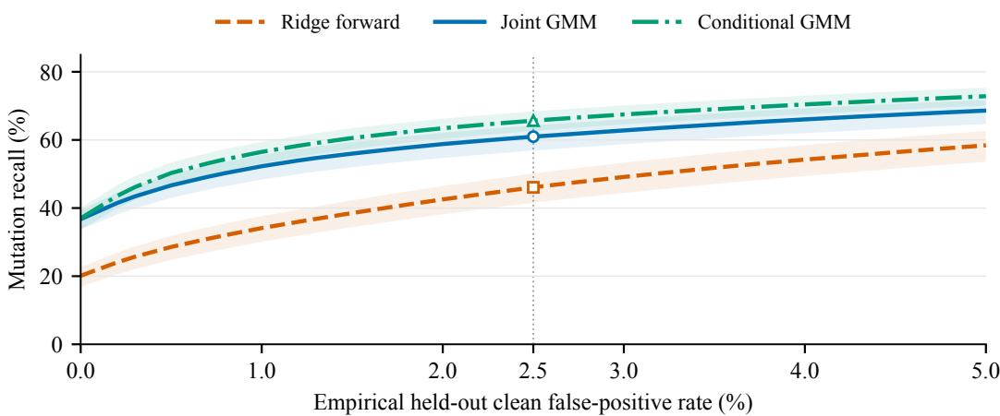

# DETECTING SILENT ACTION-INTERFACE MISMATCH WITH CALIBRATED RELATIONAL WORLD MODELS

Rui Zhu   
Yale University   
rui.zhu.rz399@yale.edu   
Xurui Li   
Ant Group   
xurui.lxr@antgroup.com

Haixu Tang Indiana University hatang@iu.edu

## ABSTRACT

A robot action can satisfy shape and range constraints yet carry the wrong semantics: axes may be permuted, signs inverted, rotations rescaled, or gripper polarity reversed. We study learned state–action–effect relations as offline contracts for detecting these mismatches and ranking their likely fields. Clean held-out transitions calibrate alarms; a fixed inverse vocabulary supports closed-set localization. On ten LIBERO Spatial tasks comprising 432 source episodes, a capacity-controlled comparison at 2.5% empirical clean false-positive rate gives 46.1% recall for a ridge forward residual, 61.0% for a four-component joint Gaussian mixture, and 65.7% for the exact conditional of that same mixture. The joint score retains a 14.9 percentage-point advantage over ridge, while conditioning improves recall by a further 4.7 points. Joint scoring instead has higher localization: 95.8% versus 94.6%. These matched-rate comparisons are retrospective diagnostics, not deployment calibration guarantees. Earlier Object/Goal results broaden tasks within the LIBERO convention; DROID, all three HYDRA tasks, short temporal faults, small offsets, exact repair, and simulated mitigation fail their respective gates, while xArm contributes one task only. The evidence supports a bounded offline diagnostic and a detection–localization tradeoff, rather than joint-density superiority or cross-robot safety.

## 1 INTRODUCTION

World models usually predict dynamics or support planning. At a controller boundary, they can also ask whether an action’s semantics agree with the observed transition. A seven-dimensional action vector may mix normalized translation, axis-angle rotation and gripper commands. Components can agree on shape and bounds while disagreeing about scale, axes, signs, rotation units or polarity. Such a command is numerically legal but inconsistent with the recorded state change.

We study whether recorded state–action–next-state tuples can supply an executable contract for this failure class. A detector is trained on clean transitions, a disjoint clean split fixes its alarm threshold, and in-range semantic mutations are applied only after that calibration is frozen. After an alarm, the system evaluates a declared set of inverse transformations and reports the one that best restores relational consistency. This separates two questions that aggregate anomaly scores often conflate: whether the transition should be inspected and which contract field is the most plausible explanation.

The diagnostic addresses interface semantics, not perception, planning, contact or task progress. Replay supplies the factual next state of the original action, not the physical outcome of executing a corrupted action. We evaluate offline alarms and closed-set localization; they do not measure task success or safe correction.

The study separates three sources of apparent advantage: using the observed transition, representing multimodal clean behavior, and choosing an alarm operating point. The original joint-mixture comparison outperformed a ridge forward residual, but those methods had different achieved falsepositive rates. A post-decision capacity-controlled analysis addresses both confounds. At matched empirical clean FPR, the exact conditional of the fitted mixture has higher detection recall than the joint score; the joint score retains better closed-set localization. We report that reversal alongside episode-level uncertainty and the external and closed-loop failures that bound the method’s use.

## 2 RELATION TO PRIOR WORK

World models learn compact predictive representations for control (Ha & Schmidhuber, 2018); here prediction is used as evidence about an interface, not as a rollout planner. Learned runtime monitors instead anticipate broad policy failures. Model-based monitoring uses interactive imitation learning (Liu et al., 2023b); Sentinel combines temporal action consistency with task progress (Agia et al., 2024); and RAPT uses calibrated predictive deviation for deployment-time detection and diagnosis (Munn et al., 2026). These systems address general failure or distribution shift. Our scope is a declared vocabulary of controller-semantics transformations and attribution to a contract field.

Model-security work supplies a scope boundary. Backdoor detectability depends on nominal/hiddentask relation and detector assumptions (Tang et al., 2022; Zhu et al., 2024); TrojAI distinguishes detection, diagnosis and mitigation (Reese et al., 2026). Backdoor suppression (Zhu et al., 2023; Jiang et al., 2026) and model-lifecycle risks (Chen et al., 2024; Wang et al., 2025; Zhu et al., 2026) concern different interventions. They provide no evidence for this fixed-weight interface diagnostic, and inverse ranking is neither model purification nor adaptive-attack robustness.

Action Mahalanobis distance is a natural cheap out-of-distribution baseline (Lee et al., 2018). It cannot, by construction, use the observed state change: a transformed action may remain marginally plausible while becoming inconsistent with the transition. A field-aligned static comparator can couple translation, rotation, and gripper coordinates to measured displacement, but public benchmark metadata omit the controller gains and absolute-versus-delta semantics needed for a faithful executable specification. We include both checks so that improvement is not measured only against range validation.

Robot-testing work explores a complementary axis. VLATest generates diverse manipulation scenes (Wang et al., 2024), FATE-VLA searches for failure-prone scenes (Kanwal et al., 2026), and metamorphic testing compares related executions without a task-specific oracle (Valle et al., 2026). ContractFuzz mutates action semantics rather than observations or scenes. The motivating deployment observation is that weights alone do not specify normalization and controller conventions (Tai, 2026); our experiments test when a learned state–action relation can expose that missing contract.

## 3 EXECUTABLE CONTRACT ORACLE

## 3.1 THREAT MODEL AND SUPPORTED VOCABULARY

Let $s _ { t } \in \mathbb { R } ^ { d _ { s } } , a _ { t } \in \mathbb { R } ^ { d _ { a } }$ , and $s _ { t + 1 }$ be a clean recorded transition. A fault k applies a transform $T _ { k } : \mathbb { R } ^ { d _ { a } }  \mathbb { R } ^ { d _ { a } }$ . We evaluate only changed rows whose transformed action remains inside clean training bounds,

$$
\mathcal { V } _ { k } = \{ t : T _ { k } ( a _ { t } ) \neq a _ { t } , \ \ell \leq T _ { k } ( a _ { t } ) \leq u \} .\tag{1}
$$

The supported set contains halving the six motion coordinates, swapping the X and Y axes, reversing the X-axis sign, shrinking rotation units, and reversing gripper polarity. A fixed X-offset is retained as an unsupported stress test. Temporal delay, half-frequency hold, and chunk reversal are evaluated separately and fail the main detector gate.

This is a controlled counterfactual on recorded data: the detector receives $( s _ { t } , T _ { k } ( a _ { t } ) , s _ { t + 1 } )$ , but $s _ { t + 1 }$ is the recorded outcome of $a _ { t }$ . That design isolates relational inconsistency and supplies a known mutation label. It does not simulate contact dynamics, policy adaptation, or the task outcome of executing $T _ { k } ( a _ { t } )$

## 3.2 CALIBRATED RELATIONAL SCORES

From clean training transitions, we fit a ridge forward model

$$
f _ { \theta } ( s _ { t } , a _ { t } ) \approx s _ { t + 1 } - s _ { t }\tag{2}
$$

and normalize each residual dimension by its training root-mean-square error. The conditional score is

$$
R _ { f } ( s _ { t } , a , s _ { t + 1 } ) = \sqrt { \mathrm { m e a n } \left[ \left( \frac { f _ { \theta } ( s _ { t } , a ) - ( s _ { t + 1 } - s _ { t } ) } { \sigma _ { f } } \right) ^ { 2 } \right] } .\tag{3}
$$

We also standardize the joint vector $\boldsymbol { z } = [ s _ { t } , a , s _ { t + 1 } - s _ { t } ]$ . A regularized joint Gaussian gives

$$
R _ { j } ( z ) = { \sqrt { ( z - \mu ) ^ { \top } ( \Sigma + 1 0 ^ { - 2 } I ) ^ { \dagger } ( z - \mu ) } } .\tag{4}
$$

The original selected score is the negative log likelihood of a full-covariance mixture,

$$
R _ { G } ( z ) = - \log \sum _ { m = 1 } ^ { M } \pi _ { m } \mathcal { N } ( z ; \mu _ { m } , \Sigma _ { m } + 1 0 ^ { - 3 } I ) ,\tag{5}
$$

with $M = 4$ and deterministic split-seed initialization. To control model capacity, we also evaluate the exact conditional of this fitted mixture. With $x = [ s _ { t } , a ]$ and $y = s _ { t + 1 } - s _ { t }$

$$
R _ { C } ( y \mid x ) = R _ { G } ( x , y ) + \log p _ { G } ( x ) .\tag{6}
$$

The marginal $p _ { G } ( x )$ uses the same weights, component input means and covariance blocks as $p _ { G } ( x , y )$ . The conditional mixture therefore has input-dependent component weights and conditional means, without adding parameters or fitting a separate model. Its comparison with $R _ { G }$ isolates the contribution of the input marginal to the score; it does not compare independently optimized model classes. A disjoint clean calibration split sets each detector’s threshold to an empirical upper quantile targeting 2.5% false positives. No mutation outcome enters model selection or threshold fitting.

For attribution, each inverse hypothesis $U _ { j } ,$ , including identity, maps the observed action back into a candidate convention. The reported candidate is the one with the lowest relational score on $( s _ { t } , U _ { j } ( a ) , s _ { t + 1 } )$ . We call Top-1 agreement with the injected field localization; earlier logs use repair top1, but a correct ranking does not demonstrate executable repair.

## 4 FROZEN EVALUATION CONTRACT

Data and partitions. The primary benchmark is public LIBERO (Liu et al., 2023a), pinned to data revision e5907374380b8f96511957e6ba5582be52a1e179. Episodes, not transitions, are partitioned 60/20/20 into training, calibration, and test sets for each deterministic split seed; at most 2,000 transitions are sampled per seed. The audit contains 1,243 task–episode clusters and 160,414 transitions across 30 retained Spatial, Object, and Goal tasks. Repeated split seeds reduce algorithmic Monte Carlo variation but do not create new trajectories.

External-convention screens use low-dimensional data only. DROID-100 (Khazatsky et al., 2024) contributes 100 episodes and 32,112 transitions, but 46/47 task labels are singletons, so its frozen screen is pooled and episode-disjoint. The FOWM xArm Lift conversion (Feng et al., 2023) contains 800 repeated episodes and 19,200 source-semantic XYZ-plus-gripper transitions from one task. Stanford HYDRA (Belkhale et al., 2023) contains 570 episodes, three tasks, and 357,664 valid transitions with source-defined 7D end-effector-delta and gripper actions. Video and simulator assets are excluded. Conflicting HYDRA mirror metadata are handled conservatively by retaining the source-specific CC-BY-4.0 notice rather than interpreting license terms.

Metrics, baselines, and gates. We report clean false-positive rate (FPR), mutation recall, recall gain over the named comparator, and closed-set localization Top-1. The cheap baseline is the better of a full-covariance action Mahalanobis detector and static range legality. A structured field-aligned displacement model independently fits clean affine maps from the named action coordinates to next-frame translation, relative axis-angle, and gripper aperture. The ridge forward score $R _ { f }$ is the original conditional baseline; the capacity-controlled conditional mixture $R _ { C }$ is added in the post-decision validation.

Historical gates and uncertainty. The original task gate requires FPR at most 0.05, recall gain at least 0.10 over action/static checks, and localization at least 0.70. Later mixture confirmation requires a task-median recall gain of 0.10 over ridge, wins on at least eight tasks, and both methods below 0.05 FPR. These are historical study gates, not matched-FPR comparisons. The supplement retains the aggregate gates, multiplicity correction, sensitivity results, and a run whose FPR of 0.0500375 exceeds the limit. Repeated split seeds are collapsed within source episode before paired task/episode inference; they do not create new trajectories.

Table 1: Post-decision Spatial comparison over 432 source episodes. Recall is at 2.5% matched empirical clean FPR; brackets are conditional paired task/episode bootstrap 95% intervals. Achieved FPR uses a separate, calibration-only 2.5% nominal threshold and equal-episode weighting. Matched FPR uses clean rows within each split. Localization includes all valid fault rows, not just alarms.
<table><tr><td>Score</td><td>Matched recall (%)</td><td>Calibration FPR (%)</td><td>Localization (%)</td></tr><tr><td>Ridge forward</td><td>46.08 [41.58, 50.17]</td><td>2.63</td><td>92.70</td></tr><tr><td>Joint GMM</td><td>60.96 [56.90, 64.28]</td><td>3.22</td><td>95.81</td></tr><tr><td>Conditional GMM</td><td>65.66 [62.61, 68.40]</td><td>2.85</td><td>94.62</td></tr></table>

Post-decision validation. A fixed protocol evaluates all ten Spatial tasks and five supported families on 100 episode-disjoint partitions per task (seeds 33001–33100), retaining the original fitting, preprocessing, transition cap and valid-row rule. No new source episodes are introduced. Each method is first evaluated at clean-calibration quantiles targeting 1%, 2.5%, and 5% FPR, with achieved test FPR reported separately. A second, retrospective diagnostic derives thresholds from held-out clean scores and interpolates adjacent clean-score cutoffs to match empirical FPR exactly. Mutation labels do not select those cutoffs. This curve compares scores; it cannot supply a test-free deployment threshold.

The primary endpoint is recall at 2.5% matched FPR, with two paired comparisons: joint minus ridge and joint minus conditional GMM. Repeated test appearances are averaged within episode– fault cells, then faults within episode, episodes within task, and ten tasks with equal weights. A paired hierarchical bootstrap uses 20,000 task/episode resamples. The reported 95% intervals are conditional on fitted scores and clean-reference thresholds; they exclude refitting and thresholdestimation uncertainty. Bonferroni 97.5% intervals for the two primary comparisons are retained in the supplement. Other FPRs and localization are descriptive endpoints.

## 5 LIBERO EVIDENCE

## 5.1 MATCHED FPR AND MODEL CAPACITY

Table 1 and Figure 1 compare the three scores without changing model capacity or empirical clean alarm rate. At 2.5% FPR, joint GMM recall is 0.6096 versus 0.4608 for ridge: the paired advantage is 0.1488, with 95% interval [0.1207, 0.1798]. The exact conditional GMM instead reaches 0.6566, exceeding joint recall on all ten tasks. Joint-minus-conditional recall is −0.0470 with interval [−0.0632, −0.0350]; its two-comparison 97.5% interval [−0.0658, −0.0339] also excludes zero. The conditional advantage is 0.0422 at 1% FPR and 0.0422 at 5%. The result supports multimodal relational modeling over the ridge residual, but rejects the claim that joint scoring has the best detection recall among the tested scores.

## 5.2 CALIBRATION AND LOCALIZATION ANSWER DIFFERENT QUESTIONS

At calibration-only thresholds targeting 2.5% FPR, the achieved equal-episode clean rates are 0.0263 for ridge, 0.0322 for joint GMM and 0.0285 for conditional GMM; corresponding recalls are 0.4413, 0.6086 and 0.6504. Sharing a nominal quantile or satisfying the same 5% cap therefore does not establish a matched operating point. The matched analysis removes that confound for this finite reference set while leaving clean-only deployment calibration as a separate task.

Detection and attribution also rank the models differently. Closed-set localization is 0.9581 for joint GMM, 0.9462 for conditional GMM and 0.9270 for ridge. These accuracies use all valid mutated rows under the fixed inverse vocabulary. The joint score’s higher localization does not establish an end-to-end benefit after alarm selection, and its extra input-marginal term does not improve recall here.

All 1,000 GMM fits converge. Each episode–fault cell has at least 12 held-out appearances, averaged before inference. The supplement reports independent conditional-density and exact-FPR interpolation checks.

  
Figure 1: Retrospective clean-reference FPR comparison on the same Spatial episodes. All methods use the same train/calibration/test partitions. Bands are pointwise 95% task/episode bootstrap intervals conditional on fitted scores and reference thresholds. They are not simultaneous bands or deployment FPR guarantees.

Table 2: Material boundaries retained in the main paper. “Pass” always refers to the frozen gate for that row; proxy and simulator rows are not physical trials.
<table><tr><td>Scope</td><td>Gate</td><td>Result</td><td>Supported interpretation</td></tr><tr><td>Small X-offset</td><td>0/10</td><td>GMM recall 0.0340</td><td>Explanation may rank well below alarm threshold</td></tr><tr><td>Temporal faults</td><td>0/10</td><td>median gain 0.0421</td><td>Short latency/hold/chunk order unsup- ported</td></tr><tr><td>DROID-100</td><td>fail</td><td>recalls 0.0193–0.0865</td><td>Structural compatibility is not detector transfer</td></tr><tr><td>xArm Lift</td><td>1 task</td><td>GMM recall 0.6016</td><td>One-task offline sanity only</td></tr><tr><td>HYDRA</td><td>0/3</td><td>recalls 0.1063–0.1213</td><td>Multi-task external convention fails</td></tr><tr><td>Exact repair</td><td>0/10</td><td>median within-0.01 0.4930</td><td>Localization is not reliable action re- pair</td></tr><tr><td>Simulated fallback</td><td>fail</td><td>ties ridge; GMM FPR misses gate</td><td>No ContractFuzz-specific closed-loop gain</td></tr></table>

## 5.3 RELATION TO THE RETAINED RESULTS

The original calibration-only comparison reports a task-median joint-minus-ridge recall difference of 0.15663. A previous 432-episode analysis estimates 0.16753 [0.13642, 0.20297]. Those values remain in the supplement with their original operating points; the matched-FPR estimate of 0.1488 above is the appropriate comparison for the present detection claim. Its different seeds and estimand mean that subtracting the two estimates does not identify a causal “FPR contribution.”

Earlier joint-GMM advantages over ridge also recur within LIBERO Object and Goal, with recall differences 0.21183 and 0.17956 under their original calibration protocols. They share LIBERO’s action convention. The new conditional and matched-FPR comparisons are restricted to Spatial; they have not been repeated on those suites. A field-aligned static displacement comparator has median recall 0.32020 and localization 0.84245, below the historical joint-GMM result, but absent controller gains prevent a faithful manufacturer-specification interpretation. Complete earlier operating-point, ablation and sensitivity values remain in the supplement as historical evidence.

## 6 WHERE THE CONTRACT FAILS

## 6.1 DETECTION, EXPLANATION, AND ABSTENTION ARE DIFFERENT DECISIONS

Fault families vary materially. Supported transformations have median recall gains 0.300–0.452 and localization 0.878–0.966. The fixed X-offset stress test has only 0.0047 gain and 0.555 localization under the original score; the GMM also passes 0/10 offset gates with median recall 0.0340. Yet seven-candidate localization is 0.7340. In a task/episode-clustered mechanism analysis, alarm recall is 0.0328, localization is 0.7304, and localization among non-alarmed rows is 0.7388; AUROC is only 0.5475. Relative candidate evidence can therefore be informative even when the absolute clean-versus-fault distributions overlap too strongly for a high-precision alarm.

A selection-frozen descriptive reuse of the same 432 episodes places 74.01% of offset episodes in an explanation-only false-negative stratum. For supported families, 75.51% of episode–fault cells are detected and localized, 1.05% are localized without detection, none are joint failures, and 23.43% lie in a mixed boundary region. These values explain an existing result; they are not an independent confirmation.

An omitted-family audit cross-fits confidence thresholds between fixed task halves using only the other four supported families. Aggregate rejection of a deliberately hidden family is 0.7411, but omitted X-sign rejection is only 0.3720 and 64.67% of those rows are forced into the XY-swap label. This rejects a universal open-set guarantee. The operational rule is consequently asymmetric: an alarm can request inspection for a represented family, but no alarm cannot certify a correct interface, and a high relative score cannot safely remap an unknown fault.

## 6.2 EXTERNAL CONVENTIONS DO NOT VALIDATE TRANSFER

DROID-100 passes low-dimensional schema checks, yet pooled scale, swap, and sign recalls are only 0.0193, 0.0777, and 0.0865. Its sparse task identity also prevents a multi-task replication. One xArm Lift task passes a separately frozen screen: GMM recall is 0.6016 versus 0.5046 for forward, with 0.0245 mean FPR. Because all 800 episodes repeat one task, it supports only a bounded one-task offline sanity check.

HYDRA is the decisive negative external screen. It passes compatibility gates and provides three repeated tasks with auditable action semantics, but coffee, dish-rack, and toast GMM recalls are only 0.1063, 0.1097, and 0.1213; zero tasks pass. Three bounded rescues do not reverse that outcome. The final SAGE-R sequence-aware redesign also passes 0/3 and underperforms the strongest sequence baseline on every task. These failures are immutable evidence: the workshop rewrite neither tunes on the HYDRA test set nor turns the one xArm result into cross-robot validation.

## 6.3 REPLAY EVIDENCE DOES NOT ESTABLISH CONSEQUENCE OR REPAIR

Replay uses the factual next state produced by the clean action. A deterministic clean-trained response proxy lowers median task GMM recall from 0.6379 to 0.2381 on LIBERO and mean recall from 0.6105 to 0.0972 on xArm, but factual-minus-proxy recall on HYDRA is −0.0978/ + 0.0604/ − 0.0440. These learned-response diagnostics are not environment rollouts or causal effects.

A small controlled simulator connects the detector to reject/hold/fallback under a fixed fault and delay budget. GMM fallback can recover success relative to no monitor, but it ties a ridge monitor and misses the GMM clean-FPR gate. It therefore does not demonstrate ContractFuzz-specific closed-loop success improvement. A separate continuous-offset repair sweep passes 0/10 gates, and linear, shrunk, quadratic, random-feature, and disjoint-task selectors all fail. Candidate ranking is useful diagnostic evidence; it is not a license to modify commands online.

## 7 SENSITIVITY AND FINITE-SOURCE LIMITS

Earlier ablations reject a universal best score. Forward-only and inverse-plus-forward scores both pass the original action/static gate, but their paired recall difference includes zero and forward-only localizes better. Four and eight GMM components pass the historical recall gate while two fail; calibration budgets of 100, 200 and 400 clean transitions pass. Family rankings differ, and small-offset or temporal severity sweeps cannot rescue the failed short-fault gates. The supplement retains the full numerical ablations and the distinction between predeclared comparisons and explanatory reuse.

The new conditional score is an analytic normalization of the same joint mixture. Its advantage does not establish superiority of every conditional architecture, and a separately optimized conditional mixture could behave differently. The post-decision analysis reuses the same 432 episodes, conditions uncertainty on the fitted scores and reference thresholds, and adds no robot, policy, or controller convention. Matched empirical FPR describes this finite offline reference set; production calibration and natural fault prevalence remain outside the evidence.

## 8 IMPLICATIONS FOR UNCERTAIN WORLD MODELS

A multimodal state–action–effect relation can expose declared interface faults that remain numerically legal. The new comparison changes the interpretation of that result: a joint-mixture advantage over linear prediction error does not imply that modeling the joint density is better than conditioning. Here conditioning the same mixture improves recall, while the joint score ranks inverse candidates more accurately. Score choice should therefore follow the diagnostic decision and its alarm budget rather than an aggregate claim of model dominance.

A practical offline audit can pair clean calibration transitions with a declared inverse vocabulary and request inspection when an alarm occurs. It must report achieved clean FPR, detection recall and localization separately. Meeting a common FPR ceiling constrains the operating point but cannot replace a matched-rate comparison. No alarm cannot certify a correct interface, and candidate ranking cannot justify automatic command remapping. Independent robot conventions and actual counterfactual rollouts remain necessary to support broader deployment or safety claims.

## 9 REPRODUCIBILITY, ETHICS, AND DISCLOSURE

Reproducibility. The artifact records pinned data, splits, calibration rules, commands, checksums and CPU resources. The supplement retains all historical runtime and portability evidence, including the inconclusive exact-CPython-3.12.4 cross-host replay. The post-decision analysis adds no source data: 1,000 GMM fits and the conditional/ matched-FPR analysis take 40.40 seconds on one local CPU process with one BLAS/OpenMP thread (Python 3.11.2, NumPy 1.26.4, SciPy 1.13.1, scikitlearn 1.4.2). Its protocol, score arrays, episode metrics, hashes and independent aggregation audit are preserved separately from the original results.

Ethics and scope. This diagnostic could be misread as a safety certificate. We publish failures, restrict the claim to recorded replay, and do not recommend automatic correction. The evaluation uses public low-dimensional robot demonstrations. Physical deployment would require independent safety controls and oversight. Dataset license metadata are provenance facts, not legal conclusions.

AI-use disclosure. Generative AI assisted research planning, software development, analysis and manuscript drafting. This revision used AI assistance for the post-decision code, mathematical checks, result interpretation, prose and figures. Authors remain responsible for verifying the evidence, citations and final text.

## 10 CONCLUSION

On locked LIBERO replay, calibrated relational scores detect and localize five numerically legal action-interface transformations. At matched empirical clean FPR, a joint GMM retains its recall advantage over ridge prediction error, but the exact conditional of that same mixture has still higher recall. Joint scoring instead has higher closed-set localization. The resulting detection–localization tradeoff, finite-episode uncertainty and negative external results support an auditable offline diagnostic for a declared vocabulary. They do not establish cross-robot generalization, closed-loop success improvement, causal safety or automatic repair.

## REFERENCES

Christopher Agia, Rohan Sinha, Jingyun Yang, Zi-ang Cao, Rika Antonova, Marco Pavone, and Jeannette Bohg. Unpacking failure modes of generative policies: Runtime monitoring of consistency and progress. arXiv preprint arXiv:2410.04640, 2024.

Suneel Belkhale, Yuchen Cui, and Dorsa Sadigh. HYDRA: Hybrid robot actions for imitation learning. arXiv preprint arXiv:2306.17237, 2023.

Xiaoyi Chen, Siyuan Tang, Rui Zhu, Shijun Yan, Lei Jin, Zihao Wang, Liya Su, Zhikun Zhang, XiaoFeng Wang, and Haixu Tang. The janus interface: How fine-tuning in large language models amplifies the privacy risks. In Proceedings ofthe 2024 ACM SIGSAC Conference on Computer and Communications Security, pp. 1285–1299. ACM, 2024. doi: 10.1145/3658644.3690325. URL https://dl.acm.org/doi/10.1145/ 3658644.3690325.

Yunhai Feng, Nicklas Hansen, Ziyan Xiong, Chandramouli Rajagopalan, and Xiaolong Wang. Finetuning offline world models in the real world. arXiv preprint arXiv:2310.16029, 2023.

David Ha and Jurgen Schmidhuber. World models. ¨ arXiv preprint arXiv:1803.10122, 2018.

Wenbin Jiang, Zihao Wang, Jiqiang Liu, Rui Zhu, Jian Wang, Wei Dong, and XiaoFeng Wang. Double-blind cleanser: Blindly unlearning backdoors without clean data. IEEE Transactions on Information Forensics and Security, 21:6126–6139, 2026. doi: 10.1109/TIFS.2026.3705336. URL https://doi.org/10.1109/ TIFS.2026.3705336.

Arusa Kanwal, Pablo Valle, Shaukat Ali, and Aitor Arrieta. FATE-VLA: Failure-aware test generation for vision-language-action models. arXiv preprint arXiv:2606.02307, 2026.

Alexander Khazatsky et al. DROID: A large-scale in-the-wild robot manipulation dataset. arXiv preprint arXiv:2403.12945, 2024.

Kimin Lee, Kibok Lee, Honglak Lee, and Jinwoo Shin. A simple unified framework for detecting out-of-distribution samples and adversarial attacks. In Advances in Neural Information Processing Systems, 2018. URL https://proceedings.neurips.cc/paper\_files/paper/2018/hash/ abdeb6f575ac5c6676b747bca8d09cc2-Abstract.html.

Bo Liu, Yifeng Zhu, Chongkai Gao, Yihao Feng, Qiang Liu, Yuke Zhu, and Peter Stone. Libero: Benchmarking knowledge transfer for lifelong robot learning. arXiv preprint arXiv:2306.03310, 2023a.

Huihan Liu, Shivin Dass, Roberto Mart´ın-Mart´ın, and Yuke Zhu. Model-based runtime monitoring with interactive imitation learning. arXiv preprint arXiv:2310.17552, 2023b.

Humphrey Munn, Brendan Tidd, Peter Bohm, Marcus Gallagher, and David Howard. RAPT: Model-predictiv out-of-distribution detection and failure diagnosis for sim-to-real humanoid deployment. arXiv preprint arXiv:2602.01515, 2026.

Kristopher W. Reese et al. Trojans in artificial intelligence (TrojAI) final report. arXiv preprint arXiv:2602.07152, 2026. URL https://arxiv.org/abs/2602.07152

Jianwei Tai. Same weights, different robot: A deployment safety view of VLA policies. arXiv preprint arXiv:2606.03724, 2026.

Di Tang, Rui Zhu, XiaoFeng Wang, Haixu Tang, and Yi Chen. Understanding impacts of task similarity on backdoor attack and detection. arXiv preprint arXiv:2210.06509, 2022. URL https://arxiv.org/abs/ 2210.06509

Pablo Valle, Sergio Segura, Shaukat Ali, and Aitor Arrieta. Metamorphic testing of vision-language actionenabled robots. arXiv preprint arXiv:2602.22579, 2026.

Zhijie Wang, Zhehua Zhou, Jiayang Song, Yuheng Huang, Zhan Shu, and Lei Ma. VLATest: Testing and evaluating vision-language-action models for robotic manipulation. Proceedings of the ACM on Software Engineering, 2024. doi: 10.1145/3729343.

Zihao Wang, Rui Zhu, Zhikun Zhang, Haixu Tang, and XiaoFeng Wang. Rigging the foundation: Manipulating pre-training for advanced membership inference attacks. In 2025 IEEE Symposium on Security and Privacy (SP), pp. 2509–2526. IEEE, 2025. doi: 10.1109/SP61157.2025.00177. URL https://ieeexplore.ieee. org/document/11023288/.

Rui Zhu, Di Tang, Siyuan Tang, XiaoFeng Wang, and Haixu Tang. Selective amnesia: On efficient, highfidelity and blind suppression of backdoor effects in trojaned machine learning models. In 2023 IEEE Symposium on Security and Privacy, pp. 1–19. IEEE, 2023. doi: 10.1109/SP46215.2023.10351028. URL https://doi.org/10.1109/SP46215.2023.10351028.

Rui Zhu, Di Tang, Siyuan Tang, Zihao Wang, Guanhong Tao, Shiqing Ma, XiaoFeng Wang, and Haixu Tang. Gradient shaping: Enhancing backdoor attack against reverse engineering. In Proceedings of the Network and Distributed System Security Symposium. Internet Society, 2024. doi: 10.14722/ndss.2024.24450. URL https://www.ndss-symposium.org/ndss-paper/ gradient-shaping-enhancing-backdoor-attack-against-reverse-engineering/.

Rui Zhu, Weiheng Bai, Qiushi Wu, Yang Ren, Haixu Tang, and Yuchu Liu. How to compress KV cache in RL post-training? Shadow Mask Distillation for memory-efficient alignment. arXiv preprint arXiv:2605.06850, 2026. doi: 10.48550/ARXIV.2605.06850. URL https://arxiv.org/abs/2605.06850.

# Detecting Silent Action-Interface Mismatch with Calibrated Relational World Models

Evidence and Reproducibility Supplement

Rui Zhu<sup>1</sup>, Xurui Li<sup>2</sup>, Haixu Tang<sup>3</sup>

<sup>1</sup>Yale University <sup>2</sup>Ant Group <sup>3</sup>Indiana University

rui.zhu.rz399@yale.edu, xurui.lxr@antgroup.com, hatang@iu.edu

## 1 SCOPE AND EVIDENCE HIERARCHY

This supplement separates the retained original study from the post-decision matched-FPR and conditional-score validation in Section 9. The latter reuses existing source episodes and introduces new scoring/operating-point results; all other reported values retain their original evaluation contracts and are linked to project-local commands and machine-readable results in Section 7. The positive claim remains restricted to offline replay offive declared, numerically legal action-interface transformations within the LIBERO convention. DROID and HYDRA remain negative; xArm remains a one-task sanity check; simulator mitigation, exact repair, open-set rejection, small offsets, and short temporal faults remain unsupported.

Table 1 defines how each evidence level may affect the paper. Repeated split seeds characterize an algorithm under different episode-disjoint partitions; they are not independent robot executions. The episode-clustered analysis is the inferential anchor. Analyses that reuse those episodes after inspecting earlier outcomes are explicitly descriptive. External screens probe convention transfer but do not become positive replications unless their predeclared gate passes.

Table 1: Evidence hierarchy. “May support” is deliberately narrower than what the underlying metric could be used to suggest.
<table><tr><td>Level</td><td>Statistical unit</td><td>May support</td></tr><tr><td>Fresh locked replay</td><td>task summaries over unseen split seeds</td><td>Detector ordering and clean-FPR compliance on recorded tasks</td></tr><tr><td>tion</td><td>Clustered confirma- task, then immutable source episode</td><td>Finite-source Spatial effect and paired uncer- tainty</td></tr><tr><td>Selection-frozen reuse</td><td>previously used task-episodes</td><td>Mechanism, heterogeneity, and failure de- scription only</td></tr><tr><td>Post-hoc severity</td><td>task summaries at fixed severities</td><td>Explanatory sensitivity, not rescue of a failed family</td></tr><tr><td></td><td>External conventionsource-defined episodes and tasks</td><td>Transfer only when the independently frozen gate passes</td></tr><tr><td>Simulator proxy</td><td>simulator episodes under matched budgets</td><td>Only the specified mitigation comparison, never physical safety</td></tr></table>

Decision vocabulary. An alarm is a thresholded clean-versus-mutated decision. Localization is Top-1 ranking among a fixed inverse-candidate set after an alarm score has been computed. Open-set rejection asks whether a held-out family should be rejected rather than forced into a known label. Repair asks whether an inferred continuous magnitude is accurate enough to modify an action. These are four different estimands. The paper supports the first two for represented LIBERO families and does not collapse them into a claim about open-set coverage, action correction, or task success.

## 2 FROZEN DATA AND TRANSFORMATION CONTRACT

## 2.1 SOURCE UNITS AND EPISODE FIREWALL

LIBERO is pinned to revision e5907374380b8f96511957e6ba5582be52a1e179. Table 2 reports the source units before any repeated split generation. Each deterministic split assigns whole episodes

60/20/20 to train, clean calibration, and test. At most 2,000 transitions are sampled per seed. Calibration uses an empirical upper quantile with method=higher; mutation labels and outcomes are unavailable to fitting, model selection, and threshold choice.

Table 2: Immutable source units. A task–episode is the inferential cluster; a transition is not treated as an independent trial.
<table><tr><td>Suite</td><td>Tasks</td><td>Transitions</td><td>Task-episodes</td><td>Episodes/task</td></tr><tr><td>LIBERO Spatial</td><td>10</td><td>52,538</td><td>432</td><td>35-47</td></tr><tr><td>LIBERO Object</td><td>10</td><td>56,262</td><td>383</td><td>31-41</td></tr><tr><td>LIBERO Goal</td><td>10</td><td>51,614</td><td>428</td><td>33-50</td></tr><tr><td>Total</td><td>30</td><td>160,414</td><td>1,243</td><td>31-50</td></tr></table>

An independent coverage audit generates 3,000 episode-disjoint partitions with 1,200/400/400 sampled train/calibration/test transitions. Every source episode appears in every role across the audit, with minimum assignment counts 40, 9, and 10; each task has 100 unique role assignments. These checks establish split coverage, not additional data breadth.

## 2.2 SUPPORTED VOCABULARY AND VALID-ROW RULE

The seven-dimensional action contains six motion coordinates and one gripper coordinate. Table 3 fixes the five supported hypotheses and the unsupported offset control. A row is valid only if the transformation changes its action and every transformed coordinate stays inside the clean-training bounds. Scoring uses every valid corrupted test row; it does not retain only examples that are easy to classify. The inverse-candidate set contains identity and one inverse per declared family.

Table 3: Frozen mutation vocabulary. Motion transformations act on the first six coordinates unless a smaller coordinate set is named.
<table><tr><td>Status</td><td>Family</td><td>Exact transformation</td></tr><tr><td>Supported</td><td>Motion scale</td><td> $a _ { 1 : 6 } \gets 0 . 5 a _ { 1 : 6 }$ </td></tr><tr><td>Supported</td><td>XY permutation</td><td> $( a _ { x } , a _ { y } ) \gets ( a _ { y } , a _ { x } )$ </td></tr><tr><td>Supported</td><td>X sign</td><td> $a _ { x }  - a _ { x }$ </td></tr><tr><td>Supported</td><td>Rotation units</td><td> $a _ { 4 : 6 } \gets a _ { 4 : 6 } / 5 7 . 2 9 5 7 7 9 5$ </td></tr><tr><td>Supported</td><td>Gripper polarity</td><td> $a _ { 7 }  1 - a _ { 7 }$ </td></tr><tr><td>Stress test</td><td>Fixed X offset</td><td> $a _ { x }  a _ { x } + 0 . 0 5$ </td></tr></table>

The locked per-task gate requires clean $\mathrm { F P R } \leq 0 . 0 5$ , recall gain over the action/static comparator $\geq 0 . 1 0$ , and localization $\geq 0 . 7 0$ . The Spatial aggregate requires at least 8/10 task passes, median gain $\geq 0 . 1 5$ , median localization $\geq 0 . 7 5$ , and maximum task $\mathrm { F P R } \leq 0 . 0 5 .$ . The later GMM comparison requires GMM-minus-forward median recall $\geq 0 . 1 0$ , wins on at least 8/10 tasks, and both maximum task $\mathrm { F P R s } \leq 0 . 0 5$ . No rounded value is used for a gate.

## 3 TASK-LEVEL MIXTURE CONFIRMATION

Table 4 exposes all ten primary Spatial task summaries rather than only their median. The recall comparison uses 1,000 fresh episode-split seeds (21971–22970). The localization columns use a separate 500-seed confirmation. GMM recall exceeds forward on 10/10 tasks; the median gain is 0.15663 and maximum GMM clean FPR is 0.03994. Median GMM localization is 0.95926, with median advantages 0.02932 over forward and 0.01728 over the joint Gaussian. One convergence warning occurs among 5,000 fits and does not alter the frozen result.

Table 4: Fresh Spatial task results for the four-component GMM. ∆R is GMM-minus-forward recall; $\Delta L _ { f }$ and $\Delta L _ { j }$ are localization gains over forward and joint Gaussian.
<table><tr><td>Task</td><td> $\Delta R$ </td><td>GMM loc.  $\Delta L _ { f }$ </td><td> $\Delta L _ { j }$ </td></tr><tr><td>0</td><td>0.1605</td><td>0.9632</td><td>0.0281 0.0151</td></tr><tr><td>1</td><td>0.2431</td><td>0.9656 0.0232</td><td>0.0172</td></tr><tr><td>2</td><td>0.1555</td><td>0.9577 0.0310</td><td>0.0181</td></tr><tr><td>3</td><td>0.2653</td><td>0.9466 0.0414</td><td>0.0287</td></tr><tr><td>4</td><td>0.0826</td><td>0.9417 0.0305</td><td>0.0197</td></tr><tr><td>5</td><td>0.1035</td><td>0.9650 0.0315</td><td>0.0129</td></tr><tr><td>6</td><td>0.1527</td><td>0.9530 0.0247</td><td>0.0148</td></tr><tr><td>7</td><td>0.1772</td><td>0.9561 0.0275</td><td>0.0173</td></tr><tr><td>8</td><td>0.1421</td><td>0.9642 0.0401</td><td>0.0197</td></tr><tr><td>9 Median 0.1566</td><td>0.1578</td><td>0.9608 0.0243</td><td>0.0127 0.0293 0.0173</td></tr></table>

The first 200-seed GMM screen is retained separately: recall wins on 10/10 tasks, but task 4 has clean FPR 0.0500375, exceeding 0.05 by 0.0000375. Its classification is inconclusive/near-boundary, not pass. The fresh 1,000-seed run was predeclared before its outcomes were inspected and passes without relying on rounding.

The frozen extension within LIBERO changes task content but not action convention. On Object, GMM-minus-forward recall is 0.21183 with task-bootstrap interval [0.2016, 0.2218]; GMM localization is 0.9521, advantage 0.02888, and maximum FPR 0.0346. On Goal, the corresponding values are 0.17956 [0.1743, 0.1849], 0.9525, 0.02758, and 0.0288. These are within-convention suite confirmations, not independent robot evidence.

## 4 EPISODE-CLUSTERED INFERENCE AND MULTIPLICITY

The predeclared estimand first averages repeated test appearances for each episode–fault cell, then averages faults within episode and episodes within task, and finally assigns equal weight to each of ten Spatial tasks. The paired hierarchical bootstrap resamples tasks and then source episodes within task for 100,000 draws. Split-randomization replicates are collapsed and are never counted as independent clusters.

The family contains exactly three directional comparisons: GMM-minus-forward recall, GMMminus-forward localization, and GMM-minus-joint localization. Table 5 reports ordinary paired 95% intervals, one-sided family-wise lower bounds using $\alpha / 3$ , and exact task-sign-flip tests with Holm correction. All three lower bounds are positive. Each immutable episode appears in at least 11 test splits; all 1,000 task-level GMM fits converge; maximum task-mean clean FPR is 0.0444.

Table 5: Fresh 432-episode Spatial effects. The sign-flip family has ten paired task summaries, so its smallest attainable unadjusted one-sided value is 1/1024.
<table><tr><td>Effect</td><td>Estimate</td><td>Paired 95% CI</td><td>FWER lower</td><td>Holm p</td></tr><tr><td>GMM — forward recall</td><td>0.16753</td><td>[0.13642, 0.20297]</td><td>0.13401</td><td>0.00293</td></tr><tr><td>GMM — forward loc.</td><td>0.03089</td><td>[0.02679, 0.03541]</td><td>0.02645</td><td>0.00293</td></tr><tr><td>GMM − joint loc.</td><td>0.01837</td><td>[0.01522, 0.02198]</td><td>0.01497</td><td>0.00293</td></tr></table>

An unchanged attempt to extend this clustered protocol to all suites aborts before inference because Object task 5, split seed 25221, contains zero valid gripper-polarity test rows under the locked valid-row rule. The evaluator is not altered after that observation. Consequently, no episode-clustered Object/Goal claim is made; only the earlier locked task-bootstrap suite confirmation is reported.

## 5 COMPARATORS, FAMILIES, AND SENSITIVITY

## 5.1 WHY THE MIXTURE WAS SELECTED IN THE ORIGINAL STUDY

In a fresh Gaussian comparison, the conditional forward score has higher recall than a joint Gaussian on every Spatial task (median advantage 0.1033), while its localization is lower on every task (median forward-minus-joint −0.0118). The predeclared dominance gate passes only 6/10 tasks and therefore fails. This is a real falsification of the earlier forward-dominance hypothesis, not an ablation removed after the mixture became favorable.

The tradeoff is family-specific (Table 6). Forward wins both metrics for scale, joint wins both for X-sign, and only rotation satisfies the material Pareto gate. Aggregate rankings must therefore be read as decisions for a fixed family mixture rather than universal detector dominance.

Table 6: Forward-minus-joint Gaussian effects by transformation family. Positive localization favors forward; negative localization favors joint.
<table><tr><td>Family</td><td>Recall effect</td><td>Loc. effect</td><td>Interpretation</td></tr><tr><td>Scale</td><td>0.2620</td><td>0.0098</td><td>Forward wins both</td></tr><tr><td>XY permutation</td><td>0.0353</td><td>-0.0248</td><td>Recall-location tradeoff</td></tr><tr><td>X sign</td><td>-0.0242</td><td>-0.0277</td><td>Joint wins both</td></tr><tr><td>Rotation units</td><td>0.0990</td><td>-0.0168</td><td>Only family passing Pareto gate</td></tr><tr><td>Gripper polarity</td><td>0.1054</td><td>-0.0036</td><td>Recall-location tradeoff</td></tr></table>

The historical static comparator fits clean affine maps from named action fields to next-frame translation, relative axis-angle motion, and gripper aperture. Its task-median recall is 0.32020, localization 0.84245, and maximum FPR 0.029825, but it passes 0/10 noninferiority gates against GMM. Metadata-minus-GMM recall is −0.31196 with paired interval $[ - 0 . 3 3 3 2 8 , - \dot { 0 } . \dot { 2 } 4 7 2 9 ]$ ; localization $\mathrm { i s - 0 . 1 0 9 1 4 \ [ - 0 . 1 2 6 5 5 , - 0 . 0 9 8 6 6 ] }$ . The source metadata do not expose controller gains and absolute-versus-delta semantics, so this is a faithful field-aligned empirical comparator, not a claimed implementation of a complete manufacturer contract.

## 5.2 MIXTURE, CALIBRATION, AND OPERATING-POINT SENSITIVITY

Table 7 reports the two frozen one-factor sensitivity families. Four and eight components pass; two components fail the recall-advantage gate. Nested clean calibration caps all pass. Neither result justifies arbitrary mixture-count invariance or eliminating the held-out calibration split.

Table 7: GMM sensitivity. Intervals apply to GMM-minus-forward recall; FPR is the largest task value.
<table><tr><td>Factor</td><td>Setting</td><td>Recall gain</td><td>95% interval</td><td>Loc.</td><td>Max FPR</td></tr><tr><td>Components</td><td>2</td><td>0.0725</td><td>[0.0407,0.1149]</td><td>0.9561</td><td>0.0443 (fail)</td></tr><tr><td></td><td>4</td><td>0.1609</td><td>[0.1264,0.2049]</td><td>0.9585</td><td>0.0458</td></tr><tr><td></td><td>8</td><td>0.1634</td><td>[0.1274,0.2118]</td><td>0.9566</td><td>0.0424</td></tr><tr><td>Calibration cap</td><td>100</td><td>0.1453</td><td>[0.1194,0.1892]</td><td>0.9607</td><td>0.0412</td></tr><tr><td></td><td>200</td><td>0.1540</td><td>[0.1269,0.1983]</td><td>0.9607</td><td>0.0353</td></tr><tr><td></td><td>400</td><td>0.1482</td><td>[0.1271,0.2024]</td><td>0.9607</td><td>0.0362</td></tr></table>

The earlier forward OFAT audit shows the same need to bind claims to an operating point. The locked baseline has gain 0.3763, localization 0.9297, and FPR 0.0314. Budgets of 500 and 1,000 preserve the ordering (gains 0.3639 and 0.3678). A 1% target lowers gain to 0.2858 and FPR to 0.0162. A nominal 5% target raises gain to 0.4389 but produces FPR 0.0601 and fails. Ridge values $1 0 ^ { - 4 }$ and $1 0 ^ { - 2 }$ are identical at reported precision. Mild versus severe transformations yield gains 0.2790 and 0.4362. Threshold and severity are therefore experimental factors, not post-hoc knobs.

## 6 FAILURE ANALYSES THAT BOUND THE CLAIM

## 6.1 UNSUPPORTED OFFSET, TEMPORAL FAULTS, AND OPEN SET

The fixed +0.05 X offset is an intentionally unsupported family. In the fresh episode-clustered audit, alarm recall is 0.03282, localization 0.73042, localization among non-alarmed rows is 0.73881, and alarm AUROC is 0.54746. Thus a relative candidate can rank correctly even when the absolute score cannot separate clean from corrupted rows. A selection-frozen reuse places 74.01% of episodes in an explanation-only false-negative stratum. This mechanism result is DESCRIPTIVE, not independent confirmation.

For supported families, a descriptive reuse reports 75.51% detected-and-localized episode–fault cells, 1.05% localized without detection, 0% joint failures, and 23.43% mixed boundary cells. The true candidate is Top-1 on 95.83% of supported cells; identity confusion is 2.685%. These proportions explain where the closed-set score succeeds and do not add source episodes.

In a cross-fitted leave-one-family-out audit, known-family acceptance is 0.90007 and unknown-family rejection is 0.74115 (Holm p = 0.001953). The aggregate hides a material failure: omitted X-sign rejection is only 0.37200, and 64.67% of its rows are forced into the XY label. The system therefore has no universal open-set guarantee.

Short temporal faults also fail: forward-minus-action gains are 0.0055 for one-frame delay, 0.0364 for two-frame delay, 0.0061 for half-frequency hold, and 0.1277 for chunk reversal; the all-family median is 0.0421 and 0/10 tasks pass. A clean-trained temporal feature model reaches recalls 0.0253/0.0247/0.0000 for the first three families and is worse than the strongest static comparator by 0.0113/0.0391/0.0373. A post-hoc delay severity curve rises sharply at four, eight, and sixteen frames (gains 0.2926/0.7179/0.9209), but it explains rather than rescues the frozen short-delay failure.

## 6.2 EXTERNAL CONVENTIONS AND BOUNDED REDESIGNS

Table 8 contains every independent-convention outcome. DROID’s structural gate passes, but sparse task identity (46/47 labels are singletons) limits the frozen analysis to pooled, episode-disjoint screens. Only one xArm Lift task is available, so its positive result cannot support multi-task or cross-robot generalization. HYDRA supplies three auditable repeated tasks and is the decisive negative screen.

Table 8: External-convention outcomes. All use low-dimensional source-semantic actions; video and simulator assets are excluded.
<table><tr><td>Source</td><td>Units</td><td>Detector result</td><td>Classification</td></tr><tr><td>DROID-100</td><td>100 ep.; pooled</td><td>scale/swap/sign 0.019/0.078/0.087</td><td>recall FAIL transfer; sparse identity</td></tr><tr><td>xArm Lift</td><td>800 ep.; 1 task</td><td>0.929; FPR 0.024</td><td>GMM/forward recall 0.602/0.505; 1oc. One-task offline sanity</td></tr><tr><td>HYDRA</td><td>570 ep.; 3 tasks</td><td>GMM recall 0.106/0.110/0.121; loc. 0/3, FAIL transfer 0.728–0.792</td><td></td></tr></table>

Three bounded, predeclared rescue candidates fail to turn any HYDRA task positive. A subsequent nontrivial SAGE-R sequence-aware redesign also passes 0/3 and underperforms the strongest sequence baseline on all tasks: its attribution values are 0.3000/0.2576/0.1111 and its gains over that baseline are −0.2933/ − 0.0909/ − 0.3175. These failures terminated the ICLR expansion. The workshop retarget preserves them as historical evidence and does not reinterpret the rewrite as another rescue candidate.

## 6.3 FACTUAL REPLAY IS NOT COUNTERFACTUAL CONSEQUENCE

In replay, the next state is the factual outcome of the original clean action, not the outcome that the transformed command would have produced. A deterministic clean-trained response proxy reduces median GMM recall from 0.6379 to 0.2381 on LIBERO and mean recall from 0.6105 to

0.0972 on xArm, but HYDRA factual-minus-proxy effects are −0.0978/ + 0.0604/ − 0.0440. This inconsistency prevents a causal reading.

The smallest controlled simulator compares no monitor, ridge, GMM, and oracle under the same injected faults and response-delay budget. Ridge and GMM both improve success from 0.333 to 1.000, so the ContractFuzz-specific difference is exactly zero; GMM clean FPR is 0.08 and misses the 0.05 gate. Continuous-offset repair also passes 0/10 gates (median within-0.01 accuracy 0.4930). These results support neither a detector-specific closed-loop benefit nor automatic action correction.

## 7 COMPUTE, ARTIFACTS, AND EXACT REPRODUCTION

## 7.1 MAIN-EVIDENCE RESOURCE ACCOUNTING

All retained scientific evidence is CPU-only. Table 9 reports full-workload wall time and exact maximum resident set size (RSS) for the ten headline paths after schema-aware replay. Historical runtimes sum to 959.860 seconds. RSS is process maximum, not machine reservation; these runs were executed one at a time.

Table 9: Exact CPU resource evidence for the ten retained main-evidence paths.
<table><tr><td>ID</td><td>Role</td><td>Wall (s)</td><td>Max RSS (bytes)</td></tr><tr><td>042b</td><td>fresh GMM recall</td><td>465.445</td><td>220,004,352</td></tr><tr><td>043</td><td>fresh localization</td><td>225.377</td><td>250,036,224</td></tr><tr><td>044</td><td>Object/Goal GMM</td><td>43.810</td><td>960,430,080</td></tr><tr><td>051</td><td>static metadata baseline</td><td>51.542</td><td>241,270,784</td></tr><tr><td>053a</td><td>split coverage</td><td>0.899</td><td>42,762,240</td></tr><tr><td>054a</td><td>clustered effects</td><td>46.422</td><td>588,038,144</td></tr><tr><td>055</td><td>offset failure</td><td>29.123</td><td>752,975,872</td></tr><tr><td>056</td><td>false-negative strata</td><td>1.765</td><td>554,205,184</td></tr><tr><td>057</td><td>supported heterogeneity</td><td>32.804</td><td>760,741,888</td></tr><tr><td>058</td><td>open-set audit</td><td>62.673</td><td>482,066,432</td></tr></table>

A relocation audit copied an existing environment prefix and reproduced the artifact in 150.34 seconds with 593,002,496 bytes maximum RSS; the relocated prefix occupies 4,345,249,565 bytes. It establishes path relocation of the captured environment, not an independent dependency installation. Six core tests, synthetic smoke, archive unpack/checksum, warning checks, and final consistency pass under that interpretation. A separate CPython 3.12.3 host passes the tests but does not satisfy an exact-3.12.4 contract. The exact CPython 3.12.4 standalone tail is inconclusive: its first harness had a parser defect, and the authorized one-shot continuation ended at DNS transport before SSH. We therefore make no exact-patch cross-host portability claim.

The original main-text summary additionally records the 4,000-seed Spatial and Object/Goal stages at 499.45 and 96.24 seconds, respectively, and a full replay of the original clustered analysis at 48.83 seconds with 588,038,144 bytes maximum RSS. These historical measurements are distinct from the new 40.40-second local validation and are not added as independent scientific evidence.

## 7.2 COMMAND-TO-RESULT LOCATOR

Table 10 is a compact human index. The project-local file artifact/table-command-map.md contains all 31 table rows with exact commands; artifact/evidence-ledger-052.tsv is the append-only disposition ledger. Result JSONs store the complete numeric payload, contract, seed range, and gate classification. Running a command is not permission to replace a frozen result: reproduction writes a new output path and a schema-aware verifier compares the scientific payload.

Table 10: Key evidence locators. Paths are relative to the private project root.
<table><tr><td>Claim</td><td>Command/script locator</td><td>Result locator</td></tr><tr><td>GMM recall</td><td>run-gmm-confirmation-042b.sh</td><td>gmm-joint-confirmation-042b.json</td></tr><tr><td>GMM localization</td><td>run-gmm-localization-043.sh</td><td>gmm-localization-confirmation-043.json</td></tr><tr><td>Suite repeat</td><td>run-cross-suite-gmm-044.sh</td><td>gmm-cross-suite-confirmation-044.json</td></tr><tr><td>Static comparator</td><td>run-metadata-displacement-baseline-051.sh</td><td>metadata-displacement-baseline-051.json</td></tr><tr><td>Split coverage</td><td>run-statistical-unit-audit-053a.sh</td><td>statistical-unit-audit-053a.json</td></tr><tr><td>Clustered effects</td><td>run-clustered-effect-intervals-054a.sh</td><td>clustered-effect-intervals-054a.json</td></tr><tr><td>Offset failure</td><td>run-offset-episode-mechanism-055.sh</td><td>offset-episode-mechanism-055.json</td></tr><tr><td>Failure strata</td><td>run-offset-episode-trajectories-056.sh</td><td>offset-episode-trajectories-056.json</td></tr><tr><td>Heterogeneity</td><td>run-supported-family-episode-traces-057.sh</td><td>supported-family-episode-traces-057.json</td></tr><tr><td>Open-set audit</td><td>run-open-set-candidate-rejection-058.sh</td><td>open-set-candidate-rejection-058.json</td></tr><tr><td>DROID screen</td><td>run-droid100-sanity-069b.sh</td><td>droid100-cross-convention-sanity-069b.json</td></tr><tr><td>xArm screen</td><td>run-xarm-lift-sanity-077b.sh</td><td>xarm-lift-cross-convention-sanity-077b.json</td></tr><tr><td>HYDRA screen</td><td>run-stanford-hydra-sanity-080b.sh</td><td>stanford-hydra-cross-task-sanity-080b.json</td></tr></table>

The short names above are reading aids, not substitutes for the exact map; the audit verifies each named result against the actual registered path. The original review artifact excludes raw demonstrations, videos, simulator assets, caches, model weights, credentials, hostnames, home-directory paths, and author metadata. It includes evaluation code, tests, small aggregate results, manifests, licenses and notices, command maps, and the frozen split/evaluator contract.

## 7.3 MINIMAL REPRODUCTION ORDER

The fail-closed order is: (1) verify archive SHA-256 and unpack into a fresh local directory; (2) verify the dependency manifest and data revision/checksum manifest; (3) run the bundled core test suite; (4) run the data-free synthetic smoke; (5) execute a chosen evidence command with a new output path and fixed seed contract; (6) compare the resulting scientific payload with its registered JSON using the schema-aware verifier; and (7) record wall time, RSS, warnings, and the final consistency result. Missing data or dependency evidence is a reproduction failure, not permission to fetch a different revision or relax the evaluator.

## 8 DISCLOSURE AND REVIEWER CHECKLIST

Authorship and disclosure. This camera-ready uses the author-confirmed names, order, affiliations and emails. Generative AI assisted planning, software development, analysis and manuscript drafting, including the post-decision validation and revision. Authors remain responsible for the evidence, citations and final text. License entries report provenance and are not legal conclusions.

Reviewer-verifiable boundaries. A reviewer should be able to answer yes to each of the following directly from the paper and supplement:

1. Episode-disjoint fitting; clean calibration separated from retrospective reference thresholds? Yes.

2. Positive unit is LIBERO tasks/episodes, not split seeds? Yes.

3. Matched-FPR results and the conditional-GMM reversal visible for all ten tasks? Yes.

4. Multiplicity and failed all-suite cluster extension disclosed? Yes.

5. Near-boundary and detector/family/repair/mitigation failures retained? Yes.

6. DROID/HYDRA negative; xArm one-task-only? Yes.

7. Runtime, RSS, locators, and portability limitation available? Yes.

8. No cross-robot, physical closed-loop, causal-safety, or repair claim? Yes.

What would change the scientific conclusion. Widening requires new evidence: multiple independent tasks under a second auditable action convention, predeclared advantage over the strongest sequence baseline, and a real counterfactual environment where mitigation improves task success under the same fault and delay budget. These nontrivial extensions are outside this rewrite; more split seeds, post-failure threshold changes, or descriptive trajectory selection cannot substitute for them.

## 9 POST-DECISION MATCHED-FPR AND CAPACITY-CONTROLLED VALIDATION

## 9.1 PROTOCOL, DATA REUSE, AND EXACT CONDITIONAL SCORE

This analysis was specified after the PC decision and before observing its new outputs. It reuses all 432 original Spatial source episodes and is not an independent replication. Ten tasks, five supported fault families, the original valid-row rule, training standardization, ridge regularization and four-component full-covariance GMM are unchanged. Each task uses 100 episode-disjoint 60/20/20 partitions with seeds 33001–33100 and the original $2 { , } 0 0 0 ^ { . }$ -transition cap. All 1,000 GMM fits converge; each episode–fault cell has at least 12 held-out appearances. No mutation outcome selects a seed, component count, threshold or reported family.

For standardized $x = ( s , a )$ and $y = s ^ { \prime } - s ,$ let $p _ { G } ( x , y )$ be the already fitted joint GMM. Its input marginal uses the same weights and covariance blocks:

$$
p _ { G } ( x ) = \sum _ { m } \pi _ { m } \mathcal { N } ( x ; \mu _ { x , m } , \Sigma _ { x x , m } ) , \qquad R _ { C } = - \log p _ { G } ( x , y ) + \log p _ { G } ( x ) .
$$

Equivalently, the conditional mixture has weights proportional to $\pi _ { m } \Lambda ( x ; \mu _ { x , m } , \Sigma _ { x x , m } )$ , conditional component means $\mu _ { y , m } + \Sigma _ { y x , m } \Sigma _ { x x , m } ^ { - 1 } ( x - \mu _ { x , m } )$ , and covariance $\Sigma _ { y y , m } - \Sigma _ { y x , m } \Sigma _ { x x , m } ^ { - 1 } \Sigma _ { x y , m }$ 2 Thus joint and conditional scores have identical fitted capacity and parameters. This is a scoring ablation; it does not optimize a separate conditional likelihood. An independent block-conditional calculation agrees to $\dot { 2 . 3 } \times 1 0 ^ { - 1 5 }$

## 9.2 CLEAN-REFERENCE FPR AND DEPLOYMENT CALIBRATION

Calibration-only thresholds use the original upper empirical clean-calibration quantile with method=higher. Achieved test FPR is reported, not assumed from the nominal target. Separately, each fitted score is evaluated against its held-out clean reference: adjacent clean-score cutoffs are interpolated to give exact empirical FPR at the specified targets. The interpolation coefficients use clean scores only; no mutant score chooses a cutoff. The maximum numerical FPR error is $1 . 2 \times 1 0 ^ { - 1 6 }$ , including tied-score self-checks.

Matched FPR is transition-weighted within each held-out clean split. Mutation recall averages within episode–fault cells across repeated held-out appearances, then equally over faults, episodes and tasks. Calibration-only test FPR in Table 12 uses that equal-episode aggregation. These weighting choices are explicit: a 2.5% matched clean-reference rate is not a claim that each episode individually has a 2.5% alarm rate. Reference thresholds are used only for retrospective score comparison, not proposed as deployable thresholds.

Table 11: Matched empirical clean FPR: mutation recall in percent. All rows use the same finite source episodes, so different FPRs are correlated descriptive views.
<table><tr><td>FPR (%)</td><td>Ridge forward</td><td>Joint GMM</td><td>Conditional GMM</td></tr><tr><td>1.00</td><td>34.13</td><td>52.27</td><td>56.49</td></tr><tr><td>2.50</td><td>46.08</td><td>60.96</td><td>65.66</td></tr><tr><td>5.00</td><td>58.41</td><td>68.62</td><td>72.83</td></tr></table>

Table 12: Calibration-only operating points in percent. Each cell gives achieved clean FPR / mutation recall; calibration targets are nominal, not achieved rates.
<table><tr><td>Score</td><td>Nominal 1%</td><td>Nominal 2.5%</td><td>Nominal 5%</td></tr><tr><td>Ridge forward</td><td>1.16 / 31.34</td><td>2.63 / 44.13</td><td>5.05 / 57.26</td></tr><tr><td>Joint GMM</td><td>1.71 / 51.09</td><td>3.22 / 60.86</td><td>5.62 / 68.50</td></tr><tr><td>Conditional GMM</td><td>1.34 / 54.76</td><td>2.85 / 65.04</td><td>5.32 / 72.64</td></tr></table>

## 9.3 PAIRED UNCERTAINTY AND ENDPOINTS

For the primary 2.5%-FPR endpoint, the two declared comparisons are joint minus ridge and joint minus conditional. Repeated split appearances are collapsed before 20,000 paired hierarchical task/episode bootstrap draws (seed 20261017). Ordinary 95% intervals and two-sided 97.5% intervals for the two-comparison Bonferroni family are shown below. These intervals are conditional on fitted models and clean reference thresholds. They do not propagate training refits or reference-threshold estimation, and cannot establish population-level deployment-FPR control.

Table 13: Primary matched-FPR paired effects, in percentage points. The wider intervals control the two declared comparisons by Bonferroni under the stated conditional bootstrap interpretation.
<table><tr><td>Comparison</td><td>Effect</td><td>95% interval</td><td>97.5% interval</td></tr><tr><td>Joint — ridge</td><td>14.88</td><td>[12.07, 17.98]</td><td>[11.72, 18.43]</td></tr><tr><td>Joint — conditional</td><td>-4.70</td><td>[-6.32, -3.50]</td><td>[-6.58, -3.39]</td></tr></table>

Table 14: Task-level recall at matched 2.5% empirical clean FPR, in percent. Task means equal-weight their source episodes and five represented families.
<table><tr><td>Spatial task</td><td>Episodes</td><td>Ridge</td><td>Joint</td><td>Conditional</td></tr><tr><td>0</td><td>46</td><td>47.98</td><td>62.57</td><td>67.76</td></tr><tr><td>1</td><td>42</td><td>45.12</td><td>66.84</td><td>69.45</td></tr><tr><td>2</td><td>39</td><td>45.59</td><td>61.01</td><td>65.07</td></tr><tr><td>3</td><td>35</td><td>30.80</td><td>54.84</td><td>57.54</td></tr><tr><td>4</td><td>45</td><td>39.22</td><td>46.67</td><td>57.66</td></tr><tr><td>5</td><td>43</td><td>58.18</td><td>67.80</td><td>72.93</td></tr><tr><td>6</td><td>47</td><td>46.26</td><td>60.49</td><td>65.23</td></tr><tr><td>7</td><td>45</td><td>47.87</td><td>63.86</td><td>66.87</td></tr><tr><td>8</td><td>46</td><td>50.85</td><td>64.07</td><td>68.52</td></tr><tr><td>9</td><td>44</td><td>48.97</td><td>61.50</td><td>65.60</td></tr></table>

The conditional score has higher detection recall than joint on all ten tasks. Joint nevertheless has higher overall closed-set localization: 95.81% [95.23, 96.31], versus 94.62% [94.07, 95.12] for conditional and 92.70% [91.93, 93.40] for ridge (descriptive 95% intervals). Localization is calculated over all valid fault rows. It is neither localization conditional on detection nor successful detection-and-localization, and does not establish safe correction.

## 9.4 RESOURCES, PROVENANCE, AND REPRODUCTION

The run took 40.40 seconds on one local CPU process with one BLAS/OpenMP thread; no GPU was used. Software was Python 3.11.2, NumPy 1.26.4, SciPy 1.13.1, scikit-learn 1.4.2, and threadpoolctl 3.6.0. An environment-only preflight using the old threadpoolctl 2.2.0 failed before any fit because it could not inspect the local OpenBLAS library; that failure is retained, and only this runtime-control package was upgraded before the scientific run. No historical experiment file was changed.

Source array SHA-256:

## 8b6a2145cb7523ebbae1dc2f0374b712366385bd15cca37a18a9dc6b6da0968b

The protocol is paper/pc\_validation\_2026-10-17.md; code is   
src/run\_pc\_validation\_20261017.py. Score arrays, per-episode metrics, convergence diagnostics, environment and code/protocol hashes are in results/pc\_validation\_20261017/. Input data remain subject to the original dataset terms and are excluded from the manuscript-source ZIP.

```shell
DATA=data/nvidia-libero-lerobot-v3-e590737
DATA="$DATA/libero_spatial/transitions.npz"
python src/run_pc_validation_20261017.py \
--input "$DATA" \
--output results/pc_validation_20261017 \
--protocol paper/pc_validation_2026-10-17.md
```

The fixed four-component joint model is not refitted differently for the conditional score. Neither favorable point estimates nor failed historical gates are used to select a new model. The new comparison changes the interpretation of the original result: it supports multimodal relational scoring over ridge, while joint-density detection superiority is unsupported.

## 10 RETAINED OPERATING-POINT AND ABLATION DETAILS

Table 15: Locked replay evidence. Gains are absolute recall differences. “Seeds” are repeated episode-split seeds over fixed data, not independent trajectories.
<table><tr><td>Evaluation</td><td>Pass</td><td>Gain vs. action/range</td><td>Loc.</td><td>Max FPR</td></tr><tr><td>Spatial, 2,000 seeds/task</td><td>10/10</td><td>0.3157</td><td>0.8567</td><td>0.0279</td></tr><tr><td>Object + Goal, 500/suite</td><td>2/2</td><td>0.2989</td><td>0.8474</td><td>0.0286</td></tr><tr><td>Five-family Spatial, 4,000/task</td><td>10/10</td><td>0.3793</td><td>0.9134</td><td>0.0279</td></tr><tr><td>Five-family Object + Goal, 4,000/suite</td><td>2/2</td><td>0.3579</td><td>0.8993</td><td>0.0284</td></tr><tr><td>Forward Spatial, fresh 2,000/task</td><td>10/10</td><td>0.3739</td><td>0.9285</td><td>0.0287</td></tr><tr><td>Forward Object + Goal, fresh 2,000/suite</td><td>2/2</td><td>0.3474</td><td>0.9092</td><td>0.0279</td></tr></table>

## 10.1 TASK AND SUITE CONFIRMATION

Table 15 summarizes the locked feasibility evaluator. All ten Spatial tasks pass. In the held-out LIBERO suites, relational recall is 0.3442 versus 0.0411 for the action/static comparator on Object and 0.4632 versus 0.0506 on Goal; localization is 0.9050 and 0.8936. These suites change task content but retain the LIBERO data collection and action convention. They provide within-source task breadth, not cross-dataset or cross-robot generalization.

The earlier six-family 2,000-seed confirmation gives hierarchical-bootstrap 95% intervals [0.2805, 0.3406] for median recall gain and [0.8433, 0.8598] for median localization; maximum clean FPR lies in [0.0272, 0.0287]. Restricting the headline claim to five supported families increases the central values. Because that restriction followed a family audit, we retain the six-family result and describe the five-family result as evidence-driven claim narrowing, not a replacement of the predeclared aggregate.

## 10.2 HISTORICAL JOINT-MIXTURE COMPARISON WITH RIDGE

The forward model has median recall 0.4504 versus 0.3560 for the joint Gaussian and wins recall on all ten tasks, but it has lower localization on all ten: medians are 0.9285 and 0.9420. Maximum FPR is 0.0282 for forward and 0.0439 for joint. Thus the joint comparison rejects the original notion that a conditional residual dominates on both metrics; it reveals a calibrated recall–localization Pareto tradeoff.

Under this original ridge comparison, a deterministic four-component GMM is stronger. On 1,000 fresh split seeds, it beats forward recall on all ten tasks by 0.15663 in the task median while keeping maximum FPR at 0.03994. A separate localization confirmation reaches 0.95926 and beats forward by 0.02932, with paired-task 95% interval [0.02472, 0.03553]; it beats joint Gaussian by 0.01728 [0.01398, 0.01971]. Frozen replications within Object and Goal yield recall advantages of 0.21183 and 0.17956 and localization advantages over the better comparator of 0.02888 and 0.02758. Again, these suites share the LIBERO convention.

Component sensitivity is not uniform. Four and eight components pass with median recall advantages 0.16093 and 0.16341, but two components reach only 0.07252 with interval [0.04073, 0.11486] and fail the frozen gate. Localization remains above 0.956. By contrast, nested calibration caps of

100, 200, and 400 clean transitions all pass: recall advantages are 0.14526–0.15400, localization is 0.96069, and the largest FPR is 0.04123. The evidence supports a multimodal density under modest calibration budgets, not mixture-count invariance.

Table 16: Paired historical evidence for the four-component GMM. Achieved FPR is not matched. The clustered rows first average repeated split appearances within each source episode.
<table><tr><td>Evidence</td><td>Comparison</td><td>Effect</td><td>95% interval</td></tr><tr><td>Spatial splits</td><td>GMM — forward recall</td><td>0.15663</td><td>task median</td></tr><tr><td>Spatial splits</td><td>GMM — forward loc.</td><td>0.02932</td><td>[0.02472, 0.03553]</td></tr><tr><td>432 episodes</td><td>GMM — forward recall</td><td>0.16753</td><td>[0.13642, 0.20297]</td></tr><tr><td>432 episodes</td><td>GMM — forward loc.</td><td>0.03089</td><td>[0.02679, 0.03541]</td></tr><tr><td>432 episodes</td><td>GMM — joint loc.</td><td>0.01837</td><td>[0.01522, 0.02198]</td></tr><tr><td>Metadata baseline</td><td>metadata — GMM recall</td><td>-0.31196</td><td>[-0.33328, -0.24729]</td></tr><tr><td>Metadata baseline</td><td>metadata — GMM loc.</td><td>-0.10914</td><td>[-0.12655, -0.09866]</td></tr></table>

## 10.3 EPISODE-CLUSTERED EFFECT AND MATCHED STATIC COMPARATOR

The fresh clustered analysis uses 100 new partitions per Spatial task but collapses repeated appearances within 432 immutable task–episode clusters before inference. The equal-task/equal-episode GMM-minus-forward recall effect is 0.16753 with paired 95% interval [0.13642, 0.20297]. Localization effects are 0.03089 over forward and 0.01837 over joint Gaussian. Exact task-sign-flip $p = 1 / 1 0 2 4$ for each direction; Holm-adjusted $p = 0 . 0 0 2 9 3$ across the frozen three-comparison family. All 1,000 GMM fits converge, maximum task FPR is 0.0444, and every episode appears in at least 11 test splits. This analysis supports the Spatial ordering without treating split runs as independent trajectories. An unchanged Object/Goal extension crashes because one Object task has no valid gripper-polarity rows; we make no clustered claim for those suites.

The field-aligned displacement contract is non-degenerate: task-median recall is 0.32020, localization 0.84245, and maximum FPR 0.02983. Nevertheless, it passes 0/10 GMM-noninferiority gates. Metadata-minus-GMM recall is −0.31196 [−0.33328, −0.24729], and localization is −0.10914 [−0.12655, −0.09866]. This comparison rejects a range-check-only explanation, while its missing controller specification prevents us from presenting it as a faithful third-party implementation.

## 10.4 RETAINED NUMERICAL ABLATIONS AND EVIDENCE HIERARCHY

Which relation matters? The earliest detector combined a forward residual with an inverse model that predicts $a _ { t }$ from $\left( { { s _ { t } } , { s _ { t + 1 } } } \right)$ . On 500 unseen split seeds per Spatial task, forward-only, inverse-only, and combined variants all pass the action/static gate. The combined score raises paired median recall by only 0.0065 over forward, with a task-bootstrap 95% interval [−0.0042, 0.0282] that includes zero. Forward-only localization is higher on all ten tasks: combined-minus-forward has paired median −0.0053, interval [−0.0094, −0.0026]. The original study therefore retained forward-only as its parsimonious ridge conditional baseline. This ablation does not privilege a deterministic mechanism, because the later GMM comparison shows an advantage over ridge under the original calibration contract. The post-decision conditional comparison does not support joint-density superiority.

The original methods share a calibration quantile and a 5% test-FPR ceiling, but their achieved operating points differ. Forward and joint-Gaussian maximum clean FPRs are 0.0282 and 0.0439; forward and mixture maxima in the passing confirmation are 0.02763 and 0.03994. These ceilings do not establish a matched-FPR advantage. Section 9 supplies that comparison and the capacitycontrolled conditional baseline. The earlier 200-split mixture screen reaches 0.0500375 and remains inconclusive under its frozen gate.

Family and severity sensitivity. The forward-versus-joint tradeoff is transformation-dependent. Forward is better on both recall and localization for scale, with +0.2620 recall and +0.0098 localization; joint is better on both for X-sign, with +0.0242 recall and +0.0277 localization. Only rotation shrink satisfies the frozen material Pareto gate. A paired task bootstrap makes the limits sharper: scale recall remains directional at [0.2263, 0.3125], but its localization interval [−0.0181, 0.0019] crosses zero; for X-sign, joint localization remains directional at [0.0207, 0.0319], while the recall interval crosses zero. Aggregate detector rankings therefore should not be read as uniform family dominance.

Fault magnitude changes explanation before it changes detection. For X offsets of 0.01, 0.025, 0.05, 0.10, and 0.20, GMM recall is 0.0305/0.0314/0.0330/0.0424/0.1518 while exact-magnitude localization rises from 0.4710 to 0.9490. The curve is monotone but was run after the failed offset screen, so it is mechanism evidence rather than a rescued supported family. Temporal severity behaves similarly: forward-minus-action recall gain rises from 0.0049/0.0359 at one/two frames to 0.2926/0.7179/0.9209 at four/eight/sixteen frames. Severe misalignment becomes detectable, while the short, smoother latency most relevant to deployment remains unsupported. A learned temporal baseline using $( s _ { t } , a _ { t - 1 } )$ also passes 0/10 short-temporal gates, which rules out only that simple feature omission, not richer sequence monitoring.

Task breadth and finite-source limits. Task-held-out triplets pass 3/3 with median recall gain 0.1740, localization 0.7760, and maximum FPR 0.0143. Object and Goal repeats strengthen within LIBERO task breadth. They do not change the action representation or data-collection convention. For the same reason, 4,000 deterministic split seeds cannot substitute for 4,000 new episodes. The 432-episode clustered estimand was the original headline interval because it makes that dependency explicit. The attempted all-task clustered extension is retained as a protocol failure rather than silently changing its fault vocabulary when one Object task has no valid gripper-polarity rows.

We use an evidence hierarchy to prevent reuse from widening the claim. Fresh splits under the frozen evaluator establish algorithmic ordering on recorded tasks. Episode-clustered analyses change the inferential unit and support only the Spatial effect for which the gate is well-defined. Selectionfrozen reuses diagnose heterogeneity, false negatives, and candidate confusion. Post-hoc severity curves explain a failed family. External screens test whether the same contract survives a new convention. These levels answer different questions; none converts a descriptive mechanism audit into an independent robot or task replication.