# Decouple to Reuse: Fine-Grained Knowledge Augmentation for Time Series Foundation Models

Yuqian Wu   
DSA Thrust, The Hong Kong   
University of Science and Technology   
(Guangzhou)   
Solar System of OVB, Tencent   
Guangzhou, China   
ywu188@connect.hkust-gz.edu.cn   
Weifeng Su   
Beijing Normal-Hong Kong Baptist   
University   
Zhuhai, China   
wfsu@bnbu.edu.cn

Xi Chen Solar System of OVB, Tencent Shenzhen, China jasonxchen@tencent.com

Qingxiang Liu ∗ †   
INTR Thrust, The Hong Kong   
University of Science and Technology   
(Guangzhou)   
Guangzhou, China   
qingxiangliu737@gmail.com

Jian Li Solar System of OVB, Tencent Shenzhen, China loucasli@tencent.com

Yutao Yue   
INTR Thrust, The Hong Kong   
University of Science and Technology   
(Guangzhou)   
Guangzhou, China   
yutaoyue@hkust-gz.edu.cn   
Yuxin Guo   
Beijing Information Science and   
Technology University   
Beijing, China   
2025040181@bistu.edu.cn

Pengfei Xu Solar System of OVB, Tencent Shenzhen, China luciferxu@tencent.com

Yuxuan Liang†   
INTR & DSA Thrust, The Hong Kong   
University of Science and Technology   
(Guangzhou)   
Guangzhou, China   
yuxuanliang@hkust-gz.edu.cn

## Abstract

Time series forecasting is critical for demand prediction and resource management in modern Web services, yet applying pretrained Time Series Foundation Models (TSFMs) to downstream tasks remains challenging due to domain shifts. Existing retrieval augmented approaches typically retrieve coarse-grained window contexts and may introduce context-specific noise. To address this problem, we argue that temporal patterns should be reused at a decomposition level, as efective trend and seasonal dynamics may originate from diferent contexts. We propose TimeFKA , a twostage Fine-grained Knowledge Augmentation framework that decouples and consolidates pre-training knowledge into compact, task-shared residual codebooks to enhance frozen TSFMs. Specifically, Stage I constructs dual-branch residual codebooks for decou pled trend and seasonal signals, while Stage II dynamically retrieves and merges these fine-grained patterns into target representations via task-adaptive aggregation and gate fusion. Extensive experiments across eight real-world benchmarks with four representative TSFM backbones demonstrate the superior efectiveness and compu tational eficiency of TimeFKA , while further validating the strong transferability of the residual codebooks across diferent backbones. The source code is available at the anonymous repository: https://github.com/yuppielqx/TSFM-Component-Token-Adapter.

## CCS Concepts

• Information systems → Time series analysis; • Computing methodologies → Machine learning.

Keywords   
Web Mining, Time Series Foundation Models, Time Series Forecast  
ing

## 1 Introduction

The operations of modern Web services underline the important role of time series forecasting, from demand evaluation on online platforms to cloud resource provisioning and intelligent transportation management [6, 7, 9, 14, 20, 31, 32, 36]. The diversity of these services motivates the development of unified forecasting models that can be reused across various applications. Recent researches have shifted from training task-specific models from scratch [29, 30, 33, 38] to developing Time Series Foundation Models (TSFMs) [1–3, 5, 8, 15, 17], which learn transferable temporal representations through pre-training on diverse temporal corpora. However, service-specific demand levels, usage cycles, and workload dynamics can difer from the patterns captured during pretraining, limiting the zero-shot forecasting performance of TSFMs in Web deployments [13, 37].

Existing eforts in enhancing the downstream forecasting performance of TSFMs broadly follow two complementary paradigms.

‡ Parametric Adaptation: These approaches tailor pre-trained TSFMs to downstream tasks through full or parameter-eficient fine-tuning [10, 23, 26]. For example, UniTS [10] learns taskspecific prompt tokens while keeping the pre-trained backbone frozen. Although efective, adapting to multiple deployment domains often requires separate optimization and maintenance of domain-specific parameters, increasing the overall adaptation burden.

‡ Knowledge Augmentation: These approaches enrich forecasting with temporal knowledge from auxiliary data sources [4, 22, 24, 27, 39]. For instance, TS-RAG [22] retrieves historical contexts from a knowledge base constructed from pre-training data and incorporates their associated future segments into the TSFM representation through an adaptive retrieval mixer. However, auxiliary information may contain both reusable temporal regularities and context-specific variations. Incorporating them together can introduce noisy patterns that do not match the current input.

We focus on knowledge augmentation and investigate how temporal knowledge from pre-training corpora can be explicitly organized and reused to enhance a frozen TSFM. Our key observation is that useful temporal patterns for a downstream query may be distributed across diferent contexts selected from the pretraining dataset. As illustrated in Fig. 1(a), the distribution of a window retrieved by TS-RAG can difer substantially from that of the query. Nevertheless, the trend pattern from one selected context and the seasonal pattern from another can separately align with the corresponding query components, as shown in Fig. 1(b) and (c). Combining these patterns produces a closer match to the observed query context, as reflected by the lower window-level matching er rors in Fig. 1(d). These cases suggest that whole-window similarity can obscure the reuse potential of constituent temporal patterns. This motivates reorganizing pre-training knowledge around recurring patterns rather than their source windows. We therefore seek to learn a compact, shared bank of trend and seasonal patterns, enabling task-specific combinations of these patterns to condition a frozen TSFM for downstream forecasting.

To this end, we propose TimeFKA , a two-stage Fine-grained Knowledge Augmentation framework that consolidates temporal knowledge from pre-training corpora into shared pattern banks to enhance frozen TSFMs. In Stage I, TimeFKA decomposes pretraining contexts into trend and seasonal components and encodes them using a frozen TSFM backbone. We then learn shared trend and seasonal codebooks for all downstream tasks by residual reconstruction to consolidate the reusable knowledge into compact pattern banks. In Stage II, we retrieve the trend and seasonal patterns for each downstream input from the cultivated codebooks. We combine these reusable patterns with identity embeddings through task-adaptive aggregation and then augment the raw temporal representation through gate fusion. TimeFKA complements targetspecific parameter adaptation with explicit access to shared pattern banks learned from pre-training data. Compared with windowbased retrieval, TimeFKA enables fine-grained knowledge reuse by respectively retrieving trend and seasonal patterns to augment the prediction performance of pretrained TSFMs. During downstream adaptation and inference, pattern retrieval operates on the compact codebooks without accessing the original pre-training windows.

The main contributions of this work are summarized as follows.

• Fine-grained Knowledge Augmentation. We highlight that useful trend and seasonal patterns for a downstream query may occur in diferent pre-training contexts. This observation motivates organizing temporal knowledge as independently accessible patterns that can be reused beyond their original window-level retrieval.

• Two-stage Knowledge Augmentation Framework. We propose TimeFKA , which firstly learns shared residual codebooks to separately consolidate trend and seasonal patterns for all downstream tasks and then improves the prediction performance of frozen TSFMs by task-specific knowledge augmentation.

• Extensive Empirical Validation. We conduct performance evaluation on eight real-world forecasting datasets with four pretrained TSFMs. The empirical results validate the efectiveness, eficiency, and scalability of our proposed TimeFKA .

## 2 Related Work

In this section, we review the eforts on pretrained TSFMs and the following enhancement approaches, including parametric adapta tion and knowledge augmentation.

Time Series Foundation Models. TSFMs learn transferable temporal representations through large-scale pre-training to support forecasting across datasets and domains [11, 25]. Existing models adopt several backbone architectures. Encoder-only models, including MOMENT [12], the original Moirai [28], and Chronos-2 [1], encode temporal contexts into representations used by downstream prediction heads. Decoder-only models, such as TimesFM [5], Timer and Timer-XL [16, 18], and Sundial [17], use causal attention to model temporal dependencies for generative forecasting. Encoder– decoder models, such as Chronos and Chronos-Bolt [2], separate historical context encoding from future decoding. Beyond Transformer architectures, MLP-based models such as TTM [8] employ lightweight mixing blocks for eficient forecasting. However, these TSFMs’ zero-shot performance can remain limited when downstream temporal dynamics difer from those encountered during pre-training [34], motivating adaptation and knowledge augmentation approaches.

Parametric Adaptation. Parametric adaptation tailors pre-trained TSFMs to downstream tasks through full fine-tuning or parametereficient updates [10, 23, 26]. For example, UniTS [10] learns taskspecific prompts for a frozen backbone, while ST-LoRA [26] introduces low-rank adaptation for spatio-temporal forecasting. These approaches provide task-specific flexibility, although deployment across multiple domains may require separate optimization and maintenance of adapted parameters.

Knowledge Augmentation. Knowledge augmentation enriches forecasting with auxiliary information, including retrieved temporal references [22, 27, 39], exogenous covariates [4, 24], and parameterized memories [19, 35]. TS-RAG [22] retrieves historical contexts and their associated futures and integrates them with TSFM representations through an adaptive retrieval mixer. TS-Memory [19] distills retrieval-induced forecasting corrections into a lightweight memory adapter, whereas MEMTS [35] internalizes domain-specific temporal dynamics in learnable latent prototypes. These approaches difer in how knowledge is represented and accessed. TimeFKA organizes pre-training knowledge into separate trend and seasonal residual codebooks and learns their task-adaptive aggregation and fusion with a frozen TSFM. This design enables fine-grained knowledge reuse while preserving the shared banks during downstream adaptation.

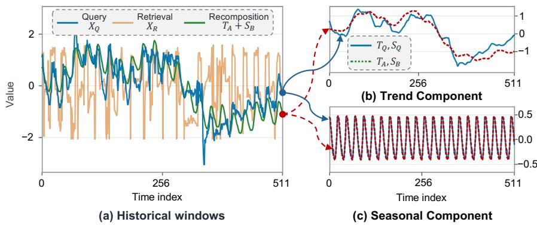

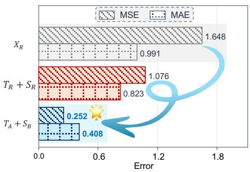  
(d) Full window errors against $X _ { Q }$

Figure 1: Motivating cases for fine-grained knowledge augmentation. (a) Comparison of the query $( X _ { Q } ) ,$ a retrieved window $( X _ { R } )$ in $\mathbf { T S } \mathbf { - R A G } ,$ , and a recomposed reference $( T _ { A } + S _ { B } ) .$ . (b–c) Comparison of the query components $( T _ { Q }$ and $s _ { Q } )$ with the matched trend $( T _ { A } )$ and seasonal $( S _ { B } )$ patterns selected from diferent pre-training contexts. (d) Window-level MSE and MAE measured against $X _ { Q } ,$ where $T _ { R }$ and $S _ { R }$ are decoupled from $X _ { R } .$ Combining trend and seasonal patterns from diferent contexts yields a closer match to the query than directly retrieving an entire window.  
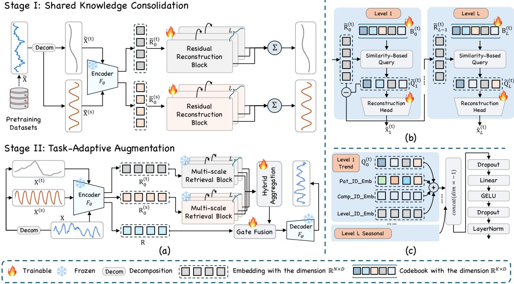  
Figure 2: Overall framework of TimeFKA . (a) Two stages: Shared Knowledge Consolidation and Task-Adaptive Augmentation. (b) Residual reconstruction block in the trend branch. (c) Hybrid Aggregation.

## 3 Methodology

Let ${ \bf x } _ { t } ~ \in ~ \mathbb { R } ^ { d }$ denote the observations from � sensors in a webservice system at the time stamp �. In the literature of time series forecasting, we use the preceding � observations as the historical input ${ \bf X } _ { t } \ \stackrel { \textstyle \subset } { = } \ [ { \bf x } _ { t - T + 1 } , \dotsc , { \bf x } _ { t } ] ^ { \top } \ \in \ \bar { \mathbb { R } } ^ { T \times d }$ and predict the following � observations $\mathbf { Y } _ { t } \ = \ [ \mathbf { x } _ { t + 1 } , \dotsc , \mathbf { x } _ { t + H } ] ^ { \top } \ \in \ \bar { \mathbb { R } } ^ { H \times d }$ , where � and � denote the context and forecast lengths, respectively. We adopt the channel-independent strategy to each paired $\left( \mathbf { X } _ { t } , \mathbf { Y } _ { t } \right) \left[ 2 1 \right]$ . For simplicity, we consider a single channel and omit the subscript index to obtain $\mathbf { \boldsymbol { X } } \in \mathbb { R } ^ { T \times 1 }$ and $\mathbf { Y } \in \overline { { \mathbb { R } } } ^ { H \times 1 }$ . The historical observation X can be decomposed into trend $\mathbf { X } ^ { ( \mathrm { t } ) } \in \mathbb { R } ^ { T \times 1 }$ and seasonal components $\mathbf { X } ^ { \left( s \right) } \in \mathbb { R } ^ { \hat { T } \times 1 } \left[ 2 9 , 3 0 \right]$

The overall framework of TimeFKA is shown in Fig. 2. Specifically, TimeFKA includes two stages: Stage I aims to consolidate reusable knowledge from the pretrained corpus into residual codebooks shared across all downstream forecasting tasks; Stage II enhances the prediction performance of TSFMs by task-adaptive augmentation.

## 3.1 Stage I: Shared Knowledge Consolidation

In the knowledge augmentation-based methods, diverse formats of temporal knowledge are organized from the pre-training corpus, such as time series samples in TS-RAG [22] and prediction quan tiles [19]. However, the coarse-grained knowledge may introduce context-specific variations and perturb downstream forecasting. In this stage, we aim to cultivate the underlying temporal patterns from the trend and seasonal perspectives, as the basic retrieval units. Specifically, we decompose sampled pre-training contexts into trend and seasonal components and learn separate residual quantization codebooks, which serve as fine-grained retrieval units for downstream knowledge augmentation.

Following TS-RAG [22], we first uniformly sample time-series instances from the pretraining corpus of Chronos [2] and only retain their input contexts to construct $\mathcal { D } _ { \mathrm { p r e } }$ , but exclude the future segments. Each segment $\widetilde { \mathbf { X } } \in \mathcal { D } _ { \mathrm { p r e } }$ is preprocessed by the channelindependent strategy, thus $\widetilde { \mathbf { X } } \in \mathbb { R } ^ { T \times 1 }$ . We also decompose Xe into the trend $\widetilde { \mathbf { X } } ^ { ( \mathrm { t } ) } \in \mathbb { R } ^ { T \times 1 }$ and seasonal components $\widetilde { \mathbf { X } } ^ { ( s ) } \in \mathbb { R } ^ { T \times 1 }$ , which work as the reconstruction targets to cultivate temporal codebooks.

For each component m $\in \{ s : \pentagon$ ��������, t : �����}, the overall forward process can be formulated as

$$
\begin{array} { r l } & { \displaystyle \widetilde { \mathbf { R } } _ { 0 } ^ { ( \mathrm { m } ) } = { \mathsf { s g } } \Big ( F _ { \theta } \Big ( \widetilde { \mathbf { X } } ^ { ( \mathrm { m } ) } \Big ) \Big ) , } \\ & { \displaystyle \big ( \widetilde { \mathbf { R } } _ { l } ^ { ( \mathrm { m } ) } , \widehat { \mathbf { x } } _ { l } ^ { ( \mathrm { m } ) } \big ) = { \mathsf { R R B } } _ { l } ^ { ( \mathrm { m } ) } \big ( \widetilde { \mathbf { R } } _ { l - 1 } ^ { ( \mathrm { m } ) } \big ) , 1 \leq l \leq L , } \\ & { \displaystyle \qquad \widehat { \mathbf { X } } ^ { ( \mathrm { m } ) } = \sum _ { l = 1 } ^ { L } \widehat { \mathbf { x } } _ { l } ^ { ( \mathrm { m } ) } , } \end{array}\tag{1}
$$

where $s \mathfrak { g } ( \cdot )$ represents the stop-gradient operation. $F _ { \theta }$ denotes the frozen TSFM backbone, which divides $\widetilde { \mathbf { X } } ^ { ( \mathrm { m } ) }$ into non-overlapping patches with the length of $L _ { p }$ and accordingly we can have $N =$ $\begin{array} { r } { \lceil \frac { T - L _ { p } } { L _ { p } } \rceil + 1 } \end{array}$ patches. We can have $\widetilde { \mathbf { R } } _ { 0 } ^ { ( \mathrm { m } ) } \in \mathbb { R } ^ { N \times D }$ from the frozen TSFM backbone. The residual reconstruction block RRB $_ l ^ { ( \mathrm { m ) } }$ returns the residual embedding for the next block and a contribution $\widehat { \mathbf { x } } _ { l } ^ { ( \mathrm { m ) } } \in$ $\mathbb { R } ^ { T \times 1 }$ for reconstruction.

Residual Reconstruction Block. Each RRB(m) i ncludes a trainable codebook $\mathbf { B } _ { I } ^ { ( \mathrm { m } ) } \in \mathbb { R } ^ { K \times D }$ and a reconstruction head $G _ { I } ^ { ( \mathrm { m ) } }$ . We quantize the residual embedding through row-wise similarity-based query:

$$
\widetilde { I } _ { l } ^ { ( \mathrm { m } ) } = \mathrm { N N } _ { \mathrm { r o w } } \left( \widetilde { \mathbf { R } } _ { l - 1 } ^ { ( \mathrm { m } ) } , \mathbf { B } _ { l } ^ { ( \mathrm { m } ) } \right) , \quad \widetilde { \mathbf { Q } } _ { l } ^ { ( \mathrm { m } ) } = \mathbf { B } _ { l } ^ { ( \mathrm { m } ) } [ \widetilde { I } _ { l } ^ { ( \mathrm { m } ) } , : ] \in \mathbb { R } ^ { N \times D } ,\tag{2}
$$

where $\mathrm { N N } _ { \mathrm { r o w } }$ independently selects the most similar code vectors for each row under squared Euclidean distance and returns an index vector $I _ { \imath } ^ { \mathrm { ( m ) } } \in \{ 1 , . . . , K \} ^ { N }$ . The indexing operation obtains the selected code vectors correspondingly.

The quantized embedding ${ \widetilde Q } _ { l } ^ { ( \mathrm { m ) } }$ is used for both reconstruction and residual refinement. For reconstruction, the level-specific head maps ${ \widetilde Q } _ { l } ^ { ( \mathrm { m ) } }$ to the reconstruction contribution $\widehat { \mathbf { x } } _ { l } ^ { ( \mathrm { m } ) }$ :

$$
\begin{array} { r l } & { G _ { l } ^ { ( \mathrm { m } ) } \left( \widetilde { \mathbf { Q } } _ { l } ^ { ( \mathrm { m } ) } \right) = \widetilde { \mathbf { Q } } _ { l } ^ { ( \mathrm { m } ) } \mathbf { W } _ { \mathrm { r e c } , l } ^ { ( \mathrm { m } ) } + \mathbf { 1 } _ { N } \left( \mathbf { b } _ { \mathrm { r e c } , l } ^ { ( \mathrm { m } ) } \right) ^ { \top } \in \mathbb { R } ^ { N \times L _ { P } } , } \\ & { \qquad \widehat { \mathbf { x } } _ { l } ^ { ( \mathrm { m } ) } = \mathsf { F l a t t e n } \left( G _ { l } ^ { ( \mathrm { m } ) } \left( \widetilde { \mathbf { Q } } _ { l } ^ { ( \mathrm { m } ) } \right) \right) , } \end{array}\tag{3}
$$

where ${ \bf W } _ { \mathrm { r e c } , l } ^ { ( \mathrm { m } ) } \in \mathbb { R } ^ { D \times L _ { P } } , { \bf b } _ { \mathrm { r e c } , l } ^ { ( \mathrm { m } ) } \in \mathbb { R } ^ { L _ { P } }$ , and $\mathbf { 1 } _ { N } \in \mathbb { R } ^ { N \times 1 }$ . The operator Flatten assembles the reconstructed patches in temporal order, following the boundary handling of the input patching procedure. The residual embedding passed to the next block is updated as

$$
\widetilde { \mathbf { R } } _ { l } ^ { ( \mathrm { m } ) } = \widetilde { \mathbf { R } } _ { l - 1 } ^ { ( \mathrm { m } ) } - s \mathbf { g } \left( \widetilde { \mathbf { Q } } _ { l } ^ { ( \mathrm { m } ) } \right) ,\tag{4}
$$

The stop-gradient operation sg applies only to the residual-update branch and the reconstruction branch remains diferentiable with respect to the selected code vectors and reconstruction-head parameters. After � blocks, the level-wise reconstruction contributions are summed as in Eq. (1) to obtain $\widehat { \mathbf { X } } ^ { ( \mathrm { m } ) }$

Supervision Task. The supervision loss $\mathcal { L } _ { \mathrm { p r e } } ^ { ( \mathrm { m } ) }$ is formulated as

$$
\begin{array} { r l } & { \mathcal { L } _ { \mathrm { a l i g n } } ^ { ( \mathrm { m } ) } = \displaystyle \frac { 1 } { L } \sum _ { l = 1 } ^ { L } \left\| \mathrm { s g } \left( \widetilde { \mathbf { R } } _ { l - 1 } ^ { ( \mathrm { m } ) } \right) - \widetilde { \mathbf { Q } } _ { l } ^ { ( \mathrm { m } ) } \right\| _ { 2 } ^ { 2 } , } \\ & { \mathcal { L } _ { \mathrm { r e c } } ^ { ( \mathrm { m } ) } = \displaystyle \frac { 1 } { T } \left\| \widehat { { \mathbf X } } ^ { ( \mathrm { m } ) } - \widetilde { { \mathbf X } } ^ { ( \mathrm { m } ) } \right\| _ { 2 } ^ { 2 } , } \\ & { \mathcal { L } _ { \mathrm { p r e } } ^ { ( \mathrm { m } ) } = \mathcal { L } _ { \mathrm { r e c } } ^ { ( \mathrm { m } ) } + \lambda _ { \mathrm { a l i g n } } \mathcal { L } _ { \mathrm { a l i g n } } ^ { ( \mathrm { m } ) } . } \end{array}\tag{5}
$$

The alignment term encourages the selected code vectors in ${ \widetilde Q } _ { I } ^ { ( \mathrm { m ) } }$ to approximate the corresponding residual embeddings in $\widetilde { \mathbf { R } } _ { l - 1 } ^ { ( \mathrm { m } ) }$ which are treated as fixed targets by the stop-gradient operator. The reconstruction term compares the combined reconstruction with the targets, jointly supervising all level-specific reconstruction heads. The coeficient $\lambda _ { \mathrm { a l i g n } }$ balances codebook alignment against reconstruction. We minimize $\mathcal { L } _ { \mathrm { p r e } } ^ { ( \mathrm { m } ) }$ over the trend or seasonal codebooks and their reconstruction heads while keeping the TSFM backbone frozen. In this stage, we train the trend and seasonal residual codebooks in parallel.

## 3.2 Stage II: Task-Adaptive Augmentation

The residual codebooks learned in Stage I provide fine-grained temporal patterns, but similarity-based matching alone does not specify how the retrieved information should contribute to downstream forecasting. Stage II therefore aims to adapt the use of the shared knowledge to the forecasting task. Specifically, we aggregate trend and seasonal patterns across residual levels and integrate the resulting condition into the original TSFM representation through gated residual fusion. This adapter is optimized under downstream forecasting supervision, while the codebooks and TSFM remain frozen.

Given a downstream input context X, we obtain its trend and seasonal decompositions, denoted as $\mathbf { X } ^ { ( \mathrm { t } ) }$ and $\mathbf { X } ^ { ( \mathrm { s } ) }$ respectively. The overall forward process in Stage II can be formulated as

$$
\begin{array} { r l } & { \mathbf { R } = s \mathbf { g } ( F _ { \theta } ( \mathbf { X } ) ) , \mathbf { R } _ { 0 } ^ { \mathrm { ( m ) } } = s \mathbf { g } \Big ( F _ { \theta } ( \mathbf { X } ^ { \mathrm { ( m ) } } ) \Big ) , } \\ & { \qquad \big ( \mathbf { R } _ { l } ^ { \mathrm { ( m ) } } , \mathbf { Q } _ { l } ^ { \mathrm { ( m ) } } \big ) = \mathsf { N R B } _ { l } ^ { \mathrm { ( m ) } } \big ( \mathbf { R } _ { l - 1 } ^ { \mathrm { ( m ) } } \big ) , } \\ &  \qquad \widehat { \mathbf { Y } } = F _ { \varphi } \big ( \mathsf { G a t e F u s e } \big ( \mathbf { R } , { \mathsf { H y p e r A g g } \big ( \left\{ \mathbf { Q } _ { l } ^ { \mathrm { ( t ) } } , \mathbf { Q } _ { l } ^ { \mathrm { ( s ) } } \right\} _ { l = 1 } ^ { L } \big ) \big ) \big ) , } \end{array}\tag{6}
$$

where m ∈ {s : ��������, t : �����}. R, $\mathbf { R } _ { 0 } ^ { \mathrm { ( t ) } }$ , and $\mathbf { R } _ { 0 } ^ { ( s ) }$ denote the frozen embeddings from the raw input, the trend and seasonal decompositions respectively. The Multi-scale Retrieval Block MR $\mathbf { \Delta } _ { l } ^ { ( \mathrm { m ) } }$ queries the token vectors ${ \sf Q } _ { l } ^ { ( \mathrm { m ) } }$ and obtains the residual embedding $\mathbf { R } _ { l } ^ { ( \mathrm { m ) } }$ for the next level. We then perform a hybrid aggregation of these queried tokens and learnable identity embeddings. After gate fusion, the frozen decoder $F _ { \varphi }$ of the adopted TSFM yields the prediction result bY.

Multi-scale Retrieval Block. For each component m $\in \{ s , t \}$ , the �-th block obtains ${ \sf Q } _ { l } ^ { ( \mathrm { m ) } }$ and ${ \bf R } _ { I } ^ { ( \mathrm { m ) } }$ from $\mathbf { R } _ { l - 1 } ^ { ( \mathrm { m } ) }$ following the retrieval and residual-update process in Eqs. (2) and (4) respectively, with the corresponding codebook $\mathbf { B } _ { l } ^ { ( \mathrm { m ) } }$ kept frozen. The updated residual $\mathbf { R } _ { l } ^ { ( \mathrm { m ) } }$ is passed to the next level, while the retrieved representations $\left\{ \mathbf { Q } _ { l } ^ { \left( \mathrm { t } \right) } , \mathbf { Q } _ { l } ^ { \left( \mathrm { s } \right) } \right\} _ { l = 1 } ^ { L }$ are generated for hybrid aggregation.

Hybrid Aggregation and Gate Fusion. The hybrid aggregation HyperAgg operates on ${ \sf Q } _ { I } ^ { ( \mathrm { t } ) }$ and $\boldsymbol { \mathrm { Q } } _ { l } ^ { ( s ) }$ . We first augment each matrix with trainable identity embeddings for the two components, � quantization levels, and � patch positions. For the trend component:

$$
\overline { { \mathbf { Q } } } _ { l } ^ { ( \mathrm { t } ) } = \mathbf { Q } _ { l } ^ { ( \mathrm { t } ) } + \mathbf { E } _ { \mathrm { p o s } } + \mathbf { 1 } _ { N } \big ( \mathbf { e } _ { \mathrm { c o m p } } ^ { ( \mathrm { t } ) } \big ) ^ { \top } + \mathbf { 1 } _ { N } \big ( \mathbf { e } _ { \mathrm { l e v e l } } ^ { ( l ) } \big ) ^ { \top } ,\tag{7}
$$

where $\mathbf { e } _ { \mathrm { c o m p } } ^ { ( \mathrm { t } ) } , \mathbf { e } _ { \mathrm { l e v e l } } ^ { ( l ) } \ \in \ \mathbb { R } ^ { D \times 1 }$ are trainable component- and levelspecific vectors respectively. $\mathbf { E } _ { \mathrm { p o s } } \in \mathbb { R } ^ { N \times D }$ denotes the trainable patch-position embeddings. We obtain $\overline { { \mathbf { Q } } } _ { l } ^ { ( \mathrm { s } ) } \in \mathbb { R } ^ { N \times D }$ in the same way, replacing the trend component embedding ${ \bf e } _ { \mathrm { c o m p } } ^ { \mathrm { ( t ) } }$ with $\mathbf { e } _ { \mathrm { c o m p } } ^ { ( s ) }$ while sharing the level and position embeddings.

We concatenate the augmented embeddings along the feature dimension in a fixed component and level order:

$$
{ \bf Q } _ { \mathrm { a l l } } = \mathtt { C o n c a t } \big ( \overline { { \mathsf { Q } } } _ { 1 } ^ { ( \mathrm { t } ) } , \ldots , \overline { { \mathsf { Q } } } _ { L } ^ { ( \mathrm { t } ) } , \overline { { \mathsf { Q } } } _ { 1 } ^ { ( \mathrm { s } ) } , \ldots , \overline { { \mathsf { Q } } } _ { L } ^ { ( \mathrm { s } ) } \big ) \in \mathbb { R } ^ { N \times 2 L D } .\tag{8}
$$

We then adopt a linear aggregation layer for these embeddings:

$$
\mathbf { U } = \mathsf { L N } \big ( \mathsf { D r o p o u t } \big ( \mathsf { G E L U } \big ( \mathsf { D r o p o u t } ( \mathsf { Q } _ { \mathrm { a l l } } ) \mathbf { W } _ { u } ^ { \top } + \mathbf { 1 } _ { N } \mathbf { b } _ { u } ^ { \top } \big ) \big ) \big ) ,\tag{9}
$$

where $\mathbf { W } _ { u } \in \mathbb { R } ^ { D \times 2 L D }$ and $\mathbf { b } _ { u } \in \mathbb { R } ^ { D \times 1 }$ are trainable parameters. The linear map uses the same weights for all rows, Dropout applies element-wise dropout, and LN normalizes the � features within each row.

The gate fusion module GateFuse projects the joint embedding and combines with the original embedding R:

$$
\begin{array} { r l } & { \Delta = \mathbf { U } \mathbf { W } _ { o } ^ { \top } + \mathbf { 1 } _ { N } \mathbf { b } _ { o } ^ { \top } , } \\ & { } \\ & { \mathbf { G } = \sigma \Big ( [ \mathbf { R } \| \Delta ] \mathbf { W } _ { g } ^ { \top } + \mathbf { 1 } _ { N } \mathbf { b } _ { g } ^ { \top } \Big ) , } \\ & { \mathbf { R } ^ { \prime } = \mathbf { R } + \mathbf { G } \odot \Delta , } \end{array}\tag{10}
$$

where ${ \bf W } _ { o } \in \mathbb { R } ^ { D \times D } , { \bf W } _ { g } \in \mathbb { R } ^ { D \times 2 D }$ , and $\mathbf { b } _ { o } , \mathbf { b } _ { q } \ \in \ \mathbb { R } ^ { D }$ are trainable parameters. The concatenation $[ \mathbf { R } | | \Delta ] \in \mathbb { R } ^ { \tilde { N } \times 2 D }$ joins the two matrices along the feature dimension. The sigmoid � produces ${ \bf G } \in ( 0 , 1 ) ^ { N \times D }$ , and ⊙ denotes element-wise multiplication.

Supervision Task. We can obtain the prediction results $\widehat { \mathbf { Y } } = F _ { \varphi } ( \mathbf { R } ^ { \prime } )$ We respectively train the adaptation modules for each downstream dataset using paired input contexts and forecasting targets (X, Y) in the training datasets. Here, we do not introduce a new supervised loss function $\mathcal { L } _ { \mathrm { t a s k } }$ but adopt the TSFM-specific pre-trained loss. Taking the Chronos-Bolt as an example, we instantiate $\mathcal { L } _ { \mathrm { t a s k } }$ with its original native multi-quantile pinball loss:

$$
\begin{array} { l } { \displaystyle \mathcal { L } _ { \mathrm { t a s k } } = \frac { 2 } { N _ { q } } \sum _ { k = 1 } ^ { N _ { q } } \sum _ { h = 1 } ^ { H } \rho _ { \tau _ { k } } \left( y _ { h } - \widehat { y } _ { h } ^ { ( k ) } \right) , } \\ { \displaystyle \rho _ { \tau _ { k } } ( e ) = \operatorname* { m a x } \{ \tau _ { k } e , ( \tau _ { k } - 1 ) e \} , } \end{array}\tag{11}
$$

where $\{ \tau _ { k } | 0 < \tau _ { k } < 1 \} _ { k = 1 } ^ { N _ { q } }$ denote the $N _ { q }$ native quantile levels. $y _ { h }$ denotes the ground truth at the future time step ℎ, and $\widehat { y } _ { h } ^ { ( k ) }$ denotes the corresponding prediction at quantile level $\tau _ { k } . \rho _ { \tau _ { k } }$ denotes the pinball loss.

Training and Inference. In this stage, we freeze the encoder $F _ { \theta }$ and decoder $F _ { \varphi }$ modules in the TSFM and the learned codebook in Stage I. We minimize $\mathcal { L } _ { \mathrm { t a s k } }$ with respect to the introduced parameters in hybrid aggregation and gate fusion for each downstream forecasting task. At inference, we apply the Stage II forward process in Equation (6) on each input context from the corresponding task to obtain the final prediction results.

## 4 Experiments

We conduct extensive experiments to answer the four research questions as follows.

• RQ1: Can TimeFKA enhance the TSFMs’ forecasting and outperform existing parametric adaptation and knowledge augmentation approaches? (Efectiveness)

• RQ2: How does TimeFKA perform under backbone scaling and cross-model/cross-dataset transfer? (Robustness)

• RQ3: How does TimeFKA work? Which components play the key roles for the efectiveness of TimeFKA ? (Mechanism)

• RQ4: How does the eficiency of TimeFKA compare with that of the existing baseline methods? (Eficiency)

## 4.1 Experimental Setup

Datasets. To guarantee fair comparison, we follow TS-RAG to construct the bank of input contexts $\mathcal { D } _ { \mathrm { p r e } }$ . We evaluate on eight widelyused multivariate forecasting benchmarks (ETTh1/2, ETTm1/2, Electricity, Exchange-rate, Trafic, Weather) [38], covering diverse domains and sampling frequencies. More details in Table 4.

Baselines. We apply our proposed TimeFKA to four representative TSFMs, including encoder–decoder Chronos-Bolt-base [2], decoderonly TimesFM 2.5 [5], encoder-only Moirai 2 [28] and MLP-based TTM 2 [8]. We compare TimeFKA with five representative baselines: RAFT [27], SARAF [39], MEMTS [35], TS-RAG [22], and TS-Memory [19]. More details of these TSFMs and baselines are provided in Appendix A.

Implementations. The context length � is set to 512 for both Stages. To evaluate multi-scale prediction performance, we set the horizon length � ∈ {96, 192, 336, 720}. The mean squared error (MSE) and mean absolute error (MAE) are adopted as the evaluation metrics. The residual level �, codebook size $K ,$ and alignment task coeficient $\lambda _ { \mathrm { a l i g n } }$ are set to 2, 256, and 0.25 respectively. The detailed hyperparameter investigations are provided in Appendix B. In Stage I and II, training is iterated for 20 and 5 epochs respectively. The two stages are optimized with AdamW with a fixed learning rate of $1 0 ^ { - 4 }$ and a weight decay of 0.01, and the batch size of 256. All experiments are conducted on one NVIDIA A100-SXM4-40GB GPU.

Table 1: Overall forecasting results of TimeFKA across frozen TSFM backbones. Results are averaged over five independent runs and forecasting horizons � ∈ {96, 192, 336, 720}. Electricity, Weather, and Trafic are included in the pre-training corpus of TimesFM 2.5, and the corresponding results are omitted and marked with ‘–’. We report relative error reductions (↓percentages) compared with the corresponding zero-shot averages. Full results are provided in Table 5.
<table><tr><td rowspan="2">TSFM Dataset</td><td colspan="2">ChronosBolt-base</td><td colspan="2">TimesFM 2.5</td><td colspan="3">Moirai 2</td><td colspan="3">TTM 2</td></tr><tr><td>Zero-shot</td><td>TimeFKA</td><td>Zero-shot</td><td>TimeFKA</td><td></td><td>Zero-shot</td><td>TimeFKA</td><td>Zero-shot</td><td>TimeFKA</td><td></td></tr><tr><td>Metric</td><td>MSE MAE</td><td>MSE MAE</td><td>MSE MAE</td><td>MSE</td><td>MAE MSE</td><td>MAE MSE</td><td>MAE</td><td>MSE MAE</td><td>MSE</td><td>MAE</td></tr><tr><td>ETTh1</td><td>0.4479 0.4185</td><td>0.4053(↓9.5%) 0.4056(↓3.1%)</td><td>0.4793 0.4423</td><td>0.4480(↓6.5%)</td><td>0.4314(↓2.5%) 0.4438</td><td>0.4147</td><td>0.3931(↓11.4%) 0.4028(↓2.9%)</td><td>0.5492 0.5048</td><td>|0.3822(↓30.4%)</td><td>0.4170(↓17.4%)</td></tr><tr><td>ETTh2</td><td>0.3666 0.3795</td><td>0.3116(↓15.0%) 0.3557(↓6.3%)</td><td>0.4022 0.4094</td><td>0.3643(↓9.4%)</td><td> $0 . 3 9 7 7 ( \downarrow 2 . 9 \% )$  0.3884</td><td>0.3928 0.3728(↓4.0%)</td><td>0.3907(↓0.5%)</td><td>0.4008 0.4291</td><td>0.2984(↓25.5%)</td><td>0.3600(↓16.1%)</td></tr><tr><td>ETTm1</td><td>0.4208 0.3829</td><td>0.3510(↓16.6%) 0.3734(↓2.5%)</td><td>0.4290 0.4160</td><td>0.3820(↓11.0%)</td><td> $0 . 3 9 5 9 ( \downarrow 4 . 8 \% )$  0.5138</td><td>0.4425</td><td>0.3623(↓29.5%) 0.3775(↓14.7%)</td><td>0.7426 0.5560</td><td>0.3593(↓51.6%)</td><td>0.3822(↓31.3%)</td></tr><tr><td>ETTm2</td><td>0.2905 0.3173</td><td>0.2658(↓8.5%) 0.3034(↓4.4%)</td><td>0.3315 0.3412</td><td>0.2785(↓16.0%)</td><td>0.3240(↓5.0%) 0.3569</td><td>0.3462</td><td>0.2638(↓26.1%) 0.3100(↓10.5%)</td><td>0.3244 0.3659</td><td>|0.2651(↓18.3%)</td><td>0.3200(↓12.5%)</td></tr><tr><td>Exchange</td><td>|0.3712 0.4121</td><td>0.3508(↓5.5%) 0.3982(↓3.4%)</td><td>0.4030 0.4269</td><td>0.3668(↓9.0%)</td><td>0.4102(↓3.9%) 0.3795</td><td>0.4108</td><td>|0.2517(↓33.7%) 0.3550(↓13.6%)</td><td>0.4609</td><td>0.4677 0.4280(↓7.1%)</td><td>0.4352(↓6.9%)</td></tr><tr><td>Electricity</td><td>0.1588 0.2439</td><td>0.1528(↓3.8%) 0.2407(↓1.3%)</td><td></td><td></td><td>0.1634</td><td>0.2475</td><td>0.1575(↓3.6%) 0.2434(↓1.7%)</td><td>0.4892</td><td>0.5467 |0.1638(↓66.5%)</td><td>0.2648(↓51.6%)</td></tr><tr><td>Weather</td><td>0.2631 0.2762</td><td>|0.2282(↓13.3%) 0.2504(↓9.3%)</td><td></td><td></td><td>0.2730</td><td>0.2753</td><td>|0.2377(↓12.9%) 0.2639(↓4.1%)</td><td>0.2215</td><td>0.2373 0.2047(↓7.6%)</td><td>0.2304(↓2.9%)</td></tr><tr><td>Traffic</td><td>0.4349 0.2627</td><td>|0.3756(↓13.6%) 0.2326(↓11.5%)</td><td></td><td></td><td>0.3908</td><td>0.2427</td><td>0.3834(↓1.9%) 0.2380(↓1.9%)</td><td>0.3696</td><td>0.2437 0.3674(↓0.6%)</td><td>0.2410(↓1.1%)</td></tr></table>

Table 2: Forecasting results comparison on ChronosBolt-base. Results are averaged over forecasting horizons � ∈ {96, 192, 336, 720}. The best results are highlighted in purple, and the second-best underlined in green; ties are determined at the displayed precision. We report relative error reductions (↓percentages) and increases (↑percentages) compared with zero-shot forecasting, computed from the displayed average results. OOM: out of memory. Full results are provided in Table 6.
<table><tr><td>Dataset</td><td>Zero-shot</td><td></td><td>RAFT</td><td>TS-RAG</td><td></td><td>TS-Memory</td><td>SARAF</td><td></td><td>MEMTS</td><td></td><td>TimeFKA</td><td></td></tr><tr><td>Metric</td><td>MSE MAE</td><td>MSE</td><td>MAE</td><td>MSE</td><td>MAE</td><td>MSE MAE</td><td>MSE</td><td>MAE</td><td>MSE</td><td>MAE</td><td>MSE</td><td>MAE</td></tr><tr><td>ETTh1</td><td>0.4479 0.4185</td><td>|0.4368(↓2.5%)</td><td>0.4176(↓0.2%)</td><td>|0.4423(↓1.3%)</td><td>0.4214(↑0.7%) 0.4310(↓3.8%)</td><td>0.4199(↑0.3%)</td><td>0.4095(↓8.6%)</td><td>0.4276(↑2.2%)</td><td>0.4332(↓3.3%)</td><td>0.4093(↓2.2%)</td><td>0.4053(↓9.5%)</td><td>0.4056(↓3.1%)</td></tr><tr><td>ETTh2</td><td>0.3666 0.3795</td><td>|0.3574(↓2.5%)</td><td>0.3776(↓0.5%)</td><td>|0.3616(↓1.4%)</td><td>0.3853(↑1.5%) 0.3634(↓0.9%)</td><td> $0 . 3 7 9 0 ( \downarrow 0 . 1 \% )$ </td><td>0.3411(↓7.0%)</td><td>0.3918(↑3.2%)</td><td>0.3224(↓12.1%)</td><td>0.3559(↓6.2%)</td><td>0.3116(↓15.0%)</td><td>0.3557(↓6.3%)</td></tr><tr><td>ETTm1</td><td>0.4208 0.3829|</td><td>|0.3975(↓5.5%)</td><td>0.3768(↓1.6%)</td><td>|0.4058(↓3.6%)</td><td>0.3813(↓0.4%) |0.3756(↓10.7%)</td><td>0.3722(↓2.8%)</td><td>0.3534(↓16.0%)</td><td>0.3816(↓0.3%)</td><td>0.4096(↓2.7%)</td><td>0.3849(↑0.5%)</td><td>0.3510(↓16.6%)</td><td>0.3734(↓2.5%)</td></tr><tr><td>ETTm2</td><td>0.2905</td><td>0.3173 | 0.2810(↓3.3%)</td><td>0.3145(↓0.9%) |0.2829(↓2.6%)</td><td>0.3181(↑0.3%)</td><td>0.2751(↓5.3%)</td><td>0.3163(↓0.3%)</td><td>|0.2520(↓13.3%)</td><td>0.3153(↓0.6%)</td><td>0.2950(↑1.5%)</td><td>0.3247(↑2.3%)</td><td>0.2658(↓8.5%)</td><td>0.3034(↓4.4%)</td></tr><tr><td>Exchange</td><td>0.3712</td><td>0.4121 |0.3687(↓0.7%) 0.4085(↓0.9%)</td><td></td><td>0.3669(↓1.2%) 0.4079(↓1.0%)</td><td>0.3980(↑7.2%)</td><td>0.4314(↑4.7%)</td><td>0.3945(↑6.3%)</td><td>0.4192(↑1.7%)</td><td>0.3775(↑1.7%)</td><td>0.4116(↓0.1%)</td><td>0.3508(↓5.5%)</td><td>0.3982(↓3.4%)</td></tr><tr><td>Weather</td><td>0.2631 0.2762</td><td>|0.2539(↓3.5%)</td><td>0.2680(↓3.0%)</td><td>|0.2615(↓0.6%) 0.2794(↑1.2%)</td><td>0.2446(↓7.0%)</td><td>0.2824(↑2.2%)</td><td>0.2454(↓6.7%)</td><td>0.2939(↑6.4%)</td><td>0.2575(↓2.1%)</td><td>0.2914(↑5.5%)</td><td>0.2282(↓13.3%)</td><td>0.2504(↓9.3%)</td></tr><tr><td>Electricity</td><td>0.1588 0.2439</td><td>|0.1564(↓1.5%) 0.2443(↑0.2%)</td><td></td><td>0.1567(↓1.3%) 0.2445(↑0.2%)</td><td>0.1573(↓0.9%)</td><td>0.2434(0.2%)</td><td>0.1529(↓3.7%)</td><td>0.2538(4.1%)</td><td>OOM</td><td>OOM</td><td>0.1528(↓3.8%)</td><td>0.2407(↓1.3%)</td></tr><tr><td>Traffic</td><td>0.4349</td><td></td><td></td><td>0.2627 | 0.4265(↓1.9%) 0.2608(↓0.7%) | 0.4267(↓1.9%) 0.2609(↓0.7%)</td><td>0.4273(↓1.7%)</td><td>0.2608(↓0.7%)</td><td>0.4127(↓5.1%)</td><td>0.2943(↑12.0%)</td><td>OOM</td><td>OOM</td><td>|0.3756(↓13.6%)</td><td>0.2326(↓11.5%)</td></tr></table>

Table 3: Cross-dataset adapter transferability on ChronosBolt-base. We report the relative performance increase (↓percentages) compared to MEMTS. $\mathbf { E T T _ { p o o l } } \mathrm { : }$ pooled four ETT datasets.
<table><tr><td></td><td>MEMTS</td><td colspan="2">TimeFKA</td></tr><tr><td>Source→Target</td><td>MSE MAE</td><td>MSE</td><td>MAE</td></tr><tr><td>Weather→ ETTm1</td><td>|0.42030.3974</td><td>0.3843(↓8.57%)</td><td>0.3948(↓0.65%)</td></tr><tr><td>Weather→ ETTm2</td><td>0.31130.3620</td><td>0.2993(↓3.85%)</td><td>0.3247(↓10.30%)</td></tr><tr><td>ETTm2 → ETTm1</td><td>0.41900.3834</td><td>0.3990(↓4.77%)</td><td>0.3782(↓1.36%)</td></tr><tr><td>ETTm1 → ETTm2</td><td>0.29410.3367</td><td>0.2862(↓2.69%)</td><td>0.3187(↓5.35%)</td></tr><tr><td> $\mathrm { E T T _ { p o o l }  }$ </td><td>ETTm1 |0.4179 0.3877|</td><td>|0.3617(↓13.45%)</td><td>0.3741(↓3.51%)</td></tr><tr><td> $\mathrm { E T T } _ { \mathrm { p o o l } } \to \mathrm { E T T m 2 }$ </td><td>|0.29190.3273|</td><td>0.2660(↓8.87%)</td><td>0.3059(↓6.54%)</td></tr></table>

## 4.2 RQ1: Efectiveness Study

Performance Across Backbones. Table 1 reports the forecasting results of TimeFKA across four frozen TSFM backbones, averaged over five independent runs and four forecasting horizons.

TimeFKA reduces both MSE and MAE in all 29 evaluation settings under this horizon-averaged evaluation, consistently outperforming the zero-shot performance. The average relative MSE reductions across the evaluated datasets are 10.7%, 10.4%, 15.4%, and 26.0% for ChronosBolt-base, TimesFM 2.5, Moirai 2, and TTM 2, respectively. The magnitude of improvement varies across backbones and datasets. For example, on Electricity, TimeFKA reduces MSE by 3.8% and 3.6% for ChronosBolt-base and Moirai 2, respectively, compared with 66.5% for TTM 2. These results demonstrate the effectiveness of TimeFKA across the evaluated frozen TSFMs, and the improvements vary according to the backbones and downstream datasets.

Comparison with Baselines. Table 2 compares TimeFKA with five representative baselines on ChronosBolt-base. TimeFKA achieves the lowest average MSE or MAE results on seven of the eight datasets. Compared with the best baseline in terms of MSE on each dataset, TimeFKA reduces MSE by 3.3% on ETTh2, 6.7% on Weather, and 9.0% on Trafic. These gains are consistent with the motivation for fine-grained knowledge augmentation. Retrieving trend and seasonal patterns from separate residual codebooks enables temporal knowledge to be reused beyond its original combinations in individual contexts. The task-adaptive adapter learns how to combine these patterns with the original TSFM representation under forecasting supervision.

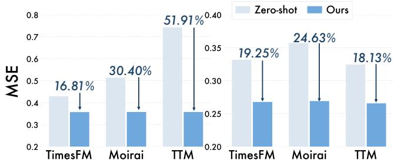  
Figure 3: Cross-TSFM residual codebook transferability on ETTm1 (left) and ETTm2 (right).

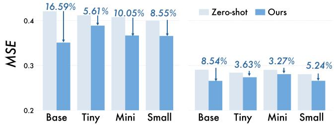  
Figure 4: Residual codebook transferability across Chronos-Bolt model sizes on ETTm1 (left) and ETTm2 (right).

## 4.3 RQ2: Transferability Study

Cross-Dataset Adapter Transfer. Table 3 evaluates the crossdataset transferability of the Stage II adapter, including HyperAgg and GateFuse, on ChronosBolt-base. We train the adapter on the source data and directly apply it to the target dataset without further optimization. We distinguish between within-domain transfer between ETTm1 and ETTm2 and cross-domain transfer from Weather to the ETTm datasets. TimeFKA outperforms MEMTS in all four configurations, with relative MSE reductions of 2.69%–4.77% for within-domain transfer and 3.85%–8.57% for cross-domain transfer. These results suggest that the adapter’s learned use of shared trend and seasonal patterns can generalize beyond its training dataset. We further evaluate pooled-source training using the four ETT datasets. Because this pool includes the target datasets, these configurations assess multi-dataset adaptation. Under this setting, TimeFKA reduces MSE by 13.45% on ETTm1 and 8.87% on ETTm2 compared with MEMTS, showing its efectiveness when the adapter is trained across multiple datasets.

Cross-TSFM Residual Codebook Transfer. We evaluate whether the Stage I codebooks learned in one TSFM can be reused by other frozen TSFM backbones. We transfer the learned trend and seasonal codebooks based on ChronosBolt-base to TimesFM 2.5, Moirai 2, and TTM 2. For each target TSFM, we train a new Stage II adapter on for each downstream task, while keeping both the source codebooks and the target TSFM frozen. We evaluate the forecasting performance on ETTm1 (left) and ETTm2 (right). As shown in Figure 3,

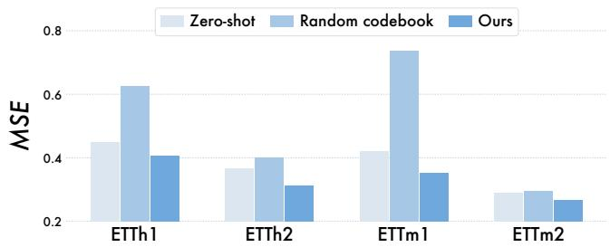  
Figure 5: Forecasting with learned versus frozen random codebooks on four ETT datasets. Stage II adapters are trained separately for the two codebook settings.

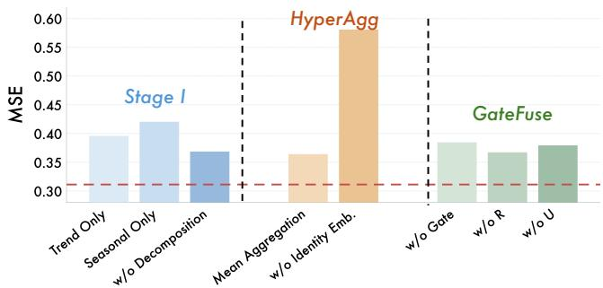  
Figure 6: Ablation study on ETTh2, examining residual codebook construction, hybrid aggregation, and gate fusion. The dashed red line indicates the performance of TimeFKA .

TimeFKA consistently outperforms the corresponding zero-shot results in all six evaluation settings. The relative reductions range from 16.81% to 51.91% on ETTm1 and from 18.13% to 24.63% on ETTm2. These results suggest that the temporal knowledge consolidated using the source TSFM remains useful for augmenting other forecasting backbones, supporting the reuse of Stage I pattern banks across diferent TSFMs.

Residual Codebook Transfer Across Model Sizes. We evaluate whether the learned residual codebooks in Stage I on ChronosBoltbase can support smaller backbones within the same model family. The source codebooks remain fixed and are reused in Stage II with frozen ChronosBolt-Tiny (9M), Mini (21M), and Small (48M). As shown in Figure 4, TimeFKA outperforms the corresponding zeroshot baselines at all four target sizes, reducing MSE by 5.61%–16.59% on ETTm1 and 3.27%–8.54% on ETTm2. These gains suggest that recurring temporal patterns learned from the pretraining corpus remain useful across backbone scales, providing smaller models with input-relevant temporal regularities.

## 4.4 RQ3: Mechanism Study

Contribution of Residual Codebooks. We compare the learned Stage I codebooks with randomly initialized codebooks that remain frozen and train the Stage II adapter separately for each setting. As shown in Figure 5, random codebooks yield higher MSE than the learned codebooks and generally underperform the zero-shot backbone. These results indicate that the gains of TimeFKA cannot be attributed solely to training the Stage II adapter, but the compact, reusable temporal patterns learned in Stage I also play an important role in improving forecasting accuracy.

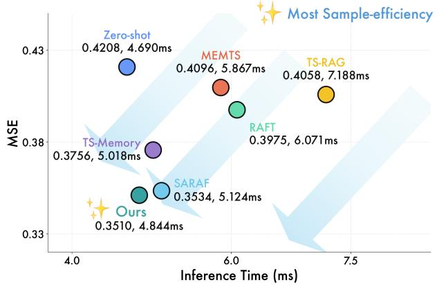  
Figure 7: Forecasting accuracy and inference latency on ETTm1. Lower values are better on both axes.

Ablation Study. Figure 6 compares TimeFKA with eight ablated variants on ETTh2. We can have the following observations.

• For Stage I, using only trend or seasonal knowledge reduces forecasting accuracy, suggesting that the two patterns provide complementary information. In w/o Decomposition, we learn a single codebook from raw inputs, which also underperforms TimeFKA , supporting the efectiveness of the fine-grained knowledge augmentation.

• For HyperAgg, replacing learned parameters with mean opera tion increases MSE, indicating the benefit of learning how to combine the retrieved tokens. Removing identity embeddings causes the largest degradation among all variants. This highlights the importance of distinguishing tokens by component, residual level, and position when aggregating knowledge from multiple sources.

• For GateFuse, removing either the original TSFM embedding R or the aggregated knowledge U degrades performance, supporting their complementary roles in forecasting. The w/o Gate variant replaces gated fusion with direct addition, i.e., R′ = R + U. Its higher MSE shows that learned gated fusion integrates the two representations more efectively than incorporating the two representations with equal weights.

Together, these results support both the organization of reusable temporal knowledge and its task-adaptive integration with the frozen TSFM.

## 4.5 RQ4: Eficiency Study

We compare the forecasting accuracy and average inference latency of TimeFKA with the baselines on ETTm1 under the same evaluation setting, specified in Section 4.1. Both MSE and inference latency are averaged over forecasting horizons � ∈ {96, 192, 336, 720}. As shown in Figure 7, TimeFKA achieves the lowest MSE of0.3510 while maintaining an inference latency of 4.844 ms. Compared with zeroshot forecasting, it reduces MSE by 16.6% with only a 3.3% increase in latency, indicating that the accuracy gain comes with limited additional inference cost. TimeFKA is approximately 1.25× faster than RAFT and 1.48× faster than TS-RAG, while reducing MSE by 11.7% and 13.5%, respectively. It also outperforms TS-Memory and MEMTS in both MSE and inference latency. This favorable tradeof is consistent with our design: Stage I consolidates temporal knowledge into compact pattern banks, so downstream retrieval does not require accessing the original pre-training windows. Stage II then aggregates the selected pattern tokens and incorporates them through a lightweight gated adapter.

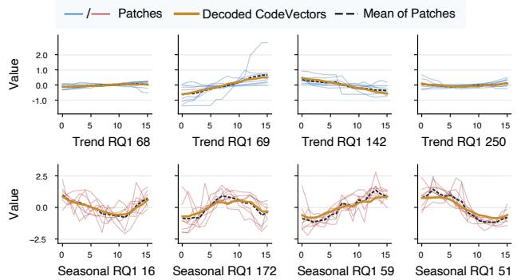  
Figure 8: Representative first-level trend and seasonal code vectors learned using ChronosBolt-base. Thin blue/red curves show assigned patches from distinct sources, orange curves show decoded code vectors, and black dashed curves show the patch means.

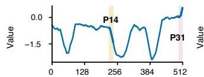

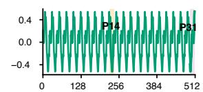

(a) Trend and Seasonal Decompositions  
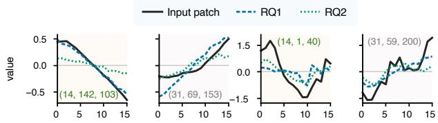  
(b) Patches and Retrieved CodeVectors

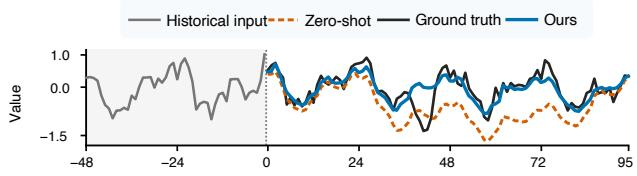  
(c) Prediction Visualizations  
Figure 9: Stage II case study on ETTh2 using ChronosBolt base. (a) Trend and seasonal inputs. (b) Highlighted patches and decoded codebook entries in each residual levels. Tuples denote (patch index, RQ1 ID, RQ2 ID). (c) Prediction comparison.

## 4.6 Case Study

Codebook Interpretation. Figure 8 illustrates the local temporal structures associated with representative first-level code vectors. The trend vectors exhibit diferent shapes, with RQ1 68 and 250 corresponding to relatively small local changes, and 69 and 142 to upward and downward movements, respectively. The seasonal vectors represent diferent local waveforms and phase positions, including trough-like and crest-like structures. Although individual patches vary in amplitude and local fluctuations, the decoded code vectors generally follow their average shapes. These examples suggest that the codebooks consolidate common local structures across historical contexts while accommodating variation among the assigned patches.

Pattern Retrieval and Forecasting Behavior. Figure 9 illustrates code selection and forecasting behavior for a selected ETTh2 sample. The trend patches P14 and P31 exhibit downward and upward movements, respectively, which are reflected in their selected RQ1 code vectors. The seasonal vectors approximate broad local variations but smooth several extrema. These examples illustrate the temporal structures associated with the selected code vectors. Stage II retrieves these reusable patterns from the codebooks learned in Stage I and integrates them with the frozen TSFM representations to augment forecasting. In Figure 9(c), the zero-shot forecast underestimates the observed level over much of the later horizon, while TimeFKA follows it more closely. For this window, MSE decreases from 0.5004 to 0.1126 and MAE from 0.5863 to 0.2279. This case illustrates forecasting behavior but may not isolate the contribution of individual codes.

## 5 Conclusion and Future Work

In this paper, we propose TimeFKA , a fine-grained knowledge augmentation framework for frozen TSFMs. TimeFKA consolidates trend and seasonal knowledge from pre-training corpora into shared residual codebooks and learns to aggregate and fuse retrieved pat terns for downstream forecasting. This design enables temporal knowledge to be reused beyond its original combinations in individual contexts, while separating shared knowledge consolidation from task-adaptive knowledge use. Experiments on eight real-world datasets with four TSFM backbones demonstrate consistent improvements over the corresponding zero-shot baselines.

Limitations and Future Work. Nevertheless, the fixed trend– seasonal decomposition imposes a predefined organization of temporal knowledge, and the frozen pattern banks do not incorporate new knowledge during downstream adaptation. Future work will explore data-driven pattern organization and continual updates to the shared banks to support knowledge reuse in evolving domains.

## Ethical Considerations & AI Disclosure

This study uses publicly available benchmark datasets for model training and evaluation and does not involve private user data or personal information. The proposed framework is intended to support research on time series forecasting and web mining. We acknowledge the use of Large Language Models during the preparation of this manuscript for the purpose of language polishing and grammar correction. All core scientific contributions are developed solely by the authors.

## References

[1] Abdul Fatir Ansari, Oleksandr Shchur, Jaris Küken, Andreas Auer, Boran Han, Pedro Mercado, Syama Sundar Rangapuram, Huibin Shen, Lorenzo Stella, Xiyuan Zhang, et al. 2025. Chronos-2: From univariate to universal forecasting

[2] Abdul Fatir Ansari, Lorenzo Stella, Caner Turkmen, Xiyuan Zhang, Pedro Mercado, Huibin Shen, Oleksandr Shchur, Syama Sundar Rangapuram, Sebastian Pineda Arango, Shubham Kapoor, et al. 2024. Chronos: Learning the language of time series.

[3] Wei Chen, Yuqian Wu, Junle Chen, Xiaofang Zhou, and Yuxuan Liang. 2026. UrbanFM: Scaling urban spatio-temporal foundation models. In Proceedings of the 32nd ACM SIGKDD Conference on Knowledge Discovery and Data Mining V. 2. 10635–10645.

[4] Wei Chen, Yuqian Wu, Yuanshao Zhu, Xixuan Hao, Shiyu Wang, and Yuxuan Liang. 2025. Select, then balance: A plug-and-play framework for exogenous aware spatio-temporal forecasting. arXiv e-prints (2025), arXiv–2509.

[5] Abhimanyu Das, Weihao Kong, Rajat Sen, and Yichen Zhou. 2024. A decoder-only foundation model for time-series forecasting.

[6] Zhijie Deng, Ling Li,Jinlong Pang, Kaiqin Hu, Qi Xuan, Zhaowei Zhu, andJiaheng Wei. 2026. CODEBLOCK: Learning to Supervise Code at the Right Granularity. arXiv preprint arXiv:2606.18286 (2026)

[7] Zhijie Deng, Zhouan Shen, Ling Li, Yao Zhou, Zhaowei Zhu, Yanji He, Wei Wang, and Jiaheng Wei. 2025. LM-mixup: Text Data Augmentation via Language Model based Mixup. arXiv preprint arXiv:2510.20449 (2025).

[8] Vijay Ekambaram, Arindam Jati, Pankaj Dayama, Sumanta Mukherjee, Nam H Nguyen, Wesley M Giford, Chandra Reddy, and Jayant Kalagnanam. 2024. Tiny time mixers (ttms): Fast pre-trained models for enhanced zero/few-shot forecasting of multivariate time series. Advances in Neural Information Processing Systems 37 (2024), 74147–74181.

[9] Xiaoxuan Fan, Jiaqi Sun, Xianjun Deng, Qiankun Zhang, Wei Xiang, Shenghao Liu, and Lingzhi Yi. 2026. Automated Model Selection for Multivariate Time Series Forecasting. In Proceedings ofthe ACM Web Conference 2026. 5322–5333.

[10] Shanghua Gao, Teddy Koker, Owen Queen, Thomas Hartvigsen, Theodoros Tsiligkaridis, and Marinka Zitnik. 2024. UniTS: A Unified Multi-Task Time Series Model. arXiv:2403.00131 [cs.LG] https://arxiv.org/abs/2403.00131

[11] Azul Garza, Cristian Challu, and Max Mergenthaler-Canseco. 2024. TimeGPT-1. arXiv:2310.03589 [cs.LG] https://arxiv.org/abs/2310.0358

[12] Mononito Goswami, Konrad Szafer, Arjun Choudhry, Yifu Cai, Shuo Li, and Artur Dubrawski. 2024. MOMENT: A Family of Open Time-series Foundation Models. arXiv:2402.03885 [cs.LG] https://arxiv.org/abs/2402.03885

[13] Huan He, Owen Queen, Teddy Koker, Consuelo Cuevas, Theodoros Tsiligkaridis, and Marinka Zitnik. 2023. Domain adaptation for time series under feature and label shifts. In International conference on machine learning. Pmlr, 12746–12774.

[14] Yue Jiang, Chenxi Liu, Yile Chen, Qin Chao, Shuai Liu, Cheng Long, and Gao Cong. 2026. Cross-city Time Series Forecasting with Retrieval-Augmented Large Language Models. In Proceedings ofthe ACM Web Conference 2026. 4962–4973.

[15] Qingxiang Liu, Zhiqing Cui, Xiaoliang Luo, Yuqian Wu, Zhuoyang Jiang, Huaiyu Wan, Sheng Sun, Lvchun Wang, Wei Yu, and Yuxuan Liang. 2026. Rationale-Grounded In-Context Learning for Time Series Reasoning with Multimodal Large Language Models. arXiv:2601.02968 [cs.AI] https://arxiv.org/abs/2601.02968

[16] Yong Liu, Guo Qin, Xiangdong Huang, Jianmin Wang, and Mingsheng Long. 2025. Timer-XL: Long-Context Transformers for Unified Time Series Forecasting. arXiv:2410.04803 [cs.LG] https://arxiv.org/abs/2410.04803

[17] Yong Liu, Guo Qin, Zhiyuan Shi, Zhi Chen, Caiyin Yang, Xiangdong Huang, Jianmin Wang, and Mingsheng Long. 2026. Sundial: A Family of Highly Capable Time Series Foundation Models. arXiv:2502.00816 [cs.LG] https://arxiv.org/abs/ 2502.00816

[18] Yong Liu, Haoran Zhang, Chenyu Li, Xiangdong Huang, Jianmin Wang, and Mingsheng Long. 2024. Timer: Generative Pre-trained Transformers Are Large Time Series Models. arXiv:2402.02368 [cs.LG] https://arxiv.org/abs/2402.02368

[19] Sisuo Lyu, Siru Zhong, Tiegang Chen, Weilin Ruan, Qingxiang Liu, Taiqiang Lv, Qingsong Wen, Raymond Chi-Wing Wong, and Yuxuan Liang. 2026. Tsmemory: Plug-and-play memory for time series foundation models. arXiv preprint arXiv:2602.11550 (2026).

[20] Shichao Ma, Zhengyang Zhou, Qihe Huang, Binwu Wang, and Yang Wang. 2026. QuiZSF: A Retrieval-Augmented Framework for Zero-Shot Time Series Forecasting. In Proceedings ofthe ACM Web Conference 2026. 1947–1958.

[21] Yuqi Nie, Nam H. Nguyen, Phanwadee Sinthong, and Jayant Kalagnanam. 2023. A Time Series is Worth 64 Words: Long-term Forecasting with Transformers. In ICLR.

[22] Kanghui Ning, Zijie Pan, Yu Liu, Yushan Jiang, James Zhang, Kashif Rasul, An derson Schneider, Lintao Ma, Yuriy Nevmyvaka, and Dongjin Song. 2026. Ts-rag: Retrieval-augmented generation based time series foundation models are stronger zero-shot forecaster. Advances in Neural Information Processing Systems 38 (2026), 163170–163199.

[23] Zhongzheng Qiao, Chenghao Liu, Yiming Zhang, Ming Jin, Quang Pham, Qingsong Wen, Ponnuthurai Suganthan, Xudong Jiang, and Savitha Ramasamy. 2026.

Multi-scale finetuning for encoder-based time series foundation models. Advances in Neural Information Processing Systems 38 (2026), 22313–22345.

[24] Guo Qin, Zhi Chen, Yong Liu, Zhiyuan Shi, Haixuan Liu, Xiangdong Huang, Jianmin Wang, and Mingsheng Long. 2025. Cora: Covariate-aware adaptation of time series foundation models. arXiv preprint arXiv:2510.12681 (2025).

[25] Kashif Rasul, Arjun Ashok, Andrew Robert Williams, Hena Ghonia, Rishika Bhag watkar, Arian Khorasani, Mohammad Javad Darvishi Bayazi, George Adamopoulos, Roland Riachi, Nadhir Hassen, Marin Biloš, Sahil Garg, Anderson Schneider, Nicolas Chapados, Alexandre Drouin, Valentina Zantedeschi, Yuriy Nevmyvaka, and Irina Rish. 2024. Lag-Llama: Towards Foundation Models for Probabilistic Time Series Forecasting. arXiv:2310.08278 [cs.LG] https://arxiv.org/abs/2310. 08278

[26] Weilin Ruan, Wei Chen, Xilin Dang, Jianxiang Zhou, Weichuang Li, Xu Liu, and Yuxuan Liang. 2025. ST-LoRA: Low-rank adaptation for spatio-temporal forecasting. In Joint European Conference on Machine Learning and Knowledge Discovery in Databases. Springer, 345–361.

[27] Kutay Tire, Ege Onur Taga, Muhammed Emrullah Ildiz, and Samet Oymak. 2024. Retrieval augmented time series forecasting. arXiv preprint arXiv:2411.08249 (2024).

[28] Gerald Woo, Chenghao Liu, Akshat Kumar, Caiming Xiong, Silvio Savarese, and Doyen Sahoo. 2024. Unified Training of Universal Time Series Forecasting Transformers. arXiv:2402.02592 [cs.LG] https://arxiv.org/abs/2402.02592

[29] Haixu Wu, Tengge Hu, Yong Liu, Hang Zhou, Jianmin Wang, and Mingsheng Long. 2022. Timesnet: Temporal 2d-variation modeling for general time series analysis. arXiv preprint arXiv:2210.02186 (2022).

[30] Haixu Wu, Jiehui Xu, Jianmin Wang, and Mingsheng Long. 2021. Autoformer: Decomposition transformers with auto-correlation for long-term series forecasting. Advances in neural information processing systems 34 (2021), 22419–22430.

[31] Yuqian Wu, Wei Chen, Zhengjun Huang, Junle Chen, Qingxiang Liu, Kai Wang, Xiaofang Zhou, and Yuxuan Liang. 2026. Back to basics: Let conversational agents remember with just retrieval and generation. arXiv preprint arXiv:2604.11628 (2026).

[32] Yuqian Wu, Zhijie Deng, Wei Chen, Junwei Li, Yutian Jiang, Junle Chen, Zhengjun Huang, Qingxiang Liu, Jing Tang, Jiaheng Wei, and Yuxuan Liang. 2026. LifeSide: Benchmarking Agents as Lifelong Digital Companions.

[33] Yuqian Wu, Yuhong Peng, Jiapeng Yu, Xiangyu Liu, Zeting Yan, Kang Lin, Weifeng Su, Bingqing Qu, Raymond Lee, and Dingqi Yang. 2025. Beyond regularity: modeling chaotic mobility patterns for next location prediction. arXiv preprint arXiv:2509.11713 (2025).

[34] Jiexia Ye, Yongzi Yu, Weiqi Zhang, Le Wang, Jia Li, and Fugee Tsung. 2026. Empowering time series analysis with foundation models: A comprehensive survey. Information Fusion (2026), 104601.

[35] Xiaoyun Yu, Xiangfei Qiu, Nanqing Dong, Yonggui Huang, Honggang Qi, Geguang Pu, Wanli Ouyang, Xi Chen, Jilin Hu, et al. 2026. MEMTS: Internaliz ing Domain Knowledge via Parameterized Memory for Retrieval-Free Domain Adaptation of Time Series Foundation Models. arXiv preprint arXiv:2602.13783 (2026).

[36] Xu Zhang, Qitong Wang, Peng Wang, and Wei Wang. 2026. Semixer: Semantics enhanced mlp-mixer for multiscale mixing and long-term time series forecasting. In Proceedings ofthe ACM Web Conference 2026. 5636–5647.

[37] Lifan Zhao and Yanyan Shen. 2025. Proactive model adaptation against concept drift for online time series forecasting. In Proceedings ofthe 31st ACM SIGKDD Conference on Knowledge Discovery and Data Mining V. 1. 2020–2031.

[38] Haoyi Zhou, Shanghang Zhang, Jieqi Peng, Shuai Zhang, Jianxin Li, Hui Xiong, and Wancai Zhang. 2021. Informer: Beyond eficient transformer for long sequence time-series forecasting. In Proceedings ofthe AAAI conference on artificial intelligence, Vol. 35. 11106–11115.

[39] Shiqiao Zhou, Holger Schöner, Zipeng Wu, Edouard Fouché, IAG Wilson, and Shuo Wang. 2026. Stationarity-Aware Retrieval-Augmented Time Series Fore casting. arXiv preprint arXiv:2606.04135 (2026).

## A Experimental Details

## A.1 Details of TSFMs and baselines

In this appendix, we provide detailed descriptions of TSFMs and baselines.

## Time Series Foundation Models.

• Chronos-Bolt [2]: Chronos-Bolt is a patch-based variant of Chronos. It encodes non-overlapping patches with a T5 encoder– decoder and emits a multi-quantile forecast in one forward pass, avoiding the slow token-by-token decoding of the original Chronos models. https://huggingface.co/autogluon/chronos-bolt-base

• TimesFM 2.5 [5]: TimesFM 2.5 is a decoder-only foundation model that forecasts future patches autoregressively. Compared with earlier TimesFM releases, it uses 200M parameters, supports a much longer context, adds a continuous quantile head, and no longer requires a frequency indicator at inference. https:// huggingface.co/google/timesfm-2.5-200m-pytorch.

• Moirai [28]: Moirai is a masked-encoder Transformer trained as a universal probabilistic forecaster. Any-variate attention flattens an arbitrary number of channels into one sequence, and multi-patch-size projections handle diferent sampling frequencies. https://huggingface.co/Salesforce/moirai-2.0-R-small.

• TTM [8]: TTM is a compact TSMixer-based foundation model. Adaptive patching and resolution prefix tuning allow it to pretrain across heterogeneous frequencies with about 1M parameters. https://huggingface.co/ibm-research/ttm-research-r2.

## Baselines.

• RAFT [27]: RAFT is a retrieval-augmented forecaster that looks up historical patches whose past most closely matches the query. Similarity is measured by Pearson correlation after multi-period downsampling, and the futures of the retrieved patches are aggregated through a temperature-scaled softmax before a shallow MLP produces the final forecast. https://github.com/archon159/ RAFT

• SARAF [39]: SARAF is a stationarity-aware retrieval framework built on the observation that similar pasts need not imply similar futures. It first forms a time-aligned candidate pool, then applies MMR to trade of relevance against diversity according to a dataset-level stationarity score, and finally aggregates the retrieved futures with a stationarity-conditioned Gaussian kernel. https://github.com/ShiqiaoZhou/SARAF

• TS-RAG [22]: TS-RAG is a retrieval-augmented generation framework for time series foundation models. A retriever indexes historical contexts by foundation-model embeddings and returns the top-� neighbors together with their realized futures, after which an Adaptive Retrieval Mixer assigns importance scores and fuses the retrieved patterns with the backbone representation. https://github.com/UConn-DSIS/TS-RAG

• TS-Memory [19]: TS-Memory is a plug-and-play memory adapter for time series foundation models. An ofline �NN teacher first synthesizes confidence-aware quantile targets from retrieved futures, and a lightweight memory module distills this distributional correction so that it can be interpolated with the backbone forecast at test time. https://github.com/sisuolv/TS-Memory

• MEMTS [35]: MEMTS adapts a foundation model by internalizing domain knowledge into parameterized memory. A Knowledge Persistence Module compresses recurring trends and seasonal patterns into a small set of learnable prototypes, and an Adaptive Fusion module gates these memory tokens against the backbone forecast. https://github.com/ulrica66666/TS-MEMTS

Table 4: Detailed statistics of all benchmarking datasets.
<table><tr><td>Dataset</td><td>Dim.</td><td>Freq.</td><td>Periodicity</td><td># Train/Val/Test</td><td>Time Span</td><td>Domain</td></tr><tr><td>ETTm1</td><td>7</td><td>15 min</td><td>96</td><td>(34465, 11521, 11521)</td><td>2016.07-2018.06</td><td>Temperature</td></tr><tr><td>ETTm2</td><td>7</td><td>15 min</td><td>96</td><td> $( 3 4 4 6 5 , 1 1 5 2 1 , 1 1 5 2 1 )$ </td><td> $2 0 1 6 . 0 7 \mathrm { - } 2 0 1 8 . 0 6$ </td><td>Temperature</td></tr><tr><td>ETTh1</td><td>7</td><td>1 hour</td><td>24</td><td> $( 8 5 4 5 , 2 8 8 1 , 2 8 8 1 )$ </td><td> $2 0 1 6 . 0 7 \mathrm { - } 2 0 1 8 . 0 6$ </td><td>Temperature</td></tr><tr><td>ETTh2</td><td>7</td><td>1 hour</td><td>24</td><td>(8545, 2881, 2881)</td><td> $2 0 1 6 . 0 7 \mathrm { - } 2 0 1 8 . 0 6$ </td><td>Temperature</td></tr><tr><td>Electricity</td><td>321</td><td>1 hour</td><td>24</td><td> $( 1 8 3 1 7 , 2 6 3 3 , 5 2 6 1 )$ </td><td> $2 0 1 6 . 0 7 \substack { - 2 0 1 9 . 0 7 }$ </td><td>Electricity</td></tr><tr><td>Exchange-rate</td><td>8</td><td>1 day</td><td>7</td><td>(5216, 761, 1518)</td><td>1990.01-2010.10</td><td>Finance</td></tr><tr><td>Traffic</td><td>862</td><td>1 hour</td><td>24</td><td>(12185, 1757, 3509)</td><td>2016.07-2018.07</td><td>Transportation</td></tr><tr><td>Weather</td><td>21</td><td>10 min</td><td>144</td><td>(36792, 5271, 10540)</td><td>2020.01-2021.01</td><td>Weather</td></tr></table>

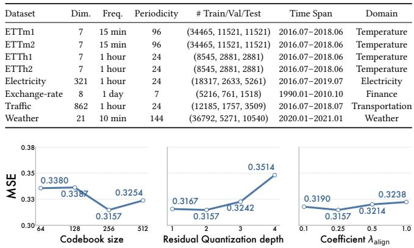  
Figure 10: Sensitivity study of TimeFKA on ETTh2.

## B Hyperparameter Investigation

Figure 10 analyzes the number of code vectors per level (64/ 128/ 256/ 512), diferent residual-quantization levels $\left( 1 / \ 2 / \ 3 / \ 4 \right)$ and diferent coeficient values $\lambda _ { \mathrm { a l i g n } }$ for TimeFKA on Etth2 (forecasting horizon $H = 3 3 6 )$ . Increasing � from 64 to 256 improves forecasting accuracy, while further increasing it to 512 raises MSE, suggesting that a larger codebook size does not necessarily provide more useful predictive information. For residual depth, $L = 2$ outperforms $L = 1$ whereas deeper residual levels degrade performance, suggesting limited benefits from incorporating finer residual information in this setting. The lowest MSE is achieved at $\lambda _ { \mathrm { a l i g n } } = 0 . 2 5$ , supporting a balance between codebook alignment and reconstruction. These results support our default configuration of $K = 2 5 6 , L = 2 ,$ and $\lambda _ { \mathrm { a l i g n } } = 0 . 2 5 .$

Received 20 February 2007; revised 12 March 2009; accepted 5 June 2009

Table 5: Overall forecasting results of TimeFKA across frozen TSFM backbones. Results at each forecasting horizon are averaged over five independent runs. The Avg rows summarize performance across forecasting horizons � ∈ {96, 192, 336, 720}. Electricity, Weather, and Trafic are included in the pre-training corpus of TimesFM 2.5, and the corresponding results are omitted and marked with ‘–’. The Δ rows report relative error reductions (↓percentages) compared with the corresponding zero-shot averages.
<table><tr><td rowspan=1 colspan=2>TSFM</td><td rowspan=1 colspan=4>ChronosBolt-base</td><td rowspan=1 colspan=3>TimesFM 2.5</td><td rowspan=1 colspan=2>Moirai 2</td><td rowspan=1 colspan=2>TTM 2</td></tr><tr><td rowspan=1 colspan=2>Dataset</td><td rowspan=1 colspan=1>Zero-shot</td><td rowspan=1 colspan=3>TimeFKA</td><td rowspan=1 colspan=2>Zero-shot</td><td rowspan=1 colspan=1>TimeFKA</td><td rowspan=1 colspan=1>Zero-shot</td><td rowspan=1 colspan=1>TimeFKA</td><td rowspan=1 colspan=1>Zero-shot</td><td rowspan=1 colspan=1>TimeFKA</td></tr><tr><td rowspan=1 colspan=2>Metric</td><td rowspan=1 colspan=1>MSEMAE</td><td rowspan=1 colspan=3>MSE     MAE</td><td rowspan=1 colspan=2>MSEMAE</td><td rowspan=1 colspan=1>MSE     MAE</td><td rowspan=1 colspan=1>MSEMAE</td><td rowspan=1 colspan=1>MSE     MAE</td><td rowspan=1 colspan=1>MSEMAE</td><td rowspan=1 colspan=1>MSE     MAE</td></tr><tr><td rowspan=4 colspan=1>ET1</td><td rowspan=4 colspan=1>96192336720</td><td rowspan=1 colspan=1>0.38490.3798</td><td rowspan=1 colspan=3>0.3570±0.00870.3720±0.0047</td><td rowspan=1 colspan=2>0.42110.4009</td><td rowspan=1 colspan=1>0.3920±0.00720.3901±0.0024</td><td rowspan=1 colspan=1>0.3838 0.3803</td><td rowspan=1 colspan=1>0.3572±0.00750.3733±0.0044</td><td rowspan=1 colspan=1>0.50390.4723</td><td rowspan=1 colspan=1>0.3376±0.01060.3812±0.0057</td></tr><tr><td rowspan=1 colspan=1>0.44170.4122</td><td rowspan=3 colspan=3>0.3978±0.01120.3964±0.00640.4208±0.01280.4131±0.00580.4456±0.01020.4408±0.0037</td><td rowspan=1 colspan=2>0.47210.4323</td><td rowspan=1 colspan=1>0.4406±0.01640.4209±0.0039</td><td rowspan=1 colspan=1>0.42570.4071</td><td rowspan=1 colspan=1>0.3904±0.02730.3969±0.0151</td><td rowspan=1 colspan=1>0.54150.4948</td><td rowspan=1 colspan=1>0.3623±0.01360.3994±0.0062</td></tr><tr><td rowspan=2 colspan=1>0.48140.43310.48360.4489</td><td rowspan=2 colspan=2>0.50980.45480.51400.4813</td><td rowspan=2 colspan=1>0.4578±0.02330.4394±0.01120.5016±0.04070.4752±0.0255</td><td rowspan=1 colspan=1>0.46000.4237</td><td rowspan=2 colspan=1>0.4068±0.03430.4092±0.02160.4181±0.13620.4320±0.0770</td><td rowspan=1 colspan=1>0.55990.5104</td><td rowspan=1 colspan=1>0.3833±0.01190.4181±0.0058</td></tr><tr><td rowspan=1 colspan=1>0.50550.4475</td><td rowspan=1 colspan=1>0.59160.5418</td><td rowspan=1 colspan=1>0.4456±0.00590.4694±0.0033</td></tr><tr><td rowspan=2 colspan=1></td><td rowspan=2 colspan=1>AvgΔ</td><td rowspan=2 colspan=1>0.44790.4185</td><td rowspan=2 colspan=3>|0.4053±0.01050.4056±0.0049(↓9.51%)    (↓3.08%)</td><td rowspan=1 colspan=2>0.47930.4423</td><td rowspan=1 colspan=1>|0.4480±0.02190.4314±0.0097</td><td rowspan=1 colspan=1>0.44380.4147</td><td rowspan=1 colspan=1>|0.3931±0.03040.4028±0.0169</td><td rowspan=1 colspan=1>0.54920.5048</td><td rowspan=1 colspan=1>0.3822±0.01020.4170±0.0047</td></tr><tr><td rowspan=1 colspan=2>1</td><td rowspan=1 colspan=1>(↓6.53%)    (↓2.46%)</td><td rowspan=1 colspan=1>=    一</td><td rowspan=1 colspan=1>(↓11.42%)    (↓2.87%)</td><td rowspan=1 colspan=1>1     一</td><td rowspan=1 colspan=1>(↓30.41%)    (↓17.39%)</td></tr><tr><td rowspan=4 colspan=1>ET2</td><td rowspan=4 colspan=1>96192336720</td><td rowspan=4 colspan=1>0.28950.32510.35980.36950.40290.40250.41400.4210</td><td rowspan=4 colspan=3>0.2424±0.01970.2982±0.01240.2812±0.03090.3310±0.01700.3157±0.03060.3633±0.01550.4072±0.00720.4301±0.0057</td><td rowspan=1 colspan=1></td><td rowspan=1 colspan=1>0.32630.3515</td><td rowspan=1 colspan=1>0.2966±0.00450.3413±0.0015</td><td rowspan=1 colspan=1>0.30590.3337</td><td rowspan=1 colspan=1>0.2943±0.00490.3323±0.0037</td><td rowspan=1 colspan=1>0.32500.3814</td><td rowspan=1 colspan=1>0.2309±0.01900.3064±0.0113</td></tr><tr><td rowspan=1 colspan=2>0.3994 0.3979</td><td rowspan=1 colspan=1>0.3595±0.01740.3873±0.0123</td><td rowspan=1 colspan=1>0.38470.3834</td><td rowspan=1 colspan=1>0.3642±0.00530.3784±0.0043</td><td rowspan=1 colspan=1>0.39700.4267</td><td rowspan=1 colspan=1>0.2716±0.03820.3395±0.0198</td></tr><tr><td rowspan=2 colspan=2>0.4335 0.43110.44980.4572</td><td rowspan=2 colspan=1>0.3831±0.02680.4154±0.02350.4182±0.04080.4466±0.0360</td><td rowspan=1 colspan=1>0.4159 0.4138</td><td rowspan=1 colspan=1>0.3786±0.01760.3993±0.0111</td><td rowspan=1 colspan=1>0.41640.4412</td><td rowspan=1 colspan=1>0.3017±0.02820.3669±0.0154</td></tr><tr><td rowspan=1 colspan=1>0.4471 0.4402</td><td rowspan=1 colspan=1>0.4541±0.23490.4528±0.1040</td><td rowspan=1 colspan=1>0.46460.4669</td><td rowspan=1 colspan=1>0.3891±0.00550.4273±0.0050</td></tr><tr><td rowspan=2 colspan=1></td><td rowspan=2 colspan=1>AvgΔ</td><td rowspan=2 colspan=1>0.36660.3795</td><td rowspan=2 colspan=3>|0.3116±0.02130.3557±0.0112(↓15.00%)    (↓6.27%)</td><td rowspan=2 colspan=2>0.40220.4094</td><td rowspan=2 colspan=1>|0.3643±0.02230.3977±0.0183(↓9.42%)    (↓2.86%)</td><td rowspan=1 colspan=1>0.3884 0.3928</td><td rowspan=1 colspan=1>0.3728±0.05470.3907±0.0248</td><td rowspan=1 colspan=1>0.40080.4291</td><td rowspan=1 colspan=1>0.2984±0.02250.3600±0.0127</td></tr><tr><td rowspan=1 colspan=1>1</td><td rowspan=1 colspan=1>(↓4.02%)    (↓0.53%)</td><td rowspan=1 colspan=1></td><td rowspan=1 colspan=1>(↓25.55%)    (↓16.10%)</td></tr><tr><td rowspan=4 colspan=1>ETTm1</td><td rowspan=4 colspan=1>96192336720</td><td rowspan=4 colspan=1>0.33190.33320.38700.36580.43630.39340.52790.4391</td><td rowspan=4 colspan=3>0.2788±0.00600.3246±0.00360.3282±0.00940.3583±0.00480.3671±0.01030.3914±0.00670.4299±0.01960.4192±0.0089</td><td rowspan=1 colspan=2>0.3568 0.3668</td><td rowspan=1 colspan=1>0.3061±0.00910.3454±0.0029</td><td rowspan=1 colspan=1>0.3786 0.3659</td><td rowspan=1 colspan=1>0.2848±0.00400.3244±0.0018</td><td rowspan=1 colspan=1>|0.7383 0.5409</td><td rowspan=1 colspan=1>0.2969±0.00050.3441±0.0004</td></tr><tr><td rowspan=1 colspan=2>0.4113 0.4024</td><td rowspan=2 colspan=1>0.3653±0.02480.3824±0.01170.3788±0.03020.3978±0.0179</td><td rowspan=1 colspan=1>0.4667 0.4160</td><td rowspan=1 colspan=1>0.3338±0.00880.3586±0.0033</td><td rowspan=1 colspan=1>0.74250.5526</td><td rowspan=1 colspan=1>0.3404±0.00230.3712±0.0014</td></tr><tr><td></td><td rowspan=1 colspan=1>44090.4261</td><td rowspan=1 colspan=1>0.55580.4640</td><td rowspan=1 colspan=1>0.3747±0.01260.3887±0.0058</td><td rowspan=1 colspan=1>0.73520.5578</td><td rowspan=1 colspan=1>0.3716±0.00290.3928±0.0016</td></tr><tr><td rowspan=1 colspan=2>0.50690.4685</td><td rowspan=1 colspan=1>0.4779±0.06980.4581±0.0420</td><td rowspan=1 colspan=1>0.65410.5241</td><td rowspan=1 colspan=1>0.4558±0.04930.4382±0.0446</td><td rowspan=1 colspan=1>0.75420.5725</td><td rowspan=1 colspan=1>0.4284±0.00300.4206±0.0018</td></tr><tr><td rowspan=2 colspan=1></td><td rowspan=2 colspan=1>AvgΔ</td><td rowspan=1 colspan=1>0.42080.3829</td><td rowspan=1 colspan=3>0.3510±0.01090.3734±0.0057</td><td rowspan=1 colspan=2>0.42900.4160</td><td rowspan=1 colspan=1>0.3820±0.03340.3959±0.0185</td><td rowspan=1 colspan=1>0.5138 0.4425</td><td rowspan=1 colspan=1>0.3623±0.01020.3775±0.0114</td><td rowspan=1 colspan=1>0.74260.5560</td><td rowspan=1 colspan=1>0.3593±0.00190.3822±0.0012</td></tr><tr><td rowspan=1 colspan=1></td><td rowspan=1 colspan=3>(↓16.59%)    (↓2.48%)</td><td rowspan=1 colspan=2></td><td rowspan=1 colspan=1>(↓10.96%)    (↓4.83%)</td><td rowspan=1 colspan=1></td><td rowspan=1 colspan=1>(↓29.49%)   (↓14.69%)</td><td rowspan=1 colspan=1></td><td rowspan=1 colspan=1>(↓51.62%)    (↓31.26%)</td></tr><tr><td rowspan=4 colspan=1>ETTm2</td><td rowspan=4 colspan=1>96192336720</td><td rowspan=4 colspan=1>0.17770.24480.25110.29350.31700.33590.41600.3950</td><td rowspan=4 colspan=3>0.1664±0.00220.2368±0.00150.2322±0.00310.2808±0.00210.2903±0.00440.3204±0.00290.3741±0.00650.3757±0.0026</td><td rowspan=4 colspan=2>0.20460.26600.29270.31760.36440.36070.46440.4204</td><td rowspan=4 colspan=1>0.1769±0.00210.2543±0.00090.2396±0.01590.2996±0.01040.2924±0.00360.3358±0.00240.4051±0.00820.4063±0.0053</td><td rowspan=1 colspan=1>0.18650.2501</td><td rowspan=1 colspan=1>0.1656±0.00450.2392±0.0072</td><td rowspan=1 colspan=1>0.22600.3094</td><td rowspan=1 colspan=1>0.1648±0.00110.2521±0.0009</td></tr><tr><td rowspan=1 colspan=1>0.28210.3100</td><td rowspan=1 colspan=1>0.2251±0.04010.2832±0.0085</td><td rowspan=1 colspan=1>0.29790.3521</td><td rowspan=1 colspan=1>0.2314±0.00290.2979±0.0015</td></tr><tr><td rowspan=1 colspan=1>0.4053 0.3745</td><td rowspan=1 colspan=1>0.2844±0.01740.3258±0.0098</td><td rowspan=1 colspan=1>0.34340.3778</td><td rowspan=1 colspan=1>0.2971±0.00830.3385±0.0037</td></tr><tr><td rowspan=1 colspan=1>0.55350.4501</td><td rowspan=1 colspan=1>0.3800±0.01800.3918±0.0093</td><td rowspan=1 colspan=1>0.43020.4242</td><td rowspan=1 colspan=1>0.3671±0.00830.3914±0.0054</td></tr><tr><td rowspan=2 colspan=1></td><td rowspan=2 colspan=1>AvgΔ</td><td rowspan=2 colspan=1>0.29050.3173</td><td rowspan=2 colspan=3>0.2658±0.00390.3034±0.0022(↓8.50%)    (↓4.38%)</td><td rowspan=1 colspan=2>0.33150.3412</td><td rowspan=1 colspan=1>|0.2785±0.00390.3240±0.0022</td><td rowspan=1 colspan=1>0.35690.3462</td><td rowspan=1 colspan=1>0.2638±0.04760.3100±0.0442</td><td rowspan=1 colspan=1>0.32440.3659</td><td rowspan=1 colspan=1>0.2651±0.00410.3200±0.0021</td></tr><tr><td rowspan=1 colspan=2></td><td rowspan=1 colspan=1>(↓15.99%)    (↓5.04%)</td><td rowspan=1 colspan=1>1</td><td rowspan=1 colspan=1>(↓26.09%)    (↓10.46%)</td><td rowspan=1 colspan=1></td><td rowspan=1 colspan=1>(↓18.28%)    (↓12.54%)</td></tr><tr><td rowspan=4 colspan=1>Exch-rate</td><td rowspan=4 colspan=1>96192336720</td><td rowspan=4 colspan=1>0.09920.21910.19440.31400.34200.42380.84930.6915</td><td rowspan=4 colspan=3>0.0910±0.00260.2041±0.00370.1886±0.01500.2989±0.01100.3408±0.03100.4180±0.01890.7826±0.12650.6717±0.0472</td><td rowspan=4 colspan=2>0.10960.23310.1977 0.31510.36250.43330.94210.7260</td><td rowspan=2 colspan=1>0.0905±0.00120.2140±0.00060.1866±0.02600.3080±0.0251</td><td rowspan=1 colspan=1>0.09030.2100</td><td rowspan=1 colspan=1>0.0794±0.00340.1982±0.0032</td><td rowspan=1 colspan=1>0.12640.2525</td><td rowspan=1 colspan=1>0.1042±0.00650.2214±0.0053</td></tr><tr><td rowspan=1 colspan=1>0.18880.3084</td><td rowspan=1 colspan=1>0.1575±0.01770.2878±0.0147</td><td rowspan=1 colspan=1>0.25430.3646</td><td rowspan=1 colspan=1>0.2166±0.01210.3303±0.0080</td></tr><tr><td rowspan=2 colspan=1>0.3582±0.09460.4318±0.07450.8317±0.28390.6871±0.1766</td><td rowspan=2 colspan=1>0.34590.43070.89300.6939</td><td rowspan=2 colspan=1>0.2609±0.04510.3804±0.03280.5090±0.17520.5536±0.0888</td><td rowspan=1 colspan=1>0.44300.4916</td><td rowspan=2 colspan=1>0.3893±0.00960.4536±0.00501.0017±0.11510.7355±0.0425</td></tr><tr><td rowspan=1 colspan=1>1.01970.7622</td></tr><tr><td rowspan=2 colspan=1></td><td rowspan=2 colspan=1>AvgΔ</td><td rowspan=2 colspan=1>0.37120.4121一</td><td rowspan=2 colspan=3>0.3508±0.04350.3982±0.0200(↓5.50%)</td><td rowspan=1 colspan=2>0.40300.4269</td><td rowspan=1 colspan=1>0.3668±0.10080.4102±0.0691</td><td rowspan=1 colspan=1>0.37950.4108</td><td rowspan=1 colspan=1>0.2517±0.05730.3550±0.0333</td><td rowspan=1 colspan=1>0.46090.4677</td><td rowspan=1 colspan=1>0.4280±0.02760.4352±0.0107</td></tr><tr><td rowspan=1 colspan=2></td><td rowspan=1 colspan=2>1</td><td rowspan=1 colspan=1>(↓8.98%)    (↓3.91%)</td><td rowspan=1 colspan=1></td><td rowspan=1 colspan=1>(↓33.68%)    (↓13.58%)</td><td rowspan=1 colspan=1>一    一</td><td rowspan=1 colspan=1>(↓7.14%)    (↓6.95%)</td></tr><tr><td rowspan=3 colspan=1>leiiy</td><td rowspan=3 colspan=1>96192336720</td><td rowspan=3 colspan=1>0.12420.21050.14280.22870.16130.24820.20690.2882</td><td rowspan=1 colspan=1>0.1</td><td rowspan=1 colspan=3>0.1143±0.00360.2068±0.0039</td><td rowspan=1 colspan=1></td><td rowspan=1 colspan=1></td><td rowspan=1 colspan=1>0.12820.2146</td><td rowspan=1 colspan=1>0.1263±0.00280.2134±0.0076</td><td rowspan=3 colspan=1>0.3964 0.49090.44010.51910.48820.54950.63210.6272</td><td rowspan=3 colspan=1>0.1274±0.00440.2337±0.00020.1463±0.00450.2502±0.00130.1671±0.00350.2687±0.00190.2144±0.00100.3067±0.0009</td></tr><tr><td rowspan=1 colspan=3>0.1361±0.00540.2263±0.0052</td><td rowspan=1 colspan=2></td><td rowspan=1 colspan=1></td><td rowspan=1 colspan=1>0.14730.2325</td><td rowspan=1 colspan=1>0.1447±0.00640.2310±0.0090</td></tr><tr><td rowspan=1 colspan=2></td><td rowspan=1 colspan=1></td><td rowspan=1 colspan=1>0.16620.25170.21170.2913</td><td rowspan=1 colspan=1>0.1614±0.01160.2483±0.01150.1976±0.02140.2808±0.0169</td></tr><tr><td rowspan=2 colspan=1></td><td rowspan=2 colspan=1>AvgΔ</td><td rowspan=2 colspan=1>0.15880.2439一</td><td rowspan=2 colspan=3>0.1528±0.00650.2407±0.0059(↓3.78%)    (↓1.31%)</td><td rowspan=1 colspan=2>1    1</td><td rowspan=1 colspan=1>1         一</td><td rowspan=1 colspan=1>0.1634 0.2475</td><td rowspan=1 colspan=1>0.1575±0.01050.2434±0.0113</td><td rowspan=1 colspan=1>0.48920.5467</td><td rowspan=2 colspan=1>0.1638±0.00250.2648±0.0006(↓66.52%)    (↓51.56%)</td></tr><tr><td rowspan=1 colspan=2></td><td rowspan=1 colspan=1></td><td rowspan=1 colspan=1></td><td rowspan=1 colspan=1>(↓3.61%)    (↓1.66%)</td><td rowspan=1 colspan=1>1    一</td></tr><tr><td rowspan=4 colspan=1>Weather</td><td rowspan=4 colspan=1>96192336720</td><td rowspan=4 colspan=1>0.17750.21020.22420.25350.28380.29470.36700.3465</td><td rowspan=1 colspan=3>0.1488±0.00070.1822±0.0009</td><td rowspan=1 colspan=2></td><td rowspan=1 colspan=1></td><td rowspan=1 colspan=1>0.1742 0.2015</td><td rowspan=1 colspan=1>0.1542±0.00710.1882±0.0125</td><td rowspan=1 colspan=1>0.12210.1565</td><td rowspan=1 colspan=1>0.1169±0.01120.1537±0.0153</td></tr><tr><td rowspan=1 colspan=3>0.1948±0.00150.2286±0.0013</td><td rowspan=1 colspan=2></td><td rowspan=1 colspan=1></td><td rowspan=1 colspan=1>0.22390.2476</td><td rowspan=1 colspan=1>0.2069±0.00820.2459±0.0120</td><td rowspan=1 colspan=1>0.1671 0.1996</td><td rowspan=1 colspan=1>0.1585±0.01460.1959±0.0177</td></tr><tr><td rowspan=2 colspan=3>0.2479±0.00190.2702±0.00170.3213±0.00430.3207±0.0030</td><td rowspan=1 colspan=2></td><td rowspan=1 colspan=1></td><td rowspan=1 colspan=1>0.29490.2961</td><td rowspan=1 colspan=1>0.2586±0.01950.2855±0.0184</td><td rowspan=2 colspan=1>0.23580.25400.36100.3391</td><td rowspan=1 colspan=1>9±0.01120.2481±0.0133</td></tr><tr><td rowspan=1 colspan=2></td><td rowspan=1 colspan=1></td><td rowspan=1 colspan=1>0.39890.3558</td><td rowspan=1 colspan=1>0.3309±0.06100.3360±0.0427</td></tr><tr><td rowspan=2 colspan=1></td><td rowspan=2 colspan=1>AvgΔ</td><td rowspan=2 colspan=1>0.26310.2762</td><td rowspan=2 colspan=3>0.2282±0.00200.2504±0.0016(↓13.26%)    (↓9.34%)</td><td rowspan=1 colspan=2></td><td rowspan=1 colspan=1></td><td rowspan=1 colspan=1>0.27300.2753</td><td rowspan=1 colspan=1>|0.2377±0.01030.2639±0.0080</td><td rowspan=2 colspan=1>0.22150.2373</td><td rowspan=2 colspan=1>0.2047±0.00990.2304±0.0129(↓7.58%)    (↓2.91%)</td></tr><tr><td rowspan=1 colspan=2></td><td rowspan=1 colspan=1></td><td rowspan=1 colspan=1></td><td rowspan=1 colspan=1>(↓12.93%)    (↓4.14%)</td><td rowspan=1 colspan=1></td></tr><tr><td rowspan=6 colspan=1>Traaihc</td><td rowspan=2 colspan=1>96192</td><td rowspan=2 colspan=1>0.38700.24090.4137 0.2531</td><td rowspan=2 colspan=3>0.3407±0.00380.2129±0.00150.3592±0.00350.2224±0.0056</td><td rowspan=2 colspan=2></td><td rowspan=2 colspan=1></td><td rowspan=1 colspan=1>0.35460.2248</td><td rowspan=2 colspan=1>0.3498±0.00600.2214±0.00070.3728±0.00540.2318±0.0097</td><td rowspan=2 colspan=1>0.32730.22040.35380.2346</td><td rowspan=2 colspan=1>0.3257±0.00250.3511±0.00250.2314±0.0028</td></tr><tr><td rowspan=1 colspan=1>0.3789 0.2355</td></tr><tr><td rowspan=2 colspan=1>336720</td><td rowspan=2 colspan=1>0.43550.26330.50330.2934</td><td rowspan=2 colspan=3>0.3761±0.00360.2332±0.00500.4262±0.00330.2617±0.0037</td><td rowspan=1 colspan=2></td><td rowspan=1 colspan=1></td><td rowspan=1 colspan=1>0.39590.2439</td><td rowspan=1 colspan=1>0.3878±0.00570.2393±0.0084</td><td rowspan=1 colspan=1>0.37790.2477</td><td rowspan=1 colspan=1>0.3758±0.00230.2451±0.0028</td></tr><tr><td rowspan=1 colspan=2></td><td rowspan=1 colspan=1></td><td rowspan=1 colspan=1>0.43370.2665</td><td rowspan=1 colspan=1>0.4231±0.00520.2596±0.0059</td><td rowspan=1 colspan=1>0.41960.2722</td><td rowspan=1 colspan=1>0.4170±0.00220.2694±0.0024</td></tr><tr><td rowspan=2 colspan=1>AvgΔ</td><td rowspan=2 colspan=1>0.43490.2627</td><td rowspan=2 colspan=3>0.3756±0.00630.2326±0.0044(↓13.64%)    (↓11.46%)</td><td rowspan=1 colspan=2></td><td rowspan=1 colspan=1></td><td rowspan=1 colspan=1>0.39080.2427</td><td rowspan=1 colspan=1>|0.3834±0.00560.2380±0.0007</td><td rowspan=1 colspan=1>0.36960.2437</td><td rowspan=1 colspan=1>0.3674±0.00850.2410±0.0091</td></tr><tr><td rowspan=1 colspan=2></td><td rowspan=1 colspan=1></td><td rowspan=1 colspan=1></td><td rowspan=1 colspan=1>(↓1.89%)    (↓1.94%)</td><td rowspan=1 colspan=1></td><td rowspan=1 colspan=1>(↓0.60%)    (↓1.11%)</td></tr></table>

Table 6: Detailed forecasting results on ChronosBolt-base. Avg denotes the arithmetic mean over forecasting horizons � ∈ {96, 192, 336, 720}. For TimeFKA , ± denotes the standard deviation over five independent runs, where reported. The best and second-best results are highlighted in purple and underlined in green, respectively; ties are determined at the displayed precision. Relative error reductions (↓percentages) and increases (↑percentages) are computed from the displayed Avg values against zero-shot forecasting. OOM: out of memory.
<table><tr><td rowspan=1 colspan=1>Dataset</td><td rowspan=1 colspan=1>H</td><td rowspan=1 colspan=3>Zero-shotMSE MAE</td><td rowspan=1 colspan=2>RAFTMSE MAE</td><td rowspan=1 colspan=3>TS-RAGMSE MAE</td><td rowspan=1 colspan=2>TS-MemoryMSE MAE</td><td rowspan=1 colspan=2>SARAFMSE MAE</td><td rowspan=1 colspan=1>MEMTSMSE MAE</td><td rowspan=1 colspan=1>TimeFKAMSE       MAE</td></tr><tr><td rowspan=6 colspan=1>ET1</td><td rowspan=3 colspan=1>96192336</td><td rowspan=3 colspan=3>0.38490.37980.44170.41220.48140.4331</td><td rowspan=1 colspan=2>0.37820.3798</td><td rowspan=1 colspan=3>0.37800.3787</td><td rowspan=1 colspan=2>0.38010.3807</td><td rowspan=2 colspan=2>0.37580.40340.39480.4126</td><td rowspan=2 colspan=1>0.3768 0.37320.42710.3991</td><td rowspan=4 colspan=1>0.3570±0.00870.3720±0.00470.3978±0.01120.3964±0.00640.4208±0.01280.4131±0.00580.4456±0.01020.4408±0.0037</td></tr><tr><td rowspan=2 colspan=2>0.43080.41060.46480.4299</td><td rowspan=1 colspan=3>0.43190.4114</td><td rowspan=1 colspan=2>0.42370.4131</td></tr><tr><td rowspan=1 colspan=3>0.46990.4337</td><td rowspan=1 colspan=2>0.46450.4301</td><td rowspan=1 colspan=2>0.42230.4313</td><td rowspan=1 colspan=1>0.45110.4171</td></tr><tr><td rowspan=1 colspan=1>720</td><td rowspan=1 colspan=3>0.48360.4489</td><td rowspan=1 colspan=2>0.47340.4501</td><td rowspan=1 colspan=3>0.48930.4619</td><td rowspan=1 colspan=2>0.45570.4556</td><td rowspan=1 colspan=2>0.44520.4631</td><td rowspan=1 colspan=1>0.47780.4479</td></tr><tr><td rowspan=2 colspan=1>AvgΔ</td><td rowspan=2 colspan=3>0.44790.4185</td><td rowspan=1 colspan=2>0.43680.4176</td><td rowspan=1 colspan=3>0.44230.4214</td><td rowspan=1 colspan=2>0.43100.4199</td><td rowspan=1 colspan=2>0.4095 0.4276</td><td rowspan=1 colspan=1>0.4332 0.4093</td><td rowspan=2 colspan=1>0.4053±0.01050.4056±0.0049(↓9.51%)       (↓3.08%)</td></tr><tr><td rowspan=1 colspan=2>(↓2.48%)(↓0.22%)</td><td rowspan=1 colspan=2>(↓1.25%)</td><td rowspan=1 colspan=2>0.69%)</td><td rowspan=1 colspan=2>(↓3.77%)(↑0.33%)</td><td rowspan=1 colspan=2>(↓8.57%) (↑2.17%)</td><td rowspan=1 colspan=1>(↓3.28%)(↓2.20%)</td></tr><tr><td rowspan=5 colspan=1>ET2</td><td rowspan=1 colspan=1>96192</td><td rowspan=2 colspan=3>0.28950.32510.35980.36950.40290.4025</td><td rowspan=1 colspan=2>0.28560.32450.35210.3662</td><td rowspan=1 colspan=1>0.28340</td><td rowspan=1 colspan=3>0.2834 0.32580.3514 0.3698</td><td rowspan=1 colspan=2>0.28650.32500.35570.3688</td><td rowspan=1 colspan=1>0.27090.33530.33000.3765</td><td rowspan=1 colspan=1>0.2534 0.30400.2982 0.3356</td><td rowspan=3 colspan=1>0.2424±0.01970.2982±0.01240.2812±0.03090.3310±0.01700.3157±0.03060.3633±0.01550.4072±0.00720.4301±0.0057</td></tr><tr><td rowspan=1 colspan=1>336</td><td rowspan=1 colspan=2>0.38980.3965</td><td rowspan=1 colspan=3>0.39340.4024</td><td rowspan=1 colspan=2>0.39750.4011</td><td rowspan=1 colspan=2>0.35360.4028</td><td rowspan=1 colspan=1>0.33430.3659</td><td rowspan=1 colspan=1>0.3</td></tr><tr><td rowspan=1 colspan=1>720</td><td rowspan=1 colspan=3>0.41400.4210</td><td rowspan=1 colspan=2>0.40200.4233</td><td rowspan=1 colspan=3>0.41830.4432</td><td rowspan=1 colspan=2>0.41400.4210</td><td rowspan=1 colspan=2>0.4100 0.4524</td><td rowspan=1 colspan=1>0.40350.4180</td></tr><tr><td rowspan=2 colspan=1>AvgΔ</td><td rowspan=2 colspan=3>0.36660.3795</td><td rowspan=2 colspan=2>0.35740.3776(↓2.51%)(↓0.50%)</td><td rowspan=1 colspan=3>0.36160.3853</td><td rowspan=1 colspan=2>0.36340.3790</td><td rowspan=1 colspan=2>0.3411 0.3918</td><td rowspan=1 colspan=1>0.3224 0.3559</td><td rowspan=1 colspan=1>0.3116±0.02130.3557±0.0112</td></tr><tr><td rowspan=1 colspan=3>(↓1.36%)(↑1.53%)</td><td rowspan=1 colspan=2>(↓0.87%)(↓0.13%)</td><td rowspan=1 colspan=2>(↓6.96%)(↑3.24%)</td><td rowspan=1 colspan=1>(↓12.06%)(↓6.22%)</td><td rowspan=1 colspan=1>(↓15.00%)      (↓6.27%)</td></tr><tr><td rowspan=6 colspan=1>ETm1</td><td rowspan=1 colspan=1>96</td><td rowspan=1 colspan=3>0.33190.3332</td><td rowspan=1 colspan=2>0.31340.3274</td><td rowspan=1 colspan=3>0.32370.3338</td><td rowspan=1 colspan=2>0.2980 0.3269</td><td rowspan=1 colspan=2>0.3071 0.3539</td><td rowspan=1 colspan=1>0.32450.3387</td><td rowspan=2 colspan=1>0.2788±0.00600.3246±0.00360.3282±0.00940.3583±0.0048</td></tr><tr><td rowspan=3 colspan=1>192336720</td><td rowspan=3 colspan=3>0.38700.36580.43630.39340.52790.4391</td><td rowspan=1 colspan=1>3658</td><td rowspan=1 colspan=2>0.36880.3604</td><td rowspan=1 colspan=3>0.37550.3648</td><td rowspan=1 colspan=2>0.35050.3586</td><td rowspan=1 colspan=2>0.33320.3686</td><td rowspan=1 colspan=1>0.3727 0.3681</td></tr><tr><td rowspan=1 colspan=2>0.41490.3878</td><td rowspan=1 colspan=3>0.42110.3910</td><td rowspan=1 colspan=2>0.39840.3826</td><td rowspan=1 colspan=2>0.36380.3883</td><td rowspan=1 colspan=1>0.42790.3958</td><td rowspan=1 colspan=1>0.3671±0.01030.3914±0.0067</td></tr><tr><td rowspan=1 colspan=2>0.49280.4315</td><td rowspan=1 colspan=3>0.50280.4357</td><td rowspan=1 colspan=2>0.45560.4206</td><td rowspan=1 colspan=2>0.40950.4157</td><td rowspan=1 colspan=1>0.51330.4371</td><td rowspan=1 colspan=1>0.4299±0.0196 0.4192±0.0089</td></tr><tr><td rowspan=2 colspan=1>AvgΔ</td><td rowspan=2 colspan=3>0.42080.3829</td><td rowspan=1 colspan=2>0.39750.3768</td><td rowspan=1 colspan=3>0.40580.3813</td><td rowspan=1 colspan=2>0.37560.3722</td><td rowspan=1 colspan=2>0.3534 0.3816</td><td rowspan=1 colspan=1>0.40960.3849</td><td rowspan=1 colspan=1>0.3510±0.01090.3734±0.0057</td></tr><tr><td rowspan=1 colspan=2>(↓5.54%)(↓1.59%)</td><td rowspan=1 colspan=3>(↓3.56%)(↓0.42%)</td><td rowspan=1 colspan=2>(↓10.74%)(↓2.79%)</td><td rowspan=1 colspan=2>(↓16.02%)(↓0.34%)</td><td rowspan=1 colspan=1>(↓2.66%) (↑0.52%)</td><td rowspan=1 colspan=1>(↓16.59%)      (↓2.48%)</td></tr><tr><td rowspan=7 colspan=1>ETTm32</td><td rowspan=5 colspan=1>96192336720</td><td rowspan=1 colspan=3>0.17770.2448</td><td rowspan=1 colspan=2>0.1741 0.2430</td><td rowspan=1 colspan=3>0.17850.2486</td><td rowspan=1 colspan=2>0.16810.2440</td><td rowspan=1 colspan=2>0.16320.2544</td><td rowspan=1 colspan=1>0.1816 0.2528</td><td rowspan=2 colspan=1>0.1664±0.00220.2368±0.00150.2322±0.00310.2808±0.0021</td></tr><tr><td rowspan=4 colspan=3>0.25110.29350.31700.33590.41600.3950</td><td rowspan=1 colspan=2>0.24310.2896</td><td rowspan=1 colspan=3>0.24380.2935</td><td rowspan=1 colspan=2>0.23340.2897</td><td rowspan=1 colspan=2>0.21800.2931</td><td rowspan=1 colspan=1>0.2552 0.3014</td></tr><tr><td rowspan=1 colspan=2>0.30560.3315</td><td rowspan=1 colspan=3>0.30410.3341</td><td rowspan=1 colspan=2>0.30390.3346</td><td rowspan=1 colspan=2>0.26950.3284</td><td rowspan=1 colspan=1>0.32340.3439</td><td rowspan=3 colspan=1>0.2903±0.00440.3204±0.00290.3741±0.00650.3757±0.0026</td></tr><tr><td rowspan=2 colspan=1>0</td><td></td><td></td><td></td><td></td><td></td><td></td><td></td><td></td><td></td><td></td></tr><tr><td rowspan=1 colspan=2>0.40110.3939</td><td rowspan=1 colspan=3>0.40510.3962</td><td rowspan=1 colspan=2>0.39480.3970</td><td rowspan=1 colspan=2>0.35730.3851</td><td rowspan=1 colspan=1>0.41960.4007</td></tr><tr><td rowspan=2 colspan=1>AvgΔ</td><td rowspan=1 colspan=2>0.2905</td><td rowspan=1 colspan=2>3173</td><td rowspan=1 colspan=2>0.28100.3145</td><td rowspan=1 colspan=3>0.28290.3181</td><td rowspan=1 colspan=2>0.27510.3163</td><td rowspan=1 colspan=2>0.25200.3153</td><td rowspan=1 colspan=1>0.2950 0.3247</td><td rowspan=1 colspan=1>0.2658±0.00390.3034±0.0022</td></tr><tr><td rowspan=1 colspan=3></td><td rowspan=1 colspan=2>(↓3.27%)(↓0.88%)</td><td rowspan=1 colspan=3>(↓2.62%)(↑0.25%)</td><td rowspan=1 colspan=1>(↓5.30%)</td><td rowspan=1 colspan=1>(↓0.32%)</td><td rowspan=1 colspan=2>(↓13.25%)(↓0.63%)</td><td rowspan=1 colspan=1>(↑1.55%)(↑2.33%)</td><td rowspan=1 colspan=1>(↓8.50%)      (↓4.38%)</td></tr><tr><td rowspan=6 colspan=1>Exech-rate</td><td rowspan=2 colspan=1>96192</td><td rowspan=1 colspan=3>0.09920.2191</td><td rowspan=1 colspan=2>0.09600.2155</td><td rowspan=1 colspan=3>0.09330.2131</td><td rowspan=1 colspan=1>0.0983</td><td rowspan=1 colspan=1>0.2197</td><td rowspan=1 colspan=1>0.0881</td><td rowspan=1 colspan=1>0.2059</td><td rowspan=1 colspan=1>0.10090.2160</td><td rowspan=1 colspan=1>0.0910±0.00260.2041±0.0037</td></tr><tr><td rowspan=1 colspan=3>0.19440.3140</td><td rowspan=1 colspan=1>0.1887</td><td rowspan=1 colspan=1>0.3106</td><td rowspan=1 colspan=3>0.18950.3117</td><td rowspan=1 colspan=1>0.1872</td><td rowspan=1 colspan=1>0.3096</td><td rowspan=1 colspan=1>0.1952</td><td rowspan=1 colspan=1>0.3142</td><td rowspan=1 colspan=1>0.20500.3136</td><td rowspan=1 colspan=1>0.1886±0.01500.2989±0.0110</td></tr><tr><td rowspan=1 colspan=1>336</td><td rowspan=1 colspan=3>0.34200.4238</td><td rowspan=1 colspan=2>0.33350.4184</td><td rowspan=1 colspan=3>0.33640.4182</td><td rowspan=1 colspan=1>0.3825</td><td rowspan=1 colspan=1>0.4604</td><td rowspan=1 colspan=1>0.3611</td><td rowspan=1 colspan=1>0.4310</td><td rowspan=1 colspan=1>0.36430.4297</td><td rowspan=2 colspan=1>0.3408±0.03100.4180±0.01890.7826±0.12650.6717±0.0472</td></tr><tr><td rowspan=1 colspan=1>720</td><td rowspan=1 colspan=3>0.84930.6915</td><td rowspan=1 colspan=2>0.85640.6893</td><td rowspan=1 colspan=3>0.84830.6887</td><td rowspan=1 colspan=1>0.9240</td><td rowspan=1 colspan=1>0.7359</td><td rowspan=1 colspan=2>0.93350.7256</td><td rowspan=1 colspan=1>0.83990.6870</td></tr><tr><td rowspan=2 colspan=1>AvgΔ</td><td rowspan=1 colspan=3>0.37120.4121</td><td rowspan=1 colspan=2>0.36870.4085</td><td rowspan=1 colspan=3>0.36690.4079</td><td rowspan=1 colspan=2>0.39800.4314</td><td rowspan=1 colspan=2>0.39450.4192</td><td rowspan=1 colspan=1>0.37750.4116</td><td rowspan=2 colspan=1>0.3508±0.04350.3982±0.0200(↓5.50%)       (↓3.37%)</td></tr><tr><td rowspan=1 colspan=3></td><td rowspan=1 colspan=2>(↓0.67%)(↓0.87%)</td><td rowspan=1 colspan=3>(↓1.16%)(↓1.02%)</td><td rowspan=1 colspan=2>(↑7.22%) (↑4.68%)</td><td rowspan=1 colspan=2>(↑6.28%) (↑1.72%)</td><td rowspan=1 colspan=1>(↑1.70%)(↓0.12%)</td></tr><tr><td rowspan=6 colspan=1>Weather</td><td rowspan=1 colspan=1>96</td><td rowspan=1 colspan=3>0.17750.2102</td><td rowspan=1 colspan=2>0.16710.2022</td><td rowspan=1 colspan=3>0.17600.2148</td><td rowspan=1 colspan=2>0.16360.2157</td><td rowspan=1 colspan=2>0.1694 0.2315</td><td rowspan=1 colspan=1>0.17060.2333</td><td rowspan=3 colspan=1>0.1488±0.00070.1822±0.00090.1948±0.00150.2286±0.00130.2479±0.00190.2702±0.0017</td></tr><tr><td rowspan=1 colspan=1>192</td><td rowspan=1 colspan=3>0.22420.2535</td><td rowspan=1 colspan=2>0.21380.2462</td><td rowspan=1 colspan=3>0.22200.2572</td><td rowspan=1 colspan=1>0.2152</td><td rowspan=1 colspan=1>0.2626</td><td rowspan=1 colspan=2>0.21560.2725</td><td rowspan=1 colspan=1>0.2131 0.2656</td></tr><tr><td rowspan=1 colspan=1>336</td><td rowspan=1 colspan=3>0.28380.2947</td><td rowspan=1 colspan=2>0.27630.2867</td><td rowspan=1 colspan=3>0.28390.2981</td><td rowspan=1 colspan=1>0.2638</td><td rowspan=1 colspan=1>0.3005</td><td rowspan=1 colspan=2>0.26300.3091</td><td rowspan=1 colspan=1>0.27930.3061</td></tr><tr><td rowspan=1 colspan=1>720</td><td rowspan=1 colspan=3>0.36700.3465</td><td rowspan=1 colspan=2>0.35850.3367</td><td rowspan=1 colspan=3>0.36390.3474</td><td rowspan=1 colspan=1>0.3357</td><td rowspan=1 colspan=1>0.3508</td><td rowspan=1 colspan=2>0.33360.3625</td><td rowspan=1 colspan=1>0.36690.3606</td><td rowspan=1 colspan=1>0.3213±0.00430.3207±0.0030</td></tr><tr><td rowspan=2 colspan=1>AvgΔ</td><td rowspan=1 colspan=3>0.26310.2762</td><td rowspan=1 colspan=2>0.25390.2680</td><td rowspan=1 colspan=3>0.26150.2794</td><td rowspan=1 colspan=1>0.2446</td><td rowspan=1 colspan=1>0.2824</td><td rowspan=1 colspan=2>0.24540.2939</td><td rowspan=1 colspan=1>0.25750.2914</td><td rowspan=2 colspan=1>0.2282±0.00200.2504±0.0016(↓13.26%)      (↓9.34%)</td></tr><tr><td rowspan=1 colspan=3></td><td rowspan=1 colspan=2>(↓3.50%)(↓2.97%)</td><td rowspan=1 colspan=3>(↓0.61%)(↑1.16%)</td><td rowspan=1 colspan=2>(↓7.03%)(↑2.24%)</td><td rowspan=1 colspan=2>(↓6.73%)(↑6.41%)</td><td rowspan=1 colspan=1>(↓2.13%) (↑5.50%)</td></tr><tr><td rowspan=1 colspan=1></td><td rowspan=1 colspan=1>96</td><td rowspan=1 colspan=3>0.12420.2105</td><td rowspan=1 colspan=2>0.12260.2104</td><td rowspan=1 colspan=3>0.12240.2103</td><td rowspan=1 colspan=2>0.12350.2107</td><td rowspan=1 colspan=2>0.13590.2370</td><td rowspan=1 colspan=1>OOM 00M</td><td rowspan=2 colspan=1>0.1143±0.00360.2068±0.00390.1361±0.00540.2263±0.0052</td></tr><tr><td rowspan=5 colspan=1>Eletiity</td><td rowspan=3 colspan=1>192336720</td><td rowspan=2 colspan=3>0.14280.22870.16130.2482</td><td rowspan=1 colspan=2>0.14100.2286</td><td rowspan=1 colspan=3>0.14110.2286</td><td rowspan=1 colspan=2>0.14190.2286</td><td rowspan=1 colspan=2>0.14700.2464</td><td rowspan=1 colspan=1>00M OOM</td></tr><tr><td rowspan=1 colspan=2>0.15870.2482</td><td rowspan=1 colspan=3>0.15900.2483</td><td rowspan=1 colspan=2>0.15990.2478</td><td rowspan=1 colspan=2>0.15630.2578</td><td rowspan=1 colspan=1>OOM OOM</td><td rowspan=1 colspan=1>0.1576±0.00750.2464±0.0067</td></tr><tr><td rowspan=1 colspan=3>0.20690.2882</td><td rowspan=1 colspan=2>0.20320.2900</td><td rowspan=1 colspan=3>0.20420.2907</td><td rowspan=1 colspan=2>0.20370.2863</td><td rowspan=1 colspan=2>0.17250.2738</td><td rowspan=1 colspan=1>00M O0M</td><td rowspan=1 colspan=1>0.2033±0.0112 0.2832±0.0089</td></tr><tr><td rowspan=2 colspan=1>AvgΔ</td><td rowspan=1 colspan=3>0.15880.2439</td><td rowspan=1 colspan=2>0.15640.2443</td><td rowspan=1 colspan=3>0.15670.2445</td><td rowspan=1 colspan=2>0.15730.2434</td><td rowspan=1 colspan=2>0.1529 0.2538</td><td rowspan=1 colspan=1>O0M O0M</td><td rowspan=2 colspan=1>0.1528±0.00650.2407±0.0059(↓3.78%)       (↓1.31%)</td></tr><tr><td rowspan=1 colspan=3></td><td rowspan=1 colspan=2>(↓1.51%)(↑0.16%)</td><td rowspan=1 colspan=3>(↓1.32%)(↑0.25%)</td><td rowspan=1 colspan=2>(↓0.94%)(↓0.21%)</td><td rowspan=1 colspan=2>(↓3.72%)(↑4.06%)</td><td rowspan=1 colspan=1></td></tr><tr><td rowspan=6 colspan=1>Trrahc</td><td rowspan=1 colspan=1>96</td><td rowspan=2 colspan=3>0.38700.24090.41370.2531</td><td rowspan=1 colspan=2>0.38350.2402</td><td rowspan=1 colspan=3>0.38330.2401</td><td rowspan=1 colspan=2>0.3788 0.2401</td><td rowspan=1 colspan=2>0.39790.2924</td><td rowspan=1 colspan=1>00M OOM</td><td rowspan=2 colspan=1>0.3407±0.00380.2129±0.00150.3592±0.00350.2224±0.0056</td></tr><tr><td rowspan=1 colspan=1>192</td><td rowspan=1 colspan=2>0.40950.2522</td><td rowspan=1 colspan=3>0.40970.2522</td><td rowspan=1 colspan=2>0.4086 0.2520</td><td rowspan=1 colspan=2>0.4052 0.2914</td><td rowspan=1 colspan=1>00M OOM</td></tr><tr><td rowspan=2 colspan=1>336720</td><td rowspan=1 colspan=3>0.43550.2633</td><td rowspan=1 colspan=2>0.42860.2618</td><td rowspan=1 colspan=3>0.42880.2619</td><td rowspan=1 colspan=2>0.43160.2624</td><td rowspan=1 colspan=2>0.41090.2915</td><td rowspan=1 colspan=1>OOM OOM</td><td rowspan=2 colspan=1>0.3761±0.00360.2332±0.00500.4262±0.00330.2617±0.0037</td></tr><tr><td rowspan=1 colspan=3>0.50330.2934</td><td rowspan=1 colspan=2>0.48430.2888</td><td rowspan=1 colspan=3>0.48500.2894</td><td rowspan=1 colspan=2>0.49020.2886</td><td rowspan=1 colspan=2>0.43690.3019</td><td rowspan=1 colspan=1>00M OOM</td></tr><tr><td rowspan=2 colspan=1>AvgΔ</td><td rowspan=1 colspan=3>0.43490.2627</td><td rowspan=1 colspan=2>0.42650.2608</td><td rowspan=1 colspan=3>0.42670.2609</td><td rowspan=1 colspan=2>0.4273 0.2608</td><td rowspan=1 colspan=2>0.4127 0.2943</td><td rowspan=1 colspan=1>OOM OOM</td><td rowspan=2 colspan=1>0.3756±0.00630.2326±0.0044(↓13.64%)      (↓11.46%)</td></tr><tr><td rowspan=1 colspan=3></td><td rowspan=1 colspan=2>(↓1.93%)(↓0.72%)</td><td rowspan=1 colspan=3>(↓1.89%)(↓0.69%)</td><td rowspan=1 colspan=2>(↓1.75%) (↓0.72%)</td><td rowspan=1 colspan=2>(↓5.10%) (↑12.03%)</td><td rowspan=1 colspan=1></td></tr></table>