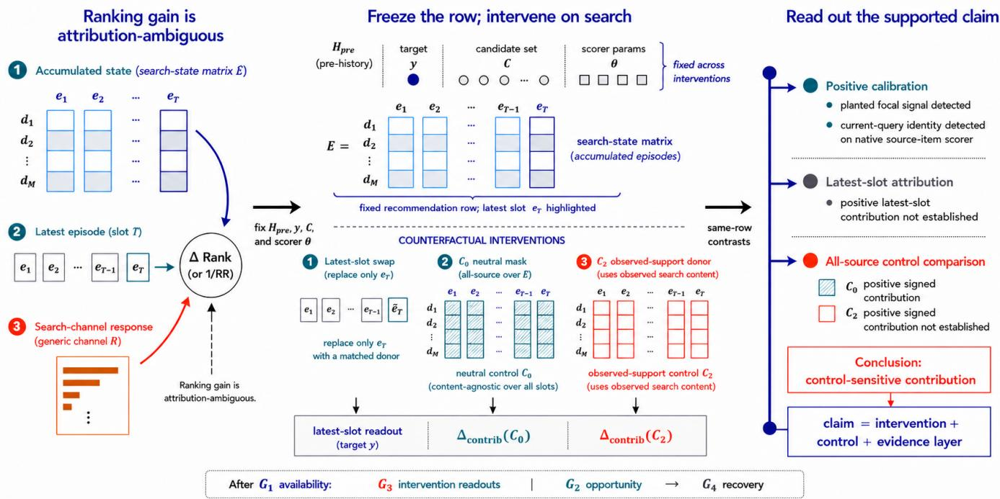
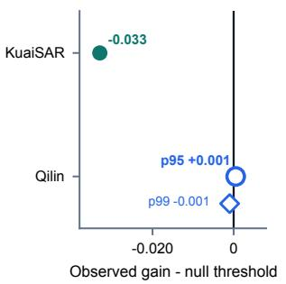
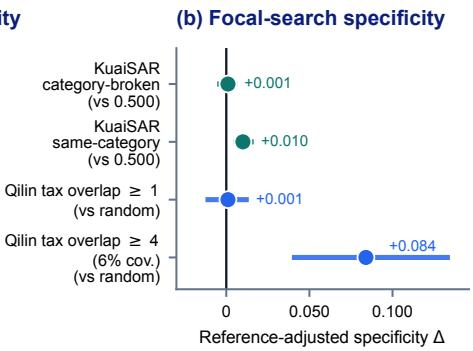
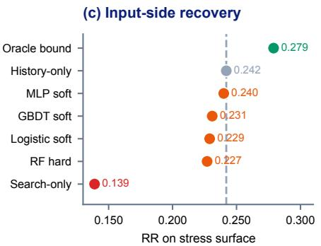
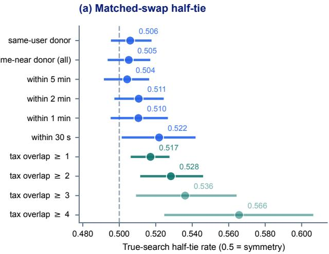
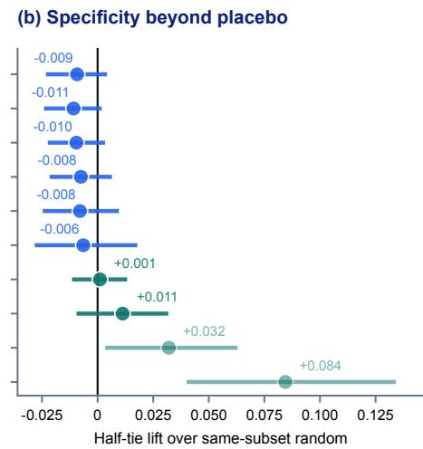
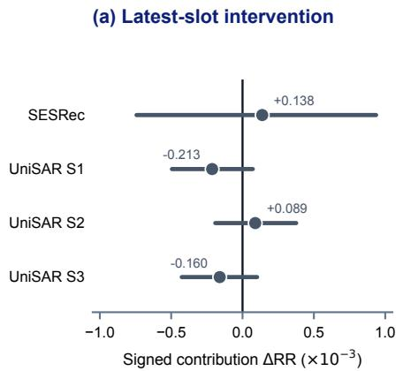
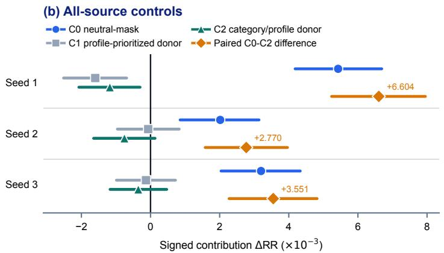

# Do Search-Augmented Recommenders Use the Latest Search Episode?

Jiandong Ding

Huawei Technologies Co., Ltd.

Shanghai, China

dingjiandong2@huawei.com

## ABSTRACT

Search-augmented recommenders can use the latest search episode and earlier searches. We introduce FocalSwap to test how these inputs contribute to the next recommendation. For each recommendation, it changes the latest search slot or all search inputs while holding the target, candidates, pre-search history, and scorer fixed. It compares neutral masks with matched observed-search replacements, recording rank changes, RR gains relative to each control, and preference for the true focal search. A planted signal and GenSAR’s current-query task confirm that the audit detects known input dependence. We evaluate behavioral and lexical evidence on KuaiSAR and Qilin, and recommendation checkpoints trained using the released SESRec and UniSAR implementations.

Across three independently trained UniSAR checkpoints, the estimated all-source benefit depends on the control. On the same 66,139 rows, replacing all search inputs with a neutral ID yields a positive signed contribution, whereas replacing them with category/profilematched observed search sequences gives smaller estimates, with an interval below zero for one checkpoint. The paired RR gaps range from +2.770 × 10−3 to +6.604 × 10−3, and every adjusted interval is above zero. Neutral masks change 59.7–61.7% of target ranks, while matched replacements change 44.1–44.8%. The control contrast persists across five alternative donor assignments per checkpoint. Under the primary neutral-mask and category-matched controls, positive latest-slot contribution is not established in SES-Rec or UniSAR. These results show why masking evidence should be compared with observed-search replacements when attributing a benefit to broader search state or the latest episode.

## KEYWORDS

search-augmented recommendation, search attribution, counterfactual evaluation, ranking diagnostics, matched search replacement

## 1 INTRODUCTION

Search-augmented recommendation (SAR) models use search behavior to improve recommendation. Aggregate gains and module ablations show that search histories, learned interests, or S→R transitions can benefit ranking [32, 36, 43]. They do not by themselves identify which search input produced the gain. Search logs may supervise a training representation, older searches may shape accumulated user state, a runtime search field may change scores, or the immediately preceding search may remain informative. Existing approaches include joint graph learning [50], intent transfer [47], and generative retrieval [33].

Consider one recommendation with a fixed target, candidate set, pre-search history, and scorer. Changing only the most recent search slot tests the role of the latest episode; changing every search slot tests the broader source state. The replacement also matters. A neutral mask removes search content but may create an unusual input, whereas a matched search from observed support keeps the intervention closer to inputs seen in the data. These scopes and controls answer diferent attribution questions on the same recommendation row.

FocalSwap turns these questions into fixed-row counterfactual tests. It reports whether an intervention changes the target rank, whether the original search improves reciprocal rank relative to the named control, and whether the true adjacent search beats matched replacements. We call this adjacent episode the focal search. A parallel branch measures whether search-only and history-only views ofer calibrated routing opportunity and whether observable inputs can recover it.

Across three UniSAR checkpoints, neutral masking supports positive all-source contribution, whereas category/profile-matched replacement does not. Every adjusted paired interval is above zero on identical rows. Both controls move many target ranks, but only masking produces a positive mean. This diference shows how the reference input changes the benefit attributed to search.

We test this argument in complementary settings. KuaiSAR provides broad same-user S→R coverage with anonymous behavior tokens [39]; Qilin provides real query and item text [3]; planted and GenSAR controls verify that the audit can recover known focal and current-query signals; SESRec and UniSAR provide the recommendation-checkpoint results. Across settings, every comparison keeps the recommendation row fixed while changing the search evidence required by the claim. Figure 1 summarizes the fixed-row intervention and the resulting evidence states.

Our contributions are:

• We identify a gap in search attribution. We ask whether the latest search episode helps rank the target beyond what the recommender can infer from its accumulated search state.

• We introduce a protocol to diagnose search attribution. FocalSwap masks or replaces search inputs on the same recommendation and detects known search signals in a planted control and GenSAR.

• Only masking supports a positive all-source contribution in UniSAR. On the same 66,139 rows across three UniSAR checkpoints, masking all search inputs yields positive RR contributions, while replacing them with matched observed searches does not.

  
Figure 1: Same ranking gain, diferent attribution. FocalSwap freezes history, target, candidates, and scorer, then contrasts latest-slot, neutral-mask, and observed-support interventions. The evidence map separates positive calibration, unestablished positive latest-slot contribution, and control-sensitive all-source contribution. After outcome checks (G1), intervention readouts (G3) and routing opportunity/recovery (G2/G4) form parallel branches.

## 2 RELATED WORK

FocalSwap sits at the intersection of three research lines: searchaugmented recommendation models, evaluation and attribution audits, and search-rich behavioral datasets. We review these lines to distinguish system-level utility from attribution to the latest search episode and to identify the evidence settings in which that distinction can be tested.

Search-augmented andjoint search–recommendation models. SAR builds on the broader implicit-feedback and sequential recommendation line, where ranking objectives and sequence encoders such as BPR, SASRec, and BERT4Rec define standard recommendation backbones [20, 26, 38]. HPGR models session structure and attends selectively to preference-relevant history [4]. Early joint systems model search and recommendation behavior together [1, 46, 50]. Closer to our checkpoint analysis, SESRec learns a search representation for recommendation [36], UnifiedSSR unifies sequential search and recommendation [43], and UniSAR models transitions between the two [32]. Their system-level ranking gains motivate the question here: whether the next recommendation uses the latest search episode or accumulated search state. Other representationbased approaches model integrated behavior, transfer intent, or learn disentangled representations [6, 31, 45, 47]; GSERec transfers signals to users with sparse search histories [34]. Other models capture long- and short-term interests [51] and serve multiple scenarios [23, 42]. Generative models condition outputs on identifiers, intent, or queries [14, 22, 33, 44, 48]. Other models share generative training across tasks [25, 49] or unify search and recommendation tasks [7, 16].

Across these designs, search can shape representations during training, accumulate in user state, or enter the scorer at prediction time. FocalSwap compares the search evidence attached to one recommendation row: changing the latest episode tests focal attribution, while changing all search inputs tests broader sourcestate contribution. GenSAR’s native current-query task provides a separate calibration of known query use [33].

Evaluation audits and signal attribution. Recommendation evaluation has a long history of re-examining whether reported gains survive stronger baselines, controlled comparisons, or reproducibility checks [12, 13, 30]. Behavioral testing systems make a related distinction between aggregate metrics and targeted capability checks [5, 27]. SIDInspector evaluates Semantic-ID mappings separately from downstream ranking scores [8]. SIDScope traces how those mappings afect candidate retrieval and item resolution [9]. Modelinterpretability research exposes a complementary risk in input attribution. Amnesic probing distinguishes information encoded in a representation from information used by the model through a behavioral intervention [11]. Feature-attribution studies further show that the baseline chosen to represent missingness can change an explanation and that test-time feature removal can create outof-distribution inputs [17, 37]. FocalSwap brings these concerns to temporal SAR attribution: it fixes the complete recommendation row, separates latest-episode from accumulated-source claims, and compares neutral removal with matched observed search sequences on identical rows. Counterfactual and of-policy evaluation estimate value from logged feedback [2, 10, 15, 40]; debiased rank ing and recommendation address exposure and selection efects [19, 28, 29]. DIFL learns duration-invariant features for counterfactual watch-time prediction [18]. Causal analyses of SAR further use search behavior as an instrumental variable to separate causal preference from non-causal associations [35]. These methods target logged-policy value, exposure bias, duration confounding, or causal preference components under their own assumptions. FocalSwap instead asks whether the true focal search beats matched replacements with the row, target, candidate set, scorer, and matching criteria fixed. Its routing analysis asks a separate question: whether a rule using only pre-outcome inputs can choose between historyonly and search-only predictions to improve ranking.

Intent, transfer, and search-rich datasets. Search behavior is attractive because it can expose intent. That intent can be available through behavior only, query tokens, or richer semantic representations. KuaiSAR provides same-user search and recommendation behavior but anonymizes tokens [39]. JDSearch and KuaiSearch expose real-query-derived tokens and retrieval context [21, 24], and query representation learning ofers another path for using explicit search signals in recommendation [41]. Qilin adds real query and item text in a search/recommendation behavior setting [3]. These datasets support diferent evidence layers, which FocalSwap reports explicitly alongside the ranking metric.

We test behavior-level evidence on KuaiSAR and lexical evidence on Qilin, asking whether each dataset keeps the focal search identifiable against plausible replacements.

## 3 FOCALSWAP PROTOCOL

FocalSwap changes the search evidence attached to one recommendation while holding its target, candidates, history, and scorer fixed. After checking that the row has a linked outcome (G1), the checkpoint analysis measures rank response, signed contribution, and replacement preference (G3). The routing analysis additionally uses five views. Full-SAR combines history and focal search; History only and Search-only isolate the two sources. Search-masked retains the slot but masks its content, and Counterfactual-search inserts a matched alternative. This branch asks whether choosing between History-only and Search-only ofers gain beyond a shufled-search null (G2), and whether pre-outcome inputs can recover that gain (G4). The behavioral and lexical scorers support this additional analysis; checkpoint interventions require only the original and control inputs under one scorer.

FocalSwap audits a search-centered recommendation opportunity. Let $H _ { \mathrm { p r e } }$ denote the user’s pre-search recommendation history, $E _ { \mathrm { s e a r c h } }$ the focal search episode, and $Y _ { \mathrm { p o s t } }$ the post-search recommendation positives. For eligible row �, define $r _ { i } = ( H _ { \mathrm { p r e } , i } , E _ { \mathrm { s e a r c h } , i } , Y _ { i } , C _ { i } )$ where nonempty $Y _ { i } \subseteq Y _ { \mathrm { p o s t } , i }$ is the evaluated positive set and $C _ { i }$ is the fixed candidate set. Its reciprocal-rank utility under view � is

$$
U _ { i } ( V ) = { \frac { 1 } { \operatorname* { m i n } _ { y \in Y _ { i } } \operatorname { r a n k } ( y ; s _ { \theta } ( V _ { i } , C _ { i } ) ) } } .\tag{1}
$$

Equation (1) is evaluated on the same target set and candidate set in every view. The rank operator follows each setting’s tie-breaking rule; SESRec and UniSAR use midpoint ranks for exact candidatescore ties. A row is eligible when $Y _ { \mathrm { p o s t } }$ exists and the target does not leak into the pre-search history or focal search fields used by the scorer. For compact notation, $F , H , S , M _ { m } ,$ , and $\widetilde { F }$ denote Full-SAR, History-only, Search-only, an intervened view under named control $m ,$ and Counterfactual-search, respectively. For a named input intervention �, let ${ \cal J } _ { m } ( F _ { i } ) = M _ { m , i }$ and let $\Omega _ { m }$ denote the rows with a valid intervention �. Neutral masking can use the full eligible row set, whereas an observed-support replacement additionally requires a valid donor. An intervention has two independent choices. Its scope determines whether only the latest non-padding source slot or every non-padding source slot changes; these are the latest-slot and all-source estimands. Its control determines whether the selected slot receives a neutral ID or matched content drawn from observed search support. Results across scopes are not interchangeable, and results across controls describe diferent counterfactuals. For the swap comparisons reported here, the row statistic is reciprocal rank, $A _ { i } ( V ) = U _ { i } ( V )$ . The SESRec and UniSAR exports provide target ranks, so both their signed contributions and replacement preferences use RR.

Because the retrieval pool stays fixed, these comparisons attribute changes within the given candidate set. They evaluate the search input to the scorer; efects on candidate retrieval or subsequent user behavior require a separate evaluation.

## 3.1 Intervention Readouts and Routing

G1 tests outcome availability. A SAR transfer claim requires postsearch recommendation outcomes linked to the focal search window. Linked outcomes make transfer testable; otherwise, the protocol reports dataset coverage.

G3 reports fixed-row intervention evidence through three distinct readouts. First, target-rank response records how often a named intervention changes the evaluated target’s rank:

$$
\widehat { \rho } _ { \mathrm { r a n k } } ( m ) = \frac { 1 } { | \Omega _ { m } | } \sum _ { i \in \Omega _ { m } } \mathcal { k } \bigl [ \mathrm { r a n k } _ { i } ( F ) \neq \mathrm { r a n k } _ { i } ( M _ { m } ) \bigr ] .\tag{2}
$$

Second, signed ranking contribution measures whether the original search input improves average RR relative to the named control:

$$
\widehat { \Delta } _ { \mathrm { c o n t r i b } } ( m ) = { \frac { 1 } { | \Omega _ { m } | } } \sum _ { i \in \Omega _ { m } } \left( U _ { i } ( F ) - U _ { i } ( M _ { m , i } ) \right) .\tag{3}
$$

The response rate and signed contribution answer diferent questions: frequent positive and negative rank changes can yield a small signed mean. Both interpretations require the target, candidates, pre-search history, scorer, and all fields outside the named intervention to remain fixed. Agreement across controls supports the contribution conclusion under those reference inputs; disagreement identifies control sensitivity.

Third, replacement preference compares the original input with a matched alternative. Under latest-slot replacement, this tests focal specificity. Giving exact ties half credit distinguishes unchanged outcomes from losses. Over the � matched rows, define

$$
z _ { i } = \left\{ \begin{array} { l l } { 1 , } & { A _ { i } ( F ) > A _ { i } ( \widetilde { F } ) , } \\ { \frac { 1 } { 2 } , } & { A _ { i } ( F ) = A _ { i } ( \widetilde { F } ) , } \\ { 0 , } & { A _ { i } ( F ) < A _ { i } ( \widetilde { F } ) , } \end{array} \right. \quad \widehat { h } _ { \mathrm { s w a p } } = \frac { 1 } { N } \sum _ { i = 1 } ^ { N } z _ { i } .\tag{4}
$$

Table 1: Audit evidence map summarizing calibration and empirical results across the evaluated settings.
<table><tr><td>Setting</td><td>Role</td><td>Main finding</td></tr><tr><td>Planted control</td><td>Sensitivity calibration</td><td>The audit recovers routing opportunity, positive contribution, and focal specificity at the strongest planted signal across all three seeds.</td></tr><tr><td>GenSAR PerSrc</td><td>Released-code calibration</td><td>The original query raises mean reciprocal rank relative to a matched query on 8,958 source-item examples.</td></tr><tr><td>KuaiSAR</td><td>Behavioral evidence</td><td>The behavioral proxy falls below the shuffled-search threshold for routing opportunity.</td></tr><tr><td>Qilin</td><td>Lexical evidence</td><td>BM25 detects routing opportunity at the 95th-percentile threshold. The focal query exceeds placebo by 0.084 in half-tie rate on 6.1% of rows.</td></tr><tr><td>SESRec; UniSAR S1-S3</td><td>Recommendation checkpoints</td><td>In UniSAR, masking all search inputs yields a positive contribution on 66,139 shared rows. Matched replacements yield smaller estimates. The primary tests leave positive latest-slot contribution unresolved in both models.</td></tr></table>

Equation (4) gives one for a within-row win, one half for a tie, and zero for a loss. A value of 0.500 corresponds to equal win and loss rates. Both preference columns in Table 3(b) use this statistic: latest-slot preference concerns the focal episode, while all-source preference concerns the complete search state. Attributing a benefit to the focal search requires evidence of positive signed contribution and true-over-replacement preference, using the uncertainty and calibration procedures below.

The parallel G2 branch tests calibrated routing opportunity. A per-row oracle selects whichever of History-only and Search-only yields higher RR. Its margin over History-only is an upper bound on the gain from routing between those views. Max-over-two selection can create apparent headroom even when the second score column is shufled, so a shufled-search null calibrates the raw margin. The observed margin is

$$
\widehat { \Delta } _ { \mathrm { o p p } } = \frac { 1 } { N } \sum _ { i = 1 } ^ { N } \left( \operatorname* { m a x } \{ U _ { i } ( H ) , U _ { i } ( S ) \} - U _ { i } ( H ) \right) .\tag{5}
$$

Let $\widehat { \Delta } _ { \mathrm { o p p } } ^ { \pi _ { b } }$ apply the same max-over-two operator after shufledsearch draw �. The G2 gate is established at the 95% threshold only when

$$
\widehat { \Delta } _ { \mathrm { o p p } } > \widehat { q } _ { 0 . 9 5 } \left( \left\{ \widehat { \Delta } _ { \mathrm { o p p } } ^ { \pi _ { b } } \right\} _ { b = 1 } ^ { B } \right) .\tag{6}
$$

Repeating the selection operator under the null accounts for the gain from choosing the better of two views even when search is shufled.

G4 is an input-side routing probe: it asks whether features available before the outcome can recover a nontrivial share of the raw History-only and Search-only oracle margin. G2 determines whether the oracle margin exceeds its null; G4 measures how much of the raw margin an input-side rule recovers.

Uncertainty follows the row dependence and endpoint family. User-cluster resampling keeps all rows from one user together; Qilin opportunity uses same-row shufled-search nulls; swap families use Holm correction; and the two prespecified C2 checkpoint endpoints use Bonferroni-adjusted 97.5% intervals. Every readout reports its eligible denominator and support.

Table 1 summarizes the evidence from these analyses.

## 3.2 Worked Example and Contribution Controls

One planted-control row illustrates the comparison. Its fixed target and candidates give reciprocal ranks of 1.000 under Full-SAR, 0.333 under History-only, 1.000 under Search-only, 0.333 under the masked control, and 0.333 after a matched replacement. The target, candidates, and scorer stay fixed while the designated evidence fields change, so this row records a positive signed contribution and a true-over-donor swap win. For the corresponding dose-1 run, the aggregate audit reads opportunity 0.128 above a shufled null 95th percentile of 0.068, signed contribution +0.054, and half-tie 0.647. The example therefore establishes routing opportunity, contribution, and focal specificity. Exact ties receive one half, which retains swap-invariant rows in the readout.

Calibrating contribution controls. The margin between Full and its control is scoped to that control. A neutral mask can remove information, but an appended or rarely observed neutral ID can also move the input of its observed support. For audited checkpoints, we therefore pair broad neutral masking with an observed-support source replacement when the claim concerns broader source-state use. Observed replacements preserve coarse category or profile properties while changing search content; matching does not ensure semantic or intent equivalence.

The protocol applies to proxy scorers, local controlled-interface rows, and trained checkpoints. Each readout requires its views to come from the same scorer. For released code, we use the documented native task and performance to distinguish checkpoint evidence from interface compatibility.

## 4 EVALUATION SETTINGS

## 4.1 KuaiSAR Behavioral Evidence

We construct search-centered KuaiSAR windows from anonymized search and recommendation interactions, linking pre-search recommendation history, focal search evidence, and post-search recommendation positives. Target items are removed from the pre-search and search fields used by the scorer. All five views keep the same target set and candidate set for each row, so RR diferences isolate controlled input changes with candidate retrieval fixed. The proxy candidate set contains the row’s post-search positives, bounded history and search items, and train-split popularity negatives, with a cap of 80 (mean 48.8 on held-out rows). The first ranked post-search positive defines RR, and the candidate list is reused for every view.

(a) Calibrated opportunity  

  
Figure 2: Cross-regime evidence separation. Panel (a) shows calibrated routing opportunity; panel (b) reports KuaiSAR half-tie lift above 0.500 and Qilin matched-minus-random swap lift, with 95% CIs; panel (c) reports KuaiSAR input-side recovery. Hollow Qilin markers denote p95 and p99.

This cap-80 candidate set supports a behavior-level focal-transfer test under anonymous tokens, controlling for history, category, and exposure context.

The main KuaiSAR gate result uses a transition-ranker proxy, while checkpoint results are reported separately in Section 7. We use this train-only, deterministic, interpretable proxy to construct all five views under anonymous tokens. It counts transitions from pre-search history and focal-search items to post-search targets in the training split. Let $c ( e , t )$ count transitions from evidence item � to target �, and let $\begin{array} { r } { \mathrm { t o t a l } ( e ) = \sum _ { t } c ( e , t ) } \end{array}$ . For evidence set � and candidate �, it scores

$$
s ( E , t ) = \operatorname* { m a x } _ { e \in \mathrm { u n i q } ( E ) } \frac { \log ( 1 + c ( e , t ) ) } { \log ( 2 + \mathrm { t o t a l } ( e ) ) } .\tag{7}
$$

The maximum selects the strongest evidence-to-target association, and the denominator reduces the weight of frequent evidence items. Unseen pairs score zero; equal candidate scores use deterministic hash tie-breaking.

## 4.2 Qilin Lexical Evidence

Qilin lets us test whether access to query and item text changes the behavioral picture. We score each focal query against candidate item text with BM25 on eligible post-search recommendation episodes. Each row uses the logged recommendation slate as its candidate set and the clicked item(s) in that slate as positives; this slate is unchanged across all query replacements.

The Qilin construction records both match coverage and match quality. Same-user and taxonomy-near swaps are available for nearly all rows. For taxonomy matching, we count distinct taxonomy paths among the donor’s clicked items whose top-level category also appears among the focal search’s clicked items. The bucket tax≥ � contains rows with at least � such donor paths. A random-query placebo gives each bucket a reference on the same rows. This setup lets the audit distinguish a broad lexical efect from a local taxonomy-overlap efect without changing the target or candidate set.

Table 2 records the number of users and valid post-search recommendation episodes in each dataset, including how many episodes enter the proxy analyses. Figure 2 summarizes their cross-regime results, while Figure 3 isolates Qilin’s taxonomy-overlap swap signal.

Table 2: Behavioral and lexical evaluation scale. Valid episodes satisfy the fixed-row criteria; analyzed episodes enter the proxy analyses.
<table><tr><td>Dataset</td><td>Users</td><td>Valid episodes</td><td>Analyzed episodes</td></tr><tr><td>KuaiSAR</td><td>13,159</td><td>96,994</td><td>20,000</td></tr><tr><td>Qilin</td><td>1,544</td><td>6,135</td><td>6,135</td></tr></table>

KuaiSAR analyzed rows are selected deterministically by sorting eligible examples by MD5(example\_id) within each split and taking 10,000 validation and 10,000 test rows.

## 4.3 Counterfactuals and Calibration

KuaiSAR uses two matched Counterfactual-search controls. L1 samples a nuisance search from the same split and source, matched by feedback count, pre-history length, and bridge length. L2 samples a same-split search that shares at least one search category. Qilin uses same-user and temporal or taxonomy-near swaps plus a randomquery placebo. Local matched buckets above 0.500 are interpretable only if they separate from a same-subset random replacement. Thus KuaiSAR reads 0.500 half-tie as swap symmetry, while Qilin reads taxonomy-near buckets through their delta against random-query placebo.

G2 uses shufled-search or counterfactual query score columns to estimate how much oracle margin can arise from selection alone. This null is deliberately matched to the row-level oracle operator. If the raw margin lies below the null threshold, the apparent routing gain is compatible with selection alone. The recovery probe compares RR with History-only within the same candidate pool, including Qilin’s lexical pool.

## 4.4 Checkpoints from Released Code

Released implementations enter the checkpoint analysis only when one native scorer supports Full, control, and counterfactual views over the same target and candidates. The recommendation analysis in Section 7 uses SESRec and UniSAR checkpoints trained using their released implementations on KuaiSAR-compatible in puts. UniSAR contributes three independently trained checkpoints, denoted S1–S3. Its 157,192 rows are recommendation records from the processed test split; SESRec uses 16,788 eligible test windows. Each checkpoint row contains one target and 99 model-specific negatives, fixed across interventions. These evaluations difer from the cap-80 proxy windows in Table 2. Full-input RR is 0.0423 for SESRec and 0.3417, 0.3542, and 0.3403 for UniSAR S1–S3. Each baseline reflects the model’s native test rows and candidate pools. GenSAR’s native PerSrc task provides a positive calibration for current-query identity (Section 5.2). We restrict the GenSAR audit to that task because its recommendation checkpoint scored 0.1857 in test NDCG@10, below the prespecified inclusion threshold of 0.1914.

  
Figure 3: Qilin’s matched-swap signal concentrates at high taxonomy overlap. Points are estimates and bars are 95% CIs; lighter rows have below 20% coverage. Panel (b) subtracts a same-subset random-query placebo.

SESRec exposes one search session at inference, so latest-session and complete-search-input interventions coincide. Its matched replacement uses an L2 donor sharing at least one search-item category. UniSAR’s C2 additionally matches source-profile buckets. We report these matching conditions separately.

In this checkpoint layer, source is the released APIs’ term for the search-side sequence. We apply the latest-slot and all-source scopes defined in the protocol. The checkpoint analysis measures intervention readouts. The behavioral and lexical analyses additionally evaluate the routing branch with their History-only and Search-only views.

## 5 POSITIVE CALIBRATION

Before auditing recommendation checkpoints, we verify that FocalSwap detects input dependence when it is known to be present. One score construction plants a focal signal; a released scorer explicitly conditions its native task on the current query. Together they establish detection capability before the recommendation-side analysis.

## 5.1 Planted Focal Signal

An auxiliary score-sensitivity check adds a boost only when the focal search has positive feedback and does not directly conflict with pre-search history. With no injection, oracle gain is 0 and the injected-versus-passive half-tie is 0.500. At the smallest positive dose (oracle gain 0.003), half-tie reaches 0.645 and a held-out twolayer MLP router recovers the injected headroom. At the largest dose, oracle gain reaches 0.042 and recovery persists. This check isolates score sensitivity and routing. The following full-chain control adds matched donors and the shufled-search opportunity null.

The separate full-chain control keeps Qilin inputs, candidates, and donors fixed and generates synthetic target labels with a fixed teacher. The teacher standardizes history and focal-search scores within each candidate set, then adds the history score, the doseweighted focal-search score, and fixed noise. The highest-scoring candidate becomes the target and stays fixed across all audit views. For each dose (0, 0.5, or 1.0), we train the student scorer with three seeds. At dose 0, Full-minus-masked RR ranges from −0.0070 to −0.0041: neutral masking changes ranking even without a planted focal signal. No run at dose 0 passes the positive contribution gate. At dose 1, Full-minus-masked RR is 0.052–0.054, true-versus-donor half-tie is 0.639–0.651, and placebo-adjusted specificity is 0.147– 0.163; every interval clears its null boundary. The planted control therefore establishes routing opportunity, signed contribution, and focal specificity for all three high-dose seeds.

## 5.2 Released-Code Current-Query Signal

GenSAR provides a second positive calibration on its native PerSrc source-item task [33]. On 8,958 leakage-filtered validation rows, masking the explicit current query reduces RR by 0.035 (95% CI [0.029, 0.041]); a matched donor query reduces RR by 0.106 (95% CI [0.099, 0.112]) with half-tie 0.635. The corresponding sourcehistory swap reduces RR by only 0.002 and yields a half-tie rate of 0.518. At the preselected epoch-3 checkpoint, these results recover current-query identity in GenSAR’s native source-item task.

  
Figure 4: Control-sensitive contribution under the original donor assignment. Latest-slot intervals cross zero (a). On the same UniSAR rows, positive all-source C0 neutral-mask margins disappear under observed-support donors: C1 is profile-prioritized and C2 is category/profile-matched; orange diamonds show paired C0–C2 diferences (b). Bars are user-cluster bootstrap CIs (95%; C2 and paired diferences, 97.5%).

We next examine behavioral and lexical routing evidence, then recommendation-checkpoint attribution.

## 6 BEHAVIORAL AND LEXICAL EVIDENCE

We use the comparable History-only and Search-only views to test whether search creates routing opportunity and whether observable inputs recover it (Figure 2).

## 6.1 Coverage and Opportunity Separate

KuaiSAR provides the valid episodes in Table 2, with no target leakage under G1. On the analyzed episodes, its observed oracle gain is 0.037, below the shufled-search p95 of 0.070. The proxy therefore does not establish routing opportunity at the declared threshold.

Qilin’s BM25 result clears the declared p95 routing-opportunity threshold. Across 30 Monte Carlo null seeds, its oracle margin exceeds the pooled counterfactual-query p95 by 0.0005 RR (� = 0.030); the observed statistic also exceeds the seed-level p95 in every run. The margin remains below p99 and is not reproduced by TF-IDF. Qilin therefore establishes p95-calibrated routing opportunity for BM25, with a small and scorer-specific margin.

## 6.2 Matched-Swap Signal Is Local

KuaiSAR is mostly swap-invariant. The category-broken/source comparison stays at half-tie 0.501, while the same-category/source comparison reaches 0.510. The +0.010 efect is category-local; broad focal-instance specificity remains unestablished.

Qilin likewise yields one local subset. Each taxonomy-overlap bucket is compared with a random-query placebo on the same rows. The only Holm-stable bucket is tax≥4: half-tie 0.566, placeboadjusted $\Delta = + 0 . 0 8 4$ , and $p = 0 . 0 0 3 ,$ , at 6.1% coverage. The stable signal is therefore local to tax≥4; at broader coverage, efects up to the observed +0.010 scale remain compatible with the intervals.

Input-side recovery follows this opportunity evidence: KuaiSAR remains at the History-only baseline, while Qilin’s localized BM25 opportunity does not produce held-out gains, including on the tax≥4 subset.

## 7 CHECKPOINT EVIDENCE

The checkpoint analysis asks two separate questions: does the latest source slot contribute to the recommendation, and does the broader source state contribute? For each scope, we compare the original row with named controls and then examine how often and how far target ranks move.

Interventions and uncertainty. For each scope, C0 fills the selected slot(s) with the checkpoint-compatible neutral source ID. C1 draws a profile-prioritized donor from observed support. C1 prioritizes item-count, query-length, and frequency buckets, with broader fallback pools; it imposes no category constraint. C2 draws an observed donor matched by category and profile. Latest-slot C0 uses the full UniSAR row set; C2 uses the 87,044 of 157,192 rows (55.4%) with a valid latest-slot donor. All-source C2 additionally requires a donor for every replaced slot and is defined on 66,139 rows (42.1%). The two C2 endpoints, latest-slot and all-source, and their Bonferroni-adjusted 97.5% user-cluster intervals were prespecified before the checkpoint readout; C0, C1, and the SESRec latest-slot readout use 95% intervals. Paired C0–C2 contrasts use the same C2-eligible rows and Bonferroni-adjusted 97.5% intervals. SESRec’s C0 estimate uses all 16,788 rows; its separate C0/L2 comparison uses 8,631 donor-eligible rows and 2,134 user clusters. Supplementary half-tie readouts use 10,000 user-cluster resamples and pointwise 95% intervals. At the latest slot, this statistic measures focal preference; under all-source replacement, it measures preference for the complete original search state. SESRec exposes a single search session, so its L2 preference appears only in the latest-slot column of Table 3(b); all-source C1 is evaluated only for UniSAR.

Figure 4 visualizes the two intervention scopes. Table 3 provides the corresponding checkpoint-level estimates on one scale.

Table 3: Checkpoint readouts: (a) signed contribution under the original donor assignment; (b) supplementary preferences and C1 contribution; (c) point-estimate ranges across five alternative C2 assignments. RR contrasts use $1 0 ^ { - 3 }$ units; brackets in (a)–(b) give user-cluster bootstrap intervals.
<table><tr><td colspan="6">(a) Neutral-mask C0 and category/profile-matched observed-search C2 Latest-slot</td></tr><tr><td>Checkpoint</td><td>C0, 95% CI</td><td>C2, 97.5%CI</td><td>C0, 95% CI</td><td>C2, 97.5%CI</td><td>C0-C2, 97.5% CI</td></tr><tr><td>SESRec</td><td> $+ 0 . 1 3 8 \ \left[ - 0 . 7 4 3 , + 0 . 9 3 6 \right]$ </td><td></td><td></td><td></td><td></td></tr><tr><td>UniSAR S1</td><td>-0.213  $\left[ - 0 . 4 9 5 , + 0 . 0 7 2 \right]$ </td><td> $- 0 . 4 0 8 \ \left[ - 0 . 8 2 2 , + 0 . 0 0 9 \right]$ </td><td> $+ 5 . 4 2 7 \ \left[ + 4 . 1 8 3 , + 6 . 6 8 9 \right]$ </td><td> $- 1 . 1 7 7 \ \left[ - 2 . 0 7 4 , - 0 . 3 0 2 \right]$ </td><td>+6.604 [+5.238, +7.951]</td></tr><tr><td>UniSAR S2</td><td> $+ 0 . 0 8 9 \ \left[ - 0 . 1 9 1 , + 0 . 3 7 6 \right]$ </td><td> $- 0 . 1 6 3 \ \left[ - 0 . 5 6 7 , + 0 . 2 5 3 \right]$ </td><td> $+ 2 . 0 1 6 \ \left[ + 0 . 8 5 6 , + 3 . 1 3 8 \right]$ </td><td> $- 0 . 7 5 5 \ \left[ - 1 . 6 4 7 , + 0 . 1 3 1 \right]$ </td><td>+2.770 [+1.582, +3.962]</td></tr><tr><td>UniSAR S3</td><td> $- 0 . 1 6 0 \ \left[ - 0 . 4 2 6 , + 0 . 1 0 2 \right]$ </td><td> $+ 0 . 0 4 3 \ \left[ - 0 . 3 6 1 , + 0 . 4 6 2 \right]$ </td><td> $+ 3 . 1 9 7 \ \left[ + 2 . 0 4 0 , + 4 . 3 3 1 \right]$ </td><td> $- 0 . 3 5 4 \ \left[ - 1 . 1 7 1 , + 0 . 4 6 9 \right]$ </td><td>+3.551  $\left[ + 2 . 2 7 2 , + 4 . 8 1 9 \right]$ </td></tr><tr><td colspan="6">(b) Supplementary readouts: pointwise 95% user-cluster intervals</td></tr><tr><td>Checkpoint</td><td colspan="2"> $\mathrm { L a t e s t - s l o t } \widehat { h } _ { \mathrm { s w a p } }$ </td><td colspan="2"> $\operatorname { A l l - s o u r c e } \widehat { h } _ { \operatorname { s w a p } }$ </td><td> $\mathsf { A l l - s o u r c e } \mathsf { C 1 } \left( 1 0 ^ { - 3 } \mathrm { \ R R } \right)$ </td></tr><tr><td>SESRec (L2)</td><td colspan="2">0.4966 [0.4868,0.5065]</td><td colspan="2"></td><td></td></tr><tr><td>UniSAR S1</td><td></td><td>0.4977 [0.4960, 0.4994]</td><td> $0 . 4 8 9 9 \ \left[ 0 . 4 8 7 0 , 0 . 4 9 2 8 \right]$ </td><td></td><td> $- 1 . 6 0 0 \ \left[ - 2 . 5 1 6 , - 0 . 6 9 1 \right]$ </td></tr><tr><td>UniSAR S2</td><td></td><td> $0 . 4 9 8 2 \ \left[ 0 . 4 9 6 5 , 0 . 4 9 9 9 \right]$ </td><td> $0 . 4 9 5 9 \ \left[ 0 . 4 9 2 9 , 0 . 4 9 8 9 \right]$ </td><td></td><td> $- 0 . 0 6 8 \left[ - 0 . 9 5 9 , + 0 . 8 3 0 \right]$ </td></tr><tr><td>UniSAR S3</td><td></td><td> $0 . 4 9 9 3 \ \left[ 0 . 4 9 7 5 , 0 . 5 0 1 3 \right]$ </td><td>0.4957 [0.4928, 0.4986]</td><td></td><td> $- 0 . 1 3 2 \ \left[ - 0 . 9 8 6 , + 0 . 7 2 2 \right]$ </td></tr><tr><td colspan="6"></td></tr><tr><td colspan="6">(c) Five alternative C2 assignments: all-source point-estimate ranges</td></tr><tr><td>Checkpoint</td><td colspan="2">C2 range</td><td>C0-C2 range</td><td></td><td>Paired 97.5% CIs above zero</td></tr><tr><td>UniSAR S1</td><td colspan="2"> $- 1 . 6 7 9 \mathrm { ~ t o ~ } - 0 . 9 5 3$ </td><td> $+ 6 . 3 8 0 \mathrm { ~ t o ~ } + 7 . 1 0 6$ </td><td></td><td>5/5</td></tr><tr><td>UniSAR S2</td><td colspan="2"> $- 0 . 8 3 7 \mathrm { t o } \mathrm { ~ - ~ } 0 . 3 1 6$ </td><td> $+ 2 . 3 3 1 \mathrm { ~ t o ~ } + 2 . 8 5 2$ </td><td></td><td>5/5</td></tr><tr><td>UniSAR S3</td><td colspan="2"> $- 0 . 5 3 4 \mathrm { ~ t o ~ } + 0 . 1 4 1$ </td><td></td><td> $+ 3 . 0 5 7 \mathrm { t o } \ + 3 . 7 3 2$ </td><td>5/5</td></tr></table>

## 7.1 Positive Latest-Slot Contribution Is Not Established

The available SESRec latest-slot margin is $+ 0 . 1 3 8 \times 1 0 ^ { - 3 } ;$ its 95% CI i $\cdot \left[ - 0 . 7 4 3 , + 0 . 9 3 6 \right] \times 1 0 ^ { - 3 }$ . Across the three UniSAR checkpoints, C0 latest-slot margins range $\mathrm { f r o m } - 0 . 2 1 3 \times 1 0 ^ { - 3 } \mathrm { t o } + 0 . 0 8 9 \times 1 0 ^ { - 3 }$ with every interval crossing zero. The three C2 intervals also cross zero on their donor-eligible support. Each eligible row contains a non-padding latest slot, and the intervention changes exactly that slot. These results do not establish positive latest-slot contribution under either primary control. The latest-slot C2 97.5% intervals have upper endpoints of +0.009, +0.253, and +0.462 for UniSAR S1–S3, in units of $1 0 ^ { - 3 } ~ \mathrm { R R }$ . SESRec’s C0 95% upper endpoint is +0.936 on the same scale. These endpoints describe the precision of the estimates in the absence of a prespecified equivalence margin.

The latest-slot half-tie rates are 0.4977–0.4993 for UniSAR under C2 and 0.4966 for SESRec under L2 (Table 3(b)). The pointwise 95% intervals for UniSAR S1 and S2 lie below 0.500, favoring the replacements on the half-tie measure. The other two intervals include 0.500.

On SESRec’s 8,631 L2-eligible rows, contributions in $1 0 ^ { - 3 }$ RR are −0.183 [−1.259, +0.835] for C0 and $- 0 . 2 1 3 \left[ - 1 . 1 3 5 , + 0 . 7 8 3 \right]$ for L2. Their paired diference is +0.029 [−1.112, +1.127] in the same units. C0 uses a 95% interval; L2 and the paired contrast use 97.5% intervals. All three cross zero. On the 87,044 C2-eligible UniSAR rows, the latest-slot C0 margin for $\begin{array} { r } { \mathrm { S 1 ~ i s } - 0 . 4 8 6 \left[ - 0 . 9 3 1 , - 0 . 0 3 6 \right] \times 1 0 ^ { - 3 } } \end{array}$ RR. The S2 and S3 intervals still include zero.

## 7.2 All-Source Contribution Is Control-Sensitive

On the same C2-eligible rows, every neutral-mask C0 interval is positive, while C1 and C2 do not establish positive contribution. C1 margins range from $- 1 . 6 0 0 \times 1 0 ^ { - 3 } \mathrm { ~ t o ~ } - 0 . 0 6 8 \times 1 0 ^ { - 3 }$ ; the S1 interval lies below zero, while the S2–S3 intervals cross zero. The paired C0–C2 diferences range from +2.770 × $1 0 ^ { - 3 }$ to +6.604 × $1 0 ^ { - 3 }$ , and all adjusted intervals are above zero (Table 3). Under C2, the original search state yields lower mean RR than its matched replacement for S1, whose interval lies below zero, while the S2 and S3 intervals include zero. All-source $\widehat { h } _ { \mathrm { s w a p } }$ ranges from 0.4899 to 0.4959 (Table 3(b)).

Both interventions often change the target rank. C0 changes 59.7–61.7% of ranks and C2 changes 44.1–44.8%. Among changed rows, 53.3–55.3% worsen under C0, compared with 47.7–49.1% under C2. Absolute rank shifts have medians of 2 and 1, and p90 values of 9–10 and 4, respectively. The mean RR contrasts reflect frequent rank changes with diferent magnitudes and directions. The artifact provides additional top-10 membership and user-influence summaries.

## 7.3 Scope and Sensitivity

The C2 donor is a one-to-one derangement over 45,895 observed source IDs with nonempty content, with no fixed points or donor reuse. It matches source category and item-count, query-tokencount, and frequency buckets without using user, target, candidate, label, rank, or model score. This design preserves coarse behavioral category and profile support. C0 remains positive within both C2- eligible and ineligible rows, and the common-support comparison identifies the control contrast: the positive margin is specific to the C0 intervention.

We vary cyclic ofsets within C2’s matching buckets to obtain five alternative donor assignments, fixed before these sensitivity runs. Checkpoints and eligible rows are unchanged. We use 10,000 usercluster resamples per assignment. The 97.5% intervals adjust for the two scopes within each assignment and checkpoint. The same users recur across assignments. The strata below use pointwise 97.5% intervals. C3 and the scope ladder use pointwise 95% intervals.

Across the fifteen all-source conditions, C0–C2 gaps range from $+ 2 . 3 3 1 \times 1 0 ^ { - 3 } \mathrm { ~ t o ~ } { + } 7 . 1 0 6 \times 1 0 ^ { - 3 } \mathrm { ~ R R }$ , and all intervals lie above zero (Table 3(c)). No C2 interval establishes positive contribution. The fifteen latest-slot C2 comparisons on 87,044 eligible rows likewise establish no positive contribution.

C1 changes category composition substantially. On the same 66,139 rows, 10.6% of non-padding search-slot occurrences share a top-level category with the original session. Across entire histories, the average fraction of original categories retained is 47.4%.

With the original donor assignment, the contrast is concentrated in longer histories: across the 4–30-slot strata, all 12 seedby-stratum C0–C2 point estimates are positive and 11 intervals exclude zero, compared with none of six intervals in the 1–3-slot strata.

Historical donors and intervention scope. C3 replaces search with an earlier session from the same user’s history. C3 uses a separate set of 155,678 eligible rows. All three all-source intervals include zero. At the latest slot, S3 has a positive contribution of +0.238 [+0.017, +0.464] × 10−3 RR (pointwise 95% CI). The S1 and S2 intervals include zero. The original scope ladder also masks or replaces the latest 2, 4, or 8 slots on 155,678, 141,172, or 113,555 eligible rows, respectively. With eight masked slots, only S1 has a positive interval; masking all slots is positive in all three checkpoints. Its profile-prioritized observed-ID replacements establish no positive contribution at these scopes.

Comparison on shared candidates. We retrained both models with episode-level IDs and a transductive context vocabulary, then evaluated them on the same 3,249 episodes with 100 candidates each. Full-input RR ranged from 0.0637 to 0.1138 for SESRec and from 0.1705 to 0.1928 for UniSAR. Masking yielded positive contribution intervals in two of three SESRec runs and zero of three UniSAR runs. All six L2 preference intervals included 0.500, so neither model showed a clear preference for the original search over its matched replacement in this setting.

## 8 DISCUSSION

The control determines the attribution. On the same rows, the original prediction is shared by both contribution contrasts. Subtracting the C2 contribution from the C0 contribution therefore compares RR under the two controls directly. This paired comparison isolates the efect of the reference input on the attribution readout. Both controls change many target ranks, yet their gains and losses yield diferent signed means. This pattern persists across all three audited UniSAR checkpoints and the five alternative donor assignments. The observed replacements preserve coarse input properties, including category and profile under C2. The contrast is compatible with both retention of useful coarse search information and disturbance from the neutral input; it identifies control sensitivity without separating these mechanisms.

Interpreting the audit. A signed mean RR contrast summarizes the balance of ranking gains and losses, with a negative value indicating higher mean RR under the control. Audits of latest-episode attribution should pair neutral masking with matched replacements on the same rows and candidates, and report the signed RR diference alongside the tie-adjusted preference rate $\widehat { h } _ { \mathrm { s w a p } }$

## 9 CONCLUSION

FocalSwap exposes a hidden degree of freedom in SAR attribution: the reference input against which search contribution is measured. On identical rows at three UniSAR checkpoints, neutral masks establish positive all-source contribution while observed-support replacements do not. Every adjusted paired interval is positive, and the control contrast persists across five alternative donor assignments per checkpoint. Both controls change many target ranks. The signed contribution assigned to search is therefore control-sensitive on these checkpoints.

The positive controls recover a planted focal signal and identify dependence on the current query in GenSAR’s native task. At recommendation checkpoints, the evidence establishes broader sourcestate control sensitivity; the primary neutral-mask and categorymatched latest-slot comparisons do not establish positive contribution. KuaiSAR and Qilin further separate behavioral coverage, calibrated routing opportunity, and local focal specificity.

The scientific implication is direct: masking measures response to one intervention, while fixed-row observed-support comparisons test whether that response supports broader search-state or latest-episode attribution. FocalSwap thereby makes ranking utility, intervention response, focal specificity, and recovery separately testable.

## 10 REPRODUCIBILITY

The FocalSwap repository provides audit code, aggregate results, and scripts for regenerating selected tables and figures: https:// github.com/jdding/focalswap.

The quickstart shows how to check the reported results and run an audit on example data. Checkpoint reruns require the original datasets and model implementations, along with compatible checkpoints.

## 11 ETHICAL CONSIDERATIONS

We report aggregate analyses of public benchmark logs and do not redistribute user-level data. Search data may reveal sensitive intent; findings concern the audited datasets, checkpoints, and interfaces.

## REFERENCES

[1] Moumita Bhattacharya, Vito Ostuni, and Sudarshan Lamkhede. 2024. Joint Modeling of Search and Recommendations Via an Unified Contextual Recommender (UniCoRn). In Proceedings of the 18th ACM Conference on Recommender Systems. Association for Computing Machinery, New York, NY, USA, 793–795. https://doi.org/10.1145/3640457.3688034

[2] Léon Bottou, Jonas Peters, Joaquin Quiñonero-Candela, Denis X. Charles, D. Max Chickering, Elon Portugaly, Dipankar Ray, Patrice Simard, and Ed Snelson. 2013. Counterfactual Reasoning and Learning Systems: The Example of Computational Advertising. Journal ofMachine Learning Research 14, 101 (2013), 3207–3260. https://www.jmlr.org/papers/v14/bottou13a.html

[3] Jia Chen, Qian Dong, Haitao Li, Xiaohui He, Yan Gao, Shaosheng Cao, Yi Wu, Ping Yang, Chen Xu, Yao Hu, Qingyao Ai, and Yiqun Liu. 2025. Qilin: A Multimodal Information Retrieval Dataset with APP-level User Sessions. In Proceedings of the 48th International ACM SIGIR Conference on Research and Development in Information Retrieval. Association for Computing Machinery, New York, NY, USA, 3670–3680. https://doi.org/10.1145/3726302.3730279

[4] Zerui Chen, Heng Chang, Tianying Liu, Chuantian Zhou, Yi Cao, Jiandong Ding, Ming Liu, and Bing Qin. 2026. Beyond the Flat Sequence: Hierarchical and Preference-Aware Generative Recommendations. In Proceedings ofthe ACM Web Conference 2026. Association for Computing Machinery, New York, NY, USA, 7999–8007. https://doi.org/10.1145/3774904.3792790

[5] Patrick John Chia, Jacopo Tagliabue, Federico Bianchi, Chloe He, and Brian Ko. 2022. Beyond NDCG: Behavioral Testing of Recommender Systems with RecList. In Companion Proceedings of the Web Conference 2022. Association for Computing Machinery, New York, NY, USA, 99–104. https://doi.org/10.1145/3487553.3524215

[6] Jiajun Cui, Xu Chen, Shuai Xiao, Chen Ju, Jinsong Lan, Tingting Li, Jianyong Wang, and Wei Zhang. 2026. Disentangling Representations from Search Behaviors for Recommendation via Counterfactual Learning. ACM Transactions on Information Systems 44, 5 (2026), 111:1–111:27. https://doi.org/10.1145/3808226

[7] Marco De Nadai, Edoardo D’Amico, Max Lefarov, Alexandre Tamborrino, Di vita Vohra, Mark VanMiddlesworth, Shawn Lin, Jacqueline Wood, Jan Stypka, Eliza Klyce, Keshi Dai, Matthew N. K. Smith, Timothy Christopher Heath, Martin D. Gould, Yves Raimond, Sandeep Ghael, Tony Jebara, Andreas Dami anou, Vladan Radosavljevic, Paul N. Bennett, Mounia Lalmas, and Praveen Chandar. 2026. A Unified Model for Personalization: Language-Steerable Gen erative Recommendation, Search, and User Understanding. In Proceedings of the 32nd ACM SIGKDD Conference on Knowledge Discovery and Data Mining V.2. Association for Computing Machinery, New York, NY, USA, 779–790. https://doi.org/10.1145/3770855.3817955

[8] Jiandong Ding, Heng Chang, Huijie Qin, and Tianying Liu. 2026. SIDInspector: A Mapping-First Diagnostic Resource for Semantic-ID Tokenizers. In Proceedings of the 35th ACM International Conference on Information and Knowledge Management. Association for Computing Machinery, New York, NY, USA, 8890–8894. https: //doi.org/10.1145/3799682.3840174

[9] Jiandong Ding, Huijie Qin, Tiandeng Wu, and Yi Cao. 2026. SIDScope: A Di agnostic Resource for Semantic-ID Interfaces in Generative Recommendation. arXiv:2608.18779v2

[10] Miroslav Dudík, Dumitru Erhan, John Langford, and Lihong Li. 2014. Doubly Robust Policy Evaluation and Optimization. Statist. Sci. 29, 4 (2014), 485–511. https://doi.org/10.1214/14-STS500

[11] Yanai Elazar, Shauli Ravfogel, Alon Jacovi, and Yoav Goldberg. 2021. Amnesic Probing: Behavioral Explanation with Amnesic Counterfactuals. Transactions of the Association for Computational Linguistics 9 (2021), 160–175. https://doi.org/ 10.1162/tacl\_a\_00359

[12] Maurizio Ferrari Dacrema, Simone Boglio, Paolo Cremonesi, and Dietmar Jannach. 2021. A Troubling Analysis of Reproducibility and Progress in Recommender Systems Research. ACM Transactions on Information Systems 39, 2 (2021), 20:1– 20:49. https://doi.org/10.1145/3434185

[13] Maurizio Ferrari Dacrema, Paolo Cremonesi, and Dietmar Jannach. 2019. Are We Really Making Much Progress? A Worrying Analysis ofRecent Neural Recommendation Approaches. In Proceedings ofthe 13th ACM Conference on Recommender Systems. Association for Computing Machinery, New York, NY, USA, 101–109. https://doi.org/10.1145/3298689.3347058

[14] Vianne R. Gao, Chen Xue, Marc Versage, Xie Zhou, Zhongruo Wang, Chao Li, Yeon Seonwoo, Nan Chen, Zhen Ge, Gourab Kundu, Weiqi Zhang, Tian Wang, Qingjun Cui, and Trishul Chilimbi. 2025. SynerGen: Contextualized Generative Recommender for Unified Search and Recommendation. arXiv:2509.21777

[15] Alexandre Gilotte, Clément Calauzènes, Thomas Nedelec, Alexandre Abraham, and Simon Dollé. 2018. Ofline A/B Testing for Recommender Systems. In Proceedings of the Eleventh ACM International Conference on Web Search and Data Mining. Association for Computing Machinery, New York, NY, USA, 198–206. https://doi.org/10.1145/3159652.3159687

[16] Guo Xun. 2026. OneFeed: A Unified Generative Framework for Feed Content Enhancement and Query Generation. arXiv:2606.07972

[17] Peter Hase, Harry Xie, and Mohit Bansal. 2021. The Out-of-Distribution Problem in Explainability and Search Methods for Feature Importance Explanations. In Advances in Neural Information Processing Systems, Vol. 34. Curran Associates, Inc., Online, 3650–3666.

[18] Chenghou Jin, Yixin Ren, Hongxu Ma, Yewei Xia, Yi Guan, Hao Zhang, Jiandong Ding, Jihong Guan, and Shuigeng Zhou. 2026. Invariant Feature Learning for Counterfactual Watch-time Prediction in Video Recommendation. Proceedings of the AAAI Conference on Artificial Intelligence 40, 17 (2026), 14964–14972. https: //doi.org/10.1609/aaai.v40i17.38518

[19] Thorsten Joachims, Adith Swaminathan, and Tobias Schnabel. 2017. Unbiased Learning-to-Rank with Biased Feedback. In Proceedings ofthe Tenth ACM International Conference on Web Search and Data Mining. Association for Computing Machinery, New York, NY, USA, 781–789. https://doi.org/10.1145/3018661.3018699

[20] Wang-Cheng Kang and Julian McAuley. 2018. Self-Attentive Sequential Recommendation. In Proceedings of the 2018 IEEE International Conference on Data Mining. IEEE Computer Society, Los Alamitos, CA, USA, 197–206. https: //doi.org/10.1109/ICDM.2018.00035

[21] Yupeng Li, Ben Chen, Mingyue Cheng, Qingpeng Cai, Zhiding Liu, Xuxin Zhang, Zhentao Song, Chenyi Lei, Qi Liu, and Peng Jiang. 2026. KuaiSearch: An E-Commerce Search Dataset with Authentic Queries and Product Texts for Recall, Ranking, and Relevance. arXiv:2602.11518

[22] Dongliang Liao, Chenxing Wang, and Yawen Zeng. 2026. Bridging Explicit and Implicit Intent: Unified Interest Generative Method for Joint Search Recommendation Modeling. In Proceedings ofthe ACM Web Conference 2026. Association for Computing Machinery, New York, NY, USA, 6103–6113. https: //doi.org/10.1145/3774904.3792253

[23] Jinhan Liu, Qiyu Chen, Junjie Xu, Junjie Li, Baoli Li, and Sulong Xu. 2024. A Unified Search and Recommendation Framework Based on Multi-Scenario Learning for Ranking in E-commerce. In Proceedings ofthe 47th International ACM SIGIR Conference on Research and Development in Information Retrieval. Association for Computing Machinery, New York, NY, USA, 2890–2894. https: //doi.org/10.1145/3626772.3661356

[24] Jiongnan Liu, Zhicheng Dou, Guoyu Tang, and Sulong Xu. 2023. JDsearch: A Personalized Product Search Dataset with Real Queries and Full Interactions. In Proceedings ofthe 46th International ACM SIGIR Conference on Research and Development in Information Retrieval. Association for Computing Machinery, New York, NY, USA, 2945–2952. https://doi.org/10.1145/3539618.3591900

[25] Gustavo Penha, Ali Vardasbi, Enrico Palumbo, Marco De Nadai, and Hugues Bouchard. 2024. Bridging Search and Recommendation in Generative Retrieval: Does One Task Help the Other?. In Proceedings of the 18th ACM Conference on Recommender Systems. Association for Computing Machinery, New York, NY, USA, 340–349. https://doi.org/10.1145/3640457.3688123

[26] Stefen Rendle, Christoph Freudenthaler, Zeno Gantner, and Lars Schmidt-Thieme. 2009. BPR: Bayesian Personalized Ranking from Implicit Feedback. In Proceedings of the Twenty-Fifth Conference on Uncertainty in Artificial Intelligence (Proceedings ofMachine Learning Research, Vol. R7). PMLR, 460–469. https://proceedings.mlr. press/r7/rendle09a.html

[27] Marco Tulio Ribeiro, Tongshuang Wu, Carlos Guestrin, and Sameer Singh. 2020. Beyond Accuracy: Behavioral Testing of NLP Models with CheckList. In Proceedings of the 58th Annual Meeting of the Association for Computational Linguistics. Association for Computational Linguistics, Online, 4902–4912. https://doi.org/10.18653/v1/2020.acl-main.442

[28] Yuta Saito, Suguru Yaginuma, Yuta Nishino, Hayato Sakata, and Kazuhide Nakata. 2020. Unbiased Recommender Learning from Missing-Not-At-Random Implicit Feedback. In Proceedings ofthe 13th International Conference on Web Search and Data Mining. Association for Computing Machinery, New York, NY, USA, 501–509. https://doi.org/10.1145/3336191.3371783

[29] Tobias Schnabel, Adith Swaminathan, Ashudeep Singh, Navin Chandak, and Thorsten Joachims. 2016. Recommendations as Treatments: Debiasing Learning and Evaluation. In Proceedings ofthe 33rd International Conference on Machine Learning (Proceedings ofMachine Learning Research, Vol. 48). PMLR, New York, New York, USA, 1670–1679. https://proceedings.mlr.press/v48/schnabel16.html

[30] Faisal Shehzad, Maurizio Ferrari Dacrema, and Dietmar Jannach. 2025. A Worrying Reproducibility Study of Intent-Aware Recommendation Models. In Proceedings ofthe 48th International ACM SIGIR Conference on Research and Development in Information Retrieval. Association for Computing Machinery, New York, NY, USA, 3155–3164. https://doi.org/10.1145/3726302.3730307

[31] Teng Shi, Weicong Qin, Weijie Yu, Xiao Zhang, Ming He, Jianping Fan, and Jun Xu. 2026. Mining Informative Interests via Latent Cross Reasoning for Search Enhanced Recommendation. In Proceedings ofthe 49th International ACM SIGIR Conference on Research and Development in Information Retrieval. Association for Computing Machinery, New York, NY, USA, 1612–1622. https://doi.org/10.1145/ 3805712.3809678

[32] Teng Shi, Zihua Si, Jun Xu, Xiao Zhang, Xiaoxue Zang, Kai Zheng, Dewei Leng, Yanan Niu, and Yang Song. 2024. UniSAR: Modeling User Transition Behaviors between Search and Recommendation. In Proceedings ofthe 47th International ACM SIGIR Conference on Research and Development in Information Retrieval. Association for Computing Machinery, New York, NY, USA, 1029–1039. https: //doi.org/10.1145/3626772.3657811

[33] Teng Shi, Jun Xu, Xiao Zhang, Xiaoxue Zang, Kai Zheng, Yang Song, and Enyun Yu. 2025. GenSAR: Unifying Balanced Search and Recommendation with Generative Retrieval. In Proceedings ofthe Nineteenth ACM Conference on Recommender Systems. Association for Computing Machinery, New York, NY, USA, 124–134. https://doi.org/10.1145/3705328.3748071

[34] Teng Shi, Weijie Yu, Xiao Zhang, Ming He, Jianping Fan, and Jun Xu. 2025. Benefit from Rich: Tackling Search Interaction Sparsity in Search Enhanced Recommendation. In Proceedings ofthe 34th ACM International Conference on

Information and Knowledge Management. Association for Computing Machinery, New York, NY, USA, 2685–2695. https://doi.org/10.1145/3746252.3761314

[35] Zihua Si, Xueran Han, Xiao Zhang, Jun Xu, Yue Yin, Yang Song, and Ji-Rong Wen. 2022. A Model-Agnostic Causal Learning Framework for Recommendation using Search Data. In Proceedings ofthe ACM Web Conference 2022. Association for Computing Machinery, New York, NY, USA, 224–233. https://doi.org/10.1145/ 3485447.3511951

[36] Zihua Si, Zhongxiang Sun, Xiao Zhang, Jun Xu, Xiaoxue Zang, Yang Song, Kun Gai, and Ji-Rong Wen. 2023. When Search Meets Recommendation: Learning Disentangled Search Representation for Recommendation. In Proceedings ofthe 46th International ACM SIGIR Conference on Research and Development in Information Retrieval. Association for Computing Machinery, New York, NY, USA, 1313–1323. https://doi.org/10.1145/3539618.3591786

[37] Pascal Sturmfels, Scott Lundberg, and Su-In Lee. 2020. Visualizing the Impact of Feature Attribution Baselines. Distill 5, 1 (2020), e22. https://doi.org/10.23915/ distill.00022

[38] Fei Sun, Jun Liu, Jian Wu, Changhua Pei, Xiao Lin, Wenwu Ou, and Peng Jiang. 2019. BERT4Rec: Sequential Recommendation with Bidirectional Encoder Representations from Transformer. In Proceedings ofthe 28th ACM International Conference on Information and Knowledge Management. Association for Computing Ma chinery, New York, NY, USA, 1441–1450. https://doi.org/10.1145/3357384.3357895

[39] Zhongxiang Sun, Zihua Si, Xiaoxue Zang, Dewei Leng, Yanan Niu, Yang Song, Xiao Zhang, and Jun Xu. 2023. KuaiSAR: A Unified Search and Recommendation Dataset. In Proceedings ofthe 32nd ACM International Conference on Information and Knowledge Management. Association for Computing Machinery, New York, NY, USA, 5407–5411. https://doi.org/10.1145/3583780.3615123

[40] Adith Swaminathan and Thorsten Joachims. 2015. Counterfactual Risk Minimization: Learning from Logged Bandit Feedback. In Proceedings ofthe 32nd International Conference on Machine Learning (Proceedings ofMachine Learning Research, Vol. 37). PMLR, Lille, France, 814–823. https://proceedings.mlr.press/ v37/swaminathan15.htm

[41] Yuening Wang, Man Chen, Yaochen Hu, Wei Guo, Yingxue Zhang, Huifeng Guo, Yong Liu, and Mark Coates. 2024. Enhancing Click-through Rate Prediction in Recommendation Domain with Search Query Representation. In Proceedings of the 33rdACMInternational Conference on Information andKnowledge Management. Association for Computing Machinery, New York, NY, USA, 2462–2471. https: //doi.org/10.1145/3627673.3679849

[42] Zihan Xia, Chuanyu Xu, Tao Zhang, and Chengfu Huo. 2025. SuperRS: Multi Scenario Reciprocal-Aware Dual MoE for Unified Recommendation-Search Rank ing. In Proceedings of the 48th International ACM SIGIR Conference on Research and Development in Information Retrieval. Association for Computing Machinery, New York, NY, USA, 4284–4288. https://doi.org/10.1145/3726302.3731949

[43] Jiayi Xie, Shang Liu, Gao Cong, and Zhenzhong Chen. 2024. UnifiedSSR: A Unified Framework of Sequential Search and Recommendation. In Proceedings of

the ACM Web Conference 2024. Association for Computing Machinery, New York, NY, USA, 3410–3419. https://doi.org/10.1145/3589334.3645427

[44] Huimin Yan, Longfei Xu, Junjie Sun, Ni Ou, Wei Luo, Xing Tan, Ran Cheng, Kaikui Liu, and Xiangxiang Chu. 2026. IntSR: A Deployed Generative System for Integrated Search and Recommendation at Amap. In Proceedings ofthe 35th ACM International Conference on Information and Knowledge Management. Association for Computing Machinery, New York, NY, USA, 8671–8678. https://doi.org/10. 1145/3799682.3840093

[45] Jing Yao, Zhicheng Dou, Ruobing Xie, Yanxiong Lu, Zhiping Wang, and Ji-Rong Wen. 2021. USER: A Unified Information Search and Recommendation Model based on Integrated Behavior Sequence. In Proceedings ofthe 30th ACM International Conference on Information & Knowledge Management. Association for Computing Machinery, New York, NY, USA, 2373–2382. https: //doi.org/10.1145/3459637.3482489

[46] Hamed Zamani and W. Bruce Croft. 2020. Learning a Joint Search and Recommendation Model from User-Item Interactions. In Proceedings ofthe 13th International Conference on Web Search and Data Mining. Association for Computing Machin ery, New York, NY, USA, 717–725. https://doi.org/10.1145/3336191.3371818

[47] Yuting Zhang, Yiqing Wu, Ruidong Han, Ying Sun, Yongchun Zhu, Xiang Li, Wei Lin, Fuzhen Zhuang, Zhulin An, and Yongjun Xu. 2024. Unified Dual-Intent Translation for Joint Modeling of Search and Recommendation. In Proceedings ofthe 30th ACM SIGKDD Conference on Knowledge Discovery and Data Mining. Association for Computing Machinery, New York, NY, USA, 6291–6300. https: //doi.org/10.1145/3637528.3671519

[48] Jujia Zhao, Wenjie Wang, Chen Xu, Xiuying Chen, Zhaochun Ren, and Suzan Verberne. 2026. Unifying Search and Recommendation with Dual-View Representation Learning in a Generative Paradigm. ACM Transactions on Information Systems 44, 8 (2026), 1–27. https://doi.org/10.1145/3841470

[49] Jujia Zhao, Zihan Wang, Shuaiqun Pan, Suzan Verberne, and Zhaochun Ren. 2026. Unifying Search and Recommendation in LLMs via Gradient Multi-Subspace Tuning. In Proceedings of the 49th International ACM SIGIR Conference on Research and Development in Information Retrieval. Association for Computing Machinery, New York, NY, USA, 2486–2497. https://doi.org/10.1145/3805712.3809719

[50] Kai Zhao, Yukun Zheng, Tao Zhuang, Xiang Li, and Xiaoyi Zeng. 2022. Joint Learning of E-commerce Search and Recommendation with a Unified Graph Neural Network. In Proceedings ofthe Fifteenth ACM International Conference on Web Search and Data Mining. Association for Computing Machinery, New York, NY, USA, 1461–1469. https://doi.org/10.1145/3488560.3498414

[51] Wenhao Zhu, Yuxin Li, Shuo Wang, and Hao Wang. 2026. Dual-Horizon Interest Model for Unified Search and Recommendation. Proceedings of the AAAI Conference on Artificial Intelligence 40, 34 (2026), 29159–29167. https: //doi.org/10.1609/aaai.v40i34.40154