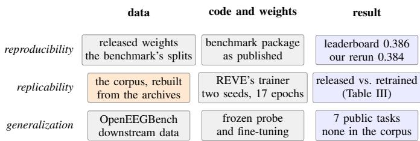
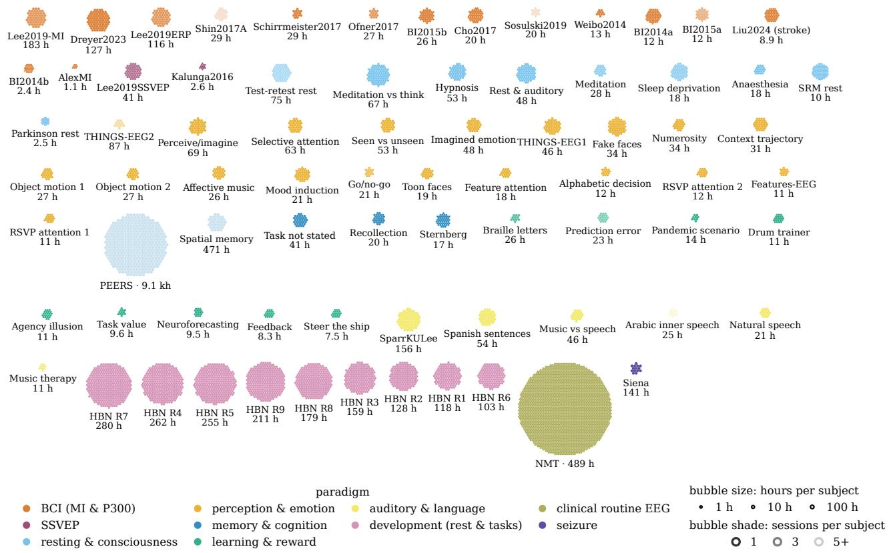
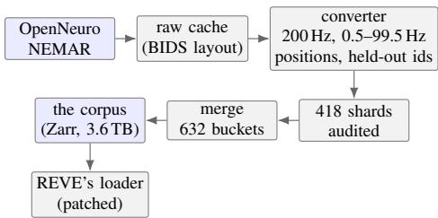
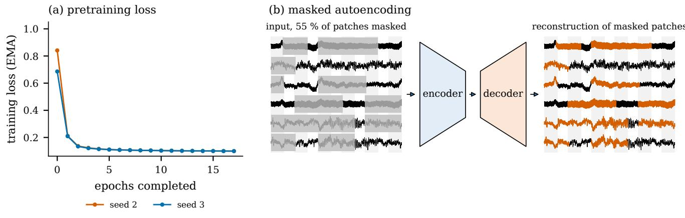
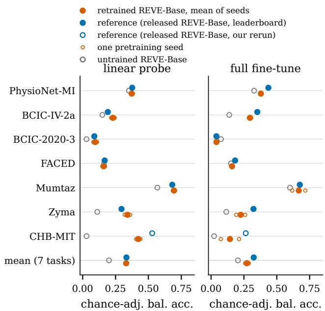

# EEGDash Corpus: A Training-Ready Public Corpus for EEG Foundation Models

Kuber Shahi<sup>∗</sup>, Bruno Aristimunha<sup>∗†</sup> and Arnaud Delorme<sup>∗</sup>

<sup>∗</sup>Swartz Center for Computational Neuroscience, University of California San Diego, USA

<sup>†</sup>Yneuro and Université Paris-Saclay, France

{kshahi, baristimunha, adelorme}@ucsd.edu

Abstract—Foundation models for electroencephalography (EEG) are pretrained on tens of thousands of hours of recordings, and their accuracy grows with that amount. Such data is hard to assemble. The largest sources are clinical archives that cannot be redistributed, and the public sources are spread over several archives, file formats and licences. We release eegdash-corpus-v0, a training-ready corpus of 77 public EEG datasets, as the gated Hugging Face dataset EEGDash/eegdash-corpus-v0 with the SHA-256 of every file. REVE, the largest published EEG foundation model, names 89 datasets as its pretraining corpus. Twelve cannot be redistributed: four clinical archives that hold 82 % of its hours, and eight under no-derivatives licences. The corpus holds the 76 others that REVE’s sampling rate allows and one more from REVE’s release card: 77 datasets, 14,075 hours from 7,272 subjects, 5.0 million 10-second samples and 6.21 billion tokens per epoch. Every dataset is fetched through EEGDash, converted once with REVE’s recipe, and stored in its own buckets of a chunked Zarr store with its licence recorded beside it, so a model can train on the whole store or on any subset of datasets. To test that the store pretrains a model, we retrain REVE-Base from scratch twice with the authors’ code, changed only in how it reads data, and score it on seven public OpenEEGBench tasks. It reaches 0.331 under linear probing and 0.273 after fine-tuning, against 0.333 and 0.325 for the released model and 0.200 and 0.205 for an untrained encoder. The converter, the conversion reports and the loader changes are released with the corpus.

Index Terms—EEG, foundation models, self-supervised pretraining, open data, reproducibility, BIDS, EEGDash

## I. INTRODUCTION

Foundation models for electroencephalography (EEG) learn from recordings pooled across many studies, and their downstream accuracy grows with the amount of pretraining data [1]. The models published so far were trained on corpora from a few thousand hours [2], [3], [4], [5] to 61,415 hours for REVE [6]. Assembling such a corpus is the slowest part of the work. The largest sources are clinical archives that require registration and forbid redistribution, and 82 % of REVE’s hours come from them. The public sources are spread over several archives, each with its own access path, and the recordings arrive in half a dozen file formats with different channel names, sampling rates and montages. Before a model sees a sample, every recording has to be fetched, read, typed, resampled, filtered and cut, and every dataset’s licence has to be checked. The 77 datasets released here are 14.9 TB of raw files.

Reusing a processed corpus is rarely possible. Papers list their sources in a table. REVE’s authors went further and published a dataset card that names 70 public datasets, with a processed copy [7]. The copy is in the trainer’s own memorymapped layout, one raw array per electrode set, and two thirds of its hours come from a dataset whose authors have since asked that it not be redistributed. Changing the preprocessing, auditing the conversion or checking a dataset’s terms means returning to the raw archives.

To address this, we rebuild every redistributable dataset of REVE’s corpus from the archives its paper names, convert them once with the authors’ recipe, and release the result as eegdash-corpus-v0 on Hugging Face, with every raw dataset reachable by identifier through EEGDash [8]. We refer to it as the corpus below. Our results show that:

1) Of the 89 datasets REVE’s paper names, 77 may be redistributed, and the corpus holds them: 14,075 hours, 7,272 subjects and 6.21 billion tokens per epoch, in 632 buckets that each hold one exact channel set of one dataset. Every dataset keeps its own licence, written into its buckets, and any subset of datasets is one option of the loader.

2) REVE-Base retrained from scratch on the corpus with the authors’ trainer, in two seeded runs, scores 0.331 under linear probing and 0.273 after fine-tuning on seven public OpenEEGBench tasks [9], against 0.333 and 0.325 for the released model and 0.200 and 0.205 for an untrained encoder. The retraining tests the corpus. It does not rank models.

3) The conversion is documented by the converter, the shard lists, the conversion reports and the loader changes, released with the corpus for auditing and for adaptation to other recipes.

Fig. 1 shows what is held fixed and what changes in each comparison the paper makes.

## II. BACKGROUND

EEG foundation models and their data. BIOT [3] tokenises each channel into fixed-length segments so that different montages share one transformer; LaBraM [2], CBraMod [5] and EEGPT [4] pretrain on a few thousand hours each. REVE [6] resolves each electrode name to a position through a bank of 543 known names, so any montage with resolvable names can be used and batches are grouped only by channel count. It was pretrained with masked autoencoding of 10-second samples on 92 datasets, most of them clinical recordings from the Temple University Hospital corpus [10].

  
Fig. 1. Rerunning released weights checks the scoring pipeline, and retraining tests the rebuilt corpus with REVE-Base. Grey: taken as released. Orange: rebuilt in this paper. Blue: compared.

Archives and access. The Brain Imaging Data Structure (BIDS) [11] and its EEG extension [12] fix the directory layout and the sidecar metadata of a dataset but allow several signal formats. OpenNeuro [13] and the NeuroElectroMagnetic data Archive and tools Resource (NEMAR) [14] archive BIDS datasets. EEGDash [8] catalogues the datasets of both archives and turns any of them into a braindecode [15] dataset. A query returns one record per recording, with channel names, sampling rate and duration, before anything is downloaded. MOABB [16] does the same for brain–computer-interface datasets, and nine of them reach the corpus through NEMAR.

Benchmark. OpenEEGBench [9] evaluates a frozen or finetuned encoder on twelve downstream tasks with fixed splits and one training schedule, and maintains a leaderboard on which the released REVE-Base is the top entry.

## III. THE CORPUS

## A. The Store

The corpus is a Zarr store [17] of 632 buckets. A bucket holds the recordings of one dataset that share one exact set of electrode names: a dataset recorded with one montage is one bucket, a dataset with several montages is several, and a bucket never spans two datasets. Each bucket is a Zarr group whose data array has shape (N, 2000, C), one row per 10-second sample at 200 Hz, cut as REVE’s loader cuts it. Beside it sit the session index of each sample, the persession mean and standard deviation, the electrode positions in metres, and the dataset’s identifier, licence and source. One sample is one chunk and 128 samples form one compressed shard file, so a training step reads only the samples it needs. The store is 3.6 TB, losslessly compressed to 0.8 of its float32 size. Because a bucket never spans two datasets, any subset of datasets is a list of buckets. REVE’s patched loader takes the identifiers of datasets to leave out, and one of the two runs below trains that way. The stored values are band-passed microvolts, so a model with another normalisation applies it at load.

TABLE I  
THE CORPUS BY SOURCE. ONE DATASET, PEERS, HOLDS 65 % OF THE HOURS AND 73 % OF THE TOKENS. MEAN CHANNELS ARE WEIGHTED BY DURATION. TOKENS PER EPOCH: SAMPLES × CHANNELS × 11 PATCHES OF ONE SECOND.
<table><tr><td>source</td><td></td><td>sets subjects</td><td>hours</td><td></td><td>ch. tokens (B)</td><td>%</td></tr><tr><td>OpenNeuro: Healthy Brain Network</td><td>9</td><td>2,192</td><td>1,694</td><td>129</td><td>0.85</td><td>13.7</td></tr><tr><td>OpenNeuro: PEERS</td><td>1</td><td>364</td><td>9,111</td><td>126</td><td>4.53</td><td>73.0</td></tr><tr><td>OpenNeuro: other datasets</td><td>46</td><td>1,549</td><td>1,727</td><td>83</td><td>0.57</td><td>9.2</td></tr><tr><td>NEMAR: other datasets</td><td>21</td><td>3,167</td><td>1,543</td><td>42</td><td>0.26</td><td>4.1</td></tr><tr><td>Total</td><td>77</td><td>7,272</td><td>14,075</td><td>112</td><td>6.21</td><td>100.0</td></tr></table>

## B. What Is in It

REVE’s paper reports a pretraining corpus of 92 datasets and 61,415 hours, and names 89 of them [6]. We resolved each name against the EEGDash catalogue and the archives (Appendix D). Four are clinical archives that require registration or a data use agreement and forbid redistribution: the Temple University Hospital corpus [10], the Harmful Brain Activity Classification set, the Two Decades Brainclinics Research Archive, and the International Cardiac Arrest REsearch consortium database (I-CARE) [18]. Together they hold 50,581 hours, 82 % of REVE’s total. Eight are small brain–computerinterface sets under no-derivatives licences, which forbid a converted copy, 45 hours in all, and one, Zhou2016, is sampled at 100 Hz. The 76 others may be redistributed, and REVE’s release card [7] adds one that the paper does not name. These 77 datasets are the corpus: 56 from OpenNeuro and 21 from NEMAR.

Table I summarises the corpus by source and Fig. 2 shows every dataset with one bubble per subject. One dataset dominates. PEERS [19], a free-recall study recorded with 125– 170 channels, holds 65 % of the hours. The NMT archive and the nine Healthy Brain Network releases [20] contribute the most subjects, 2,413 and 2,192 of 7,272. The 2,192 are distinct participants: the nine releases’ participant tables share no identifier. The other 46 OpenNeuro datasets are research studies of perception, attention, memory, resting state, emotion and language with 8 to 159 channels, and the other 20 NEMAR datasets are motor-imagery, P300, SSVEP, auditory, perception and seizure recordings with 8 to 128 channels (Appendix C). By paradigm (Table II), memory and cognition, PEERS and four smaller studies, holds 69 % of the hours, and perception and emotion holds the most datasets, 20.

Hours are a poor measure of what a channel-wise model consumes. REVE cuts every sample into one token per channel per 1-second patch, starting every 0.9 seconds, so a sample of C channels holds 11C tokens. By this count the corpus holds 6.21 billion tokens per epoch, 73 % of them from PEERS and 14 % from the Healthy Brain Network. Tokens count training signal only within one channel density: a token of a 129-channel research cap and a token of 19-channel clinical monitoring need not be worth the same to a downstream task, so Table I reports them by source. Applied to the channelrange table of REVE’s paper, the same accounting gives an estimated 7.9 billion tokens for its 61,415 hours, so the corpus holds 23 % of the paper’s hours and roughly 79 % of its tokens (Appendix A).

  
Fig. 2. One dataset holds two thirds of the hours, and the other 76 hold most of the subjects and channel sets. One cluster per dataset, one bubble per subject. Bubble size: hours per subject, log scale. Colour: paradigm. Shade: number of sessions. Label: short name and total hours. Per-dataset numbers in Table VI.

TABLE II  
THE CORPUS BY PARADIGM. MEMORY & COGNITION HOLDS 69 % OF THE HOURS AND 77 % OF THE TOKENS. EACH % IS THE SHARE OF THE COLUMN TO ITS LEFT; TOKENS PER EPOCH AS IN TABLE I.
<table><tr><td>paradigm</td><td></td><td>sets subjects</td><td>hours</td><td></td><td>% tokens (B)</td><td>%</td></tr><tr><td>memory &amp; cognition</td><td>5</td><td>510</td><td>9,659</td><td>68.6</td><td>4.79</td><td>77.2</td></tr><tr><td>development (rest &amp; tasks)</td><td>9</td><td>2,192</td><td>1,694</td><td>12.0</td><td>0.85</td><td>13.7</td></tr><tr><td>perception &amp; emotion</td><td>20</td><td>598</td><td>671</td><td>4.8</td><td>0.20</td><td>3.2</td></tr><tr><td>BCI (MI &amp; P300)</td><td>15</td><td>584</td><td>627</td><td>4.5</td><td>0.13</td><td>2.1</td></tr><tr><td>clinical routine EEG</td><td>1</td><td>2,413</td><td>489</td><td>3.5</td><td>0.04</td><td>0.7</td></tr><tr><td>resting &amp; consciousness</td><td>9</td><td>542</td><td>319</td><td>2.3</td><td>0.08</td><td>1.2</td></tr><tr><td>auditory &amp; language</td><td>6</td><td>198</td><td>312</td><td>2.2</td><td>0.07</td><td>1.1</td></tr><tr><td>seizure</td><td>1</td><td>14</td><td>141</td><td>1.0</td><td>0.02</td><td>0.3</td></tr><tr><td>learning &amp; reward</td><td>9</td><td>155</td><td>120</td><td>0.9</td><td>0.03</td><td>0.4</td></tr><tr><td>SSVEP</td><td>2</td><td>66</td><td>43</td><td>0.3</td><td>0.01</td><td>0.2</td></tr><tr><td>Total</td><td>77</td><td>7,272</td><td>14,075</td><td>100.0</td><td>6.21</td><td>100.0</td></tr></table>

## C. How It Was Built

Fig. 3 shows the steps. Every dataset was fetched through EEGDash, whose cache path is the archive’s own storage path. For OpenNeuro a direct mirror of the archive’s storage bucket therefore produced the same tree, and the converter re-opened everything offline.

  
Fig. 3. From the archives to the corpus. All datasets are fetched through EEGDash from OpenNeuro and NEMAR. The converter applies REVE’s recipe and refuses the benchmark’s source datasets by identifier. Audited shards are merged into one Zarr store, which the patched trainer reads.

Every recording then follows REVE’s recipe [6]. Channels typed as EEG are kept, their names are resolved against REVE’s electrode-position bank, and channels without a position are dropped. Recordings of 10 seconds or less, or sampled below 200 Hz, are skipped. The signal is band-pass filtered at 0.5–99.5 Hz, resampled to 200 Hz and stored as float32 microvolts, with each session’s per-channel mean and standard deviation stored for z-scoring at load time. Native montages and references are kept, because REVE’s position encoding makes channel intersection across datasets unnecessary, so a 170-channel PEERS session and an 8-channel motor-imagery session share one store. The recipe is REVE’s, adopted so that the corpus can pretrain that model. Nothing beyond it is applied: no notch filter, no re-referencing and no artefact rejection.

Conversion ran as 418 shards, each a job of at most 200 hours or 400 recordings, and a merge hard-links the audited shards into the one store.

To check that the store holds what the trainer would have read, two datasets (26,342 samples over 35 montages) were converted both ways from the raw files, into REVE’s memorymapped layout and into Zarr. Every sample, statistic and position was identical, and REVE’s training script run from either layout produced the same batches. The source datasets of the benchmark’s tasks are refused by identifier at planning, conversion and merge, and no corpus dataset shares a source with them by DOI, source address, title or authors.

## D. Access and Licences

The corpus is released as the Hugging Face dataset EEGDash/eegdash-corpus-v0, tag v1.0<sup>1</sup>. Beside the store sit the per-dataset licence table, a bibliography of the 77 datasets, the bucket table, the per-session manifest and the SHA-256 of all 44,801 files of the store, whose own SHA-256 begins 0cba6a7b. The copy on the Hub was checked against that list file by file. The code that built and scored it is public under BSD-3-Clause, and the corpus pages of EEGDash’s documentation<sup>2</sup> keep the full per-dataset table, the electrode coverage of the store and the loading commands. Fig. 4 shows access to one sample and to the raw files of one dataset.

The corpus is a collection without a licence of its own. Each dataset keeps the licence of its archive, written into the attributes of its buckets: 52 datasets are CC0, 11 CC-BY 4.0, 12 CC-BY-SA 4.0 (among them the nine Healthy Brain Network releases), one GPL-3.0 (Shin2017A) and one CC-BY-NC 4.0 (SparrKULee). The 75 datasets under CC0, CC-BY or CC-BY-SA hold 98.7 % of the hours. Using the whole store binds a user to every term at once: non-commercial use because of SparrKULee, share-alike for 12 datasets, the GPL for one, and attribution for all 77. A user who needs a permissive subset leaves out the two exceptions’ buckets. The repository is gated, so an account accepts these terms before it can download. We claim no legal assurance beyond these per-dataset terms.

## IV. RETRAINING REVE-BASE ON THE CORPUS A. Setup

We train with the authors’ released code and its recipe. The objective is masked autoencoding of 10-second samples with 55 % block masking over channels and time. Batches hold 4800/C samples grouped by channel count, so that every step carries the same number of tokens. The optimiser is StableAdamW with a trapezoid learning-rate schedule that repeats every epoch, under fp16 autocast. The changes to the code are confined to data loading, seeding, logging and resumption (Appendix B). The released code applies no seed and shuffles batches on every GPU with its own unsynchronised generator, so an epoch on 16 GPUs covered about 64 % of the batches, some twice. With our change the weights and the batch order are seeded, and every epoch is one pass over the corpus.

```python
# after accepting the terms on the dataset’s page:
# hf download EEGDash/eegdash-corpus-v0 --repo-type dataset
\
# --revision v1.0 --local-dir eegdash-corpus-v0
import zarr
root = zarr.open_group("eegdash-corpus-v0/"
"eegdash-corpus-v0.zarr", mode="r")
b = root["0"] # one channel set of one dataset
print(b.attrs["dataset"], b.attrs["licence"])
x = b["data"][42] # (2000, C): 10 s at 200 Hz, uV
pos = b["positions"][:] # (C, 3) positions in metres
mu, sd = b["stats"][int(b["session"][42])]
from eegdash import EEGDashDataset # the raw files
raw = EEGDashDataset("cache", dataset="ds004395")
```  
Fig. 4. Reading the corpus. One sample, its positions, its session’s statistics and its dataset’s licence from a local copy of the released store, and the raw files of one dataset through EEGDash.

REVE-Base (22 layers, width 512, 69 M parameters) is trained twice from scratch, for 17 epochs, the paper’s count, at the paper’s peak learning rate of $2 . 4 \times 1 0 ^ { - 4 }$ , with batch order and initialisation seeded differently (seeds 2 and 3). The first run took 23.5 hours on 16 A40 GPUs, the second 29.7 hours on 16 V100 GPUs. Fig. 5 shows the loss per epoch and the masking the model is trained to undo.

## B. Protocol

OpenEEGBench fits a linear head on the frozen encoder (the probe) and, separately, fine-tunes every weight. Both run on each task’s fixed split with one schedule and three seeds per cell. We report chance-adjusted balanced accuracy, $( \mathrm { B A } - 1 / K ) / ( 1 - 1 / K )$ for K classes, so that 0 is chance and tasks with different K are comparable. Eight of the benchmark’s twelve tasks are open datasets; the four gated ones are run only by the benchmark’s maintainers. Seven of the eight test paradigms the corpus holds: motor imagery (BCIC-IV-2a, PhysioNet-MI), imagined speech (BCIC-2020- 3), emotion (FACED), resting clinical EEG (Mumtaz), mental arithmetic (Zyma) and seizure detection (CHB-MIT). The eighth, ISRUC, is sleep staging, and no recording of the corpus is sleep, so we leave it out. Six of the remaining seven are scored on the public leaderboard, and for those the reference is the released REVE-Base’s published result. The leaderboard does not score CHB-MIT (seizure detection), so its reference is our own run of the released weights through the same pipeline, and the reference mean therefore mixes six published values and one of ours. Our rerun reproduces the leaderboard’s probe mean on its seven tasks (0.384 vs. 0.386) but not its fine-tuning mean (0.352 vs. 0.376): the package ships one fine-tuning schedule, and the leaderboard’s is not published. Table III gives both, and an untrained REVE-Base, scored the same way, as the floor.



Fig. 5. The loss falls within the first epoch, then settles. (a) Reconstruction loss of REVE-Base on the corpus: the untrained model’s loss on its first batch at 0, then the mean over each epoch of its exponential moving average, for both seeds. (b) One 10-second sample from the corpus, its 1-second patches, the 55 % masked out (grey), and their reconstruction (red).  
  
Fig. 6. Task-wise scores of the retrained and released REVE-Base. Chance-adjusted balanced accuracy per task under linear probing (left) and fine-tuning (right). Blue: the released model’s published score. Red: the model retrained on the corpus, small hollow dots for the two pretraining seeds (each the mean over three downstream seeds) and a filled dot for their mean. Grey: the untrained encoder. Hollow blue: CHB-MIT’s reference, our run of the released weights. Bottom row: mean over the seven tasks.

## C. Results

To test whether the corpus pretrains a usable encoder, we score the two retrained models, the released model and the untrained floor on the same seven tasks (Table III, Fig. 6). Under linear probing the retrained model scores 0.331 over the seven tasks, the mean of 0.324 and 0.337 for the two pretraining seeds, against 0.333 for the released model and

0.200 for the untrained encoder. The difference to the released model, −0.002, is inside the spread of 0.013 between the two seeds. On six of the seven tasks the two models differ by less than 0.05, and on four of them by less than that spread. BCIC-IV-2a and Zyma favour the retrained model by +0.039 and +0.045. The exception is CHB-MIT, where the retrained model scores 0.423 against 0.529 for the released weights, and where the three downstream seeds of either model spread by 0.18 to 0.28, more than any difference between them. Under fine-tuning the retrained model scores 0.273, the mean of 0.287 and 0.260, against 0.325 published and 0.301 for our rerun of the released weights. The gap of −0.052 to the published mean is outside the seed spread of 0.027. It comes from four tasks: PhysioNet-MI (−0.057), BCIC-IV-2a (−0.056), Zyma (−0.097) and CHB-MIT (−0.120). On the other three the two models differ by less than 0.025. Part of the gap is the pipeline rather than the weights: the rerun of the released weights through the package’s fine-tuning schedule loses 0.024 against the published mean, so the gap to a like-for-like reference is −0.028. Both retrained seeds stay above the untrained encoder on every task but BCIC-2020-3 under fine-tuning, where no model, the released one included, exceeds 0.08.

Two pretraining seeds give a first measure of run-to-run variation, not a confidence interval, and they do not establish equivalence to the released model, trained on 4.4 times as many hours.

## V. DISCUSSION

What the comparison shows. Under linear probing, 14,075 public hours pretrain an encoder whose frozen features serve the seven tasks as well as the released model’s, trained on 4.4 times as many hours: the difference is inside the spread of two seeds. Under fine-tuning the retrained model falls short, by 0.028 against the like-for-like rerun and by 0.052 against the published scores, on the two motor-imagery tasks, Zyma and CHB-MIT. Two readings fit this result and the data do not separate them. The larger corpus may give weights that adapt better when every layer moves, or the fine-tuning schedule, which the benchmark’s authors tuned for the released weights, may suit those weights better. Whether the corpus’s dense research-cap tokens are worth as much to a downstream task as the clinical tokens behind the released model is not settled here. Subsets by dataset are one loader option, so a user can test it.

TABLE III  
THE RETRAINED REVE-BASE AGAINST THE RELEASED ONE ON SEVEN PUBLIC OPENEEGBENCH TASKS. CHANCE-ADJUSTED BALANCED ACCURACY (0 = CHANCE), MEAN OVER THREE DOWNSTREAM SEEDS PER CELL, ± THE SD WHERE IT EXCEEDS 0.05. PUBLISHED: THE LEADERBOARD’S SCORES; <sup>†</sup> OUR RUN OF THE RELEASED WEIGHTS, SINCE THE LEADERBOARD DOES NOT SCORE CHB-MIT. RERUN: THE RELEASED WEIGHTS THROUGH OUR PIPELINE. UNTRAINED: REVE-BASE WITH RANDOM WEIGHTS. RETRAINED: ONE ROW PER PRETRAINING SEED ON THE CORPUS, AND THEIR MEAN. MEAN: OVER THE SEVEN TASKS. TRAINING DATA: THE RELEASED MODEL 61,415 H, THE RETRAINED MODEL 14,075 H.
<table><tr><td>weights</td><td>PhysioNet-MI</td><td>BCIC-IV-2a</td><td>BCIC-2020-3</td><td>FACED</td><td>Mumtaz</td><td>Zyma</td><td>CHB-MIT</td><td>mean</td></tr><tr><td>Linear probe</td><td></td><td></td><td></td><td></td><td></td><td></td><td></td><td></td></tr><tr><td>REVE-Base, released (published)</td><td>0.377</td><td>0.191</td><td>0.088</td><td>0.167</td><td>0.681</td><td>0.295</td><td>0.529±0.249†</td><td>0.333</td></tr><tr><td>REVE-Base, released (rerun)</td><td>0.400</td><td>0.190</td><td>0.077</td><td>0.172</td><td>0.735</td><td>0.210</td><td>0.529±0.249</td><td>0.330</td></tr><tr><td>REVE-Base, untrained</td><td>0.352</td><td>0.150</td><td>0.029</td><td>0.162</td><td>0.568±0.136</td><td>0.111±0.061</td><td>0.029±0.051</td><td>0.200</td></tr><tr><td>REVE-Base, retrained, seed 2</td><td>0.382</td><td>0.243</td><td>0.082</td><td>0.149</td><td>0.686</td><td>0.319±0.115</td><td>0.408±0.275</td><td>0.324</td></tr><tr><td>REVE-Base, retrained, seed 3</td><td>0.364</td><td>0.217</td><td>0.109</td><td>0.169</td><td>0.703</td><td>0.361</td><td>0.439±0.183</td><td>0.337</td></tr><tr><td>REVE-Base, retrained, mean</td><td>0.373</td><td>0.230</td><td>0.095</td><td>0.159</td><td>0.694</td><td>0.340</td><td>0.423</td><td>0.331</td></tr><tr><td>Fine-tuning</td><td></td><td></td><td></td><td></td><td></td><td></td><td></td><td></td></tr><tr><td>REVE-Base, released (published)</td><td>0.436</td><td>0.352</td><td>0.041</td><td>0.183</td><td>0.675</td><td>0.323</td><td>0.264†</td><td>0.325</td></tr><tr><td>REVE-Base, released (rerun)</td><td>0.386</td><td>0.335±0.052</td><td>0.067</td><td>0.175</td><td>0.713</td><td>0.168±0.094</td><td>0.264</td><td>0.301</td></tr><tr><td>REVE-Base, untrained</td><td>0.328</td><td>0.138</td><td>0.076</td><td>0.151</td><td>0.601</td><td>0.116±0.088</td><td>0.023</td><td>0.205</td></tr><tr><td>REVE-Base, retrained, seed 2</td><td>0.377</td><td>0.305</td><td>0.043</td><td>0.161</td><td>0.717</td><td>0.192±0.079</td><td>0.213±0.104</td><td>0.287</td></tr><tr><td>REVE-Base, retrained, seed 3</td><td>0.381</td><td>0.288</td><td>0.039</td><td>0.159</td><td>0.617±0.079</td><td>0.259±0.088</td><td>0.074±0.068</td><td>0.260</td></tr><tr><td>REVE-Base, retrained, mean</td><td>0.379</td><td>0.296</td><td>0.041</td><td>0.160</td><td>0.667</td><td>0.226</td><td>0.144</td><td>0.273</td></tr></table>

Limitations. The store fixes one recipe: 10-second windows of 2,000 samples at 200 Hz, band-passed at 0.5–99.5 Hz, with per-session statistics stored beside them. Only REVE-Base was trained from this store here. Other models may require different filtering, referencing, normalisation, channel handling or windowing, even when they use 200 Hz inputs. Shorter patches can be cut within a window, but direct compatibility with LaBraM, CBraMod or BIOT has not been tested. Longer contexts require checks of session continuity, and other frequency bands require reconversion from the raw recordings. Two pretraining seeds bound the run-to-run variation by a range, not a distribution. REVE’s token count is an estimate from its paper’s table, not a count of its data.

Next steps. This first version covers the public datasets of one model’s corpus, cut with that model’s recipe. Its three pieces carry over to other datasets and recipes: a catalogue that resolves identifiers to files, a converter that applies a recipe and keeps a report, and a store that a trainer reads directly. The corpus is also narrow in what it records: one of its ten paradigms, memory and cognition, holds 69 % of its hours (Table II), with one seizure dataset, no sleep and no intracranial recordings. The next version therefore adds the public, non-gated EEG datasets of the catalogue that REVE’s corpus does not name, chosen to fill the paradigms the corpus covers thinly or not at all, with the same checks. A recipe step in braindecode would write a chosen sampling rate, band, window and normalisation to the same layout, and a store with a 0.1 Hz high-pass and no other irreversible step would serve the input pipelines of REVE, LaBraM, CBraMod, BIOT, EEGPT and NeuroLM from one set of bytes. Reading samples from the hosted store during training, without a local copy, would remove the 3.6 TB download.

## VI. CONCLUSION

We release eegdash-corpus-v0, 77 public EEG datasets served by EEGDash from OpenNeuro and NEMAR, converted once into a training-ready store of 14,075 hours and 6.21 billion tokens per epoch, with every dataset’s licence recorded beside its data. REVE-Base retrained on it twice scores 0.331 under linear probing and 0.273 after fine-tuning, against 0.333 and 0.325 for the released weights and 0.200 and 0.205 for an untrained encoder on seven public OpenEEG-Bench tasks. The next step is a version with the public datasets beyond REVE’s corpus and a second recipe written from the same raw files.

## ACKNOWLEDGMENTS

This work used Expanse at the San Diego Supercomputer Center and Delta and DeltaAI at the National Center for Supercomputing Applications through allocations CIS261538, CIS262020 and IBN140002 from the Advanced Cyberinfrastructure Coordination Ecosystem: Services & Support (AC-CESS) program, which is supported by U.S. National Science Foundation grants #2138259, #2138286, #2138307, #2137603 and #2138296. We thank the authors of REVE for releasing their code, weights and dataset card, and the authors of OpenEEGBench for the benchmark and its leaderboard.

## REFERENCES

[1] J. M. N. de Oliveira, B. J. Lopes, L. Burgund, R. Y. Camargo, and B. Aristimunha, “Scaling laws for EEG decoding: how much data is enough?” arXiv:2609.35056, 2026.

[2] W.-B. Jiang, L.-M. Zhao, and B.-L. Lu, “Large brain model for learning generic representations with tremendous EEG data in BCI,” in International Conference on Learning Representations (ICLR), 2024, arXiv:2405.18765.

[3] C. Yang, M. B. Westover, and J. Sun, “BIOT: Biosignal transformer for cross-data learning in the wild,” in Advances in Neural Information Processing Systems (NeurIPS), 2023, arXiv:2305.10351.

[4] G. Wang, W. Liu, Y. He, C. Xu, L. Ma, and H. Li, “EEGPT: Pretrained transformer for universal and reliable representation of EEG signals,” in Advances in Neural Information Processing Systems (NeurIPS), 2024.

[5] J. Wang, S. Zhao, Z. Luo, Y. Zhou, H. Jiang, S. Li, T. Li, and G. Pan, “CBraMod: A criss-cross brain foundation model for EEG decoding,” in International Conference on Learning Representations (ICLR), 2025, arXiv:2412.07236.

[6] Y. El Ouahidi, J. Lys, P. Thölke, N. Farrugia, B. Pasdeloup, V. Gripon, K. Jerbi, and G. Lioi, “REVE: A foundation model for EEG – adapting to any setup with large-scale pretraining on 25,000 subjects,” arXiv preprint arXiv:2510.21585, 2025.

[7] El Ouahidi, Yassine and others, “brain-bzh/reve-dataset: the public subset of the REVE pretraining corpus,” Hugging Face Hub, https: //huggingface.co/datasets/brain-bzh/reve-dataset, 2025, dataset card listing 70 source datasets; accessed 2026-09-22.

[8] B. Aristimunha et al., “EEGDash: An open-source platform for machine learning on public neurophysiological data,” arXiv preprint arXiv:2606.16041, 2026.

[9] P. Guetschel, B. Aristimunha, D. Truong, K. Kokate, M. Tangermann, and A. Delorme, “Toward OpenEEG-Bench: A live community-driven benchmark for EEG foundation models,” in Proceedings of the 34th European Signal Processing Conference (EUSIPCO), 2026.

[10] I. Obeid and J. Picone, “The Temple University Hospital EEG data corpus,” Frontiers in Neuroscience, vol. 10, p. 196, 2016.

[11] K. J. Gorgolewski, T. Auer, V. D. Calhoun, R. C. Craddock, S. Das, E. P. Duff, G. Flandin, S. S. Ghosh, T. Glatard, Y. O. Halchenko et al., “The brain imaging data structure, a format for organizing and describing outputs of neuroimaging experiments,” Scientific Data, vol. 3, p. 160044, 2016.

[12] C. R. Pernet, S. Appelhoff, K. J. Gorgolewski, G. Flandin, C. Phillips, A. Delorme, and R. Oostenveld, “EEG-BIDS, an extension to the brain imaging data structure for electroencephalography,” Scientific Data, vol. 6, p. 103, 2019.

[13] C. J. Markiewicz, K. J. Gorgolewski, F. Feingold, R. Blair, Y. O. Halchenko, E. Miller, N. Hardcastle, J. Wexler, O. Esteban, M. Goncavles et al., “The OpenNeuro resource for sharing of neuroscience data,” eLife, vol. 10, p. e71774, 2021.

[14] A. Delorme, D. Truong, C. Youn, S. Sivagnanam, C. Stirm, K. Yoshimoto, R. A. Poldrack, A. Majumdar, and S. Makeig, “NEMAR: an open access data, tools and compute resource operating on NeuroElectroMagnetic data,” Database, vol. 2022, p. baac096, 2022.

[15] R. T. Schirrmeister, J. T. Springenberg, L. D. J. Fiederer, M. Glasstetter, K. Eggensperger, M. Tangermann, F. Hutter, W. Burgard, and T. Ball, “Deep learning with convolutional neural networks for EEG decoding and visualization,” Human Brain Mapping, vol. 38, no. 11, pp. 5391– 5420, 2017.

[16] V. Jayaram and A. Barachant, “MOABB: trustworthy algorithm benchmarking for BCIs,” Journal of Neural Engineering, vol. 15, no. 6, p. 066011, 2018.

[17] Zarr Developers, “Zarr: chunked, compressed, n-dimensional arrays,” https://zarr.dev, 2026, zarr-python 3.1; specification v3.

[18] E. Amorim, W.-L. Zheng, M. M. Ghassemi, M. Aghaeeaval, P. Kandhare, V. Karukonda, J. W. Lee, S. Herman, A. Sivaraju, N. Gaspard, J. Hofmeijer, M. J. A. M. van Putten, R. Sameni, M. A. Reyna, G. D. Clifford, and M. B. Westover, “I-CARE: International cardiac arrest REsearch consortium database (version 2.1),” PhysioNet, 2023, https://doi.org/10.13026/m33r-bj81.

[19] Kahana, Michael J. and others, “Penn electrophysiology of encoding and retrieval study (PEERS), OpenNeuro dataset ds004395,” OpenNeuro, https://openneuro.org/datasets/ds004395, 2023.

[20] L. M. Alexander, J. Escalera, L. Ai, C. Andreotti, K. Febre, A. Mangone, N. Vega-Potler, N. Langer, A. Alexander, M. Kovacs et al., “An open resource for transdiagnostic research in pediatric mental health and brain development,” Scientific Data, vol. 4, p. 170181, 2017.

[21] B. Zhou, X. Wu, Z. Lv, L. Zhang, and X. Guo, “A fully automated trial selection method for optimization of motor imagery based braincomputer interface,” PLoS ONE, vol. 11, no. 9, p. e0162657, 2016.

## TABLE IV

REVE’S PRETRAINING CORPUS AS REPORTED IN ITS PAPER, THE AUTHORS’ RELEASED COPY AND THE CORPUS. THE PAPER’S TOKEN COUNT IS AN ESTIMATE FROM ITS CHANNEL-RANGE TABLE: HOURS × 3,600 × 1.1 × MEAN CHANNELS. THE OTHERS ARE COUNTED FROM THE SAMPLES.

<table><tr><td>corpus</td><td>datasets</td><td>hours</td><td>mean ch.</td><td>tokens</td></tr><tr><td>REVE paper [6]</td><td>92</td><td>61,415</td><td>~32</td><td>~7.9B</td></tr><tr><td>authors’ release [7]</td><td>70</td><td>34,400</td><td>49</td><td>6.59 B</td></tr><tr><td>eegdash-corpus-v0</td><td>77</td><td>14,075</td><td>112</td><td>6.21 B</td></tr></table>

## TABLE V

CHANGES TO THE RELEASED TRAINING CODE. NONE TOUCHES THE MODEL, THE OBJECTIVE OR THE OPTIMISER.

<table><tr><td>where</td><td>change and reason</td></tr><tr><td>data loading</td><td>a channel set that occurs in a single session is kept by the segment builder</td></tr><tr><td>data loading</td><td>a data path ending in . zarr is read from the store: one pread per sample, a batch&#x27;s samples read in parallel threads, one open- file budget per process, reads completed to the chunk&#x27;s length</td></tr><tr><td>data loading</td><td>a list of datasets to leave out, applied to the bucket index before batching</td></tr><tr><td>data loading</td><td>the batch order is seeded and shared by every GPU, and the weights are seeded, so that an epoch is one pass over the corpus and a run can be repeated; the released code shuffles per GPU with an unsynchronised generator, so an epoch on 16 GPUs</td></tr><tr><td>training loop</td><td>covered about 64 % of the batches the Accelerate wrapper&#x27;s type check removed for multi-GPU runs; the loss written per epoch; encoder snapshots every N</td></tr><tr><td>training loop</td><td>epochs; logging every 100 iterations a resumed run continues at the epoch after the last saved state instead of restarting at epoch 0</td></tr></table>

[22] G. Schalk, D. J. McFarland, T. Hinterberger, N. Birbaumer, and J. R. Wolpaw, “BCI2000: a general-purpose brain-computer interface (BCI) system,” IEEE Transactions on Biomedical Engineering, vol. 51, no. 6, pp. 1034–1043, 2004, dataset: EEG Motor Movement/Imagery, PhysioNet, https://doi.org/10.13026/C28G6P.

## APPENDIX A

## REVE’S PAPER, ITS RELEASE AND THE CORPUS

Table IV sets REVE’s paper, its released copy and the corpus side by side. The released copy holds 34,400 hours, two thirds of them from I-CARE’s 19-channel monitoring, so the corpus holds 41 % of the release’s hours but 94 % of its tokens.

## APPENDIX B

## CHANGES TO THE TRAINING CODE

Table V lists every change made to the released training code. REVE’s loader, once patched, reads the store at close to the speed of the memory-mapped layout it replaces. It keeps shard files open, reads each sample with one call, fetches a batch’s samples in parallel threads, holds one open-file budget per worker process, and completes a read that returns fewer bytes than asked. With these changes a training step on four GPUs takes 0.92 seconds, against 0.80 for the memorymapped layout and 3.61 for sample-by-sample reads through the Zarr library, measured on 65 of the datasets.

TABLE VI  
THE 77 DATASETS OF THE CORPUS, AS COUNTED IN THE MERGED STORE, BY PARADIGM AND HOURS. THE IDENTIFIER NAMES THE ARCHIVE (DS, OPENNEURO; NM, NEMAR). PARADIGMS: BCI, BCI (MI & P300); PERCEPTION, PERCEPTION & EMOTION; RESTING, RESTING & CONSCIOUSNESS; LEARNING, LEARNING & REWARD; DEVELOPMENT, DEVELOPMENT (REST & TASKS); AUDITORY, AUDITORY & LANGUAGE; MEMORY, MEMORY & COGNITION; CLINICAL, CLINICAL ROUTINE EEG. HOURS AFTER CONVERSION TO 200 HZ. SHORT NAMES OF THE MOABB DATASETS ARE MOABB’S. CHANNEL COUNTS AND NATIVE SAMPLING RATES ARE IN THE RELEASED PER-DATASET TABLE.
<table><tr><td>id</td><td>short name</td><td>paradigm</td><td>subj.</td><td>hours</td><td>licence</td><td>id</td><td>short name</td><td>paradigm</td><td>subj.</td><td>hours</td><td>licence</td><td></td></tr><tr><td>nm000338</td><td>Lee2019-MI</td><td>BCI</td><td>54</td><td>183</td><td>CCO</td><td>ds002680</td><td>Go/no-go</td><td>perception</td><td></td><td>14</td><td>21</td><td>CCO</td></tr><tr><td>nm000250</td><td>Dreyer2023</td><td>BCI</td><td>87</td><td>127</td><td>CC BY</td><td>ds004324</td><td>Toon faces</td><td>perception</td><td></td><td>26</td><td>19</td><td>CCO</td></tr><tr><td>nm000323</td><td>Lee2019ERP</td><td>BCI</td><td>54</td><td>116</td><td>CCO</td><td>ds004043</td><td>Feature attention</td><td>perception</td><td>20</td><td></td><td>18</td><td>CCO</td></tr><tr><td>nm000267</td><td>Shin2017A</td><td>BCI</td><td>29</td><td>29</td><td>GPL-3.0</td><td>ds005594</td><td>Alphabetic decision</td><td>perception</td><td>16 20</td><td></td><td>12</td><td>CCO</td></tr><tr><td>nm000172</td><td>Schirrmeister2017</td><td>BCI</td><td>14</td><td>29</td><td>CC BY</td><td>ds004817</td><td>RSVP attention 2</td><td>perception</td><td></td><td></td><td>12</td><td>CCO</td></tr><tr><td>nm000173</td><td>Ofner2017</td><td>BCI</td><td>15</td><td>27</td><td>CC BY</td><td>ds004357</td><td>Features-EEG</td><td>perception</td><td></td><td>16</td><td>11</td><td>CCO</td></tr><tr><td>nm000217</td><td>BI2015b</td><td>BCI</td><td>44</td><td>26</td><td>CC BY</td><td>ds004816</td><td>RSVP attention 1</td><td>perception</td><td></td><td></td><td>11</td><td>CCO</td></tr><tr><td>nm000245</td><td>Cho2017</td><td>BCI</td><td>52</td><td>20</td><td>CCO</td><td>ds004395</td><td>PEERS</td><td>memory</td><td>364</td><td>9,111</td><td></td><td>CCO</td></tr><tr><td>nm000266</td><td>Sosulski2019</td><td>BCI</td><td>13</td><td>20</td><td>CC BY-SA</td><td>ds004706</td><td>Spatial memory</td><td>memory</td><td></td><td>34</td><td>471</td><td>CCO</td></tr><tr><td>nm000146</td><td>Weibo2014</td><td>BCI</td><td>10</td><td>13</td><td>CCO</td><td>ds005121</td><td>Task not stated</td><td>memory</td><td></td><td>34</td><td>41</td><td>CCO</td></tr><tr><td>nm000244</td><td>BI2014a</td><td>BCI</td><td>64</td><td>12</td><td>CC BY</td><td>ds005189</td><td>Recollection</td><td>memory</td><td></td><td>30</td><td>20</td><td>CCO</td></tr><tr><td>nm000216</td><td>BI2015a</td><td>BCI</td><td>43</td><td>12</td><td>CC BY</td><td>ds005095</td><td>Sternberg</td><td>memory</td><td></td><td>48</td><td>17</td><td>CCO</td></tr><tr><td>nm000158</td><td>Liu2024 (stroke)</td><td>BCI</td><td>59</td><td>9</td><td>CC BY</td><td>ds004951</td><td>Braille letters</td><td>learning</td><td></td><td>11</td><td>26</td><td>CCO</td></tr><tr><td>nm000215</td><td>BI2014b</td><td>BCI</td><td>38</td><td>2</td><td>CC BY</td><td>ds003846</td><td>Prediction error</td><td>learning</td><td></td><td>19</td><td>23</td><td>CCO</td></tr><tr><td>nm000138</td><td>AlexMI</td><td>BCI</td><td>8</td><td>1</td><td>CC BY-SA</td><td>ds004477</td><td>Pandemic scenario</td><td>learning</td><td></td><td>9</td><td>14</td><td>CCO</td></tr><tr><td>nm000273</td><td>Lee2019SSVEP</td><td>SSVEP</td><td>54</td><td>41</td><td>CCO</td><td>ds004152</td><td>Drum trainer</td><td>learning</td><td></td><td>21</td><td>11</td><td>CCO</td></tr><tr><td>nm000123</td><td>Kalunga2016</td><td>SSVEP</td><td>12</td><td>3</td><td>CC BY</td><td>ds004561</td><td>Agency illusion</td><td>learning</td><td></td><td>23</td><td>11</td><td>CCO</td></tr><tr><td>ds004148</td><td>Test-retest rest</td><td>resting</td><td>60</td><td>75</td><td>CCO</td><td>ds004147</td><td>Task value</td><td>learning</td><td></td><td>12</td><td>10</td><td>CCO</td></tr><tr><td>ds003969</td><td>Meditation vs think</td><td>resting</td><td>98</td><td>67</td><td>CCO</td><td>ds004284</td><td>Neuroforecasting</td><td>learning</td><td></td><td>18</td><td>9</td><td>CCO</td></tr><tr><td>ds004572</td><td>Hypnosis</td><td>resting</td><td>52</td><td>53</td><td>CCO</td><td>ds004262</td><td>Feedback</td><td>learning</td><td></td><td>21</td><td>8</td><td>CCO</td></tr><tr><td>ds003690</td><td>Rest &amp; auditory</td><td>resting</td><td>75</td><td>48</td><td>CCO</td><td>ds004264</td><td>Steer the ship</td><td>learning</td><td></td><td>21</td><td>7</td><td>CCO</td></tr><tr><td>ds001787</td><td>Meditation</td><td>resting</td><td>24</td><td>28</td><td>CCO</td><td>nm000238</td><td>SparrKULee</td><td>auditory</td><td></td><td>80</td><td>156</td><td>CC BY-NC</td></tr><tr><td>ds004902</td><td>Sleep deprivation</td><td>resting</td><td>71</td><td>18</td><td>CC0</td><td>ds004279</td><td>Spanish sentences</td><td>auditory</td><td></td><td>56</td><td>54</td><td>CCO</td></tr><tr><td>ds005620</td><td>Anaesthesia</td><td>resting</td><td>21</td><td>18</td><td>CCO</td><td>ds004356</td><td>Music vs speech</td><td>auditory</td><td></td><td>22</td><td>46</td><td>CCO</td></tr><tr><td>ds003775</td><td>SRM rest</td><td>resting</td><td>110</td><td>10</td><td>CCO</td><td>ds005262</td><td>Arabic inner speech</td><td>auditory</td><td></td><td>12</td><td>25</td><td>CCO</td></tr><tr><td>ds002778</td><td>Parkinson rest</td><td>resting</td><td>31</td><td>3</td><td>CCO</td><td>ds004408</td><td>Natural speech</td><td></td><td>auditory</td><td>19</td><td>21</td><td>CCO</td></tr><tr><td>nm000232</td><td>THINGS-EEG2</td><td>perception</td><td>10</td><td>87</td><td>CC BY</td><td>ds004840</td><td>Music therapy</td><td></td><td>auditory</td><td>9</td><td>11</td><td>CCO</td></tr><tr><td>ds005697</td><td>Perceive/imagine</td><td>perception</td><td>45</td><td>69</td><td>CCO</td><td>ds005511</td><td>HBN R7</td><td></td><td>development</td><td>381</td><td>280</td><td>CC BY-SA</td></tr><tr><td>ds005089</td><td>Selective attention</td><td>perception</td><td>33</td><td>63</td><td>CCO</td><td>ds005508</td><td>HBN R4</td><td></td><td>development</td><td>324</td><td>262</td><td>CC BY-SA</td></tr><tr><td>ds005273</td><td>Seen vs unseen</td><td>perception</td><td>32</td><td>53</td><td>CCO</td><td>ds005509</td><td>HBN R5</td><td></td><td>development</td><td>330</td><td>255</td><td>CC BY-SA</td></tr><tr><td>ds003004</td><td>Imagined emotion</td><td>perception</td><td>34</td><td>48</td><td>CCO</td><td>ds005514</td><td>HBN R9</td><td></td><td>development</td><td>295</td><td>211</td><td>CC BY-SA</td></tr><tr><td>ds003825</td><td>THINGS-EEG1</td><td>perception perception</td><td>50 73</td><td>46 34</td><td>CCO CCO</td><td>ds005512 ds005507</td><td>HBN R8 HBN R3</td><td></td><td>development development</td><td>257 184</td><td>179 159</td><td>CC BY-SA CC BY-SA</td></tr><tr><td>ds004582 ds005586</td><td>Fake faces Numerosity</td></table>

Total: 77 datasets, 7,272 subjects, 14,075 h

## APPENDIX C

## THE 77 DATASETS

Table VI lists every dataset with its paradigm, subjects, hours and licence, as counted in the store. Subjects are counted per dataset; within the nine Healthy Brain Network releases no participant identifier repeats.

## APPENDIX D

## DATASETS OF REVE’S CORPUS LEFT OUT

Table VII lists the 13 datasets REVE’s paper names that are not in the corpus, and the three entries of REVE’s release card that name no usable EEG dataset. The card’s Healthy Brain Network entry resolves to nine releases rather than ten: EEGDash holds one of them both as a 100 Hz challenge copy and as the 500 Hz accession, and the corpus takes it at 500 Hz.

TABLE VII  
DATASETS NAMED BY REVE’S PAPER OR RELEASE CARD THAT THE CORPUS LEAVES OUT.
<table><tr><td>dataset</td><td>reason</td></tr><tr><td>Temple University Hospital EEG corpus [10]; Harmful Brain Activity Classification; Two Decades Brainclinics</td><td>registration or a data use agreement for every copy; 50,581 of REVE&#x27;s 61,415 hours</td></tr><tr><td>Research Archive; I-CARE [18] BNCI2014004, BNCI2014008, BNCI2014009, BNCI2015001,</td><td>no-derivatives licences (CC BY-ND, CC BY-NC-ND): a converted copy may not</td></tr><tr><td>BNCI2015003, BNCI2015004. Nakanishi2015, EPFL P300 (MOABB, on</td><td>be distributed; 45 hours</td></tr><tr><td>NEMAR) Zhou2016 (MOABB) [21], nm0 00226</td><td>recorded at 100 Hz, below REVE&#x27;s</td></tr><tr><td>EEG Motor Movement/Imagery (PhysioNet) [22], ds004362</td><td>200 Hz input on the card only; an OpenEEGBench</td></tr></table>