# FaCoDif: Factor-Correlated Difusion for Multivariate Probabilistic Forecasting

Jiaxuan Lia, Yao Liub,∗, Yuewei Xuea, Shijie Dongc, Zixiang Jind, Xiaoyu Guoa and Qiao Liua

aSchool of Computer Science and Engineering, University of Electronic Science and Technology of China, Chengdu, 611731, China

bSchool of Information and Software Engineering, University of Electronic Science and Technology of China, Chengdu, 610054, China

cGraduate School of Information, Production and Systems, Waseda University, Tokyo, 169-8050, Japan

dSchool of Economics and Management, Dalian University of Technology, Dalian, 116024, China

## A R T I C L E I N F O

Keywords: Probabilistic forecasting Multivariate time series Difusion models Conditional covariance Low-rank factorization

## A B S T R A C T

Multivariate probabilistic forecasting requires modeling cross-variable dependence alongside marginal uncertainty. The challenge is to learn this dependence while controlling marginal noise scales and avoiding dense covariance costs. We propose Factor-Correlated Difusion (FaCoDif), which couples a compact conditional statistical estimator with structured denoising. History-conditioned factor loadings use distinct coeficients for forecast-center correction, scale adjustment and noise dependence. Diagonal compensation preserves the estimated marginal noise variances, while low-rank operators enable residual Gaussian likelihood evaluation and noise transport without dense covariance storage or factorization. Factor-derived feature modulation explicitly conditions the denoiser, and a geometry-aware objective accounts for errors after noise transport. The same conditional geometry governs forward perturbations and reverse sampling. Across nine datasets, FaCoDif achieves the lowest mean variogram score on eight datasets and ranks among the top two on 43 of 54 dataset– metric combinations in the reported comparisons. Matched ablations on Solar and Weather show that factor covariance improves mean Energy and Variogram scores under all four combinations of center and scale correction. Disrupting cross-variable sample pairings while preserving marginal trajectories worsens joint and aggregate scores on both datasets, demonstrating the predictive value of generated cross-variable dependence.

## 1. Introduction

Multivariate forecasting requires more than accurate predictions for each variable in isolation. In energy and transportation systems, simultaneous deviations across variables determine how uncertaintys accumulates across locations and services. A probabilistic forecaster must therefore describe both the uncertainty of individual outcomes and the dependence among them. Marginal scores assess uncertainty for individual variables, whereas multivariate scores also assess how gener-v ated outcomes combine [1, 2]. A model can therefore improve marginal6 forecasts without recovering useful cross-variable co-movement; both6 properties require evaluation.1

Difusion models ofer a flexible way to generate conditional forecasts through iterative denoising [3, 4]. Data-dependent Gaussian reference distributions connect this generation process to conditional statistical estimation [5, 6]. In time-series forecasting, NsDif adapts the   
reference center and marginal scales to the history [4], while CW-Gen6   
incorporates conditional covariance through whitening [6]. These de-2 velopments motivate a specific modeling question: how can conditional centers, marginal scales and cross-variable noise dependence be learned   
together without the storage and factorization costs of dense covarianceX estimation?r

Two issues arise when constructing such a model. First, diagonal noise provides variable-specific scales but does not explicitly encode shared residual fluctuations. Dense covariance expresses these fluctuations at the cost of quadratic storage and dense matrix factorizations. Low-rank covariance is an established alternative in probabilistic forecasting [7, 8]; the question here is how to use it in a conditional estimator and a difusion generator without losing control of the marginal noise scales. Second, adding a positive-semidefinite low-rank term to a prescribed diagonal also increases its marginal variances. Dependence should therefore be introduced with diagonal compensation, so that changes in noise correlation are not automatically changes in the estimated marginal variances.

We introduce FaCoDif, a factor-correlated difusion model that addresses these issues through a compact conditional estimator. Base predictors provide a forecast center and residual variance scales. A history-conditioned loading representation then supports separate coeficients for center adjustment, marginal scale adjustment and noise dependence. Shared loadings provide a compact statistical representation; distinct coeficients allow center adjustments and stochastic fluctuations to difer in magnitude. Factor-correlation normalization [7, 9] compensates the diagonal when dependence is introduced, preserving the estimated marginal noise variances. A residual Gaussian score and center supervision train this estimator, while a denoiser learns under the corresponding structured perturbations. Factor-derived features explicitly modulate the denoiser, and its objective balances white-noise error with the error after covariance transport. The same conditional geometry is used for generation, with likelihood and noise transformations computed directly from diagonal and low-rank factors. This design assigns complementary roles to residual estimation and denoising: the estimator learns a structured statistical reference, while the reverse chain learns a predictive distribution beyond direct Gaussian sampling.

Our contributions are threefold:

• We propose FaCoDif, a compact conditional estimator and difusion generator for multivariate probabilistic forecasting. Historyconditioned loadings and distinct coeficients coordinate center corrections, marginal scales and residual dependence, while diagonal compensation introduces noise correlation at the estimated marginal variances.

• We develop geometry-conditioned denoising and a low-rank learning and sampling implementation. Factor-derived feature modulation exposes the conditional dependence to the denoiser, whose objective balances white-coordinate and trace-normalized transported errors. Covariance computations operate on diagonal and low-rank factors with � × � matrix decompositions, avoiding dense covariance storage and factorization.

• We evaluate on nine datasets and test dependence separately from marginal corrections through matched Solar and Weather ablations, controlled synthetic data and sample-pairing interventions. Direct Gaussian controls and complete-generation measurements characterize the predictive value and computational cost of difusion generation.

## 2. Related work

## 2.1. Multivariate probabilistic forecasting

Probabilistic forecasting represents conditional uncertainty [10] through recurrent likelihood models and neural state-space models [11, 12]. Quantile regression [13] and multi-horizon neural forecasters [14, 15] avoid a full likelihood, but marginal quantiles alone do not determine multivariate dependence.

Deep Factors combines global neural factors with local probabilistic components [16]. Multivariate Gaussian recurrent models and Gaussian copula forecasters use low-rank covariance, with the latter additionally coupling marginal transformations to the dependence model [7]. Correlated-error models combine diagonal-plus-low-rank contemporaneous covariance with temporal error structure [8]. Conditioned normalizing flows instead represent multivariate densities through invertible transformations [17, 18]. In FaCoDif, factors parameterize conditional residual covariance and difusion noise; the learned reverse process determines the predictive distribution.

## 2.2. Conditional difusion forecasting

Difusion reverses stochastic perturbations [3, 19, 20], with choices in conditioning and sampling [21]. Time-series models use historical states for autoregressive generation [22] or observation masks for partially observed inputs [23]. Other strategies guide generation through future mixup and autoregressive initialization [24], observation-based self-guidance [25], or pretrained representations [26]. Their generative networks can model dependence even with independent perturbation noise.

Other methods condition the reference distribution. PriorGrad adapts a Gaussian prior [5]; CARD centers difusion on a mean estimate [27]. TMDM incorporates Transformer forecasts into forward and reverse processes [28]. NsDif adds conditional marginal variance and an uncertainty-aware schedule [4]. DifPTS derives a Gaussian likelihood objective for statistical estimators from the location– scale difusion ELBO [29]. CN-Dif instead combines nonlinear data transformations with learnable forward conditions [30].

CW-Gen estimates conditional means and dense sliding-window covariance targets, using whitening to connect them to difusion and flow generation [6]. FaCoDif instead learns compact conditional factors from forecast residuals and uses diagonal compensation to control the marginal noise variances. Both approaches use a conditional Gaussian reference; FaCoDif couples its residual-based estimator to low-rank likelihood and noise-transport operators.

## 2.3. Marginal control and scalable covariance

Marginal adaptation and shared uncertainty are distinct tasks. Instance normalization and data-dependent attention address nonstationarity in time-series representations [31, 32]; variable-attention and dynamic-graph encoders model interactions in the observed history [33, 34]. Noise covariance instead describes fluctuations around a forecast center. Dynamic conditional correlation separates variances from correlations [35]; Gaussian copula factor models normalize loadings to obtain unit-diagonal correlations [9]. FaCoDif uses this normalization to compensate the diagonal increase caused by adding a low-rank term, preserving the estimated marginal noise variances.

Shrinkage stabilizes covariance estimates [36], while diagonal-pluslow-rank representations reduce storage and factorization costs [7, 8].

Compared with CW-Gen’s dense estimator and window-based covariance targets, FaCoDif learns conditional factors from forecast-residual Gaussian scores. Shared loadings support distinct center, scale and noise-strength coeficients, and standard low-rank matrix identities [37] permit likelihood evaluation and noise transport without dense covariance matrices. This is complementary to reducing denoising evaluations through fast samplers [38, 39].

## 3. Method

## 3.1. Problem formulation and overview

Given a history $X \in \mathbb { R } ^ { N \times d }$ , probabilistic forecasting learns $p ( Y \mid X )$ for a future $Y \in \mathbb { R } ^ { H \times d }$ . Here �, �, and � denote the history length, forecast horizon, and number of variables. We write $Y _ { 0 } = Y$ , use ℎ for forecast steps and � for difusion steps, and treat horizon-specific vectors such as $Y _ { t , h }$ and $\mu _ { h }$ as columns. Batch indices are omitted except in the training objectives.

FaCoDif first estimates conditional statistics and then generates forecasts by structured denoising (Figure 1). For each history, its statistical estimator produces a center $\mu ,$ positive marginal noise variances $v ,$ and an implicit covariance representation $\{ \Sigma _ { h } \} _ { h = 1 } ^ { H }$

$$
X \longmapsto ( \mu , v , \{ \Sigma _ { h } \} _ { h = 1 } ^ { H } ) \longmapsto \{ Y ^ { ( s ) } \} _ { s = 1 } ^ { S } .\tag{1}
$$

The center and scale corrections refine the statistical reference, while the factor covariance represents shared residual fluctuations. Their coeficients use common loadings but are estimated separately. Diagonal compensation controls the noise variances when these correlations are introduced. The estimator learns from residual likelihood and center supervision; the denoiser learns to reverse perturbations with this geometry through explicit factor-derived conditioning and a geometry-aware denoising objective. Low-rank operators implement the likelihood and both difusion directions without constructing a dense covariance matrix.

## 3.2. Base center and variance prediction

We first estimate variable-specific centers and residual variance scales:

$$
\begin{array} { r l } & { \mu _ { 0 } ( X ) = f _ { \omega } ( X ) \in \mathbb { R } ^ { H \times d } , } \\ & { v _ { 0 } ( X ) = g _ { \xi } ( X , \operatorname { s g } ( \mu _ { 0 } ( X ) ) ) \in \mathbb { R } _ { > 0 } ^ { H \times d } . } \end{array}\tag{2}
$$

The center predictor is a Non-stationary Transformer [32], with available calendar features included in its inputs. The stop-gradient operator sg prevents the variance predictor from changing the center through its input features.

The variance predictor uses local historical activity, observed increments, and the anticipated center trajectory. Define $\rho ( x ) = \mathrm { s i g n } ( x ) \log ( 1 -$ + |�|) and

$$
\begin{array} { l } { { m _ { n j } = \displaystyle \frac { 1 } { w } \sum _ { \ell = 0 } ^ { w - 1 } X _ { n - \ell , j } , } } \\ { { \displaystyle a _ { n j } = \log \left( 1 + \left[ \frac { 1 } { w } \sum _ { \ell = 0 } ^ { w - 1 } X _ { n - \ell , j } ^ { 2 } - m _ { n j } ^ { 2 } \right] _ { + } \right) , } } \\ { { \displaystyle q _ { n j } = \rho ( X _ { n j } - X _ { n - 1 , j } ) , } } \\ { { p _ { h j } = \rho ( \mathrm { s g } ( \mu _ { 0 , h j } ) - X _ { N j } ) . } } \end{array}\tag{3}
$$

Here � indexes variables, � indexes history positions, $w \ = \ 2 4 ,$ , and $[ x ] _ { + } = \operatorname* { m a x } ( x , 0 )$ . Left boundaries repeat the first observation, so $q _ { 1 j } = 0$ A variable-shared MLP maps these features to

$$
\boldsymbol { v } _ { 0 , : , j } = \mathrm { s o f t p l u s } \left( \mathrm { M L P } _ { \xi } ( [ a _ { : , j } ; q _ { : , j } ; p _ { : , j } ] ) \right) + \eta .\tag{4}
$$

It has two ReLU hidden layers of width 512; $\eta = 1 0 ^ { - 6 }$ ensures positive outputs. Both predictors learn from forecast residuals through the objectives in Section 3.5.

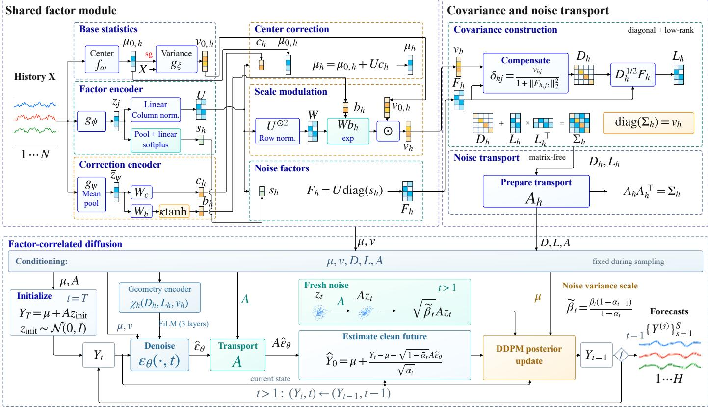  
Figure 1: Architecture of FaCoDif. Shared loadings support center correction, scale modulation and correlated noise. Diagonal compensation preserves marginal noise variances. Factor-derived geometry modulates the denoiser, and the transport � is reused throughout reverse generation.

## 3.3. Conditional factor estimation

The loading matrix $U ( X ) ~ \in ~ \mathbb { R } ^ { d \times r }$ represents shared variation. Separate coeficients adjust centers and scales, while horizon-specific strengths $s _ { h } ( X ) \in \mathbb { R } _ { > 0 } ^ { r }$ determine noise factors.

History-conditioned loadings A temporal MLP $g _ { \phi } ,$ shared across variables, encodes each history. Its individual and pooled features determine the loadings and strengths:

$$
\begin{array} { l } { \displaystyle { z _ { j } = g _ { \phi } ( X _ { : , j } ) , \qquad \bar { z } = \frac { 1 } { d } \sum _ { j } z _ { j } , } } \\ { \displaystyle { \widetilde { U } _ { j , : } ^ { \top } = W _ { U } z _ { j } + a _ { U } , } } \\ { \displaystyle { U _ { : , k } = \frac { \widetilde { U } _ { : , k } } { \operatorname* { m a x } ( \| \widetilde { U } _ { : , k } \| _ { 2 } , \varepsilon ) } , } } \\ { \displaystyle { s _ { 1 : H } = \mathrm { r e s h a p e } _ { H \times r } [ \mathrm { s o f t p l u s } ( W _ { s } \bar { z } + a _ { s } ) ] } . } \end{array}\tag{5}
$$

The encoder features are column vectors, $s _ { 1 : H }$ stacks the rows $s _ { h } ^ { \top } .$ , and $\varepsilon = 1 0 ^ { - 8 }$ is a numerical floor. The loadings change with history but are shared across forecast steps; $s _ { h }$ adjusts their contribution at each step. Column normalization fixes their scale while allowing nonorthogonal directions. The factor-head parameter count is independent of �, and � specifies its capacity.

Center and scale corrections The center and scale corrections share � with the noise factors but have their own coeficients. A second variableshared encoder $g _ { \psi }$ produces these coeficients from pooled history

features:

$$
\begin{array} { l } { \displaystyle \bar { z } _ { \psi } = \frac { 1 } { d } \sum _ { j } g _ { \psi } ( X _ { : , j } ) , } \\ { \displaystyle C _ { \mu } = \mathrm { r e s h a p e } _ { H \times r } ( W _ { c } \bar { z } _ { \psi } + a _ { c } ) , } \\ { \displaystyle C _ { v } = \kappa \operatorname { t a n h } \bigl [ \mathrm { r e s h a p e } _ { H \times r } ( W _ { b } \bar { z } _ { \psi } + a _ { b } ) \bigr ] . } \end{array}\tag{6}
$$

Let $c _ { h } = ( C _ { \mu } ) _ { h , : } ^ { \top } \in \mathbb { R } ^ { r }$ and $b _ { h } = ( C _ { v } ) _ { h , : } ^ { \top } \in \mathbb { R } ^ { r }$ . The corrected statistics are

$$
\mu _ { h } = \mu _ { 0 , h } + U c _ { h } ,\tag{7}
$$

$$
\begin{array} { l } { { W _ { j k } = \displaystyle \frac { U _ { j k } ^ { 2 } } { \operatorname* { m a x } ( \sum _ { \ell } U _ { j \ell } ^ { 2 } , \varepsilon ) } , } } \\ { { \displaystyle v _ { h j } = \operatorname* { m a x } \left\{ v _ { 0 , h j } \exp \biggl ( \sum _ { k } W _ { j k } b _ { h k } \biggr ) , \eta \right\} . } } \end{array}\tag{8}
$$

Thus the center correction lies in the loading span, whereas squared loadings weight factor-specific log-variance adjustments. With $\kappa \quad =$ 0.7, the variance multiplier is bounded by $[ e ^ { - \kappa } , e ^ { \kappa } ]$ . Zero-initialized coeficient heads recover $( \mu _ { 0 } , v _ { 0 } )$

Diagonal compensation Adding a low-rank term directly to $\mathrm { d i a g } ( v _ { h } )$ would also inflate the diagonal. We compensate this contribution using $F _ { h } = U { \mathrm { d i a g } } ( s _ { h } ) $ , whose �th row is $f _ { h j } \colon$

$$
\begin{array} { r l r l } & { \delta _ { h j } = \frac { v _ { h j } } { 1 + \| f _ { h j } \| _ { 2 } ^ { 2 } } , } & & { D _ { h } = \mathrm { d i a g } ( \delta _ { h } ) , } \\ & { L _ { h } = D _ { h } ^ { 1 / 2 } F _ { h } , } & & { \Sigma _ { h } = D _ { h } + L _ { h } L _ { h } ^ { \top } . } \end{array}\tag{9}
$$

The �th diagonal entry is $\delta _ { h j } ( 1 + \| f _ { h j } \| _ { 2 } ^ { 2 } ) = v _ { h j } .$ , so diag $( \Sigma _ { h } ) = v _ { h }$ . This is a factor-correlation normalization $[ 7 , { \bar { 9 } } ]$ . Positive definiteness follows

because, for any nonzero $\begin{array} { r } { \iota , \ a ^ { \top } \Sigma _ { h } a = a ^ { \top } D _ { h } a + \| L _ { h } ^ { \top } a \| _ { \gamma } ^ { 2 } > 0 . } \end{array}$ . The factors $L _ { h }$ combine $U , s _ { h }$ and $D _ { h } ^ { 1 / 2 }$ to control dependence at fixed $v _ { h } .$

## 3.4. Factor-correlated difusion

For a given history, $( \mu _ { h } , \Sigma _ { h } )$ remain fixed along the difusion chain. Let $A _ { h } A _ { h } ^ { \top } = \Sigma _ { h }$ define an invertible noise transport. The forward and reverse processes use this same transport, evaluated without forming a dense matrix as described in Section 3.6.

Forward perturbation Given a schedule $\beta _ { t } ~ \in ~ ( 0 , 1 )$ , set $\alpha _ { t } ~ = ~ 1 - \beta _ { t }$ $\begin{array} { r } { \bar { \boldsymbol { \alpha } } _ { t } = \prod _ { \tau = 1 } ^ { t } { \boldsymbol { \alpha } } _ { \tau } ; } \end{array}$ , and $\bar { \alpha } _ { 0 } = 1$ . Define

$$
q ( Y _ { t , h } \mid Y _ { t - 1 , h } , X ) = \mathcal { N } \big ( \mu _ { h } + \sqrt { \alpha _ { t } } ( Y _ { t - 1 , h } - \mu _ { h } ) , \beta _ { t } \Sigma _ { h } \big ) .\tag{10}
$$

Training samples an arbitrary difusion step directly through

$$
Y _ { t , h } = \mu _ { h } + \sqrt { \bar { \alpha } _ { t } } ( Y _ { 0 , h } - \mu _ { h } ) + \sqrt { 1 - \bar { \alpha } _ { t } } A _ { h } \epsilon _ { h } , \quad \epsilon _ { h } \sim \mathcal { N } ( 0 , I _ { d } ) .\tag{11}
$$

The perturbations are independent across ℎ; $\Sigma _ { h }$ specifies cross-variable noise dependence within each forecast step. Together with horizonwise denoising, this yields a predictive distribution that factorizes across forecast steps conditional on �.

Geometry-conditioned denoising The denoiser predicts pre-transport noise from the noisy future and time step, conditioned on the center, marginal variance and covariance factors. To expose dependence independently of the marginal scales, define $V _ { h } ~ = ~ \mathrm { d i a g } ( v _ { h } )$ and the geometry features

$$
\chi _ { h } = \left[ \log ( \delta _ { h } \oslash v _ { h } ) ; { \sqrt d \ \mathrm { v e c } ( V _ { h } ^ { - 1 / 2 } L _ { h } ) } \right] ,\tag{12}
$$

where $\oslash$ denotes elementwise division. A two-layer MLP maps $\chi _ { h }$ to three pairs of feature-wise modulation vectors $( \overset { \cdot } { a } _ { h } ^ { ( \ell ) } , b _ { h } ^ { ( \ell ) } ) , \ell \ = \ 1 , \overset { \cdot } { 2 } , 3$ Starting with $\boldsymbol { u } _ { h } ^ { ( 0 ) } = [ Y _ { t , h } ; \mu _ { h } ; v _ { h } ] .$ , the hidden updates are

$$
\begin{array} { r } { u _ { h } ^ { ( \ell ) } = \mathrm { s o f t p l u s } \left[ \left( 1 + \frac { 1 } { 2 } \operatorname { t a n h } a _ { h } ^ { ( \ell ) } \right) \odot T _ { \theta , \ell } ( u _ { h } ^ { ( \ell - 1 ) } , t ) + b _ { h } ^ { ( \ell ) } \right] , } \end{array}\tag{13}
$$

where $T _ { \theta , \ell }$ is a linear projection multiplicatively modulated by a learned difusion-step embedding [4]. A final linear projection produces $\widehat { \epsilon } _ { \theta , h } .$ Weights are shared across forecast steps. The geometry $ { \mathbf { M L P } } { \boldsymbol { s } }$ output layer is initialized to zero, so its modulation initially leaves the timeconditioned hidden projections unchanged. Geometry modulations are prepared at the start of each sample chunk and reused across its reverse steps. Inputs remain in data coordinates; $A _ { h } \widehat { \epsilon } _ { \theta , h }$ gives the correlated noise estimate.

Reverse generation Sampling starts from the conditional Gaussian reference by drawing $Y _ { T , h } = \mu _ { h } + A _ { h } z _ { \mathrm { i n i t } , h }$ with $z _ { \mathrm { i n i t } , h } \sim \mathcal { N } ( 0 , I _ { d } )$ . At each reverse step, we first reconstruct

$$
\widehat { Y } _ { 0 , h } = \mu _ { h } + \frac { Y _ { t , h } - \mu _ { h } - \sqrt { 1 - \bar { \alpha } _ { t } } A _ { h } \widehat { \epsilon } _ { \theta , h } } { \sqrt { \bar { \alpha } _ { t } } } .\tag{14}
$$

For $t > 1 ,$ , the reverse update is

$$
Y _ { t - 1 , h } = \mu _ { h } + \gamma _ { 0 , t } ( \widehat { Y } _ { 0 , h } - \mu _ { h } ) + \gamma _ { t , t } ( Y _ { t , h } - \mu _ { h } ) + \sqrt { \widetilde { \beta } _ { t } } A _ { h } z _ { t , h } ,\tag{15}
$$

where $z _ { t , h } ~ \sim ~ \mathcal { N } ( 0 , I _ { d } )$ is independent of the initialization and other reverse steps. The DDPM posterior coeficients [3] are

$$
\gamma _ { 0 , t } = \frac { \beta _ { t } \sqrt { \bar { \alpha } _ { t - 1 } } } { 1 - \bar { \alpha } _ { t } } , \quad \gamma _ { t , t } = \frac { \sqrt { \alpha _ { t } } ( 1 - \bar { \alpha } _ { t - 1 } ) } { 1 - \bar { \alpha } _ { t } } , \quad \widetilde { \beta } _ { t } = \frac { \beta _ { t } ( 1 - \bar { \alpha } _ { t - 1 } ) } { 1 - \bar { \alpha } _ { t } } .\tag{16}
$$

The final step returns $\widehat { Y } _ { 0 }$ without additional noise.

With fixed conditional geometry, the change of variables $A _ { h } ^ { - 1 } ( Y _ { t , h } -$ $\mu _ { h } )$ yields standard Gaussian difusion, connecting the construction to conditional-prior and whitening methods [5, 6]. Here the conditional Gaussian is the reference distribution that initializes a finite-step reverse chain, whose learned transitions define the final predictive distribution. With $\bar { \alpha } _ { T } \approx 0 . 9 0 3 6$ under the schedule in Section 4, the finite-step chain uses an approximate Gaussian reference initialization. The constraint $\mathrm { d i a g } ( \Sigma _ { h } ) = v _ { h }$ specifies the marginal difusion-noise variances.

## 3.5. Learning and optimization

Residual estimation For minibatch size � and residuals $e _ { b h } = Y _ { b h } - \mu _ { b h }$ the estimator uses the Gaussian auxiliary score

$$
\mathcal { L } _ { \mathrm { N L L } } = \frac { 1 } { 2 B H d } \sum _ { b , h } [ e _ { b h } ^ { \top } \Sigma _ { b h } ^ { - 1 } e _ { b h } + \log \operatorname* { d e t } \Sigma _ { b h } ] ,\tag{17}
$$

omitting the additive Gaussian constant. To distinguish marginal and dependence contributions, write $\Sigma _ { h } = V _ { h } ^ { 1 / 2 } R _ { h } V _ { h } ^ { 1 / 2 }$ with $V _ { h } = \mathrm { d i a g } ( v _ { h } )$ and ${ \widetilde e } _ { h } ~ = ~ V _ { h } ^ { - 1 / 2 } e _ { h } ,$ where $R _ { h }$ is the noise correlation matrix. The unnormalized per-step score decomposes as

$$
\ell _ { h } = \frac { 1 } { 2 } \left[ \sum _ { j } \log v _ { h j } + \| \widetilde { e } _ { h } \| _ { 2 } ^ { 2 } \right] + \frac { 1 } { 2 } \left[ \widetilde { e } _ { h } ^ { \top } ( R _ { h } ^ { - 1 } - I _ { d } ) \widetilde { e } _ { h } + \log \operatorname* { d e t } R _ { h } \right] .\tag{18}
$$

For fixed center and marginals, the second term measures the change from the diagonal Gaussian score and vanishes at $R _ { h } = I _ { d }$

## Denoising and joint objective

For � ∼ Uniform $\{ 1 , \ldots , T \}$ , let ${ r _ { b h } } = \widehat { \epsilon } _ { \theta , b h } - \epsilon _ { b h }$ denote the noise prediction error in Eq. (11). We balance accuracy before and after transport:

$$
\mathcal { L } _ { \mathrm { d i f f } } = \mathbb { E } _ { t , \epsilon } \left[ \frac { 1 } { 2 B H d } \sum _ { b , h } \| r _ { b h } \| _ { 2 } ^ { 2 } + \frac { 1 } { 2 B H } \sum _ { b , h } \frac { \| A _ { b h } r _ { b h } \| _ { 2 } ^ { 2 } } { { \mathrm { t r } } ( \Sigma _ { b h } ) } \right] .\tag{19}
$$

The first term measures white-noise error; the second measures its data-coordinate efect after covariance transport. Trace normalization controls the scale of the latter across dimensions and noise magnitudes. All estimator outputs used in the perturbations, conditioning and error metric are detached, so this loss updates only the denoiser parameters �, including its geometry encoder. The joint objective is

$$
\mathcal { L } _ { \mathrm { j o i n t } } = \mathcal { L } _ { \mathrm { d i f f } } + \mathcal { L } _ { \mathrm { N L L } } + \frac { \Vert Y - \mu \Vert _ { F } ^ { 2 } } { B H d } + \lambda _ { c } \operatorname { m e a n } ( c ^ { 2 } ) + \lambda _ { b } \operatorname { m e a n } ( b ^ { 2 } ) .\tag{20}
$$

The residual NLL jointly trains the center, scale and factor estimates; the center MSE anchors point accuracy, and the last two terms regularize the correction coeficients. This gradient separation lets the estimator learn residual statistics while the denoiser learns to reverse the resulting perturbations.

Staged optimization Training proceeds from base estimation to factor warmup and joint optimization. First, the base predictors minimize

$$
\mathcal { L } _ { \mathrm { b a s e } } = \frac { 1 } { 2 B H d } \sum _ { b , h , j } \left[ \log v _ { 0 , b h j } + \frac { ( Y _ { b h j } - \mu _ { 0 , b h j } ) ^ { 2 } } { v _ { 0 , b h j } } \right] + \frac { \| Y - \mu _ { 0 } \| _ { F } ^ { 2 } } { B H d } .\tag{21}
$$

Second, we freeze the validation-selected base, keep $c = b = 0 ,$ and train the factor estimator with ${ \mathcal { L } } _ { \mathrm { N L I } }$ and the denoiser with ${ \mathcal { L } } _ { \mathrm { d i f f } }$ . Third, we restore the selected warm checkpoint, enable the zero-initialized correction heads, and optimize all branches using Eq. (20).

The base checkpoint is selected by validation $\mathcal { L } _ { \mathrm { b a s e } } \mathrm { ; }$ warmup and joint checkpoints are selected by validation CRPS with 100 samples per origin. The initial warm checkpoint is included among the joint-stage candidates. Each stage uses a fresh optimizer; settings and stage budgets are given in Section 4.

Algorithm 1 summarizes the updates. We denote base, factor, correction, and denoiser parameters by $\Theta _ { 0 } , \Theta _ { F } , \Theta _ { C } ,$ , and �, respectively.

## 3.6. Matrix-free computation and inference

Both residual estimation and generation operate on $( D _ { h } , L _ { h } )$ without materializing $\Sigma _ { h } .$ . Define $K _ { h } = I _ { r } + L _ { h } ^ { \top } D _ { h } ^ { - 1 } L _ { h } .$ . The Woodbury identity and matrix determinant lemma give

$$
\Sigma _ { h } ^ { - 1 } = D _ { h } ^ { - 1 } - D _ { h } ^ { - 1 } L _ { h } K _ { h } ^ { - 1 } L _ { h } ^ { \top } D _ { h } ^ { - 1 } ,\tag{22}
$$

$$
\log \mathrm { d e t } \Sigma _ { h } = \sum _ { j } \log \delta _ { h j } + \log \mathrm { d e t } K _ { h } .\tag{23}
$$

Algorithm 1 FaCoDif training   
Require: Training and validation sets; stage budgets.   
1: Initialize parameters; set correction output heads to zero.   
Stage 1: Base estimation   
2: Train $\Theta _ { 0 }$ with $\mathcal { L } _ { \mathrm { b a s e } } ;$ restore its best validation checkpoint.   
Stage 2: Factor and denoiser warmup   
3: Freeze $\Theta _ { 0 }$ and $\Theta _ { C } ;$ set $c = b = 0 .$   
4: for each factor-warmup minibatch $( X , Y )$ do   
5: Compute $( \mu _ { 0 } , v _ { 0 } , U , s ) ;$ construct $( D , L )$ via $\operatorname { E q . }$ (9).   
6: Use ${ \bf s g } ( \mu _ { 0 } , v _ { 0 } , D , L )$ only in the difusion branch.   
7: Sample $t , \epsilon ;$ form $Y _ { t }$ via Eq. (11).   
8: Compute geometry modulations; predict white noise.   
9: Take one optimizer step on $\mathcal { L } _ { \mathrm { N L L } } + \mathcal { L } _ { \mathrm { d i f f } }$ for $( \Theta _ { F } , \theta ) .$   
10: end for   
11: Restore the warm checkpoint with lowest validation CRPS.   
Stage 3: Joint optimization   
12: Unfreeze all branches; enable the zero-initialized correction heads.   
13: Include the warm checkpoint as an initial joint-stage candidate.   
14: for each joint-optimization minibatch $( X , Y )$ do   
15: Compute $( \mu , v , D , L )$ using Eqs. (2)–(9).   
16: Use $\operatorname { s g } ( \mu , v , D , L )$ only in the difusion branch.   
17: Sample $t , \epsilon ;$ form $Y _ { t }$ via Eq. (11).   
18: Compute geometry modulations; predict white noise.   
19: Take one optimizer step on ${ \mathcal { L } } _ { \mathrm { j o i n t } }$ for $( \Theta _ { 0 } , \Theta _ { F } , \Theta _ { C } , \theta ) .$   
20: end for   
21: return Joint-stage candidate with lowest validation CRPS.

For noise transport, set $B _ { h } = D _ { h } ^ { - 1 / 2 } L _ { h }$ and diagonalize only the $r \times r$ Gram matrix: $B _ { h } ^ { \top } B _ { h } = Q _ { h } \Lambda _ { h } Q _ { h } ^ { \top }$ . With $G _ { h } = B _ { h } Q _ { h }$ , apply

$$
\begin{array} { l } { { A _ { h } z = D _ { h } ^ { 1 / 2 } \left[ z + G _ { h } \mathrm { d i a g } ( a _ { h k } ) G _ { h } ^ { \top } z \right] , } } \\ { { a _ { h k } = \displaystyle \frac { 1 } { \sqrt { 1 + \lambda _ { h k } } + 1 } , } } \end{array}\tag{24}
$$

where $\lambda _ { h k }$ are the diagonal entries of $\Lambda _ { h } .$ The bracketed map applies $( I _ { d } + B _ { h } B _ { h } ^ { \top } ) ^ { 1 / 2 }$ to $z ,$ so $A _ { h } A _ { h } ^ { \top } = D _ { h } + L _ { h } L _ { h } ^ { \top } ;$ the coeficients remain finite at zero eigenvalues.

Per forecast step, preparation costs $O ( d r ^ { 2 } + r ^ { 3 } ) ;$ , storage costs $O ( d r +$ $r ^ { 2 } ) ,$ and each prepared transport costs �(��) per vector. In contrast, the dense covariance geometry in CW-Gen [6] requires $O ( d ^ { 2 } )$ storage, $O ( d ^ { 3 } )$ for Cholesky or eigendecomposition, and $O ( d ^ { 2 } )$ per matrix-vector transport. At fixed $r \ \ll \ d ,$ our covariance storage and operations therefore scale linearly with �. These are covariance-operation costs, separate from the predictor and denoiser costs; both approaches can prepare their factors once per history and reuse them across samples. We then run Eq. (15) with independent noise draws to obtain � forecasts.

## 4. Experiments

## 4.1. Datasets and evaluation protocol

We evaluate FaCoDif on nine multivariate time series datasets: Solar, ECL and Trafic [40], Weather and ILI [41], ETTh2 and ETTm2 [42], and London and Taxi. Table 1 summarizes their dimensions and window counts. The history and prediction lengths are $^ { 1 6 8 } \ \to \ 1 9 2 $ except for Taxi (48 → 24) and ILI (168 → 36).

For London, we use the first 1,000 series in archive order from the missing-value-free London Smart Meters dataset [43], covering 1 May 2012–20 February 2014. Summing consecutive half-hour readings yields 15,864 hourly observations. Taxi uses all 1,214 series with 1,488 half-hour observations from the January 2015 training release of GluonTS taxi\_30min [44].

Each series is split chronologically into training, validation and test sets in a 7:1:2 ratio. We apply per-variable z-score normalization using training-set statistics and evaluate in the standardized space. Training windows use stride one; validation and test use non-overlapping target windows with stride �. We retain complete target windows within each split, allowing historical context from the preceding split.

Dataset statistics. � is the number of variables; $N / H$ denotes history/forecast lengths. Train, Val. and Test give window counts.
<table><tr><td>Dataset</td><td>d</td><td>N/H</td><td>Train</td><td>Val.</td><td>Test</td></tr><tr><td>Solar</td><td>137</td><td>168/192</td><td>36433</td><td>27</td><td>54</td></tr><tr><td>ECL</td><td>321</td><td>168/192</td><td>18053</td><td>13</td><td>27</td></tr><tr><td>Traffic</td><td>862</td><td>168/192</td><td>11921</td><td>9</td><td>18</td></tr><tr><td>London</td><td>1000</td><td>168/192</td><td>10745</td><td>8</td><td>16</td></tr><tr><td>Taxi</td><td>1214</td><td>48/24</td><td>970</td><td>6</td><td>12</td></tr><tr><td>Weather</td><td>21</td><td>168/192</td><td>36528</td><td>27</td><td>54</td></tr><tr><td>ILI</td><td>7</td><td>168/36</td><td>473</td><td>2</td><td>5</td></tr><tr><td>ETTh2</td><td>7</td><td>168/192</td><td>11835</td><td>9</td><td>18</td></tr><tr><td>ETTm2</td><td>7</td><td>168/192</td><td>48417</td><td>36</td><td>72</td></tr></table>

All models generate $S = 1 0 0$ joint forecast samples per test origin and use a common evaluation pipeline for the six primary metrics below. We report the mean and sample standard deviation over three independent runs. Checkpoints are selected using the validation set.

## 4.2. Evaluation metrics

Let $y _ { w h j }$ be the standardized observation at test origin $w ,$ prediction step ℎ, and variable $j ,$ and let $x _ { w h j } ^ { ( s ) }$ be sample �. There are � origins. Marginal CRPS [1] is

$$
\begin{array} { r l r } { \mathrm { C R P S } = \displaystyle \frac { 1 } { W H d } \sum _ { w , h , j } \Bigg [ \frac { 1 } { S } \sum _ { s } | x _ { w h j } ^ { ( s ) } - y _ { w h j } | } & { } & \\ { \quad \quad \quad - \frac { 1 } { 2 S ^ { 2 } } \sum _ { s , s ^ { \prime } } | x _ { w h j } ^ { ( s ) } - x _ { w h j } ^ { ( s ^ { \prime } ) } | \Bigg ] . } \end{array}\tag{25}
$$

QICE [27] measures deviation from uniform occupancy of ten empirical quantile intervals. With global count $n _ { k }$ in interval $k ,$

$$
\mathrm { Q I C E } = \frac { 1 } { 1 0 } \sum _ { k = 1 } ^ { 1 0 } \left| \frac { n _ { k } } { W H d } - 0 . 1 \right| .\tag{26}
$$

We use linear percentile interpolation and strict quantile exceedances;   
observations outside the sample range enter the adjacent edge intervals.   
Counts are pooled across all origins before computing deviations.

Energy [1] scores the joint �-variable forecast at each prediction step:

$$
\mathrm { E n e r g y } = \frac { 1 } { W H } \sum _ { w , h } \left[ \frac { 1 } { S } \sum _ { s } \| x _ { w h } ^ { ( s ) } - y _ { w h } \| _ { 2 } - \frac { 1 } { 2 S ^ { 2 } } \sum _ { s , s ^ { \prime } } \| x _ { w h } ^ { ( s ) } - x _ { w h } ^ { ( s ^ { \prime } ) } \| _ { 2 } \right] .\tag{27}
$$

Variogram [2] uses exponent $p = 1 / 2$ and equal normalized weights over all unordered variable pairs:

$$
\mathrm { V S } _ { p } = \frac { 1 } { W H \binom { d } { 2 } } \sum _ { w , h } \sum _ { i < j } \left[ | y _ { w h i } - y _ { w h j } | ^ { p } - \frac { 1 } { S } \sum _ { s } | x _ { w h i } ^ { ( s ) } - x _ { w h j } ^ { ( s ) } | ^ { p } \right] ^ { 2 } .\tag{28}
$$

Energy uses the unnormalized Euclidean norm; both joint scores evaluate the �-variable forecast separately at each prediction step. Samplepair averages use $S ^ { 2 }$ , including zero-distance diagonal pairs. Finally, with sample mean $\begin{array} { r } { \bar { x } _ { w h j } = S ^ { - 1 } \sum _ { s } x _ { w h j } ^ { ( s ) } } \end{array}$

$$
\begin{array} { r l } & { \mathrm { M A E } = \displaystyle \frac { 1 } { W H d } \sum _ { w , h , j } | \bar { x } _ { w h j } - y _ { w h j } | , } \\ & { \mathrm { M S E } = \displaystyle \frac { 1 } { W H d } \sum _ { w , h , j } ( \bar { x } _ { w h j } - y _ { w h j } ) ^ { 2 } . } \end{array}\tag{29}
$$

Thus point errors assess the generated sample mean. All six metrics are minimized. For the Solar and Weather component and pairing analyses, we additionally evaluate a standardized linear aggregate. At each

prediction step, define $\begin{array} { r } { a _ { w h } = d ^ { - 1 / 2 } \sum _ { j } y _ { w h j } } \end{array}$ and $\begin{array} { r } { a _ { w h } ^ { ( s ) } = d ^ { - 1 / 2 } \sum _ { j } x _ { w h j } ^ { ( s ) } . } \end{array}$ Let $m _ { a }$ and $s _ { a }$ be the mean and population standard deviation of the corresponding aggregate over the training prefix only, and set

$$
\widetilde { a } _ { w h } = \frac { a _ { w h } - m _ { a } } { s _ { a } } , \qquad \widetilde { a } _ { w h } ^ { ( s ) } = \frac { a _ { w h } ^ { ( s ) } - m _ { a } } { s _ { a } } .\tag{30}
$$

Aggregate CRPS applies the same empirical CRPS formula to these scalar samples and observations, averaging over origins and prediction steps. All variants use the same training-fitted aggregate scaler. Lower aggregate CRPS is better.

## 4.3. Implementation details

The main forecasting benchmarks follow Section 3.5. Base pretraining uses at most 20 epochs with patience five. Factor warmup and joint optimization use at most 10 and 20 epochs, respectively, with run-specific budgets matched between Full and its controls. Adam uses learning rate $1 0 ^ { - 4 }$ for every parameter group, with global gradient clipping at norm one and fresh optimizer state at stage boundaries. Training batch size is 32. Validation and test evaluate one origin at a time, generating samples in chunks of ten. The two correction penalties have weight $1 0 ^ { - 3 }$ each. Both temporal factor and correction encoders use two-layer MLPs of width 64 with SiLU activations and layer normalization. The denoiser has three hidden layers of width 128. Its geometry encoder has a SiLU hidden layer of width 128 and outputs the six modulation vectors in $\operatorname { E q . }$ (13). The white-coordinate and tracenormalized transported-error terms receive equal weight.

We use eight factor columns $\left( r \ = \ 8 \right)$ on all main-table datasets. Difusion training and ancestral sampling both use $T ~ = ~ 2 0$ steps, as in NsDif [4]. We use a linear schedule from $\beta _ { 1 } = 1 0 ^ { - 4 }$ to $\beta _ { T } = 0 . 0 1$ The conditional Gaussian in Section 3.4 initializes this short reverse chain. Marginal variance is floored at $1 0 ^ { - 6 }$ , and the small linear systems use numerical diagonal stabilization. Validation sampling uses a fixed random seed for each run.

Baselines We compare with DeepVAR [7], TMDM [28], NsDif [4], CW-NsDif [6], and DifPTS [29]. All baselines use public implementations with model-specific training settings and the common evaluation protocol. DeepVAR uses the PyTorchTS low-rank Gaussian implementation with rank five, 100 training epochs and 50 updates per epoch. CW-NsDif is the NsDif instantiation of CW-Gen. It uses the oficial highdimensional accelerated variant on Solar and ECL and the full JMCE loss on the remaining evaluated datasets. Entries unavailable within the memory and runtime budget are marked –.

## 4.4. Main forecasting results

Joint forecast quality The clearest cross-dataset advantage is in dependence-sensitive forecast quality: FaCoDif achieves the lowest mean Variogram score on eight of nine datasets in Table 2. On Trafic, the reduction relative to DifPTS [29] is 18.88%.

Marginal and point forecasting This joint-score advantage is accompanied by competitive marginal and point forecasts. Across all six metrics, FaCoDif ranks among the top two on 43 of the 54 dataset–metric combinations. For example, CRPS is 40.99% lower than NsDif on Solar and 11.27% lower than DifPTS on Trafic. The gains therefore extend beyond dependence-sensitive scoring to the quality of individualvariable predictions.

Variation across datasets The advantage varies with the dataset and evaluation criterion. TMDM achieves the lowest means on all six metrics on Weather. On London and Taxi, FaCoDif has the lowest CRPS, QICE and Variogram, while NsDif has the lowest Energy. These diferences distinguish the broad Variogram advantage from improvements in other aspects of forecast quality.

## 4.5. Forecast visualization

Figure 2 compares FaCoDif with DeepVAR and the difusion baselines on a Solar forecast with irregular intraday fluctuations. The upper row compares individual-variable trajectories; the lower row aggregates all variables within each joint sample. Predictive medians, one sampled trajectory and central prediction intervals reveal both the forecast profile and its uncertainty. In this example, FaCoDif tracks the two aggregate peaks with less attenuation than NsDif and DifPTS, while its intervals contract during low-output periods.

## 4.6. Ablation study

We separate the contributions of factor covariance, marginal corrections and difusion generation on Solar and Weather. Table 3 crosses covariance on/of with four correction settings: none, Location, Scale and both. Within each seed, all variants start from the same pretrained base checkpoint. Covariance controls share initialization and random seeds, with factor-warmup and joint-training budgets matched to Full. Location/Scale controls change only the enabled correction heads within this common training recipe. Each variant selects its checkpoint by validation CRPS, including the joint-stage initial checkpoint. Full is the main-benchmark model reported in Table 2.

Diagonal removes factor covariance and both corrections while retaining residual ${ \mathrm { N L L } } ,$ the denoising objective, gradient routing, and matched training budget. Diagonal+L, Diagonal+S, and Diagonal+L+S retain the conditional correction basis with Location, Scale, or both enabled, respectively, but use diag(�) as noise covariance. Factor-only retains conditional covariance without either correction; Factor+L and Factor+S enable Location or Scale separately. Full enables all three outputs. Disabled heads receive no branch-specific losses or updates. All diagonal variants retain FaCoDif’s residual-learning recipe, distinguishing these component controls from the native NsDif benchmark.

Efect offactor covariance Factor covariance improves both joint-score means under all four correction settings on both datasets (Table 3). Without corrections, F lowers Energy and Variogram by 3.26% and 1.32% on Solar, and by 0.17% and 1.25% on Weather, relative to D. With both corrections enabled, Full lowers these scores by 4.76% and 13.20% on Solar and by 2.85% and 3.53% on Weather, relative to D+L+S. Full also improves all six mean scores over $_ { \mathrm { D + L + S } }$ on each dataset. Relative changes in these component comparisons use ratios of three-run mean scores. The aggregate scores extend this comparison to a cross-variable linear target. Factor covariance lowers mean aggregate CRPS under all four correction settings: by 20.14–22.17% on Solar and 2.33–6.93% on Weather. All 12 seed-matched factor/diagonal comparisons improve on Solar, as do 11 of 12 on Weather. Full has the lowest aggregate-CRPS mean among the eight variants on both datasets, reducing it by 22.17% and 6.93% relative to D+L+S, respectively. These results show that the covariance benefit extends to aggregate probabilistic prediction.

Efect of marginal corrections Location and Scale strengthen the factor model in complementary ways. On Solar, adding Location to F lowers MSE by 7.38% and Variogram by 11.20%; enabling Scale on top of F+L further lowers Energy and Variogram by 1.35% and 8.86%. Full has the best means on five of the six primary metrics, while F has the lowest QICE. On Weather, Full has the lowest CRPS, QICE, Energy and Variogram, and F+S has the lowest point errors. The complete configuration therefore gives the strongest joint-score means on both datasets, with the individual controls identifying the contributions of center adjustment and scale modulation.

Efect of geometry-conditioned denoising Table 4 crosses explicit geometry conditioning (G) with the mixed-error objective (T) in Eq. (19). Without T, training uses white-noise MSE alone. All four variants retain factor covariance and both corrections, using the same pretrained base checkpoint and matched training budgets within each seed; G+T is Full. With the mixed objective fixed, geometry conditioning reduces CRPS, Energy and Variogram by 3.23%, 2.97% and 6.68% on Solar, and by 2.55%, 1.84% and 1.93% on Weather. The combined configuration has the lowest CRPS, QICE and Energy means among the four variants on both datasets. Variogram favors the white-error control on Solar and the combined configuration on Weather. These results support the joint use of geometry conditioning and the transport-aware objective.

Forecasting results on nine datasets. Results are mean ± standard deviation over three runs. Lower is better; red and blue mark the best and second-best available means. – denotes unavailable results.
<table><tr><td>Dataset</td><td>Model</td><td>CRPS</td><td>QICE</td><td>Energy</td><td>Variogram</td><td>MAE</td><td>MSE</td></tr><tr><td>Solar</td><td>DeepVAR</td><td> $0 . 5 0 3 9 \pm 0 . 0 0 1 3$ </td><td> $0 . 0 7 8 8 \pm 0 . 0 0 0 1$ </td><td> $6 . 2 4 3 1 \pm 0 . 0 0 9 0$ </td><td> $0 . 1 6 0 6 \pm 0 . 0 0 5 9$ </td><td> $0 . 6 4 9 0 \pm 0 . 0 0 3 4$ </td><td> $0 . 7 6 5 8 \pm 0 . 0 0 2 6$ </td></tr><tr><td></td><td>TMDM</td><td>0.3567 ± 0.0032</td><td> $0 . 0 9 0 1 \pm 0 . 0 0 0 7$ </td><td> $5 . 2 1 2 4 \pm 0 . 0 3 8 6$ </td><td>0.6747 ± 0.0039</td><td> $0 . 3 2 6 6 \pm 0 . 0 0 4 7$ </td><td>0.2793 ± 0.0078</td></tr><tr><td></td><td>NsDiff CW-NsDiff</td><td> $0 . 3 1 3 6 \pm 0 . 0 1 4 1$ </td><td> $0 . 0 6 8 7 \pm 0 . 0 0 1 6$ </td><td> $4 . 4 3 8 8 \pm 0 . 1 7 2 2$ </td><td> $0 . 4 6 4 5 \pm 0 . 0 0 7 3$ </td><td> $0 . 3 3 2 9 \pm 0 . 0 1 8 9$ </td><td> $0 . 2 8 5 0 \pm 0 . 0 2 8 0$ </td></tr><tr><td></td><td>DiffPTS</td><td> $0 . 3 1 1 6 \pm 0 . 0 0 8 9$ </td><td> $0 . 0 6 4 5 \pm 0 . 0 0 4 9$ </td><td> $4 . 1 6 3 1 \pm 0 . 0 8 3 0$ </td><td> $0 . 2 3 8 1 \pm 0 . 0 0 3 4$ </td><td> $0 . 3 6 3 0 \pm 0 . 0 2 1 1$ </td><td> $0 . 3 2 5 4 \pm 0 . 0 0 9 6$ </td></tr><tr><td></td><td>FaCoDiff</td><td>0.3453 ± 0.0329</td><td> $0 . 0 3 5 7 \pm 0 . 0 1 7 3$ </td><td> $4 . 8 9 3 7 \pm 0 . 4 6 6 2$ </td><td> $0 . 3 3 5 1 \pm 0 . 0 3 4 3$ </td><td> $0 . 4 9 5 8 \pm 0 . 0 5 6 3$ </td><td> $0 . 8 7 3 0 \pm 0 . 1 8 4 2$ </td></tr><tr><td></td><td></td><td> $0 . 1 8 5 1 \pm 0 . 0 1 2 9$ </td><td> $0 . 0 5 8 7 \pm 0 . 0 1 9 0$ </td><td> $2 . 4 7 3 1 \pm 0 . 1 5 6 9$ </td><td> $0 . 0 5 5 7 \pm 0 . 0 0 1 6$ </td><td> $0 . 2 5 7 4 \pm 0 . 0 1 1 8$ </td><td> $0 . 2 3 0 9 \pm 0 . 0 1 9 4$ </td></tr><tr><td>ECL</td><td>DeepVAR</td><td>0.5796 ± 0.0040</td><td> $0 . 0 1 8 7 \pm 0 . 0 0 3 3$ </td><td> $1 2 . 7 4 2 9 \pm 0 . 1 0 9 2$ </td><td>0.1397 ± 0.0087</td><td> $0 . 8 2 6 3 \pm 0 . 0 0 5 0$ </td><td> $1 . 0 5 0 6 \pm 0 . 0 1 3 4$ </td></tr><tr><td></td><td>TMDM</td><td> $0 . 4 5 0 3 \pm 0 . 0 0 3 2$ </td><td> $0 . 1 0 5 6 \pm 0 . 0 0 1 2$ </td><td> $1 0 . 3 0 2 9 \pm 0 . 0 6 3 7$ </td><td> $0 . 3 7 0 3 \pm 0 . 0 0 0 4$ </td><td> $0 . 3 4 8 9 \pm 0 . 0 0 9 9$ </td><td> $0 . 2 4 2 5 \pm 0 . 0 1 0 9$ </td></tr><tr><td></td><td>NsDiff</td><td> $0 . 2 9 0 3 \pm 0 . 0 0 1 6$ </td><td> $0 . 0 7 9 7 \pm 0 . 0 0 0 7$ </td><td> $6 . 6 8 8 2 \pm 0 . 0 2 8 8$ </td><td>0.1513 ± 0.0024</td><td> $0 . 2 9 6 4 \pm 0 . 0 0 0 9$ </td><td> $0 . 1 9 3 9 \pm 0 . 0 0 2 3$ </td></tr><tr><td></td><td>CW-NsDiff</td><td> $0 . 3 4 1 3 \pm 0 . 0 1 4 8$ </td><td> $0 . 0 6 0 0 \pm 0 . 0 0 6 4$ </td><td> $7 . 5 0 7 9 \pm 0 . 3 1 6 4$ </td><td> $0 . 1 0 8 8 \pm 0 . 0 0 4 2$ </td><td> $0 . 4 0 4 6 \pm 0 . 0 3 1 6$ </td><td> $0 . 3 0 1 1 \pm 0 . 0 4 2 5$ </td></tr><tr><td></td><td>DiffPTS</td><td>0.2142 ± 0.0016</td><td> $0 . 0 1 7 3 \pm 0 . 0 0 2 4$ </td><td> $5 . 3 1 9 3 \pm 0 . 0 4 9 2$ </td><td> $0 . 0 7 0 6 \pm 0 . 0 0 0 2$ </td><td> $0 . 2 9 0 8 \pm 0 . 0 0 3 8$ </td><td> $0 . 1 8 8 1 \pm 0 . 0 0 4 3$ </td></tr><tr><td></td><td>FaCoDiff</td><td> $0 . 2 1 2 4 \pm 0 . 0 0 3 1$ </td><td> $0 . 0 2 0 6 \pm 0 . 0 0 4 7$ </td><td> $5 . 3 4 2 2 \pm 0 . 0 7 6 3$ </td><td> $0 . 0 6 8 7 \pm 0 . 0 0 0 7$ </td><td> $0 . 2 8 4 7 \pm 0 . 0 0 4 6$ </td><td> $0 . 1 8 5 4 \pm 0 . 0 0 6 5$ </td></tr><tr><td>Traffic</td><td>DeepVAR</td><td> $0 . 6 1 4 2 \pm 0 . 0 0 2 3$ </td><td> $0 . 0 3 8 5 \pm 0 . 0 0 1 7$ </td><td> $2 4 . 2 8 4 0 \pm 0 . 1 7 8 2$ </td><td> $0 . 2 4 6 2 \pm 0 . 0 1 5 9$ </td><td> $0 . 7 9 9 6 \pm 0 . 0 0 1 0$ </td><td> $1 . 5 1 8 7 \pm 0 . 0 0 2 6$ </td></tr><tr><td></td><td>TMDM</td><td>0.5630 ± 0.0029</td><td>0.1075 ± 0.0011</td><td>22.0758 ± 0.0759</td><td>0.6701 ± 0.0008</td><td>0.4325 ± 0.0113</td><td>0.7150 ± 0.0105</td></tr><tr><td></td><td>NsDiff</td><td> $0 . 3 7 6 4 \pm 0 . 0 0 5 8$ </td><td> $0 . 0 8 5 1 \pm 0 . 0 0 2 6$ </td><td> $1 6 . 8 0 1 8 \pm 0 . 1 9 5 0$ </td><td> $0 . 2 9 4 3 \pm 0 . 0 0 4 2$ </td><td> $0 . 3 7 4 7 \pm 0 . 0 1 5 8$ </td><td> $0 . 6 5 1 1 \pm 0 . 0 2 5 2$ </td></tr><tr><td></td><td>CW-NsDiff DiffPTS</td><td></td><td></td><td></td><td></td><td></td><td></td></tr><tr><td></td><td>FaCoDiff</td><td> $0 . 2 7 7 6 \pm 0 . 0 0 1 2$ </td><td> $0 . 0 3 6 0 \pm 0 . 0 0 5 2$ </td><td> $1 4 . 1 0 0 6 \pm 0 . 1 0 0 4$ </td><td> $0 . 1 3 2 2 \pm 0 . 0 0 3 6$ </td><td> $0 . 3 5 0 1 \pm 0 . 0 0 3 1$ </td><td> $0 . 5 9 8 5 \pm 0 . 0 0 8 3$ </td></tr><tr><td></td><td></td><td> $0 . 2 4 6 3 \pm 0 . 0 0 2 5$ </td><td> $0 . 0 1 8 8 \pm 0 . 0 0 0 8$ </td><td> $1 4 . 0 9 1 3 \pm 0 . 2 3 5 2$ </td><td> $0 . 1 0 7 2 \pm 0 . 0 0 1 1$ </td><td> $0 . 3 1 6 8 \pm 0 . 0 0 3 2$ </td><td> $0 . 5 6 9 1 \pm 0 . 0 0 9 7$ </td></tr><tr><td>London</td><td>DeepVAR</td><td>0.5991 ± 0.0265</td><td> $0 . 0 4 4 2 \pm 0 . 0 0 5 2$ </td><td> $2 8 . 6 8 0 7 \pm 1 . 0 3 1 6$ </td><td> $0 . 2 7 6 6 \pm 0 . 0 2 6 1$ </td><td> $0 . 7 5 5 4 \pm 0 . 0 1 9 9$ </td><td> $1 . 6 7 1 5 \pm 0 . 1 0 1 7$ </td></tr><tr><td></td><td>TMDM</td><td>0.6558 ± 0.0022</td><td> $0 . 0 8 2 1 \pm 0 . 0 0 0 8$ </td><td> $2 7 . 0 3 5 9 \pm 0 . 0 8 0 9$ </td><td> $0 . 5 5 1 9 \pm 0 . 0 0 0 4$ </td><td> $0 . 6 7 3 2 \pm 0 . 0 0 9 0$ </td><td>1.1326 ± 0.0135</td></tr><tr><td></td><td>NsDiff</td><td> $0 . 5 0 3 8 \pm 0 . 0 0 7 7$ </td><td> $\underline { { 0 . 0 4 8 6 \pm 0 . 0 0 3 4 } }$ </td><td>22.6569 ± 0.3350</td><td> $\underline { { 0 . 2 7 9 1 } } \pm 0 . 0 0 1 4$ </td><td> $0 . 6 2 2 9 \pm 0 . 0 1 3 3$ </td><td>1.0454 ± 0.0371</td></tr><tr><td></td><td>CW-NsDiff</td><td></td><td></td><td></td><td></td><td></td><td></td></tr><tr><td></td><td>DiffPTS</td><td>0.4944 ± 0.0011</td><td>0.0427 ± 0.0042</td><td> $2 2 . 7 2 6 0 \pm 0 . 0 5 1 2$ </td><td>0.2553 ± 0.0042</td><td> $0 . 6 3 7 1 \pm 0 . 0 0 2 3$ </td><td>1.0858 ± 0.0067</td></tr><tr><td></td><td>FaCoDiff</td><td> $0 . 4 6 4 8 \pm 0 . 0 0 3 3$ </td><td> $0 . 0 2 3 3 \pm 0 . 0 0 0 8$ </td><td> $2 2 . 7 9 0 3 \pm 0 . 1 8 3 8$ </td><td> $0 . 2 1 3 5 \pm 0 . 0 0 1 8$ </td><td> $0 . 6 1 6 6 \pm 0 . 0 0 5 6$ </td><td> $1 . 0 8 8 3 \pm 0 . 0 1 9 1$ </td></tr><tr><td>Taxi</td><td>DeepVAR</td><td> $0 . 5 7 2 4 \pm 0 . 0 0 1 9$ </td><td> $0 . 0 1 8 4 \pm 0 . 0 0 1 3$ </td><td> $2 4 . 0 2 4 5 \pm 0 . 1 3 0 4$ </td><td> $0 . 1 7 8 7 \pm 0 . 0 0 2 3$ </td><td> $0 . 7 9 8 7 \pm 0 . 0 0 5 5$ </td><td> $1 . 0 2 4 2 \pm 0 . 0 1 5 3$ </td></tr><tr><td></td><td>TMDM</td><td>0.6080 ± 0.0043</td><td>0.0884 ± 0.0016</td><td>26.5789 ± 0.1810</td><td> $0 . 6 3 2 4 \pm 0 . 0 0 1 9$ </td><td> $0 . 5 8 6 7 \pm 0 . 0 1 4 3$ </td><td>0.6267 ± 0.0240</td></tr><tr><td></td><td>NsDiff</td><td> $0 . 4 2 9 8 \pm 0 . 0 0 2 4$ </td><td> $0 . 0 2 1 8 \pm 0 . 0 0 0 9$ </td><td> $1 8 . 9 0 3 8 \pm 0 . 1 2 2 8$ </td><td> $\begin{array} { r } { 0 . 1 8 0 7 \pm 0 . 0 0 1 2 } \\ { - } \end{array}$ </td><td> $0 . 5 6 6 6 \pm 0 . 0 0 2 8$ </td><td> $0 . 6 0 3 2 \pm 0 . 0 0 2 5$ </td></tr><tr><td></td><td>CW-NsDiff DiffPTS</td><td>一</td><td></td><td>一</td><td></td><td></td><td></td></tr><tr><td></td><td>FaCoDiff</td><td> $0 . 4 2 7 8 \pm 0 . 0 0 2 8$ </td><td> $0 . 0 2 9 6 \pm 0 . 0 0 3 5$ </td><td> $1 8 . 9 5 8 2 \pm 0 . 0 8 2 0$  18.9423 ± 0.6943</td><td> $0 . 1 8 3 5 \pm 0 . 0 0 4 6$ </td><td> $0 . 5 6 8 8 \pm 0 . 0 0 9 0$ </td><td>0.6077 ± 0.0097</td></tr><tr><td>Weather</td><td></td><td>0.4246 ± 0.0173</td><td>0.0152 ± 0.0013</td><td></td><td> $0 . 1 3 9 6 \pm 0 . 0 0 5 1$ </td><td> $0 . 5 8 2 8 \pm 0 . 0 2 3 5$ </td><td>0.6438 ± 0.0529</td></tr><tr><td></td><td>DeepVAR</td><td> $0 . 3 5 3 9 \pm 0 . 0 8 5 2$ </td><td> $0 . 0 3 3 3 \pm 0 . 0 0 5 1$ </td><td> $2 . 3 4 8 5 \pm 0 . 3 7 7 8$ </td><td> $0 . 1 6 2 7 \pm 0 . 0 8 8 6$ </td><td> $0 . 4 6 4 0 \pm 0 . 0 7 9 2$ </td><td>0.5606 ± 0.0897</td></tr><tr><td></td><td>TMDM</td><td>0.2095 ± 0.0085</td><td>0.0280 ± 0.0067</td><td> $1 . 4 2 9 1 \pm 0 . 0 7 5 9$ </td><td> $0 . 0 7 9 2 \pm 0 . 0 0 4 7$ </td><td> $0 . 2 7 4 8 \pm 0 . 0 0 9 7$ </td><td>0.2333 ± 0.0181</td></tr><tr><td></td><td>NsDiff</td><td>0.2409 ± 0.0029</td><td> $0 . 0 3 3 5 \pm 0 . 0 0 1 7$ </td><td> $1 . 5 0 1 3 \pm 0 . 0 1 5 8$ </td><td>0.0943 ± 0.0004</td><td> $0 . 2 9 6 4 \pm 0 . 0 0 4 5$ </td><td>0.2493 ± 0.0062</td></tr><tr><td></td><td>CW-NsDiff DiffPTS</td><td>0.3203 ± 0.0141</td><td> $0 . 0 3 4 5 \pm 0 . 0 0 6 8$ </td><td> $1 . 8 7 2 9 \pm 0 . 0 8 2 4$ </td><td> $0 . 1 3 6 3 \pm 0 . 0 0 9 3$ </td><td> $0 . 4 0 9 1 \pm 0 . 0 2 3 8$ </td><td>0.3665 ± 0.0378</td></tr><tr><td></td><td>FaCoDiff</td><td>0.2154 ± 0.0049  $0 . 2 1 5 1 \pm 0 . 0 0 4 8$ </td><td>0.0354 ± 0.0067</td><td> $1 . 4 4 2 3 \pm 0 . 0 3 4 1$ </td><td> $0 . 0 8 3 0 \pm 0 . 0 0 1 4$ </td><td> $0 . 2 8 6 5 \pm 0 . 0 0 7 6$ </td><td>0.2378 ± 0.0131</td></tr><tr><td>ILI</td><td></td><td></td><td> $0 . 0 3 1 1 \pm 0 . 0 0 6 8$ </td><td> $1 . 4 8 7 3 \pm 0 . 0 2 3 9$ </td><td> $0 . 0 8 3 6 \pm 0 . 0 0 1 9$ </td><td> $0 . 2 8 1 5 \pm 0 . 0 0 3 8$ </td><td> $0 . 2 4 8 2 \pm 0 . 0 0 5 0$ </td></tr><tr><td></td><td>DeepVAR</td><td> $1 . 4 2 2 6 \pm 0 . 0 7 9 3$ </td><td> $0 . 1 1 6 9 \pm 0 . 0 2 2 0$ </td><td> $4 . 3 4 7 2 \pm 0 . 2 5 6 3$ </td><td> $0 . 3 7 4 1 \pm 0 . 0 6 3 0$ </td><td> $1 . 5 8 4 8 \pm 0 . 0 9 0 2$ </td><td> $5 . 6 1 2 3 \pm 0 . 7 0 7 6$ </td></tr><tr><td></td><td>TMDM</td><td>0.9295 ± 0.1540</td><td> $0 . 0 3 8 7 \pm 0 . 0 0 6 3$ </td><td> $2 . 8 7 3 0 \pm 0 . 4 2 9 8$ </td><td>0.2597 ± 0.0017</td><td> $1 . 1 8 5 1 \pm 0 . 1 8 9 4$ </td><td>3.2823 ± 0.9993</td></tr><tr><td></td><td>NsDiff</td><td> $0 . 8 6 8 8 \pm 0 . 0 4 4 0$ </td><td> $0 . 0 5 3 5 \pm 0 . 0 0 9 0$ </td><td> $2 . 6 9 1 7 \pm 0 . 1 1 7 2$ </td><td> $0 . 3 0 4 3 \pm 0 . 0 0 5 5$ </td><td> $1 . 0 7 1 2 \pm 0 . 0 4 7 9$ </td><td> $2 . 7 4 9 2 \pm 0 . 2 5 9 8$ </td></tr><tr><td></td><td>CW-NsDiff</td><td> $0 . 6 9 3 7 \pm 0 . 0 2 7 1$ </td><td> $0 . 0 2 9 3 \pm 0 . 0 0 8 0$ </td><td> $2 . 1 9 2 0 \pm 0 . 1 0 3 5$ </td><td> $0 . 2 0 7 9 \pm 0 . 0 2 1 8$ </td><td> $0 . 9 1 6 5 \pm 0 . 0 2 7 5$ </td><td>1.8601 ± 0.1272</td></tr><tr><td></td><td>DiffPTS</td><td>0.8556 ± 0.0484</td><td> $0 . 0 7 3 2 \pm 0 . 0 1 0 9$ </td><td> $2 . 6 3 3 7 \pm 0 . 1 3 6 4$ </td><td>0.2101 ± 0.0182</td><td> $1 . 0 0 3 1 \pm 0 . 0 7 0 1$ </td><td>2.7173 ± 0.3782</td></tr><tr><td></td><td>FaCoDiff</td><td>0.7097 ± 0.0759</td><td> $0 . 0 6 7 8 \pm 0 . 0 1 4 9$ </td><td> $2 . 2 2 8 0 \pm 0 . 2 1 1 8$ </td><td> $0 . 1 8 5 0 \pm 0 . 0 1 3 1$ </td><td> $0 . 8 5 7 0 \pm 0 . 0 7 9 7$ </td><td>1.8307 ± 0.3524</td></tr><tr><td>ETTh2</td><td>DeepVAR</td><td> $0 . 3 5 4 9 \pm 0 . 0 2 2 5$ </td><td> $0 . 0 3 8 9 \pm 0 . 0 0 5 8$ </td><td> $1 . 2 7 1 8 \pm 0 . 0 9 5 0$ </td><td> $0 . 1 2 7 6 \pm 0 . 0 0 6 1$ </td><td> $0 . 4 6 3 9 \pm 0 . 0 2 9 4$ </td><td> $0 . 5 6 2 1 \pm 0 . 0 4 0 6$ </td></tr><tr><td></td><td>TMDM</td><td>0.2846 ± 0.0240</td><td> $0 . 0 1 9 1 \pm 0 . 0 0 2 0$ </td><td>0.9040 ± 0.0754</td><td>0.0847 ± 0.0089</td><td>0.3838 ± 0.0296</td><td>0.2840 ± 0.0572</td></tr><tr><td></td><td>NsDiff</td><td> $0 . 2 7 1 2 \pm 0 . 0 1 1 3$ </td><td> $0 . 0 1 3 1 \pm 0 . 0 0 3 4$ </td><td> $0 . 8 8 9 9 \pm 0 . 0 3 5 8$ </td><td> $0 . 0 7 8 9 \pm 0 . 0 0 5 9$ </td><td> $0 . 3 6 7 8 \pm 0 . 0 1 2 6$ </td><td> $0 . 2 8 3 9 \pm 0 . 0 3 0 5$ </td></tr><tr><td></td><td>CW-NsDiff</td><td> $0 . 2 7 4 8 \pm 0 . 0 0 6 1$ </td><td> $0 . 0 2 0 5 \pm 0 . 0 0 1 2$ </td><td> $0 . 8 8 6 2 \pm 0 . 0 1 6 2$ </td><td> $0 . 0 7 8 6 \pm 0 . 0 0 2 4$ </td><td> $0 . 3 6 5 2 \pm 0 . 0 0 7 0$ </td><td>0.2819 ± 0.0181</td></tr><tr><td></td><td>DiffPTS</td><td> $0 . 2 6 2 9 \pm 0 . 0 1 6 9$ </td><td> $0 . 0 3 5 0 \pm 0 . 0 0 6 5$ </td><td> $0 . 8 4 6 7 \pm 0 . 0 4 7 7$ </td><td> $0 . 0 7 7 5 \pm 0 . 0 0 9 0$ </td><td> $0 . 3 4 3 5 \pm 0 . 0 1 5 8$ </td><td> $0 . 2 4 0 1 \pm 0 . 0 1 6 7$ </td></tr><tr><td></td><td>FaCoDiff</td><td> $0 . 2 6 5 6 \pm 0 . 0 1 9 3$ </td><td> $0 . 0 2 1 8 \pm 0 . 0 0 9 7$ </td><td> $0 . 8 6 1 8 \pm 0 . 0 6 2 4$ </td><td> $0 . 0 7 7 1 \pm 0 . 0 0 6 9$ </td><td> $0 . 3 5 5 5 \pm 0 . 0 2 5 3$ </td><td> $0 . 2 6 5 6 \pm 0 . 0 4 1 9$ </td></tr><tr><td>ETTm2</td><td>DeepVAR</td><td> $0 . 3 3 4 8 \pm 0 . 0 3 2 1$ </td><td> $0 . 0 3 8 7 \pm 0 . 0 1 6 3$ </td><td> $1 . 1 7 7 8 \pm 0 . 1 4 4 4$ </td><td> $0 . 1 1 5 9 \pm 0 . 0 0 4 2$ </td><td> $0 . 4 5 0 7 \pm 0 . 0 1 7 3$ </td></table>

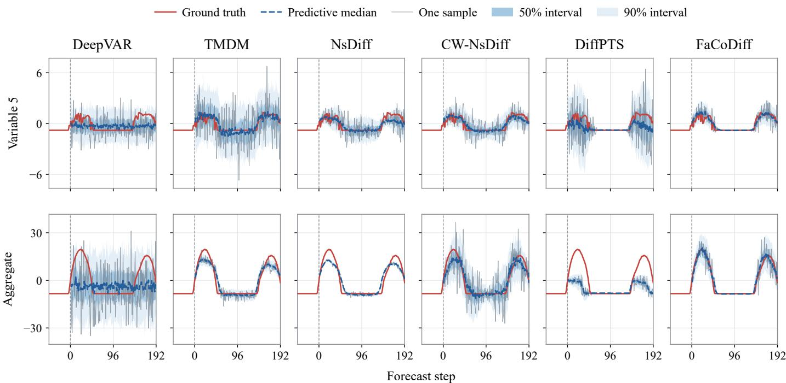  
Figure 2: A Solar forecasting example. Top: a single variable; bottom: the normalized aggregate $\begin{array} { r } { 1 3 7 ^ { - 1 / 2 } \sum _ { j = 1 } ^ { 1 3 7 } Y _ { j } } \end{array}$ of training-standardized variables. Red: observations; dashed blue: predictive median; gray: one generated trajectory. Shading indicates pointwise 50% and 90% prediction intervals.

Component ablations on Solar and Weather. Each cell gives the mean above its standard deviation over three runs. Agg. CRPS scores the standardized linear aggregate in Eq. (30). D: Diagonal; F: Factor-only; L: Location; S: Scale. Full includes F, L and S. Lower is better; red marks the best mean.
<table><tr><td>Dataset</td><td>Variant</td><td>CRPS</td><td>QICE</td><td>Energy</td><td>Variogram</td><td>MAE</td><td>MSE</td><td>Agg. CRPS</td></tr><tr><td>Solar</td><td></td><td>0.19818</td><td>0.06004</td><td>2.70474</td><td>0.06981</td><td>0.27293</td><td>0.25247</td><td>0.22245</td></tr><tr><td></td><td>D</td><td>±0.00436 0.19427</td><td>±0.01745 0.06009</td><td>±0.04872 2.64126</td><td>±0.00145 0.06432</td><td>±0.00524 0.26827</td><td>±0.00447 0.24879</td><td>±0.00511 0.22031</td></tr><tr><td></td><td>D+L</td><td>±0.00692</td><td>±0.00746</td><td>±0.07711</td><td>±0.00132</td><td>±0.00790</td><td>±0.01040</td><td>±0.00929</td></tr><tr><td></td><td>D+S</td><td>0.20005 ±0.00578</td><td>0.06772</td><td>2.72537</td><td>0.06914</td><td>0.27576</td><td>0.25319</td><td>0.22502</td></tr><tr><td></td><td></td><td>0.19065</td><td>±0.02341 0.06190</td><td>±0.06504 2.59665</td><td>±0.00216</td><td>±0.00692</td><td>±0.00722</td><td>±0.00780 0.21723</td></tr><tr><td></td><td>D+L+S</td><td>±0.00770</td><td>±0.00931</td><td></td><td>0.06423</td><td>0.26465</td><td>0.23911</td><td></td></tr><tr><td></td><td></td><td></td><td></td><td>±0.09022</td><td>±0.00355</td><td>±0.00951</td><td>±0.00918</td><td>±0.01023</td></tr><tr><td></td><td></td><td>0.19272</td><td>0.04439</td><td>2.61648</td><td>0.06889</td><td>0.26835</td><td>0.25058</td><td>0.17764</td></tr><tr><td></td><td>F</td><td>±0.00172</td><td>±0.00559</td><td>±0.01726</td><td>±0.00700</td><td>±0.00331</td><td>±0.00128</td><td>±0.01460</td></tr><tr><td></td><td></td><td>0.18783</td><td>0.05028</td><td>2.50693</td><td>0.06117</td><td>0.26429</td><td>0.23209</td><td>0.17177</td></tr><tr><td></td><td>F+L</td><td>±0.00733</td><td>±0.03005</td><td>±0.08645</td><td>±0.00967</td><td>±0.00590</td><td>±0.00582</td><td>±0.01264</td></tr><tr><td></td><td></td><td>0.19213</td><td>0.04715</td><td>2.60817</td><td>0.06830</td><td>0.26802</td><td>0.24766</td><td>0.17680</td></tr><tr><td></td><td>F+S</td><td>±0.00254</td><td>±0.00297</td><td>±0.02247</td><td>±0.00601</td><td>±0.00274</td><td>±0.00626</td><td>±0.01605</td></tr><tr><td></td><td></td><td>0.18506</td><td>0.05868</td><td>2.47311</td><td>0.05575</td><td>0.25740</td><td>0.23088</td><td>0.16908</td></tr><tr><td></td><td>Full</td><td>±0.01290</td><td>±0.01903</td><td>±0.15687</td><td></td><td></td><td></td><td>±0.01938</td></tr><tr><td></td><td></td><td></td><td></td><td></td><td>±0.00157</td><td>±0.01184</td><td>±0.01935</td><td></td></tr><tr><td>Weather</td><td></td><td>0.22212</td><td>0.03779</td><td>1.51724</td><td>0.08634</td><td>0.28398</td><td>0.24954</td><td>0.20887</td></tr><tr><td></td><td>D</td><td>±0.00865</td><td>±0.01321</td><td>±0.04848</td><td>±0.00232</td><td>±0.00730</td><td>±0.00829</td><td>±0.00488</td></tr><tr><td></td><td></td><td>0.22251</td><td>0.03967</td><td>1.51923</td><td>0.08629</td><td>0.28281</td><td>0.24663</td><td>0.20778</td></tr><tr><td></td><td>D+L</td><td>±0.01413</td><td>±0.01770</td><td>±0.07893</td><td>±0.00416</td><td>±0.01060</td><td>±0.01286</td><td>±0.01077</td></tr><tr><td></td><td></td><td></td><td>0.03822</td><td></td><td></td><td></td><td></td><td></td></tr><tr><td></td><td></td><td>0.22117</td><td></td><td>1.51038</td><td>0.08572</td><td>0.28274</td><td>0.24667</td><td>0.20872</td></tr><tr><td></td><td>D+S</td><td>±0.00669</td><td>±0.01406</td><td>±0.03604</td><td>±0.00175</td><td>±0.00646</td><td>±0.00603</td><td>±0.00464</td></tr><tr><td></td><td></td><td>0.22455</td><td>0.04066</td><td>1.53097</td><td>0.08670</td><td>0.28614</td><td>0.25025</td><td>0.21168</td></tr><tr><td></td><td>D+L+S</td><td>±0.01454</td><td>±0.01860</td><td>±0.08361</td><td>±0.00405</td><td>±0.00981</td><td>±0.01380</td><td>±0.01027</td></tr><tr><td></td><td></td><td>0.21997</td><td>0.03586</td><td>1.51463</td><td>0.08526</td><td>0.28391</td><td>0.25294</td><td>0.20401</td></tr><tr><td></td><td>F</td><td>±0.00806</td><td>±0.00653</td><td>±0.04141</td><td>±0.00310</td><td>±0.00591</td><td>±0.00829</td><td>±0.00324</td></tr><tr><td></td><td></td><td>0.21851</td><td>0.03330</td><td>1.49914</td><td>0.08473</td><td>0.28297</td><td>0.25008</td><td>0.20077</td></tr><tr><td></td><td>F+L</td><td>±0.01007</td><td>±0.01278</td><td>±0.05043</td><td>±0.00357</td><td>±0.00402</td><td>±0.00654</td><td>±0.01084</td></tr><tr><td></td><td></td><td>0.21835</td><td>0.03757</td><td>1.49580</td><td>0.08394</td><td>0.28008</td><td>0.24566</td><td>0.20186</td></tr><tr><td></td><td>F+S</td><td></td><td></td><td>±0.03482</td><td>±0.00243</td><td>±0.00232</td><td>±0.00480</td><td>±0.00417</td></tr><tr><td></td><td></td><td>±0.00710</td><td>±0.01101</td><td></td><td></td><td></td><td></td><td></td></tr><tr><td></td><td>Full</td><td>0.21513 ±0.00480</td><td>0.03108 ±0.00685</td><td>1.48730 ±0.02395</td><td>0.08364 ±0.00190</td><td>0.28153 ±0.00381</td><td>0.24823 ±0.00495</td><td>0.19700 ±0.00349</td></tr></table>

Denoising ablations on Solar and Weather. G: geometry conditioning; T: mixed denoising objective in Eq. (19). Results are mean ± standard deviation over three runs. Lower is better; red marks the lowest mean.
<table><tr><td>Dataset</td><td>G</td><td>T</td><td>CRPS</td><td>QICE</td><td>Energy</td><td>Variogram</td><td>MAE</td><td>MSE</td></tr><tr><td>Solar</td><td>1</td><td></td><td> $0 . 1 9 0 8 3 \pm 0 . 0 0 6 7 0$ </td><td> $0 . 0 7 1 8 0 \pm 0 . 0 1 2 4 7$ </td><td> $2 . 5 3 5 0 0 \pm 0 . 0 7 3 6 7$ </td><td> $\mathbf { 0 . 0 5 2 5 2 } \pm 0 . 0 0 0 6 1$ </td><td> $0 . 2 6 2 8 9 \pm 0 . 0 1 0 3 4$ </td><td> $0 . 2 2 9 3 0 \pm 0 . 0 0 8 3 0$ </td></tr><tr><td></td><td> $\checkmark$ </td><td></td><td> $0 . 1 8 9 2 3 \pm 0 . 0 0 6 6 6$ </td><td> $0 . 0 6 7 2 2 \pm 0 . 0 1 5 4 6$ </td><td> $2 . 5 1 7 2 2 \pm 0 . 0 7 0 2 2$ </td><td> $0 . 0 5 4 4 8 \pm 0 . 0 0 2 6 5$ </td><td> $0 . 2 6 4 0 7 \pm 0 . 0 0 7 2 7$ </td><td> $0 . 2 2 5 2 9 \pm 0 . 0 0 9 8 2$ </td></tr><tr><td></td><td> $-$ </td><td></td><td> $0 . 1 9 1 2 5 \pm 0 . 0 0 9 9 0$ </td><td> $0 . 0 5 9 4 2 \pm 0 . 0 3 4 0 1$ </td><td> $2 . 5 4 8 8 3 \pm 0 . 1 2 0 6 0$ </td><td> $0 . 0 5 9 7 4 \pm 0 . 0 0 7 9 4$ </td><td> $0 . 2 6 5 5 1 \pm 0 . 0 1 1 6 4$ </td><td> $0 . 2 3 4 0 0 \pm 0 . 0 2 1 3 7$ </td></tr><tr><td></td><td> $\checkmark$ </td><td>--V√</td><td> $\mathbf { 0 . 1 8 5 0 6 \pm 0 . 0 1 2 9 0 }$ </td><td> $\mathbf { 0 . 0 5 8 6 8 \pm 0 . 0 1 9 0 3 }$ </td><td> $2 . 4 7 3 1 1 \pm 0 . 1 5 6 8 7$ </td><td> $0 . 0 5 5 7 5 \pm 0 . 0 0 1 5 7$ </td><td> $\mathbf { 0 . 2 5 7 4 0 \pm 0 . 0 1 1 8 4 }$ </td><td> $0 . 2 3 0 8 8 \pm 0 . 0 1 9 3 5$ </td></tr><tr><td>Weather</td><td>1</td><td></td><td> $0 . 2 2 1 8 7 \pm 0 . 0 0 4 2 9$ </td><td> $0 . 0 4 2 2 2 \pm 0 . 0 0 4 5 9$ </td><td> $1 . 5 1 6 4 2 \pm 0 . 0 1 4 5 7$ </td><td> $0 . 0 8 5 0 9 \pm 0 . 0 0 1 6 0$ </td><td> $0 . 2 8 1 2 6 \pm 0 . 0 0 8 0 2$ </td><td> $0 . 2 4 9 9 0 \pm 0 . 0 0 6 3 6$ </td></tr><tr><td></td><td> $\checkmark$ </td><td>-1</td><td> $0 . 2 2 5 6 7 \pm 0 . 0 0 8 6 1$ </td><td> $0 . 0 4 5 9 8 \pm 0 . 0 0 3 7 5$ </td><td> $1 . 5 4 1 8 9 \pm 0 . 0 4 0 1 7$ </td><td> $0 . 0 8 5 8 6 \pm 0 . 0 0 3 5 4$ </td><td> $0 . 2 8 3 7 7 \pm 0 . 0 1 1 6 2$ </td><td> $0 . 2 5 4 3 4 \pm 0 . 0 1 5 3 5$ </td></tr><tr><td></td><td></td><td></td><td> $0 . 2 2 0 7 5 \pm 0 . 0 0 4 0 2$ </td><td> $0 . 0 4 1 4 2 \pm 0 . 0 0 5 3 9$ </td><td> $1 . 5 1 5 2 1 \pm 0 . 0 2 1 6 4$ </td><td> $0 . 0 8 5 2 8 \pm 0 . 0 0 1 4 8$ </td><td> $\mathbf { 0 . 2 8 0 2 6 \pm 0 . 0 0 7 3 9 }$ </td><td> $0 . 2 4 8 7 3 \pm 0 . 0 0 8 2 5$ </td></tr><tr><td></td><td>-√</td><td>√√</td><td> $\mathbf { 0 . 2 1 5 1 3 \pm 0 . 0 0 4 8 0 }$ </td><td> $\mathbf { 0 . 0 3 1 0 8 \pm 0 . 0 0 6 8 5 }$ </td><td> $1 . 4 8 7 3 0 \pm 0 . 0 2 3 9 5$ </td><td> $\mathbf { 0 . 0 8 3 6 4 } \pm 0 . 0 0 1 9 0$ </td><td> $0 . 2 8 1 5 3 \pm 0 . 0 0 3 8 1$ </td><td> $0 . 2 4 8 2 3 \pm 0 . 0 0 4 9 5$ </td></tr></table>

Independently trained Gaussian and difusion forecasts on Solar and Weather. Results are mean ± standard deviation over three runs. Lower is better; red marks the better mean.
<table><tr><td>Dataset</td><td>Variant</td><td>CRPS</td><td>QICE</td><td>Energy</td><td>Variogram</td><td>MAE</td><td>MSE</td></tr><tr><td>Solar</td><td>Gaussian</td><td> $0 . 1 9 1 5 9 \pm 0 . 0 1 2 7 1$ </td><td> $0 . 0 6 1 8 9 \pm 0 . 0 2 1 0 7$ </td><td> $2 . 5 4 4 3 0 \pm 0 . 1 5 3 9 8$ </td><td> $\mathbf { 0 . 0 5 3 8 5 \pm 0 . 0 0 2 8 0 }$ </td><td> $0 . 2 6 5 7 1 \pm 0 . 0 1 5 7 9$ </td><td> $0 . 2 3 1 7 0 \pm 0 . 0 2 1 1 4$ </td></tr><tr><td></td><td>FaCoDiff</td><td> $\mathbf { 0 . 1 8 5 0 6 \pm 0 . 0 1 2 9 0 }$ </td><td> $\mathbf { 0 . 0 5 8 6 8 \pm 0 . 0 1 9 0 3 }$ </td><td> $2 . 4 7 3 1 1 \pm 0 . 1 5 6 8 7$ </td><td> $0 . 0 5 5 7 5 \pm 0 . 0 0 1 5 7$ </td><td> $\mathbf { 0 . 2 5 7 4 0 \pm 0 . 0 1 1 8 4 }$ </td><td> $\mathbf { 0 . 2 3 0 8 8 \pm 0 . 0 1 9 3 5 }$ </td></tr><tr><td>Weather</td><td>Gaussian</td><td> $0 . 2 4 4 2 2 \pm 0 . 0 0 4 4 5$ </td><td> $0 . 0 4 0 5 4 \pm 0 . 0 0 3 4 6$ </td><td> $1 . 5 2 2 4 4 \pm 0 . 0 2 2 1 1$ </td><td> $0 . 0 9 3 0 1 \pm 0 . 0 0 1 9 7$ </td><td> $0 . 2 9 4 6 7 \pm 0 . 0 0 6 8 5$ </td><td> $0 . 2 6 1 8 0 \pm 0 . 0 0 7 6 9$ </td></tr><tr><td></td><td>FaCoDiff</td><td> $\mathbf { 0 . 2 1 5 1 3 \pm 0 . 0 0 4 8 0 }$ </td><td> $\mathbf { 0 . 0 3 1 0 8 \pm 0 . 0 0 6 8 5 }$ </td><td> $1 . 4 8 7 3 0 \pm 0 . 0 2 3 9 5$ </td><td> $\mathbf { 0 . 0 8 3 6 4 } \pm 0 . 0 0 1 9 0$ </td><td> $\mathbf { 0 . 2 8 1 5 3 \pm 0 . 0 0 3 8 1 }$ </td><td> $0 . 2 4 8 2 3 \pm 0 . 0 0 4 9 5$ </td></tr></table>

Comparison with direct Gaussian forecasts We independently train a conditional Gaussian predictor with the same center, variance, factor and correction architecture, but without the denoising loss or reverse difusion chain. It uses the same maximum stage budgets and patience, and selects post-pretraining checkpoints by validation CRPS. Table 5 compares this predictor with the primary FaCoDif benchmarks on Solar and Weather. FaCoDif has lower means on five of six metrics on Solar and all six on Weather. CRPS and Energy decrease by 3.41% and 2.80% on Solar and by 11.91% and 2.31% on Weather. Weather Variogram also decreases by 10.08%, while the direct Gaussian predictor retains the lower Variogram on Solar.

## 4.7. Synthetic experiments

We next test whether conditional factors benefit joint forecasts when the true dependence is controlled while the generating marginal means and variances remain fixed. We generate noisy sinusoidal histories with an observable binary state �(�) and 32-dimensional futures of length 24 from histories of length 48. At prediction step ℎ, the data follow

$$
\begin{array} { r l } & { { \boldsymbol { y } } _ { h } = { \boldsymbol { \mu } } _ { h } ^ { \star } ( { \boldsymbol { X } } ) + \sqrt { v _ { h } ^ { \star } } \left[ \sqrt { 1 - \rho _ { c } } \epsilon _ { h } + \sqrt { \rho _ { c } } B _ { c } z _ { h } \right] , } \\ & { \epsilon _ { h } \sim \mathcal { N } ( 0 , I _ { 3 2 } ) , \qquad z _ { h } \sim \mathcal { N } ( 0 , I _ { 4 } ) , } \end{array}\tag{31}
$$

with independent Gaussian draws. Each row of $B _ { c } ~ \in  { \mathbb { R } } ^ { 3 2 \times 4 }$ has unit norm, so the conditional marginal variance is $v _ { h } ^ { \star }$ for every variable. We set $\mu _ { h } ^ { \star } ( X ) = e ^ { - h / 2 4 } X _ { N }$ and $v _ { h } ^ { \star } = 0 . 6 + 0 . 2 \sin ^ { 2 } ( 2 \pi h / 2 4 )$ . The three scenarios are Independent $( \rho _ { c } ~ = ~ 0 )$ , Fixed global (a common $B _ { 0 } ) ,$ , and State-switching (two distinct rank-four loadings $B _ { 0 } , B _ { 1 } )$ . In the correlated scenarios, $\rho _ { 0 } = 0 . 2 5$ and $\rho _ { 1 } = 0 . 6 0$ . Thus Fixed global fixes the loading basis, while its dependence strength still varies with state. To construct the histories, let � be the order-32 Hadamard matrix and $\tau _ { n } = ( n - 1 ) / 4 8$

We generate

$$
\begin{array} { c } { { X _ { n j } = \displaystyle \frac { 1 } { \sqrt { 8 } } \sum _ { k = 1 } ^ { 8 } M _ { j , k + 1 } \sin ( 2 \pi k \tau _ { n } ) } } \\ { { + 0 . 8 q \cos ( 2 2 \pi \tau _ { n } ) + 0 . 1 5 \xi _ { n j } , } } \end{array}
$$

where $q ~ \in ~ \{ - 1 , 1 \}$ is equiprobable and $\xi _ { n j }$ is independent standard Gaussian noise. The state �(�) is one when $\begin{array} { r } { \dot { \sum _ { n } } ( d ^ { - 1 } \sum _ { j } X _ { n j } ) \cos ( 2 2 \pi \tau _ { n } ) > } \end{array}$ $0 ,$ and zero otherwise. The bases $B _ { 0 }$ and $B _ { 1 }$ contain columns 2–5 and 6–9 of $M ,$ respectively, rescaled by $1 / 2$ . The histories and generating marginal moments are matched across scenarios; state labels and true factors are not supplied to the learned models.

Each seed provides 768 independent episodes, split into 537 training, 78 validation, and 153 test episodes. Standardization uses training episodes only, separately within each scenario, and all variants use the same data. For each scenario and seed, the three variants share a pretrained base checkpoint and retain Location/Scale. Diagonal+L+S disables factor covariance; Global factor learns a history-invariant shared basis with conditional coeficients and strengths; Conditional factor uses the history-dependent basis of FaCoDif. All variants use capacity eight, fixed 20/10/20-epoch base/Factor/joint budgets, validation-CRPS checkpoint selection, and 100 samples per test episode. The global variant adds 256 basis parameters; capacity eight can span both true rank-four subspaces. Each variant learns its own means and scales during training.

Table 6 reports all three scenarios and the six forecasting metrics. We additionally apply empirical CRPS to the normalized sum $\begin{array} { r l } { a _ { h } } & { { } = } \end{array}$ $d ^ { - 1 / 2 } \sum _ { j } y _ { h j }$ of training-standardized variables, denoting this auxiliary score by $\mathrm { C R P S _ { a g g } . }$

Joint and aggregate prediction Conditional factors improve both jointscore means and $\mathrm { C R P S _ { a g g } }$ in the two correlated scenarios. Relative to Diagonal+L+S, they reduce Energy, Variogram and $\mathrm { C R P S _ { a g g } }$ by 0.11%, 0.87% and 1.52% with a fixed global basis, and by 0.25%, 1.26% and 2.65% under state switching. In the latter setting, aggregate CRPS is also 4.81% below the Global factor control, and both Variogram and aggregate CRPS improve over both controls in all three runs. Alongside these joint and aggregate gains, marginal CRPS, MAE and MSE remain within 0.27% of the diagonal control, with slightly higher means, while QICE decreases from 0.00536 to 0.00256. Under independent noise, the conditional and diagonal models are nearly indistinguishable in the joint scores, and aggregate CRPS difers by 0.10%. The contrast links the additional benefit to shared uncertainty.

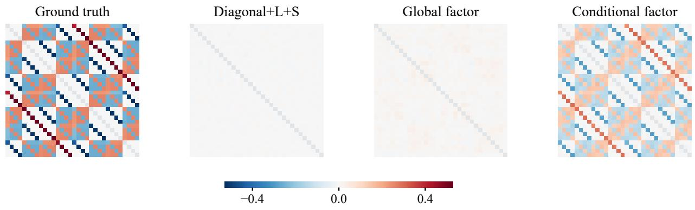  
Figure 3: True and generated forecast covariances in the stronger-dependence state of the state-switching scenario. Forecast matrices are averaged over three runs; all panels share a color scale, with gray diagonals.

Synthetic forecasting under three dependence scenarios. Mean ± standard deviation over three runs; red marks the lowest mean. $\mathrm { C R P S _ { a g g } }$ scores the normalized sum of trainingstandardized variables defined in the text. Lower is better.
<table><tr><td>Metric</td><td>Diagonal +L + S</td><td>Global factor</td><td>Conditional factor</td></tr><tr><td colspan="4">Independent</td></tr><tr><td>CRPS</td><td> $0 . 5 2 6 7 1 \pm 0 . 0 0 0 0 9$ </td><td> $0 . 5 2 8 2 9 \pm 0 . 0 0 0 0 7$ </td><td> $\mathbf { 0 . 5 2 6 6 6 } \pm 0 . 0 0 0 6 0$ </td></tr><tr><td>QICE</td><td> $\mathbf { 0 . 0 0 5 5 8 \pm 0 . 0 0 0 5 5 }$ </td><td> $0 . 0 0 6 1 4 \pm 0 . 0 0 0 4 8$ </td><td> $0 . 0 0 5 5 9 \pm 0 . 0 0 0 5 2$ </td></tr><tr><td>Energy</td><td> $3 . 7 0 5 2 9 \pm 0 . 0 0 0 6 3$ </td><td> $3 . 7 1 6 8 5 \pm 0 . 0 0 0 3 5$ </td><td> $3 . 7 0 4 9 8 \pm 0 . 0 0 3 8 7$ </td></tr><tr><td>Variogram</td><td> $0 . 1 6 8 2 3 \pm 0 . 0 0 0 2 6$ </td><td> $0 . 1 6 8 5 3 \pm 0 . 0 0 0 2 2$ </td><td> $\mathbf { 0 . 1 6 8 2 3 \pm 0 . 0 0 0 } 2 3$ </td></tr><tr><td>MAE</td><td> $0 . 7 3 9 6 4 \pm 0 . 0 0 0 7 8$ </td><td> $0 . 7 4 1 6 9 \pm 0 . 0 0 0 7 9$ </td><td> $\mathbf { 0 . 7 3 9 5 8 \pm 0 . 0 0 1 } 3 8$ </td></tr><tr><td>MSE</td><td> $0 . 8 6 1 8 5 \pm 0 . 0 0 0 5 3$ </td><td> $0 . 8 6 6 8 0 \pm 0 . 0 0 0 2 0$ </td><td> $\mathbf { 0 . 8 6 1 7 1 \pm 0 . 0 0 2 2 2 }$ </td></tr><tr><td> $\mathrm { C R P S _ { a g g } }$ </td><td> $\mathbf { 0 . 5 3 5 6 6 \pm 0 . 0 1 3 0 2 }$ </td><td> $0 . 5 3 5 7 8 \pm 0 . 0 1 1 6 6$ </td><td> $0 . 5 3 6 1 9 \pm 0 . 0 1 3 0 8$ </td></tr><tr><td colspan="4">Fixed global</td></tr><tr><td>CRPS</td><td> $\mathbf { 0 . 5 2 7 9 6 \pm 0 . 0 0 0 7 8 }$ </td><td> $0 . 5 2 8 6 1 \pm 0 . 0 0 0 2 1$ </td><td> $0 . 5 2 8 3 2 \pm 0 . 0 0 0 4 3$ </td></tr><tr><td>QICE</td><td> $0 . 0 0 5 6 6 \pm 0 . 0 0 0 3 5$ </td><td> $0 . 0 0 5 7 6 \pm 0 . 0 0 0 9 8$ </td><td> $\mathbf { 0 . 0 0 3 3 3 \pm 0 . 0 0 2 6 5 }$ </td></tr><tr><td>Energy</td><td> $3 . 6 9 7 6 7 \pm 0 . 0 0 7 1 2$ </td><td> $3 . 7 0 1 9 3 \pm 0 . 0 0 2 2 3$ </td><td> $3 . 6 9 3 5 8 \pm 0 . 0 0 9 2 5$ </td></tr><tr><td>Variogram</td><td> $0 . 1 7 2 0 1 \pm 0 . 0 0 0 3 8$ </td><td> $0 . 1 7 1 8 4 \pm 0 . 0 0 0 2 4$ </td><td> $\mathbf { 0 . 1 7 0 5 1 } \pm 0 . 0 0 1 2 6$ </td></tr><tr><td>MAE</td><td> $\mathbf { 0 . 7 4 1 1 6 \pm 0 . 0 0 0 7 3 }$ </td><td> $0 . 7 4 2 0 8 \pm 0 . 0 0 0 2 2$ </td><td> $0 . 7 4 2 1 3 \pm 0 . 0 0 0 2 7$ </td></tr><tr><td>MSE</td><td> $\mathbf { 0 . 8 6 6 0 7 \pm 0 . 0 0 3 2 4 }$ </td><td> $0 . 8 6 8 1 6 \pm 0 . 0 0 1 7 6$ </td><td> $0 . 8 6 8 1 2 \pm 0 . 0 0 1 0 3$ </td></tr><tr><td> $\mathrm { C R P S _ { a g g } }$ </td><td> $0 . 4 1 7 1 0 \pm 0 . 0 0 4 9 5$ </td><td> $0 . 4 2 6 6 2 \pm 0 . 0 0 4 3 7$ </td><td> $\mathbf { 0 . 4 1 0 7 6 \pm 0 . 0 1 0 4 5 }$ </td></tr><tr><td colspan="4">State-switching</td></tr><tr><td>CRPS</td><td> $\mathbf { 0 . 5 2 8 4 7 \pm 0 . 0 0 1 6 3 }$ </td><td> $0 . 5 2 9 3 6 \pm 0 . 0 0 1 0 1$ </td><td> $0 . 5 2 8 8 4 \pm 0 . 0 0 0 8 3$ </td></tr><tr><td>QICE</td><td> $0 . 0 0 5 3 6 \pm 0 . 0 0 0 2 2$ </td><td> $0 . 0 0 5 6 0 \pm 0 . 0 0 0 6 5$ </td><td> $\mathbf { 0 . 0 0 2 5 6 \pm 0 . 0 0 1 0 6 }$ </td></tr><tr><td>Energy</td><td> $3 . 7 0 0 9 4 \pm 0 . 0 1 2 7 4$ </td><td> $3 . 7 0 7 1 9 \pm 0 . 0 0 8 9 6$ </td><td> $3 . 6 9 1 6 3 \pm 0 . 0 0 2 8 5$ </td></tr><tr><td>Variogram</td><td> $0 . 1 7 1 4 8 \pm 0 . 0 0 0 7 2$ </td><td> $0 . 1 7 1 4 3 \pm 0 . 0 0 0 7 5$ </td><td> $\mathbf { 0 . 1 6 9 3 2 \pm 0 . 0 0 1 1 8 }$ </td></tr><tr><td>MAE</td><td> $\mathbf { 0 . 7 4 1 9 1 } \pm 0 . 0 0 1 9 2$ </td><td> $0 . 7 4 3 2 2 \pm 0 . 0 0 0 8 1$ </td><td> $0 . 7 4 3 1 2 \pm 0 . 0 0 0 7 4$ </td></tr><tr><td>MSE</td><td> $\mathbf { 0 . 8 6 7 8 1 \pm 0 . 0 0 5 5 3 }$ </td><td> $0 . 8 7 0 5 7 \pm 0 . 0 0 3 6 1$ </td><td> $0 . 8 7 0 1 2 \pm 0 . 0 0 3 3 3$ </td></tr><tr><td> $\mathrm { C R P S _ { a g g } }$ </td><td> $0 . 4 1 7 3 3 \pm 0 . 0 0 4 4 9$ </td><td> $0 . 4 2 6 8 2 \pm 0 . 0 1 3 8 4$ </td><td> $\mathbf { 0 . 4 0 6 2 9 \pm 0 . 0 1 2 5 0 }$ </td></tr></table>

Of-diagonal covariance RMSE of final generated forecasts, averaged over both states within each run. Mean ± standard deviation over three runs; red marks the lowest mean. Lower is better.
<table><tr><td>Scenario</td><td>Diagonal + L + S</td><td>Global factor</td><td>Conditional factor</td></tr><tr><td>Independent</td><td> $\mathbf { 0 . 0 0 7 3 8 \pm 0 . 0 0 0 0 6 }$ </td><td> $0 . 0 0 7 8 2 \pm 0 . 0 0 0 0 8$ </td><td> $0 . 0 0 7 5 6 \pm 0 . 0 0 0 0 9$ </td></tr><tr><td>Fixed global</td><td> $0 . 1 7 0 3 6 \pm 0 . 0 0 0 5 1$ </td><td> $0 . 1 6 7 7 0 \pm 0 . 0 0 3 9 7$ </td><td> $\mathbf { 0 . 1 4 8 8 8 \pm 0 . 0 1 7 1 7 }$ </td></tr><tr><td>State-switching</td><td> $0 . 1 7 0 3 4 \pm 0 . 0 0 0 4 5$ </td><td> $0 . 1 6 8 9 4 \pm 0 . 0 0 2 3 5$ </td><td> $\mathbf { 0 . 1 0 4 7 1 \pm 0 . 0 5 0 0 2 }$ </td></tr></table>

Covariance in the generated forecasts Figure 3 and Table 7 examine dependence in the final difusion forecasts. We use the first eight test episodes in each state and estimate covariance across 100 generated samples separately at each episode and horizon, then average over horizons and episodes. This within-forecast centering excludes variation in conditional means. The figure shows the three-run mean matrices for the stronger-dependence state of the state-switching scenario. The table reports of-diagonal RMSE averaged across states within each run, followed by the mean and standard deviation across three runs. In the state-switching scenario, the resulting error is 0.10471 for Conditional factor, versus 0.17034 for Diagonal+L+S and 0.16894 for Global factor, a 38.5% reduction relative to the diagonal control. Recovery strength varies across runs, but the lower mean error accompanies better joint and aggregate scores. Thus the learned structure is reflected in the final forecast ensemble, beyond the auxiliary Gaussian fit.

## 4.8. Sensitivity to factor capacity

We test how much factor capacity is needed by separately training $r \in \{ 1 , 2 , 4 , 8 , 1 6 \}$ on Solar and Weather. Each capacity uses seeds 1/2/3, the same base within each seed, and matched continuation budgets. Capacity changes both covariance and correction heads; it is a sensitivity study of the complete factor estimator.

Figure 4 shows that compact factor spaces capture most of the gains available in this sweep. On Solar, increasing capacity from one to eight reduces Energy and Variogram by 5.17% and 14.91%, respectively. Doubling capacity from eight to sixteen yields a further 0.05% and 1.09% reduction in these scores. On Weather, capacities two and eight achieve the lowest Energy and Variogram means, respectively; increasing capacity to sixteen yields higher means on both scores. These results support eight as an efective common setting.

## 4.9. Efect of cross-variable dependence

To assess the predictive value of cross-variable pairing, we independently permute sample indices for each variable at each test origin, holding each variable’s permutation fixed over the forecast horizon. This changes how variable-specific sample trajectories are paired while preserving every sampled univariate trajectory and marginal sample set.

Permutation worsens Full’s Energy, Variogram and aggregate CRPS on both datasets (Figure 5). On Solar, Variogram and aggregate CRPS increase by 22.11% and 24.06%, respectively; on Weather, the corresponding increases are 2.97% and 4.25%, averaging the three perrun relative changes. The mean increases for F and Full exceed those for D on all three scores in both datasets, linking the efect to factor modeling. Since the marginal forecasts are unchanged, this deterioration shows that cross-variable pairing itself has predictive value for joint and aggregate forecasts, complementing the matched covariance controls in Table 3.

## 4.10. Inference eficiency

On NVIDIA RTX4090 GPUs, we generate 100 samples at eight fixed, evenly spaced complete test origins. After two warmup calls, five CUDAsynchronized repeats measure the predictors, corrections, covariance preparation, reverse loop and output transfer, excluding model loading and metric computation. Table 8 reports mean time and sample standard deviation per origin over the five repeats, and peak allocated CUDA memory. CW-NsDif uses its high-dimensional accelerated implementation. The diagonal cost control retains the predictors, correction architecture and factor computation but disables factor covariance during inference.

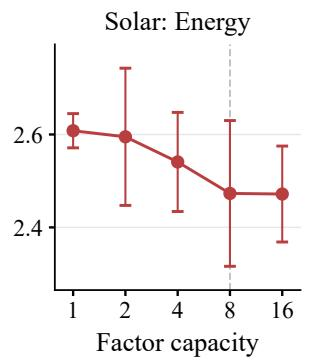

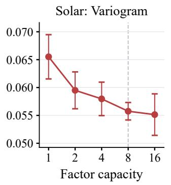

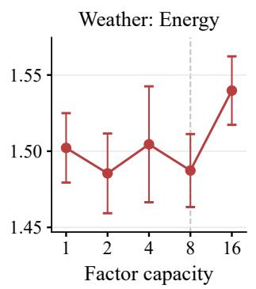

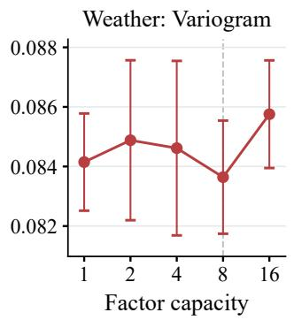

Figure 4: Factor-capacity sensitivity on Solar and Weather. Points and error bars show three-run means and standard deviations; dashed lines mark the default capacity eight. Lower is better.  
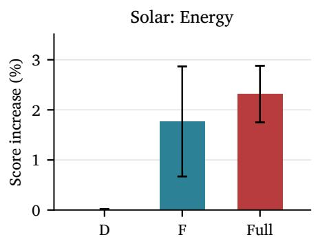

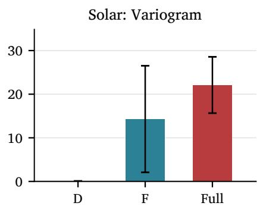

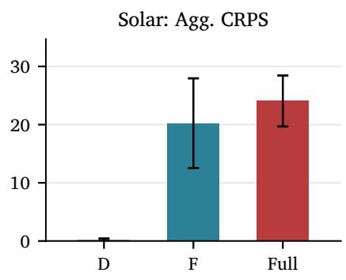

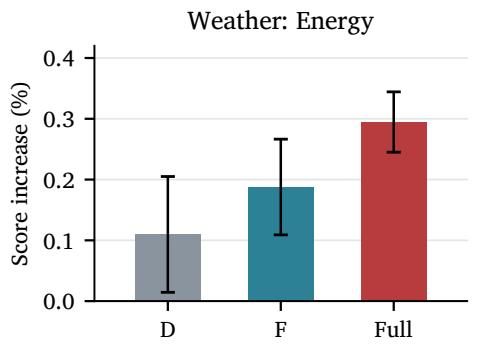

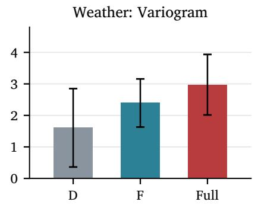

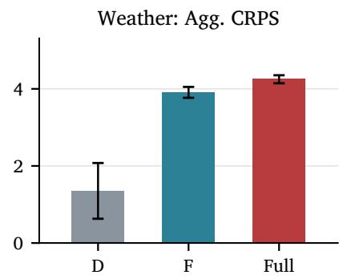  
Figure 5: Cross-variable sample-pairing permutation preserving univariate trajectories on Solar and Weather. Bars and error bars show three-run means and standard deviations of relative score increases; positive values indicate degradation. All panels compare D, F and Full; aggregate CRPS uses Eq. (30). D, F and Full follow Table 3.

Generation time and memory FaCoDif generates 100 samples per origin in 0.2314, 0.2423 and 0.2353 s on Solar, ECL and Taxi, respectively, with lower mean times than both reported baseline implementations. Its peak allocated memory is 141.3, 225.6 and 163.9 MiB. Relative to the matched diagonal inference-cost control, the additional allocation is below 1 MiB in all three settings, and mean generation times difer by at most 3.5%. Thus correlated generation remains close in cost to the same conditional architecture with diagonal noise. These are fullgeneration implementation costs; covariance-operation complexity is analyzed separately in Section 3.6.

Scaling with dimension We measure generation cost at � ∈ {32, 64, 128, 256, 512, 862, 1000} using common synthetic inputs and randomly initialized models. History and forecast lengths are fixed at

168 and 192, with 20 difusion steps, 100 samples in chunks of ten, and factor capacity eight. We use the same GPU model and timing protocol as above, keeping CW-NsDif’s accelerated implementation fixed across dimensions. The diagonal control retains the correction architecture and factor computation but disables factor covariance during generation.

Figure 6 shows that FaCoDif remains close to its diagonal control as dimension increases, while CW-NsDif’s memory allocation grows much more rapidly. At $\begin{array} { r } { d \ = \ 1 0 0 0 . } \end{array}$ , FaCoDif requires 535.2 MiB and 0.3366 s per origin, compared with 15,168.5 MiB and 0.5363 s for CW-NsDif: the dense implementation allocates 28.3 times as much memory. This controlled profile demonstrates the practical memory advantage of structured generation at larger dimensions.

Table 8  
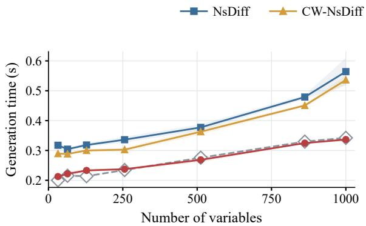

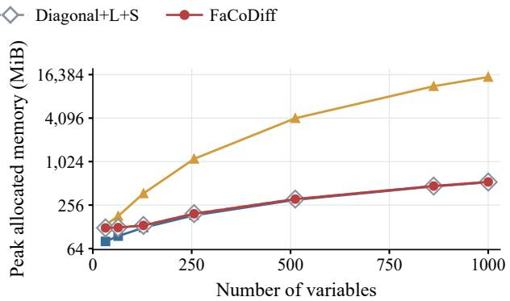  
Figure 6: Controlled architecture-cost scaling with randomly initialized models. Left: generation time for 100 samples per origin; bands show standard deviations over five repeats. Right: peak allocated CUDA memory on a logarithmic axis.

Generation time and peak allocated CUDA memory on RTX4090 GPUs. Time is mean ± standard deviation over five repeats, per origin for 100 samples.
<table><tr><td>Dataset</td><td>Model</td><td>Time (s)</td><td>MiB</td></tr><tr><td>Solar</td><td>NsDiff</td><td> $0 . 3 0 8 0 \pm 0 . 0 0 2 2$ </td><td>132.5</td></tr><tr><td></td><td>CW-NsDiff</td><td> $0 . 2 9 2 0 \pm 0 . 0 0 1 6$ </td><td>241.6</td></tr><tr><td></td><td>Diagonal  $+ \mathbf { L } + \mathbf { S }$ </td><td> $0 . 2 3 2 8 \pm 0 . 0 0 7 9$ </td><td>141.2</td></tr><tr><td></td><td>FaCoDiff</td><td> $0 . 2 3 1 4 \pm 0 . 0 0 4 4$ </td><td>141.3</td></tr><tr><td>ECL</td><td>NsDiff</td><td> $0 . 3 3 0 9 \pm 0 . 0 0 7 6$ </td><td>214.4</td></tr><tr><td></td><td>CW-NsDiff</td><td> $0 . 3 0 9 1 \pm 0 . 0 0 4 6$ </td><td>1679.3</td></tr><tr><td></td><td>Diagonal + L + S</td><td> $0 . 2 5 1 1 \pm 0 . 0 0 4 5$ </td><td>224.7</td></tr><tr><td></td><td>FaCoDiff</td><td> $0 . 2 4 2 3 \pm 0 . 0 0 9 4$ </td><td>225.6</td></tr><tr><td>Taxi</td><td>NsDiff</td><td> $0 . 9 0 4 8 \pm 0 . 1 0 2 0$ </td><td>156.7</td></tr><tr><td></td><td>CW-NsDiff†</td><td> $0 . 4 2 4 4 \pm 0 . 0 0 4 4$ </td><td>17375.8</td></tr><tr><td></td><td> $_ { \mathrm { D i a g o n a l + L + S } }$ </td><td> $0 . 2 3 2 7 \pm 0 . 0 0 4 1$ </td><td>163.8</td></tr><tr><td></td><td>FaCoDiff</td><td> $0 . 2 3 5 3 \pm 0 . 0 0 6 0$ </td><td>163.9</td></tr></table>

† Randomly initialized model used to measure architecture costs.

## 5. Conclusion

We presented FaCoDif as a way to incorporate conditional crossvariable dependence into difusion forecasting while retaining control over marginal noise scales. Its most consistent empirical strength is dependence-sensitive forecast quality, with the lowest mean Variogram score on eight of nine datasets. The matched controls and sample-pairing interventions connect this advantage to dependence that improves joint and aggregate forecasts. Together, these results show the value of treating conditional dependence as an explicit part of the statistical reference and generation process.

The low-rank construction makes this approach practical for higherdimensional forecasting, with generation costs close to those of its diagonal control in the reported measurements. For researchers developing probabilistic forecasters, the residual-based estimator and matrix-free operators provide a concrete route to introducing structured noise into conditional generators while retaining tractable likelihood evaluation and noise transport. The pairing intervention also provides a useful diagnostic for assessing whether generated dependence contributes predictive information beyond the marginal sample sets.

The current model treats forecast steps as conditionally independent and uses a fixed factor capacity across the main benchmarks. Future work can introduce temporal coupling into the factor geometry and select factor capacity according to the strength and complexity of residual co-movement. Another direction is to examine how statisticalreference accuracy and reverse-chain length jointly afect forecast quality, clarifying how residual estimation and finite-step denoising should be coordinated.

## CRediT authorship contribution statement

Jiaxuan Li: Conceptualization, Methodology, Software, Validation, Formal analysis, Investigation, Resources, Data curation, Visualization, Supervision, Project administration, Writing – original draft, Writing – review & editing. Yao Liu: Supervision, Funding acquisition, Writing – review & editing. Yuewei Xue: Conceptualization, Writing – review & editing. Shijie Dong: Conceptualization, Writing – review & editing. Zixiang Jin: Conceptualization, Writing – review & editing. Xiaoyu Guo: Conceptualization, Writing – review & editing. Qiao Liu: Supervision, Funding acquisition, Writing – review & editing.

## Declaration of competing interest

The authors declare that they have no known competing financial interests or personal relationships that could have appeared to influence the work reported in this paper.

## Data and code availability

The benchmark datasets are publicly available from the sources cited in Section 4. The source code will be made publicly available upon acceptance.

## Declaration of generative AI and AI-assisted technologies in the manuscript preparation process

During the preparation of this work, the authors used ChatGPT/Codex for language polishing and LaTeX formatting. The authors reviewed and edited the output as needed and take full responsibility for the content of the published article.

## Funding

This work was supported by the National Natural Science Foundation of China (U22B2061), the National Key R&D Program of China (2022YFB4300603), and the Natural Science Foundation of Sichuan, China (2026NSFSC0429).

## References

[1] T. Gneiting, A. E. Raftery, Strictly proper scoring rules, prediction, and estimation, J. Am. Stat. Assoc. 102 (477) (2007) 359–378. doi:10.1198/016214506000001437.

[2] M. Scheuerer, T. M. Hamill, Variogram-based proper scoring rules for probabilistic forecasts of multivariate quantities, Mon. Weather Rev. 143 (4) (2015) 1321–1334. doi:10.1175/MWR-D-14-00269.1.

[3] J. Ho, A. Jain, P. Abbeel, Denoising difusion probabilistic models, in: Adv. Neural Inf. Process. Syst., Vol. 33, 2020, pp. 6840–6851. URL https://proceedings.neurips.cc/paper/2020/hash/4c5bcfec8584af0d967f1ab 10179ca4b-Abstract.html

URL https://proceedings.mlr.press/v267/rishi25a.html

[4] W. Ye, Z. Xu, N. Gui, Non-stationary difusion for probabilistic time series forecasting, in: Proc. Int. Conf. Mach. Learn., Vol. 267 of Proc. Mach. Learn. Res., PMLR, 2025, pp. 72112–72130. URL https://proceedings.mlr.press/v267/ye25i.html

[5] S.-g. Lee, H. Kim, C. Shin, X. Tan, C. Liu, Q. Meng, T. Qin, W. Chen, S. Yoon, T.-Y. Liu, PriorGrad: Improving conditional denoising difusion models with data-dependent adaptive prior, in: Proc. Int. Conf. Learn. Represent., 2022. URL https://openreview.net/forum?id=\_BNiN4IjC5

[6] Y. Yang, S. Chen, P. Hu, Z. Shen, Y. Zhang, Z. Sun, S. Li, Z. Chen, K. Fukumizu, Conditionally whitened generative models for probabilistic time series forecasting, in: Proc. Int. Conf. Learn. Represent., 2026. URL https://proceedings.iclr.cc/paper\_files/paper/2026/hash/57587d8d6a7ede0 e5302fc22d0878c53-Abstract-Conference.html

[7] D. Salinas, M. Bohlke-Schneider, L. Callot, R. Medico, J. Gasthaus, High-dimensional multivariate forecasting with low-rank gaussian copula processes, in: Adv. Neural Inf. Process. Syst., Vol. 32, 2019. URL https://proceedings.neurips.cc/paper/2019/hash/0b105cf1504c4e241fcc6d5 19ea962fb-Abstract.html

[8] V. Z. Zheng, L. Sun, Multivariate probabilistic time series forecasting with correlated errors, in: Adv. Neural Inf. Process. Syst., Vol. 37, 2024, pp. 54288–54329. doi: 10.52202/079017-1720.

[9] J. S. Murray, D. B. Dunson, L. Carin, J. E. Lucas, Bayesian gaussian copula factor models for mixed data, J. Am. Stat. Assoc. 108 (502) (2013) 656–665. doi: 10.1080/01621459.2012.762328.

[10] B. Lim, S. Zohren, Time-series forecasting with deep learning: a survey, Philos. Trans. R. Soc. A 379 (2194) (2021) 20200209. doi:10.1098/rsta.2020.0209.

[11] D. Salinas, V. Flunkert, J. Gasthaus, T. Januschowski, DeepAR: Probabilistic forecasting with autoregressive recurrent networks, Int. J. Forecast. 36 (3) (2020) 1181– 1191. doi:10.1016/j.ijforecast.2019.07.001.

[12] S. S. Rangapuram, M. W. Seeger, J. Gasthaus, L. Stella, Y. Wang, T. Januschowski, Deep state space models for time series forecasting, in: Adv. Neural Inf. Process. Syst., Vol. 31, 2018. URL https://papers.neurips.cc/paper\_files/paper/2018/hash/5cf68969fb67aa608 2363a6d4e6468e2-Abstract.htm

[13] R. Koenker, G. Bassett, Regression quantiles, Econometrica 46 (1) (1978) 33–50. doi:10.2307/1913643.

[14] R. Wen, K. Torkkola, B. Narayanaswamy, D. Madeka, A multi-horizon quantile recurrent forecaster, in: NIPS Time Series Workshop, 2017. URL https://www.amazon.science/publications/a-multi-horizon-quantile-recurre nt-forecaster

[15] B. Lim, S. O. Arik, N. Loef, T. Pfister, Temporal Fusion Transformers for interpretable multi-horizon time series forecasting, Int. J. Forecast. 37 (4) (2021) 1748– 1764. doi:10.1016/j.ijforecast.2021.03.012.

[16] Y. Wang, A. Smola, D. Maddix, J. Gasthaus, D. Foster, T. Januschowski, Deep factors for forecasting, in: Proc. Int. Conf. Mach. Learn., Vol. 97, 2019, pp. 6607–6617. URL https://proceedings.mlr.press/v97/wang19k.htm

[17] L. Dinh, J. Sohl-Dickstein, S. Bengio, Density estimation using Real NVP, in: Proc. Int. Conf. Learn. Represent., 2017. URL https://openreview.net/forum?id=HkpbnH9lx

[18] K. Rasul, A.-S. Sheikh, I. Schuster, U. Bergmann, R. Vollgraf, Multivariate probabilistic time series forecasting via conditioned normalizing flows, in: Proc. Int. Conf. Learn. Represent., 2021.

[19] J. Sohl-Dickstein, E. Weiss, N. Maheswaranathan, S. Ganguli, Deep unsupervised learning using nonequilibrium thermodynamics, in: Proc. Int. Conf. Mach. Learn., Vol. 37, 2015, pp. 2256–2265. URL https://proceedings.mlr.press/v37/sohl-dickstein15.html

[20] Y. Song, J. Sohl-Dickstein, D. P. Kingma, A. Kumar, S. Ermon, B. Poole, Score-based generative modeling through stochastic diferential equations, in: Proc. Int. Conf. Learn. Represent., 2021.

[21] Z. Chang, G. A. Koulieris, H. J. Chang, H. P. H. Shum, On the design fundamentals of difusion models: A survey, Pattern Recognit. 169 (2026) 111934. doi:10.1016/j. patcog.2025.111934.

[22] K. Rasul, C. Seward, I. Schuster, R. Vollgraf, Autoregressive denoising difusion d l f l i i b bili i i i f i i f Mach. Learn., Vol. 139, 2021, pp. 8857–8868. URL https://proceedings.mlr.press/v139/rasul21a.html

[23] Y. Tashiro, J. Song, Y. Song, S. Ermon, CSDI: Conditional score-based difusion models for probabilistic time series imputation, in: Adv. Neural Inf. Process. Syst., Vol. 34, 2021, pp. 24804–24816 URL https://proceedings.neurips.cc/paper/2021/hash/cfe8504bda37b575c70ee 1a8276f3486-Abstract.html

[24] L. Shen, J. Kwok, Non-autoregressive conditional difusion models for time series prediction, in: Proc. Int. Conf. Mach. Learn., Vol. 202, 2023, pp. 31016–31029. URL https://proceedings.mlr.press/v202/shen23d.html

[25] M. Kollovieh, A. F. Ansari, M. Bohlke-Schneider, J. Zschiegner, H. Wang, Y. Wang, Predict, refine, synthesize: Self-guiding difusion models for probabilistic time series forecasting, in: Adv. Neural Inf. Process. Syst., Vol. 36, 2023, pp. 28341–28364. doi:10.52202/075280-1232.

[26] J. Yang, T. Dai, P. Liu, J. Wu, N. Li, J. Bao, H. Zhang, S. Xia, GPD4TS: A generative pretrained difusion paradigm for time series forecasting, Pattern Recognit. 183 (2027) 114817. doi:10.1016/j.patcog.2026.114817.

[27] X. Han, H. Zheng, M. Zhou, CARD: Classification and regression difusion models, in: Adv. Neural Inf. Process. Syst., Vol. 35, 2022, pp. 18100–18115. doi:10.52202/0 68431-1316.

[29] W. Ye, D. Li, H. Liu, H. Jiang, Y. Sekimoto, R. Jiang, DifPTS: Rethinking difusion ELBO for probabilistic time series forecasting, in: Adv. Neural Inf. Process. Syst., 2026, accepted for NeurIPS 2026. URL https://openreview.net/forum?id =x7OutBcZVk

[30] J. Rishi, G. Mothish, D. Subramani, Conditional difusion model with nonlinear data transformation for time series forecasting, in: Proc. Int. Conf. Mach. Learn., Vol. 267, 2025, pp. 51703–51723.

[31] T. Kim, J. Kim, Y. Tae, C. Park, J.-H. Choi, J. Choo, Reversible instance normalization for accurate time-series forecasting against distribution shift, in: Proc. Int. Conf. Learn. Represent., 2022.

[32] Y. Liu, H. Wu, J. Wang, M. Long, Non-stationary transformers: Exploring the stationarity in time series forecasting, in: Adv. Neural Inf. Process. Syst., Vol. 35, 2022, pp. 9881–9893. doi:10.52202/068431-0718.

[33] Y. Liu, T. Hu, H. Zhang, H. Wu, S. Wang, L. Ma, M. Long, iTransformer: Inverted transformers are efective for time series forecasting, in: Proc. Int. Conf. Learn. Represent., 2024.

[34] M. Hou, Z. Liu, G. Sa, Y. Wang, J. Sun, Z. Li, J. Tan, Parallel multi-scale dynamic graph neural network for multivariate time series forecasting, Pattern Recognit. 158 (2025) 111037. doi:10.1016/j.patcog.2024.111037.

[35] R. Engle, Dynamic conditional correlation: A simple class of multivariate generalized autoregressive conditional heteroskedasticity models, J. Bus. Econ. Stat. 20 (3) (2002) 339–350. doi:10.1198/073500102288618487.

[36] O. Ledoit, M. Wolf, A well-conditioned estimator for large-dimensional covariance matrices, J. Multivar. Anal. 88 (2) (2004) 365–411. doi:10.1016/S0047-259X(03)00096 -4.

[37] G. H. Golub, C. F. Van Loan, Matrix Computations, 4th Edition, Johns Hopkins University Press, 2013.

[38] J. Song, C. Meng, S. Ermon, Denoising difusion implicit models, in: Proc. Int. Conf. Learn. Represent., 2021. URL https://openreview.net/forum?id=St1giarCHLP

[39] C. Lu, Y. Zhou, F. Bao, J. Chen, C. Li, J. Zhu, DPM-Solver: A fast ODE solver for difusion probabilistic model sampling in around 10 steps, in: Adv. Neural Inf. Process. Syst., Vol. 35, 2022, pp. 5775–5787. doi:10.52202/068431-0418.

[40] G. Lai, W.-C. Chang, Y. Yang, H. Liu, Modeling long- and short-term temporal patterns with deep neural networks, in: Proc. Int. ACM SIGIR Conf. Res. Dev. Inf. Retr., 2018, pp. 95–104. doi:10.1145/3209978.3210006.

[41] H. Wu, J. Xu, J. Wang, M. Long, Autoformer: Decomposition transformers with auto-correlation for long-term series forecasting, in: Adv. Neural Inf. Process. Syst., Vol. 34, 2021, pp. 22419–22430. URL https://proceedings.neurips.cc/paper\_files/paper/2021/hash/bcc0d400288 793e8bdcd7c19a8ac0c2b-Abstract.html

[42] H. Zhou, S. Zhang, J. Peng, S. Zhang, J. Li, H. Xiong, W. Zhang, Informer: Beyond eficient transformer for long sequence time-series forecasting, in: Proc. AAAI Conf. Artif. Intell., Vol. 35, 2021, pp. 11106–11115. doi:10.1609/aaai.v35i12.17325.

[43] R. Godahewa, C. Bergmeir, G. I. Webb, R. J. Hyndman, P. Montero-Manso, Monash time series forecasting archive, in: Proc. NeurIPS Datasets Benchmarks Track, Vol. 1, 2021. URL https://datasets-benchmarks-proceedings.neurips.cc/paper\_files/paper/202 1/hash/eddea82ad2755b24c4e168c5fc2ebd40-Abstract-round2.htm

[44] A. Alexandrov, K. Benidis, M. Bohlke-Schneider, V. Flunkert, J. Gasthaus, T. Januschowski, D. C. Maddix, S. Rangapuram, D. Salinas, J. Schulz, L. Stella, A. C. Türkmen, Y. Wang, GluonTS: Probabilistic and neural time series modeling in python, J. Mach. Learn. Res. 21 (116) (2020) 1–6. URL https://jmlr.org/papers/v21/19-820.html