# Finite-width shift of the edge of chaos in deep neural networks

Arn Caesar1, ∗

1Blackett Laboratory and Centre for Complexity Science,

Imperial College London, London SW7 2AZ, United Kingdom

(Dated: November 5, 2026)

Deep neural networks train best when they are initialised at the edge of chaos, the critical line in the plane of weight and bias variances on which the distance between two inputs neither grows nor shrinks with depth. The line is known for infinitely wide networks; at finite width it moves, and how it moves has been disputed. We treat the logarithm of the distance between two inputs through a network of width N as a random walk and compute its drift and variance to order $1 / { \bar { N } } .$ . The edge of chaos moves to a larger weight variance, by $\Delta \sigma _ { w } ^ { \bar { 2 } } = - a _ { 1 } / ( N \partial _ { \sigma _ { \ast s } ^ { 2 } } $ ln χ1), about $8 / N$ for tanh networks at a bias variance of 0.05, confirmed by simulations of the exact finite-width recursion. The shift describes a typical network; the average over many networks is dominated by rare networks in which the distance grows, and its critical point moves the other way, which explains why calculations and simulations have disagreed. Backpropagation follows the same random walk, so the shift applies to gradients unchanged. Along the edge of chaos, the information about the similarity of two inputs is constant until the compression over the depth exceeds about one nat, which fixes where to sit on the line. The results give an initialisation rule, Crinit, that places a network on its finite-width edge of chaos without a search. On MNIST and Fashion-MNIST at width 64 it is more accurate than the standard rules at their usual settings, by a small margin in shallow networks and a large one in deep networks, where most standard rules fail; it trains in fewer steps, and it matches or beats the standard rules with a tuned gain.

## I. INTRODUCTION

A deep neural network starts as a random function. Its weights and biases are initialised with variances $\sigma _ { w } ^ { 2 }$ and $\sigma _ { b } ^ { 2 } ,$ and whether it can be trained depends on this choice [1–3]. Mean-field theory, which is exact at infinite width N, explains why [4, 5]. It has two phases. In the ordered phase the distance between two inputs shrinks with depth, so the network forgets its input; in the chaotic phase the distance grows, so nearby inputs are torn apart. On the line between them, the edge of chaos, the distance is preserved: information and gradients propagate to any depth, and initialising there makes very deep networks trainable without normalisation layers or skip connections [5–9]. We call this line, which is known in closed form, the mean-field edge of chaos.

Real networks have finite width. Mean-field theory replaces every average over the N neurons of a layer by its expectation; at finite N such an average fluctuates about its expectation from layer to layer, by a relative amount of order $N ^ { - 1 / 2 }$ . For one input the consequence is known: the logarithm of its norm performs a random walk, and the weight variance that keeps the typical norm fixed exceeds the mean-field value by order 1/N [10–16]. For two inputs, and so for the edge of chaos itself, the consequence is disputed. Expansions of the mean overlap of two inputs find no shift of the critical point at order 1/N [17, 18], while simulations find the transition at a larger weight variance, by an amount that falls with width [19–21], and maps of the boundary at fixed seed show finite-size efects [22]. Tamai et al. fitted the extra decay of the mean decorrelation of two inputs by a rate $\mu / N$ and left its calculation open [19]. A second question is where on the edge of chaos to sit: the distance is preserved exactly only where the network is linear [7, 9, 23], so nonlinearity must be traded against propagation.

We answer both questions. The logarithm of the distance between two nearby inputs performs a random walk with drift ln $\chi _ { 1 } + a _ { 1 } / N$ , where $\chi _ { 1 }$ is the mean-field growth factor of the distance and $a _ { 1 } < 0$ is an explicit Gaussian average of the activation function. The edge of chaos of a network of width N, which we call the finite-width edge of chaos, is where this drift vanishes, and it lies at a larger weight variance than the mean-field edge of chaos. It describes a typical network; the average over many networks shifts the other way, which explains the dispute. Backpropagated gradients follow the same walk. Along the edge of chaos, the information about input similarity is constant up to a compression of one nat. From these results we build an initialisation rule, Crinit, and test it in large sets of training runs.

## II. MODEL

## A. Mean-field edge of chaos

We consider fully connected networks with L hidden layers of width N [Fig. 1(a)],

$$
z _ { i } ^ { ( \ell + 1 ) } = \sum _ { j = 1 } ^ { N } W _ { i j } ^ { ( \ell + 1 ) } \phi \big ( z _ { j } ^ { ( \ell ) } \big ) + b _ { i } ^ { ( \ell + 1 ) } ,\tag{1}
$$

with independent weights $W _ { i j } \sim \mathcal { N } ( 0 , \sigma _ { w } ^ { 2 } / N )$ and biases $b _ { i } \sim \mathcal { N } ( 0 , \sigma _ { b } ^ { 2 } )$ , and an activation with $\phi ( 0 ) = 0 ;$ we use tanh in the figures and erf as a check. For one input, the signal size $\begin{array} { r } { q _ { \ell } = \frac { 1 } { N } \| z ^ { ( \ell ) } \| ^ { 2 } } \end{array}$ is the mean square of the pre-activations of layer ℓ. For two inputs x and $\mathbf { x } ^ { \prime } , d _ { \ell } ^ { 2 } =$ $\overset { 1 } { N } \lVert z ^ { ( \ell ) } - z ^ { \prime ( \ell ) } \rVert ^ { 2 }$ is their squared distance. At infinite width both are the same in every network; at finite width they difer from network to network, and we then write $Q _ { \ell }$ and $D _ { \ell }$ for their values in one network (defined in Sec. II B).

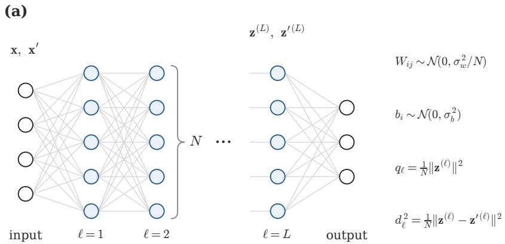

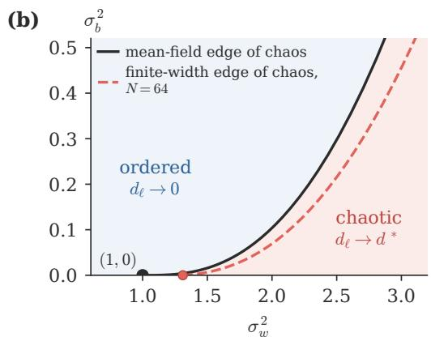  
FIG. 1. Deep random network and its phase diagram. (a) A fully connected network with L hidden layers of width N. Two inputs x and $\mathbf { x } ^ { \prime }$ pass through the same network; $d _ { \ell }$ is the distance between their pre-activation vectors $\mathbf { z } ^ { ( \ell ) }$ and $\mathbf { z } ^ { \prime ( \ell ) }$ divided by ${ \sqrt { N } } .$ . (b) Phase diagram of the tanh network. On the mean-field edge of chaos (solid line) a small distance is preserved, $\chi _ { 1 } = 1 $ ; below it the distance shrinks (ordered phase), above it grows to $d ^ { * }$ (chaotic phase). The finite-width edge of chaos, on which the typical distance in a network of width N is preserved, lies at larger $\sigma _ { w } ^ { 2 }$ (dashed, $N = 6 4 )$ , and meets the zero-bias axis at $\sigma _ { w } ^ { 2 } = 1 . 3 1$ (red dot; Sec. III B).

At infinite width the average over the N neurons of a layer in Eq. (1) equals its expectation, a Gaussian average [4, 5], and the signal size follows the variance map

$$
q _ { \ell + 1 } = F ( q _ { \ell } ) \equiv \sigma _ { w } ^ { 2 } V ( q _ { \ell } ) + \sigma _ { b } ^ { 2 } ,\tag{2}
$$

where $V ( q ) = \mathbb { E } [ \phi ( { \sqrt { q } } \zeta ) ^ { 2 } ]$ is the mean square of the activation of a Gaussian pre-activation of variance $q ,$ with $\zeta$ a standard Gaussian. The signal settles at the steady value $q ^ { * } = F ( q ^ { * } )$ . The steady signal sets how nonlinear the network is: for tanh, pre-activations with $q ^ { * } \ll 1$ stay in the linear part of the function, tanh $z \approx z .$ so the network is nearly linear, while for $q ^ { * }$ of order one they reach its curved, saturating part. A small distance between two inputs is multiplied in every layer by

$$
\chi _ { 1 } = \sigma _ { w } ^ { 2 } P ( q ^ { * } ) , \qquad P ( q ) = \mathbb { E } \bigl [ \phi ^ { \prime } ( \sqrt { q } \zeta ) ^ { 2 } \bigr ] ,\tag{3}
$$

so it shrinks for $\chi _ { 1 } < 1$ (ordered phase) and grows for $\chi _ { 1 } > 1$ (chaotic phase). The mean-field edge of chaos is the line $\chi _ { 1 } = 1$ . Each of its points has its own steady signal, and solving $\chi _ { 1 } = 1$ and $q ^ { * } = F ( q ^ { * } )$ for the two variances, the point with steady signal $q ^ { * }$ is found at

$$
\sigma _ { w } ^ { 2 } = \frac { 1 } { P ( q ^ { * } ) } , \qquad \sigma _ { b } ^ { 2 } = q ^ { * } - \frac { V ( q ^ { * } ) } { P ( q ^ { * } ) } .\tag{4}
$$

For tanh the line starts at $( \sigma _ { w } ^ { 2 } , \sigma _ { b } ^ { 2 } ) \ = \ ( 1 , 0 )$ , where $q ^ { * } = 0$ and the network is linear, and $q ^ { * }$ grows along $\mathrm { i t \ [ F i g . \ 1 ( b ) ] }$ . ReLU-type activations are scale free, so their edge of chaos is a single point [7] (Sec. III E).

Two more mean-field quantities are needed later. The first is the slope $F ^ { \prime } = \bar { F } ^ { \prime } ( q ^ { * } )$ of the variance map at its fixed point: a signal size that starts away from $q ^ { * }$ approaches it by the factor $F ^ { \prime }$ per layer, so $1 / ( 1 - F ^ { \prime } )$ is roughly the number of layers the signal needs to settle. The second is the compression of distances that are not small. Let $C _ { \ell }$ be the correlation of the two inputs at layer ℓ and $\varepsilon _ { \ell } = 1 - C _ { \ell }$ their decorrelation, which is zero for identical inputs and equals $d _ { \ell } ^ { 2 } / ( 2 q ^ { * } )$ . Expanding the mean-field map of the correlation about $C = 1$ to second order gives [7, 19]

$$
\begin{array} { r } { \varepsilon _ { \ell + 1 } = \chi _ { 1 } \varepsilon _ { \ell } - \kappa \varepsilon _ { \ell } ^ { 2 } , \qquad \kappa = \frac { 1 } { 2 } \sigma _ { w } ^ { 2 } q ^ { * } \mathbb { E } [ \phi ^ { \prime \prime 2 } ] , } \end{array}\tag{5}
$$

where the quadratic term comes from the curvature of $\phi .$ On the mean-field edge of chaos the linear term preserves ε and the quadratic term lowers it, so after ℓ layers $\varepsilon _ { \ell } =$ $\varepsilon _ { 0 } / ( 1 + \kappa \varepsilon _ { 0 } \ell )$ , which tends to $1 / ( \kappa \ell )$ whatever $\varepsilon _ { 0 }$ was: pairs of inputs that started with diferent similarities end with nearly the same one. We call this the compression of input similarities. It holds for any smooth activation, with a rate κ that grows with the signal $( \kappa \approx 2 q ^ { * 2 }$ for tanh at small $q ^ { * } ) { \mathrm { ; } }$ a kink, as in ReLU, changes the power (SM, Sec. S1 [24]).

## B. Finite width: the distance as a random walk

At finite width the signal size and the squared distance of a layer difer from network to network. Let $z _ { j }$ and $z _ { j } ^ { \prime }$ be the pre-activations of the two inputs at neuron $j$ of layer ℓ, and $\delta _ { j } = z _ { j } - z _ { i } ^ { \prime }$ their diference. For Gaussian weights, given layer $\ell ,$ each pre-activation of layer $\ell + 1$ is a sum of N independent Gaussian terms, Eq. (1), so it is exactly Gaussian, and the pairs $( z _ { i } , \delta _ { i } )$ of layer $\ell + 1$ are exactly independent bivariate Gaussians with variances

and covariance

$$
\begin{array} { r l } & { Q _ { \ell + 1 } = \sigma _ { w } ^ { 2 } \frac { 1 } { N } \sum _ { j } \phi ( z _ { j } ) ^ { 2 } + \sigma _ { b } ^ { 2 } , } \\ & { D _ { \ell + 1 } = \sigma _ { w } ^ { 2 } \frac { 1 } { N } \sum _ { j } \big [ \phi ( z _ { j } ) - \phi ( z _ { j } ^ { \prime } ) \big ] ^ { 2 } , } \\ & { K _ { \ell + 1 } = \sigma _ { w } ^ { 2 } \frac { 1 } { N } \sum _ { j } \phi ( z _ { j } ) \big [ \phi ( z _ { j } ) - \phi ( z _ { j } ^ { \prime } ) \big ] } \end{array}\tag{6}
$$

(SM, Sec. S2). So $Q _ { \ell }$ and $D _ { \ell }$ are the variances of the signal and of the diference in one network, given the layer before. The right-hand sides of Eq. (6) are averages over the neurons of layer $\ell ;$ replacing them by their expectations gives the mean-field maps of Sec. II A, and keeping them lets two inputs be followed through a random network of any width by sampling these Gaussian numbers layer by layer, without weight matrices. All our simulations of the walk use this exact chain.

For a small distance, $\phi ( z _ { j } ) - \phi ( z _ { j } ^ { \prime } ) \approx \phi ^ { \prime } ( z _ { j } ) \delta _ { j }$ , so $\begin{array} { r } { D _ { \ell + 1 } = \sigma _ { w } ^ { 2 } \frac { 1 } { N } \sum _ { j } \phi ^ { \prime } ( z _ { j } ) ^ { 2 } \delta _ { j } ^ { 2 } } \end{array}$ . Dividing by $D _ { \ell }$ and writing $\eta _ { j } = \delta _ { j } / \sqrt { D _ { \ell } }$ for the diference scaled to unit variance (given the layer before, the $\eta _ { j }$ are independent standard Gaussians), the logarithm of the squared distance changes per layer by

$$
s _ { \ell } = \ln \frac { D _ { \ell + 1 } } { D _ { \ell } } = \ln \sigma _ { w } ^ { 2 } + \ln \Big [ \frac { 1 } { N } \sum _ { j } \phi ^ { \prime } ( z _ { j } ) ^ { 2 } \eta _ { j } ^ { 2 } \Big ] .\tag{7}
$$

After ℓ layers, ln $D _ { \ell } = \ln D _ { 0 } + s _ { 0 } + s _ { 1 } + \cdot \cdot \cdot + s _ { \ell - 1 } .$ a sum of random steps, that is, a random walk, which we call $X _ { \ell }$ . At infinite width the average in the bracket equals $P ( q ^ { * } )$ , every step equals ln $\sigma _ { w } ^ { 2 } + \mathrm { l n } P ( q ^ { * } ) = \mathrm { l n } \chi _ { 1 }$ , and the walk is a straight line, the mean-field result $D _ { \ell } = \chi _ { 1 } ^ { \ell } D _ { 0 }$ At finite width the steps vary for two reasons. The average in the bracket runs over finitely many neurons, so it fluctuates about $P ( q ^ { * } )$ by a relative amount of order $N ^ { - 1 / 2 }$ . And the surroundings of the perturbation vary: the signal size $Q _ { \ell }$ fluctuates about $q ^ { * }$ , and the diference $\delta _ { j }$ is partly aligned with the signal $z _ { j }$ , with a correlation $\dot { r _ { \ell } } = K _ { \ell } / \sqrt { Q _ { \ell } D _ { \ell } }$ that fluctuates about zero. Both fluctuations are of order $N ^ { - 1 / 2 }$ for the same reason: $Q$ and $K$ are averages over N neurons.

Write E[ ] for the average over networks, that is, over the random weights and biases, and keep $\begin{array} { r } { \frac { 1 } { N } \sum _ { j } } \end{array}$ for averages over neurons. The drift $\mu _ { d } = \mathbb { E } [ s _ { \ell } ]$ is the mean step. Since the steps add, E[ln $D _ { \ell } ] \simeq \mu _ { d } \ell \colon$ the drift is the rate at which the typical squared distance, exp E[ln $D _ { \ell } ]$ grows or shrinks per layer. The typical value is close to the median, the value found in most networks. It is not the mean $\mathbb { E } [ D _ { \ell } ]$ , because $D _ { \ell }$ is a product of random factors. If each layer multiplied D by 1.1 or 0.9 with equal probability, the mean would stay at one, while in most networks D would fall by $1 . 1 \times 0 . 9 = 0 . 9 9$ every two layers; the mean is held up by the few networks in which most factors were 1.1. A practitioner trains a single network, so the edge of chaos that matters is where the typical distance is preserved, $\mu _ { d } = 0$ . The drift also governs the many pairs of inputs that pass through one network: averaged over the pairs, ln $D _ { \ell }$ grows at the rate $\mu _ { d }$ as well, up to an ofset specific to the network, which carries about two fifths of the variance of the walk (SM, Sec. S3.7).

## III. RESULTS

## A. Drift and variance of the distance

The step (7) depends on the layer it is taken in through the fluctuating average in the bracket and through the surroundings $( Q _ { \ell } , r _ { \ell } )$ . After the first few layers the statistics of the surroundings no longer depend on ℓ. The drift then follows in three steps (SM, Sec. S3). First, write the average in the bracket as its mean times $1 + \epsilon ,$ where ϵ has zero mean and a variance of order $1 / N$ , and expand $\ln ( 1 + \epsilon ) = \epsilon - { \textstyle { \frac { 1 } { 2 } } } \epsilon ^ { 2 } + . . . { \mathrm { : } }$ the logarithm of a fluctuating average is, on average, lower than the logarithm of its mean, by half the variance of $\epsilon .$ Second, the mean of the bracket depends on the surroundings; write $Q _ { \ell } = q ^ { * } + x _ { \ell }$ and expand it to second order in the small quantities xℓ and $r _ { \ell } .$ Third, average over networks, which brings in the stationary variances $\mathbb { E } [ x ^ { 2 } ]$ and $\mathbb { E } [ r ^ { 2 } ]$ and the small shift $\mathbb { E } [ x ]$ of the mean signal size, all of order $1 / N$ . Collecting the terms,

$$
\mu _ { d } = \ln \chi _ { 1 } + \frac { a _ { 1 } } { N } , \qquad \sigma _ { d } ^ { 2 } = \frac { b _ { 1 } } { N } ,\tag{8}
$$

with

$$
\begin{array} { l } { { \displaystyle a _ { 1 } = - \frac { 1 } { 2 } \Big ( \frac { 3 P _ { 4 } } { P ^ { 2 } } - 1 \Big ) + 2 q ^ { * } \frac { P ^ { \prime } } { P } N \mathbb { E } [ r ^ { 2 } ] + \frac { P ^ { \prime } } { P } N \mathbb { E } [ x ] } } \\ { { \displaystyle \phantom { \frac { 1 } { 2 } } + \frac { 1 } { 2 } \Big ( \frac { P ^ { \prime \prime } } { P } - \frac { P ^ { \prime 2 } } { P ^ { 2 } } \Big ) N \mathbb { E } [ x ^ { 2 } ] } , } \end{array}\tag{9}
$$

where $P _ { 4 } = \mathbb { E } [ \phi ^ { \prime 4 } ]$ , primes are derivatives in $q ,$ all averages are at $q ^ { * }$ , and $x = Q - q ^ { * }$ The four terms of $a _ { 1 }$ are the fluctuation of the average over neurons (first term), the alignment of the perturbation with the signal (second) and the fluctuation of the signal size (third and fourth). The moments $N \mathbb { E } [ r ^ { 2 } ]$ NE[x] and $\dot { N } \mathbb { E } [ x ^ { 2 } ]$ are Gaussian averages of ϕ (SM, Sec. S3); the factors of N make them independent of N. The long-run variance $\sigma _ { d } ^ { 2 }$ is the variance the walk gains per layer, Var $X _ { \ell } \simeq \sigma _ { d } ^ { 2 } \overset { \ l \ l } { \ell } .$ which sets how much ln $D _ { \ell }$ difers from network to network after ℓ layers; it includes the correlations between successive steps, and $b _ { 1 }$ is given in the SM. Equations (8) and (9) are our main result. For the expansion to be valid, the signal size must settle within far fewer than N layers, $N ( 1 - F ^ { \prime } ) \gg 1$ , so that the surroundings forget their past before their fluctuations add $\mathrm { u p } ;$ for tanh this means $q ^ { * } \gg 1 / ( 2 N )$

The first term of $a _ { 1 }$ dominates. It is the efect of the logarithm on a fluctuating average, $\mathbb { E } [ \ln ( 1 + \epsilon ) ]$ ≈ $- \frac 1 2$ Var ϵ with Var $\epsilon = ( 3 P _ { 4 } / P ^ { \bar { 2 } } - 1 ) / \bar { N }$ , and since $P _ { 4 } \geq$ $P ^ { \bar { 2 } }$ it is negative for every activation. Alone it gives the known single-input results: $a _ { 1 } = - 1$ for a linear network and $a _ { 1 } ~ = ~ - { \textstyle \frac { 1 } { 2 } } C _ { \alpha }$ for the leaky ReLU of slope $\alpha ,$ with $C _ { \alpha } = ( 5 - 2 \tilde { \alpha } ^ { 2 } + 5 \alpha ^ { 4 } ) / ( 1 + \tilde { \alpha ^ { 2 } } ) ^ { 2 }$ , which is 5 for ReLU

n

(a)  
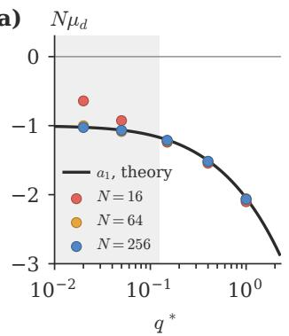

(b)  
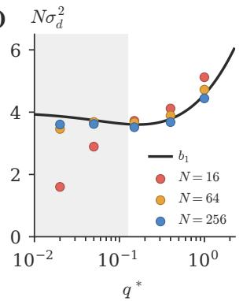

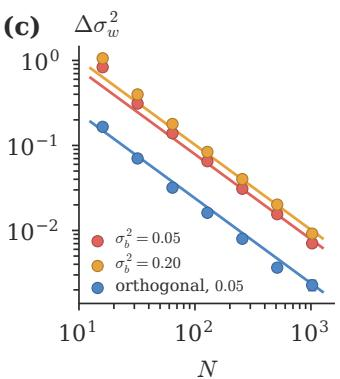

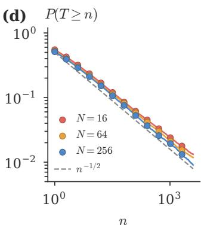  
FIG. 2. Drift and variance of the distance, and the finite-width edge of chaos. (a) Drift $\mu _ { d }$ of ln $D _ { \ell } ,$ times $N ,$ along the mean-field edge of chaos of the tanh network, where ln $\chi _ { 1 } = 0$ and $N \mu _ { d } = a _ { 1 }$ for every $N ,$ against the steady signal $q ^ { * } \colon$ $\operatorname { E q . }$ (9) (line) and simulations of the exact chain (6) for $N = 1 6 .$ 64 and 256 (dots); shaded: $N ( 1 - F ^ { \prime } ) < 3$ at $N = 1 6$ , where the expansion fails. (b) Long-run variance $\sigma _ { d } ^ { 2 }$ , times N: $b _ { 1 }$ (line) and simulations. (c) Shift of the edge of chaos at $\sigma _ { b } ^ { 2 } = 0 . 0 5$ and 0.20, Eq. (10) (lines), against the $\sigma _ { w } ^ { 2 }$ at which the measured drift changes sign (dots), for Gaussian and orthogonal weights. (d) Probability that an avalanche of the distance lasts at least n layers on the finite-width edge of chaos; dashed: $n ^ { - 1 / 2 }$

[13, 14, 16]. Figure $\mathrm { 2 ( a , b ) }$ compares Eq. (8) with simulations of the exact chain (6) along the mean-field edge of chaos. For $N = 6 4$ and 256 the drift agrees with a1 within one to two per cent for $q ^ { * }$ from 0.02 to 1, and the variance with $b _ { 1 }$ within a few per cent, up to eleven per cent at the smallest $q ^ { * } \colon$ ; the same holds for erf (SM, Fig. S1). At $N = 1 6$ and small $q ^ { * }$ the expansion fails, since $N ( 1 - F ^ { \prime } ) < 3$ there.

## B. The finite-width edge of chaos

The drift vanishes when ln $\chi _ { 1 } = - a _ { 1 } / N$ . Since $a _ { 1 } < 0$ this needs $\chi _ { 1 } > 1 \colon$ the finite-width edge of chaos lies at a larger $\sigma _ { w } ^ { 2 }$ than the mean-field edge of chaos. At fixed bias it is displaced by

$$
\Delta \sigma _ { w } ^ { 2 } = \frac { - a _ { 1 } } { N \partial _ { \sigma _ { w } ^ { 2 } } \ln \chi _ { 1 } } ,\tag{10}
$$

where $\partial _ { \sigma _ { w } ^ { 2 } }$ ln $\chi _ { 1 } ~ = ~ 1 / \sigma _ { w } ^ { 2 } + ( P ^ { \prime } / P ) V / ( 1 - F ^ { \prime } )$ is how fast ln $\chi _ { 1 }$ grows with $\sigma _ { w } ^ { 2 }$ at fixed $\sigma _ { b } ^ { 2 }$ (the steady signal moves with $\sigma _ { w } ^ { 2 } \mathrm { ~ \ t o o } )$ . For tanh the coeficient is about 8: $\Delta \sigma _ { w } ^ { 2 } = 7 . 9 \AA / N$ at $\sigma _ { b } ^ { 2 } = 0 . 0 5$ The shift has the same origin as the example of Sec. II B: a product of random factors with mean one shrinks in most networks, so $\chi _ { 1 }$ must exceed one for the typical distance to be preserved. Equation (10) is the first order of an expansion in $1 / N$ and fails near the end of the line at (1, 0), where $\partial _ { \sigma _ { \pi } ^ { 2 } }$ ln $\chi _ { 1 }$ vanishes: along the zero-bias axis ln $\chi _ { 1 } \approx ( \sigma _ { w } ^ { 2 } - \bar { 1 } ) ^ { 2 } / 3$ so the zero-bias point of the finite-width edge of chaos, found by solving ln $\chi _ { 1 } = - a _ { 1 } / N$ without linearising, lies at a distance of order $N ^ { - 1 / 2 }$ from (1, 0) rather than $1 / N \colon$ $\sigma _ { w } ^ { 2 } = 1 . 3 1$ at $N = 6 4$ and 1.13 at $N = 2 5 6$ (all orders: 1.30, SM, Table S2).

To test Eq. (10) we locate the finite-width edge of chaos in simulations of the exact chain as the $\sigma _ { w } ^ { 2 }$ at which the measured drift changes sign [Fig. 2(c), dots; N from 16 to

1024]. For Gaussian weights and $N \geq 2 5 6$ it agrees with Eq. (10) within the statistical error. At smaller N the measured shift at fixed bias is larger than Eq. (10), by 13% at $N = 6 4$ (0.14 instead of 0.12 in $\sigma _ { w } ^ { 2 } )$ , by a fraction that falls as $1 / N$ , as the next order of the expansion predicts; the all-orders value is available numerically (SM, Sec. S3.6). At fixed steady signal instead of fixed bias, the all-orders correction is 2 to 9% smaller than the first order one for $N \geq 6 4$ (SM, Table S2).

Orthogonal weights test the mechanism. An orthogonal matrix, a random rotation scaled by $\sigma _ { w } ,$ preserves the length of every vector it multiplies, so only the nonlinearity $\phi$ makes the signal size and the squared distance fluctuate. The mean-field edge of chaos is unchanged, because it depends only on means, but the random walk has smaller fluctuations: the theory predicts $a _ { 1 } = - 0 . 5 1$ instead of 1.68 for tanh at $\sigma _ { b } ^ { 2 } = 0 . 0 5$ (SM, Sec. S4), and the measured shift is about four times smaller [Fig. 2(c)], consistent with Refs. [3, 33–35]. The measured drift (SM, Table S1, $q ^ { * } \geq 0 . 1 5 )$ and shift (N = 64 to 256) lie 13 to 18% below this theory, a discrepancy of opposite sign to the Gaussian one that we have not traced.

Backpropagated gradients perform the same walk. The gradient of the loss goes down through the same layers that the signal came up, multiplied in each by the same slopes $\phi ^ { \prime }$ and by the transpose of the same weight matrix; a matrix and its transpose stretch random vectors by the same factors, so the squared norm of a gradient with a random direction at the output has exactly the same distribution over networks as the squared distance between two nearby inputs, at any width (SM, Sec. S5). Its logarithm therefore performs the walk of Eqs. (7)–(9) with the same $a _ { 1 }$ and $b _ { 1 }$ , and the finite-width edge of chaos is also where the typical gradient neither vanishes nor explodes. The diference from the mean-field edge of chaos is large: for tanh with $N = 6 4$ at $\sigma _ { b } ^ { 2 } = 0 . 0 5$ the median squared gradient 96 layers below the output is 0.08 of its value at the output on the mean-field edge of chaos and 0.83 on the finite-width edge of chaos; the gradient of a real loss, the cross-entropy of a read-out layer on MNIST images, follows the same walk within the errors (SM, Secs. S5.4 and S5.5).

(a)  
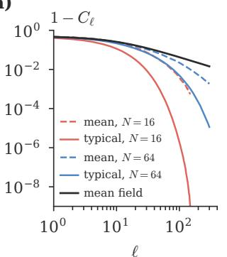

(b)  
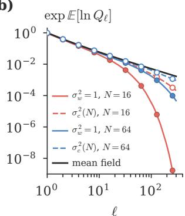  
FIG. 3. Typical and mean propagation difer at finite width. (a) Decorrelation $1 - C _ { \ell }$ of two inputs $( C _ { 0 } = 0 . 5 )$ through tanh networks of width 16 and 64 on the mean-field edge of chaos $( \sigma _ { w } ^ { 2 } = 1 . 9 5 , \sigma _ { b } ^ { 2 } = 0 . 0 9 )$ : mean over $2 { - } 4 \times 1 0 ^ { 4 }$ networks (dashed, shown while its error is below 10%), typical value exp $\dot { \mathbb { E } } [ \ln ( 1 - C _ { \ell } ) ]$ (solid) and the mean-field map (black). (b) Typical signal exp E[ln $Q _ { \ell } ]$ of one input at $\sigma _ { w } ^ { 2 } = 1$ (solid) and at $\sigma _ { c } ^ { 2 } ( N )$ (dashed), against the mean-field decay $1 / ( 2 \ell )$ (black); its recursion is in the SM (Fig. S4).

## C. Typical versus mean

The walk also gives the mean distance $\left( \mathrm { F i g . \ 3 } \right)$ . After many layers $X _ { \ell } = \ln D _ { \ell }$ is a sum of many steps, so it is approximately Gaussian with mean $\mu _ { d } \ell$ and variance $\sigma _ { d } ^ { 2 } \ell ,$ and the mean of $\boldsymbol { D _ { \ell } } = e ^ { X _ { \ell } }$ is $\begin{array} { r } { \exp ( \mu _ { d } \ell + \frac { 1 } { 2 } \sigma _ { d } ^ { 2 } \ell ) } \end{array}$ : the mean of $e ^ { X }$ exceeds $e ^ { \mathbb { E } [ X ] }$ by the factor $e ^ { \operatorname { V a r } X / 2 }$ , as the mean of a log-normal variable exceeds its median. On the meanfield edge of chaos, where $\mu _ { d } = a _ { 1 } / N$ , the typical distance shrinks as $\exp ( a _ { 1 } \ell / N )$ while the mean distance grows, at an estimated rate $( a _ { 1 } + \frac { 1 } { 2 } b _ { 1 } ) / N$ per layer; for tanh at $\sigma _ { b } ^ { 2 } = 0 . 0 5$ this estimate gives $a _ { 1 } + { \textstyle \frac { 1 } { 2 } } b _ { 1 } = + 0 . 3 2$ (from the values in SM, Table S3). The estimate is rough, because the mean is carried by the tail of the distribution of $X _ { \ell } ,$ which is not exactly Gaussian; the growth rate of the mean measured along the line, $N \mu _ { \mathrm { m e a n } }$ , lies between $+ 0 .$ .1 and +0.8 (SM, Table S1). For inputs a finite distance apart the same fluctuations make the mean of $1 - C _ { \ell }$ decay faster than the mean-field map, as Tamai et al. observed [19], and the typical value faster still $\left[ \mathrm { F i g . 3 ( a ) } \right]$

This resolves the disagreement in the literature. Refs. [17, 18] compute finite-width corrections to averages over networks as a perturbation series whose terms are of order depth over width [36, 37]: Ref. [17] for the two-point function of one input across layers, Ref. [18] for its dressed kernels. Both find the critical point unchanged at the order considered; Ref. [17] adds that this conclusion “should however be regarded with skepticism, since the theory breaks down at the critical point itself”, and Ref. [18] that higher orders may shift it. There is no contradiction. At fixed depth a displacement of the critical point of order $1 / N$ is the same thing as a correction of relative order $\ell / N$ to the kernels, since $e ^ { c \ell / N } = 1 + c \ell / N + \ldots ;$ it shows as a displaced critical point only once the depth is comparable to $N _ { ; }$ where the series must be resummed, which the walk does: the weight variance at which the mean distance is preserved lies below the mean-field edge of chaos, by an amount of order $1 / N$ , and the one at which the typical distance is preserved lies above it, by $\Delta \sigma _ { w } ^ { 2 }$ of Eq. (10). Simulations [19–22] follow single networks and see the typical distance. The rate $\mu / N$ fitted by Tamai et al. describes the mean of $1 - C _ { \ell }$ over networks, so it is not $a _ { 1 } .$ , the drift of the typical value; the walk relates the two. That typical and mean growth difer is well known for products of random matrices: the typical growth rate is set by the largest Lyapunov exponent, which is selfaveraging, and the growth of the mean by a generalised Lyapunov exponent that exceeds it [38]. The drift $\mu _ { d }$ of the squared distance is twice the largest Lyapunov exponent, and $\operatorname { E q . }$ . (8) gives its $1 / N$ correction. A single input shows the same split $\mathrm { [ \dot { F } i g . \ 3 ( b ) ] }$ The point $\breve { \sigma } _ { w } ^ { 2 } = \mathrm { \hat { 1 } } / \phi ^ { \prime } ( 0 ) ^ { 2 }$ of LeCun, Glorot and He [1, 2] keeps the mean squared norm fixed, while the typical norm shrinks by $e ^ { - 1 / N }$ per layer; the typical norm is kept fixed by $\begin{array} { r } { \tilde { \sigma _ { w } ^ { 2 } } = \sigma _ { c } ^ { 2 } ( \boldsymbol { \hat { N } } ) = \frac { \check { \mathbf { \sigma } } _ { \mathbf { 1 } } } { \phi ^ { \prime } ( 0 ) ^ { 2 } } \frac { N } { 2 } e ^ { - \check { \psi } ( N / 2 ) } \approx \frac { \mathbf { 1 } } { \phi ^ { \prime } ( 0 ) ^ { 2 } } ( \boldsymbol { \hat { 1 } } + \frac { \mathbf { 1 } } { N } ) } \end{array}$ , with ψ the digamma function. This typical-preserving variance has been derived several times [10, 13–16] but has not entered practice; it is the single-input special case of Eq. (10).

## D. Where to sit on the edge of chaos

The edge of chaos fixes one combination of $\sigma _ { w } ^ { 2 }$ and $\sigma _ { b } ^ { 2 }$ and leaves the steady signal $q ^ { * }$ free. A larger $q ^ { * }$ makes the network more nonlinear, which it needs to represent nonlinear functions, but it also compresses input similarities faster, since the compression rate $\kappa ( q ^ { * } )$ of Sec. II A grows with the signal. To find the cost of each choice, we measured how much information about the similarity of two inputs survives L layers of a finite tanh network: 128 pairs of inputs with decorrelations $\varepsilon _ { \mathrm { 0 } }$ spread evenly on a logarithmic scale over $[ 1 0 ^ { - 3 } , 1 ]$ are sent through the same network, and the output decorrelation $\varepsilon _ { L }$ of every pair is recorded. In a network that preserved similarities perfectly, ln $\varepsilon _ { L }$ would be a fixed function of ln $\varepsilon _ { \boldsymbol { 0 } } ;$ in a real network the points $\left( \ln \varepsilon _ { 0 } , \ln \varepsilon _ { L } \right)$ scatter about a curve. We fit the curve by a cubic polynomial $f _ { ; }$ , which plays the role of the signal, treat the scatter about it as noise, and quote the capacity of a Gaussian channel with this signal and noise [39], $\begin{array} { r } { I = \frac { 1 } { 2 } \log _ { 2 } [ 1 + \operatorname { V a r } f / \operatorname { V a r } ( \ln \varepsilon _ { L } - f ) ] } \end{array}$ in bits per pair of inputs. This is a proxy for the information about input similarity, not a bound on it, since it treats the scatter as Gaussian noise; polynomials of degree two to five change I by less than the statistical error (SM, Sec. S7). Two things lower I: compression, which

(a)  
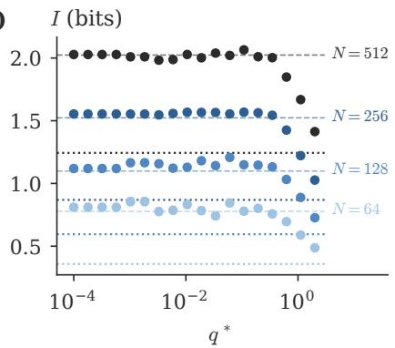

(b)  
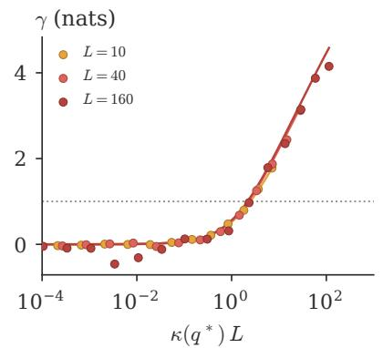

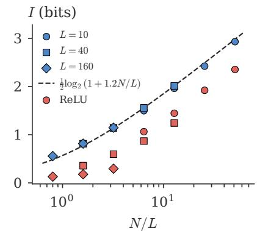  
(c)  
FIG. 4. Information about input similarity along the edge of chaos. (a) Information I (bits per pair of inputs) transmitted through $L = 4 0$ layers of tanh networks of width $N = 6 4$ to 512, against the steady signal $q ^ { * }$ on the mean-field edge of chaos (mean over 40 networks; errors about the size of the symbols); dashed and dotted: a linear network and ReLU at He initialisation. (b) Compression $\gamma$ against $\kappa ( q ^ { * } ) L$ for three depths $( N = 5 1 2 )$ , with the mean-field prediction (lines); dotted: $\gamma = 1$ . (c) Plateau height of (a) against $N / L$ for all depths and widths (blue), ReLU (red), and $\textstyle { \frac { 1 } { 2 } } \log _ { 2 } ( 1 + 1 . 2 N / L )$ (dashed).

## E. Crinit: an initialisation for finite width

flattens the curve so that diferent input similarities give nearly the same output similarity, and finite-width noise, which scatters the points about the curve. Figure 4 gives three results. (a) Along the mean-field edge of chaos, I does not depend on $q ^ { * }$ up to $q ^ { * } \approx 0 . 1 – 0 . 3$ at $L = 4 0$ where it equals that of a linear network of the same width: small signals are not lost in the finite-width noise. At larger $q ^ { * }$ the information falls. (b) The fall is caused by compression, which we measure by how much the range of similarities shrinks on the logarithmic scale between input and output, $\gamma = \ln ( \varepsilon _ { 0 } ^ { \mathrm { m a x } } / \varepsilon _ { 0 } ^ { \mathrm { m i n } } ) - \ln ( \varepsilon _ { L } ^ { \mathrm { m a x } } / \varepsilon _ { L } ^ { \mathrm { m i n } } )$ , in nats $( \gamma = 1 ;$ shrunk by a factor e). By the compression law of Sec. $\mathrm { I I A } , \gamma$ depends on $q ^ { * }$ and L only through $\kappa ( q ^ { * } ) L$ and the measured $\gamma$ of all depths falls on the mean-field curve, within the scatter at $L = 1 6 0$ . The information starts to fall where $\gamma \approx 1$ , at $\kappa L \approx 2 $ ; we call $\gamma = 1$ the compression budget, the compression a network can apply over its depth before it loses information about input similarity. (c) The height of the plateau, the value of I where it does not depend on $q ^ { * }$ , depends on N and $L$ only through $N / L$ and is fitted by $\textstyle { \frac { 1 } { 2 } } \log _ { 2 } ( 1 + c N / L )$ with $c = 1 . 2 \colon$ the capacity of a Gaussian channel with signal-to-noise ratio $c N / L ,$ as expected, since the walk of Eq. (8) adds a variance of order $1 / N$ to ln $D$ at every layer, so that after L layers the noise in ln $\varepsilon _ { L }$ is of order $L / N \ [ 3 5 , 4 0 ]$ . ReLU, whose edge of chaos is a single point at which all inputs are driven together [7], transmits 1.3 to 4.6 times fewer bits than tanh on its edge of chaos.

The operating point is therefore the largest $q ^ { * }$ within the budget,

$$
\gamma ( q ^ { * } , L ) = 1 \qquad ( \kappa L \approx 2 ) ,\tag{11}
$$

which gives $q ^ { * } = 0 . 3 1$ for $L = 3 2 , q ^ { * } = 0 . 1 4$ for $L = 9 6$ 9 and $q ^ { * } \propto L ^ { - 1 / 2 }$ at large depth, since κ $q ^ { * 2 }$ . The value $\gamma = 1$ is measured, not derived; training scans find the best accuracy for γ between 0.5 and 1 (SM, Secs. S8 and S9). Equation (11) has the form of the depth rules of Refs. [7–9]; the measurement supplies the value of the budget.

Crinit (critical initialisation) combines the two results; we provide it as a software package [41]. Given the activation, the depth L and the width N, it takes $q ^ { * }$ from Eq. (11) and places the network on the finite-width edge of chaos at that signal: $\sigma _ { w } ^ { 2 } = e ^ { - a _ { 1 } / N } / P ( q ^ { * } )$ , the meanfield value of $\mathrm { E q . \ ( 4 ) }$ with the correction of Eq. (8), and $\sigma _ { b } ^ { 2 } = q ^ { * } - \sigma _ { w } ^ { 2 } \bar { V ( q ^ { * } ) }$ , the bias that makes $q ^ { * }$ the steady signal. The finite-width edge of chaos with $\sigma _ { b } ^ { 2 } \geq 0$ begins at the zero-bias point of Sec. III B, $\sigma _ { w } ^ { 2 } = 1 . 3 1$ for tanh at $N = 6 4 ;$ ; when the $q ^ { * }$ of Eq. (11) would need a negative bias variance, Crinit uses this point instead, which at $N = 6 4$ happens for $L = 9 6$ . Crinit also sets the first layer: its weights have variance $( q ^ { * } - \sigma _ { b } ^ { 2 } ) / d _ { \mathrm { i n } } .$ with $d _ { \mathrm { i n } }$ the dimension of the input and the inputs standardised to unit variance, so that the first hidden layer already carries the steady signal $q ^ { * }$ , whereas the standard rules use $\sigma _ { w } ^ { 2 } / d _ { \mathrm { i n } }$ there and need several layers for the signal to settle. For ReLU-type activations, whose edge of chaos is a point, the compression is set by the slope α of a leaky ReLU [9], which Crinit chooses so that $\gamma = 1$ , with $\begin{array} { r } { \sigma _ { w } ^ { 2 } = \frac { 2 } { 1 + \alpha ^ { 2 } } e ^ { \dot { C } _ { \alpha } / ( 2 N ) } } \end{array}$ and zero bias; since these activations are scale free, the signal has no steady value, and Crinit gives the first hidden layer unit signal, with first-layer variance $1 / d _ { \mathrm { i n } }$ . Crinit has one parameter, the compression $\gamma ,$ , with default 1.

We trained networks of width $N ~ = ~ 6 4$ and depth $L = 3 2$ and 96 on MNIST [42] with stochastic gradient descent with momentum for two epochs, without normalisation or skip connections, so that the initialisation alone decides whether a network trains. The aspect ratios $\begin{array} { r } { L / N = \frac { 1 } { 2 } } \end{array}$ and $\frac { 3 } { 2 }$ set the noise that the walk accumulates over the depth $\mathrm { \bar { [ F i g . 4 ( c ) ] } }$ , so the deeper networks are the harder test. For each rule and depth the learning rate was chosen from three values by a pilot, and then one hundred independent networks were trained (SM, Sec. S8); Table I and Fig. 5 give the results.

At $L \ = \ 3 2$ every rule that trains reaches a similar

(a)  
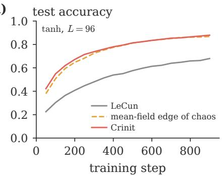

(b)  
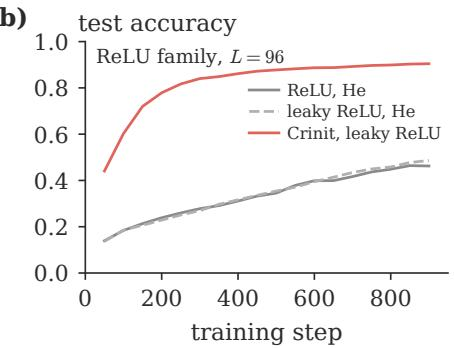

(c)  
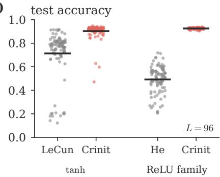  
FIG. 5. Training from the finite-width edge of chaos (MNIST, $N = 6 4$ $L = 9 6 .$ , Gaussian weights). (a) Mean test accuracy of one hundred tanh networks against the training step, for LeCun’s rule, the mean-field edge of chaos at the Crinit operating point, and Crinit. (b) The same for ReLU and the leaky ReLU (slope 0.01) at He’s rule, and Crinit’s leaky ReLU (mean over the 79 networks that did not diverge at its pilot’s learning rate). (c) Final test accuracy of each network that did not diverge; bars: means.

TABLE I. MNIST test accuracy after two epochs, and training steps to reach 85% training accuracy $( N =$ 64; each rule at the learning rate chosen by its pilot). Each entry is a mean over one hundred networks (steps rounded to whole numbers). The number in parentheses is the standard error of that mean (the spread of the networks divided by the square root of their number) in units of the last digit: 0.903(6) means $0 . 9 0 3 \pm 0 . 0 0 6$ (steps: SM, Table S6). Bold: the best value in each group and any value statistically equal to it (a diference below twice the standard error of the diference). Superscripts: the number of networks in the mean when not all (those that diverged or never reached 85% are left out). Typical-preserving: $\mathsf { \bar { \sigma } } _ { w } ^ { 2 } = \sigma _ { c } ^ { 2 } ( N )$ ; leaky ReLU: slope 0.01; mean-field edge of chaos: the Crinit point of its group without the $1 / N$ correction.

<table><tr><td colspan="3">L = 32</td><td colspan="2"> $L = 9 6$ </td></tr><tr><td>initialisation</td><td>accuracy</td><td>steps</td><td>accuracy</td><td>steps</td></tr><tr><td colspan="3">tanh, Gaussian weights</td><td></td><td></td></tr><tr><td>PyTorch  $\begin{array} { r } { ( \sigma _ { w } ^ { 2 } = \frac { 1 } { 3 } ) } \end{array}$ </td><td>0.1135</td><td></td><td>0.1135</td><td></td></tr><tr><td>LeCun  $( \sigma _ { w } ^ { 2 } = 1 )$ </td><td>0.9438(5)</td><td>257</td><td>0.713(21)</td><td> $6 9 0 ^ { 1 0 }$ </td></tr><tr><td>He  $( \sigma _ { w } ^ { 2 } = 2 )$ </td><td>0.9392(5)</td><td>234</td><td>0.567(16)</td><td></td></tr><tr><td>typical-preserving</td><td>0.9448(5)</td><td>247</td><td>0.744(19)</td><td> $5 9 8 ^ { 1 8 }$ </td></tr><tr><td>mean-field edge of chaos</td><td>0.9513(4)</td><td>164</td><td>0.893(10)</td><td> $\mathbf { 5 0 4 } ^ { 8 8 }$ </td></tr><tr><td>Crinit</td><td>0.9517(4)</td><td>159</td><td>0.903(6)</td><td> $\overline { { { \bf 4 9 7 ^ { 9 1 } } } }$ </td></tr><tr><td colspan="3">tanh, orthogonal weights</td><td></td><td></td></tr><tr><td>orthogonal  $( \sigma _ { w } ^ { 2 } = 1 )$ </td><td>0.9538(4)</td><td>168</td><td>0.9428(6)</td><td>197</td></tr><tr><td>mean-field edge of chaos</td><td>0.9581(4)</td><td>96</td><td>0.9545(5)</td><td>112</td></tr><tr><td>Crinit, orthogonal</td><td>0.9581(3)</td><td>95</td><td>0.9553(4)</td><td>111</td></tr><tr><td colspan="3">ReLU family, Gaussian weights</td><td></td><td></td></tr><tr><td>ReLU, He  $( \sigma _ { w } ^ { 2 } = 2 )$ </td><td>0.9099(8)</td><td>573</td><td>0.491(11)</td><td></td></tr><tr><td>ReLU, typical-preserving</td><td>0.9203(7)</td><td>495</td><td>0.480(13)</td><td></td></tr><tr><td>leaky ReLU, He</td><td>0.9114(7)</td><td>553</td><td>0.505(11)</td><td></td></tr><tr><td>Crinit, leaky ReLU</td><td>0.9404(4)</td><td>211</td><td>0.9250(8)79</td><td>33379</td></tr></table>

accuracy. Crinit’s margin over the standard rules is small but resolved, at eight or more standard errors, and it needs 32 to 63% fewer steps than they do. Against the mean-field edge of chaos at the same operating point its accuracy is the same within the error, 0.9517(4) against

0.9513(4), and it is faster, 159(1) against 164(2) steps; a larger paired run confirms both (SM, Sec. S8). At $L =$ 96 the rules separate. LeCun’s rule, at $q ^ { * } = 0$ , where the typical signal collapses as $e ^ { - \ell / N }$ [Fig. 3(b)], reaches $0 . 7 1 3 ( 2 1 )$ , and only 10 of its 100 networks reach 85% training accuracy; the typical-preserving variance $\sigma _ { c } ^ { 2 } ( N )$ raises this to 0.744(19) and 18, within the error; Crinit reaches 0.903(6) (median 0.919), with 91. In the ReLU family only Crinit’s leaky ReLU trains, to 0.9250(8) over the 79 networks that did not diverge at the learning rate chosen by its pilot, and to 0.9112(7) over all hundred at a third of that rate. Crinit is ahead of the standard rules at every step, and its gain is not carried by a few networks: 84 of its 100 networks lie within 0.03 of their median, against 35 of LeCun’s (Fig. 5). Most of Crinit’s gain over the standard rules therefore comes from the operating point and the first layer, not from the $1 / N$ correction: at $N = 6 4$ the correction moves $\sigma _ { w } ^ { 2 }$ by only 0.03 at $L = 3 2$ and 0.07 at $L = 9 6 ,$ and at $L = 9 6$ the mean-field edge of chaos reaches 0.893(10), a diference of 0.009(12) from Crinit, again within the error. With orthogonal weights the correction is smaller still (0.006 in $\sigma _ { w } ^ { 2 }$ at $L = 3 2 )$ , and the two are equal in accuracy and speed at both depths.

At width $N = 3 2$ , where the correction is twice as large (SM, Sec. S8.3), the picture is the same: at $L = 3 2$ Crinit and the mean-field edge of chaos reach 0.9332(6) and 0.9326(6), and Crinit needs 11% fewer steps, 254(4) against 286(7). At $L = 9 6$ , an aspect ratio of 3, both are poor (0.660(13) and 0.684(15); LeCun 0.307(12)), because the zero-bias point compresses twice the budget while the mean-field point contracts the typical distance by $e ^ { - 3 . 6 }$ ; only Crinit’s leaky ReLU, which has no signal size to keep, trains well there (0.894(2) over the 78 networks that did not diverge; He 0.423(12)).

On Fashion-MNIST [43] we also tuned, on a validation set, the gain of the standard rules and the compression γ of Crinit (SM, Sec. S9). Over twelve comparisons, Crinit beats every standard rule at its usual variance, by up to 0.355 at $L = 9 6$ , beats the best tuned gain in eight and is within the error in four, and is the fastest to 80% training accuracy in every group. The gain search finds the finitewidth edge of chaos, its best values bracketing $\sigma _ { w } ^ { 2 } = 1 . 3 1$ rather than 1, but not Crinit’s smaller first layer, which takes larger relative steps under gradient descent and is worth up to two per cent at $L = 9 6$

## IV. DISCUSSION

The edge of chaos of a network of width N lies a computable distance from the mean-field edge of chaos, about $8 / N$ in weight variance for tanh at a bias variance of 0.05 and of order $N ^ { - 1 / 2 }$ at zero bias: towards larger weights for a typical network, the other way for the mean over networks. On the mean-field edge of chaos a network of width 64 is in its ordered phase, contracting the distance between two inputs, and the squared gradient, by a factor 14 over a hundred layers. Because signals and gradients follow the same walk, one condition makes a typical network critical for both, and there the distance performs a random walk without drift: an avalanche [21, 44], a run of layers in which the distance stays above its starting value, is an excursion of such a walk, with survival probability $n ^ { - 1 / 2 }$ [Fig. 2(d)] and exponents 3/2 for the duration and $4 / 3$ for the size [32, 45, 46] (SM, Sec. S6), the class measured in Refs. [21, 44].

Along the edge of chaos, small signals lose no information to noise, and the plateau set by N/L agrees with the aspect ratio as the control parameter of the 1/N expansion [11, 35–37, 40]. ReLU, with a single critical point, must compress and transmits less information; the leaky ReLU shaped to the depth recovers part of the diference (Table I). In practice ReLU networks rely on normalisation layers and skip connections, which our tests lack.

The training runs test the operating point and the first layer more than the $1 / N$ correction, which leaves the final accuracy unchanged within the error and shows in the training speed and in the propagation of signals and gradients (Secs. III B and C). The theory treats fully connected networks with Gaussian or orthogonal weights at initialisation; convolutional and residual layers change the recursions [19], and training moves the weights. The training tests use two small data sets, two widths and two depths. In deep, narrow networks $( L > N )$ the zero-bias point of the finite-width edge of chaos compresses more than the budget allows $( \gamma = 1 . 2$ at $L = 9 6$ ， $N = 6 4$ , and 1.9 at $N = 3 2 )$ , and Crinit cannot lower the compression with a non-negative bias variance; a wider network or the leaky ReLU shaped to the depth avoids this.

[1] X. Glorot and Y. Bengio, Understanding the dificulty of training deep feedforward neural networks, in Proceedings of the 13th International Conference on Artificial Intelligence and Statistics (AISTATS), PMLR, Vol. 9 (2010) pp. 249–256.

[2] K. He, X. Zhang, S. Ren, and J. Sun, Delving deep into rectifiers: surpassing human-level performance on ImageNet classification, in 2015 IEEE International Conference on Computer Vision (ICCV) (2015) pp. 1026–1034.

[3] A. M. Saxe, J. L. McClelland, and S. Ganguli, Exact solutions to the nonlinear dynamics of learning in deep linear neural networks, in International Conference on Learning Representations (2014) arXiv:1312.6120.

[4] B. Poole, S. Lahiri, M. Raghu, J. Sohl-Dickstein, and S. Ganguli, Exponential expressivity in deep neural networks through transient chaos, in Advances in Neural Information Processing Systems 29 (2016) arXiv:1606.05340.

Wherever propagation is a product of random factors, as in recurrent networks [47] and models of neural activity in the brain [48, 49], the mean and the typical value have critical points about one over the system size apart, and a single sample sees the typical one.

## ACKNOWLEDGMENTS

The author declares no competing interests. The author used the language model Claude Opus 5.5 (Anthropic) to write and debug the code, to draft the article and the Supplemental Material from the author’s notes and instructions, to edit the text and to check derivations; the author directed this use, revised the text and verified all of its output.

## DATA AVAILABILITY

The data that support the findings of this article are contained in the article and its Supplemental Material [24]; the code that generates them and the Crinit package are openly available [41].

[5] S. S. Schoenholz, J. Gilmer, S. Ganguli, and J. Sohl-Dickstein, Deep information propagation, in International Conference on Learning Representations (2017) arXiv:1611.01232.

[6] J. Pennington, S. S. Schoenholz, and S. Ganguli, Resurrecting the sigmoid in deep learning through dynamical isometry: theory and practice, in Advances in Neural Information Processing Systems 30 (2017) arXiv:1711.04735.

[7] S. Hayou, A. Doucet, and J. Rousseau, On the impact of the activation function on deep neural networks training, in Proceedings of the 36th International Conference on Machine Learning (ICML) (2019) arXiv:1902.06853.

[8] J. Martens, A. Ballard, G. Desjardins, G. Swirszcz, V. Dalibard, J. Sohl-Dickstein, and S. S. Schoenholz, Rapid training of deep neural networks without skip connections or normalization layers using Deep Kernel Shaping (2021), arXiv:2110.01765.

[9] G. Zhang, A. Botev, and J. Martens, Deep learning without shortcuts: shaping the kernel with tailored rectifiers, in International Conference on Learning Representations (2022) arXiv:2203.08120.

[10] D. Sussillo and L. F. Abbott, Random walk initialization for training very deep feedforward networks (2014), arXiv:1412.6558.

[11] B. Hanin and M. Nica, Products of many large random matrices and gradients in deep neural networks, Commun. Math. Phys. 376, 287 (2020).

[12] B. Hanin and D. Rolnick, How to start training: the efect of initialization and architecture, in Advances in Neural Information Processing Systems 31 (2018) arXiv:1803.01719.

[13] J. E. Cohen and C. M. Newman, The stability of large random matrices and their products, Ann. Probab. 12, 283 (1984).

[14] C. M. Newman, The distribution of Lyapunov exponents: exact results for random matrices, Commun. Math. Phys. 103, 121 (1986).

[15] M. G¨urb¨uzbalaban and Y. Hu, Fractional momentpreserving initialization schemes for training deep neural networks, in Proceedings of the 24th International Conference on Artificial Intelligence and Statistics (AISTATS), PMLR, Vol. 130 (2021) pp. 2233–2241, arXiv:2005.11878.

[16] C. Kogler, T. Schwarz, and S. Kittle, Optimal initialization in depth: Lyapunov initialization and limit theorems for deep leaky ReLU networks (2026), arXiv:2602.10949.

[17] K. T. Grosvenor and R. Jeferson, The edge of chaos: quantum field theory and deep neural networks, SciPost Phys. 12, 081 (2022).

[18] R. C. Terin, Gauge-covariant stochastic neural fields: stability and finite-width efects, Sci. Rep. 16, 16386 (2026).

[19] K. Tamai, T. Okubo, T. V. T. Duy, N. Natori, and S. Todo, Universal scaling laws of absorbing phase transitions in artificial deep neural networks, Phys. Rev. Res. 7, 033072 (2025).

[20] S. Vock and C. Meisel, Critical dynamics governs deep learning (2025), arXiv:2507.08527.

[21] A. Ghavasieh, M. Vila-Mi˜nana, A. Khurd, J. Beggs, G. Ortiz, and S. Fortunato, Toward a physics of deep learning and brains (2025), arXiv:2509.22649.

[22] G. A. D’Inverno, Z. Hu, L. Davy, M. Unser, G. Rozza, and J. Dong, Revisiting deep information propagation: fractal frontier and finite-size efects, Neural Netw. 202, 109013 (2026).

[23] M. Murray, V. Abrol, and J. Tanner, Activation function design for deep networks: linearity and efective initialisation, Appl. Comput. Harmon. Anal. 59, 117 (2022).

[24] See Supplemental Material at [URL will be inserted by publisher] (appended to the arXiv version) for derivations and details of the simulations and training runs, which includes Refs. [25–32].

[25] C. M. Stein, Estimation of the mean of a multivariate normal distribution, Ann. Stat. 9, 1135 (1981).

[26] R. Price, A useful theorem for nonlinear devices having Gaussian inputs, IRE Trans. Inf. Theory 4, 69 (1958).

[27] H. Chernof, A note on an inequality involving the normal distribution, Ann. Probab. 9, 533 (1981).

[28] A. Daniely, R. Frostig, and Y. Singer, Toward deeper understanding of neural networks: the power of initialization and a dual view on expressivity, in Advances in Neural Information Processing Systems 29 (2016)

arXiv:1602.05897.

[29] A. Jacot, F. Gabriel, F. Ged, and C. Hongler, Freeze and chaos: NTK views on DNN normalization, checkerboard and boundary artifacts, in Proceedings of Mathematical and Scientific Machine Learning (MSML), PMLR, Vol. 190 (2022) pp. 257–270, arXiv:1907.05715.

[30] L. Fernandez Sarmiento, Dropout universality: scaling laws and optimal scheduling at the edge-of-chaos (2026), arXiv:2605.21648.

[31] O. Lesser and D. Chowdhury, Competing nonlinearities, criticality, and order-to-chaos transition in deep networks (2026), arXiv:2605.05294.

[32] E. Sparre Andersen, On the fluctuations of sums of random variables II, Math. Scand. 2, 194 (1954).

[33] W. Hu, L. Xiao, and J. Pennington, Provable benefit of orthogonal initialization in optimizing deep linear networks, in International Conference on Learning Representations (2020) arXiv:2001.05992.

[34] H. Day, Y. Kahn, and D. A. Roberts, Feature learning and generalization in deep networks with orthogonal weights, Mach. Learn.: Sci. Technol. 6, 035027 (2025).

[35] A. Combette, N. Pustelnik, and A. Venaille, Correlation flow governs learning at criticality (2026), arXiv:2608.08350.

[36] D. A. Roberts, S. Yaida, and B. Hanin, The Principles of Deep Learning Theory (Cambridge University Press, Cambridge, 2022).

[37] B. Hanin, Random fully connected neural networks as perturbatively solvable hierarchies, J. Mach. Learn. Res. 25, 267 (2024), arXiv:2204.01058.

[38] A. Crisanti, G. Paladin, and A. Vulpiani, Products of Random Matrices in Statistical Physics, Springer Series in Solid-State Sciences, Vol. 104 (Springer, Berlin, 1993).

[39] T. M. Cover and J. A. Thomas, Elements of Information Theory, 2nd ed. (Wiley, Hoboken, 2006).

[40] C. Jakub and M. Nica, Depth degeneracy in neural networks: vanishing angles in fully connected ReLU networks on initialization, J. Mach. Learn. Res. 25, 239 (2024), arXiv:2302.09712.

[41] A. Caesar, Code, data and the Crinit initialisation package for this article, https://github.com/Aureliuxs/ finite-width-edge-of-chaos (2026).

[42] Y. LeCun, L. Bottou, Y. Bengio, and P. Hafner, Gradient-based learning applied to document recognition, Proc. IEEE 86, 2278 (1998).

[43] H. Xiao, K. Rasul, and R. Vollgraf, Fashion-MNIST: a novel image dataset for benchmarking machine learning algorithms (2017), arXiv:1708.07747.

[44] A. Ghavasieh, Tuning universality in deep neural networks (2025), arXiv:2512.00168.

[45] A. J. Bray, S. N. Majumdar, and G. Schehr, Persistence and first-passage properties in nonequilibrium systems, Adv. Phys. 62, 225 (2013).

[46] K. Christensen and N. R. Moloney, Complexity and Criticality (Imperial College Press, London, 2005).

[47] H. Sompolinsky, A. Crisanti, and H. J. Sommers, Chaos in random neural networks, Phys. Rev. Lett. 61, 259 (1988).

[48] R. V. Williams-Garc´ıa, M. Moore, J. M. Beggs, and G. Ortiz, Quasicritical brain dynamics on a nonequilibrium Widom line, Phys. Rev. E 90, 062714 (2014).

[49] J. M. Beggs and D. Plenz, Neuronal avalanches in neocortical circuits, J. Neurosci. 23, 11167 (2003).

# Supplemental Material for Finite-width shift of the edge of chaos in deep neural networks

Arn Caesar

Blackett Laboratory and Centre for Complexity Science,

Imperial College London, London SW7 2AZ, United Kingdom

Equations, figures and tables numbered without the prefix S refer to the main text. Results that are already known are stated with a reference (Section S1); the new results (Sections S2 to S7) are derived step by step, and Sections S8 and S9 give the details of the training runs.

## Notation

<table><tr><td> $N , L$   $\sigma _ { w } ^ { 2 } , \sigma _ { b } ^ { 2 }$ </td><td>width (neurons per hidden layer) and depth (number of hidden layers) weight variance times the fan-in, and bias variance:  $W _ { i j } \sim \mathcal { N } ( 0 , \sigma _ { w } ^ { 2 } / N ) , \ b _ { i } \sim$   $\mathcal { N } ( 0 , \sigma _ { b } ^ { 2 } )$ </td></tr><tr><td> $\phi$   $z _ { i } ^ { ( \ell ) }$ </td><td>activation function;  $\phi ^ { \prime } , \phi ^ { \prime \prime } , \phi ^ { \prime \prime \prime }$  its derivatives pre-activation of neuron i in layer l (the number before the activation is applied)</td></tr><tr><td> $y _ { j } = \phi ( z _ { j } )$ </td><td>activation of neuron j</td></tr><tr><td> $\zeta , \xi$ </td><td>independent standard Gaussian variables (mean 0, variance 1)</td></tr><tr><td> $\mathbb { E } _ { q } [ f ]$ </td><td> $f$ </td></tr><tr><td> $\bar { V ( q ) } , P ( q )$ </td><td> $\mathbb { E } [ f ( { \sqrt { q } } \zeta ) ]$  : the average of over a Gaussian of variance q</td></tr><tr><td> $q _ { \ell } , q ^ { * }$ </td><td> $\mathbb { E } _ { q } [ \phi ^ { \dot { 2 } } ]$  and  $\mathbb { E } _ { q } [ \phi ^ { \prime 2 } ] ; V _ { 4 } = \mathbb { E } _ { q } [ \phi ^ { 4 } ] , P _ { 4 } = \mathbb { E } _ { q } [ \phi ^ { \prime 4 } ] ;$  primes on  $V , P$  signal size (variance of the pre-activations) of layer  $\ell ,$  and its steady value</td></tr><tr><td> $F ( q )$ </td><td>variance map  $\sigma _ { w } ^ { 2 } V ( q ) + \sigma _ { b } ^ { 2 } ; F ^ { \prime } = F ^ { \prime } ( q ^ { * } )$  its slope at the steady value;</td></tr><tr><td> $C _ { \ell } , \varepsilon _ { \ell }$ </td><td>correlation of the pre-activations of two inputs at layer  $\ell ,$  and</td></tr><tr><td> $d _ { \ell } ^ { 2 }$ </td><td>squared distance  $\begin{array} { r } { { \frac { \bar { 1 } } { N } } \| z ^ { ( \ell ) } - z ^ { \prime ( \ell ) } \| ^ { 2 } } \end{array}$  between the two inputs at layer</td></tr><tr><td> $\chi _ { 1 }$ </td><td> $\sigma _ { w } ^ { 2 } { \cal P } ( q ^ { * } )$  : factor by which a small distance is multiplied per layer at infinite width</td></tr><tr><td> $\kappa$ </td><td> $\begin{array} { r } { \frac { 1 } { 2 } \tilde { \sigma } _ { w } ^ { 2 } q ^ { * } \mathbb { E } _ { q ^ { * } } [ \phi ^ { \prime \prime 2 } ] \colon } \end{array}$  coefficient of the compression of finite distances</td></tr><tr><td> $\gamma$ </td><td>compression of the range of input similarities over the depth, in nats</td></tr><tr><td> $Q _ { \ell } , D _ { \ell } , K _ { \ell }$ </td><td>signal size, squared distance and signal-difference covariance of one network at</td></tr><tr><td></td><td>finite N (random): the variances and covariance of the pre-activations and their</td></tr><tr><td></td><td></td></tr><tr><td></td><td>differences given the layer before, Eq. (6);  $r _ { \ell } = K _ { \ell } / \sqrt { Q _ { \ell } D _ { \ell } }$ </td></tr><tr><td> $x _ { \ell }$ </td><td> $Q _ { \ell } - q ^ { * }$  , the deviation of the signal size from its steady value</td></tr><tr><td> $s \ell$ </td><td>ln  ${ D _ { \ell + 1 } } / { D _ { \ell } } )$  , the step of the random walk of ln  $. d ^ { 2 }$ </td></tr><tr><td></td><td></td></tr><tr><td> $\mu _ { d } , \sigma _ { d } ^ { 2 }$ </td><td>drift and long-run variance of the walk;  $\mu _ { d } = \ln \chi _ { 1 } + a _ { 1 } / N , \sigma _ { d } ^ { 2 } = b _ { 1 } / N$ </td></tr><tr><td></td><td></td></tr><tr><td> $J , \mathbf { g } ^ { ( \bar { \ell } ) }$ </td><td>Jacobian of  $\tilde { z } ^ { ( L ) }$  with respect to  $z ^ { ( 0 ) }$  , and the gradient of the loss with respect to</td></tr><tr><td></td><td></td></tr><tr><td></td><td></td></tr><tr><td></td><td></td></tr><tr><td></td><td></td></tr><tr><td></td><td></td></tr><tr><td></td><td></td></tr><tr><td></td><td> $z ^ { ( \ell ) }$ </td></tr><tr><td></td><td></td></tr><tr><td></td><td></td></tr><tr><td></td><td></td></tr><tr><td></td><td></td></tr><tr><td></td><td></td></tr><tr><td></td><td></td></tr><tr><td></td><td></td></tr><tr><td></td><td></td></tr><tr><td></td><td></td></tr><tr><td></td><td></td></tr><tr><td></td><td></td></tr><tr><td></td><td></td></tr><tr><td></td><td></td></tr><tr><td></td><td></td></tr><tr><td></td><td></td></tr><tr><td></td><td></td></tr><tr><td></td><td></td></tr><tr><td></td><td></td></tr><tr><td></td><td></td></tr><tr><td></td><td></td></tr><tr><td></td><td></td></tr><tr><td></td><td></td></tr><tr><td></td><td></td></tr><tr><td></td><td></td></tr><tr><td></td><td></td></tr><tr><td></td><td></td></tr><tr><td></td><td></td></tr><tr><td></td><td></td></tr></table>

## S1 Mean-field relations

This section collects the infinite-width relations used in the main text. They are known [1–3]. We give short derivations of the variance map and the correlation map only, because the finite-width calculation of Sections S2 and S3 starts from the same exact one-layer formulas.

## S1.1 Gaussian averages and three identities

Throughout, ζ is a standard Gaussian and $u = { \sqrt { q } } \zeta$ is a Gaussian of variance q. The averages that appear are

$$
V ( q ) = \mathbb { E } \big [ \phi ( u ) ^ { 2 } \big ] , \qquad P ( q ) = \mathbb { E } \big [ \phi ^ { \prime } ( u ) ^ { 2 } \big ] , \qquad V _ { 4 } ( q ) = \mathbb { E } \big [ \phi ( u ) ^ { 4 } \big ] , \qquad P _ { 4 } ( q ) = \mathbb { E } \big [ \phi ^ { \prime } ( u ) ^ { 4 } \big ] .\tag{S1}
$$

They are evaluated numerically by Gauss–Hermite quadrature with 160 nodes. Three standard identities are used, for smooth functions $f , g ,$ h of moderate growth:

$$
\mathbb { E } [ u f ( u ) ] = q \mathbb { E } [ f ^ { \prime } ( u ) ] ,\tag{S2}
$$

$$
\begin{array} { r } { \frac { \mathrm { d } } { \mathrm { d } q } \mathbb { E } \big [ f ( \sqrt { q } \zeta ) \big ] = \frac { 1 } { 2 } \mathbb { E } \big [ f ^ { \prime \prime } ( u ) \big ] , } \end{array}\tag{S3}
$$

$$
\frac { \partial } { \partial C } \mathbb { E } \big [ g ( u ) h ( u ^ { \prime } ) \big ] = q \mathbb { E } \big [ g ^ { \prime } ( u ) h ^ { \prime } ( u ^ { \prime } ) \big ] .\tag{S4}
$$

Eq. (S2) is Gaussian integration by parts (Stein’s identity [4]); Eq. (S3) follows from it by diferentiating under the average; Eq. (S4) is Price’s theorem [5], in which u and $u ^ { \prime }$ both have variance $q$ and correlation $C ,$ that is $\mathbb { E } [ u u ^ { \prime } ] = q C$ . Applied to $f = \phi ^ { 2 }$ and $f = \phi ^ { \prime 2 }$ , Eq. (S3) gives the derivatives of V and $P { : }$

$$
V ^ { \prime } ( q ) = P ( q ) + \mathbb { E } [ \phi \phi ^ { \prime \prime } ] , \qquad P ^ { \prime } ( q ) = \mathbb { E } [ \phi ^ { \prime \prime 2 } ] + \mathbb { E } [ \phi ^ { \prime } \phi ^ { \prime \prime \prime } ] .\tag{S5}
$$

## S1.2 The variance map

One layer maps the activations $y _ { j } = \phi ( z _ { j } ^ { ( \ell ) } )$ of layer ℓ to the pre-activations of layer ℓ + 1 [Eq. (1)],

$$
z _ { i } ^ { ( \ell + 1 ) } = \sum _ { j = 1 } ^ { N } W _ { i j } y _ { j } + b _ { i } .\tag{S6}
$$

Treat the numbers $y _ { j }$ of layer ℓ as given. Then $z _ { i } ^ { ( \ell + 1 ) }$ is a sum of independent zero-mean Gaussians, so it is Gaussian with mean zero. Its variance is

$$
\mathrm { V a r } \left[ z _ { i } ^ { ( \ell + 1 ) } \right] = \sum _ { j } \sum _ { k } \mathbb { E } [ W _ { i j } W _ { i k } ] y _ { j } y _ { k } + \mathbb { E } [ b _ { i } ^ { 2 } ] = \sum _ { j } \frac { \sigma _ { w } ^ { 2 } } { N } y _ { j } ^ { 2 } + \sigma _ { b } ^ { 2 } = \sigma _ { w } ^ { 2 } \frac { 1 } { N } \sum _ { j = 1 } ^ { N } \phi \big ( z _ { j } ^ { ( \ell ) } \big ) ^ { 2 } + \sigma _ { b } ^ { 2 } ,\tag{S7}
$$

because $\mathbb { E } [ W _ { i j } W _ { i k } ] = 0$ for $j \neq k$ and the terms that mix W and b average to zero. Diferent neurons i use diferent rows of W and diferent biases, so they are independent given layer ℓ. $\mathrm { E q . ~ ( S 7 ) }$ is exact at any width. At infinite width the average over neurons equals its expectation, $\begin{array} { r } { { \frac { 1 } { N } } \sum _ { j } \phi ( z _ { j } ) ^ { 2 } \to V ( q _ { \ell } ) } \end{array}$ , which gives the variance map of Eq. (2), $q _ { \ell + 1 } = F ( q _ { \ell } ) = \sigma _ { w } ^ { 2 } V ( q _ { \ell } ) + \sigma _ { b } ^ { 2 } \left[ 1 \right]$ Near its fixed point $q ^ { * } = F ( q ^ { * } )$ , a deviation $x _ { \ell } = q _ { \ell } - q ^ { * }$ obeys $x _ { \ell + 1 } = F ^ { \prime } x _ { \ell }$ to first order, so it decays as $F ^ { \prime } { } ^ { \ell } = e ^ { - \ell / \xi _ { q } }$ with $\xi _ { q } = - 1 /$ ln $F ^ { \prime }$ . By Eq. (S5), on the edge of chaos $( \sigma _ { w } ^ { 2 } P = 1 )$ the slope is $F ^ { \prime } = \sigma _ { w } ^ { 2 } V ^ { \prime } = 1 + \sigma _ { w } ^ { 2 } \mathbb { E } [ \phi \phi ^ { \prime \prime } ]$ ; for tanh, $\phi \phi ^ { \prime \prime } \leq 0$ , so $F ^ { \prime } < 1$ , and at small $q ^ { * } , 1 - F ^ { \prime } \approx 2 q ^ { * }$

## S1.3 The correlation map

Two inputs with activations $y _ { j } = \phi ( z _ { j } )$ and $y _ { j } ^ { \prime } = \phi ( z _ { j } ^ { \prime } )$ at layer ℓ share the weights and biases of layer $\ell + 1$ . The calculation of Eq. (S7) gives the covariance of their pre-activations,

$$
\mathrm { C o v } \left( z _ { i } ^ { ( \ell + 1 ) } , z _ { i } ^ { \prime ( \ell + 1 ) } \right) = \sigma _ { w } ^ { 2 } \frac { 1 } { N } \sum _ { j } \phi ( z _ { j } ) \phi ( z _ { j } ^ { \prime } ) + \sigma _ { b } ^ { 2 } ,\tag{S8}
$$

again exactly. At infinite width, for two inputs at the steady signal with correlation $C _ { \ell } =$ $\begin{array} { l } { { \frac { \overline { { 1 } } } { N q ^ { * } } \sum _ { j } z _ { j } z _ { j } ^ { \prime } } } \\ { { \left[ 1 , 2 \right] } } \end{array}$ , the average becomes $\mathbb { E } [ \phi ( u ) \phi ( u ^ { \prime } ) ]$ with $( u , u ^ { \prime } )$ of variance $q ^ { * }$ and correlation $C _ { \ell } .$ , and

$$
C _ { \ell + 1 } = f ( C _ { \ell } ) , \qquad f ( C ) = \frac { \sigma _ { w } ^ { 2 } \mathbb { E } [ \phi ( u ) \phi ( u ^ { \prime } ) ] + \sigma _ { b } ^ { 2 } } { q ^ { * } } .\tag{S9}
$$

$\mathrm { A t } \ : C = 1$ the two inputs coincide, so $f ( 1 ) = F ( q ^ { * } ) / q ^ { * } = 1$ . By Eq. (S4), $f ^ { \prime } ( C ) = \sigma _ { w } ^ { 2 } \mathbb { E } [ \phi ^ { \prime } ( u ) \phi ^ { \prime } ( u ^ { \prime } ) ]$ and $f ^ { \prime \prime } ( C ) = \sigma _ { w } ^ { 2 } q ^ { * } \mathbb { E } [ \phi ^ { \prime \prime } ( u ) \phi ^ { \prime \prime } ( u ^ { \prime } ) ]$ , so at $C = 1$

$$
f ^ { \prime } ( 1 ) = \sigma _ { w } ^ { 2 } P ( q ^ { * } ) = \chi _ { 1 } , \qquad f ^ { \prime \prime } ( 1 ) = \sigma _ { w } ^ { 2 } q ^ { * } \mathbb { E } [ \phi ^ { \prime \prime 2 } ] .\tag{S10}
$$

Expanding $\begin{array} { r } { f ( 1 - \varepsilon ) = 1 - \chi _ { 1 } \varepsilon + \frac 1 2 f ^ { \prime \prime } ( 1 ) \varepsilon ^ { 2 } + O ( \varepsilon ^ { 3 } ) \mathrm { ~ i n ~ } \varepsilon = 1 - C , } \end{array}$

$$
\begin{array} { r } { \varepsilon _ { \ell + 1 } = \chi _ { 1 } \varepsilon _ { \ell } - \kappa \varepsilon _ { \ell } ^ { 2 } + O ( \varepsilon _ { \ell } ^ { 3 } ) , \qquad \kappa = \frac 1 2 \sigma _ { w } ^ { 2 } q ^ { * } \mathbb { E } [ \phi ^ { \prime \prime 2 } ] . } \end{array}\tag{S11}
$$

For two inputs at the steady signal the squared distance is $\begin{array} { r } { d ^ { 2 } = \frac { 1 } { N } \sum _ { j } ( z _ { j } - z _ { j } ^ { \prime } ) ^ { 2 } = 2 q ^ { * } - 2 q ^ { * } C = } \end{array}$ $2 q ^ { * } \varepsilon$ , so a small distance is multiplied by $\chi _ { 1 }$ per layer, Eq. (3).

## S1.4 The edge of chaos and the compression of finite distances

The mean-field edge of chaos is the line $\chi _ { 1 } = \sigma _ { w } ^ { 2 } P ( q ^ { * } ) = 1$ ; together with $q ^ { * } = \sigma _ { w } ^ { 2 } V ( q ^ { * } ) + \sigma _ { b } ^ { 2 }$ it gives $\mathrm { E q . } \left( 4 \right) \left[ 1 , 2 \right]$ . For tanh, $\begin{array} { r } { V ( q ) = q - 2 q ^ { 2 } + \frac { 1 7 } { 3 } q ^ { 3 } + . . . } \end{array}$ . and $P ( q ) = 1 - 2 q + 7 q ^ { 2 } + . . .$ , so the line leaves $( \sigma _ { w } ^ { 2 } , \sigma _ { b } ^ { 2 } ) = ( 1 , 0 )$ as $\sigma _ { b } ^ { 2 } \simeq \textstyle { \frac { 4 } { 3 } } q ^ { * 3 }$ , and at $( 1 , 0 )$ itself the signal decays as $q _ { \ell } \simeq 1 / ( 2 \ell ) \ [ 2 ]$ . For any ϕ with $\phi ( 0 ) = 0$ the bias $\sigma _ { b } ^ { 2 } = { q ^ { * } } - V / P$ on the line is non-negative, and for odd $\phi$ it is positive for all $q ^ { * } > 0 ;$ ; this follows from the Gaussian Poincar´e inequality [6], which in the Hermite form of Refs. $[ 3 , 7 , 8 ]$ reads $\begin{array} { r } { q ^ { * } P - V = \sum _ { n > 0 } ( n - 1 ) } \end{array}$ n! $c _ { n } ^ { 2 }$ , with $c _ { n } = \mathbb { E } [ \phi ( \sqrt { q ^ { * } } \zeta ) H e _ { n } ( \zeta ) ] / n !$ the coeficients of $\phi ( { \sqrt { q ^ { * } } } \zeta )$ in the probabilists’ Hermite polynomials $H e _ { n } ( H e _ { 0 } = 1 , H e _ { 1 } = \zeta , H e _ { 2 } = \zeta ^ { 2 } - 1 , . . . )$ Only the constant mode $c _ { 0 }$ contributes negatively, and it vanishes for odd $\phi$

On the mean-field edge of chaos, $\chi _ { 1 } = 1$ and Eq. (S11) reads $\varepsilon _ { \ell + 1 } - \varepsilon _ { \ell } = - \kappa \varepsilon _ { \ell } ^ { 2 }$ . When $\varepsilon$ changes little per layer this is $\mathrm { d } \varepsilon / \mathrm { d } \ell = - \kappa \varepsilon ^ { 2 }$ , that is $\mathrm { d } ( 1 / \varepsilon ) / \mathrm { d } \ell = \kappa$ , so

$$
\frac { 1 } { \varepsilon _ { \ell } } = \frac { 1 } { \varepsilon _ { 0 } } + \kappa \ell , \qquad \varepsilon _ { \ell } = \frac { \varepsilon _ { 0 } } { 1 + \kappa \varepsilon _ { 0 } \ell } \xrightarrow [ \kappa \varepsilon _ { 0 } ] { \kappa \varepsilon _ { 0 } \ell \gg 1 } \frac { 1 } { \kappa \ell } .\tag{S12}
$$

Pairs that start with diferent $\varepsilon _ { 0 }$ end at nearly the same $\varepsilon _ { \ell } \simeq 1 / ( \kappa \ell )$ : the compression of input similarities. It depends on $q ^ { * }$ and ℓ only through $\kappa ( q ^ { * } ) \ell$ . For tanh at smal $q ^ { * } , \phi ^ { \prime \prime } ( u ) \approx - 2 u$ , so $\kappa \approx 2 q ^ { * 2 }$

## S1.5 Other activation functions

ˆ ReLU and the leaky ReLU of slope α are homogeneous, $\begin{array} { r } { V ( q ) = \frac { 1 } { \hbar } ( 1 + \alpha ^ { 2 } ) q } \end{array}$ exactly, so the edge of chaos is the single point $( 2 / ( 1 + \alpha ^ { 2 } ) , 0 )$ . The kink makes the correlation map non-analytic, $\varepsilon _ { \ell + 1 } = \chi _ { 1 } \varepsilon _ { \ell } - \kappa \varepsilon _ { \ell } ^ { 3 / 2 }$ , and on the critical point $1 - C _ { \ell } \simeq 9 \pi ^ { 2 } / ( 2 \ell ^ { 2 } ) \ [ 3 , 9 ]$

ˆ GELU and SiLU have an even part at the origin. Then $\mathbb { E } [ \phi \phi ^ { \prime \prime } ] > 0$ at small $q ,$ so $F ^ { \prime } =$ $1 + \sigma _ { w } ^ { 2 } \mathbb { E } [ \phi \phi ^ { \prime \prime } ] > 1$ on the small- ${ \boldsymbol { \cdot } } q ^ { * }$ part of the line (up to $q ^ { * } \approx 3 . 6$ for GELU): the steady signal is unstable there and a deep network drifts to large $q ^ { * }$ , where it behaves as ReLU.

ˆ Activations with $\phi ( 0 ) \neq 0$ (sigmoid, softplus) have $c _ { 0 } \neq 0$ at every $q ,$ and no point of the line has $\sigma _ { b } ^ { 2 } \geq 0$

Near the point $( 1 / \phi ^ { \prime } ( 0 ) ^ { 2 } , 0 )$ the steady signal and the two lines of $\mathrm { F i g . \ 1 ( b ) }$ follow power laws in the distance from that point, with the exponents of Refs. [10–12].

## S2 The exact finite-width chain

This section gives the exact rule, Eq. (6), by which two inputs are followed through a random network of any width without drawing weight matrices, and the simulation built on it.

## S2.1 Derivation

Take two inputs with activations $y _ { j } = \phi ( z _ { j } )$ and $y _ { i } ^ { \prime } = \phi ( z _ { i } ^ { \prime } )$ at layer $\ell ,$ and fix them. By Eq. (S6), the next pre-activations $\begin{array} { r } { z _ { i } = \sum _ { i } W _ { i j } y _ { j } + b _ { i } } \end{array}$ and $\begin{array} { r } { \mathrm { { \Sigma } } ^ { \prime } \mathrm { { = } } \sum _ { j } ^ { \prime } W _ { i j } y _ { j } ^ { \prime } \mathrm { { + } } b _ { i } } \end{array}$ are linear combinations of the Gaussian variables $( W _ { i 1 } , \ldots , \mathbf { \bar { W } } _ { i N } , b _ { i } )$ , so the pair $( z _ { i } , \bar { z } _ { i } ^ { \prime } )$ is bivariate Gaussian, and pairs with diferent i are independent because they use diferent rows of W and diferent biases. Its moments are the ones computed in Eqs. (S7) and (S8):

$$
\mathrm { V a r } z _ { i } = \sigma _ { w } ^ { 2 } \frac { 1 } { N } \sum _ { j } y _ { j } ^ { 2 } + \sigma _ { b } ^ { 2 } , \qquad \mathrm { V a r } z _ { i } ^ { \prime } = \sigma _ { w } ^ { 2 } \frac { 1 } { N } \sum _ { j } y _ { j } ^ { \prime 2 } + \sigma _ { b } ^ { 2 } , \qquad \mathrm { C o v } ( z _ { i } , z _ { i } ^ { \prime } ) = \sigma _ { w } ^ { 2 } \frac { 1 } { N } \sum _ { j } y _ { j } y _ { j } ^ { \prime } + \sigma _ { b } ^ { 2 } .\tag{S13}
$$

It is convenient to use the diference $\delta _ { i } = z _ { i } - z _ { i } ^ { \prime }$ instead of $z _ { i } ^ { \prime } .$ The pair $( z _ { i } , \delta _ { i } )$ is bivariate Gaussian with

$$
Q _ { \ell + 1 } \equiv \mathrm { V a r } z _ { i } = \sigma _ { w } ^ { 2 } \frac { 1 } { N } \sum _ { j } \phi ( z _ { j } ) ^ { 2 } + \sigma _ { b } ^ { 2 } ,
$$

$$
D _ { \ell + 1 } \equiv \mathrm { V a r } \delta _ { i } = \mathrm { V a r } z _ { i } + \mathrm { V a r } z _ { i } ^ { \prime } - 2 \mathrm { C o v } ( z _ { i } , z _ { i } ^ { \prime } ) = \sigma _ { w } ^ { 2 } \frac { 1 } { N } \sum _ { j } \big [ \phi ( z _ { j } ) - \phi ( z _ { j } - \delta _ { j } ) \big ] ^ { 2 } ,
$$

$$
K _ { \ell + 1 } \equiv \mathrm { C o v } ( z _ { i } , \delta _ { i } ) = \mathrm { V a r } z _ { i } - \mathrm { C o v } ( z _ { i } , z _ { i } ^ { \prime } ) = \sigma _ { w } ^ { 2 } \frac { 1 } { N } \sum _ { j } \phi ( z _ { j } ) \big [ \phi ( z _ { j } ) - \phi ( z _ { j } - \delta _ { j } ) \big ] ,\tag{S14}
$$

where $z _ { i } ^ { \prime } = z _ { j } - \delta _ { j }$ was used. The bias variance cancels in D and $K$ because both inputs see the same bias. The first two lines are Eq. $( 6 ) . ~ Q _ { \ell + 1 }$ is the signal size and $D _ { \ell + 1 }$ the squared distance of layer ℓ + 1 in this particular network; they are random numbers, because they depend on the N random pairs of the previous layer.

## S2.2 Simulation

Eq. (S14) involves only the previous layer, so the layers form a Markov chain on the pair of N-vectors $( z , \delta )$ . One layer of the simulation is:

1. from the current vectors z and δ compute the three averages Q, D, K of Eq. (S14);

2. draw N independent pairs $( z _ { i } , \delta _ { i } )$ from the bivariate Gaussian with variances Q, D and covariance $K$ ;

3. these are the vectors of the next layer.

No weight matrix is ever drawn, and the procedure is exact for Gaussian weights at any $N$ . For a small distance the diference of activations is linearised, $\phi ( z _ { j } ) - \phi ( z _ { j } - \delta _ { j } ) = \phi ^ { \prime } ( z _ { j } ) \delta _ { j }$ , so that

$$
D _ { \ell + 1 } = \sigma _ { w } ^ { 2 } \frac { 1 } { N } \sum _ { j } \phi ^ { \prime } ( z _ { j } ) ^ { 2 } \delta _ { j } ^ { 2 } , \qquad K _ { \ell + 1 } = \sigma _ { w } ^ { 2 } \frac { 1 } { N } \sum _ { j } \phi ( z _ { j } ) \phi ^ { \prime } ( z _ { j } ) \delta _ { j } .\tag{S15}
$$

Because D then grows or shrinks exponentially with depth, $\delta$ is rescaled to unit mean square after every layer and the logarithm of the rescaling factor is accumulated; this is the walk $X _ { \ell } =$ ln $\begin{array} { r } { D _ { \ell } = \sum _ { k < \ell } s _ { k } } \end{array}$ of Sec. II B. The drift $\mu _ { d }$ is estimated as the mean of the steps $s _ { \ell } = \ln ( D _ { \ell + 1 } / D _ { \ell } )$ after a burn-in of 600 layers. The long-run variance $\sigma _ { d } ^ { 2 }$ is estimated from sums of $s _ { \ell }$ over blocks of 100 to 200 consecutive layers, as the variance of the block sums divided by the block length (this includes the correlations between successive steps). The chain does not apply to orthogonal weights (which are not independent across rows) or to several pairs of inputs through the same network; those simulations draw explicit matrices.

## S2.3 Non-Gaussian weights

For independent weights with zero mean, variance $\sigma _ { w } ^ { 2 } / N$ , finite moments and excess kurtosis $\gamma _ { 2 } = \mathbb { E } [ W ^ { 4 } ] / \mathbb { E } [ W ^ { 2 } ] ^ { 2 } - 3 \ ( \gamma _ { 2 } = - \frac { 6 } { 5 }$ for uniform weights), the sum in Eq. (S6) is Gaussian only as $N  \infty$ . Its fourth cumulant is

$$
\kappa _ { 4 } ( z _ { i } ) = \gamma _ { 2 } \sigma _ { w } ^ { 4 } \frac { 1 } { N ^ { 2 } } \sum _ { j } y _ { j } ^ { 4 } = { \cal O } ( \gamma _ { 2 } / N ) ,\tag{S16}
$$

so the departure from Gaussianity is of the same order $1 / N$ as the finite-width corrections of Section S3. The mean-field theory and the form $\mu _ { d } = \ln \chi _ { 1 } + a _ { 1 } / N$ of the drift are unchanged; the Gaussian averages over the pre-activations acquire Edgeworth corrections of order $\gamma _ { 2 } / N$ 2 which add a term proportional to $\gamma _ { 2 }$ to $a _ { 1 }$ for a nonlinear $\phi .$ . For a linear network the term is absent at order $1 / N \colon$ : writing the diference vector as $\eta$ with $\begin{array} { r } { \frac { 1 } { N } \sum \eta _ { j } ^ { 2 } = 1 } \end{array}$

$$
\mathrm { V a r } \Big [ \frac { 1 } { N } \sum _ { i } \Big ( \sum _ { j } W _ { i j } \eta _ { j } \Big ) ^ { 2 } \Big ] = \frac { \sigma _ { w } ^ { 4 } } { N } \Big ( 2 + \gamma _ { 2 } \frac { 1 } { N } \sum _ { j } \eta _ { j } ^ { 4 } \Big ) ,\tag{S17}
$$

whose second term is $O ( 1 / N ^ { 2 } )$ , so $a _ { 1 } = - 1$ and the typical-preserving variance $\sigma _ { c } ^ { 2 } ( N )$ hold for any such weights [13, 14]. We have not evaluated the $\gamma _ { 2 }$ term for tanh.

## S3 Drift and variance of the distance

This section derives the drift $\mu _ { d } = \ln \chi _ { 1 } + a _ { 1 } / N$ and the long-run variance $\sigma _ { d } ^ { 2 } = b _ { 1 } / N$ of the walk of ln $d ^ { 2 }$ , Eqs. (8) and (9). The derivation has three parts: the statistics of one step given the current layer; the statistics of the layer itself (the surroundings); and their combination.

## S3.1 One step

At layer ℓ the pairs $( z _ { j } , \delta _ { j } )$ are independent bivariate Gaussians (Section S2) with variances $Q = Q _ { \ell }$ and $D = D _ { \ell }$ and covariance $K = K _ { \ell } .$ . Define their correlation

$$
r = { \frac { K } { \sqrt { Q D } } } ,\tag{S18}
$$

the signal–perturbation correlation of the main text. Any such pair can be written in terms of standard Gaussians as

$$
z _ { j } = \sqrt { Q } \zeta _ { j } , \qquad \delta _ { j } = \sqrt { D } \eta _ { j } , \qquad \eta _ { j } = r \zeta _ { j } + \sqrt { 1 - r ^ { 2 } } \xi _ { j } ,\tag{S19}
$$

with $\zeta _ { j }$ and $\xi _ { j }$ independent standard Gaussians: $\eta _ { j }$ has variance $r ^ { 2 } + ( 1 - r ^ { 2 } ) = 1$ and correlation $\mathbb { E } [ \zeta _ { j } \eta _ { j } ] = r$ with $\zeta _ { j }$ , as required. In these variables the squared distance of the next layer, Eq. (S15), is $\begin{array} { r } { D _ { \ell + 1 } \stackrel { \cdot } { = } \sigma _ { w } ^ { 2 } D _ { N } ^ { 1 } \sum _ { j } w _ { j } } \end{array}$ with

$$
w _ { j } = \phi ^ { \prime } ( \sqrt { Q } \zeta _ { j } ) ^ { 2 } \eta _ { j } ^ { 2 } ,\tag{S20}
$$

and the step of the walk is

$$
s _ { \ell } = \ln \frac { D _ { \ell + 1 } } { D _ { \ell } } = \ln \sigma _ { w } ^ { 2 } + \ln \Big [ \frac { 1 } { N } \sum _ { j } w _ { j } \Big ] ,\tag{S21}
$$

which is Eq. (7). The $w _ { j }$ are independent and identically distributed given $( Q , r )$ , so the step is the logarithm of an average of N independent random numbers.

Mean of w. Write $f ( \zeta ) = \phi ^ { \prime } ( \sqrt { Q } \zeta ) ^ { 2 } $ . Inserting $\eta \ = \ r \zeta + \sqrt { 1 - r ^ { 2 } } \xi$ and using that $\xi$ is independent of ζ with $\mathbb { E } \xi = 0 , \mathbb { E } \xi ^ { 2 } = 1$

$$
\begin{array} { r } { \mathbb { E } \big [ f ( \zeta ) \eta ^ { 2 } \big ] = r ^ { 2 } \mathbb { E } \big [ f ( \zeta ) \zeta ^ { 2 } \big ] + ( 1 - r ^ { 2 } ) \mathbb { E } \big [ f ( \zeta ) \big ] . } \end{array}\tag{S22}
$$

The first average follows from Gaussian integration by parts, Eq. (S2) with $q = 1$ , applied twice: $\begin{array} { r } { \mathbb { E } [ \zeta ^ { 2 } f ] = \mathbb { E } [ \zeta \cdot \zeta f ] = \mathbb { E } [ ( \zeta f ) ^ { \prime } ] = \mathbb { E } [ f ] + \mathbb { E } [ \zeta f ^ { \prime } ] = \mathbb { E } [ f ] + \mathbb { E } [ f ^ { \prime \prime } ] } \end{array}$ . Since $f ^ { \prime \prime } ( \zeta ) = Q ( \phi ^ { \prime 2 } ) ^ { \prime \prime } ( \sqrt { Q } \zeta )$ Eq. (S3) gives $\mathbb { E } [ f ^ { \prime \prime } ] = 2 Q P ^ { \prime } ( Q )$ . Hence

$$
\operatorname { \mathbb { E } } [ w \mid Q , r ] = P ( Q ) + 2 r ^ { 2 } Q P ^ { \prime } ( Q ) .\tag{S23}
$$

Variance $o f w$ . The correlation r is of order $N ^ { - 1 / 2 }$ (Section S3.2), so to the order needed it can be set to zero in the variance, where η is independent of $\zeta \colon \mathbb { E } [ w ^ { 2 } ] = \mathbb { E } [ \phi ^ { \prime 4 } ] \mathbb { E } [ \eta ^ { 4 } ] = 3 P _ { 4 }$ and

$$
\mathrm { V a r } w = 3 P _ { 4 } - P ^ { 2 } .\tag{S24}
$$

The averaging term. Write the average over neurons as $\begin{array} { r } { \frac { 1 } { N } \sum _ { j } w _ { j } = \mathbb { E } [ w ] ( 1 + \epsilon _ { \ell } ) } \end{array}$ , where $\epsilon _ { \ell }$ has mean zero and variance Var $w / ( N \mathbb { E } [ w ] ^ { 2 } ) = ( 3 P _ { 4 } / P ^ { 2 } - 1 ) / N$ (to leading order). Expanding the logarithm, $\begin{array} { r } { \ln ( 1 + \epsilon ) = \epsilon - \frac { 1 } { 2 } \epsilon ^ { 2 } + \dots , \mathrm { s o } \mathbb { E } [ \ln ( 1 + \epsilon ) ] = - \frac { 1 } { 2 } \mathrm { V a r } \epsilon + O ( N ^ { - 2 } ) } \end{array}$ : the logarithm of an average of $N$ numbers is smaller than the logarithm of its mean by half its relative variance. Collecting,

$$
s _ { \ell } = \ln \sigma _ { w } ^ { 2 } + \ln { \cal P } ( Q _ { \ell } ) + 2 r _ { \ell } ^ { 2 } Q _ { \ell } \frac { { P } ^ { \prime } ( Q _ { \ell } ) } { { P } ( Q _ { \ell } ) } + \epsilon _ { \ell } - \frac { 3 P _ { 4 } / { P } ^ { 2 } - 1 } { 2 N } + { \cal O } ( N ^ { - 2 } ) ,\tag{S25}
$$

where the term in $r ^ { 2 }$ was expanded out of the logarithm (it is of order $1 / N )$ . The only random quantities on the right are $Q _ { \ell } , r _ { \ell }$ and $\epsilon _ { \ell } .$

## S3.2 The surroundings

The step depends on the signal size $Q _ { \ell }$ and the correlation $r _ { \ell }$ of the current layer. Both vary from layer to layer; their statistics are needed next.

Signal size. By Eq. (S14), $\begin{array} { r } { Q _ { \ell + 1 } = \sigma _ { w } ^ { 2 } \frac { 1 } { N } \sum _ { j } \phi ( z _ { j } ) ^ { 2 } + \sigma _ { b } ^ { 2 } } \end{array}$ exactly. Given $Q _ { \ell }$ , the $z _ { j }$ are Gaussian with variance $Q _ { \ell } ,$ so the average over neurons has mean $V ( Q _ { \ell } )$ and variance ${ \left( V _ { 4 } - V ^ { 2 } \right) } / { N }$ . Write

$$
Q _ { \ell + 1 } = F ( Q _ { \ell } ) + \nu _ { \ell } , \qquad \mathbb { E } [ \nu _ { \ell } | Q _ { \ell } ] = 0 , \qquad \mathrm { V a r } \nu _ { \ell } = \frac { \sigma _ { w } ^ { 4 } \left( V _ { 4 } - V ^ { 2 } \right) } { N } .\tag{S26}
$$

With $x _ { \ell } = Q _ { \ell } - q ^ { * }$ and $F ( q ^ { * } + x ) = q ^ { * } + F ^ { \prime } x + { \textstyle { \frac { 1 } { 2 } } } F ^ { \prime \prime } x ^ { 2 } + . .$ . (derivatives at $q ^ { * } )$

$$
\begin{array} { r } { x _ { \ell + 1 } = F ^ { \prime } x _ { \ell } + \frac { 1 } { 2 } F ^ { \prime \prime } x _ { \ell } ^ { 2 } + \nu _ { \ell } . } \end{array}\tag{S27}
$$

This is a first-order autoregressive process $\mathrm { ( A R ( 1 ) ) }$ with a small quadratic term. Its stationary second moment follows from squaring the linear part and averaging, $\mathbb { E } [ x ^ { 2 } ] = F ^ { \prime 2 } \mathbb { E } [ x ^ { 2 } ] + \mathrm { V a r } \nu$ and its mean from averaging Eq. (S27) itself, $\begin{array} { r } { \mathbb { E } [ x ] = F ^ { \prime } \mathbb { E } [ x ] + \frac { 1 } { 2 } F ^ { \prime \prime } \mathbb { E } [ x ^ { 2 } ] \colon } \end{array}$

$$
N \mathbb { E } [ x ^ { 2 } ] = \frac { \sigma _ { w } ^ { 4 } ( V _ { 4 } - V ^ { 2 } ) } { 1 - F ^ { \prime 2 } } , \qquad N \mathbb { E } [ x ] = \frac { F ^ { \prime \prime } N \mathbb { E } [ x ^ { 2 } ] } { 2 ( 1 - F ^ { \prime } ) } .\tag{S28}
$$

Correlation. By Eq. (S15), $\begin{array} { r } { K _ { \ell + 1 } = \sigma _ { w } ^ { 2 } \frac { 1 } { N } \sum _ { i } \phi ( z _ { j } ) \phi ^ { \prime } ( z _ { j } ) \delta _ { j } } \end{array}$ . With Eq. (S19) and Eq. (S2), $\mathbb { E } [ \phi ( \sqrt { Q } \zeta ) \phi ^ { \prime } ( \sqrt { Q } \zeta ) \eta ] = r \mathbb { E } [ \phi \phi ^ { \prime } \zeta ] = r \sqrt { Q } \mathbb { E } [ ( \phi \phi ^ { \prime } ) ^ { \tilde { \prime } } ] = r \sqrt { Q } \left( P + \mathbb { E } [ \phi \phi ^ { \prime \prime } ] \right) = r \sqrt { Q } V ^ { \prime } ,$ , so

$$
\mathbb { E } [ K _ { \ell + 1 } | Q , D , r ] = \sigma _ { w } ^ { 2 } \sqrt { Q D } r V ^ { \prime } ( Q ) .\tag{S29}
$$

Dividing by $\sqrt { Q _ { \ell + 1 } D _ { \ell + 1 } }$ at the steady state $( Q _ { \ell + 1 } = q ^ { * } , D _ { \ell + 1 } = \sigma _ { w } ^ { 2 } P D )$ gives the mean of the next correlation, $r _ { \ell + 1 } = r _ { \ell } \sigma _ { w } ^ { 2 } V ^ { \prime } / \sqrt { \sigma _ { w } ^ { 2 } P } = r _ { \ell } F ^ { \prime } / \sqrt { \chi _ { 1 } } ;$ ; the fluctuation of the average $\begin{array} { r } { { \frac { 1 } { N } } \sum _ { j } \phi \phi ^ { \prime } \eta _ { j } } \end{array}$ about its mean has variance $\mathbb { E } [ ( \phi \phi ^ { \prime } ) ^ { 2 } ] / N$ at $r = 0$ , which after the same division becomes a noise of variance $\sigma _ { w } ^ { 2 } \mathbb { E } [ ( \phi \phi ^ { \prime } ) ^ { 2 } ] / ( N q ^ { * } \grave { P } )$ . So $r _ { \ell }$ is also an $\mathrm { A R } ( 1 )$ process, with coeficient $F ^ { \prime } / \sqrt { \chi _ { 1 } }$ , and its stationary second moment is

$$
N \mathbb { E } [ r ^ { 2 } ] = \frac { \sigma _ { w } ^ { 2 } \mathbb { E } [ ( \phi \phi ^ { \prime } ) ^ { 2 } ] } { q ^ { * } P \left( 1 - F ^ { \prime 2 } / \chi _ { 1 } \right) } .\tag{S30}
$$

Eqs. (S28) and (S30) are the moments that enter $\operatorname { E q . } \left( 9 \right)$ . Both are of order $1 / N \colon$ the surroundings vary by amounts of order $N ^ { - 1 / 2 }$ . The expansion requires the two relaxation times, $1 / ( 1 - F ^ { \prime } )$ for the signal size and $1 / ( 1 - F ^ { \prime 2 } / \chi _ { 1 } )$ for the correlation, to be short compared with $N .$ , so that the surroundings forget their past before their variations accumulate; this is the condition $N ( 1 - F ^ { \prime } ) \gg 1$ of the main text.

## S3.3 Drift

Average Eq. (S25) over the stationary surroundings. Expand ln $P ( Q )$ about $q ^ { * }$ to second order in $x = Q - q ^ { * }$ 2

$$
\ln P ( q ^ { * } + x ) = \ln P + \frac { P ^ { \prime } } { P } x + \frac { 1 } { 2 } \Big ( \frac { P ^ { \prime \prime } } { P } - \frac { P ^ { \prime 2 } } { P ^ { 2 } } \Big ) x ^ { 2 } + O ( x ^ { 3 } ) ,\tag{S31}
$$

use $\mathbb { E } [ \epsilon _ { \ell } ] = 0$ , and replace $Q _ { \ell }$ by $q ^ { * }$ in the term already of order $1 / N$ . The result is

$$
\mu _ { d } = \mathbb { E } [ s _ { \ell } ] = \ln \sigma _ { w } ^ { 2 } + \ln P ( q ^ { * } ) + \frac { P ^ { \prime } } { P } \mathbb { E } [ x ] + \frac { 1 } { 2 } \Big ( \frac { P ^ { \prime \prime } } { P } - \frac { P ^ { \prime 2 } } { P ^ { 2 } } \Big ) \mathbb { E } [ x ^ { 2 } ] + 2 q ^ { * } \frac { P ^ { \prime } } { P } \mathbb { E } [ r ^ { 2 } ] - \frac { 3 P _ { 4 } / P ^ { 2 } - 1 } { 2 N } ,\tag{S32}
$$

which with ln $\sigma _ { w } ^ { 2 } +$ ln $P ( q ^ { * } ) = \ln \chi _ { 1 }$ and the moments Eqs. (S28) and (S30) is $\mu _ { d } = \ln \chi _ { 1 } + a _ { 1 } / N$ with the $a _ { 1 }$ of $\operatorname { E q . } \left( 9 \right)$ . Its four terms are: the averaging term $- { \textstyle \frac { 1 } { 2 } } ( 3 P _ { 4 } / P ^ { 2 } - 1 )$ , from the logarithm of an average of $N$ numbers; the correlation term $2 q ^ { * } ( P ^ { \prime } / P ) N \bar { \mathbb { E } } [ r ^ { 2 } ]$ , from the signal–perturbation correlation that the varying surroundings build up; and the two terms from the varying signal size, the shift of its mean, $( P ^ { \prime } / P ) N \mathbb { E } [ x ]$ , and the curvature of ln $P$ over its variance, $\bar { \frac { 1 } { 2 } } \bar { ( P ^ { \prime \prime } / P - }$ $P ^ { \prime 2 } / P ^ { 2 } ) N \mathbb { E } [ x ^ { 2 } ]$ . Two special cases:

ˆ linear activation: $P ^ { \prime } = 0 , P _ { 4 } = P ^ { 2 }$ , so $a _ { 1 } = - 1 \colon$ ; the exact drift at all orders is $\psi ( N / 2 ) \mathrel { - }$ $\begin{array} { r } { \ln ( N / 2 ) = - \frac { 1 } { N } - \frac { 1 } { 3 N ^ { 2 } } + . . . } \end{array}$ , with ψ the digamma function [13, 14];

ˆ leaky ReLU of slope α: $P ^ { \prime } = 0$ and $a _ { 1 } = - \textstyle { \frac { 1 } { 2 } } C _ { \alpha }$ with $C _ { \alpha } = ( 5 - 2 \alpha ^ { 2 } + 5 \alpha ^ { 4 } ) / ( 1 + \alpha ^ { 2 } ) ^ { 2 } ~ [ 1 5 ]$ , so that the drift vanishes at $\begin{array} { r } { \sigma _ { w } ^ { 2 } = \frac { 2 } { 1 + \alpha ^ { 2 } } e ^ { C _ { \alpha } / ( 2 N \mathbf { \tilde { ) } } } \left( 2 e ^ { 5 / ( 2 N ) } \right. } \end{array}$ for $\mathrm { R e L U } \ [ 1 6 , 1 7 ] )$

## S3.4 Long-run variance

The long-run variance per step of the walk is

$$
\sigma _ { d } ^ { 2 } = \operatorname* { l i m } _ { n \to \infty } \frac { 1 } { n } \operatorname { V a r } \Big [ \sum _ { \ell = 1 } ^ { n } s _ { \ell } \Big ] = \operatorname { V a r } [ s ] + 2 \sum _ { k \geq 1 } \operatorname { C o v } ( s _ { \ell } , s _ { \ell + k } ) ,\tag{S33}
$$

which includes the correlations between successive steps. By Eq. (S25), the fluctuating part of $s _ { \ell }$ at order $N ^ { - 1 / 2 }$ is $\epsilon _ { \ell } + ( P ^ { \prime } / P ) x _ { \ell }$ . Three contributions follow:

$\epsilon _ { \ell }$ is independent from layer to layer, with variance $( 3 P _ { 4 } / P ^ { 2 } - 1 ) / N$

$x _ { \ell }$ is the $\mathrm { A R } ( 1 )$ process Eq. (S27). Its long-run variance is Var $\nu / ( 1 - F ^ { \prime } ) ^ { 2 }$ (the variance Var $\nu / ( 1 - F ^ { \prime 2 } )$ times the sum $( 1 + F ^ { \prime } ) / ( 1 - F ^ { \prime } )$ of its autocorrelations), so it contributes $( P ^ { \prime } / \dot { P } ) ^ { 2 } \sigma _ { w } ^ { 4 } ( V _ { 4 } - V ^ { 2 } ) / [ N ( 1 - F ^ { \prime } ) ^ { 2 } ]$

ˆ $\epsilon _ { \ell }$ and $\nu _ { \ell }$ are fluctuations of two averages over the same layer, $\textstyle { \frac { 1 } { N } } \sum \phi ^ { \prime 2 } \eta ^ { 2 }$ and ${ \textstyle \frac { 1 } { N } } \sum \phi ^ { 2 }$ , so they are correlated, with Cov $\left( \epsilon _ { \ell } , \nu _ { \ell } \right) = \sigma _ { w } ^ { 2 } ( \mathbb { E } [ \phi ^ { 2 } \phi ^ { \prime 2 } ] - P V ) / ( N P )$ at $r = 0$ . Since ν enters $x _ { \ell + 1 } , x _ { \ell + 2 } , . . .$ . with weights $1 , F ^ { \prime } , F ^ { \prime 2 } , \ldots ,$ the cross term is $2 ( P ^ { \prime } / P ) \mathrm { C o v } ( \epsilon , \nu ) / ( 1 - F ^ { \prime } )$

Adding the three,

$$
b _ { 1 } = \Big ( \frac { 3 P _ { 4 } } { P ^ { 2 } } - 1 \Big ) + \Big ( \frac { P ^ { \prime } } { P } \Big ) ^ { 2 } \frac { \sigma _ { w } ^ { 4 } ( V _ { 4 } - V ^ { 2 } ) } { ( 1 - F ^ { \prime } ) ^ { 2 } } + \frac { 2 P ^ { \prime } } { P } \frac { \sigma _ { w } ^ { 2 } ( \mathbb { E } [ \phi ^ { 2 } \phi ^ { \prime 2 } ] - P V ) } { P \left( 1 - F ^ { \prime } \right) } ,\tag{S34}
$$

and $\sigma _ { d } ^ { 2 } = b _ { 1 } / N$ , Eq. (8). The last two terms are the memory of the walk. For tanh as $q ^ { * } \to 0$ the first two terms each tend to 2 (with $P _ { 4 } \to 1 , P \to 1 , P ^ { \prime } \to - 2 , V _ { 4 } - V ^ { 2 } \to 2 q ^ { * 2 } { \mathrm { ~ a n d ~ } } 1 - F ^ { \prime } \to 2 q ^ { * } )$ .

## S3.5 Verification

Table S1 compares $a _ { 1 }$ and $b _ { 1 }$ with the exact chain for tanh at $N = 1 6$ , 64 and 256 (6000, 3000 and 800 runs of 2000 layers), erf at $N = 8 0 0$ , and orthogonal tanh at $N = 2 0 0$ (explicit Haar matrices, one per layer shared by the runs; the errors of this case are approximate).

ˆ Drift: within 1% of $a _ { 1 }$ at every $q ^ { * }$ for $N = 2 5 6$ , and within 2% for $N = 6 4$ . At $N = 1 6$ the expansion fails where $N ( 1 - F ^ { \prime } ) \lesssim 3 ( - 0 . 6 4$ measured against 1.02 predicted at $q ^ { * } = 0 . 0 2 )$ and holds within 3% for $q ^ { * } \geq 0 . 1 5$

ˆ Long-run variance: within 4% of $b _ { 1 }$ for $q ^ { * } \geq 0 . 0 5$ and $N \geq 6 4 ; 7$ to $1 1 \%$ below $b _ { 1 }$ at $q ^ { * } = 0 . 0 2$ at $N = 1 6$ up to 12% above $b _ { 1 }$ for $q ^ { * } \geq 0 . 4$

ˆ Orthogonal weights: at $q ^ { * } \geq 0 .$ 15 the projected theory of Section S4 overestimates $\left| a _ { 1 } \right|$ by 15 to 21% (the measured drift is 13 to 18% smaller in magnitude) and underestimates $b _ { 1 }$ by 12 to 14%.

ˆ Mean distance: its growth rate $\mu _ { \mathrm { m e a n } } ,$ estimated from the block sums, is positive at every point with $N \geq 6 4$ (and at every point for erf), as predicted. At $N = 1 6$ and $q ^ { * } \geq 0 . 4$ the estimate is slightly negative: a mean carried by rare blocks is underestimated by a finite sample. The log-normal estimate $a _ { 1 } + { \textstyle { \frac { 1 } { 2 } } } b _ { 1 }$ exceeds the measured rate by up to 50% at small $q ^ { * }$ , where the block sums are not Gaussian.

(a)  
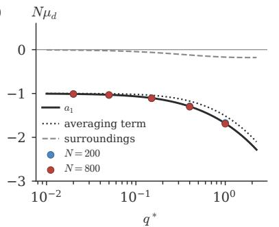

(b)  
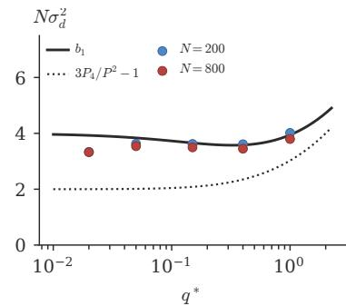  
Figure S1: Drift and variance for $\phi ( u ) = \mathrm { e r f } ( u / \sqrt { 2 } )$ on its mean-field edge of chaos, as Fig. 2(a,b).

## S3.6 Beyond first order

The first-order shift has no closed-form continuation for a nonlinear $\phi \colon$ the next order needs the fourth-order moments of the correlated surroundings. The crinit package [18] instead ofers all orders numerically (option or $\mathtt { l e r } { = } " \mathtt { e x a c t } " )$ : the drift of the exact chain is measured along the

Table S1: Drift and variance of the distance on the mean-field edge of chaos. Theory, Eqs. (8), (9) and $\operatorname { E q . }$ (S34), against the exact chain. $\mu _ { \mathrm { m e a n } }$ is the growth rate of the mean distance.
<table><tr><td> $\phi$ </td><td> $q ^ { * }$ </td><td> $N$ </td><td> $a _ { 1 }$ </td><td> $N \mu _ { d }$ </td><td> $b _ { 1 }$ </td><td> $N \sigma _ { d } ^ { 2 }$ </td><td> $N ( 1 - F ^ { \prime } )$ </td><td> $a _ { 1 } + { \textstyle { \frac { 1 } { 2 } } } b _ { 1 }$ </td><td> $N \mu _ { \mathrm { m e a n } }$ </td></tr><tr><td>tanh</td><td>0.02</td><td>16</td><td>-1.023</td><td>-0.641</td><td>3.87</td><td>1.60</td><td>0.6</td><td>0.91</td><td>0.09</td></tr><tr><td rowspan="4">tanh</td><td>0.02</td><td>64</td><td>-1.023</td><td>-1.003</td><td>3.87</td><td>3.46</td><td>2.4</td><td>0.91</td><td>0.59</td></tr><tr><td>0.02</td><td>256</td><td>-1.023</td><td>-1.027</td><td>3.87</td><td>3.60</td><td>9.7</td><td>0.91</td><td>0.77</td></tr><tr><td>0.05</td><td>16</td><td>-1.064</td><td>-0.927</td><td>3.74</td><td>2.89</td><td>1.4</td><td>0.81</td><td>0.39</td></tr><tr><td>0.05</td><td>64</td><td>-1.064</td><td>-1.084</td><td>3.74</td><td>3.69</td><td>5.6</td><td>0.81</td><td>0.76</td></tr><tr><td rowspan="3">tanh</td><td>0.05</td><td>256</td><td>-1.064</td><td>-1.068</td><td>3.74</td><td>3.62</td><td>22.4</td><td>0.81</td><td>0.75</td></tr><tr><td>0.15</td><td>16</td><td>-1.206</td><td>-1.239</td><td>3.60</td><td>3.72</td><td>3.4</td><td>0.60</td><td>0.34</td></tr><tr><td>0.15</td><td>64</td><td>-1.206</td><td>-1.222</td><td>3.60</td><td>3.67</td><td>13.7</td><td>0.60</td><td>0.69</td></tr><tr><td rowspan="3">tanh</td><td>0.15</td><td>256</td><td>-1.206</td><td>-1.212</td><td>3.60</td><td>3.52</td><td>54.8</td><td>0.60</td><td>0.56</td></tr><tr><td>0.4</td><td>16</td><td>-1.506</td><td>-1.544</td><td>3.78</td><td>4.12</td><td>6.4</td><td>0.38</td><td>-0.06</td></tr><tr><td>0.4</td><td>64</td><td>-1.506</td><td>-1.516</td><td>3.78</td><td>3.89</td><td>25.7</td><td>0.38</td><td>0.51</td></tr><tr><td rowspan="3">tanh</td><td>0.4</td><td>256</td><td>-1.506</td><td>-1.517</td><td>3.78</td><td>3.68</td><td>103.0</td><td>0.38</td><td>0.34</td></tr><tr><td>1</td><td>16</td><td>-2.049</td><td>-2.102</td><td>4.56</td><td>5.12</td><td>9.7</td><td>0.23</td><td>-0.28</td></tr><tr><td>1</td><td>64</td><td>-2.049</td><td>-2.058</td><td>4.56</td><td>4.72</td><td>38.9</td><td>0.23</td><td>0.38</td></tr><tr><td></td><td>1</td><td>256</td><td>-2.049</td><td>-2.066</td><td>4.56</td><td>4.44</td><td>155.8</td><td>0.23</td><td>0.14</td></tr><tr><td>erf</td><td>0.02</td><td>800</td><td>-1.011</td><td>-1.012</td><td>3.93</td><td>3.33</td><td>15.7</td><td>0.95</td><td>0.64</td></tr><tr><td>erf</td><td>0.05</td><td>800</td><td>-1.030</td><td>-1.033</td><td>3.84</td><td>3.54</td><td>38.1</td><td>0.89</td><td>0.74</td></tr><tr><td>erf</td><td>0.15</td><td>800</td><td>-1.104</td><td>-1.111</td><td>3.66</td><td>3.50</td><td>104.3</td><td>0.72</td><td>0.65</td></tr><tr><td>erf</td><td>0.4</td><td>800</td><td>-1.296</td><td>-1.304</td><td>3.58</td><td>3.45</td><td>228.6</td><td>0.50</td><td>0.45</td></tr><tr><td>erf</td><td>1</td><td>800</td><td>-1.682</td><td>-1.692</td><td>3.94</td><td>3.80</td><td>400.0</td><td>0.29</td><td>0.27</td></tr><tr><td>tanh, orth.</td><td>0.02</td><td>200</td><td>-0.004</td><td>-0.005</td><td>0.01</td><td>0.01</td><td>7.6</td><td>0.00</td><td>-0.00</td></tr><tr><td>tanh, orth.</td><td>0.05</td><td>200</td><td>-0.021</td><td>-0.020</td><td>0.04</td><td>0.05</td><td>17.5</td><td>0.00</td><td>0.01</td></tr><tr><td>tanh, orth.</td><td>0.15</td><td>200</td><td>-0.109</td><td>-0.091</td><td>0.23</td><td>0.26</td><td>42.8</td><td>0.01</td><td>0.04</td></tr><tr><td>tanh, orth.</td><td>0.4</td><td>200</td><td>-0.354</td><td>-0.292</td><td>0.74</td><td>0.86</td><td>80.4</td><td>0.01</td><td>0.13</td></tr><tr><td>tanh, orth.</td><td>1</td><td>200</td><td>-0.859</td><td>-0.750</td><td>1.77</td><td>2.01</td><td>121.7</td><td>0.02</td><td>0.27</td></tr></table>

path of the Crinit point (fixed $q ^ { * }$ , or zero bias) and its zero is found by secant steps with common random numbers.

For a homogeneous activation all orders are available in closed form. Let $\phi ( u ) = u$ for $u > 0$ and αu for $u < 0$ . With $z _ { j } = { \sqrt { Q } } \zeta _ { j }$ , the signal of the next layer is $\begin{array} { r } { \sigma _ { w } ^ { 2 } \frac { 1 } { N } \sum _ { j } \phi ( z _ { j } ) ^ { 2 } = \sigma _ { w } ^ { 2 } Q X / N } \end{array}$ 2 where

$$
X = \sum _ { j : \zeta _ { j } > 0 } \zeta _ { j } ^ { 2 } + \alpha ^ { 2 } \sum _ { j : \zeta _ { j } < 0 } \zeta _ { j } ^ { 2 } = \chi _ { K } ^ { 2 } + \alpha ^ { 2 } \chi _ { N - K } ^ { 2 } , \qquad K \sim \mathrm { B i n } ( N , { \frac { 1 } { 2 } } ) ,\tag{S35}
$$

is a sum of a chi-squared variable with K degrees of freedom (the neurons with positive preactivation) and $\alpha ^ { 2 }$ times one with $N - K$ . The typical-preserving variance $\sigma _ { c } ^ { 2 } ( N )$ is the one at which the typical signal is constant, E[ln $\mathsf { \Omega } _ { 1 } ( \sigma _ { c } ^ { 2 } X / N ) \bigr ] = 0$ . Using the integral representation ln $\textstyle x = \int _ { 0 } ^ { \infty } ( e ^ { - t } - e ^ { - t x } ) \mathrm { d } t / t$ and the fact that each neuron contributes to $e ^ { - t { \cal X } }$ the independent factor $\begin{array} { r } { \frac { 1 } { 2 } ( 1 + 2 t ) ^ { - 1 / 2 } + \frac { 1 } { 2 } ( 1 + 2 \alpha ^ { 2 } t ) ^ { - 1 / 2 } } \end{array}$

$$
\ln \sigma _ { c } ^ { 2 } ( N ) = \ln N - \int _ { 0 } ^ { \infty } \Big [ e ^ { - t } - \Big ( \frac { ( 1 + 2 t ) ^ { - 1 / 2 } + ( 1 + 2 \alpha ^ { 2 } t ) ^ { - 1 / 2 } } { 2 } \Big ) ^ { N } \Big ] \frac { \mathrm { d } t } { t } .\tag{S36}
$$

For $\alpha = 1 ~ ( \mathrm { l i n e a r } )$ this is $\ln [ \frac { N } { 2 } e ^ { - \psi ( N / 2 ) } ]$ ; for $\alpha = 0 ~ \mathrm { ( R e L U ) }$ the event $K = 0 ,$ , in which the signal vanishes, is excluded. Table $\mathrm { S 2 }$ compares first order and all orders for tanh. At fixed $q ^ { * }$ (where $\sigma _ { b } ^ { 2 } > 0 )$ the higher orders change the correction by 2 to 9%; on the zero-bias branch, where $q ^ { * }$ moves with $\sigma _ { w } ^ { 2 } ,$ by up to 50% $( L = 9 6 , N = 6 4 \colon \sigma _ { w } ^ { 2 } = 1 . 2 9 8$ instead of 1.311).

Table S2: Crinit for tanh at first order and at all orders in $1 / N .$ . Last column: (all orders  first order)/(first order mean field). Rows with $\sigma _ { b } ^ { 2 } = 0$ are on the zero-bias branch.
<table><tr><td> $L$ </td><td> $N$ </td><td> $q ^ { * }$ </td><td> $\sigma _ { b } ^ { 2 }$ </td><td> $\sigma _ { w } ^ { 2 }$  mean field</td><td> $\sigma _ { w } ^ { 2 }$  first order</td><td> $\sigma _ { w } ^ { 2 }$  all orders</td><td>difference/ correction</td></tr><tr><td>32</td><td>16</td><td>0.681</td><td>0.0000</td><td>1.8704</td><td>2.0906</td><td> $2 . 0 8 4 0 \pm 0 . 0 0 3 7$ </td><td>-3%</td></tr><tr><td>32</td><td>32</td><td>0.309</td><td>0.0000</td><td>1.4697</td><td>1.5357</td><td> $1 . 5 1 7 9 \pm 0 . 0 0 2 8$ </td><td>-27%</td></tr><tr><td>32</td><td>64</td><td>0.306</td><td>0.0065</td><td>1.4655</td><td>1.4980</td><td> $1 . 4 9 7 2 \pm 0 . 0 0 0 4$ </td><td>-2%</td></tr><tr><td>32</td><td>128</td><td>0.306</td><td>0.0097</td><td>1.4655</td><td>1.4816</td><td> $1 . 4 8 1 1 \pm 0 . 0 0 0 4$ </td><td>-3%</td></tr><tr><td>32</td><td>256</td><td>0.306</td><td>0.0114</td><td>1.4655</td><td>1.4736</td><td> $1 . 4 7 3 1 \pm 0 . 0 0 0 4$ </td><td>-6%</td></tr><tr><td>96</td><td>64</td><td>0.171</td><td>0.0000</td><td>1.2857</td><td>1.3108</td><td> $1 . 2 9 8 3 \pm 0 . 0 0 2 9$ </td><td>-50%</td></tr><tr><td>96</td><td>128</td><td>0.143</td><td>0.0008</td><td>1.2443</td><td>1.2560</td><td> $1 . 2 5 5 3 \pm 0 . 0 0 0 3$ </td><td>-6%</td></tr><tr><td>96</td><td>256</td><td>0.143</td><td>0.0014</td><td>1.2443</td><td>1.2502</td><td> $1 . 2 4 9 6 \pm 0 . 0 0 0 3$ </td><td>-9%</td></tr></table>

## S3.7 Many pairs of inputs in one network

The drift and variance above are averages over networks for one pair of inputs. A trained network sees many inputs, so we also ask how ln $D _ { \ell }$ is distributed over pairs of inputs within one network. The pairs share the weights, so their walks are correlated. We propagated $P = 2 0 0$ pairs of nearby inputs (a base input at the steady signal and a random unit tangent vector, as in Section S5) through each of 1000 tanh networks with explicit Gaussian matrices, $N = 6 4 , L = 2 0 0$ , on the mean-field edge of chaos at $\sigma _ { b } ^ { 2 } = 0 . 0 5 ~ ( \sigma _ { w } ^ { 2 } = 1 . 7 6 1 , q ^ { * } = 0 . 5 7 0 , a _ { 1 } = - 1 . 6 7 8 , b _ { 1 } = 3 . 9 9 )$ , and recorded $X _ { L } = \ln ( D _ { L } / D _ { 0 } )$ for every pair (run pairs one network.py [18]). The mean over all pairs and networks is $- 5 . 2 9 \pm 0 . 0 7$ , against $a _ { 1 } L / N = - 5 . 2 4 \colon$ the drift $\mu _ { d }$ is also the rate at which the distances of the pairs within a network shrink on average. The variance of $X _ { L }$ over all pairs and networks is 12.2, against $b _ { 1 } L / N = 1 2 . 5$ . It splits into a part common to all pairs of a network, the variance across networks of the per-network mean, 4.9 (40%), and a part specific to the pair, the variance across pairs within a network, 7.3 (60%). So a single network is not described by one number: two fifths of the spread of ln $D _ { L }$ is a property of the network, which shifts all its pairs together, and three fifths is a property of the pair. In 93% of all pairs the distance shrinks $( X _ { L } < 0 )$

## S4 Orthogonal weights

With orthogonal weights the hidden matrices are $W \ : = \ : \sigma _ { w } O$ , where $O$ is a random (Haardistributed) orthogonal $N \times N$ matrix. An orthogonal matrix preserves lengths and inner products, so for the activations $y , y ^ { \prime }$ of a layer

$$
\frac { 1 } { N } \sum _ { i } \Big ( \sum _ { j } W _ { i j } y _ { j } \Big ) ^ { 2 } = \sigma _ { w } ^ { 2 } \frac { 1 } { N } \sum _ { j } y _ { j } ^ { 2 } , \qquad \frac { 1 } { N } \sum _ { i } \Big ( \sum _ { j } W _ { i j } y _ { j } \Big ) \Big ( \sum _ { k } W _ { i k } y _ { k } ^ { \prime } \Big ) = \sigma _ { w } ^ { 2 } \frac { 1 } { N } \sum _ { j } y _ { j } y _ { j } ^ { \prime } ,\tag{S37}
$$

exactly, with no fluctuation. The three quadratic forms $\begin{array} { r } { \frac { 1 } { N } \sum z _ { j } ^ { 2 } , ~ \frac { 1 } { N } \sum z _ { j } \delta _ { j } } \end{array}$ and $\frac { 1 } { N } \sum \delta _ { j } ^ { 2 }$ of a layer are therefore fixed by the previous layer, whereas with Gaussian weights they fluctuate by amounts of order $N ^ { - 1 / 2 }$ . The mean-field theory is unchanged (it uses only the means), but the finite-width terms of Section S3 change.

To leading order in $1 / N$ the rule is as follows. With Gaussian weights the fluctuation of a per-neuron average $\begin{array} { r } { \frac { 1 } { N } \sum _ { j } f ( z _ { j } , \delta _ { j } ) } \end{array}$ is Var $f / N$ . With orthogonal weights the part of $f$ that is a linear combination of $z ^ { 2 } , \ z \delta$ and $\delta ^ { 2 }$ does not fluctuate, so the variance to use is that of $f$ minus its projection onto the span of $\bigl \{ z ^ { 2 } , z \delta , \delta ^ { 2 } \bigr \}$ . As an example, take the averaging term, $f = w = \phi ^ { \prime } ( z ) ^ { 2 } \eta ^ { 2 }$ with $\eta = \delta / \sqrt { D }$ at $r = 0$ . The projection coeficients are covariances divided by variances:

$$
\frac { \mathrm { C o v } ( w , z ^ { 2 } ) } { \mathrm { V a r } ( z ^ { 2 } ) } = \frac { \mathbb { E } [ \phi ^ { \prime 2 } z ^ { 2 } ] - P Q } { 2 Q ^ { 2 } } = P ^ { \prime } , \qquad \frac { \mathrm { C o v } ( w , \eta ^ { 2 } ) } { \mathrm { V a r } ( \eta ^ { 2 } ) } = \frac { 3 P - P } { 2 } = P , \qquad \mathrm { C o v } ( w , z \eta ) = 0 ,\tag{S38}
$$

where $\mathbb { E } [ \phi ^ { \prime 2 } z ^ { 2 } ] = Q ( P + 2 Q P ^ { \prime } )$ follows as in $\operatorname { E q . }$ . (S23), $\mathrm { V a r } ( z ^ { 2 } ) = 2 Q ^ { 2 }$ and $\mathrm { V a r } ( \eta ^ { 2 } ) = 2$ . The variance removed is $P ^ { \prime 2 } \cdot 2 Q ^ { 2 } + P ^ { 2 } \cdot 2$ , so Var $w = 3 P _ { 4 } - P ^ { 2 }$ becomes $3 P _ { 4 } - 3 P ^ { 2 } - 2 Q ^ { 2 } P ^ { \prime 2 }$ . Treating the other three one-layer variances of Section S3 in the same way (with Eqs. (S2) and (S3)) gives the replacements

$$
\begin{array} { r l } { \frac { 3 P _ { 4 } } { P ^ { 2 } } - 1  \frac { 3 P _ { 4 } - 3 P ^ { 2 } - 2 q ^ { 2 } P ^ { \prime 2 } } { P ^ { 2 } } , } & { \sigma _ { w } ^ { 4 } ( V _ { 4 } - V ^ { 2 } )  \sigma _ { w } ^ { 4 } ( V _ { 4 } - V ^ { 2 } - 2 q ^ { 2 } V ^ { \prime 2 } ) , } \\ { \frac { \sigma _ { w } ^ { 2 } \mathbb { E } [ ( \phi \phi ^ { \prime } ) ^ { 2 } ] } { q P }  \frac { \sigma _ { w } ^ { 2 } ( \mathbb { E } [ ( \phi \phi ^ { \prime } ) ^ { 2 } ] - q V ^ { \prime 2 } ) } { q P } , } & { \frac { \sigma _ { w } ^ { 2 } ( \mathbb { E } [ \phi ^ { 2 } \phi ^ { \prime 2 } ] - P V ) } { P }  \frac { \sigma _ { w } ^ { 2 } ( \mathbb { E } [ \phi ^ { 2 } \phi ^ { \prime 2 } ] - P V - 2 q ^ { 2 } P ^ { \prime } V ^ { \prime } ) } { P } , } \end{array}\tag{S39}
$$

all evaluated at $q = q ^ { * } ; a _ { 1 }$ and $b _ { 1 }$ are then assembled as before. All four vanish for a linear activation: a linear orthogonal network has no finite-width shift at all (Refs. [19, 20]), and they vanish as $q ^ { * } \to 0$ for tanh (Ref. [21]). For tanh at $\sigma _ { b } ^ { 2 } = 0 . 0 5$ they give $a _ { 1 } = - 0 . 5 1$ against 1.68 for Gaussian weights, and the measured shift is about four times smaller [Fig. 2(c)]. Eq. (S39) neglects corrections of order $1 / N$ to the distribution of a single neuron, which is not exactly Gaussian for orthogonal weights. The measured drift is 13 to 18% smaller in magnitude than Eq. (S39) gives (Table S1); these corrections may account for part of the diference, but we have not computed them, and the discrepancy remains untraced.

## S5 Gradients perform the same walk

This section proves the statement of Sec. III B of the main text: the squared norm of a backpropagated gradient has the same distribution as the squared norm of a propagated perturbation, in every network. It then checks the statement with explicit weight matrices.

## S5.1 Setting

Write $y ^ { ( \ell ) } = \phi ( z ^ { ( \ell ) } )$ for the activations of layer ℓ and $D _ { \ell } = \mathrm { d i a g } \big ( \phi ^ { \prime } ( z _ { 1 } ^ { ( \ell ) } ) , \dots , \phi ^ { \prime } ( z _ { N } ^ { ( \ell ) } ) \big )$ for the diagonal matrix of slopes. By Eq. (1), a small change $\delta z ^ { ( \ell ) }$ of the pre-activations of layer ℓ changes

those of layer $\ell + 1$ by $\delta \boldsymbol { z } ^ { ( \ell + 1 ) } = \boldsymbol { W } ^ { ( \ell + 1 ) } \boldsymbol { D } _ { \ell } \delta \boldsymbol { z } ^ { ( \ell ) }$ . The Jacobian of the output pre-activations $z ^ { ( L ) }$ with respect to the first pre-activations $z ^ { ( 0 ) }$ is therefore the product

$$
J = W ^ { ( L ) } D _ { L - 1 } W ^ { ( L - 1 ) } D _ { L - 2 } \cdot \cdot \cdot W ^ { ( 1 ) } D _ { 0 } ,\tag{S40}
$$

an $N \times N$ matrix that depends on the network and on the input. Two objects are propagated through J:

ˆ Forward. A small diference $\mathbf { v } = z ^ { ( 0 ) } - z ^ { \prime ( 0 ) }$ between two inputs becomes $J \mathbf { v }$ at layer $L .$ . The forward walk of the main text is $\begin{array} { r } { X _ { L } = \ln ( \Vert J \mathbf { v } \Vert ^ { 2 } / \Vert \mathbf { v } \Vert ^ { 2 } ) = \sum _ { \ell < L } s _ { \ell } . } \end{array}$

ˆ Backward. For a loss ${ \mathcal { L } } ,$ let $\mathbf { g } ^ { ( \ell ) } = \partial \mathcal { L } / \partial z ^ { ( \ell ) }$ be the gradient with respect to the pre-activations of layer ℓ. The chain rule gives the backpropagation recursion

$$
\begin{array} { r } { \mathbf { g } ^ { ( \ell ) } = D _ { \ell } W ^ { ( \ell + 1 ) \top } \mathbf { g } ^ { ( \ell + 1 ) } , \qquad \mathrm { s o } \qquad \mathbf { g } ^ { ( 0 ) } = J ^ { \top } \mathbf { u } , \quad \mathbf { u } = \mathbf { g } ^ { ( L ) } . } \end{array}\tag{S41}
$$

For the loss $\mathcal { L } \ = \ \mathbf { u } \cdot \boldsymbol { z } ^ { ( L ) }$ the output gradient is u itself. The backward walk is $Y _ { L } \ =$ $\begin{array} { r } { \ln ( \| J ^ { \top } \mathbf { u } \| ^ { 2 } / \| \mathbf { u } \| ^ { 2 } ) = \sum _ { \ell } t _ { \ell } } \end{array}$ , with steps $t _ { \ell } = \ln ( \| \mathbf { g } ^ { ( \ell ) } \| ^ { 2 } / \| \mathbf { g } ^ { ( \ell + 1 ) } \| ^ { 2 } )$

The gradient with respect to the weights of layer $\ell + 1$ is the outer product $\partial \mathcal { L } / \partial W ^ { ( \ell + 1 ) } =$ $\mathbf { g } ^ { ( \ell + 1 ) } \boldsymbol { y } ^ { ( \ell ) \top }$ , whose squared norm is $\| \mathbf { g } ^ { ( \ell + 1 ) } \| ^ { 2 } \| y ^ { ( \ell ) } \| ^ { 2 }$ . The activation norm $\begin{array} { r } { { \bf \hat { \lVert } } y ^ { ( \ell ) } \lVert ^ { 2 } = N \frac { 1 } { N } \sum _ { j } \phi ( z _ { j } ) ^ { 2 } } \end{array}$ fluctuates about $N V ( q ^ { * } )$ without drifting, so the weight gradients across depth follow the profile of $\| \mathbf { g } ^ { ( \ell ) } \| ^ { 2 }$

## S5.2 The identity

Claim. Let v and u be standard Gaussian vectors in $\mathbb { R } ^ { N }$ , independent of the network. Then, for every network,

$$
{ \frac { \| J \mathbf { v } \| ^ { 2 } } { \| \mathbf { v } \| ^ { 2 } } } \quad { \mathrm { a n d } } \quad { \frac { \| J ^ { \top } \mathbf { u } \| ^ { 2 } } { \| \mathbf { u } \| ^ { 2 } } } \quad { \mathrm { h a v e ~ t h e ~ s a m e ~ d i s t r i b u t i o n ~ g i v e n ~ } } J .\tag{S42}
$$

Consequently $X _ { L }$ and $Y _ { L }$ have the same distribution over networks, for every width, depth, activation and weight distribution.

Proof. Write the singular value decomposition $\begin{array} { r } { J = \sum _ { i = 1 } ^ { N } \sigma _ { i } \mathbf { p } _ { i } \mathbf { q } _ { i } ^ { \top } } \end{array}$ , where $\left\{ \mathbf { p } _ { i } \right\}$ and $\left\{ \mathbf { q } _ { i } \right\}$ are two orthonormal bases of $\mathbf { \mathbb { R } } ^ { N }$ and $\sigma _ { i } \geq 0$ are the singular values. Then

$$
J \mathbf { v } = \sum _ { i } \sigma _ { i } \mathbf { p } _ { i } ( \mathbf { q } _ { i } \cdot \mathbf { v } ) , \qquad J ^ { \top } \mathbf { u } = \sum _ { i } \sigma _ { i } \mathbf { q } _ { i } ( \mathbf { p } _ { i } \cdot \mathbf { u } ) ,\tag{S43}
$$

and, since the $\mathbf { p } _ { i }$ (and the $\mathbf { q } _ { i } )$ are orthonormal,

$$
\| J \mathbf { v } \| ^ { 2 } = \sum _ { i } \sigma _ { i } ^ { 2 } \left( \mathbf { q } _ { i } \cdot \mathbf { v } \right) ^ { 2 } , \qquad \quad \| \mathbf { v } \| ^ { 2 } = \sum _ { i } ( \mathbf { q } _ { i } \cdot \mathbf { v } ) ^ { 2 } ,
$$

$$
\| J ^ { \top } \mathbf { u } \| ^ { 2 } = \sum _ { i } \sigma _ { i } ^ { 2 } \left( \mathbf { p } _ { i } \cdot \mathbf { u } \right) ^ { 2 } ,
$$

$$
\| \mathbf { u } \| ^ { 2 } = \sum _ { i } ( \mathbf { p } _ { i } \cdot \mathbf { u } ) ^ { 2 } .\tag{S44}
$$

A standard Gaussian vector is invariant under rotations, so its coordinates in any orthonormal basis are independent standard Gaussians. Given $J ,$ the numbers $\zeta _ { i } = \mathbf { q } _ { i } \cdot \mathbf { v }$ are therefore independent standard Gaussians, and so are the numbers $\zeta _ { i } ^ { \prime } = \mathbf { p } _ { i } \cdot \mathbf { u }$ . Both ratios in $\operatorname { E q }$ . (S42) have the form $\textstyle \sum _ { i } \sigma _ { i } ^ { 2 } \zeta _ { i } ^ { 2 } / \sum _ { i } \zeta _ { i } ^ { 2 }$ with the same $\sigma _ { i }$ and independent standard Gaussian $\zeta _ { i } ,$ so they have the same distribution. □

Three remarks on the identity:

ˆ It uses only that J and $J ^ { \top }$ have the same singular values and that the two probes are isotropic. It holds for Gaussian, orthogonal and non-Gaussian weights alike.

ˆ It does not assume that the weights of the backward pass are independent of those of the forward pass, the assumption usually made to compute gradient statistics in mean-field theory [2]. It is exact because the two passes use the same weights.

ˆ It needs a probe u that is isotropic and independent of the network. For a real loss, u depends on the output of the network (for cross-entropy, u is the read-out weights applied to the diference between the predicted and the true class probabilities), and the identity holds only approximately. Section S5.5 measures the diference for the cross-entropy loss on MNIST and finds none within the errors.

## S5.3 Consequences

1. Same drift and variance. By $\mathrm { E q . ~ } ( \mathrm { S 4 2 } ) , \mathbb { E } [ Y _ { L } ] = \mathbb { E } [ X _ { L } ]$ and Var $Y _ { L } = \mathrm { V a r } X _ { L }$ for every L. The forward walk has $\mathbb { E } [ X _ { L } ] \simeq L ( \ln \chi _ { 1 } + a _ { 1 } / N )$ and Var $X _ { L } \simeq L b _ { 1 } / N$ beyond a short transient (Section S3), so the log squared gradient norm has the drift ln $\chi _ { 1 } + a _ { 1 } / N$ and the long-run variance $b _ { 1 } / N$ per layer, with the same $a _ { 1 }$ and $b _ { 1 }$ .

2. Same steps. After the first few layers the forward chain is stationary: the product of any k consecutive factors, $W ^ { ( \ell + k ) } D _ { \ell + k - 1 } \cdot \cdot \cdot W ^ { ( \ell + 1 ) } D _ { \ell }$ , has the same distribution for every ℓ. Applying the claim to this product shows that the backward walk over the k layers below the output has the distribution of the forward walk over k layers. The mean steps of the two walks are therefore equal at every distance from where the walk starts, including the stationary drift.

3. Same critical point. The typical gradient norm neither grows nor decays where ln $\chi _ { 1 } = - a _ { 1 } / N$ the finite-width edge of chaos of Eq. (10). An initialisation on that line, such as Crinit, keeps both the typical distance and the typical gradient level across depth.

4. Typical against mean. As for the distance (Sec. III C), the mean of $\| J ^ { \top } \mathbf { u } \| ^ { 2 } / \| \mathbf { u } \| ^ { 2 }$ grows on the mean-field edge of chaos at the rate $( a _ { 1 } + \frac { 1 } { 2 } b _ { 1 } ) / N$ , while its median decays at the rate $a _ { 1 } / N$ . Mean-field calculations of the mean squared gradient [2, 22] describe the mean, which at depths $L \gtrsim N$ is carried by a few networks.

## S5.4 Numerical check

We drew explicit Gaussian weight matrices for tanh networks at $\sigma _ { b } ^ { 2 } = 0 . 0 5$ on the mean-field edge of chaos $( \sigma _ { w } ^ { 2 } = 1 . 7 6 1$ 2 $q ^ { * } = 0 . 5 7 0 )$ , $L = 4 0 0$ layers, $N = 1 6$ to 256, and 1000 to 4000 networks per width. In each network one input at the steady signal is propagated forward together with a random tangent vector v, and a random u is then backpropagated through the same matrices by Eq. (S41). Both vectors are rescaled to unit norm after every layer and the logarithms of the rescaling factors are summed. The stationary drift is the mean step after a burn-in of 100 layers (from the input for the forward walk, from the output for the backward walk); the long-run variance is computed from sums over blocks of 100 layers, as in Section S3.

Table S3 and Fig. S2 show the result. The forward and backward walks agree within their errors at every width, in the drift, in the long-run variance, and in the whole distribution of the sums [Fig. S2(a)], and both agree with $a _ { 1 }$ and $b _ { 1 }$ . At $N = 6 4$ , 96 layers below the output, the median of $\| \mathbf { g } ^ { ( L - \bar { 9 6 } ) } \| ^ { 2 } / \| \mathbf { g } ^ { ( L ) } \| ^ { 2 }$ is 0.076 on the mean-field edge of chaos (prediction $e ^ { 9 6 a _ { 1 } / 6 4 } = 0 . 0 8 1 )$ and its mean is 1.6; the quartiles are 0.015 and 0.43. On the finite-width edge of chaos at the same bias $( \sigma _ { w } ^ { 2 } = 1 . 8 8 4$ , the first-order shift for $N = 6 4 )$ the median is $0 . 8 3 [ \mathrm { F i g . \ S 2 ( c ) } ]$ . The small remaining decay comes from linearising the shift in Eq. (10): at $\sigma _ { w } ^ { 2 } = 1 . 8 8 4$ , ln $\chi _ { 1 } = 0 . 0 2 5 0$ rather than $- a _ { 1 } / N = 0 . 0 2 6 2$ , and $a _ { 1 } = - 1 . 7 4$ there, which predicts $N \mu = - 0 . 1 5 ;$ the measured drifts $\mathrm { a r e \ - 0 . 1 3 \pm 0 . 0 2 }$ (forward) and $- 0 . 1 4 \pm 0 . 0 2$ (backward). The all-orders option of Section S3.6 removes this residue.

## S5.5 A real loss

To test the third remark on the identity (Sec. S5.2) we repeated the backward measurement with the gradient of a real loss instead of an isotropic probe (backward crossentropy.py [18]). Each network (tanh, $N = 6 4 , L = 4 0 0 , \sigma _ { b } ^ { 2 } = 0 . 0 5$ , explicit Gaussian matrices) receives a first layer from the 784 standardised pixels of an MNIST image, with the weight variance $( q ^ { * } - \sigma _ { b } ^ { 2 } ) / 7 8 4$ of the training runs, and a linear read-out of ten classes with weight variance $1 / N$ . For four images per network and 2000 networks, the cross-entropy gradient at the output, $\mathbf { u } = W _ { \mathrm { o u t } } ^ { \top } ( \mathbf { p } - \mathbf { e } _ { \mathrm { t r u e } } )$ with p the predicted class probabilities, is backpropagated by Eq. (S41), and so is an isotropic Gaussian probe through the same matrices; the drift and the long-run variance are measured as in Sec. ${ \mathrm { S 5 . 4 } } ,$ after a burn-in of 100 layers from the output. On the mean-field edge of chaos $( \sigma _ { w } ^ { 2 } = 1 . 7 6 1 )$ the drift is $N \mu = - 1 . 6 9 2 \pm 0 . 0 1 0$ for the cross-entropy gradient and $- 1 . 7 0 4 \pm 0 . 0 1 1$ for the isotropic probe $( a _ { 1 } = - 1 . 6 7 8 )$ ; the long-run variances are $N \sigma ^ { 2 } = 4 . 2 3$ and 4.27 $( b _ { 1 } = 3 . 9 9 ) ;$ ; and the median of $\| \mathbf { g } ^ { ( L - 9 6 ) } \| ^ { 2 } / \| \mathbf { g } ^ { ( L ) } \| ^ { 2 }$ is 0.076 and 0.078, with quartiles $( 0 . 0 1 5 , 0 . 3 8 )$ in both cases. On the finite-width edge of chaos at the same bias $( \sigma _ { w } ^ { 2 } = 1 . 8 8 4 )$ the drift is $- 0 . 1 2 7 \pm 0 . 0 1 1$ against $- 0 . 1 2 5 { \pm } 0 . 0 1 1$ , and the median 0.81 against 0.85. The gradient of the real loss therefore performs the same walk as the isotropic probe within the errors: the output gradient of a random network is as good as isotropic for this purpose, because the read-out weights are random and independent of the hidden layers.

Table S3: Forward and backward walks through the same networks. tanh, $\sigma _ { b } ^ { 2 } = 0 . 0 5 , \sigma _ { w } ^ { 2 } = 1 . 7 6 1$ $L = 4 0 0$ , explicit Gaussian matrices. $N \mu \colon$ width times the stationary drift per layer (mean standard error over networks); $N \sigma ^ { 2 } ;$ : width times the long-run variance per layer. Theory: $a _ { 1 }$ and $b _ { 1 }$ of Eq. (9) and Eq. (S34).
<table><tr><td>N</td><td>networks</td><td> $N \mu ,$  forward</td><td> $N \mu ,$  backward</td><td> $N \sigma ^ { 2 } .$  forward</td><td> $N \sigma ^ { 2 } ,$  backward</td></tr><tr><td>16</td><td>4000</td><td> $- 1 . 7 2 2 \pm 0 . 0 0 8$ </td><td> $- 1 . 7 2 2 \pm 0 . 0 0 8$ </td><td>4.42</td><td>4.39</td></tr><tr><td>32</td><td>4000</td><td> $\cdot 1 . 6 8 6 \pm 0 . 0 1 1$ </td><td> $- 1 . 6 8 5 \pm 0 . 0 1 1$ </td><td>4.14</td><td>4.15</td></tr><tr><td>64</td><td>4000</td><td> $- 1 . 6 8 1 \pm 0 . 0 1 5$ </td><td> $- 1 . 6 8 2 \pm 0 . 0 1 5$ </td><td>4.13</td><td>4.13</td></tr><tr><td>128</td><td>2000</td><td> $- 1 . 6 7 7 \pm 0 . 0 2 9$ </td><td> $- 1 . 6 6 5 \pm 0 . 0 2 9$ </td><td>4.08</td><td>4.02</td></tr><tr><td>256</td><td>1000</td><td> $- 1 . 6 7 6 \pm 0 . 0 5 9$ </td><td> $- 1 . 6 7 3 \pm 0 . 0 5 9$ </td><td>3.99</td><td>4.13</td></tr><tr><td>theory</td><td></td><td> $- 1 . 6 7 8$ </td><td> $- 1 . 6 7 8$ </td><td>3.99</td><td>3.99</td></tr></table>

(a)  
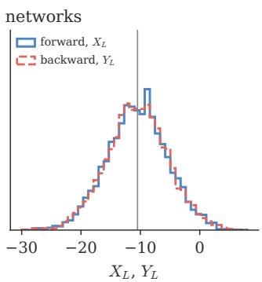

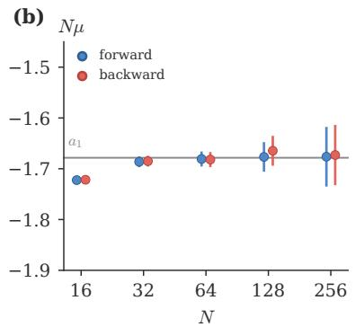

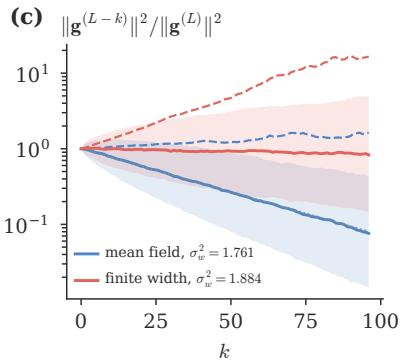  
Figure S2: Gradients perform the same walk as distances. (a) Distribution over 4000 networks $( N = 6 4 , \ L = 4 0 0 )$ of the forward sum $X _ { L } = \ln ( \| J \mathbf { v } \| ^ { 2 } / \| \mathbf { v } \| ^ { 2 } )$ (solid) and the backward sum $Y _ { L } =$ $\mathrm { l n } ( \| J ^ { \top } \mathbf { u } \| ^ { 2 } / \| \mathbf { u } \| ^ { 2 } )$ (dashed), through the same networks; grey line: $L a _ { 1 } / N .$ (b) Width times the stationary drift of the two walks against $N ;$ grey line: $a _ { 1 }$ . (c) Squared gradient norm k layers below the output relative to the output, $N = 6 4 \colon$ median (solid), mean (dashed) and quartiles (band), on the mean-field edge of chaos and on the finite-width edge of chaos at the same bias; dotted: $e ^ { k \mathrm { { \dot { a } } _ { 1 } } / N }$

## S6 Avalanches of the distance

Let $X _ { \ell } = \ln ( d _ { \ell } ^ { 2 } / d _ { 0 } ^ { 2 } )$ be the walk of the log-distance at the finite-width edge of chaos, where its drift is zero. An avalanche is an excursion of $X _ { \ell }$ above zero: it starts when X becomes positive and ends at the first layer at which X returns to zero. Its duration $T$ is the number of layers it lasts, and its size is $\begin{array} { r } { S = \sum _ { \ell \leq T } X _ { \ell } } \end{array}$ , the area under the excursion.

The steps $s _ { \ell }$ of the walk have zero mean, finite variance $b _ { 1 } / N$ and correlations that decay over the settling time of the surroundings (Section S3.2). On scales longer than that, $X _ { \ell }$ is a Brownian motion with difusion constant $b _ { 1 } / N$ , and the excursions of a Brownian motion have the known statistics [23, 24]

$$
P ( T \geq n ) \propto n ^ { - 1 / 2 } , \qquad P ( T ) \propto T ^ { - 3 / 2 } , \qquad S \propto T ^ { 3 / 2 } , \qquad P ( S ) \propto S ^ { - 4 / 3 } ,\tag{S45}
$$

with a semicircular mean shape. This is the class of a random walk with an absorbing boundary (class B of Ref. [25]; exponents (1.34, 1.53) were measured for the signal size in Ref. [11]). It is not the class of mean-field directed percolation, which has $\begin{array} { r } { \tau _ { s } = \frac { 3 } { 2 } } \end{array}$ and $\tau _ { t } = 2$ . The prefactor of the survival probability is not universal: the measured $P ( T \geq n )$ exceeds the result for independent steps, $\binom { 2 n } { n } 4 ^ { - n } \ [ 2 6 ]$ , by 4 to 9% at $N = 2 5 6$ , 11 to 28% at $N = 6 4$ and 19 to 43% at $N = 1 6$ , for $1 0 \leq n \leq 3 0 0 0 \ ( 3$ to $6 \times 1 0 ^ { 4 }$ walks of up to 4000 layers), because successive steps are correlated through the surroundings.

## S7 Information about input similarity

## S7.1 Method

The measurement of Fig. 4 asks how precisely the similarity of two inputs can be read of their representations at depth L. For one network:

1. Draw $K = 1 2 8$ pairs of inputs at the steady signal $q ^ { * }$ , with input decorrelations $\varepsilon _ { 0 } = 1 - C _ { 0 }$ spread log-uniformly over $[ 1 0 ^ { - 3 } , 1 ]$

2. Send all pairs through the same network, built from explicit Gaussian weight matrices, for L layers, and measure the output decorrelation $\varepsilon _ { L } = 1 - C _ { L }$ of every pair.

3. With $x = \ln \varepsilon _ { 0 }$ and $y = \ln \varepsilon _ { L }$ , fit a cubic polynomial $f ( x )$ to the K points $( x , y )$

The information and the compression are then

$$
I = \frac { 1 } { 2 } \log _ { 2 } \left( 1 + \frac { \mathrm { V a r } f ( x ) } { \mathrm { V a r } [ y - f ( x ) ] } \right) \mathrm { ( b i t s ~ p e r ~ p a i r ) } , \qquad \gamma = \left[ x _ { \operatorname* { m a x } } - x _ { \operatorname* { m i n } } \right] - \left[ f ( x _ { \operatorname* { m a x } } ) - f ( x _ { \operatorname* { m i n } } ) \right] \mathrm { ( n a t s ) } .\tag{S46}
$$

I is the information capacity of a Gaussian channel whose signal is the fitted curve and whose noise is the scatter of the points about it: it is reduced when the curve is flat (compression) and when the scatter is large (finite-width noise). It is a proxy for the information that the output geometry carries about the input geometry, not a bound on ${ \mathrm { i t } } ,$ since it treats the scatter as Gaussian noise and ignores the signal size; the mutual information itself would need the full joint distribution of $( x , y )$ , which 128 pairs do not determine. The degree of the polynomial matters little: refitting the same networks with polynomials of degree 2, 3, 4 and 5 changes I by at most 0.02 bits $( L = 4 0$ and 160, $N = 6 4$ and 256, $q ^ { * }$ from 0.01 to 1, 16 networks per point), less than the statistical error, and the small monotonic increase with the degree is the usual absorption of noise by extra parameters. $\gamma$ is the amount by which the logarithmic range of similarities has shrunk between input and output; $\gamma = 0$ means the range is preserved and $\gamma = 1$ that it has shrunk by a factor e. Each point of ${ \mathrm { F i g . } }$ 4 is a mean over 40 networks (16 at $L = 1 6 0 )$ . The references are ReLU at $( \sigma _ { w } ^ { 2 } , \sigma _ { b } ^ { 2 } ) = ( 2 , 0 )$ and a linear network at $( 1 , 0 )$ . When the noise is large $( L = 1 6 0 )$ the end points of the cubic fit are noisy, and the measured γ scatters by up to 0.5 nats below the mean-field curve at small $\kappa L$ [Fig. 4(b)]. The plateau points of Fig. 4(a) scatter by 1.4 times their error bars $( \chi ^ { 2 }$ per point between 0.2 and 2.4).

## S7.2 The mean-field compression and the spread of the signal size

The mean-field curve of Fig. $4 ( \mathrm { b } )$ is obtained by iterating the exact one-layer map for a finite distance,

$$
\begin{array} { r } { \varepsilon ^ { \prime } = \frac { \sigma _ { w } ^ { 2 } } { 2 q ^ { * } } \mathbb { E } \Big [ \big ( \phi ( m + \frac { \delta } { 2 } ) - \phi ( m - \frac { \delta } { 2 } ) \big ) ^ { 2 } \Big ] , \qquad m \sim \mathcal { N } ( 0 , q ^ { * } - d ^ { 2 } / 4 ) , \quad \delta \sim \mathcal { N } ( 0 , d ^ { 2 } ) , \quad d ^ { 2 } = 2 q ^ { * } \varepsilon , } \end{array}\tag{S47}
$$

from $\varepsilon _ { 0 } = 1 0 ^ { - 3 }$ and from $\varepsilon _ { 0 } = 1$ , and taking the diference of the logarithms as in the measurement. (Here m is the mean and δ the diference of the two pre-activations of a neuron.)

Finite width also makes the signal size difer from input to input. By Eq. (S27) the deviation xℓ of the signal size is an $\operatorname { A R } ( 1 )$ process driven by $\nu _ { \ell } ,$ so after L layers its variance is Var $\nu \left( 1 - \right.$ $F ^ { \prime 2 L } ) / ( 1 - F ^ { \prime 2 } )$ ; the measured size $\begin{array} { r } { \hat { q } _ { L } = \frac { 1 } { N } \sum _ { j } z _ { j } ^ { 2 } } \end{array}$ adds the variance $2 / N$ of a chi-squared estimate from N numbers. Dividing by $q ^ { * 2 }$ to pass to the logarithm,

$$
\mathrm { V a r l n } \hat { q } _ { L } \approx \frac { \sigma _ { w } ^ { 4 } ( V _ { 4 } - V ^ { 2 } ) } { N q ^ { * 2 } } \frac { 1 - F ^ { \prime 2 L } } { 1 - F ^ { \prime 2 } } + \frac { 2 } { N } \approx \left\{ 2 L / N , L \ll \xi _ { q } , \right.\tag{S48}
$$

where the limits use $\sigma _ { w } ^ { 4 } ( V _ { 4 } - V ^ { 2 } ) / q ^ { * 2 } \to 2$ and $1 - F ^ { \prime } \to 2 q ^ { * }$ for tanh at small $q ^ { * }$ . Figure $\mathrm { S 3 ( a ) }$ compares this with the measured spread.

(a)  
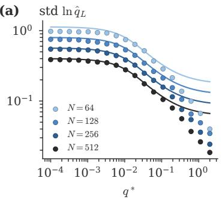

(b)  
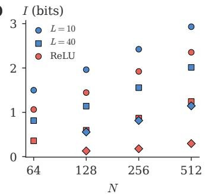

(c)  
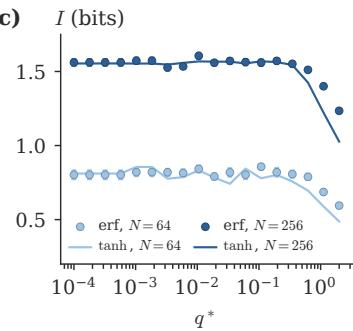  
Figure S3: Spread of the signal size, plateau, and a second activation. (a) Standard deviation of ln $\hat { q } _ { L }$ across inputs, $L = 4 0 ~ \mathrm { ( d o t s ) }$ , and Eq. (S48) (lines). (b) Plateau (I averaged over $q ^ { * } < 0 . 0 2 )$ and ReLU information for every $( L , N )$ . (c) erf on its own edge of chaos (dots) and tanh (lines), $L = 4 0$ $N = 6 4$ and 256: same plateau, fall where each reaches γ 1.

## S8 Training on MNIST

## S8.1 Protocol

ˆ Networks: L hidden layers of width $N = 6 4 \ ( N = 3 2$ in Section S8.3), no normalisation, no skip connections; a linear read-out with weight variance $1 / N$ and zero bias.

ˆ Data and training: the 60 000 MNIST training images [27], each pixel standardised to zero mean and unit variance; cross-entropy loss; SGD with momentum 0.9, batches of 128, two epochs (936 steps).

Table S4: Information plateau, ReLU and linear references (bits per pair, mean $\pm$ standard error). ReLU transmits 1.3–1.4 (L = 10), 1.6–2.3 $( L = 4 0 )$ and 3.9–4.6 $( L = 1 6 0 )$ times fewer bits than the plateau.
<table><tr><td> $L$ </td><td> $N$ </td><td>plateau  $( q ^ { * } < 0 . 0 2 )$ </td><td>best  $q ^ { * }$ </td><td>ReLU</td><td>linear</td></tr><tr><td>10</td><td>64</td><td> $1 . 5 0 \pm 0 . 0 0$ </td><td>0.0001</td><td> $1 . 0 6 \pm 0 . 0 2$ </td><td> $1 . 5 2 \pm 0 . 0 2$ </td></tr><tr><td>10</td><td>128</td><td> $1 . 9 6 \pm 0 . 0 0$ </td><td>0.061</td><td> $1 . 4 5 \pm 0 . 0 1$ </td><td> $1 . 9 8 \pm 0 . 0 2$ </td></tr><tr><td>10</td><td>256</td><td> $2 . 4 2 \pm 0 . 0 0$ </td><td>0.11</td><td> $1 . 9 2 \pm 0 . 0 2$ </td><td> $2 . 4 3 \pm 0 . 0 1$ </td></tr><tr><td>10</td><td>512</td><td> $2 . 9 3 \pm 0 . 0 1$ </td><td>0.00057</td><td> $2 . 3 5 \pm 0 . 0 1$ </td><td> $2 . 9 2 \pm 0 . 0 1$ </td></tr><tr><td>40</td><td>64</td><td> $0 . 8 1 \pm 0 . 0 1$ </td><td>0.0018</td><td> $0 . 3 6 \pm 0 . 0 1$ </td><td> $0 . 7 8 \pm 0 . 0 3$ </td></tr><tr><td>40</td><td>128</td><td> $1 . 1 4 \pm 0 . 0 1$ </td><td>0.061</td><td> $0 . 6 0 \pm 0 . 0 1$ </td><td> $1 . 1 0 \pm 0 . 0 2$ </td></tr><tr><td>40</td><td>256</td><td> $1 . 5 6 \pm 0 . 0 0$ </td><td>0.11</td><td> $0 . 8 7 \pm 0 . 0 2$ </td><td> $1 . 5 2 \pm 0 . 0 2$ </td></tr><tr><td>40</td><td>512</td><td> $2 . 0 1 \pm 0 . 0 1$ </td><td>0.11</td><td> $1 . 2 4 \pm 0 . 0 1$ </td><td> $2 . 0 2 \pm 0 . 0 2$ </td></tr><tr><td>160</td><td>128</td><td> $0 . 5 6 \pm 0 . 0 0$ </td><td>0.011</td><td> $0 . 1 3 \pm 0 . 0 1$ </td><td> $0 . 5 2 \pm 0 . 0 2$ </td></tr><tr><td>160</td><td>256</td><td> $0 . 8 2 \pm 0 . 0 2$ </td><td>0.00057</td><td> $0 . 1 8 \pm 0 . 0 2$ </td><td> $0 . 7 5 \pm 0 . 0 2$ </td></tr><tr><td>160</td><td>512</td><td> $1 . 1 5 \pm 0 . 0 1$ </td><td>0.0033</td><td> $0 . 3 0 \pm 0 . 0 2$ </td><td> $1 . 1 5 \pm 0 . 0 3$ </td></tr></table>

ˆ Rules (Table S5): each rule fixes the activation, the hidden variances $( \sigma _ { w } ^ { 2 } , \sigma _ { b } ^ { 2 } )$ , the weight ensemble and the first layer. The standard rules draw the first-layer weights like the hidden ones, with variance $\sigma _ { w } ^ { 2 } / 7 8 4$ , so the first hidden layer has signal $q _ { 1 } = \sigma _ { w } ^ { 2 }$ . Crinit’s values come from crinit.crinit(activation, depth=L, width=64) [18]; its first-layer weights have variance $( q ^ { * } - \sigma _ { b } ^ { 2 } ) / 7 8 4$ , so that $q _ { 1 } = q ^ { * }$ (Section S9.3), and the mean-field edge-of-chaos rule does the same. A first version of these runs reached $q _ { 1 } = q ^ { * }$ by rescaling the input instead; it is kept as control rows in Table S6.

ˆ Learning rate $\eta = \eta _ { 0 } \cdot 3 2 / L$ . A pilot of 12 networks at each of $\eta _ { 0 } = 1 . 5 ,$ 5 and $1 5 \times 1 0 ^ { - 3 }$ selects $\eta _ { 0 }$ by the lowest mean final training loss over the pilot networks that did not diverge (a rate at which more than half of them diverge is not eligible); then 100 networks with fresh seeds (weights and data order) are trained at that rate. The networks of one rule are trained together with batched matrix products, each with its own seeds and momentum bufers, so they are independent.

ˆ Reported: test accuracy after two epochs; the number of steps until the running training accuracy (an exponential average over about 50 batches) first reaches 85%; and the test accuracy on 2000 test images every 50 steps (the learning curves).

## S8.2 Remarks on the results

ˆ The pilot selects $\eta _ { 0 } = 5 \times 1 0 ^ { - 3 }$ for almost all tanh rules. At $L = 9 6$ selection by the training loss favours this larger rate, at which a few networks fail: Crinit’s tanh networks have median accuracy 0.919, but three of a hundred end below 0.65, giving the mean 0.903; at $\eta _ { 0 } = 1 . 5 \times 1 0 ^ { - 3 }$ none fail and the mean is 0.918. For Crinit’s leaky ReLU, 21 of 100 networks diverge at $5 \times 1 0 ^ { - 3 }$ and none at $1 . 5 \times 1 0 ^ { - 3 }$ , where the accuracy is 0.911 in 426 steps. Table I of the main text applies one protocol to every row, the run at the rate chosen by the row’s own pilot, with the diverged networks left out of the mean and their number shown; the fixed-rate run is given in the text of Sec. III E and in Table S6.

ˆ Crinit against the mean-field edge of chaos at the same operating point $\left( L = 3 2 \right)$ : nine hundred more networks of each (seeds 100 to 999, the learning rate of the main run), with the same seeds for the two rules, so that each pair shares the initial random numbers and the order of the training data (bottom rows of Table S6). Over the thousand pairs the accuracies are $0 . 9 5 1 4 6 \pm 0 . 0 0 0 1 2$ and $0 . 9 5 1 4 0 \pm 0 . 0 0 0 1 2$ , a paired diference of $0 . 0 0 0 0 6 \pm 0 . 0 0 0 1 6$ , with Crinit ahead in 494 pairs and behind in 497; the accuracies of the two members of a pair are only weakly correlated (correlation 0.16), so pairing hardly reduces the error of the accuracy. The steps to 85% training accuracy are $1 5 8 . 5 \pm 0 . 4$ and $1 6 5 . 7 \pm 0 . 5 .$ , a paired diference of $- 7 . 2 \pm 0 . 4$ (4.3%), with Crinit faster in 731 pairs and slower in 234. The $1 / N$ correction therefore changes the training speed but not the final accuracy, at this width and depth. At $N = 3 2$ $L = 3 2$ the hundred paired networks give $0 . 0 0 0 6 \pm 0 . 0 0 0 8$ in accuracy and $- 3 3 \pm 7$ steps (11%).

Table S5: Initialisation rules (N = 64).  
name rule L = 32 L = 96   
PyTorch default tanh, $\sigma _ { w } ^ { 2 } = \textstyle { \frac { 1 } { 3 } } , \sigma _ { b } ^ { 2 } = 0$ (uniform in   
PyTorch; Gaussian here)   
LeCun tanh, $\sigma _ { \underline { { { w } } } } ^ { 2 } = 1 , \sigma _ { \underline { { { b } } } } ^ { 2 } = 0 [ 2 7 , 2 8 ]$   
He tanh, $\sigma _ { w } ^ { 2 } = 2 , \sigma _ { b } ^ { 2 } = 0 \ [ 2 9 ]$   
orthogonal tanh, Haar-orthogonal hidden weights,   
$\sigma _ { w } ^ { 2 } = 1 \ [ 1 9 ]$   
typical-preserving tanh, $\sigma _ { w } ^ { \dot { 2 } } \stackrel { . } { = } \sigma _ { c } ^ { 2 } ( N ) = 1 . 0 1 5 8 , \sigma _ { b } ^ { 2 } = 0$   
edge of chaos, mean tanh, mean-field edge of chaos with $\begin{array} { r } { q _ { _ { - } } ^ { * } = 0 . 3 0 6 , } \end{array}$ $q _ { _ {  } } ^ { * } = 0 . 1 4 3 ,$   
field $\gamma ( q ^ { * } , L ) = 1$ $\sigma _ { w } ^ { 2 } = 1 . 4 6 6 ,$ $\sigma _ { w } ^ { 2 } = 1 . 2 4 4 ,$   
$\sigma _ { b } ^ { 2 } = 0 . 0 1 3$ $\sigma _ { b } ^ { 2 } = 0 . 0 0 2 1$   
Crinit finite-width edge of chaos at the same $\sigma _ { w } ^ { 2 } = 1 . 4 9 8 ,$ $\sigma _ { w } ^ { 2 } = 1 . 3 1 1 , \sigma _ { b } ^ { 2 } = 0 ,$   
$q ^ { * } \colon \sigma _ { w } ^ { 2 } = e ^ { - a _ { 1 } / \tilde { N } } / P ( q ^ { * } ) .$ $\sigma _ { b } ^ { 2 } = 0 . 0 0 6 5$ $q ^ { * } = 0 . 1 7 1$   
$\sigma _ { b } ^ { 2 } = q ^ { * } - \sigma _ { w } ^ { 2 } V ( q ^ { * } ) ;$ zero-bias point if   
this is negative   
edge of chaos, mean tanh, Haar-orthogonal hidden weights $\sigma _ { w } ^ { 2 } = 1 . 4 6 6 ,$ $\sigma _ { w } ^ { 2 } = 1 . 2 4 4 ,$   
field, orthogonal at the mean-field edge-of-chaos point $\sigma _ { b } ^ { 2 } = 0 . 0 1 3$ $\sigma _ { b } ^ { 2 } = 0 . 0 0 2 1$   
above   
Crinit, orthogonal same with the orthogonal a1 $\sigma _ { w } ^ { 2 } = 1 . 4 7 2 ,$ $\sigma _ { w } ^ { 2 } = 1 . 2 4 6 ,$   
(Section S4) $\sigma _ { b } ^ { 2 } = 0 . 0 1 1 8$ $\sigma _ { b } ^ { 2 } = 0 . 0 0 1 9$   
shift at fixed bias mean-field point moved by Eq. (10) at $\sigma _ { w } ^ { 2 } = 1 . 5 8 0$ $\sigma _ { w } ^ { 2 } = 1 . 3 7 5$   
fixed σ2 (ends at $q ^ { * } = 0 . 3 7 4 , 0 . 2 1 8 ;$   
$\gamma = 1 . 2 , 1 . 5 )$   
shift at fixed bias, same, orthogonal shift $\sigma _ { w } ^ { 2 } = 1 . 4 8 7$ $\sigma _ { w } ^ { 2 } = 1 . 2 5 6$   
orthogonal   
ReLU, He $\sigma _ { w } ^ { 2 } = 2 , \sigma _ { b } ^ { 2 } = 0 \ [ 2 9 ]$   
ReLU, $\begin{array} { r } { \sigma _ { w } ^ { \stackrel { - } { 2 } } = \frac { \bar { N } } { 2 } e ^ { - \mathbb { E } _ { K } \psi ( \bar { K } / 2 ) } = 2 . 0 8 2 } \end{array}$   
typical-preserving   
leaky ReLU, He $\alpha = 0 . 0 1 , \sigma _ { w } ^ { 2 } = 2 / ( 1 + \alpha ^ { 2 } )$   
Crinit, leaky ReLU α such that γ = 1 over L layers [30], α = 0.586, σ2w = 1.521 α = 0.741, σ2w = 1.314   
$\begin{array} { r } { \sigma _ { w } ^ { 2 } = \frac { 2 } { 1 + \alpha ^ { 2 } } e ^ { \dot { C } _ { \alpha } / ( 2 N ) } } \end{array}$

Table S6: MNIST, N = 64, two epochs, one hundred networks per rule (one thousand in the last two rows). Test accuracy: mean standard error over the networks that did not diverge; when some diverged, the number that did not is given in parentheses (“79 nets” means that 21 diverged and the mean is over the other 79). Steps to 85% training accuracy: mean  standard error over the networks that reached it, and how many reached it; base learning rate η0 (10−3) selected by the pilot or fixed. Bottom rows: control runs, including the first version of the Crinit rows (input-scaled first layer, Section S9.3).
<table><tr><td rowspan="2">initialisation</td><td colspan="3">L = 32</td><td colspan="4"></td></tr><tr><td>test accuracy</td><td>steps to 85%</td><td>reached</td><td></td><td>test accuracy</td><td>steps to 85% reached</td><td>η0</td></tr><tr><td>PyTorch (σ2 = 1)</td><td>0.11350 ± 0.00000</td><td></td><td>0/100</td><td>1.5</td><td>0.11350 ± 0.00000</td><td></td><td>0/100 5 10/100</td></tr><tr><td>LeCun (σ2 = 1)</td><td>0.9438 ± 0.0005</td><td>257 ± 3</td><td>100/100</td><td>5</td><td>0.7127 ± 0.0205</td><td>690 ± 39</td><td>5</td></tr><tr><td>He (σ2 = 2)</td><td>0.9392 ± 0.0005</td><td>234 ± 2</td><td>100/100</td><td>5</td><td>0.5674 ± 0.0162</td><td>0/100</td><td>1.5</td></tr><tr><td>typical-preserving</td><td>0.9448 ± 0.0005</td><td>247 ± 3</td><td>100/100</td><td>5</td><td>0.7440 ± 0.0187</td><td>598 ± 18 18/100</td><td>5</td></tr><tr><td>mean-field edge of chaos</td><td>0.9513 ± 0.0004</td><td>164 ± 2</td><td>100/100</td><td>5</td><td>0.8933 ± 0.0100</td><td>504 ± 15 88/100</td><td>5</td></tr><tr><td>Crinit</td><td>0.9517 ± 0.0004</td><td>159 ± 1</td><td>100/100</td><td>5</td><td>0.9027 ± 0.0065</td><td>497 ± 16 91/100</td><td>5</td></tr><tr><td>orthogonal (σ2 = 1)</td><td>0.9538 ± 0.0004</td><td>168.2 ± 0.8</td><td>100/100</td><td>5</td><td>0.9428 ± 0.0006</td><td>197 ± 1 100/100</td><td>15</td></tr><tr><td>mean-field edge of chaos, orthogonal</td><td>0.9581 ± 0.0004</td><td>96.3 ± 0.5</td><td>100/100</td><td>5</td><td>0.9545 ± 0.0005</td><td>112.2 ± 0.6 100/100</td><td>5</td></tr><tr><td>Crinit, orthogonal</td><td>0.9581 ± 0.0003</td><td>95.4 ± 0.5</td><td>100/100</td><td>5</td><td>0.9553 ± 0.0004</td><td>111.0 ± 0.6 100/100</td><td>5</td></tr><tr><td>ReLU, He (σ2 = 2)</td><td>0.9099 ± 0.0008</td><td>573 ± 8</td><td>100/100</td><td>1.5</td><td>0.4914 ± 0.0112</td><td>0/100</td><td>5</td></tr><tr><td>ReLU, typical-preserving leaky ReLU, He</td><td>0.9203 ± 0.0007</td><td>495 ± 7</td><td>100/100</td><td>1.5</td><td>0.4800 ± 0.0127</td><td>0/100</td><td>5</td></tr><tr><td>Crinit, leaky ReLU</td><td>0.9114 ± 0.0007</td><td>553 ± 6</td><td>100/100</td><td>1.5</td><td>0.5046 ± 0.0105</td><td>0/100 79/100</td><td>5</td></tr><tr><td></td><td>0.9404 ± 0.0004</td><td>211 ± 1</td><td>100/100</td><td>1.5</td><td>0.9250 ± 0.0008 (79 nets)</td><td>333 ± 5</td><td>5</td></tr><tr><td>edge of chaos, mean field, input-scaled first layer</td><td>0.9469 ± 0.0004</td><td>200 ± 2</td><td>100/100</td><td>5</td><td>0.8922 ± 0.0038</td><td>629 ± 14</td><td>88/100 5</td></tr><tr><td>Crinit, input-scaled first layer</td><td>0.9470 ± 0.0004</td><td>194 ± 1</td><td>100/100</td><td>5</td><td>0.8966 ± 0.0036</td><td>568 ± 14 93/100</td><td>5</td></tr><tr><td>Crinit, orthogonal, input-scaled first layer</td><td>0.9555 ± 0.0003</td><td>125.3 ± 0.5</td><td>100/100</td><td>5</td><td>0.9473 ± 0.0004</td><td>159.0 ± 0.8 100/100</td><td>5</td></tr><tr><td>ReLU, typical-preserving, input-scaled first layer</td><td>0.9110 ± 0.0007</td><td>562 ± 8</td><td>100/100</td><td>1.5</td><td>0.4904 ± 0.0105 (99 nets)</td><td>0/100 344 ± 4</td><td>5</td></tr><tr><td>Crinit, leaky ReLU, input-scaled first layer</td><td>0.9373 ± 0.0003</td><td>231 ± 1</td><td>100/100</td><td>1.5</td><td>0.9236 ± 0.0007 (84 nets) 0.9081 ± 0.0007</td><td>84/100 453 ± 5</td><td>5</td></tr><tr><td>Crinit, leaky ReLU, input-scaled first layer, η0 = 1.5 fixed</td><td></td><td></td><td></td><td></td><td>0.9112 ± 0.0007</td><td>100/100 426 ± 5 100/100</td><td>1.5 1.5</td></tr><tr><td>Crinit, leaky ReLU, η0 = 1.5 fixed Crinit, η0 = 1.5 fixed</td><td></td><td></td><td></td><td></td><td>0.9176 ± 0.0013 505 ± 13</td><td>99/100</td><td>1.5</td></tr><tr><td>shift at fixed bias (Eq. 10), input-scaled first layer</td><td>0.9459 ± 0.0004</td><td>198 ± 2</td><td>100/100</td><td>5</td><td>0.8785 ± 0.0019 748 ± 10</td><td>85/100</td><td>1.5</td></tr><tr><td>shift at fixed bias, orthogonal, input-scaled first layer</td><td>0.9552 ± 0.0004</td><td>126.3 ± 0.5</td><td>100/100</td><td>5</td><td></td><td></td><td></td></tr><tr><td>shift at fixed bias, input-scaled first layer, η0 = 5 fixed</td><td></td><td></td><td></td><td></td><td>0.8765 ± 0.0088</td><td>653 ± 14 82/100</td><td>5</td></tr><tr><td>Crinit, one thousand networks</td><td>0.95146 ± 0.00012</td><td></td><td></td><td>5</td><td></td><td></td><td></td></tr><tr><td>mean-field edge of chaos, one thousand networks</td><td>0.95140 ± 0.00012</td><td>158.5 ± 0.4 165.7 ± 0.5</td><td>1000/1000 1000/1000</td><td></td><td></td><td></td><td></td></tr></table>

ˆ Orthogonal weights at $\sigma _ { w } ^ { 2 } = 1$ train at $L = 9 6 \ ( 0 . 9 4 3 )$ , where Gaussian weights at $\sigma _ { w } ^ { 2 } = 1$ fail (0.713): the averaging term that makes the typical signal collapse is absent for orthogonal weights (Section S4, Fig. S4). With orthogonal weights the finite-width correction is small $( \sigma _ { w } ^ { 2 } = 1 . 4 7 2$ against 1.466 at $L = 3 2 )$ , and Crinit and the mean-field edge of chaos are the same within the error in accuracy and speed at both depths $( 0 . 9 5 8 1 \pm 0 . 0 0 0 3$ against $0 . 9 5 8 1 \pm 0 . 0 0 0 4$ at $L = 3 2 ; 0 . 9 5 5 3 \pm 0 . 0 0 0 4$ against $0 . 9 5 4 5 \pm 0 . 0 0 0 5$ at $L = 9 6 )$

ˆ The control rule “shift at fixed bias” lands on the finite-width edge of chaos beyond the budget and loses accuracy, as the γ scan predicts (0.879 against 0.892 for the mean-field point with the same first layer at $L = 9 6 ; 0 . 8 7 7$ at the mean-field rule’s learning rate).

ˆ The rows “input-scaled first layer” are 0.3 to 0.5% less accurate than the final runs at $L = 3 2$ and 0.2 to 0.8% at $L = 9 6$ , and need 3 to 43% more steps (Section S9.3).

ˆ $\mathrm { P y }$ Torch’s default, $\begin{array} { r } { \sigma _ { w } ^ { 2 } = \frac { 1 } { 3 } } \end{array}$ , shrinks the signal by a factor three per layer, so it is gone after about a dozen layers.

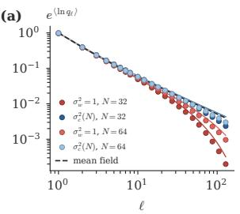

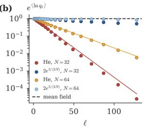

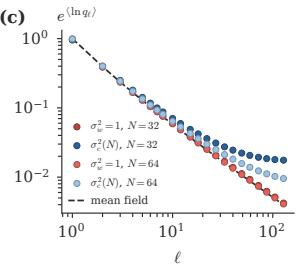  
Figure S4: Typical signal of one input, $\exp \langle \ln q _ { \ell } \rangle$ over 2000 networks, 128 layers, no bias. (a) tanh, Gaussian weights, $\sigma _ { w } ^ { 2 } = 1$ (red) and $\sigma _ { c } ^ { 2 } ( N )$ (blue), $N = 3 2$ and 64; lines: the recursion for the typical signal, ln $Q _ { \ell + 1 } = \ln ( \bar { \sigma } _ { w } ^ { 2 } V ( Q _ { \ell } ) ) - ( V _ { 4 } / \bar { V ^ { 2 } } - 1 ) / ( 2 N ) \mathrm { . }$ ; dashed: mean field. (b) ReLU at He’s initialisation (lines $e ^ { - 5 \bar { \ell } / ( 2 \bar { N } ) } )$ and at $2 { \dot { e } } ^ { 5 / ( 2 \dot { N } ) }$ . (c) tanh with orthogonal weights: no collapse at $\sigma _ { w } ^ { 2 } = 1$

(a)  
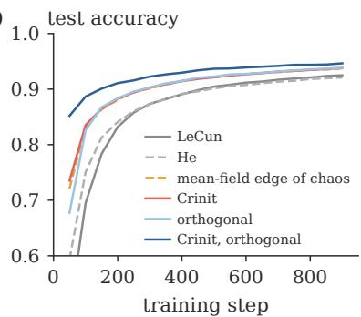

(b)  
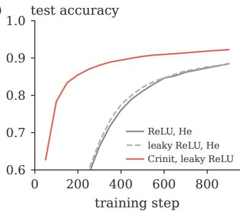  
Figure S5: Learning curves at $L = 3 2 .$ mean over one hundred networks: (a) all tanh rules including orthogonal weights, (b) ReLU family.

## S8.3 Narrower networks

The same protocol at width $N = 3 2$ (Table S7), where the $1 / N$ correction is twice as large: at $L = 3 2$ the Crinit point is the zero-bias point $\sigma _ { w } ^ { 2 } = 1 . 5 3 6$ with $q ^ { * } = 0 . 3 0 9$ , against the mean-field point $( \sigma _ { w } ^ { 2 } , \sigma _ { b } ^ { 2 } ) = ( 1 . 4 6 6 , 0 . 0 1 3 )$ with nearly the same $q ^ { * } ~ ( 0 . 3 0 6 )$ , and at $L = 9 6$ it is the same zero-bias point, against the mean-field point (1.244, 0.0021) with $q ^ { * } = 0 . 1 4 3$ (Table S5); the leaky ReLU rules have $\alpha = 0 . 5 8 6 ~ ( L = 3 2 )$ and 0.741 (L = 96) as at $N = 6 4$ , with $\sigma _ { w } ^ { 2 } = 1 . 5 5 3$ and 1.337.

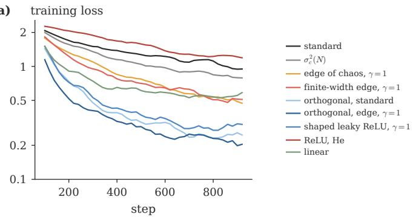

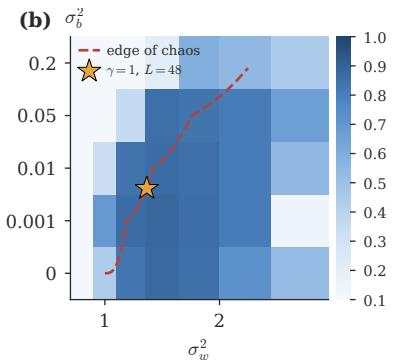  
Figure S6: Training details (smaller runs, three seeds). (a) Training loss at $L = 9 6 .$ (b) Test accuracy of tanh networks after 300 steps over the $( \sigma _ { w } ^ { 2 } , \sigma _ { b } ^ { 2 } )$ plane at $L = 4 8$ , one seed per cell; dashed: mean-field edge of chaos; star: Eq. (11) for $L = 4 8 .$

$L = 3 2$ (aspect ratio 1): Crinit and the mean-field edge of chaos reach $0 . 9 3 3 2 \pm 0 . 0 0 0 6$ and $0 . 9 3 2 6 \pm 0 . 0 0 0 6 ,$ the same within the error, and Crinit reaches 85% training accuracy in 254 4 steps against $2 8 6 \pm 7 ,$ 11% fewer. Both are well above LeCun’s rule $( 0 . 8 9 9 \pm 0 . 0 0 4$ , 87 of 100 reached) and the typical-preserving variance (0.909 0.003, 92 reached).

$L = 9 6$ (aspect ratio 3): no tanh rule trains well. The mean-field point reaches $0 . 6 8 4 \pm 0 . 0 1 5$ and $\mathrm { C r i n i t ~ 0 . 6 6 0 { \pm } 0 . 0 1 3 }$ (a diference of $0 . 0 2 4 \pm 0 . 0 2 0 )$ ; LeCun’s rule reaches $0 . 3 0 7 { \scriptstyle \pm 0 . 0 1 2 }$ . The zero-bias point has $q ^ { * } = 0 . 3 0 9$ and compresses $\gamma = 1 . 9$ nats over 96 layers, twice the budget, while the mean-field point at $q ^ { * } = 0 . 1 4 3$ is deep in the ordered phase of a typical network of width 32: its typical distance and gradient contract by $e ^ { a _ { 1 } L / N } \approx \stackrel { - } { e } ^ { - 3 . 6 }$ over the depth. Neither requirement can be met with a non-negative bias variance at this aspect ratio (Sec. IV of the main text).

ˆ The leaky ReLU shaped to the depth, which has no signal size to keep, is the rule for such networks: Crinit’s leaky ReLU reaches 0.932 0.001 at $L = 3 2$ and 0.894 0.002 at $L = 9 6$ (over the 97 and 78 networks that did not diverge at the pilot’s learning rate), against $0 . 8 1 1 \pm 0 . 0 0 6$ and $0 . 4 2 3 \pm 0 . 0 1 2$ for the leaky ReLU at He’s rule.

Table S7: MNIST, $N = 3 2 .$ , two epochs, one hundred networks per rule, same protocol and columns as Table S6.
<table><tr><td>initialisation</td><td colspan="4">L = 32</td><td colspan="4">L = 96</td></tr><tr><td></td><td>test accuracy</td><td>steps to 85%</td><td>reached</td><td>η0</td><td>test accuracy</td><td>steps to 85%</td><td>reached</td><td>η0</td></tr><tr><td>LeCun (σ2 = 1)</td><td>0.8988 ± 0.0043</td><td> $4 8 9 \pm 1 7$ </td><td>87/100</td><td>5</td><td> $0 . 3 0 6 6 \pm 0 . 0 1 2 1$ </td><td></td><td>0/100</td><td>1.5</td></tr><tr><td>typical-preserving</td><td>0.9094 ± 0.0034</td><td>424 ± 11</td><td>92/100</td><td>5</td><td> $0 . 4 0 7 7 \pm 0 . 0 1 4 5$ </td><td></td><td>0/100</td><td>1.5</td></tr><tr><td>mean-field edge of chaos</td><td>0.9326 ± 0.0006</td><td>286 ± 7</td><td>100/100</td><td>5</td><td> $0 . 6 8 3 6 \pm 0 . 0 1 4 6$ </td><td> $9 1 5 \pm 1 0$ </td><td>3/100</td><td>1.5</td></tr><tr><td>Crinit</td><td>0.9332 ± 0.0006</td><td>254 ± 4</td><td>100/100</td><td>5</td><td> $0 . 6 6 0 3 \pm 0 . 0 1 3 1$ </td><td></td><td>0/100</td><td>1.5</td></tr><tr><td>leaky ReLU, He</td><td>0.8113 ± 0.0060</td><td>856 ± 16</td><td>14/100</td><td>1.5</td><td> $0 . 4 2 3 4 \pm 0 . 0 1 1 7$ </td><td></td><td>0/100</td><td>5</td></tr><tr><td>Crinit, leaky ReLU</td><td> $0 . 9 3 2 4 \pm 0 . 0 0 0 7 ~ ( 9 7 ~ \mathrm { n e t s } )$ </td><td>242 ± 3</td><td>97/100</td><td>5</td><td> $0 . 8 9 4 4 \pm 0 . 0 0 1 6 ~ ( 7 8 ~ \mathrm { n e t s } )$ </td><td>613 ± 11</td><td>77/100</td><td>5</td></tr></table>

## S8.4 Compression budget and aspect ratio

A scan of γ with two seeds and $\eta _ { 0 } \in \{ 1 . 5 , 5 \} \times 1 0 ^ { - 3 }$ (Table S8 and $\mathrm { F i g . \ S 7 ) }$ :

ˆ The best accuracy is at $\gamma = 0 . 5$ to 1 for every aspect ratio $N / L$ and both activations.

ˆ The loss at $\gamma = 2 . 3$ (tanh) is 0.009, 0.006, 0.058 and 0.077 at $N / L = 4 , 2 ,$ 1 and $_ { 3 } ^ { 2 } ;$ at $\gamma = 3 . 5$ the networks with $L \geq 6 4 ~ \mathrm { f a i l }$

ˆ At $N / L = { \frac { 1 } { 3 } }$ , tanh trains in one of two seeds for $\gamma \leq 1 :$ the plateau is a quarter of a bit, and $\xi _ { q } \approx 1 / ( 2 q ^ { * } )$ is comparable to N, so the operating point difers from input to input (Eq. (S48)). The shaped leaky ReLU, which is insensitive to the signal size, reaches 0.908. $( \gamma = 3 . 5$ is not reachable for the leaky ReLU at $L = 1 6 ;$ ReLU itself gives 2.65 nats.)

(a)  
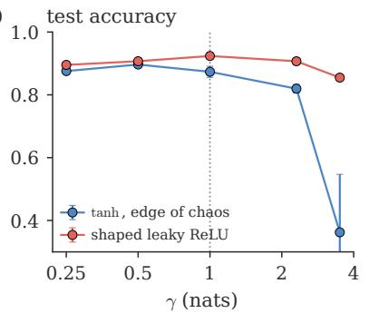

(b)  
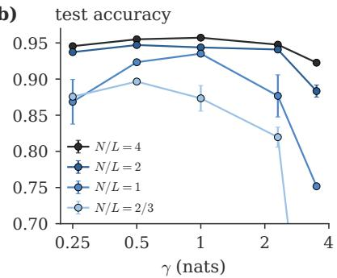  
Figure S7: Scan of the compression budget. (a) $L = 9 6 , N = 6 4 \colon$ the tanh edge-of-chaos point (blue) and the leaky ReLU shaped to the same γ (red); dotted: $\gamma = 1$ . (b) tanh at four aspect ratios.

Table S8: Scan of the compression γ. Test accuracy after two epochs (two seeds, two learning rates).
<table><tr><td> $( L , N )$ </td><td>rule</td><td> $\gamma = 0 . 2 5$ </td><td> $\gamma = 0 . 5$ </td><td> $\gamma = 1$ </td><td> $\gamma = 2 . 3$ </td><td> $\gamma = 3 . 5$ </td></tr><tr><td>(16,64)</td><td>tanh, edge of chaos</td><td> $0 . 9 4 6 \pm 0 . 0 0 3$ </td><td> $0 . 9 5 5 \pm 0 . 0 0 1$ </td><td> $0 . 9 5 7 \pm 0 . 0 0 1$ </td><td> $0 . 9 4 8 \pm 0 . 0 0 0$ </td><td> $0 . 9 2 3 \pm 0 . 0 0 1$ </td></tr><tr><td></td><td>shaped leaky ReLU</td><td> $0 . 9 4 4 \pm 0 . 0 0 0$ </td><td> $0 . 9 4 7 \pm 0 . 0 0 1$ </td><td> $0 . 9 4 9 \pm 0 . 0 0 5$ </td><td> $0 . 9 4 8 \pm 0 . 0 0 3$ </td><td></td></tr><tr><td rowspan="2">(32, 64)</td><td>tanh, edge of chaos</td><td> $0 . 9 3 7 \pm 0 . 0 0 1$ </td><td> $0 . 9 4 7 \pm 0 . 0 0 2$ </td><td> $0 . 9 4 4 \pm 0 . 0 0 1$ </td><td> $0 . 9 4 1 \pm 0 . 0 0 2$ </td><td> $0 . 8 8 3 \pm 0 . 0 0 8$ </td></tr><tr><td>shaped leaky ReLU</td><td> $0 . 9 3 6 \pm 0 . 0 0 1$ </td><td> $0 . 9 4 6 \pm 0 . 0 0 1$ </td><td> $0 . 9 5 1 \pm 0 . 0 0 2$ </td><td> $0 . 9 4 7 \pm 0 . 0 0 1$ </td><td> $0 . 9 2 4 \pm 0 . 0 0 2$ </td></tr><tr><td rowspan="2">(64,64)</td><td>tanh, edge of chaos</td><td> $0 . 8 6 9 \pm 0 . 0 3 1$ </td><td> $0 . 9 2 3 \pm 0 . 0 0 3$ </td><td> $0 . 9 3 5 \pm 0 . 0 0 1$ </td><td> $0 . 8 7 7 \pm 0 . 0 2 9$ </td><td> $0 . 7 5 2 \pm 0 . 0 0 3$ </td></tr><tr><td>shaped leaky ReLU</td><td> $0 . 9 2 3 \pm 0 . 0 0 5$ </td><td> $0 . 9 2 7 \pm 0 . 0 0 3$ </td><td> $0 . 9 3 5 \pm 0 . 0 0 2$ </td><td> $0 . 9 3 2 \pm 0 . 0 0 2$ </td><td> $0 . 8 8 8 \pm 0 . 0 0 5$ </td></tr><tr><td rowspan="2">(96,64)</td><td>tanh, edge of chaos</td><td> $0 . 8 7 6 \pm 0 . 0 0 3$ </td><td> $0 . 8 9 7 \pm 0 . 0 0 0$ </td><td> $0 . 8 7 3 \pm 0 . 0 1 8$ </td><td> $0 . 8 2 0 \pm 0 . 0 1 4$ </td><td> $0 . 3 6 2 \pm 0 . 1 8 5$ </td></tr><tr><td>shaped leaky ReLU</td><td> $0 . 8 9 5 \pm 0 . 0 0 3$ </td><td> $0 . 9 0 7 \pm 0 . 0 0 6$ </td><td> $0 . 9 2 4 \pm 0 . 0 0 3$ </td><td> $0 . 9 0 7 \pm 0 . 0 1 1$ </td><td> $0 . 8 5 5 \pm 0 . 0 0 3$ </td></tr><tr><td rowspan="2">(96,32)</td><td>tanh, edge of chaos</td><td> $0 . 3 9 5 \pm 0 . 1 9 9$ </td><td> $0 . 4 3 7 \pm 0 . 1 8 9$ </td><td> $0 . 4 5 8 \pm 0 . 1 8 6$ </td><td> $0 . 4 4 9 \pm 0 . 0 6 4$ </td><td> $0 . 2 6 1 \pm 0 . 0 1 9$ </td></tr><tr><td>shaped leaky ReLU</td><td> $0 . 8 7 0 \pm 0 . 0 2 1$ </td><td> $0 . 8 9 5 \pm 0 . 0 0 4$ </td><td> $0 . 9 0 8 \pm 0 . 0 0 3$ </td><td> $0 . 7 0 3 \pm 0 . 0 7 4$ </td><td> $0 . 5 8 4 \pm 0 . 0 6 3$ </td></tr></table>

## S8.5 Typical-preserving critical point

Six seeds at L = 96, N = 64 and 32, and a scan of $\sigma _ { w } ^ { 2 } = 1 + k / N$ (tanh, N = 32), Fig. S8:

ˆ tanh: replacing $\sigma _ { w } ^ { 2 } = 1$ by $\sigma _ { c } ^ { 2 } ( N )$ raises the accuracy from 0.71 to 0.80 $( N = 6 4 )$ and from 0.33 to 0.55 $( N = 3 2 )$ in these six-seed runs. In the hundred-network runs the rise is within the error: from $0 . 7 1 3 \pm 0 . 0 2 1$ to $0 . 7 4 4 \pm 0 . 0 1 9$ at $L = 9 6$ (a diference of $0 . 0 3 1 \pm 0 . 0 2 8 )$ and from $0 . 9 4 3 8 \pm 0 . 0 0 0 5$ to $0 . 9 4 4 8 \pm 0 . 0 0 0 5$ at $L = 3 2 \ ( 0 . 0 0 1 0 \pm 0 . 0 0 0 7 )$ ; the number of networks that reach 85% training accuracy at $L = 9 6$ rises from 10 to 18.

ˆ It is a threshold, not a peak: the accuracy rises up to $\sigma _ { w } ^ { 2 } \approx 1 + 2 / N$ and stays flat up to 1.5. At $\sigma _ { b } ^ { 2 } = 0$ the typical log-signal changes by ln $\sigma _ { w } ^ { 2 } - 1 / N - 2 q$ per layer, so $\sigma _ { c } ^ { 2 } ( N ) \approx 1 + 1 / N$ is where it stops collapsing; above it the signal settles at $q \approx ( \sigma _ { w } ^ { 2 } - 1 - 1 / N ) / 2$

ˆ ReLU: no efect $( - 0 . 0 1 \pm 0 . 0 8 \mathrm { ~ a n d ~ } - 0 . 0 5 \pm 0 . 0 4 )$ , since a common rescaling of the weights of a homogeneous network leaves its geometry unchanged.

(a)  
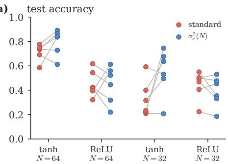

(b)  
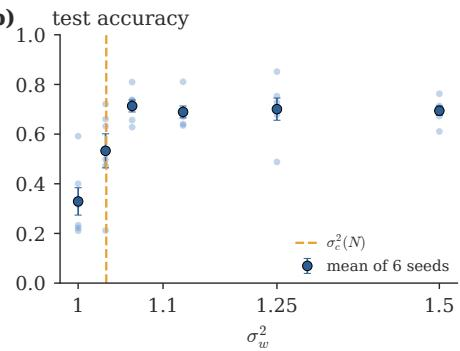  
Figure S8: Mean- against typical-preserving initialisation at $L = 9 6$ . (a) tanh and ReLU, $N = 6 4$ and 32, six seeds, lines joining equal seeds. (b) tanh, $N = 3 2$ , against $\sigma _ { w } ^ { 2 } = 1 + k / N ;$ dashed: $\sigma _ { c } ^ { 2 } ( N )$

## S9 Fashion-MNIST: tuned learning rate, gain and compression

Section S8 gives every rule the best of three learning rates at its own variances. Here every rule is tuned on a second data set: the learning rate of all rules, the gain (or slope) of the standard rules and the compression $\gamma$ of Crinit, for two training lengths. The runs give three comparisons (Table S9): the standard rules at their usual variance against Crinit; the standard rules with tuned gain against Crinit at its default $\gamma = 1 ;$ and the same against Crinit with tuned $\gamma .$ Section S9.3 isolates the role of the first layer.

## S9.1 Protocol

ˆ Data: Fashion-MNIST [31] (28  28 images of ten kinds of clothing), standardised as MNIST. The last 10 000 training images form a validation set, used only to choose settings; the networks train on the other 50 000 (390 steps per epoch) and are tested on the oficial 10 000 test images.

ˆ Networks, optimiser and first layers as in Section S8; $L = 3 2$ and 96; constant learning rate $\eta = 5 \times 1 0 ^ { - 3 } \cdot ( 3 2 / L ) \cdot m ;$ two and ten epochs.

ˆ Learning rate, every rule: $m \in \{ \frac { 1 } { 8 } , \frac { 1 } { 4 } , \dots , 8 \}$ , extended by a factor of two when the best m of a rule that trains is at an end (needed only for He at $L = 9 6 )$ .

ˆ Gain, standard rules. tanh at zero bias: $\sigma _ { w } ^ { 2 } \in \{ \textstyle { \frac { 1 } { 3 } } , \frac { 1 } { 2 } , 2 ^ { - 1 / 2 } , 2 ^ { - 1 / 4 } , 1 , 2 ^ { 1 / 4 } , 2 ^ { 1 / 2 } , 2 ^ { 3 / 4 } , 2 , \frac { 2 5 } { 9 } , 4 \}$ which contains PyTorch’s default $\left( { \frac { 1 } { 3 } } \right)$ , LeCun (1), He (2) and Xavier with PyTorch’s recommended tanh gain ${ \begin{array} { l } { { \frac { 5 } { 3 } } } \end{array} } \left( { \frac { 2 5 } { 9 } } \right)$ . Orthogonal: $\sigma _ { w } ^ { 2 }$ from $2 ^ { - 1 / 2 }$ to 2 in steps of $2 ^ { 1 / 4 }$ . ReLU: $\sigma _ { w } ^ { 2 } = 2 f$ $f \in \{ 0 . 9 , 0 . 9 5 , 1 , e ^ { 5 / ( 2 N ) } , 1 . 1 \}$ . Leaky ReLU at $\sigma _ { w } ^ { 2 } = 2 / ( 1 + \alpha ^ { 2 } ) , \alpha \in \{ 0 . 0 1 , 0 . 1 , 0 . 2 , 0 . 3 , 0 . 5 , 0 . 7 \}$

ˆ Compression, Crinit: $\gamma \in \{ 0 . 2 5 , 0 . 3 5 , 0 . 5 , 0 . 7 , 1 , 1 . 4 , 2 \}$ . For tanh with Gaussian weights the finite-width edge of chaos with $\sigma _ { b } ^ { 2 } \geq 0$ begins at its zero-bias point $( q ^ { * } = 0 . 1 7 1 , \sigma _ { w } ^ { 2 } = 1 . 3 1$ at $N = 6 4 )$ , whose compression is $\gamma = 0 . 5 3$ at $L = 3 2$ and 1.2 at $L = 9 6 ;$ ; smaller γ give this point, so the search has five distinct points at $L = 3 2$ and three at $L = 9 6$ , where the default is the zero-bias point.

ˆ Search: every (setting, m) with six networks for two epochs; the two best m of each setting continue to ten epochs. For each rule and training length the two best candidates get six more networks, and the one with the higher mean validation accuracy over its twelve networks is chosen, a diverged network counting as 0.1 (Table S12). About 2000 pilot networks per depth.

ˆ Final runs, new seeds: 100 networks at the two-epoch choice and 50 at the ten-epoch choice (20 and 10 for rules whose pilot networks do not train). Reported: mean test accuracy over the networks that did not diverge, the number that failed (diverged, or test accuracy below 0.5), and the steps until the running training accuracy first reaches 80% in the ten-epoch runs.

Table S9: Fashion-MNIST: three comparisons $( N = 6 4 )$ . Test accuracy, mean (standard error in the last digit) over 100 (two epochs) and 50 (ten epochs) networks; superscript: failed networks. Standard rules: the best of those at their usual variance, and the best with tuned gain (or slope); Crinit at its default $\gamma = 1$ , with tuned $\gamma ,$ and with the first layer of the standard rules (Section S9.3). Bold: best of the row. Wins, ties and losses: diferences beyond, within and below two standard errors.
<table><tr><td colspan="5">standard rules</td><td colspan="2">Crinit</td></tr><tr><td>family</td><td>L, epochs</td><td>usual variance</td><td>tuned gain</td><td>default</td><td>tuned γ</td><td>standard first layer</td></tr><tr><td>tanh</td><td>32, 2</td><td>0.8289(7)</td><td>0.8379(7)</td><td>0.8400(7)</td><td>0.8400(7)</td><td>0.8378(7)</td></tr><tr><td>tanh</td><td>32, 10</td><td>0.8659(8)</td><td>0.8675(5)</td><td>0.8693(6)</td><td>0.8702(5)</td><td>0.8669(7)</td></tr><tr><td>tanh</td><td>96,2</td><td>0.630(13)10</td><td> $0 . 7 6 6 ( 8 ) ^ { \dot { 2 } }$ </td><td>0.798(3)</td><td>0.798(3)</td><td>0.754(11)3</td></tr><tr><td>tanh</td><td>96, 10</td><td>0.770(18)2</td><td>0.840(15)1</td><td>0.8600(7)</td><td>0.8600(7)</td><td>0.811(25)3</td></tr><tr><td>tanh, orth.</td><td>32, 2</td><td>0.8424(7)</td><td>0.8478(5)</td><td>0.8520(6)</td><td>0.8520(6)</td><td>0.8458(6)</td></tr><tr><td>tanh, orth.</td><td>32, 10</td><td>0.8700(5)</td><td>0.8700(5)</td><td>0.8741(7)</td><td>0.8747(6)</td><td>0.8707(5)</td></tr><tr><td>tanh, orth.</td><td>96, 2</td><td>0.8309(9)</td><td>0.8406(7)</td><td>0.8467(7)</td><td>0.8475(6)</td><td>0.8403(6)</td></tr><tr><td>tanh, orth.</td><td>96, 10</td><td>0.8641(7)</td><td>0.8641(7)</td><td>0.8732(5)</td><td>0.8723(6)</td><td>0.8666(6)</td></tr><tr><td>ReLU family</td><td>32, 2</td><td>0.781(2)</td><td>0.8342(7)1</td><td> $0 . 8 3 5 0 ( 8 ) ^ { 2 }$ </td><td>0.8354(7)</td><td>0.8337(7)1</td></tr><tr><td>ReLU family</td><td>32, 10</td><td>0.8526(9)</td><td>0.8642(7)</td><td> $0 . 8 6 3 9 ( 7 ) ^ { 1 }$ </td><td>0.8647(8)</td><td>0.8637(6)</td></tr><tr><td>ReLU family</td><td>96, 2</td><td> $0 . 4 5 3 ( 1 \dot { 1 } ) ^ { \dot { 6 } 4 }$ </td><td>0.801(1)</td><td>0.8078(9)1</td><td>0.8078(9)1</td><td>0.804(1)í</td></tr><tr><td>ReLU family</td><td>96, 10</td><td> $0 . 7 1 6 ( 1 0 ) ^ { 2 }$ </td><td>0.8483(8)</td><td>0.8503(7)1</td><td>0.8500(8)</td><td>0.8481(8)1</td></tr><tr><td colspan="3">wins/ties/losses against tuned gain</td><td></td><td>8/4/0</td><td>8/4/0</td><td>2/9/1</td></tr><tr><td colspan="5">wins/ties/losses against usual variance 12/0/0</td><td colspan="2"></td></tr></table>

(a)  
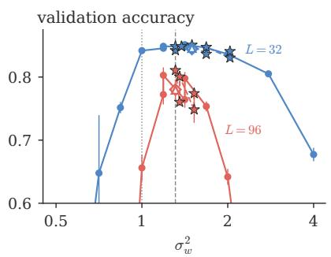

(b)  
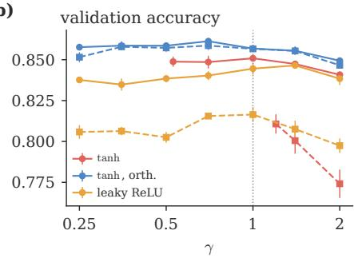

(c)  
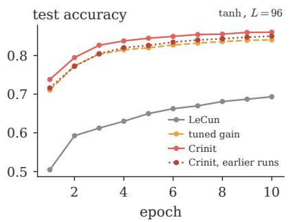

(d)  
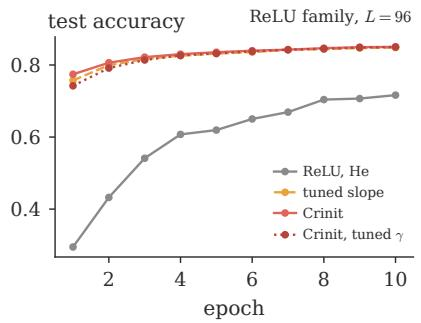  
Figure S9: Fashion-MNIST. (a) Validation accuracy (pilot: two epochs, best learning rate, six networks) against $\sigma _ { w } ^ { 2 }$ at $L = 3 2$ (blue) and 96 (red): zero-bias tanh networks (dots), Crinit for the values of $\gamma$ of the search (stars, dashed), Crinit with the first layer of the standard rules (open diamond) and with the input-scaled first layer of the earlier runs (open triangle); dotted: the mean-field critical value $\sigma _ { w } ^ { 2 } = 1 ;$ dashed: the zero-bias point of the finite-width edge of chaos, $\sigma _ { w } ^ { 2 } = 1 . 3 1$ at $N = 6 4$ . Values below 0.6 are of the scale. (b) Validation accuracy of the three Crinit rules against γ, $L = 3 2$ (solid) and 96 (dashed). (c) Test accuracy against the epoch at $L = 9 6$ for LeCun, the tuned zero-bias $\sigma _ { w } ^ { 2 } ,$ Crinit, and Crinit with the input-scaled first layer of the earlier runs, each at its ten-epoch learning rate, mean over 50 networks (failed networks included). (d) The same for ReLU at He’s rule, the leaky ReLU with tuned slope, Crinit’s leaky ReLU and Crinit with tuned $\gamma .$

## S9.2 Results

ˆ Against the standard rules at their usual variance, each at its best learning rate, Crinit is more accurate in all twelve comparisons (three families, two depths, two training lengths), by more than two standard errors in every one. At $L = 9 6$ the best of LeCun, He, Xavier and the typical-preserving point reaches 0.630 after two epochs and 0.770 after ten, Crinit 0.798 and 0.860; PyTorch’s default and Xavier with gain $\frac { 5 } { 3 }$ do not train, and the ReLU rules reach 0.43 to 0.47 and 0.68 to 0.72. Longer training brings the rules that train within about 0.02 of each other at $L = 3 2$ , but not at $L = 9 6$ , where the Gaussian standard rules stay 0.09 to 0.17 behind Crinit after ten epochs.

ˆ Against the standard rules with tuned gain, Crinit at its default is more accurate in eight comparisons and within two standard errors in four; it is never behind. The largest margins are at $L = 9 6 \colon$ 0.798 against 0.766 (tanh, two epochs) and 0.860 against 0.840 (ten epochs; the tuned gain chose a learning rate at which 1 of its 50 networks failed, and at half that rate it reaches 0.854 with none failing), and 0.847 against 0.841 and 0.873 against 0.864 with orthogonal weights.

ˆ Tuning γ keeps the default in seven of twelve cases and elsewhere changes the accuracy by less than two standard errors; against the tuned gain the tally is the same, eight wins and four ties.

ˆ The gain search finds the finite-width edge of chaos: its best zero-bias values, $\sigma _ { w } ^ { 2 } = 1 . 1 9$ and 1.41, bracket the zero-bias point of the finite-width edge of chaos, $\sigma _ { w } ^ { 2 } = 1 . 3 1$ at $N = 6 4$ , and not the mean-field $\sigma _ { w } ^ { 2 } = 1 \ [ \mathrm { F i g . \ S 9 ( a ) } ]$ ]. The remaining diference to Crinit is the first layer (Section S9.3).

ˆ The validation accuracy is flat for $\gamma$ between about 0.5 and 1 and falls outside this range [Fig. S9(b)], as on MNIST.

ˆ Crinit reaches 80% training accuracy in the fewest steps in all six groups (Table S11): 9 to 40% fewer than the tuned gain and 31 to 84% fewer than the standard rules at their usual variance, where those reach it at all. At $L = 9 6$ it had no failed network among its 300 tanh and orthogonal networks and two diverged leaky ReLU networks of 150; the standard rules at their usual variance failed in 10 to 77% of the networks there after two epochs.

## S9.3 The first layer

The standard rules initialise the first layer like every other layer, with weight variance $\sigma _ { w } ^ { 2 } / 7 8 4$ , so the first hidden layer carries the signal $q _ { 1 } = \sigma _ { w } ^ { 2 }$ , which then settles to $q ^ { * }$ over the next $\xi _ { q }$ layers. Crinit starts the first hidden layer at the steady signal, $q _ { 1 } = q ^ { * }$ . Two implementations give the same forward pass at initialisation:

ˆ weight scaling (the crinit package): first-layer weights with variance $( q ^ { * } - \sigma _ { b } ^ { 2 } ) / 7 8 4$

ˆ input scaling (the first version of these runs): weight variance $\sigma _ { w } ^ { 2 } / 7 8 4$ and the input multiplied by $s = \sqrt { ( q ^ { * } - \sigma _ { b } ^ { 2 } ) / \sigma _ { w } ^ { 2 } }$

They do not give the same training. With plain SGD the update of a weight does not depend on the size of the weight, so a layer with smaller weights takes larger steps relative to its size. Under weight scaling the first-layer weights are s times smaller than under the standard rules, so the relative step is $1 / s$ times larger $( 1 / s = 2 . 2 $ at $L = 3 2$ and 2.8 at $L = 9 6 )$ . Under input scaling the weights have the standard size but the gradient is s times smaller, so the relative step is s times smaller than the standard one. The first layer holds 784 64 weights, a quarter of all, and is the only layer that sees the data.

Table S10 separates the two efects in a small test (three learning rates, 12 networks each, validation accuracy). A standard first layer with its learning rate reduced by s is the worst; input scaling with its first-layer learning rate raised by $1 / s$ is as good as or better than the standard first layer; weight scaling is the best, by two per cent at $L = 9 6$ What matters is the step size of the first layer, not the signal it starts at. In the full comparison (Table S11), with a learning-rate search for each version, Crinit with weight scaling wins eight comparisons against the tuned gain and ties four; with the standard first layer it wins two, ties nine and loses one; with input scaling it wins one, ties ten and loses one. The tuned zero-bias rule given Crinit’s first layer (variance $q ^ { * } / 7 8 4$ at its own $q ^ { * } )$ reaches 0.8409 and 0.8703 at $L = 3 2$ and 0.800 and 0.859 at $L = 9 6$ , within the error of Crinit (0.8400, 0.8693, 0.798, 0.860): with the same first layer, the point found by the search and the point computed by Crinit are equivalent. The package uses weight scaling by default (first layer="steady"); the standard first layer ("standard") and any first-hidden-layer signal $\scriptstyle \left( \pm \mathrm { i } \mathbf { r } \mathbf { s } \mathbf { t } \mathbf { . } \mathbf { l } \mathbf { a } \mathbf { y } \mathbf { e } \mathbf { r } \mathbf { = } q _ { 1 } \right)$ are options.

Table S10: The first layer. Validation accuracy after two $\left( L = 3 2 \right)$ or four $( L = 9 6 )$ epochs at the best of three learning rates, 12 networks, $N = 6 4 .$ , tanh, Gaussian weights; $s = \sqrt { ( q ^ { * } - \sigma _ { b } ^ { 2 } ) / \sigma _ { w } ^ { 2 } }$ and $W _ { 1 }$ is the first-layer weight matrix. The relative step is the size of one SGD update of $W _ { 1 }$ relative to the size of $W _ { 1 } ,$ in units of the standard rule’s.
<table><tr><td>first layer</td><td>relative step of  $\overline { { W _ { 1 } } }$ </td><td> $\overline { { L = 3 2 , 2 } }$  epochs</td><td> ${ \overline { { L = 9 6 } } } ,$  4 epochs</td></tr><tr><td>Crinit point  $\overline { { ( \gamma = 1 ) } }$ </td><td></td><td></td><td></td></tr><tr><td>standard:  $q _ { 1 } = \sigma _ { w } ^ { 2 } , W _ { 1 } \sim { \mathcal { N } } ( 0 , \sigma _ { w } ^ { 2 } / 7 8 4 )$ </td><td>1</td><td>0.845(2)</td><td>0.827(3)</td></tr><tr><td>steady signal by input scaling:  $q _ { 1 } = q ^ { * }$  , input ×s (earlier runs)</td><td>S</td><td>0.843(2)</td><td>0.825(3)</td></tr><tr><td>steady signal by weight scaling:  $q _ { 1 } = q ^ { * } , W _ { 1 } \sim$   $\mathcal { N } ( 0 , ( q ^ { * } - \sigma _ { b } ^ { 2 } ) / 7 8 4 ) \ \mathrm { ( C r i n i t ) }$ </td><td> $1 / s$ </td><td>0.846(2)</td><td>0.846(2)</td></tr><tr><td>input scaling, first-layer learning rate  $\times 1 / s$ </td><td>1</td><td>0.848(1)</td><td>0.838(1)</td></tr><tr><td>standard, first-layer learning rate ×s</td><td>S</td><td>0.841(2)</td><td></td></tr><tr><td>weight scaling, first-layer learning rate  $\times \textstyle { \frac { 1 } { 2 } }$ </td><td> $1 / ( 2 s )$ </td><td>0.846(2)</td><td></td></tr><tr><td>weight scaling, first-layer learning rate  $\times \bar { 2 }$ </td><td> $2 / s$ </td><td>0.851(2)</td><td></td></tr><tr><td>zero bias,  $\sigma _ { w } ^ { 2 } = 1 . 4 1$  (the tuned gain at  $L = 3 2 )$ </td><td></td><td></td><td></td></tr><tr><td>standard:  $q _ { 1 } = \sigma _ { w } ^ { 2 } , W _ { 1 } \sim { \mathcal { N } } ( 0 , \sigma _ { w } ^ { 2 } / 7 8 4 )$ </td><td>1</td><td>0.844(2)</td><td></td></tr><tr><td>steady signal by input scaling:  $q _ { 1 } = q ^ { * }$  , input  $\times s$  (earlier runs)</td><td>S</td><td>0.841(2)</td><td></td></tr><tr><td>steady signal by weight scaling:  $q _ { 1 } = q ^ { * } , W _ { 1 } \sim$   $\mathcal { N } ( 0 , ( q ^ { * } - \sigma _ { b } ^ { 2 } ) / 7 8 4 ) \ \mathrm { ( C r i n i t ) }$ </td><td> $1 / s$ </td><td>0.852(1)</td><td></td></tr><tr><td>input scaling, first-layer learning rate  $\times 1 / s$ </td><td>1</td><td>0.848(2)</td><td></td></tr><tr><td>standard, first-layer learning rate ×s</td><td>S</td><td>0.841(2)</td><td></td></tr></table>

Table S11: Fashion-MNIST, every rule. As Table S9; steps: mean over the ten-epoch networks that reached 80% training accuracy (their number in brackets when not all). Bold: best in each group; boxed: Crinit.
<table><tr><td rowspan="2">rule</td><td colspan="3"> $\overline { { L = 3 2 } }$ </td><td colspan="3">L = 96</td></tr><tr><td>2 epochs</td><td>10 epochs</td><td>steps to 80%</td><td>2 epochs</td><td>10 epochs</td><td>steps to 80%</td></tr><tr><td>tanh, Gaussian weights</td><td></td><td></td><td></td><td></td><td></td><td></td></tr><tr><td>PyTorch default (o2 = 1)</td><td>0.100</td><td>0.100</td><td></td><td>0.100</td><td>0.100</td><td></td></tr><tr><td>LeCun (σ2 = 1)</td><td>0.828(1)</td><td>0.8659(8)</td><td>439</td><td>0.576(23)23</td><td>0.693(31)7</td><td>2595 (34)</td></tr><tr><td>He (σ2 = 2)</td><td>0.8289(7)</td><td>0.8619(5)</td><td>388</td><td>0.586(8)13</td><td>0.723(8)</td><td>3688 (2)</td></tr><tr><td>Xavier, gain  $\begin{array} { r } { \frac { 5 } { 3 } ~ ( \sigma _ { w } ^ { 2 } = \frac { 2 5 } { 9 } ) } \end{array}$ </td><td>0.7968(9)</td><td>0.8511(6)</td><td>709</td><td>0.118(7)</td><td>0.117(9)</td><td></td></tr><tr><td>typical-preserving σ2(N)</td><td>0.828(2)</td><td>0.8659(6)</td><td>427</td><td>0.630(13)10</td><td>0.770(18)2</td><td>2456 (38)</td></tr><tr><td>zero bias, tuned σ2</td><td>0.8379(7)</td><td>0.8675(5)</td><td>298</td><td>0.766(8)2</td><td>0.840(15)1</td><td>924 (49)</td></tr><tr><td>edge of chaos, mean field</td><td>0.8406(7)</td><td>0.8694(6)</td><td>281</td><td>0.793(3)</td><td>0.8613(6)</td><td>784</td></tr><tr><td>edge of chaos, mean field, input-scaled first layer (earlier runs)</td><td>0.8318(7)</td><td>0.8672(7)</td><td>306</td><td>0.757(3)</td><td>0.817(20)2</td><td>1225 (47)</td></tr><tr><td>Crinit</td><td>0.8400(7)</td><td>0.8693(6)</td><td>263</td><td>0.798(3)</td><td>0.8600(7)</td><td>728</td></tr><tr><td>Crinit, tuned γ</td><td>0.8400(7)</td><td>0.8702(5)</td><td>268</td><td>0.798(3)</td><td>0.8600(7)</td><td>728</td></tr><tr><td>Crinit, standard first layer</td><td>0.8378(7)</td><td>0.8669(7)</td><td>282</td><td>0.754(11)3</td><td>0.811(25)3</td><td>953 (47)</td></tr><tr><td>Crinit, input-scaled first layer (earlier runs)</td><td>0.8346(6)</td><td>0.8664(7)</td><td>299</td><td>0.773(2)</td><td>0.8498(7)</td><td>978</td></tr><tr><td>zero bias, tuned σ2, Crinit&#x27;s first layer</td><td>0.8409(6)</td><td>0.8703(5)</td><td>280</td><td>0.800(2)</td><td>0.8586(7)</td><td>820</td></tr><tr><td>tanh, orthogonal weights</td><td></td><td></td><td></td><td></td><td></td><td></td></tr><tr><td>orthogonal  $( \sigma _ { w } ^ { 2 } = 1 )$ </td><td>0.8424(7)</td><td>0.8700(5)</td><td>248</td><td>0.8309(9)</td><td>0.8641(7)</td><td>336</td></tr><tr><td>orthogonal, tuned σ2</td><td>0.8478(5)</td><td>0.8687(6)</td><td>186</td><td>0.8406(7)</td><td>0.8641(7)</td><td>336</td></tr><tr><td>Crinit, orthogonal</td><td>0.8520(6)</td><td>0.8741(7)</td><td>170</td><td>0.8467(7)</td><td>0.8732(5)</td><td>200</td></tr><tr><td>Crinit, orthogonal, tuned γ</td><td>0.8520(6)</td><td>0.8747(6)</td><td>162</td><td>0.8475(6)</td><td>0.8723(6)</td><td>199</td></tr><tr><td>Crinit, orthogonal, standard first layer</td><td>0.8458(6)</td><td>0.8707(5)</td><td>183</td><td>0.8403(6)</td><td>0.8666(6)</td><td>236</td></tr><tr><td>Crinit, orthogonal, input-scaled first layer (earlier runs)</td><td>0.8468(6)</td><td>0.8717(7)</td><td>185</td><td>0.8395(6)</td><td>0.8688(6)</td><td>233</td></tr><tr><td>ReLU family, Gaussian weights</td><td></td><td></td><td>901</td><td> $0 . 4 5 3 ( 1 1 ) ^ { 6 4 }$ </td><td>0.716(10)2</td><td></td></tr><tr><td>ReLU, He (σ2 = 2)</td><td>0.781(2)</td><td>0.8526(9)</td><td>931</td><td>0.443(10)70</td><td></td><td>3872 (1)</td></tr><tr><td>ReLU, typical-preserving</td><td>0.780(2)</td><td>0.8520(7)</td><td></td><td></td><td>0.679(18)5</td><td>3764 (2)</td></tr><tr><td></td><td>0.781(2)</td><td>0.8520(7)</td><td>931</td><td>0.465(11)53</td><td>0.703(11)2</td><td>3475 (4)</td></tr><tr><td>leaky ReLU (α = 0.01), He leaky ReLU, He, tuned α</td><td>0.780(3)</td><td>0.8522(9)</td><td>912 301</td><td>0.431(9)77 0.801(1)</td><td>0.693(16)5</td><td>3632 (5)</td></tr><tr><td>Crinit, leaky ReLU</td><td>0.8342(7)1 0.8350(8)2</td><td>0.8642(7) 0.8639(7)</td><td>256 (49)</td><td></td><td>0.8483(8)</td><td>699</td></tr><tr><td>Crinit, leaky ReLU, tuned γ</td><td></td><td></td><td>277</td><td>0.8078(9)</td><td>0.8503(7)</td><td>569 (49)</td></tr><tr><td></td><td>0.8354(7)</td><td>0.8647(8)</td><td></td><td>0.8078(9)</td><td>0.8500(8)</td><td>785</td></tr><tr><td>Crinit, leaky ReLU, standard first layer</td><td>0.8337(7)1</td><td>0.8637(6)</td><td>262</td><td>0.804(1)1</td><td>0.8481(8)1</td><td>601 (49)</td></tr><tr><td>Crinit, leaky ReLU, input-scaled first layer (earlier runs)</td><td>0.8346(7)</td><td>0.8631(7)</td><td>266</td><td>0.804(1)1</td><td>0.8482(8)1</td><td>605 (49)</td></tr></table>

Table S12: Settings chosen on the validation set: the variance $\sigma _ { w } ^ { 2 }$ (with $\sigma _ { b } ^ { 2 } ,$ and $\gamma$ for Crinit) or slope α where it was searched or is fixed by the rule, and the learning-rate factor m.
<table><tr><td rowspan="2">rule</td><td colspan="2">L = 32</td><td colspan="2">L = 96</td></tr><tr><td>2 epochs</td><td>10 epochs</td><td>2 epochs</td><td>10 epochs</td></tr><tr><td>tanh, Gaussian weiqhts</td><td></td><td></td><td></td><td></td></tr><tr><td>PyTorch default (σ2 = 1)</td><td>×1</td><td>x1</td><td>×4</td><td>×2</td></tr><tr><td>LeCun (σ2 = 1)</td><td>x1</td><td>x1</td><td>×1</td><td></td></tr><tr><td>He (σ2 = 2)</td><td>x1</td><td></td><td>x</td><td>X</td></tr><tr><td>Xavier, gain (σ2 = 2)</td><td>×1</td><td></td><td>x</td><td>x</td></tr><tr><td>typical-preserving σ2(N)</td><td>xī</td><td>xī</td><td></td><td></td></tr><tr><td>zero bias, tuned σ2</td><td>1.41, ×1</td><td>1.19, ×1</td><td>1.19, ×1</td><td>1.19, ×1</td></tr><tr><td>edge of chaos, mean field</td><td>1.47, 0.013, ×1</td><td>1.47, 0.013, ×1</td><td>1.24, 0.002, × 1</td><td>1.24, 0.002, × 1</td></tr><tr><td>edge of chaos, mean field, input-scaled first layer (earlier runs)</td><td>1.47, ×2</td><td> $1 . 4 7 , \times 1 ^ { \mathrm { ~ \small ~ 2 ~ } }$ </td><td> $1 . 2 4 , \times { \frac { 1 } { 7 } } 2$ </td><td>1.24, ×1</td></tr><tr><td>Crinit</td><td>γ = 1.00, 1.50, 0.006, × 1</td><td> $\gamma = 1 . 0 0 , 1 . 5 0 , 0 . 0 0 6 , \times 1$ </td><td> $\gamma = 1 . 2 0 , 1 . 3 1 , \hat { 0 } . 0 0 0 , \times \frac { 1 } { 2 }$ </td><td></td></tr><tr><td>Crinit, tuned γ</td><td>γ = 1.00, 1.50, 0.006, × </td><td>γ = 0.53, 1.31, 0.000, ×1</td><td>γ = 1.20, 1.31, 0.000, × T</td><td>γ = 1.20, 1.31, 0.000, ×−</td></tr><tr><td>Crinit, standard first layer</td><td>γ = 1.00, 1.50, 0.006, ×1</td><td>γ = 1.00, 1.50, 0.006, ×1</td><td> $\gamma = 1 . 2 0 , 1 . 3 1 , 0 . 0 0 0 , \times \tilde { 1 }$ </td><td>γ = 1.20, 1.31, 0.000, ×1</td></tr><tr><td>Crinit, input-scaled first layer (earlier runs)</td><td>γ = 1.00, 1.50, 0.006, ×1</td><td>γ = 1.00, 1.50, 0.006, ×1</td><td>γ = 1.20, 1.31, 0.000, × 1</td><td>γ = 1.20, 1.31, 0.000, ×1</td></tr><tr><td>zero bias, tuned σ2, Crinit&#x27;s first layer</td><td>1.19, ×1</td><td>1.19, ×1</td><td>1.19, ×1</td><td>1.41, × 1</td></tr><tr><td>tanh, orthogonal weights</td><td></td><td></td><td></td><td></td></tr><tr><td>orthogonal (σ2 = 1)</td><td>×2</td><td>x1</td><td>×2</td><td>×2</td></tr><tr><td>orthogonal, tuned σ2</td><td>1.41, ×1</td><td>1.68, ×1</td><td>1.19, ×2</td><td>1.00, ×2</td></tr><tr><td>Crinit, orthogonal</td><td>γ = 1.00, 1.47, 0.012, ×1</td><td> γ = 1.00, 1.47, 0.012, ×1</td><td>γ = 1.00, 1.25, 0.002, ×1</td><td>γ = 1.00, 1.25, 0.002, ×1</td></tr><tr><td>Crinit, orthogonal, tuned γ</td><td>γ = 0.70, 1.35, 0.005, × T</td><td>γ = 0.50, 1.28, 0.003, × −</td><td>γ = 0.70, 1.19, 0.001, ×1</td><td>γ = 0.50, 1.15, 0.000, ×T</td></tr><tr><td>Crinit, orthogonal, standard first layer</td><td>γ = 1.00, 1.47, 0.012, ×ī</td><td>γ = 1.00, 1.47, 0.012, ×ī</td><td>γ = 1.00, 1.25, 0.002, ×2</td><td>γ = 1.00, 1.25, 0.002, ×ī</td></tr><tr><td>Crinit, orthogonal, input-scaled first layer (earlier runs)</td><td>γ = 1.00, 1.47, 0.012, ×1</td><td>γ = 1.00, 1.47, 0.012, ×1</td><td>γ = 1.00, 1.25, 0.002, ×1</td><td>γ = 1.00, 1.25, 0.002, ×1</td></tr><tr><td>ReLU family, Gaussian weights</td><td></td><td></td><td>×1</td><td></td></tr><tr><td>ReLU, He (σ2 = 2)</td><td>x</td><td></td><td></td><td>×1</td></tr><tr><td>ReLU, typical-preserving</td><td></td><td></td><td>×1</td><td>xī</td></tr><tr><td>ReLU, tuned σ2</td><td>2.00, × 1</td><td>2.08, ×1</td><td>1.90, ×1</td><td>1.80, ×1</td></tr><tr><td>leaky ReLU (α = 0.01), He leaky ReLU, He, tuned α</td><td>×#1</td><td>1</td><td>×1</td><td>×#1</td></tr><tr><td>Crinit, leaky ReLU</td><td>α = 0.50, ×1</td><td>α = 0.50, ×1</td><td>α = 0.70, ×1</td><td>α = 0.70, ×1</td></tr><tr><td></td><td>γ = 1.00, α = 0.59, ×1</td><td>γ = 1.00, α = 0.59, ×1</td><td>γ = 1.00, α = 0.74, × 1</td><td>γ = 1.00, α = 0.74, ×1</td></tr><tr><td>Crinit, leaky ReLU, tuned γ</td><td> $\gamma = 1 . 4 0 , \alpha = 0 . 5 0 , \times 1$ </td><td>γ = 1.40, α = 0.50, ×1</td><td>γ = 1.00, α = 0.74, × τ</td><td>γ = 2.00, α = 0.60, × −</td></tr><tr><td>Crinit, leaky ReLU, standard first layer</td><td> $\gamma = 1 . 0 0 , \alpha = 0 . 5 9 , \times 1$ </td><td> γ = 1.00, α = 0.59, ×1</td><td>γ = 1.00, α = 0.74, × 1</td><td> γ = 1.00, α = 0.74, ×−</td></tr><tr><td>Crinit, leaky ReLU, input-scaled first layer (earlier runs)</td><td>γ = 1.00, α = 0.59, ×1</td><td>γ = 1.00, α = 0.59, ×1</td><td>γ = 1.00, α = 0.74, × −</td><td>γ = 1.00, α = 0.74, × −</td></tr></table>

## References

[1] B. Poole, S. Lahiri, M. Raghu, J. Sohl-Dickstein, and S. Ganguli, Exponential expressivity in deep neural networks through transient chaos, in Advances in Neural Information Processing Systems 29 (2016) arXiv:1606.05340 .

[2] S. S. Schoenholz, J. Gilmer, S. Ganguli, and J. Sohl-Dickstein, Deep information propagation, in International Conference on Learning Representations (2017) arXiv:1611.01232 .

[3] S. Hayou, A. Doucet, and J. Rousseau, On the impact of the activation function on deep neural networks training, in Proceedings of the 36th International Conference on Machine Learning (ICML) (2019) arXiv:1902.06853 .

[4] C. M. Stein, Estimation of the mean of a multivariate normal distribution, Ann. Stat. 9, 1135 (1981).

[5] R. Price, A useful theorem for nonlinear devices having Gaussian inputs, IRE Trans. Inf. Theory 4, 69 (1958).

[6] H. Chernof, A note on an inequality involving the normal distribution, Ann. Probab. 9, 533 (1981).

[7] A. Daniely, R. Frostig, and Y. Singer, Toward deeper understanding of neural networks: the power of initialization and a dual view on expressivity, in Advances in Neural Information Processing Systems 29 (2016) arXiv:1602.05897 .

[8] A. Jacot, F. Gabriel, F. Ged, and C. Hongler, Freeze and chaos: NTK views on DNN normalization, checkerboard and boundary artifacts, in Proceedings of Mathematical and Scientific Machine Learning (MSML), PMLR, Vol. 190 (2022) pp. 257–270, arXiv:1907.05715

[9] L. Fernandez Sarmiento, Dropout universality: scaling laws and optimal scheduling at the edge-of-chaos (2026), arXiv:2605.21648 .

[10] K. Tamai, T. Okubo, T. V. T. Duy, N. Natori, and S. Todo, Universal scaling laws of absorbing phase transitions in artificial deep neural networks, Phys. Rev. Res. 7, 033072 (2025).

[11] A. Ghavasieh, M. Vila-Mi˜nana, A. Khurd, J. Beggs, G. Ortiz, and S. Fortunato, Toward a physics of deep learning and brains (2025), arXiv:2509.22649 .

[12] O. Lesser and D. Chowdhury, Competing nonlinearities, criticality, and order-to-chaos transition in deep networks (2026), arXiv:2605.05294 .

[13] J. E. Cohen and C. M. Newman, The stability of large random matrices and their products, Ann. Probab. 12, 283 (1984).

[14] C. M. Newman, The distribution of Lyapunov exponents: exact results for random matrices, Commun. Math. Phys. 103, 121 (1986).

[15] C. Kogler, T. Schwarz, and S. Kittle, Optimal initialization in depth: Lyapunov initialization and limit theorems for deep leaky ReLU networks (2026), arXiv:2602.10949 .

[16] B. Hanin and M. Nica, Products of many large random matrices and gradients in deep neural networks, Commun. Math. Phys. 376, 287 (2020).

[17] M. G¨urb¨uzbalaban and Y. Hu, Fractional moment-preserving initialization schemes for training deep neural networks, in Proceedings of the 24th International Conference on Artificial Intelligence and Statistics (AISTATS), PMLR, Vol. 130 (2021) pp. 2233–2241, arXiv:2005.11878 .

[18] A. Caesar, Code, data and the Crinit initialisation package for this article, https://github. com/Aureliuxs/finite-width-edge-of-chaos (2026).

[19] A. M. Saxe, J. L. McClelland, and S. Ganguli, Exact solutions to the nonlinear dynamics of learning in deep linear neural networks, in International Conference on Learning Representations (2014) arXiv:1312.6120 .

[20] W. Hu, L. Xiao, and J. Pennington, Provable benefit of orthogonal initialization in optimizing deep linear networks, in International Conference on Learning Representations (2020) arXiv:2001.05992 .

[21] H. Day, Y. Kahn, and D. A. Roberts, Feature learning and generalization in deep networks with orthogonal weights, Mach. Learn.: Sci. Technol. 6, 035027 (2025).

[22] J. Pennington, S. S. Schoenholz, and S. Ganguli, Resurrecting the sigmoid in deep learning through dynamical isometry: theory and practice, in Advances in Neural Information Processing Systems 30 (2017) arXiv:1711.04735 .

[23] A. J. Bray, S. N. Majumdar, and G. Schehr, Persistence and first-passage properties in nonequilibrium systems, Adv. Phys. 62, 225 (2013).

[24] K. Christensen and N. R. Moloney, Complexity and Criticality (Imperial College Press, London, 2005).

[25] A. Ghavasieh, Tuning universality in deep neural networks (2025), arXiv:2512.00168 .

[26] E. Sparre Andersen, On the fluctuations of sums of random variables II, Math. Scand. 2, 194 (1954).

[27] Y. LeCun, L. Bottou, Y. Bengio, and P. Hafner, Gradient-based learning applied to document recognition, Proc. IEEE 86, 2278 (1998).

[28] X. Glorot and Y. Bengio, Understanding the dificulty of training deep feedforward neural networks, in Proceedings of the 13th International Conference on Artificial Intelligence and Statistics (AISTATS), PMLR, Vol. 9 (2010) pp. 249–256.

[29] K. He, X. Zhang, S. Ren, and J. Sun, Delving deep into rectifiers: surpassing human-level performance on ImageNet classification, in 2015 IEEE International Conference on Computer Vision (ICCV) (2015) pp. 1026–1034.

[30] G. Zhang, A. Botev, and J. Martens, Deep learning without shortcuts: shaping the kernel with tailored rectifiers, in International Conference on Learning Representations (2022) arXiv:2203.08120 .

[31] H. Xiao, K. Rasul, and R. Vollgraf, Fashion-MNIST: a novel image dataset for benchmarking machine learning algorithms (2017), arXiv:1708.07747 .