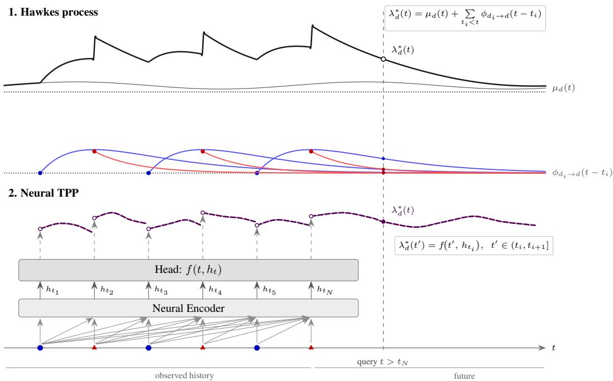
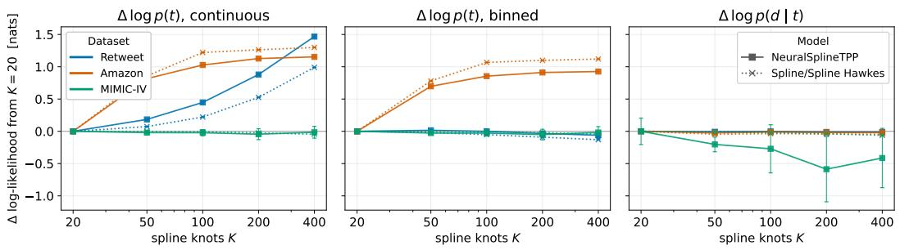
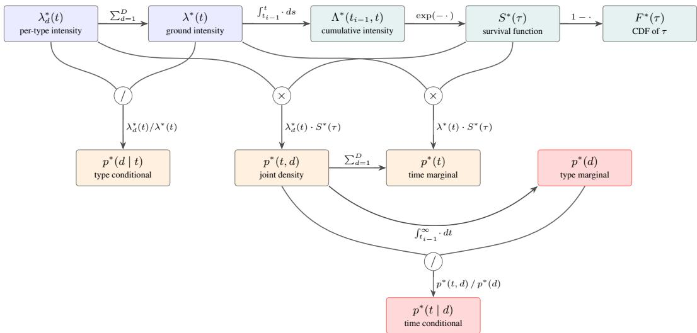

# Flexible Intensities Matter: A Comprehensive Re-evaluation of Hawkes Processes and Neural Temporal Point Processes

Hendrik Mehrtens1,2

Florian Büttner1,2,\*

Oliver Stegle1,3,4,\*

## Abstract

Temporal point processes (TPPs) are the canonical framework for event sequence data, with applications spanning seismology, social media, and electronic health records. Recently, neural TPPs have been reported to substantially outperform classical TPPs, such as Hawkes processes, but these comparisons pitted flexible neural models against Hawkes processes in their most restricted form and did not consider large-scale medical data. Here, we revisit this comparison through a systematic evaluation of Poisson and Hawkes processes of increasing flexibility against neural TPPs, on five established benchmark datasets and on two large-scale medical evaluation tasks derived from UK Biobank disease histories and MIMIC-IV ICU records, under autoregressive next-event prediction. First, the previously reported gap between Hawkes processes and neural TPPs largely disappears once Hawkes processes are equipped with flexible, learnable baselines and kernels. Second, the flexibility of the intensity parametrization also limits prior neural TPPs: a Transformer with a spline-based intensity head outperforms previous intensitybased neural TPPs and is on par with the intensity-free model. Decomposing the log-likelihood into a time term log p(t) and a type term log p(d | t), we find that this flexibility advantage lies almost entirely in the time density: more flexibility does not improve the type term. On these benchmarks, the gains of neural TPPs thus lie mostly in modeling when events occur, not which. Third, our results underscore the value of complex datasets for evaluating TPPs: only on the MIMIC-IV ICU records do neural TPPs retain an advantage in the type term. Our results inform both future method development and practitioners’ model choice. We release our framework, TORCHPP, as an open-source package with consistent implementations of classical and neural TPPs.

## 1 Introduction

Temporal point processes (TPPs) provide a principled framework for modeling irregular event sequences in continuous time. Applications range from social media analysis [Zhou et al., 2013] and seismology [Ogata, 1988] to healthcare [Shmatko et al., 2025], where event histories can correspond to sequences of disease diagnoses, procedures, or lab results.

A classical model for temporal event sequences is the Hawkes process [Hawkes, 1971], which decomposes event intensities into a baseline (exogenous) component and a triggering-kernel (endogenous) component capturing mutual excitation or inhibition between events. In recent years, neural TPPs, which replace both components with learned representations, have gained traction: neural encoders summarize the event history, and flexible output heads parametrize the conditional intensity or inter-event time distribution [Shchur et al., 2021, Xue et al., 2024]. See Figure 1 for a conceptual visualization.

  
Figure 1: Conceptual differences between Hawkes processes (1) and neural TPPs (2) on an event sequence (• type A, ▲ type B). Top (Hawkes process). Each past event interacts via a kernel response $\phi _ { d _ { i } \to d } ( t - t _ { i } )$ (colored curves) on top of a (possibly time-varying) baseline $\mu _ { d } ( t )$ (thin solid line). The total intensity (upper sub-panel) is the sum of baseline and active kernels. At a query time t, the intensity thus decomposes into the sum of the baseline and the kernel values. Bottom (Neural TPP). The same event history is consumed by a neural encoder, which produces a hidden state at each event location. The head of the neural TPP projects this encoding to an intensity function. Conceptually, this allows the neural TPP to model higher-order non-additive effects between events, in exchange for losing the interpretable decomposition of the Hawkes process.

Neural TPPs have repeatedly been reported to outperform Hawkes baselines [Du et al., 2016, Mei and Eisner, 2017, Xiao et al., 2017a, Zhang et al., 2020, Shchur et al., 2020b, Soen et al., 2021], most recently by substantial margins in the EasyTPP benchmark [Xue et al., 2024]. However, these comparisons almost always evaluated Hawkes processes in their most restricted form, with fixed-shape exponential kernels, while comparing them against far more flexible neural TPPs. The evaluation also spans a narrow range of domains and omits health data entirely, despite the recent surge of interest in sequence modeling for electronic health records [Shmatko et al., 2025, Steinberg et al., 2024, Li et al., 2020, Rasmy et al., 2021, Renc et al., 2024].

In this work, we conduct a systematic re-evaluation of Poisson and Hawkes processes and neural TPPs on previously considered benchmark datasets, as well as on two evaluation tasks derived from medical data: disease histories from the UK Biobank [Sudlow et al., 2015] and ICU records from MIMIC-IV [Johnson et al., 2023]. To our knowledge, this is the first systematic comparison of Hawkes processes with flexible baselines and kernels and inhibitive variants against modern neural TPPs under a unified protocol. Prior benchmarks used Hawkes processes with a constant baseline and an exponential kernel, while Zhao and Engelhard [2025] used a neural but purely excitatory kernel. Our scope is deliberately specific. On the classical side we study Poisson and Hawkes processes, while Cox-type models such as log-Gaussian Cox processes are out of scope. On the neural side we study RNN- and Transformer-based intensity models with heads of increasing flexibility and an intensity-free model. Flow-, diffusion-, and state-space-based TPPs are out of scope. The code and configurations are available at https://github.com/PMBio/torchPP, together with checkpoints for the standard benchmarks.

## Our contributions are as follows:

• We show that the previously reported gap between Hawkes processes and neural TPPs is largely an artifact of under-specified baselines: with spline baselines, spline kernels, and an inhibitive variant, Hawkes processes match or exceed less flexible neural TPPs (THP, SAHP, NHP) on all five standard datasets and are competitive with the flexible neural models (IntensityFree, NeuralSplineTPP), indicating that these benchmarks are largely explained by pairwise interactions.

• We identify the flexibility of the intensity parametrization as a dominant axis of performance: a Transformer with a spline-based intensity head (NeuralSplineTPP) outperforms the softplus-headed intensity models (THP, SAHP, NHP) and is on par with the intensity-free IntensityFree, while retaining a closed-form cumulative intensity for exact sampling and a time-dependent type distribution.

• We decompose the joint log-likelihood into a time term log p(t) and a time-conditional type term log $p ( d \mid t )$ , and show with a knot-count flexibility sweep that the benefit of more flexible intensities accrues almost entirely to log p(t): more flexibility does not improve the type-conditional term, and on most standard benchmarks the models differ far more in the time prediction than in the type prediction.

• We evaluate both model families on two large-scale medical evaluation tasks: a 1,257-type terminating disease-history task derived from the UK Biobank, and a 117-type ICU-event task derived from MIMIC-IV. On UKB, flexible Hawkes processes nearly match the best neural TPP. On MIMIC-IV, the flexible neural TPP opens a gap in both joint log-likelihood and time-conditional accuracy.

• We release TORCHPP, a modular PyTorch framework that implements both classical and neural TPPs with support for terminating processes, right-censoring, exact sampling, and analytical and numerical integration (Appendix A).

## 2 Background and Related Work

## 2.1 Temporal Point Processes

A multivariate temporal point process over D event types on the interval $[ 0 , T ]$ is characterized by its conditional intensity function $\pmb { \lambda } ^ { * } ( t ) = ( \lambda _ { 1 } ^ { * } ( t ) , \ldots , \hat { \lambda } _ { D } ^ { * } ( t ) )$ , where $\lambda _ { d } ^ { * } ( t )$ gives the instantaneous rate of type-d events conditioned on the history $\mathcal { H } _ { t } = \{ ( t _ { i } , d _ { i } ) : t _ { i } < t \}$ . The log-likelihood of an observed sequence decomposes as:

$$
\log p ( \mathcal { H } _ { T } ) = \sum _ { i = 1 } ^ { N } \log p ( t _ { i } , d _ { i } \mid \mathcal { H } _ { t _ { i } } ) + \log S ^ { * } ( T - t _ { N } ) = \sum _ { i = 1 } ^ { N } \log \lambda _ { d _ { i } } ^ { * } ( t _ { i } ) - \int _ { 0 } ^ { T } \sum _ { d = 1 } ^ { D } \lambda _ { d } ^ { * } ( t ) d t ,\tag{1}
$$

where the intensity at observed positions is maximized, while the cumulative intensity (CI), modeling the gaps between events, is minimized. See Appendix B for a detailed derivation.

Poisson Processes Poisson processes assume a history-independent intensity $\lambda _ { d } ^ { * } ( t ) ~ = ~ \mu _ { d } ( t )$ where $\mu _ { d }$ is a non-negative function of time. The homogeneous Poisson process corresponds to the assumption of a constant intensity function $\mu _ { d } ( t ) = \mu _ { d } ;$ more expressive parametrizations, e.g. splines or neural networks, are equally admissible.

Hawkes Processes A Hawkes process [Hawkes, 1971] corresponds to an intensity function that is parametrized as a sum of a baseline rate and pairwise interactions from past events:

$$
\lambda _ { d } ^ { * } ( t ) = \mu _ { d } ( t ) + \sum _ { t _ { i } < t } \phi _ { d _ { i }  d } ( t - t _ { i } ) .\tag{2}
$$

Here, $\mu _ { d } ( t )$ is the baseline intensity (i.e. a Poisson process) for type d and $\phi _ { d ^ { \prime }  d } ( \cdot )$ is the triggering kernel from type $d ^ { \prime }$ to type d. The classical choice is a constant baseline (homogeneous Poisson process) $\mu _ { d }$ and exponential kernel $\phi _ { d ^ { \prime }  d } ( \Delta t ) = \alpha _ { d ^ { \prime } d } \beta _ { d ^ { \prime } d } e ^ { - \beta _ { d ^ { \prime } d } \Delta t }$ , which allows the analytical calculation of the cumulative intensity [Hawkes, 1971].

Neural Temporal Point Processes In their most common form, neural TPPs [Shchur et al., 2021, Lin et al., 2025] replace the additive pairwise Hawkes structure with a flexible intensity function parametrized by learned representations. A history encoder maps $\mathcal { H } _ { t }$ to a context vector ${ \bf h } ( t )$ , which is projected to an intensity function by an output head. Common choices for encoders include recurrent networks (RMTPP [Du et al., 2016], NHP [Mei and Eisner, 2017]) and attention-based architectures (THP [Zuo et al., 2020], SAHP [Zhang et al., 2020], AttNHP [Yang et al., 2022]). Most output heads apply a clamping function such as Softplus to enforce non-negativity, which precludes the closed-form calculation of the cumulative intensity and hence requires numerical integration during training and evaluation. Alternatively, the cumulative intensity itself can be parametrized by a monotone network [Omi et al., 2019, Zhou and Yu, 2023]. Other approaches specify the distribution of the next event directly, e.g. via mixture models [Shchur et al., 2020a] or triangular maps [Shchur et al., 2020b], or generate whole sequences via flow matching [Kerrigan et al., 2026, Lüdke et al., 2026] or diffusion [Lin et al., 2022, Lüdke et al., 2023, Mukherjee et al., 2026]. Neural ODEs [Song et al., 2024] and state-space models [Chang et al., 2025] are further families. Of these, we include the intensity-free mixture model IntensityFree [Shchur et al., 2020a] as a strong density-based baseline. The flow, diffusion, and state-space families remain complementary to the intensity/density-flexibility axis studied here and are left to future work.

See Shchur et al. [2021] for a survey of neural TPP architectures, and Figure 1 for a conceptual comparison with Hawkes processes. While neural TPPs can in principle learn higher-order interactions beyond pairwise kernels, they sacrifice the intrinsic interpretability of Hawkes processes.

## 2.2 Existing Benchmarks of TPPs

Few benchmarks have systematically compared different neural TPPs. The most widely used is EasyTPP [Xue et al., 2024], which evaluated several recent TPP architectures on five standard datasets (see Section 3.2). However, their Hawkes baseline is simplistic: it uses an exponential kernel with fixed, non-learned decays, a constant baseline, and no inhibitive effects, modeling choices that severely limit the expressiveness of the Hawkes process (see Appendix A.6 for a reproduction). Bosser and Ben Taieb [2023] benchmark combinations of neural encoders and decoders, including an exponential-kernel Hawkes decoder, and Lin et al. [2025] compare neural TPP components empirically. Neither considers flexible Hawkes kernels.

A second related benchmark is Jiang et al. [2025], a multi-modal TPP benchmark for text and video data, which, however, targets a different domain and model class. Earlier work [Du et al., 2016, Mei and Eisner, 2017, Xiao et al., 2017a, Zhang et al., 2020, Shchur et al., 2020b, Soen et al., 2021] has also compared neural TPPs against Hawkes processes. However, as in EasyTPP, these comparisons were limited to rigid exponential-kernel Hawkes processes [Hawkes, 1971] or self-correcting processes [Isham and Westcott, 1979], both of which are inflexible by design.

## 3 Evaluation Design

## 3.1 Considered Methods

We systematically compare Hawkes processes and neural TPPs with increasingly flexible intensity parametrizations, consistently implemented within our TORCHPP framework. Full model details are provided in Appendix C.

## 3.1.1 Hawkes Processes

Previous Hawkes baselines in TPP benchmarks have largely been restricted to a constant baseline and an exponential kernel. We consider a more expressive family with flexible baselines and kernels, and variants that capture inhibitive effects.

Baseline intensity. For the per-type baseline intensity $\mu _ { d } ( t )$ , we consider two parametrizations:

1. a constant baseline $\mu _ { d } ( t ) = \mu _ { d }$ (homogeneous Poisson),

2. a linear spline with learnable knot heights (spline Poisson), which captures non-stationary intensities over absolute sequence time; the number of knots and their spacing are hyperparameters.

Triggering kernel. For the kernels $\phi _ { d ^ { \prime }  d } ( \Delta t )$ ), we compare:

1. the exponential kernel $\phi _ { d ^ { \prime }  d } ( \Delta t ) = \alpha _ { d ^ { \prime } d } \beta _ { d ^ { \prime } d } e ^ { - \beta _ { d ^ { \prime } d } \Delta t }$ (exponential kernel),

2. a spline-based kernel with the kernel value at each time lag given by a learnable linear spline (constrained to non-negativity via Softplus for the non-inhibitive models) per $( d ^ { \prime } , d )$ pair (spline kernel).

Both kernels admit closed-form cumulative intensities.

Based on these triggering kernels, we consider the following Hawkes processes with progressively more flexible baseline intensities and kernels:

1. constant baseline + exponential kernel → Const./Exp Hawkes

2. constant baseline + spline kernel → Const./Spline Hawkes

3. spline baseline + exponential kernel → Spline/Exp Hawkes

4. spline baseline + spline kernel → Spline/Spline Hawkes

Inhibitive variants. The standard Hawkes intensity (Equation 2) cannot model inhibitive interactions because intensities, as instantaneous rates, must remain non-negative. To capture inhibitive effects, we wrap the sum of baseline and kernel contributions in a non-negative clamping function [Brémaud and Massoulié, 1996]. We compared ReLU and Softplus, and found Softplus more stable and better-performing. The resulting models lack a closed-form cumulative intensity. We estimate it numerically with a stochastic trapezoidal rule. We report the Inhib. Const./Exp Hawkes and Inhib. Spline/Spline Hawkes variants.

## 3.1.2 Neural TPPs

As the primary aim of this work is a meaningful comparison of Hawkes processes and neural TPPs, we select a representative set of neural TPPs, taking inspiration from the EasyTPP [Xue et al., 2024] benchmark. For a full comparison of neural TPP architectures, see their paper. The neural TPPs we consider share a common structure: a neural history encoder enc maps $\mathcal { H } _ { t }$ to a context vector $h _ { t }$ , and an output head $f ( t , h _ { t } )$ maps this context to per-type intensity functions:

$$
\lambda _ { d } ^ { * } ( t ) = f \bigl ( t , \operatorname { e n c } ( \mathcal { H } _ { t } ) \bigr ) .
$$

Most of the models we consider use a Transformer encoder with a joint time/type event embedding, tuned on the validation set (Appendix D), and differ mainly in the output head f. We additionally include two models with a different structure: the recurrent NHP and the intensity-free IntensityFree. The models, in increasing order of flexibility:

• NeuralConstTPP: the head predicts a history-dependent but time-constant intensity $\lambda _ { d } ^ { * } ( t ) = c _ { d } ( \mathcal { H } _ { t } )$ , yielding an analytical CI. This model corresponds to the simplest intensity parametrization that does not allow for time-varying effects.

• THP / SAHP: re-implementations of the models from [Zuo et al., 2020, Zhang et al., 2020], serving as representatives of common but inflexible neural TPP architectures. Both models employ a Softplus-wrapped intensity function on top of the encoder state, requiring numerical integration of the cumulative intensity. We identified a sampling configuration issue in the EasyTPP evaluation pipeline and, for a fair comparison, adjusted the sampling and integration settings. Our improved training schedule yields stronger results than originally reported, particularly for SAHP (see Appendix A.5).

• NHP [Mei and Eisner, 2017]: a continuous-time LSTM encoder with a softplus intensity head. It keeps the numerically integrated softplus head of THP/SAHP but replaces the attention encoder with a recurrent one, probing the effect of the encoder architecture.

• NeuralSplineTPP: to match the kernel flexibility introduced for the Hawkes family, we equip the Transformer encoder with a spline-based intensity head. The head predicts per-type linear splines parametrized by knot heights. Unlike SAHP and THP, this yields a closedform cumulative intensity and exact sampling by inversion, while remaining arbitrarily flexible given enough knots. A similar but piecewise-constant parametrization is used in MOTOR [Steinberg et al., 2024].

Table 1: Dataset statistics. Small- to medium-sized, low-dimensional standard benchmarks are shown in the top rows, and the medical evaluation tasks, with orders of magnitude more instances and event types, in the bottom rows. “D”: number of event types. “Term.”: whether each type occurs at most once. “Mean Len”: mean number of events per sequence. Sequences are ICU-stay-level (with each patient only in one split) for MIMIC-IV and patient-level for UKB.
<table><tr><td>Dataset</td><td>D</td><td>Term.</td><td>Train / Val / Test</td><td>Total Events</td><td>Mean Len</td></tr><tr><td>Taxi</td><td>10</td><td>No</td><td>1,400 / 200 / 400</td><td>74K</td><td>37.0</td></tr><tr><td>StackOverflow</td><td>22</td><td>No</td><td>1,401 / 401 / 401</td><td>143K</td><td>64.6</td></tr><tr><td>Retweet</td><td>3</td><td>No</td><td>9,000 / 1,535 / 1,520</td><td>494K</td><td>41.1</td></tr><tr><td>Amazon</td><td>16</td><td>No</td><td>6,454 / 922 / 1,851</td><td>413K</td><td>44.7</td></tr><tr><td>Taobao</td><td>17</td><td>No</td><td>1,300 / 200 / 500</td><td>113K</td><td>56.7</td></tr><tr><td>UKB</td><td>1,257</td><td>Yes</td><td>351,656 / 100,473 / 50,238</td><td>6.2M</td><td>12.4</td></tr><tr><td>MIMIC-IV (ICU, trunc.)</td><td>117</td><td>No</td><td>67,320 / 8,474 / 8,531</td><td>7.96M</td><td>94.4</td></tr></table>

• IntensityFree [Shchur et al., 2020a]: an intensity-free model that parametrizes the interevent-time distribution directly as a log-normal mixture, giving a closed-form likelihood with no numerical integration. In our default implementation it uses a Transformer encoder like the intensity models (the GRU encoder of the original model is compared in Appendix H).

Overall, we cover attention- and RNN-based intensity and intensity-free models with heads of increasing flexibility (NeuralConstTPP, NHP, THP, SAHP, IntensityFree, NeuralSplineTPP). Our primary question is whether intensity-parametrization flexibility drives the previously reported gap to Hawkes processes. Extending TORCHPP to additional neural families is straightforward and is an explicit direction for follow-up work.

## 3.2 Datasets and Evaluation Tasks

Following the EasyTPP benchmark [Xue et al., 2024], we evaluate all the considered models on the Taxi [Whong, 2014], Retweet [Zhou et al., 2013], StackOverflow [Leskovec and Krevl, 2014], Taobao [Xue et al., 2022], and Amazon [Ni et al., 2019] datasets (Table 1). For Taobao, we use the EasyTPP release on the HuggingFace hub.

Disease event sequences from the UK Biobank. Inspired by Shmatko et al. [2025], we consider longitudinal disease histories for more than 500,000 UK Biobank participants [Sudlow et al., 2015]: first-occurrence dates for 1,256 ICD-10-derived diagnosis categories and death, recorded in days since birth (mean sequence duration ≈ 62 years). Details on data preparation and access are provided in Appendix F.

Intensive-Care-Unit (ICU) event series data from the MIMIC-IV dataset. We evaluate our models on a task derived from the MIMIC-IV ICU dataset [Johnson et al., 2023], containing event sequences (procedures, medications, and similar) from over 58,000 patients. We use the input and procedure events of each ICU stay, keep the 116 most frequent item types plus an OTHER class (D = 117), and right-truncate sequences to 316 events, the 90th percentile of sequence lengths. Event times are recorded to the minute, and we dequantize the events of each recorded minute uniformly within that minute. For more details see Appendix G.

## 3.3 Training and Evaluation Details

Model hyperparameters for each model–dataset combination were optimized on the validation-set log-likelihood, employing a multi-stage search (Appendix D). The tuning budget per model family is compared in Table 6. Each model is trained with five random seeds (training configuration in Appendix D.4), and we report the mean and standard deviation over seeds. All models are trained and selected on the full-sequence log-likelihood (Equation 1). For comparability with EasyTPP [Xue et al., 2024], test metrics are reported per event and conditioned on the first event of each sequence, excluding the survival term after the last event (Appendix A.4). We report:

Table 2: Main results: per-event test log-likelihood on the standard benchmark datasets (nats, higher is better; mean over 5 seeds; EasyTPP convention, i.e. conditioned on the first event and without the final survival term, Section 3.3). Each cell is log p(t) / log p(d | t) (time / type), and the joint log $p ( t , d ) = \log p ( t ) + \log p ( d$ | t) is their sum (Table 8; ±std in Appendix H). Models differ chiefly in the time term log p(t), the axis that flexibility improves, while the type term log p(d | t) is comparatively tight across history-aware models (near-flat on StackOverflow and Retweet). Row labels: baseline/kernel (C: constant, S: spline, E: exponential), I.: inhibitive, N.: neural. Bold: best per dataset and component; underline: best joint log-likelihood; ties at the displayed precision are all marked.
<table><tr><td>Model</td><td>Taxi</td><td>StackOv.</td><td></td><td>Retweet</td><td></td><td>Amazon</td><td>Taobao</td></tr><tr><td colspan="6">Poisson processes</td><td></td><td></td></tr><tr><td>H. Poisson</td><td>0.51/-1.14</td><td>-0.86/-1.90</td><td></td><td>-3.58/-0.82</td><td>-0.36/-2.24</td><td></td><td>2.07/-2.18</td></tr><tr><td>S. Poisson</td><td>0.51/-1.13</td><td>-0.85/-1.88</td><td></td><td>-3.43/-0.82</td><td>-0.35/-2.24</td><td></td><td>2.11/-2.19</td></tr><tr><td colspan="8">Hawkes processes</td></tr><tr><td>C/E Hawkes</td><td>0.45/-0.74</td><td>-0.76/-1.62</td><td></td><td>-3.42/-0.79</td><td>-0.10/-2.03</td><td></td><td>2.61/-1.42</td></tr><tr><td>S/E Hawkes</td><td>0.45/-0.74</td><td>-0.75/-1.60</td><td></td><td>-3.38/-0.78</td><td>-0.11/-2.04</td><td></td><td>2.61/-1.43</td></tr><tr><td>C/S Hawkes</td><td>0.50/-0.71</td><td>-0.73/-1.60</td><td></td><td>-3.40/-0.79</td><td>0.01/-1.96</td><td></td><td>2.65/-1.38</td></tr><tr><td>S/S Hawkes</td><td>0.49/-0.70</td><td>-0.73/-1.59</td><td></td><td>-2.37/-0.80</td><td>1.73/-2.04</td><td></td><td>2.67/-1.41</td></tr><tr><td colspan="8">Inhibitive Hawkes processes</td></tr><tr><td>I. C/E Hawkes 0.54/-0.33</td><td></td><td>-0.75/-1.60</td><td></td><td>-3.41/-0.78</td><td>0.05/-2.06</td><td></td><td>2.62/-1.43</td></tr><tr><td>I. S/S Hawkes</td><td>0.68/-0.28</td><td>-0.76/-1.60</td><td>-1.29</td><td>/-0.80</td><td>2.05/-2.17</td><td></td><td>2.66/-1.47</td></tr><tr><td colspan="8">Neural TPPs</td></tr><tr><td>N. Const</td><td>0.55/-0.29</td><td>-0.80/-1.59</td><td></td><td>-3.42/-0.78</td><td>-0.34/-1.99</td><td></td><td>2.07/-1.43</td></tr><tr><td>THP</td><td>0.56/-0.26</td><td>-0.80/-1.59</td><td></td><td>-3.41/-0.78</td><td>-0.31/-1.99</td><td></td><td>2.11/-1.45</td></tr><tr><td>SAHP</td><td>0.64/-0.24</td><td>-0.75/-1.57</td><td></td><td>-3.38/-0.79</td><td>0.14/-2.20</td><td></td><td>2.66/-1.49</td></tr><tr><td>NHP</td><td>0.60/-0.24</td><td>-0.79/-1.60</td><td></td><td>-3.51/-0.81</td><td>-0.32/-2.06</td><td></td><td>2.56/-1.51</td></tr><tr><td colspan="8">Flexible neural TPPs</td></tr><tr><td>IntensityFree</td><td>0.73/-0.29</td><td>-0.73/-1.60</td><td></td><td>-3.66/-0.79</td><td>2.41/-2.04</td><td></td><td>2.73/-1.42</td></tr><tr><td>N. Spline</td><td>0.71/-0.22</td><td>-0.72/-1.60</td><td></td><td>-1.86/-0.78</td><td>2.56/-1.91</td><td></td><td>2.71/-1.43</td></tr></table>

• the log-likelihood per event, decomposed as log $p ( t , d \mid \mathcal { H } ) = \log p ( t \mid \mathcal { H } ) + \log p ( d \mid t , \mathcal { H } )$ into a time term and a type-conditional term;

• the time-conditional accuracy Acc|t: the top-1 accuracy of p(d | t, H) at the true next-event time t;

• the time RMSE of the next-event time prediction E[t | H].

Additional metrics are reported in Appendix H: the marginal type log-likelihood log $p ( d \mid \mathcal { H } ) =$ log R p(t, d | H) dt and the corresponding marginal top-1 accuracy.

The quantities p(d | H) and E[t | H] require numerical integration over the next-event time. Because this is expensive, all test metrics are computed on the first 1,000 test sequences of each dataset (all test sequences for Taxi, StackOverflow, and Taobao) and, for the integrated metrics on MIMIC-IV, on the first 500. See Appendix B for mathematical details.

## 4 Results

## 4.1 Revisiting Existing Benchmark Datasets

Table 2 presents the per-event test log-likelihood on the five standard benchmark datasets, decomposed into its time and type-conditional terms. All further metrics are in Appendix H.

Hawkes processes close the gap. Once Hawkes processes are equipped with flexible baselines, flexible kernels, and inhibitive effects, the previously reported gap to neural TPPs narrows substantially. In joint log-likelihood (Table 8), the best Hawkes variant matches or beats the softplus-headed neural TPPs (THP, SAHP, NHP) on all five datasets. Inhib. Spline/Spline Hawkes is the best model overall on Retweet, Spline/Spline Hawkes ties with NeuralSplineTPP on StackOverflow and Taobao, and the remaining gap to the flexible neural models is small on Taxi (0.09 nats) and substantial only on Amazon. The apparent gap in prior benchmarks therefore reflects under-specified Hawkes baselines (constant baseline, exponential kernel only, no inhibition) rather than an intrinsic advantage of neural architectures on these datasets. The relevance of individual model components varies across datasets. A non-stationary baseline (Spline Poisson vs. homogeneous Poisson) helped mainly on Retweet. Inhibition helped on Taxi, Retweet, and Amazon, gave no gain over the best Hawkes model on StackOverflow, and hurt on Taobao. We attribute the latter to the harder optimization of the numerically integrated inhibitive models. Replacing the exponential kernel with a spline kernel improved the spline-baseline Hawkes process on all datasets, to varying degrees.

Flexible intensity parametrization matters. Flexible intensity parametrizations also benefit neural TPPs, enabling them to capture more complex effects such as delayed onsets or non-monotonic occurrence rates. NeuralSplineTPP outperforms THP, SAHP, NeuralConstTPP, and NHP by a considerable margin, tying with SAHP on StackOverflow. As the Transformer models differ mainly in their output head, this is consistent with the flexible but analytically tractable spline head being the decisive factor. The IntensityFree model, which likewise fits a flexible next-event-time density, is the best model on Taobao and the strongest of the other neural models on Taxi and Amazon, but falls behind on Retweet. Interestingly, the time-constant NeuralConstTPP performs comparably to THP while, unlike THP, having a closed-form cumulative intensity, which offers substantial advantages in computational cost and stability for training. With the GRU encoder of the original model, IntensityFree performs similarly or worse on Taxi, StackOverflow, Retweet, and Amazon, but better on Taobao, MIMIC-IV, and UKB (Table 17). On Retweet, the differences in log p(t) mostly reflect its integer time stamps (see below).

The flexibility gain is a sharper time density. Decomposing each model’s log-likelihood into a time term log p(t) and a time-conditional type term log p(d | t) localizes where flexibility helps. Figure 2 and Table 22 sweep the spline knot count K for NeuralSplineTPP (intensity head) and Spline/Spline Hawkes (kernel): from K = 10 to 400, log p(t) rises on Retweet and Amazon by 0.9–1.6 nats for both models and stays flat on the other datasets, while log p(d | t) does not improve on any dataset. A similar split is visible across model families in Table 2: on Retweet, Amazon, and Taobao, the history-aware models differ several times more in log p(t) than in log p(d | t), and on StackOverflow both differences are small. The exception is Taxi, whose event types (taxi pick-ups and drop-offs in the five boroughs of New York City) strictly alternate between pick-up and drop-off. Here, the type-conditional term separates the models that can represent inhibition (inhibitive Hawkes and neural TPPs) from the excitatory Hawkes processes. On these benchmarks, the flexibility that separates modern neural TPPs from classical Hawkes processes thus mostly sharpens when the next event occurs, not which type it is.

Discretized time stamps. Retweet time stamps are integers. A continuous density can place narrow peaks on such a grid, and its log-likelihood then grows without bound. Scored by the probability of the recorded time bin instead (Appendix I), the gain from more knots vanishes on Retweet but persists on Amazon, whose time stamps lie on no grid (Figure 2).

Benchmark datasets are close to saturation. Current benchmark datasets seem to offer neural TPPs little opportunity to show their strengths in modeling interactions beyond pairwise ones. Models with only a flexible baseline (Spline Poisson) offer inferior performance, but those capturing pairwise interactions ((Inhib.) Spline/Spline Hawkes) appear to account for most of the observable structure. A time-rescaling goodness-of-fit check (Table 25) gives the same picture: the flexible models are the best calibrated in time on four of the five datasets.

## 4.2 Large-Scale Medical Evaluation Tasks

Table 3 shows the results on the two medical tasks (full metrics in Tables 15 and 16).

Disease histories are well explained by additive interactions. Recent work has shown that transformer models capture population-scale disease trajectories across more than a thousand disease types [Shmatko et al., 2025]. Our UKB task is a simplified variant of this setting, excluding the important sex and lifestyle covariates, and evaluated only on next-event likelihood and accuracy. On this task, flexible Hawkes processes with purely excitatory, additive interactions come close to the best neural model: Spline/Spline Hawkes trails NeuralSplineTPP by only 0.07 nats in joint log-likelihood and 0.08 percentage points in Acc|t (Table 16), and outperforms the other neural TPPs. This suggests that much of the next-event structure of first-occurrence disease histories is captured by pairwise interactions, which makes flexible Hawkes processes a strong and interpretable baseline for this data. It does not speak to other capabilities of large generative models of health trajectories, such as long-horizon generation, which we do not evaluate, or the inclusion of more modalities. We did not evaluate inhibitive Hawkes processes on UKB. However, the flexible neural models can represent inhibitive and non-additive effects, and they do not improve substantially on the excitatory Hawkes process. We therefore interpret the small gap as showing no evidence of substantial inhibitive effects at the level of the dataset log-likelihood and accuracy, but cannot rule out rare inhibitive effects.

  
Figure 2: Flexibility acts on the time density. Change in per-event test log-likelihood (nats) vs. spline knot count K (relative to K=20), for NeuralSplineTPP (intensity-head knots) and Spline/Spline Hawkes (kernel knots), on three datasets (all datasets in Tables 22 and 19). Left: the continuous time term log p(t) increases with K on Retweet and Amazon. Middle: scored by the probability of the recorded time bin (Retweet: 1, Amazon: 0.01, MIMIC-IV: 1 min), it increases only on Amazon. Right: the type-conditional term log p(d | t) does not improve with K.

MIMIC-IV: where do the gains come from? On MIMIC-IV, NeuralSplineTPP leads the best Hawkes variant (Spline/Spline Hawkes) by 0.45 nats in joint log-likelihood, with 0.22 nats in the time term and 0.23 nats in the type term, and has a higher time-conditional accuracy (38.3% vs. 33.5% for the most accurate Hawkes variant, Inhib. Spline/Spline Hawkes, Table 15). THP and NeuralSplineTPP reach the best type terms (−2.36 and −2.39). IntensityFree, whose type distribution is independent of event time, stays at the level of the Hawkes processes (−2.61, and −2.53 with a GRU encoder, Table 17). The lead is concentrated on events recorded in the same minute as the previous event (41.6% of the events), on which most neural TPPs predict the type better than the Hawkes processes. On the other events, Neural-SplineTPP and Spline/Spline Hawkes differ by only 0.02 nats in log p(d | t), and Spline/Spline Hawkes has the higher log p(t) (Appendix J). Even on this complex dataset, the advantage of the neural TPPs is thus limited.

<table><tr><td>Model</td><td>UKB MIMIC-IV</td></tr><tr><td>Poisson processes H. Poisson -8.08/-5.59 2.60/-3.78</td></tr><tr><td>S. Poisson -7.51/-5.36 2.64/-3.71 Hawkes processes C/E Hawkes -7.36/-5.15 3.38/-2.71 S/E Hawkes -7.26/-5.07 3.39/-2.70</td></tr><tr><td>C/S Hawkes -7.30/-5.12 3.78/-2.62 S/S Hawkes -7.23/-5.05 3.83/-2.61 Inhibitive Hawkes processes I. C/E Hawkes 3.87/-2.67</td></tr><tr><td>I. S/S Hawkes 3.83/-2.68 Neural TPPs N. Const -7.27/-5.09 3.08/-2.65 THP -7.39/-5.41 3.26/-2.36 SAHP -7.64/-5.76 3.66/-2.74</td></tr><tr><td>NHP 3.60/-2.98 Flexible neural TPPs IntensityFree -7.42/-5.44 4.06/-2.61 N. Spline -7.19/-5.02 4.05/-2.39</td></tr></table>

Table 3: Large-scale medical results (nats, same convention as Table 2): cell = log p(t)/ log p(d | t) (time/type). On UKB, inhibitive Hawkes were not evaluated and NHP did not converge. Joint, ±std and full metrics in Appendix H. Bold: best per column and component; underline: best joint loglikelihood (ties all marked).

## 5 Discussion

Our results suggest that Hawkes baselines have been benchmarked too narrowly in prior work.

Once equipped with flexible baselines, learned kernels, and inhibitive variants, Hawkes processes close most of the gap to neural TPPs on the standard datasets. This indicates that these benchmarks are dominated by first-order temporal structure and pairwise interactions. Amazon is the only standard benchmark on which the flexible neural models retain a clear advantage, mainly in the time term. On MIMIC-IV, the flexible neural TPPs retain an advantage in both terms, concentrated on events recorded in the same minute.

Neural TPPs such as THP [Zuo et al., 2020], SAHP [Zhang et al., 2020], NHP [Mei and Eisner, 2017], RMTPP [Du et al., 2016], and AttNHP [Yang et al., 2022] differ in their encoders but, like classical Hawkes processes, lack flexibility in the intensity parametrization. Splines offer a practical sweet spot for both families, as they are flexible yet allow exact sampling without thinning.

Implications for practitioners. Our experiments indicate that many datasets are well described by pairwise interactions and we expect many other often used datasets to have similar properties [Liguori et al., 2025]. Consequently, a flexible, well-tuned Hawkes process is a sensible starting point, as the cost and complexity of a neural TPP are only justified by data with structure beyond pairwise excitation.

Implications for benchmarking and future developments. To reliably compare neural TPP architectures in all their capabilities, future studies should target datasets that plausibly feature complex long-range dependence and interactions beyond pairwise ones, such as electronic health records [Wornow et al., 2023, Johnson et al., 2023], including complex features like lab measurements, genomics, images and reports, that are beyond simple marks. Handling datasets requires care in how event times are recorded. Discretized time points, as in Retweet, allow flexible models to reach an unbounded time likelihood, so either dequantization or discrete-time models are required. Simultaneous events are a problem for continuous-time TPP models, where discretized time, set-valued marks, or a deliberate tie-breaking strategy is required. More complex neural TPP methods [Chang et al., 2025, Kerrigan et al., 2026], especially those requiring substantial tuning or compute, should also be compared against simple but flexible alternatives like NeuralSplineTPP.

Limitations. (i) Scope. Our conclusions concern Poisson and Hawkes processes on the classical side and the neural TPPs we evaluate (Transformer intensity models, NHP, IntensityFree). Cox-type models, as well as flow-, diffusion-, and state-space-based TPPs, are out of scope. (ii) Task. We evaluate autoregressive next-event prediction only. We do not assess long-horizon simulation or use of the models for planning and decision making, and calibration is checked only for four models with a closed-form cumulative intensity (Table 25). (iii) Datasets. Our conclusions rest on seven datasets, and other domains may favor neural models more strongly. Our aim is a fair comparison of TPP families, not state-of-the-art forecasting models for electronic health records. Both medical tasks are access-controlled, and due to strict regulations we release neither UKB-derived data nor UKB-trained models and logs. (iv) MIMIC-IV. We use only a subset of the values in MIMIC, as an evaluation of the modeling capabilities of TPPs, not as a medically relevant forecasting model. Including additional markers, like device readouts, laboratory values etc., would require the use of more involved specialized models, and was out of scope. We dequantize simultaneous events and do not model them as sets. (v) UKB. The sex and lifestyle covariates of the original pipeline [Shmatko et al., 2025] are not modeled for simplicity. (vi) Knot placement. NeuralSplineTPP places its knots in the time elapsed since the last event, whereas the Hawkes spline kernels are anchored at each trigger event, which may favor the neural model on very short-range structure.

## 6 Conclusion

We have shown that the reported gap between classical Hawkes processes and neural TPPs was largely an artifact of under-specified models. Most of our datasets show little evidence for substantial interactions beyond pairwise ones, calling for harder evaluation datasets. With flexible baseline and kernel parametrizations, Hawkes processes close most of this gap on standard benchmarks and can even remain competitive on some large-scale medical data. Flexibility in the intensity parametrization was also a limiting factor for neural TPPs. We release our code as TORCHPP, a modular PyTorch framework that implements classical and neural TPPs under one interface, including terminating and right-censored sequences.

## Acknowledgments and Disclosure of Funding

This work was supported by the European Research Council (ERC) under the European Union’s Horizon Europe research and innovation programme (project TAIPO, grant agreement No. 101088594). Funded by the European Union. Views and opinions expressed are however those of the author(s) only and do not necessarily reflect those of the European Union or the European Research Council Executive Agency. Neither the European Union nor the granting authority can be held responsible for them. This work was also funded by the Priority Program Translational Oncology of the Deutsche Krebshilfe (grant 70115167). Computations were performed on the GPU cluster of the DKFZ and on the UK Biobank Research Analysis Platform. This research has been conducted using the UK Biobank Resource under Application Number 81358. MIMIC-IV was accessed through PhysioNet under its credentialed-access data use agreement.

## References

Emmanuel Bacry, Martin Bompaire, Philip Deegan, Stéphane Gaïffas, and Søren V. Poulsen. Tick: a Python library for statistical learning, with an emphasis on Hawkes processes and time-dependent models. Journal of Machine Learning Research, 18(214):1–5, 2018.

Pierre Brémaud and Laurent Massoulié. Stability of nonlinear Hawkes processes. The Annals ofProbability, 24(3):1563–1588, 1996.

Emery N. Brown, Riccardo Barbieri, Valentina Ventura, Robert E. Kass, and Loren M. Frank. The time-rescaling theorem and its application to neural spike train data analysis. Neural Computation, 14(2):325–346, 2002.

Tanguy Bosser and Souhaib Ben Taieb. On the Predictive Accuracy of Neural Temporal Point Process Models for Continuous-time Event Data. Transactions on Machine Learning Research, 2023.

Yuxin Chang, Alex Boyd, Cao Xiao, Taha Kass-Hout, Parminder Bhatia, Padhraic Smyth, and Andrew Warrington. Deep Continuous-Time State-Space Models for Marked Event Sequences. Advances in Neural Information Processing Systems, 2025.

Nan Du, Hanjun Dai, Rakshit Trivedi, Utkarsh Upadhyay, Manuel Gomez-Rodriguez, and Le Song. Recurrent Marked Temporal Point Processes: Embedding Event History to Vector. Proceedings of the 22nd ACM SIGKDD International Conference on Knowledge Discovery and Data Mining, pages 1555–1564, 2016.

Ary L. Goldberger, Luis A. N. Amaral, Leon Glass, Jeffrey M. Hausdorff, Plamen Ch. Ivanov, Roger G. Mark, Joseph E. Mietus, George B. Moody, Chung-Kang Peng, and H. Eugene Stanley. PhysioBank, PhysioToolkit, and PhysioNet: Components of a new research resource for complex physiologic signals. Circulation, 101(23):e215–e220, 2000.

A. G. Hawkes. Spectra of some self-exciting and mutually exciting point processes. Biometrika, 58(1):83–90, 1971.

Valerie Isham and Mark Westcott. A self-correcting point process. Stochastic Processes and their Applications, 8:335–347, 1979.

Yue Jiang, Jichu Li, Yang Liu, Dingkang Yang, Feng Zhou, and Quyu Kong. DanmakuTPPBench: A Multimodal Benchmark for Temporal Point Process Modeling and Understanding. Advances in Neural Information Processing Systems, Datasets and Benchmarks Track, 2025.

Alistair E. W. Johnson, Lucas Bulgarelli, Lu Shen, Alvin Gayles, Ayad Shammout, Steven Horng, Tom J. Pollard, Sicheng Hao, Benjamin Moody, Brian Gow, Li-wei H. Lehman, Leo A. Celi, and Roger G. Mark. MIMIC-IV, a freely accessible electronic health record dataset. Scientific Data, 10(1):1, 2023.

Alistair Johnson, Lucas Bulgarelli, Tom Pollard, Brian Gow, Benjamin Moody, Steven Horng, Leo Anthony Celi, and Roger Mark. MIMIC-IV (version 3.1). PhysioNet, 2024. https://doi.org/10.13026/kpb9-mt58.

Gavin Kerrigan, Kai Nelson, and Padhraic Smyth. EventFlow: Forecasting Temporal Point Processes with Flow Matching. International Conference on Artificial Intelligence and Statistics (AISTATS), 2026.

Jure Leskovec and Andrej Krevl. SNAP Datasets: Stanford Large Network Dataset Collection. 2014. http: //snap.stanford.edu/data.

Yikuan Li, Shishir Rao, Jose Roberto Ayala Solares, Abdelaali Hassaine, Rema Ramakrishnan, Dexter Canoy, Yajie Zhu, Kazem Rahimi, and Gholamreza Salimi-Khorshidi. BEHRT: Transformer for Electronic Health Records. Scientific Reports, 10:7155, 2020.

Angelica Liguori, Luciano Caroprese, Marco Minici, Bruno Veloso, Francesco Spinnato, Mirco Nanni, Giuseppe Manco, and João Gama. Modeling events and interactions through temporal processes: A survey. Neurocomputing, 653:131191, 2025.

Haitao Lin, Lirong Wu, Guojiang Zhao, Pai Liu, and Stan Z. Li. Exploring generative neural temporal point process. Transactions on Machine Learning Research, 2022.

Hongyuan Mei and Jason Eisner. The Neural Hawkes Process: A Neurally Self-Modulating Multivariate Point Process. Advances in Neural Information Processing Systems, 2017.

Jianmo Ni, Jiacheng Li, and Julian McAuley. Justifying Recommendations using Distantly-Labeled Reviews and Fine-Grained Aspects. In Proceedings ofEMNLP-IJCNLP, pages 188–197, 2019.

Yosihiko Ogata. On Lewis’ simulation method for point processes. IEEE Transactions on Information Theory, 27(1):23–31, 1981.

Yosihiko Ogata. Statistical models for earthquake occurrences and residual analysis for point processes. Journal of the American Statistical Association, 83(401):9–27, 1988.

Laila Rasmy, Yang Xiang, Ziqian Xie, Cui Tao, and Degui Zhi. Med-BERT: pretrained contextualized embeddings on large-scale structured electronic health records for disease prediction. npj Digital Medicine, 4(1):86, 2021.

Paweł Renc, Yugang Jia, Anthony E. Samir, Jarosław W ˛as, Quanzheng Li, David W. Bates, and Arkadiusz Sitek. Zero shot health trajectory prediction using transformer. npj Digital Medicine, 7:256, 2024.

Oleksandr Shchur, Marin Biloš, and Stephan Günnemann. Intensity-Free Learning of Temporal Point Processes. International Conference on Learning Representations, 2020.

Oleksandr Shchur, Ali Caner Türkmen, Tim Januschowski, and Stephan Günnemann. Neural Temporal Point Processes: A Review. In Proceedings of the 30th International Joint Conference on Artificial Intelligence (IJCAI), pages 4585–4593, 2021.

Artem Shmatko, Alexander Wolfgang Jung, Kumar Gaurav, Søren Brunak, Laust Hvas Mortensen, Ewan Birney, Tom Fitzgerald, and Moritz Gerstung. Learning the natural history of human disease with generative transformers. Nature, 647:248–256, 2025.

Ethan Steinberg, Jason Fries, Yizhe Xu, and Nigam Shah. MOTOR: A Time-to-Event Foundation Model For Structured Medical Records. International Conference on Learning Representations, 2024.

Cathie Sudlow, John Gallacher, Naomi Allen, Valerie Beral, Paul Burton, John Danesh, Paul Downey, Paul Elliott, Jane Green, Martin Landray, Bette Liu, Paul Matthews, George Ong, Jill Pell, Alan Silman, Alan Young, Tom Sprosen, Tim Peakman, and Rory Collins. UK Biobank: an open access resource for identifying the causes of a wide range of complex diseases of middle and old age. PLOS Medicine, 12(3):e1001779, 2015.

Chris Whong. FOILing NYC’s Taxi Trip Data. 2014. https://chriswhong.com/open-data/foil\_nyc\_ taxi/.

Michael Wornow, Rahul Thapa, Ethan Steinberg, Jason Fries, and Nigam Shah. EHRSHOT: An EHR Benchmark for Few-Shot Evaluation of Foundation Models. Advances in Neural Information Processing Systems, Datasets and Benchmarks Track, 2023.

Siqiao Xue, Xiaoming Shi, James Y. Zhang, and Hongyuan Mei. HYPRO: A Hybridly Normalized Probabilistic Model for Long-Horizon Prediction of Event Sequences. Advances in Neural Information Processing Systems, 2022.

Siqiao Xue, Xiaoming Shi, Zhixuan Chu, Yan Wang, Hongyan Hao, Fan Zhou, Caigao Jiang, Chen Pan, James Y. Zhang, Qingsong Wen, Jun Zhou, and Hongyuan Mei. EasyTPP: Towards Open Benchmarking Temporal Point Processes. International Conference on Learning Representations, 2024.

Chenghao Yang, Hongyuan Mei, and Jason Eisner. Transformer Embeddings of Irregularly Spaced Events and Their Participants. International Conference on Learning Representations, 2022.

Qiang Zhang, Aldo Lipani, Omer Kirnap, and Emine Yilmaz. Self-Attentive Hawkes Processes. International Conference on Machine Learning, 2020.

Yuankang Zhao and Matthew M. Engelhard. Balancing Interpretability and Flexibility in Modeling Diagnostic Trajectories with an Embedded Neural Hawkes Process Model. In Machine Learningfor Healthcare, volume 298 of Proceedings ofMachine Learning Research, 2025.

Ke Zhou, Hongyuan Zha, and Le Song. Learning Triggering Kernels for Multi-dimensional Hawkes Processes. Proceedings ofthe 30th International Conference on Machine Learning, pages 1301–1309, 2013.

Simiao Zuo, Haoming Jiang, Zichong Li, Tuo Zhao, and Hongyuan Zha. Transformer Hawkes Process. International Conference on Machine Learning, 2020.

Oleksandr Shchur, Nicholas Gao, Marin Biloš, and Stephan Günnemann. Fast and Flexible Temporal Point Processes with Triangular Maps. Advances in Neural Information Processing Systems, 2020.

Alexander Soen, Alexander Mathews, Daniel Grixti-Cheng, and Lexing Xie. UNIPoint: Universally Approximating Point Processes Intensities. Proceedings of the AAAI Conference on Artificial Intelligence, 35(11):9685–9694, 2021.

Shuai Xiao, Junchi Yan, Xiaokang Yang, Hongyuan Zha, and Stephen M. Chu. Modeling the Intensity Function of Point Process via Recurrent Neural Networks. Proceedings ofthe AAAI Conference on Artificial Intelligence, 31(1), 2017.

Haitao Lin, Cheng Tan, Lirong Wu, Zicheng Liu, Zhangyang Gao, and Stan Z. Li. An Extensive Survey With Empirical Studies on Deep Temporal Point Process. IEEE Transactions on Knowledge and Data Engineering, 37(4):1599–1619, 2025.

David Lüdke, Marin Biloš, Oleksandr Shchur, Marten Lienen, and Stephan Günnemann. Add and Thin: Diffusion for Temporal Point Processes. Advances in Neural Information Processing Systems, 2023.

David Lüdke, Marten Lienen, Marcel Kollovieh, and Stephan Günnemann. Edit-Based Flow Matching for Temporal Point Processes. International Conference on Learning Representations, 2026.

Amartya Mukherjee, Ruizhi Deng, He Zhao, Yuzhen Mao, Leonid Sigal, and Frederick Tung. ADiff4TPP: Asynchronous Diffusion Models for Temporal Point Processes. Transactions on Machine Learning Research, 2026.

Takahiro Omi, Naonori Ueda, and Kazuyuki Aihara. Fully Neural Network based Model for General Temporal Point Processes. Advances in Neural Information Processing Systems, 201

Yujee Song, Donghyun Lee, Rui Meng, and Won Hwa Kim. Decoupled Marked Temporal Point Process using Neural Ordinary Differential Equations. International Conference on Learning Representations,

Zihao Zhou and Rose Yu. Automatic Integration for Fast and Interpretable Neural Point Processes. In Learning for Dynamics and Control Conference, volume 211 of Proceedings ofMachine Learning Research, 2023.

## A Implementation Overview

TORCHPP is organized around a single TemporalPointProcess abstraction that exposes intensity evaluation, cumulative-intensity computation, likelihood evaluation, density computation, distribution queries, and event sampling. Concrete models only need to provide the conditional intensity $\lambda _ { d } ^ { * } ( t$ $\bar { \mathcal { H } } _ { t } )$ and, when available, a closed-form cumulative intensity. This keeps the training and evaluation code shared across Poisson, Hawkes, and neural families.

## A.1 Core Abstractions

The base class separates three concerns. First, model-specific code computes the per-type intensity at an arbitrary query time. Second, the library provides shared likelihood and sampling utilities on top of that interface. Third, cumulative intensities can either be supplied analytically or approximated numerically through a common integration path. In practice, this means that simple models such as Poisson or exponential-kernel Hawkes processes use exact cumulative intensity computations, whereas inhibitive and fully neural models can still be trained and sampled through the same API with numerical quadrature.

The Hawkes family is implemented compositionally. A baseline module $\mu _ { d } ( t )$ and a kernel module $\phi _ { d ^ { \prime }  d } ( \tau )$ are instantiated independently and combined as

$$
\lambda _ { d } ^ { * } ( t ) = \mu _ { d } ( t ) + \sum _ { j : t _ { j } < t } \phi _ { d _ { j }  d } ( t - t _ { j } ) ,\tag{3}
$$

or, for inhibitive variants, after an outer positivity map g,

$$
\lambda _ { d } ^ { * } ( t ) = g ( \mu _ { d } ( t ) + \sum _ { j : t _ { j } < t } \phi _ { d _ { j }  d } ( t - t _ { j } ) ) .\tag{4}
$$

This makes constant, linear, and spline baselines interchangeable with exponential, spline, and neural kernels without duplicating likelihood code.

Neural-network-based models use the same pattern at a different abstraction level. The event history is encoded once into a context representation $h _ { \ell }$ per event at time $t _ { \ell } ,$ and a lightweight head maps $\left( h _ { \ell } , t - t _ { \ell } \right)$ to model parameters or directly to the intensity. Analytical heads such as the constant and spline heads provide closed-form cumulative intensities; fully neural heads fall back to the numerical path. Methods that integrate over the intensity function use a per-batch cache of the encoder output. Integration then requires only repeated evaluations of the lightweight head and a single forward pass through the encoder, which is substantially cheaper.

## A.2 Support for Termination and Right-Censoring

Two implementation details are central for the medical data. First, terminating processes, as in the UK Biobank task, are handled explicitly: once an event type has occurred for a patient, the corresponding intensity is masked out and its cumulative intensity is truncated at the event time. This allows the same likelihood code to handle repeated-event and first-occurrence settings.

Second, right-censoring is supported. If a sequence is observed up to a sequence-specific censoring time $C \geq t _ { N }$ , the survival term is integrated up to C. We use this for MIMIC-IV, where the observation window ends at ICU discharge (for stays that are not truncated). For UKB, we set $C = t _ { N }$ . Previous neural TPP libraries assume that the censoring time coincides with the last event.

## A.3 Sampling, Integration, and Reproducibility

TorchPP uses cumulative-intensity inversion as its default sampler, which is exact whenever the cumulative intensity is available in closed form. Given $u \sim \mathrm { E x p } ( 1 )$ ), the next event time is obtained by solving $\Lambda ^ { * } ( t _ { \ell } , t ) = u$ , followed by categorical sampling over event types using the per-type intensities at the sampled time. Because the same cumulative-intensity code is also used in training, analytical and numerical models share the same execution path and the same validation checks. Ogata thinning remains available for comparison. For numerical integration, trapezoidal, Monte Carlo, and Monte Carlo trapezoidal rules are available.

At the systems level, all experiments are configured by composable YAML fragments with dotted command-line overrides. Training uses bucketed batches and dynamic batch sizing to reduce padding overhead and keep the memory footprint constant. The same model code is therefore used in the analytical derivations, the controlled benchmark runs, and the UKB experiments discussed in the main text.

## A.4 Comparison to Previous Frameworks

EasyTPP is the closest public comparison point for the benchmark experiments, so we use it to highlight the design choices that materially affect evaluation.

Likelihood definition. EasyTPP evaluates an autoregressive likelihood that conditions on the first event,

$$
\log p \big ( \{ ( t _ { i } , d _ { i } ) \} _ { i = 2 } ^ { N } \mid ( t _ { 1 } , d _ { 1 } ) \big ) = \sum _ { i = 2 } ^ { N } \log p ( t _ { i } , d _ { i } \mid \mathcal { H } _ { t _ { i } } ) ,\tag{5}
$$

whereas TorchPP optimizes the full sequence likelihood

$$
\log p ( \mathcal { H } _ { T } ) = \sum _ { i = 1 } ^ { N } \log \lambda _ { d _ { i } } ^ { * } ( t _ { i } ) - \int _ { 0 } ^ { T } \lambda ^ { * } ( s ) d s ,\tag{6}
$$

which additionally contains the first-event term $\log p ( t _ { 1 } , d _ { 1 } )$ (including the survival on $[ 0 , t _ { 1 } ] )$ and the survival term $- \int _ { t _ { N } } ^ { T } \lambda ^ { * } ( s )$ ds after the last observed event. All TorchPP models are trained and selected on the full likelihood. All reported test log-likelihoods and accuracies follow Equation (5), averaged per predicted event $( i = 2 , \ldots , N )$ , for comparability with EasyTPP.

Support for terminating and censored sequences. EasyTPP assumes recurrent events on a shared observation window. TorchPP instead supports type-specific termination and per-sequence censoring times. In the terminating setting, each type-specific cumulative intensity is truncated at its first occurrence time; in the censored setting, the survival term is integrated up to the sequence-specific observation end.

Cumulative intensity evaluation. TorchPP switches between analytical and configurable numerical cumulative intensities (Monte Carlo, trapezoidal, and Monte Carlo trapezoidal) depending on the model. For neural models, encoder outputs are cached per batch and only the lightweight head is reevaluated at quadrature points, which substantially lowers the cost of accurate numerical integration.

## A.4.1 Improvements over the EasyTPP Benchmark Results

Xue et al. [2024] used a fixed thinning over-sampling rate and a fixed search window for the proposal bound over all datasets (according to their repository). When the bound is too low, predicted event times are biased and RMSE is inflated, which we observed when we reran the tests with new configurations and obtained lower RMSE values than previously reported (see Appendix A.5). Our experiments also used a deterministic per-interval quadrature (Appendix D.4) and a longer training schedule with warmup and cosine learning-rate decay.

## A.5 Validation of Implementation Correctness

To check the correctness of our implementations, we re-implemented the THP and SAHP architectures in TorchPP, matching their encoder dimensions, attention structure, activation pattern, and Softpluswrapped intensity heads. Evaluation on the EasyTPP benchmark datasets additionally reports the same conditional likelihood convention used by EasyTPP, while TorchPP training remains on the full likelihood.

Table 4 shows that THP agrees closely across frameworks on accuracy, RMSE, and log-likelihood. SAHP matches in accuracy but exhibits larger likelihood discrepancies, especially on StackOverflow, which is consistent with the training-instability behavior we observed in the EasyTPP implementation. In these runs, we integrate with 100 points during training, which stabilizes SAHP. The lower TorchPP RMSE values are expected once biased thinning is removed.

Table 4: Code equivalence validation: TorchPP re-implementations vs. EasyTPP framework on four benchmark datasets, with reference numbers from [Xue et al., 2024]. LL: joint log-likelihood (nats/event), Acc|t: accuracy given the true next event time, as used by EasyTPP (as a fraction), RMSE: next-event time RMSE. TorchPP values are means over 5 seeds. EasyTPP (rerun) values are single-framework runs we performed locally. EasyTPP (paper) values are taken from the original EasyTPP benchmark; the reported type error rates are converted to accuracies. The TorchPP values use the EasyTPP-matched training configuration of Appendix D.1 (20,000 steps, 100 integration points) and therefore differ from Appendix H. EasyTPP’s reported Hawkes baseline is analyzed separately in Appendix A.6.
<table><tr><td rowspan="2">Dataset</td><td rowspan="2">Model</td><td colspan="3">TorchPP</td><td rowspan="2"></td><td colspan="3">EasyTPP (rerun)</td><td colspan="2">EasyTPP (paper)</td></tr><tr><td>LL</td><td>Acc|t</td><td>RMSE</td><td>LL</td><td>Acc|t</td><td>RMSE</td><td>Acc|t</td><td>RMSE</td></tr><tr><td rowspan="2">Taxi</td><td>SAHP</td><td>0.25</td><td>0.918</td><td>0.290</td><td>-0.39</td><td>0.897</td><td></td><td>0.313</td><td>0.903</td><td>0.372</td></tr><tr><td>THP</td><td>0.25</td><td>0.913</td><td>0.285</td><td>0.24</td><td>0.909</td><td></td><td>0.305</td><td>0.913</td><td>0.370</td></tr><tr><td rowspan="2">StackOverflow</td><td>SAHP</td><td>-2.36</td><td>0.462</td><td>1.040</td><td>-8.23</td><td></td><td>0.425</td><td>1.307</td><td>0.439</td><td>1.375</td></tr><tr><td>THP</td><td>-2.40</td><td>0.452</td><td>1.029</td><td>-2.54</td><td>0.443</td><td></td><td>1.130</td><td>0.450</td><td>1.374</td></tr><tr><td rowspan="2">Retweet</td><td>SAHP</td><td>-4.14</td><td>0.596</td><td>15.95</td><td>-5.14</td><td></td><td>0.540</td><td>19.69</td><td>0.584</td><td>22.40</td></tr><tr><td>THP</td><td>-4.17</td><td>0.596</td><td>16.02</td><td>-4.16</td><td>0.597</td><td></td><td>17.57</td><td>0.585</td><td>22.01</td></tr><tr><td rowspan="2">Amazon</td><td>SAHP</td><td>-2.15</td><td>0.356</td><td>0.334</td><td>-2.53</td><td></td><td>0.339</td><td>0.397</td><td>0.323</td><td>0.619</td></tr><tr><td>THP</td><td>-2.31</td><td>0.357</td><td>0.331</td><td>-2.22</td><td>0.349</td><td></td><td>0.374</td><td>0.339</td><td>0.621</td></tr></table>

Table 5: Reproducing EasyTPP’s Hawkes (MHP) baseline. Time-conditional next-type accuracy Acc|t (%). The tick fits, the majority rate and EasyTPP use the full test sets, our models the first 1,000 test sequences (Section 3.3). Majority: always predicting the most frequent type. tick LS: tick HawkesExpKern with fixed decay 1.0 and its default least-squares fit; MLE: the same exponential Hawkes fitted by positivity-constrained maximum likelihood; MLE, $\mu { = } 0 . 2 { : }$ additionally fixing the base intensity to 0.2, the literal recipe of EasyTPP’s Appendix B. Ours: our learned Const./Exp Hawkes and the best of our (inhibitive) Hawkes variants, from Table 11.
<table><tr><td></td><td></td><td colspan="3">tick MHP (our fit)</td><td colspan="3"></td></tr><tr><td>Dataset</td><td>Majority</td><td>tick LS</td><td>MLE</td><td> $\mathrm { M L E } , \mu { = } 0 . 2$ </td><td>EasyTPP (reported)</td><td></td><td>Ours: C/E  / best Hawkes</td></tr><tr><td>Taxi</td><td>44.3</td><td>79.6</td><td>84.2</td><td>84.6</td><td>90.5</td><td></td><td>85.0  /  92.0</td></tr><tr><td>StackOverflow</td><td>42.5</td><td>44.5</td><td>43.6</td><td>44.2</td><td>35.0</td><td></td><td>46.2  /  46.7</td></tr><tr><td>Retweet</td><td>54.0</td><td>53.8</td><td>54.1</td><td>42.2</td><td></td><td>44.3 24.1</td><td>57.5  /  58.6</td></tr><tr><td>Amazon</td><td>30.0</td><td>29.9</td><td>28.9</td><td>32.8</td><td></td><td></td><td>35.0  /  39.1</td></tr><tr><td>Taobao</td><td>43.6</td><td>54.1</td><td>53.7</td><td>54.5</td><td></td><td>31.9</td><td>61.0  / 61.5</td></tr></table>

The close agreement suggests that the TorchPP re-implementations are faithful. Where metrics diverge, the remaining gap is explained by identified framework differences and by the sampling and integration issues in EasyTPP (see the difference between our EasyTPP re-runs and the paper values), rather than by a mismatch in model equations.

## A.6 Reproducing EasyTPP’s Hawkes Baseline

EasyTPP [Xue et al., 2024] reports a multivariate Hawkes (MHP) baseline whose next-type accuracy is far below ours on four of the five datasets and above our non-inhibitive Hawkes processes on Taxi (90.5%). According to their Appendix B, this baseline was fitted externally with the tick library [Bacry et al., 2018] using an exponential kernel with fixed parameters: “the base intensity is set to 0.2 for all dimensions while the decay matrix is set to be a unit matrix plus a small noise”. The code that produced these numbers is not part of the EasyTPP repository, which contains neither a Hawkes model nor tick-fitting code, so the numbers cannot be re-derived from the released code. We therefore re-fitted the same model with tick (version 0.8.0.2) following this recipe on the native EasyTPP time units, and evaluated Acc|t as arg maxd $\lambda _ { d } ^ { * } ( t _ { i } )$ at the true next-event time with a causal history, the convention of EasyTPP’s Appendix B.2 and of our own evaluation. As tick’s likelihood-based estimator fails in this release, we additionally fitted the identical model by positivity-constrained maximum likelihood.

Table 5 shows the results. Our tick fits match or exceed EasyTPP’s reported MHP accuracy on StackOverflow, Retweet, Amazon, and Taobao (the one exception is the fit with the base intensity fixed to 0.2 on Retweet, far from that dataset’s natural rate), where the reported values lie 6–12 points below the majority-class rate. No properly fitted model should fall below this value, since always predicting the most frequent type attains it. On Taxi, no faithful excitation-only fit exceeds ≈ 85%, in line with our learned Const./Exp Hawkes. The 90% regime on Taxi is reached only by our inhibitive Hawkes processes and the neural models, since a Hawkes process with non-negative interactions cannot suppress a type that has just occurred, which the Taxi data appears to require. The same pipeline reproduces EasyTPP’s neural accuracies closely (Table 4). We conclude that the discrepancy is specific to EasyTPP’s MHP baseline and that we cannot compare to it in good faith. We therefore do not include its numbers in our main tables.

  
Figure 3: Relationships between the key quantities of a multivariate temporal point process. The top row constructs the survival objects from the per-type conditional intensities $\lambda _ { d } ^ { * } ( t ) \colon$ summation across types yields the ground intensity $\lambda ^ { * } ( t )$ , integration over time yields the cumulative intensity $\Lambda ^ { \ast } ( t _ { i - 1 } , t )$ , and the survival $S ^ { * } ( \tau )$ and CDF $\dot { F } ^ { * } ( \tau )$ of the next-event time follow from $\Lambda ^ { * }$ by $\exp ( - \cdot )$ and $1 - \cdot .$ . The middle row shows how the next-event densities are constructed at merge nodes $( \times$ $/ ) \colon$ each density is formed by combining two top-row quantities, and the resulting expression is the label on the outgoing arrow. In addition, the time marginal is recovered as $\begin{array} { r } { p ^ { * } ( t ) \bar { = } \sum _ { d } p ^ { * } ( t , d ) } \end{array}$ , the type marginal as $\begin{array} { r } { p ^ { * } ( d ) = \int _ { t _ { i - 1 } } ^ { \infty } p ^ { * } ( t , d ) d t } \end{array}$ , and the time conditional as $p ^ { * } ( t \mid d ) = p ^ { * } ( t , d ) / p ^ { * } ( d )$ Quantities shown in red $( p ^ { * } ( d )$ and $p ^ { * } ( t \mid d ) )$ are expensive to evaluate when starting from intensities: both require the unbounded integral defining $p ^ { * } ( d )$ , which has no closed form except for trivial cases such as the homogeneous Poisson process and otherwise demands numerical quadrature with $\Lambda ^ { * }$ evaluated at every quadrature point. Stars denote conditioning on the history $\mathcal { H } _ { t _ { i - 1 } } ; \tau = t - t _ { i - 1 }$

## B Mathematical Details on Temporal Point Processes

This appendix provides a self-contained derivation of the key quantities used throughout the paper: the conditional density, cumulative intensity, survival function, log-likelihood, marginal distributions, and sampling algorithms. Figure 3 summarizes how these objects relate to one another.

## B.1 Conditional Intensity and Cumulative Intensity

A temporal point process on [0, T] is fully characterized by its conditional intensityfunction

$$
\lambda ^ { * } ( t ) = \operatorname* { l i m } _ { \Delta t  0 } \frac { \operatorname* { P r } ( \mathrm { e v e n t i n } [ t , t + \Delta t ) \mid \mathcal { H } _ { t } ) } { \Delta t } ,\tag{7}
$$

where $\mathcal { H } _ { t } = \{ ( t _ { i } , d _ { i } ) : t _ { i } < t \}$ denotes the history of events before time t. In the multivariate case with D event types, the ground (total) intensity is $\begin{array} { r } { \lambda ^ { * } ( t ) = \sum _ { d = 1 } ^ { D } \lambda _ { d } ^ { * } ( t ) } \end{array}$

The cumulative intensity between times a and b is defined as

$$
\Lambda ^ { * } ( a , b ) = \int _ { a } ^ { b } \lambda ^ { * } ( s ) d s = \sum _ { d = 1 } ^ { D } \int _ { a } ^ { b } \lambda _ { d } ^ { * } ( s ) d s = \sum _ { d = 1 } ^ { D } \Lambda _ { d } ^ { * } ( a , b ) ,\tag{8}
$$

which is the compensator of the counting process. Within one inter-event interval, where the history is fixed, it is the cumulative hazard of the next event.

## B.2 Survival Function and the Inter-Event Distribution

Consider the i-th inter-event interval. Let $\tau = t - t _ { i - 1 }$ denote the time elapsed since the last event. Here and below, conditioning on $\mathcal { H } _ { t _ { i - 1 } }$ is shorthand for $\mathcal { H } _ { t }$ with $t \in ( t _ { i - 1 } , t _ { i } ]$ , i.e. the history

including $( t _ { i - 1 } , d _ { i - 1 } )$ , which is fixed within the interval. The probability that no event of any type occurs in $( t _ { i - 1 } , t _ { i - 1 } + \tau ]$ is given by the survivalfunction:

$$
\begin{array} { r l } & { S ^ { * } ( \tau ) = \operatorname* { P r } \bigl ( \mathrm { n o ~ e v e n t ~ i n ~ } ( t _ { i - 1 } , { t _ { i - 1 } + \tau } ] \mid \mathcal { H } _ { t _ { i - 1 } } \bigr ) } \\ & { \qquad = \exp \Big ( - \Lambda ^ { * } ( t _ { i - 1 } , t _ { i - 1 } + \tau ) \Big ) = \exp \Big ( - \displaystyle \int _ { t _ { i - 1 } } ^ { t _ { i - 1 } + \tau } \lambda ^ { * } ( s ) d s \Big ) . } \end{array}\tag{9}
$$

This is the multivariate analogue of the standard survival function in survival analysis: the cumulative intensity acts as the cumulative hazard.

The density of the next event occurring at time t with type $d ,$ conditioned on history, is

$$
p ^ { * } ( t , d \mid \mathcal { H } _ { t _ { i - 1 } } ) = \lambda _ { d } ^ { * } ( t ) \cdot S ^ { * } ( t - t _ { i - 1 } ) = \lambda _ { d } ^ { * } ( t ) \exp \Big ( - \Lambda ^ { * } ( t _ { i - 1 } , t ) \Big ) .\tag{10}
$$

Intuition: the event must happen at time t (rate $\lambda _ { d } ^ { * } ( t ) )$ and nothing must have happened before t (survival S∗).

## B.3 Deriving the Log-Likelihood

The log-likelihood of a complete sequence ${ \mathcal { H } } _ { T } ~ = ~ \{ ( t _ { 1 } , d _ { 1 } ) , \dotsc , ( t _ { N } , d _ { N } ) \}$ observed on $[ 0 , T ]$ factorizes over inter-event intervals. We sum the $N$ event contributions from Equation 10 together with the survival probability that no event occurs between $t _ { N }$ and the observation end $T \colon$

$$
\begin{array} { r l } { \log p ( \bar { H } _ { T } ) = } & { \displaystyle \sum _ { i = 1 } ^ { N } \log \mathcal { P } ^ { * } ( t _ { i } , d _ { i } \mid \mathcal { H } _ { n _ { t - 1 } } ) + \log S ^ { * } ( T - t _ { N } ) } \\ & { = \displaystyle \sum _ { i = 1 } ^ { N } \Big [ \log \lambda _ { i } ^ { * } ( t _ { i } ) - \Lambda ^ { * } ( t _ { i - 1 } , t _ { k } ) \Big ] - \Lambda ^ { * } ( t _ { N } , T ) } \\ & { = \displaystyle \sum _ { i = 1 } ^ { N } \log \lambda _ { i } ^ { * } ( t _ { i } ) - \sum _ { i = 1 } ^ { N } \Lambda ^ { * } ( t _ { i - 1 } , t _ { k } ) - \Lambda ^ { * } ( t _ { N } , T ) } \\ & { = \displaystyle \sum _ { i = 1 } ^ { N } \log \lambda _ { i } ^ { * } ( t _ { i } ) - \Lambda ^ { * } ( t _ { i - 1 } , t _ { i } ) - \Lambda ^ { * } ( t _ { N } , T ) } \\ & { = \displaystyle \sum _ { i = 1 } ^ { N } \log \lambda _ { i } ^ { * } ( t _ { i } ) - \Lambda ^ { * } ( 0 , T ) } \\ & { = \displaystyle \sum _ { i = 1 } ^ { N } \log \lambda _ { i } ^ { * } ( t _ { i } ) - \int _ { 0 } ^ { T } \chi ^ { * } ( s ) d s . } \end{array}\tag{11}
$$

The combination in the penultimate step uses $\begin{array} { r } { \Lambda ^ { * } ( 0 , T ) = \sum _ { i = 1 } ^ { N } \Lambda ^ { * } ( t _ { i - 1 } , t _ { i } ) + \Lambda ^ { * } ( t _ { N } , T ) } \end{array}$ with $t _ { 0 } \equiv 0$ . This recovers the main-text log-likelihood expression.

The first term rewards high intensity at observed event times, while the second term penalizes high intensity everywhere, acting as a normalizer.

## B.4 Decomposing the Joint Density: $p ( t , d ) = p ( t ) \cdot p ( d | t )$

The joint conditional density from Equation 10 admits a natural decomposition into a time marginal and a type conditional.

Marginal time density $p ^ { * } ( t \mid \mathcal { H } )$ . Summing Equation 10 over all types d:

$$
p ^ { * } ( t \mid \mathcal { H } _ { t _ { i - 1 } } ) = \sum _ { d = 1 } ^ { D } p ^ { * } ( t , d \mid \mathcal { H } _ { t _ { i - 1 } } ) = \lambda ^ { * } ( t ) \exp \Big ( - \Lambda ^ { * } ( t _ { i - 1 } , t ) \Big ) .\tag{12}
$$

This is the density of the next-event time regardless of its type. It has the familiar form of hazard times survival.

Conditional type distribution $\boldsymbol { p } ^ { * } ( d \mid t , \mathcal { H } )$ . Dividing Equation 10 by Equation 12:

$$
p ^ { * } ( d \mid t , \mathcal { H } ) = \frac { p ^ { * } ( t , d \mid \mathcal { H } ) } { p ^ { * } ( t \mid \mathcal { H } ) } = \frac { \lambda _ { d } ^ { * } ( t ) } { \lambda ^ { * } ( t ) } = \frac { \lambda _ { d } ^ { * } ( t ) } { \sum _ { d ^ { \prime } = 1 } ^ { D } \lambda _ { d ^ { \prime } } ^ { * } ( t ) } .\tag{13}
$$

Given the next-event time t, the type is sampled categorically with probabilities proportional to the per-type intensities. Note that the survival terms cancel exactly, so the type distribution depends only on the intensity ratios at time t.

Marginal type distribution $p ^ { * } ( d \mid \mathcal { H } )$ The probability that the next event is of type d, regardless of when it occurs, is obtained by marginalizing out the time:

$$
p ^ { * } ( d \mid \mathcal { H } _ { t _ { i - 1 } } ) = \int _ { t _ { i - 1 } } ^ { \infty } p ^ { * } ( t , d \mid \mathcal { H } _ { t _ { i - 1 } } ) d t = \int _ { t _ { i - 1 } } ^ { \infty } \lambda _ { d } ^ { * } ( t ) \exp \Big ( - \Lambda ^ { * } ( t _ { i - 1 } , t ) \Big ) d t .\tag{14}
$$

This integral generally has no closed form, except when the type distribution does not depend on t (e.g. for time-constant intensities such as the homogeneous Poisson process or NeuralConstTPP, or for IntensityFree), and must otherwise be computed numerically, for example by quadrature over the next-event time density.

## B.5 Sampling: Inversion Method

The time-rescaling theorem [Brown et al., 2002] states that if $\{ t _ { i } \}$ are event times of a point process with intensity $\lambda ^ { * } ( t )$ , then the rescaled times $\Lambda ^ { * } ( 0 , t _ { i } )$ form a unit-rate Poisson process, that is, the increments $u _ { i } = \Lambda ^ { * } ( t _ { i - 1 } , t _ { i } )$ are i.i.d. Exp(1). This requires $\Lambda ^ { * } ( t _ { i - 1 } , \infty ) = \infty$ , which holds for the closed-form models evaluated in Table 25, as their baseline and head splines are extrapolated beyond the last knot as a constant. To see this, note the relationship between CDF, survival, and cumulative intensity:

1. The survival function is $S ^ { * } ( \tau ) = \exp ( - \Lambda ^ { * } ( t _ { i - 1 } , t _ { i - 1 } + \tau ) )$

2. The CDF is $F ^ { * } ( \tau ) = 1 - S ^ { * } ( \tau ) = 1 - \exp ( - \Lambda ^ { * } ( t _ { i - 1 } , t _ { i - 1 } + \tau ) )$

3. Substituting $u = \Lambda ^ { * } ( t _ { i - 1 } , t _ { i - 1 } + \tau )$ gives $\operatorname* { P r } ( u _ { i } \leq u \mid \mathcal { H } _ { t _ { i - 1 } } ) = 1 - e ^ { - u }$ , so $u _ { i } \sim \mathrm { E x p } ( 1 )$ independently of the history.

This provides an exact sampling algorithm via cumulative intensity inversion:

1. Draw $u \sim \mathrm { E x p } ( 1 )$ , equivalently $u = - \log ( 1 - v )$ with $v \sim \mathrm { U n i f o r m } ( 0 , 1 )$

2. Find $t ^ { * }$ such that $\Lambda ^ { * } ( t _ { i - 1 } , t ^ { * } ) = u ,$ that is, invert the cumulative intensity.

3. Sample the event type $d ^ { * } \sim$ Categorica $\left( \lambda _ { 1 } ^ { * } ( t ^ { * } ) / \lambda ^ { * } ( t ^ { * } ) , \ldots , \lambda _ { D } ^ { * } ( t ^ { * } ) / \lambda ^ { * } ( t ^ { * } ) \right)$

4. If $t ^ { * } > T$ , no further events occur; otherwise record $( t ^ { * } , d ^ { * } )$ and repeat.

Step 2 requires solving a root-finding problem: find $t ^ { * }$ such that $\begin{array} { r } { \int _ { t _ { i - 1 } } ^ { t ^ { * } } \lambda ^ { * } ( s ) d s = u } \end{array}$ . When the cumulative intensity is available in closed form, this is solved with fast bracketed Newton iterations. For models without a closed-form cumulative intensity, numerical quadrature is used to evaluate $\Lambda ^ { * }$ within the root finder.

Advantages over thinning. Inversion does not require an upper bound on the intensity, so it is unbiased by construction whenever the cumulative intensity can be evaluated. It is also more efficient when the intensity varies by orders of magnitude over the observation window, as is common in medical event data with long quiescent periods. However, if no closed-form cumulative intensity is available, and an upper bound on the intensity can be estimated, Ogata’s thinning algorithm is more reliable, as it does not compound integration errors.

## B.6 Sampling: Ogata’s Thinning Algorithm

Ogata’s thinning algorithm [Ogata, 1981] is the classical approach for sampling from a TPP with intensity $\lambda ^ { * } ( t )$

1. Starting from the last event time $t _ { i - 1 }$ , compute an upper bound $\bar { \lambda } \geq \operatorname* { s u p } _ { s > t _ { i - 1 } } \lambda ^ { * } ( s )$ , or a local upper bound on some interval.

2. Draw a candidate inter-event time $\Delta t \sim \mathrm { E x p } ( \bar { \lambda } )$

3. Accept the candidate $s = t _ { i - 1 } + \Delta t$ with probability $\lambda ^ { * } ( s ) / \bar { \lambda } ;$ otherwise reject it and repeat from s.

4. If accepted, sample the type as in the inversion method.

The overall acceptance rate is the average of $\lambda ^ { * } ( s ) / \bar { \lambda }$ over the proposed points. When $\bar { \lambda }$ is much larger than the typical intensity, for example due to rare high-intensity bursts, the algorithm becomes very inefficient, generating many rejected proposals. Adaptive thinning with piecewise upper bounds mitigates this but adds implementation complexity. Critically, if the upper bound is set too low, below the true supremum, the algorithm produces biased samples. This is especially a problem for neural TPPs, as even finding the upper bound over an interval can be challenging.

## C Model Details

Let $t _ { \ell }$ denote the most recent event time before a query time t, let $\tau = t - t _ { \ell } .$ and let $h _ { \ell }$ be the context embedding summarizing the history up to $t _ { \ell }$ whenever a neural encoder is used.

## C.1 Baseline-Only Models

The homogeneous Poisson model uses a constant per-type rate,

$$
\lambda _ { d } ^ { * } ( t ) = \mu _ { d } .\tag{15}
$$

The inhomogeneous baseline-only models replace the constant rate by a learned time-dependent baseline $\mu _ { d } ( t )$ , implemented in TorchPP as spline interpolation over a small set of knots. For spline Poisson models this yields

$$
{ \lambda } _ { d } ^ { * } ( t ) = \mu _ { d } ( t ) ,\tag{16}
$$

with analytical cumulative intensity given by the integral of the corresponding spline. The spline knot heights and the constant base rate are passed through a softplus to ensure non-negativity. Beyond the last knot, the baseline spline is extrapolated as a constant.

## C.2 Additive Hawkes Models

All Hawkes variants share the additive structure

$$
\lambda _ { d } ^ { * } ( t ) = \mu _ { d } ( t ) + \sum _ { j : t _ { j } < t } \phi _ { d _ { j }  d } ( t - t _ { j } ) .\tag{17}
$$

The models differ only in the chosen baseline $\mu _ { d }$ and kernel $\phi _ { d ^ { \prime }  d }$ . For exponential-kernel Hawkes models,

$$
\phi _ { d ^ { \prime } \to d } ( \tau ) = \alpha _ { d ^ { \prime } d } \beta _ { d ^ { \prime } d } \exp ( - \beta _ { d ^ { \prime } d } \tau ) , \qquad \tau > 0 ,\tag{18}
$$

which gives a closed-form cumulative intensity. Spline-kernel variants keep the same additive decomposition but replace the exponential kernel by a linear spline over elapsed time. Its integral, and hence the cumulative intensity, is a monotone piecewise-quadratic function in closed form.

## C.3 Inhibitive Hawkes Models

To model inhibition, TorchPP wraps the additive pre-activation in a positivity map g, typically Softplus,

$$
\lambda _ { d } ^ { * } ( t ) = g ( \mu _ { d } ( t ) + \sum _ { j : t _ { j } < t } \phi _ { d _ { j }  d } ( t - t _ { j } ) ) .\tag{19}
$$

This allows negative intermediate contributions while preserving a non-negative intensity. Because the outer nonlinearity destroys the closed-form integral, these models use numerical quadrature for the cumulative intensities.

## C.4 Transformer-Conditioned Neural TPPs

The simplest neural family predicts a history-dependent intensity that is constant between events,

$$
\lambda _ { d } ^ { * } ( t ) = \exp { \left( w _ { d } ^ { \top } h _ { \ell } + b _ { d } \right) } ,\tag{20}
$$

which corresponds to the NeuralConstTPP model. The NeuralSplineTPP model predicts spline knot heights from $h _ { \ell }$ and evaluates the intensity as a positive spline function of $\tau ,$ with analytical integration over each spline segment. The same Transformer backbone also supports THP- and SAHP-style heads, whose softplus intensities are integrated numerically.

## C.5 Recurrent and Intensity-Free Neural TPPs

NHP [Mei and Eisner, 2017] encodes the history with a continuous-time LSTM whose cell state decays between events, and maps the hidden state at time t to per-type intensities with a scaled softplus. Its cumulative intensity is integrated numerically. IntensityFree [Shchur et al., 2020a] is a density-based model: instead of an intensity it parametrizes the next inter-event time directly as a mixture of 64 log-normal components, $\begin{array} { r } { p ( \dot { \tau } \mid \dot { h _ { \ell } } ) = \sum _ { k } w _ { k } ( h _ { \ell } ) } \end{array}$ LogNorma $( \tau ; \mu _ { k } ( h _ { \ell } ) , \sigma _ { k } ( \dot { h } _ { \ell } ) )$ , and the next type by a categorical distribution $p ( d \mid h _ { \ell } )$ that does not depend on $\tau$ . Both are available in closed form, so no numerical integration is needed. By default we use a Transformer encoder, and the GRU encoder of the original model is compared in Table 17.

## D Hyperparameter Tuning and Training Details

Hyperparameters were selected by staged grid searches implemented directly in the repository scripts. The EasyTPP benchmarks, UK Biobank, and MIMIC-IV use separate search pipelines because they differ substantially in sequence length, censoring, and the stability of numerical models. All three pipelines share the same overall structure described below; per-dataset deviations are listed in the corresponding subsections.

Scripts with the exact configurations for reproduction can be found in our repository.

Common training settings. All tuning runs use AdamW with linear warmup followed by cosine annealing to $\eta _ { \mathrm { m i n } } = \mathrm { L R } / 1 0 0$ , gradient clipping at 1.0, and per-event normalized loss. Validation loglikelihood is computed every 250 optimization steps on the standard benchmarks (every 500 on UKB and MIMIC-IV), and early stopping with patience 4 (6 on UKB and MIMIC-IV) is applied on the validation joint log-likelihood. Bucketed dynamic batching is used throughout: a small-bucket preset (bucket\_default\_small) for analytical Hawkes and standard neural runs, and a smaller numerical preset (bucket\_numerical\_small) for the inhibitive Hawkes variants, which require numerical cumulative-intensity integration. On the standard benchmarks, spline baselines use $T _ { \mathrm { f a c t o r } } = 1 . 2 5$ and spline kernels use a knot-power schedule of 4.0 (denser knots near 0 to capture short-range excitation). The UKB and MIMIC-IV settings are given below.

Two-stage search. The grid is partitioned into two stages so that expensive models inherit architectural and time-scale choices from cheaper ones:

• Stage 1: cheap analytical families, i.e. Poisson, Spline Poisson (sweeping the baseline knot count $K _ { b } )$ , constant-baseline exponential Hawkes, constant-baseline spline-kernel Hawkes (sweeping kernel knots $K _ { k }$ and time-scale factor $T _ { f } )$ , and NeuralConstTPP (sweeping Transformer depth $L ,$ , heads $H ,$ , and embedding dimension $d )$ . Some pipelines also include variants that are not reported in this paper. Stage 1 selects the best $K _ { b } , ( K _ { k } , T _ { f } )$ , and $( L , H , d )$ per dataset, which fixes the architectural backbone and the inter-event time scale for the rest of the search.

• Stage 2: expressive analytical models and neural heads conditioned on the Stage 1 winners, i.e. spline-baseline exponential Hawkes, spline-baseline spline-kernel Hawkes, the inhibitive Hawkes variants with softplus clamping, and NeuralSplineTPP (with a small refinement grid for $( K _ { k } , T _ { f } )$ on top of the Stage 1 backbone).

The exact per-dataset grids are summarized in the subsections below.

## D.1 EasyTPP Benchmarks

The benchmark search is orchestrated by scripts/tuning/tune\_easytpp\_combined\_local.sh. Tuning runs use 20,000 optimization steps, learning rate 0.1 for Hawkes-family models and 0.01 for neural models, 500-step warmup, and the smaller bucket preset. Stage 1 sweeps $K _ { b } \in \{ 5 , 1 0 , 1 5 \}$ for Spline Poisson; $K _ { k } \in \mathsf { \bar { \{ 2 , 4 , 8 \} } }$ and $T _ { f } \in \{ 5 , 1 0 , 1 5 , 2 0 \}$ (multiples of the mean inter-event time) for the spline-kernel Hawkes; and the transformer backbone over $\bar { L ^ { \prime } } \in \{ 2 , 4 \} , H \in \{ 2 , 4 \} , d \in \{ 3 2 , 6 4 \}$ Stage 2 reuses the Stage 1 winners and adds a refinement grid $K _ { k } \stackrel { \cdot } { \in } \{ \bar { 2 } , 4 , 8 \} , \dot { T } _ { f } \in \{ 5 , 1 0 , 1 5 , 2 0 \}$ for NeuralSplineTPP. The configuration of the reported runs is given in Appendix D.4.

## D.2 UK Biobank

The UKB search is implemented in scripts/tuning/tune\_ukb\_real\_combined\_local.sh. Because the vocabulary is much larger and sequences span decades, the defaults are more conservative: 50,000 optimization steps and learning rate 0.01 for Hawkes families and 0.001 for neural families. Stage 1 sweeps $K _ { b } \in \{ \bar { 1 } 5 , 2 0 \}$ for Spline Poisson, $( K _ { k } , T _ { f } ) \in \{ 5 , 8 , 1 0 \} \times \{ 1 5 , 2 0 \}$ } for the splinekernel Hawkes, and the transformer backbone over $L \in \{ \stackrel { . } { 8 } , 1 2 \} , H \in \{ 8 , 1 \dot { 6 } \} , d \in \{ 6 4 , 1 2 8 , \stackrel { . } { 2 } 5 6 \}$ (substantially wider than the EasyTPP grid, reflecting the 1,257-type vocabulary). Stage 2 reuses the Stage 1 backbone and sweeps NeuralSplineTPP over $( K _ { k } , \bar { T _ { f } } ) \in \{ 5 , 8 , 1 0 \} \times \{ \bar { 1 5 } , 2 0 \}$ . Inhibitive Hawkes processes were not evaluated on UKB because of the cost of numerical integration at $D = 1 { , } 2 5 7$ The reported UKB runs are defined in scripts/tuning/generate\_replica\_ commands\_ukb.sh. They use spline time-scale factors $T _ { \mathrm { f a c t o r } } = 1 . 0$ , a kernel knot power of 4.5, 100 integration points for the numerically integrated neural models, and validation on 2,000 sequences. THP and SAHP were trained for 20,000 steps with 50 integration points and learning rates 0.01 and 0.1, respectively.

## D.3 MIMIC-IV ICU

The MIMIC-IV search is implemented in scripts/tuning/tune\_mimic\_iv\_icu\_combined\_ local.sh on the top-116 ICU intervention vocabulary. Tuning runs use 20,000 optimization steps, 1,000-step warmup, and learning rate 0.001. Hawkes and standard neural runs use batch size 64 with 2-step gradient accumulation, and inhibitive runs use batch size 32 with 4-step accumulation.

Grids. The search sweeps $K _ { b } \in \{ 5 , 8 , 1 0 \}$ for Spline Poisson, $K _ { k } \in \{ 4 , 8 , 1 2 \}$ and $T _ { f } \in \{ 2 , 5 , 1 0 \}$ for the constant-baseline spline-kernel Hawkes, and the Transformer backbone over $L \in \{ 2 , 4 \}$ $H \in \{ 2 , 4 \} , d \in \{ 3 2 , 6 4 , 1 \dot { 2 } 8 \}$ , alongside the Poisson and exponential Hawkes baselines.

Reported configuration. The reported MIMIC-IV runs use $K _ { b } = 2 0$ and $T _ { \mathrm { f a c t o r } } = 1 . 0$ for Spline Poisson and Spline/Exp Hawkes, $\bar { T _ { f } } = 1 0$ for the spline kernels, $T _ { f } = 2$ for NeuralSplineTPP, and a Transformer with $L = 4 , H = 4 , d = 6 4$ , dropout 0.1 and weight decay $1 0 ^ { - 4 }$ for all Transformer models (IntensityFree: $d = 3 2$ , no weight decay). The kernel and head knot counts are selected as described in Appendix D.4.

## D.4 Training Configuration

The results on the standard benchmarks and MIMIC-IV use the following configuration, with five seeds per model. All models are trained for 40,000 steps with early stopping on the validation log-likelihood, and the best validation checkpoint is restored before testing. The effective batch size is 128 throughout, using gradient accumulation where needed. Spline/Spline Hawkes and its inhibitive variant use 100 baseline knots, and the number of kernel/head spline knots of these models and of NeuralSplineTPP is selected on the validation log-likelihood from $K \in \{ 1 0 , 2 0 , 5 0 , 1 0 0 , 2 0 0 , 4 0 0 \}$ Numerically integrated neural models use per-interval integration with 10 points, and the inhibitive Hawkes processes use 100 grid points. Increasing the points of the inhibitive Hawkes processes to 10,000 (MIMIC-IV: 3,000) changes log $p ( t )$ of seed 0 by at most 0.08 nats and leaves the type terms unchanged. Taobao and MIMIC-IV event times are stored in float64. The selected kernel knots are 20/10/400/400/20/20 for Spline/Spline Hawkes and 50/20/400/400/20/10 for NeuralSplineTPP on Taxi/StackOverflow/Retweet/Amazon/Taobao/MIMIC-IV. The inhibitive variant inherits them. Learning rates are 0.1 for Poisson and Hawkes models and 0.01 for neural models on the standard benchmarks, and 0.1 and 0.005 on MIMIC-IV. They were adjusted per model and dataset where training did not converge (e.g. inhibitive Hawkes 0.03–1.0, NHP 0.003 on MIMIC-IV, and Neural-SplineTPP 0.003 on Taobao). IntensityFree uses 0.01 throughout. On MIMIC-IV, NeuralConstTPP uses a Softplus head, as its exponential head diverged for individual seeds. All values are part of the released configurations (scripts/tuning/generate\_gold\_run\_commands.sh). The UKB models use the configuration of Appendix D.2. The knot-count sweep (Table 23, Figure 2) is run separately (20,000 steps on the standard benchmarks, learning rates 0.1 and 0.01 without per-model adjustment).

Table 6: Tuning budget per model family on the standard benchmarks (search configurations per dataset of the systematic grid), integration method, and trainable parameters on MIMIC-IV (D = 117) at the final configuration. Early stopping (patience 4 on the standard benchmarks, 6 on UKB/MIMIC-IV, best validation checkpoint restored) is identical for all families. $K _ { b } , K _ { k } \colon$ baseline and kernel knots; $T _ { f } \colon$ kernel support in mean inter-event times; L, H, d: Transformer layers, heads, embedding dimension.
<table><tr><td>Family</td><td>Configs / dataset</td><td>Swept hyperparameters</td><td>Integration</td><td>Params (MIMIC-IV)</td></tr><tr><td>Poisson, Const./Exp Hawkes</td><td>2</td><td></td><td>closed form</td><td>117-27,495</td></tr><tr><td>Spline Poisson, flexible Hawkes</td><td>≈ 16</td><td> $K _ { b } , K _ { k } \times T _ { f } ;$  K validation-selected</td><td>closed form</td><td>2,340–285,481</td></tr><tr><td>Inhibitive Hawkes</td><td>2</td><td>inherited from analytical twin, clamping function</td><td>numerical (grid)</td><td>27,495–285,481</td></tr><tr><td>NeuralConstTPP, NeuralSplineTPP</td><td>≈ 20</td><td> $L \times H \times d ; K _ { k } \times { \bf \dot { \gamma } } _ { T } ; K$  validation-selected</td><td>closed form</td><td>216,554– 286,052</td></tr><tr><td>THP, SAHP</td><td></td><td>architecture from EasyTPP, validated</td><td>numerical (per interval)</td><td>216,905 / 231,764</td></tr><tr><td>NHP, IntensityFree</td><td>7</td><td>encoder (GRU/Transformer), L, d, learning rate</td><td>numerical / closed form</td><td>73,066 / 64,746</td></tr></table>

## D.5 Tuning Budget per Model Family

Table 6 summarizes the search effort per model family. The neural families received more search configurations than the Hawkes families (≈ 27 vs. ≈ 20 per standard benchmark dataset for the models in this paper), and at the validation-selected knot count the flexible Hawkes process and NeuralSplineTPP have about the same number of parameters on MIMIC-IV.

## D.6 Search Philosophy

The tuning procedure is intentionally not a single flat Cartesian search over all models. Instead, the cheapest families are tuned first to identify reasonable optimization scales, transformer widths, and inter-event time scales; more expressive analytical or neural variants then inherit those choices and only spend their compute budget on model-specific parameters. This staged design substantially reduced the number of unstable runs on UKB and MIMIC-IV and made it feasible to compare analytical, numerical, and fully neural TPPs under a common experimental budget.

## E Compute Resources and Libraries

The experiments were run on a heterogeneous in-house GPU cluster with NVIDIA TITAN RTX (24 GB), NVIDIA L40S (48 GB), NVIDIA A100 (40 GB, both PCIe and SXM4), and NVIDIA H200 (141 GB) cards. MIMIC-IV and UKB runs defaulted to L40S or A100 to fit the larger transformer backbones, and part of the UKB experiments were run on the UK Biobank Research Analysis Platform. All runs used one GPU per job. No multi-node or multi-GPU training was used, and the longest single run took about 19 wall-clock hours.

Table 7 summarizes the number of training runs and the total wall-clock GPU time per dataset, separated into hyperparameter tuning and replica runs (5 seeds per model and dataset, including models and variants that are not reported in the tables). The tuning numbers are extracted from the WandB logs and include pilot configurations that were discarded. In total, these runs comprise approximately 1,210 training runs and ∼ 760 GPU-hours (∼ 32 GPU-days). We additionally reran the EasyTPP-internal baselines (THP, SAHP) using the original EasyTPP framework on the same TITAN RTX hardware for the equivalence check in Appendix A.5; that retraining contributes another ∼80 runs (5 seeds × 2 models × 5 datasets, plus a small Taobao tuning sweep) and is not included in Table 7.

Failed and preempted runs are not accounted for, as the WandB logs we summarize only retain runs that reached the final evaluation step. The knot-count sweeps, the non-stationarity control (35 runs), and learning-rate adjustment runs used the same hardware and are not included in Table 7.

Table 7: Compute used for the experiments in this paper. Run counts and wall-clock GPU-hours are aggregated from WandB logs of the tuning sweeps and of the replica runs, which include the runs that produced the numbers in the tables. “Runs” counts only runs that reached the final evaluation step, and runtime is wall-clock time on a single GPU. Some tuning sweeps logged only metrics and not runtime. These are included in the run counts but not in the GPU-hour totals, which therefore slightly underestimate the true cost.
<table><tr><td rowspan="2">Dataset</td><td colspan="2">Hyperparameter tuning</td><td colspan="2">Replica runs</td></tr><tr><td>Runs</td><td>GPU-h</td><td>Runs</td><td>GPU-h</td></tr><tr><td>Standard benchmarks</td><td>396</td><td>144</td><td>370</td><td>73</td></tr><tr><td>MIMIC-IV ICU</td><td>28</td><td>4</td><td>75</td><td>156</td></tr><tr><td>UK Biobank</td><td>205</td><td>289</td><td>133</td><td>98</td></tr><tr><td>Total</td><td>629</td><td>437</td><td>578</td><td>327</td></tr></table>

Our experiments used EasyTPP 0.2.1 for comparisons. It is available under the Apache-2.0 License. The exact software environment is available in our repository as a frozen uv.lock and pyproject.toml.

## F UK Biobank Data Preparation and Access

Access. Access to the UK Biobank requires an approved research application. We do not redistribute UK Biobank data, data derived from it, or models trained on it. The UKB results can therefore only be reproduced by approved UK Biobank users.

Preparation. We adapt the cohort and event construction of Shmatko et al. [2025] but restrict the vocabulary to first-occurrence ICD-10 disease tokens and a single terminal Death token, omitting the lifestyle and sex tokens of the original setup. Disease events are derived from ICD-10 codes truncated to three or four characters and joined to UK Biobank field IDs through the icd10\_codes\_mod.tsv mapping of the Delphi repository. After this mapping the vocabulary contains 1,256 disease codes plus a single Death token, giving D = 1,257 event types after the data loader’s final remapping.

Cohort selection. A participant is included if they have a valid sex record. Records without a sex field are dropped, since sex is used both for cohort definition and as a sequence-start token in the original Delphi pipeline. We do not apply any further demographic or follow-up filters. Sex itself is not given to the models, and no other covariates are modeled. We list this as a limitation (Section 5).

Sequence construction and ordering. Each participant contributes exactly one sequence. Raw event timestamps are converted to days since the participant’s date of birth and sorted by (participant\_id, time). Strictly simultaneous events are kept. TORCHPP handles them through causal masking.

Train/val/test split. The split is patient-level with fixed fractions 0.7/0.2/0.1. All events of a given participant are assigned to the same split, so there is no patient-level leakage across splits.

## G MIMIC-IV ICU Data Preparation

The MIMIC-IV ICU task is built from the MIMIC-IV-3.1 release [Johnson et al., 2023, 2024, Goldberger et al., 2000], available to credentialed users via PhysioNet. The pipeline is split between scripts/data\_prep/prepare\_mimic\_iv\_datasets.py, which materializes the canonical sequences, and scripts/data\_prep/analyze\_mimic\_iv\_datasets.py, which computes vocabulary statistics. Both are orchestrated by scripts/data\_prep/recreate\_mimic\_iv\_benchmarks. py.

Source tables. We use icustays.csv.gz to define the per-stay observation windows [intime, outtime], and merge events from inputevents.csv.gz and procedureevents.csv.gz into a single event stream per ICU stay. Item metadata (label, abbreviation, category) is read from d\_items.csv.gz, and no semantic re-grouping of items is applied.

Sequence unit. One sequence per ICU stay (stay\_id), not per patient. A patient with multiple ICU stays therefore contributes multiple sequences. Within a stay, only events whose starttime falls inside [intime, outtime] are retained, and stays with fewer than two events are dropped. Event times are recorded to the minute. We add to each event an offset drawn uniformly within its recorded minute (truncated at outtime, fixed seed) and sort the events by the resulting times. Event times are stored in float64.

Event vocabulary and OTHER class. The raw merged ICU vocabulary contains 486 itemids. We retain the top-116 itemids by training-set frequency, which together cover ≈ 95.1% of all training events, and remap the remaining 370 items to a single OTHER class. The task vocabulary therefore has D = 117. The OTHER class is treated as a regular event type during training and evaluation; it inherits a synthetic metadata entry and is not masked out.

Sequence-length truncation. The data preparation step retains all events within the observation window; pre-truncation sequence lengths reach a 95th percentile of roughly 570 events. To bound the quadratic cost of the Transformer encoders and the all-pairs Hawkes kernels, sequences are right-truncated to 316 events (90th percentile of sequence lengths), reducing the average sequence length from 138.8 to 94.4 on the top-116 vocabulary.

Train/val/test split. The split is subject-level with fractions 0.8/0.1/0.1. All ICU stays for a given subject are placed in the same split. With the full vocabulary of 486 items, the splits contain 67,320/8,474/8,531 stays and 9,304,960/1,180,908/1,221,930 events; pre-truncation mean sequence lengths are 138.2, 139.4, and 143.2, respectively. The top-116 variant uses identical split and stay assignments; only the vocabulary mapping differs.

## H Full Result Tables

Tables 8–14 report all metrics with standard deviations for the standard benchmarks, Table 15 for MIMIC-IV, and Table 16 for UKB. Log-likelihoods and Acc|t are computed in closed form (or with the training-time integration for the numerically integrated models). In contrast, log p(d), the marginal accuracy, and the RMSE require integration over the next-event time on a dense grid (Section 3.3). The RMSE is sensitive to this integration on datasets with heavy-tailed inter-event times (notably Retweet). On Taobao, whose test gaps are all below one, the RMSE does not separate the models.

Table 8: Joint test log-likelihood per event log $p ( t , d ~ |$ H) (nats, higher is better) on the standard benchmarks. It is the sum of Tables 9 and 10. Mean ± std over 5 seeds. Bold: best per dataset; underline: best classical (Poisson or Hawkes) model; ties at the displayed precision are all marked.
<table><tr><td>Model</td><td>Taxi</td><td>StackOverflow</td><td>Retweet</td><td>Amazon</td><td>Taobao</td></tr><tr><td>Poisson processes</td><td></td><td></td><td></td><td></td><td></td></tr><tr><td>Homogeneous Poisson</td><td> $- 0 . 6 3 _ { \pm . 0 0 }$ </td><td> $- 2 . 7 6 _ { \pm . 0 0 }$ </td><td> $- 4 . 4 1 _ { \pm . 0 0 }$ </td><td> $- 2 . 6 0 _ { \pm . 0 0 }$ </td><td> $- 0 . 1 1 _ { \pm . 0 0 }$ </td></tr><tr><td>Spline Poisson</td><td> $- 0 . 6 2 _ { \pm . 0 0 }$ </td><td> $- 2 . 7 3 _ { \pm . 0 0 }$ </td><td> $- 4 . 2 5 { \scriptstyle \pm . 0 0 }$ </td><td> $- 2 . 5 9 _ { \pm . 0 0 }$ </td><td> $- 0 . 0 7 _ { \pm . 0 0 }$ </td></tr><tr><td>Hawkes processes</td><td></td><td></td><td></td><td></td><td></td></tr><tr><td>Const./Exp Hawkes</td><td> $- 0 . 2 9 _ { \pm . 0 0 }$ </td><td> $- 2 . 3 8 _ { \pm . 0 0 }$ </td><td> $- 4 . 2 0 { \scriptstyle \pm . 0 0 }$ </td><td> $- 2 . 1 3 _ { \pm . 0 2 }$ </td><td> $1 . 1 9 _ { \pm . 0 0 }$ </td></tr><tr><td>Spline/Exp Hawkes</td><td> $- 0 . 2 9 _ { \pm . 0 0 }$ </td><td> $- 2 . 3 5 { \scriptstyle \pm . 0 1 }$ </td><td> $- 4 . 1 6 _ { \pm . 0 0 }$ </td><td> $- 2 . 1 5 _ { \pm . 0 1 }$ </td><td> $1 . 1 9 _ { \pm . 0 0 }$ </td></tr><tr><td>Const./Spline Hawkes</td><td> $- 0 . 2 1 _ { \pm . 0 0 }$ </td><td> $- 2 . 3 4 _ { \pm . 0 0 }$ </td><td> $- 4 . 1 9 _ { \pm . 0 0 }$ </td><td> $- 1 . 9 5 { \scriptstyle \pm . 0 0 }$ </td><td> $1 . 2 7 _ { \pm . 0 0 }$ </td></tr><tr><td>Spline/Spline Hawkes</td><td> $- 0 . 2 1 _ { \pm . 0 0 }$ </td><td> $\mathbf { - 2 . 3 2 _ { \pm . 0 1 } }$ </td><td> $- 3 . 1 7 _ { \pm . 0 0 }$ </td><td> $- 0 . 3 1 _ { \pm . 0 0 }$ </td><td> $\underline { { 1 . 2 7 _ { \pm . 0 0 } } }$ </td></tr><tr><td>Inhibitive Hawkes processes</td><td></td><td></td><td></td><td></td><td></td></tr><tr><td>Inhib. Const./Exp Hawkes</td><td> $0 . 2 1 { \scriptstyle \pm . 0 0 }$ </td><td> $- 2 . 3 5 { \scriptstyle \pm . 0 0 }$ </td><td> $- 4 . 1 9 _ { \pm . 0 0 }$ </td><td> $- 2 . 0 1 { \scriptstyle \pm . 0 2 }$ </td><td> $1 . 1 8 { \scriptstyle \pm . 0 0 }$ </td></tr><tr><td>Inhib. Spline/Spline Hawkes</td><td> $\underline { { 0 . 4 0 _ { \pm . 0 0 } } }$ </td><td> $- 2 . 3 5 { \scriptstyle \pm . 0 0 }$ </td><td> $\underline { { - \ 2 . 0 9 _ { \pm . 0 2 } } }$ </td><td> $\underline { { - 0 . 1 2 _ { \pm . 0 1 } } }$ </td><td> $1 . 1 9 _ { \pm . 0 1 }$ </td></tr><tr><td>Neural TPPs</td><td></td><td></td><td></td><td></td><td></td></tr><tr><td>NeuralConstTPP</td><td> $0 . 2 7 { \scriptstyle \pm . 0 0 }$ </td><td> $- 2 . 4 0 _ { \pm . 0 1 }$ </td><td> $- 4 . 2 1 _ { \pm . 0 1 }$ </td><td> $- 2 . 3 3 { \scriptstyle \pm . 0 0 }$ </td><td> $0 . 6 4 _ { \pm . 0 1 }$ </td></tr><tr><td>THP</td><td> $0 . 3 0 { \scriptstyle \pm . 0 0 }$ </td><td> $- 2 . 3 9 { \scriptstyle \pm . 0 1 }$ </td><td> $- 4 . 1 9 _ { \pm . 0 2 }$ </td><td> $- 2 . 3 1 { \pm } . 0 1$ </td><td> $0 . 6 6 \pm . 0 1$ </td></tr><tr><td>SAHP</td><td> $0 . 4 0 { \scriptstyle \pm . 0 2 }$ </td><td> $\mathbf { - 2 . 3 2 _ { \pm . 0 1 } }$ </td><td> $- 4 . 1 7 _ { \pm . 0 3 }$ </td><td> $- 2 . 0 5 _ { \pm . 0 6 }$ </td><td> $1 . 1 7 _ { \pm . 0 5 }$ </td></tr><tr><td>NHP</td><td> $0 . 3 6 _ { \pm . 0 4 }$ </td><td> $- 2 . 4 0 _ { \pm . 0 2 }$ </td><td> $- 4 . 3 2 _ { \pm . 0 6 }$ </td><td> $- 2 . 3 8 _ { \pm . 0 4 }$ </td><td> $1 . 0 6 _ { \pm . 0 1 }$ </td></tr><tr><td>Flexible neural TPPs</td><td></td><td></td><td></td><td></td><td></td></tr><tr><td>IntensityFree</td><td> $0 . 4 4 { \scriptstyle \pm . 0 0 }$ </td><td> $- 2 . 3 3 _ { \pm . 0 2 }$ </td><td> $- 4 . 4 5 _ { \pm . 2 6 }$ </td><td> $0 . 3 7 { \scriptstyle \pm . 0 4 }$ </td><td> ${ \bf 1 . 3 0 _ { \pm . 0 1 } }$ </td></tr><tr><td>NeuralSplineTPP</td><td> $\mathbf { 0 . 4 9 } \pm . 0 0$ </td><td> $\mathbf { - 2 . 3 2 _ { \pm . 0 1 } }$ </td><td> $- 2 . 6 4 { \pm } . 0 1$ </td><td> $\mathbf { 0 . 6 5 \pm . 0 1 }$ </td><td> $1 . 2 8 { \scriptstyle \pm . 0 1 }$ </td></tr></table>

Table 9: Time log-likelihood per event log $p ( t \mid \mathcal { H } )$ (nats, higher is better) on the standard benchmarks (Equation 12). Mean ± std over 5 seeds. Bold: best per dataset; underline: best classical (Poisson or Hawkes) model; ties at the displayed precision are all marked.
<table><tr><td>Model</td><td>Taxi</td><td>StackOverflow</td><td>Retweet</td><td>Amazon</td><td>Taobao</td></tr><tr><td>Poisson processes</td><td></td><td></td><td></td><td></td><td></td></tr><tr><td>Homogeneous Poisson</td><td> $0 . 5 1 { \scriptstyle \pm . 0 0 }$ </td><td> $- 0 . 8 6 _ { \pm . 0 0 }$ </td><td> $- 3 . 5 8 _ { \pm . 0 0 }$ </td><td> $- 0 . 3 6 _ { \pm . 0 0 }$ </td><td> $2 . 0 7 _ { \pm . 0 0 }$ </td></tr><tr><td>Spline Poisson</td><td> $0 . 5 1 { \scriptstyle \pm . 0 0 }$ </td><td> $- 0 . 8 5 { \scriptstyle \pm . 0 0 }$ </td><td> $- 3 . 4 3 { \scriptstyle \pm . 0 0 }$ </td><td> $- 0 . 3 5 { \scriptstyle \pm . 0 0 }$ </td><td> $2 . 1 1 { \scriptstyle \pm . 0 0 }$ </td></tr><tr><td>Hawkes processes</td><td></td><td></td><td></td><td></td><td></td></tr><tr><td>Const./Exp Hawkes</td><td> $0 . 4 5 { \scriptstyle \pm . 0 0 }$ </td><td> $- 0 . 7 6 _ { \pm . 0 0 }$ </td><td> $- 3 . 4 2 _ { \pm . 0 0 }$ </td><td> $- 0 . 1 0 { \scriptstyle \pm . 0 0 }$ </td><td> $2 . 6 1 _ { \pm . 0 0 }$ </td></tr><tr><td>Spline/Exp Hawkes</td><td> $0 . 4 5 { \scriptstyle \pm . 0 0 }$ </td><td> $- 0 . 7 5 { \scriptstyle \pm . 0 0 }$ </td><td> $- 3 . 3 8 _ { \pm . 0 0 }$ </td><td> $- 0 . 1 1 _ { \pm . 0 0 }$ </td><td> $2 . 6 1 _ { \pm . 0 0 }$ </td></tr><tr><td>Const./Spline Hawkes</td><td> $0 . 5 0 { \scriptstyle \pm . 0 0 }$ </td><td> $- 0 . 7 3 { \scriptstyle \pm . 0 0 }$ </td><td> $- 3 . 4 0 { \scriptstyle \pm . 0 0 }$ </td><td> $0 . 0 1 { \scriptstyle \pm . 0 0 }$ </td><td> $2 . 6 5 { \scriptstyle \pm . 0 0 }$ </td></tr><tr><td>Spline/Spline Hawkes</td><td> $0 . 4 9 { \scriptstyle \pm . 0 0 }$ </td><td> $- 0 . 7 3 _ { \pm . 0 1 }$ </td><td> $- 2 . 3 7 _ { \pm . 0 0 }$ </td><td> $1 . 7 3 { \scriptstyle \pm . 0 0 }$ </td><td> $2 . 6 7 _ { \pm . 0 0 }$ </td></tr><tr><td>Inhibitive Hawkes processes</td><td></td><td></td><td></td><td></td><td></td></tr><tr><td>Inhib. Const./Exp Hawkes</td><td> $0 . 5 4 { \scriptstyle \pm . 0 0 }$ </td><td> $- 0 . 7 5 { \scriptstyle \pm . 0 0 }$ </td><td> $- 3 . 4 1 _ { \pm . 0 0 }$ </td><td> $0 . 0 5 { \scriptstyle \pm . 0 2 }$ </td><td> $2 . 6 2 _ { \pm . 0 0 }$ </td></tr><tr><td>Inhib. Spline/Spline Hawkes</td><td> $0 . 6 8 _ { \pm . 0 0 }$ </td><td> $- 0 . 7 6 _ { \pm . 0 0 }$ </td><td> $\underline { { - \mathbf { 1 . 2 9 } _ { \pm . 0 2 } } }$ </td><td> $\underline { { 2 . 0 5 \pm . 0 1 } }$ </td><td> $2 . 6 6 _ { \pm . 0 1 }$ </td></tr><tr><td>Neural TPPs</td><td></td><td></td><td></td><td></td><td></td></tr><tr><td>NeuralConstTPP</td><td> $0 . 5 5 { \scriptstyle \pm . 0 0 }$ </td><td> $- 0 . 8 0 { \scriptstyle \pm . 0 1 }$ </td><td> $- 3 . 4 2 _ { \pm . 0 0 }$ </td><td> $- 0 . 3 4 { \scriptstyle \pm . 0 0 }$ </td><td> $2 . 0 7 { \scriptstyle \pm . 0 0 }$ </td></tr><tr><td>THP</td><td> $0 . 5 6 _ { \pm . 0 0 }$ </td><td> $- 0 . 8 0 _ { \pm . 0 0 }$ </td><td> $- 3 . 4 1 _ { \pm . 0 2 }$ </td><td> $- 0 . 3 1 { \scriptstyle \pm . 0 1 }$ </td><td> $2 . 1 1 _ { \pm . 0 0 }$ </td></tr><tr><td>SAHP</td><td> $0 . 6 4 _ { \pm . 0 2 }$ </td><td> $- 0 . 7 5 { \scriptstyle \pm . 0 0 }$ </td><td> $- 3 . 3 8 _ { \pm . 0 1 }$ </td><td> $0 . 1 4 { \scriptstyle \pm . 0 6 }$ </td><td> $2 . 6 6 _ { \pm . 0 1 }$ </td></tr><tr><td>NHP</td><td> $0 . 6 0 { \scriptstyle \pm . 0 3 }$ </td><td> $- 0 . 7 9 { \scriptstyle \pm . 0 1 }$ </td><td> $- 3 . 5 1 { \scriptstyle \pm . 0 6 }$ </td><td> $- 0 . 3 2 { \scriptstyle \pm . 0 3 }$ </td><td> $2 . 5 6 \pm . 0 1$ </td></tr><tr><td>Flexible neural TPPs</td><td></td><td></td><td></td><td></td><td></td></tr><tr><td>IntensityFree</td><td> $\mathbf { 0 . 7 3 _ { \pm . 0 0 } }$ </td><td> $- 0 . 7 3 { \scriptstyle \pm . 0 1 }$ </td><td> $- 3 . 6 6 _ { \pm . 2 6 }$ </td><td> $2 . 4 1 _ { \pm . 0 1 }$ </td><td> $\mathbf { 2 . 7 3 _ { \pm . 0 0 } }$ </td></tr><tr><td>NeuralSplineTPP</td><td> $0 . 7 1 { \scriptstyle \pm . 0 0 }$ </td><td> $\mathbf { - 0 . 7 2 } _ { \pm . 0 1 }$ </td><td> $- 1 . 8 6 _ { \pm . 0 1 }$ </td><td> $\mathbf { 2 . 5 6 _ { \pm . 0 0 } }$ </td><td> $2 . 7 1 _ { \pm . 0 0 }$ </td></tr></table>

Table 10: Time-conditional type log-likelihood per event log $p ( d \mid t , { \mathcal { H } } )$ at the true next-event time (nats, higher is better; Equation 13). Mean ± std over 5 seeds. Bold: best per dataset; underline: best classical (Poisson or Hawkes) model; ties at the displayed precision are all marked.
<table><tr><td>Model</td><td>Taxi</td><td>StackOverflow</td><td>Retweet</td><td>Amazon</td><td>Taobao</td></tr><tr><td>Poisson processes</td><td></td><td></td><td></td><td></td><td></td></tr><tr><td>Homogeneous Poisson</td><td> $- 1 . 1 4 _ { \pm . 0 0 }$ </td><td> $- 1 . 9 0 _ { \pm . 0 0 }$ </td><td> $- 0 . 8 2 _ { \pm . 0 0 }$ </td><td> $- 2 . 2 4 _ { \pm . 0 0 }$ </td><td> $- 2 . 1 8 _ { \pm . 0 0 }$ </td></tr><tr><td>Spline Poisson</td><td> $- 1 . 1 3 _ { \pm . 0 0 }$ </td><td> $- 1 . 8 8 _ { \pm . 0 0 }$ </td><td> $- 0 . 8 2 _ { \pm . 0 0 }$ </td><td> $- 2 . 2 4 _ { \pm . 0 0 }$ </td><td> $- 2 . 1 9 _ { \pm . 0 0 }$ </td></tr><tr><td>Hawkes processes</td><td></td><td></td><td></td><td></td><td></td></tr><tr><td>Const./Exp Hawkes</td><td> $- 0 . 7 4 _ { \pm . 0 0 }$ </td><td> $- 1 . 6 2 _ { \pm . 0 0 }$ </td><td> $- 0 . 7 9 _ { \pm . 0 0 }$ </td><td> $- 2 . 0 3 _ { \pm . 0 3 }$ </td><td> $- 1 . 4 2 _ { \pm . 0 0 }$ </td></tr><tr><td>Spline/Exp Hawkes</td><td> $- 0 . 7 4 _ { \pm . 0 0 }$ </td><td> $- 1 . 6 0 _ { \pm . 0 0 }$ </td><td> $\mathbf { - 0 . 7 8 _ { \pm . 0 0 } }$ </td><td> $- 2 . 0 4 _ { \pm . 0 0 }$ </td><td> $- 1 . 4 3 _ { \pm . 0 0 }$ </td></tr><tr><td>Const./Spline Hawkes</td><td> $- 0 . 7 1 { \scriptstyle \pm . 0 0 }$ </td><td> $- 1 . 6 0 { \scriptstyle \pm . 0 0 }$ </td><td> $- 0 . 7 9 { \scriptstyle \pm . 0 0 }$ </td><td> $- 1 . 9 6 { \scriptstyle \pm . 0 0 }$ </td><td> $\mathbf { - 1 . 3 8 _ { \pm . 0 0 } }$ </td></tr><tr><td>Spline/Spline Hawkes</td><td> $- 0 . 7 0 { \scriptstyle \pm . 0 0 }$ </td><td> $- 1 . 5 9 _ { \pm . 0 0 }$ </td><td> $- 0 . 8 0 _ { \pm . 0 0 }$ </td><td> $- 2 . 0 4 _ { \pm . 0 0 }$ </td><td> $- 1 . 4 1 _ { \pm . 0 0 }$ </td></tr><tr><td>Inhibitive Hawkes processes</td><td></td><td></td><td></td><td></td><td></td></tr><tr><td>Inhib. Const./Exp Hawkes</td><td> $- 0 . 3 3 _ { \pm . 0 0 }$ </td><td> $- 1 . 6 0 _ { \pm . 0 0 }$ </td><td> $\mathbf { - 0 . 7 8 _ { \pm . 0 0 } }$ </td><td> $- 2 . 0 6 _ { \pm . 0 1 }$ </td><td> $- 1 . 4 3 _ { \pm . 0 0 }$ </td></tr><tr><td>Inhib. Spline/Spline Hawkes</td><td> $- 0 . 2 8 \pm . 0 0$ </td><td> $- 1 . 6 0 { \scriptstyle \pm . 0 0 }$ </td><td> $- 0 . 8 0 { \scriptstyle \pm . 0 0 }$ </td><td> $- 2 . 1 7 { \scriptstyle \pm . 0 1 }$ </td><td> $- 1 . 4 7 _ { \pm . 0 0 }$ </td></tr><tr><td>Neural TPPs</td><td></td><td></td><td></td><td></td><td></td></tr><tr><td>NeuralConstTPP</td><td> $- 0 . 2 9 _ { \pm . 0 0 }$ </td><td> $- 1 . 5 9 _ { \pm . 0 0 }$ </td><td> $\mathbf { - 0 . 7 8 _ { \pm . 0 1 } }$ </td><td> $- 1 . 9 9 _ { \pm . 0 0 }$ </td><td> $- 1 . 4 3 _ { \pm . 0 1 }$ </td></tr><tr><td>THP</td><td> $- 0 . 2 6 _ { \pm . 0 0 }$ </td><td> $- 1 . 5 9 _ { \pm . 0 0 }$ </td><td> $\mathbf { - 0 . 7 8 _ { \pm . 0 0 } }$ </td><td> $- 1 . 9 9 _ { \pm . 0 0 }$ </td><td> $- 1 . 4 5 _ { \pm . 0 1 }$ </td></tr><tr><td>SAHP</td><td> $- 0 . 2 4 _ { \pm . 0 0 }$ </td><td> ${ \bf - 1 . 5 7 { \scriptstyle \pm . 0 1 } }$ </td><td> $- 0 . 7 9 _ { \pm . 0 2 }$ </td><td> $- 2 . 2 0 { \scriptstyle \pm . 0 2 }$ </td><td> $- 1 . 4 9 _ { \pm . 0 4 }$ </td></tr><tr><td>NHP</td><td> $- 0 . 2 4 _ { \pm . 0 1 }$ </td><td> $- 1 . 6 0 _ { \pm . 0 1 }$ </td><td> $- 0 . 8 1 _ { \pm . 0 1 }$ </td><td> $- 2 . 0 6 _ { \pm . 0 2 }$ </td><td> $- 1 . 5 1 _ { \pm . 0 0 }$ </td></tr><tr><td>Flexible neural  $T P P s$ </td><td></td><td></td><td></td><td></td><td></td></tr><tr><td>IntensityFree</td><td> $- 0 . 2 9 _ { \pm . 0 0 }$ </td><td> $- 1 . 6 0 _ { \pm . 0 1 }$ </td><td> $- 0 . 7 9 _ { \pm . 0 1 }$ </td><td> $- 2 . 0 4 _ { \pm . 0 3 }$ </td><td> $- 1 . 4 2 _ { \pm . 0 1 }$ </td></tr><tr><td>NeuralSplineTPP</td><td> $\mathbf { - 0 . 2 2 _ { \pm . 0 0 } }$ </td><td> $- 1 . 6 0 _ { \pm . 0 1 }$ </td><td> $\mathbf { - 0 . 7 8 _ { \pm . 0 0 } }$ </td><td> $\mathbf { - 1 . 9 1 _ { \pm . 0 1 } }$ </td><td> $- 1 . 4 3 _ { \pm . 0 1 }$ </td></tr></table>

Table 11: Time-conditional top-1 type accuracy Acc|t (%, higher is better): arg maxd $: p ( d \mid t , { \mathcal { H } } )$ at the true next-event time, the next-type metric reported by EasyTPP [Xue et al., 2024]. $\mathrm { M e a n } \pm \mathrm { s t d }$ over 5 seeds. Bold: best per dataset; underline: best classical (Poisson or Hawkes) model; ties at the displayed precision are all marked.
<table><tr><td>Model</td><td>Taxi</td><td>StackOverflow</td><td>Retweet</td><td>Amazon</td><td>Taobao</td></tr><tr><td>Poisson processes</td><td></td><td></td><td></td><td></td><td></td></tr><tr><td>Homogeneous Poisson</td><td> $4 4 . 2 9 _ { \pm . 0 0 }$ </td><td> $4 2 . 5 0 { \scriptstyle \pm . 0 0 }$ </td><td> $5 3 . 9 2 _ { \pm . 0 0 }$ </td><td> $2 9 . 8 7 _ { \pm . 0 0 }$ </td><td> $4 3 . 5 7 _ { \pm . 0 0 }$ </td></tr><tr><td>Spline Poisson</td><td> $4 4 . 2 6 _ { \pm . 1 0 }$ </td><td> $4 2 . 5 0 { \scriptstyle \pm . 0 0 }$ </td><td> $5 4 . 6 6 _ { \pm . 0 6 }$ </td><td> $2 9 . 8 7 _ { \pm . 0 0 }$ </td><td> $4 3 . 5 7 _ { \pm . 0 0 }$ </td></tr><tr><td>Hawkes processes</td><td></td><td></td><td></td><td></td><td></td></tr><tr><td>Const./Exp Hawkes</td><td> $8 5 . 0 0 { \scriptstyle \pm . 0 8 }$ </td><td> $4 6 . 1 6 { \scriptstyle \pm . 0 4 }$ </td><td> $5 7 . 4 9 _ { \pm . 1 6 }$ </td><td> $3 5 . 0 3 { \scriptstyle \pm 2 . 5 0 }$ </td><td> $6 0 . 9 6 _ { \pm . 0 5 }$ </td></tr><tr><td>Spline/Exp Hawkes</td><td> $8 4 . 7 4 { \scriptstyle \pm . 1 2 }$ </td><td> $4 6 . 1 6 { \scriptstyle \pm . 0 8 }$ </td><td> $5 8 . 6 5 { \scriptstyle \pm . 1 0 }$ </td><td> $3 2 . 4 8 { \scriptstyle \pm . 0 1 }$ </td><td> $6 0 . 9 1 { \scriptstyle \pm . 0 6 }$ </td></tr><tr><td>Const./Spline Hawkes</td><td> $8 3 . 2 8 { \scriptstyle \pm . 0 9 }$ </td><td> $4 6 . 7 2 _ { \pm . 0 4 }$ </td><td> $\overline { { 5 7 . 2 4 _ { \pm . 2 0 } } }$ </td><td> $3 8 . 0 4 _ { \pm . 0 8 }$ </td><td> ${ \bf 6 1 . 5 5 } _ { \pm . 0 5 }$ </td></tr><tr><td>Spline/Spline Hawkes</td><td> $8 3 . 5 0 { \scriptstyle \pm . 0 2 }$ </td><td> $\overline { { 4 6 . 4 2 _ { \pm . 1 7 } } }$ </td><td> $5 6 . 5 5 { \scriptstyle \pm . 1 2 }$ </td><td> $3 5 . 8 7 { \scriptstyle \pm . 0 3 }$ </td><td> $\overline { { 6 1 . 5 4 _ { \pm . 0 6 } } }$ </td></tr><tr><td>Inhibitive Hawkes processes</td><td></td><td></td><td></td><td></td><td></td></tr><tr><td>Inhib. Const./Exp Hawkes</td><td> $9 0 . 9 5 { \scriptstyle \pm . 0 4 }$ </td><td> $4 6 . 4 1 _ { \pm . 0 3 }$ </td><td> $5 7 . 7 5 { \scriptstyle \pm . 2 6 }$ </td><td> $3 2 . 6 1 { \scriptstyle \pm . 9 6 }$ </td><td> $6 1 . 0 6 _ { \pm . 0 2 }$ </td></tr><tr><td>Inhib. Spline/Spline Hawkes</td><td> $\underline { { 9 2 . 0 0 \pm . 0 2 } }$ </td><td> $4 6 . 0 7 _ { \pm . 3 3 }$ </td><td> $5 7 . 6 5 { \scriptstyle \pm . 0 8 }$ </td><td> $\underline { { 3 9 . 1 5 \pm . 2 1 } }$ </td><td> $6 1 . 2 3 { \scriptstyle \pm . 1 1 }$ </td></tr><tr><td>Neural TPPs</td><td></td><td></td><td></td><td></td><td></td></tr><tr><td>NeuralConstTPP</td><td> $9 1 . 4 4 _ { \pm . 0 6 }$ </td><td> $4 5 . 2 4 _ { \pm . 1 1 }$ </td><td> $5 8 . 5 5 { \scriptstyle \pm 1 . 2 0 }$ </td><td> $3 5 . 6 2 _ { \pm . 0 6 }$ </td><td> $6 0 . 2 3 { \scriptstyle \pm . 1 6 }$ </td></tr><tr><td>THP</td><td> $9 1 . 4 7 _ { \pm . 0 6 }$ </td><td> $4 5 . 2 2 _ { \pm . 1 6 }$ </td><td> ${ \bf 5 9 . 2 8 _ { \pm . 3 0 } }$ </td><td> $3 5 . 7 0 { \scriptstyle \pm . 0 6 }$ </td><td> $6 0 . 3 3 { \scriptstyle \pm . 1 7 }$ </td></tr><tr><td>SAHP</td><td> $9 2 . 3 5 { \scriptstyle \pm . 2 7 }$ </td><td> $\mathbf { 4 6 . 7 9 } \mathrm { \pm . 0 8 }$ </td><td> $5 8 . 2 4 { \scriptstyle \pm 2 . 5 6 }$ </td><td> $3 2 . 2 9 { \scriptstyle \pm . 7 5 }$ </td><td> $6 0 . 3 4 { \scriptstyle \pm . 5 7 }$ </td></tr><tr><td>NHP</td><td> $9 2 . 2 6 _ { \pm . 3 2 }$ </td><td> $4 6 . 7 6 { \scriptstyle \pm . 1 7 }$ </td><td> $5 6 . 2 0 { \scriptstyle \pm 2 . 3 6 }$ </td><td> $3 3 . 3 0 { \scriptstyle \pm 1 . 0 5 }$ </td><td> $6 0 . 9 1 _ { \pm . 1 2 }$ </td></tr><tr><td>Flexible neural  $T P P s$ </td><td></td><td></td><td></td><td></td><td></td></tr><tr><td>IntensityFree</td><td> $9 1 . 4 9 _ { \pm . 0 7 }$ </td><td> $4 5 . 2 3 { \scriptstyle \pm . 1 6 }$ </td><td> $5 8 . 6 9 { \scriptstyle \pm . 9 4 }$ </td><td> $3 4 . 8 7 { \scriptstyle \pm . 6 6 }$ </td><td> $6 0 . 1 4 { \scriptstyle \pm . 2 7 }$ </td></tr><tr><td>NeuralSplineTPP</td><td> $\mathbf { 9 2 . 6 6 } _ { \pm . 0 5 }$ </td><td> $4 6 . 6 1 _ { \pm . 1 6 }$ </td><td> $5 8 . 7 0 { \scriptstyle \pm . 5 7 }$ </td><td> $\mathbf { 3 9 . 3 0 } _ { \pm . 4 8 }$ </td><td> $6 0 . 4 2 _ { \pm . 3 0 }$ </td></tr></table>

Table 12: Marginal top-1 type accuracy Acc (%, higher is better): arg $\operatorname* { m a x } _ { d } p ( d \mid \mathcal { H } )$ from the marginal type distribution (Equation 14), computed by numerical integration. Grid-based metrics are evaluated on the first 1,000 test sequences. ∗: mean over 3–4 seeds, as the evaluation of a seed is missing or its RMSE diverged. Spline/Spline Hawkes on Amazon was not evaluated with the grid-based metrics. Mean ± std over 5 seeds. Bold: best per dataset; underline: best classical (Poisson or Hawkes) model; ties at the displayed precision are all marked.
<table><tr><td>Model</td><td>Taxi</td><td>StackOverflow</td><td>Retweet</td><td>Amazon</td><td>Taobao</td></tr><tr><td>Poisson processes</td><td></td><td></td><td></td><td></td><td></td></tr><tr><td>Homogeneous Poisson</td><td> $4 4 . 2 9 _ { \pm . 0 0 }$ </td><td> $4 2 . 5 0 { \scriptstyle \pm . 0 0 }$ </td><td> $5 3 . 9 2 _ { \pm . 0 0 }$ </td><td> $2 9 . 8 7 _ { \pm . 0 0 }$ </td><td> $4 3 . 5 7 _ { \pm . 0 0 }$ </td></tr><tr><td>Spline Poisson</td><td> $4 4 . 2 5 { \scriptstyle \pm . 2 8 }$ </td><td> $4 2 . 5 0 { \scriptstyle \pm . 0 0 }$ </td><td> $5 4 . 7 1 { \scriptstyle \pm . 0 1 }$ </td><td> $2 9 . 8 7 _ { \pm . 0 0 }$ </td><td> $4 3 . 5 7 _ { \pm . 0 0 }$ </td></tr><tr><td>Hawkes processes</td><td></td><td></td><td></td><td></td><td></td></tr><tr><td>Const./Exp Hawkes</td><td> $8 5 . 2 9 _ { \pm . 4 0 }$ </td><td> $4 4 . 3 9 _ { \pm . 0 6 }$ </td><td> $5 7 . 6 2 _ { \pm . 1 2 }$ </td><td> $3 4 . 0 6 _ { \pm 1 . 2 2 }$ </td><td> $6 0 . 9 1 _ { \pm . 0 5 }$ </td></tr><tr><td>Spline/Exp Hawkes</td><td> $8 5 . 5 0 { \scriptstyle \pm . 2 8 }$ </td><td> $4 4 . 4 5 { \scriptstyle \pm . 0 3 }$ </td><td> $5 8 . 7 1 { \scriptstyle \pm . 1 1 }$ </td><td> $3 3 . 2 1 { \scriptstyle \pm . 0 2 }$ </td><td> $6 0 . 7 9 2 . 0 6$ </td></tr><tr><td>Const./Spline Hawkes</td><td> $8 0 . 3 2 _ { \pm . 1 3 }$ </td><td> $4 4 . 2 9 _ { \pm . 0 5 }$ </td><td> $\overline { { 5 7 . 4 4 _ { \pm . 1 3 } } }$ </td><td> $3 5 . 1 7 { \scriptstyle \pm . 0 6 }$ </td><td> ${ \bf 6 1 . 2 0 { _ { \pm . 0 8 } } }$ </td></tr><tr><td>Spline/Spline Hawkes</td><td> $7 9 . 2 7 { \scriptstyle \pm . 0 7 }$ </td><td> $4 4 . 3 4 _ { \pm . 0 2 }$ </td><td> $5 7 . 7 1 _ { \pm . 1 3 }$ </td><td></td><td> $\overline { { 6 1 . 1 9 _ { \pm . 0 4 } } }$ </td></tr><tr><td>Inhibitive Hawkes processes</td><td></td><td></td><td></td><td></td><td></td></tr><tr><td>Inhib. Const./Exp Hawkes</td><td> $9 0 . 5 5 { \scriptstyle \pm . 0 2 }$ </td><td> $4 4 . 8 1 _ { \pm . 0 3 }$ </td><td> $5 7 . 8 8 _ { \pm . 2 8 }$ </td><td> $2 8 . 5 7 { \scriptstyle \pm . 4 4 }$ </td><td> $6 0 . 9 2 _ { \pm . 0 4 }$ </td></tr><tr><td>Inhib. Spline/Spline Hawkes</td><td> $9 1 . 2 5 { \scriptstyle \pm . 0 0 }$ </td><td> $4 4 . 4 8 { \scriptstyle \pm . 0 3 }$ </td><td> $5 8 . 4 5 { \scriptstyle \pm . 1 3 }$ </td><td> $3 5 . 0 6 { \scriptstyle \pm . 3 4 }$ </td><td> $6 0 . 6 0 { \scriptstyle \pm . 1 3 }$ </td></tr><tr><td>Neural TPPs</td><td></td><td></td><td></td><td></td><td></td></tr><tr><td>NeuralConstTPP</td><td> $9 1 . 4 4 _ { \pm . 0 6 }$ </td><td> $4 5 . 2 5 { \scriptstyle \pm . 1 0 }$ </td><td> $5 8 . 5 8 { \scriptstyle \pm 1 . 2 4 }$ </td><td> $3 5 . 6 2 _ { \pm . 0 5 }$ </td><td> $6 0 . 2 3 { \scriptstyle \pm . 1 6 }$ </td></tr><tr><td>THP</td><td> ${ \bf 9 1 . 5 3 _ { \pm . 0 5 } }$ </td><td> $4 5 . 1 7 _ { \pm . 1 7 }$ </td><td> ${ \bf 5 9 . 3 3 _ { \pm . 3 1 } }$ </td><td> $3 5 . 6 7 { \scriptstyle \pm . 0 9 }$ </td><td> $6 0 . 3 3 { \scriptstyle \pm . 1 7 }$ </td></tr><tr><td> $\operatorname { S A H P }$ </td><td> $9 1 . 4 7 { \scriptstyle \pm . 0 9 }$ </td><td> $4 4 . 5 9 { \scriptstyle \pm . 0 5 }$ </td><td> $5 8 . 3 1 { \scriptstyle \pm 2 . 4 3 }$ </td><td> $3 5 . 4 7 { \scriptstyle \pm . 2 0 }$ </td><td> $5 9 . 9 0 { \scriptstyle \pm . 3 9 }$ </td></tr><tr><td> $\mathrm { N H P }$ </td><td> $\mathbf { 9 1 . 5 3 _ { \pm . 1 4 } }$ </td><td> $4 4 . 5 8 { \scriptstyle \pm . 0 2 }$ </td><td> $5 6 . 3 0 { \scriptstyle \pm 2 . 3 9 }$ </td><td> $3 3 . 3 1 _ { \pm 1 . 1 1 }$ </td><td> $6 0 . 6 3 { \scriptstyle \pm . 1 2 }$ </td></tr><tr><td>Flexible neural TPPs</td><td></td><td></td><td></td><td></td><td></td></tr><tr><td>IntensityFree</td><td> $9 1 . 4 9 _ { \pm . 0 7 }$ </td><td> $\mathbf { 4 5 . 2 8 _ { \pm . 1 3 } } ^ { \ast }$ </td><td> $5 8 . 6 9 _ { \pm . 9 4 }$ </td><td> $3 4 . 8 7 { \scriptstyle \pm . 6 6 }$ </td><td> $6 0 . 1 4 { \scriptstyle \pm . 2 7 }$ </td></tr><tr><td>NeuralSplineTPP</td><td> $9 1 . 5 2 _ { \pm . 0 7 }$ </td><td> $4 3 . 8 4 _ { \pm . 0 5 }$ </td><td> $5 9 . 0 1 _ { \pm . 6 0 }$ </td><td> $\mathbf { 3 5 . 8 7 _ { \pm . 1 7 } } ^ { \ast }$ </td><td> $6 0 . 0 9 { \scriptstyle \pm . 1 1 }$ </td></tr></table>

Table 13: Marginal type log-likelihood per event log p(d | H) (nats, higher is better; Equation 14), computed by numerical integration. Grid-based metrics are evaluated on the first 1,000 test sequences. ∗: mean over 3–4 seeds, as the evaluation of a seed is missing or its RMSE diverged. Spline/Spline Hawkes on Amazon was not evaluated with the grid-based metrics. Mean ± std over 5 seeds. Bold: best per dataset; underline: best classical (Poisson or Hawkes) model; ties at the displayed precision are all marked.
<table><tr><td>Model</td><td>Taxi</td><td>StackOverflow</td><td>Retweet</td><td>Amazon</td><td>Taobao</td></tr><tr><td>Poisson processes</td><td></td><td></td><td></td><td></td><td></td></tr><tr><td>Homogeneous Poisson</td><td> $- 1 . 1 4 _ { \pm . 0 0 }$ </td><td> $- 1 . 9 0 _ { \pm . 0 0 }$ </td><td> $- 0 . 8 2 _ { \pm . 0 0 }$ </td><td> $- 2 . 2 4 _ { \pm . 0 0 }$ </td><td> $- 2 . 1 8 _ { \pm . 0 0 }$ </td></tr><tr><td>Spline Poisson</td><td> $- 1 . 1 4 _ { \pm . 0 0 }$ </td><td> $- 1 . 8 8 _ { \pm . 0 0 }$ </td><td> $- 0 . 8 2 _ { \pm . 0 0 }$ </td><td> $- 2 . 2 4 _ { \pm . 0 0 }$ </td><td> $- 2 . 1 9 _ { \pm . 0 0 }$ </td></tr><tr><td>Hawkes processes</td><td></td><td></td><td></td><td></td><td></td></tr><tr><td>Const./Exp Hawkes</td><td> $- 0 . 8 1 _ { \pm . 0 0 }$ </td><td> $- 1 . 6 4 _ { \pm . 0 0 }$ </td><td> $- 0 . 7 9 _ { \pm . 0 0 }$ </td><td> $- 2 . 0 3 _ { \pm . 0 2 }$ </td><td> $- 1 . 4 2 _ { \pm . 0 0 }$ </td></tr><tr><td>Spline/Exp Hawkes</td><td> $- 0 . 8 0 _ { \pm . 0 0 }$ </td><td> $- 1 . 6 3 _ { \pm . 0 0 }$ </td><td> $\mathbf { - 0 . 7 8 _ { \pm . 0 0 } }$ </td><td> $- 2 . 0 3 _ { \pm . 0 0 }$ </td><td> $- 1 . 4 2 _ { \pm . 0 0 }$ </td></tr><tr><td>Const./Spline Hawkes</td><td> $- 0 . 8 3 _ { \pm . 0 0 }$ </td><td> $- 1 . 7 0 { \scriptstyle \pm . 0 0 }$ </td><td> $- 0 . 7 9 { \scriptstyle \pm . 0 0 }$ </td><td> $\underline { { - 2 . 0 2 \pm . 0 0 } }$ </td><td> $\mathbf { - 1 . 3 9 } _ { \pm . 0 0 }$ </td></tr><tr><td>Spline/Spline Hawkes</td><td> $- 0 . 8 3 _ { \pm . 0 0 }$ </td><td> $- 1 . 6 6 _ { \pm . 0 0 }$ </td><td> $- 0 . 7 9 _ { \pm . 0 0 }$ </td><td></td><td> $\overline { { - \mathbf { 1 . 3 9 } _ { \pm . 0 0 } } }$ </td></tr><tr><td>Inhibitive Hawkes processes</td><td></td><td></td><td></td><td></td><td></td></tr><tr><td>Inhib. Const./Exp Hawkes</td><td> $- 0 . 4 0 _ { \pm . 0 0 }$ </td><td> $- 1 . 6 1 _ { \pm . 0 0 }$ </td><td> $\mathbf { - 0 . 7 8 _ { \pm . 0 0 } }$ </td><td> $- 2 . 1 2 _ { \pm . 0 2 }$ </td><td> $- 1 . 4 3 _ { \pm . 0 0 }$ </td></tr><tr><td>Inhib. Spline/Spline Hawkes</td><td> $- 0 . 3 2 _ { \pm . 0 0 }$ </td><td> $- 1 . 6 3 _ { \pm . 0 0 }$ </td><td> $- 0 . 7 9 _ { \pm . 0 0 }$ </td><td> $- 2 . 0 5 { \scriptstyle \pm . 0 2 }$ </td><td> $- 1 . 4 0 { \scriptstyle \pm . 0 0 }$ </td></tr><tr><td>Neural TPPs</td><td></td><td></td><td></td><td></td><td></td></tr><tr><td>NeuralConstTPP</td><td> $\mathbf { - 0 . 2 9 } _ { \pm . 0 0 }$ </td><td> $\mathbf { - 1 . 5 9 } _ { \pm . 0 0 }$ </td><td> $\mathbf { - 0 . 7 8 _ { \pm . 0 1 } }$ </td><td> $\mathbf { - 1 . 9 9 } _ { \pm . 0 0 }$ </td><td> $- 1 . 4 3 _ { \pm . 0 1 }$ </td></tr><tr><td>THP</td><td> $\mathbf { - 0 . 2 9 } _ { \pm . 0 0 }$ </td><td> $\mathbf { - 1 . 5 9 } _ { \pm . 0 0 }$ </td><td> $\mathbf { - 0 . 7 8 _ { \pm . 0 0 } }$ </td><td> $\mathbf { - 1 . 9 9 } _ { \pm . 0 0 }$ </td><td> $- 1 . 4 4 _ { \pm . 0 0 }$ </td></tr><tr><td>SAHP</td><td> $\mathbf { - 0 . 2 9 } _ { \pm . 0 0 }$ </td><td> $- 1 . 6 1 _ { \pm . 0 1 }$ </td><td> $- 0 . 7 9 _ { \pm . 0 2 }$ </td><td> $- 2 . 0 2 _ { \pm . 0 1 }$ </td><td> $- 1 . 4 7 _ { \pm . 0 2 }$ </td></tr><tr><td>NHP</td><td> $- 0 . 3 0 { \scriptstyle \pm . 0 1 }$ </td><td> $- 1 . 6 3 _ { \pm . 0 1 }$ </td><td> $- 0 . 8 1 _ { \pm . 0 1 }$ </td><td> $- 2 . 0 7 _ { \pm . 0 2 }$ </td><td> $- 1 . 4 6 _ { \pm . 0 0 }$ </td></tr><tr><td>Flexible neural TPPs</td><td></td><td></td><td></td><td></td><td></td></tr><tr><td>IntensityFree</td><td> $\mathbf { - 0 . 2 9 } _ { \pm . 0 0 }$ </td><td> $- 1 . 6 0 { \scriptstyle \pm . 0 0 } ^ { * }$ </td><td> $- 0 . 7 9 _ { \pm . 0 1 }$ </td><td> $- 2 . 0 4 _ { \pm . 0 3 }$ </td><td> $- 1 . 4 2 _ { \pm . 0 1 }$ </td></tr><tr><td>NeuralSplineTPP</td><td> $- 0 . 3 0 { \scriptstyle \pm . 0 0 }$ </td><td> $- 1 . 7 0 { \scriptstyle \pm . 0 1 }$ </td><td> $\mathbf { - 0 . 7 8 _ { \pm . 0 0 } }$ </td><td> $\mathbf { - 1 . 9 9 _ { \pm . 0 1 } } ^ { \pm }$ </td><td> $- 1 . 4 3 _ { \pm . 0 0 }$ </td></tr></table>

Table 14: Next-event time RMSE (lower is better) using the predictive mean $\mathbb { E } [ t ~ | ~ \mathcal { H } ]$ , in each dataset’s native EasyTPP time unit (not comparable across datasets). ‡IntensityFree: the closed-form mean of its log-normal mixture is dominated by components with large variance and overflows for individual seeds, so we report the median predictor instead and exclude it from the bold marking. Grid-based metrics are evaluated on the first 1,000 test sequences. ∗: mean over 3–4 seeds, as the evaluation of a seed is missing or its RMSE diverged. Spline/Spline Hawkes on Amazon was not evaluated with the grid-based metrics. Mean ± std over 5 seeds. Bold: best per dataset; underline: best classical (Poisson or Hawkes) model; ties at the displayed precision are all marked.
<table><tr><td>Model</td><td>Taxi</td><td>StackOverflow</td><td>Retweet</td><td>Amazon</td><td>Taobao</td></tr><tr><td>Poisson processes</td><td></td><td></td><td></td><td></td><td></td></tr><tr><td>Homogeneous Poisson</td><td> $0 . 3 0 { \scriptstyle \pm . 0 0 }$ </td><td> $1 . 0 7 { \scriptstyle \pm . 0 0 }$ </td><td> $1 7 . 8 2 { \scriptstyle \pm . 0 1 }$ </td><td> $0 . 3 4 { \scriptstyle \pm . 0 0 }$ </td><td> $\mathbf { 0 . 1 3 _ { \pm . 0 0 } }$ </td></tr><tr><td>Spline Poisson</td><td> $0 . 3 0 { \scriptstyle \pm . 0 0 }$ </td><td> $1 . 0 7 _ { \pm . 0 0 }$ </td><td> $1 6 . 2 2 _ { \pm . 0 1 }$ </td><td> $0 . 3 4 { \scriptstyle \pm . 0 0 }$ </td><td> $\mathbf { 0 . 1 3 _ { \pm . 0 0 } }$ </td></tr><tr><td>Hawkes processes</td><td></td><td></td><td></td><td></td><td></td></tr><tr><td>Const./Exp Hawkes</td><td> $0 . 3 1 { \scriptstyle \pm . 0 0 }$ </td><td> $1 . 0 3 _ { \pm . 0 0 }$ </td><td> $1 6 . 6 5 { \scriptstyle \pm . 0 1 }$ </td><td> $0 . 3 6 _ { \pm . 0 1 }$ </td><td> $\mathbf { 0 . 1 3 _ { \pm . 0 0 } }$ </td></tr><tr><td>Spline/Exp Hawkes</td><td> $0 . 3 1 { \scriptstyle \pm . 0 0 }$ </td><td> $1 . 0 3 _ { \pm . 0 0 }$ </td><td> $\underline { { 1 5 . 8 3 _ { \pm . 0 1 } } }$ </td><td> $0 . 3 4 { \scriptstyle \pm . 0 0 }$ </td><td> $\overline { { \mathbf { 0 . 1 3 _ { \pm . 0 0 } } } }$ </td></tr><tr><td>Const./Spline Hawkes</td><td> $0 . 3 2 { \scriptstyle \pm . 0 0 }$ </td><td> $1 . 0 4 { \scriptstyle \pm . 0 0 }$ </td><td> $1 6 . 6 3 { \scriptstyle \pm . 0 1 }$ </td><td> $0 . 3 7 \pm . 0 0$ </td><td> $\mathbf { 0 . 1 3 _ { \pm . 0 0 } }$ </td></tr><tr><td>Spline/Spline Hawkes</td><td> $0 . 3 5 { \scriptstyle \pm . 0 0 }$ </td><td> $1 . 0 3 _ { \pm . 0 0 }$ </td><td> $2 0 . 6 7 { \scriptstyle \pm . 2 6 }$ </td><td></td><td> $\overline { { \mathbf { 0 . 1 3 } _ { \pm . 0 0 } } }$ </td></tr><tr><td>Inhibitive Hawkes processes</td><td></td><td></td><td></td><td></td><td></td></tr><tr><td>Inhib. Const./Exp Hawkes</td><td> $0 . 3 0 { \scriptstyle \pm . 0 0 }$ </td><td> ${ \bf 1 . 0 2 _ { \pm . 0 0 } }$ </td><td> $1 6 . 5 4 _ { \pm . 0 6 }$ </td><td> $0 . 3 6 _ { \pm . 0 1 }$ </td><td> $\mathbf { 0 . 1 3 _ { \pm . 0 0 } }$ </td></tr><tr><td>Inhib. Spline/Spline Hawkes</td><td> $0 . 2 9 { \scriptstyle \pm . 0 0 }$ </td><td> $1 . 0 3 _ { \pm . 0 0 }$ </td><td> $1 6 . 3 5 { \scriptstyle \pm . 0 2 }$ </td><td> $0 . 3 5 { \scriptstyle \pm . 0 0 }$ </td><td> $\overline { { \mathbf { 0 . 1 3 _ { \pm . 0 0 } } } }$ </td></tr><tr><td>Neural TPPs</td><td></td><td></td><td></td><td></td><td></td></tr><tr><td>NeuralConstTPP</td><td> $\mathbf { 0 . 2 8 _ { \pm . 0 0 } }$ </td><td> $1 . 0 3 { \scriptstyle \pm . 0 1 }$ </td><td> $1 6 . 1 5 { \scriptstyle \pm . 0 4 }$ </td><td> $\mathbf { 0 . 3 3 \bot _ { 2 0 0 } }$ </td><td> $\mathbf { 0 . 1 3 _ { \pm . 0 0 } }$ </td></tr><tr><td>THP</td><td> $\mathbf { 0 . 2 8 _ { \pm . 0 0 } }$ </td><td> $1 . 0 3 _ { \pm . 0 0 }$ </td><td> $1 6 . 0 4 _ { \pm . 1 6 }$ </td><td> $\mathbf { 0 . 3 3 _ { \pm . 0 0 } }$ </td><td> $\mathbf { 0 . 1 3 _ { \pm . 0 0 } }$ </td></tr><tr><td>SAHP</td><td> $\mathbf { 0 . 2 8 _ { \pm . 0 0 } }$ </td><td> $1 . 0 4 _ { \pm . 0 0 }$ </td><td> $1 6 . 1 1 _ { \pm . 1 3 }$ </td><td> $0 . 3 4 { \scriptstyle \pm . 0 1 }$ </td><td> $\mathbf { 0 . 1 3 _ { \pm . 0 0 } }$ </td></tr><tr><td>NHP</td><td> $\mathbf { 0 . 2 8 _ { \pm . 0 0 } }$ </td><td> $1 . 0 4 _ { \pm . 0 1 }$ </td><td> $1 7 . 0 5 { \scriptstyle \pm . 6 5 }$ </td><td> $0 . 3 4 { \scriptstyle \pm . 0 0 }$ </td><td> $\mathbf { 0 . 1 3 _ { \pm . 0 0 } }$ </td></tr><tr><td>Flexible neural  $T P P s$ </td><td></td><td></td><td></td><td></td><td></td></tr><tr><td>IntensityFree</td><td> $0 . 2 9 _ { \pm . 0 0 } \mathrm { ^ \ddag }$ </td><td> $1 . 0 9 { \scriptstyle \pm . 0 2 } ^ { * \ddagger }$ </td><td> $1 6 . 7 2 _ { \pm . 3 3 } \mathrm { ^ \ddagger }$ </td><td> $0 . 4 0 { \scriptstyle \pm . 0 0 } ^ { \ddagger }$ </td><td> $0 . 1 3 _ { \pm . 0 0 } ^ { \pm }$ </td></tr><tr><td>NeuralSplineTPP</td><td> $\mathbf { 0 . 2 8 _ { \pm . 0 0 } }$ </td><td> $1 . 0 5 { \scriptstyle \pm . 0 1 }$ </td><td> $1 6 . 4 2 _ { \pm . 1 7 }$ </td><td> $\mathbf { 0 . 3 3 _ { \pm . 0 0 } } ^ { \mathbf { * } }$ </td><td> $\mathbf { 0 . 1 3 _ { \pm . 0 0 } }$ </td></tr></table>

Table 15: Full MIMIC-IV results $( D = 1 1 7 ,$ including the OTHER class). log $p ( t , d ) = \log p ( t ) +$ log p(d|t); log p(d), Acc and RMSE are computed by numerical integration on the first 500 test stays, all other metrics on the first 1,000. RMSE in days, multiplied by 100. ‡Median predictor (see Table 14). §NeuralConstTPP uses a Softplus head on MIMIC-IV, as its exponential head diverged for individual seeds. Mean ± std over 5 seeds. Bold: best per column; underline: best classical (Poisson or Hawkes) model; ties at the displayed precision are all marked.
<table><tr><td>Model</td><td> $\log p ( t , d )$ </td><td> $\log p ( t )$ </td><td> $\log p ( d | t )$ </td><td> $\log p ( d )$ </td><td> $\mathbf { A c c } | t \left( \% \right)$ </td><td>Acc (%)</td><td>RMSE×100</td></tr><tr><td>Poisson processes</td><td></td><td></td><td></td><td></td><td></td><td></td><td></td></tr><tr><td>Homogeneous Poisson</td><td> $- 1 . 1 8 _ { \pm . 0 2 }$ </td><td> $2 . 6 0 { \scriptstyle \pm . 0 1 }$ </td><td> $- 3 . 7 8 \pm . 0 2$ </td><td> $- 3 . 8 1 _ { \pm . 0 1 }$ </td><td> $1 3 . 6 { \scriptstyle \pm . 0 }$ </td><td> $1 3 . 1 { \pm . 0 }$ </td><td> $5 . 7 9 { \scriptstyle \pm . 0 1 }$ </td></tr><tr><td>Spline Poisson</td><td> $- 1 . 0 7 _ { \pm . 0 1 }$ </td><td> $2 . 6 4 _ { \pm . 0 0 }$ </td><td> $- 3 . 7 1 _ { \pm . 0 1 }$ </td><td> $- 3 . 7 3 _ { \pm . 0 1 }$ </td><td> $1 3 . 6 _ { \pm . 0 }$ </td><td> $1 3 . 1 _ { \pm . 0 }$ </td><td> $5 . 7 5 { \scriptstyle \pm . 0 0 }$ </td></tr><tr><td>Hawkes processes</td><td></td><td></td><td></td><td></td><td></td><td></td><td></td></tr><tr><td>Const./Exp Hawkes</td><td> $0 . 6 8 { \scriptstyle \pm . 0 0 }$ </td><td> $3 . 3 8 _ { \pm . 0 0 }$ </td><td> $- 2 . 7 1 { \scriptstyle \pm . 0 0 }$ </td><td> $- 2 . 8 1 _ { \pm . 0 0 }$ </td><td> $3 0 . 9 \pm . 1$ </td><td> $3 0 . 0 { \scriptstyle \pm . 1 }$ </td><td> $5 . 4 8 { \scriptstyle \pm . 0 1 }$ </td></tr><tr><td>Spline/Exp Hawkes</td><td> $0 . 6 8 { \scriptstyle \pm . 0 0 }$ </td><td> $3 . 3 9 { \scriptstyle \pm . 0 0 }$ </td><td> $- 2 . 7 0 { \scriptstyle \pm . 0 0 }$ </td><td> $- 2 . 8 1 _ { \pm . 0 0 }$ </td><td> $3 0 . 9 { \pm . 0 }$ </td><td> $3 0 . 1 \pm . 1$ </td><td> $5 . 3 9 { \scriptstyle \pm . 0 0 }$ </td></tr><tr><td>Const./Spline Hawkes</td><td> $1 . 1 6 _ { \pm . 0 0 }$ </td><td> $3 . 7 8 _ { \pm . 0 0 }$ </td><td> $- 2 . 6 2 _ { \pm . 0 0 }$ </td><td> $- 2 . 7 9 _ { \pm . 0 0 }$ </td><td> $3 2 . 7 _ { \pm . 0 }$ </td><td> $2 6 . 7 \pm . 1$ </td><td> $5 . 7 8 _ { \pm . 0 1 }$ </td></tr><tr><td>Spline/Spline Hawkes</td><td> $1 . 2 2 { \scriptstyle \pm . 0 0 }$ </td><td> $3 . 8 3 { \scriptstyle \pm . 0 0 }$ </td><td> $- 2 . 6 1 _ { \pm . 0 0 }$ </td><td> $- 2 . 7 7 { \scriptstyle \pm . 0 0 }$ </td><td> $3 2 . 9 \pm . 1$ </td><td> $2 5 . 9 { \pm } . 1$ </td><td> $5 . 9 6 _ { \pm . 0 3 }$ </td></tr><tr><td>Inhibitive Hawkes processes</td><td></td><td></td><td></td><td></td><td></td><td></td><td></td></tr><tr><td>Inhib. Const./Exp Hawkes</td><td> $1 . 1 9 { \scriptstyle \pm . 0 1 }$ </td><td> $3 . 8 7 _ { \pm . 0 0 }$ </td><td> $- 2 . 6 7 _ { \pm . 0 1 }$ </td><td> $- 2 . 7 6 { \scriptstyle \pm . 0 1 }$ </td><td> $3 2 . 1 \pm . 2$ </td><td> $3 1 . 4 \pm . 2$ </td><td> $5 . 3 0 { \scriptstyle \pm . 0 1 }$ </td></tr><tr><td>Inhib. Spline/Spline Hawkes</td><td> $1 . 1 4 { \scriptstyle \pm . 1 2 }$ </td><td> $\overline { { 3 . 8 3 \pm . 0 4 } }$ </td><td> $- 2 . 6 8 _ { \pm . 0 9 }$ </td><td> $- 2 . 7 3 { \scriptstyle \pm . 0 6 }$ </td><td> $3 3 . 5 { \pm . 3 }$ </td><td> $\overline { { 2 5 . 9 2 . 4 } }$ </td><td> $\overline { { 5 . 3 1 \pm . 0 4 } }$ </td></tr><tr><td>Neural TPPs</td><td></td><td></td><td></td><td></td><td></td><td></td><td></td></tr><tr><td>NeuralConstTPP8</td><td> $0 . 4 3 _ { \pm . 0 3 }$ </td><td> $3 . 0 8 _ { \pm . 0 2 }$ </td><td> $- 2 . 6 5 _ { \pm . 0 1 }$ </td><td> $- 2 . 6 4 _ { \pm . 0 1 }$ </td><td> $3 2 . 6 _ { \pm . 3 }$ </td><td> $3 3 . 0 _ { \pm . 3 }$ </td><td> $5 . 0 9 _ { \pm . 0 2 }$ </td></tr><tr><td>THP</td><td> $0 . 9 0 { \scriptstyle \pm . 0 1 }$ </td><td> $3 . 2 6 _ { \pm . 0 1 }$ </td><td> $\mathbf { - 2 . 3 6 _ { \pm . 0 1 } }$ </td><td> $\mathbf { - 2 . 3 5 _ { \pm . 0 1 } }$ </td><td> $3 7 . 6 _ { \pm . 1 }$ </td><td> $\mathbf { 3 8 . 2 2 . 1 }$ </td><td> $\mathbf { 4 . 9 7 } _ { \pm . 0 1 }$ </td></tr><tr><td>SAHP</td><td> $0 . 9 2 { \scriptstyle \pm . 0 4 }$ </td><td> $3 . 6 6 _ { \pm . 0 1 }$ </td><td> $- 2 . 7 4 _ { \pm . 0 3 } ^ { - }$ </td><td> $- 2 . 7 6 _ { \pm . 0 3 } ^ { - }$ </td><td> $3 5 . 3 \overline { { \pm } } . 4$ </td><td> $3 3 . 9 \pm . 1$ </td><td> $5 . 3 5 { \stackrel { - } { \pm } } . 0 2$ </td></tr><tr><td>NHP</td><td> $0 . 6 2 { \scriptstyle \pm . 0 1 }$ </td><td> $3 . 6 0 { \scriptstyle \pm . 0 1 }$ </td><td> $- 2 . 9 8 _ { \pm . 0 1 }$ </td><td> $- 2 . 9 2 _ { \pm . 0 1 }$ </td><td> $2 1 . 9 { \pm . 2 }$ </td><td> $2 2 . 9 \pm . 2$ </td><td> $5 . 0 3 { \scriptstyle \pm . 0 2 }$ </td></tr><tr><td>Flexible neural  $T P P s$ </td><td></td><td></td><td></td><td></td><td></td><td></td><td></td></tr><tr><td>IntensityFree</td><td> $1 . 4 5 { \scriptstyle \pm . 0 3 }$ </td><td> $\mathbf { 4 . 0 6 } _ { \pm . 0 2 }$ </td><td> $- 2 . 6 1 _ { \pm . 0 1 }$ </td><td> $- 2 . 6 0 { \scriptstyle \pm . 0 1 }$ </td><td> $3 4 . 3 { \scriptstyle \pm . 3 }$ </td><td> $3 4 . 8 { \scriptstyle \pm . 4 }$ </td><td> $5 . 4 4 { \scriptstyle \pm . 0 4 } ^ { \ddagger }$ </td></tr><tr><td>NeuralSplineTPP</td><td> ${ \bf 1 . 6 7 \pm . 0 2 }$ </td><td> $4 . 0 5 { \scriptstyle \pm . 0 2 }$ </td><td> $- 2 . 3 9 _ { \pm . 0 1 }$ </td><td> $- 2 . 5 0 { \scriptstyle \pm . 0 2 }$ </td><td> $\mathbf { 3 8 . 3 2 . 1 }$ </td><td> $3 6 . 2 \pm . 2$ </td><td> $5 . 1 2 { \scriptstyle \pm . 0 2 }$ </td></tr></table>

Table 16: Full UKB result $( D = 1 , 2 5 7 ,$ , terminating). UKB models use the configuration of Appendix D.2, and IntensityFree uses its Transformer encoder. Inhibitive Hawkes processes were not evaluated on UKB (cost of numerical integration at $D = 1 { , } 2 5 7 )$ , and NHP did not converge. RMSE in days, divided by 100, using the predictive mean for all models. Mean ± std over seeds. Bold: best per column; underline: best classical (Poisson or Hawkes) model; ties at the displayed precision are all marked.
<table><tr><td>Model</td><td>log p(t, d)</td><td> $\log p ( t )$ </td><td> $\log p ( d | t )$ </td><td> $\log p ( d )$ </td><td>Acc|t (%)</td><td>Acc (%)</td><td>RMSE/100</td></tr><tr><td>Poisson processes</td><td></td><td></td><td></td><td></td><td></td><td></td><td></td></tr><tr><td>Homogeneous Poisson</td><td> $- 1 3 . 6 7 _ { \pm . 0 1 }$ </td><td> $- 8 . 0 8 _ { \pm . 0 2 }$ </td><td> $- 5 . 5 9 _ { \pm . 0 0 }$ </td><td> $- 5 . 5 9 _ { \pm . 0 0 }$ </td><td> $4 . 2 3 { \scriptstyle \pm . 0 4 }$ </td><td> $4 . 2 6 _ { \pm . 0 2 }$ </td><td> $2 3 . 5 7 { \scriptstyle \pm . 2 9 }$ </td></tr><tr><td>Spline Poisson</td><td> $- 1 2 . 8 7 _ { \pm . 0 0 }$ </td><td> $- 7 . 5 1 { \scriptstyle \pm . 0 0 }$ </td><td> $- 5 . 3 6 { \scriptstyle \pm . 0 0 }$ </td><td> $- 5 . 4 0 { \scriptstyle \pm . 0 0 }$ </td><td> $4 . 5 6 _ { \pm . 0 7 }$ </td><td> $4 . 3 7 _ { \pm . 0 6 }$ </td><td> $1 7 . 0 6 _ { \pm . 1 5 }$ </td></tr><tr><td>Hawkes processes</td><td></td><td></td><td></td><td></td><td></td><td></td><td></td></tr><tr><td>Const./Exp Hawkes</td><td> $- 1 2 . 5 1 { \scriptstyle \pm . 0 0 }$ </td><td> $- 7 . 3 6 _ { \pm . 0 0 }$ </td><td> $- 5 . 1 5 { \scriptstyle \pm . 0 0 }$ </td><td> $- 5 . 0 3 _ { \pm . 0 0 }$ </td><td> $6 . 4 5 { \scriptstyle \pm . 0 6 }$ </td><td> $6 . 9 1 _ { \pm . 0 4 }$ </td><td> $1 7 . 9 3 { \scriptstyle \pm . 0 6 }$ </td></tr><tr><td>Spline/Exp Hawkes</td><td> $- 1 2 . 3 3 { \scriptstyle \pm . 0 0 }$ </td><td> $- 7 . 2 6 { \scriptstyle \pm . 0 0 }$ </td><td> $- 5 . 0 7 { \scriptstyle \pm . 0 0 }$ </td><td> $- 5 . 0 0 { \scriptstyle \pm . 0 0 }$ </td><td> $6 . 7 7 { \scriptstyle \pm . 1 0 }$ </td><td> $7 . 0 9 \pm . 0 4$ </td><td> $1 5 . 2 6 { \scriptstyle \pm . 0 1 }$ </td></tr><tr><td>Const./Spline Hawkes</td><td> $- 1 2 . 4 2 _ { \pm . 0 0 }$ </td><td> $- 7 . 3 0 _ { \pm . 0 0 }$ </td><td> $- 5 . 1 2 _ { \pm . 0 0 }$ </td><td> $- 5 . 0 2 _ { \pm . 0 0 }$ </td><td> $6 . 6 2 _ { \pm . 0 5 }$ </td><td> $7 . 0 4 _ { \pm . 0 4 }$ </td><td> $1 7 . 4 8 _ { \pm . 0 7 }$ </td></tr><tr><td>Spline/Spline Hawkes</td><td> $- 1 2 . 2 8 _ { \pm . 0 0 }$ </td><td> $- 7 . 2 3 { \scriptstyle \pm . 0 0 }$ </td><td> $- 5 . 0 5 { \scriptstyle \pm . 0 0 }$ </td><td> $- 4 . 9 9 _ { \pm . 0 0 }$ </td><td> $7 . 0 0 { \scriptstyle \pm . 0 3 }$ </td><td> $7 . 2 2 \pm . 0 7$ </td><td> $\underline { { 1 5 . 2 1 \pm . 0 1 } }$ </td></tr><tr><td>Inhibitive Hawkes processes</td><td></td><td></td><td></td><td></td><td></td><td></td><td></td></tr><tr><td>Inhib. Const./Exp Hawkes</td><td></td><td></td><td></td><td></td><td></td><td></td><td></td></tr><tr><td>Inhib. Spline/Spline Hawkes</td><td></td><td></td><td></td><td></td><td></td><td></td><td></td></tr><tr><td>Neural TPPs</td><td></td><td></td><td></td><td></td><td></td><td></td><td></td></tr><tr><td>NeuralConstTPP</td><td> $- 1 2 . 3 6 _ { \pm . 0 1 }$ </td><td> $- 7 . 2 7 { \scriptstyle \pm . 0 0 }$ </td><td> $- 5 . 0 9 { \scriptstyle \pm . 0 1 }$ </td><td> $- 4 . 9 8 _ { \pm . 0 1 }$ </td><td> $6 . 3 9 { \scriptstyle \pm . 0 5 }$ </td><td> ${ \bf 7 . 2 4 _ { \pm . 0 5 } }$ </td><td> $\mathbf { 1 4 . 6 8 _ { \pm . 0 3 } }$ </td></tr><tr><td>THP</td><td> $- 1 2 . 8 0 _ { \pm . 0 5 }$ </td><td> $- 7 . 3 9 _ { \pm . 0 3 }$ </td><td> $- 5 . 4 1 { \scriptstyle \pm . 0 2 }$ </td><td> $- 5 . 4 0 { \scriptstyle \pm . 0 2 }$ </td><td> $4 . 7 5 { \scriptstyle \pm . 2 3 }$ </td><td> $4 . 6 9 2 6 . 2 6 $ </td><td> $1 6 . 1 3 { \scriptstyle \pm . 1 5 }$ </td></tr><tr><td>SAHP</td><td> $- 1 3 . 3 9 _ { \pm . 0 5 }$ </td><td> $- 7 . 6 4 _ { \pm . 0 2 }$ </td><td> $- 5 . 7 6 _ { \pm . 0 3 }$ </td><td> $- 5 . 7 3 _ { \pm . 0 3 }$ </td><td> $3 . 6 7 _ { \pm . 2 3 }$ </td><td> $3 . 8 2 _ { \pm . 3 2 }$ </td><td> $1 8 . 4 9 _ { \pm . 4 3 }$ </td></tr><tr><td>NHP</td><td></td><td></td><td></td><td></td><td></td><td></td><td></td></tr><tr><td>Flexible neural TPPs</td><td></td><td></td><td></td><td></td><td></td><td></td><td></td></tr><tr><td>IntensityFree</td><td> $- 1 2 . 8 7 _ { \pm . 1 1 }$ </td><td> $- 7 . 4 2 _ { \pm . 0 7 }$ </td><td> $- 5 . 4 4 _ { \pm . 0 4 }$ </td><td> $- 5 . 4 2 _ { \pm . 0 5 }$ </td><td> $4 . 5 4 _ { \pm . 1 9 }$ </td><td> $4 . 6 4 _ { \pm . 2 2 }$ </td><td> $1 7 . 2 4 _ { \pm . 7 8 }$ </td></tr><tr><td>NeuralSplineTPP</td><td> $\mathbf { - 1 2 . 2 1 _ { \pm . 0 1 } }$ </td><td> $- \mathbf { 7 . 1 9 } _ { \pm . 0 0 }$ </td><td> $\mathbf { - 5 . 0 2 _ { \pm . 0 1 } }$ </td><td> $\mathbf { - 4 . 9 6 _ { \pm . 0 1 } }$ </td><td> ${ \bf 7 . 0 7 _ { \pm . 0 7 } }$ </td><td> $7 . 2 2 \pm . 0 7$ </td><td> $1 4 . 6 9 { \scriptstyle \pm . 0 2 }$ </td></tr></table>

Table 17: IntensityFree with a GRU encoder (as in Shchur et al. [2020a]) vs. the Transformer encoder used in the main tables. Per-event test log-likelihood, mean ± std over 5 seeds (higher is better). The Transformer is clearly better on Amazon, the GRU on MIMIC-IV and UKB and slightly on Taobao, and the two are close on Taxi, StackOverflow, and Retweet.
<table><tr><td>Dataset</td><td>Encoder</td><td> $\log p ( t , d )$ </td><td> $\log p ( t )$ </td><td> $\log p ( d | t )$ </td></tr><tr><td>Taxi</td><td>Transformer GRU</td><td> $0 . 4 4 { \scriptstyle \pm . 0 0 }$   $0 . 4 4 { \scriptstyle \pm . 0 0 }$ </td><td> $0 . 7 3 { \scriptstyle \pm . 0 0 }$   $0 . 7 3 { \scriptstyle \pm . 0 0 }$ </td><td> $- 0 . 2 9 _ { \pm . 0 0 }$   $- 0 . 2 9 _ { \pm . 0 0 }$ </td></tr><tr><td>StackOverflow</td><td>Transformer GRU</td><td> $- 2 . 3 3 { \scriptstyle \pm . 0 2 }$   $- 2 . 3 1 _ { \pm . 0 1 }$ </td><td> $- 0 . 7 3 { \scriptstyle \pm . 0 1 }$   $- 0 . 7 0 { \scriptstyle \pm . 0 1 }$ </td><td> $- 1 . 6 0 _ { \pm . 0 1 }$   $- 1 . 6 1 _ { \pm . 0 0 }$ </td></tr><tr><td>Retweet</td><td>Transformer GRU</td><td> $- 4 . 4 5 _ { \pm . 2 6 }$   $- 4 . 4 9 _ { \pm . 2 7 }$ </td><td> $- 3 . 6 6 _ { \pm . 2 6 }$   $- 3 . 7 1 _ { \pm . 2 7 }$ </td><td> $- 0 . 7 9 { \scriptstyle \pm . 0 1 }$   $- 0 . 7 8 _ { \pm . 0 2 }$ </td></tr><tr><td>Amazon</td><td>Transformer GRU</td><td> $0 . 3 7 { \scriptstyle \pm . 0 4 }$   $- 0 . 0 8 { \scriptstyle \pm . 1 3 }$ </td><td> $2 . 4 1 _ { \pm . 0 1 }$   $2 . 1 0 { \scriptstyle \pm . 1 3 }$ </td><td> $- 2 . 0 4 _ { \pm . 0 3 }$   $- 2 . 1 8 \pm . 0 6$ </td></tr><tr><td>Taobao</td><td>Transformer GRU</td><td> $1 . 3 0 { \scriptstyle \pm . 0 1 }$   $1 . 3 3 { \scriptstyle \pm . 0 1 }$ </td><td> $2 . 7 3 { \scriptstyle \pm . 0 0 }$   $2 . 7 3 { \scriptstyle \pm . 0 1 }$ </td><td> $- 1 . 4 2 _ { \pm . 0 1 }$   $- 1 . 4 0 _ { \pm . 0 0 }$ </td></tr><tr><td>MIMIC-IV</td><td>Transformer GRU</td><td> $1 . 4 5 { \scriptstyle \pm . 0 3 }$   $1 . 6 9 { \scriptstyle \pm . 0 3 }$ </td><td> $4 . 0 6 _ { \pm . 0 2 }$   $4 . 2 2 _ { \pm . 0 1 }$ </td><td> $- 2 . 6 1 _ { \pm . 0 1 }$   $- 2 . 5 3 { \scriptstyle \pm . 0 2 }$ </td></tr><tr><td>UKB</td><td>Transformer GRU</td><td> $- 1 2 . 8 7 _ { \pm . 1 1 }$   $- 1 2 . 3 4 _ { \pm . 0 4 }$ </td><td> $- 7 . 4 2 _ { \pm . 0 7 }$   $- 7 . 1 9 _ { \pm . 0 2 }$ </td><td> $- 5 . 4 4 _ { \pm . 0 4 }$   $- 5 . 1 6 _ { \pm . 0 2 }$ </td></tr></table>

## I Discretized Time Likelihood

For an event at time $t _ { i } ,$ a previous event at $t _ { i - 1 }$ , and a bin width $\Delta$ , let $b = \left( \left. t _ { i } / \Delta \right. + 1 \right) \Delta$ be the end of the bin that contains $t _ { i }$ and $a = \operatorname* { m a x } ( \lfloor t _ { i } / \Delta \rfloor \Delta , t _ { i - 1 } )$ its start, truncated at the previous event. The binned time log-likelihood is

$$
\operatorname* { P r } ( t _ { i } \in [ a , b ) \mid \mathcal { H } ) = \log \big ( S ^ { * } ( a ) - S ^ { * } ( b ) \big ) = - \Lambda ^ { * } ( t _ { i - 1 } , a ) + \log \big ( 1 - e ^ { - ( \Lambda ^ { * } ( t _ { i - 1 } , b ) - \Lambda ^ { * } ( t _ { i - 1 } , a ) ) } \big ) .
$$

with the survival function $S ^ { * }$ of the next event after $t _ { i - 1 } ( \mathrm { A p p e n d i x \ } \mathbf { B } )$ . We compute it from the same checkpoints, test sequences, and (closed-form or numerical) cumulative intensities as the continuous log $p ( t )$ . Unlike the continuous density, it is bounded by zero, so a model cannot gain by placing narrow peaks on the grid points. Its level depends on $\Delta ,$ , and only differences between models or knot counts at the same $\bar { \Delta }$ are meaningful. Bins start at multiples of $\Delta$ on the time axis of each dataset. On Taobao, whose gaps rather than time stamps lie on a grid, bins start at the previous event. On MIMIC-IV, the 1-minute bin of an event is its recorded minute. As a check, we also use bins centered on the grid points.

Table 18 lists the recorded resolution of each dataset and the bins we use. StackOverflow is distributed in single precision. Table 19 shows that the gain from more knots survives binning only on Amazon. On Retweet, a continuous gain of up to 1.5 nats turns into a small loss at the recorded resolution. On MIMIC-IV, both are flat. Centered bins do not change this conclusion. Table 20 reports the binned likelihood for the models of the main tables. On Taxi, StackOverflow, and Amazon, the order of the best models is essentially unchanged. On Retweet, the continuous lead of the high-knot spline models disappears. On Taobao, the binned and the continuous likelihood rank the models the same. On MIMIC-IV, the flexible neural models keep their lead, which comes from the events recorded in the same minute as the previous event (Appendix J).

Table 18: Time resolution of the evaluated event times (first 1,000 test sequences, MIMIC-IV truncated to 316 events) and the bin widths used for the binned time likelihood, in the time unit of each dataset. Tied: fraction of evaluated events with a zero gap to the previous event.
<table><tr><td>Dataset</td><td>Recorded resolution</td><td>Bins</td><td>Tied (%)</td></tr><tr><td>Taxi</td><td>1 s</td><td> $1 \mathrm { s } , 1 0 \mathrm { s }$ </td><td>0.0</td></tr><tr><td>StackOverflow</td><td>float32  $( 2 ^ { - 1 3 } )$ </td><td> $2 ^ { - 1 3 } , 1 0 \cdot 2 ^ { - 1 3 }$ </td><td>0.5</td></tr><tr><td>Retweet</td><td>integer time stamps</td><td> $1 , 1 0$ </td><td>7.4</td></tr><tr><td>Amazon</td><td>none (minimum gap 0.01)</td><td> $0 . 0 1 , 0 . 1$ </td><td>0.0</td></tr><tr><td>Taobao</td><td>gaps of  $1 0 ^ { - 4 }$ </td><td> $1 0 ^ { - 4 } , 1 0 ^ { - 3 }$ </td><td>0.0</td></tr><tr><td>MIMIC-IV</td><td>1 min (dequantized)</td><td> $1 \mathrm { m i n } , 5 \mathrm { m i n }$ </td><td>0.0</td></tr></table>

Table 19: Change of log $p ( t )$ from $K = 2 0$ to $K = 4 0 0$ knots (nats, mean over $5$ seeds), continuous and binned at the recorded resolution, at a ten-fold (MIMIC-IV: five-fold) coarser bin, and with bins centered on the grid points instead of starting at them (Table 18). Same checkpoints as Table 22.
<table><tr><td rowspan="2">Dataset</td><td rowspan="2">Model</td><td colspan="2">log p(t), continuous</td><td colspan="3">∆ binned</td></tr><tr><td> $K = 2 0$ </td><td> $\Delta { \sf t o } K = 4 0 0$ </td><td>recorded</td><td>coarser</td><td>centered</td></tr><tr><td rowspan="2">Taxi</td><td>NeuralSplineTPP</td><td>0.73</td><td>-0.05</td><td>-0.05</td><td>-0.04</td><td>-0.05</td></tr><tr><td>Spline/Spline Hawkes</td><td>0.49</td><td>+0.01</td><td>+0.01</td><td>+0.01</td><td>+0.01</td></tr><tr><td rowspan="2">StackOverflow</td><td>NeuralSplineTPP</td><td>-0.72</td><td>-0.04</td><td>-0.05</td><td>-0.06</td><td>-0.09</td></tr><tr><td>Spline/Spline Hawkes</td><td>-0.73</td><td>-0.03</td><td>-0.04</td><td>-0.04</td><td>-0.04</td></tr><tr><td rowspan="2">Retweet</td><td>NeuralSplineTPP</td><td>-3.32</td><td>+1.47</td><td>-0.06</td><td>+0.00</td><td>-0.28</td></tr><tr><td>Spline/Spline Hawkes</td><td>-3.36</td><td>+0.99</td><td>-0.13</td><td>-0.11</td><td>-0.12</td></tr><tr><td rowspan="2">Amazon</td><td>NeuralSplineTPP</td><td>1.41</td><td>+1.15</td><td>+0.93</td><td>+0.56</td><td>一</td></tr><tr><td>Spline/Spline Hawkes</td><td>0.43</td><td>+1.30</td><td>+1.12</td><td>+0.83</td><td>一</td></tr><tr><td rowspan="2">Taobao</td><td>NeuralSplineTPP</td><td>2.70</td><td>+0.01</td><td>+0.01</td><td>+0.02</td><td>+0.01</td></tr><tr><td>Spline/Spline Hawkes</td><td>2.67</td><td>-0.04</td><td>-0.04</td><td>-0.03</td><td>-0.04</td></tr><tr><td rowspan="2">MIMIC-IV</td><td>NeuralSplineTPP</td><td>3.99</td><td>-0.01</td><td>-0.02</td><td>-0.04</td><td>-0.03</td></tr><tr><td>Spline/Spline Hawkes</td><td>3.83</td><td>-0.05</td><td>-0.04</td><td>-0.04</td><td>-0.03</td></tr></table>

Table 20: Binned time log-likelihood log $\operatorname* { P r } ( t \in { \mathrm { b i n } } )$ at the recorded resolution (nats, higher is better; bins in Table 18) for the models of the main tables. Only differences within a column are meaningful, as the level depends on the bin width. On Retweet the history-aware models are within a few tenths of a nat, while the continuous log p(t) (Table 9) spreads over more than two nats. Mean ± std over 5 seeds. Bold: best per dataset; underline: best classical (Poisson or Hawkes) model; ties at the displayed precision are all marked.
<table><tr><td>Model</td><td>Taxi</td><td>StackOverflow</td><td>Retweet</td><td>Amazon</td><td>Taobao</td><td>MIMIC-IV</td></tr><tr><td>Poisson processes</td><td></td><td></td><td></td><td></td><td></td><td></td></tr><tr><td>Homogeneous Poisson</td><td>−7.68±.00</td><td>-9.86±.00</td><td>-3.62±.00</td><td>-4.96±.00</td><td>−7.14±.00</td><td>-4.90±.01</td></tr><tr><td>Spline Poisson</td><td>−7.68±.00</td><td>-9.85±.00</td><td>-3.48±.00</td><td>-4.96±.00</td><td>−7.10±.00</td><td>-4.87±.00</td></tr><tr><td>Hawkes processes</td><td></td><td></td><td></td><td></td><td></td><td></td></tr><tr><td>Const./Exp Hawkes</td><td>−7.74±.00</td><td>-9.76±.00</td><td>-3.47±.00</td><td>-4.70±.00</td><td>-6.60±.00</td><td>-4.13±.00</td></tr><tr><td>Spline/Exp Hawkes</td><td>−7.74±.00</td><td>-9.75±.00</td><td>−3.43±.00</td><td>-4.71±.00</td><td>-6.60±.00</td><td>-4.12±.00</td></tr><tr><td>Const./Spline Hawkes</td><td>-7.69±.00</td><td>−9.72±.00</td><td>-3.46±.00</td><td>-4.59±.00</td><td>-6.56±.00</td><td>-3.73±.00</td></tr><tr><td>Spline/Spline Hawkes</td><td>−7.70±.00</td><td>−9.72±.01</td><td>-3.55±.00</td><td>-3.09±.00</td><td>−6.54±.00</td><td>-3.67±.00</td></tr><tr><td>Inhibitive Hawkes processes</td><td></td><td></td><td></td><td></td><td></td><td></td></tr><tr><td>Inhib. Const./Exp Hawkes</td><td> $- 7 . 6 5 _ { \pm . 0 0 }$ </td><td>-9.75±.00</td><td>-3.46±.00</td><td>-4.55±.02</td><td>-6.60±.00</td><td>−3.64±.00</td></tr><tr><td>Inhib. Spline/Spline Hawkes</td><td>s −7.51±.00</td><td>-9.76±.00</td><td>-3.56±.00</td><td>−2.80±.01</td><td>-6.56±.01</td><td>-3.68±.04</td></tr><tr><td>Neural TPPs</td><td></td><td></td><td></td><td></td><td></td><td></td></tr><tr><td>NeuralConstTPP</td><td>−7.63±.00</td><td>-9.80±.01</td><td>-3.47±.00</td><td>-4.95±.00</td><td>−7.14±.00</td><td>-4.42±.02</td></tr><tr><td>THP</td><td>-7.63±.00</td><td>-9.80±.00</td><td>-3.46±.01</td><td>-4.92±.01</td><td>−7.10±.00</td><td>-4.24±.01</td></tr><tr><td>SAHP</td><td>−7.55±.02</td><td>-9.74±.00</td><td>-3.43±.01</td><td>-4.46±.06</td><td>-6.55±.01</td><td>-3.88±.01</td></tr><tr><td>NHP</td><td>-7.59±.03</td><td>−9.79±.01</td><td>-3.54±.06</td><td>-4.93±.03</td><td>−6.65±.01</td><td>-3.92±.01</td></tr><tr><td>Flexible neural TPPs</td><td></td><td></td><td></td><td></td><td></td><td></td></tr><tr><td>IntensityFree</td><td> $- 7 . 4 6 _ { \pm . 0 0 }$ </td><td> $\mathbf { - 9 . 7 0 } _ { \pm . 0 0 }$ </td><td>-3.51±.02</td><td>-2.43±.01</td><td>-6.49±.01</td><td> $- 3 . 4 3 _ { \pm . 0 2 }$ </td></tr><tr><td>NeuralSplineTPP</td><td> $- 7 . 4 8 _ { \pm . 0 0 }$ </td><td> $- 9 . 7 1 _ { \pm . 0 1 }$ </td><td>-3.52±.01</td><td>-2.32±.00</td><td>-6.50±.00</td><td> $\mathbf { - 3 . 3 9 _ { \pm . 0 2 } }$ </td></tr></table>

## J Controls on MIMIC-IV

Simultaneous events. Of the evaluated events, 41.6% are recorded in the same minute as the previous event (Table 21). On these, NeuralSplineTPP and THP are far more accurate than the Hawkes processes (NeuralSplineTPP: 59.5%, Spline/Spline Hawkes: 47.4%). On the other events, NeuralSplineTPP and Spline/Spline Hawkes differ by 0.6 percentage points in Acc|t and 0.02 nats in log p(d|t), and Spline/Spline Hawkes has a 0.09 nats higher log p(t). In binned time at one minute (Table 21), NeuralSplineTPP leads Spline/Spline Hawkes by 0.28 nats. It leads by 0.79 nats on the same-minute events and trails by 0.09 nats on the other events, where Inhib. Spline/Spline Hawke has the best binned log p(t).

Flexibility and capacity. Table 23 sweeps the number of spline knots of Spline/Spline Hawkes and NeuralSplineTPP on MIMIC-IV from 10 to 400. For both families, log p(t) is flat for $K \geq 2 0$ . The log p(d|t) of Spline/Spline Hawkes decreases slightly with K, and that of NeuralSplineTPP decreases strongly, with a large spread over seeds. The type-conditional advantage of NeuralSplineTPP is therefore largest at $\bar { K } \bar { = } 1 0$ . We attribute the decrease of log $p ( d | t )$ with growing K to the higher variance of the ratio $\lambda _ { d } ^ { * } ( t ) / \sum _ { d ^ { \prime } } \lambda _ { d ^ { \prime } } ^ { * } ( t )$ as the intensities become spikier.

Non-stationarity. An alternative explanation for the MIMIC-IV gap is a drift of the dynamics over the ICU stay, which a stationary kernel cannot represent. We therefore built non-stationary (NS) variants of Spline/Exp and Spline/Spline Hawkes whose kernel parameters are themselves linear splines over absolute time within the stay $( K _ { n s } \in \{ 3 , 5 \}$ knots). The cumulative intensity stays in closed form, and the model reduces exactly to the stationary kernel for constant heights. We trained 7 settings with 5 seeds each (Table 24). No NS setting improves the joint log-likelihood over the stationary model with the nearest knot count by more than 0.002 nats. The best NS setting, selected on validation likelihood, lowers it by 0.12 nats and widens the gap to NeuralSplineTPP from 0.45 to 0.57 nats. The largest improvement of any component is 0.03 nats in log p(t), for $K _ { \Delta t } = 1 2$ against K = 10. Within-stay non-stationarity therefore does not explain the gap.

Table 21: MIMIC-IV results split by whether the evaluated event was recorded in the same minute as the previous event (same, 41.6% of the evaluated events) or not (other). Same checkpoints and test sequences as Table 15. Binned: log $\operatorname* { P r } ( t \in \mathbf { b i n } )$ at one minute (Appendix I). Mean ± std over 5 seeds. Bold: best per column; underline: best classical (Poisson or Hawkes) model; ties at the displayed precision are all marked.
<table><tr><td></td><td colspan="2">log p(t)</td><td colspan="3">Binned log p(t)</td><td colspan="3">log p(d|t)</td><td colspan="3">Acc|t (%)</td></tr><tr><td>Model</td><td>all</td><td>other</td><td>all</td><td>other</td><td>same</td><td>all</td><td>other</td><td>same</td><td>all</td><td>other</td><td>same</td></tr><tr><td>Homogeneous Poisson</td><td> $2 . 6 0 { \scriptstyle \pm . 0 1 }$ </td><td> $1 . 7 1 { \scriptstyle \pm . 0 4 }$ </td><td> $- 4 . 9 0 { \scriptstyle \pm . 0 1 }$ </td><td> $- 5 . 5 7 _ { \pm . 0 4 }$ </td><td> $- 3 . 9 7 _ { \pm . 0 4 }$ </td><td> $- 3 . 7 8 _ { \pm . 0 2 }$ </td><td> $- 3 . 9 1 _ { \pm . 0 2 }$ </td><td> $- 3 . 6 0 { \scriptstyle \pm . 0 2 }$ </td><td> $1 3 . 6 _ { \pm . 0 }$ </td><td> $1 2 . 7 _ { \pm . 0 }$ </td><td> $1 4 . 7 _ { \pm . 0 }$ </td></tr><tr><td>Spline Poisson</td><td> $2 . 6 4 _ { \pm . 0 0 }$ </td><td> $1 . 7 9 \pm . 0 3$ </td><td> $- 4 . 8 7 _ { \pm . 0 0 }$ </td><td> $- 5 . 4 9 _ { \pm . 0 3 }$ </td><td> $- 3 . 9 9 _ { \pm . 0 3 }$ </td><td> $- 3 . 7 1 _ { \pm . 0 1 }$ </td><td> $- 3 . 8 4 _ { \pm . 0 1 }$ </td><td> $- 3 . 5 3 { \scriptstyle \pm . 0 1 }$ </td><td> $1 3 . 6 _ { \pm . 0 }$ </td><td> $1 2 . 7 _ { \pm . 0 }$ </td><td> $1 4 . 7 _ { \pm . 0 }$ </td></tr><tr><td>Const./Exp Hawkes</td><td> $3 . 3 8 _ { \pm . 0 0 }$ </td><td> $2 . 0 5 { \scriptstyle \pm . 0 0 }$ </td><td> $- 4 . 1 3 _ { \pm . 0 0 }$ </td><td> $- 5 . 2 4 _ { \pm . 0 0 }$ </td><td> $- 2 . 5 7 _ { \pm . 0 0 }$ </td><td> $- 2 . 7 1 _ { \pm . 0 0 }$ </td><td> $- 3 . 1 2 _ { \pm . 0 0 }$ </td><td> $- 2 . 1 3 _ { \pm . 0 0 }$ </td><td> $3 0 . 9 _ { \pm . 1 }$ </td><td> $2 0 . 1 _ { \pm . 1 }$ </td><td> $4 6 . 2 _ { \pm . 2 }$ </td></tr><tr><td>Spline/Exp Hawkes</td><td> $3 . 3 9 _ { \pm . 0 0 }$ </td><td> $2 . 0 5 { \scriptstyle \pm . 0 0 }$ </td><td> $\cdot 4 . 1 2 _ { \pm . 0 0 }$ </td><td> $- 5 . 2 3 { \scriptstyle \pm . 0 0 }$ </td><td>−2.57±.00</td><td> $- 2 . 7 0 { \scriptstyle \pm . 0 0 }$ </td><td> $- 3 . 1 2 _ { \pm . 0 0 }$ </td><td> $\underline { { - 2 . 1 2 _ { \pm . 0 0 } } }$ </td><td> $3 0 . 9 { \scriptstyle \pm . 0 }$ </td><td> $2 0 . 1 _ { \pm . 1 }$ </td><td> $4 6 . 2 _ { \pm . 1 }$ </td></tr><tr><td>Const./Spline Hawkes</td><td> $3 . 7 8 _ { \pm . 0 0 }$ </td><td> $2 . 1 1 _ { \pm . 0 0 }$ </td><td> $- 3 . 7 3 _ { \pm . 0 0 }$ </td><td> $- 5 . 1 7 _ { \pm . 0 0 }$ </td><td> $- 1 . 7 1 _ { \pm . 0 1 }$ </td><td> $- 2 . 6 2 _ { \pm . 0 0 }$ </td><td> $- 2 . 9 5 { \scriptstyle \pm . 0 0 }$ </td><td> $- 2 . 1 5 _ { \pm . 0 0 }$ </td><td> $3 2 . 7 _ { \pm . 0 }$ </td><td> $2 2 . 4 _ { \pm . 0 }$ </td><td> $4 7 . 3 _ { \pm . 0 }$ </td></tr><tr><td>Spline/Spline Hawkes</td><td> $3 . 8 3 _ { \pm . 0 0 }$ </td><td> $2 . 1 5 { \scriptstyle \pm . 0 0 }$ </td><td> $- 3 . 6 7 _ { \pm . 0 0 }$ </td><td> $- 5 . 1 3 { \scriptstyle \pm . 0 0 }$ </td><td> $- 1 . 6 1 _ { \pm . 0 0 }$ </td><td> $\underline { { - 2 . 6 1 _ { \pm . 0 0 } } }$ </td><td> $- 2 . 9 3 _ { \pm . 0 0 }$ </td><td> $- 2 . 1 7 _ { \pm . 0 0 }$ </td><td> $3 2 . 9 _ { \pm . 1 }$ </td><td> $2 2 . 5 { \pm } . 1$ </td><td> $4 7 . 4 _ { \pm . 1 }$ </td></tr><tr><td>Inhib. Const./Exp Hawkes</td><td> $3 . 8 7 _ { \pm . 0 0 } $ </td><td> $2 . 1 0 { \scriptstyle \pm . 0 0 }$ </td><td> $- 3 . 6 4 \pm . 0 0$ </td><td> $- 5 . 1 9 { \scriptstyle \pm . 0 0 }$ </td><td>−1.47±.01</td><td> $- 2 . 6 7 { \pm } . 0 1$ </td><td> $- 3 . 0 7 \pm . 0 1$ </td><td> $\underline { { - 2 . 1 2 \pm . 0 0 } }$ </td><td> $3 2 . 1 \pm . 2$ </td><td> $2 1 . 3 { \pm } . 3$ </td><td> $4 7 . 3 { \pm } . 1$ </td></tr><tr><td>Inhib. Spline/Spline Hawkes</td><td> $3 . 8 3 { \scriptstyle \pm . 0 4 }$ </td><td> $\underline { { 2 . 2 4 _ { \pm . 0 1 } } }$ </td><td> $- 3 . 6 8 _ { \pm . 0 4 }$ </td><td> $\underline { { - 5 . 0 4 . 0 2 } }$ </td><td>−1.77±.07</td><td> $- 2 . 6 8 _ { \pm . 0 9 }$ </td><td> $- 3 . 0 4 _ { \pm . 1 2 }$ </td><td> $- 2 . 1 9 _ { \pm . 0 3 }$ </td><td> $\underline { { 3 3 . 5 \pm . 3 } }$ </td><td> $\underline { { 2 2 . 9 \pm . 5 } }$ </td><td> $\underline { { 4 8 . 3 _ { \pm . 1 } } }$ </td></tr><tr><td>NeuralConstTPP</td><td> $3 . 0 8 _ { \pm . 0 2 }$ </td><td> $2 . 1 8 _ { \pm . 0 1 }$ </td><td> $- 4 . 4 2 _ { \pm . 0 2 }$ </td><td> $- 5 . 1 0 { \scriptstyle \pm . 0 1 }$ </td><td>-3.47±.05</td><td> $- 2 . 6 5 _ { \pm . 0 1 }$ </td><td> $- 3 . 0 7 _ { \pm . 0 1 }$ </td><td> $- 2 . 0 6 _ { \pm . 0 1 }$ </td><td> $3 2 . 6 _ { \pm . 3 }$ </td><td> $1 9 . 5 { \scriptstyle \pm . 2 }$ </td><td> $5 1 . 1 { \pm } . 6 $ </td></tr><tr><td>THP</td><td> $3 . 2 6 _ { \pm . 0 1 }$ </td><td> $2 . 1 1 _ { \pm . 0 1 }$ </td><td> $- 4 . 2 4 _ { \pm . 0 1 }$ </td><td> $- 5 . 1 6 _ { \pm . 0 1 }$ </td><td> $- 2 . 9 5 _ { \pm . 0 3 }$ </td><td> $- 2 . 3 6 _ { \pm . 0 1 }$ </td><td> $\mathbf { - 2 . 8 7 _ { \pm . 0 0 } }$ </td><td> $\mathbf { - 1 . 6 5 _ { \pm . 0 1 } }$ </td><td> $3 7 . 6 _ { \pm . 1 }$ </td><td> $2 1 . 9 _ { \pm . 1 }$ </td><td> ${ \bf 5 9 . 6 _ { \pm . 2 } }$ </td></tr><tr><td>SAHP</td><td> $3 . 6 6 _ { \pm . 0 1 }$ </td><td> $2 . 0 0 { \scriptstyle \pm . 0 1 }$ </td><td> $- 3 . 8 8 _ { \pm . 0 1 }$ </td><td> $- 5 . 2 8 { \scriptstyle \pm . 0 1 }$ </td><td> $- 1 . 9 1 _ { \pm . 0 2 }$ </td><td> $- 2 . 7 4 _ { \pm . 0 3 }$ </td><td> $- 3 . 2 7 _ { \pm . 0 3 }$ </td><td> $- 2 . 0 0 { \scriptstyle \pm . 0 5 }$ </td><td> $3 5 . 3 { \scriptstyle \pm . 4 }$ </td><td> $2 1 . 0 _ { \pm . 4 }$ </td><td> $5 5 . 6 _ { \pm . 9 }$ </td></tr><tr><td>NHP</td><td> $3 . 6 0 { \scriptstyle \pm . 0 1 }$ </td><td> $1 . 8 6 _ { \pm . 0 1 }$ </td><td> $- 3 . 9 2 _ { \pm . 0 1 }$ </td><td> $- 5 . 4 2 _ { \pm . 0 1 }$ </td><td> $- 1 . 8 0 _ { \pm . 0 2 }$ </td><td> $- 2 . 9 8 _ { \pm . 0 1 }$ </td><td> $- 2 . 9 7 _ { \pm . 0 1 }$ </td><td> $- 2 . 9 9 _ { \pm . 0 2 }$ </td><td> $2 1 . 9 _ { \pm . 2 }$ </td><td> $2 2 . 0 _ { \pm . 2 }$ </td><td> $2 1 . 6 _ { \pm . 7 }$ </td></tr><tr><td>IntensityFree</td><td> $\mathbf { 4 . 0 6 _ { \pm . 0 2 } }$ </td><td> $2 . 0 5 { \scriptstyle \pm . 0 2 }$ </td><td> $- 3 . 4 3 _ { \pm . 0 2 }$ </td><td> $- 5 . 2 3 { \scriptstyle \pm . 0 2 }$ </td><td> $- 0 . 9 0 { \scriptstyle \pm . 0 2 }$ </td><td> $- 2 . 6 1 _ { \pm . 0 1 }$ </td><td> $- 3 . 0 9 _ { \pm . 0 1 }$ </td><td> $- 1 . 9 3 _ { \pm . 0 2 }$ </td><td>34.3±.3</td><td> $1 9 . 1 _ { \pm . 3 }$ </td><td> $5 5 . 7 _ { \pm . 4 }$ </td></tr><tr><td>NeuralSplineTPP</td><td> $4 . 0 5 _ { \pm . 0 2 }$ </td><td> $2 . 0 6 _ { \pm . 0 2 }$ </td><td> ${ \bf - 3 . 3 9 _ { \pm . 0 2 } }$ </td><td> $- 5 . 2 2 _ { \pm . 0 2 }$ </td><td> ${ \bf - 0 . 8 3 _ { \pm . 0 2 } }$ </td><td> $- 2 . 3 9 _ { \pm . 0 1 }$ </td><td> $- 2 . 9 1 _ { \pm . 0 1 }$ </td><td> ${ \bf \cdot 1 . 6 5 { \scriptstyle \pm . 0 1 } }$ </td><td>38.3±.1</td><td>23.1±.1</td><td> $5 9 . 5 { \scriptstyle \pm . 2 }$ </td></tr></table>

Table 22: Knot-count sweep on all datasets: log p(t) / log p(d | t) (nats, mean over 5 seeds) for NeuralSplineTPP (head knots K) and Spline/Spline Hawkes (kernel knots K, baseline fixed at 100 knots). The sweep runs are separate from the reported runs (20,000 steps on the standard benchmarks, learning rates without per-model adjustment), so values differ from the main tables.
<table><tr><td>K Taxi</td><td>StackOverflow</td><td></td><td>Retweet</td><td>Amazon</td><td>Taobao</td><td></td><td>MIMIC-IV</td></tr><tr><td colspan="6">NeuralSplineTPP</td><td></td><td></td><td></td></tr><tr><td>100.72/-0.21</td><td></td><td>-0.73/-1.58</td><td></td><td></td><td>-3.32/-0.78 1.63/-1.902.66/-1.43 3.99/-2.49 -3.32/-0.78 1.41/-1.89 2.70/-1.45 3.99/-2.61</td><td></td><td></td></tr><tr><td>500.71/-0.23</td><td>200.73/-0.22</td><td>-0.72/-1.59 -0.73/-1.64</td><td>-3.13/-0.79</td><td> $2 . 2 2 / - 1 . 9 2$ </td><td></td><td>2.72/-1.473.97/-2.82</td><td></td></tr><tr><td>100 0.70/-0.24</td><td></td><td>-0.74/-1.69</td><td>-2.87/-0.78</td><td> $2 . 4 3 / - 1 . 9 0$ </td><td></td><td>2.73/-1.49 3.97/-2.89</td><td></td></tr><tr><td>200 0.67/-0.26</td><td></td><td>-0.75/-1.74</td><td>-2.44/-0.79</td><td> $2 . 5 3 / - 1 . 9 1$ </td><td> $2 . 7 2 / - 1 . 5 4$ </td><td></td><td>3.95/-3.20</td></tr><tr><td>400 0.67/-0.27</td><td></td><td>-0.76/-1.76</td><td></td><td></td><td>-1.85/-0.79 2.56/-1.91 2.71/-1.60</td><td></td><td>3.98/-3.03</td></tr><tr><td colspan="4">Spline/Spline Hawkes</td><td></td><td></td><td></td><td></td></tr><tr><td>100.48/-0.71 -0.73/-1.60</td><td></td><td></td><td></td><td>-3.36/-0.78 0.14/-1.98 2.66/-1.40</td><td></td><td></td><td>03.69/-2.60</td></tr><tr><td>200.49/-0.70</td><td></td><td>-0.73/-1.60</td><td>-3.36/-0.78</td><td> $0 . 4 3 / - 1 . 9 9$ </td><td>2.67/-1.41</td><td></td><td>3.83/-2.61</td></tr><tr><td>500.48/-0.70</td><td></td><td>-0.73/-1.62</td><td>-3.29/-0.78</td><td> $1 . 2 9 / - 2 . 0 4 $ </td><td>2.67/-1.43</td><td></td><td>3.83/-2.62</td></tr><tr><td>100 0.48/-0.71</td><td></td><td>-0.74/-1.65</td><td></td><td>-3.14/-0.791.66/-2.03</td><td> $2 . 6 7 / - 1 . 4 6$ </td><td></td><td>3.82/-2.64</td></tr><tr><td>2000.49/-0.72</td><td></td><td> $- 0 . 7 6 / - 1 . 6 8$ </td><td>-2.84/-0.79</td><td> $1 . 7 0 / - 2 . 0 4$ </td><td></td><td> $2 . 6 6 / - 1 . 5 1$ </td><td>3.81/-2.65</td></tr><tr><td>4000.49/-0.74</td><td></td><td> $- 0 . 7 6 / - 1 . 7 1$ </td><td>-2.37/-0.80</td><td> $1 . 7 3 / - 2 . 0 4 $ </td><td> $2 . 6 4 / - 1 . 5 5$ </td><td></td><td>3.79/-2.68</td></tr></table>

Table 23: Knot-count sweep on MIMIC-IV: Spline/Spline Hawkes (kernel knots K; baseline fixed at 100 knots) vs. NeuralSplineTPP (head knots K). Mean ± std over 5 seeds. log p(t) is flat in K for both families, and log p(d|t) does not improve. #params: trainable parameters of the Hawkes model and of the NeuralSplineTPP head (its Transformer encoder adds 208,832).
<table><tr><td rowspan="2">K</td><td colspan="4">Spline/Spline Hawkes</td><td colspan="4">NeuralSplineTPP</td></tr><tr><td>#params</td><td> $\log p ( t )$ </td><td> $\log p ( d | t )$ </td><td> $\mathbf { A c c } | t \left( \% \right)$ </td><td>#params</td><td> $\log p ( t )$ </td><td> $\log p ( d | t )$ </td><td> $\mathbf { A c c } | t \left( \% \right)$ </td></tr><tr><td>10</td><td>148,591</td><td> $3 . 6 9 \pm . 0 0$ </td><td> $- 2 . 6 0 { \scriptstyle \pm . 0 0 }$ </td><td> $3 2 . 5 { \pm . 0 }$ </td><td>77,220</td><td> $3 . 9 9 \pm . 0 2$ </td><td> $- 2 . 4 9 _ { \pm . 1 1 }$ </td><td> $3 6 . 9 { \scriptstyle \pm 1 . 3 }$ </td></tr><tr><td>20</td><td>285,481</td><td> $3 . 8 3 { \scriptstyle \pm . 0 0 }$ </td><td> $- 2 . 6 1 _ { \pm . 0 0 }$ </td><td> $3 2 . 9 \pm . 1$ </td><td>154,440</td><td> $3 . 9 9 \pm . 0 4$ </td><td> $- 2 . 6 1 { \scriptstyle \pm . 2 1 }$ </td><td> $3 5 . 4 { \scriptstyle \pm 2 . 7 }$ </td></tr><tr><td>50</td><td>696,151</td><td> $3 . 8 3 { \scriptstyle \pm . 0 0 }$ </td><td> $- 2 . 6 2 _ { \pm . 0 0 }$ </td><td> $3 2 . 8 \pm . 0$ </td><td>386,100</td><td> $3 . 9 7 _ { \pm . 0 2 }$ </td><td> $- 2 . 8 2 _ { \pm . 1 1 }$ </td><td> $3 2 . 7 { \scriptstyle \pm 1 . 4 }$ </td></tr><tr><td>100</td><td>1,380,601</td><td> $3 . 8 2 _ { \pm . 0 0 }$ </td><td> $- 2 . 6 4 _ { \pm . 0 0 }$ </td><td> $3 2 . 8 \pm . 0$ </td><td>772,200</td><td> $3 . 9 7 _ { \pm . 0 5 }$ </td><td> $- 2 . 8 9 _ { \pm . 3 7 }$ </td><td> $3 0 . 9 { \scriptstyle \pm 7 . 4 }$ </td></tr><tr><td>200</td><td>2,749,501</td><td> $3 . 8 1 _ { \pm . 0 0 }$ </td><td>-2.65±.00</td><td> $3 2 . 7 { \scriptstyle \pm . 0 }$ </td><td>1,544,400</td><td> $3 . 9 5 { \scriptstyle \pm . 0 8 }$ </td><td> $- 3 . 2 0 { \scriptstyle \pm . 5 0 }$ </td><td> $2 3 . 5 { \scriptstyle \pm 1 0 . 0 }$ </td></tr><tr><td></td><td>4005,487,301</td><td> $3 . 7 9 _ { \pm . 0 0 }$ </td><td> $- 2 . 6 8 _ { \pm . 0 0 }$ </td><td> $3 2 . 6 { \scriptstyle \pm . 0 }$ </td><td>3,088,800</td><td> $3 . 9 8 _ { \pm . 0 9 }$ </td><td> $- 3 . 0 3 _ { \pm . 4 6 }$ </td><td> $2 8 . 2 { \scriptstyle \pm 9 . 2 }$ </td></tr></table>

Table 24: Non-stationary Hawkes control on MIMIC-IV. The kernel heights of the NS variants are themselves linear splines over absolute stay time with $K _ { n s }$ knots $( K _ { n s } = 1 ;$ the stationary model); $K _ { \Delta t } \colon$ knots of the kernel over elapsed time. Mean ± std over 5 seeds. The NS runs use the configuration of Appendix D.4 with learning rate 0.05 for the NS Spline/Spline kernels. The stationary Spline/Spline rows are taken from the knot sweep (Table 23). At $K _ { \Delta t } = 1 2$ , their nearest counterparts are $K = 1 0$ and 20 there. No non-stationary cell improves the joint log-likelihood of its nearest stationary counterpart by more than 0.002 nats, and all remain below NeuralSplineTPP $( \log p ( t ) = 4 . 0 5 , \log p ( d | t ) = - 2 . \dot { 3 } 9 )$
<table><tr><td>Model</td><td> $K _ { \Delta t }$ </td><td> $K _ { n s }$ </td><td> $\log p ( t )$ </td><td> $\log p ( d | t )$ </td><td> $\mathbf { A c c } | t \left( \% \right)$ </td></tr><tr><td>Spline/Exp Hawkes + NS kernel</td><td></td><td>1</td><td> $3 . 3 9 _ { \pm . 0 0 }$ </td><td> $- 2 . 7 0 { \scriptstyle \pm . 0 0 }$ </td><td> $3 0 . 9 { \scriptstyle \pm . 0 }$ </td></tr><tr><td></td><td></td><td>5</td><td> $3 . 3 6 _ { \pm . 0 0 }$ </td><td> $- 2 . 6 9 _ { \pm . 0 0 }$ </td><td> $3 1 . 1 _ { \pm . 0 }$ </td></tr><tr><td>Spline/Spline Hawkes + NS kernel</td><td>12</td><td>3</td><td> $3 . 7 2 _ { \pm . 0 0 }$ </td><td> $- 2 . 6 3 _ { \pm . 0 0 }$ </td><td> $3 2 . 9 { \scriptstyle \pm . 0 }$ </td></tr><tr><td>Spline/Spline Hawkes + NS kernel</td><td>12</td><td>5</td><td> $3 . 7 1 _ { \pm . 0 0 }$ </td><td> $- 2 . 6 3 _ { \pm . 0 0 }$ </td><td> $3 3 . 0 { \scriptstyle \pm . 0 }$ </td></tr><tr><td>Spline/Spline Hawkes</td><td>20</td><td>1</td><td> $3 . 8 3 { \scriptstyle \pm . 0 0 }$ </td><td> $- 2 . 6 1 _ { \pm . 0 0 }$ </td><td> $3 2 . 9 \pm . 1$ </td></tr><tr><td>+ NS kernel</td><td>20</td><td>3</td><td> $3 . 7 6 _ { \pm . 0 0 }$ </td><td> $- 2 . 6 6 _ { \pm . 0 0 }$ </td><td> $3 2 . 9 \pm . 1$ </td></tr><tr><td>+ NS kernel</td><td>20</td><td>5</td><td> $3 . 7 4 _ { \pm . 0 0 }$ </td><td> $- 2 . 6 6 _ { \pm . 0 0 }$ </td><td> $3 2 . 9 \pm . 1$ </td></tr><tr><td>Spline/Spline Hawkes</td><td>100</td><td>1</td><td> $3 . 8 2 { \scriptstyle \pm . 0 0 }$ </td><td> $- 2 . 6 4 { \scriptstyle \pm . 0 0 }$ </td><td> $3 2 . 8 { \pm } . 0$ </td></tr><tr><td>+ NS kernel</td><td>100</td><td>3</td><td> $3 . 7 3 { \scriptstyle \pm . 0 0 }$ </td><td> $- 2 . 6 7 _ { \pm . 0 0 }$ </td><td> $3 2 . 9 { \scriptstyle \pm . 0 }$ </td></tr><tr><td>+ NS kernel</td><td>100</td><td>5</td><td> $3 . 7 1 _ { \pm . 0 0 }$ </td><td> $- 2 . 6 8 _ { \pm . 0 0 }$ </td><td> $3 2 . 9 { \scriptstyle \pm . 0 }$ </td></tr></table>

## K Calibration

As a goodness-of-fit check beyond likelihood and accuracy, Table 25 reports time-rescaling calibration [Brown et al., 2002] and the calibration of the type distribution for four representative models with a closed-form cumulative intensity (so that the compensator is exact). The flexible models are best calibrated in time on four of the five standard datasets. On MIMIC-IV, NeuralSplineTPP is well calibrated in time, whereas the other models are not.

Table 25: Calibration of four representative models with a closed-form cumulative intensity (seed 0). Each cell is the time-rescaling Kolmogorov–Smirnov distance sup $| F _ { \mathrm { e m p } } ( u ) - u |$ of the probability integral transform $u _ { i } = 1 - \exp ( - \Lambda ^ { \ast } ( t _ { i - 1 } , t _ { i } ) )$ (events with a zero inter-event time excluded) and the top-label expected calibration error of $\boldsymbol { p } ( \boldsymbol { d } | t , \mathcal { H } )$ (15 bins); lower is better for both. Up to 10,000 test events per cell (MIMIC-IV: 5,000). For Spline/Spline Hawkes on StackOverflow, the evaluated checkpoint uses learning rate 0.1 instead of the adjusted rate of Table 8.
<table><tr><td>Model (KS / ECE)</td><td>Taxi</td><td>StackOverflow</td><td>Retweet</td><td>Amazon</td><td>Taobao</td><td>MIMIC-IV</td></tr><tr><td>Const./Exp Hawkes</td><td>.151 / .274</td><td>.033 / .023</td><td>.060 / .008</td><td>.267 / .045</td><td>.063 / .022</td><td>.315 / .040</td></tr><tr><td>Spline/Spline Hawkes</td><td>.128 / .221</td><td>.027 / .025</td><td>.111 / .021</td><td>.137 / .018</td><td>.035 / .020</td><td>.176 / .056</td></tr><tr><td>NeuralConstTPP</td><td>.057 / .007</td><td>.066 / .024</td><td>.048 / .021</td><td>.344 / .012</td><td>.343 / .015</td><td>.395 / .031</td></tr><tr><td>NeuralSplineTPP</td><td>.040 / .008</td><td>.009 / .027</td><td>.083 / .009</td><td>.025 / .015 .037 / .016</td><td></td><td>.021 / .024</td></tr></table>