# FlowReconBench: Accuracy, calibration and cost of learned and classical flow reconstruction from sparse sensors

Nicolas Tricard,1 Linzheng Wang,1 Jason Chen,1 and Sili Deng1, a)

Department of Mechanical Engineering, Massachusetts Institute of Technology, Cambridge, Massachusetts 02139, USA

(Dated: November 4, 2026)

Reconstructing full flow fields from sparse sensors requires prior assumptions about unmeasured regions and physical variables. Yet it remains unclear when learned models outperform classical estimators and which aspects of their predictions can be trusted. FlowReconBench evaluates ten learned and five classical methods on three regimes: a laminar cylinder wake across Reynolds numbers, two-dimensional Kolmogorov turbulence and a large-scale three-dimensional (3D) isotropic turbulence. Methods share leakage-controlled splits and sensor draws and are scored on per-channel error, ensemble spread, calibration, spectra and cost. The leading method changes for each regime. Classical methods perform strongly in low-order and dense-sensing regimes. On the cylinder wake, linear stochastic estimation and gappy proper orthogonal decomposition lead, including for unobserved pressure. In 3D, inverse-distance weighting matches the best learned methods on observed channels. Data-driven methods become superior at decreasing sensor density or poor sensor observability. On Kolmogorov flow, continuous ranked probability score and error yield diferent method rankings: generative models ofer broader but underdispersed ensembles, while deterministic models prioritize pointwise error. Generative models balance this tradeof through their sampler budget, with a larger budget improving ensemble quality at higher computational cost. In 3D, scaling tests demonstrate that queryable methods are flat in memory, while full-grid construction methods run out of memory. Observing only 2 of 4 fields leaves the problem kinematically underconstrained, yet a latent model can reproduce structural similarities to the ground truth.

## I. INTRODUCTION

Reconstructing full flow fields from sparse observations can reduce experimental and computational costs across a broad range of fluid dynamics applications.1,2 In experimental settings, techniques such as hot-wire anemometry3 and pressure measurements in aircraft flight testing4 provide information at a limited number of spatial locations, motivating methods capable of recovering the surrounding flow structure without requiring dense instrumentation.5,6 Similarly, in computational fluid dynamics, reconstructing complex flow fields from a small number of sampled locations can reduce data storage requirements and enable eficient access to flow information without retaining the complete simulation output.7,8 Beyond recovering unmeasured spatial regions, reconstruction may also involve inferring unobserved fields, the physical quantities that no sensor measures, such as estimating pressure fields from velocity measurements.9 However, sparse observations constrain only a small fraction of the degrees of freedom of the full multivariate flow field, so the set of fields consistent with the measurements remains large.5,10–13 The reconstruction problem is therefore ill-posed: its solution is nonunique and sensitive to measurement noise. Recovering the underlying flow structure requires prior information that restricts this set to plausible fields. The central question is therefore which aspects of a flow can be inferred from the available measurements, which require a learned prior, and under what conditions a more complex reconstruction method ofers a meaningful advantage.

Data-driven methods learn this prior from representative flow fields,14,15 encoding spatial correlations, coherent structures, and relationships between physical quantities as constraints, and require no knowledge of or solution to the underlying governing equations.16–18 Classical methods use the simplest priors. Gappy proper orthogonal decomposition (POD)14,19 fits the coeficients of a linear low-rank basis to the readings, which is often successful for low-rank systems but fails when more complex flow structures are present or the sensing is inadequate. Learned methods replace these with nonlinear priors and difer along three design choices. The first is the field representation. The field may be represented in a compressed latent space, as in latent difusion,20,21 or directly in ambient space with a fixed grid22–24 or at arbitrary query points.25–28 The second is sensor conditioning. Readings may be rasterized onto a grid with an observation mask, copied to every grid point from the nearest sensor,29 gathered from the nearest sensors of each query point,30 encoded as a set into a fixed-size summary, as in the attention-based Senseiver,25,31 or imposed only at sampling time through posterior-guided difusion methods, such as difusion posterior sampling (DPS) with a pretrained unconditional prior.22,32,33 The third is inference. Deterministic regressors25,34–36 trained on squared error estimate the conditional mean, which suppresses the fine-scale fluctuations between the sparse sensors.37–39 Generative models based on difusion22,23,32,37,40 or flow matching41,42 instead sample approximately from the distribution of fields consistent with the readings, reflecting the non-uniqueness of the inverse problem. Together these choices decide which possible discretizations and sensor and query locations a method can be applied to,29,43 and whether it is able to infer unobserved channels.44–46 They also combine nearly freely. One Fourier backbone can serve as a deterministic regressor or as the network of a flow-matching model, and a latent prior can be conditioned during training or through posterior guidance. Published methods therefore difer in several choices at once.

Popular benchmarks for scientific machine learning method comparison, such as PDEBench,47 The Well,48 CFDBench49 and AirfRANS,50 pose forwardsurrogate tasks and, in PDEBench, inverse problems, but none poses reconstruction from scattered point sensors. Their datasets are nonetheless used for sparse reconstruction,35,51 with splits, sensor layouts and metrics chosen separately by each study. DynaBench52 and StocBench53 pose forecasting rather than reconstruction, from scattered low-resolution measurements and for a stochastically forced two-dimensional (2D) Kolmogorov flow, respectively. OceanBench54 poses sparse reconstruction but is restricted to sea surface height from simulated satellite observations. Sparse sensing bench marks especially incorporating modern generative techniques are rare. Two concurrent works, the study of Zhou et al.39 and PosteriorBench,38 assess the advantages of generative modeling and its calibration, respectively, but focus on the inference strategy. Neither compares against classical interpolation or gappy POD or tests three-dimensional (3D) turbulence. Overall, several factors remain under-studied:

1. Architectural trade-ofs are poorly characterized. Beyond the deterministic versus generative tradeof, sparse reconstruction methods employ diferent field representations and sensor-conditioning mechanisms, yet their consequences for domain compatibility, reconstruction accuracy, physical fidelity, and computational scalability are rarely examined together.

2. Random frame splits leak test information. Adjacent snapshots of a simulation are strongly correlated, yet several studies split snapshots at random25,32,34 or test on later frames of a training trajectory,36 which places near-copies of the test frames in training.

3. Ensembles are rarely scored. Generative reconstruction papers usually show mean and standarddeviation maps. Apart from recent work,38,39 few report a proper scoring rule55 or a calibration diagnostic for single-snapshot reconstruction from scattered sensors, and the scored ensembles are often under-dispersed.38,39,56,57

4. Classical baselines are missing. Interpolation, such as inverse-distance weighting (IDW),58 and gappy POD are rarely reported; several studies test learned methods on a single periodic cylinder wake which can be adequately solved using these methods.25,36

Here we introduce FlowReconBench to address these gaps with three regimes of increasing dimension and dynamical complexity (Sec. II B, Table I): laminar cylinder vortex shedding across Reynolds numbers, where low-rank linear methods should be strong, with a sensing variant that reconstructs the full field from bodysurface taps; two-dimensional Kolmogorov turbulence, a standard testbed of generative reconstruction;22,23 and dense three-dimensional isotropic turbulence from the Johns Hopkins turbulence database (JHTDB),59 where the sensors underconstrain by observing two of four channels. Each regime uses a diferent holdout, channel structure and resolution. We test fifteen methods, ten learned and five classical, using shared dataset splits and sensor draws where possible, and each is scored on per-channel accuracy, uncertainty calibration, turbulence spectra, and training and inference computational cost. The ten learned methods range from deterministic operator learners to latent and ambient generative models and are matched at 6.5M parameters where the published configurations allow (Sec. III). The main contributions are an implementation of a vast array of methods; a fair training protocol where training and test sets are not obtained through shufling timesteps from a transient simulation; probabilistic scoring, which shows that most ensembles are under-dispersed at error-minimizing sampler settings; two diagnostics that explain why classical methods are strong; and data and code, which will be released upon publication.

Section II describes the benchmark and Section III the methods. Section IV reports each regime. Section V compares the regimes. Section VI turns these results into constraints and guidelines for choosing a method.

## II. BENCHMARK DESIGN

## A. Task

Let $u ~ : ~ \Omega ~ \to ~ \mathbb { R } ^ { C }$ be a flow field with C channels. Sensors return readings $\mathcal { O } = \{ ( x _ { j } , c _ { j } , y _ { j } ) \} _ { j = 1 } ^ { M }$ with $y _ { j } = u _ { c _ { j } } ( \pmb { x } _ { j } ) + \varepsilon _ { j }$ , where $\mathbf { \Delta } _ { \mathbf { \mathcal { X } } _ { j } }$ is the sensor location, $c _ { j }$ the observed channel and $\varepsilon _ { j }$ the noise. A method estimates u at all query locations from O alone or, if it is probabilistic, samples an approximation of $p ( u \mid O )$ . It has no access to sensor time histories, initial conditions or the governing equations. Sensors may be scattered or confined to a surface, and they may observe only some of the channels.

## B. Datasets: three flow regimes

The three datasets test diferent kinds of generalization: unseen Reynolds numbers of a periodic wake, new trajectories of a statistically stationary flow, and a separated region of the same direct numerical simulation at the same instants.

a. Cylinder wake. Two-dimensional incompressible flow past a circular cylinder was computed with Open-FOAM 960,61 (pimpleFoam, laminar) on a 12-block O-grid of 23,800 cells at Reynolds numbers Re ∈ {60, 80, 100, 150, 200, 250} $( D = U _ { \infty } = 1 )$ . After a transient of 120 time units, each case is sampled every 0.5 units, giving 300 snapshots, or about 25 shedding cycles at $\mathrm { R e } ~ = ~ 1 0 0$ The Strouhal numbers (0.143 to 0.206), from the period of the lift coeficient, fall 1%– 6% from measured values62,63. Models train on Re $\in$ {60, 100, 150, 200} and are tested at $\mathrm { R e } = 8 0$ , an interpolation, and Re = 250, an extrapolation. Sensors observe $u _ { x }$ and $u _ { y }$ and pressure p is unobserved. The 360 cells whose centers lie within 0.03D of the wall form the sensor pool of the surface task (Sect. IV A 2).

b. Kolmogorov turbulence. The two-dimensional forced-turbulence dataset of Ref. 23 is a common testbed for generative reconstruction.32 It holds vorticity on the doubly periodic box $[ 0 , 2 \pi ) ^ { 2 }$ at Reynolds number 1000 with wavenumber-4 forcing, in 40 trajectories of 320 frames at $2 5 6 ^ { 2 }$ . Every fourth frame is kept (80 per trajectory, 3,200 in total). Whole trajectories are held out: 32 train and 8 evaluate, assigned by a fixed seeded permutation.

c. 3D isotropic turbulence. Four $1 2 5 ^ { 3 }$ cubes at disjoint locations are cut from the JHTDB isotropic1024coarse direct numerical simulation $\mathrm { ( D N S ) ^ { 5 \bar { 9 } } }$ (forced isotropic turbulence, Taylor-microscale Reynolds number $R e _ { \lambda } \approx 4 1 8 )$ . Each cube spans about 0.56 integral lengths at a grid spacing of about 2.1 Kolmogorov lengths. Fifty snapshots, 100 database steps apart, store $( U _ { x } , U _ { y } , U _ { z } , p )$ , standardized per channel. Cubes 1–3 train, and the spatially disjoint cube 4 is held out; the nearest training cube lies 0.76 integral lengths from it. Sensors observe $U _ { x }$ and $U _ { z } ; U _ { y }$ and $p$ are never observed.

The common approach of shufling the snapshots of one simulation between training and test $\mathrm { s e t s } ^ { 2 5 , 3 2 , 3 4 }$ is leaky. Adjacent stored Kolmogorov frames correlate at $r = 0 . 9 1$ , so a random split in time would place nearcopies of each test frame in training. In practice the learned models themselves gain little from seen frames: re-scored models on frames of training trajectories within $r = 0 . 9 7$ of a training frame improves performances by at most 1.2% beyond an IDW control, except Senseiver (5.5%; supplementary material, hereafter SM, Sec. S6). On the contrary, under a random frame split these neighbors are still mostly identical to training frames, so a sensor-free retrieval would lead the benchmark if it were included. Averaging the two stored neighbors of a Kolmogorov test frame, without any sensor, gives a relative $L _ { 2 }$ error [Eq. (1)] of 0.252, lower than the error of every learned method at 1% sensing under the trajectory holdout (Sec. IV B). Thus instead, the suite holds out whole Reynolds numbers (cylinder), whole trajectories (Kolmogorov) and a spatially disjoint cube (JHTDB) to ensure fair evaluation. The tuning and test datasets are obtained by alternating frames of the same held-out data. The tuning half selects only a few discrete settings: checkpoint, sampler steps, guidance weight, raw or averaged weights. Every method uses the same halves, so the comparison stays fair.

## C. Sensor protocols

Sensors are drawn uniformly at random over the points of each discretization. On the cylinder this is uniform over mesh cells, so the sensor density per unit area is highest near the body, where the O-grid clusters cells. Headline results use 1% of the points; sweeps cover 0.1– 10% on Kolmogorov (Sec. V B) and, for the classical anchors only, 0.1–10% on JHTDB (SM, Fig. S1). Training layouts are redrawn every step; evaluation layouts are frozen and shared by all methods. The layout is part of the protocol because sensing configuration plays a dominant role on model performance. On the Kolmogorov test frames, 655 scattered sensors leave a mean and maximum nearest-sensor distance of 5.1 and 20 grid cells, whereas a 25×26 lattice leaves 3.9 and 7.1 cells and lowers the IDW error on every frame, from 0.545 to 0.451. Reconstruction from uniformly downsampled fields,23 which are lattices, is therefore an easier problem than scattered sensing at the same fraction. Gaussian noise and a slab occlusion of 25% of the sensors are tested on Kolmogorov (SM, Sec. S2).

## D. Metrics

a. Accuracy. The relative $L _ { 2 }$ error of channel c is

$$
e _ { c } = \frac { \| \hat { \boldsymbol { u } } _ { c } - \boldsymbol { u } _ { c } \| _ { 2 } } { \| \boldsymbol { u } _ { c } \| _ { 2 } } ,\tag{1}
$$

with fields standardized by training statistics, so the training mean scores 1. All points weigh equally. On the cylinder mesh this favors the near-body region, where cells cluster. The aggregate averages the channels. Generative methods report the error of the ensemble mean and the mean error of single members.

b. Probabilistic scores. For K members $s _ { k }$ and truth y at a point, the continuous ranked probability score $\mathrm { ( C R P S ) } ^ { \bar { 5 } 5 }$ is estimated without bias as

$$
\mathrm { C R P S } = \frac { 1 } { K } \sum _ { k = 1 } ^ { K } | s _ { k } - y | - \frac { 1 } { 2 K ( K - 1 ) } \sum _ { k \neq l } \left| s _ { k } - s _ { l } \right|\tag{2}
$$

and averaged over points. For a deterministic prediction it equals the mean absolute error (MAE), so deterministic and generative models alike share one scale. The spread–error ratio is the root-mean-square (RMS) ensemble standard deviation divided by the RMS error of the ensemble mean and measures whether the ensemble spread matches the size of the actual error. Coverage90 is the fraction of points whose truth lies in the 5–95% band of the members and assesses whether the members bracket the truth as often as a 90% band should. All ensembles have K = 8 members. A calibrated ensemble of that size scores about 0.94 and 0.72, not the asymptotic 1 and 0.90, because a finite ensemble mean carries sampling error and a finite percentile band is narrow.64

TABLE I. The three regimes. The split column names the leakage control (Sec. II B).
<table><tr><td>Regime</td><td>Dataset</td><td>Points</td><td>Channels</td><td>Split</td><td>Primary challenge</td></tr><tr><td>2D laminar periodic</td><td>Cylinder wake (new)</td><td> $2 . 4 \times 1 0 ^ { 4 }$ </td><td> $u _ { x } , u _ { y } , p$ </td><td>cross-Re</td><td>Low-rank observability</td></tr><tr><td>2D chaotic</td><td> $\mathrm { K o l m o g o r o v ^ { 2 3 } }$ </td><td> $6 . 6 \times 1 0 ^ { 4 }$ </td><td>ω</td><td>cross-traj.</td><td>Multiscale reconstruction</td></tr><tr><td>3D chaotic</td><td>JHTDB isotropic59</td><td> $1 . 9 5 \times 1 0 ^ { 6 }$ </td><td> $U _ { x } , U _ { y } , U _ { z } , p$ </td><td>spatial</td><td>Unobserved channels</td></tr></table>

c. Physics and cost. Spectra are computed on single samples of each method, since averaging removes small scales. Each non-periodic 3D cube has its mean removed and is tapered with a variance-preserving Hann window before the fast Fourier transform; the periodic Kolmogorov fields are not. Cost is in training graphicsprocessing-unit (GPU) hours, peak training memory and inference time per field on one NVIDIA H100 GPU; memory scaling to 10243 points is measured separately (Sec. V D).

d. Statistical resolution. Two methods are compared on the same test frames and sensor draws. For each frame, the diference of their aggregate errors forms one paired sample, giving 50 samples in 2D and 25 on JHTDB. A 95% confidence interval (CI) for the mean difference comes from 20,000 bootstrap resamples of these samples. A gap is called resolved only if this interval excludes zero and a two-sided Wilcoxon signed-rank test65 gives $p < 0 . 0 5$

## E. Benchmark standardization and fairness

(i) Upstream fidelity. Each external baseline is constructed from its published code, optimizer, loss and architecture. Four methods have no upstream template repositories (Sec. III): latent flow matching (Latent FM), a multilayer perceptron with a radial-basis-function kernel (MLP-RBF), a 3D Fourier neural operator (FNO3D) and its flow-matching variant (FNO3D-FM). (ii) Matched budgets. Every learned method has 6.5M±10% parameters, counting a complex parameter once, except the published prior of the conditional neural field latent diffusion model (CoNFiLD; 118.9M), which is constructed for transient-sensing application and thus is tested on approximately its upstream parameter size. The 2D methods train for about 50k optimizer steps. (iii) Identical

TABLE II. Where each method is deployed. Every method run on the cylinder uses its native mesh; methods that need a Cartesian grid are not run there (“grid”). “n.r.”: admitted but not run. det.: deterministic. Abbreviations (Sec. III): NN, nearest neighbor; LSE, linear stochastic estimation; MLP-RBF, multilayer perceptron with a radial-basisfunction kernel; FNO, Fourier neural operator; Geo-FNO, geometry-aware FNO; DeepONet, deep operator network; FM, flow matching; CoNFiLD, conditional neural field latent difusion; S3GM, sparse-sensor-assisted score-based generative model; SiT, scalable interpolant transformer. a)Scored on the central 1203 crop of the held-out cube (Sec. III).

<table><tr><td>Family</td><td>Cyl.</td><td>Kolm.</td><td>JHTDB</td></tr><tr><td>Classical (mean, NN, IDW, gappy POD, LSE)</td><td>√</td><td>√</td><td>√</td></tr><tr><td>Point-attention det. (Senseiver)</td><td>√</td><td>√</td><td>√</td></tr><tr><td>Point-kernel det. (MLP-RBF)</td><td>√</td><td>√</td><td>n.r.</td></tr><tr><td>Fourier operator det. (Geo-FNO; FNO)</td><td>√</td><td>√</td><td>√</td></tr><tr><td>Set-DeepONet and Set-DeepONet++</td><td>n.r.</td><td>n.r.</td><td>√</td></tr><tr><td>Latent-grid flow matching (Latent FM)</td><td>grid</td><td>√</td><td>√</td></tr><tr><td>Latent neural-field diffusion (CoNFiLD)</td><td>n.r.</td><td>n.r.</td><td>√</td></tr><tr><td>Video diffusion with DPS (S3GM)</td><td>grid</td><td>√</td><td>√</td></tr><tr><td>Voxel diffusion (Gen4Turb)</td><td>grid</td><td>n.r.</td><td>√a)</td></tr><tr><td>Fourier flow matching (FNO3D-FM)</td><td>grid</td><td>n.r.</td><td>√</td></tr><tr><td>Point-token transformer (SiT-point)</td><td>√</td><td>√</td><td>√</td></tr></table>

conditions. All methods share data, splits, normalization, training sensor ranges, sensor draws and metric code, except the normalization and crop of Gen4Turb (Sec. III), and no prediction is overwritten with sensor values. (iv) One checkpoint selection rule (Sec. II B).

## III. METHODS EVALUATED

The fifteen methods fall into four groups (Table II): classical anchors, deterministic learners, and latent and ambient generative models.

## A. Classical anchors

Five baselines are tested against the learned methods: the training mean, nearest-neighbor (NN) assignment, inverse distance weighting (IDW) with exponent 1 over the eight nearest sensors, gappy POD,14 and linear stochastic estimation (LSE).66 Gappy POD fits the coeficients of a POD basis of the training frames to the sensor readings by least squares. LSE maps the readings to the full field, unobserved channels included, by ridge regression over the training frames, refitted for each sensor layout. Its rank, and the ridge penalty of LSE, are chosen on heldout training frames, per sensor count in 2D and once on JHTDB; the rank never exceeds the number of readings. Neighbor searches are periodic on Kolmogorov flow.

## B. Deterministic learners

Senseiver25 maps an arbitrary sensor set to query values through cross-attention into a fixed latent array. On the periodic Kolmogorov grid, a Fourier neural operator $( \mathrm { F N O } ) ^ { 2 4 }$ reads the rasterized sensors as a value channel and a mask channel. On the cylinder, $\mathrm { G e o { - } F N O ^ { 6 7 } }$ runs on the native mesh. A learned deformation maps the mesh to a latent torus. On JHTDB, FNO3D reads the rasterized sensors with a 3D FNO and regresses the field directly. MLP-RBF, as described in Ref. 30, encodes each query with a multilayer perceptron (MLP), gathers sensor tokens for it with a softmax radial-basis-function (RBF) kernel,30 appends a pooled global summary and is trained by regression. $\mathrm { D e e p O N e t ^ { 2 6 } }$ needs readings at a fixed set of locations, which the varying sensor draws do not provide. Set-DeepONet, run on JHTDB, therefore replaces its branch with a DeepSets encoder68 that averages per-sensor features, a simpler form of the attentionweighted pooling of the variable-input deep operator network (VIDON).69 Set-DeepONet++ replaces this global average by averages over $4 ^ { 3 }$ and $8 ^ { 3 }$ spatial bins plus Fourier moments of the readings, and the trunk by random Fourier features.

## C. Latent generative

Latent flow matching (Latent FM) is an in-house implementation similar to latent difusion:20 a convolutional autoencoder compresses full fields, and a rectified $\mathrm { { f l o w } ^ { 4 1 , 4 2 } }$ in latent space is conditioned on the sensors rasterized as a masked value image. CoNFiLD21 compresses each snapshot with a conditional sinusoidal representa tion network (SIREN) autodecoder,70 trains an unconditional difusion prior over the latents, and conditions by DPS.33 Although it is typically deployed in transient sensing application, here it is applied on static-snapshots. Its prior generates windows of 32 consecutive snapshots; only the target snapshot of each window carries sensors, so it receives the same information as the singlesnapshot methods. Its published configuration contains 118.9M parameters, 113.7M of them in the prior U-Net, and is a declared exception to the parameter count rule. Parameter-count matching arms are in the SM.

## D. Ambient generative

Gen4Turb37 is an ambient generative approach styled after Ref. 71, consisting of a 3D U-Net difusion model conditioned on a random observation mask. Its U-Net needs every side to be divisible by 8, so it reconstructs the central $1 2 0 ^ { 3 }$ crop of each cube. It is trained with its upstream code, loader and min–max normalization on the three training cubes, with the observation mask restricted to $U _ { x }$ and $U _ { z }$ . It is scored with the shared sensor draw restricted to the crop, keeping 88% of both the points and sensors to produce the same sensor density as the other tests. $\mathrm { S 3 G \bar { M } ^ { 2 2 } }$ is an unconditional videodifusion prior conditioned at sampling time by DPS. In 3D it treats one spatial axis as video time. In 2D its prior models single snapshots and is sampled with the upstream sampler; only the guidance coeficient is chosen on the tuning half, because the published value diverges on some tuning frames. SiT-point adapts the scalable interpolant transformer $( \mathrm { S i T } ) ^ { \dot { 7 } 2 }$ with a point tokenizer: each query point is a token carrying its coordinates, and the sensor readings reach the tokens by nearest-sensor fill. At sampling time, the network sees random subsets of 8,192 query points, the training size. All points form one state of the sampling ordinary diferential equation, and the partition is redrawn at every drift evaluation, so no point is sampled in a fixed subset independently of its neighbors. On the 3D cube a subset holds 0.4% of the points, and single members still carry grid-scale speckle (Sec. V C). FNO3D-FM uses the FNO3D backbone as the velocity network of a conditional rectified flow,42 which maps a Gaussian-process sample to the field. Its loss adds a penalty (weight 0.02) on the mismatch of the binned power in radial wavenumber shells. It shares the inputs, optimizer and training schedule of FNO3D, so the pair difers in its objective and this penalty.

## IV. RESULTS BY REGIME

Each subsection reports one sparse sensing regime at 1% random sensing on the test data, with shared sensor draws and K=8 random samples for generative methods. While raw results are presented here, Sec. V explains the cross- regime patterns that recur between the tested methods.

## A. Laminar vortex shedding

## 1. Volumetric sampling

Sensors observe $u _ { x }$ and $u _ { y }$ at 238 mesh cells each (1%). p is unobserved (Table III). Table II specifies the methods not run here due to their requirement of Cartesian grids or otherwise.

The two linear estimators are the most accurate methods. LSE reaches 0.043 relative $L _ { 2 }$ overall and 0.039 on the unobserved pressure, and gappy POD with 20 modes 0.057 and 0.050. Twenty POD modes hold 99.7% of the training dataset energy, and the volume sensors can extract their amplitudes well. LSE fits every mode, with a penalty that shrinks the low-energy ones, instead of truncating the basis (SM, Sec. S7). On paired frames LSE leads gappy POD by 0.014 (95% CI [−0.016, −0.012]) and the best learned method, SiT-point (0.073), by 0.030 ([−0.040, −0.021]).

TABLE III. Cylinder wake at the held-out $\mathrm { R e } \in \{ 8 0 , 2 5 0 \}$ on 25 test frames each using 1% sensing of $u _ { x }$ and $u _ { y } .$ . Generative methods use K=8 members and N sampler steps. Spr/Err: spread–error ratio. Interpolation returns the training mean on $p .$ Boldface denotes the lowest aggregate and unobserved-pressure errors.
<table><tr><td colspan="9"></td></tr><tr><td>Method</td><td>agg.</td><td> $\mathrm { R e } = 8 0$ </td><td>Rel.  $L _ { 2 }$   $\mathrm { R e } = 2 5 0$ </td><td> $u _ { x }$ </td><td> $u _ { y }$ </td><td> $p$ </td><td>CRPS</td><td>Spr/Err</td><td> $\mathrm { { C o v . 9 0 } }$ </td><td>s/field</td></tr><tr><td>SiT-point (N=8)</td><td>0.073</td><td>0.038</td><td>0.108</td><td>0.057</td><td>0.105</td><td>0.057</td><td>0.034</td><td>0.51</td><td>0.40</td><td>0.50</td></tr><tr><td>Senseiver</td><td>0.134</td><td>0.118</td><td>0.150</td><td>0.115</td><td>0.192</td><td>0.095</td><td>0.082</td><td></td><td></td><td>0.06</td></tr><tr><td>MLP-RBF</td><td>0.318</td><td>0.260</td><td>0.376</td><td>0.220</td><td>0.536</td><td>0.197</td><td>0.165</td><td></td><td></td><td>0.07</td></tr><tr><td>Geo-FNO</td><td>0.079</td><td>0.058</td><td>0.100</td><td>0.063</td><td>0.109</td><td>0.064</td><td>0.045</td><td></td><td></td><td>0.26</td></tr><tr><td>LSE</td><td>0.043</td><td>0.036</td><td>0.050</td><td>0.032</td><td>0.058</td><td>0.039</td><td>0.022</td><td></td><td></td><td></td></tr><tr><td>Gappy POD (r=20)</td><td>0.057</td><td>0.045</td><td>0.069</td><td>0.043</td><td>0.077</td><td>0.050</td><td>0.029</td><td></td><td></td><td></td></tr><tr><td>IDW (k=8)</td><td>0.712</td><td>0.674</td><td>0.751</td><td>0.522</td><td>0.615</td><td>1.000</td><td>0.441</td><td></td><td></td><td></td></tr><tr><td>Nearest neighbor</td><td>0.713</td><td>0.673</td><td>0.752</td><td>0.526</td><td>0.612</td><td>1.000</td><td>0.423</td><td></td><td></td><td></td></tr><tr><td>Training mean</td><td>1.000</td><td>1.000</td><td>1.000</td><td>1.000</td><td>1.000</td><td>1.000</td><td>0.664</td><td></td><td></td><td></td></tr></table>

While every learned method recovers the unobserved pressure, none meets the linear estimators. Section V B explains why the classical methods are superior here and not elsewhere. Pressure is additionally wellreconstructed by all learned models (Sec. V C). SiTpoint, the only generative method run on the cylinder, is under-dispersed relative to the calibrated K=8 values when pooled over the two Reynolds numbers, with a spread–error ratio of 0.51 and coverage90 of 0.40 (Sec. V A).

Splitting the test frames by Reynolds number separates an interpolated test-set Re = 80 from the extrapolated test trajectory value Re = 250. At the interpolated point, SiT-point nearly catches LSE (0.038 vs 0.036) and beats gappy POD (0.045). For the extrapolation, LSE and gappy POD both outperform SiT-point, with Geo-FNO roughly tied with SiT-point as well. Extrapolation raises the error of SiT-point 2.9-fold and that of LSE and gappy POD 1.4- and 1.5-fold (SM, Table S2).

## 2. Surface sensing

Experiments often measure only on a body surface. The surface task repeats the cylinder benchmark with sensors confined to the 360 near-wall cells. The flow, held-out Reynolds numbers, frames and methods are unchanged. Unlike the volume task, all three fields, including p, are read at the taps. The budget runs from 32 taps per field to the full ring (Table IV), and generative methods are tuned at 128 taps.

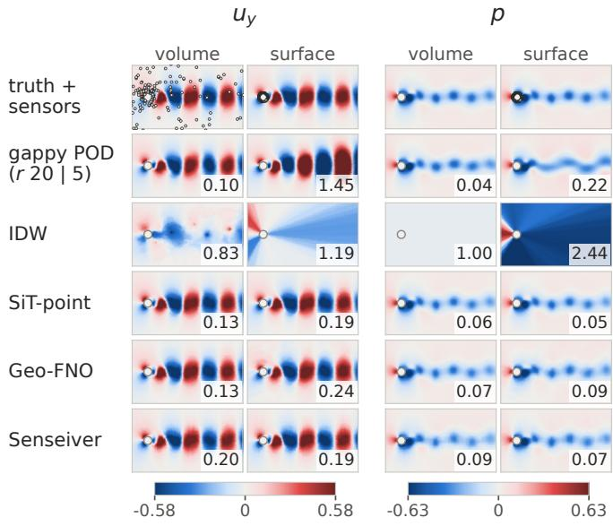  
FIG. 1. Cylinder wake held-out Re = 250 frames sensed in the volume (238 sensors per field on $u _ { x }$ and $u _ { y } ;$ p unobserved) and at the surface (128 taps per field on all three fields). Columns display $u _ { y }$ and $p$ for each sensing geometry; circles on the truth row mark the sensors. Panel numbers are singlemember relative $L _ { 2 } ,$ which exceeds the ensemble-mean errors of Tables III and IV. Gappy POD is accurate from the volume sensors and fails from the taps; IDW returns the training mean on the unobserved pressure.

Gappy POD falls from second to last among the noninterpolating methods (0.594 at 128 taps), because the near-wall taps observe the POD modes poorly (Sec. V B). A ridge penalty lowers its error to 0.262, ahead of MLP-RBF (0.303) but behind the other three learned methods, and LSE reaches 0.336. IDW and nearest neighbor exceed 2.0, worse than the training mean, because most of the wake lies far from every tap.

SiT-point leads at 128 taps, ahead of Senseiver and Geo-FNO (0.091 versus 0.101 and 0.173). Moving the sensors to the wall raises the error of Geo-FNO 2.2-fold while that of SiT-point rises only by 25%. Senseiver’s lower error in the surface task may partly reflect the additional pressure observations. The members of SiT-point remain under-dispersed (spread–error 0.25, coverage90 0.37).

TABLE IV. Cylinder surface-to-field task: relative $L _ { 2 }$ of the full wake from taps on the body, held-out $\mathrm { R e } \in \{ 8 0 , 2 5 0 \}$ , 50 test frames. Columns give taps per field on the near-wall ring; $u _ { x } , u _ { y }$ and $p$ are read at the taps. CRPS and the spread–error ratio $( { \mathrm { S p r / E r r } } )$ are at the full ring. The gappy POD rank, and the ridge strength of ridge gappy POD and LSE, are chosen per budget on training data; ridge gappy POD keeps $r { = } 1 0 .$ Boldface denotes the lowest error with the full ring of taps.
<table><tr><td rowspan="2">Method</td><td colspan="4">Rel.  $L _ { 2 }$  at n taps/field</td><td rowspan="2">CRPS  $\mathrm { S p r / E r r }$ </td></tr><tr><td>32</td><td>64</td><td>128</td><td>360</td></tr><tr><td>SiT-point</td><td>0.103</td><td>0.092</td><td>0.091</td><td>0.091</td><td>0.040</td><td>0.25</td></tr><tr><td>Senseiver</td><td>0.130</td><td>0.106</td><td>0.101</td><td>0.099</td><td>0.063</td><td></td></tr><tr><td>Geo-FNO</td><td>0.236</td><td>0.182</td><td>0.173</td><td>0.157</td><td>0.086</td><td></td></tr><tr><td>MLP-RBF</td><td>0.370</td><td>0.322</td><td>0.303</td><td>0.290</td><td>0.156</td><td></td></tr><tr><td>Ridge gappy POD</td><td>0.270</td><td>0.265</td><td>0.262</td><td>0.260</td><td>0.124</td><td></td></tr><tr><td>LSE</td><td>0.290</td><td>0.336</td><td>0.336</td><td>0.284</td><td>0.136</td><td></td></tr><tr><td>Gappy POD (r=5)</td><td>0.711</td><td>0.652</td><td>0.594</td><td>0.572</td><td>0.283</td><td></td></tr><tr><td>IDW (k=8)</td><td>2.078</td><td>2.116</td><td>2.131</td><td>2.140</td><td>1.936</td><td></td></tr><tr><td>Nearest neighbor</td><td>2.161</td><td>2.154</td><td>2.146</td><td>2.144</td><td>1.939</td><td></td></tr></table>

Every method except LSE is within about 10% of its full-ring error by 128 taps, because additional taps resample the same one-dimensional ring. Figure 1 compares the two sensing geometries on one frame. The contrasting behavior of gappy POD between the two sensing configurations illustrates that low-dimensional flow structure alone does not guarantee accurate reconstruction. The dominant modes must also be observable from the available measurements.

## B. Two-dimensional Kolmogorov turbulence

Sensors observe vorticity at 655 points (1%). Table V lists every method on the same test frames and sensor draws, and Sec. V B gives the sensor density sweep.

S3GM (0.273) is the most accurate method, 0.021 ahead of SiT-point (0.293, $p = 2 . 5 \times 1 0 ^ { - 7 } )$ . FNO is the best deterministic method at 0.380, 0.087 behind SiTpoint. Every learned method beats IDW (0.530).

Gappy POD, with rank 160 chosen on a held-out training trajectory, falls behind. Two-dimensional turbulence is not low-rank in the POD sense (Sec. V B). LSE, which keeps every mode, reaches 0.514, between IDW and MLP-RBF.

Retraining each learned method except SiT-point with two more seeds gives a pooled standard deviation of 0.0075 on Kolmogorov and 0.0044 on the cylinder. Gaps within about two standard deviations, such as Latent

(a)  
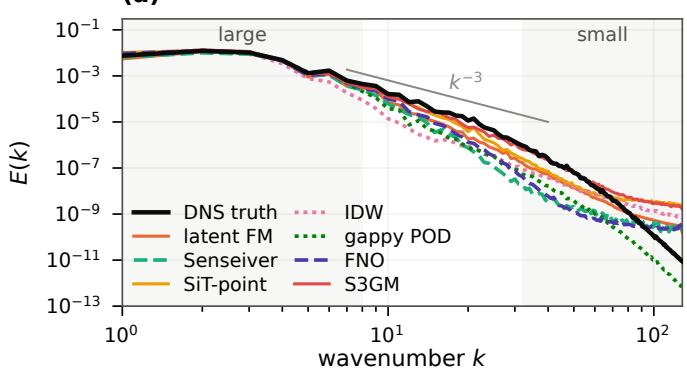

(b)  
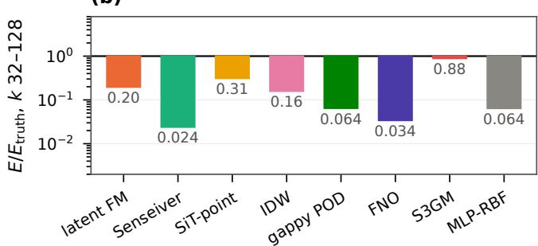  
FIG. 2. Kolmogorov spectral fidelity at 655 sensors (1%): one held-out frame, one member per method. (a) Kinetic energy spectra. Large scales $( k = 1 { - } 8 )$ and small scales $\left( k = 3 2 – 1 2 8 \right)$ are shaded. A curve below the truth at high k is too smooth; a curve above it carries spurious fine-scale noise. The $k ^ { - 3 }$ line is shown for reference. (b) Small-scale band energy relative to the truth on a log axis centered at 1.

FM against Senseiver, are reported as unordered (SM, Sec. S1).

The ranking is unchanged under Gaussian noise at $\sigma =$ 0.1 and under a slab that removes 25% of the sensors. The most accurate methods sufer most at $\sigma = 0 . 3 \mathrm { : }$ the S3GM sampler diverges on 3 of the 50 test frames and SiT-point $\mathrm { L _ { 2 } }$ rises 39%. The slab costs S3GM, which imposes the readings only at sampling time, about as much as SiT-point (1.71 and 1.64 times the clean error).

Single members and spectra (Figs. 2 and 3) separate the deterministic methods from the generative ones. A regressor trained on squared error estimates the conditional mean, which averages over all fields consistent with the sensors. When the sensors leave the small scales undetermined, this produces a smooth estimate, although each of those fields carries small-scale structure. Blau and $\mathrm { M i c h a e l i ^ { 7 3 } }$ proved that lowering the mean distortion beyond some point forces the distribution of the estimates away from that of real data. The same tradeof appears in weather forecasting74,75 and in the inpainting of rotating turbulence, where a generative model does not beat POD pointwise but reproduces multiscale statistics better.76 In the small-scale band $k = 3 2 – 1 2 8$ , the median test-frame member of Senseiver and FNO keeps only 0.023 and 0.039 of the true energy, against 0.30 and

TABLE V. Kolmogorov flow reconstruction. Sampler budgets, step counts N and the S3GM guidance coeficient are tuning-half choices. The conditional methods train at 65–6,554 sensors per frame. $E _ { \mathrm { s } } \mathrm { : }$ test-frame median of the single-member energy at $k = 3 2 – 1 2 8$ relative to the truth. Inference time and peak memory per field on one H100. per./non-per.: periodic or non-periodic neighbor search. Boldface denotes the lowest value in each of the relative $L _ { 2 }$ and CRPS columns.
<table><tr><td colspan="9">Rel.  $L _ { 2 }$ </td></tr><tr><td>Method</td><td>mean</td><td>sample</td><td>CRPS</td><td> $\mathrm { S p r / E r r }$ </td><td>Cov.90</td><td> $E _ { \mathrm { s } }$ </td><td>s/field</td><td>GB</td></tr><tr><td>SiT-point (N=32)</td><td>0.293</td><td>0.310</td><td>0.146</td><td>0.37</td><td>0.42</td><td>0.27</td><td>5.00</td><td>0.22</td></tr><tr><td>Latent FM (N=4)</td><td>0.463</td><td>0.523</td><td>0.240</td><td>0.57</td><td>0.55</td><td>0.30</td><td>0.11</td><td>0.16</td></tr><tr><td>S3GM (N=1000)</td><td>0.273</td><td>0.363</td><td>0.110</td><td>0.95</td><td>0.75</td><td>0.93</td><td>6.80</td><td>7.30</td></tr><tr><td>Senseiver</td><td>0.465</td><td>0.465</td><td>0.329</td><td></td><td></td><td>0.023</td><td>0.07</td><td>0.81</td></tr><tr><td>MLP-RBF</td><td>0.500</td><td>0.500</td><td>0.337</td><td></td><td></td><td>0.13</td><td>0.11</td><td>1.36</td></tr><tr><td>FNO</td><td>0.380</td><td>0.380</td><td>0.257</td><td></td><td></td><td>0.039</td><td>0.24</td><td>0.28</td></tr><tr><td>LSE</td><td>0.514</td><td>0.514</td><td>0.357</td><td></td><td></td><td>一</td><td></td><td></td></tr><tr><td>IDW(k=8)(per.)</td><td>0.530</td><td>0.530</td><td>0.376</td><td></td><td></td><td></td><td></td><td></td></tr><tr><td>IDW(k=8)(non-per.)</td><td>0.545</td><td>0.545</td><td>0.386</td><td></td><td></td><td>0.30</td><td></td><td></td></tr><tr><td>Nearest neighbor (per.)</td><td>0.580</td><td>0.580</td><td>0.370</td><td></td><td></td><td></td><td></td><td></td></tr><tr><td>Nearest neighbor (non-per.)</td><td>0.586</td><td>0.586</td><td>0.373</td><td></td><td></td><td></td><td></td><td></td></tr><tr><td>Gappy POD (r=160)</td><td>0.607</td><td>0.607</td><td>0.444</td><td></td><td></td><td>0.10</td><td></td><td></td></tr><tr><td>Training mean</td><td>1.000</td><td>1.000</td><td>0.755</td><td></td><td></td><td></td><td></td><td></td></tr></table>

truth + sensors  
SiT-point  
latent FM  
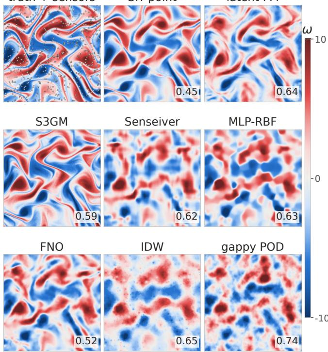  
FIG. 3. Kolmogorov $2 5 6 ^ { 2 }$ , the held-out frame of Fig. 2: truth and one member per method, with the same 655 sensors (dots on the truth panel) in every panel and one color scale. Panel numbers are single-member relative $L _ { 2 } .$ . Deterministic methods are smooth, most generative members carry small-scale texture, and gappy POD is over-smoothed.

0.27 for the generative Latent FM and SiT-point. S3GM comes closest to the true small-scale energy (0.93).

## C. Three-dimensional isotropic turbulence

Sensors observe $U _ { x }$ and $U _ { z }$ at 1% of the $1 . 9 5 \times 1 0 ^ { 6 }$ points per channel. $U _ { y }$ and $p$ are unobserved. On this regular grid every family except MLP-RBF is run. Table VI reports accuracy and probabilistic scores on the held-out cube, Table VII the cost, and Fig. 4 one held-out frame.

While no method leads every column, Latent FM leads the aggregate (0.465), largely driven by unobserved channels, which it extracts poorly but still better than the other methods (0.710 and 0.643). Simultaneously it is the fastest sampler of the learned methods. While no other method can extract $U _ { y }$ or p (Sec. V C), in the observed channels SiT-point leads the learned methods at 0.175 and 0.182, level with IDW, which reaches 0.174 and 0.183 (Sec. V B). Set-DeepONet’s predictions are nearly constant, a consequence of global mean pooling in its branch. Set-DeepONet++ improves its aggregate from 0.812 to 0.749 but stays far behind IDW on the observed channels. FNO3D ties SiT-point on the aggregate (0.571 against 0.555, $p = 0 . 1 5 )$ . Gen4Turb, scored on the central crop, errs 1.5 times as much on $U _ { z }$ as on $U _ { x }$ (0.325 against 0.212; SM, Sec. S4). LSE, fitted to 150 training snapshots of other cubes, reaches only 0.64 and 0.68 on the observed channels. CoNFiLD errs about three times as much as IDW on the observed channels (0.500 and 0.543), and sensors on all 32 snapshots of its window barely change this (0.489 and 0.539; SM Table S3).

At its published guidance coeficients that reproduced upstream outputs the S3GM sampler diverges at 1.95 × $1 \bar { 0 } ^ { 6 }$ points.

TABLE VI. 3D isotropic turbulence, spatially disjoint held-out cube $( 1 . 9 5 \times 1 0 ^ { 6 }$ points). Per-channel relative $L _ { 2 }$ of the ensemble mean over the 25 test-half snapshots; agg. averages the four channels. Asterisks mark the unobserved channels, where an error near 1 equals that of the training mean. Checkpoints and sampler settings are tuning-half choices. $E _ { \mathrm { d } } \colon$ test-snapshot median of the single-member energy at $k = 3 2 \AA$ –50 relative to the DNS on the observed channels. Each 3D method is trained once. Boldface denotes the best relative $L _ { 2 }$ or CRPS among learned methods. a)Published prior, outside the parameter budget; the 32-snapshot checkpoints conditioned on sensors in the target snapshot only, with the guidance scale (0.1) chosen on the tuning half. b)Guidance fitted on the tuning half, because the published coeficients diverge at this size; final checkpoint of a $\sigma _ { \mathrm { m a x } } { = } 2 0$ prior trained before the frozen protocol. c)Scored on the central $\mathrm { 1 2 0 ^ { 3 } }$ crop (88% of the points and sensors) and not paired. Further CoNFiLD, SiT-point and S3GM tests are in SM Table S3.
<table><tr><td>Method</td><td> $U _ { x }$ </td><td> $U _ { y } ^ { * }$ </td><td> $U _ { z }$ </td><td> $p ^ { * }$ </td><td>agg.</td><td>CRPS</td><td> $\mathrm { S p r / E r r }$ </td><td> $\mathrm { { C o v . 9 0 } }$ </td><td> $E _ { \mathrm { d } }$ </td></tr><tr><td>Latent flow matching</td><td>0.249</td><td>0.710</td><td>0.260</td><td>0.643</td><td>0.465</td><td>0.239</td><td>0.69</td><td>0.57</td><td>0.056</td></tr><tr><td>SiT-point (N=32)</td><td>0.175</td><td>0.957</td><td>0.182</td><td>0.904</td><td>0.555</td><td>0.323</td><td>0.46</td><td>0.40</td><td>11.7</td></tr><tr><td>FNO3D-FM (N=4)</td><td>0.190</td><td>0.921</td><td>0.193</td><td>1.054</td><td>0.589</td><td>0.272</td><td>0.98</td><td>0.63</td><td>0.012</td></tr><tr><td>CoNFiLD (single snapshot, N=1000)a)</td><td>0.500</td><td>1.024</td><td>0.543</td><td>1.034</td><td>0.775</td><td>0.378</td><td>0.77</td><td>0.62</td><td></td></tr><tr><td>S3GM (normalized guidance)b)</td><td>0.257</td><td>0.995</td><td>0.252</td><td>0.993</td><td>0.624</td><td>0.347</td><td>0.52</td><td>0.46</td><td></td></tr><tr><td>Gen4Turbc)</td><td>0.212</td><td>0.916</td><td>0.325</td><td>0.876</td><td>0.582</td><td>0.307</td><td>0.70</td><td>0.54</td><td></td></tr><tr><td>FNO3D</td><td>0.195</td><td>0.952</td><td>0.196</td><td>0.942</td><td>0.571</td><td>0.392</td><td></td><td></td><td>0.013</td></tr><tr><td>Senseiver</td><td>0.362</td><td>1.098</td><td>0.384</td><td>0.987</td><td>0.708</td><td>0.487</td><td></td><td></td><td>0.088</td></tr><tr><td>Set-DeepONet</td><td>0.527</td><td>1.098</td><td>0.567</td><td>1.056</td><td>0.812</td><td>0.583</td><td></td><td></td><td></td></tr><tr><td>Set-DeepONet++</td><td>0.508</td><td>0.967</td><td>0.541</td><td>0.981</td><td>0.749</td><td>0.521</td><td></td><td></td><td></td></tr><tr><td>IDW (k=8, non-periodic)</td><td>0.174</td><td>1.000</td><td>0.183</td><td>1.000</td><td>0.589</td><td>0.398</td><td></td><td></td><td>1.06</td></tr><tr><td>LSE</td><td>0.640</td><td>1.087</td><td>0.675</td><td>1.092</td><td>0.874</td><td>0.636</td><td></td><td></td><td></td></tr><tr><td>Gappy POD (r=80)</td><td>0.524</td><td>1.308</td><td>0.544</td><td>1.435</td><td>0.953</td><td>0.676</td><td></td><td></td><td></td></tr></table>

TABLE VII. Cost of the 3D fleet on one H100-SXM (80 GB): parameters, training GPU-hours, peak training memory, and inference time per full $1 2 5 ^ { 3 }$ field. (d): derived from evaluation wall time, an upper bound that includes data loading and metric computation. It marks only slow samplers, so the orders of magnitude between families are unafected. a)Published CoNFiLD prior, outside the parameter budget. Optimizer steps and time per step are in SM Table S4. Twostage methods (Latent FM, CoNFiLD) report the sum of both stages and the larger peak. CPU: run on the central processing unit. RSS: peak resident set size in host memory.

<table><tr><td>Method</td><td>Params</td><td>GPU-h</td><td>Peak GB</td><td> $\mathrm { s / f i e l d }$ </td></tr><tr><td>Latent FM</td><td>6.68M</td><td>20.1</td><td>8.4</td><td>0.019</td></tr><tr><td>SiT-point (N=32)</td><td>6.57M</td><td>19.4</td><td>26.8</td><td>149</td></tr><tr><td>FNO3D-FM (N=4)</td><td>6.73M</td><td>27.4</td><td>48.6</td><td>0.097</td></tr><tr><td>CoNFiLDa)</td><td>118.9M</td><td>19.2</td><td>10.4</td><td>36 (d)</td></tr><tr><td>Gen4Turb</td><td>6.16M</td><td>16.6</td><td>47.4</td><td>1.65</td></tr><tr><td>S3GM</td><td>6.35M</td><td>18.5</td><td>26.3</td><td>73.8</td></tr><tr><td>Senseiver</td><td>6.42M</td><td>17.0</td><td>22.4</td><td>&lt;1</td></tr><tr><td>FNO3D</td><td>6.73M</td><td>24.7</td><td>48.4</td><td>0.022</td></tr><tr><td>Set-DeepONet</td><td>6.51M</td><td>6.7</td><td>15.7</td><td>0.23</td></tr><tr><td>Set-DeepONet++</td><td>6.56M</td><td>1.0</td><td>10.1</td><td>0.13</td></tr><tr><td>IDW (CPU)</td><td>一</td><td>一</td><td>10 (RSS)</td><td>0.68</td></tr><tr><td>Gappy POD (CPU)</td><td>一</td><td>一</td><td>10 (RSS)</td><td>0.14</td></tr></table>

## V. CROSS-REGIME ANALYSIS

Section IV lists raw results within each regime. This section discusses which cross-regime trends emerge between sensor densities, representations, and model fami-

lies.

## A. Pointwise error and CRPS trade of

Reconstruction error and CRPS assess diferent properties. A deterministic regressor trained with squared error estimates the conditional mean, while CRPS eval uates the quality of the predictive distribution, accounting for both accuracy and calibration. Most models ex hibit an inverse trend between error and CRPS. When reconstruction uncertainty is high, minimizing the mean squared error averages over multiple plausible solutions, producing blurry estimates, whereas sampling from the posterior preserves realistic variability but increases expected error relative to the posterior mean.37,73 In principle, an exact posterior sampler could serve both scores. However, in practice, learned samplers only approximate the posterior, likely reducing mean $L _ { 2 }$ performance, and with their operating point depending on the sampler, the checkpoint, and the number of samples K.

Kolmogorov flow shows this tradeof outside the leader (Table V), S3GM, which leads both scores. Deterministic FNO beats generative Latent FM on relative $L _ { 2 }$ (0.380 against 0.463) and loses to it on CRPS (0.257 against 0.240). On JHTDB, the FNO3D pair shares its back bone, inputs and schedule but difers in objective and in the spectral penalty of FNO3D-FM. The two tie on relative $L _ { 2 } .$ but the flow-matching model has the lower CRPS.

The tradeof is not only a diference between architectures but can also emerge within a given architecture by way of hyperparameter variation. In particular, one trained model moves along it when only its sampler changes. On the Kolmogorov tuning half, raising the step count of Latent FM from 4 to 16 raises its ensemble-mean error from 0.464 to 0.468, lowers its CRPS from 0.240 to 0.226 and raises its spread–error from 0.57 to 0.83. Few-step members spread less about their mean. Because sampler settings are selected on the tuning half by ensemble-mean error (Sec. II B), the reported few-step methods sit at the low-error end of their own curves. The settings that minimize CRPS on the tuning half are scored in SM Table S5.

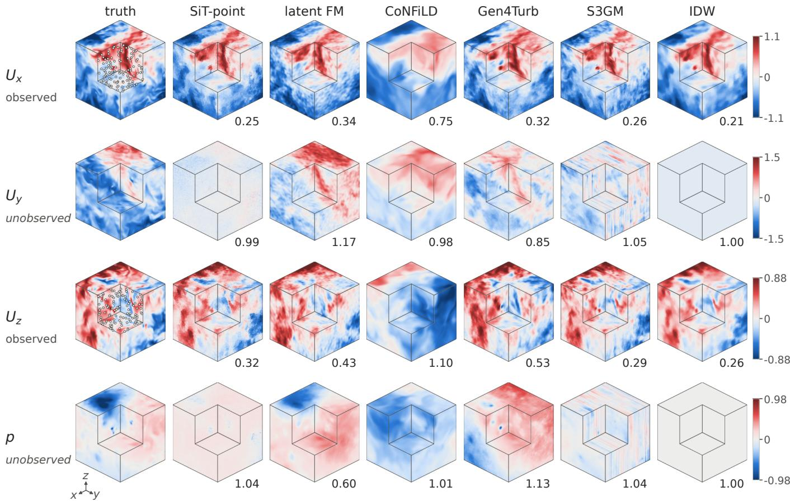  
FIG. 4. 3D isotropic turbulence, held-out cube, frame 152 (a test-half frame). Each panel shows the $1 2 5 ^ { 3 }$ cube with one octant cut away to expose the x, y and z midplanes. The other visible surfaces are outer faces of the cube. $U _ { x }$ and $U _ { z }$ are observed at 19,531 identical sensors each (circles: sensors on the midplanes); $U _ { y }$ and $p$ are unobserved. Gen4Turb shows its central 1203 crop. Panel numbers are single-member relative $L _ { 2 }$ over the whole cube (the crop for Gen4Turb). Among the methods shown, only Latent FM is below 0.7 on an unobserved channel, and it identifies the low-pressure core. IDW returns the training mean on the unobserved channels.

At these error-selected settings, the generative models remain largely under-dispersed against the calibrated K=8 values (Sec. II D), a common observation in related settings.38,39,56,57 Spread–error ranges from 0.25 (SiT-point on the surface task) to 0.98 (FNO3D-FM on JHTDB), and Kolmogorov S3GM (0.95) is close to calibrated.

Post-hoc recalibration on held-out data can repair the stated uncertainty without changing the reconstruction or retraining.77 A single spread multiplier fitted on the tuning half, similar to that of Ref. 78, brings all three Kolmogorov generative methods to within 1.5% of the calibrated spread–error on the test half. It fails when the miscalibration difers within the deployment set. Fitted separately on the cylinder tuning half, the multiplier for SiT-point is 1.26 at Re = 80 and 3.92 at Re = 250. A correction that changes across the deployment set needs a conditional estimator fitted separately for each condition. One example is a split-conformal quantile of the residual over the ensemble spread, fitted in bins of distance to the nearest sensor (SM, Sec. S7).

## B. Performance of classical baselines

Classical approaches ofer strong performance and eficiency in a wide variety of flow configurations and should not be overlooked as an initial approach to sparse reconstruction. Several recent studies evaluate learned meth ods on single periodic cylinder wakes without classical baselines,25,36 and where interpolation is reported it is competitive.32 On the cylinder task here, which holds out whole Reynolds numbers, LSE and gappy POD have the lowest pooled relative $L _ { 2 } ,$ and interpolation is level with the best learned method on the observed 3D channels. This section outlines two descriptors, computed from the training frames and the sensor layout, that explain why each classical method succeeds or fails: the nearestsensor distance relative to the decorrelation length governs interpolation, and the sparsity and observability of a POD basis govern gappy POD. Together they locate the regimes in which learned methods outperform both.

Interpolation methods (IDW and nearest-neighbor) can only reuse what nearby sensors read, so its error is set by how much the field changes across the gap to the nearest sensor. That change is measured by the secondorder structure function $S _ { 2 } ( d )$

$$
S _ { 2 } ( { \pmb d } ) = \langle [ u ( { \pmb x } + { \pmb d } ) - u ( { \pmb x } ) ] ^ { 2 } \rangle ~ ,\tag{3}
$$

$$
\hat { e } _ { \mathrm { N N } } = [ \langle S _ { 2 } ( { \pmb d } ) \rangle / \langle u ^ { 2 } \rangle ] ^ { 1 / 2 } ,\tag{4}
$$

where $^ d$ is the distance to the nearest sensor, $u ( { \pmb x } )$ is the field value at location x, ⟨·⟩ denotes an average over space and sensor draws, and $\hat { e } _ { \mathrm { N N } }$ predicts the predicted root-mean-square error of the nearest-neighbor variant normalized by the variance $\langle u ^ { 2 } \rangle$ . Interpolation error is therefore connected to both the typical sensor spacing and the correlation structure of the field. $^ { 7 9 - 8 2 }$ Our estimated ˆe, averaged over random sensor draws matches the measured one to within 1% at every Kolmogorov density and to within 7% on the cylinder once $S _ { 2 }$ is resolved in space. It is 8–16% low on the 3D cutouts, whose heldout cube has larger velocity increments than the training cubes (Table VIII). IDW improves on nearest-neighbor copying by less than a fifth. Relative to the decorrelation length $\ell ,$ defined by $S _ { 2 } ( \ell ) = \langle u ^ { 2 } \rangle$ , the mean nearestsensor distance $\bar { d }$ at 1% sensing is below 0.05 ℓ for the 3D velocity, 0.4 ℓ for Kolmogorov vorticity and about ℓ in the cylinder wake, and surface taps leave the wake more than 10 ℓ away. Interpolation is therefore a challenging baseline to beat on the observed 3D channels, where IDW matches the best learned methods, a weak one on Kolmogorov, where every learned method beats it at exponent 1, and worse than the training mean from surface taps.

A global low-rank method like gappy POD needs two properties. The field must be sparse in some basis: a rank-r POD basis $\Phi _ { r }$ from the training frames must represent the held-out frames, which the projection floor measures. The retained modes must also be observable: the sampled basis $H \Phi _ { r } ,$ where H selects the sensed entries, must be well conditioned, or the least-squares fit amplifies the content outside the basis.19,83 Volume sensing of the cylinder meets both conditions (Table VIII): 20 modes hold 99.7% of the training energy, $H \Phi _ { 2 0 }$ has a condition number of about 3, and gappy POD (0.057) lands near the floor (0.048). LSE, which keeps every mode with a penalty weighted by its energy, goes below this rank 20 floor (0.043). The surface taps observe the same 20 modes but cannot distinguish them, producing a condition number near $\mathrm { 8 \times 1 0 ^ { 3 } }$ , so the rank selection retreats to five modes and still ends at 0.59. Sensing all 360 nearwall cells does not improve the conditioning.15 A ridge penalty keeps ten modes and reaches 0.26, still behind three of the four learned methods. Kolmogorov flow and the JHTDB cutouts instead fail the compressibility test, with floors of 0.51 and 0.65 at 160 and 80 modes, respectively. Although their sensors observe the modes well, a low-rank field is likewise necessary for gappy POD.

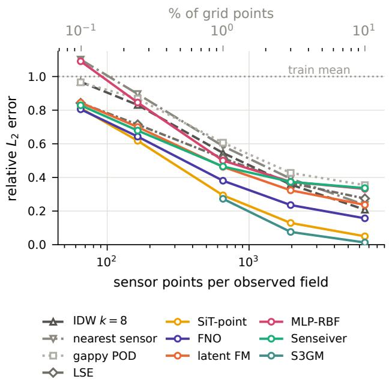  
FIG. 5. Kolmogorov reconstruction error versus sensors per field (vorticity, 50 test frames, identical draws for every method at every density, all densities inside the training ranges). Colored: learned methods; gray: classical anchors, with the gappy POD rank and the LSE penalty chosen per density. S3GM scales its guidance weight from the value tuned at 655 sensors with the inverse square root of the sensor fraction and diverges at 65 and 164 sensors. A 3D sweep of the classical anchors is in SM Fig. S1.

The Kolmogorov sweep (Fig. 5) shows that the comparison between learned and classical methods changes with the sensor budget. At 65 sensors (0.1%), IDW (0.968) and gappy POD (0.966) stay near the trainingmean estimate, LSE (0.843) and four learned methods reach 0.805–0.844, MLP-RBF (1.09) exceeds the training mean, and the S3GM sampler diverges, as it does at 164 sensors. Denser sensing increasingly favors interpolation. LSE falls behind IDW between 655 and 1965 sensors, and IDW overtakes Senseiver and MLP-RBF in the same interval. It passes Latent FM by 6554, while S3GM, SiT-point and FNO stay ahead of IDW (0.013, 0.050, and 0.156 versus 0.208) at 6554 sensors (10%).

The rate of improvement as a function of sensor count is even more informative. The error of S3GM falls 21- fold between 1% and 10% sensing alone. Over the full

TABLE VIII. Classical diagnostics at the canonical sensor counts (test frames). Local columns average the observed channels: $\bar { d } / \ell$ is the mean nearest-sensor distance over the decorrelation length (cylinder: wake region $x > D , | y | < 4 D )$ , ˆeNN the nearest-neighbor error predicted from the training structure function and the sensor count (location-resolved on the cylinder mesh), and NN and IDW the measured errors. Global columns aggregate all channels: POD rank r, training energy fraction $E _ { r } ,$ , relative $L _ { 2 }$ of projecting the test frames onto $\Phi _ { r }$ (the floor of any coeficient fit), median condition number of HΦr over the sensor draws, and the measured gappy POD error. Kolmogorov local values use the periodic neighbor search. a)In-sampl over 150 correlated training frames.
<table><tr><td></td><td></td><td colspan="4">Local (interpolation)</td><td colspan="5">Global (gappy POD)</td></tr><tr><td>Regime</td><td>Sensors</td><td>d/l</td><td>êNN</td><td>NN</td><td>IDW</td><td>r</td><td> $E _ { r }$ </td><td>Floor</td><td>κ(HΦr)</td><td>Gappy POD</td></tr><tr><td>Cylinder, volume</td><td>238 per field</td><td>0.95-1.3</td><td>0.55</td><td>0.569</td><td>0.568</td><td>20</td><td>0.997</td><td>0.048</td><td>3.2</td><td>0.057</td></tr><tr><td>Cylinder, surface</td><td>128 taps per field</td><td>13-19</td><td>2.10</td><td>2.146</td><td>2.131</td><td>5</td><td>0.929</td><td>0.163</td><td> $1 . 0 \times 1 0 ^ { 2 }$ </td><td>0.594</td></tr><tr><td></td><td></td><td></td><td></td><td></td><td></td><td>20</td><td>0.997</td><td>0.048</td><td> $7 . 7 \times 1 0 ^ { 3 }$ </td><td>0.763</td></tr><tr><td>Kolmogorov</td><td>655</td><td>0.40</td><td>0.58</td><td>0.580</td><td>0.530</td><td>160</td><td>0.832</td><td>0.513</td><td>3.7</td><td>0.607</td></tr><tr><td>JHTDB,  $U _ { x }$  and  $U _ { z }$ </td><td>19,531 per channel</td><td>&lt; 0.05</td><td>0.19</td><td>0.216</td><td>0.179</td><td>80</td><td>0.955a)</td><td>0.648</td><td>11.9</td><td>0.953</td></tr></table>

100-fold sensor count sweep, the error of SiT-point falls 16-fold, versus the next best 5.1-fold of FNO. While the two are 0.09 apart at 1%, they difer by a factor of 3.1 at 10%. The flattest curves belong to models that pass the sensors through a summary of fixed size or resolution: Senseiver’s 64 latent vectors, Latent FM’s 8×8-cell latent averages and $\mathrm { M L P - R B F { : } }$ fixed-width kernel average. The steeper curves keep a per-location record of the readings in ambient space rather than latent space (posterior guidance at the sensor points, nearest-sensor token fill and a full-resolution sensor raster). Backbones and training also changing between these models, so the exact mechanism cannot be isolated.

## C. Representation, cross-channel transfer and fine-scale content

Methods represent the field either in a compressed latent space, as in latent difusion,20 or directly as field values on a grid or at query points, as in pixel-space difusion84 and function-space generative models.27,28 This choice of latent or ambient representation influences how much information passes from measured to unmeasured channels, and which scales a sample can carry. On the cylinder, the low-dimensional shedding state ties pressure to the measured velocities closely because all channels carry similar structure, as in extended POD,18 so every method that models cross-channel structure recovers the never-observed pressure. Isotropic turbulence, in contrast, is observed only in $U _ { x }$ and $U _ { z } .$ at 1% sensing. No method recovers either unobserved channel well: the best errors, 0.710 on $U _ { y }$ and 0.643 on $p$ (Latent FM, Table VI), are an order of magnitude above the unobserved cylinder pressure error. Kinematics alone leaves most of both channels undetermined on these subdomains. Given the true $U _ { x }$ and $U _ { z }$ everywhere, continuity fixes $U _ { y }$ only up to its average along $y ,$ which holds 78% of the norm of $U _ { y }$ , so the best estimate from continuity scores 0.79. Given the true velocity everywhere but no boundary pressure, the pressure Poisson equation gives 0.78 on p (SM,

Sec. S4).

Latent FM beats both bounds from 1% sensing, so part of its information comes from learned statistics rather than kinematics. It is the only method of Table VI below 0.9 on both unobserved channels. Its advantage comes from its representation. A decoder trained to reproduce complete four-channel fields can carry information from measured to unmeasured channels, whereas Senseiver’s latent array, which encodes only the sensors and no global field context, shows no such advantage. Latent FM achieves lower errors on the unobserved channels than the kinematics-only reconstruction, despite using much sparser observations. The improvement suggests that learned cross-channel statistics may provide information beyond what is obtained from the kinematic con straints alone. This behavior is consistent with a latent decoder trained to represent complete multichannel flow fields, which may exploit correlations between measured and unmeasured variables. This gain sits at the largest scales. Over the test half, Latent FM’s p correlates with the truth at a median 0.88 for $k \leq 7 ,$ against 0.46 for FNO3D, 0.43 for SiT-point and at most 0.38 for FNO3D-FM and Senseiver. On the frame of Fig. 4 its correlation at k = 8–31 is 0.20 on p and 0.03 on $U _ { y } .$ . Thus Latent FM exhibits advantages under severe under-determination.

The representation also limits which scales a sample can infer from the sensors (Fig. 6). On the observed channels at $k = 8 – 3 1$ , the median band correlation of Latent FM with the DNS over the test half is 0.04, against 0.65 for SiT-point and 0.63 for IDW. Latent FM receives the sensors as averages over $8 ^ { 3 } \cdot$ -point latent cells, so at 1% sensing each cell holds about five sensors; the averaging removes structure that the sensors resolve between the cell scale $( k \ \approx \ 8 )$ and the sensor spacing $( k \approx 1 3 )$ Nevertheless, Latent FM keeps 0.49 of the DNS energy in this band, but the structure is randomly generated. On Kolmogorov flow, where the latent cells are finer than the sensor spacing, the band correlation of Latent FM at $k = 1 6 { - } 3 1$ is 0.11. In the dissipation band $( k = 3 2 – 5 0 )$ Latent FM keeps 0.06 of the DNS energy, and FNO3D-FM and FNO3D, whose Fourier layers stop above wavenumber eight, 0.01 each, so the cutof is specific neither to autoencoders nor to the objective. SiT-point’s speckle puts 12 times the DNS energy in this band. No method’s dissipation-band content correlates with the truth (at most 0.02), because these wavelengths are shorter than the sensor spacing and the learned prior fixes at best their statistics. On Kolmogorov flow the latent-FM stage 1 autoencoder alone keeps 0.95–0.99 of the small-scale energy, yet its stage 2 generated samples keep 0.30, so the loss arises in conditional generation rather than compression. For the JHTDB cases, the 40-fold-compressed autoencoder alone keeps 0.98 of the inertial-band energy of the true test-half fields, at a band correlation of 0.99, and reconstructs the four channels to relative $L _ { 2 }$ errors of 0.031, 0.037, 0.033 and 0.025, so the decorrelation of the samples in this band does not arise in compression. In the dissipation band it keeps 0.17 of the energy (0.13–0.21 over the test half), against 0.06 for the samples. Compression therefore caps this band, similar to the deficit reported by Rafiq and ${ \bar { \mathrm { N a i r } } } , ^ { 8 5 }$ and conditional generation removes about two thirds of the remainder. Bulk metrics miss these losses: Latent FM leads the aggregate $L _ { 2 }$ of Table VI, and compression studies report preserved bulk statistics and accuracy at 64- and 1000-fold compression.7,86 Representation covaries with backbone, conditioning and training budget, and between regimes also with Reynolds number, dimension and geometry, so these mechanisms are consistent with the results but are not controlled efects.

## D. Computational advantages reverse with resolution and query regime

Training takes 6.7–27.4 GPU-hours for every learned 3D method except the early-stopped Set-DeepONet++ (1.0), but per-field inference time spans nearly four orders of magnitude, from 0.019 s for Latent FM to about 150 s for SiT-point (Table VII). Latent FM samples a compact latent state and decodes it once, whereas the slow methods repeat many network passes through long guided chains (S3GM, CoNFiLD) or sequential query chunks (SiT-point). All measurements are conducted with identical GPUs so relative trends can be assessed. The scalability study uses synthetic inputs: each model recon structs random fields on cubic lattices from $6 4 ^ { 3 }$ to $1 0 2 4 ^ { 3 } .$ with the sensor count fixed at the 1% budget of the $1 2 5 ^ { 3 }$ cube, and peak memory and wall time of one full-field reconstruction and one training step are recorded. Memory and time depend on tensor shapes, not on values, so untrained weights sufice for the grid models, which must be rebuilt at each resolution.

For memory scalability, architectural diferences become relevant. Grid-native models compute on every point of the discretized field, so in 3D their memory grows with the cube of the resolution (Fig. 7, batch size 1). The convolutional autoencoder of latent FM needs 0.25 GB to encode and decode a $1 2 5 ^ { 3 }$ field but runs out of memory at $7 6 8 ^ { 3 }$ . In training, voxel difusion (Gen4Turb) memory exceeds H100 limits (80 GB) at $\mathrm { 3 2 0 ^ { 3 } }$ and the Latent FM autoencoder at $6 4 0 ^ { 3 }$ . Point-query models decouple working memory from the output resolution: they train on a fixed subset of query points and evaluate a full field in fixed-size chunks. The peak memory of Senseiver stays constant from $6 4 ^ { 3 }$ to $1 0 2 4 ^ { 3 }$ (1.2 GB for a full-field reconstruction and 22.4 GB in training). Its run time, however, grows with the number of queried points, from 0.125 s at $\bar { 1 } 2 5 ^ { 3 }$ to $6 7 \mathrm { s }$ at $1 0 2 4 ^ { 3 }$ The two families therefore cross in memory and feasibility, not in run time. The autoencoder uses less memory than Senseiver below about $2 3 0 ^ { 3 }$ in reconstruction, and wherever it fits its encode–decode is about 20 times faster (6 ms against 0.125 s at $1 2 5 ^ { 3 } )$ Beyond the walls the full grid no longer fits on one $\mathrm { G P U }$ while the point model still runs at $1 0 \bar { 2 } 4 ^ { 3 }$ , and point models also gain when only part of the field is needed.

(a)  
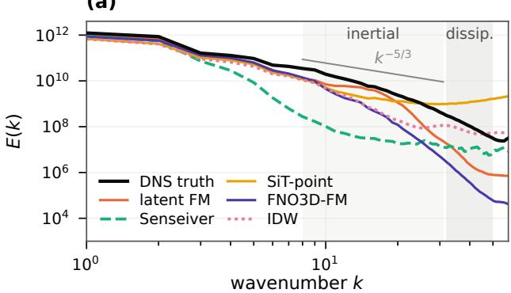  
(c)

(b)  
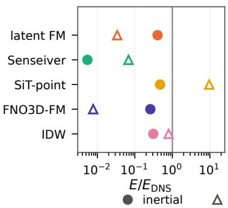

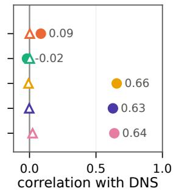  
FIG. 6. Spectral content of single samples on the held-out 3D cube (frame of ${ \mathrm { F i g } } . \ 4 ,$ one sensor draw, sampler settings of Table VI, Hann window). (a) Energy spectra of the total velocity with the inertial $( k = 8 – 3 1 )$ and dissipation $( k =$ 32–50) bands shaded. (b) Band energy relative to the DNS and (c) band-limited correlation with the DNS, pooled over the observed channels. SiT-point members carry grid-scale speckle, which shows as excess dissipation-band energy.

(a) sampling  
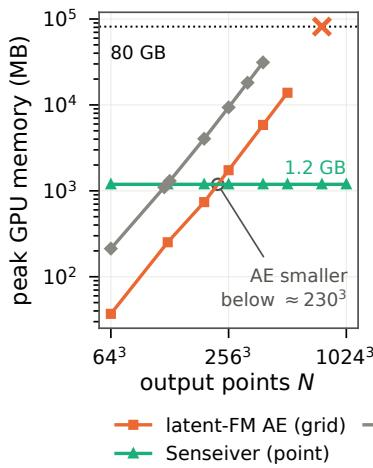

(b) training  
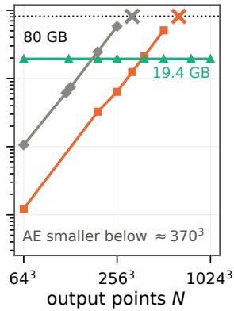  
FIG. 7. Measured peak GPU memory against output resolution (one H100, 80 GB; log–log) for (a) full-field reconstruction and (b) one training step. Crosses mark measured out-of-memory failures. Grid models run at batch size 1; the latent-FM curve is its autoencoder alone, a lower bound on sampling. The point model (Senseiver) evaluates fixed-size query chunks and stays flat to $\mathrm { 1 0 2 4 ^ { 3 } }$

No architecture is eficient in general: latent models pay for the latent dimension and the decoded grid, gridnative models for the number of grid points, point models for the number of queried points, and iterative samplers for the number of network evaluations. The cheapest method depends on the target resolution, the number of reconstructions and the fraction of each field that is queried.

## VI. DISCUSSION AND MODEL SELECTION

No single method performs best across all three reconstruction regimes. Method selection should begin with architectural compatibility constraints (Sec. VI A), including sensor geometry, query locations, output resolution, and memory requirements. Among the admissible methods, the preferred approach depends on the information available from the sensors, the desired reconstruction quantities, and the computational budget (Sec. VI B).

## A. Hard architectural constraints

Several of the tested methods contain hard limitations that prevent their use before even assessing their accuracy. Latent FM, S3GM, Gen4Turb and the grid FNO need a Cartesian grid and thus are not tested on the body-fitted cylinder mesh (Table II). Set and point-cloud models (Senseiver, SiT-point, MLP-RBF) accept any number of sensors at arbitrary coordinates. Rasterizing models (Latent FM, FNO, Gen4Turb) move sensors to grid nodes, and posterior-sampling models (S3GM, CoN-FiLD) accept any diferentiable observation operator at a cost of seconds to minutes per field. Full-grid decoders (Latent FM, S3GM, Gen4Turb, and FNO) return the full field at a fixed resolution, whereas point-query models (Set-DeepONet, CoNFiLD, Senseiver, MLP-RBF, and SiT-point) evaluate arbitrary coordinates, such as probes, another mesh or a body surface. Operator-based methods can make the solution resolution-invariant, in principle. Full-grid models also hit measured memory walls between $3 2 0 ^ { 3 }$ and $7 6 8 ^ { 3 }$ on one GPU, while pointquery models still run at $1 0 2 4 ^ { 3 }$ (Sec. V D).

The last filter is whether a deterministic estimate is enough or if generative modeling should be used. A deterministic squared-error regressor estimates the conditional mean, which sufices when the readings determine the field and costs less than sampling. When several fields fit the readings, the mean averages them. For a bimodal posterior it can fall between the modes, likewise small-scale features seen in turbulence will be smoothed over.73,87 Applications that need realistic members, spread or tail probabilities need a probabilistic generative formulation.75

## B. Soft regime-dependent model-selection guidelines

Among the remaining methods, four questions may be used to guide the choice.

1. Will classical methods $s u f f i c e ?$ The structurefunction estimate and the POD diagnostics need only training frames and the sensor layout (Sec. V B, Table VIII). If the predicted nearestneighbor error meets the accuracy requirement, IDW is suficient. If a few POD modes hold the variance and $H \Phi _ { r }$ is well conditioned, gappy POD is hard to beat, and LSE more so: they reach 0.057 and 0.043 from volume sensors of the cylinder, against 0.59 and 0.34 (0.26 for ridge gappy POD) from 128 surface taps of the same flow.

2. How dense is the sensing? Over the Kolmogorov sweep, models that keep a per-location record of the readings improve 5- to 16-fold (FNO, SiT-point) and S3GM 21-fold between 1% and 10% sensing, although its sampler diverges below 1%. Models that pass the sensors through a fixed-size summary (Senseiver, Latent FM, MLP-RBF) improve 2.5- to 3.6-fold and fall behind IDW at 10% sensing.

3. Must unobserved channels $o r$ fine scales be inferred? The two needs favor diferent representations. A latent decoder trained on complete multichannel fields carries large-scale information to unmeasured channels, but latent cells coarser than the sensor spacing discard scales that the sensors resolve (Sec. V C). No method infers scales finer than the sensor spacing; a generative prior at best restores their energy.

4. How many outputs are queried? Single-pass latent decoders are fastest for repeated full-field reconstruction at moderate resolution. Point-query models are preferable when only part of the field is needed, and iterative samplers pay per network evaluation in any representation (Sec. V D).

## C. Limitations

Limitations exist in the present work that simultaneously are opportunity for later investigations. All three regimes are simulations of canonical flows on two Cartesian grids and one body-fitted O-grid, and the suite contains no experimental data, so neither measurement realism nor geometric generality can be claimed here. Sensor noise is synthetic and tested on one 2D regime (SM, Sec. S2), and the surface study uses one body. Every learned method trains per regime and reconstructs single snapshots, whereas variational assimilation of observation histories has recovered all scales of channel turbulence.10

## VII. CONCLUSION

FlowReconBench evaluates state of the art sparsesensing data-driven techniques under a common protocol. Three regimes are tested, from 2D laminar to 3D turbulent flow, ten learned methods and five classical baselines, including leakage-controlled splits, proper probabilistic scores, member-level physics metrics, and practical computational cost. While no method leads in every regime, trends are revealed between methods that guide method selection. Classical baselines are hard to beat when the sensors are dense relative to the field’s decorrelation length or observe a compressible POD basis, and simple diagnostics predict both cases. Meanfield error alone misranks generative methods, most raw ensembles are under-dispersed at error-selected sampler settings, and a scalar recalibration transfers only when the miscalibration is stationary. On the 3D subdomains, kinematics leaves most of the unobserved channels undetermined, and representation choices trade cross-channel coupling, fine-scale content and scaling. The datasets, splits, sensor draws and evaluation code will be released for extension.

## SUPPLEMENTARY MATERIAL

See the supplementary material for the seed-repeat statistics (Sec. S1), the sensor-noise and occlusion tests (Sec. S2), the Gen4Turb channel asymmetry and the kinematic bounds on the unobserved 3D channels (Sec. S4), the leakage test on training-trajectory frames (Sec. S6), the comparison of LSE with gappy POD and the conditional recalibration (Sec. S7), the parametercount-matched CoNFiLD runs, the per-Reynolds-number cylinder errors (Table S2), further CoNFiLD, SiT-point and S3GM tests on the 3D cube (Table S3), optimizer steps and time per step of the 3D methods (Table S4), the CRPS-optimal sampler settings (Table S5), and the 3D sensor-density sweep (Fig. S1).

## ACKNOWLEDGMENTS

This material is based upon work supported by the U.S. National Science Foundation under Award No. CBET-143625. N.J.T. is partially supported by GE Vernova under the GE Vernova X MIT fellowship. J.C. is partially supported by the Jack Kent Cooke Foundation. This research was performed using computational resources sponsored by the U.S. Department of Energy’s Ofice of Critical Minerals and Energy Innovation and located at the National Laboratory of the Rockies. Any opinions, findings, and conclusions or recommendations expressed in this material are those of the authors and do not necessarily reflect the views of the National Science Foundation.

## AUTHOR DECLARATIONS

## Conflict of Interest

The authors have no conflicts to disclose.

## Author Contributions

Nicolas Tricard: Conceptualization, Formal analysis, Data curation, Investigation, Methodology, Software, Validation, Visualization, Writing – original draft. Linzheng Wang: Conceptualization, Methodology, Software, Writing – review & editing. Jason Chen: Software, Writing – review & editing. Sili Deng: Conceptualization, Funding acquisition, Project administration, Supervision, Writing – review & editing.

## DATA AVAILABILITY STATEMENT

The cylinder-wake dataset generated in this study, the dataset splits, the evaluation sensor draws and the benchmark code are available from the corresponding author upon reasonable request and will be released in a public repository upon publication. The two-dimensional Kolmogorov flow data are from Ref. 23, and the threedimensional isotropic turbulence data were obtained from the Johns Hopkins Turbulence Databases.59

1S. L. Brunton, B. R. Noack, and P. Koumoutsakos, “Machine learning for fluid mechanics,” Annu. Rev. Fluid Mech. 52, 477– 508 (2020).

2K. Fukami, K. Fukagata, and K. Taira, “Super-resolution analysis via machine learning: a survey for fluid flows,” Theor. Comput. Fluid Dyn. 37(4), 421–444 (2023).

3G. Comte-Bellot, “Hot-wire anemometry,” Annu. Rev. Fluid Mech. 8, 209–231 (1976).

4S. A. Whitmore, R. J. Davis, and J. M. Fife, “In-flight demonstration of a real-time flush airdata sensing (RT-FADS) system,” Tech. Rep. NASA-TM-104314 (NASA Dryden Flight Research Center, 1995).

5R. Vinuesa, S. L. Brunton, and B. J. McKeon, “The transformative potential of machine learning for experiments in fluid mechanics,” Nat. Rev. Phys. 5(9), 536–545 (2023).

6H. Mousavi and J. D. Eldredge, “Low-order flow reconstruction and uncertainty quantification in disturbed aerodynamics using sparse pressure measurements,” J. Fluid Mech. 1013, A41 (2025).

7A. Glaws, R. King, and M. Sprague, “Deep learning for in situ data compression of large turbulent flow simulations,” Phys. Rev. Fluids 5(11), 114602 (2020).

8S. L. Stahl and S. I. Benton, “Sparse flow reconstruction methods to reduce the costs of analyzing large unsteady datasets,” J. Comput. Phys. 534, 114037 (2025).

9B. W. van Oudheusden, “PIV-based pressure measurement,” Meas. Sci. Technol. 24(3), 032001 (2013).

10T. A. Zaki and M. Wang, “From limited observations to the state of turbulence: Fundamental dificulties of flow reconstruction,” Phys. Rev. Fluids 6(10), 100501 (2021).

11A. M. Stuart, “Inverse problems: A Bayesian perspective,” Acta Numer. 19, 451–559 (2010).

12J. L. Callaham, K. Maeda, and S. L. Brunton, “Robust flow reconstruction from limited measurements via sparse representation,” Phys. Rev. Fluids 4(10), 103907 (2019).

13M. Raissi, A. Yazdani, and G. E. Karniadakis, “Hidden fluid mechanics: Learning velocity and pressure fields from flow visualizations,” Science 367(6481), 1026–1030 (2020).

14R. Everson and L. Sirovich, “Karhunen–Lo\`eve procedure for gappy data,” J. Opt. Soc. Am. A 12(8), 1657–1664 (1995).

15K. Manohar, B. W. Brunton, J. N. Kutz, and S. L. Brunton, “Data-driven sparse sensor placement for reconstruction: Demonstrating the benefits of exploiting known patterns,” IEEE Control Syst. Mag. 38(3), 63–86 (2018).

16G. Berkooz, P. Holmes, and J. L. Lumley, “The proper orthogonal decomposition in the analysis of turbulent flows,” Annu. Rev. Fluid Mech. 25, 539–575 (1993).

17K. Taira, S. L. Brunton, S. T. M. Dawson, C. W. Rowley, T. Colonius, B. J. McKeon, O. T. Schmidt, S. Gordeyev, V. Theofilis, and L. S. Ukeiley, “Modal analysis of fluid flows: An overview,” AIAA J. 55(12), 4013–4041 (2017).

18J. Bor´ee, “Extended proper orthogonal decomposition: a tool to analyse correlated events in turbulent flows,” Exp. Fluids 35(2), 188–192 (2003).

19K. Willcox, “Unsteady flow sensing and estimation via the gappy proper orthogonal decomposition,” Comput. Fluids 35(2), 208– 226 (2006).

20R. Rombach, A. Blattmann, D. Lorenz, P. Esser, and B. Ommer, “High-resolution image synthesis with latent difusion models,” in Proceedings of the IEEE/CVF Conference on Computer Vision and Pattern Recognition (CVPR) (2022) pp. 10674–10685.

21P. Du, M. H. Parikh, X. Fan, X.-Y. Liu, and J.-X. Wang, “Conditional neural field latent difusion model for generating spatiotemporal turbulence,” Nat. Commun. 15, 10416 (2024).

22Z. Li, W. Han, Y. Zhang, Q. Fu, J. Li, L. Qin, R. Dong, H. Sun, Y. Deng, and L. Yang, “Learning spatiotemporal dynamics with a pretrained generative model,” Nat. Mach. Intell. 6(12), 1566– 1579 (2024).

23D. Shu, Z. Li, and A. B. Farimani, “A physics-informed difusion model for high-fidelity flow field reconstruction,” J. Comput. Phys. 478, 111972 (2023).

24Z. Li, N. B. Kovachki, K. Azizzadenesheli, B. Liu, K. Bhattacharya, A. Stuart, and A. Anandkumar, “Fourier neural operator for parametric partial diferential equations,” in International Conference on Learning Representations (2021).

25J. E. Santos, Z. R. Fox, A. Mohan, D. O’Malley, H. Viswanathan, and N. Lubbers, “Development of the Senseiver for eficient field reconstruction from sparse observations,” Nat. Mach. Intell. 5(11), 1317–1325 (2023).

26L. Lu, P. Jin, G. Pang, Z. Zhang, and G. E. Karniadakis, “Learning nonlinear operators via DeepONet based on the universal approximation theorem of operators,” Nat. Mach. Intell. 3(3),

218–229 (2021).

27G. Kerrigan, G. Migliorini, and P. Smyth, “Functional flow matching,” in Proceedings of the 27th International Conference on Artificial Intelligence and Statistics, Proceedings of Machine Learning Research, Vol. 238 (2024) pp. 3934–3942.

28J. H. Lim, N. B. Kovachki, R. Baptista, C. Beckham, K. Azizzadenesheli, J. Kossaifi, V. Voleti, J. Song, K. Kreis, J. Kautz, C. Pal, A. Vahdat, and A. Anandkumar, “Score-based difusion models in function space,” J. Mach. Learn. Res. 26(158), 1–62 (2025).

29K. Fukami, R. Maulik, N. Ramachandra, K. Fukagata, and K. Taira, “Global field reconstruction from sparse sensors with Voronoi tessellation-assisted deep learning,” Nat. Mach. Intell. 3(11), 945–951 (2021).

30L. Wang, J. Chen, N. Tricard, Z. Chen, X. Guo, and S. Deng, “Sparse reconstruction by direct measurement-to-field generation in function space,” (2026), arXiv:2610.34709 [cs.LG].

31A. Jaegle, F. Gimeno, A. Brock, O. Vinyals, A. Zisserman, and J. Carreira, “Perceiver: General perception with iterative attention,” in Proceedings of the 38th International Conference on Machine Learning, Proceedings of Machine Learning Research, Vol. 139 (2021) pp. 4651–4664.

32M. Amor´os-Trepat, L. Medrano-Navarro, Q. Liu, L. Guastoni, and N. Thuerey, “Guiding difusion models to reconstruct flow fields from sparse data,” Phys. Fluids 38(1), 015112 (2026).

33H. Chung, J. Kim, M. T. McCann, M. L. Klasky, and J. C. Ye, “Difusion posterior sampling for general noisy inverse problems,” in International Conference on Learning Representations (2023).

34N. B. Erichson, L. Mathelin, Z. Yao, S. L. Brunton, M. W. Mahoney, and J. N. Kutz, “Shallow neural networks for fluid flow reconstruction with limited sensors,” Proc. R. Soc. A 476(2238), 20200097 (2020).

35H. V. Dang, J. B. Choi, and P. C. H. Nguyen, “FLRONet: Deep operator learning for high-fidelity fluid flow field reconstruction from sparse sensor measurements,” (2025), arXiv:2412.08009v3 [physics.flu-dyn].

36Q. Zhang, D. Krotov, and G. E. Karniadakis, “Operator learning for reconstructing flow fields from sparse measurements: an energy transformer approach,” J. Comput. Phys. 538, 114148 (2025).

37V. Oommen, S. Khodakarami, A. Bora, Z. Wang, and G. E. Karniadakis, “Learning turbulent flows with generative models for super-resolution and sparse flow reconstruction,” Nat. Commun. 17, 3707 (2026).

38J. Yao, Z.-S. Hsu, X. Deng, A. Gupta, X. Ju, S. M. Benson, G. Wen, and A. Anandkumar, “PosteriorBench: From point estimates to posterior matching in evaluating generative inverse solvers,” (2026), arXiv:2609.20794 [cs.LG].

39H. Zhou, R. Zhang, Q. Wang, and H. Sun, “Physicalfield reconstruction from sparse observations: When are difusion models preferable to deterministic regression?” (2026), arXiv:2609.06135 [physics.comp-ph].

40J. Huang, G. Yang, Z. Wang, and J. J. Park, “DifusionPDE: Generative PDE-solving under partial observation,” in Advances in Neural Information Processing Systems, Vol. 37 (2024) pp. 130291–130323.

41Y. Lipman, R. T. Q. Chen, H. Ben-Hamu, M. Nickel, and M. Le, “Flow matching for generative modeling,” in International Conference on Learning Representations (2023).

42X. Liu, C. Gong, and Q. Liu, “Flow straight and fast: Learning to generate and transfer data with rectified flow,” in International Conference on Learning Representations (2023).

43N. B. Kovachki, Z. Li, B. Liu, K. Azizzadenesheli, K. Bhattacharya, A. Stuart, and A. Anandkumar, “Neural operator: Learning maps between function spaces with applications to PDEs,” J. Mach. Learn. Res. 24(89), 1–97 (2023).

44L. Guastoni, A. G¨uemes, A. Ianiro, S. Discetti, P. Schlatter, H. Azizpour, and R. Vinuesa, “Convolutional-network models to predict wall-bounded turbulence from wall quantities,” J. Fluid Mech. 928, A27 (2021).

45A. Cu´ellar, A. G¨uemes, A. Ianiro, O. Flores, R. Vinuesa, and S. Discetti, “Three-dimensional generative adversarial networks for turbulent flow estimation from wall measurements,” J. Fluid Mech. 991, A1 (2024).

46L. Wang, Z. Chen, Y. Li, R. Deng, R. Zhang, Y. Luo, L. Lu, and S. Deng, “Learning multi-physical system on a unified manifold by collaboratively fused features,” Eng. Appl. Artif. Intell. 170, 114178 (2026).

47M. Takamoto, T. Praditia, R. Leiteritz, D. MacKinlay, F. Alesiani, D. Pfl¨uger, and M. Niepert, “PDEBench: An extensive benchmark for scientific machine learning,” in Advances in Neural Information Processing Systems, Vol. 35 (2022) pp. 1596– 1611.

48R. Ohana, M. McCabe, L. Meyer, R. Morel, F. J. Agocs, M. Beneitez, M. Berger, B. Burkhart, K. Burns, S. B. Dalziel, D. B. Fielding, D. Fortunato, J. A. Goldberg, K. Hirashima, Y.- F. Jiang, R. R. Kerswell, S. Maddu, J. Miller, P. Mukhopadhyay, S. S. Nixon, J. Shen, R. Watteaux, B. R´egaldo-Saint Blancard, F. Rozet, L. H. Parker, M. Cranmer, and S. Ho, “The Well: a large-scale collection of diverse physics simulations for machine learning,” in Advances in Neural Information Processing Systems, Vol. 37 (2024) pp. 44989–45037.

49Y. Luo, Y. Chen, and Z. Zhang, “CFDBench: A large-scale benchmark for machine learning methods in fluid dynamics,” (2023), arXiv:2310.05963.

50F. Bonnet, J. A. Mazari, P. Cinnella, and P. Gallinari, “AirfRANS: High fidelity computational fluid dynamics dataset for approximating Reynolds-averaged Navier–Stokes solutions,” in Advances in Neural Information Processing Systems, Vol. 35 (2022) pp. 23463–23478.

51H. Huang, M. Li, Z. Gao, X. Zhou, X. Huang, and X. Sun, “FLU-IDSPLAT: Reconstructing physical fields from sparse sensors via Gaussian primitives,” (2026), arXiv:2605.18866.

52A. Dulny, A. Hotho, and A. Krause, “DynaBench: A benchmark dataset for learning dynamical systems from lowresolution data,” in Machine Learning and Knowledge Discovery in Databases: Research Track (ECML PKDD 2023), Lecture Notes in Computer Science, Vol. 14169 (Springer, Cham, 2023) pp. 438–455.

53S. Pfister, B. Holzschuh, and N. Thuerey, “StocBench: A benchmark for generative modeling of stochastic dynamics,” (2026), arXiv:2608.22309.

54J. E. Johnson, Q. Febvre, A. Gorbunova, S. Metref, M. Ballarotta, J. Le Sommer, and R. Fablet, “OceanBench: The sea surface height edition,” in Advances in Neural Information Processing Systems, Vol. 36 (2023) pp. 78275–78295.

55T. Gneiting and A. E. Raftery, “Strictly proper scoring rules, prediction, and estimation,” J. Am. Stat. Assoc. 102(477), 359– 378 (2007).

56A. Rybchuk, M. Hassanaly, N. Hamilton, P. Doubrawa, M. J. Fulton, and L. A. Mart´ınez-Tossas, “Ensemble flow reconstruction in the atmospheric boundary layer from spatially limited measurements through latent difusion models,” Phys. Fluids 35(12), 126604 (2023).

57P. Manshausen, Y. Cohen, P. Harrington, J. Pathak, M. Pritchard, P. Garg, M. Mardani, K. Kashinath, S. Byrne, and N. Brenowitz, “Generative data assimilation of sparse weather station observations at kilometer scales,” J. Adv. Model. Earth Syst. 17(10), e2024MS004505 (2025).

58D. Shepard, “A two-dimensional interpolation function for irregularly-spaced data,” in Proceedings of the 1968 23rd ACM National Conference, ACM ’68 (Association for Computing Machinery, New York, NY, USA, 1968) pp. 517–524.

59Y. Li, E. Perlman, M. Wan, Y. Yang, C. Meneveau, R. Burns, S. Chen, A. Szalay, and G. Eyink, “A public turbulence database cluster and applications to study Lagrangian evolution of velocity increments in turbulence,” J. Turbul. 9, N31 (2008).

60H. G. Weller, G. Tabor, H. Jasak, and C. Fureby, “A tensorial approach to computational continuum mechanics using objectoriented techniques,” Comput. Phys. 12(6), 620–631 (1998).

61The OpenFOAM Foundation, “OpenFOAM: The open source CFD toolbox, version 9,” Software (2021).

62C. H. K. Williamson, “Vortex dynamics in the cylinder wake,” Annu. Rev. Fluid Mech. 28, 477–539 (1996).

63C. Norberg, “Fluctuating lift on a circular cylinder: review and new measurements,” J. Fluids Struct. 17(1), 57–96 (2003).

64V. Fortin, M. Abaza, F. Anctil, and R. Turcotte, “Why should ensemble spread match the RMSE of the ensemble mean?” J. Hydrometeorol. 15(4), 1708–1713 (2014).

65F. Wilcoxon, “Individual comparisons by ranking methods,” Biom. Bull. 1(6), 80–83 (1945).

66R. J. Adrian and P. Moin, “Stochastic estimation of organized turbulent structure: homogeneous shear flow,” J. Fluid Mech. 190, 531–559 (1988).

67Z. Li, D. Z. Huang, B. Liu, and A. Anandkumar, “Fourier neural operator with learned deformations for PDEs on general geometries,” J. Mach. Learn. Res. 24(388), 1–26 (2023).

68M. Zaheer, S. Kottur, S. Ravanbakhsh, B. P´oczos, R. Salakhutdinov, and A. J. Smola, “Deep sets,” in Advances in Neural Information Processing Systems, Vol. 30 (2017) pp. 3391–3401.

69M. Prasthofer, T. De Ryck, and S. Mishra, “Variable-input deep operator networks,” (2022), arXiv:2205.11404.

70V. Sitzmann, J. Martel, A. Bergman, D. Lindell, and G. Wetzstein, “Implicit neural representations with periodic activation functions,” in Advances in Neural Information Processing Systems, Vol. 33 (2020) pp. 7462–7473.

71T. Karras, M. Aittala, T. Aila, and S. Laine, “Elucidating the design space of difusion-based generative models,” in Advances in Neural Information Processing Systems, Vol. 35 (2022) pp. 26565–26577.

72N. Ma, M. Goldstein, M. S. Albergo, N. M. Bofi, E. Vanden-Eijnden, and S. Xie, “SiT: Exploring flow and difusion-based generative models with scalable interpolant transformers,” in Computer Vision – ECCV 2024, Lecture Notes in Computer Science, Vol. 15135 (Springer, Cham, 2024) pp. 23–40.

73Y. Blau and T. Michaeli, “The perception-distortion tradeof,” in Proceedings of the IEEE Conference on Computer Vision and Pattern Recognition (CVPR) (2018) pp. 6228–6237.

74S. Ravuri, K. Lenc, M. Willson, D. Kangin, R. Lam, P. Mirowski, M. Fitzsimons, M. Athanassiadou, S. Kashem, S. Madge, R. Prudden, A. Mandhane, A. Clark, A. Brock, K. Simonyan, R. Hadsell, N. Robinson, E. Clancy, A. Arribas, and S. Mohamed, “Skilful precipitation nowcasting using deep generative models of radar,” Nature 597(7878), 672–677 (2021).

75I. Price, A. Sanchez-Gonzalez, F. Alet, T. R. Andersson, A. El-Kadi, D. Masters, T. Ewalds, J. Stott, S. Mohamed, P. Battaglia, R. Lam, and M. Willson, “Probabilistic weather forecasting with machine learning,” Nature 637(8044), 84–90 (2025).

76T. Li, M. Buzzicotti, L. Biferale, F. Bonaccorso, S. Chen, and M. Wan, “Multi-scale reconstruction of turbulent rotating flows with proper orthogonal decomposition and generative adversarial networks,” J. Fluid Mech. 971, A3 (2023).

77V. Kuleshov, N. Fenner, and S. Ermon, “Accurate uncertainties for deep learning using calibrated regression,” in Proceedings of the 35th International Conference on Machine Learning, Proceedings of Machine Learning Research, Vol. 80 (2018) pp. 2796–2804.

78J. L. Anderson, “Spatially and temporally varying adaptive covariance inflation for ensemble filters,” Tellus A 61(1), 72–83 (2009).

79G. Matheron, “Principles of geostatistics,” Econ. Geol. 58(8), 1246–1266 (1963).

80D. Zimmerman, C. Pavlik, A. Ruggles, and M. P. Armstrong, “An experimental comparison of ordinary and universal kriging and inverse distance weighting,” Math. Geol. 31(4), 375–390 (1999).

81A. N. Kravchenko, “Influence of spatial structure on accuracy of interpolation methods,” Soil Sci. Soc. Am. J. 67(5), 1564–1571 (2003).

82H. Zhang, L. Lu, Y. Liu, and W. Liu, “Spatial sampling strategies for the efect of interpolation accuracy,” ISPRS Int. J. Geo-Inf. 4(4), 2742–2768 (2015).

83B. Peherstorfer, Z. Drmaˇc, and S. Gugercin, “Stability of discrete empirical interpolation and gappy proper orthogonal decomposition with randomized and deterministic sampling points,” SIAM J. Sci. Comput. 42(5), A2837–A2864 (2020).

84E. Hoogeboom, J. Heek, and T. Salimans, “simple difusion: End-to-end difusion for high resolution images,” in Proceedings of the 40th International Conference on Machine Learning, Proceedings of Machine Learning Research, Vol. 202 (2023) pp. 13213–13232.

85K. Rafiq and A. G. Nair, “Spectrally regularized latent flow matching for turbulence generation,” (2026), arXiv:2606.11691.

86F. Rozet, R. Ohana, M. McCabe, G. Louppe, F. Lanusse, and S. Ho, “Lost in latent space: An empirical study of latent difusion models for physics emulation,” in Advances in Neural Information Processing Systems, Vol. 38 (2025) pp. 149258–149303.

87B. Raoni´c, R. Molinaro, S. Lanthaler, T. Rohner, V. Armegioiu, S. Simonis, D. Grund, Y. Ramic, Z. Y. Wan, F. Sha, S. Mishra, and L. Zepeda-N´u˜nez, “Generative AI for eficient statistical computation of fluids,” Nat. Commun. 17, 9846 (2026).