# How many sorted projections determine n points in $\mathbb { R } ^ { k } ?$

Christopher Gorham Lester∗

Raymond Hau Sørensen

CGL20@cam.ac.uk

RS2398@cam.ac.uk

Cavendish Laboratory, Department of Physics, University of Cambridge, UK

4 November 2026

## Abstract

Let $d _ { 1 } , \ldots , d _ { m }$ be directions in $\mathbb { R } ^ { k }$ , where $k \geq 2$ . A multiset X of n points of $\mathbb { R } ^ { k }$ projects to the m multisets of numbers $\{ \{ x \cdot d _ { j } : x \in X \} \}$ , or equivalently to the m sorted lists of these numbers. How many directions are needed for these projections to determine every multiset of n points? Two simple bounds are known in every dimension: more than $( k - 1 ) \log _ { 2 } n$ directions are always needed, and $( k - 1 ) n + 1$ directions in general position always sufice. In the plane much more is known: Matouˇsek, Pˇr´ıvˇetiv´y and Skovroˇn showed that almost everyˇ choice of O(log n log log n) directions sufices. Whether anything similar holds in higher dimensions was left open by Dym, Wellershof, Tsoukanis, Levy and Balan. We observe that two lemmas of Hair and Sahai, proved for list recovery of random linear codes, answer that question, and by tightening their argument we show that in every dimension almost every choice of (4k − 2) ln(2n) ln(k log 2n) + k + 1 directions sufices. For $k \leq 1 0$ this beats the linear bound once n is larger than about 100: for example, 144 directions sufice for multisets of 1000 points in the plane, and an exact computation lowers this to 133. Letting some of the random blocks in their argument fail removes a factor log k: almost every choice of O(k log n log log n) directions sufices, uniformly in k and n. We also show that $2 k - 1$ directions never determine three points, so that the logarithmic lower bound is not tight; that every m directions in the plane fail on some pair of multisets of size $O ( 1 . 7 8 ^ { m } )$ , improving the bound $O ( 1 . 8 0 ^ { m } )$ of Matouˇsek, Pˇr´ıvˇetiv´y and Skovroˇn; and that for eachˇ k, m and n, either almost every choice of m directions works or almost none does.

## 1 Introduction

## 1.1 The problem

For a nonzero vector $d \in \mathbb { R } ^ { k }$ and a finite multiset X of points of $\mathbb { R } ^ { k }$ , the projection of X on d is the multiset of real numbers

$$
\pi _ { d } X \ : = \ \{ \{ \ x \cdot d : \ x \in X \} \} .
$$

For a list $D = ( d _ { 1 } , \ldots , d _ { m } )$ of nonzero vectors, the directions, let

$$
\Phi _ { D } ( X ) : = ( \mathrm { s o r t } \pi _ { d _ { 1 } } X , \ldots , \mathrm { s o r t } \pi _ { d _ { m } } X ) \in \mathbb { R } ^ { m n } ,
$$

where $n = | X |$ and sort lists a multiset of n numbers in increasing order. Only the line through a direction matters, since $\pi _ { \lambda d } X$ is $\pi _ { d } X$ scaled by λ.

We say that D separates multisets of size n if $\Phi _ { D }$ is injective on them, that is, if any two multisets of n points with the same projection on every $d _ { j }$ are equal. We want to know two things: how many directions are needed to achieve this injectivity, and how should those directions be chosen. We denote the answer to the first question by $m _ { k } ( n )$ , i.e.:

and we assume $k \geq 2$ throughout this paper, as $k = 1$ is trivial.1 The answers to these questions are of interest in two areas that interest us:

Sorting-based embeddings. In machine learning, $\Phi _ { D }$ is used to present an unordered set of vectors to an algorithm that expects a vector of fixed length; it is the map $\beta _ { A }$ of [BHS25, DWTLB26], the directions being the columns of the matrix A. It does not depend on the order in which the points are listed, and it is piecewise linear. When it is injective it is bi-Lipschitz [BHS25, Theorem 1.2], whereas no invariant map that is diferentiable at a multiset with a repeated point can be [CIM24, Theorem 21]. It costs about mn $\left( k + \log _ { 2 } n \right)$ operations to evaluate, so few directions mean a fast embedding.

Discrete tomography. In the plane, $\pi _ { d } X$ records how many points of X lie on each line orthogonal to d. This is the discrete X-ray of X in the direction $d ^ { \perp }$ , and $m _ { 2 } ( n )$ is the question of Matouˇsek, Pˇr´ıvˇetiv´y and Skovroˇn [ˇ MPS08ˇ ], how many X-rays determine every set of n points, asked for multisets, which they also treat.

The dificulty is the order of the quantifiers. For a fixed multiset X, k + 1 random directions determine X with probability one if they are independent and each is orthogonal to any given nonzero vector with probability zero, as when each is uniform on the unit sphere [TFD24]; and a suitable fixed list of k + 1 directions determines almost every multiset [BHS25, Proposition 3.7]. But probability one is not enough! We ask for one list of directions that works for every multiset of size n in k-dimensions at once. Failure on a measure zero set of points is not permissible if you want injectivity, and this is what makes the problem much harder.

## 1.2 What is already known

• A logarithmic lower bound. Every list of m directions fails when $\lceil m / ( k - 1 ) \rceil \leq \log _ { 2 } n + 1$ [DWTLB26, Theorem 5]; for $k = 2 \mathrm { ~ i t }$ is Proposition 4 of Bianchi and Longinetti [BL90], and [MPS08 ˇ ] note that the construction has been rediscovered several times. So $m _ { k } ( n ) \geq$ $( k - 1 ) \big ( \lfloor \log _ { 2 } n \rfloor + 1 \big ) + 1$ . For $n = 2$ this is 2k − 1, which the linear bound attains; Balan and Tsoukanis [BT23] had shown that $m _ { k } ( 2 ) = 2 k - 1$ , by reduction to real phase retrieval.

• A linear upper bound. Every list of $( k - 1 ) n + 1$ directions in general position (any k of them linearly independent, Definition A.1) separates multisets of size n. For $k = 2$ this is due to R´enyi [R´en52]. In every dimension it was proved by Holler, Schl¨uter and Wirth [HSW24, Proposition 48 and Corollary 49], and found again in [DWTLB26, Theorem 4].

• The plane. Matouˇsek, Pˇr´ıvˇetiv´y and Skovroˇn [ˇ MPS08ˇ ] showed that almost every list of m directions in the plane separates multisets of size up to $2 ^ { c m / \log m }$ , for an absolute constant $c > 0$ . So m2(n) = O(log n log log n), with constants that they do not make explicit. A weaker form of their argument is explicit [MPS08 ˇ , Proposition 3.1 and Lemma 2.3]: almost every list of $5 \log _ { 2 } ^ { 3 } ( 2 n )$ directions in the plane separates multisets of size $n ,$ which beats the linear bound from $n = 1 7 0 7 8$ . In the other direction they constructed, for every list of m directions, two diferent multisets of size $O ( 1 . 7 9 9 6 ^ { m } )$ with the same projections.

• Codes. In a paper on list recovery of random linear codes over finite fields, Hair and Sahai [HS26] carried the method of [MPS08 ˇ ] to d dimensions. They state only orders of growth, but two of their lemmas are exactly what our problem needs.

Dym et al. asked whether the planar bound extends to higher dimensions: $^ { 6 6 } \mathrm { { i t } }$ remains unclear whether similar bounds hold when d $> 2 ^ { \mathfrak { s } }$ [DWTLB26, Remark 6] (their d is our k). The lemmas of [HS26] settle this, as we explain below.

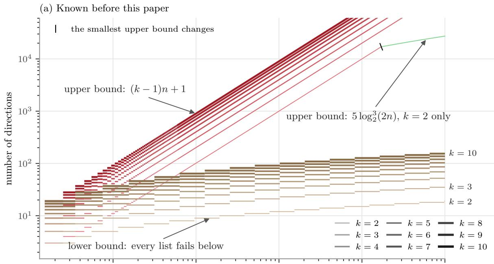

(b) Known now  
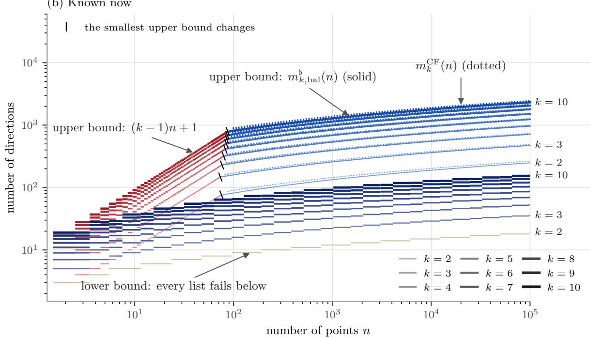  
Figure 1: Bounds on the number of directions that separate multisets of n points in $\mathbb { R } ^ { k } .$ for $k = 2 , \ldots , 1 0$ (thin and light to thick and dark): (a) before this paper and (b) now; this paper’s bounds are blue. Every list of fewer directions than the lower curve fails [DWTLB26, Theorem 5] (for $k = 2$ , [BL90] and [MPS08 ˇ ]), in (b) for $k \geq 3$ also by Theorem 1.2. The upper curve is the smallest known upper bound: the linear bound $( k - 1 ) n + 1$ , for every list in general position [R´en52, HSW24]; for almost every list, in (a) for $k = 2$ the bound $5 \log _ { 2 } ^ { 3 } ( 2 n )$ of [MPS08ˇ , Proposition 3.1], and in (b) $m _ { k , \mathrm { b a l } } ^ { \flat } ( n )$ of Theorem 1.1, with the closed form $m _ { k } ^ { \mathrm { C F } } ( n )$ dotted (on this range the smaller of $m _ { k } ^ { \mathrm { C F } } ( n )$ and $m _ { k } ^ { \mathrm { H D } } ( n )$ , Remark 5.5). Better lower bounds for $k = 2$ ([MPS08ˇ ] and Theorem 1.3) and the solved cases with $n \leq 5$ are in Figures 2 and 3, and Table S1 gives numbers. Drawn by plot bounds.py in the accompanying code.

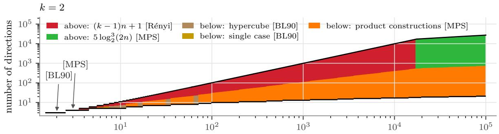

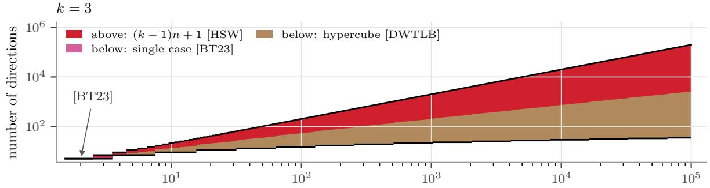

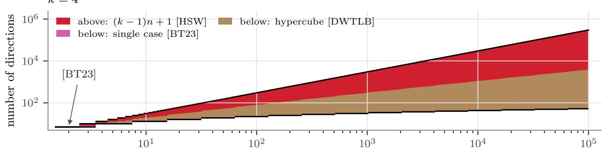

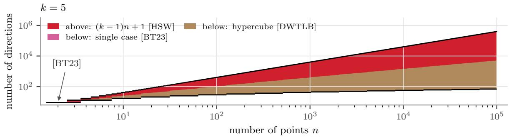  
Figure 2: The best bounds on $m _ { k } ( n )$ known before this paper, for $k = 2 , \ldots , 5 .$ including those for single values of $n . \ m _ { k } ( n )$ lies in the shaded range between the upper and lower bounds (black). Each half of the shading has the colour of the bound credited on its side, named in the legend, and where the two meet a label names the reference credited with $m _ { k } ( n )$ . The credits follow fixed rules from a database of what each reference states (bounds.toml in the accompanying code): a bound goes to the earliest reference that states it. The figures show only results that come with a proof a reader can check; findings made in floating point are acknowledged in the text instead (Remark 3.1 and the provenance note).

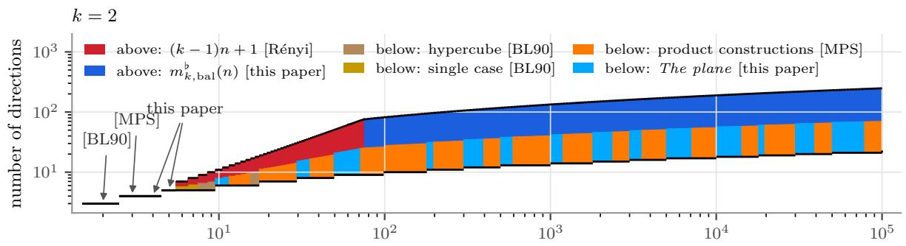

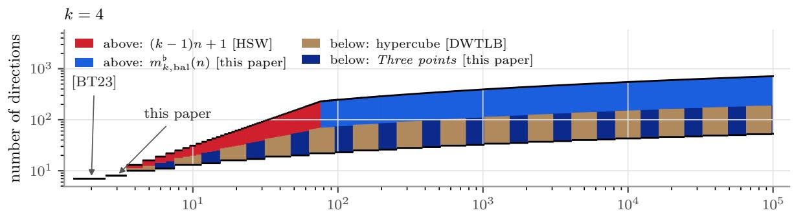

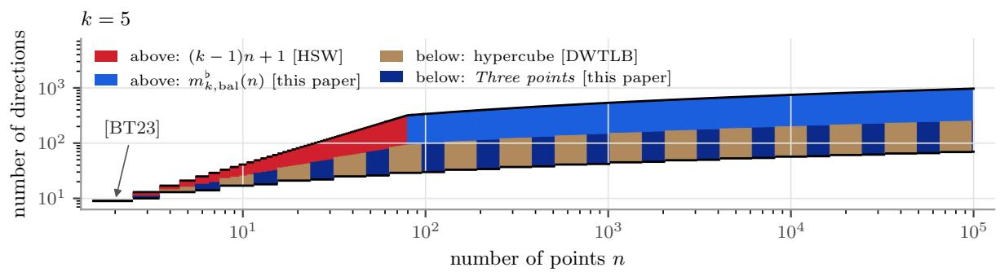  
Figure 3: As Figure 2, with the results of this paper. Three points is Theorem 1.2, The plane is Theorem 1.3, and $m _ { k , \mathrm { b a l } } ^ { \flat } ( n )$ is from Theorem 1.1. Values that others found in floating point and we verified exactly (Remark 3.1) are credited to this paper.

## 1.3 What we will show

We prove an upper bound on the number of directions needed (Theorem 1.1), two lower bounds (Theorems 1.2 and 1.3), and a zero–one law that compares almost every list of directions with particular lists (Theorem 1.4).

The upper bound. We say that a property holds for almost every list of m directions if the lists that fail it form a set of Lebesgue measure zero in $\mathbb { R } ^ { m k }$ , so that directions drawn at random with a density, on $\mathbb { R } ^ { k }$ or on the unit sphere, have it with probability one. Appendix A defines this and the other conditions that we put on the directions, says which result uses which, and compares ways of drawing directions at random.

Theorem 1.1 (Few directions sufice). Let $k \geq 2$ and $n \geq 2$ . For $m \geq 2$ and $1 \leq t \leq \lceil m / 2 \rceil$ write

$$
P _ { 2 n } ( m , t ) : = \log _ { 2 } ( 2 n ) \prod _ { j = 0 } ^ { t - 1 } \Bigl ( 1 - { \frac { m } { 4 ( m - j ) \ln ( 2 n ) } } \Bigr ) ,
$$

and for $m \geq q \geq k$ , write $m = q t + r$ with $0 \leq r < q$ and $B _ { 2 n } ( m , q ) : = ( q - r ) P _ { 2 n } ( m , t ) +$ $r P _ { 2 n } ( m , t + 1 )$ . Define

$$
m _ { k } ^ { \sharp } ( n ) : = k \cdot \operatorname* { m i n } \Bigl \{ T \geq 1 : \ k P _ { 2 n } ( k T , T ) < 1 \Bigr \} ,\tag{1a}
$$

$$
m _ { k , \mathrm { e q } } ^ { \flat } ( n ) : = \mathrm { m i n } \Bigl \{ q T : \ q \geq k , \ T \geq 1 , \ q P _ { 2 n } ( q T , T ) < q - k + 1 \Bigr \} ,\tag{1b}
$$

$$
m _ { k , \mathrm { b a l } } ^ { \flat } ( n ) : = \mathrm { m i n } \Bigl \{ m \geq k : B _ { 2 n } ( m , q ) < q - k + 1 f o r ~ s o m e ~ i n t e g e r ~ q \in \{ k , \ldots , m \} \Bigr \} .\tag{1c}
$$

Then

$$
m _ { k , \mathrm { b a l } } ^ { \flat } ( n ) \ \leq \ m _ { k , \mathrm { e q } } ^ { \flat } ( n ) \ \leq \ m _ { k } ^ { \sharp } ( n ) \ \leq \ \big \lceil m _ { k } ^ { \mathrm { C F } } ( n ) \big \rceil ,
$$

where

$$
\begin{array} { r } { m _ { k } ^ { \mathrm { C F } } ( n ) : = ( 4 k - 2 ) \ln ( 2 n ) \ln \left( k \log _ { 2 } ( 2 n ) \right) + k + 1 . } \end{array}\tag{2}
$$

If m $\ge m _ { k , \mathrm { b a l } } ^ { \flat } ( n )$ (and in particular if m is at least $m _ { k , \mathrm { e q } } ^ { \flat } ( n ) , \ m _ { k } ^ { \sharp } ( n )$ , or $m _ { k } ^ { \mathrm { C F } } ( n ) )$ , then almost every list (Definition $A . 4 )$ of m directions in $\mathbb { R } ^ { k }$ separates multisets of size n. Hence, by Remark 5.5, $m _ { k } ( n ) = O ( k \log n$ log log n).

The proof tightens an argument of Hair and Sahai [HS26, Lemmas $5 { - } 7 ]$ , who carried the random-colour method of [MPS08ˇ ] to d dimensions for list recovery of random linear codes. Their lemmas apply to sorted projections with almost no work, and as their proof is written they give the bound $m _ { k } ^ { \mathrm { H S } } ( n ) : = k \bigl [ 8 \ln ( 2 n ) \bigl ( \ln \ln ( 8 n ) + \ln ( 2 k ) + 1 \bigr ) \bigr ]$ (Section 5). That observation, which brings their work to sorting embeddings, is ours, but is built entirely on their work. For $k = 2$ and $n = 1 0 0 0$ , for example, $m _ { 2 } ^ { \mathrm { H S } } ( n ) = 5 5 8$ , and their own final inequality, evaluated exactly with nothing else changed, gives $m _ { 2 } ^ { \mathrm { H S E } } ( n )$ = 458 (equation (3)). Their proof gives away constant factors in four places, and keeping them (Lemma 5.2) is our contribution to the upper bound: it gives $m _ { 2 } ^ { \sharp } ( n ) = 1 3 4$ . Dividing the colours into $q \geq k$ blocks instead of k and asking only that at least k of the q blocks succeed (Lemma 5.4) gives the equal-block bound $m _ { k , \mathrm { e q } } ^ { \flat } ( n )$ when the blocks have equal size T, and the balanced-block bound $m _ { k , \mathrm { b a l } } ^ { \flat } ( n )$ when the m colours are shared among the q blocks as evenly as possible $( \lfloor m / q \rfloor$ or $\lceil m / q \rceil$ per block), lowering $m _ { 2 } ^ { \sharp } ( 1 0 0 0 ) = 1 3 4$ to $m _ { \mathrm { 2 , b a l } } ^ { \flat } ( 1 0 0 0 ) = 1 3 3$ , with larger savings as k grows (for $n = 1 0 0$ and $k = 2 0 , m _ { 2 0 } ^ { \sharp } ( 1 0 0 ) = 2 0 4 0$ $m _ { 2 0 , \mathrm { { e q } } } ^ { \flat } ( 1 0 0 ) = 1 7 5 2$ , and $m _ { 2 0 , \mathrm { b a l } } ^ { \flat } ( 1 0 0 ) = 1 7 5 1$ ; Table S2). Taking $q = 2 k$ in $m _ { k , \mathrm { e q } } ^ { \flat } ( n )$ also gives a simple high-dimensional bound $m _ { k } ^ { \mathrm { H D } } ( n ) : = 2 k \lceil 4 \ln ( 2 n )$ ln $\left( 2 \log _ { 2 } ( 2 n ) \right) ]$ that removes the log k term and scales as O(k log n log log n) when k is large relative to n (Remark 5.5). For fixed k the theorem matches the planar result of $[ \mathrm { M P S 0 8 } ]$ , and so answers the question of [DWTLB26].

For small n the linear bound $( k - 1 ) n + 1$ is smaller, and it holds for every list in general position, not only for almost every list. The theorem improves on it for all $n \geq 7 6$ when $k = 2 ,$ $n \geq 7 5$ (74 for $m _ { k , \mathrm { b a l } } ^ { \flat } )$ when $k = 3$ and $n \geq 9 4$ (88 for $m _ { k , \mathrm { e q } } ^ { \flat }$ and $m _ { k , \mathrm { b a l } } ^ { \flat } )$ when $k = 1 0 ;$ ; beyond that, $m _ { k , \mathrm { b a l } } ^ { \flat } ( n )$ is the smallest upper bound we know, and a short computation gives it exactly. The bound $m _ { k } ^ { \mathrm { C F } } ( n )$ of the theorem is the smallest we know in closed form for moderate $k ;$ for a quick bound without iteration, use min $\{ m _ { k } ^ { \mathrm { C F } } ( n ) , m _ { k } ^ { \mathrm { H D } } ( n ) \}$ (Remark 5.5), which is $m _ { k } ^ { \mathrm { C F } } ( n )$ unless k exceeds about $4 \log _ { 2 } ( 2 n )$ . It is only slightly larger, 144 instead of 134 for $k = 2$ and $n = 1 0 0 0$ and it improves on the linear bound from $n = 8 7$ , 81 and 98 respectively. Figure 1 shows the best bounds known before this paper and now, Figures 2 and 3 add the solved small cases for $k = 2 , \ldots , 5 ,$ , and Tables S1 and S2, at the end of the paper, give the bounds as numbers.

Theorem 1.1 fixes n and m before choosing the directions. In an application the size of the multisets may not be known in advance, or may grow, and one would like to draw the directions once and simply use more of them for larger multisets, without redrawing those already in use. This is possible: with probability one, a single random sequence $d _ { 1 } , d _ { 2 } , \dots$ . has the property that, for every n, its first m directions separate multisets of size n whenever m $\geq m _ { k , \mathrm { b a l } } ^ { \flat } ( n )$ (and in particular whenever m $\geq m _ { k } ^ { \sharp } ( n )$ ; Corollary 6.1). Nor does it hurt to fix the first k directions to be the coordinate axes and draw only the others (Corollary 6.2).

Lower bounds. For these it is convenient to count from the other side. For a list D of directions let $f ( D )$ be the smallest size of two diferent multisets with the same projection on every direction of $D \left( \mathrm { o r } \infty \right.$ if there are none). Then D separates multisets of size n exactly when $n < f ( D )$ (Lemma 2.1).

Theorem 1.2 (Three points). Let $k \geq 2$ . Every list D of $2 k - 1$ directions in $\mathbb { R } ^ { k }$ has $f ( D ) \leq 3$ it does not separate multisets of size three. Consequently:

(a) $2 k \leq m _ { k } ( 3 ) \leq 3 k - 2 ;$

(b) $i f 3 \cdot 2 ^ { q - 2 } \leq n < 2 ^ { q }$ for some integer $q \geq 2$ , then $m _ { k } ( n ) \geq ( k - 1 ) { \bigl ( } \lfloor \log _ { 2 } n \rfloor + 1 { \bigr ) } + 2$ , one more than the logarithmic lower bound.

For $k = 2$ the first statement is in [MPS08 ˇ ]. Exact certificates (Remark 3.1) give $m _ { 3 } ( 3 ) = 6$ and $m _ { 4 } ( 3 ) = 8$ , so the lower bound in (a) is attained there. Dym et al. [DWTLB26, Section 4] had found such a list for $m _ { 4 } ( 3 )$ in floating point; the one they print for $m _ { 3 } ( 3 )$ does not separate.

Theorem 1.3 (The plane). Write $m = 4 t + r$ with $0 \leq r \leq 3$ . Every list D of m $\geq 3$ directions in $\mathbb { R } ^ { 2 }$ has $f ( D ) \leq { \frac { 1 } { 2 } } c _ { r } 1 0 ^ { t }$ , where $( c _ { 0 } , c _ { 1 } , c _ { 2 } , c _ { 3 } ) = ( 1 , 2 , \frac { 1 8 } { 5 } , 6 )$ . Hence no list of m directions in the plane separates multisets of size $\begin{array} { c c c } { \frac { 1 } { 2 } 1 0 ^ { \lceil m / 4 \rceil } = O ( 1 . 7 \bar { 7 } 8 3 ^ { m } ) } \end{array}$ , and $m _ { 2 } ( n ) > 4 \log _ { 1 0 } ( 2 n ) - 4$ ≈ $1 . 2 0 4 \log _ { 2 } n - 2 . 8$

This improves the bound $O ( 1 . 7 9 9 6 ^ { m } )$ of $[ \mathrm { M P } \check { \mathrm { S 0 8 } } ]$ . It combines their product construction with a four-direction example of Bianchi and Longinetti [BL90]. Their own nine-direction example $( f \le 9 9 )$ can replace two groups of four and one of one, which lowers c to $\frac { 9 9 } { 5 0 }$ for $m \geq 9$ . That raises the lower bound on $m _ { 2 } ( n )$ by one for about 1% of n and changes no entry of Table S1, so we keep the simpler statement, and the figures use it.

Almost every list behaves alike. Theorem 1.1 speaks of almost every list. The next theorem shows that, for given $k ,$ m and n, almost every list behaves in the same way, and says which particular lists are sure to behave like them.

Theorem 1.4 (A zero–one law). Fix k, m and n. Either almost every list of m directions in $\mathbb { R } ^ { k }$ separates multisets of size n, or almost every list does not. Every list whose mk coordinates are algebraically independent (Definition A.5) behaves like almost every list.

In the plane, Matouˇsek, Pˇr´ıvˇetiv´y and Skovroˇn note that their bound 2ˇ cm/ log m holds for every list with algebraically independent coordinates [MPS08ˇ , Section 5, footnote 4]. By the first statement, a list that separates with fewer directions than almost every list needs, if one exists, cannot be found by drawing directions at random with a density (Table 1). We do not know whether such lists exist.

## 1.4 Method

The proof of Theorem 1.1 follows the strategy of [MPS08 ˇ ], which Hair and Sahai [HS26] carried to d dimensions in another setting. Suppose that D fails, so that there are two diferent multisets X and Y of size at most $n ,$ with no point in common, that have the same projection on every direction. For each direction $d _ { j }$ , pairing each point of X with a point of Y that has the same projection on $d _ { j }$ gives a perfect matching between X and Y . The union of these m matchings, with the edges of the j-th matching given colour $j ,$ , is the matching graph of the pair. Each edge $\{ a , b \}$ of colour j is a linear equation $( a - b ) \cdot d _ { j } = 0$ satisfied by the points.

• Rigidity (Section 4). Suppose that, on some set W of at least two vertices, the matching graph has k spanning trees that use pairwise disjoint sets of colours. Then the coordinates of the directions satisfy a polynomial equation that is not identically zero [HS26, Lemma 7]. So for almost every D this never happens.

• Graph theory (Section 5). Every edge-coloured multigraph on N vertices whose colour classes are perfect matchings contains such a pattern once it has enough colours. The randomised argument of [HS26, Lemma 6] needs about 8k ln N (ln ln N + ln k) colours as written; with the constants that it gives away kept, about (4k − 2) ln N ln(k log N) (Lemma 5.2).

For k = 2 both steps are in [MPS08ˇ ].

The lower bounds are constructions. If $D _ { 1 }$ and $D _ { 2 }$ fail on pairs of sizes $s _ { 1 }$ and $s _ { 2 }$ , then the concatenated list fails on a pair of size 2s1s2 [MPS08 ˇ , Lemma 4.1]. Theorem 1.2 comes from a cancellation in the resulting “hypercube” construction, and Theorem 1.3 from the example of [BL90]. Theorem 1.4 is a standard argument applied to an exact test of [BHS25].

Organisation. Section 2 collects the facts we use about pairs with equal projections. Section 3 proves Theorems 1.2 and 1.3, Sections 4 and 5 prove Theorem 1.1, and Section 6 proves Theorem 1.4 and its consequences. Section 7 lists open questions, and Appendix A collects the conditions that the results put on the directions. The computations are in the accompanying code, which is in the ancillary files of this paper’s arXiv submission.

## 2 Preliminaries

Fix $k \geq 2$ and a list D of directions. Two diferent multisets X, Y of the same size s with $\pi _ { d } X = \pi _ { d } Y$ for every d in D form a confusable pair of size s, and f(D) is the smallest size of a confusable pair. We write X ⊎ Z for the sum of multisets (multiplicities add) and X ∩ Y for their common part.

Lemma 2.1 (Padding and cancelling). If X, Y is a confusable pair, then so is X ⊎ Z, Y ⊎ Z for every multiset Z, and so is $X \setminus C , Y \setminus C$ with $C = X \cap Y$ . Consequently D separates multisets of size n if and only if $n < f ( D )$ , and a smallest confusable pair has no point in common.

Proof. Projection respects sums, $\pi _ { d } ( X \uplus Z ) = \pi _ { d } X \uplus \pi _ { d } Z$ , and multisets of numbers can be cancelled. □

Signed multisets. It is easier to work with the diference of a confusable pair. A signed multiset is a function $\nu : \mathbb { R } ^ { k } \to \mathbb { Z }$ with finite support; we write [x] for the function that is 1 at x and 0 elsewhere, and $\begin{array} { r } { \| \nu \| : = \sum _ { x } | \nu ( x ) | } \end{array}$ . For a direction $d ,$ let $\begin{array} { r } { ( \pi _ { d } \nu ) ( t ) : = \sum _ { x \cdot d = t } \nu ( x ) } \end{array}$ for $t \in \mathbb { R }$ We say that ν is silent for D if $\pi _ { d } \nu = 0$ for every d in D. For multisets, $\pi _ { d } ( X - Y ) = 0$ says exactly that X and Y have the same projection on d.

Lemma 2.2. If D contains at least one direction, then

$$
\begin{array} { r } { f ( D ) = \operatorname* { m i n } \{ \frac { 1 } { 2 } \| \nu \| : \nu \neq 0 \ i s \ s i l e n t \ f o r \ D \} . } \end{array}
$$

Proof. A confusable pair $X , Y$ of size s gives the silent $\nu = X { - } Y \neq 0$ with $\| \nu \| \leq 2 s$ . Conversely, if $\nu \neq 0$ is silent, its total charge is $\begin{array} { r } { \sum _ { t } ( \pi _ { d } \nu ) ( t ) = 0 } \end{array}$ for a direction d of $D ,$ so its positive and negative parts are multisets of size $\frac { 1 } { 2 } \| \nu \|$ , and they form a confusable pair. □

The convolution of signed multisets is $\begin{array} { r } { ( \nu * \eta ) ( z ) : = \sum _ { x + y = z } \nu ( x ) \eta ( y ) } \end{array}$ , so that $[ x ] \ast [ y ] = [ x + y ]$

Lemma 2.3. For signed multisets $\nu , \eta$ and a direction d:

(i) $\pi _ { d } ( \nu * \eta ) = ( \pi _ { d } \nu ) * ( \pi _ { d } \eta )$ , so $\nu * \eta$ is silent for every direction for which ν or η is silent;

(ii) $\left\| \nu * \eta \right\| \leq \left\| \nu \right\| \left\| \eta \right\| ;$

(iii) if $\nu \neq 0$ and $\eta \neq 0$ then $\nu * \eta \neq 0$

Proof. (i) and (ii) are immediate from the definition. For (iii), choose ℓ such that $x \mapsto \ell \cdot x$ is injective on the supports of ν and η, and let $x ^ { * } , y ^ { * }$ maximise $\ell \cdot x$ on them. Then $x ^ { * } + y ^ { * }$ arises only as $x ^ { * } + y ^ { * }$ , so $( \nu * \eta ) ( x ^ { * } + y ^ { * } ) = \nu ( x ^ { * } ) \eta ( y ^ { * } ) \neq 0$ □

Lemma 2.4 (Product lemma $\mathrm { [ M P S 0 8 . }$ , Lemma 4.1]). For any lists $D _ { 1 } , \ D _ { 2 }$ , the concatenated list $D _ { 1 } \cup D _ { 2 }$ has $f ( D _ { 1 } \cup D _ { 2 } ) \leq 2 f ( D _ { 1 } ) f ( D _ { 2 } )$

Proof. Take silent $\nu , ~ \eta$ for $D _ { 1 } , \ D _ { 2 }$ with $\| \nu \| = 2 f ( D _ { 1 } )$ and $\| \eta \| = 2 f ( D _ { 2 } )$ (Lemma 2.2). By Lemma 2.3, $\nu * \eta$ is nonzero, silent for $D _ { 1 } \cup D _ { 2 }$ , and has norm at most $4 f ( D _ { 1 } ) f ( D _ { 2 } )$ □

[MPS08ˇ ] state this for $k = 2 ;$ the proof works in every dimension. For a vector $v \neq 0$ , the dipole $[ 0 ] - [ v ]$ is silent for exactly the directions orthogonal to v. Every $k - 1$ directions are orthogonal to some $v \neq 0$ , so a list of at most $k - 1$ directions has $f = 1$ , and Lemma 2.4 gives the following.

Lemma 2.5 (The hypercube [DWTLB26, Theorem 5]). Every list D of m directions in $\mathbb { R } ^ { k }$ has $f ( D ) \leq 2 ^ { \lceil m / ( \dot { k } - 1 ) \rceil - 1 }$

The corresponding silent signed multiset is $\begin{array} { r } { ( [ 0 ] - [ v _ { 1 } ] ) * \cdot \cdot \cdot * \left( [ 0 ] - [ v _ { M } ] \right) = \sum _ { I } ( - 1 ) ^ { | I | } [ v ( I ) ] } \end{array}$ with $M = \lceil m / ( k - 1 ) \rceil , v _ { j }$ orthogonal to the j-th group of $k - 1$ directions, and $\begin{array} { r } { { \boldsymbol { v } } ( I ) = \sum _ { j \in I } { \boldsymbol { v } } _ { j } \colon { \mathrm { ~ } } } \end{array}$ the vertices of a parallelepiped, coloured by parity. The lengths of the $v _ { j }$ are free, which Section 3 exploits.

Lemma 2.6 (One point at a time [HSW24, Proposition 48 and Corollary 49]). If D is in general position $( D e f i n i t i o n \ : A . 1 )$ , then $f ( D ) \geq \lceil m / ( k - 1 ) \rceil$ . So $( k - 1 ) n + 1$ directions in general position separate multisets of size n.

Proof. Let X, Y be a smallest confusable pair, and fix $a \in X$ . For each direction $d _ { j }$ some $b \in Y$ has $b \cdot d _ { j } = a \cdot d _ { j }$ . Since $a \not \in Y$ (Lemma 2.1), each $b \in Y$ serves only the directions orthogonal to $b - a \neq 0$ , of which there are at most $k - 1$ (Lemma $\mathrm { A . 2 ( c ) } )$ . So $| Y | \geq m / ( k - 1 )$ □

Witnesses. Several proofs below show that a property holds for generic lists of directions (Definition A.4) by finding a polynomial that vanishes at every list that fails, and a witness: one list, however special, at which the polynomial is not zero. Dym and Gortler turned this idea into a count, the finite witness theorem [DG24, Theorem 2.7], which Amir et al. [AGARD23] use for multisets and Dym et al. [DWTLB26, Theorem 7] for sorted projections; we use it in Remark 6.3.

## 3 Lower bounds

Adding directions can only destroy confusable pairs, so $f ( D ^ { \prime } ) \leq f ( D )$ whenever $D ^ { \prime }$ is part of D.

Proof of Theorem 1.2. Split D into two groups $G _ { 1 } , G _ { 2 }$ of $k - 1$ directions and one more direction $d ,$ and choose nonzero $v _ { 1 } \perp G _ { 1 }$ and $v _ { 2 } \perp G _ { 2 }$

If $v _ { 1 }$ and $v _ { 2 }$ are parallel, the dipole $[ 0 ] - [ v _ { 1 } ]$ is silent for $G _ { 1 }$ and $G _ { 2 } ;$ with $u \ne 0$ orthogonal to d, the signed multiset $( [ 0 ] - [ v _ { 1 } ] ) * ( [ 0 ] - [ u ] )$ is nonzero, silent for D and of norm at most 4, so $f ( D ) \leq 2$

Otherwise the plane spanned by $v _ { 1 }$ , v meets $d ^ { \perp }$ in some $w = \alpha v _ { 1 } + \beta v _ { 2 } \neq 0$ . If $\beta = 0$ then $v _ { 1 } \perp d ,$ , and $( [ 0 ] - [ v _ { 1 } ] ) * ( [ 0 ] - [ v _ { 2 } ] )$ gives $f ( D ) \leq 2 ;$ likewise if $\alpha = 0$ . If $\alpha \beta \neq 0$ , put $w _ { 1 } = \alpha v _ { 1 }$ and $w _ { 2 } = \beta v _ { 2 }$ , so that $w _ { 1 } + w _ { 2 } \bot d$ , and let

$$
\nu = ( [ 0 ] - [ w _ { 1 } ] ) * ( [ 0 ] - [ w _ { 2 } ] ) * ( [ 0 ] - [ w _ { 1 } + w _ { 2 } ] ) .
$$

It is nonzero and silent for D (Lemma 2.3). Of the eight terms in its expansion, $+ [ w _ { 1 } + w _ { 2 } ]$ and $- [ w _ { 1 } + w _ { 2 } ]$ cancel, so $\| \nu \| \le 6$ and $f ( D ) \leq 3$

(a) By the above, and since fewer directions can only do worse, $m _ { k } ( 3 ) \geq 2 k$ ; Lemma 2.6 gives $m _ { k } ( 3 ) \leq 3 ( k - 1 ) + 1$ . (b) Here $\lfloor \log _ { 2 } n \rfloor = q - 1$ , so the logarithmic lower bound (Lemma 2.5) allows lists of $q ( k - 1 ) + 1$ directions. Such a list splits into $2 k - 1$ directions, with $f \leq 3$ , and $q - 2$ groups of $k - 1$ , with $f = 1$ . By Lemma 2.4 it has $f \leq 3 \cdot 2 ^ { q - 2 } \leq n .$ so it fails, and at least one more direction is needed. □

For $k = 2$ the third factor of ν is the triangle of [MPS08ˇ , Section 4]. The proof uses the freedom in the lengths of the $v _ { j }$ noted after Lemma 2.5: with $2 k - 1$ directions the third dipole can be moved into the plane of the first two.

Remark 3.1 (Small cases by computer). Whether a given list separates multisets of size n can be decided by a finite computation [BHS25, Proposition 3.8] (see Section 6), in exact arithmetic when the directions are rational. It shows that $e _ { 1 } , e _ { 2 } , e _ { 3 } , ( 1 , 2 , 4 ) , ( 3 , - 1 , 2 ) , ( - 2 , 5 , 1 )$ separates multisets of size 3 in $\mathbb { R } ^ { 3 }$ , and that $e _ { 1 } , \ldots , e _ { 4 } , ( 5 , 2 , - 8 , 3 ) , ( - 1 , 7 , 4 , 9 ) , ( 8 , - 3 , 6 , - 5 ) , ( 4 , 9 , - 2 , 7 )$ does so in $\mathbb { R } ^ { 4 }$ . So $m _ { 3 } ( 3 ) = 6$ and $m _ { 4 } ( 3 ) = 8$ . In the plane, $( 1 , 0 ) , ( 0 , 1 ) , ( 1 , 1 ) , ( 1 , 3 )$ separates multisets of size 4, and adding $( 3 , - 2 )$ gives size 5; with Theorem 1.3 below this gives $m _ { 2 } ( 4 ) = 4$ and $m _ { 2 } ( 5 ) = 5$ . For sets rather than multisets, [BL90, Propositions 1 and 2] already show that any m directions in the plane that are not $a f f u n e l y$ rational (not mapped by a linear map to directions at rational multiples of $\pi )$ determine every set of at most m points. These checks use locate exact.py in the accompanying code, which runs the test in integer arithmetic.

Dym et al. [DWTLB26, Section 4] found lists that separate in the cases $( n , k , m ) = ( 4 , 2 , 4 )$ $( 5 , 2 , 5 )$ and (3, 4, 8) with a floating-point version of the test, and the lists they print pass the exact test too. They also report a list for (3, 3, 6), but the list as printed does not separate: three of its directions, $e _ { 1 } , ~ e _ { 3 }$ and (0.21, 0, 0.45), lie in one plane, so the construction of Theorem 1.2 fools it. Presumably an entry was rounded for display. They also observed that random lists of $2 k - 1$ directions fail for $k = 2 , 3 , 4$ , which Theorem 1.2 proves for every list and every k.

For $k \geq 3$ , general position is not enough at $m = 2 k$ . The list ${ e _ { 1 } , e _ { 2 } , e _ { 3 } , ( 1 , 1 , 1 ) , ( 1 , 2 , 3 ) }$ $( 2 , - 1 , 1 )$ is in general position but does not separate multisets of size 3: it splits into the pairs $\{ e _ { 1 } , e _ { 3 } \} , \ \{ e _ { 2 } , ( 1 , 1 , 1 ) \}$ and $\{ ( 1 , 2 , 3 ) , ( 2 , - 1 , 1 ) \}$ , whose common normals $( 0 , 1 , 0 ) , ( 1 , 0 , - 1 )$ and (1, 1, −1) are linearly dependent, and that is all the construction above needs. Such lists exist in every dimension $k \geq 3 :$ take linearly independent $v _ { 1 } , v _ { 2 }$ and choose $k - 1$ directions orthogonal to $v _ { 1 } , k - 1$ orthogonal to $v _ { 2 }$ and 2 orthogonal to $v _ { 1 } + v _ { 2 }$ . The construction above fools every such list. For almost every such choice (Definition A.4) the list is in general position, because any k of the directions include two from diferent groups, and choosing those two, each in its own hyperplane, outside $v _ { 1 } ^ { \perp } \cap v _ { 2 } ^ { \perp }$ , and the others as a basis of $v _ { 1 } ^ { \perp } \cap v _ { 2 } ^ { \perp }$ , gives a basis of $\mathbb { R } ^ { k }$ ; so no $k \times k$ determinant vanishes identically. For $k = 2 .$ , by contrast, where general position means pairwise non-parallel (Lemma A.2), Lemma 2.6 shows that four pairwise non-parallel directions always separate multisets of size 3.

The plane. The construction of Theorem 1.2 never does better than about $6 ^ { m / 3 }$ in the plane, and the best construction of $[ \mathrm { M P S 0 8 } ]$ , with 9 directions, gives $O ( 1 . 7 9 9 6 ^ { m } )$ . Four directions do better.

Lemma 3.2 (Bianchi and Longinetti [BL90, p. 234 and $\mathrm { F i g . 2 } ]$ . Every list D of 4 directions in the plane has $f ( D ) \leq 5$

Proof. If two directions are parallel there are at most three diferent directions, and $f ( D ) \leq 3$ by Theorem 1.2. Otherwise, since the projection of X on Ad is the projection of $A ^ { \mathsf { T } } X$ on $d ,$ an invertible linear map lets us assume that the directions are $( 1 , 0 ) , ( 0 , 1 ) , ( 1 , 1 )$ and (1, λ) with $\lambda \neq 0 , 1$ . Let

$$
X = \{ \{ ( 0 , 0 ) , ( - \lambda ( \lambda - 1 ) , ( \lambda - 1 ) ^ { 2 } ) , ( - \lambda ^ { 2 } , 1 ) , ( - \lambda , \lambda ^ { 2 } - \lambda + 1 ) , ( - \lambda ( 2 \lambda - 1 ) , \lambda ^ { 2 } ) \} \} ,
$$

$$
Y = \{ \{ ( 0 , ( \lambda - 1 ) ^ { 2 } ) , ( - \lambda ( \lambda - 1 ) , 0 ) , ( - \lambda ^ { 2 } , \lambda ^ { 2 } ) , ( - \lambda , 1 ) , ( - \lambda ( 2 \lambda - 1 ) , \lambda ^ { 2 } - \lambda + 1 ) \} \} .
$$

With $\mu = 1 - \lambda$ , the projections of the points, in the order listed, are

$$
( 1 , 0 ) \qquad 0 , \ \lambda \mu , \ - \lambda ^ { 2 } , \ - \lambda , \ \lambda ( 1 - 2 \lambda ) \qquad 0 , \ \lambda \mu , \ - \lambda ^ { 2 } , \ - \lambda , \ \lambda ( 1 - 2 \lambda )
$$

$$
( 0 , 1 ) \qquad 0 , \ \mu ^ { 2 } , \ 1 , \ \lambda ^ { 2 } - \lambda + 1 , \ \lambda ^ { 2 } \qquad \mu ^ { 2 } , \ 0 , \ \lambda ^ { 2 } , \ 1 , \ \lambda ^ { 2 } - \lambda + 1
$$

$$
\quad ( 1 , 1 ) \qquad 0 , \ \mu , \ 1 - \lambda ^ { 2 } , \ \mu ^ { 2 } , \ \lambda \mu \qquad \mu ^ { 2 } , \ \lambda \mu , \ 0 , \ \mu , \ 1 - \lambda ^ { 2 }
$$

$$
( 1 , \lambda ) \qquad 0 , \lambda \mu ( 1 + \mu ) , \lambda \mu , - \lambda ^ { 2 } \mu , \lambda \mu ^ { 2 } \quad \lambda \mu ^ { 2 } , \lambda \mu , - \lambda ^ { 2 } \mu , 0 , \lambda \mu ( 1 + \mu )
$$

and in each row the two lists are rearrangements of each other. The multisets difer, because $( 0 , 0 ) \in X$ while the points of Y with first coordinate 0 are $( 0 , \mu ^ { 2 } )$ and, if $\lambda = \frac { 1 } { 2 } , ( 0 , \frac { 3 } { 4 } )$ □

[BL90] give this example for sets, to show that their Proposition 3 needs its hypothesis $m > 4 h ^ { 2 } + 1 1 h$ (here $h = 1$ and $m = 4 )$ . That proposition says that m directions that are not afinely rational determine every set of $m + h$ points; it is the only result of [BL90] that $[ \mathrm { M P } \check { \mathrm { S 0 8 } } ]$ cite, as a lower bound $k + \Omega ( { \sqrt { k } } )$ for sets.

Proof of Theorem 1.3. Split D into groups. A group of four directions has $f \leq 5$ (Lemma 3.2), one of three has $f \leq 3$ (Theorem 1.2), one of two has $f \leq 2$ (Lemma 2.5), and one of one has $f = 1$ , so by Lemma $2 . 4 ~ f ( D )$ is at most half the product of the factors 10, 6, 4 and 2 of the groups. Take t groups of four, together with one group of one if $r = 1$ , two groups of three in place of one group of four if $r = 2 ,$ and one group of three if $r = 3$ . This gives $\scriptstyle { \frac { 1 } { 2 } } c _ { r } 1 0 ^ { t } ;$ ; this grouping is the best among groups of one to four directions. $\mathrm { A s } \ c _ { r } \leq 1 0 , \ f ( D ) \leq \textstyle { \frac { 1 } { 2 } } ^ { \cdot } 1 0 ^ { \lceil m / 4 \rceil }$ , so if D separates multisets of size n then $\lceil m / 4 \rceil > \log _ { 1 0 } ( 2 n )$ and $m > 4 \log _ { 1 0 } ( 2 n ) - 4$ □

## 4 Rigidity

Throughout this section and the next, $X , Y$ is a confusable pair for a list $D = ( d _ { 1 } , \ldots , d _ { m } )$ , of some size s, with no point in common (for instance a smallest one, Lemma 2.1). We treat its 2s points as 2s separate vertices, even when two points of X coincide.

Definition 4.1 (Matching graph). For each $j$ the multisets $\pi _ { d _ { i } } X$ and $\pi _ { d _ { i } } Y$ are equal, so there is a perfect matching $E _ { j }$ between the vertices of X and those of Y with $( \overset { \cdot } { a } - \boldsymbol { b } ) \cdot d _ { j } = 0$ for every pair $\{ a , b \} \in E _ { j } ;$ we fix one. The matching graph of the pair has these 2s vertices and, for each $j ,$ the edges of $E _ { j }$ in colour j.

So every colour class is a perfect matching, and every vertex has exactly one edge of each colour. An edge of colour j forces $( a - b ) \cdot d _ { j } = 0$ , but not conversely: when several points have the same projection on $d _ { j }$ , the matching we fix may pair them diferently.

Definition 4.2 (Pinning pattern [HS26, Definition 8]). A pinning pattern in an edge-coloured multigraph is a set W of at least two vertices together with k spanning trees $T _ { 1 } , \dots , T _ { k }$ of $W$ made of edges with both ends in W, such that no colour is used by two diferent trees.

A tree may use several colours, and must do so unless $| W | = 2$ , because a colour class is a matching. Hair and Sahai call this a tree certificate; for $k = 2$ it is the pair of colour-disjoint spanning trees of [MPS08ˇ , Section 2.2]. Figure 4 shows an example. Section 5 also needs a pinning pattern with d trees, defined in the same way with d spanning trees in place of k.

Lemma 4.3 (Rigidity [HS26, Lemma $7 ]$ . If the matching graph of a confusable pair with no point in common contains a pinning pattern, then the coordinates of the directions satisfy $P ( D ) = 0$ , where $P$ is a polynomial with integer coeficients, depending only on the coloured graph and the pattern, that is not identically zero.

Proof. Let the pattern be $T _ { 1 } , \dots , T _ { k }$ on $W _ { i }$ , fix $w _ { 0 } \in W$ , and treat the positions $p _ { w } \in \mathbb { R } ^ { k }$ of the other vertices of W as unknowns, with $p _ { w _ { 0 } } = 0$ . The tree edges give $k ( | W | - 1 )$ linear equations $( p _ { a } - p _ { b } ) \cdot d _ { j } = 0$ , one for each edge $\{ a , b \}$ of colour $j$ in one of the trees, in $k ( | W | - 1 )$ unknowns. Write them as $M ( D ) p = 0$ and put $P ( D ) : = \operatorname* { d e t } M ( D )$

For a witness, set every direction used by $T _ { r }$ equal to $\textstyle e _ { r } ;$ this is consistent because no direction is used by two trees. Then the equations of $T _ { r }$ say that the ends of each of its edges have equal r-th coordinates. As $T _ { r }$ spans $W$ and $p _ { w _ { 0 } } = 0$ , all the r-th coordinates vanish. This holds for every r, so $p = 0$ is the only solution, and $P \neq 0$ there, so $P$ is not identically zero.

For the true directions, the true points, translated so that w0 is at the origin, solve $M ( D ) p =$ 0. This solution is not 0, because an edge of $T _ { 1 }$ at w0 joins two diferent points. So $P ( D ) = 0$ □

For $k = 2$ this is [MPS08 ˇ , Lemmas 2.1–2.3]. Hair and Sahai prove it as stated, for linear forms over any field, by the same evaluation.

Corollary 4.4. Fix n and m. For generic lists D of m directions, and so for almost every list (Definition A.4), no confusable pair of size at most n with no point in common has a matching graph that contains a pinning pattern.

Proof. Such a matching graph is one of finitely many coloured graphs on at most 2n vertices with m colours, and a pinning pattern in it is one of finitely many choices. Each choice gives a polynomial that is not identically zero (Lemma 4.3), and D lies in its zero set. So every list that fails is a zero of the product of these finitely many polynomials, which has integer coeficients and is not identically zero; its zero set has measure zero (Lemma A.6). □

## 5 Many matchings contain a pinning pattern

Theorem 1.1 needs, besides Corollary 4.4, a supply of pinning patterns: a matching graph with enough colours always contains one. Hair and Sahai prove such a lemma for list recovery of random linear codes. We state it in the form that their proof gives, and then tighten it.

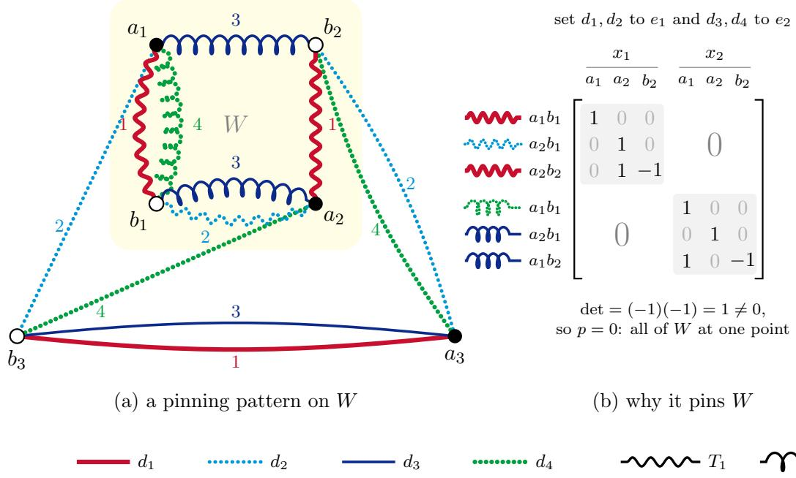  
Figure 4: A pinning pattern for $k = 2$ , drawn as an abstract coloured graph (the positions of the vertices mean nothing). (a) A matching graph on six points, $a _ { 1 } , a _ { 2 } , a _ { 3 }$ from X (filled) and $b _ { 1 } , b _ { 2 } , b _ { 3 }$ from $Y \ \mathrm { ( o p e n ) }$ , for four directions. The edges of colour $j ,$ a perfect matching, have the colour and line style of $d _ { j }$ in the key. So every point has exactly one edge of each colour, and edges that meet at a point always have diferent colours. On the shaded set $W = \{ a _ { 1 } , a _ { 2 } , b _ { 1 } , b _ { 2 } \}$ the tree $T _ { 1 }$ is drawn with wiggles and uses colours 1 and $2 ;$ the tree $T _ { 2 }$ is drawn with springs and uses colours 3 and 4. Each tree needs two colours: colour 1 pairs W into $\{ a _ { 1 } , b _ { 1 } \}$ and $\{ a _ { 2 } , b _ { 2 } \}$ , and colour 2 joins the two pairs, and likewise for colours 3 and $4 ;$ since edges that meet have diferent colours, the two colours of each tree alternate along it. The trees share vertices, and even the pairs $a _ { 1 } b _ { 1 }$ and $a _ { 2 } b _ { 1 }$ , but no colour. Straight edges are used by neither tree. (b) Why such a pattern pins W, as in the proof of Lemma 4.3. With $b _ { 1 }$ at the origin, the six tree edges give a square system $M ( D ) p = 0$ in the coordinates of $a _ { 1 } , a _ { 2 } , b _ { 2 } ;$ the row of an edge of colour j carries the first coordinate of $d _ { j }$ in the $x _ { 1 }$ columns and its second in the $x _ { 2 }$ columns. Shown is M at the useless but legal directions $d _ { 1 } = d _ { 2 } = e _ { 1 } , d _ { 3 } = d _ { 4 } = e _ { 2 }$ (a witness, in the sense of Section 2), which are consistent because no colour is in both trees. The rows of $T _ { 1 }$ lose their $x _ { 2 }$ entries and those of $T _ { 2 }$ their $x _ { 1 }$ entries, so M is block-diagonal, and each block, a spanning tree taken outward from $b _ { 1 }$ , is triangular with determinant −1. So $P ( D ) = \operatorname* { d e t } M ( D )$ is 1 here, and is not identically zero. (For these trees, $P ( D ) = \operatorname* { d e t } ( d _ { 1 } , d _ { 4 } ) \operatorname* { d e t } ( d _ { 2 } , d _ { 3 } ) \operatorname* { d e t } ( d _ { 1 } , d _ { 3 } ) . )$

Lemma 5.1 ([HS26, Lemma 6]). Let $b \geq 2$ be the number of vertices, $d \geq 1$ be the number of spanning trees required, and let $\beta > 0$ be the matching density factor. The number of colours per tree is given by

$$
T ( b ) : = \Big \lceil \frac { 4 \ln b } { \beta } \big ( \ln \ln ( 4 b ) + \ln ( 2 d ) + 1 \big ) \Big \rceil .
$$

Let G be a loopless edge-coloured multigraph on b vertices in which every colour class is a matching with at least βb edges. If G has at least d $T ( b )$ colours, then it contains a pinning pattern with d trees.

Hair and Sahai state the lemma with a constant that they do not evaluate; the form above is what their proof uses, padded so that its order of growth is plain. Their proof takes for $W \textrm { a }$ set of vertices that maximises $e ( W ) / ( | W | \ln | W | )$ , where $e ( W )$ counts the edges with both ends in W. By maximality, every split of W into A and $W \setminus A$ with $| A | \le | W | / 2$ is crossed by at least $( \beta m / \ln b ) \ln ( | W | / | A | )$ diferent colours, since a matching puts at most |A| edges across it. They then choose d disjoint random sets of $T ( b )$ colours each. By their Lemma 5, a version of the random-colour argument of [MPS08ˇ , Section 3.2], each set connects W with probability at least $1 - 1 / ( 2 d )$ . So with positive probability all of them do, and a spanning tree of each gives the pattern. Applied to matching graphs, with $\textstyle \beta = { \frac { 1 } { 2 } } , b = 2 s \leq 2 n$ and $d = k$ , it shows, as in the proof of Theorem 1.1 below, that almost every list of $m _ { k } ^ { \mathrm { H S } } ( n ) = k T ( 2 n )$ directions separates multisets of size $n .$ Their proof needs only $( \log _ { 2 } b ) { \big ( } 1 - \beta / ( 4 \ln b ) { \big ) } ^ { T } \leq 1 / ( 2 d )$ , and $T ( b )$ is a simple choice of T that satisfies it with room to spare. Using that inequality as it stands, with nothing else changed, gives the smaller bound

$$
m _ { k } ^ { \mathrm { H S E } } ( n ) : = k \cdot \operatorname* { m i n } \Bigl \{ T \geq 1 : \log _ { 2 } ( 2 n ) \Bigl ( 1 - \frac { 1 } { 8 \ln ( 2 n ) } \Bigr ) ^ { T } \leq \frac { 1 } { 2 k } \Bigr \} ,\tag{3}
$$

which we count as theirs (Remark 5.3). Beyond that, the proof gives away constant factors in four places. Keeping them gives the following lemma, in which the four changes are marked $( \mathrm { i } ) { - } ( \mathrm { i } \mathrm { v } )$

Lemma 5.2 (Hair and Sahai’s lemma, tightened). Let $b \geq 4$ be the number of vertices, $d \geq 2$ be the number of spanning trees required, let $\beta > 0$ be the matching density factor, and let the integer $T \geq 1$ be the number of colours per tree, so that the total number of colours is $m : = d T$

Let G be a loopless edge-coloured multigraph on b vertices with at least m colours, in which every colour class is a matching with at least βb edges. If

$$
d \log _ { 2 } b \prod _ { j = 0 } ^ { T - 1 } \left( 1 - \frac { \beta m } { 2 ( m - j ) \ln b } \right) < 1 ,\tag{4}
$$

then G contains a pinning pattern with d trees.

Proof. Discarding colours, we may assume that G has exactly m colours. As in the proof of Lemma 5.1, choose a set W of $w \geq 2$ vertices that maximises $e ( U ) / ( | U | \ln | U | )$ over all sets $U$ of at least two vertices, and let $\rho$ be the maximum. Then $\rho \geq e ( V ( G ) ) / ( b \ln b ) \geq \beta m / \ln b .$ . Let $H : = G [ W ]$

Cuts. Let $A \subseteq W$ with $1 \leq a : = | A | \leq w / 2$ . By the choice of W, $e ( A ) \ \leq \ \rho $ a ln a and $e ( W \setminus A ) \leq \rho ( w - a ) \ln ( w - a )$ , so at least $\begin{array} { r } { \rho ( a \ln { \frac { w } { a } } + ( w - a ) \ln { \frac { w } { w - a } } ) } \end{array}$ edges join A to $W \setminus A . \mathrm { ~ A ~ }$ matching has at most a of these edges, so at least

$$
\rho \Big ( \ln \frac { w } { a } + \frac { w - a } { a } \ln \frac { w } { w - a } \Big ) \geq \rho \ln \frac { 2 w } { a }
$$

colours cross the cut. For the inequality, put $\begin{array} { r } { t : = a / w \le \frac { 1 } { 2 } } \end{array}$ ; then $\begin{array} { r } { \frac { 1 - t } { t } \ln \frac { 1 } { 1 - t } = 1 - \sum _ { i \geq 1 } \frac { t ^ { i } } { i ( i + 1 ) } } \end{array}$ decreases in t, so it is at least its value ln 2 at $t = \textstyle { \frac { 1 } { 2 } } . \ ( \mathrm { i } )$ Hair and Sahai drop the second term, which leaves $\rho \ln ( w / a )$

One more colour. Let $c _ { 1 } , \ldots , c _ { m }$ be the colours in a uniformly random order, let $X _ { j }$ be the number of components of $H [ \{ c _ { 1 } , \ldots , c _ { j } \} ]$ , and let $Z _ { j } : = \ln X _ { j }$ , so that $Z _ { 0 } =$ ln w. Fix $j < m$ and $c _ { 1 } , \ldots , c _ { j }$ , and suppose that $x : = X _ { j } \geq 2 ;$ probabilities and expectations below are conditional on $c _ { 1 } , \ldots , c _ { j }$ . Call a component small if it has at most $w / 2$ vertices. None of $c _ { 1 } , \ldots , c _ { j }$ crosses a component, so for a small component C at least $\rho \ln ( 2 w / | C | )$ of the $m - j$ remaining colours cross it, and $c _ { j + 1 }$ crosses it with probability at least $\rho \ln ( 2 w / | C | ) / ( m - j )$ . (ii) Hair and Sahai replace $m - j$ by m here. So the number Y of small components that $c _ { j + 1 }$ crosses has

$$
\mathbb { E } [ Y ] \geq \frac { \rho } { m - j } \sum _ { C \mathrm { \normalfont ~ s m a l l } } \ln \frac { 2 w } { | C | } \geq \frac { \rho } { m - j } x \ln x .
$$

For the last step: if every component is small, Jensen’s inequality gives

$$
\sum _ { C \ \mathrm { s m a l l } } \ln \frac { 2 w } { | C | } \ \geq \ x \ln ( 2 x ) \ \geq \ x \ln x .
$$

Otherwise exactly one of the components has more than $w / 2$ vertices, so there are $x - 1$ small components with $s < w / 2$ vertices in total, hence

$$
\sum _ { C \mathrm { \ s m a l l } } \ln \frac { 2 w } { | C | } \geq ( x - 1 ) \ln \frac { 2 w ( x - 1 ) } { s } \geq ( x - 1 ) \ln \bigl ( 4 ( x - 1 ) \bigr ) \geq x \ln x .
$$

The inequality $( x - 1 ) \ln \left( 4 ( x - 1 ) \right) \geq$ x ln x is justified, since the two agree at $x = 2$ and the derivative of the diference, ln ${ \big ( } 4 ( x - 1 ) / x { \big ) }$ , is positive on $x \ge 2$ . (iii) Hair and Sahai have $\textstyle { \frac { x } { 2 } }$ ln x here.

Adding $c _ { j + 1 }$ lowers the number of components by some $\Delta \ge Y / 2 $ in the multigraph on the current components formed by the edges of colour $c _ { j + 1 }$ , the components counted by $Y$ are not isolated, and t nonisolated vertices lie in at most $t / 2$ nontrivial components. Since

$$
Z _ { j } - Z _ { j + 1 } = \ln \frac { x } { x - \Delta } \geq \frac { \Delta } { x } ,
$$

the preceding estimates give

$$
\mathbb { E } [ Z _ { j + 1 } \mid c _ { 1 } , \dots , c _ { j } ] \ \le \ Z _ { j } - \frac { \mathbb { E } [ \Delta \mid c _ { 1 } , \dots , c _ { j } ] } { x } \ \le \ Z _ { j } - \frac { \rho \ln x } { 2 ( m - j ) } \ \le \ \left( 1 - \frac { \beta m } { 2 ( m - j ) \ln b } \right) Z _ { j } .
$$

This holds trivially when $x = 1$

T colours. The factors in (4) are positive, because $\beta \leq \frac { 1 } { 2 }$ (a matching on b vertices has at most $b / 2$ edges), $m / ( m - j ) < d / ( d - 1 ) \leq 2$ for $j < T$ , and ln $b \geq \ln { 4 } > 1$ . Taking expectations and iterating with $Z _ { 0 } = \ln w$ yields

$$
\mathbb { E } [ Z _ { T } ] \ \leq \ \ln w \prod _ { j = 0 } ^ { T - 1 } \Big ( 1 - \frac { \beta m } { 2 ( m - j ) \ln b } \Big ) .
$$

If $H [ \{ c _ { 1 } , \ldots , c _ { T } \} ]$ is disconnected, then $Z _ { T } \geq \ln 2$ . Thus Markov’s inequality gives

$$
\mathbb { P } \big ( H [ \{ c _ { 1 } , \dots , c _ { T } \} ] \mathrm { ~ i s ~ d i s c o n n e c t e d } \big ) \le \frac { \mathbb { E } [ Z _ { T } ] } { \ln 2 } \le \log _ { 2 } b \prod _ { j = 0 } ^ { T - 1 } \Big ( 1 - \frac { \beta m } { 2 ( m - j ) \ln b } \Big ) ,
$$

as $w \leq b$ . Without $( \mathrm { i } ) { - } ( \mathrm { i i i } )$ , the product is $( 1 - \beta / ( 4 \ln b ) ) ^ { T }$ ; Hair and Sahai bound it by $e ^ { - \beta T / ( 4 \ln b ) }$ and then choose T with room to spare.

d trees. Split the order into d consecutive blocks of $T$ colours. Each block, in its order, is distributed like $c _ { 1 } , \ldots , c _ { T }$ , so by (4) and the union bound, with positive probability every block connects W. Spanning trees of the d blocks then form the pattern. (iv) Hair and Sahai ask each block to connect W with probability at least $1 - 1 / ( 2 d )$ ; the union bound needs only that the d failure probabilities add up to less than 1. □

Proof of Theorem 1.1 for $m _ { k } ^ { \sharp } ( n )$ and $m _ { k } ^ { \mathrm { C F } } ( n )$ . Let $m \geq m _ { k } ^ { \sharp } ( n ) = k T$ , and let D be a list of m directions outside the set of measure zero of Corollary 4.4. Suppose that D does not separate multisets of size n. Then a smallest confusable pair X, Y has some size $s \leq n$ and no point in common (Lemma 2.1).

If $s = 1$ , its two points are joined by an edge of every colour, and any $k \leq m$ colours give a pinning pattern on these two points, with one edge per tree. If $s \geq 2$ , its matching graph has $b = 2 s \leq$ 2n vertices and m colours, and each colour class is a perfect matching, with $b / 2$ edges. Lemma 5.2 applies with $\beta = { \textstyle { \frac { 1 } { 2 } } } , d = k$ and the T of (1a) (its m is $k T$ , at most ours, and it may discard colours): the left side of (4) increases with $b ,$ since $\log _ { 2 } b$ and each factor do, and it is below 1 at $b = 2 n$ by the choice of T. In both cases the matching graph contains a pinning pattern, which Corollary 4.4 rules out.

For the bound on $m _ { k } ^ { \sharp } ( n )$ , let $m : = \lceil m _ { k } ^ { \mathrm { C F } } ( n ) \rceil$ , and put $T : = \lfloor m / k \rfloor$ , so that $k T \geq m - k + 1 \geq$ $( 4 k - 2 ) \ln ( 2 n ) \ln \bigl ( k \log _ { 2 } ( 2 n ) \bigr ) + 2$ . It is enough to show that this T satisfies the condition that defines $m _ { k } ^ { \sharp } ( n )$ , for then $m _ { k } ^ { \sharp } ( n ) \leq k T \leq m$ . By $1 - u \leq e ^ { - u }$ , it does if

$$
S : = \sum _ { j = 0 } ^ { T - 1 } \frac { k T } { k T - j } > 4 \ln ( 2 n ) \ln \bigl ( k \log _ { 2 } ( 2 n ) \bigr ) .
$$

Now

$$
S \ \geq k T \ln { \frac { k T + 1 } { ( k - 1 ) T + 1 } } \ \geq \ k T \ln { \frac { k } { k - 1 } } - { \frac { 1 } { k - 1 } } \ \geq \ { \frac { 2 k T } { 2 k - 1 } } - { \frac { 1 } { k - 1 } } .
$$

The first step is $\begin{array} { r } { \sum _ { i = p + 1 } ^ { q } \frac { 1 } { i } \geq \ln \frac { q + 1 } { p + 1 } } \end{array}$ . For the second, $\begin{array} { r } { \frac { k T + 1 } { ( k - 1 ) T + 1 } = \frac { k } { k - 1 } ( 1 - u ) } \end{array}$ with $\begin{array} { r } { u = \frac { 1 } { k ( k - 1 ) T + k } } \end{array}$ and ln $\textstyle ( 1 - u ) \geq - { \frac { u } { 1 - u } }$ . The third is ln $\begin{array} { r } { ( 1 + y ) \ge \frac { 2 y } { 2 + y } } \end{array}$ with $\begin{array} { r } { y = \frac { 1 } { k - 1 } } \end{array}$ . With the bound on kT, S is at least 4 ln(2n) ln $\begin{array} { r } { \left( k \log _ { 2 } ( 2 n ) \right) + \frac { 4 } { 2 k - 1 } - \frac { 1 } { k - 1 } } \end{array}$ , and $\frac { 4 } { 2 k - 1 } > \frac { 1 } { k - 1 }$ for $k \geq 2$

Finally, the closed form is Ok log n (log log $n + \log k ) )$ , and since almost every list of that many directions separates, certainly some list does. □

Remark 5.3 (Where the saving comes from). For $k = 2$ and $n = 1 0 ^ { 3 }$ , Hair and Sahai’s lemmas as their proof writes them give $m _ { 2 } ^ { \mathrm { H S } } ( n ) = 5 5 8$ , and their final inequality evaluated exactly gives $m _ { 2 } ^ { \mathrm { H S E } } ( n ) = 4 5 8$ (equation (3)). We count both as theirs, carried over to sorted projections. Our change (iv) then gives 374, (ii) gives 270, and (i) with (iii) gives $m _ { 2 } ^ { \sharp } ( n ) = 1 3 4$ , so our changes save a factor of about 3.4. Letting some blocks fail (Lemma 5.4) then gives $m _ { 2 , \mathrm { b a l } } ^ { \flat } ( n ) = 1 3 3$ The closed form gives 144.

Allowing some blocks to fail: $m _ { k , \mathrm { e q } } ^ { \flat } ( n )$ and $m _ { k , \mathrm { b a l } } ^ { \flat } ( n )$ . In Lemma 5.2, the $m = d T$ colours are partitioned into d blocks of T colours each, and the union bound requires every one of the d blocks to connect W. More generally, we can partition m colours into $q \geq d$ disjoint blocks of lengths $T _ { 1 } , \ldots , T _ { q }$ and ask only that at least d of them connect W, allowing up to $q - d$ blocks to fail. This gives the stronger bounds $m _ { k , \mathrm { e q } } ^ { \flat } ( n )$ and $m _ { k , \mathrm { b a l } } ^ { \flat } ( n )$ of Theorem 1.1.

Lemma 5.4 (Allowing blocks to fail). Let $b \geq 4 , d \geq 2$ , and $0 < \beta \leq { \frac { 1 } { 2 } }$ . Let $q \geq d$ and let $T _ { 1 } , \ldots , T _ { q } \geq 1$ be integers with $\textstyle \sum _ { l = 1 } ^ { q } T _ { l } = m$ and $T _ { l } \le \lceil m / 2 \rceil$ for each l. Let G be a loopless edge-coloured multigraph on b vertices with at least m colours, in which every colour class is a matching with at least $\beta b$ edges. If

$$
\sum _ { l = 1 } ^ { q } \log _ { 2 } b \prod _ { j = 0 } ^ { T _ { l } - 1 } \left( 1 - \frac { \beta m } { 2 ( m - j ) \ln b } \right) < q - d + 1 ,\tag{5}
$$

then G contains a pinning pattern with d trees.

Proof. Discarding excess colours, we may assume that $G$ has m colours, and choose W of size $w \geq 2$ as in the proof of Lemma 5.2 before ordering the colours. Split a uniformly random ordering of the m colours into $q$ consecutive blocks of lengths $T _ { 1 } , \dots , T _ { q }$ . For each l, since $j < T _ { l } \le \lceil m / 2 \rceil$ , we have $m / ( m - j ) < 2$ and $\beta m / ( 2 ( m - j ) \ln b ) < 1 / ( 2 \ln 4 ) < 1$ , so every factor in $( 5 )$ is positive. Each block of $T _ { l }$ colours has the same marginal distribution as the first $T _ { l }$ colours $c _ { 1 } , \ldots , c _ { T _ { l } }$ , regardless of its place in the ordering, so by the single-block estimate in the proof of Lemma 5.2 the l-th block fails to connect W with probability at most the l-th term of (5).

Let F be the number of blocks that fail to connect W. By linearity of expectation and (5), $\mathbb { E } [ F ] < q - d + 1$ . Since F takes integer values, with positive probability $F \leq q - d ,$ so at least $q - F \geq d$ blocks connect W. Spanning trees of d of those blocks form a pinning pattern with d trees. □

Proof of Theorem 1.1 for $m _ { k , \mathrm { e q } } ^ { \flat } ( n )$ and $m _ { k , \mathrm { b a l } } ^ { \flat } ( n )$ . In (1b), setting $q = k$ recovers the definition (1a) of $m _ { k } ^ { \sharp } ( n )$ , so $m _ { k , \mathrm { e q } } ^ { \flat } ( n ) \leq m _ { k } ^ { \sharp } ( n )$ . In $( \mathrm { 1 c } )$ , restricting m to multiples $q T$ of q (so $r = 0$ and $B _ { 2 n } ( q T , q ) = q P _ { 2 n } ( q T , T ) )$ recovers (1b), so $m _ { k , \mathrm { b a l } } ^ { \flat } ( n ) \leq m _ { k , \mathrm { e q } } ^ { \flat } ( n )$

Now let $m \ge m _ { 0 } : = m _ { k , \mathrm { b a l } } ^ { \flat } ( n )$ , and choose $q \in \{ k , \ldots , m _ { 0 } \}$ with $B _ { 2 n } ( m _ { 0 } , q ) < q - k + 1$ Write $m _ { 0 } = q t + r$ with $0 \leq r < q$ , and take $q - r$ blocks of length $t \geq 1$ and r blocks of length $t + 1$ ; since $q \geq k \geq 2$ , every block has length at most $\lceil m _ { 0 } / q \rceil \leq \lceil m _ { 0 } / 2 \rceil$ . As above, for any confusable pair of size $s \leq n$ with no point in common, if $s = 1$ then any $k \leq m$ colours give a pinning pattern, and if $s \geq 2$ then $b = 2 s \le 2 n$ and $P _ { b } ( m _ { 0 } , \cdot ) \leq P _ { 2 n } ( m _ { 0 } , \cdot )$ , so Lemma 5.4 (with $\beta = { \textstyle { \frac { 1 } { 2 } } } , d = k$ , after discarding $m - m _ { 0 }$ colours) supplies a pinning pattern on $W ,$ , which Corollary 4.4 rules out for generic lists. □

Tables S1 and S2 in the appendix compare $m _ { k } ^ { \sharp } ( n ) , m _ { k , \mathrm { e q } } ^ { \flat } ( n )$ and $m _ { k , \mathrm { b a l } } ^ { \flat } ( n )$ numerically across n and k.

Remark 5.5 (High-dimensional bound). By $1 - u \leq e ^ { - u }$ and $m / ( m - j ) \geq 1$ , we have $P _ { N } ( q T , T ) \leq ( \bar { \log _ { 2 } N } ) e ^ { - T / ( 4 \ln N ) }$ , so a block of length $T = \lceil 4 \ln N \ln \left( q \log _ { 2 } N / ( q - k + 1 ) \right) \rceil$ has failure probability at most $( q - k + 1 ) / q$ Taking $q \ = \ 2 k$ $N \ : = \ : 2 n$ and block length $T = \left\lceil 4 \ln ( 2 n ) \ln \bigl ( 2 \log _ { 2 } ( 2 n ) \bigr ) \right\rceil$ gives $\begin{array} { r } { P _ { 2 n } ( 2 k T , T ) \le \frac { 1 } { 2 } } \end{array}$ , so 2k $P _ { 2 n } ( 2 k T , T ) \leq k < k + 1 = q - k + 1$ This yields the closed-form high-dimensional bound

$$
m _ { k } ^ { \mathrm { H D } } ( n ) : = 2 k \bigl \lbrack 4 \ln ( 2 n ) \ln \bigl ( 2 \log _ { 2 } ( 2 n ) \bigr ) \bigr \rbrack ,\tag{6}
$$

for which $m _ { k , \mathrm { b a l } } ^ { \flat } ( n ) \leq m _ { k , \mathrm { e q } } ^ { \flat } ( n ) \leq m _ { k } ^ { \mathrm { H D } } ( n )$ . Unlike $m _ { k } ^ { \mathrm { C F } } ( n )$ and $m _ { k } ^ { \sharp } ( n )$ , this bound has no log k factor—it gives $m _ { k } ( n ) = { \cal { O } } ($ (k log n log log n) uniformly in k and n—and so scales better when the dimension k is large and n is small.

## 6 Almost every list behaves alike

An exact test. The following test is a reformulation of [BHS25, Proposition 3.8], which treats lists that begin with the coordinate axes. Write two multisets of size n as $X = \{ \{ x _ { 1 } , \ldots , x _ { n } \} \}$ and $Y = \{ \{ y _ { 1 } , \dots , y _ { n } \} \}$ . They have the same projection on $d _ { j }$ exactly when, for some permutation $\rho _ { j }$ of $\{ 1 , \dots , n \} , x _ { a } \cdot d _ { j } = y _ { \rho _ { j } ( a ) } \cdot d _ { j }$ for every a. For each list $\rho = ( \rho _ { 1 } , \ldots , \rho _ { m } )$ of permutations these are linear equations in the 2n unknown points; let $K _ { \rho } ( D ) \subseteq ( \mathbb { R } ^ { k } ) ^ { 2 n }$ be the space of their solutions. For a permutation σ, let $Z _ { \sigma }$ be the subspace on which $x _ { a } = y _ { \sigma ( a ) }$ for every $^ { a , }$ so that $X = Y$ . Then D separates multisets of size n exactly when every $K _ { \rho } ( D )$ lies in the union of the subspaces $Z _ { \sigma } . \mathrm { ~ A ~ }$ vector space that lies in a finite union of subspaces lies in one of them, so the condition is that each $K _ { \rho } ( D )$ lies in some $Z _ { \sigma }$ , which is a computation of ranks. For rational directions it can be done in exact arithmetic. Relabelling $Y$ lets us take $\rho _ { 1 }$ to be the identity, which leaves $( n ! ) ^ { m - 1 }$ lists $\rho ,$ so the test is practical only for small $n$ and m (Remark 3.1). It is the test used numerically in [DWTLB26, Section 4].

Proof of Theorem 1.4. Fix $\rho .$ The space $K _ { \rho } ( D )$ is the kernel of a matrix $M _ { \rho } ( D )$ whose entries are $0 \ \mathrm { o r \pm \ a }$ coordinate of a direction. Let r be the largest rank of $M _ { \rho } ( D )$ over all lists D. A list where it is attained is a witness (Section 2) that some $r \times r$ minor is a polynomial in D that is not identically zero, so the rank is r on a set $U _ { \rho }$ of full measure. For $D$ in $U _ { \rho } , K _ { \rho } ( D ) \subseteq Z _ { \sigma }$ exactly when adding the equations of $Z _ { \sigma }$ to $M _ { \rho } ( D )$ does not raise its rank, that is, when every $( r + 1 ) \times ( r + 1 )$ minor of the enlarged matrix vanishes. If, for some $\sigma _ { : }$ , these minors all vanish identically, then $K _ { \rho } ( D )$ lies in $Z _ { \sigma }$ for every D in $U _ { \rho } .$ . Otherwise, for each $\sigma$ one of them is a nonzero polynomial, and of the union of their zero sets $K _ { \rho } ( D )$ lies in no $Z _ { \sigma }$ . So the lists for which $K _ { \rho } ( D )$ lies in some $Z _ { \sigma }$ form a set of full measure or a set of measure zero. The lists that separate multisets of size n are the intersection of these sets over the finitely many $\rho ,$ so they too form a set of full measure or of measure zero.

All these polynomials have integer coeficients. At a list whose mk coordinates are algebraically independent, such a polynomial vanishes only if it is identically zero, so such a list is a witness for all of them at once. So such a list lies in every $U _ { \rho }$ , and, for each $\rho , K _ { \rho } ( D )$ lies in some $Z _ { \sigma }$ exactly when this holds for almost every list. So it separates multisets of size n exactly when almost every list does. □

Corollary 6.1 (One random sequence serves every n). Let $d _ { 1 } , d _ { 2 } , . . .$ . be random directions such that, for every m, the list $( d _ { 1 } , \ldots , d _ { m } )$ is drawn as in (ii) or (iii) of Table 1; for example, independent directions with independent standard normal coordinates, or uniform on the unit sphere. With probability one, for every $n \geq 2$ and every m $\geq m _ { k , \mathrm { b a l } } ^ { \flat } ( n )$ (and in particular every m $\geq m _ { k } ^ { \sharp } ( n ) )$ , the list $( d _ { 1 } , \ldots , d _ { m } )$ separates multisets of size n.

Proof. For each of the countably many pairs $( m , n )$ , the first m directions fail with probability zero, by Theorem 1.1, which holds for generic lists, and Lemma $\mathrm { A . 7 ( c ) }$ . A countable union of events of probability zero has probability zero. □

It can be convenient to fix some of the directions, for example to make the first k of them the coordinate axes, so that $\Phi _ { D } ( X )$ begins with the sorted coordinates of the points, as in Remark 3.1 and [DWTLB26, Section 4]. That is harmless.

Corollary 6.2 (The axes may be among the directions). Fix k, $m \geq k$ and n. The list $( e _ { 1 } , \ldots , e _ { k } , d _ { k + 1 } , \ldots , d _ { m } )$ separates multisets of size n for almost every choice of $d _ { k + 1 } , \ldots , d _ { m }$ (Definition $A . 4 )$ if and only if almost every list of m directions does. In particular it does so when $m \geq m _ { k , \mathrm { b a l } } ^ { \flat } ( n ) \ ( o r \ m \geq m _ { k } ^ { \sharp } ( n ) )$ .

Proof. For an invertible matrix A, a list D separates multisets of size n exactly when $A D =$ $( A d _ { 1 } , \ldots , A d _ { m } )$ does, because the projection of X on Ad is the projection of $A ^ { \mathsf { T } } X$ on $d .$ The map $( A , d _ { k + 1 } , \dots , d _ { m } ) \mapsto ( A e _ { 1 } , \dots , A e _ { k } , A d _ { k + 1 } , \dots , A d _ { m } )$ is a difeomorphism from $G L _ { k } ( \mathbb { R } ) \times$ $( \mathbb { R } ^ { k } ) ^ { m - k }$ onto the set of lists whose first k directions are linearly independent, which has full measure. The preimage of the set B of lists that fail is $G L _ { k } ( \mathbb { R } ) \times B ^ { \prime }$ , where $B ^ { \prime }$ is the set of $( d _ { k + 1 } , \ldots , d _ { m } )$ for which $( e _ { 1 } , \ldots , e _ { k } , d _ { k + 1 } , \ldots , d _ { m } )$ fails. By Fubini’s theorem $B ^ { \prime }$ has measure zero exactly when B does. □

The two corollaries combine: by the same countable union, with probability one the axes followed by one random sequence $d _ { k + 1 } , d _ { k + 2 } , . . .$ . serve every n.

Remark 6.3 (Compression). The map $\Phi _ { D }$ has mn outputs, whereas a multiset of n points in $\mathbb { R } ^ { k }$ has only nk coordinates. Applying a further linear map after $\Phi _ { D }$ can reduce the outputs to $( 2 n - 1 ) k$ , whatever m is, and almost any such map will do: if D separates multisets of size $n ,$ then for almost every linear map $L : \mathbb { R } ^ { m n } \xrightarrow [ ] { } \mathbb { R } ^ { ( 2 n - 1 ) k }$ (Definition A.4) the map $X \mapsto L ( \Phi _ { D } ( X ) )$ is still injective on multisets of size n. This is the argument of [DWTLB26, Theorem 10], which is stated for $( k - 1 ) n + 1$ directions in general position but uses that hypothesis only to know that $\Phi _ { D }$ is injective. In outline: for fixed orders of the points of X and of $Y$ in each sorted list,

Φ $\mathbf { \Phi } _ { D } ( X ) - \Phi _ { D } ( Y )$ is a linear function of the 2n points that vanishes when they are all equal, so it takes values in one of finitely many subspaces of dimension at most $( 2 n - 1 ) k$ . Almost every L is injective on each of them, and then ${ \cal L } \Phi _ { D } ( X ) = { \cal L } \Phi _ { D } ( Y )$ forces $\Phi _ { D } ( X ) = \Phi _ { D } ( Y )$ , hence $X = Y$ . This is the finite witness theorem (Section 2) in its linear form, with the rows of L as the witnesses; [DWTLB26] prove their Theorem 10 with it. The compressed map is then bi-Lipschitz too [BTW24, Theorem 1], and [BHS25, Theorem 1.2] already has a version with 2nk outputs.

## 7 Open questions

For fixed k, Theorem 1.1 and the lower bounds difer by a factor of order log log n; for the n of Table S1 the factor is between 8 and 16.

• Is $m _ { k } ( n ) = { \cal O } ( k \log n ) ?$ For fixed $k ,$ this asks whether the largest n that some list of m directions separates grows exponentially with m. The bounds of $[ \mathrm { M P } \check { \mathrm { S 0 8 } } ]$ leave this open even for $k = 2$

• How many colours force a pinning pattern? Let $g _ { k } ( N )$ be the largest number of colours of an edge-coloured bipartite multigraph on N vertices, with every colour class a perfect matching, that contains no pinning pattern. By the proof of Theorem 1.1, almost every list of m directions separates multisets of size n once $m > g _ { k } ( 2 s )$ for every $s \leq n ,$ so $g _ { k } ( N ) = O ( k \log N )$ would answer the first question, even for almost every list. For $k = 2$ , [MPS08ˇ , Section 3.4] show that, under the cut condition of their Lemma 3.7, choosing the colours of the trees at random can fail even with about log n log log n/ log log log n colours, although the graphs of their example do contain the trees. An exhaustive search, in the accompanying code, gives $g _ { 2 } ( 1 0 ) = 4$ , whereas for $k = 2$ and $N = 1 0$ Lemma 5.2 needs 24 colours.

• Every list of four directions in the plane fails on multisets of size five (Lemma 3.2), and this gives the rate $1 0 ^ { 1 / 4 } \approx 1$ .778 of Theorem 1.3. Does every list of five directions fail on multisets of size eight, or every list of six on multisets of size fifteen? By Lemma 2.4, either would give a smaller rate.

• Is $m _ { k } ( 3 ) = 2 k$ for every k? It holds for $k \leq 4$ (Theorem 1.2 and Remark 3.1). And what is $m _ { 2 } ( 6 ) ?$ Theorem 1.2 and the linear bound give $5 \leq m _ { 2 } ( 6 ) \leq 7$

• Is there ever a list that separates multisets of size n although almost every list of the same length does not? By Theorem 1.4, its coordinates would be algebraically dependent. For given $k ,$ m and n, whether almost every list separates can be decided by running the test of Section 6 with indeterminates as coordinates.

• Is there a simple explicit list of O(k polylog n) directions that separates multisets of size n? By Theorems 1.1 and 1.4, a list of $m \geq m _ { k } ^ { \sharp } ( n )$ directions with algebraically independent coordinates does, but, as [MPS08ˇ , Section 5] remark for $k = 2 ,$ such a list is hardly simple. Their work was motivated by a question of Holub: how large must m be for n functions $x \mapsto a _ { i } x + b _ { i }$ to be determined by the multisets of their values at $x = 1 , \ldots , m ?$ In our terms this concerns the directions $( 1 , 1 ) , ( 1 , 2 ) , \ldots , ( 1 , m )$ in the plane, and for them neither their methods nor ours improve on the linear bound.

• How large is the distortion of $\Phi _ { D }$ , the ratio of its upper and lower Lipschitz constants, when D has only O(k polylog n) directions? With about $k n ^ { 2 }$ log n directions drawn uniformly from the unit sphere it is $O ( n ^ { 2 } )$ up to logarithmic factors, and for every list it is at least of order $\sqrt { n }$ [DWTLB26, Section 3]. Can the compression of Remark 6.3 use a linear map with few nonzero entries in each row? A dense one costs more to apply than $\Phi _ { D }$ itself.

## Acknowledgements

CGL wishes to thank Peterhouse, not only for providing financial support for the work undertaken, but also for providing an environment that has fostered many positive discussions that have influenced this work. Notably, contributions from Patrick Kennedy-Hunt (on simplicial encoders) and Ian Wright (on polynomial encoders) were instrumental in shaping our interest in bi-Lipschitz encoding methods.

CGL also wishes to acknowledge Tom Ruane (then a Durham undergraduate) for productive correspondence over the summer of 2025.

## Statement on AI use

This work has a long gestation beginning in $2 0 1 9 . ^ { 2 }$ Prior to 2025, no LLM made any significant contribution to this work at all. Between 2025 and 21 October 2026, LLMs were used as tools to assist with simple code refactoring tasks under complete direction. From 21 October 2026 until submission to the arXiv, substantial use was made of Anthropic’s Claude Opus 5.5 to assist in the drafting of this paper and to provide both criticism of and refinements to arguments and methods it contains—although the authors have checked every statement and take responsibility for the work. This sudden switch was a direct consequence of reading the statement regarding AI use in [HS26], which itself followed our discovery that results in [HS26] had rendered obsolete many of the things we had hoped to write about as extensions to [DWTLB26] and [MPS08ˇ ]. Separately, some OpenAI models were used to assist with the discovery of relevant literature.

## A Conditions on the directions

The results of this paper put conditions of three kinds on a list $D = ( d _ { 1 } , \ldots , d _ { m } )$ of directions in $\mathbb { R } ^ { k } ;$ : properties of the one list $D ,$ statements about almost all lists, and ways of drawing D at random. This appendix defines them, compares them (Figure 5), and records which result uses which (Table 2). Directions are nonzero vectors, and every property in this paper depends only on the lines through them, since $\pi _ { \lambda d } X$ is $\pi _ { d } X$ scaled by $\lambda ;$ so each condition below is unchanged when a direction is replaced by a nonzero multiple of itself. Two directions are parallel if one is a multiple of the other.

## General position.

Definition A.1 (General position). A list $d _ { 1 } , \ldots , d _ { m }$ of $m \geq k$ directions in $\mathbb { R } ^ { k }$ is in general position if every k of $d _ { 1 } , \ldots , d _ { m }$ are linearly independent.

Lemma A.2. For a list $D = ( d _ { 1 } , \ldots , d _ { m } )$ of $m \geq k$ directions in $\mathbb { R } ^ { k }$ the following are equivalent:

(a) D is in general position;

(b) every $j \leq k$ of $d _ { 1 } , \ldots , d _ { m }$ are linearly independent;

(c) every nonzero vector of $\mathbb { R } ^ { k }$ is orthogonal to at most $k - 1$ of $d _ { 1 } , \ldots , d _ { m }$

In particular the directions of a list in general position are pairwise non-parallel, and for $k = 2$ the converse holds.

Proof. Since $m \geq k$ , any $j \le k$ of the directions are among some k of them, and part of an independent set is independent; so (a) implies (b), and (a) is the case $j = k$ of (b). And k vectors of $\mathbb { R } ^ { k }$ are linearly dependent exactly when they lie in a hyperplane through the origin, that is, when some nonzero vector is orthogonal to all of them; so (a) and (c) are equivalent. The last statement is (b) with $j = 2$ , which for $k = 2$ is (a). □

The condition $m \geq$ k matters. For fewer than k directions, (a) and (c) would hold for every list, for instance for $( 1 , 0 , 0 ) , ( 2 , 0 , 0 )$ in $\mathbb { R } ^ { 3 }$ , while (b) would ask that all of them be linearly independent; we never use the term for fewer than k directions. In terms of the lines through the directions, (b) says that the m corresponding points of the projective space $\mathbb { R } \mathbb { P } ^ { k - 1 }$ are in general position in the usual sense: for $2 \leq g \leq k _ {  }$ , no g of them lie in a projective subspace of dimension $g - 2$ . This is not general position of $d _ { 1 } , \ldots , d _ { m }$ as points of $\mathbb { R } ^ { k }$ : (1, 0, 0) and $( 2 , 0 , 0 )$ are diferent points but the same direction. Definition A.1 is the hypothesis of [HSW24, Proposition 48], which concerns $( k - 1 ) N + 1 \geq k$ unit vectors, and it is the full spark condition of [DWTLB26], which is defined for matrices with at least as many columns as rows. Their proof of [DWTLB26, Theorem 4], like that of Lemma 2.6, uses it in the form (c).

Whether a given list is in general position can be decided by computing its $\binom { m } { k }$ determinants of k directions, in exact arithmetic when the directions are rational. Explicit lists in general position are easy to write down: the directions $( 1 , t _ { j } , t _ { j } ^ { 2 } , \dots , t _ { j } ^ { k - 1 } )$ with distinct numbers $t _ { 1 } , \ldots , t _ { m } ,$ since any k of them form a Vandermonde matrix. For $k = 2$ and $t _ { j } = j$ these are the directions of Holub’s question (Section 7). General position is exactly what the linear bound needs, and that bound cannot be lowered for it:

Remark A.3 (The linear bound is tight for general position). For all $k \geq 2$ and $n \geq 2$ there is a list of $( k - 1 ) n$ directions in general position that does not separate multisets of size $n .$ . For $k = 2$ , take the n directions at angles $( 2 l + 1 ) \pi / ( 2 n ) , l = 0 , \ldots , n - 1$ , and let X and Y be the vertices of a regular n-gon centred at the origin and of its rotation by $\pi / n$ . The reflection in the line of each direction d maps X onto Y and preserves $x \cdot d ,$ so X and Y have the same projection on $d ;$ this is the example of [BL90, Fig. 1] and $[ \mathrm { M P } \check { \mathrm { S } } 0 8 .$ , Section 1]. For $k \geq 3 .$ write $\mathbb { R } ^ { k } = \mathbb { R } ^ { 2 } \times \mathbb { R } ^ { k - 2 }$ , let $u _ { 1 } , \ldots , u _ { n }$ be these planar directions, and put $X ^ { \prime } = X \times \{ 0 \}$ and $Y ^ { \prime } = Y \times \{ 0 \}$ Then $X ^ { \prime }$ and $Y ^ { \prime }$ have the same projection on every direction in each of the hyperplanes $H _ { i } : = \{ ( \lambda u _ { i } , w ) : \lambda \in \mathbb { R }$ $w \in \mathbb { R } ^ { k - 2 } \}$ . Choose $k - 1$ directions in each $H _ { i } . \ \mathrm { A n y }$ k of the $( k - 1 ) n$ directions include two from diferent hyperplanes $H _ { a }$ and $H _ { b } ,$ , and their determinant, as a polynomial in the parameters λ and w of the chosen directions, is not identically zero, as a witness shows: it is $\pm \operatorname* { d e t } ( u _ { a } , u _ { b } ) \neq 0$ when those two are $( u _ { a } , 0 )$ and $( u _ { b } , 0 )$ and the others are $( 0 , e _ { 1 } ) , \dots , ( 0 , e _ { k - 2 } )$ . So the parameters for which one of these determinants vanishes form a set of measure zero, and any other choice gives a list in general position. Dropping directions keeps a list in general position, if at least k remain, and keeps it failing, so the same holds for every length m with $k \leq m \leq ( k - 1 ) n$

## What “almost every” and “generic” mean.

Definition A.4 (Almost every; generic). Fix k and m. A property of lists of m directions in $\mathbb { R } ^ { k }$ holds for almost every list if the lists that fail it form a set of Lebesgue measure zero in $\mathbb { R } ^ { m k }$ . It holds for generic lists if the lists that fail it lie in the zero set of a polynomial in the mk coordinates, with integer coeficients, that is not identically zero. When some directions are fixed, as in Corollary 6.2, or confined to given subspaces, as in Remarks 3.1 and $\mathrm { { A . 3 } }$ , “almost every” refers to Lebesgue measure on the parameters that remain free; for the linear maps of Remark 6.3, to Lebesgue measure on their entries.

Definition A.5 (Algebraically independent). Real numbers are algebraically independent if no polynomial with integer coeficients that is not identically zero vanishes at them.

Lemma A.6. If a property holds for generic lists of m directions, then

(a) it holds for almost every list;

(b) it holds on a dense open set of lists;

(c) it holds for every list whose mk coordinates are algebraically independent.

Proof. Let P be the polynomial of Definition A.4. (a) The zero set of a polynomial that is not identically zero has measure zero, by induction on the number of variables. Write P as a polynomial in the last variable whose coeficients are polynomials in the others; one of them, c say, is not identically zero. By induction c vanishes only on a set of measure zero, and wherever $c \neq 0 , P$ has finitely many roots in the last variable. So by Fubini’s theorem the zero set of P has measure zero. (b) The zero set of P is closed, and by (a) it contains no open set. (c) P does not vanish at such a list. □

None of these implications can be reversed, and (b) and (c) describe diferent sets. The property that the first coordinate of $d _ { 1 }$ is irrational holds for almost every list, but on no open set. The lists with algebraically independent coordinates have full measure, but they contain no open set, since lists with rational coordinates are dense. Corollary 4.4, and with it Theorem 1.1, is proved in the generic form, and so is Theorem 1.4: for given k, m and $n ,$ either generic lists separate multisets of size $n ,$ or the lists that separate lie in the zero set of a polynomial with integer coeficients that is not identically zero. The second statement of Theorem 1.4 rests on this form, and it is how [MPS08ˇ , Theorem 1.1] state their bound.

Random directions. Table 1 lists four ways of drawing a list at random.
<table><tr><td>The list D of  $m \geq k$ </td><td>directions is drawn</td><td>general position</td><td>generic lists</td><td>almost every list</td></tr><tr><td>(i)</td><td>with independent directions, each from a dis- tribution that gives no mass to hyperplanes through the origin</td><td>yes</td><td>if k = 2</td><td></td></tr><tr><td>(ii)</td><td>with a density on  $\mathbb { R } ^ { m k }$  , or with the unit vectors  $d _ { j } / | d _ { j } |$  having a density on the product of m unit spheres</td><td>yes</td><td>yes</td><td>yes</td></tr><tr><td>(iii)</td><td>with independent coordinates, none of which takes any single value with positive probability</td><td>yes</td><td>yes</td><td></td></tr><tr><td>(iv)</td><td>with rounded coordinates, or from a finite set of lists</td><td></td><td></td><td></td></tr></table>

Table 1: Ways of drawing random directions, and what holds with probability one (Lemma A.7). “Yes” under “generic lists” or “almost every list” means that every property of the paper that holds for generic lists, or for almost every list, then holds with probability one. A dash means that nothing is guaranteed. Independent standard normal coordinates satisfy (i)–(iii); independent directions uniform on the unit sphere satisfy (i) and (ii); independent directions uniform on a small circle of the unit sphere of $\mathbb { R } ^ { 3 }$ satisfy only (i).

Lemma A.7 (Random directions). Let Q be a property of lists of m directions that depends only on the lines through them, as every property in this paper does, and let D be drawn in one of the ways $( i ) \ – ( i i i )$ of Table 1.

(a) If $m \geq k$ , then D is in general position with probability one.

(b) If Q holds for almost every list and D is drawn as in (ii), then D has Q with probability one.

(c) $I f Q$ holds for generic lists and D is drawn as in (ii) or (iii), then D has Q with probability one. The same holds if D is drawn as in (i) and $k = 2$ , provided that the polynomial of Definition A.4 is homogeneous in each direction separately.

Proof. (b) The lists that fail Q form a set B of measure zero that contains, with each list, every list obtained by rescaling its directions. A density on $\mathbb { R } ^ { m k }$ gives B probability zero. In polar coordinates $d _ { j } = r _ { j } s _ { j }$ , Lebesgue measure on $( \mathbb { R } ^ { k } \setminus \{ 0 \} ) ^ { m }$ is the product of the measures $r _ { j } ^ { k - 1 } d r _ { j } d \sigma ( s _ { j } )$ , where σ is surface measure on the unit sphere, so B meets the product of the spheres in a set of surface measure zero, and a density there gives it probability zero too.

(c) Under (ii) this follows from (b) and Lemma $\mathrm { A . 6 ( a ) }$ . Under (iii), it follows from the induction in the proof of Lemma $\mathrm { A . 6 ( a ) }$ , with “measure zero” replaced by “probability zero”: a polynomial in one variable that is not identically zero has finitely many roots, and the last coordinate takes each of them with probability zero. Under (i) with $k = 2 ,$ the same induction runs over the directions instead of the coordinates: for given values of the other directions, a polynomial that is homogeneous in $d _ { j } \in \mathbb { R } ^ { 2 }$ and not identically zero vanishes only on finitely many lines through the origin, and $d _ { j }$ misses them with probability one.

(a) Under (i), let $j < k$ of the directions be linearly independent. They lie in some hyperplane through the origin, and a further direction, drawn independently, lies in it with probability zero. So any k given directions are independent with probability one, and there are finitely many choices of k of them. Under (ii) and (iii), general position holds for generic lists, since a list that is not in general position is a zero of the product of all the determinants of k of its directions; so (a) follows from (c). □

All the polynomials of Sections 4 and 6 are homogeneous in each direction, because each row of the matrices there is linear in a single direction, so Lemma $\mathrm { A . 7 ( c ) }$ applies to Theorems 1.1 and 1.4. For $k \geq 3$ , drawing the directions as in (i) is not enough for this argument. A polynomial of Lemma 4.3 can have degree more than one in a single direction, one for each edge of that colour in the trees, and a distribution can give no mass to hyperplanes through the origin and yet be carried by a quadric cone, as the uniform distribution on a small circle of the unit sphere is. We do not know whether Theorem 1.1 holds for directions drawn in this way. Rounded coordinates, as in (iv), satisfy none of (i)–(iii); for instance, two rounded directions are parallel with positive probability.

Which result uses which. Table 2 summarises, and Figure 5 shows how the conditions and the lists that separate fit together.
<table><tr><td>Result</td><td>Condition on the directions</td></tr><tr><td>Theorems 1.2 and 1.3, Lemmas 2.1–2.5 none: they hold for every list and 3.2</td><td></td></tr><tr><td>Lemma 2.6 (the linear bound)</td><td>general position (Definition A.1)</td></tr><tr><td>Corollary 4.4 and Theorem 1.1</td><td>generic lists, and so almost every list (Definition A.4) generic lists, and lists with algebraically independent</td></tr><tr><td>Theorem 1.4</td><td>coordinates (Definition A.5)</td></tr><tr><td>Corollary 6.1 Corollary 6.2</td><td>random, drawn as in (ii) or (iii) of Table 1 the axes fixed, and almost every choice of the other</td></tr><tr><td>Remarks 3.1 and A.3</td><td>directions general position, and almost every list within a family</td></tr><tr><td>Remark 6.3</td><td>a list that separates, and almost every linear map</td></tr></table>

Table 2: The conditions that each result puts on the directions.

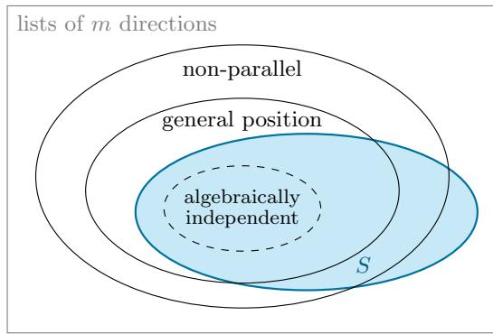  
(a) m♯k(n) ≤ m ≤ (k − 1)n

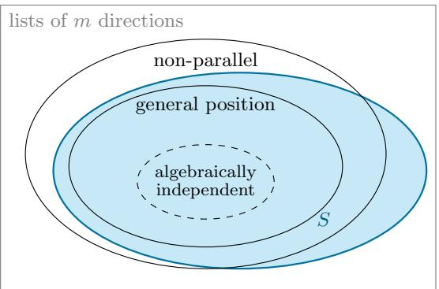  
(b) m  (k  1)n + 1

Figure 5: The conditions of this appendix on a list of $m \geq k$ directions in $\mathbb { R } ^ { k }$ , drawn as sets for $k \geq 3 \ ( \mathrm { f o r } \ k = 2 )$ the two outer ovals coincide), and the set $S$ of lists that separate multisets of size n, shaded. (a) When $m _ { k } ^ { \sharp } ( n ) \leq m \leq ( k - 1 ) n$ , S contains every list with algebraically independent coordinates (Theorem 1.1 and Lemma A.6), but not every list in general position (Remark A.3). (b) When $m \geq ( k - 1 ) n + 1$ , S contains every list in general position (Lemma 2.6). When a shorter list separates, S also contains lists with two parallel directions (repeat a direction of the shorter list), so S reaches outside the outer oval. Areas mean nothing: every set drawn has full measure, so the sets difer only by sets of measure zero.

## Supplementary tables

<table><tr><td colspan="10"> $n = 1 0 ^ { 2 }$   $1 0 ^ { 3 }$   $1 0 ^ { 4 }$   $1 0 ^ { 6 }$ </td></tr><tr><td colspan="10"> $k = 2$ </td></tr><tr><td>every list fails below</td><td></td><td>10</td><td>14</td><td>18</td><td></td><td>26</td><td></td><td>38</td></tr><tr><td>succeed from, before this paper</td><td></td><td>101</td><td>1001</td><td>10001</td><td></td><td> $4 5 8 5 4 ^ { * }$ </td><td></td><td> $1 4 7 4 8 1 ^ { \ast }$ </td></tr><tr><td> $m _ { k } ^ { \mathrm { H S } } ( n )$  , from [HS26] as written</td><td></td><td>364</td><td>558</td><td>764</td><td></td><td>1198</td><td></td><td>1890</td></tr><tr><td> $m _ { k } ^ { \mathrm { { \tilde { H } S E } } } ( n )$  , equation (3)</td><td></td><td>288</td><td>458</td><td></td><td>638</td><td>1024</td><td></td><td>1646</td></tr><tr><td> $m _ { k } ^ { \mathrm { { \tilde { C F } } } } ( n )$  , equation (2)</td><td></td><td>90</td><td>144</td><td></td><td>203</td><td>329</td><td></td><td>533</td></tr><tr><td> $m _ { k } ^ { \sharp } ( n )$  , equation (1a)</td><td></td><td>82</td><td>134</td><td></td><td>190</td><td>310</td><td></td><td>508</td></tr><tr><td> $m _ { k , \mathrm { e q } } ^ { \flat } ( n )$  , equation (1b)</td><td></td><td>82</td><td>134</td><td></td><td>190</td><td>310</td><td></td><td>508</td></tr><tr><td> $m _ { k , \mathrm { b a l } } ^ { \flat } ( n )$  , equation (1c)</td><td></td><td>82</td><td>133</td><td>189</td><td></td><td>310</td><td></td><td>507</td></tr><tr><td colspan="9"> $k = 3$ </td></tr><tr><td>every list fails below</td><td></td><td>16</td><td>22</td><td>29</td><td></td><td>42</td><td></td><td>62</td></tr><tr><td>succeed from, before this paper</td><td></td><td>201</td><td>2001</td><td>20001</td><td></td><td> $2 \cdot 1 0 ^ { 6 } { + 1 }$ </td><td></td><td> $2 \cdot 1 0 ^ { 9 } \mathrm { + 1 }$ </td></tr><tr><td> $m _ { k } ^ { \mathrm { H S } } ( n )$  , from [HS26] as written</td><td></td><td>597</td><td>912</td><td></td><td>1242</td><td>1938</td><td></td><td>3045</td></tr><tr><td> $m _ { k } ^ { \mathrm { { \ddot { H } S E } } } ( n )$  , equation (3)</td><td></td><td>483</td><td>759</td><td></td><td>1053</td><td>1677</td><td></td><td>2679</td></tr><tr><td> $m _ { k } ^ { \mathrm { C F } } ( n )$  , equation (2)</td><td></td><td>170</td><td>270</td><td></td><td>377</td><td>605</td><td></td><td>975</td></tr><tr><td> $m _ { k } ^ { \sharp } ( n )$  , equation (1a)</td><td></td><td>162</td><td>258</td><td></td><td>363</td><td>588</td><td></td><td>951</td></tr><tr><td> $m _ { k , \mathrm { e q } } ^ { \flat } ( n )$  , equation (1b)</td><td></td><td>162</td><td>258</td><td></td><td>363</td><td>588</td><td></td><td>951</td></tr><tr><td> $m _ { k , \mathrm { b a l } } ^ { \flat } ( n )$  , equation (1c)</td><td></td><td>160</td><td>258</td><td></td><td>363</td><td></td><td>587</td><td>951</td></tr></table>

Table S1: Numbers of directions for separating multisets of n points in $\mathbb { R } ^ { 2 }$ and $\mathbb { R } ^ { 3 }$ , as in Figure 1. Every list of fewer directions than the first row fails: for $k = 2$ by Theorem 1.3, and at $n =$ $1 0 ^ { 2 }$ equally by the constructions of [MPS08ˇ ] (their product lemma applied to their examples with three and nine directions); for $k = 3$ by Theorem 1.2 and the logarithmic bound (before Theorem 1.2, one fewer, except at $n = 1 0 ^ { 4 } )$ . The second row is the smallest number of directions from which lists were known to succeed before this paper: the linear bound $( k - 1 ) n + 1$ , for every list in general position [R´en52, HSW24], or, for the starred entries, the bound $5 \log _ { 2 } ^ { 3 } ( 2 n )$ of [MPS08ˇ , Proposition 3.1] with the constant that they state, for almost every list. The remaining rows are for almost every list: Hair and Sahai’s lemmas as their proof writes them (Section 5), $m _ { k } ^ { \mathrm { H S E } } ( n )$ , which is their final inequality evaluated exactly (equation (3)), and the four bounds of Theorem 1.1. $m _ { k , \mathrm { b a l } } ^ { \flat } ( n )$ is the smallest known upper bound, and $m _ { k } ^ { \mathrm { C F } } ( n )$ the smallest known in closed form for these k. Printed, with the credits, by boundsdb.py --table in the accompanying code; flatbound.py checks the rows for $m _ { k , \mathrm { e q } } ^ { \flat } ( n )$ and $m _ { k , \mathrm { b a l } } ^ { \flat } ( n )$ by a direct search.

<table><tr><td>n</td><td>k</td><td> $m _ { k } ^ { \sharp } ( n )$ </td><td> $m _ { k , \mathrm { e q } } ^ { \flat } ( n )$ </td><td> $m _ { k , \mathrm { b a l } } ^ { \flat } ( n )$ </td></tr><tr><td> $1 0 ^ { 2 }$ </td><td>2</td><td>82</td><td>82</td><td>82</td></tr><tr><td></td><td>3</td><td>162</td><td>162</td><td>160</td></tr><tr><td></td><td>8</td><td>640</td><td>630</td><td>622</td></tr><tr><td></td><td>10</td><td>860</td><td>814</td><td>812</td></tr><tr><td></td><td>20</td><td>2040</td><td>1752</td><td>1751</td></tr><tr><td> $1 0 ^ { 3 }$ </td><td>2</td><td>134</td><td>134</td><td>133</td></tr><tr><td></td><td>3</td><td>258</td><td>258</td><td>258</td></tr><tr><td></td><td>8</td><td>1008</td><td>990</td><td>990</td></tr><tr><td></td><td>10</td><td>1340</td><td>1287</td><td>1286</td></tr><tr><td></td><td>20</td><td>3160</td><td>2800</td><td>2785</td></tr><tr><td> $1 0 ^ { 4 }$ </td><td>2</td><td>190</td><td>190</td><td>189</td></tr><tr><td></td><td>3</td><td>363</td><td>363</td><td>363</td></tr><tr><td></td><td>8</td><td>1392</td><td>1386</td><td>1383</td></tr><tr><td></td><td>10</td><td>1850</td><td>1793</td><td>1791</td></tr><tr><td></td><td>20</td><td>4320</td><td>3887</td><td>3879</td></tr><tr><td> $1 0 ^ { 6 }$ </td><td>2</td><td>310</td><td>310</td><td>310</td></tr><tr><td></td><td>3</td><td>588</td><td>588</td><td>587</td></tr><tr><td></td><td>8</td><td>2208</td><td>2208</td><td>2206</td></tr><tr><td></td><td>10</td><td>2920</td><td>2871</td><td>2865</td></tr><tr><td>20</td><td></td><td>6780</td><td>6210</td><td>6200</td></tr></table>

Table S2: Numerical comparison of the bound $m _ { k } ^ { \sharp } ( n )$ (equation (1a)), in which all k blocks must connect W, the equal-block bound $m _ { k , \mathrm { e q } } ^ { \flat } ( n )$ (equation (1b)), and the balanced-block bound $m _ { k , \mathrm { b a l } } ^ { \flat } ( n )$ (equation (1c)) of Theorem 1.1, for $n \in \{ 1 0 ^ { 2 } , 1 0 ^ { 3 } , 1 0 ^ { 4 } , 1 0 ^ { 6 } \}$ and $k \in \{ 2 , 3 , 8 , 1 0 , 2 0 \}$ Allowing $q > k$ blocks and requiring only k of them to connect $W$ reduces the number of directions needed, with larger savings as the dimension k grows. Computed by flatbound.py in the accompanying code.

## References

[AGARD23] T. Amir, S. J. Gortler, I. Avni, R. Ravina and N. Dym, Neural injective functions for multisets, measures and graphs via a finite witness theorem, in: Advances in Neural Information Processing Systems 36 (NeurIPS 2023), 42516–42551.

[BHS25] R. Balan, N. Haghani and M. Singh, Permutation invariant representations with applications to graph deep learning, Appl. Comput. Harmon. Anal. 79 (2025) 101798, doi:10.1016/j.acha.2025.101798; arXiv:2203.07546.

[BL90] G. Bianchi and M. Longinetti, Reconstructing plane sets from projections, Discrete Comput. Geom. 5 (1990) 223–242.

[BT23] R. Balan and E. Tsoukanis, Relationships between the phase retrieval problem and permutation invariant embeddings, in: 2023 International Conference on Sampling Theory and Applications (SampTA); arXiv:2306.13111.

[BTW24] R. Balan, E. Tsoukanis and M. Wellershof, Stability of sorting based embeddings, arXiv:2410.05446 (2024).

[CIM24] J. Cahill, J. W. Iverson and D. G. Mixon, Towards a bilipschitz invariant theory, Appl. Comput. Harmon. Anal. 72 (2024) 101669.

[DG24] N. Dym and S. J. Gortler, Low-dimensional invariant embeddings for universal geometric learning, Found. Comput. Math. 25 (2024) 375–415, doi:10.1007/s10208- 024-09641-2; arXiv:2205.02956.

[DWTLB26] N. Dym, M. Wellershof, E. Tsoukanis, D. Levy and R. Balan, Quantitative bounds for sorting-based permutation-invariant embeddings, IEEE Trans. Inf. Theory 72(6) (2026) 4297–4311, doi:10.1109/TIT.2026.3679460; arXiv:2510.22186v2. Theorem and remark numbers refer to v2; in v1 (October 2025) Theorems 4, 5 and 10 and Remark 6 are Theorems 3, 4 and 9 and Remark 5.

[GHL21] B. Gripaios, W. Haddadin and C. G. Lester, Lorentz- and permutation-invariants of particles, J. Phys. A: Math. Theor. 54 (2021) 155201, doi:10.1088/1751- 8121/abe58c; arXiv:2003.05487 (part I) and arXiv:2007.05746 (part II).

[HS26] I. M. Hair and A. Sahai, List recovery for random low-rate linear codes, arXiv:2605.30101 (2026).

[HSW24] M. Holler, A. Schl¨uter and B. Wirth, Dimension reduction, exact recovery, and error estimates for sparse reconstruction in phase space, Appl. Comput. Harmon. Anal. 70 (2024) 101631; arXiv:2112.09743. In arXiv v1 (December 2021), Proposition 48 and Corollary 49 are Proposition 56 and Corollary 57.

[LHG22] C. G. Lester, W. Haddadin and B. Gripaios, Lorentz and permutation invariants of particles III: Constraining nonstandard sources of parity violation, Int. J. Mod. Phys. A 37(16) (2022) 2250093, doi:10.1142/S0217751X22500932; arXiv:2008.05206.

[MPS08] ˇ J. Matouˇsek, A. Pˇr´ıvˇetiv´y and P. Skovroˇn, ˇ How many points can be reconstructed from k projections?, SIAM J. Discrete Math. 22 (2008) 1605–1623.

[R´en52] A. R´enyi, On projections of probability distributions, Acta Math. Acad. Sci. Hungar. 3 (1952) 131–142.

[TFD24] E. Tanguy, R. Flamary and J. Delon, Reconstructing discrete measures from projections. Consequences on the empirical sliced Wasserstein distance, C. R. Math. Acad. Sci. Paris 362 (2024) 1121–1129.