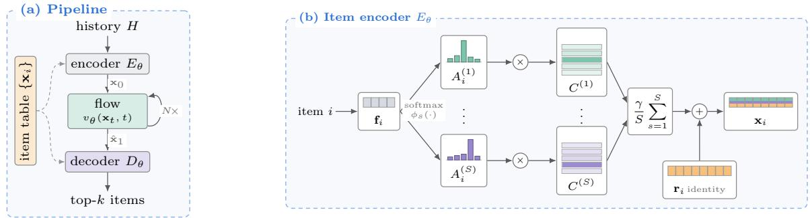

# Item Representations Matter: Bridging Hard Semantic IDs and Soft Prototype Mixtures for Generative Retrieval

Vicente Balmaseda1,2,∗, Dongqi Fu1, Jiarui Feng1, Ren Chen1, Hanqing Zeng1, Tianxin Wei1, Yinglong Xia1, Tianbao Yang2, Hong Li1

1Meta, 2Texas A&M University

∗Work done at Meta

Modern recommender systems rely on generative retrieval techniques to predict the next item either as discrete codes or as a continuous vector. On the one hand, Semantic IDs (SIDs) give discrete models shared parameters and pretrained semantic structure, but discretizing items into hard codes discards some information from the original content embeddings. On the other hand, continuous models avoid quantization, yet typically use flat item lookup tables with no explicit parameter tying across items. We ask whether a continuous recommender can introduce shared structure without making it a discrete bottleneck. We propose CAP-Mix, a flow recommender that represents each item as a soft mixture of shared prototypes plus an item-specific vector. The assignments, prototypes, and item vectors are trained jointly, and the soft representation is retained at inference. Pretrained information is optional: SID responsibilities can serve as a prior over assignments, while a full content embedding can initialize the item-specific vector without changing the initial flat table. In matched comparisons on three datasets, CAP-Mix improves over a flat table on the two sparse Amazon datasets and yields a small gain on Steam when trained without pretrained information. Given only an ofline SID, it outperforms a hard table built from the same tokenizer by 4.45%–14.90% in HR@5 ↑. Given the full content embedding, it matches or improves a strong flat table while hard assignments regress on the sparse Amazon datasets. Overall, averaged across six benchmarks, CAP-Mix improves HR@5 ↑ and NDCG@5 ↑ by +6.9% and +13.6% relative to the best evaluated baseline for each dataset and metric, while delivering 1.4–161× the inference throughput ↑ of the discrete baselines in our experiments.

Correspondence: Vicente Balmaseda (vibalcam@tamu.edu), Dongqi Fu (dongqifu@meta.com)

## 1 Introduction

Generative retrieval techniques enable modern recommender systems to perform large-scale next-item retrieval by learning the next-item distribution and generating recommendations from it, using either discrete tokens (Rajput et al., 2023) or continuous item embeddings (Li et al., 2026b). Either way, a recommender needs an item representation table (or lookup table) as input, i.e., the map from a catalog to the representations it generates or scores against, and how that map is built is a lever in its own right, open to external information. Traditionally, it is flat: one independently parameterized vector per item, with no explicit parameter tying between item rows. Recently, discrete methods have replaced that default, whereas continuous methods have retained it.

Discrete models tokenize each item embedding into codes and emit those codes autoregressively (Deng et al., 2025; Rajput et al., 2023) or by masked difusion (Shah et al., 2025). They owe much of their strength to those codes being Semantic IDs (SIDs) (Singh et al., 2024). A residual quantizer (van den Oord et al., 2017; Lee et al., 2022; Tong et al., 2026) turns each item’s pretrained content embedding into a tuple of codes, so the item vocabulary becomes a clustering (Ju et al., 2025). Two things follow: items sharing a code share the parameters attached to it, so their gradients are aggregated through the shared codeword, introducing explicit cross-item coupling and thereby pooling training signal across items; and because the codes are quantized from a content embedding, that grouping imports semantic structure. However, tokenization has two costs: committing each item to a single codeword at each level generally introduces reconstruction error, and distinct items may also collide on the same code tuple. A recent line of work makes the tokenizer itself adaptive by regularizing it (Wang et al., 2024), coupling it to the recommender (Liu et al., 2025a), or relaxing the assignment so gradients pass through it (Li et al., 2026a; Fu et al., 2026), but recommendation is still organized around emitting discrete codes, and both costs remain: they stem from tokenization itself, not from when the tokenizer is fit.

Continuous models instead represent each item as a vector in $\mathbb { R } ^ { d }$ and retrieve those nearest to the one they predict (Wang et al., 2023; Liu et al., 2025b; Li et al., 2026b). They do not tokenize and are free to seed the content embedding straight into their item table, so semantic structure reaches them without any codes. What they do not obtain automatically is explicit cross-item parameter sharing: every item row remains independently parameterized. This raises our central question: can a continuous generative recommender obtain adaptive cross-item parameter sharing without converting items into discrete tokens?

A simple way to use an SID in a continuous recommender is to replace its flat lookup table with a hard SID table whose assignments are frozen. If the tokenizer assigns item i the code $c _ { i } ^ { ( s ) }$ at level s, then its embedding is $\begin{array} { r } { \mathbf { x } _ { i } = \sum _ { s } C ^ { ( s ) } [ c _ { i } ^ { ( s ) } ] + \mathbf { r } _ { i } , } \end{array}$ where $C ^ { ( s ) }$ contains the codeword vectors and the item-specific vector $\mathbf { r } _ { i }$ can be initialized from the original content embedding. This preserves continuous retrieval while transferring the SID’s parameter sharing: items with the same code update a shared vector. However, our diagnostic comparison (Appendix F, Table 6) shows that, without content embeddings, semantic assignments outperform matched random assignments, indicating that the imported structure is useful. When the full content embedding initializes $\mathbf { r } _ { i } ,$ by contrast, frozen hard semantic assignments hurt, whereas random assignments remain near the flat baseline. These observations suggest that sharing can help, but that a frozen semantic partition can become restrictive when its underlying continuous representation is already available. This motivates shared structure that adapts jointly with the recommender while retaining item-specific degrees of freedom.

Following these observations, we propose CAP-Mix, a flow recommender whose item table is a co-adaptive mixture of shared prototypes plus an item-specific vector. Rather than selecting one codeword per level, an item softly mixes over all of them, so the grouping is diferentiable and the ranking objective moves it continuously instead of by discrete reassignment, while the item-specific vector keeps it from being reduced to the group it lands in. We call this a prototype-mixture item table:

$$
\mathbf { x } _ { i } = \frac { \gamma } { S } \sum _ { s = 1 } ^ { S } A _ { i } ^ { ( s ) } C ^ { ( s ) } + \mathbf { r } _ { i } , \qquad \sum _ { k = 1 } ^ { K } A _ { i } ^ { ( s ) } [ k ] = 1 ,\tag{1}
$$

with $C ^ { ( s ) }$ the K shared prototypes of level $s , A _ { i } ^ { ( s ) }$ the weights item i places on them, $\mathbf { r } _ { i }$ the item’s own vector, and $\gamma > 0$ a scale factor, all learned with the flow in a single stage.

Empirically, we evaluate CAP-Mix across six public benchmarks (Table 2), where CAP-Mix improves average HR@5 ↑ and NDCG@5 ↑ by +6.9% and +13.6%, respectively, relative to the strongest evaluated baseline (FlowRec, TIGER, or MaskGR) for each dataset and metric, while delivering 1.4–161× the inference throughput ↑ of the evaluated discrete baselines (Table 3).

## 2 Preliminaries

## 2.1 Flow-based generative retrieval for recommender systems

Flow matching (Lipman et al., 2023) learns to transform samples from a simple source distribution $p _ { \mathrm { s o u r c e } }$ into samples from a target distribution $p _ { \mathrm { d a t a } }$ . It learns a velocity field $v _ { \theta } ( \mathbf { x } , t )$ that tells each sample how to move at time t. Let I be the item catalog, $H = ( i _ { 1 } , \dots , i _ { m } )$ a user’s interaction history, and $i _ { m + 1 }$ the next item. A flow-based generative recommender can be decomposed into three components. First, the item encoder $E _ { \theta } : \mathcal { T }  \mathbb { R } ^ { D }$ maps each item i to an embedding $\mathbf { x } _ { i }$ . Applied elementwise to H, it yields $\left( \mathbf { x } _ { i _ { 1 } } , \ldots , \mathbf { x } _ { i _ { m } } \right)$ Second, the flow starts from a source $\mathbf { x } _ { \mathrm { 0 } }$ and follows the learned velocity field $v _ { \theta } ( \mathbf { x } , t )$ toward a predicted next-item embedding by integrating from $t = 0$ to t = 1. Writing v for the exact velocity field, explicit Euler approximates this transport using N evaluations of the learned field:

$$
\hat { \mathbf { x } } _ { 1 } = \mathbf { x } _ { 0 } + \int _ { 0 } ^ { 1 } v ( \mathbf { x } _ { t } , t ) \mathrm { d } t \approx \mathbf { x } _ { 0 } + h \sum _ { n = 0 } ^ { N - 1 } v _ { \theta } ( \hat { \mathbf { x } } _ { t _ { n } } , t _ { n } ) , \qquad t _ { n } = n h , \quad h = 1 / N .\tag{2}
$$

Here, $\hat { \mathbf { x } } _ { t _ { n } }$ denotes the numerical state at time $t _ { n } .$ , with $\hat { \mathbf { x } } _ { t _ { 0 } } = \mathbf { x } _ { 0 }$ . Depending on the architecture, the encoded history may determine the source, condition the velocity field, or both. Third, the decoder $D _ { \theta } ( \hat { \mathbf { x } } _ { 1 } , H ) \in \Delta ^ { | \mathcal { T } | - 1 }$ converts this endpoint into a distribution over the catalog by scoring it against the item table $\mathbf { X } = [ \mathbf { x } _ { i } ^ { \top } ] _ { i \in \mathbb { Z } } \in$ $\mathbb { R } ^ { | \mathcal { I } | \times D }$ . Figure 1(a) illustrates this complete encoder–flow–decoder path. During training, the target endpoint is the next-item embedding $\mathbf { x } _ { 1 } = \mathbf { x } _ { i _ { m + 1 } }$ . For a source $\mathbf { x } _ { \mathrm { 0 } }$ and target $\mathbf { x } _ { 1 }$ , conditional flow matching commonly uses the straight path and regresses the conditional velocity

$$
\begin{array} { r } { { \bf x } _ { t } = ( 1 - t ) { \bf x } _ { 0 } + t { \bf x } _ { 1 } , \qquad v ^ { \star } = { \bf x } _ { 1 } - { \bf x } _ { 0 } , \qquad \mathcal { L } _ { \mathrm { C F M } } = \mathbb { E } _ { t \sim \mathcal { U } [ 0 , 1 ] } \| v _ { \theta } ( { \bf x } _ { t } , t ) - v ^ { \star } \| _ { 2 } ^ { 2 } . } \end{array}\tag{3}
$$

The same item table therefore embeds the history, defines the flow’s training targets, and supports retrieval. Existing flow-based recommenders (Liu et al., 2025b; Li et al., 2026b) focus primarily on the transport, whereas we study how the item-table parameterization can enable sharing across items.

## 2.2 Semantic IDs

A Semantic ID (SID) represents an item by an ordered tuple of codes, typically obtained by applying residual quantization to a pretrained content embedding (Rajput et al., 2023; Ju et al., 2025). Given L codebooks $\bar { Q } ^ { ( \ell ) } \in \mathbb { R } ^ { K \times D }$ , residual quantization decomposes the content embedding $\mathbf { e } _ { i }$ into selected codewords and a final residual $\varepsilon _ { i } { : }$

$$
\mathrm { S I D } ( i ) = \bigl ( c _ { i } ^ { ( 1 ) } , \ldots , c _ { i } ^ { ( L ) } \bigr ) , \qquad { \bf e } _ { i } = \sum _ { \ell = 1 } ^ { L } Q ^ { ( \ell ) } [ c _ { i } ^ { ( \ell ) } ] + \varepsilon _ { i } , \qquad c _ { i } ^ { ( \ell ) } \in \{ 1 , \ldots , K \} .\tag{4}
$$

The SID retains the selected indices but not $\varepsilon _ { i }$ . Methods difer in how they obtain these assignments: RQ-KMeans selects the nearest centroid (Ju et al., 2025), RQ-VAE learns its quantization space through reconstruction (Lee et al., 2022), and RQ-GMM assigns items using posterior mixture probabilities (Tong et al., 2026). Regardless of the fitting procedure, the SID used at inference is hard: each level selects one codeword, whose index becomes that level’s code. Items that share a code reuse its parameters, thereby pooling recommendation gradients across their interactions. Deriving the codes from content embeddings also transfers pretrained semantic structure.

Recent methods remove the need for a separately pretrained, frozen tokenizer by adapting it jointly with the recommender (Li et al., 2026a; Fu et al., 2026; Wang et al., 2026), but their deployed IDs remain hard and discard the residual $\varepsilon _ { i } .$ SIDs therefore share parameters through discrete code assignments at the cost of quantizing the item representation. Flat-table continuous recommenders avoid quantization but learn each item embedding independently. Our goal is to combine adaptive sharing with trainable continuous representations.

## 3 Method: CAP-Mix

Following Section 2.1, CAP-Mix uses a continuous flow to predict a next-item embedding and a catalog decoder to model $p ( i \mid H )$ . Its main contribution is the item encoder $E _ { \theta }$ , which replaces a flat item table with a prototype-mixture parameterization. This representation learns soft item groupings for cross-item sharing while retaining an item-specific vector, and can incorporate pretrained SIDs or content embeddings when available. Figure 1 provides an overview.

## 3.1 Prototype-mixture item representations

CAP-Mix maintains S shared codebooks $C ^ { ( s ) } \in \mathbb { R } ^ { K \times D }$ , whose K rows are D-dimensional prototype vectors. For item i, $, A _ { i } ^ { ( s ) } \in \Delta ^ { K - 1 }$ is a soft assignment over the prototypes in codebook s, and $\mathbf { r } _ { i } \in \mathbb { R } ^ { D }$ is an item-specific

  
Figure 1 (a) A general flow-based retrieval pipeline has three components, and the item table is shared across them: the encoder builds it, the flow is trained to land on one of its rows, and the decoder retrieves against it. (b) CAP-Mix mainly changes the encoder of the pipeline: an attention block over the S level tokens maps each item’s short feature $\mathbf { f } _ { i } \in \mathbb { R } ^ { D _ { f } }$ to a soft assignment $A _ { i } ^ { ( s ) }$ over the K prototypes of level $s ,$ which then blends the rows of that level’s codebook $C ^ { ( s ) }$ . Adding a trainable identity vector $\mathbf { r } _ { i }$ yields the item embedding $\mathbf { x } _ { i } \in \mathbb { R } ^ { D }$ . Nothing is quantized or frozen, so the clustering is shaped by the training objective and the assignments are kept soft during training and inference.

vector. The item embedding is then

$$
\mathbf { x } _ { i } = \underbrace { \mathbf { r } _ { i } } _ { \mathrm { i d e n t i t y } } + \underbrace { \frac { \gamma } { S } \sum _ { s = 1 } ^ { S } A _ { i } ^ { ( s ) } C ^ { ( s ) } } _ { \mathrm { c r o s s - i t e m ~ s h a r i n g } } , A _ { i } ^ { ( s ) } [ k ] \geq 0 , \sum _ { k = 1 } ^ { K } A _ { i } ^ { ( s ) } [ k ] = 1 ,\tag{5}
$$

where $A _ { i } ^ { ( s ) } C ^ { ( s ) } \in \mathbb { R } ^ { D }$ is a convex mixture of the prototypes, $\gamma > 0$ controls the contribution of the shared component, and $1 / S$ keeps its scale stable as $S$ changes.

Cross-item sharing and item-specific memorization. Consider a diferentiable objective $\mathcal { L } ( \mathbf { X } )$ whose dependence on the codebooks and item-specific vectors is only through the composed item table $\mathbf { X }$ , and let $\mathbf { g } _ { i } = \nabla _ { \mathbf { x } _ { i } } \mathcal { L } .$ Diferentiating Equation (5) gives

$$
\nabla _ { C ^ { ( s ) } [ k ] } \mathscr { L } = \frac { \gamma } { S } \sum _ { i \in \mathscr { I } } A _ { i } ^ { ( s ) } [ k ] \mathbf { g } _ { i } , \qquad \nabla _ { \mathbf { r } _ { i } } \mathscr { L } = \mathbf { g } _ { i } .\tag{6}
$$

The prototype channel aggregates recommendation gradients across items by their assignment weights, providing parameter sharing that can improve generalization. Meanwhile, $\mathbf { r } _ { i }$ receives the unrestricted gradient gi, preserving item-specific memorization and uniqueness even when assignments coincide. Appendix E derives the resulting coupling under fixed assignments.

Relation to flat and hard item tables. Equation (5) contains flat and hard item tables as special cases: $\gamma = 0$ yields the flat $\mathbf { x } _ { i } = \mathbf { r } _ { i } .$ while fixed one-hot $A _ { i } ^ { ( s ) }$ selects one prototype per codebook as in a hard SID lookup Additionally setting $\mathbf { r } _ { i } = \mathbf { 0 }$ gives the fully quantized case and discards item information not captured by the selected codewords. CAP-Mix instead keeps assignments soft and retains $\mathbf { r } _ { i }$ for item-specific flexibility.

Learning soft assignments. Each item has a learned low-dimensional feature $\mathbf { f } _ { i } \in \mathbb { R } ^ { D _ { f } }$ . We derive one token per codebook from $\mathbf { f } _ { i }$ and process the S tokens jointly with a lightweight attention block:

$$
\begin{array} { r } { \begin{array} { c c } { \mathbf { z } _ { i } ^ { ( s ) } = W _ { \mathrm { i n } } ^ { ( s ) } \mathbf { f } _ { i } + \mathbf { p } ^ { ( s ) } , } & { ( \mathbf { h } _ { i } ^ { ( 1 ) } , \ldots , \mathbf { h } _ { i } ^ { ( S ) } ) = \mathrm { A t t n } ( \mathbf { z } _ { i } ^ { ( 1 ) } , \ldots , \mathbf { z } _ { i } ^ { ( S ) } ) , } \\ { \phi _ { s } ( \mathbf { f } _ { i } ) = W _ { \mathrm { o u t } } ^ { ( s ) } \mathbf { h } _ { i } ^ { ( s ) } , } & { A _ { i } ^ { ( s ) } = \mathrm { s o f t m a x } ( \phi _ { s } ( \mathbf { f } _ { i } ) ) . } \end{array} } \end{array}\tag{7}
$$

Here, $W _ { \mathrm { i n } } ^ { ( s ) } \mathbf { f } _ { i } + \mathbf { p } ^ { ( s ) }$ is a codebook-specific afine projection, $\mathbf { h } _ { i } ^ { ( s ) }$ is its contextualized output, and $W _ { \mathrm { o u t } } ^ { ( s ) }$ maps this output to K assignment logits. This parameterization has three properties. First, because $D _ { f } < D , { \bf f } _ { i }$ serves as an assignment bottleneck: it stores compact information for selecting shared prototypes, while detailed item-specific information remains in $\mathbf { r } _ { i } .$ Second, attention lets the assignments interact: it is bidirectional across codebooks by default and, when an ofline residual SID provides a level ordering, causally masked to respect that ordering. Third, no arg max or straight-through estimator is used: the assignments remain soft and diferentiable during training and inference, and all representation parameters are learned jointly with the recommender.

## 3.2 Using optional pretrained information

Pretrained information is optional: CAP-Mix can learn entirely from recommendation interactions or incorporate an ofline SID or a full content embedding when either is available.

From scratch. CAP-Mix requires neither a tokenizer nor content embeddings. All representation parameters are randomly initialized and learned solely from recommendation interactions. The resulting item groupings are therefore induced by the recommendation objective rather than imported from pretrained content information.

Offline Semantic ID. An ofline residual tokenizer supplies both a distribution $\rho _ { i } ^ { ( t ) } \in \Delta ^ { K - 1 }$ over codes at each depth t and the level ordering induced by its residual construction. We follow this ordering with S parallel causal chains of depth T, sharing the tokenizer prior at each depth across chains:

$$
A _ { i } ^ { ( s , t ) } = \mathrm { s o f t m a x } \Big ( \phi _ { s , t } ( \mathbf { f } _ { i } ) + \alpha _ { t } \log \Big ( \rho _ { i } ^ { ( t ) } + \epsilon _ { \rho } \Big ) \Big ) , \qquad \mathbf { x } _ { i } = \mathbf { r } _ { i } + \frac { \gamma } { S } \sum _ { s , t } A _ { i } ^ { ( s , t ) } C ^ { ( s , t ) } .\tag{8}
$$

Here, the sum ranges over $s \in \{ 1 , \ldots , S \}$ and $t \in \{ 1 , \ldots , T \}$ , and $\alpha _ { t } \geq 0$ is a learned trust parameter. Because $\epsilon _ { \rho } > 0$ gives the prior full support, for any finite $\alpha _ { t }$ the learned logits can realize any distribution in the interior of the simplex. The assignments therefore remain soft and diferentiable. Equation (5) is recovered when $T = 1$ . Appendix D gives the pooling derivation and causal attention structure.

Full content embedding. Let $\bar { \mathbf { e } } _ { i } ~ \in ~ \mathbb { R } ^ { D }$ be the PCA-projected and coordinatewise-standardized content embedding. We initialize the item-specific vector from this embedding and set every prototype to zero:

$$
\mathbf { r } _ { i }  \bar { \mathbf { e } } _ { i } , \qquad C ^ { ( s ) }  \mathbf { 0 } .\tag{9}
$$

Both $\mathbf { r } _ { i }$ and $C ^ { ( s ) }$ remain trainable after initialization. By Equation (5), $\mathbf { x } _ { i } = \bar { \mathbf { e } } _ { i }$ initially, so CAP-Mix and the flat content-initialized baseline begin from the same unquantized item embeddings. The prototype channel then learns cross-item sharing from this common starting point.

## 3.3 Flow backbone and decoder

We build on the FlowRec backbone (Li et al., 2026b), retaining its behavior encoder, velocity field, and base flow objective while replacing its item encoder and decoder. Appendix B provides the full specification. A behavior encoder $B _ { \theta }$ maps the m most recent item embeddings to a history-dependent source, while the next-item embedding supplies the target:

$$
\begin{array} { r } { \mathbf { x } _ { 0 } = B _ { \theta } ( E _ { \theta } ( i _ { 1 } ) , \ldots , E _ { \theta } ( i _ { m } ) ) , \qquad \mathbf { x } _ { 1 } = E _ { \theta } ( i _ { m + 1 } ) . } \end{array}\tag{10}
$$

We train v on the straight interpolant using the conditional flow-matching loss in Equation (3). Following FlowRec, we also form the one-step endpoint estimate

$$
\widetilde { \mathbf { x } } _ { 1 } = \mathbf { x } _ { t } + ( 1 - t ) v _ { \theta } ( \mathbf { x } _ { t } , t ) .\tag{11}
$$

Decoder. For a query $\mathbf { u } \in \mathbb { R } ^ { D }$ , the decoder combines dot-product scores against the shared item table with a history-dependent co-visitation prior through log-linear pooling:

$$
D _ { \theta } ( \mathbf { u } , H ) [ i ] = \mathrm { s o f t m a x } _ { i \in \mathcal { T } } \big ( \mathbf { u } ^ { \top } \mathbf { x } _ { i } + w \log \widetilde { g } ( i \mid H ) \big ) .\tag{12}
$$

The prior $\widetilde g ( i \mid H )$ favors items that frequently co-occur with the items in the user’s recent history. We compute it once from the training interactions before model training and keep it fixed. The trust $w \geq 0$ controls its influence. Setting $w = 0$ defines the no-prior ablation with a pure dot-product decoder. Appendix D gives the complete construction.

## 3.4 Training objectives and inference

Base flow objective. Using the decoder in Equation (12), we apply next-item classification losses to the behavior source and the one-step endpoint:

$$
\begin{array} { r } { \mathcal { L } _ { \mathrm { s r c } } = - \log D _ { \theta } ( \mathbf { x } _ { 0 } , H ) [ i _ { m + 1 } ] , \qquad \mathcal { L } _ { \mathrm { a l i g n } } = - \log D _ { \theta } ( \widetilde { \mathbf { x } } _ { 1 } , H ) [ i _ { m + 1 } ] . } \end{array}\tag{13}
$$

Together with the conditional flow-matching loss, the inherited FlowRec objective is

$$
{ \mathcal { L } } _ { \mathrm { f l o w } } = { \mathcal { L } } _ { \mathrm { s r c } } + \lambda _ { \mathrm { c f m } } { \mathcal { L } } _ { \mathrm { C F M } } + \lambda _ { \mathrm { a l i g n } } { \mathcal { L } } _ { \mathrm { a l i g n } } .\tag{14}
$$

Here, $\mathcal { L } _ { \mathrm { s r c } }$ makes the history-dependent source predictive of the next item, while $\mathcal { L } _ { \mathrm { a l i g n } }$ applies the same supervision to the one-step endpoint estimate. The weights $\lambda _ { \mathrm { { c f m } } }$ and $\lambda _ { \mathrm { a l i g n } }$ are fixed throughout our experiments; their values are given in Section 4.1.

Code matching. The item-level losses can be satisfied through the item-specific vectors $\mathbf { r } _ { i }$ alone, leaving the shared assignments uninformative for retrieval. We therefore train the predicted endpoint to recover the target item’s soft assignments, encouraging items retrieved in similar contexts to use compatible prototypes. Let $A ^ { ( s , t ) } \in \mathbb { R } ^ { | \mathbb { Z } | \times K }$ collect all item assignments for chain s at depth t, and let $\widetilde { \mathbf g } _ { H } = [ \widetilde { g } ( i \ | \ H ) ] _ { i \in \mathcal { T } } .$ . Here and below, $\sum { } _ { s , t }$ ranges over all S chains and T depths, with $T = 1$ outside the residual-SID setting. We define

$$
\begin{array} { r } { \pi _ { H } ^ { ( s , t ) } = \mathrm { s g } \left( A ^ { ( s , t ) \top } \widetilde { \mathbf { g } } _ { H } \right) , \qquad q _ { H } ^ { ( s , t ) } = \mathrm { s o f t m a x } \left( \widetilde { \mathbf { x } } _ { 1 } C ^ { ( s , t ) \top } + w \log \pi _ { H } ^ { ( s , t ) } \right) . } \end{array}\tag{15}
$$

Here, $\pi _ { H } ^ { ( s , t ) }$ marginalizes the fixed item-space prior into code space. The stop-gradient operator sg prevents this computation from updating the assignments. The code-matching loss is

$$
\mathcal { L } _ { \mathrm { m a t c h } } = - \frac { 1 } { S T } \sum _ { s , t } \left. A _ { i _ { m + 1 } } ^ { ( s , t ) } , \log q _ { H } ^ { ( s , t ) } \right. .\tag{16}
$$

Gradients still pass through the target assignment and, through $q _ { H } ^ { ( s , t ) }$ , to the prototypes and flow model, allowing these components to co-adapt.

Maintaining prototype utilization. Because the item-specific channel can support retrieval even when assignments concentrate on only a few prototypes, we penalize catalog-wide utilization below a target $K _ { \mathrm { e f f } }$

$$
\bar { A } ^ { ( s , t ) } = \frac { 1 } { | \mathcal { Z } | } \sum _ { i \in \mathcal { Z } } A _ { i } ^ { ( s , t ) } , \qquad \mathcal { L } _ { \mathrm { b a l } } = \frac { 1 } { S T } \sum _ { s , t } \left[ \log K _ { \mathrm { e f f } } - \mathcal { H } \Bigl ( \bar { A } ^ { ( s , t ) } \Bigr ) \right] _ { + } ,\tag{17}
$$

where H is entropy and $[ z ] _ { + } = \operatorname* { m a x } ( z , 0 )$ . Since $\exp ( \mathcal { H } ( \bar { A } ^ { ( s , t ) } ) )$ is the efective number of utilized prototypes, the loss vanishes once it reaches $K _ { \mathrm { e f f } }$ . The loss depends only on the catalog-wide marginal $\bar { A } ^ { ( s , t ) }$ , leaving individual assignments free to be soft or sharp without forcing discretization.

Full objective. All trainable components are optimized jointly. Given weights $\lambda _ { \mathrm { m a t c h } } , \lambda _ { \mathrm { b a l } } \geq 0$

$$
\begin{array} { r } { \mathcal { L } = \mathcal { L } _ { \mathrm { f l o w } } + \lambda _ { \mathrm { m a t c h } } \mathcal { L } _ { \mathrm { m a t c h } } + \lambda _ { \mathrm { b a l } } \mathcal { L } _ { \mathrm { b a l } } . } \end{array}\tag{18}
$$

Inference. After training, we materialize the item table X from Equation (5), retaining the learned soft mixtures without discretization. Given a history H, we look up its item embeddings and compute the behavior source $\mathbf { x } _ { \mathrm { 0 } }$ . Starting from $\mathbf { x } _ { \mathrm { 0 } }$ , we numerically integrate the learned velocity field as in Equation (2) to obtain $\hat { \mathbf { x } } _ { 1 }$ . The decoder in Equation (12) then scores the catalog, and we return the top-k items. Because the table is materialized once, the prototype-mixture encoder adds no per-query computation relative to a flat item table.

## 4 Experiments

Our experiments address three questions: (RQ1) when does a prototype-mixture item table improve over flat and hard SID alternatives under diferent levels of pretrained information; (RQ2) how does the complete CAP-Mix system compare with continuous and discrete generative recommenders in predictive performance and eficiency; and (RQ3) how do semantic initialization, the co-visitation prior, and target-item frequency afect the observed gains?

## 4.1 Setup

Datasets and preprocessing. We evaluate on six public benchmarks: Amazon Beauty (2014) (McAuley et al., 2015; He and McAuley, 2016), Amazon Industrial & Scientific and Amazon Ofice (2023) (Hou et al., 2026), MovieLens-1M (Harper and Konstan, 2015), Yelp-2022 (Yelp Inc., 2022), and Steam-2018 (Kang and McAuley, 2018). All datasets are processed identically following prior work (Geng et al., 2022; Rajput et al., 2023; Shah et al., 2025): iterative 5-core filtering, consecutive-repeat removal, chronological ordering, and leave-one-out splitting, with each user’s penultimate and final interactions used for validation and testing. Appendix A reports dataset statistics, sources, metadata, and complete preprocessing details.

Evaluation protocol. All models are trained and evaluated on identical item sequences using full-catalog ranking without candidate sampling. We report HR@5 ↑ and NDCG@5 ↑ as three-seed means scaled by 100; Appendix G additionally reports k ∈ {10, 20}. We use early stopping, select the checkpoint with the best validation performance, and evaluate only that checkpoint on the test split.

Information regimes. To separate content information from parameter-sharing benefits, we evaluate three regimes that difer in the pretrained information available. From scratch provides none: item representations are initialized randomly and learned from interactions. Offline SID provides the stored codes and posterior responsibilities of a balanced RQ-GMM (see Appendix C), but not the content embeddings from which they were computed. PCA-text provides the full content embeddings, projected through PCA to D dimensions and kept trainable.

Implementation and model selection. All controlled item-table variants use the same D=128 flow backbone, three-item histories, three Euler steps, and matched non-table hyperparameters. We encode item metadata once with frozen Qwen3-Embedding-4B (Zhang et al., 2025). In PCA-text, we initialize the trainable item-specific vectors with standardized D-dimensional PCA projections of the content embeddings. CAP-Mix zero-initializes its prototypes, making its initial table identical to the flat baseline. We select configurations by the three-seed validation geometric mean of HR@5 ↑ and NDCG@5 ↑. Appendices A–C give the SID construction and remaining setup details.

## 4.2 RQ1: When do prototype mixtures help?

Our central hypothesis is that continuous item embeddings benefit from shared prototypes when that structure complements, rather than replaces, an item-specific continuous representation. We test this by holding the flow backbone and training protocol fixed while varying the item-table parameterization. Because the same table embeds histories, defines the flow targets, and supports retrieval, ranking diferences measure the downstream utility of the learned item embeddings.

Item-table variants. The flat table uses $\mathbf { x } _ { i } = \mathbf { r } _ { i }$ . The hard SID table uses $\begin{array} { r } { \mathbf { x } _ { i } = \mathbf { r } _ { i } + \sum _ { s } C ^ { ( s ) } [ c _ { i } ^ { ( s ) } ] } \end{array}$ , with trainable codewords and item-specific vectors but frozen one-hot assignments. CAP-Mix instead uses the prototype-mixture representation of Equation (5). All variants share the same backbone and non-table hyperparameters.

Information available to each variant. Table 1 compares the item-table variants under three settings. In from scratch, the flat and CAP-Mix tables are randomly initialized and learn only from interactions. In offline SID, the hard table uses the tokenizer’s stored codes as fixed assignments, whereas CAP-Mix uses its posterior responsibilities as the assignment prior in Equation (8); neither receives the original content embedding. In PCA-text, every variant initializes its item-specific vectors from the same PCA projection. The hard table uses the tokenizer’s fixed codes, whereas CAP-Mix initializes its prototypes to zero, making its initial table identical to the flat table.

Prototype sharing helps without pretrained content. In from scratch, CAP-Mix improves HR@5 ↑ over the flat table by +2.08% on Beauty, +4.73% on Industrial, and +0.72% on Steam. Thus, shared prototypes learn useful cross-item structure from interactions alone, producing item embeddings that are more efective for next-item ranking than independently parameterized rows.

An offline SID is more useful as a prior than as a fixed assignment. The hard SID table exceeds the scratch anchor on all three datasets, confirming that the tokenizer carries useful information. Given the same tokenizer,

Table 1 Item tables across three information regimes. Each cell reports test HR@5 ↑ (top) and change from the dataset’s scratch flat anchor (bottom; ref.). The final ∆ compares CAP-Mix with flat (scratch), hard (ofline SID), or flat (PCA-text). hard uses the same tokenizer; all variants have matched backbones and non-table hyperparameters.
<table><tr><td rowspan="2">dataset</td><td colspan="3">from scratch</td><td colspan="3">offline SID</td><td colspan="4">PCA-text</td></tr><tr><td>FLAT</td><td>CAP-Mix</td><td>vS. FLAT</td><td>HARD</td><td>CAP-Mix</td><td>vs. HARD</td><td>FLAT</td><td>HARD</td><td>CAP-Mix</td><td>vs. FLAT</td></tr><tr><td>Beauty</td><td>5.77 ref.</td><td>5.89 +2.08%</td><td>+2.08%</td><td>5.80 +0.52%</td><td>6.32 +9.53%</td><td>+8.97%</td><td>6.69 +15.94%</td><td>6.43 +11.44%</td><td>6.79 +17.68%</td><td>+1.49%</td></tr><tr><td>Industrial</td><td>2.75 ref.</td><td>2.88 +4.73%</td><td>+4.73%</td><td>3.02 +9.82%</td><td>3.47 +26.18%</td><td>+14.90%</td><td>3.81 +38.55%</td><td>3.52 +28.00%</td><td>3.79 +37.82%</td><td>-0.52%</td></tr><tr><td>Steam</td><td>8.29 ref.</td><td>8.35 +0.72%</td><td>+0.72%</td><td>8.32 +0.36%</td><td>8.69 +4.83%</td><td>+4.45%</td><td>8.13 -1.93%</td><td>8.19 -1.21%</td><td>8.30 +0.12%</td><td>+2.09%</td></tr></table>

Table 2 Main results, HR@5 ↑ and NDCG@5 ↑ (mean±std, ×100). For each model–dataset pair, both metrics come from one run selected by their validation geometric mean; s marks scratch, i ofline SID, and p PCA-text. Bold/underlin mark best/second; ∆ compares CAP-Mix with the best baseline.
<table><tr><td></td><td colspan="2">Beauty</td><td colspan="2">Indus.</td><td colspan="2">Steam</td><td colspan="2">ML-1M</td><td colspan="2">Yelp</td><td colspan="2">Office</td></tr><tr><td></td><td>HR@5↑ NDCG@5↑</td><td></td><td>HR@5↑</td><td>NDCG@5↑</td><td>HR@5↑</td><td>NDCG@5 ↑</td><td>HR@5↑</td><td>NDCG@5↑</td><td>HR@5↑</td><td>NDCG@5 ↑</td><td>HR@5↑</td><td>NDCG@5 ↑</td></tr><tr><td>FlowRec</td><td>6.27P</td><td>4.03</td><td>3.62P</td><td>2.04</td><td>8.28⁸</td><td>5.37</td><td>15.36P</td><td>10.14</td><td>2.98P</td><td>1.86</td><td>2.90P</td><td>1.67</td></tr><tr><td></td><td>±0.18</td><td>±0.03</td><td>±0.02</td><td>±0.03</td><td>±0.33</td><td>±0.30</td><td>±0.20</td><td>±0.12</td><td>±0.05</td><td>±0.03</td><td>±0.02</td><td>±0.02</td></tr><tr><td>TIGER</td><td>3.51⁸</td><td>2.54</td><td>2.05P</td><td>1.34</td><td>8.43i</td><td>5.01</td><td>12.59⁸</td><td>8.47</td><td>1.29P</td><td>0.80</td><td>1.52P</td><td>0.98</td></tr><tr><td></td><td>±0.07</td><td>±0.05</td><td>±0.03</td><td>±0.02</td><td>±0.10</td><td>±0.03</td><td>±0.40</td><td>±0.28</td><td>±0.07</td><td>±0.04</td><td>±0.01</td><td>±0.01</td></tr><tr><td>MaskGR</td><td>5.06i</td><td>3.28</td><td>3.46P</td><td>2.24</td><td>8.64P</td><td>5.57</td><td>15.64s</td><td>10.23</td><td>2.99s</td><td>1.87</td><td>2.29s</td><td>1.53</td></tr><tr><td></td><td>±0.13</td><td>±0.12</td><td>±0.03</td><td>±0.03</td><td>±0.00</td><td>±0.01</td><td>±0.40</td><td>±0.28</td><td>±0.04</td><td>±0.03</td><td>±0.02</td><td>±0.01</td></tr><tr><td>CAP-Mix</td><td>6.79P</td><td>4.73 ±0.04</td><td>3.79P</td><td>2.34</td><td>8.69</td><td>5.57</td><td>17.25P</td><td>11.71</td><td>3.18P</td><td>2.03</td><td>3.22P</td><td>2.28</td></tr><tr><td></td><td>±0.06</td><td></td><td>±0.01</td><td>±0.03</td><td>±0.29</td><td>±0.19</td><td>±0.13</td><td>±0.11</td><td>±0.02</td><td>±0.02</td><td>±0.01</td><td>±0.01</td></tr><tr><td>∆(%)</td><td>+8.3%</td><td>+17.4%</td><td>+4.7%</td><td>+4.5%</td><td>+0.6%</td><td>0.0%</td><td>+10.3%</td><td>+14.5%</td><td>+6.4%</td><td>+8.6%</td><td>+11.0%</td><td>+36.5%</td></tr></table>

CAP-Mix improves HR@5 ↑ over the hard table by 4.45%–14.90%, showing that diferentiable assignments use this information more efectively than frozen one-hot assignments.

Prototype sharing complements the full content embedding. In PCA-text, content seeding already strengthens the flat table on the Amazon datasets. Starting from the same embeddings, CAP-Mix improves it by +1.49% on Beauty and +2.09% on Steam while essentially preserving its Industrial result (−0.52%). In contrast, the hard SID table changes HR@5 ↑ by −3.89% and −7.61% relative to the seeded flat table on the Amazon datasets. Thus, prototype mixtures add cross-item sharing while retaining the unquantized initialization improvement.

Across all three regimes, prototype mixtures improve how continuous item embeddings use the information available by introducing cross-item pooling without quantizing their representations.

## 4.3 RQ2: Comparison with generative recommenders

We compare CAP-Mix with continuous FlowRec (Li et al., 2026b), autoregressive TIGER (Rajput et al., 2023), and masked-difusion MaskGR (Shah et al., 2025) in all three information regimes, selecting one configuration per model and dataset by the validation geometric mean of HR@5 ↑ and NDCG@5 ↑. CAP-Mix and FlowRec use three-item histories; TIGER and MaskGR retain their released 120-token limit and decode one top-20 list with beam search. Appendix B specifies the tokenizers, initializations, resulting item-level history lengths, and decoding protocol.

Table 2 reports the complete-system comparison at k=5, with results at k=10 and 20 in Appendix G. CAP-Mix achieves the highest HR@5 ↑ on all six datasets and the highest or tied-for-highest NDCG@5 ↑ on all six. Averaged across datasets, it improves over the strongest evaluated baseline for each dataset and metric by +6.9% in HR@5 ↑ and +13.6% in NDCG@5 ↑. For CAP-Mix, validation selects PCA-text on five of the six datasets and offline SID on Steam, suggesting that direct content initialization is generally preferable when the original embeddings are available.

Inference efficiency. At inference, CAP-Mix materializes the composed item embeddings once, so its soft assignments add no per-query computation. Table 3 shows that CAP-Mix consistently requires fewer

Table 3 Inference efficiency across five datasets (min–max from unrounded values). Hot-parameter ratio ↑ and MFLOP/query ratio ↑ are baseline/CAP-Mix; throughput ratio ↑ is CAP-Mix/baseline.
<table><tr><td>baseline</td><td>hot-parameter ratio ↑</td><td>MFLOP/query ratio ↑</td><td>throughput ratio ↑</td></tr><tr><td>TIGER</td><td>0.9-10.0×</td><td>23-265×</td><td>1.9-7.1×</td></tr><tr><td>MaskGR</td><td>1.4-5.4×</td><td>3.7-2,654×</td><td>1.4-161×</td></tr></table>

MFLOP/query ↓ and achieves higher throughput ↑ than both discrete baselines across the five profiled datasets. The advantage is largest when the baselines generate multi-code SIDs and narrows for atomic-token configurations. The parameter advantage depends on catalog size: on Yelp, the continuous item table makes CAP-Mix slightly larger than TIGER. Appendix B documents the measurement protocol, and Table 5 reports the full per-dataset measurements.

## 4.4 RQ3: Robustness and diagnostics

Motivating controls. Appendix F compares hard semantic assignments with random assignments matched in depth, codebook size, and codeword vectors. Without content initialization, semantic assignments win on all three datasets, confirming that they carry useful structure beyond parameter sharing. With PCA initialization, they underperform the flat and random controls on both Amazon datasets, showing that this structure can become restrictive when frozen.

Complementarity with the retrieval prior. Without the co-visitation prior, prototype sharing is beneficial in all regimes on both Amazon datasets and retains a +6.91% HR@5 ↑ advantage over hard SID on Steam (Table 7), confirming that prototype sharing and the prior are complementary.

How do gains vary with item frequency? In the from scratch regime, the frequency-stratified results are mixed. However, when pretrained tokenizer or content information is available, relative gains are larger for rare targets than for frequent ones in 11 of 12 dataset–comparison–metric combinations for HR@5 ↑ and NDCG@10 ↑, consistent with transfer to less-observed items (Table 8).

## 5 Related Work

Discrete generative recommenders and semantic IDs. The discrete branch commonly replaces an atomic item identifier with a semantic ID (SID) by quantizing a pretrained content embedding (Ju et al., 2025). This is generally done through residual schemes that cluster either directly in the embedding space (RQ-KMeans and RQ-GMM (Deng et al., 2025; Tong et al., 2026)) or in a learned latent space (RQ-VAE (van den Oord et al., 2017; Lee et al., 2022)). A recommender then predicts the resulting tuple autoregressively, as in TIGER (Rajput et al., 2023), OneRec (Deng et al., 2025; Zhou et al., 2025), and MiniOneRec (Kong et al., 2025), or through masked discrete difusion, as in MaskGR (Shah et al., 2025). SIDs provide two distinct benefits. The first, parameter sharing, arises because reusing codewords ties parameters across items and pools supervision from their interactions. The second, semantic transfer, comes from deriving the assignments from pretrained content embeddings, which places semantically related items under shared parameters. Together, these benefits improve generalization (Ju et al., 2025; Singh et al., 2024). However, an SID exposes only hard code assignments and preserves a partition of the content space rather than its full continuous geometry.

Diffusion and flow recommenders. Continuous generative recommenders replace discrete token prediction with generation in a continuous space. DifRec (Wang et al., 2023) denoises a user’s interaction vector, whereas DreamRec (Yang et al., 2023) and DifuRec (Li et al., 2023) difuse a target item embedding for next-item prediction. FMRec (Liu et al., 2025b) and FlowRec (Li et al., 2026b) use flow matching (Lipman et al., 2023) to transport a source distribution to the target embedding, with FlowRec conditioning the source on the user’s history. These methods improve the generative dynamics while retaining a flat item table, thereby avoiding discretization into code sequences but forgoing the cross-item parameter sharing induced by shared SID codewords. CAP-Mix retains continuous generation while introducing that sharing through co-adaptive mixtures of prototypes.

## 6 Conclusion

We presented CAP-Mix, a flow-based recommender whose item table combines diferentiable assignments over shared codebooks with an item-specific vector, all trained jointly with the recommendation objective. The shared codewords introduce explicit cross-item parameter coupling, while the item-specific vectors retain unrestricted per-item degrees of freedom. Across six public benchmarks, CAP-Mix improves average HR@5 ↑ and NDCG@5 ↑ relative to the strongest evaluated baselines, while providing higher throughput ↑ than the evaluated discrete baselines.

## References

Takuya Akiba, Shotaro Sano, Toshihiko Yanase, Takeru Ohta, and Masanori Koyama. Optuna: A next-generation hyperparameter optimization framework. In Proceedings of the 25th ACM SIGKDD International Conference on Knowledge Discovery & Data Mining, 2019. doi: 10.1145/3292500.3330701. https://doi.org/10.1145/3292500. 3330701.

David Arthur and Sergei Vassilvitskii. k-means++: the advantages of careful seeding. In Proceedings of the Eighteenth Annual ACM-SIAM Symposium on Discrete Algorithms, SODA ’07, page 1027–1035, USA, 2007. Society for Industrial and Applied Mathematics. ISBN 9780898716245. https://dl.acm.org/doi/10.5555/1283383.1283494.

James Bergstra, Rémi Bardenet, Yoshua Bengio, and Balázs Kégl. Algorithms for hyper-parameter optimization. In J. Shawe-Taylor, R. Zemel, P. Bartlett, F. Pereira, and K. Weinberger, editors, Advances in Neural Information Processing Systems, volume 24. Curran Associates, Inc., 2011. https://proceedings.neurips.cc/paper\_files/paper/ 2011/file/86e8f7ab32cfd12577bc2619bc635690-Paper.pdf.

Paul S. Bradley, Kristin P. Bennett, and Ayhan Demiriz. Constrained k-means clustering. Technical Report MSR-TR-2000-65, Microsoft Research, 2000. https://www.microsoft.com/en-us/research/publication/ constrained-k-means-clustering/.

Gilles Celeux and Gérard Govaert. A classification EM algorithm for clustering and two stochastic versions. Computational Statistics & Data Analysis, 14(3):315–332, 1992. doi: 10.1016/0167-9473(92)90042-E. https: //doi.org/10.1016/0167-9473(92)90042-E.

A. P. Dempster, N. M. Laird, and D. B. Rubin. Maximum likelihood from incomplete data via the EM algorithm. Journal of the Royal Statistical Society: Series B, 39:1–38, 1977. http://web.mit.edu/6.435/www/Dempster77.pdf.

Jiaxin Deng, Shiyao Wang, Kuo Cai, Lejian Ren, Qigen Hu, Weifeng Ding, Qiang Luo, and Guorui Zhou. OneRec: Unifying retrieve and rank with generative recommender and iterative preference alignment, 2025. https://arxiv. org/abs/2502.18965.

Junchen Fu, Xuri Ge, Alexandros Karatzoglou, Ioannis Arapakis, Suzan Verberne, Joemon M. Jose, and Zhaochun Ren. Diferentiable semantic ID for generative recommendation. In Proceedings of the 49th International ACM SIGIR Conference on Research and Development in Information Retrieval, SIGIR ’26, page 369–379, New York, NY, USA, 2026. Association for Computing Machinery. ISBN 9798400725999. doi: 10.1145/3805712.3809641. https://doi.org/10.1145/3805712.3809641.

Shijie Geng, Shuchang Liu, Zuohui Fu, Yingqiang Ge, and Yongfeng Zhang. Recommendation as language processing (RLP): A unified pretrain, personalized prompt & predict paradigm (P5). In Proceedings of the 16th ACM Conference on Recommender Systems, RecSys ’22, page 299–315, New York, NY, USA, 2022. Association for Computing Machinery. ISBN 9781450392785. doi: 10.1145/3523227.3546767. https://doi.org/10.1145/3523227.3546767.

F. Maxwell Harper and Joseph A. Konstan. The MovieLens datasets: History and context. ACM Trans. Interact. Intell. Syst., 5(4), December 2015. ISSN 2160-6455. doi: 10.1145/2827872. https://doi.org/10.1145/2827872.

Ruining He and Julian McAuley. Ups and downs: Modeling the visual evolution of fashion trends with one-class collaborative filtering. In Proceedings of the 25th International Conference on World Wide Web, WWW ’16, page 507–517, Republic and Canton of Geneva, CHE, 2016. International World Wide Web Conferences Steering Committee. ISBN 9781450341431. doi: 10.1145/2872427.2883037. https://doi.org/10.1145/2872427.2883037.

Yupeng Hou, Jiacheng Li, Xiangjun Fu, Zhankui He, An Yan, Xiusi Chen, and Julian McAuley. Bridging language and items for retrieval and recommendation: Benchmarking LLMs as semantic encoders. In Maria Liakata, Viviane P. Moreira, Jiajun Zhang, and David Jurgens, editors, Proceedings of the 64th Annual Meeting of the Association for Computational Linguistics (Volume 1: Long Papers), pages 3251–3265, San Diego, California, United States, July

2026. Association for Computational Linguistics. ISBN 979-8-89176-390-6. doi: 10.18653/v1/2026.acl-long.147.https://aclanthology.org/2026.acl-long.147/.

Clark Mingxuan Ju, Liam Collins, Leonardo Neves, Bhuvesh Kumar, Louis Yufeng Wang, Tong Zhao, and Neil Shah. Generative recommendation with semantic IDs: A practitioner’s handbook. In Proceedings of the 34th ACM International Conference on Information and Knowledge Management (CIKM), 2025. doi: 10.1145/3746252.3761612. https://doi.org/10.1145/3746252.3761612.

Wang-Cheng Kang and Julian McAuley. Self-Attentive Sequential Recommendation. In 2018 IEEE International Conference on Data Mining (ICDM), pages 197–206, Los Alamitos, CA, USA, November 2018. IEEE Computer Society. doi: 10.1109/ICDM.2018.00035. https://doi.ieeecomputersociety.org/10.1109/ICDM.2018.00035.

Xiaoyu Kong, Leheng Sheng, Junfei Tan, Yuxin Chen, Jiancan Wu, An Zhang, Xiang Wang, and Xiangnan He. MiniOneRec: An open-source framework for scaling generative recommendation, 2025. https://arxiv.org/abs/2510. 24431.

Doyup Lee, Chiheon Kim, Saehoon Kim, Minsu Cho, and Wook-Shin Han. Autoregressive image generation using residual quantization. In Proceedings of the IEEE/CVF Conference on Computer Vision and Pattern Recognition (CVPR), 2022. https://openaccess.thecvf.com/content/CVPR2022/html/Lee\_Autoregressive\_Image\_ Generation\_Using\_Residual\_Quantization\_CVPR\_2022\_paper.html.

Jialei Li, Yang Zhang, Yimeng Bai, Shuai Zhu, Ziqi Xue, Xiaoyan Zhao, Dingxian Wang, Frank Yang, Andrew Rabinovich, and Xiangnan He. UniGRec: Unified generative recommendation with soft identifiers for end-to-end optimization, 2026a. https://arxiv.org/abs/2601.17438.

Li Li, Mingyue Cheng, Yuyang Ye, Zhiding Liu, and Enhong Chen. FlowRec: Prior-informed flow matching for eficient sequential recommendation generation. In Hyungsoo Jung, Tianzheng Wang, Masashi Toyoda, Hyuk-Yoon Kwon, and Jae-woong Lee, editors, Database Systems for Advanced Applications - 31st International Conference, DASFAA 2026, Jeju, South Korea, April 27-30, 2026, Proceedings, Part I, volume 16535 of Lecture Notes in Computer Science, pages 206–222. Springer, 2026b. doi: 10.1007/978-981-92-0363-5\_13. https://doi.org/10.1007/978-981-92-0363-5\_13.

Zihao Li, Aixin Sun, and Chenliang Li. DifuRec: A difusion model for sequential recommendation. ACM Trans. Inf. Syst., 42(3), December 2023. ISSN 1046-8188. doi: 10.1145/3631116. https://doi.org/10.1145/3631116.

Yaron Lipman, Ricky T. Q. Chen, Heli Ben-Hamu, Maximilian Nickel, and Matthew Le. Flow matching for generative modeling. In The Eleventh International Conference on Learning Representations, ICLR 2023, Kigali, Rwanda, May 1-5, 2023. OpenReview.net, 2023. // / C 9 .

Enze Liu, Bowen Zheng, Cheng Ling, Lantao Hu, Han Li, and Wayne Xin Zhao. Generative recommender with end-to-end learnable item tokenization. In Proceedings of the 48th International ACM SIGIR Conference on Research and Development in Information Retrieval, SIGIR ’25, page 729–739, New York, NY, USA, 2025a. Association for Computing Machinery. ISBN 9798400715921. doi: 10.1145/3726302.3729989. https://doi.org/10.1145/3726302. 3729989.

Feng Liu, Lixin Zou, Xiangyu Zhao, Min Tang, Liming Dong, Dan Luo, Xiangyang Luo, and Chenliang Li. Flow matching based sequential recommender model. In Proceedings of the Thirty-Fourth International Joint Conference on Artificial Intelligence, IJCAI ’25, 2025b. ISBN 978-1-956792-06-5. doi: 10.24963/ijcai.2025/346. https://doi.org/ 10.24963/ijcai.2025/346.

S. Lloyd. Least squares quantization in PCM. IEEE Transactions on Information Theory, 28(2):129–137, 1982. doi: 10.1109/TIT.1982.1056489. https://doi.org/10.1109/TIT.1982.1056489.

Julian McAuley, Christopher Targett, Qinfeng Shi, and Anton van den Hengel. Image-based recommendations on styles and substitutes. In Proceedings of the 38th International ACM SIGIR Conference on Research and Development in Information Retrieval, SIGIR ’15, page 43–52, New York, NY, USA, 2015. Association for Computing Machinery. ISBN 9781450336215. doi: 10.1145/2766462.2767755. https://doi.org/10.1145/2766462.2767755.

Shashank Rajput, Nikhil Mehta, Anima Singh, Raghunandan Hulikal Keshavan, Trung Vu, Lukasz Heldt, Lichan Hong, Yi Tay, Vinh Q. Tran, Jonah Samost, Maciej Kula, Ed H. Chi, and Maheswaran Sathiamoorthy. Recommender systems with generative retrieval. In Advances in Neural Information Processing Systems, 2023. https://openreview. net/forum?id=BJ0fQUU32w.

Kulin Shah, Bhuvesh Kumar, Neil Shah, and Liam Collins. Masked difusion for generative recommendation, 2025. https://arxiv.org/abs/2511.23021.

Anima Singh, Trung Vu, Nikhil Mehta, Raghunandan Keshavan, Maheswaran Sathiamoorthy, Yilin Zheng, Lichan Hong, Lukasz Heldt, Li Wei, Devansh Tandon, Ed Chi, and Xinyang Yi. Better generalization with semantic IDs: A case study in ranking for recommendations. In Proceedings of the 18th ACM Conference on Recommender Systems, RecSys ’24, page 1039–1044, New York, NY, USA, 2024. Association for Computing Machinery. ISBN 9798400705052. doi: 10.1145/3640457.3688190. https://doi.org/10.1145/3640457.3688190.

Ziye Tong, Jiahao Liu, Weimin Zhang, Hongji Ruan, Derick Tang, Zhanpeng Zeng, Qinsong Zeng, Peng Zhang, Tun Lu, and Ning Gu. RQ-GMM: Residual quantized Gaussian mixture model for multimodal semantic discretization in CTR prediction. In Proceedings of the 49th International ACM SIGIR Conference on Research and Development in Information Retrieval, SIGIR ’26, page 4187–4192, New York, NY, USA, 2026. Association for Computing Machinery. ISBN 9798400725999. doi: 10.1145/3805712.3809968. https://doi.org/10.1145/3805712.3809968.

Aaron van den Oord, Oriol Vinyals, and Koray Kavukcuoglu. Neural discrete representation learning. In Advances in Neural Information Processing Systems, 2017. https://proceedings.neurips.cc/paper\_files/paper/2017/file/ 7a98af17e63a0ac09ce2e96d03992fbc-Paper.pdf.

Huanjie Wang, Xinchen Luo, Honghui Bao, Zhang Zixing, Lejian Ren, Yunfan Wu, Hongwei Zhang, Liwei Guan, and Guang Chen. PIT: A dynamic personalized item tokenizer for end-to-end generative recommendation, 2026. https://arxiv.org/abs/2602.08530.

Wenjie Wang, Yiyan Xu, Fuli Feng, Xinyu Lin, Xiangnan He, and Tat-Seng Chua. Difusion recommender model. In Proceedings of the 46th International ACM SIGIR Conference on Research and Development in Information Retrieval, SIGIR ’23, page 832–841, New York, NY, USA, 2023. Association for Computing Machinery. ISBN 9781450394086. doi: 10.1145/3539618.3591663. https://doi.org/10.1145/3539618.3591663.

Wenjie Wang, Honghui Bao, Xinyu Lin, Jizhi Zhang, Yongqi Li, Fuli Feng, See-Kiong Ng, and Tat-Seng Chua. Learnable item tokenization for generative recommendation. In Proceedings of the 33rd ACM International Conference on Information and Knowledge Management, CIKM ’24, page 2400–2409, New York, NY, USA, 2024. Association for Computing Machinery. ISBN 9798400704369. doi: 10.1145/3627673.3679569. https://doi.org/10.1145/3627673 3679569.

Zhengyi Yang, Jiancan Wu, Zhicai Wang, Xiang Wang, Yancheng Yuan, and Xiangnan He. Generate what you prefer: Reshaping sequential recommendation via guided difusion. In Advances in Neural Information Processing Systems, 2023. https://openreview.net/forum?id=oFpBnt6bgC.

Yelp Inc. Yelp open dataset. https://business.yelp.com/data/resources/open-dataset/, 2022.

Yanzhao Zhang, Mingxin Li, Dingkun Long, Xin Zhang, Huan Lin, Baosong Yang, Pengjun Xie, An Yang, Dayiheng Liu, Junyang Lin, Fei Huang, and Jingren Zhou. Qwen3 embedding: Advancing text embedding and reranking through foundation models. arXiv preprint arXiv:2506.05176, 2025. https://arxiv.org/abs/2506.05176.

Wayne Xin Zhao, Shanlei Mu, Yupeng Hou, Zihan Lin, Yushuo Chen, Xingyu Pan, Kaiyuan Li, Yujie Lu, Hui Wang, Changxin Tian, Yingqian Min, Zhichao Feng, Xinyan Fan, Xu Chen, Pengfei Wang, Wendi Ji, Yaliang Li, Xiaoling Wang, and Ji-Rong Wen. Recbole: Towards a unified, comprehensive and eficient framework for recommendation algorithms. In Proceedings of the 30th ACM International Conference on Information & Knowledge Management, CIKM ’21, page 4653–4664, New York, NY, USA, 2021. Association for Computing Machinery. ISBN 9781450384469. doi: 10.1145/3459637.3482016. https://doi.org/10.1145/3459637.3482016.

Guorui Zhou, Jiaxin Deng, Jinghao Zhang, Kuo Cai, Lejian Ren, Qiang Luo, Qianqian Wang, Qigen Hu, Rui Huang, Shiyao Wang, Weifeng Ding, Wuchao Li, Xinchen Luo, Xingmei Wang, Zexuan Cheng, Zixing Zhang, Bin Zhang, Boxuan Wang, Chaoyi Ma, Chengru Song, Chenhui Wang, Di Wang, Dongxue Meng, Fan Yang, Fangyu Zhang, Feng Jiang, Fuxing Zhang, Gang Wang, Guowang Zhang, Han Li, Hengrui Hu, Hezheng Lin, Hongtao Cheng, Hongyang Cao, Huanjie Wang, Jiaming Huang, Jiapeng Chen, Jiaqiang Liu, Jinghui Jia, Kun Gai, Lantao Hu, Liang Zeng, Liao Yu, Qiang Wang, Qidong Zhou, Shengzhe Wang, Shihui He, Shuang Yang, Shujie Yang, Sui Huang, Tao Wu, Tiantian He, Tingting Gao, Wei Yuan, Xiao Liang, Xiaoxiao Xu, Xugang Liu, Yan Wang, Yi Wang, Yiwu Liu, Yue Song, Yufei Zhang, Yunfan Wu, Yunfeng Zhao, and Zhanyu Liu. OneRec technical report, 2025. https://arxiv.org/abs/2506.13695.

## Appendix

## A Dataset details

Sources. Most datasets are taken as RecBole atomic files (Zhao et al., 2021) from the RecSysDatasets1 distribution. Amazon’s Industrial & Scientific and Ofice are taken directly from the raw Amazon Reviews 2023 website2. Regardless of the source, all datasets are reduced to (user, item, timestamp) triples and then processed through the same code path.

Table 4 Datasets after iterative 5-core filtering. Avg. length is interactions per user, Median inter./item is the median number of interactions a catalog item receives, and sparsity is 1 − #interactions/(#users·#items). Ef. rank is exp $H ( p )$ over the normalized eigenvalue spectrum of the content embedding, out of 2560, and Var. kept is the share of that variance surviving the projection to D.
<table><tr><td></td><td colspan="5">Catalog</td><td colspan="3">Content embedding</td></tr><tr><td>Dataset</td><td>#Users</td><td>#Items</td><td>#Interactions</td><td>Avg. length</td><td>Median inter./item</td><td>Sparsity (%)</td><td>Eff. rank</td><td>Var. kept (%)</td></tr><tr><td>Amazon Beauty</td><td>22,363</td><td>12,101</td><td>198,502</td><td>8.9</td><td>9</td><td>99.927</td><td>219</td><td>73.2</td></tr><tr><td>Amazon Industrial &amp; Scientific</td><td>51,322</td><td>25,923</td><td>417,422</td><td>8.1</td><td>9</td><td>99.969</td><td>240</td><td>73.5</td></tr><tr><td>Amazon Office</td><td>223,996</td><td>77,655</td><td>1,810,031</td><td>8.1</td><td>11</td><td>99.990</td><td>213</td><td>75.0</td></tr><tr><td>MovieLens-1M</td><td>6,040</td><td>3,416</td><td>999,611</td><td>165.5</td><td>146</td><td>95.155</td><td>326</td><td>66.0</td></tr><tr><td>Yelp-2022</td><td>272,547</td><td>111,260</td><td>4,185,885</td><td>15.4</td><td>14</td><td>99.986</td><td>279</td><td>71.3</td></tr><tr><td>Steam</td><td>25,256</td><td>4,087</td><td>325,320</td><td>12.9</td><td>18</td><td>99.685</td><td>304</td><td>67.6</td></tr></table>

Preprocessing. Every dataset follows the same procedure. First, we apply an iterative k-core filter $\left( k = 5 \right)$ Removing a low-count user can push an item below the threshold and vice versa, so we alternately drop users with fewer than k interactions and items with fewer than k interactions until a pass removes nothing. Second, each user’s interactions are sorted chronologically by timestamp. Third, we collapse consecutive repeats of the same item and then re-run the k-core filter, iterating both to a fixed point. Iterating guarantees every surviving user has at least k distinct items and therefore appears in all three splits. In our experiments, datasets require between 1 and 4 collapse-and-re-core rounds. We then assign dense user and item IDs. Finally, each user’s sequence $( i _ { 1 } , \ldots , i _ { n } )$ is split using a leave-one-out scheme: the test instance is the full sequence with target $i _ { n } ,$ the validation instance is $\left( i _ { 1 } , \ldots , i _ { n - 1 } \right)$ with target $i _ { n - 1 }$ , and training uses $( i _ { 1 } , \ldots , i _ { n - 2 } )$ . All model families consume identical item sequences.

Text embedding. Every dataset has a deterministic per-item text template, filled from the item metadata and left empty where a field is missing: Amazon uses Title; Brand; Categories; Price, following TIGER (Rajput et al., 2023); MovieLens uses Title; Release year; Genres plus the most frequent community tags; Yelp uses Name; City, State; Categories; and Steam uses Title; Developer; Publisher; Genres; Tags. Each string is encoded once with a frozen Qwen3-Embedding-4B (Zhang et al., 2025) using last-token pooling, giving $\mathbf { q } _ { i } \in \mathbb { R } ^ { 2 5 6 0 }$

SID pretraining. The ofline SIDs are produced by the balanced RQ-GMM of Appendix C. We fit 4 levels with $K \in \{ 2 5 6 , 5 1 2 \}$ , plus a fifth de-duplication digit that makes identifiers unique. The hard RQ-SID baseline consumes the resulting codes directly, while CAP-Mix consumes the per-level posterior responsibilities as the prior in Equation (8).

Evaluation. Evaluation ranks the target against the full catalog, with no candidate sampling and no filtering of previously seen items, so every model scores all |I| items for every test user. We report hit rate and normalized discounted cumulative gain. Hit rate (HR@k ↑) is the fraction of users whose held-out item appears among the k highest-ranked items. Normalized discounted cumulative gain (NDCG@k ↑) additionally rewards placing that item higher within the top k. We report $k \in \{ 5 , 1 0 , 2 0 \}$ . The two generative baselines decode diferently from CAP-Mix but are scored on the same ranked list: TIGER produces its top-20 by autoregressive beam search over code positions, and MaskGR by beam search over the positions it unmasks. Every number is a mean over three seeds, taken from the checkpoint with the best validation performance in each run.

## B Implementation details

Architecture and optimization. The history encoder is a bidirectional Transformer with rotary positions, RMSNorm, and pre-norm blocks (4 layers, 4 heads, and hidden dimension $D { = } 1 2 8 )$ , reading the $m { = } 3$ most recent items as one token each. The time code $\varphi ( t )$ is produced by passing a 128-dimensional sinusoidal embedding through a two-layer MLP with SiLU activations. The velocity field is a second two-layer SiLU MLP with hidden width 2D=256, applied to the concatenation of the modulated state and $\varphi ( t )$ . We use neither normalization nor FiLM conditioning:

$$
\begin{array} { r } { v _ { \theta } ( \mathbf { x } _ { t } , t ) = \mathrm { M L P } ( [ g ( \mathbf { x } _ { t } ) ; \varphi ( t ) ] ) , \qquad g ( \mathbf { x } _ { t } ) = \left\{ \begin{array} { l l } { \lambda \odot \mathbf { x } _ { t } , } & { \lambda _ { j } \stackrel { \mathrm { i i d } } { \sim } \mathcal { N } ( \delta , \delta ^ { 2 } ) \quad \mathrm { d u r i n g ~ t r a i n i n g } , } \\ { \delta \mathbf { x } _ { t } , } & { \mathrm { d u r i n g ~ e v a l u a t i o n } , } \end{array} \right. } \end{array}\tag{19}
$$

where $\delta = 1 0 ^ { - 3 }$ . The modulation vector is redrawn for every call during training and replaced by its mean during evaluation. Item features have dimension $D _ { f } { = } 3 2$ . The assignment head in Equation (7) uses a separate afine input projection and output projection for each codebook. With $T = 1$ , the S codebook tokens are processed jointly by a single-layer, single-head bidirectional self-attention block. With a residual SID, each of the S chains contains $T$ tokens and is processed independently with causal attention following the tokenizer’s level order; the depth-t prior is shared across chains. We optimize with AdamW at learning rate $1 0 ^ { - 3 }$ and no weight decay, use dropout 0.3 on item embeddings and 0.5 on hidden states, and stop early with patience 50. Inference uses $N { = } 3$ Euler steps.

Hyperparameter search. We fix $\lambda _ { \mathrm { c f m } } { = } 1 0$ and $\lambda _ { \mathrm { a l i g n } } { = } 1$ , use Optuna’s TPE sampler (Bergstra et al., 2011; Akiba et al., 2019), and select configurations by the three-seed validation geometric mean of HR@5 ↑ and NDCG@5 ↑. We independently sample $\lambda _ { \mathrm { m a t c h } }$ log-uniformly from $[ 1 0 ^ { - 4 } , 4 ] , \lambda _ { \mathrm { b a l } }$ log-uniformly from $[ 1 0 ^ { - 4 } , 1 ]$ and $K _ { \mathrm { e f f } } / K$ log-uniformly from [0.02, 1]. We search $S \in \{ 1 , 2 , 4 \}$ in all settings; $T = 1$ by default, whereas $T \in \{ 1 , 2 , 3 \}$ is selected jointly with S in the ofline-SID setting.

PCA-text initialization. Within each run, we fit PCA on the catalog’s 2560-dimensional content embeddings and project them to $D { = } 1 2 8$ . We then standardize each projected coordinate across the catalog to zero mean and unit variance, preventing any principal direction from dominating the initialization. For the continuous models, these standardized vectors initialize the trainable item-specific vectors $\mathbf { r } _ { i } .$ CAP-Mix initializes every prototype to zero, so Equation (5) gives the same initial item table as the flat PCA-initialized model. For TIGER and MaskGR, we apply the same fitted PCA projection and coordinatewise standardization to the RQ centroids and use the resulting vectors to initialize each level’s codeword embeddings. The de-duplication level has no centroid and remains randomly initialized.

Baseline implementations. We use MaskGR’s oficial implementation3. Because its default hyperparameters difer from those reported in its paper, we train both configurations and select between them using the validation criterion from Section 4.1. For TIGER, we use the implementation4 provided in GRID (Ju et al., 2025). We supply each with our own SIDs and interaction splits and otherwise keep the published training code untouched. We could not find an oficial implementation for FlowRec, so we use our own implementation following Li et al. (2026b) for the flow objective. For fair comparison, we use the same encoder, velocity field, and decoder as CAP-Mix. We fix $m { = } 3$ for CAP-Mix and FlowRec and do not tune it. TIGER and MaskGR use their released implementations’ maximum input length of 120 tokens. Because an item occupies one token per SID level, including the de-duplication level, the corresponding maximum number of history items varies with the validation-selected SID depth.

Generative baselines across the three scenarios. TIGER and MaskGR consume items as tokens, so a scenario is a choice of tokenizer and of how its token table is initialized. Offline SID uses the RQ-GMM tuple. From scratch uses an atomic tokenizer, one level assigning item i the token i, so the token table is $| \mathcal { T } |$ rows learned from interactions alone. PCA-text uses the RQ-GMM tuple with the PCA-initialized codeword rows described above.

Measuring inference cost. All five dataset columns of Table 5 describe the same query: every model is given the $m { = } 3$ most recent items, which for a token-based baseline means an input sequence of length 3nh, where $n _ { h }$ is the number of tokens per item. Hot params are the parameters a served model must hold, determined by which modules actually fire during an inference batch rather than by the checkpoint size: CAP-Mix materializes its item table $\mathbf { x } _ { i }$ once into [|I|, D] and discards the codebooks, assignment head, and item features, so it serves at the size of a flat table, whereas a generative decoder has nothing to fold away. MFLOP/query is counted with $\mathrm { P y }$ Torch’s flop formulas. Queries/s is wall-clock throughput on one H200 with a batch size of 128 in FP32, measured the same way for every model. We run three independent processes per cell; each contributes one steady-state estimate after warm-up, and we report the median of the three. Within a process we time the decode alone, excluding import and checkpoint load, over 100 batches for the baselines and a 12 s window for CAP-Mix.

Table 5 Inference and training cost at matched input and output: top-20 lists from 3 history items, with TIGER and MaskGR using beam search with width 20. Hot params are those a served model must hold, split as table + backbone (every backbone is constant across datasets). Subscripts give each baseline relative to CAP-Mix and are computed from unrounded measurements. Throughput is measured on one H200 with a batch size of 128 in FP32. Train GPU-h is the estimated cost of training the reported model, computed by dividing the optimizer-step count at the selected checkpoint by a separately measured training rate.
<table><tr><td>|I|</td><td>ML-1M 3.4k</td><td>Steam 4.1k</td><td>Beauty 12k</td><td>Indus. 25k</td><td>Yelp 111k</td></tr><tr><td colspan="6">Hot params (M) ↓: table + backbone</td></tr><tr><td>CAP-Mix</td><td>0.4+0.9</td><td>0.5+0.9</td><td>1.5+0.9</td><td>3.3+0.9</td><td> $1 4 . 2 \substack { + 0 . 9 }$ </td></tr><tr><td>TIGER</td><td> $0 . 9 \mathrm { + } 1 2 . 9 \mathrm { ~ } _ { 1 0 } \mathrm { \times }$ </td><td> $0 . 3 \substack { + 1 2 . 9 9 . 1 \times }$ </td><td> $3 . 1 + 1 2 . 9 6 . 5 \times$ </td><td> $0 . 3 \substack { + 1 2 . 9 3 . 1 \times }$ </td><td> $0 . 5 \substack { + 1 2 . 9 0 . 9 \times }$ </td></tr><tr><td>MaskGR</td><td> $0 . 4 \substack { + 6 . 8 5 . 4 \times }$ </td><td> $0 . 3 \substack { + 6 . 8 5 . 0 \times }$ </td><td> $0 . 2 \substack { + 6 . 8 \mathrm { ~ 2 ~ . 8 } } \times$ </td><td> $0 . 3 \substack { + 6 . 8 \mathrm { ~ 1 . 7 } \times }$ </td><td> $1 4 . 2 \substack { + 6 . 8 1 . 4 \times }$ </td></tr><tr><td colspan="6">MFLOP query ↓</td></tr><tr><td>CAP-Mix</td><td>6.4</td><td>6.6</td><td>8.6</td><td>12.2</td><td>34.0</td></tr><tr><td>TIGER</td><td>19530×</td><td>1,742265×</td><td>19923×</td><td>1,742143×</td><td>1,74751×</td></tr><tr><td>MaskGR</td><td> $4 3 . 6 6 . 8 \times$ </td><td>17,4352,654×</td><td>17,0371,976×</td><td>10,399855×</td><td>1263.7×</td></tr><tr><td colspan="6">Queries/s ↑</td></tr><tr><td>CAP-Mix</td><td>26,934</td><td>28,752</td><td>29,240</td><td>27,864</td><td>7,688</td></tr><tr><td>TIGER</td><td>5,5681/4.8</td><td>4,0541/7.1</td><td>7,2421/4.0</td><td>4,1211/6.8</td><td>4,0281/1.9</td></tr><tr><td>MaskGR</td><td>5,6341/4.8</td><td>1821/158</td><td>1821/161</td><td>2421/115</td><td>5,6561/1.4</td></tr><tr><td colspan="6">Train GPU-h ↓</td></tr><tr><td>CAP-Mix</td><td>1.46</td><td>0.21</td><td>0.06</td><td>0.08</td><td>1.99</td></tr><tr><td>TIGER</td><td> $2 . 0 1 1 . 4 \times$ </td><td> $0 . 2 0 \boldsymbol { \mathrm { _ { 1 . 0 \times } } }$ </td><td> $0 . 5 3 8 . 9 \times$ </td><td>1.0813×</td><td>2.211.1×</td></tr><tr><td>MaskGR</td><td> $2 . 0 6 _ { \ : 1 . 4 \times }$ </td><td> $1 0 _ { 4 9 \times }$ </td><td>17286×</td><td>47560×</td><td> $7 . 5 9 3 . 8 \times$ </td></tr><tr><td colspan="6">Train examples/s ↑</td></tr><tr><td>CAP-Mix</td><td>40,623</td><td>53,331</td><td>37,149</td><td>31,406</td><td>17,385</td></tr><tr><td>TIGER</td><td> $1 , 6 1 6 \mathrm { ~ 1 / 2 5 }$ </td><td> $2 , 7 9 6 \mathrm { ~ 1 / 1 9 ~ }$ </td><td> $^ { 4 , 5 4 1 1 8 . 2 }$ </td><td> $4 { , } 5 5 1 _ { 1 / 6 . 9 }$ </td><td> $^ { 1 , 3 1 1 , 1 / 1 3 }$ </td></tr><tr><td>MaskGR</td><td> $5 , 5 2 5 { \mathrm { ~ 1 / 7 . 4 } }$ </td><td> $5 , 5 4 7 \ : 1 / 9 . 6$ </td><td> $1 { , } 3 4 4 \mathrm { ~ 1 / 2 8 }$ </td><td> $^ { 5 , 5 5 2 , 1 / 5 , 7 }$ </td><td> $5 , 9 9 5 \ : _ { 1 / 2 . 9 }$ </td></tr></table>

Measuring training cost. Table 5 also reports training cost. Optimizer steps come from the checkpoint that produced the reported result; the rate is measured separately from the elapsed-time diference between training-only runs stopped at $N _ { 1 }$ and $N _ { 2 }$ steps, excluding validation. GPU-hours are estimated by dividing the selected checkpoint’s optimizer-step count by this rate. All cells use one H200 with identical dataloader-worker and CPU allocations, and we report examples/s to account for diferences in efective batch size. GPU-hours are implementation-bound: for TIGER and MaskGR, we use the unmodified implementations.

## C Balanced RQ-GMM

Why the balanced variant. RQ-GMM (Tong et al., 2026) fits each residual level by soft EM (Dempster et al., 1977), which places no constraint on how item mass is distributed over the K components, and in some of our experiments a few components absorb most of the catalog. Because an item’s identifier is the L-tuple $( c _ { i } ^ { ( 1 ) } , \ldots , c _ { i } ^ { ( L ) } )$ , an unbalanced level shrinks the efective identifier space, so more items collide on the same tuple and the clustering the SID is meant to provide degrades. We therefore replace the soft EM by a hard-assignment classification EM, which imposes the constraint where the decision is actually made. The soft responsibility then plays no part in the fit at all: it survives only as a read-time quantity, the prior in

Equation (23).

The quantizer. Let $\{ \mathbf { q } _ { i } \} _ { i = 1 } ^ { N }$ be the item embeddings and ${ \bf e } _ { i } ^ { ( 1 ) } = { \bf q } _ { i }$ . Level s models the residual left by the levels above it with a K-component diagonal Gaussian mixture whose means form that level’s codebook, and passes on $\mathbf e _ { i } ^ { ( s + 1 ) } = \mathbf e _ { i } ^ { ( s ) } - \boldsymbol { \mu } _ { c ^ { ( s ) } } ^ { ( \hat { s } ) }$ . Writing $\omega _ { k } ^ { ( s ) }$ for the mixing coeficients, the cost of placing a residual e in component k is its negative log-likelihood,

$$
\psi _ { k } ^ { ( s ) } ( \mathbf { e } ) = - \log \omega _ { k } ^ { ( s ) } + \frac { 1 } { 2 } \sum _ { j = 1 } ^ { d } \Big [ \frac { ( e _ { j } - \mu _ { k , j } ^ { ( s ) } ) ^ { 2 } } { \sigma _ { k , j } ^ { ( s ) 2 } } + \log \sigma _ { k , j } ^ { ( s ) 2 } \Big ] ,\tag{20}
$$

up to a constant that does not depend on k. Each level is fitted by a classification EM (Celeux and Govaert, 1992), which alternates between a hard assignment and a maximum-likelihood update, and it is the assignment step that carries the size constraint:

$$
\operatorname* { m i n } _ { z \in \{ 0 , 1 \} ^ { N \times K } } \sum _ { i = 1 } ^ { N } \sum _ { k = 1 } ^ { K } z _ { i k } \psi _ { k } ^ { ( s ) } ( \mathbf { e } _ { i } ^ { ( s ) } ) \quad \mathrm { s . t . } \quad \sum _ { k } z _ { i k } = 1 \forall i , \qquad n _ { \operatorname* { m i n } } \leq \sum _ { i } z _ { i k } \leq n _ { \operatorname* { m a x } } \forall k ,\tag{21}
$$

with $n _ { \mathrm { m i n } } = \operatorname* { m a x } ( 1 , \lfloor N / K \rfloor - 1 )$ and $n _ { \mathrm { m a x } } = \lfloor N / K \rfloor + 1$ . Without the size bounds, Equation (21) separates per item and returns the maximum a posteriori (MAP) code; with them it is a transportation problem, which we solve exactly as a minimum-cost flow. This extends the constrained k-means of Bradley et al. (2000), who impose a minimum cluster size and solve the resulting assignment step as a minimum-cost flow. We add the upper bound $n _ { \mathrm { m a x } }$ and use the mixture cost Equation (20) in place of squared Euclidean distance, so the assignment remains an exact minimum-cost flow while the cost stays a likelihood.

The M-step is the maximum-likelihood update of a diagonal mixture under the hard partition $\mathcal { C } _ { k } = \{ i : z _ { i k } = 1 \}$ ，

$$
\pmb { \mu } _ { k } ^ { ( s ) } = \frac { 1 } { | \mathcal { C } _ { k } | } \sum _ { i \in \mathcal { C } _ { k } } \mathbf { e } _ { i } ^ { ( s ) } , \quad \pmb { \sigma } _ { k } ^ { ( s ) 2 } = \frac { 1 } { | \mathcal { C } _ { k } | } \sum _ { i \in \mathcal { C } _ { k } } \big ( \mathbf { e } _ { i } ^ { ( s ) } - \pmb { \mu } _ { k } ^ { ( s ) } \big ) ^ { 2 } + \varepsilon , \quad \omega _ { k } ^ { ( s ) } = \frac { | \mathcal { C } _ { k } | } { N } ,\tag{22}
$$

with a covariance ridge $\varepsilon = 1 0 ^ { - 6 }$ added to every variance so Equation (20) does not send the cost to infinity on coordinates without spread. Each level is initialized with one short run of unconstrained k-means (k-means++ seeding (Arthur and Vassilvitskii, 2007), at most 50 Lloyd steps (Lloyd, 1982)) and iterated until the assigned cost $\sum _ { i } \psi _ { c _ { i } ^ { ( s ) } } ^ { ( s ) } ( \mathbf { e } _ { i } ^ { ( s ) } )$ changes by less than $1 0 ^ { - 4 }$ relatively or fewer than 0.1% of items are reassigned, with a cap of 200 iterations. After reaching either stopping criterion or the iteration limit, we fix the resulting assignments, update the residuals, and fit the next level. Balance therefore holds by construction at every level: no code group difers from $\lfloor N / K \rfloor$ by more than one, whatever the scale of the embedding. A final de-duplication digit, ranking the items inside each colliding L-tuple, makes the full identifier unique.

Use as a prior. The hard RQ-SID baseline consumes the codes $c _ { i } ^ { ( s ) }$ directly. CAP-Mix instead consumes the level-s responsibility, the posterior over the K components given the residual,

$$
\gamma _ { i } ^ { ( s ) } = \mathrm { s o f t m a x } _ { k } \big ( - \psi _ { k } ^ { ( s ) } ( \mathbf { e } _ { i } ^ { ( s ) } ) \big ) , \qquad \rho _ { i } ^ { ( s ) } = \mathrm { s o f t m a x } _ { k } \big ( - \psi _ { k } ^ { ( s ) } ( \mathbf { e } _ { i } ^ { ( s ) } ) / \tau _ { \rho } \big ) ,\tag{23}
$$

where $\rho _ { i } ^ { ( s ) }$ is the tempered version that Equation (8) uses. Since ψ sums over the d embedding dimensions, its spread across components grows with $d ,$ so $\tau _ { \rho }$ also scales with d. We use $\tau _ { \rho } { = } 4 0 0$ at d=2560. The residual path in Equation (23) is the greedy one, ${ \bf e } _ { i } ^ { ( s + \dot { 1 } ) } = { \bf e } _ { i } ^ { ( s ) } - \mu _ { k ^ { * } } ^ { ( s ) }$ with k∗ = arg maxk $\gamma _ { i } ^ { ( s ) } [ k ]$ . Thus, the mode of $\gamma _ { i } ^ { ( s ) }$ is not always the stored code $c _ { i } ^ { ( s ) }$ , although they agree for most items. For example, on Beauty, they coincide for 92–94% of items at each level. Feeding the responsibility rather than the code is what lets the tokenizer prior carry its uncertainty.

## D The two priors

CAP-Mix injects external knowledge in two places: a tokenizer prior on which codes are assigned to an item (Equation (8)) and a co-visitation prior on which item to retrieve (Equation (12)). Both follow the same rule, which this appendix states once, justifies, and then instantiates in both settings.

The rule. Let $q _ { \theta } \propto \exp ( \ell )$ be a softmax over a finite set with learned logits $\ell ,$ and let $\pi$ be a prior belief over that same set. Multiplying the two and renormalizing,

$$
\begin{array} { r l r l } { p \propto \underbrace { \exp ( \ell ) } _ { \mathrm { e v i d e n c e } } \cdot \underbrace { \pi ^ { w } } _ { \mathrm { p r i o r } } , } & { } & { \mathrm { e q u i v a l e n t l y } } & { } & { \log p = \ell + w \log \pi + \mathrm { c o n s t } , } \end{array}\tag{24}
$$

so adding a scaled log-prior to the logits is equivalent to multiplying the two beliefs, with w weighting the prior. This is log-linear pooling. The trust $w \geq 0$ interpolates from discarding the prior $( w { = } 0 )$ to collapsing p onto arg max π $( w \to \infty )$

Why not mix probabilities. What separates Equation (24) from the obvious alternative $p = ( 1 - \beta ) q _ { \theta } + \beta \pi$ is that any finite w leaves the hypothesis class unchanged. That is, provided the prior has full support, Equation (8) can be overridden by evidence: the learned logits can add an arbitrary vector, so every interior point of $\Delta$ stays reachable. The persistent prior therefore biases the parameterization and optimization without restricting the reachable distributions. To ensure full support, we add $\epsilon _ { \rho }$ inside the log of Equation (8) and mix the graph prior with the uniform distribution in Equation (25). A prior that is exactly zero on an outcome removes it at any $w > 0$ . In contrast, the alternative linear mixing at a fixed $\beta > 0$ restricts $p ,$ since $p _ { k } \ge \beta \pi _ { k }$ no matter the learned evidence.

Instance 1: the tokenizer prior on codes. At depth $t ,$ the learned evidence for chain s is $\ell = \phi _ { s , t } ( \mathbf { f } _ { i } )$ . The tokenizer supplies the same prior to every chain at that depth: the responsibility that the fitted quantizer places on each of its K Gaussians for item $i ,$ denoted $\gamma _ { i , k } ^ { ( t ) }$ (Appendix C). This is not a hand-built pseudo-count but an exact posterior under a fitted GMM generative model. It is read along a greedy residual path rather than the balanced assignment the quantizer was fitted with, so its mode need not be the stored code.

We use the tempered responsibility $\rho _ { i } ^ { ( t ) }$ defined in Equation (23) as the prior in Equation (8), with $\alpha _ { t }$ controlling its influence.

Instance 2: the co-visitation prior on items. Here the set is the catalog $\mathcal { T } ,$ the evidence is the inner product $\boldsymbol { \ell } = \mathbf { u } ^ { \intercal } \mathbf { x } _ { i }$ against the shared item table, and the prior is $\pi = \tilde { g } ( i \mid H )$ with trust w, yielding Equation (12). Equation (12) thus makes explicit a prior that a plain dot-product softmax leaves implicit. We build $\tilde { g }$ once from the training sequences in three steps:

$$
\begin{array} { r l r l r l r } { P = D ^ { - 1 } C , } & { { } } & { D = \mathrm { d i a g } ( C 1 ) ; } & { { } } & { \hat { g } _ { H } = \frac { q _ { H } P ^ { K _ { s } } } { \| q _ { H } P ^ { K _ { s } } \| _ { 1 } } ; } & { { } } & { \tilde { g } = ( 1 - \beta ) \frac { 1 } { | \mathcal { X } | } 1 + \beta \hat { g } _ { H } . } \end{array}\tag{25}
$$

First, $C _ { i j }$ counts how often items i and $j$ occur in the same training sequence, and row-normalizing turns those counts into conditional frequencies: $P _ { i j }$ estimates how likely $j$ is to appear given that i does, so every row is a distribution over the catalog and $P$ is the transition kernel of a random walk on the item graph. Second, we summarize the history by a recency-weighted distribution $q _ { H }$ , which puts mass only on items with which the user interacted, weighted according to recency: the item at age a (most recent $a { = } 0 )$ gets weight $\propto \eta ^ { a }$ , repeats accumulate, and the result is $L _ { 1 } .$ -normalized. Applying the kernel $K _ { \varepsilon }$ times lets that mass flow outward along co-occurrence edges as a $K _ { s }$ -step random walk, so $\hat { g } _ { H } [ j ]$ is large when $j$ co-occurs strongly with what the user recently touched. Third, a raw $\hat { g } _ { H }$ can place zero mass on an unseen (context, item) pair, which would veto that item outright, however strong the evidence. Thus, to ensure full support, we temper it toward the uniform distribution. For $0 \leq \beta < 1$ , this keeps log ˜g finite; $\beta { = } 0$ ignores the graph, whereas $\beta { = } 1$ trusts it fully but can contain zero-probability outcomes.

Only w and $\beta$ are tuned; all other settings use fixed defaults that are identical everywhere and never searched: whole-sequence symmetric counts with no self-loops, $\eta = 0 . 5 , K _ { s } { = } 1$ (so only direct neighbors receive mass), and the same truncated history the encoder reads, which at m=3 gives $q _ { H } = ( 0 . 5 7 1 , 0 . 2 8 6 , 0 . 1 4 3 )$ from newest to oldest. The same log-prior is added to the training logits of both cross-entropies, so the model learns to complement the prior.

## E Gradient coupling induced by prototype sharing

Let $V = | \mathcal { T } |$ , and stack the item embeddings and item-specific vectors into $\mathbf { X } , R \in \mathbb { R } ^ { V \times D }$ . For chain s and depth $t ,$ let $A ^ { ( s , t ) } \in \mathbb { R } ^ { V \times K }$ and $C ^ { ( s , t ) } \in \mathbb { R } ^ { \breve { K } \times D }$ . To isolate the direct efect of prototype sharing, hold the

assignments fixed and consider a loss component $\mathcal { L } ( \mathbf { X } )$ whose dependence on R and $C ^ { ( s , t ) }$ is only through X. Let $G = \nabla _ { \mathbf { X } } \mathcal { L }$

$$
{ \bf X } = R + \frac { \gamma } { S } \sum _ { s , t } A ^ { ( s , t ) } C ^ { ( s , t ) } , \qquad \nabla _ { C ^ { ( s , t ) } } \mathcal { L } = \frac { \gamma } { S } A ^ { ( s , t ) \top } G , \qquad \nabla _ { R } \mathcal { L } = G .\tag{26}
$$

Consider one gradient-descent step with learning rate $\eta ,$ and let $\Delta \mathbf { X }$ denote the resulting change in the item table. Equation (26) gives

$$
\Delta { \cal R } = - \eta { \cal G } , \qquad \Delta { \cal C } ^ { ( s , t ) } = - \eta \frac { \gamma } { S } A ^ { ( s , t ) \top } { \cal G } .\tag{27}
$$

Because the assignments are fixed, substituting these parameter updates into the composed table gives

$$
\begin{array} { l } { \displaystyle \Delta \mathbf { X } = \Delta R + \frac { \gamma } { S } \sum _ { s , t } A ^ { ( s , t ) } \Delta C ^ { ( s , t ) } } \\ { \displaystyle \quad = - \eta G - \eta \frac { \gamma ^ { 2 } } { S ^ { 2 } } \sum _ { s , t } A ^ { ( s , t ) } A ^ { ( s , t ) \top } G } \\ { \displaystyle \quad = - \eta ( I _ { V } + K ) G , \qquad K = \frac { \gamma ^ { 2 } } { S ^ { 2 } } \sum _ { s , t } A ^ { ( s , t ) } A ^ { ( s , t ) \top } , } \end{array}\tag{28}
$$

where $I _ { V } \in \mathbb { R } ^ { V \times V }$ is the identity matrix. Consequently,

$$
{ \cal K } _ { i j } = \frac { \gamma ^ { 2 } } { S ^ { 2 } } \sum _ { s , t } \left. A _ { i } ^ { ( s , t ) } , A _ { j } ^ { ( s , t ) } \right. ,\tag{29}
$$

which couples item updates in proportion to assignment overlap, while the identity term $I _ { V }$ preserves a direct item-specific update. This analysis isolates the direct representation path with fixed assignments, while the complete model additionally learns the assignments and contains losses that depend explicitly on the prototypes.

## F Diagnostic results

Table 6 separates the semantic information in the RQ-SID assignments from the parameter sharing induced by the codebook. The random control preserves the table structure, depth, codebook size, and codeword vectors while randomly permuting the item-to-code assignments.

In the from scratch regime, the hard RQ-SID table improves HR@5 ↑ over the flat table on all three datasets, whereas matched random assignments yield smaller gains or a loss. This isolates useful semantic structure in the pretrained assignments beyond parameter sharing alone. With PCA-text initialization, freezing the content embeddings causes losses ranging from 14.15% to 20.21%. On the two Amazon datasets, hard semantic assignments also underperform both the trainable flat table and the random-assignment control, suggesting that a fixed semantic partition can conflict with the recommendation objective once the continuous content representation is available. This motivates using the tokenizer to initialize diferentiable assignments that can be optimized jointly with the recommender. On Steam, PCA initialization itself reduces performance, while hard and random assignments produce similar gains below 1%; we hypothesize that the content embedding is less informative for next-item prediction on this dataset, causing its semantic partition to behave similarly to random sharing.

Table 6 Item-table variants for a continuous flow recommender. The flat table of each block is absolute test HR@5 ↑; every other cell is its $\%$ change relative to it. A hard SID beats random codes from scratch, but with the full content embedding the ordering reverses and, on the sparse catalogs, both fall below the trainable flat table.
<table><tr><td>scenario</td><td>item table</td><td>Beauty</td><td>Industrial</td><td>Steam</td></tr><tr><td rowspan="3">FROM SCRATCH</td><td>FLAT</td><td>5.77</td><td>2.75</td><td>8.29</td></tr><tr><td>+ HARD RQ-SID</td><td>+0.52%</td><td>+9.82%</td><td>+0.36%</td></tr><tr><td>+ RANDOM SID</td><td>-1.73%</td><td>+0.73%</td><td>+0.12%</td></tr><tr><td rowspan="4">PCA-TEXT</td><td>FLAT, trainable</td><td>6.69</td><td>3.81</td><td>8.13</td></tr><tr><td>FROZEN</td><td>-18.24%</td><td>-20.21%</td><td>-14.15%</td></tr><tr><td>+ HARD RQ-SID</td><td>-3.89%</td><td>-7.61%</td><td>+0.74%</td></tr><tr><td>+ RANDOM SID</td><td>+0.30%</td><td>-1.84%</td><td>+0.86%</td></tr></table>

Table 7 Controlled results without the co-visitation prior. All values are test HR@5 ↑ (×100). Each variant’s cell gives its absolute score over its relative change from the from-scratch flat table. Each vs. column compares CAP-Mix with that regime’s baseline.
<table><tr><td rowspan="2">dataset</td><td colspan="3">from scratch</td><td colspan="3">offline SID</td><td colspan="4">PCA-text</td></tr><tr><td>FLAT</td><td>CAP-Mix</td><td>vS.</td><td>HARD</td><td>CAP-Mix</td><td>vS.</td><td>FLAT</td><td>HARD</td><td>CAP-Mix</td><td>vS.</td></tr><tr><td>Beauty</td><td>5.61 ref. 2.64</td><td>5.67 +1.07% 2.81</td><td>+1.07%</td><td>5.76 +2.67% 2.85</td><td>5.89 +4.99%</td><td>+2.26%</td><td>6.27 +11.76%</td><td>6.27 +11.76% 3.51</td><td>6.50 +15.86%</td><td>+3.67%</td></tr><tr><td>Industrial</td><td>ref. 8.28</td><td>+6.44%</td><td>+6.44%</td><td>+7.95%</td><td>3.21 +21.59% 8.51</td><td>+12.63%</td><td>3.62 +37.12%</td><td>+32.95% 8.21</td><td>3.68 +39.39% 8.14</td><td>+1.66%</td></tr><tr><td>Steam</td><td>ref.</td><td>8.26 -0.24%</td><td>-0.24%</td><td>7.96 -3.86%</td><td>+2.78%</td><td>+6.91%</td><td>8.10 -2.17%</td><td>-0.85%</td><td>-1.69%</td><td>+0.49%</td></tr></table>

Table 8 Relative gains by target-item training frequency. Test users are grouped by their target item’s frequency in the training set. Entries are the relative improvement of CAP-Mix over the indicated baseline. Relative gains use unrounded scores and may difer slightly from calculations using displayed values.
<table><tr><td>scenario</td><td>baseline</td><td>dataset and metric</td><td>rare</td><td>medium</td><td>frequent</td><td>all</td><td>larger end</td></tr><tr><td>FROM SCRATCH</td><td>FLAT</td><td>Beauty HR@5 ↑</td><td>+0.2%</td><td>-1.8%</td><td>+4.1%</td><td>+2.1%</td><td>frequent</td></tr><tr><td></td><td></td><td>Beauty NDCG@10 ↑</td><td>-3.3%</td><td>-1.5%</td><td>+2.9%</td><td>+0.9%</td><td>frequent</td></tr><tr><td></td><td></td><td>Industrial HR@5 ↑</td><td>+5.9%</td><td>+4.5%</td><td>+4.4%</td><td>+4.5%</td><td>rare</td></tr><tr><td></td><td></td><td>Industrial NDCG@10 ↑</td><td>+4.6%</td><td>+1.8%</td><td>+5.1%</td><td>+4.5%</td><td>frequent</td></tr><tr><td>OFFLINE SID</td><td>HARD</td><td>Beauty HR@5 ↑</td><td>+8.5%</td><td>+8.8%</td><td>+8.9%</td><td>+8.8%</td><td>frequent</td></tr><tr><td></td><td></td><td>Beauty NDCG@10 ↑</td><td>+10.9%</td><td>+6.6%</td><td>+4.8%</td><td>+6.1%</td><td>rare</td></tr><tr><td></td><td></td><td>Industrial HR@5 ↑</td><td>+49.7%</td><td>+26.6%</td><td>+10.9%</td><td>+14.7%</td><td>rare</td></tr><tr><td></td><td></td><td>Industrial NDCG@10 ↑</td><td>+56.0%</td><td>+32.3%</td><td>+17.1%</td><td>+20.8%</td><td>rare</td></tr><tr><td>PCA-TEXT</td><td>FLAT</td><td>Beauty HR@5 ↑</td><td>+5.2%</td><td>+3.6%</td><td>-0.3%</td><td>+1.4%</td><td>rare</td></tr><tr><td></td><td></td><td>Beauty NDCG@10 ↑</td><td>+4.2%</td><td>+3.1%</td><td>-0.4%</td><td>+1.1%</td><td>rare</td></tr><tr><td></td><td></td><td>Industrial HR@5 ↑</td><td>+7.1%</td><td>+2.6%</td><td>-1.4%</td><td>-0.3%</td><td>rare</td></tr><tr><td></td><td></td><td>Industrial NDCG@10 ↑</td><td>+9.0%</td><td>+0.8%</td><td>-2.5%</td><td>-1.4%</td><td>rare</td></tr><tr><td>PCA-TEXT</td><td>HARD</td><td>Beauty HR@5 ↑</td><td>+10.7%</td><td>+3.0%</td><td>+5.4%</td><td>+5.5%</td><td>rare</td></tr><tr><td></td><td></td><td>Beauty NDCG@10 ↑</td><td>+5.3%</td><td>+3.2%</td><td>+5.1%</td><td>+4.6%</td><td>rare</td></tr><tr><td></td><td></td><td>Industrial HR@5 ↑</td><td>+15.3%</td><td>+8.7%</td><td>+6.9%</td><td>+7.6%</td><td>rare</td></tr><tr><td></td><td></td><td>Industrial NDCG@10 ↑</td><td>+18.8%</td><td>+9.7%</td><td>+8.3%</td><td>+9.0%</td><td>rare</td></tr></table>

Removing the co-visitation prior. Table 7 repeats the scenario study with the co-visitation prior disabled for every variant. On Beauty and Industrial, CAP-Mix remains above the corresponding baseline in all three regimes. On Steam, it is essentially flat relative to the baseline in from scratch and PCA-text, but retains a +6.91% HR@5 ↑ advantage over the hard table in offline SID. These results show that the gradient-pooling benefit from our prototype mixtures is complementary to the retrieval prior.

Frequency stratification. We group test users by the training frequency of their target item, without splitting users whose targets have the same frequency. The resulting approximately equal-mass groups contain 22,363 Beauty users (rare: at most 6 interactions; medium: 7–22; frequent: more than 22) and 51,322 Industrial users (rare: at most 7; medium: 8–28; frequent: more than 28). Table 8 reports the relative gain within each group.

## G Full results

Table 9 summarizes all evaluation cutofs for the validation-selected configuration of each model and dataset.   
Tables 10–15 then give the complete per-dataset results across all model families, initializations, and metrics.

Table 9 Full cross-dataset results, HR@k ↑ and NDCG@k ↑ (mean±std, ×100). Each model and dataset uses the configuration selected by the validation geometric mean of HR@5 ↑ and NDCG@5 ↑; the same run supplies every cutof. Superscripts denote s scratch, i ofline SID, and p PCA-text. Bold = best, underline = 2nd per column, and ∆ compares CAP-Mix with the strongest baseline.
<table><tr><td rowspan="2"></td><td colspan="6">Beauty</td><td colspan="6">Indus.</td></tr><tr><td>HR@5</td><td>N@5</td><td>HR@10</td><td>N@10</td><td>HR@20</td><td>N@20</td><td>HR@5</td><td>N@5</td><td>HR@10</td><td>N@10</td><td>HR@20</td><td>N@20</td></tr><tr><td>FlowRec</td><td>6.27P ±0.18</td><td>4.03 ±0.03</td><td>9.52 ±0.22</td><td>5.07 ±0.05</td><td>13.52 ±0.41</td><td>6.08 ±0.10</td><td>3.62P ±0.02</td><td>2.04 ±0.03</td><td>5.54 ±0.04</td><td>2.66 ±0.04</td><td>8.03 ±0.04</td><td>3.28 ±0.04</td></tr><tr><td>TIGER</td><td>3.51⁸ ±0.07</td><td>2.54 ±0.05</td><td>4.92 ±0.09</td><td>2.99 ±0.05</td><td>6.90 ±0.21</td><td>3.49 ±0.08</td><td>2.05P ±0.03</td><td>1.34 ±0.02</td><td>3.25 ±0.03</td><td>1.73 ±0.02</td><td>4.61 ±0.01</td><td>2.08 ±0.01</td></tr><tr><td>MaskGR</td><td>5.06 ±0.13</td><td>3.28 ±0.12</td><td>8.11 ±0.15</td><td>4.27 ±0.12</td><td>12.10 ±0.16</td><td>5.29 ±0.09</td><td>3.46P ±0.03</td><td>2.24 ±0.03</td><td>5.25 ±0.06</td><td>2.82 ±0.02</td><td>7.46 ±0.07</td><td>3.38 ±0.01</td></tr><tr><td>CAP-Mix</td><td>6.79P ±0.06</td><td>4.73 ±0.04</td><td>9.75 ±0.06</td><td>5.69 ±0.04</td><td>13.53 ±0.17</td><td>6.64 ±0.07</td><td>3.79P ±0.01</td><td>2.34 ±0.03</td><td>5.77 ±0.02</td><td>2.98 ±0.02</td><td>8.36 ±0.08</td><td>3.63 ±0.04</td></tr><tr><td>∆(%)</td><td>+8.3% +17.4%</td><td></td><td>+2.4%</td><td>+12.2%</td><td>+0.1%</td><td>+9.2% +4.7%</td><td></td><td>+4.5%</td><td>+4.2%</td><td>+5.7%</td><td>+4.1%</td><td>+7.4%</td></tr><tr><td>Steam</td><td colspan="6"></td><td colspan="6">ML-1M</td></tr><tr><td>FlowRec</td><td>HR@5</td><td>N@5</td><td>HR@10</td><td>N@10</td><td>HR@20</td><td>N@20</td><td>HR@5</td><td>N@5</td><td>HR@10</td><td>N@10</td><td>HR@20</td><td>N@20</td></tr><tr><td></td><td>8.28s ±0.33</td><td>5.37 ±0.30</td><td>13.54 ±0.31</td><td>7.06 ±0.29</td><td>20.61 ±0.35</td><td>8.84 ±0.30</td><td>15.36P ±0.20</td><td>10.14 ±0.12</td><td>22.94 ±0.04</td><td>12.58 ±0.05</td><td>32.68 ±0.14</td><td>15.03 ±0.09</td></tr><tr><td>TIGER</td><td>8.43i ±0.10</td><td>5.01 ±0.03</td><td>13.28 ±0.63</td><td>6.57 ±0.19</td><td>20.46 ±1.07</td><td>8.36 ±0.24</td><td>12.59⁸ ±0.40</td><td>8.47 ±0.28</td><td>19.03 ±0.37</td><td>10.54 ±0.28</td><td>27.20 ±0.68</td><td>12.61 ±0.36</td></tr><tr><td>MaskGR</td><td>8.64P ±0.00</td><td>5.57 ±0.01</td><td>14.43 ±0.05</td><td>7.42 ±0.02</td><td>20.97 ±0.23</td><td>9.08 ±0.07</td><td>15.64s ±0.40</td><td>10.23 ±0.28</td><td>23.61 ±0.29</td><td>12.79 ±0.26</td><td>33.93 ±0.17</td><td>15.39 ±0.21</td></tr><tr><td>CAP-Mix</td><td>8.69 ±0.29 +0.6%</td><td>5.57 ±0.19</td><td>13.94 ±0.32</td><td>7.25 ±0.20</td><td>20.82 ±0.42</td><td>8.99 ±0.23</td><td>17.25P ±0.13</td><td>11.71 ±0.11</td><td>24.71 ±0.38</td><td>14.11 ±0.17</td><td>33.98 ±0.34</td><td>16.44 ±0.15</td></tr><tr><td>∆(%)</td><td>0.0%</td><td></td><td>-3.4%</td><td>-2.3%</td><td>-0.7%</td><td>-1.0%</td><td>+10.3%</td><td>+14.5%</td><td>+4.7%</td><td>+10.3%</td><td>+0.1%</td><td>+6.8%</td></tr><tr><td>Yelp</td><td colspan="6"></td><td colspan="6">Office</td></tr><tr><td>FlowRec</td><td>HR@5 2.98P</td><td>N@5 1.86</td><td>HR@10 5.10</td><td>N@10</td><td>HR@20 8.34</td><td>N@20 3.35</td><td>HR@5 2.90P</td><td>N@5 1.67</td><td>HR@10</td><td>N@10 2.15</td><td>HR@20 6.23</td><td>N@20 2.61</td></tr><tr><td>TIGER</td><td>±0.05</td><td>±0.03</td><td>±0.05</td><td>2.54 ±0.03</td><td>±0.06</td><td>±0.04</td><td>±0.02</td><td>±0.02</td><td>4.41 ±0.04</td><td>±0.02</td><td>±0.02</td><td>±0.02</td></tr><tr><td></td><td>1.29P ±0.07</td><td>0.80 ±0.04</td><td>2.09 ±0.09</td><td>1.06 ±0.04</td><td>3.03 ±0.10</td><td>1.30 ±0.04</td><td>1.52P ±0.01</td><td>0.98 ±0.01</td><td>2.33 ±0.03</td><td>1.25 ±0.00</td><td>3.34 ±0.08</td><td>1.50 ±0.02</td></tr><tr><td>MaskGR</td><td>2.99s ±0.04</td><td>1.87 ±0.03</td><td>5.10 ±0.07</td><td>2.54 ±0.03</td><td>8.24 ±0.10</td><td>3.33 ±0.04</td><td>2.29s ±0.02</td><td>1.53 ±0.01</td><td>3.40 ±0.03</td><td>1.89 ±0.02</td><td>4.88 ±0.03</td><td>2.26 ±0.01</td></tr><tr><td>CAP-Mix</td><td>3.18P ±0.02</td><td>2.03 ±0.02</td><td>5.25 ±0.04</td><td>2.70 ±0.03</td><td>8.38 ±0.05</td><td>3.48 ±0.03</td><td>3.22P ±0.01</td><td>2.28 ±0.01</td><td>4.41 ±0.01</td><td>2.66 ±0.01</td><td>5.84 ±0.03</td><td>3.02 ±0.01</td></tr><tr><td>∆(%)</td><td>+6.4%</td><td>+8.6%</td><td>+2.9%</td><td>+6.3%</td><td>+0.5%</td><td></td><td></td><td>+3.9%+11.0%+36.5%</td><td>0.0%</td><td>+23.7%</td><td>-6.3%</td><td>+15.7%</td></tr></table>

Table 10 Beauty — full results. All families × initializations. $\mathbf { B o l d } \mathrm { ~ = ~ } \mathrm { b e s t } .$ underline = 2nd per column within an initialization block; CAP-Mix shows $\Delta \%$ vs. the best baseline. FlowRec has no offline SID variant, since a flat table has no codes to consume, so the row marked † repeats its from scratch numbers.
<table><tr><td>beauty</td><td>model</td><td>HR@5</td><td>HR@10</td><td>HR@20</td><td>N@5</td><td>N@10</td><td>N@20</td></tr><tr><td>scratch</td><td>FlowRec</td><td> $5 . 6 1 { \scriptstyle \pm 0 . 0 2 }$ </td><td> $\underline { { 8 . 0 1 } } \pm \mathbf { 0 . 0 5 }$ </td><td> $\underline { { 1 0 . 9 0 { \scriptstyle \pm 0 . 2 0 } } }$ </td><td> $3 . 8 6 { \scriptstyle \pm 0 . 0 2 }$ </td><td> $\underline { { 4 . 6 3 } } \underline { { \pm } } \mathrm { { 0 . 0 3 } }$ </td><td> $5 . 3 6 { \scriptstyle \pm 0 . 0 6 }$ </td></tr><tr><td></td><td>TIGER</td><td> $3 . 5 1 { \scriptstyle \pm 0 . 0 7 }$ </td><td> $4 . 9 2 _ { \pm 0 . 0 9 }$ </td><td> $6 . 9 0 { \scriptstyle \pm 0 . 2 1 }$ </td><td> $2 . 5 4 { \scriptstyle \pm 0 . 0 5 }$ </td><td> $2 . 9 9 { \scriptstyle \pm 0 . 0 5 }$ </td><td> $3 . 4 9 { \scriptstyle \pm 0 . 0 8 }$ </td></tr><tr><td></td><td>MaskGR</td><td> $4 . 3 8 { \scriptstyle \pm 0 . 1 6 }$ </td><td> $6 . 4 8 { \scriptstyle \pm 0 . 1 9 }$ </td><td> $9 . 3 3 { \scriptstyle \pm 0 . 0 9 }$ </td><td> $2 . 9 9 { \scriptstyle \pm 0 . 1 4 }$ </td><td> $3 . 6 6 _ { \pm 0 . 1 4 }$ </td><td> $4 . 3 8 _ { \pm 0 . 1 2 }$ </td></tr><tr><td></td><td>CAP-Mix</td><td> $5 . 8 9 _ { \pm 0 . 0 4 } + 4 . 9 9 \%$ </td><td> ${ \pm } 8 . 2 8 { \scriptstyle \pm } 0 . 0 5 { \scriptstyle + } 3 . 3 7 \%$ </td><td> $1 1 . 3 0 { \scriptstyle \pm 0 . 0 1 + 3 . 6 7 \% }$ </td><td> $4 . 2 1 { \scriptstyle \pm 0 . 0 1 + 9 . 0 7 \% }$ </td><td> $4 . 9 8 \substack { \pm 0 . 0 1 + 7 . 5 6 \% }$ </td><td> $5 . 7 5 \substack { \pm 0 . 0 1 + 7 . 2 8 \% }$ </td></tr><tr><td>SID</td><td>FlowRec†</td><td> $5 . 6 1 { \scriptstyle \pm 0 . 0 2 }$ </td><td> $8 . 0 1 { \scriptstyle \pm 0 . 0 5 }$ </td><td> $1 0 . 9 0 { \scriptstyle \pm 0 . 2 0 }$ </td><td> $3 . 8 6 _ { \pm 0 . 0 2 }$ </td><td> $\underline { { 4 . 6 3 } } \underline { { \pm } } \mathrm { { 0 . 0 3 } }$ </td><td> $5 . 3 6 { \scriptstyle \pm 0 . 0 6 }$ </td></tr><tr><td></td><td>TIGER</td><td> $3 . 4 8 { \scriptstyle \pm 0 . 1 4 }$ </td><td> $5 . 3 3 { \scriptstyle \pm 0 . 1 5 }$ </td><td> $8 . 0 0 { \scriptstyle \pm 0 . 1 3 }$ </td><td> $2 . 3 0 { \scriptstyle \pm 0 . 1 4 }$ </td><td> $2 . 8 9 { \scriptstyle \pm 0 . 1 4 }$ </td><td> $3 . 5 6 { \scriptstyle \pm 0 . 1 4 }$ </td></tr><tr><td></td><td>MaskGR</td><td> $5 . 0 6 { \scriptstyle \pm 0 . 1 3 }$ </td><td> $8 . 1 1 { \scriptstyle \pm 0 . 1 5 }$ </td><td> $1 2 . 1 0 _ { \pm 0 . 1 6 }$ </td><td> $3 . 2 8 { \scriptstyle \pm 0 . 1 2 }$ </td><td> $4 . 2 7 _ { \pm 0 . 1 2 }$ </td><td> $5 . 2 9 { \scriptstyle \pm 0 . 0 9 }$ </td></tr><tr><td></td><td>CAP-Mix</td><td> $6 . 3 2 _ { \pm 0 . 1 0 } + 1 2 . 6 6 \%$ </td><td> $\pm 0 . 7 2 \substack { \pm 0 . 0 8 + 7 . 5 2 \% }$ </td><td> $1 1 . 9 6 { \scriptstyle \pm 0 . 1 0 - 1 . 1 6 \% }$ </td><td> $4 . 5 1 _ { \pm 0 . 0 5 } + 1 6 . 8 4 \%$ </td><td> $5 . 2 8 _ { \pm 0 . 0 3 } + 1 4 . 0 4 \%$ </td><td> $6 . 1 0 { \scriptstyle \pm 0 . 0 0 + 1 3 . 8 1 \% }$ </td></tr><tr><td>PCA</td><td>FlowRec</td><td> $6 . 2 7 { \scriptstyle \pm 0 . 1 8 }$ </td><td> $9 . 5 2 { \scriptstyle \pm 0 . 2 2 }$ </td><td> $\underline { { 1 3 . 5 2 } } \pm 0 . 4 1$ </td><td> $\underline { { 4 . 0 3 } } \underline { { \pm 0 . 0 3 } }$ </td><td> $5 . 0 7 { \scriptstyle \pm 0 . 0 5 }$ </td><td> $6 . 0 8 { \scriptstyle \pm 0 . 1 0 }$ </td></tr><tr><td></td><td>TIGER</td><td> $3 . 3 9 { \scriptstyle \pm 0 . 0 9 }$ </td><td> $5 . 4 5 { \scriptstyle \pm 0 . 1 9 }$ </td><td> $8 . 3 0 { \scriptstyle \pm 0 . 1 8 }$ </td><td> $2 . 2 4 { \scriptstyle \pm 0 . 0 6 }$ </td><td> $2 . 9 0 { \scriptstyle \pm 0 . 0 9 }$ </td><td> $3 . 6 2 { \scriptstyle \pm 0 . 0 8 }$ </td></tr><tr><td></td><td>MaskGR</td><td> $5 . 0 5 { \scriptstyle \pm 0 . 1 3 }$ </td><td> $7 . 9 3 { \scriptstyle \pm 0 . 0 5 }$ </td><td> $1 1 . 9 7 { \scriptstyle \pm 0 . 1 3 }$ </td><td> $3 . 2 6 _ { \pm 0 . 1 3 }$ </td><td> $4 . 1 9 { \scriptstyle \pm 0 . 1 0 }$ </td><td> $5 . 2 2 { \scriptstyle \pm 0 . 0 6 }$ </td></tr><tr><td></td><td>CAP-Mix</td><td> $6 . 7 9 _ { \pm 0 . 0 6 } + 8 . 2 9 \%$ </td><td> $9 . 7 5 _ { \pm 0 . 0 6 } + 2 . 4 2 \%$ </td><td> $1 3 . 5 3 { \scriptstyle \pm 0 . 1 7 + 0 . 0 7 \% }$ </td><td> $4 . 7 3 { \scriptstyle \pm 0 . 0 4 + 1 7 . 3 7 \% }$ </td><td> $5 . 6 9 _ { \pm 0 . 0 4 } + 1 2 . 2 3 \%$ </td><td> $6 . 6 4 _ { \pm 0 . 0 7 } + 9 . 2 1 \%$ </td></tr></table>

Table 11 Industrial & Scientific — full results. Conventions as in Table 10.
<table><tr><td>industrial</td><td>model</td><td>HR@5</td><td>HR@10</td><td>HR@20</td><td>N@5</td><td> $\mathrm { N @ 1 0 }$ </td><td>N@20</td></tr><tr><td>scratch</td><td>FlowRec</td><td> $2 . 6 4 \pm 0 . 0 0$ </td><td> $\underline { { 4 . 0 4 } } \underline { { \pm } } 0 . 0 3$ </td><td> ${ \pm . 9 1 } _ { \pm 0 . 0 9 }$ </td><td> $1 . 4 9 { \scriptstyle \pm 0 . 0 1 }$ </td><td> $1 . 9 4 { \scriptstyle \pm 0 . 0 1 }$ </td><td> $2 . 4 1 { \scriptstyle \pm 0 . 0 2 }$ </td></tr><tr><td></td><td>TIGER</td><td> $1 . 6 1 \pm \mathrm { 0 . 0 5 }$ </td><td> $2 . 6 0 { \scriptstyle \pm 0 . 1 0 }$ </td><td> $4 . 0 1 { \scriptstyle \pm 0 . 1 3 }$ </td><td>1.05±0.03</td><td> $1 . 3 7 { \scriptstyle \pm 0 . 0 5 }$ </td><td> $1 . 7 2 { \scriptstyle \pm 0 . 0 6 }$ </td></tr><tr><td></td><td>MaskGR</td><td> $2 . 3 6 _ { \pm 0 . 0 2 }$ </td><td> $3 . 6 3 { \scriptstyle \pm 0 . 0 2 }$ </td><td> $5 . 4 7 _ { \pm 0 . 0 2 }$ </td><td> $\underline { { 1 . 5 8 } } \underline { { \pm } } \mathbf { 0 } . 0 1$ </td><td> $1 . 9 9 2 \substack { \pm 0 . 0 1 }$ </td><td> $2 . 4 5 { \scriptstyle \pm 0 . 0 1 }$ </td></tr><tr><td></td><td>CAP-Mix</td><td> $2 . 8 8 _ { \pm 0 . 0 1 } + 9 . 0 9 \%$ </td><td> $4 . 1 5 { \scriptstyle \pm 0 . 0 7 + 2 . 7 2 \% }$ </td><td> $5 . 8 2 { \scriptstyle \pm 0 . 0 5 - 1 . 5 2 \% }$ </td><td> $2 . 0 0 _ { \pm 0 . 0 0 + 2 6 . 5 8 \% }$ </td><td> $2 . 4 1 _ { \pm 0 . 0 2 } + 2 1 . 1 1 \%$ </td><td> $2 . 8 3 _ { \pm 0 . 0 2 } + 1 5 . 5 1 \%$ </td></tr><tr><td>SID</td><td>FlowRec†</td><td> $2 . 6 4 _ { \pm 0 . 0 0 }$ </td><td> $4 . 0 4 { \scriptstyle \pm 0 . 0 3 }$ </td><td> $5 . 9 1 _ { \pm 0 . 0 9 }$ </td><td> $1 . 4 9 { \scriptstyle \pm 0 . 0 1 }$ </td><td> $1 . 9 4 { \scriptstyle \pm 0 . 0 1 }$ </td><td> $2 . 4 1 { \scriptstyle \pm 0 . 0 2 }$ </td></tr><tr><td></td><td>TIGER</td><td> $2 . 0 1 { \scriptstyle \pm 0 . 0 5 }$ </td><td> $3 . 2 0 { \scriptstyle \pm 0 . 0 3 }$ </td><td> $4 . 6 2 { \scriptstyle \pm 0 . 0 6 }$ </td><td> $1 . 3 2 { \scriptstyle \pm 0 . 0 3 }$ </td><td> $1 . 7 0 { \scriptstyle \pm 0 . 0 2 }$ </td><td> $2 . 0 6 _ { \pm 0 . 0 2 }$ </td></tr><tr><td></td><td>MaskGR</td><td> $3 . 3 0 { \scriptstyle \pm 0 . 0 5 }$ </td><td> ${ \mathsf { 5 . 1 9 } } _ { \pm 0 . 0 7 }$ </td><td> $\underline { { 7 . 4 1 } } \pm \mathrm { 0 . 0 7 }$ </td><td> $2 . 1 4 \pm 0 . 0 2$ </td><td> $2 . 7 5 { \scriptstyle \pm 0 . 0 3 }$ </td><td> $3 . 3 1 _ { \pm 0 . 0 3 }$ </td></tr><tr><td></td><td>CAP-Mix</td><td> $3 . 4 7 _ { \pm 0 . 0 2 } + 5 . 1 5 \%$ </td><td> $5 . 1 7 { \scriptstyle \pm 0 . 0 0 - 0 . 3 9 \% }$ </td><td> $7 . 5 0 _ { \pm 0 . 0 4 } + 1 . 2 1 \%$ </td><td> $2 . 2 9 _ { \pm 0 . 0 2 } + 7 . 0 1 \%$ </td><td> $2 . 8 4 _ { \pm 0 . 0 2 } + 3 . 2 7 \%$ </td><td> $3 . 4 3 _ { \pm 0 . 0 2 } + 3 . 6 3 \%$ </td></tr><tr><td>PCA</td><td>FlowRec</td><td> $3 . 6 2 { \scriptstyle \pm 0 . 0 2 }$ </td><td> $5 . 5 4 { \scriptstyle \pm 0 . 0 4 }$ </td><td> $\underline { { 8 . 0 3 } } \pm \mathbf { 0 . 0 4 }$ </td><td> $2 . 0 4 { \scriptstyle \pm 0 . 0 3 }$ </td><td> $2 . 6 6 { \scriptstyle \pm 0 . 0 4 }$ </td><td> $3 . 2 8 { \scriptstyle \pm 0 . 0 4 }$ </td></tr><tr><td></td><td>TIGER</td><td> $2 . 0 5 { \scriptstyle \pm 0 . 0 3 }$ </td><td> $3 . 2 5 { \scriptstyle \pm 0 . 0 3 }$ </td><td> $4 . 6 1 \pm 0 . 0 1$ </td><td> $1 . 3 4 { \scriptstyle \pm 0 . 0 2 }$ </td><td> $1 . 7 3 { \scriptstyle \pm 0 . 0 2 }$ </td><td> $2 . 0 8 { \scriptstyle \pm 0 . 0 1 }$ </td></tr><tr><td></td><td>MaskGR</td><td> $3 . 4 6 _ { \pm 0 . 0 3 }$ </td><td> $5 . 2 5 { \scriptstyle \pm 0 . 0 6 }$ </td><td> $7 . 4 6 { \scriptstyle \pm 0 . 0 7 }$ </td><td> $2 . 2 4 \pm 0 . 0 3$ </td><td> $2 . 8 2 _ { \pm 0 . 0 2 }$ </td><td> $\underline { { 3 . 3 8 } } \underline { { \pm } } 0 . 0 1$ </td></tr><tr><td></td><td>CAP-Mix</td><td> $3 . 7 9 _ { \pm 0 . 0 1 + 4 . 7 0 \% }$ </td><td> ${ \bf 5 . 7 7 { \scriptstyle \pm 0 . 0 2 + 4 . 1 5 \% } }$ </td><td> $\pm . 3 6 \pm \mathrm { 0 . 0 8 + 4 . 1 1 \% }$ </td><td> $2 . 3 4 _ { \pm 0 . 0 3 } + 4 . 4 6 \%$ </td><td> $2 . 9 8 _ { \pm 0 . 0 2 } + 5 . 6 7 \%$ </td><td> $\mathbf { 3 . 6 3 _ { \pm 0 . 0 4 } + 7 . 4 0 \% }$ </td></tr></table>

Table 12 Steam — full results. Conventions as in Table 10.
<table><tr><td>steam</td><td>model</td><td>HR@5</td><td>HR@10</td><td>HR@20</td><td>N@5</td><td>N@10</td><td>N@20</td></tr><tr><td>scratch</td><td>FlowRec</td><td>8.28±0.33</td><td> $1 3 . 5 4 { \scriptstyle \pm 0 . 3 1 }$ </td><td> $2 0 . 6 1 { \scriptstyle \pm 0 . 3 5 }$ </td><td> $5 . 3 7 { \scriptstyle \pm 0 . 3 0 }$ </td><td> $\underline { { 7 . 0 6 } } \pm \mathrm { 0 . 2 9 }$ </td><td> $8 . 8 4 { \scriptstyle \pm 0 . 3 0 }$ </td></tr><tr><td></td><td>TIGER</td><td> $7 . 9 4 { \scriptstyle \pm 0 . 1 7 }$ </td><td> $1 3 . 1 8 { \scriptstyle \pm 0 . 2 4 }$ </td><td> $2 1 . 2 0 { \scriptstyle \pm 1 . 5 9 }$ </td><td> $4 . 9 0 { \scriptstyle \pm 0 . 0 7 }$ </td><td> $6 . 5 9 { \scriptstyle \pm 0 . 0 7 }$ </td><td> $8 . 5 8 { \scriptstyle \pm 0 . 3 8 }$ </td></tr><tr><td></td><td>MaskGR</td><td> $\pm 8 . 5 2 _ { \pm 0 . 1 7 }$ </td><td> $1 4 . 2 1 { \scriptstyle \pm 0 . 1 9 }$ </td><td> $2 0 . 9 4 { \scriptstyle \pm 0 . 0 5 }$ </td><td> ${ \pm } . 5 8 { \scriptstyle \pm 0 . 1 8 }$ </td><td> $7 . 4 0 _ { \pm 0 . 1 9 }$ </td><td> $\pm 9 . 1 1 _ { \pm 0 . 1 6 }$ </td></tr><tr><td></td><td>CAP-Mix</td><td> $\underline { { 8 . 3 5 } } \pm 0 . 3 1 - 2 . 0 0 \%$ </td><td> $1 4 . 1 5 { \scriptstyle \pm 0 . 2 8 - 0 . 4 2 \% }$ </td><td> $2 1 . 0 9 { \scriptstyle \pm 0 . 2 0 - 0 . 5 2 \% }$ </td><td> $5 . 1 6 { \scriptstyle \pm 0 . 1 7 - 7 . 5 3 \% }$ </td><td> $7 . 0 2 { \scriptstyle \pm 0 . 1 6 - 5 . 1 4 \% }$ </td><td> $8 . 7 7 { \scriptstyle \pm 0 . 1 4 - 3 . 7 3 \% }$ </td></tr><tr><td>SID</td><td>FlowRec†</td><td> $8 . 2 8 { \scriptstyle \pm 0 . 3 3 }$ </td><td> $1 3 . 5 4 { \scriptstyle \pm 0 . 3 1 }$ </td><td> $2 0 . 6 1 { \scriptstyle \pm 0 . 3 5 }$ </td><td> $5 . 3 7 { \scriptstyle \pm 0 . 3 0 }$ </td><td> $7 . 0 6 _ { \pm 0 . 2 9 }$ </td><td> $8 . 8 4 { \scriptstyle \pm 0 . 3 0 }$ </td></tr><tr><td></td><td>TIGER</td><td> $8 . 4 3 { \scriptstyle \pm 0 . 1 0 }$ </td><td> $1 3 . 2 8 { \scriptstyle \pm 0 . 6 3 }$ </td><td> $2 0 . 4 6 { \scriptstyle \pm 1 . 0 7 }$ </td><td> $5 . 0 1 { \scriptstyle \pm 0 . 0 3 }$ </td><td> $6 . 5 7 { \scriptstyle \pm 0 . 1 9 }$ </td><td> $8 . 3 6 { \scriptstyle \pm 0 . 2 4 }$ </td></tr><tr><td></td><td>MaskGR</td><td> $8 . 6 4 { \scriptstyle \pm 0 . 0 9 }$ </td><td> $1 4 . 4 3 { \scriptstyle \pm 0 . 2 4 }$ </td><td> $2 0 . 6 4 \substack { \pm 0 . 2 3 }$ </td><td> $5 . 5 4 { \scriptstyle \pm 0 . 0 9 }$ </td><td> $7 . 4 0 _ { \pm 0 . 1 4 }$ </td><td> $\underline { { 8 . 9 7 } } \pm \mathrm { 0 . 1 3 }$ </td></tr><tr><td></td><td>CAP-Mix</td><td> $\pm 0 . 6 9 _ { \pm 0 . 2 9 } + 0 . 5 8 \%$ </td><td> $1 3 . 9 4 { \scriptstyle \pm 0 . 3 2 - 3 . 4 0 \% }$ </td><td> $2 0 . 8 2 _ { \pm 0 . 4 2 } + 0 . 8 7 \%$ </td><td> ${ \pm } . 5 7 _ { \pm 0 . 1 9 } + 0 . 5 4 \%$ </td><td> $7 . 2 5 { \scriptstyle \pm 0 . 2 0 - 2 . 0 3 \% }$ </td><td> $8 . 9 9 _ { \pm 0 . 2 3 } + 0 . 2 2 \%$ </td></tr><tr><td>PCA</td><td>FlowRec</td><td> $8 . 1 0 { \scriptstyle \pm 0 . 2 4 }$ </td><td> $1 3 . 4 5 { \scriptstyle \pm 0 . 1 1 }$ </td><td> $2 0 . 7 0 { \scriptstyle \pm 0 . 2 2 }$ </td><td> $5 . 1 8 { \scriptstyle \pm 0 . 2 3 }$ </td><td> $6 . 8 8 { \scriptstyle \pm 0 . 1 9 }$ </td><td> $8 . 7 2 { \scriptstyle \pm 0 . 2 2 }$ </td></tr><tr><td></td><td>TIGER</td><td> $8 . 2 2 { \scriptstyle \pm 0 . 3 1 }$ </td><td> $1 3 . 5 8 { \scriptstyle \pm 0 . 3 3 }$ </td><td> $1 8 . 6 5 { \scriptstyle \pm 0 . 6 3 }$ </td><td> $5 . 0 0 { \scriptstyle \pm 0 . 0 7 }$ </td><td> $6 . 7 2 { \scriptstyle \pm 0 . 0 7 }$ </td><td> $8 . 0 0 { \scriptstyle \pm 0 . 1 7 }$ </td></tr><tr><td></td><td>MaskGR</td><td> $\pm { \tt B } . 6 4 _ { \pm 0 . 0 0 }$ </td><td> $1 4 . 4 3 \substack { \pm 0 . 0 5 }$ </td><td> $\underline { { 2 0 . 9 7 } } \pm 0 . 2 3$ </td><td> ${ \mathsf { 5 . 5 7 } } _ { \pm 0 . 0 1 }$ </td><td> $7 . 4 2 _ { \pm 0 . 0 2 }$ </td><td> $\pm \pmb { 9 . 0 8 } _ { \pm 0 . 0 7 }$ </td></tr><tr><td></td><td>CAP-Mix</td><td> $8 . 3 0 { \scriptstyle \pm 0 . 2 0 - 3 . 9 4 \% }$ </td><td> $1 4 . 2 8 { \scriptstyle \pm 0 . 0 2 - 1 . 0 4 \% }$ </td><td> $2 1 . 5 0 _ { \pm 0 . 0 6 } + 2 . 5 3 \%$ </td><td> $5 . 0 7 { \scriptstyle \pm 0 . 0 9 - 8 . 9 8 \% }$ </td><td> $6 . 9 9 { \scriptstyle \pm 0 . 0 3 - 5 . 8 0 \% }$ </td><td> $8 . 8 1 { \scriptstyle \pm 0 . 0 4 - 2 . 9 7 \% }$ </td></tr></table>

Table 13 ML-1M — full results. Conventions as in Table 10.
<table><tr><td>ml-1m</td><td>model</td><td>HR@5</td><td>HR@10</td><td>HR@20</td><td>N@5</td><td>N@10</td><td>N@20</td></tr><tr><td>scratch</td><td>FlowRec</td><td> $1 5 . 0 1 { \scriptstyle \pm 0 . 1 2 }$ </td><td> $2 2 . 7 3 { \scriptstyle \pm 0 . 1 7 }$ </td><td> $3 2 . 4 8 { \scriptstyle \pm 0 . 3 0 }$ </td><td> $9 . 9 0 { \scriptstyle \pm 0 . 1 7 }$ </td><td> $1 2 . 3 8 { \scriptstyle \pm 0 . 2 0 }$ </td><td> $1 4 . 8 4 { \scriptstyle \pm 0 . 2 4 }$ </td></tr><tr><td></td><td>TIGER</td><td> $1 2 . 5 9 { \scriptstyle \pm 0 . 4 0 }$ </td><td> $1 9 . 0 3 { \scriptstyle \pm 0 . 3 7 }$ </td><td> $2 7 . 2 0 { \scriptstyle \pm 0 . 6 8 }$ </td><td> $8 . 4 7 _ { \pm 0 . 2 8 }$ </td><td> $1 0 . 5 4 { \scriptstyle \pm 0 . 2 8 }$ </td><td> $1 2 . 6 1 { \scriptstyle \pm 0 . 3 6 }$ </td></tr><tr><td></td><td>MaskGR</td><td> $1 5 . 6 4 { \scriptstyle \pm 0 . 4 0 }$ </td><td> $2 3 . 6 1 { \scriptstyle \pm 0 . 2 9 }$ </td><td> $3 3 . 9 3 { \scriptstyle \pm 0 . 1 7 }$ </td><td> $1 0 . 2 3 { \scriptstyle \pm 0 . 2 8 }$ </td><td> $\underline { { 1 2 . 7 9 2 0 . 2 6 } }$ </td><td> $\underline { { 1 5 . 3 9 } } { \pm } 0 . 2 1$ </td></tr><tr><td></td><td> $C A P - M i x$ </td><td> $1 7 . 4 8 _ { \pm 0 . 2 7 } + 1 1 . 7 6 \%$ </td><td> $2 4 . 8 0 { \scriptstyle \pm 0 . 0 9 + 5 . 0 4 \% }$ </td><td> $3 4 . 0 1 _ { \pm 0 . 2 9 } + 0 . 2 4 \%$ </td><td> $1 1 . 7 4 _ { \pm 0 . 1 9 } + 1 4 . 7 6 \%$ </td><td> $1 4 . 1 0 _ { \pm 0 . 1 4 } + 1 0 . 2 4 \%$ </td><td> $1 6 . 4 1 _ { \pm 0 . 2 0 + 6 . 6 3 \% }$ </td></tr><tr><td>SID</td><td> $\mathrm { F l o w R e c ^ { \dagger } }$ </td><td> $\underline { { 1 5 . 0 1 } } \pm \mathbf { 0 . 1 2 }$ </td><td> $2 2 . 7 3 { \scriptstyle \pm 0 . 1 7 }$ </td><td> $3 2 . 4 8 { \scriptstyle \pm 0 . 3 0 }$ </td><td> $9 . 9 0 { \scriptstyle \pm 0 . 1 7 }$ </td><td> $\underline { { 1 2 . 3 8 } } { \pm } 0 . 2 0$ </td><td> $\underline { { 1 4 . 8 4 } } \pm 0 . 2 4$ </td></tr><tr><td></td><td>TIGER</td><td> $1 2 . 5 2 { \scriptstyle \pm 0 . 7 0 }$ </td><td> $1 8 . 9 1 _ { \pm 0 . 6 2 }$ </td><td> $2 6 . 8 8 { \scriptstyle \pm 0 . 6 6 }$ </td><td> $8 . 2 0 { \scriptstyle \pm 0 . 3 1 }$ </td><td> $1 0 . 2 5 { \scriptstyle \pm 0 . 2 9 }$ </td><td> $1 2 . 2 6 { \scriptstyle \pm 0 . 3 0 }$ </td></tr><tr><td></td><td>MaskGR</td><td> $1 3 . 0 4 { \scriptstyle \pm 1 . 2 2 }$ </td><td> $2 0 . 0 9 { \scriptstyle \pm 1 . 3 1 }$ </td><td> $2 9 . 4 5 { \scriptstyle \pm 1 . 7 5 }$ </td><td> $8 . 4 3 { \scriptstyle \pm 0 . 7 2 }$ </td><td> $1 0 . 7 0 { \scriptstyle \pm 0 . 7 4 }$ </td><td> $1 3 . 0 5 { \scriptstyle \pm 0 . 8 5 }$ </td></tr><tr><td></td><td>CAP-Mix</td><td> $1 6 . 6 1 _ { \pm 0 . 3 1 } + 1 0 . 6 6 \%$ </td><td> $2 4 . 2 5 _ { \pm 0 . 0 8 + 6 . 6 9 \% }$ </td><td> $\mathbf { 3 3 . 7 0 _ { \pm 0 . 3 1 + 3 . 7 6 \% } }$ </td><td> $1 1 . 2 6 _ { \pm 0 . 1 5 } + 1 3 . 7 4 \%$ </td><td> $1 3 . 7 { \overline { { \mathbf { 3 } } } } _ { \pm 0 . 0 8 } + 1 0 . 9 0 \%$ </td><td> $1 6 . 1 1 _ { \pm 0 . 1 3 } + 8 . 5 6 \%$ </td></tr><tr><td>PCA</td><td>FlowRec</td><td> $1 5 . 3 6 { \scriptstyle \pm 0 . 2 0 }$ </td><td> $2 2 . 9 4 { \scriptstyle \pm 0 . 0 4 }$ </td><td> $3 2 . 6 8 { \scriptstyle \pm 0 . 1 4 }$ </td><td> $\underline { { 1 0 . 1 4 } } \pm 0 . 1 2$ </td><td> $1 2 . 5 8 { \scriptstyle \pm 0 . 0 5 }$ </td><td> $\underline { { 1 5 . 0 3 } } \pm \mathrm { { 0 . 0 9 } }$ </td></tr><tr><td></td><td>TIGER</td><td> $1 2 . 1 6 { \scriptstyle \pm 0 . 3 1 }$ </td><td> $1 8 . 4 3 { \scriptstyle \pm 0 . 1 7 }$ </td><td> $2 7 . 0 8 { \scriptstyle \pm 0 . 4 0 }$ </td><td> $8 . 1 2 { \scriptstyle \pm 0 . 1 8 }$ </td><td> $1 0 . 1 2 _ { \pm 0 . 1 5 }$ </td><td> $1 2 . 3 0 { \scriptstyle \pm 0 . 0 6 }$ </td></tr><tr><td></td><td>MaskGR</td><td> $1 2 . 5 8 { \scriptstyle \pm 0 . 5 5 }$ </td><td> $1 9 . 8 1 { \scriptstyle \pm 0 . 5 6 }$ </td><td> $2 9 . 1 0 { \scriptstyle \pm 0 . 3 9 }$ </td><td> $8 . 2 7 _ { \pm 0 . 4 3 }$ </td><td> $1 0 . 6 0 { \scriptstyle \pm 0 . 4 2 }$ </td><td> $1 2 . 9 5 { \scriptstyle \pm 0 . 3 9 }$ </td></tr><tr><td></td><td>CAP-Mix</td><td> $1 7 . 2 5 _ { \pm 0 . 1 3 } + 1 2 . 3 0 \%$ </td><td> $2 4 . 7 1 { \scriptstyle \pm 0 . 3 8 + 7 . 7 2 \% }$ </td><td> $\mathbf { 3 3 . 9 8 _ { \pm 0 . 3 4 } } + \mathrm { 3 . 9 8 \% }$ </td><td> $1 1 . 7 1 { \scriptstyle \pm 0 . 1 1 + 1 5 . 4 8 \% }$ </td><td> $1 4 . 1 1 _ { \pm 0 . 1 7 + 1 2 . 1 6 \% }$ </td><td> $1 6 . 4 4 _ { \pm 0 . 1 5 } + 9 . 3 8 \%$ </td></tr></table>

Table 14 Yelp-2022 — full results. Conventions as in Table 10.
<table><tr><td>yelp</td><td>model</td><td>HR@5</td><td>HR@10</td><td>HR@20</td><td>N@5</td><td>N@10</td><td>N@20</td></tr><tr><td>scratch</td><td>FlowRec</td><td> $2 . 7 9 \substack { \pm 0 . 0 2 }$ </td><td> $4 . 7 6 { \scriptstyle \pm 0 . 0 5 }$ </td><td> $7 . 7 6 { \scriptstyle \pm 0 . 0 7 }$ </td><td> $1 . 7 3 { \scriptstyle \pm 0 . 0 2 }$ </td><td> $2 . 3 7 { \scriptstyle \pm 0 . 0 2 }$ </td><td> $3 . 1 2 { \scriptstyle \pm 0 . 0 3 }$ </td></tr><tr><td></td><td>TIGER</td><td> $0 . 2 6 { \scriptstyle \pm 0 . 0 1 }$ </td><td> $0 . 4 2 { \scriptstyle \pm 0 . 0 2 }$ </td><td> $0 . 7 3 { \scriptstyle \pm 0 . 1 0 }$ </td><td> $0 . 1 7 { \scriptstyle \pm 0 . 0 1 }$ </td><td> $0 . 2 2 { \scriptstyle \pm 0 . 0 1 }$ </td><td> $0 . 3 0 { \scriptstyle \pm 0 . 0 3 }$ </td></tr><tr><td></td><td>MaskGR</td><td> $2 . 9 9 { \scriptstyle \pm 0 . 0 4 }$ </td><td> $5 . 1 0 { \scriptstyle \pm 0 . 0 7 }$ </td><td> $8 . 2 4 { \scriptstyle \pm 0 . 1 0 }$ </td><td> $1 . 8 7 _ { \pm 0 . 0 3 }$ </td><td> $2 . 5 4 { \scriptstyle \pm 0 . 0 3 }$ </td><td> $3 . 3 3 { \scriptstyle \pm 0 . 0 4 }$ </td></tr><tr><td></td><td>CAP-Mix</td><td> ${ \bf 3 . 0 7 } _ { \pm 0 . 0 2 } + 2 . 6 8 \%$ </td><td> ${ \pm } , 1 4 _ { \pm 0 . 0 2 } { \scriptstyle + 0 . 7 8 \% }$ </td><td> $8 . 2 6 _ { \pm 0 . 0 2 } + 0 . 2 4 \%$ </td><td> $1 . 9 3 _ { \pm 0 . 0 2 } + 3 . 2 1 \%$ </td><td> $2 . 6 0 { \scriptstyle \pm 0 . 0 1 + 2 . 3 6 \% }$ </td><td> $\pm . 3 8 \substack { \pm 0 . 0 1 } + 1 . 5 0 \%$ </td></tr><tr><td>SID</td><td>FlowRec†</td><td> $\underline { { 2 . 7 9 } } \underline { { \pm } } \mathbf { 0 . 0 2 }$ </td><td> $\underline { { 4 . 7 6 } } \underline { { \pm } } \mathrm { 0 . 0 5 }$ </td><td> $\underline { { 7 . 7 6 } } \pm 0 . 0 7$ </td><td> $\underline { { 1 . 7 3 } } \underline { { \pm } } \mathbf { 0 . 0 2 }$ </td><td> $\underline { { 2 . 3 7 } } \underline { { \pm } } \mathbf { 0 . 0 2 }$ </td><td> $3 . 1 2 { \scriptstyle \pm 0 . 0 3 }$ </td></tr><tr><td></td><td>TIGER</td><td> $1 . 2 7 { \scriptstyle \pm 0 . 0 8 }$ </td><td> $2 . 0 5 { \scriptstyle \pm 0 . 1 0 }$ </td><td> $2 . 9 5 { \scriptstyle \pm 0 . 1 8 }$ </td><td> $0 . 7 7 { \scriptstyle \pm 0 . 0 5 }$ </td><td> $1 . 0 2 { \scriptstyle \pm 0 . 0 6 }$ </td><td> $1 . 2 5 { \scriptstyle \pm 0 . 0 8 }$ </td></tr><tr><td></td><td>MaskGR</td><td> $2 . 6 3 { \scriptstyle \pm 0 . 0 1 }$ </td><td> $4 . 3 7 { \scriptstyle \pm 0 . 0 5 }$ </td><td> $6 . 7 9 \substack { \pm 0 . 0 7 }$ </td><td> $1 . 6 5 { \scriptstyle \pm 0 . 0 1 }$ </td><td> $2 . 2 0 { \scriptstyle \pm 0 . 0 2 }$ </td><td> $2 . 8 1 { \scriptstyle \pm 0 . 0 3 }$ </td></tr><tr><td></td><td>CAP-Mix</td><td> $3 . 1 3 { \scriptstyle \pm 0 . 0 2 + 1 2 . 1 9 \% }$ </td><td> $5 . 1 8 _ { \pm 0 . 0 2 } + 8 . 8 2 \%$ </td><td> $8 . 3 2 { \scriptstyle \pm 0 . 0 1 + 7 . 2 2 \% }$ </td><td> $1 . 9 9 _ { \pm 0 . 0 1 } + 1 5 . 0 3 \%$ </td><td> $2 . 6 4 _ { \pm 0 . 0 1 } + 1 1 . 3 9 \%$ </td><td> $3 . 4 3 { \scriptstyle \pm 0 . 0 1 + 9 . 9 4 \% }$ </td></tr><tr><td>PCA</td><td>FlowRec</td><td> $2 . 9 8 _ { \pm 0 . 0 5 }$ </td><td> $5 . 1 0 { \scriptstyle \pm 0 . 0 5 }$ </td><td> $8 . 3 4 { \scriptstyle \pm 0 . 0 6 }$ </td><td> $1 . 8 6 { \scriptstyle \pm 0 . 0 3 }$ </td><td> $2 . 5 4 { \scriptstyle \pm 0 . 0 3 }$ </td><td> $3 . 3 5 { \scriptstyle \pm 0 . 0 4 }$ </td></tr><tr><td></td><td>TIGER</td><td> $1 . 2 9 { \scriptstyle \pm 0 . 0 7 }$ </td><td> $2 . 0 9 { \scriptstyle \pm 0 . 0 9 }$ </td><td> $3 . 0 3 { \scriptstyle \pm 0 . 1 0 }$ </td><td> $0 . 8 0 { \scriptstyle \pm 0 . 0 4 }$ </td><td> $1 . 0 6 _ { \pm 0 . 0 4 }$ </td><td> $1 . 3 0 { \scriptstyle \pm 0 . 0 4 }$ </td></tr><tr><td></td><td>MaskGR</td><td> $2 . 5 3 { \scriptstyle \pm 0 . 0 2 }$ </td><td> $4 . 2 6 { \scriptstyle \pm 0 . 0 4 }$ </td><td> $6 . 6 0 { \scriptstyle \pm 0 . 0 4 }$ </td><td> $1 . 5 9 { \scriptstyle \pm 0 . 0 1 }$ </td><td> $2 . 1 4 { \scriptstyle \pm 0 . 0 1 }$ </td><td> $2 . 7 3 { \scriptstyle \pm 0 . 0 2 }$ </td></tr><tr><td></td><td>CAP-Mix</td><td> $\mathbf { 3 . 1 8 _ { \pm 0 . 0 2 } + 6 . 7 1 \% }$ </td><td> $5 . 2 5 { \scriptstyle \pm 0 . 0 4 + 2 . 9 4 \% }$ </td><td> $\pm 0 . 3 8 \pm 0 . 0 5 + 0 . 4 8 \%$ </td><td> $\pm . 0 3 \pm \mathrm { 0 . 0 2 + 9 . 1 4 \% }$ </td><td> $2 . 7 0 _ { \pm 0 . 0 3 } + 6 . 3 0 \%$ </td><td> $\pm { \bf 3 . 4 8 } _ { \pm 0 . 0 3 } + 3 . 8 8 \%$ </td></tr></table>

Table 15 Amazon Office — full results. Conventions as in Table 10.
<table><tr><td>office</td><td>model</td><td>HR@5</td><td>HR@10</td><td>HR@20</td><td>N@5</td><td>N@10</td><td>N@20</td></tr><tr><td>scratch</td><td>FlowRec</td><td> $2 . 1 1 { \scriptstyle \pm 0 . 0 6 }$ </td><td> $3 . 0 9 { \scriptstyle \pm 0 . 0 7 }$ </td><td> $4 . 3 3 { \scriptstyle \pm 0 . 1 2 }$ </td><td> $1 . 4 0 { \scriptstyle \pm 0 . 0 3 }$ </td><td> $1 . 7 1 { \scriptstyle \pm 0 . 0 3 }$ </td><td> $2 . 0 3 { \scriptstyle \pm 0 . 0 5 }$ </td></tr><tr><td></td><td>TIGER</td><td> $0 . 7 6 { \scriptstyle \pm 0 . 0 1 }$ </td><td> $1 . 0 9 { \scriptstyle \pm 0 . 0 2 }$ </td><td> $1 . 6 7 { \scriptstyle \pm 0 . 1 0 }$ </td><td> $0 . 4 8 { \scriptstyle \pm 0 . 0 2 }$ </td><td> $0 . 5 9 { \scriptstyle \pm 0 . 0 2 }$ </td><td> $0 . 7 4 { \scriptstyle \pm 0 . 0 2 }$ </td></tr><tr><td></td><td>MaskGR</td><td> $2 . 2 9 _ { \pm 0 . 0 2 }$ </td><td> $3 . 4 0 { \scriptstyle \pm 0 . 0 3 }$ </td><td> $\pm . 8 8 \pm \mathrm { 0 . 0 3 }$ </td><td> $\underline { { 1 . 5 3 } } \underline { { \pm } } \mathbf { 0 . 0 1 }$ </td><td> $\underline { { 1 . 8 9 } } \underline { { \pm } } \mathbf { 0 . 0 2 }$ </td><td> $2 . 2 6 \pm 0 . 0 1$ </td></tr><tr><td></td><td>CAP-Mix</td><td> $2 . 7 2 _ { \pm 0 . 0 1 } + 1 8 . 7 8 \%$ </td><td> $3 . 5 0 { \scriptstyle \pm 0 . 0 1 } + 2 . 9 4 \%$ </td><td> $4 . 4 9 { \scriptstyle \pm 0 . 0 1 - 7 . 9 9 \% }$ </td><td> $2 . 0 0 _ { \pm 0 . 0 1 } + 3 0 . 7 2 \%$ </td><td> $2 . 2 5 _ { \pm 0 . 0 1 } + 1 9 . 0 5 \%$ </td><td> $2 . 5 0 _ { \pm 0 . 0 1 } + 1 0 . 6 2 \%$ </td></tr><tr><td>SID</td><td>FlowRec†</td><td> $2 . 1 1 { \scriptstyle \pm 0 . 0 6 }$ </td><td> $3 . 0 9 { \scriptstyle \pm 0 . 0 7 }$ </td><td> $4 . 3 3 { \scriptstyle \pm 0 . 1 2 }$ </td><td> $1 . 4 0 { \scriptstyle \pm 0 . 0 3 }$ </td><td> $1 . 7 1 { \scriptstyle \pm 0 . 0 3 }$ </td><td> $2 . 0 3 { \scriptstyle \pm 0 . 0 5 }$ </td></tr><tr><td></td><td>TIGER</td><td> $1 . 4 7 _ { \pm 0 . 0 7 }$ </td><td> $2 . 2 6 { \scriptstyle \pm 0 . 1 1 }$ </td><td> $3 . 1 7 _ { \pm 0 . 1 6 }$ </td><td> $0 . 9 5 { \scriptstyle \pm 0 . 0 4 }$ </td><td> $1 . 2 0 { \scriptstyle \pm 0 . 0 5 }$ </td><td> $1 . 4 3 { \scriptstyle \pm 0 . 0 7 }$ </td></tr><tr><td></td><td>MaskGR</td><td> $2 . 3 9 { \scriptstyle \pm 0 . 0 1 }$ </td><td> $3 . 5 6 { \scriptstyle \pm 0 . 0 4 }$ </td><td> $4 . 8 8 _ { \pm 0 . 0 5 }$ </td><td> $\underline { { 1 . 5 9 } } \underline { { \pm } } \mathbf { 0 . 0 2 }$ </td><td> $\underline { { 1 . 9 6 } } \underline { { \pm } } \mathbf { 0 . 0 2 }$ </td><td> $2 . 3 0 { \scriptstyle \pm 0 . 0 3 }$ </td></tr><tr><td></td><td>CAP-Mix</td><td> $2 . 9 5 _ { \pm 0 . 0 3 } + 2 3 . 4 3 \%$ </td><td> $4 . 1 3 { \scriptstyle \pm 0 . 0 5 + 1 6 . 0 1 \% }$ </td><td> $5 . 6 5 _ { \pm 0 . 0 7 } + 1 5 . 7 8 \%$ </td><td> $2 . 0 7 _ { \pm 0 . 0 2 } + 3 0 . 1 9 \%$ </td><td> $2 . 4 5 _ { \pm 0 . 0 2 } + 2 5 . 0 0 \%$ </td><td> $2 . 8 4 _ { \pm 0 . 0 3 } + 2 3 . 4 8 \%$ </td></tr><tr><td>PCA</td><td>FlowRec</td><td> $2 . 9 0 { \scriptstyle \pm 0 . 0 2 }$ </td><td> $\pm . 4 1 _ { \pm 0 . 0 4 }$ </td><td> $\phantom { - } 6 . 2 3 \substack { \pm 0 . 0 2 }$ </td><td> $\underline { { 1 . 6 7 } } \pm \mathrm { o . o 2 }$ </td><td> $2 . 1 5 { \scriptstyle \pm 0 . 0 2 }$ </td><td> $2 . 6 1 \pm 0 . 0 2$ </td></tr><tr><td></td><td>TIGER</td><td> $1 . 5 2 { \scriptstyle \pm 0 . 0 1 }$ </td><td> $2 . 3 3 { \scriptstyle \pm 0 . 0 3 }$ </td><td> $3 . 3 4 { \scriptstyle \pm 0 . 0 8 }$ </td><td> $0 . 9 8 { \scriptstyle \pm 0 . 0 1 }$ </td><td> $1 . 2 5 { \scriptstyle \pm 0 . 0 0 }$ </td><td> $1 . 5 0 { \scriptstyle \pm 0 . 0 2 }$ </td></tr><tr><td></td><td>MaskGR</td><td> $2 . 1 6 { \scriptstyle \pm 0 . 0 2 }$ </td><td> $\underline { { 3 . 2 4 } } \underline { { \pm } } \mathbf { 0 . 0 1 }$ </td><td> $4 . 4 8 \substack { \pm 0 . 0 1 }$ </td><td> $1 . 4 2 _ { \pm 0 . 0 1 }$ </td><td> $1 . 7 7 { \scriptstyle \pm 0 . 0 1 }$ </td><td> $2 . 0 8 { \scriptstyle \pm 0 . 0 1 }$ </td></tr><tr><td></td><td>CAP-Mix</td><td> $3 . 2 2 _ { \pm 0 . 0 1 } + 1 1 . 0 3 \%$ </td><td> $4 . 4 1 _ { \pm 0 . 0 1 } 0 . 0 0 \%$ </td><td> $5 . 8 4 { \scriptstyle \pm 0 . 0 3 - 6 . 2 6 \% }$ </td><td> $2 . 2 8 _ { \pm 0 . 0 1 } + 3 6 . 5 3 \%$ </td><td> $2 . 6 6 _ { \pm 0 . 0 1 } + 2 3 . 7 2 \%$ </td><td> $3 . 0 2 _ { \pm 0 . 0 1 } + 1 5 . 7 1 \%$ </td></tr></table>