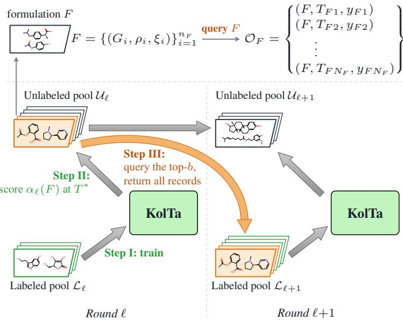
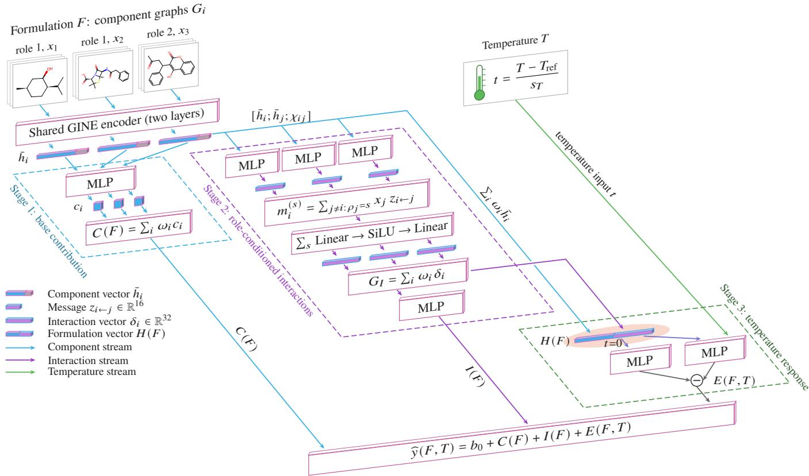
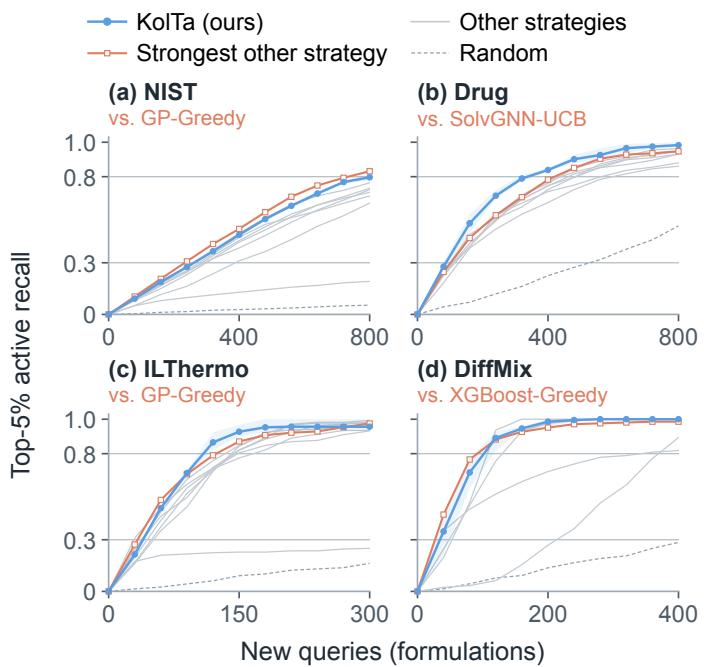
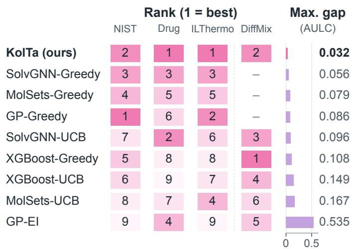

# KolTa: A Physics-Informed Active Learning Framework for Formulation Discovery with Limited Data

Boyong Tang, Tao Wang, and Lei Yang

Abstract—Finding high-performing formulations is difficult when few have been measured and experimental budgets are limited. We propose KolTa, an active learning framework that selects batches to discover the top 5% of formulations at a target temperature under a fixed query budget. KolTa combines a threestage predictor of component contributions, role-conditioned interactions, and anchored temperature response with task-specific soft physics constraints. Its Physics-Residual-Calibrated Upper Confidence Bound (PRC-UCB) acquisition rule combines predicted utility, ensemble disagreement, and a target-temperature physics residual, with nonnegative exploration weights fitted to out-of-fold signed errors. We evaluate the framework on three measured tasks and one simulated task covering binary-mixture viscosity, drug solubility, ionic-liquid viscosity, and electrolyte conductivity. KolTa ranks first or second in mean area under the learning curve (AULC) on every task and outperforms seven of the eight comparator strategies in paired tests, winning 75 of 78 paired comparisons across tasks and seeds against those seven strategies. Across the three measured tasks, its largest gap to the best mean AULC is 0.032, compared with at least 0.056 for every comparator. On Drug, reaching 80% average recovery of the remaining targets across drugs requires an estimated median of 348 additional formulation queries, about 18% fewer than the fastest comparator. Researchers can adapt the framework to diverse formulation problems through component roles and physical constraints.

Impact Statement—Developing multi-component formulations such as drug–solvent systems, ionic-liquid mixtures, and battery electrolytes requires screening large candidate spaces under tight experimental budgets. KolTa helps formulation teams prioritize which candidates to prepare and measure next by combining multi-temperature records with component roles and governing temperature relations. Across four campaigns spanning viscosity, solubility, and conductivity, the framework consistently ranks in the top two discovery strategies without retuning its acquisition rule for each domain, cutting median additional queries to recover 80% of the remaining top-5% drug–solvent systems by nearly one-fifth relative to the fastest baseline. Practitioners can adapt its role-conditioned interactions and soft physical constraints to accelerate early-stage laboratory screening.

Index Terms—Active learning, Bayesian optimization, formulation discovery, mixture modeling, physics-informed learning.

## I. INTRODUCTION

ULTI-COMPONENT formulations combine several solving ibuprofen in an ethanol–water cosolvent mixture, blending ionic liquids for low viscosity, or formulating a LiPF6–carbonate battery electrolyte [1], [2], [3]. Because properties depend jointly on molecular structures, roles, compositions, and temperature, varying the species and ratios creates vast candidate spaces that are costly to prepare and measure [4]. Predictive surrogates help prioritize this search [5], yet their practical value in early-stage campaigns depends on how reliably they rank untested formulations under a strict budget.

Existing mixture models include approaches tailored to specific chemical systems [1], [6], [7] and general architectures adaptable across prediction tasks [8], [9], [10], alongside recent benchmarks and pretrained representations [11], [12]. In early-stage discovery, however, only a small initial set of formulations has been measured, and predictions can deteriorate for candidates whose property values lie outside the training range [13].

Active learning (AL) and Bayesian optimization (BO) address this challenge by iteratively selecting informative experiments and updating the surrogate [5], [14], [15], [16]. For temperature-dependent properties, closed-loop discovery faces two coupled challenges. First, once a formulation is prepared (such as an ibuprofen–cosolvent mixture), measuring it across several temperatures (e.g., 293.15–313.15 K) is routine, whereas engineering design ranks candidates at a fixed operating temperature $( T ^ { * } = 3 0 3 . 1 5 ~ \mathrm { K } )$ . Temperature can be concatenated with a mixture representation, as in the benchmark variants studied by Sanchez Medina et al. and CheMixHub [7], [11], without explicitly imposing a thermodynamic constraint on temperature derivatives. Parameterizing outputs directly through empirical equations instead restricts the temperature response to a chosen functional form [1], [11], [12]. Second, greedy selection ranks candidates by predicted utility, whereas UCB and expected improvement (EI) also use model-predicted uncertainty [17], [18]. Uncertainty miscalibration can affect Bayesian optimization [19], motivating acquisition rules that account for observed prediction errors.

We propose KolTa, a physics-informed active learning framework that couples a three-stage predictor with errorcalibrated acquisition. The predictor decomposes properties into component base contributions, role-conditioned interactions, and an anchored temperature response guided by a soft physics derivative constraint. Its Physics-Residual-Calibrated Upper Confidence Bound (PRC-UCB) rule combines predicted utility with ensemble disagreement and the target-temperature physics residual, which measures local departure from the governing temperature relation. Nonnegative margin weights are fitted each round to out-of-fold (OOF) signed errors by minimizing an asymmetric pinball loss, calibrating how strongly each signal contributes to the next batch.

We evaluate discovery by the fraction of top-5% formulations recovered as queries accumulate, measured by the area under the learning curve (AULC) and the queries to reach 30% and 80% recovery $( q _ { 3 0 }$ and $q _ { 8 0 } )$ , and require both high per-task discovery efficiency and cross-task consistency across distinct chemical domains. Our contributions are as follows.

We design a three-stage mixture predictor that separates reference-temperature base and interaction readouts from an anchored temperature network guided by soft derivative constraints. Under common greedy selection, this predictor ranks first in mean AULC and $q _ { 8 0 }$ on both ablation tasks.

We introduce PRC-UCB, which fits exploration weights for ensemble disagreement and the target-temperature physics residual to OOF signed errors. Calibration assigns positive weight to the residual in 115 of 120 rounds across four tasks and improves mean AULC over disagreementonly calibration on both ablation tasks (five of six runs).

Across three measured tasks and one simulated task spanning binary mixtures, drug solutions, ionic liquids, and electrolytes, KolTa ranks first or second in mean AULC on every task, wins 75 of 78 paired comparisons across tasks and seeds against seven of the eight comparator strategies, cuts median queries to 80% recovery on Drug by 18%, and has the smallest worst-case AULC gap across the measured tasks (0.032 vs. ≥0.056).

## II. BACKGROUND AND RELATED WORK

Mixture representation and property prediction. Mixture models range from domain-specific workflows to general graph architectures. Chew et al. [4] use molecular-dynamicsgenerated mixture properties to benchmark descriptor, Set2Set, and graph models alongside active learning, while GeoMix models molecular geometry and interactions for electrolyte conductivity [20]. For general mixtures, Deep Sets aggregates component embeddings [8], MolSets combines molecular graphs with learned aggregation [9], and SolvGNN passes messages between components [10]. CheMixHub benchmarks descriptor and graph models across mixture datasets, including Arrhenius-parameter predictors [11]. Compared with a direct temperature-concatenation readout, KolTa separates roleconditioned reference-temperature readouts from an anchored temperature response.

Physics-informed learning. Physics-informed neural networks add a governing-equation residual to the training loss [21]. Chem World’s Mixture-PINN imposes soft constraints on component contributions, symmetry, and temperature monotonicity [12]. Physical relations can also parameterize outputs directly, as in DiffMix (Vogel–Fulcher–Tammann and Redlich–Kister relations) [1] and BAMBOO-Mixer [6]. Rather than restricting predictions to a closed-form curve, KolTa anchors its temperature subnetwork at $T _ { \mathrm { r e f } }$ and regularizes its derivative via a task-specific residual, preserving flexible reference-temperature predictions while supplying a local residual for acquisition.

Active learning and Bayesian optimization for discovery. Closed-loop discovery combines surrogate models with sequential selection across materials and electrolyte campaigns [5], [14], [15], [16]. Common acquisition rules include UCB [17] and expected improvement (EI) [18], [22]. Deep ensembles provide one approach to estimating predictive uncertainty [23]. Recent work recalibrates predictive distributions via cross-validation [19], applies conformal prediction to PDE residuals [24], weights acquisition by prior beliefs or stoichiometric priors [25], [26], or penalizes energy-balance violations [27]. Existing mixture AL workflows screen simulationderived targets with standard EI or greedy rules [4], fixedtemperature solubility with GP-EI [15], or battery cycling with multi-kernel GP model averaging and EI [16], whereas KolTa exploits multi-temperature formulation records and calibrates nonnegative weights for ensemble disagreement and the target temperature physics residual to OOF signed errors.

## III. METHOD

Starting from a few labeled formulations, KolTa couples a three-stage predictor, soft physics training, and PRC-UCB acquisition to find top candidates at a target temperature.

  
Fig. 1. Closed-loop active learning with KolTa. Each card is a formulation $F$ with component graphs, roles, and compositions (such as ibuprofen in a binary solvent mixture); querying $F$ returns its records ${ \mathcal { O } } _ { F }$ in (1) (top). Each round trains on $\mathcal { L } _ { \ell }$ (Step I), scores $F \in { \mathcal { U } } _ { \ell }$ by $\alpha \varrho ( F )$ $T ^ { * }$ via (19) (Step II), and queries the top-b batch to form $\mathcal { L } _ { \ell + 1 }$ and $\mathcal { U } _ { \ell + 1 }$ , restricted to the scheduled drug group on Drug (Step III).

## A. Problem Setting

Formulations and measurement records. Each formulation $F$ in a finite candidate pool $\mathcal { P }$ contains $n _ { F }$ components. Component i has a molecular graph $G _ { i } ,$ , a role $\rho _ { i }$ (e.g., solute, solvent, or salt), and a composition $\xi _ { i }$ (e.g., ibuprofen in an ethanol–water cosolvent mixture; Fig. 1). A property record $( F , T , y )$ gives its value $y$ at temperature $T ,$ , from measurement or simulation. Structures, roles, compositions, and recorded temperatures are known for all candidates; queries return their property values.

  
Fig. 2. Three-stage predictor of KolTa, illustrated with three components in two roles. A shared GINE encoder maps each graph to $\boldsymbol { h } _ { i } \in \mathbb { R } ^ { 3 2 }$ (forming $\bar { h _ { i } } = [ h _ { i } ; d _ { i } ] )$ . Stage 1 applies the MLP g to compute $C ( F )$ in (2). Stage 2 applies role-pair message MLPs $f _ { \rho _ { i }  \rho _ { j } }$ , sums messages by sender role, updates receivers via $\begin{array} { r } { \sum _ { s } \bar { W } _ { \rho _ { i }  s }  \mathrm { S i L U }  O _ { \rho _ { i } } } \end{array}$ , and maps $G _ { I } ( F )$ through the MLP $g _ { I }$ to I(F) in $( 3 ) \AA \mathrm { - } \mathrm { ( } 6 )$ . Stage 3 evaluates the MLP $q _ { \phi }$ on H(F) in (7) at t and 0 to obtain $\check { E } ( \dot { F } , T )$ with $E ( F , T _ { \mathrm { r e f } } \acute { ) } = 0 \mathrm { i n } ( \tilde { 8 ) } – ( 9 ) \dot { ; } \dot { H ( F ) }$ also feeds the linear physics head θ(F) for $r ( F , T )$ in (10).

Queries. Viscosity [2], [28] and solubility [3] datasets record formulations at different temperatures. We count queries in formulations: querying $F$ returns all its available records,

$$
\mathcal { O } _ { F } = \{ ( F , T _ { F n } , y _ { F n } ) \} _ { n = 1 } ^ { N _ { F } } ,\tag{1}
$$

where $N _ { F }$ is the record count in (1), and $T _ { F n }$ and $y _ { F n }$ are the temperature and property value of record n. All enter training, and F is not queried again.

Discovery objective. Training uses records at different temperatures, and candidates are compared at $T ^ { * }$ by their utility $s y ( F , T ^ { * } )$ , where $s = + 1$ for maximization and $s = - 1$ for minimization. The targets are the top 5% by utility, including ties at the k-th ranked value, where $k = \ \lceil 0 . 0 5 \lvert \mathcal { P } \rvert \rceil$ and $| \mathcal { P } |$ is the number of candidates. Every candidate has a record at $T ^ { * }$ for evaluation; Drug defines targets within each drug (Section IV-A). We aim to find as many targets as possible, as early as possible, within a fixed query budget.

Active learning loop. Starting from $\mathcal { L } _ { 0 } .$ , each round ℓ trains the model on all records of $\mathcal { L } _ { \ell }$ and evaluates each unlabeled formulation $F \in \mathcal { U } _ { \ell } = \mathcal { P } \setminus \mathcal { L } _ { \ell }$ by its acquisition score $\alpha _ { \ell } ( F )$ (Section III-D). We query a batch $\mathcal { Q } _ { \ell }$ with a fixed size b and update $\mathcal { L } _ { \ell + 1 } = \mathcal { L } _ { \ell } \cup \mathcal { Q } _ { \ell }$ . This repeats until the budget is reached (Fig. 1).

## B. Three-Stage Predictor

The predictor first encodes the components, then learns their base contributions, interactions, and temperature response (Fig. 2). Supplementary Sections S1–S2 provide implementation and training details.

Component encoding. A shared two-layer GINE network [29] encodes each component’s molecular graph, using atom and bond features, into $h _ { i } \in \mathbb { R } ^ { 3 2 }$ . Optional componentlevel physical properties $d _ { i } ,$ chosen by task and role, are standardized and concatenated to form $\bar { h } _ { i } = \left[ h _ { i } ; d _ { i } \right] ( \bar { h } _ { i } = h _ { i }$ when omitted). Drug uses the drug’s melting point and each solvent’s melting point and reference relative permittivity; NIST, ILThermo, and DiffMix append no additional compo nent properties.

Stage 1: base contribution. The task determines the component set $\mathcal { D } _ { F }$ for the base readout: all components for bulk viscosity and conductivity, and only the drug solute for Drug (with solvents acting in Stage 2). For each $i \in \mathcal { D } _ { F }$ , a shared MLP $g _ { C }$ maps $\bar { h } _ { i }$ and role encoding $e ( \rho _ { i } )$ (omitted in singlerole tasks) to $c _ { i } = g _ { C } ( [ \bar { h } _ { i } ; e ( \rho _ { i } ) ] ) ,$ , weighted by $\omega _ { i } \mathbf { \cdot }$

$$
C ( F ) = \sum _ { i \in { \mathscr { D } } _ { F } } \omega _ { i } c _ { i } .\tag{2}
$$

The weights $\omega _ { i }$ in (2) are given for each task below; the sum is permutation-invariant [8].

Stage 2: role-conditioned interactions. We model component interactions via one round of directed message passing [10], [30]. From sender j to receiver i, roles $( \rho _ { j } , \rho _ { i } )$ select

the interaction MLP $f _ { \rho _ { i }  \rho _ { j } }$

$$
z _ { i  j } = f _ { \rho _ { i }  \rho _ { j } } ( [ \bar { h } _ { i } ; \bar { h } _ { j } ; \chi _ { i j } ] ) \in \mathbb { R } ^ { 1 6 } .\tag{3}
$$

Here, $\chi _ { i j }$ in (3) contains composition inputs: $\chi _ { i j } = [ x _ { i } ; x _ { j } ]$ when receiver and sender fractions share a common basis, and $\chi _ { i j } = x _ { j }$ otherwise (on Drug, the solvent’s mole fraction within the solvent mixture).

Messages of the same interaction type share parameters [31]. For each receiver i, incoming messages are grouped by sender role s and weighted by $x _ { j } { \mathrm { : } }$

$$
m _ { i } ^ { ( s ) } = \sum _ { j \neq i : \rho _ { j } = s } x _ { j } z _ { i  j } \in \mathbb { R } ^ { 1 6 } .\tag{4}
$$

Zero-fraction senders contribute nothing to (4). Transforming each role sum by $W _ { \rho _ { i } \left. s \right.} ~ ( 1 6  3 2 )$ , applying SiLU, and projecting via $O _ { \rho _ { i } }$ (both bias-free, so $\delta _ { i } = 0$ without incoming messages) gives:

$$
\delta _ { i } = O _ { \rho _ { i } } \mathrm { S i L U } \Bigl ( \sum _ { s } W _ { \rho _ { i }  s } m _ { i } ^ { ( s ) } \Bigr ) \in \mathbb { R } ^ { 3 2 } .\tag{5}
$$

Pooling $\delta _ { i }$ over $\mathcal { D } _ { F }$ with weights ωi yields $G _ { I } ( F )$ , which a bias-free SiLU MLP $g _ { I }$ maps to $I ( F )$

$$
G _ { I } ( F ) = \sum _ { i \in \mathcal { D } _ { F } } \omega _ { i } \delta _ { i } , \qquad I ( F ) = g _ { I } \big ( G _ { I } ( F ) \big ) ,\tag{6}
$$

so $G _ { I } ( F ) = 0$ and $I ( F ) = 0$ when no interactions are active in (6). Concatenating the pooled Stage 1 features with $G _ { I } ( F )$ forms

$$
\begin{array} { r } { H ( F ) = \Big [ \sum _ { i \in { \mathcal { D } _ { F } } } \omega _ { i } \bar { h } _ { i } ; G _ { I } ( F ) \Big ] , } \end{array}\tag{7}
$$

which supplies Stage 3 and the physics head (Section III-C). Stage 3: anchored temperature response. We use $t \ =$ $( T - T _ { \mathrm { r e f } } ) / s _ { T }$ , with reference temperature $T _ { \mathrm { r e f } }$ and positive temperature scaling factor $s _ { T }$ fixed for each task. A network $q _ { \phi }$ takes $H ( F )$ and t. Subtracting its output at $t = 0$ expresses the temperature effect relative to $T _ { \mathrm { r e f } } \mathrm { : }$

$$
\begin{array} { r } { E ( F , T ) = q _ { \phi } \big ( H ( F ) , t \big ) - q _ { \phi } \big ( H ( F ) , 0 \big ) , } \end{array}\tag{8}
$$

$$
\widehat { y } ( F , T ) = b _ { 0 } + C ( F ) + I ( F ) + E ( F , T ) ,\tag{9}
$$

where $b _ { 0 }$ is a trainable bias. Since $E ( F , T _ { \mathrm { r e f } } ) ~ = ~ 0$ in (8), $b _ { 0 } + C ( F ) + I ( F )$ in (9) predicts the property at $T _ { \mathrm { r e f } }$ , while $E ( F , T )$ predicts its change with temperature. Candidates are scored at $t ^ { \ast } = ( T ^ { \ast } - T _ { \mathrm { r e f } } ) / s _ { T }$

Task instances. Viscosity uses one component role and message function, $\chi _ { i j } = [ x _ { i } ; x _ { j } ]$ , and mole-fraction weights $\omega _ { i } ~ = ~ x _ { i }$ for all components. The architecture thus handles both binary and ternary mixtures. Drug uses only solvent-tosolute messages, with $\chi _ { i j } ~ = ~ x _ { j }$ defined within the solvent mixture; the solute’s saturated mole fraction is the prediction target. Only the solute enters the readout, with $\omega = 1$ . Electrolytes use three message types (salt←solvent, solvent←salt, and solvent←solvent), each with its own f and W. Here, $\chi _ { i j } = [ x _ { i } ; x _ { j } ]$ and readout weights use overall mole fractions.

## C. Soft Physics Constraint and Training

A physics-informed neural network (PINN) approach adds a derivative-based physics loss to guide how the predicted property changes with temperature [21].

Physics residual. For task $k , g _ { k } ( T ; \theta )$ is the temperature derivative specified by the physical relation. A linear output layer, the physics coefficient head, predicts $\theta ( F )$ from $H ( F )$ Fixed functions keep bounded coefficients within their allowed ranges. The residual compares the network derivative with this relation:

$$
r ( F , T ) = \partial _ { t } \widehat { y } ( F , T ) - s _ { T } g _ { k } \big ( T ; \theta ( F ) \big ) .\tag{10}
$$

Automatic differentiation gives $\partial _ { t } \widehat { y }$ in $( 1 0 ) ;$ the factor $s _ { T }$ converts $g _ { k }$ to the same coordinate, since $\partial _ { t } \widehat { y } = s _ { T } \partial _ { T } \widehat { y }$

Relations used in this study. For log viscosity, the Arrhenius form [11] gives $g _ { k } = - \theta ( F ) / T ^ { 2 }$ ; for log solubility, the van’t Hoff form [32] gives $g _ { k } = \theta ( F ) / T ^ { 2 }$ . The learned scalar $\theta ( F )$ can have either sign. For log electrolyte conductivity, the Vogel–Fulcher–Tammann relation [1] gives $g _ { k } = \beta ( F ) / ( T -$ $T _ { 0 } ( F ) ) ^ { 2 }$ , with $\beta ( F ) ~ \ge ~ 0$ and $0 ~ < ~ T _ { 0 } ( F ) ~ < ~ 2 3 3 . 1 5$ K. Each formulation’s predicted coefficients are constant across temperatures.

Joint training. The data loss uses all measured records, while the physics loss uses five fixed temperatures $\{ T _ { c } \} _ { c = 1 } ^ { 5 }$ per task (Table I) without requiring measurements there. For the current labeled set L,

$$
\mathcal { L } _ { \mathrm { d a t a } } = \frac { 1 } { \vert \mathcal { L } \vert } \sum _ { F \in \mathcal { L } } \frac { 1 } { N _ { F } } \sum _ { n = 1 } ^ { N _ { F } } \bigl ( \widehat { y } ( F , T _ { F n } ) - y _ { F n } \bigr ) ^ { 2 } ,\tag{11}
$$

$$
\mathcal { L } _ { \mathrm { p h y s } } = \frac { 1 } { | \mathcal { L } | } \sum _ { F \in \mathcal { L } } \frac { 1 } { 5 } \sum _ { c = 1 } ^ { 5 } r ( F , T _ { c } ) ^ { 2 } ,\tag{12}
$$

$$
\begin{array} { r } { \mathcal { L } = \mathcal { L } _ { \mathrm { d a t a } } + \lambda \mathcal { L } _ { \mathrm { p h y s } } , } \end{array}\tag{13}
$$

where $\lambda \ > \ 0$ weights $\mathcal { L } _ { \mathrm { p h y s } }$ in (13). Averaging errors within each formulation in (11)–(12) prevents those with more records from receiving greater weight.

Anchoring $E ( F , T _ { \mathrm { r e f } } ) = 0$ and excluding $b _ { 0 } , \ C ( F )$ , and $I ( F )$ from $r ( F , T )$ means their readout layers are updated directly by ${ \mathcal { L } } _ { \mathrm { d a t a } } ,$ , while $\mathcal { L } _ { \mathrm { p h y s } }$ regularizes the shared encoder and interaction modules through $H ( F )$ . Moreover, because the physics head $\theta ( F )$ enters the objective solely through $r ( F , T )$ in (12), $\mathcal { L } _ { \mathrm { p h y s } }$ is required to train $\theta ( F )$ so that the targettemperature residual $r ( F , T ^ { * } )$ is well-defined for acquisition; when $T ^ { * } = T _ { \mathrm { r e f } } \ ( t ^ { * } = 0$ , measured tasks), $E ( F , T ^ { * } ) = 0 $ whereas on DiffMix $( t ^ { * } = 1 ) , E ( F , T ^ { * } )$ also predicts the shift from $T _ { \mathrm { r e f } }$ to $T ^ { * }$

The predictor’s parameters are trained jointly with Adam. The learning rate, weight decay, and λ are selected by targettemperature mean absolute error (MAE) on an inner validation split grouped by formulation. Five ensemble members are then trained on bootstrap samples of formulations, keeping each formulation’s records together and counting its loss once per draw.

## D. PRC-UCB Acquisition

PRC-UCB adds a calibrated exploration margin to predicted utility at $T ^ { * }$ . The margin combines ensemble disagreement and the physics residual, with weights refitted each round using labeled formulations.

Prediction and exploration signals. Let $\widehat { y } _ { m } ( F , T ^ { * } )$ and $r _ { m } ( F , T ^ { * } )$ be the prediction and residual of member $m ,$ with $M = 5$ . Their prediction mean gives $\mu ( F )$ , and their sample standard deviation gives $u ( F )$ [23]. The physics signal averages absolute residuals from (10), avoiding cancellation between opposite signs:

$$
v ( F ) = \frac { 1 } { M } \sum _ { m = 1 } ^ { M } | r _ { m } ( F , T ^ { * } ) | .\tag{14}
$$

Out-of-fold errors. We split labeled formulations into five folds, keeping each formulation’s records together. Hyperparameter selection and ensemble training on the other four folds give out-of-fold (OOF) predictions $\tilde { \mu } ( F )$ and signals $\tilde { u } ( F )$ and $\tilde { v } ( F )$ from (14) at $T ^ { * }$ . The held-out labels then give the signed utility error

$$
e ( F ) = s ( y ( F , T ^ { * } ) - \tilde { \mu } ( F ) ) ,\tag{15}
$$

where s in (15) is defined in Section III-A. Positive errors indicate underestimated utility for either objective direction.

Calibration of the exploration margin. We fit the coefficients of the linear exploration margin $c _ { u } u ( F ) + c _ { v } v ( F )$ to the out-of-fold signed errors by minimizing an asymmetric pinball loss [33]:

$$
( c _ { u } , c _ { v } ) = \underset { c _ { u } , c _ { v } \geq 0 } { \arg \operatorname* { m i n } } \ \sum _ { F \in \mathcal { L } } \rho _ { \tau } \big ( e ( F ) - c _ { u } \tilde { u } ( F ) - c _ { v } \tilde { v } ( F ) \big ) ,\tag{16}
$$

where $\rho _ { \tau } ( z ) = \operatorname* { m a x } ( \tau z , ( \tau - 1 ) z )$ in (16). We set $\tau = 0 . 8 .$ so a margin that falls short of the signed error receives four times the per-unit penalty of a margin that exceeds it. Either coefficient can be zero; $c _ { v } = 0$ leaves only ensemble disagreement.

To handle multiple solutions, we first scale each out-of-fold signal by its root mean square over $\mathcal { L } .$ For $a \in \{ u , v \}$ , define

$$
\sigma _ { a } = \sqrt { \frac { 1 } { | \mathcal { L } | } \sum _ { F \in \mathcal { L } } \widetilde { a } ( F ) ^ { 2 } } , \qquad a ^ { \prime } ( F ) = \frac { \widetilde { a } ( F ) } { \sigma _ { a } } .\tag{17}
$$

A signal with $\sigma _ { a } = 0$ in (17) is omitted and receives a zero coefficient. We then minimize pinball loss using $u ^ { \prime }$ and $v ^ { \prime }$ . If several coefficient pairs minimize the loss, we select the pair $( c _ { u } ^ { \prime } , c _ { v } ^ { \prime } )$ with the smallest Euclidean norm, $\sqrt { ( c _ { u } ^ { \prime } ) ^ { 2 } + ( c _ { v } ^ { \prime } ) ^ { 2 } }$ Finally, we convert the coefficients back:

$$
c _ { u } = { \frac { c _ { u } ^ { \prime } } { \sigma _ { u } } } , \qquad c _ { v } = { \frac { c _ { v } ^ { \prime } } { \sigma _ { v } } } ,\tag{18}
$$

for the retained signals in (18). This preserves the fitted margin, $c _ { u } ^ { \prime } u ^ { \prime } + c _ { v } ^ { \prime } v ^ { \prime } = c _ { u } \tilde { u } + c _ { v } \tilde { v }$ , and makes the choice among minimizing solutions independent of signal units.

Candidate selection. With the calibrated coefficients, the acquisition score is

$$
\alpha ( F ) = s \mu ( F ) + c _ { u } u ( F ) + c _ { v } v ( F ) ,\tag{19}
$$

and candidates are ranked by (19) to select the next batch of b formulations. Drug applies this ranking within each scheduled drug group (Section IV-A).

## IV. EXPERIMENTAL DESIGN

We evaluate KolTa’s formulation discovery performance under fixed query budgets, compare predictors using a common greedy rule, and examine the progression from greedy selection to disagreement-only and physics-residual-calibrated acquisition.

## A. Tasks and Data

We evaluate the framework through retrospective discovery on three measured datasets and one simulated dataset (Table I). The measured records are distributed by CheMixHub [11]: binary-mixture viscosity from NIST/TRC SOURCE [34] (NIST), drug-solubility records in one or two solvents compiled by Bao et al. [3], from which we retain 86 drug groups (Drug), and ionic-liquid mixture viscosity from ILThermo [2]. DiffMix [1] provides simulated conductivities of non-aqueous lithium electrolytes. This task evaluates the framework with a different temperature relation and three interaction types.

Formulations are assigned to a discovery pool P and a locked set without consulting property values. NIST, ILThermo, and DiffMix use an 80/20 split. Drug retains formulation assignments after drug-group filtering, resulting in 2,159 discovery and 524 locked formulations (Supplementary Section S2). The locked set serves only to evaluate final prediction error (Supplementary Section S4). All records of a formulation stay together. All predictive methods use the source simplified molecular-input line-entry system (SMILES) strings. For Drug, they also use the drug’s melting point and each solvent’s melting point and reference relative permittivity. NIST, ILThermo, and DiffMix use no such additional component properties. Targets $y$ are base-10 logarithms of viscosity in cP, saturated solute mole fraction, or conductivity in S/cm.

Initialization and queries. All methods share a random initial set $\mathcal { L } _ { 0 } \subset \mathcal { P }$ , drawn without consulting property values, and R rounds of b queries, giving $B = b R$ new queries. Each evaluated method–task pair uses seeds 0, 1, and 2 to determine initialization, training, and out-of-fold splits.

Drug task. Targets are defined within each drug, and initialization covers all drugs. Queries follow a fixed, balanced drug schedule, selecting the highest-scoring available formulation within each scheduled drug.

## B. Comparators and Ablations

We compare KolTa with MolSets [9], SolvGNN [10] (hidden width 128), a Gaussian process (GP) [35], and XG-Boost [36]. GP and XGBoost use composition-weighted RD-Kit descriptors and temperature. GP-EI uses an automaticrelevance-determination squared-exponential kernel and sequential batch construction with a Kriging believer [37] and log expected improvement [18], [22].

Neural and tree comparators use five bootstrap members and inner validation. Their UCB weight γ is set using formulationgrouped five-fold OOF predictions each round. Neural comparators share the learning-rate grid $\lbrace 3 \times 1 0 ^ { - 4 } , 1 0 ^ { - 3 } \rbrace$ and weight-decay grid $\{ 0 , 1 0 ^ { - 4 } \}$ of KolTa, which also selects $\lambda \in \{ 0 . 0 1 , 0 . 1 , 1 \}$ . Their UCB score is $s \mu ( F ) { + } \gamma u ( F )$ , where γ is the ratio of the root mean squares of OOF errors and u, clipped to [0.25, 4].

TABLE I  
TASKS AND QUERY BUDGETS. THE THREE MEASURED DATASETS ARE DISTRIBUTED BY CHEMIXHUB [11]. THE BUDGET COMPRISES THE INITIAL LABELED SET AND R ROUNDS OF b FORMULATION QUERIES. EACH TASK USES FIVE COLLOCATION TEMPERATURES WITHIN THE STATED RANGE. TEMPERATURES ENTER THE PREDICTOR AS $t = ( T - T _ { \mathrm { r e f } } ) / s _ { T } ,$ , WITH $T _ { \mathrm { r e f } } = T ^ { \ast } \left( t ^ { \ast } = 0 \right) \mathrm { A N D } s _ { T } = 1 0$ K FOR VISCOSITY AND 50 K FOR SOLUBILITY; DIFFMIX USES THE CENTER OF ITS SIMULATED RANGE, $T _ { \mathrm { r e f } } = 2 6 8 . 1 5 \ : \mathrm { K }$ , AND $s _ { T } = 2 5 \mathrm { K } ( t ^ { * } = 1 )$ . VFT: VOGEL–FULCHER–TAMMANN.
<table><tr><td>Task</td><td>Property (goal)</td><td>Pool / locked</td><td>Records</td><td> $T ^ { * } \left( \mathrm { K } \right)$ </td><td>Budget</td><td>Relation, collocation (K)</td></tr><tr><td>NIST [34]</td><td>Binary-mixture viscosity (max.)</td><td>15,575 / 3,894</td><td>50,429</td><td>298.15</td><td> $2 0 0 + 1 0 \times 8 0$ </td><td>Arrhenius, 293.15–313.15</td></tr><tr><td>Drug [3]</td><td>Drug solubility, per drug (max.)</td><td>2,159 / 524</td><td>23,688</td><td>303.15</td><td> $3 0 0 + 1 0 \times 8 0$ </td><td>van&#x27;t Hoff, 293.15–313.15</td></tr><tr><td>ILThermo [2]</td><td>Ionic-liquid mixture viscosity (min.)</td><td>1,940 / 486</td><td>17,072</td><td>313.15</td><td> $1 5 0 + 1 0 \times 3 0$ </td><td>Arrhenius, 303.15–323.15</td></tr><tr><td>DiffMix [1] (sim.)</td><td>Electrolyte conductivity (max.)</td><td>1,471  /  368</td><td>11,022</td><td>293.15</td><td> $1 0 0 + 1 0 \times 4 0 ~ $ </td><td>VFT, 243.15–293.15</td></tr></table>

The three measured tasks evaluate all nine strategies, pairing MolSets, SolvGNN, and XGBoost with UCB and greedy selection $( s \mu ( F ) )$ , and GP with EI and greedy selection. DiffMix evaluates six strategies: KolTa, each comparator family’s primary uncertainty rule (MolSets-UCB, SolvGNN-UCB, GP-EI, and XGBoost-UCB), and XGBoost-Greedy.

On Drug and ILThermo, A1 refits the exploration margin in (16) using ensemble disagreement u alone $( c _ { v } = 0 )$ , while A2 uses greedy selection $( c _ { u } = c _ { v } = 0 )$ . Because the physics head $\theta ( F )$ is trained solely through $\mathcal { L } _ { \mathrm { p h y s } }$ in (12), all KolTa variants retain physics-informed training along their own trajectories: comparing A2 with the greedy comparators isolates the predictor under a common rule, whereas comparing A2, A1, and KolTa tracks the progression from greedy to calibrated u-only and residual-augmented acquisition.

## C. Evaluation and Statistics

Discovery metric. Let H be the fixed top-5% target set (Section III-A) and $\mathcal { Q } ( q )$ the formulations selected in q new queries. Active recall measures recovery of targets outside the initial set:

$$
A ( q ) = \frac { | \mathcal { Q } ( q ) \cap ( \mathcal { H } \setminus \mathcal { L } _ { 0 } ) | } { | \mathcal { H } \setminus \mathcal { L } _ { 0 } | } .\tag{20}
$$

For Drug, we use macro active recall: at each acquisition round, we evaluate (20) within each drug and take an equalweight average over groups with targets remaining after initialization.

The primary measure, full-budget AULC, integrates $A ( q )$ in (20) over new queries and normalizes by B:

$$
\mathrm { A U L C } = \frac { 1 } { B } \sum _ { r = 1 } ^ { R } ( q _ { r } - q _ { r - 1 } ) \frac { A ( q _ { r } ) + A ( q _ { r - 1 } ) } { 2 } ,\tag{21}
$$

where $q _ { 0 } = 0 , q _ { R } = B ,$ and $A ( 0 ) = 0$ in (21). Higher AULC means more targets are found earlier. The Random baseline uses three replays per task. It selects unqueried formulations uniformly at random; on Drug, selection is within the drug group assigned by the balanced schedule.

Secondary measures. $q _ { 3 0 }$ and $q _ { 8 0 }$ estimate the new formulation queries needed to reach 30% and 80% active recall by linear interpolation between batches. We report the median among runs that reach each level and their count; lower values indicate faster discovery.

Statistics. We use paired comparisons of full-budget AULC, matching runs by task and seed: twelve pairs for strategies run on all four tasks, nine for the other greedy strategies.

We report support over these evaluated runs when one-sided exact sign and Wilcoxon signed-rank tests [38], each Holmadjusted [39] across eight comparator strategies, both yield $p < 0 . 0 5$ . Medians and ranges summarize paired differences. We summarize the observed differences in query counts, task rankings, and ablation results.

Cross-task consistency. A general formulation discovery framework must perform reliably across diverse chemical domains without task-specific algorithm selection. We therefore evaluate cross-task consistency across NIST, Drug, and ILThermo (where all nine strategies are run) using two complementary criteria: per-run top-three rank frequency across the nine task–seed runs and the worst-case mean-AULC gap. For each task, we subtract each strategy’s three-run mean AULC from the highest mean among the nine strategies, and take the largest gap across the three tasks; a smaller value indicates a smaller worst-case shortfall. We repeat this calculation across Drug and ILThermo for PRC-UCB, u-only A1, and greedy $\mathbf { A } 2 ,$ , referenced to the highest mean AULC among these three variants on each task.

## V. RESULTS

## A. Discovery under a Fixed Budget

KolTa ranks first by mean full-budget AULC in (21) on Drug (0.738) and ILThermo (0.748) and second on NIST (0.444) and DiffMix (0.836) (Table II). Across paired comparisons matched by task and seed, both paired tests support higher AULC than seven of the eight comparator strategies, with KolTa winning 75 of 78 paired comparisons against those seven strategies (80 of 87 overall), median gains of +0.031 to +0.265, and Holm-adjusted $p ~ \leq ~ 0 . 0 3 9$ (Supplementary Table S6). Against GP-Greedy, KolTa achieves higher AULC in five of nine pairs, though the difference is not statistically significant (Holm-adjusted $p ~ = ~ 0 . 5 0$ for the sign test and $p = 0 . 1 8$ for the Wilcoxon test).

Query efficiency (q30 and q80) reflects the distinct chemical regimes of the four tasks (Table III). On the 86-drug Drug task, KolTa achieves the lowest q30 (84) and reaches 80% macro active recall in a median of 348 queries, saving 76 queries (18%) over the fastest comparator (SolvGNN-UCB, 424) and over 130 queries relative to descriptor surrogates (GP-Greedy, 483; XGBoost-Greedy, 569). On ILThermo, greedy selection starts faster, and KolTa’s recall curve overtakes the greedy comparators after about one-third of the budget (Fig. 3(c)), achieving the best median $q _ { 8 0 }$ (112 vs. 114 for GP-Greedy). On DiffMix $\mathrm { ( L i P F _ { 6 } . }$ –carbonate electrolytes), KolTa shares the lowest $q _ { 3 0 }$ (30) and reaches $q _ { 8 0 } = 9 8$ (vs. 93 for XGBoost-Greedy); on NIST, 80% recall is reached in three GP-Greedy runs $( q _ { 8 0 } ~ = ~ 6 8 9 )$ and one KolTa run (772; Supplementary Table S5).

  
Fig. 3. KolTa ranks among the top two strategies on all four tasks, although the strongest comparator varies by task. Three-run mean active recall (shaded range for KolTa) on (a) NIST, (b) Drug, (c) ILThermo, and (d) DiffMix. The strongest comparator by full-budget AULC is colored and named; others are gray, and dashed lines show Random replays.

TABLE II  
FULL-BUDGET AULC (PRIMARY MEASURE): MEAN ± SAMPLE STANDARD DEVIATION (SD) OVER THREE RUNS, INCLUDING RANDOM REPLAYS ON ALL FOUR TASKS. N/R: NOT RUN. DARK PINK AND BOLD MARK THE BEST VALUE IN EACH COLUMN; LIGHT PINK MARKS THE SECOND BEST.
<table><tr><td>Strategy</td><td>NIST [34]</td><td>Drug [3]</td><td>ILThermo [2]</td><td>DiffMix [1]</td></tr><tr><td>KolTa (ours)</td><td> $0 . 4 4 4 { \scriptstyle \pm 0 . 0 0 7 }$ </td><td> $\mathbf { 0 . 7 3 8 { \pm 0 . 0 1 4 } }$ </td><td> $\mathbf { 0 . 7 4 8 { \scriptstyle \pm 0 . 0 2 4 } }$ </td><td> $0 . 8 3 6 { \pm } 0 . 0 2 5$ </td></tr><tr><td>MolSets-UCB [9]</td><td> $0 . 3 0 9 { \scriptstyle \pm 0 . 0 1 3 }$ </td><td> $0 . 6 5 0 { \scriptstyle \pm 0 . 0 2 3 }$ </td><td> $0 . 7 0 9 { \scriptstyle \pm 0 . 0 0 9 }$ </td><td> $0 . 3 2 6 { \pm } 0 . 0 5 5$ </td></tr><tr><td>MolSets-Greedy [9]</td><td> $0 . 4 0 3 { \scriptstyle \pm 0 . 0 1 1 }$ </td><td> $0 . 6 5 9 { \scriptstyle \pm 0 . 0 1 1 }$ </td><td> $0 . 6 9 1 { \scriptstyle \pm 0 . 0 4 5 }$ </td><td>n/r</td></tr><tr><td>SolvGNN-UCB [10]</td><td> $0 . 3 8 0 { \scriptstyle \pm 0 . 0 1 1 }$ </td><td> $0 . 6 8 2 { \scriptstyle \pm 0 . 0 1 5 }$ </td><td> $0 . 6 8 7 { \scriptstyle \pm 0 . 0 4 0 }$ </td><td> $0 . 8 1 5 { \scriptstyle \pm 0 . 0 3 4 }$ </td></tr><tr><td>SolvGNN-Greedy [10]</td><td> $0 . 4 4 0 { \scriptstyle \pm 0 . 0 1 2 }$ </td><td> $0 . 6 8 2 { \scriptstyle \pm 0 . 0 1 0 }$ </td><td> $0 . 7 2 0 { \scriptstyle \pm 0 . 0 3 3 }$ </td><td>n/r</td></tr><tr><td>GP-EI [35]</td><td> $0 . 1 2 2 { \scriptstyle \pm 0 . 0 1 1 }$ </td><td> $0 . 6 6 5 { \scriptstyle \pm 0 . 0 3 4 }$ </td><td> $0 . 2 1 2 { \scriptstyle \pm 0 . 0 5 7 }$ </td><td>0.625±0.035</td></tr><tr><td>GP-Greedy [35]</td><td> $\mathbf { 0 . 4 7 6 { \overset { . } { \bot } } 0 . 0 0 9 }$ </td><td> $0 . 6 5 3 { \scriptstyle \pm 0 . 0 1 5 }$ </td><td> $0 . 7 3 4 { \pm } 0 . 0 6 6$  </td><td>n/r</td></tr><tr><td>XGBoost-UCB [36]</td><td> $0 . 3 9 9 { \scriptstyle \pm 0 . 0 0 8 }$ </td><td> $0 . 5 9 0 { \scriptstyle \pm 0 . 0 2 1 }$ </td><td> $0 . 6 8 7 { \scriptstyle \pm 0 . 0 3 9 }$ </td><td> $0 . 7 9 0 { \scriptstyle \pm 0 . 0 2 8 }$ </td></tr><tr><td>XGBoost-Greedy [36]</td><td> $0 . 4 0 1 { \scriptstyle \pm 0 . 0 1 9 }$ </td><td> $0 . 6 3 0 { \scriptstyle \pm 0 . 0 3 2 }$ </td><td> $0 . 6 7 2 { \scriptstyle \pm 0 . 0 2 9 }$ </td><td> $\mathbf { 0 . 8 3 8 { \pm 0 . 0 1 6 } }$ </td></tr><tr><td>Random</td><td> $0 . 0 2 8 { \scriptstyle \pm 0 . 0 0 3 }$ </td><td> $0 . 2 2 8 { \pm } 0 . 0 3 9$ </td><td> $0 . 0 8 1 { \scriptstyle \pm 0 . 0 3 9 }$ </td><td> $0 . 1 3 2 { \pm } 0 . 0 2 2$ </td></tr></table>

Cross-task consistency and locked-set accuracy. Across NIST, Drug, and ILThermo, KolTa places in the top three of nine strategies in all nine runs, compared with seven for SolvGNN-Greedy (Supplementary Table S8(a)), and achieves the smallest worst-case AULC gap: 0.032, versus at least 0.056 for every comparator (Fig. 4). Comparator performance fluctuates sharply across regimes: GP-Greedy ranks first on NIST but sixth on Drug; SolvGNN-UCB ranks second on Drug but seventh on NIST; GP-EI drops to 0.122 on NIST and 0.212 on ILThermo; and on DiffMix, RMS-ratio MolSets-UCB drops to 0.326 as its exploration bonus redirects early batches away from the highest predicted means (zero top-40 overlap in eight of the twelve batches pooled from the first four rounds of the three runs; Supplementary Section S3.1). On the locked sets, KolTa ranks in the top three in final MAE across all four tasks (first on Drug at 0.173, second on ILThermo at 0.134, and third on NIST at 0.108 and DiffMix at 0.051), whereas GP-EI attains the lowest global MAE on three tasks while lagging in top-5% target discovery (Supplementary Table S10).

TABLE III  
ESTIMATED NEW FORMULATION QUERIES TO REACH 30% (q30) AND 80% (q80) ACTIVE RECALL. VALUES ARE MEDIANS OF INTERPOLATED COUNTS AMONG RUNS REACHING EACH LEVEL. ${ } ^ { \dagger } / { \vphantom { \dagger } } ;$ ONE/TWO OF THREE RUNS REACH IT; —: NONE; N/R: NOT RUN. DRUG USES EQUAL-DRUG MACRO ACTIVE RECALL. SHADING FOLLOWS TABLE II, RANKING MORE RUNS REACHING THE LEVEL FIRST, THEN FEWER QUERIES.
<table><tr><td></td><td colspan="2">NIST [34]</td><td colspan="2">Drug [3]</td><td colspan="2">ILThermo [2]</td><td colspan="2">DiffMix [1]</td></tr><tr><td>Strategy</td><td>q30</td><td>q80</td><td>q30</td><td>q80</td><td>q30</td><td>q80</td><td>q30</td><td>q80</td></tr><tr><td>KolTa (ours)</td><td>267</td><td>772†</td><td>84</td><td>348</td><td>39</td><td>112</td><td>30</td><td>98</td></tr><tr><td>MolSets-UCB [9]</td><td>392</td><td></td><td>113</td><td>446</td><td>39</td><td>143</td><td>229</td><td>375</td></tr><tr><td>MolSets-Greedy [9]</td><td>288</td><td>一</td><td>105</td><td>486</td><td>29</td><td>150</td><td>n/r</td><td>n/r</td></tr><tr><td>SolvGNN-UCB [10]</td><td>294</td><td>一</td><td>100</td><td>424</td><td>54</td><td>134</td><td>63</td><td>108</td></tr><tr><td>SolvGNN-Greedy [10]</td><td>255</td><td></td><td>103</td><td>436</td><td>38</td><td>128</td><td>n/r</td><td>n/r</td></tr><tr><td>GP-EI [35]</td><td></td><td></td><td>116</td><td>473</td><td>246†</td><td></td><td>34</td><td>287</td></tr><tr><td>GP-Greedy [35]</td><td>233</td><td>689</td><td>111</td><td>483</td><td>34</td><td>114</td><td>n/r</td><td>n/r</td></tr><tr><td>XGBoost-UCB [36]</td><td>296</td><td></td><td>125</td><td>575</td><td>51</td><td>145</td><td>38</td><td>129</td></tr><tr><td>XGBoost-Greedy [36]</td><td>274</td><td>1</td><td>113</td><td>569</td><td>43</td><td>161</td><td>30</td><td>93</td></tr><tr><td>Random</td><td>一</td><td></td><td>464</td><td>一</td><td>1</td><td>一</td><td>355†</td><td>一</td></tr></table>

  
Fig. 4. KolTa has the smallest maximum mean-AULC gap across the three measured tasks (0.032 vs. ≥0.056 for every comparator). Left: ranks by threerun mean full-budget $\mathrm { \ A U L \overline { { C } } \left( 1 \right. }$ : best; darker: better) among nine strategies on measured tasks and six on DiffMix (–: not run). Right: worst-case gap to the best mean AULC across the three measured tasks (KolTa is 1st or 2nd on every task).

## B. Predictor Comparison

To isolate the predictor from acquisition calibration, we compare all model families under a common greedy rule $( s \mu ( F ) )$ on Drug and ILThermo (Table IV(b)). The KolTa predictor (A2) achieves both the highest mean AULC and lowest median $q _ { 8 0 }$ on each task: 0.712 $( q _ { 8 0 } = 3 8 3 )$ on Drug vs. 0.682 (436) for SolvGNN-Greedy, and 0.763 $( q _ { 8 0 } = 1 0 8 )$ on ILThermo vs. 0.734 (114) for GP-Greedy. Across the six paired runs, A2 achieves higher AULC than SolvGNN-Greedy,

MolSets-Greedy, and XGBoost-Greedy in all six and GP-Greedy in five (Supplementary Tables S4 and S7), showing that the three-stage physics-informed predictor provides a stronger surrogate even before adding exploration.

## TABLE IV

ACQUISITION AND PREDICTOR COMPARISONS: FULL-BUDGET AULC (MEAN ± SAMPLE SD OVER THREE RUNS) AND MEDIAN ESTIMATED q80. (A) ACQUISITION VARIANTS SHARING THE KOLTA PREDICTOR AND PHYSICS TRAINING $( c _ { v } = 0 \mathrm { I N } \mathrm { A l } )$ . (B) GREEDY SELECTION (s µ ONLY) ACROSS PREDICTORS, STARTING WITH A2. SHADING FOLLOWS TABLE II.

<table><tr><td></td><td colspan="2">Drug [3]</td><td colspan="2">ILThermo [2]</td></tr><tr><td></td><td>AULC</td><td>q80</td><td>AULC</td><td>q80</td></tr><tr><td colspan="5">(a) Acquisition variants on the KolTa predictor</td></tr><tr><td>KolTa (ours; PRC-UCB)</td><td>0.738±0.014 348</td><td></td><td>0.748±0.024 112</td><td></td></tr><tr><td>A1: margin with u only  $( c _ { v } = 0 )$ </td><td>0.729±0.005</td><td>360</td><td>0.736±0.010 115</td><td></td></tr><tr><td colspan="5">(b) Predictor comparison under greedy selection (s µ only)</td></tr><tr><td>KolTa (ours) predictor (A2)</td><td>0.712±0.018 383</td><td></td><td>0.763±0.039 108</td><td></td></tr><tr><td>SolvGNN-Greedy [10]</td><td>0.682±0.010</td><td>436</td><td>0.720±0.033</td><td>128</td></tr><tr><td>MolSets-Greedy [9]</td><td>0.659±0.011</td><td>486</td><td>0.691±0.045</td><td>150</td></tr><tr><td>GP-Greedy [35]</td><td>0.653±0.015</td><td>483</td><td>0.734±0.066</td><td>114</td></tr><tr><td>XGBoost-Greedy [36]</td><td>0.630±0.032</td><td>569</td><td>0.672±0.029</td><td>161</td></tr></table>

## C. Acquisition Analysis

Comparing greedy A2, disagreement-only A1 $( c _ { v } ~ = ~ 0 )$ and full PRC-UCB (KolTa) in (19) shows how calibrated exploration and the physics residual improve discovery and cross-task consistency (Table IV(a); Supplementary Table S7). Adding the physics residual v(F) increases mean AULC over u-only A1 on both tasks, rising from 0.729 to 0.738 on Drug (q80: 360 to 348) and from 0.736 to 0.748 on ILThermo (q80: 115 to 112), and winning five of six paired runs (all three ILThermo seeds by +0.003 to +0.027 and two of three Drug seeds by +0.018 and +0.022). Across Drug and ILThermo, PRC-UCB also attains the smallest worst-case AULC gap among the three variants (0.015, vs. 0.026 for A2 and 0.027 for A1; Supplementary Table S8(b)) and lowers AULC standard deviation relative to A2 on both tasks.

The OOF margin coefficients fitted via (16)–(18) across all 120 acquisition rounds (30 per task; Supplementary Table S9) show that both signals remain active across tasks. Across the 120 rounds, $c _ { u } \ > \ 0$ in all 120 and $c _ { v } \ > \ 0$ in 115 (29/30 on NIST and Drug, 30/30 on ILThermo, and 27/30 on DiffMix). In RMS-scaled coordinates $( c _ { u } ^ { \prime } , c _ { v } ^ { \prime } ) = ( c _ { u } \sigma _ { u } , c _ { v } \sigma _ { v } )$ the median fitted weights are (0.235, 0.038) on Drug (largest $c _ { u } ^ { \prime } )$ , (0.122, 0.052) on ILThermo (largest $c _ { v } ^ { \prime } )$ , (0.071, 0.025) on NIST, and (0.037, 0.008) on DiffMix. On Drug, where all variants follow the same fixed, balanced schedule to select formulations within each scheduled drug, adding the calibrated margin lifts mean AULC from 0.712 for greedy A2 to 0.729 for A1 and 0.738 for PRC-UCB (winning all three seeds over A2).

## VI. DISCUSSION AND LIMITATIONS

Adapting the framework. KolTa separates its learning and calibration procedure from task-specific component roles and physical relations. Roles determine which components enter the base readout and which directed interactions are modeled; the anchored temperature network and derivative residual guide the learned temperature response without restricting reference-temperature predictions to a closed-form curve. Sections V-A and V-B show that this modular design outperforms general graph and descriptor baselines under common greedy selection and maintains top-two discovery performance across all four tasks while comparator rankings fluctuate across chemical domains.

Role of physics and OOF calibration in acquisition. Our results show that low global prediction error alone does not ensure fast target discovery: GP-EI attains the lowest final locked-set MAE on NIST, ILThermo, and DiffMix, while ranking ninth, ninth, and fifth, respectively, in mean discovery AULC, and on DiffMix the RMS-ratio exploration bonus in MolSets-UCB redirects early batches away from top-mean candidates (Supplementary Section S3.1). Conversely, under the fixed, balanced drug schedule on Drug, pure greedy selection within each scheduled drug group (A2, 0.712) trails calibrated exploration (A1, 0.729; PRC-UCB, 0.738). Rather than using a single RMS-ratio weight, PRC-UCB fits nonnegative weights for ensemble disagreement u(F) and the targettemperature physics residual v(F) jointly to OOF signed utility errors via asymmetric pinball loss $( \tau = 0 . 8 )$ , assigning positive weight to v(F) in 115 of 120 rounds (Supplementary Table S9) and improving AULC over u-only A1 in five of six runs.

Limitations. First, the current physics loss applies soft constraints at five fixed temperatures per task, and extrapolation beyond the training temperature range has not been evaluated. Incorporating physical relations directly into the temperatureresponse function is a possible direction for improving extrapolation. Second, the model treats temperature as its only varying condition; extending it to jointly varying temperature and pressure would require additional condition inputs and coupled physical constraints.

## VII. CONCLUSION AND FUTURE WORK

We have presented KolTa, a physics-informed active learning framework for discovering high-performing formulations from limited measurements. It combines a three-stage predictor trained on all measured temperature records with taskspecific soft physics constraints and PRC-UCB acquisition. Across four benchmarks spanning binary mixtures, drug solutions, ionic liquids, and electrolytes, KolTa consistently ranks in the top two strategies by discovery AULC without retuning its acquisition rule across domains. Under a common greedy rule, its three-stage physics-informed predictor outperforms graph and descriptor surrogates on both ablation tasks, while OOF calibration of ensemble disagreement and the target-temperature physics residual improves mean AULC over disagreement-only calibration on both tasks and achieves the smallest worst-case AULC gap across the acquisition variants (0.015 vs. 0.026 for greedy A2 and 0.027 for disagreementonly A1). Code will be made publicly available upon acceptance.

Future work will adapt the framework to more material systems and test it in laboratory experiments, investigate incorporating physical relations directly into the temperatureresponse function for temperature extrapolation, extend the model to jointly varying temperature and pressure, and explore richer multimodal molecular representations.

[1] S. Zhu et al., “Differentiable modeling and optimization of non-aqueous Li-based battery electrolyte solutions using geometric deep learning,” Nat. Commun., vol. 15, 2024, Art. no. 8649.

[2] Q. Dong et al., “ILThermo: A free-access web database for thermodynamic properties of ionic liquids,” J. Chem. Eng. Data, vol. 52, no. 4, pp. 1151–1159, 2007.

[3] Z. Bao, G. Tom, A. Cheng, J. Watchorn, A. Aspuru-Guzik, and C. Allen, “Towards the prediction of drug solubility in binary solvent mixtures at various temperatures using machine learning,” J. Cheminform., vol. 16, 2024, Art. no. 117.

[4] A. K. Chew et al., “Leveraging high-throughput molecular simulations and machine learning for the design of chemical mixtures,” npj Comput. Mater., vol. 11, 2025, Art. no. 72.

[5] T. Lookman, P. V. Balachandran, D. Xue, and R. Yuan, “Active learning in materials science with emphasis on adaptive sampling using uncertainties for targeted design,” npj Comput. Mater., vol. 5, 2019, Art. no. 21.

[6] Z. Yang et al., “A unified predictive and generative solution for liquid electrolyte formulation,” Nat. Mach. Intell., vol. 8, pp. 186–196, 2026.

[7] E. I. Sanchez Medina, S. Linke, M. Stoll, and K. Sundmacher, “Gibbs– Helmholtz graph neural network: capturing the temperature dependency of activity coefficients at infinite dilution,” Digit. Discov., vol. 2, no. 3, pp. 781–798, 2023.

[8] M. Zaheer, S. Kottur, S. Ravanbakhsh, B. Poczos, R. Salakhutdinov, and A. J. Smola, “Deep sets,” in Proc. Adv. Neural Inf. Process. Syst. (NeurIPS), vol. 30, 2017.

[9] H. Zhang, T. Lai, J. Chen, A. Manthiram, J. M. Rondinelli, and W. Chen, “Learning molecular mixture property using chemistry-aware graph neural network,” PRX Energy, vol. 3, no. 2, 2024, Art. no. 023006.

[10] S. Qin, S. Jiang, J. Li, P. Balaprakash, R. C. Van Lehn, and V. M. Zavala, “Capturing molecular interactions in graph neural networks: a case study in multi-component phase equilibrium,” Digit. Discov., vol. 2, pp. 138–151, 2023.

[11] E. M. Rajaonson, M. Rajabi Kochi, L. M. Mejia Mendoza, M. Moosavi, and B. Sanchez-Lengeling, “CheMixHub: Datasets and benchmarks for chemical mixture property prediction,” in Proc. Adv. Neural Inf. Process. Syst. (NeurIPS), vol. 38, 2025.

[12] T. Bai et al., “Chem World: A large-scale benchmark and physicsinformed framework for trustworthy chemical property prediction,” 2026, arXiv:2607.28079.

[13] N. Segal, A. Netanyahu, K. P. Greenman, P. Agrawal, and R. Gómez-Bombarelli, “Known unknowns: Out-of-distribution property prediction in materials and molecules,” npj Comput. Mater., vol. 11, 2025, Art. no. 345.

[14] A. G. Kusne et al., “On-the-fly closed-loop materials discovery via Bayesian active learning,” Nat. Commun., vol. 11, 2020, Art. no. 5966.

[15] J. Noh et al., “An integrated high-throughput robotic platform and active learning approach for accelerated discovery of optimal electrolyte formulations,” Nat. Commun., vol. 15, 2024, Art. no. 2757.

[16] P. Ma, R. Kumar, K.-H. Wang, and C. V. Amanchukwu, “Active learning accelerates electrolyte solvent screening for anode-free lithium metal batteries,” Nat. Commun., vol. 16, 2025, Art. no. 8396.

[17] N. Srinivas, A. Krause, S. M. Kakade, and M. Seeger, “Gaussian process optimization in the bandit setting: No regret and experimental design,” in Proc. Int. Conf. Mach. Learn. (ICML), 2010, pp. 1015–1022.

[18] D. R. Jones, M. Schonlau, and W. J. Welch, “Efficient global optimization of expensive black-box functions,” J. Global Optim., vol. 13, no. 4, pp. 455–492, 1998.

[19] S. Deshpande, C. Marx, and V. Kuleshov, “Online calibrated and conformal prediction improves Bayesian optimization,” in Proc. Int. Conf. Artif. Intell. Statist. (AISTATS), ser. Proc. Mach. Learn. Res., vol. 238, 2024, pp. 1450–1458.

[20] A. Li, J. Cen, S. Li, M. Li, Y. Yu, and W. Huang, “Geometric mixture models for electrolyte conductivity prediction,” in Proc. Adv. Neural Inf. Process. Syst. (NeurIPS), vol. 38, 2025.

[21] M. Raissi, P. Perdikaris, and G. E. Karniadakis, “Physics-informed neural networks: A deep learning framework for solving forward and inverse problems involving nonlinear partial differential equations,” J. Comput. Phys., vol. 378, pp. 686–707, 2019.

[22] S. Ament, S. Daulton, D. Eriksson, M. Balandat, and E. Bakshy, “Unexpected improvements to expected improvement for Bayesian optimization,” in Proc. Adv. Neural Inf. Process. Syst. (NeurIPS), vol. 36, 2023.

[23] B. Lakshminarayanan, A. Pritzel, and C. Blundell, “Simple and scalable predictive uncertainty estimation using deep ensembles,” in Proc. Adv. Neural Inf. Process. Syst. (NeurIPS), vol. 30, 2017.

[24] V. Gopakumar et al., “Calibrated physics-informed uncertainty quantification,” in Proc. Int. Conf. Mach. Learn. (ICML), ser. Proc. Mach. Learn. Res., vol. 267, 2025, pp. 20 103–20 141.

[25] C. Hvarfner, D. Stoll, A. Souza, M. Lindauer, F. Hutter, and L. Nardi, “πBO: Augmenting acquisition functions with user beliefs for Bayesian optimization,” in Proc. Int. Conf. Learn. Represent. (ICLR), 2022.

[26] Y. K. Wakabayashi, T. Otsuka, Y. Krockenberger, and Y. Taniyasu, “Physics-informed acquisition weighting for stoichiometry-constrained Bayesian optimization of oxide thin-film growth,” NPG Asia Mater., vol. 18, 2026, Art. no. 40.

[27] L. Dong, M. Zagórowska, and M. Mercangöz, “Bayesian optimization of a multi-product chemical reactor using composite models and partial physics knowledge,” 2026, arXiv:2606.08611.

[28] D. Riccardi et al., “Towards improved FAIRness of the ThermoML archive,” J. Comput. Chem., vol. 43, no. 12, pp. 879–887, 2022.

[29] W. Hu et al., “Strategies for pre-training graph neural networks,” in Proc. Int. Conf. Learn. Represent. (ICLR), 2020.

[30] J. Gilmer, S. S. Schoenholz, P. F. Riley, O. Vinyals, and G. E. Dahl, “Neural message passing for quantum chemistry,” in Proc. Int. Conf. Mach. Learn. (ICML), ser. Proc. Mach. Learn. Res., vol. 70, 2017, pp. 1263–1272.

[31] M. Schlichtkrull, T. N. Kipf, P. Bloem, R. van den Berg, I. Titov, and M. Welling, “Modeling relational data with graph convolutional networks,” in Proc. 15th Int. Conf. Semantic Web (ESWC), ser. Lecture Notes in Computer Science, vol. 10843. Cham, Switzerland: Springer, 2018, pp. 593–607.

[32] C. Moreno-Leon, C. Mack, S. Roy, and J. H. ter Horst, “Solubility analysis of 18 active pharmaceutical ingredients and intermediates in the non-polar solvents dioxane, toluene and cyclopentyl methyl ether,” J. Mol. Liq., vol. 367, p. 120365, 2022.

[33] R. Koenker and G. Bassett, Jr., “Regression quantiles,” Econometrica, vol. 46, no. 1, pp. 33–50, 1978.

[34] A. Kazakov et al., “NIST/TRC SOURCE data archival system: The next-generation data model for storage of thermophysical properties,” Int. J. Thermophys., vol. 33, no. 1, pp. 22–33, 2012.

[35] C. E. Rasmussen and C. K. I. Williams, Gaussian Processesfor Machine Learning. Cambridge, MA, USA: MIT Press, 2006.

[36] T. Chen and C. Guestrin, “XGBoost: A scalable tree boosting system,” in Proc. 22nd ACM SIGKDD Int. Conf. Knowl. Discov. Data Min. (KDD), 2016, pp. 785–794.

[37] D. Ginsbourger, R. Le Riche, and L. Carraro, “Kriging is well-suited to parallelize optimization,” in Computational Intelligence in Expensive Optimization Problems, ser. Adaptation, Learning, and Optimization. Berlin, Germany: Springer, 2010, pp. 131–162.

[38] F. Wilcoxon, “Individual comparisons by ranking methods,” Biometrics Bull., vol. 1, no. 6, pp. 80–83, 1945.

[39] S. Holm, “A simple sequentially rejective multiple test procedure,” Scand. J. Statist., vol. 6, no. 2, pp. 65–70, 1979.

# Supplementary Material

KolTa: A Physics-Informed Active Learning Framework for Formulation Discovery with Limited Data

This supplement provides implementation details and complete numerical results for the four tasks in the main manuscript: NIST, Drug, ILThermo, and DiffMix. The discovery results use the full query budget. Notation follows the main manuscript, and all reported results come from the completed runs used there. Code will be made publicly available upon acceptance.

## S1. MODEL AND PHYSICAL CONSTRAINTS

## A. Molecular graphs and encoder

Each task trains its own model. The molecular encoder is shared across the components of a formulation, but its fitted weights are not shared across the four tasks.

Atoms have seven categorical inputs: atomic number, degree, formal charge, hybridization, aromaticity, total hydrogen count, and chirality. Their embedding-table sizes are 119, 9, 11, 7, 2, 9, and 4, respectively. Formal charges from −5 to 5 are shifted to indices 0–10. Hybridization categories are unspecified, S, SP, SP2, SP3, SP3D, and SP3D2. Bonds have four categorica inputs: bond type, conjugation, ring membership, and stereochemistry, with embedding-table sizes 5, 2, 2, and 7. Bond types use indices 1–4 for single, double, triple, and aromatic bonds. Both directions of each bond are included. Invalid molecula inputs or unsupported categories are rejected rather than imputed.

Each categorical field has a learned 32-dimensional embedding, and the embeddings within an atom or bond are added. The encoder uses two layers of a graph isomorphism network with edge features (GINE) [1], each of width 32. The interna multilayer perceptron (MLP) has widths $3 2  6 4  3 2$ with a sigmoid linear unit (SiLU) activation. Each layer applies dropout 0.10 to its convolution output, adds this update to the input node state, and applies layer normalization.

For a molecule with n atoms, the readout concatenates the mean node vector, the summed node vector divided by ${ \sqrt { n } } ,$ and log(1 + n). The resulting 65-dimensional vector passes through $6 5  3 2  3 2$ , with SiLU, dropout 0.10, and final layer normalization. This produces the molecular representation $h _ { i } \in \mathbb { R } ^ { 3 2 }$

## B. Component properties and task roles

NIST and ILThermo use one component role and append no additional component properties. ILThermo represents complete feedstocks; it does not create separate cation and anion roles. The same architecture handles its two- and three-component formulations.

Drug contains one solute and one or two positive-fraction solvents. The solute vector concatenates $h _ { i }$ with its melting temperature, giving 33 dimensions. A solvent vector concatenates $h _ { i }$ with its melting temperature and reference relative permittivity, giving 34 dimensions. Solvent fractions sum to one within the solvent mixture. The saturated solute mole fraction is the prediction target and is not provided as an input.

Drug properties are standardized separately within each role using the unique compounds in the fitting formulations. Repeated temperature records and bootstrap multiplicities do not duplicate compounds when fitting these statistics. Validation formulations do not contribute to fitting the scaler. For a property with mean $\mu$ and population standard deviation σ, the transformation is $( a - \mu ) / d ,$ , where

$$
f = 0 . 0 1 \mathrm { m a x } ( | \mu | , 1 ) , \qquad d = \left\{ \begin{array} { l l } { \mathrm { m a x } ( \sigma , f ) , } & { \sigma > 1 0 ^ { - 1 2 } , } \\ { \mathrm { m a x } ( 1 , f ) , } & { \mathrm { o t h e r w i s e } . } \end{array} \right.\tag{S1}
$$

Values are not clipped after transformation. Missing, nonfinite, or nonpositive required properties are rejected; there is no missing-value imputation or missingness indicator.

DiffMix has one whole-salt component and one to three positive-fraction solvent components. Salt and solvent roles use a two-element one-hot encoding. Its fractions are defined over whole-salt formula units and solvent molecules. If the source gives equal cation and anion amounts q and solvent amounts $a _ { j }$ , the single whole-salt fraction is $q / ( q + \textstyle \sum _ { j } a _ { j } )$ , and solvent fractions are $a _ { j } / ( q + \textstyle \sum _ { j } a _ { j } )$ . The salt amount is counted once.

## C. Three-stage networks

Table S1 specifies the networks used after component encoding. A width list gives the input, hidden, and output dimensions. Component and message MLPs use SiLU and dropout 0.10; message outputs also use layer normalization. The interaction projections and interaction scalar readout have no bias. Only the permitted directed pairs of distinct components generate messages.

TABLE S1  
NETWORK DIMENSIONS BY TASK. DRUG ADDS AUXILIARY PROPERTIES BEFORE THESE NETWORKS. $H ( F )$ SUPPLIES BOTH THE TEMPERATURE AND PHYSICS COEFFICIENT HEADS.
<table><tr><td>Module</td><td>NIST / ILThermo</td><td>Drug</td><td>DiffMix</td></tr><tr><td>Base contribution  $g _ { C }$ </td><td> $3 2  1 6  1$ </td><td> $3 5  1 6  1$ </td><td> $3 4  1 6  1$ </td></tr><tr><td>Pair message f</td><td> $6 6  3 2  1 6$ </td><td> $6 8  3 2  1 6$ </td><td> $6 6  3 2  1 6 { \mathrm { ~ p e r ~ t y p e } }$ </td></tr><tr><td>Message projection W</td><td> $1 6  3 2$ </td><td> $1 6  3 2$ </td><td> $1 6  3 2 ~ \mathrm { p e r ~ t y p e }$ </td></tr><tr><td>Receiver output O</td><td> $3 2  3 2$ </td><td>32 → 32</td><td> $3 2  3 2 { \mathrm { ~ p e r ~ r o l e } }$ </td></tr><tr><td>Interaction readout gr</td><td> $3 2  1 6  1$ </td><td> $3 2  1 6  1$ </td><td> $3 2  1 6  1$ </td></tr><tr><td>Context dimension  $H ( F )$ </td><td>64</td><td>65</td><td>64</td></tr><tr><td>Temperature network  $q _ { \phi }$ </td><td> $6 5  1 6  1$ </td><td> $6 6  1 6  1$ </td><td> $6 5  1 6  1$ </td></tr><tr><td>Physics coefficient head</td><td> $6 4  1$ </td><td> $6 5  1$ </td><td> $6 4  2$ </td></tr></table>

For viscosity, all components enter the base and interaction readouts with mole-fraction weights. Each pair message receives the two 32-dimensional component vectors and both fractions. Drug uses only solvent-to-solute messages: the pair input has 33 solute features, 34 solvent features, and one solvent fraction. Its base head receives the 33 solute features and the two element role encoding. Only the solute enters the readout, with weight one. DiffMix uses three separate message functions: salt←solvent, solvent←salt, and solvent←solvent. All components enter its mole-fraction-weighted readouts.

For every task, a message is multiplied by the sender fraction before aggregation. Incoming messages are grouped by sender role, projected by $W ,$ , added, passed through SiLU, and mapped by O. The interaction readout $g _ { I }$ uses SiLU with no dropout. The context concatenates the weighted component representation with the 32-dimensional interaction vector. The temperature network $q _ { \phi }$ uses SiLU and no dropout. Both evaluations in $q _ { \phi } ( H ( F ) , t ) - q _ { \phi } ( H ( F ) , 0 )$ reuse the same static representation, so the anchored difference is zero at $t = 0 ,$ , including during training.

## D. Temperature coordinates and coefficient maps

Temperatures are in K and $t = ( T - T _ { \mathrm { r e f } } ) / s _ { T }$ . The reference and scale are (298.15, 10) for NIST, (303.15, 50) for Drug, (313.15, 10) for ILThermo, and (268.15, 25) for DiffMix. Selection uses $t ^ { * } = 0$ for the three measured tasks and $t ^ { * } = 1$ for DiffMix.

For viscosity and solubility, a linear scalar output $a ( H )$ is rescaled as

$$
\theta ( F ) = { \frac { T _ { \mathrm { r e f } } ^ { 2 } } { s _ { T } } } a ( H ( F ) ) .\tag{S2}
$$

The coefficient is unrestricted in sign. The corresponding derivatives of the logarithmic target are $- \theta / T ^ { 2 }$ for viscosity [2] and $+ \theta / T ^ { 2 }$ for solubility [3]. For DiffMix, two linear outputs $a ( H )$ and $b ( H )$ give

$$
\beta ( F ) = \frac { ( 2 6 8 . 1 5 - 2 3 3 . 1 5 / 2 ) ^ { 2 } } { 2 5 } \mathrm { s o f t p l u s } ( a ( H ) ) , \qquad T _ { 0 } ( F ) = 2 3 3 . 1 5 \mathrm { s i g m o i d } ( b ( H ) ) .\tag{S3}
$$

For DiffMix, the two-output coefficient head is initialized with zero weights and biases $( \log ( \exp ( 0 . 1 ) - 1 ) , 0 )$ , giving $\beta$ ≈ 91.900 and $T _ { 0 } = 1 1 6 . 5 7 5 \mathrm { ~ K ~ }$ . The VFT derivative is $\beta / ( T - T _ { 0 } ) ^ { 2 } ~ [ 4 ]$ . The upper bound on $T _ { 0 }$ is 10 K below the lowest collocation temperature. All coefficients depend on the formulation but remain constant while temperature varies. These are fitted coefficients of a soft constraint, rather than independently measured physical constants.

The physics loss follows the residual-penalty approach of physics-informed learning [5] and evaluates the residual at five fixed temperatures:

• NIST and Drug: [293.15, 298.0661495891, 303.15, 308.0688706799, 313.15] K. The two interior off-center points are harmonic means of each adjacent endpoint and 303.15 K.

• ILThermo: [303.15, 307.9142621405, 312.8306642184, 317.9066120396, 323.15] K, equally spaced in inverse temperature.

• DiffMix: [243.15, 255.65, 268.15, 280.65, 293.15] K, equally spaced in temperature.

The fixed collocation ranges do not restrict the measured records used in the data loss. Evaluating the residual requires no measured target at a collocation temperature.

## S2. DATA, TRAINING, AND COMPARATOR SETTINGS

## A. Data preparation and query allocation

All temperature records belonging to the same formulation remain together when splitting data. A formulation is identified by its components and composition, with temperature stored as a condition. Candidates must have a target-temperature record for evaluation. Discovery-pool membership and the locked split are established before acquisition. The locked set never contributes to fitting or model selection. The NIST, Drug, and ILThermo measurement datasets are distributed by CheMixHub [2].

NIST [6] retains 19,469 formulations and 50,429 condition records at 101 kPa. The 20% locked split uses seed 20260923 and rounds its size upward. Four sources are excluded before aggregation for all methods. Source ref11189 has unresolved discrepancies in numerical scale within the source. Source ref64946 has an unresolved numerical-scale conflict with other sources. Source ref13743 contains conflicting repeated measurements at the same conditions. Source ref126833 is excluded because its measurement conditions remain unresolved. Measurements from other sources for the same formulation are retained. Repeated retained measurements at an identical formulation, temperature, and pressure are aggregated in logarithmic viscosity units.

ILThermo [7] retains 2,426 formulations and 17,072 condition records at 100 kPa. The 20% locked split uses seed 20261015 and rounds upward. Preparation removes duplicates within a source before averaging retained logarithmic viscosity value across sources. DiffMix [4] retains 1,839 formulations and 11,022 simulated condition records. Its locked split uses seed 20261016 and the same upward rounding; identical condition values are deduplicated.

For Drug [8], preparation starts from 3,019 formulations with target-temperature records. We remove 62 formulations belonging to two drugs with missing melting-point data. We then retain drug groups with at least twelve formulations in the discovery pool, removing another 274 formulations. Each retained formulation keeps its discovery-pool or locked-set assignment. This gives 86 drug groups, 2,683 formulations, and 23,688 condition records. Nine exact duplicate records and two conflicting condition measurements are removed during preparation; no target-temperature conflicts remain. The retained records span 263.15–353.15 K, including records outside the collocation range.

Drug initializes 300 formulations using a balanced allocation across drugs. At each allocation step, a nonexhausted group with the smallest allocated count is selected, with seeded tie-breaking; initialization then draws an unused formulation randomly within that group. Later query slots follow the same minimum-count rule, with the group sequence fixed before access to unknown targets. Each acquisition rule selects within the scheduled group. The schedule uses base seed 2026101401 and repeat indices 0, 1, and 2. Model fitting and calibration pool all currently labeled formulations rather than fitting one mode per drug.

Table S2 summarizes the pools, targets, and budgets. By the end of a run, 6% of the NIST pool is labeled, compared with 51% of the Drug pool. The tasks have 74 to 779 targets. The initial labeled set contains 4 to 22 of them, and these are excluded from active recall. On Drug, 77 to 82 of the 86 drugs keep at least one target after initialization. NIST formulations have a median of two temperature records, and Drug formulations nine.

TABLE S2  
CANDIDATE POOLS, TARGETS, AND BUDGETS. THE LABELED FRACTION IS THE SHARE OF THE DISCOVERY POOL LABELED AT THE END OF A RUN. TARGETS ARE THE TOP 5% OF THE POOL BY UTILITY AT T∗, TIES INCLUDED; ON DRUG THEY ARE DEFINED WITHIN EACH DRUG AND SUMMED. INITIAL HITS AND REMAINING TARGETS ARE GIVEN FOR SEEDS 0/1/2. RECORDS COUNT ALL MEASURED TEMPERATURES OF A POOL FORMULATION. RECORDS PER FORMULATION ARE REPORTED AS MEDIAN (RANGE).
<table><tr><td>Labeled</td><td colspan="7"></td><td></td><td></td></tr><tr><td>Task</td><td>Pool</td><td>|Lo|</td><td>B</td><td>fraction</td><td>Targets</td><td>Initial hits</td><td>Remaining</td><td>Records per formulation</td><td>Components</td></tr><tr><td>NIST</td><td>15,575</td><td>200</td><td>800</td><td>6%</td><td>779</td><td>15/10/9</td><td>764/769/770</td><td>2 (1–31)</td><td>2-2</td></tr><tr><td>Drug</td><td>2,159</td><td>300</td><td>800</td><td>51%</td><td>141</td><td>22/20/16</td><td>119/121/125</td><td>9 (4–15)</td><td>2-3</td></tr><tr><td>ILThermo</td><td>1,940</td><td>150</td><td>300</td><td>23%</td><td>98</td><td>4/8/7</td><td>94/90/91</td><td>7 (1-17)</td><td>2-3</td></tr><tr><td>DiffMix</td><td>1,471</td><td>100</td><td>400</td><td>34%</td><td>74</td><td>4/9/4</td><td>70/65/70</td><td>6 (2–6)</td><td>2-4</td></tr></table>

## B. Model selection and ensemble refitting

Table S3 gives the shared neural search settings. Model selection uses mean absolute error (MAE) at the target temperature. Each training batch contains sampled formulations and all their temperature records. Mean squared error (MSE) is first averaged within each formulation, then across the sampled formulations. If a formulation is drawn more than once in a bootstrap sample, its loss is counted once per draw. The physics loss uses the same formulation and bootstrap weighting.

For a fitting set of size n, a seeded permutation of its sorted formulation IDs selects min(n − 1, max(1, ⌈0.2n⌉)) validation formulations. This is a formulation split, including for Drug, rather than a leave-one-drug-out split. All grid settings use a common initialization/order seed. Ties in the best validation MAE are resolved lexicographically by learning rate, weight decay, and physics weight.

After selection, each ensemble member draws n formulations with replacement from the entire fitting set. A freshly initialized model is trained for the epoch count attaining the best inner-validation MAE for the selected setting, without a validation holdout or further early stopping. Each member’s feature scaler is fitted only on the formulations in its bootstrap sample. The full predictor trains on the prepared logarithmic target without a further target z-score transform. Its scalar bias starts at the bootstrap-weighted mean of target-temperature fitting labels.

TABLE S3  
NEURAL TRAINING AND SELECTION SETTINGS. KOLTA AND ITS VARIANTS A1 AND A2 SEARCH TWELVE COMBINATIONS; THE NEURAL COMPARATORS SEARCH FOUR. XGBOOST AND GP USE THE SEPARATE PROCEDURES BELOW.
<table><tr><td>Setting</td><td>Value</td></tr><tr><td>Bootstrap ensemble size</td><td>5</td></tr><tr><td>Outer out-of-fold (OOF) folds</td><td>5, grouped by formulation, for calibrated acquisition; omitted for Greedy</td></tr><tr><td>Inner validation fraction</td><td>0.20 of fitting formulations</td></tr><tr><td>Learning rate</td><td> $\{ 3 \times 1 0 ^ { - 4 } , 1 0 ^ { - 3 } \}$ </td></tr><tr><td>Weight decay</td><td> $\{ 0 , 1 0 ^ { - 4 } \}$ </td></tr><tr><td>Physics-loss weight λ</td><td> $\{ 0 . 0 1 , 0 . 1 , 1 \}$  for KolTa, A1, and A2</td></tr><tr><td>Maximum epochs</td><td>500</td></tr><tr><td>Early-stopping patience</td><td>50 epochs without a validation-MAE improvement exceeding 16 formulation draws</td></tr><tr><td>Batch size</td><td></td></tr><tr><td>Hyperparameter selection Full-model optimizer</td><td>Target-temperature validation MAE of one temporary member per setting Adam [9]</td></tr></table>

## C. OOF predictions and acquisition calibration

For Physics-Residual-Calibrated Upper Confidence Bound (PRC-UCB) and its u-only variant A1, we obtain grouped out of-fold (OOF) predictions. Outer folds depend only on formulation identifiers (IDs) and a seed. For each ID, we hash the string group-oof::seed::ID with SHA-256. We sort the IDs by these hashes and assign them cyclically to five folds. Each held-out fold is excluded from feature scaling, inner selection, and ensemble fitting; the remaining four folds undergo the complete selection and refitting procedure above. This gives one target-temperature OOF prediction per labeled formulation.

The uncertainty signal u is the sample standard deviation of the five predictions. The physics signal v is the mean absolute residual of the five members, evaluated at the target temperature. The calibration response is $s ( y - \tilde { \mu } )$ , with $s = + 1$ for NIST, Drug, and DiffMix and $s = - 1$ for ILThermo. Drug uses one global coefficient pair with equal weight per labeled formulation.

We fit nonnegative coefficients without an intercept by minimizing the pinball loss with $\tau = 0 . 8$ [10]. Each nonzero signal column is divided by its root mean square (RMS); the response is also scaled by its maximum absolute value for the numerical solve. The HiGHS solver [11], accessed through SciPy [12], solves the linear program with primal and dual feasibility tolerances of $1 0 ^ { - 9 }$ . Among solutions attaining the minimum loss to numerical tolerance, a second step selects the smallest coefficient norm in the scaled coordinates. Its base loss tolerance is $1 0 ^ { - 9 } \operatorname* { m a x } ( 1 , | L _ { \operatorname* { m i n } } | )$ in the scaled problem. The implementation uses up to 256 cutting-plane steps, with sequential least-squares programming (SLSQP) [13] tolerance $1 0 ^ { - 1 3 }$ and at most 200 iterations per step. The coefficients are then converted back to the original signal units.

A column that is identically zero receives coefficient zero. If all signals or all signed errors are zero, the fitted margin is zero. A1 refits the calibration with the residual column omitted; it does not simply retain the full method’s fitted u coefficient.

The comparators’ upper confidence bound (UCB) rule instead uses $\gamma = \mathrm { R M S } ( e ) / \mathrm { R M S } ( u )$ , clipped to [0.25, 4]. It falls back to $\gamma = 1$ with fewer than ten positive-weight OOF rows or $\mathrm { R M S } ( u ) \le 1 0 ^ { - 6 }$ . Greedy selection uses each predictor’s own mean and does not need OOF calibration. After the final acquisition batch, the model is refitted for evaluation.

## D. One acquisition round

Algorithm S1 summarizes one round of KolTa with the settings above. A1 fits $c _ { u }$ alone in line 7. The greedy variant A2 omits lines 1–7 and ranks candidates by $s \mu ( F )$ .

## E. Comparator implementations

Gaussian process (GP). The exact GP [14] uses BoTorch 0.17.1 [15] SingleTaskGP, a squared-exponential kernel with automatic relevance determination, and a Gaussian likelihood. Inputs contain 200 composition-weighted, histogram-normalized RDKit descriptors [16], [17] plus temperature for NIST, ILThermo, and DiffMix. Drug concatenates 200 solvent-mixture descriptors, 200 solute descriptors, the solute melting temperature, mixture-weighted solvent melting temperature and relative per mittivity, and temperature (404 dimensions). The fixed external descriptor transform is rdkit2dhistogramnormalized; it fits no candidate or target values. Temperature enters in K. Input min/max normalization and output standardization are fitted only on the training records. A near-constant input range below $1 0 ^ { - 8 }$ is replaced by one.

The GP uses one likelihood row per measured condition and fits the exact marginal likelihood in double precision using L-BFGS-B [18], capped at 200 iterations. It uses neither bootstrap ensembles nor OOF calibration. Finite optimizer results with status STOPPED are accepted; failures or nonfinite results are rejected. Thus the specified fitting budget does not require optimizer convergence at every round.

Expected improvement (EI) [19] is evaluated in logarithmic form [20]. GP-EI constructs batches sequentially with this score and a Kriging believer [21]. The incumbent is fixed to the best observed target-temperature utility at the beginning of the real round. After each selection, posterior-mean fantasy values are added for all recorded temperatures of that formulation, withou refitting kernel hyperparameters within the batch. GP-Greedy ranks candidates by the posterior mean. Posterior uncertainty is latent uncertainty, with observation noise excluded.

Algorithm S1 One acquisition round of KolTa   
Input: Labeled set $\mathcal { L } _ { \ell }$ with all measured records, unlabeled set $\mathcal { U } _ { \ell } .$ , batch size $b ,$ target temperature $T ^ { * }$ , and objective sign s   
Output: Next batch $\mathcal { Q } _ { \ell }$ and labeled set $\mathcal { L } _ { \ell + 1 }$   
1: Split $\mathcal { L } _ { \ell }$ into five folds of formulations   
2: for $k = 1 , \ldots , 5$ do   
3: Select the learning rate, weight decay, and $\lambda$ on an inner validation split of the other four folds   
4: Train five bootstrap members on the other four folds with the selected setting   
For each $F$ in fold $k ,$ compute ${ \tilde { \mu } } ( F ) , { \tilde { u } } ( F )$ , and $\tilde { v } ( F )$ at $T ^ { * }$ , and $e ( F ) = s \bar { \big ( } y ( F , T ^ { * } ) - \tilde { \mu } ( F ) { \big ) }$   
6: end for   
7: Fit $( c _ { u } , c _ { v } ) \geq 0$ by the pinball loss at $\tau = 0 . 8$ on RMS-scaled signals, keeping the minimum-norm solution   
8: Select the setting on an inner validation split of $\mathcal { L } _ { \ell } ,$ and train five bootstrap members on $\mathcal { L } _ { \ell }$   
9: For each $F \in { \mathcal { U } } _ { \ell } .$ , compute $\mu ( F )$ $u ( F )$ , and $v ( F )$ at $T ^ { * }$ , and $\alpha ( F ) = s \mu ( F ) + c _ { u } u ( F ) + c _ { v } v ( F )$   
10: $\mathcal { Q } _ { \ell } \gets$ the $b$ candidates with the highest $\alpha ( F ) ;$ on Drug, the highest in each scheduled drug slot   
11: Query $\mathcal { Q } _ { \ell } ,$ return all records ${ \mathcal { O } } _ { F }$ of each $F \in \mathcal { Q } _ { \ell } .$ , and set $\mathcal { L } _ { \ell + 1 }  \mathcal { L } _ { \ell } \cup \mathcal { Q } _ { \ell }$

XGBoost. XGBoost [22] uses five bootstrap members with squared-error boosting, maximum tree depth 3, learning rate 0.03, minimum child weight 3, $L _ { 2 }$ regularization 5, and $L _ { 1 }$ regularization 0.05. The histogram tree method runs on the CPU with four threads. Validation MAE selects the number of boosting rounds, with a cap of 300 and patience 50; final members replay the selected count. Each record is weighted by its formulation’s bootstrap multiplicity divided by that formulation’s number of records. XGBoost uses the fixed $\mathtt { R D K i t 2 D N o r m a l i z e d }$ cumulative-distribution transform [17] followed by fitting-support standardization, with task-normalized temperature. Inputs have 201 dimensions for NIST and DiffMix, 404 for Drug, and 205 for ILThermo. ILThermo appends four mole-fraction-weighted missing-charge indicators to the 200 descriptors before adding temperature. These indicators correspond to maximum/minimum signed and absolute partial-charge descriptors. Missing charge values are zero-filled, while unexpected missing descriptors are rejected. The four indicators are not standardized. The neural learning-rate/weight-decay grid is not searched for these trees.

MolSets. The adapted MolSets model [23] uses three graph-convolution layers of width 16, a 32-dimensional embedding with tanh, and an attention width of 16. It retains column-softmax attention and composition-weighted set aggregation. Its 14 atom features comprise the original 13 features and a missing-electronegativity flag; missing electronegativity is zero-filled with this flag. Molecular weights enter the mixture representation. Public mole fractions are converted to mass fractions fo aggregation.

Drug uses a separate solute encoder and a solvent-only mixture representation. Its context contains normalized temperature and the three auxiliary properties; the other tasks use temperature context only. MolSets uses AdamW [24]. For each member, the target mean and population standard deviation are fitted from all temperature records of the distinct formulations in its bootstrap sample, without repeating records when a formulation is drawn more than once. A standard deviation below $1 0 ^ { - 8 }$ is replaced by one. Training uses standardized squared errors with formulation/bootstrapping weights, while validation MAE is calculated in the original logarithmic target units.

SolvGNN. The adapted SolvGNN model [25] uses hidden width 128, two local graph-convolution layers, one componentlevel message update using a gated recurrent unit (GRU) [26], and an edge-network hidden width of 32. Its atom representation extends the 74 canonical features with Ne and $\mathbf { K r } .$ Molecular bonds are bidirectional, with one self-loop per atom. Componentedge hydrogen-bond features use RDKit donor/acceptor counts.

NIST, ILThermo, and DiffMix use mole-fraction-weighted component readout and temperature context. Drug reads the updated solute node, uses solvent fractions, and fills the unknown solute fraction with zero alongside an explicit unknownfraction indicator. Its context contains the same four quantities as MolSets. SolvGNN uses Adam [9] and the prepared-target MSE, with the shared formulation weighting, neural grid, and target-temperature validation procedure.

## F. Software environment

The saved run manifests record Python 3.12.3 or 3.12.13 and RDKit 2026.03.5. For acquisition runs, KolTa uses PyTorch 2.5.1+cu124 on NIST and 2.13.0 on Drug, ILThermo, and DiffMix; A1 and A2 also use 2.13.0. The graph and GP comparators use PyTorch 2.8.0+cu128, 2.12.1+cu130, or 2.13.0, depending on the task and strategy. Recorded SciPy versions are 1.18.0 and 1.18.1. The accompanying software\_versions.csv gives the recorded versions for each reported task–strategy combination across seeds 0, 1, and 2.

## S3. DETAILED DISCOVERY RESULTS

## A. Full-budget AULC and query counts

Area under the learning curve (AULC) is calculated from active recall after each batch, using the trapezoidal rule and dividing by the total number of new queries. The budgets are 800 for NIST, 800 for Drug, 300 for ILThermo, and 400 for DiffMix. Targets found in the initial labeled set are excluded from both the numerator and denominator of active recall. Drug averages recall equally across drug groups with targets remaining after initialization.

Table S4 gives the individual runs behind the main manuscript’s summary table. Each model–acquisition combination in the main comparison is reported separately. The three measured tasks (NIST, Drug, and ILThermo) evaluate all nine strategies; the simulated DiffMix task evaluates six strategies, omitting MolSets-Greedy, SolvGNN-Greedy, and GP-Greedy. Random is evaluated using three saved replays on each task, with the same initial sets and query budgets as the model-based strategies. We report each replay’s AULC, their mean, and sample standard deviation. Drug replays follow the balanced group schedule.

FULL-BUDGET AULC FOR EVERY REPORTED STRATEGY. HIGHER IS BETTER. SD IS THE SAMPLE STANDARD DEVIATION ACROSS THREE RUNS. RANDOM USES THREE REPLAYS ON EVERY TASK.  
TABLE S4
<table><tr><td>Strategy</td><td>Seed 0</td><td>Seed 1</td><td>Seed 2</td><td>Mean</td><td>SD</td></tr><tr><td colspan="6">NIST</td></tr><tr><td>KolTa (ours)</td><td>0.4437</td><td>0.4366</td><td>0.4512</td><td>0.4439</td><td>0.0073</td></tr><tr><td>MolSets-UCB</td><td>0.3008</td><td>0.3236</td><td>0.3015</td><td>0.3086</td><td>0.0130</td></tr><tr><td>MolSets-Greedy</td><td>0.4132</td><td>0.3913</td><td>0.4055</td><td>0.4033</td><td>0.0111</td></tr><tr><td>SolvGNN-UCB</td><td>0.3769</td><td>0.3710</td><td>0.3917</td><td>0.3799</td><td>0.0107</td></tr><tr><td>SolvGNN-Greedy</td><td>0.4283</td><td>0.4529</td><td>0.4394</td><td>0.4402</td><td>0.0123</td></tr><tr><td>GP-EI</td><td>0.1335</td><td>0.1205</td><td>0.1119</td><td>0.1220</td><td>0.0109</td></tr><tr><td>GP-Greedy</td><td>0.4739</td><td>0.4860</td><td>0.4680</td><td>0.4760</td><td>0.0092</td></tr><tr><td>XGBoost-UCB</td><td>0.4073</td><td>0.3932</td><td>0.3953</td><td>0.3986</td><td>0.0076</td></tr><tr><td>XGBoost-Greedy</td><td>0.4034</td><td>0.4190</td><td>0.3816</td><td>0.4013</td><td>0.0188</td></tr><tr><td>Random</td><td>0.0296</td><td>0.0242</td><td>0.0291</td><td>0.0276</td><td>0.0030</td></tr><tr><td colspan="6">Drug</td></tr><tr><td>KolTa (ours)</td><td>0.7444</td><td>0.7485</td><td>0.7222</td><td>0.7384</td><td>0.0141</td></tr><tr><td>MolSets-UCB</td><td>0.6578</td><td>0.6244</td><td>0.6692</td><td>0.6505</td><td>0.0233</td></tr><tr><td>MolSets-Greedy</td><td>0.6528</td><td>0.6722</td><td>0.6520</td><td>0.6590</td><td>0.0115</td></tr><tr><td>SolvGNN-UCB</td><td>0.6847</td><td>0.6662</td><td>0.6963</td><td>0.6824</td><td>0.0152</td></tr><tr><td>SolvGNN-Greedy</td><td>0.6704</td><td>0.6855</td><td>0.6903</td><td>0.6821</td><td>0.0104</td></tr><tr><td>GP-EI</td><td>0.6399</td><td>0.6515</td><td>0.7042</td><td>0.6652</td><td>0.0343</td></tr><tr><td>GP-Greedy</td><td>0.6608</td><td>0.6617</td><td>0.6351</td><td>0.6526</td><td>0.0151</td></tr><tr><td>XGBoost-UCB</td><td>0.6140</td><td>0.5806</td><td>0.5746</td><td>0.5897</td><td>0.0212</td></tr><tr><td>XGBoost-Greedy</td><td>0.6039</td><td>0.6661</td><td>0.6201</td><td>0.6300</td><td>0.0323</td></tr><tr><td>Random</td><td>0.2408</td><td>0.1845</td><td>0.2598</td><td>0.2284</td><td>0.0391</td></tr><tr><td colspan="6">ILThermo</td></tr><tr><td>KolTa (ours)</td><td>0.7351</td><td>0.7333</td><td>0.7753</td><td>0.7479</td><td>0.0237</td></tr><tr><td>MolSets-UCB</td><td>0.7043</td><td>0.7044</td><td>0.7192</td><td>0.7093</td><td>0.0086</td></tr><tr><td>MolSets-Greedy</td><td>0.6441</td><td>0.6944</td><td>0.7346</td><td>0.6911</td><td>0.0453</td></tr><tr><td>SolvGNN-UCB</td><td>0.7053</td><td>0.6411</td><td>0.7148</td><td>0.6871</td><td>0.0401</td></tr><tr><td>SolvGNN-Greedy</td><td>0.7330</td><td>0.6822</td><td>0.7445</td><td>0.7199</td><td>0.0331</td></tr><tr><td>GP-EI</td><td>0.2686</td><td>0.1550</td><td>0.2137</td><td>0.2125</td><td>0.0568</td></tr><tr><td>GP-Greedy</td><td>0.6585</td><td>0.7822</td><td>0.7626</td><td>0.7345</td><td>0.0665</td></tr><tr><td>XGBoost-UCB</td><td>0.6516</td><td>0.7294</td><td>0.6791</td><td>0.6867</td><td>0.0395</td></tr><tr><td>XGBoost-Greedy</td><td>0.6553</td><td>0.6561</td><td>0.7055</td><td>0.6723</td><td>0.0287</td></tr><tr><td>Random</td><td>0.0931</td><td>0.0378</td><td>0.1121</td><td>0.0810</td><td>0.0386</td></tr><tr><td colspan="6">DiffMix</td></tr><tr><td>KolTa (ours)</td><td>0.8500</td><td>0.8069</td><td>0.8500</td><td>0.8356</td><td>0.0249</td></tr><tr><td>MolSets-UCB</td><td>0.2957</td><td>0.3892</td><td>0.2921</td><td>0.3257</td><td>0.0551</td></tr><tr><td>SolvGNN-UCB</td><td>0.7929</td><td>0.7977</td><td>0.8543</td><td>0.8149</td><td>0.0342</td></tr><tr><td>GP-EI</td><td>0.6571</td><td>0.5877</td><td>0.6314</td><td>0.6254</td><td>0.0351</td></tr><tr><td>XGBoost-UCB</td><td>0.7814</td><td>0.7669</td><td>0.8214</td><td>0.7899</td><td>0.0282</td></tr><tr><td>XGBoost-Greedy</td><td>0.8400</td><td>0.8531</td><td>0.8207</td><td>0.8379</td><td>0.0163</td></tr><tr><td>Random</td><td>0.1129</td><td>0.1562</td><td>0.1279</td><td>0.1323</td><td>0.0220</td></tr></table>

MolSets-UCB’s low DiffMix AULC reflects slow early recovery: all three runs complete the full budget and recover 85.7– 92.3% of the remaining targets, but only 5.7–30.8% after 160 new queries. The saved batches follow the UCB scores; in eight of the twelve batches from the first four rounds across the three runs, the selected 40 candidates have no overlap with the 40 highest predicted means in the same saved candidate pool. These rankings show the exploration margin redirecting early queries.

Table S5 gives the query counts used to calculate the main manuscript’s $q _ { 3 0 }$ and $q _ { 8 0 }$ summaries. The median is taken only over runs that reach the requested recall; a missing value is not replaced by the budget.

TABLE S5  
NEW QUERIES NEEDED TO REACH 30% AND 80% ACTIVE RECALL IN EACH RUN, ESTIMATED BY LINEAR INTERPOLATION. A DASH MEANS THE LEVEL WAS NOT REACHED WITHIN THE BUDGET. THESE ESTIMATES CAN BE FRACTIONAL BECAUSE QUERIES ARE EVALUATED IN BATCHES.
<table><tr><td></td><td colspan="3">q30</td><td colspan="3">q80</td></tr><tr><td>Strategy</td><td>Seed 0</td><td>Seed 1</td><td>Seed 2</td><td>Seed 0</td><td>Seed 1</td><td>Seed 2</td></tr><tr><td colspan="7">NIST</td></tr><tr><td>KolTa (ours)</td><td>266.9</td><td>270.4</td><td>249.4</td><td></td><td>772.2</td><td></td></tr><tr><td>MolSets-UCB</td><td>397.6</td><td>369.7</td><td>391.9</td><td></td><td></td><td></td></tr><tr><td>MolSets-Greedy</td><td>266.2</td><td>303.3</td><td>287.5</td><td></td><td></td><td></td></tr><tr><td>SolvGNN-UCB</td><td>314.0</td><td>287.4</td><td>294.1</td><td></td><td></td><td></td></tr><tr><td>SolvGNN-Greedy</td><td>283.2</td><td>248.1</td><td>255.0</td><td></td><td></td><td></td></tr><tr><td>GP-EI</td><td></td><td></td><td></td><td></td><td></td><td></td></tr><tr><td>GP-Greedy</td><td>237.0</td><td>232.6</td><td>231.0</td><td>689.0</td><td>674.6</td><td>798.6</td></tr><tr><td>XGBoost-UCB</td><td>239.2</td><td>308.6</td><td>296.0</td><td></td><td></td><td></td></tr><tr><td>XGBoost-Greedy</td><td>262.1</td><td>274.1</td><td>296.3</td><td></td><td></td><td></td></tr><tr><td>Random</td><td></td><td></td><td></td><td></td><td></td><td></td></tr><tr><td colspan="7">Drug</td></tr><tr><td>KolTa (ours)</td><td>94.0</td><td>84.1</td><td>78.5</td><td>310.3</td><td>348.0</td><td>353.1</td></tr><tr><td>MolSets-UCB</td><td>121.1</td><td>111.9</td><td>112.9</td><td>445.9</td><td>504.2</td><td>430.1</td></tr><tr><td>MolSets-Greedy</td><td>105.4</td><td>89.2</td><td>105.7</td><td>489.1</td><td>475.2</td><td>486.3</td></tr><tr><td>SolvGNN-UCB</td><td>99.6</td><td>120.8</td><td>77.8</td><td>427.8</td><td>424.4</td><td>408.6</td></tr><tr><td>SolvGNN-Greedy</td><td>102.9</td><td>97.3</td><td>102.5</td><td>457.0</td><td>436.1</td><td>422.2</td></tr><tr><td>GP-EI</td><td>120.6</td><td>116.0</td><td>89.3</td><td>472.6</td><td>498.7</td><td>365.4</td></tr><tr><td>GP-Greedy</td><td>104.6</td><td>119.6</td><td>111.1</td><td>483.4</td><td>455.1</td><td>509.4</td></tr><tr><td>XGBoost-UCB</td><td>118.3</td><td>138.5</td><td>125.0</td><td>564.0</td><td>574.9</td><td>635.4</td></tr><tr><td>XGBoost-Greedy</td><td>113.1</td><td>82.9</td><td>121.9</td><td>627.2</td><td>513.0</td><td>569.3</td></tr><tr><td>Random</td><td>464.3</td><td>602.8</td><td>452.6</td><td></td><td></td><td></td></tr><tr><td colspan="7">ILThermo</td></tr><tr><td>KolTa (ours)</td><td>39.1</td><td>37.8</td><td>41.6</td><td>112.0</td><td>114.5</td><td>103.2</td></tr><tr><td>MolSets-UCB</td><td>38.7</td><td>41.2</td><td>35.5</td><td>139.5</td><td>147.3</td><td>142.7</td></tr><tr><td>MolSets-Greedy</td><td>30.5</td><td>27.9</td><td>29.2</td><td>169.2</td><td>150.0</td><td>139.5</td></tr><tr><td>SolvGNN-UCB</td><td>54.2</td><td>60.0</td><td>42.9</td><td>134.4</td><td>170.0</td><td>133.6</td></tr><tr><td>SolvGNN-Greedy</td><td>36.2</td><td>40.0</td><td>37.6</td><td>117.8</td><td>153.3</td><td>128.4</td></tr><tr><td>GP-EI</td><td>246.0</td><td></td><td></td><td></td><td></td><td></td></tr><tr><td>GP-Greedy</td><td>30.3</td><td>33.8</td><td>35.0</td><td>240.9</td><td>107.5</td><td>114.0</td></tr><tr><td>XGBoost-UCB</td><td>50.6</td><td>36.4</td><td>57.2</td><td>163.7</td><td>130.9</td><td>144.9</td></tr><tr><td>XGBoost-Greedy</td><td>58.8</td><td>42.6</td><td>31.9</td><td>161.0</td><td>195.0</td><td>154.8</td></tr><tr><td>Random</td><td></td><td></td><td></td><td></td><td></td><td></td></tr><tr><td colspan="7">DiffMix</td></tr><tr><td>KolTa (ours)</td><td>28.0</td><td>48.8</td><td>30.0</td><td>97.5</td><td>117.1</td><td>87.3</td></tr><tr><td>MolSets-UCB</td><td>228.6</td><td>158.9</td><td>242.9</td><td>377.1</td><td>346.7</td><td>374.5</td></tr><tr><td>SolvGNN-UCB</td><td>64.0</td><td>63.0</td><td>22.7</td><td>108.0</td><td>108.0</td><td>104.6</td></tr><tr><td>GP-EI</td><td>38.2</td><td>31.2</td><td>33.6</td><td>240.0</td><td></td><td>333.3</td></tr><tr><td>XGBoost-UCB</td><td>38.2</td><td>66.3</td><td>38.2</td><td>141.2</td><td>128.9</td><td>114.7</td></tr><tr><td>XGBoost-Greedy</td><td>30.0</td><td>22.3</td><td>30.0</td><td>85.7</td><td>93.3</td><td>94.5</td></tr><tr><td>Random</td><td></td><td>355.0</td><td></td><td></td><td></td><td></td></tr></table>

## B. Paired statistical comparisons

For each comparator, we subtract its full-budget AULC from that of KolTa at the same task and seed. There are twelve pairs when a strategy was run on all four tasks and nine for the three greedy strategies that were not run on DiffMix. Positive differences favor KolTa. Table S6 provides the complete comparisons summarized in the main manuscript.

The one-sided sign test uses the number of positive nonzero differences under a binomial null with probability $1 / 2 .$ . The one-sided Wilcoxon signed-rank test [27] ranks the absolute nonzero differences and obtains the tail probability by enumerating all sign assignments. The implementation excludes zero differences and uses average ranks for tied magnitudes; neither occurs in these eight comparisons. Holm adjustment [28] is applied separately to the eight sign-test $p$ values and the eight Wilcoxon p values. The main manuscript reports support when both adjusted values are below 0.05.

TABLE S6  
PAIRED COMPARISONS OF FULL-BUDGET AULC: KOLTA MINUS EACH COMPARATOR. WINS COUNT STRICTLY POSITIVE DIFFERENCES. THE ONE-SIDED EXACT SIGN AND WILCOXON SIGNED-RANK TESTS ARE EACH HOLM-ADJUSTED ACROSS THE EIGHT COMPARISONS.
<table><tr><td>Comparator</td><td>Wins</td><td>Median</td><td>Range</td><td> $p _ { \mathrm { s i g n } }$ </td><td>pwil.</td><td> $p _ { \mathrm { s i g n } } ^ { \mathrm { H o l m } }$ </td><td> $p _ { \mathrm { W i l . } } ^ { \mathrm { H o l m } }$ </td></tr><tr><td>MolSets-UCB</td><td>12/12</td><td>+0.1185</td><td>[+0.0289, +0.5579]</td><td>0.00024</td><td>0.00024</td><td>0.00195</td><td>0.00195</td></tr><tr><td>MolSets-Greedy</td><td>9/9</td><td>+0.0457</td><td>[+0.0305, +0.0916]</td><td>0.00195</td><td>0.00195</td><td>0.00977</td><td>0.00781</td></tr><tr><td>SolvGNN-UCB</td><td>11/12</td><td>+0.0596</td><td>[-0.0043, +0.0922]</td><td>0.00317</td><td>0.00049</td><td>0.01270</td><td>0.00244</td></tr><tr><td>SolvGNN-Greedy</td><td>8/9</td><td>+0.0308</td><td>[-0.0163, +0.0740]</td><td>0.01953</td><td>0.01367</td><td>0.03906</td><td>0.02734</td></tr><tr><td>GP-EI</td><td>12/12</td><td>+0.2647</td><td>[+0.0181, +0.5783]</td><td>0.00024</td><td>0.00024</td><td>0.00195</td><td>0.00195</td></tr><tr><td>GP-Greedy</td><td>5/9</td><td>+0.0126</td><td>[-0.0494, +0.0871]</td><td>0.50000</td><td>0.17969</td><td>0.50000</td><td>0.17969</td></tr><tr><td>XGBoost-UCB</td><td>12/12</td><td>+0.0622</td><td>[+0.0039, +0.1679]</td><td>0.00024</td><td>0.00024</td><td>0.00195</td><td>0.00195</td></tr><tr><td>XGBoost-Greedy</td><td>11/12</td><td>+0.0697</td><td>[-0.0462, +0.1405]</td><td>0.00317</td><td>0.00244</td><td>0.01270</td><td>0.00781</td></tr></table>

## C. Predictor and acquisition analyses

Predictor and acquisition variants. Table S7 gives the two-task variant results. A1 uses the full predictor and physics loss but fits the acquisition margin using ensemble disagreement u alone $( c _ { v } = 0 )$ . A2 uses the full predictor and physics loss with greedy acquisition. Its results and the greedy comparator results in Table S4 provide the predictor comparison under a common acquisition rule. Each variant selects its own formulations and retrains on the records it acquires, so these comparisons include both selection and subsequent learning.

In these descriptive comparisons, adding the residual to the calibrated margin improves AULC in five of six runs. KolTa achieves higher AULC than greedy A2 in all three Drug runs and one of three ILThermo runs. Its sample standard deviation is lower than A2’s on both tasks.

TABLE S7  
FULL-BUDGET RESULTS FOR KOLTA AND ITS ACQUISITION VARIANTS. AULC USES THE SAME BUDGET AS THE MAIN COMPARISON. EACH VARIANT SELECTS ITS OWN FORMULATIONS AND IS RETRAINED ALONG ITS OWN TRAJECTORY. ALL REPORTED RUNS REACH 80% RECALL.
<table><tr><td></td><td colspan="5">AULC</td><td colspan="3">q80</td></tr><tr><td>Variant</td><td>Seed 0</td><td>Seed 1</td><td>Seed 2</td><td>Mean</td><td>SD</td><td>Seed 0</td><td>Seed 1</td><td>Seed 2</td></tr><tr><td>Drug</td><td></td><td></td><td></td><td></td><td></td><td></td><td></td><td></td></tr><tr><td>KolTa (ours)</td><td>0.7444</td><td>0.7485</td><td>0.7222</td><td>0.7384</td><td>0.0141</td><td>310.3</td><td>348.0</td><td>353.1</td></tr><tr><td>A1: margin with u only</td><td>0.7264</td><td>0.7263</td><td>0.7356</td><td>0.7294</td><td>0.0053</td><td>341.6</td><td>377.7</td><td>360.2</td></tr><tr><td>A2: greedy</td><td>0.6943</td><td>0.7304</td><td>0.7112</td><td>0.7120</td><td>0.0181</td><td>414.2</td><td>355.1</td><td>382.6</td></tr><tr><td>ILThermo</td><td></td><td></td><td></td><td></td><td></td><td></td><td></td><td></td></tr><tr><td>KolTa (ours)</td><td>0.7351</td><td>0.7333</td><td>0.7753</td><td>0.7479</td><td>0.0237</td><td>112.0</td><td>114.5</td><td>103.2</td></tr><tr><td>A1: margin with u only</td><td>0.7298</td><td>0.7300</td><td>0.7478</td><td>0.7359</td><td>0.0103</td><td>114.0</td><td>115.4</td><td>121.7</td></tr><tr><td>A2: greedy</td><td>0.7340</td><td>0.7478</td><td>0.8071</td><td>0.7630</td><td>0.0389</td><td>114.3</td><td>107.6</td><td>92.2</td></tr></table>

Cross-task consistency analysis. To complement the task-specific comparisons, we summarize cross-task consistency using per-run ranks and gaps to the best mean AULC. We rank the nine model-based strategies within each task and seed using the AULCs reported in Table S4. For each task, a strategy’s gap is the highest mean AULC among these nine strategies minus its own mean AULC. We take the largest gap across NIST, Drug, and ILThermo, where all nine strategies were evaluated. Table S8(a) reports the per-run ranks, the number of runs in the top three, and each strategy’s maximum gap.

For the acquisition variants, the reference on each task is the highest mean AULC among PRC-UCB, A1, and A2. We take the larger gap across Drug and ILThermo. Table S8(b) gives the task means and maximum gaps. Rankings and gaps use unrounded values. The accompanying numerical files provide the task-level gaps and all per-run ranks.

TABLE S8

CROSS-TASK CONSISTENCY SUMMARIES. (A) EACH TASK CELL LISTS AULC RANKS FOR SEEDS 0, 1, AND 2 AMONG THE NINE MODEL-BASED STRATEGIES; 1 IS BEST. THE TOP-THREE COUNT IS OUT OF NINE RUNS. THE MAXIMUM GAP USES THE BEST MEAN AULC ON EACH OF THE THREE MEASURED TASKS. (B) MEAN AULCS AND MAXIMUM GAPS FOR THE THREE ACQUISITION VARIANTS ACROSS DRUG AND ILTHERMO, USING THE BEST OF THESE VARIANTS ON EACH TASK. GAPS ARE CALCULATED BEFORE ROUNDING; SMALLER GAPS ARE BETTER.

<table><tr><td colspan="6">(a) Model-based strategies</td></tr><tr><td>Strategy</td><td>NIST</td><td>Drug</td><td>ILThermo</td><td>Top-three runs</td><td>Max. gap</td></tr><tr><td>KolTa (ours)</td><td>2,3,2</td><td>1, 1, 1</td><td>1, 2, 1</td><td>9/9</td><td>0.032</td></tr><tr><td>SolvGNN-Greedy</td><td>3, 2, 3</td><td>3,2,4</td><td>2, 6, 3</td><td>7/9</td><td>0.056</td></tr><tr><td>MolSets-Greedy</td><td>4, 6, 4</td><td>6, 3, 6</td><td>8, 5,4</td><td>1/9</td><td>0.079</td></tr><tr><td>GP-Greedy</td><td>1, 1, 1</td><td>4, 6, 7</td><td>5, 1, 2</td><td>5/9</td><td>0.086</td></tr><tr><td>SolvGNN-UCB</td><td>7,7,6</td><td>2, 4, 3</td><td>3, 8, 6</td><td>3/9</td><td>0.096</td></tr><tr><td>XGBoost-Greedy</td><td>6, 4, 7</td><td>9,5,8</td><td>6,7,7</td><td>0/9</td><td>0.108</td></tr><tr><td>XGBoost-UCB</td><td>5, 5, 5</td><td>8,9,9</td><td>7,3,8</td><td>1/9</td><td>0.149</td></tr><tr><td>MolSets-UCB</td><td>8,8,8</td><td>5,8,5</td><td>4,4,5</td><td>0/9</td><td>0.167</td></tr><tr><td>GP-EI</td><td>9,9,9</td><td>7,7,2</td><td>9,9,9</td><td>1/9</td><td>0.535</td></tr><tr><td colspan="6">(b) Acquisition variants</td></tr><tr><td>Variant</td><td>Drug mean AULC</td><td></td><td></td><td>ILThermo mean AULC</td><td>Max. gap</td></tr><tr><td>KolTa (ours; PRC-UCB)</td><td>0.7384</td><td></td><td></td><td>0.7479</td><td>0.015</td></tr><tr><td>A1: u-only margin</td><td>0.7294</td><td></td><td></td><td>0.7359</td><td>0.027</td></tr><tr><td>A2: greedy</td><td>0.7120</td><td></td><td></td><td>0.7630</td><td>0.026</td></tr></table>

## D. Calibrated margin coefficients

Table S9 summarizes the coefficients fitted in the 30 acquisition rounds of each task. In the RMS-scaled coordinates, each coefficient multiplies a signal divided by its root mean square over the labeled formulations, so the two coefficients can be compared. The disagreement coefficient $c _ { u }$ is positive in every round. The residual coefficient $c _ { v }$ is positive in 115 of the 120 rounds, so the fitted margin uses the physics residual on all four tasks. On every task, the median scaled residual coefficient is smaller than the median scaled disagreement coefficient, with the weights refitted each round to the out-of-fold signed error on each task.

TABLE S9  
CALIBRATED MARGIN COEFFICIENTS OF KOLTA IN THE TEN ACQUISITION ROUNDS OF THE THREE RUNS ON EACH TASK. COUNTS GIVE THE ROUNDS WITH A POSITIVE COEFFICIENT. MEDIANS ARE TAKEN OVER ALL ROUNDS IN THE RMS-SCALED COORDINATES $c _ { u } ^ { \prime } = c _ { u } \sigma _ { u }$ AND $c _ { v } ^ { \prime } = c _ { v } \sigma _ { v }$ OF SECTION S2.
<table><tr><td>Task</td><td>Rounds</td><td> $c _ { u } > 0$ </td><td> $c _ { v } > 0$ </td><td>Both  $> 0$ </td><td>Both = 0 Median</td><td> $c _ { u } ^ { \prime }$ </td><td>Median  $c _ { v } ^ { \prime }$ </td></tr><tr><td>NIST</td><td>30</td><td>30</td><td>29</td><td>29</td><td>0</td><td>0.071</td><td>0.025</td></tr><tr><td>Drug</td><td>30</td><td>30</td><td>29</td><td>29</td><td>0</td><td>0.235</td><td>0.038</td></tr><tr><td>ILThermo</td><td>30</td><td>30</td><td>30</td><td>30</td><td>0</td><td>0.122</td><td>0.052</td></tr><tr><td>DiffMix</td><td>30</td><td>30</td><td>27</td><td>27</td><td>0</td><td>0.037</td><td>0.008</td></tr></table>

## S4. PREDICTION ERROR ON THE LOCKED SETS

The locked sets contain 3,894 NIST, 524 Drug, 486 ILThermo, and 368 DiffMix formulations. They are excluded from training, hyperparameter selection, calibration, and acquisition. Table S10 reports the MAE of the final ensemble or GP prediction at the target temperature, after the initial set and all ten acquisition rounds. The resulting training budgets are 1,000, 1,100, 450, and 500 formulations, respectively.

Errors are measured in the same base-10 logarithmic units used for training: viscosity in cP, saturated solute mole fraction, and conductivity in S/cm before taking the logarithm. Each locked formulation contributes one target-temperature prediction. The table includes all model–acquisition combinations in the main comparison; Random has no fitted predictor in this analysis.

Each final model was trained on the formulations selected by its own strategy, so this comparison includes the effects of both the predictor and the selected data.

FINAL TARGET-TEMPERATURE MEAN ABSOLUTE ERROR (MAE) ON THE LOCKED SETS, IN BASE-10 LOGARITHMIC TARGET UNITS. LOWER MAE IS BETTER. THE LAST COLUMNS COMPARE RANKS BY MEAN MAE AND MEAN DISCOVERY AULC WITHIN EACH TASK (1 IS BEST). SD IS THE SAMPLE STANDARD DEVIATION.  
TABLE S10
<table><tr><td>Strategy</td><td>Seed 0</td><td>Seed 1</td><td>Seed 2</td><td>Mean</td><td>SD</td><td>MAE rank</td><td>AULC rank</td></tr><tr><td>NIST</td><td></td><td></td><td></td><td></td><td></td><td></td><td></td></tr><tr><td>KolTa (ours)</td><td>0.1217</td><td>0.1066</td><td>0.0956</td><td>0.1079</td><td>0.0131</td><td>3</td><td>2</td></tr><tr><td>MolSets-UCB</td><td>0.1362</td><td>0.1072</td><td>0.1255</td><td>0.1230</td><td>0.0147</td><td>4</td><td>8</td></tr><tr><td>MolSets-Greedy</td><td>0.1497</td><td>0.1745</td><td>0.1242</td><td>0.1495</td><td>0.0252</td><td>7</td><td>4</td></tr><tr><td>SolvGNN-UCB</td><td>0.1364</td><td>0.1320</td><td>0.1186</td><td>0.1290</td><td>0.0093</td><td>5</td><td>7</td></tr><tr><td>SolvGNN-Greedy</td><td>0.1438</td><td>0.1389</td><td>0.1283</td><td>0.1370</td><td>0.0079</td><td>6</td><td>3</td></tr><tr><td>GP-EI</td><td>0.0622</td><td>0.0784</td><td>0.0602</td><td>0.0669</td><td>0.0100</td><td>1</td><td>9</td></tr><tr><td>GP-Greedy</td><td>0.1035</td><td>0.1157</td><td>0.0976</td><td>0.1056</td><td>0.0092</td><td>2</td><td>1</td></tr><tr><td>XGBoost-UCB</td><td>0.1770</td><td>0.1724</td><td>0.1565</td><td>0.1686</td><td>0.0107</td><td>8</td><td>6</td></tr><tr><td>XGBoost-Greedy</td><td>0.1922</td><td>0.1668</td><td>0.1552</td><td>0.1714</td><td>0.0189</td><td>9</td><td>5</td></tr><tr><td>Drug</td><td></td><td></td><td></td><td></td><td></td><td></td><td></td></tr><tr><td>KolTa (ours)</td><td>0.1771</td><td>0.1678</td><td>0.1746</td><td>0.1731</td><td>0.0048</td><td>1</td><td>1</td></tr><tr><td>MolSets-UCB</td><td>0.2053</td><td>0.2138</td><td>0.2143</td><td>0.2111</td><td>0.0050</td><td>5</td><td>7</td></tr><tr><td>MolSets-Greedy</td><td>0.2331</td><td>0.2304</td><td>0.2480</td><td>0.2372</td><td>0.0095</td><td>7</td><td>5</td></tr><tr><td>SolvGNN-UCB</td><td>0.1772</td><td>0.1766</td><td>0.1995</td><td>0.1844</td><td>0.0131</td><td>2</td><td>2</td></tr><tr><td>SolvGNN-Greedy</td><td>0.1943</td><td>0.1903</td><td>0.2034</td><td>0.1960</td><td>0.0067</td><td>3</td><td>3</td></tr><tr><td>GP-EI</td><td>0.2291</td><td>0.2038</td><td>0.1568</td><td>0.1965</td><td>0.0367</td><td>4</td><td>4</td></tr><tr><td>GP-Greedy</td><td>0.2087</td><td>0.2787</td><td>0.1954</td><td>0.2276</td><td>0.0448</td><td>6</td><td>6</td></tr><tr><td>XGBoost-UCB</td><td>0.3414</td><td>0.3429</td><td>0.3466</td><td>0.3436</td><td>0.0027</td><td>8</td><td>9</td></tr><tr><td>XGBoost-Greedy</td><td>0.3366</td><td>0.3448</td><td>0.3560</td><td>0.3458</td><td>0.0097</td><td>9</td><td>8</td></tr><tr><td>ILThermo</td><td></td><td></td><td></td><td></td><td></td><td></td><td></td></tr><tr><td>KolTa (ours)</td><td>0.1392</td><td>0.1234</td><td>0.1397</td><td>0.1341</td><td>0.0093</td><td>2</td><td>1</td></tr><tr><td>MolSets-UCB</td><td>0.1880</td><td>0.1474</td><td>0.1954</td><td>0.1769</td><td>0.0258</td><td>6</td><td>4</td></tr><tr><td>MolSets-Greedy</td><td>0.1870</td><td>0.1545</td><td>0.1764</td><td>0.1726</td><td>0.0165</td><td>5</td><td>5</td></tr><tr><td>SolvGNN-UCB</td><td>0.1562</td><td>0.1427</td><td>0.1596</td><td>0.1529</td><td>0.0089</td><td>3</td><td>6</td></tr><tr><td>SolvGNN-Greedy</td><td>0.1678</td><td>0.1524</td><td>0.1739</td><td>0.1647</td><td>0.0111</td><td>4</td><td>3</td></tr><tr><td>GP-EI</td><td>0.0743</td><td>0.0750</td><td>0.0850</td><td>0.0781</td><td>0.0060</td><td>1</td><td>9</td></tr><tr><td>GP-Greedy</td><td>0.2086</td><td>0.1635</td><td>0.1861</td><td>0.1861</td><td>0.0225</td><td>7</td><td>2</td></tr><tr><td>XGBoost-UCB</td><td>0.2036</td><td>0.2058</td><td>0.1950</td><td>0.2015</td><td>0.0057</td><td>8</td><td>7</td></tr><tr><td>XGBoost-Greedy</td><td>0.2070</td><td>0.2115</td><td>0.2124</td><td>0.2103</td><td>0.0029</td><td>9</td><td>8</td></tr><tr><td>DiffMix</td><td></td><td></td><td></td><td></td><td></td><td></td><td></td></tr><tr><td>KolTa (ours)</td><td>0.0525</td><td>0.0457</td><td>0.0559</td><td>0.0514</td><td>0.0052</td><td>3</td><td>2</td></tr><tr><td>MolSets-UCB</td><td>0.1287</td><td>0.0733</td><td>0.0880</td><td>0.0967</td><td>0.0287</td><td>6</td><td>6</td></tr><tr><td>SolvGNN-UCB</td><td>0.0486</td><td>0.0644</td><td>0.0324</td><td>0.0485</td><td>0.0160</td><td>2</td><td>3</td></tr><tr><td>GP-EI</td><td>0.0359</td><td>0.0387</td><td>0.0318</td><td>0.0354</td><td>0.0035</td><td>1</td><td>5</td></tr><tr><td>XGBoost-UCB</td><td>0.0681</td><td>0.0710</td><td>0.0728</td><td>0.0706</td><td>0.0023</td><td>4</td><td>4</td></tr><tr><td>XGBoost-Greedy</td><td>0.0678</td><td>0.0699</td><td>0.0786</td><td>0.0721</td><td>0.0057</td><td>5</td><td>1</td></tr></table>

## REFERENCES

[1] W. Hu et al., “Strategies for pre-training graph neural networks,” in Proc. Int. Conf. Learn. Represent. (ICLR), 2020.

[2] E. M. Rajaonson, M. Rajabi Kochi, L. M. Mejia Mendoza, M. Moosavi, and B. Sanchez-Lengeling, “CheMixHub: Datasets and benchmarks for chemical mixture property prediction,” in Proc. Adv. Neural Inf. Process. Syst. (NeurIPS), vol. 38, 2025.

[3] C. Moreno-Leon, C. Mack, S. Roy, and J. H. ter Horst, “Solubility analysis of 18 active pharmaceutical ingredients and intermediates in the non-polar solvents dioxane, toluene and cyclopentyl methyl ether,” J. Mol. Liq., vol. 367, p. 120365, 2022.

[4] S. Zhu et al., “Differentiable modeling and optimization of non-aqueous Li-based battery electrolyte solutions using geometric deep learning,” Nat Commun., vol. 15, 2024, Art. no. 8649.

[5] M. Raissi, P. Perdikaris, and G. E. Karniadakis, “Physics-informed neural networks: A deep learning framework for solving forward and inverse problems involving nonlinear partial differential equations,” J. Comput. Phys., vol. 378, pp. 686–707, 2019.

[6] A. Kazakov et al., “NIST/TRC SOURCE data archival system: The next-generation data model for storage of thermophysical properties,” Int. J. Thermophys., vol. 33, no. 1, pp. 22–33, 2012.

[7] Q. Dong et al., “ILThermo: A free-access web database for thermodynamic properties of ionic liquids,” J. Chem. Eng. Data, vol. 52, no. 4, pp. 1151–1159, 2007.

[8] Z. Bao, G. Tom, A. Cheng, J. Watchorn, A. Aspuru-Guzik, and C. Allen, “Towards the prediction of drug solubility in binary solvent mixtures at various temperatures using machine learning,” J. Cheminform., vol. 16, 2024, Art. no. 117.

[9] D. P. Kingma and J. Ba, “Adam: A method for stochastic optimization,” in Proc. Int. Conf. Learn. Represent. (ICLR), 2015.

[10] R. Koenker and G. Bassett, Jr., “Regression quantiles,” Econometrica, vol. 46, no. 1, pp. 33–50, 1978.

[11] Q. Huangfu and J. A. J. Hall, “Parallelizing the dual revised simplex method,” Math. Program. Comput., vol. 10, no. 1, pp. 119–142, 2018.

[12] P. Virtanen et al., “SciPy 1.0: Fundamental algorithms for scientific computing in Python,” Nat. Methods, vol. 17, no. 3, pp. 261–272, 2020.

[13] D. Kraft, “A software package for sequential quadratic programming,” DFVLR, Germany, Tech. Rep. DFVLR-FB 88-28, 1988.

[14] C. E. Rasmussen and C. K. I. Williams, Gaussian Processes for Machine Learning. Cambridge, MA, USA: MIT Press, 2006.

[15] M. Balandat et al., “BoTorch: A framework for efficient Monte-Carlo Bayesian optimization,” in Proc. Adv. Neural Inf. Process. Syst. (NeurIPS), vol. 33, 2020.

[16] “RDKit: Open-source cheminformatics,” Version 2026.03.5, 2026, Accessed: Oct. 24, 2026. [Online]. Available: https://www.rdkit.org

[17] B. Kelley, “Descriptastorus: Descriptor computation and storage for machine learning,” Accessed: Oct. 24, 2026. [Online]. Available: https://github.com/bp-kelley/descriptastorus

[18] R. H. Byrd, P. Lu, J. Nocedal, and C. Zhu, “A limited memory algorithm for bound constrained optimization,” SIAM J. Sci. Comput., vol. 16, no. 5, pp. 1190–1208, 1995.

[19] D. R. Jones, M. Schonlau, and W. J. Welch, “Efficient global optimization of expensive black-box functions,” J. Global Optim., vol. 13, no. 4, pp. 455–492, 1998.

[20] S. Ament, S. Daulton, D. Eriksson, M. Balandat, and E. Bakshy, “Unexpected improvements to expected improvement for Bayesian optimization,” in Proc. Adv. Neural Inf. Process. Syst. (NeurIPS), vol. 36, 2023.

[21] D. Ginsbourger, R. Le Riche, and L. Carraro, “Kriging is well-suited to parallelize optimization,” in Computational Intelligence in Expensive Optimization Problems, ser. Adaptation, Learning, and Optimization. Berlin, Germany: Springer, 2010, pp. 131–162.

[22] T. Chen and C. Guestrin, “XGBoost: A scalable tree boosting system,” in Proc. 22nd ACM SIGKDD Int. Conf. Knowl. Discov. Data Min. (KDD), 2016, pp. 785–794.

[23] H. Zhang, T. Lai, J. Chen, A. Manthiram, J. M. Rondinelli, and W. Chen, “Learning molecular mixture property using chemistry-aware graph neural network,” PRX Energy, vol. 3, no. 2, 2024, Art. no. 023006.

[24] I. Loshchilov and F. Hutter, “Decoupled weight decay regularization,” in Proc. Int. Conf. Learn. Represent. (ICLR), 2019.

[25] S. Qin, S. Jiang, J. Li, P. Balaprakash, R. C. Van Lehn, and V. M. Zavala, “Capturing molecular interactions in graph neural networks: a case study in multi-component phase equilibrium,” Digit. Discov., vol. 2, pp. 138–151, 2023.

[26] K. Cho et al., “Learning phrase representations using RNN encoder–decoder for statistical machine translation,” in Proc. Conf. Empir. Methods Nat. Lang. Process. (EMNLP), 2014, pp. 1724–1734.

[27] F. Wilcoxon, “Individual comparisons by ranking methods,” Biometrics Bull., vol. 1, no. 6, pp. 80–83, 1945.

[28] S. Holm, “A simple sequentially rejective multiple test procedure,” Scand. J. Statist., vol. 6, no. 2, pp. 65–70, 1979.