# LEARNING NOISE OPTIMIZATION FOR REWARDALIGNMENT IN FEW-STEP GENERATIVE MODELS

Hongeun Kim, Jeongsol Kim, Jong Chul Ye   
KAIST AI   
{hongeun, jeongsol, jong.ye}@kaist.ac.kr   
\* Equal contribution

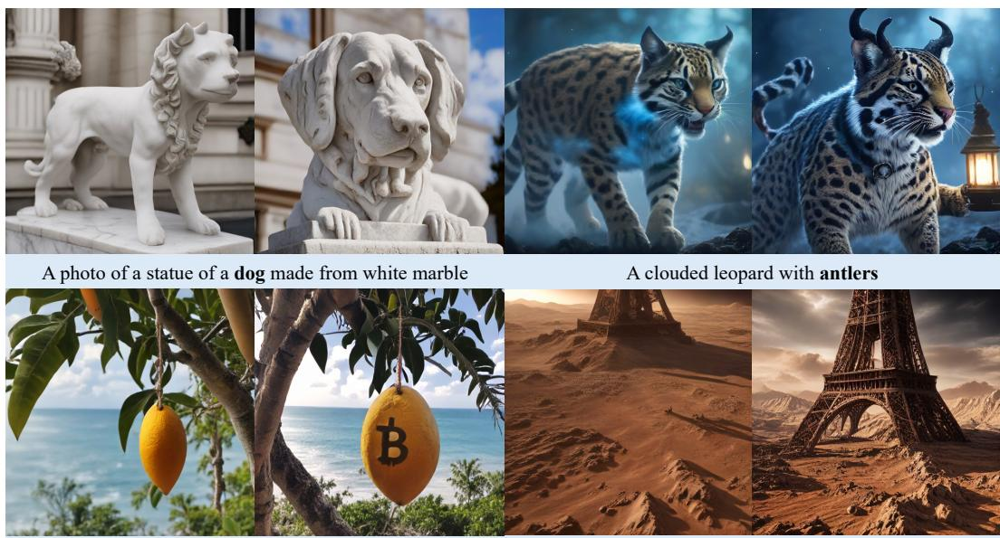  
A bitcoin mango hanging from a tree next to the ocean  
Eiffel tower on mars, insanely detailed

Figure 1: LeNO learns reward-improving corrections directly in initial noise space. Each pair shows generations before (left) and after (right) applying the learned noise correction, with the pretrained generator kept frozen. The corrected noises produce images that better capture the desired visual attributes across diverse prompts.

## ABSTRACT

Reward alignment for diffusion- and flow-based generative models is often formulated over stochastic trajectories, making it less suitable for few-step deterministic generators. Initial noise optimization provides a trajectory-free alternative, but existing gradient-free methods require costly per-sample search at inference. We introduce LeNO (Learning Noise Optimization), which amortizes reward-guided initial noise optimization into a learned residual transport while keeping the pretrained generator frozen. LeNO learns an anchor-conditioned distribution over noise corrections using Local GRPO and scalar rewards, eliminating iterative testtime optimization. For Gaussian initial noise with norm-preserving projection, we derive a tractable upper bound on the KL divergence between the corrected noise distribution and the original prior, providing a principled regularization objective. We evaluate LeNO on few-step text-to-image and protein structure generation, including expensive black-box designability rewards. Across both domains, LeNO improves target rewards with a single noise correction at inference while largely preserving generation quality and diversity.

## 1 INTRODUCTION

Reward-based post-training has emerged as a powerful paradigm for adapting pretrained generative models toward objectives such as human preference, visual quality, and task-specific utility. In dif fusion and flow models, many recent approaches formulate generation as a sequential decision process and optimize the generative trajectory using reinforcement learning or stochastic control (Black et al., 2024; Liu et al., 2026; Lee & Ye, 2025). Recent generative models, however, increasingly rely on few-step or even one-step deterministic sampling (Song et al., 2023; Yin et al., 2024; Sauer et al., 2024; Geng et al., 2025). While highly efficient, these models provide only few step deterministic generation trajectory, making conventional trajectory-level policy optimization less natural.

A promising alternative is to move reward optimization from the generative trajectory to the initial noise space, as the initial noise strongly influences the generated output. This has motivated recent inference time methods that search for reward-favorable noises while keeping the pretrained generator frozen (Eyring et al., 2024; Yoon et al., 2026; Kim et al., 2026). While these methods enable deterministic generators to be aligned with a given reward, including non-differentiable functions, they require an iterative noise-update process involving repeated generator executions and reward evaluations for each test sample. This becomes particularly costly when either generation or reward evaluation requires an expensive external pipeline.

This motivates amortizing reward-guided noise optimization into a learned mapping. Existing approaches, however, typically require either pre-collected offline data or differentiable reward functions. For example, GoldenNoise (Zhou et al., 2025) learns from a pre-constructed dataset of favorable noise–sample pairs, while HyperNoise (Eyring et al., 2026) learns to modify the initial noise through differentiable reward feedback. In contrast, directly learning sample-dependent noise corrections from online scalar rewards, without offline data or reward gradients, remains relatively underexplored.

To address these limitations, we introduce LeNO (Learning Noise Optimization), a framework that amortizes per-sample initial noise optimization for deterministic generators under differentiable or non-differentiable rewards. Rather than predicting an optimized noise sample from scratch, LeNO parameterizes the mapping in residual form and learns an anchor-dependent correction to the initial noise. To optimize this residual mapping using only scalar rewards, we formulate it as a stochastic transport that samples Gaussian residual actions around the predicted correction mean. These actions are trained with Local GRPO, where group-relative reward comparisons among corrections sampled from the same anchor provide the learning signal. We further provide a distributional interpretation of this residual parameterization. For Gaussian initial noise with anchor-norm-preserving projection, we show that a scaled squared norm of the predicted residual mean upper-bounds the KL divergence between the corrected noise distribution and the prior. This provides a tractable lower bound on the KL-regularized reward objective and directly motivates the residual regularization in Local GRPO. At inference, the learned transport generates a corrected initial noise with a single residual sample, eliminating per-sample optimization and additional reward evaluations.

We evaluate LeNO on few-step text-to-image generation and protein structure generation. In text-toimage generation, we consider direct optimization of multiple preference rewards. For proteins, we optimize a black-box designability objective whose evaluation requires sequence design and structure prediction, a setting where gradient-based amortization is inapplicable and per-sample search is costly. Across these settings, LeNO improves target rewards with only a lightweight residual correction at inference time, while retaining favorable held-out compositional performance and structural diversity. These results demonstrate that learned initial noise correction provides an efficient and broadly applicable alternative to repeated per-sample reward optimization.

## 2 BACKGROUND

Reward-Tilted Noise Distribution. For a deterministic generator ${ \pmb x } = G _ { \phi } ( \pmb { z } , c )$ with initial noise $z \sim p _ { 0 } ( z )$ , the generated sample is fully determined by z once the condition c is fixed. Let $r ( \cdot )$ denote a scalar, potentially black-box reward function defined on the generated sample. Reward based alignment can therefore be formulated directly in the initial noise space by tilting the noise prior toward high-reward regions:

$$
p ^ { \star } ( z \mid c ) \propto p _ { 0 } ( z ) \exp \left( \frac { r ( G _ { \phi } ( z , c ) ) } { \lambda } \right) ,\tag{1}
$$

where $\lambda > 0$ controls the trade-off between reward maximization and preservation of the original noise prior. This formulation provides a direct basis for initial noise optimization, where the pretrained generator is kept fixed and reward alignment is performed by searching for higher-reward noise samples.

Zeroth-Order Initial Noise Optimization. Reward optimization can be performed directly in the initial noise space without differentiating through either the generator or the reward function. Let

$$
\begin{array} { r } { \mathcal { R } ( z ; c ) : = r ( G _ { \phi } ( z , c ) ) , \qquad \mathcal { R } _ { \sigma } ( z ; c ) : = \mathbb { E } _ { \epsilon \sim \mathcal { N } ( 0 , I ) } \left[ \mathcal { R } ( z + \sigma \epsilon ; c ) \right] . } \end{array}\tag{2}
$$

The gradient $g ( z , c )$ of the Gaussian-smoothed reward can be estimated from centered reward weighted perturbations as

$$
g ( z , c ) : = \nabla _ { z } \mathcal { R } _ { \sigma } ( z ; c ) \approx \frac { 1 } { ( K - 1 ) \sigma } \sum _ { i = 1 } ^ { K } \left( R _ { i } - \bar { R } _ { z } \right) \epsilon _ { i } ,\tag{3}
$$

where $R _ { i } = \mathcal { R } ( z + \sigma \epsilon _ { i } ; c )$ and $\begin{array} { r } { \bar { R } _ { z } = \frac { 1 } { K } \sum _ { i = 1 } ^ { K } R _ { i } } \end{array}$ . This form underlies Natural Evolution Strategy style (Wierstra et al., 2014) gradient estimation and related gradient-free initial noise optimization methods, including approaches that derive reward-weighted perturbation updates from stochastic control perspectives (Kim et al., 2026). Such methods avoid reward backpropagation, but require estimating a new local direction for each noise state through repeated generator and reward evaluations. LeNO instead seeks to amortize these state-dependent noise corrections into a learned residual transport, avoiding repeated optimization at inference time.

Policy Optimization for Deterministic Generative Models. Recent approaches have explored how to enable policy optimization for deterministic generative models by recovering a suitable source of stochasticity. Flow-GRPO (Liu et al., 2026), for example, converts the deterministic probabilityflow ODE into an equivalent stochastic differential equation, thereby introducing stochastic transitions on which policy-gradient optimization can be performed. An alternative perspective preserves the deterministic sampling dynamics and instead constructs stochasticity through local trajectory neighborhoods.

Neighbor GRPO (He et al., 2026) follows this local-neighborhood perspective. Given a shared reference noise $\epsilon ^ { \star } .$ it samples neighboring initial conditions

$$
\epsilon ^ { ( i ) } = \sqrt { 1 - \sigma ^ { 2 } } \epsilon ^ { \star } + \sigma \delta ^ { ( i ) } , \qquad \delta ^ { ( i ) } \sim \mathcal { N } ( 0 , I ) ,\tag{4}
$$

and propagates them through the same deterministic ODE to construct a local trajectory neighborhood. Despite the similar shared-anchor perturbation geometry, Neighbor GRPO optimizes the generative model through a contrastive, distance-based surrogate policy defined over neighboring ODE trajectories. In contrast, LeNO keeps the generator frozen and learns a separate stochastic residual transport in the initial noise space, using local perturbations to obtain reward-based training signals. The two approaches are therefore complementary, as LeNO leaves the pretrained model unchanged and applies to any generator that exposes an initial noise input.

## 3 METHODS

## 3.1 NOISE-SPACE RESIDUAL TRANSPORT

We formulate amortized initial noise optimization as a stochastic residual transport for a frozen pretrained generator $G _ { \phi }$ . Given an initial noise $z \sim p _ { 0 }$ and condition $c ,$ we learn an anchor-dependent residual mean $\mu _ { \boldsymbol { \theta } } ( z , c )$ to improve the generated output using scalar reward feedback. The transport samples a residual action and applies it to the anchor:

$$
\begin{array} { r } { \pmb { a } = \eta \mu _ { \theta } ( z , c ) + \sigma \epsilon , \qquad \epsilon \sim \mathcal { N } ( 0 , I ) , } \end{array}\tag{5}
$$

$$
z ^ { \prime } = F _ { \theta } ( z , \epsilon , c ) : = \mathcal { T } ( z , \pmb { a } ) ,\tag{6}
$$

where $\eta > 0$ controls the correction scale and $\sigma > 0$ is a fixed sampling scale. For Gaussian initial noise, we use the norm-preserving transition

$$
\mathcal { T } ( z , a ) = \mathrm { N o r m P r o j } ( z + a ; \| z \| _ { 2 } ) , \qquad \mathrm { N o r m P r o j } ( x ; r ) : = r \frac { x } { \| x \| _ { 2 } } .\tag{7}
$$

This updates the direction of the initial noise while preserving its norm. The stochastic transport induces the corrected noise distribution

$$
z ^ { \prime } = F _ { \theta } ( z , \epsilon , c ) \sim q _ { \theta } ( \cdot \mid c ) ,\tag{8}
$$

where $z \sim p _ { \mathrm { 0 } }$ and $\epsilon \sim \mathcal { N } ( 0 , I )$ are independent.

At inference, we sample one corrected noise and generate $G _ { \phi } ( z ^ { \prime } , c )$ . During training, we draw multiple actions per anchor and compare their rewards to learn the residual mean. The same conditional Gaussian structure provides both a tractable distributional KL bound and an action likelihood for reward-based learning. We next derive the bound, followed by the Local GRPO objective.

## 3.2 DISTRIBUTIONAL TARGET AND KL REGULARIZATION

We aim to align the corrected noise distribution $q _ { \theta } ( \cdot \mid c )$ with the reward-tilted target

$$
p ^ { \star } ( z \mid c ) = \frac { p _ { 0 } ( z ) \exp ( \mathcal { R } ( z ; c ) / \lambda ) } { Z ( c ) } , \qquad \lambda > 0 ,\tag{9}
$$

where $p _ { 0 } = { \mathcal N } ( 0 , I ) , { \mathcal R } ( z ; c ) = r ( G _ { \phi } ( z , c ) )$ and $Z ( c ) : = \mathbb { E } _ { z \sim p _ { 0 } } [ \exp ( \mathcal { R } ( z ; c ) / \lambda ) ] < \infty$ . This target favors high-reward noises while retaining the prior as a reference.

Whenever the relevant expectations and divergences are finite,

$$
\begin{array} { r l } & { D _ { \mathrm { K L } } ( q _ { \theta } ( \cdot  { | } c ) | | p ^ { \star } ( \cdot  { | } c ) ) = D _ { \mathrm { K L } } ( q _ { \theta } ( \cdot  { | } c ) | | p _ { 0 } ) } \\ & { \phantom { D _ { \mathrm { K L } } } - \frac { 1 } { \lambda } \mathbb { E } _ { z \sim q _ { \theta } ( \cdot  { | } c ) } [ \mathcal { R } ( z ; c ) ] + \log Z ( c ) . } \end{array}\tag{10}
$$

Since $Z ( c )$ is independent of $\theta ,$ minimizing this KL divergence is equivalent to maximizing

$$
\begin{array} { r } { \mathcal { L } \big ( q _ { \theta } ; c \big ) : = \mathbb { E } _ { z \sim q _ { \theta } ( \cdot | c ) } [ \mathcal { R } ( z ; c ) ] - \lambda D _ { \mathrm { K L } } \big ( q _ { \theta } ( \cdot \mid c ) \| p _ { 0 } \big ) . } \end{array}\tag{11}
$$

The reward term can be estimated from generated samples, but the prior-relative KL remains intractable because $q _ { \theta }$ is implicitly defined by the transport. We therefore bound this KL term using the conditional Gaussian action distributions.

Proposition 1. Let $p _ { 0 } = \mathcal { N } ( 0 , I )$ and let $q _ { \theta }$ be a corrected noise distribution induced by the normpreserving transition T in Eq. (7). For $\sigma > 0$ and $\mathbb { E } _ { z \sim p _ { 0 } } \| \mu _ { \theta } ( z , c ) \| _ { 2 } ^ { 2 } < \infty$ , the following upper bound holds:

$$
\begin{array} { r l } & { { \cal D } _ { \mathrm { K L } } ( q _ { \theta } ( \cdot  { | \mathbf { \Lambda } | } c ) { \| } p _ { 0 } ) \le { \mathbb { E } } _ { z \sim p _ { 0 } } { \cal D } _ { \mathrm { K L } } \bigl ( { \mathcal { N } } ( \eta \mu _ { \theta } ( z , c ) , \sigma ^ { 2 } I ) \ : \| { \mathcal { N } } ( 0 , \sigma ^ { 2 } I ) \bigr ) } \\ & { \quad \quad \quad \quad = \displaystyle \frac { \eta ^ { 2 } } { 2 \sigma ^ { 2 } } { \mathbb { E } } _ { z \sim p _ { 0 } } \| \mu _ { \theta } ( z , c ) \| _ { 2 } ^ { 2 } . } \end{array}\tag{12}
$$

The inequality follows from prior preservation under zero-mean residual actions, together with the data-processing inequality applied to the joint distributions of anchors and residual actions. The equality follows from the closed-form KL divergence between Gaussian distributions with identical covariance. A detailed proof is provided in Appendix B.

Under the conditions of Proposition 1, we obtain a tractable lower bound on the distributional objective:

$$
\mathcal { L } _ { \mathrm { a u x } } ( \theta ; c ) : = \mathbb { E } _ { z ^ { \prime } \sim q _ { \theta } ( \cdot \vert c ) } [ \mathcal { R } ( z ^ { \prime } ; c ) ] - \frac { \lambda \eta ^ { 2 } } { 2 \sigma ^ { 2 } } \mathbb { E } _ { z \sim p _ { 0 } } \Vert \mu _ { \theta } ( z , c ) \Vert _ { 2 } ^ { 2 } \le \mathcal { L } ( q _ { \theta } ; c ) .\tag{13}
$$

The reward term can be estimated from sampled transport outputs, while the regularizer depends only on the predicted residual mean. Together with Eq. (10), this implies that maximizing $\mathcal { L } _ { \mathrm { a u x } }$ minimizes an upper bound on the KL divergence from qθ to the reward-tilted target $p ^ { \star }$ . Using the same stochastic transport and noise scale during training and inference ensures that the bound applies to the corrected noise distribution used for generation.

## 3.3 LOCAL GRPO OBJECTIVE

Training Objective. We next optimize the auxiliary reward objective ${ \mathcal { L } } _ { \mathrm { a u x } } ( \theta ; c )$ through a tractable Local GRPO surrogate. Rather than maximizing the expected reward directly, Local GRPO uses group-relative comparisons among samples from the stochastic residual transport to update the residual mean from scalar rewards, while preserving the regularization implied by the distributional KL bound.

At the start of each training iteration, we snapshot the current transport parameters as $\theta _ { \mathrm { o l d } }$ and hold them fixed throughout the subsequent GRPO updates on the sampled particles. For each anchor z and condition $c ,$ we draw $K$ residual actions from the conditional Gaussian distribution in Eq. (5). For $i = 1 , \ldots , K$

$$
\begin{array} { r } { \pmb { a } ^ { ( i ) } = \eta \mu _ { \theta _ { \mathrm { o l d } } } ( \pmb { z } , c ) + \sigma \epsilon _ { i } , } \end{array}\tag{14}
$$

where $\epsilon _ { i } \stackrel { \mathrm { i i d } } { \sim } \mathcal { N } ( 0 , I )$ . Each action produces a corrected noise $\pmb { z } ^ { ( i ) } = \mathcal { T } ( \pmb { z } , \pmb { a } ^ { ( i ) } )$ with reward $R _ { i } = \mathcal { R } ( z ^ { ( i ) } ; c )$ . These particles are samples of the same stochastic transport used at inference, sharing the anchor and predicted residual mean while differing in their Gaussian perturbations. We compare their rewards within each group to construct the group-relative advantages:

$$
A _ { i } = \frac { R _ { i } - \bar { R } } { s _ { R } + \varepsilon } , \qquad \bar { R } = \frac 1 K \sum _ { j = 1 } ^ { K } R _ { j } ,\tag{15}
$$

Algorithm 1 Training LeNO with Local GRPO   
Require: Frozen generator $G _ { \phi } ,$ reward $r ,$ resid  
ual transport $\breve { F _ { \theta } }$ , group size $K ,$ , residual scale   
η, exploration scale $\sigma ,$ , regularization coeffi  
cient $\beta$   
1: for each training iteration do   
2: $\theta _ { \mathrm { o l d } }  \theta$   
3: Sample condition c and anchor $z \sim p _ { 0 } ( z )$   
4: for $i = 1 , \dots , K$ do   
5: Sample $\epsilon _ { i } \sim \mathcal { N } ( 0 , I )$   
6: $\pmb { a } ^ { ( i ) } \gets \eta \mu _ { \theta _ { \mathrm { o l d } } } ( z , c ) + \sigma \epsilon _ { i }$   
7: $\pmb { z } ^ { ( i ) }  \mathcal { T } ( \pmb { z } , \pmb { a } ^ { ( i ) } )$   
8: $R _ { i } \gets r \big ( G _ { \phi } ( z ^ { ( i ) } , c ) \big )$   
9: end for   
10: Compute group-relative advantages $A _ { i }$   
11: Compute exploration likelihood ratios   
$\rho ^ { ( i ) } ( \theta )$   
12: Update $\theta$ using Eq. (17)   
13: end for

where $s _ { R }$ is the within-group reward standard deviation and $\varepsilon > 0$ ensures numerical stability.

Let $\pi _ { \boldsymbol { \theta } } ( \boldsymbol { \mathbf { \em a } } \mid \boldsymbol { z } , \boldsymbol { c } )$ denote the Gaussian action density specified by $\operatorname { E q . } \left( 5 \right)$ . For the sampled actions, we define the likelihood ratio

$$
\rho ^ { ( i ) } ( \theta ) : = \frac { \pi _ { \theta } ( \pmb { a } ^ { ( i ) } \mid z , c ) } { \pi _ { \theta _ { \mathrm { o l d } } } ( \pmb { a } ^ { ( i ) } \mid z , c ) } .\tag{16}
$$

This ratio is evaluated on the residual actions before projection and does not require the density of the corrected noise marginal $q _ { \theta }$ . Holding the sampled actions and advantages fixed, our penalized local GRPO maximizes the following:

$$
\mathcal { I } ( \theta ) = \mathbb { E } \left[ \frac { 1 } { K } \sum _ { i = 1 } ^ { K } \operatorname* { m i n } \left( \rho ^ { ( i ) } ( \theta ) A _ { i } , \ \mathrm { c l i p } \Big ( \rho ^ { ( i ) } ( \theta ) , 1 - \epsilon _ { \mathrm { c l i p } } , 1 + \epsilon _ { \mathrm { c l i p } } \Big ) A _ { i } \right) - \beta \frac { \eta ^ { 2 } } { 2 \sigma ^ { 2 } } \| \mu _ { \theta } ( z , c ) \| _ { 2 } ^ { 2 } \right] ,\tag{17}
$$

where the expectation is over training conditions, anchors $z \sim p _ { 0 } ,$ , and particles sampled under $\theta _ { \mathrm { o l d } }$ . Here, $\epsilon _ { \mathrm { c l i p } } > 0$ is the PPO clipping parameter and $\beta > 0$ controls regularization strength. In Eq. (17), the first term promotes residual actions with higher group-relative rewards, while the second regularizes the policy toward the zero-mean Gaussian reference through the conditional KL divergence, thereby linking to the distributional KL term in Eq. (13). In practice, we combine group-normalized rewards with PPO-style clipping to obtain a stable Local GRPO surrogate, where $\beta$ controls the strength of KL regularization relative to the normalized reward scale.

The local sampling procedure also admits a zeroth-order interpretation. Before norm projection, reward-weighted Gaussian perturbations provide an estimator of the gradient of the Gaussiansmoothed reward evaluated at the mean-shifted anchor, closely related to zeroth-order noise optimization methods such as ZeNO (Kim et al., 2026). Unlike such methods, which optimize the initial noise independently for each test-time sample, LeNO uses these local reward signals to learn an anchor-conditioned transport and thereby amortizes noise optimization across samples. See $\mathsf { A p - }$ pendix A for more details of the derivation.

Why State-Dependent Noise Corrections? LeNO conditions the residual mean $\mu _ { \boldsymbol { \theta } } ( z , c )$ on the anchor z itself, rather than solely on the condition c. This design is motivated by the zeroth-order interpretation above: because local sampling estimates the reward-improvement direction in a neigh borhood of a specific anchor, the resulting direction is generally anchor-dependent. In contrast, a correction conditioned only on c cannot adapt to such local variation and instead captures only an average direction across anchors. Appendix C formalizes this intuition using a simplified first-orde surrogate of $\mathcal { L } _ { \mathrm { a u x } }$ . Under this surrogate, the optimal anchor-dependent correction follows the local reward-improvement direction at each anchor, whereas the optimal anchor-independent correction follows their population average. The resulting objective gap is proportional to the total variance of the local directions across anchors and vanishes only when these directions are identical for all anchors (Lemma 1). We empirically confirm the benefit of anchor-dependent conditioning in Fig. 4.

(a) Initial States  
(b) Flow-ODE  
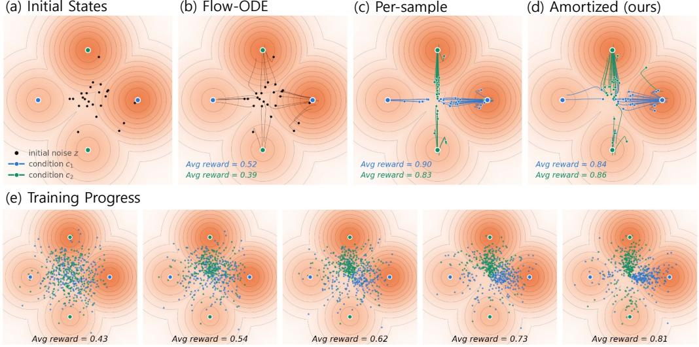  
Figure 2: Toy Experiment. (a) Initial noise samples and the reward landscape of a four-component Gaussian mixture. (b) Samples obtained by directly passing the initial noise through the frozen probability-flow ODE. (c) Per-sample initial noise optimization with 30 step optimization. (d) Our amortized noise space correction with the residual transport. The learned correction successfully redirects samples toward the condition-specific high-reward modes with substantially lower inference time computation. (e) Corrected noise distribution over training.

## 4 EXPERIMENTS

## 4.1 TOY EXPERIMENT

We consider a four-component Gaussian mixture model where two different conditions, $c _ { 1 }$ and $c _ { 2 }$ select disjoint pairs of target modes with distinct reward values. The deterministic generator $G _ { \phi }$ is defined as the probability-flow ODE of a linear interpolant between N(0, I) and the target mixture. Fig. 2(a) illustrates the initial noise samples and the corresponding reward landscape, where darker regions indicate higher rewards. As a baseline, Fig. 2(b) directly maps the initial particles through the frozen flow ODE without any reward-based correction. For per-sample optimization, Fig. 2(c) applies per-sample 30 step optimization, following ZeNO (Kim et al., 2026), with 32 perturbation particles per step, requiring 960 generator evaluations per sample. In contrast, LeNO in Fig. 2(d) uses one-step residual correction with a lightweight 35K-parameter MLP trained for 400 iterations.

Despite replacing iterative per-sample optimization with a learned corrector, our method consistently redirects samples toward the high-reward modes specified by each condition. While per-sample optimization improves rewards for each condition to 0.90 and 0.83, our amortized correction attains 0.84 and 0.86, showing that condition-dependent reward-improving corrections can be effectively amortized into a compact noise space transport with substantially reduced inference time computation. Figure 2(e) further visualizes the evolution of the learned correction during training. As training progresses, the transport gradually shifts the initial noise samples toward condition-dependent high-reward regions, increasing the average reward.

## 4.2 TEXT-TO-IMAGE GENERATION

Experimental Setup. We evaluate our method on text-to-image generation under two complementary reward-alignment settings: single reward optimization and compositional multi-reward optimization. Across all settings, the pretrained image generator $G _ { \phi }$ remains frozen, and only the residual noise transport is optimized. We parameterize the residual correction $\mu _ { \theta }$ using the same

  
Frontal portrait of queen elizabeth, by Van Gogh

  
\~ small bells and whistles, yellow, flat lay

  
\~ furry cat with shiny webs between their paws

  
3 monkeys watching a movie in cinem

  
\~ text "Reward" prominently displayed

  
Cute baby mouse with flowers on the head

Figure 3: Qualitative comparison of one-step generations before (left) and after LeNO noise correction (right). Top: SANA-Sprint with compositional multi-reward optimization. Bottom: SDXL-Turbo with PickScore optimization.

backbone architecture as the corresponding generator, with LoRA adapters injected into the model while keeping the underlying pretrained weights frozen. We use SDXL-Turbo (Sauer et al., 2024) for the single-reward and SANA-Sprint (Chen et al., 2025) for the compositional multi-reward setting. For single-reward optimization, we train separate residual transports for three reward functions: aesthetic score (Schuhmann, 2022), PickScore (Kirstain et al., 2023), and ImageReward (Xu et al., 2024). For compositional multi-reward optimization, we optimize a composite reward consisting of ImageReward, PickScore, HPSv2 (Wu et al., 2023), and CLIPScore (Hessel et al., 2021) proposed in ReNO (Eyring et al., 2024) and use GenEval (Ghosh et al., 2023) solely as a held-out benchmark to evaluate compositional generalization. Full experimental details are provided in Appendix D.

Baselines. We compare against both inference-time and amortized alignment methods. For infer ence time alignment, we include Best-of-N, ψ-Sampler (Yoon et al., 2026), and ZeNO (Kim et al., 2026). These methods require no additional model training, but improve reward through additional generator and reward evaluations at test time. In particular, ZeNO performs iterative gradient-free optimization independently for each initial noise, providing a direct per-sample counterpart to the optimization that our method aims to amortize. For amortized alignment, we compare with Hy perNoise (Eyring et al., 2026), which learns to modify the initial noise distribution through differentiable reward feedback. We additionally report GoldenNoise (Zhou et al., 2025) as a reference baseline. Unlike the target reward alignment methods considered here, GoldenNoise is trained from an offline dataset of favorable noise-sample pairs rather than directly optimizing the evaluation reward. For the held-out GenEval comparison, we further include a broad set of previously reported text-to-image models and alignment methods as reference baselines (Rombach et al., 2022; Podell et al., 2023; Rafailov et al., 2023; Batifol et al., 2025; Esser et al., 2024).

Comparison with Baselines. Table 1 reports direct optimization results for aesthetic score, PickScore, and ImageReward. With a single residual correction, LeNO improves all three rewards over frozen SDXL-Turbo and achieves the best results among the evaluated amortized methods, outperforming HyperNoise without reward gradients. GoldenNoise, trained with different offline supervision, yields only marginal gains. We further evaluate cross-reward transfer, held-out quality metrics, and within-prompt diversity throughout training (Appendix E.1), which indicate that these gains are not obtained at the cost of perceptual quality or sample diversity, suggesting no evident reward hacking.

Inference-time methods achieve higher absolute rewards with substantially larger search budgets: Best-of-N, ψ-Sampler, and ZeNO use 800 generator evaluations per sample, compared with two NFEs for LeNO. LeNO amortizes this optimization into training, avoiding repeated reward evaluations at inference. Combining LeNO with Best-of-N over 50 corrected candidates achieves competitive or better rewards than these 800-NFE baselines using only 100 NFEs, demonstrating more efficient inference-time scaling.

Table 2 evaluates transfer to GenEval, which is not directly optimized during multi-reward training. On SANA-Sprint, LeNO improves the mean score from 0.67 to 0.70, with gains in two-object generation, counting, position, and attribute binding. This is comparable to HyperNoise (0.71), despite using only scalar reward evaluations rather than reward gradients, and suggests transfer beyond the training reward ensemble.

Table 1: Single reward optimization results on text-to-image generation with SDXL-Turbo.
<table><tr><td>Method</td><td>∇R</td><td>NFE↓</td><td>Aes. ↑</td><td>Pick. ↑</td><td>Img. ↑</td></tr><tr><td>SDXL-Turbo</td><td></td><td>1</td><td>5.339</td><td>21.932</td><td>0.761</td></tr><tr><td colspan="6">Inference-Time</td></tr><tr><td>BoN</td><td>x</td><td>800</td><td>5.714</td><td>22.993</td><td>1.201</td></tr><tr><td>ψ-Sampler</td><td>√</td><td>800</td><td>5.945</td><td>23.182</td><td>1.421</td></tr><tr><td>ZeNO</td><td>x</td><td>800</td><td>5.750</td><td>23.038</td><td>1.260</td></tr><tr><td colspan="6">Amortized</td></tr><tr><td>GoldenNoise1</td><td>一</td><td>1</td><td>5.359</td><td>21.908</td><td>0.762</td></tr><tr><td>HyperNoise</td><td>√</td><td>2</td><td>5.382</td><td>21.951</td><td>0.939</td></tr><tr><td>LeNO</td><td>X</td><td>2</td><td>5.460</td><td>22.715</td><td>1.019</td></tr><tr><td>LeNO + BoN</td><td>X</td><td>100</td><td>5.952</td><td>23.191</td><td>1.444</td></tr></table>

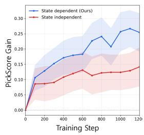

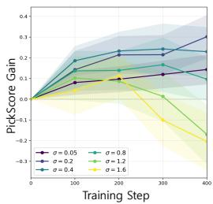  
Figure 4: Ablation for Figure 5: Ablation for state-dependent training. exploration scale σ.

Table 2: GenEval results for held-out compositional evaluation. LeNO and HyperNoise are trained from SANA-Sprint with the same multi-reward objective; GenEval is not used for training. Hyper-Noise requires reward gradients, whereas LeNO uses only scalar rewards.
<table><tr><td>Model</td><td>Params (B)</td><td>Time (s) ↓</td><td>Mean ↑</td><td>Single ↑</td><td>Two ↑</td><td>Counting ↑</td><td>Colors ↑</td><td>Position ↑</td><td>Attribution ↑</td></tr><tr><td>SD v2.1</td><td>0.8</td><td>1.9</td><td>0.50</td><td>0.98</td><td>0.51</td><td>0.44</td><td>0.85</td><td>0.07</td><td>0.17</td></tr><tr><td>SDXL</td><td>2.6</td><td>6.9</td><td>0.55</td><td>0.98</td><td>0.74</td><td>0.39</td><td>0.85</td><td>0.15</td><td>0.23</td></tr><tr><td>DPO-SDXL</td><td>2.6</td><td>6.9</td><td>0.59</td><td>0.99</td><td>0.84</td><td>0.49</td><td>0.87</td><td>0.13</td><td>0.24</td></tr><tr><td>Hyper-SDXL</td><td>2.6</td><td>0.3</td><td>0.56</td><td>1.00</td><td>0.76</td><td>0.43</td><td>0.87</td><td>0.10</td><td>0.21</td></tr><tr><td>Flux-dev</td><td>12.0</td><td>23.0</td><td>0.68</td><td>0.99</td><td>0.85</td><td>0.74</td><td>0.79</td><td>0.21</td><td>0.48</td></tr><tr><td>SD3-Medium</td><td>2.0</td><td>4.4</td><td>0.70</td><td>1.00</td><td>0.90</td><td>0.72</td><td>0.87</td><td>0.31</td><td>0.66</td></tr><tr><td>SANA-Sprint</td><td>0.6</td><td>0.2</td><td>0.67</td><td>1.00</td><td>0.68</td><td>0.60</td><td>0.85</td><td>0.40</td><td>0.47</td></tr><tr><td>+ HyperNoise</td><td>0.9</td><td>0.3</td><td>0.71</td><td>1.00</td><td>0.75</td><td>0.67</td><td>0.84</td><td>0.48</td><td>0.53</td></tr><tr><td>+ LeNO</td><td>0.9</td><td>0.3</td><td>0.70</td><td>1.00</td><td>0.74</td><td>0.66</td><td>0.85</td><td>0.41</td><td>0.54</td></tr></table>

State Dependency Ablation. We further evaluate whether conditioning the residual correction on the current initial noise is necessary for effective amortization by comparing the standard statedependent model $\mu _ { \boldsymbol { \theta } } ( z , c )$ with a state-independent variant $\mu _ { \theta } ( c )$ . To preserve the same network architecture, the latter is implemented by feeding a fixed dummy noise $z _ { \mathrm { f i x e d } }$ in place of the current noise input, while keeping the actual initial noise used for generation and the Local GRPO training procedure unchanged. As shown in Fig. 4, the state-dependent model continues to improve throughout training, whereas the state-independent variant shows only a modest initial gain before quickly saturating. This behavior aligns with the intuition from Sec. 3.3, where a shared correction aggregates reward-improvement signals across the initial noise population, while $\mu _ { \boldsymbol { \theta } } ( z , c )$ can represent distinct local corrections for different noise states.

Exploration Scale Analysis. Fig. 5 analyzes the effect of the exploration scale σ using SDXL-Turbo with PickScore as the training reward. We observe a clear trade-off between exploration and locality. When σ is too small $( \mathbf { e . g . } , \sigma \leq 0 . 1 )$ , the sampled particles remain close to the predicted correction, yielding weak reward contrast and slower improvement. Increasing σ broadens the explored neighborhood and strengthens the relative reward signal, with the best performance obtained around $\sigma = 0 . 2$ . However, excessively large exploration degrades training; when σ exceeds approximately 1.2, the reward gain collapses and can even become negative. At this scale, the stochastic perturbation dominates the predicted correction, weakening the local correspondence between sampled particles and the reward landscape around the shared anchor. These results suggest that effective Local GRPO requires sufficient exploration to reveal reward differences while preserving a coherent local neighborhood for relative credit assignment.

## 4.3 PROTEIN STRUCTURE GENERATION

Protein backbone generation is the setting that most directly motivates LeNO. Evaluating a backbone requires designing compatible amino-acid sequences and predicting their folded structures through an external pipeline, so the reward is both expensive and non-differentiable with respect to the generator. Gradient-based amortization such as HyperNoise is therefore inapplicable, while persample reward-guided search must invoke the full pipeline many times for every test sample. LeNO instead uses this feedback only during training and applies a single learned correction to new samples without invoking the evaluator at inference.

Table 3: Comparison of the base models and LeNO. Results are averaged over lengths 60–128, with 10 backbones per length and 8 sequences per backbone.
<table><tr><td rowspan="2">Model</td><td rowspan="2">NFE</td><td rowspan="2">#Query</td><td colspan="2">Designability</td><td colspan="2">Diversity</td></tr><tr><td>&lt; 2Å (↑)</td><td>scRMSD (4)</td><td>Max. Cluster (↑)</td><td>Pairwise scTM (↓)</td></tr><tr><td>FrameDiff</td><td>5</td><td>0</td><td>0.09</td><td>6.19</td><td>0.54</td><td>0.24</td></tr><tr><td>FrameFlow</td><td>5</td><td>0</td><td>0.04</td><td>6.53</td><td>0.68</td><td>0.22</td></tr><tr><td>RMF-M</td><td>1</td><td>0</td><td>0.15</td><td>4.91</td><td>0.66</td><td>0.34</td></tr><tr><td>+ZeNO</td><td>480</td><td>480</td><td>0.28</td><td>3.54</td><td>0.65</td><td>0.35</td></tr><tr><td>+ LeNO</td><td>2</td><td>0</td><td>0.31</td><td>3.27</td><td>0.64</td><td>0.38</td></tr><tr><td>RMF-L</td><td>1</td><td>0</td><td>0.29</td><td>3.38</td><td>0.66</td><td>0.35</td></tr><tr><td>+ZeNO</td><td>480</td><td>480</td><td>0.40</td><td>2.60</td><td>0.71</td><td>0.36</td></tr><tr><td>+ LeNO</td><td>2</td><td>0</td><td>0.42</td><td>2.95</td><td>0.66</td><td>0.38</td></tr></table>

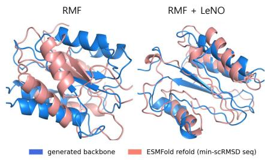  
Figure 6: Visualization of protein structures generated by the base RMF and LeNO.

We optimize designability using the standard self-consistency pipeline. For each generated backbone, ProteinMPNN (Dauparas et al., 2022) designs compatible amino-acid sequences, which are then refolded using ESMFold (Lin et al., 2023). A backbone is considered designable when the selfconsistency RMSD (scRMSD) between the generated and refolded structures is below 2 A. Each˚ reward query thus involves multiple sequence design and structure prediction calls, which dominates the cost of generation itself.

We apply LeNO to a pretrained one-step Riemannian MeanFlow (RMF) (Woo et al., 2026) model while keeping the generator frozen, parameterizing the residual transport with LoRA adapters trained using the same Local GRPO objective. As the primary baselines, we compare against per-sample test-time ZeNO (Kim et al., 2026) applied to the same frozen RMF. We additionally report FrameDiff (Yim et al., 2023b) and FrameFlow (Yim et al., 2023a), on which RMF is built, as few-step reference models. During training, protein lengths are uniformly sampled from 60 to 128 residues, and all methods are evaluated over the same length range.

Results. Table 3 reports designability and diversity for few-step protein structure generation. FrameDiff and FrameFlow degrade substantially in the few-step regime, whereas LeNO markedly improves the designability of both RMF variants with a single residual correction. Notably, on RMF-M, LeNO outperforms per-sample ZeNO in both designability and scRMSD, even though ZeNO performs 30 optimization steps with 16 particles, i.e., 480 black-box reward queries per sample, each invoking ProteinMPNN and ESMFold. LeNO instead requires no reward queries at inference, matching or exceeding explicit per-sample search at a small fraction of its test-time cost. Its one-time training cost (1k iterations × 36 particles ≈ 36k queries) is thus amortized after generating roughly 75 backbones, beyond which LeNO is strictly cheaper than per-sample optimization. These gains come at a modest cost in structural diversity: MaxCluster (Herbert & Sternberg, 2008) remains comparable to the base models, while pairwise scTM increases slightly, suggesting that LeNO shifts the backbone distribution toward more designable regions without collapsing it. Qualitative examples are shown in Fig. 6, and implementation details are provided in Appendix D.2.

## 5 CONCLUSION

We presented LeNO as an efficient framework for learning reward-improving corrections directly in the initial noise space of frozen deterministic generators. Across text-to-image and protein structure generation, our results show that a lightweight stochastic residual transport can effectively amortize costly per-sample reward optimization while supporting non-differentiable black-box objectives. LeNO also maintains favorable held-out behavior, including compositional generalization in image generation and structural diversity in protein generation. A remaining limitation is that training still requires multiple generator and reward evaluations per anchor, which can be expensive when the reward pipeline itself is costly. Nevertheless, the learned correction introduces only modest inference overhead, making noise space optimization particularly attractive when extremely fast few-step or one-step generation is essential.

## AI USE STATEMENT

In this work, we used generative AI tools for sentence-level editing of texts written by authors to improve readability. We have not used generative AI tools for other aspects, such as generating synthetic data, developing theoretical models, formulating mathematical claims or proposing research hypothesis. We have reviewed all AI-assisted work. We take responsibility for the final content of this work, including text, claims or artifacts produced with the aid of generative AI.

## REFERENCES

Stephen Batifol, Andreas Blattmann, Frederic Boesel, Saksham Consul, Cyril Diagne, Tim Dockhorn, Jack English, Zion English, Patrick Esser, Sumith Kulal, et al. Flux. 1 kontext: Flow matching for in-context image generation and editing in latent space. arXiv e-prints, pp. arXiv–2506, 2025.

Kevin Black, Michael Janner, Yilun Du, Ilya Kostrikov, and Sergey Levine. Training diffusion models with reinforcement learning. In International Conference on Learning Representations, volume 2024, pp. 4965–4987, 2024.

Junsong Chen, Shuchen Xue, Yuyang Zhao, Jincheng Yu, Sayak Paul, Junyu Chen, Han Cai, Song Han, and Enze Xie. Sana-sprint: One-step diffusion with continuous-time consistency distillation. In 2025 IEEE/CVF International Conference on Computer Vision (ICCV), pp. 16185–16195. IEEE, 2025.

J. Dauparas, I. Anishchenko, N. Bennett, H. Bai, R. J. Ragotte, L. F. Milles, B. I. M. Wicky, A. Courbet, R. J. de Haas, N. Bethel, P. J. Y. Leung, T. F. Huddy, S. Pellock, D. Tischer, F. Chan, B. Koepnick, H. Nguyen, A. Kang, B. Sankaran, A. K. Bera, N. P. King, and D. Baker. Robust deep learning–based protein sequence design using proteinmpnn. Science, 378(6615):49–56, 2022. doi: 10.1126/science.add2187. URL https://www.science.org/doi/abs/10. 1126/science.add2187.

Patrick Esser, Sumith Kulal, Andreas Blattmann, Rahim Entezari, Jonas Muller, Harry Saini, Yam¨ Levi, Dominik Lorenz, Axel Sauer, Frederic Boesel, et al. Scaling rectified flow transformers for high-resolution image synthesis. In Forty-first international conference on machine learning, 2024.

Luca Eyring, Shyamgopal Karthik, Karsten Roth, Alexey Dosovitskiy, and Zeynep Akata. ReNO: Enhancing one-step text-to-image models through reward-based noise optimization. In The Thirty-eighth Annual Conference on Neural Information Processing Systems, 2024. URL https://openreview.net/forum?id=MXY0qsGgeO.

Luca Eyring, Shyamgopal Karthik, Alexey Dosovitskiy, Nataniel Ruiz, and Zeynep Akata. Noise hypernetworks: Amortizing test-time compute in diffusion models. Advances in Neural Information Processing Systems, 38:95429–95462, 2026.

Zhengyang Geng, Mingyang Deng, Xingjian Bai, J Zico Kolter, and Kaiming He. Mean flows for one-step generative modeling. arXiv preprint arXiv:2505.13447, 2025.

Dhruba Ghosh, Hannaneh Hajishirzi, and Ludwig Schmidt. Geneval: An object-focused framework for evaluating text-to-image alignment. In Thirty-seventh Conference on Neural Information Processing Systems Datasets and Benchmarks Track, 2023. URL https://openreview.net/ forum?id=Wbr51vK331.

Dailan He, Guanlin Feng, Xingtong Ge, Yazhe Niu, Yi Zhang, Bingqi Ma, Guanglu Song, Yu Liu, and Hongsheng Li. Neighbor grpo: Contrastive ode policy optimization aligns flow models. In Proceedings of the IEEE/CVF Conference on Computer Vision and Pattern Recognition, pp. 6033–6042, 2026.

A. Herbert and M. Sternberg. Maxcluster: a tool for protein structure comparison and clustering. https://ic.ac.uk, 2008.

Jack Hessel, Ari Holtzman, Maxwell Forbes, Ronan Le Bras, and Yejin Choi. Clipscore: A reference-free evaluation metric for image captioning. In Proceedings of the 2021 conference on empirical methods in natural language processing, pp. 7514–7528, 2021.

Junjie Ke, Qifei Wang, Yilin Wang, Peyman Milanfar, and Feng Yang. Musiq: Multi-scale image quality transformer. In 2021 IEEE/CVF International Conference on Computer Vision (ICCV), pp. 5128–5137. IEEE, 2021.

Jeongsol Kim, Hongeun Kim, Jian Wang, and Jong Chul Ye. Gradient-free noise optimization for reward alignment in generative models. arXiv preprint arXiv:2605.11347, 2026.

Yuval Kirstain, Adam Polyak, Uriel Singer, Shahbuland Matiana, Joe Penna, and Omer Levy. Picka-pic: An open dataset of user preferences for text-to-image generation. In Thirty-seventh Conference on Neural Information Processing Systems, 2023. URL https://openreview.net/ forum?id=G5RwHpBUv0.

Jeongjae Lee and Jong Chul Ye. Pcpo: Proportionate credit policy optimization for aligning image generation models. arXiv preprint arXiv:2509.25774, 2025.

Zeming Lin, Halil Akin, Roshan Rao, Brian Hie, Zhongkai Zhu, Wenting Lu, Nikita Smetanin, Robert Verkuil, Ori Kabeli, Yaniv Shmueli, Allan dos Santos Costa, Maryam Fazel-Zarandi, Tom Sercu, Salvatore Candido, and Alexander Rives. Evolutionary-scale prediction of atomic-level protein structure with a language model. Science, 379(6637):1123–1130, 2023. doi: 10.1126/ science.ade2574. URL https://www.science.org/doi/abs/10.1126/science. ade2574.

Jie Liu, Gongye Liu, Jiajun Liang, Yangguang Li, Jiaheng Liu, Xintao Wang, Pengfei Wan, Di ZHANG, and Wanli Ouyang. Flow-GRPO: Training flow matching models via online RL. In The Thirty-ninth Annual Conference on Neural Information Processing Systems, 2026. URL https://openreview.net/forum?id=oCBKGw5HNf.

Maxime Oquab, Timothee Darcet, Th´ eo Moutakanni, Huy Vo, Marc Szafraniec, Vasil Khalidov,´ Pierre Fernandez, Daniel Haziza, Francisco Massa, Alaaeldin El-Nouby, et al. Dinov2: Learning robust visual features without supervision. arXiv preprint arXiv:2304.07193, 2023.

Dustin Podell, Zion English, Kyle Lacey, Andreas Blattmann, Tim Dockhorn, Jonas Muller, Joe¨ Penna, and Robin Rombach. Sdxl: Improving latent diffusion models for high-resolution image synthesis. arXiv preprint arXiv:2307.01952, 2023.

Rafael Rafailov, Archit Sharma, Eric Mitchell, Christopher D Manning, Stefano Ermon, and Chelsea Finn. Direct preference optimization: Your language model is secretly a reward model. Advances in neural information processing systems, 36:53728–53741, 2023.

Robin Rombach, Andreas Blattmann, Dominik Lorenz, Patrick Esser, and Bjorn Ommer. High-¨ resolution image synthesis with latent diffusion models. In Proceedings of the IEEE/CVF Con ference on Computer Vision and Pattern Recognition, pp. 10684–10695, 2022.

Axel Sauer, Dominik Lorenz, Andreas Blattmann, and Robin Rombach. Adversarial diffusion distillation. In European Conference on Computer Vision, pp. 87–103. Springer, 2024.

Christoph Schuhmann. Improved aesthetic predictor. https://github.com/ christophschuhmann/improved-aesthetic-predictor, 2022. GitHub repository.

Yang Song, Prafulla Dhariwal, Mark Chen, and Ilya Sutskever. Consistency models. arXiv preprint arXiv:2303.01469, 2023.

Ming Tao, Hao Tang, Fei Wu, Xiao-Yuan Jing, Bing-Kun Bao, and Changsheng Xu. Df-gan: A simple and effective baseline for text-to-image synthesis. In Proceedings of the IEEE/CVF Conference on Computer Vision and Pattern Recognition, pp. 16515–16525, 2022.

Jianyi Wang, Kelvin CK Chan, and Chen Change Loy. Exploring clip for assessing the look and feel of images. In Proceedings of the AAAI conference on artificial intelligence, volume 37, pp. 2555–2563, 2023.

Daan Wierstra, Tom Schaul, Tobias Glasmachers, Yi Sun, Jan Peters, and Jurgen Schmidhuber.¨ Natural evolution strategies. Journal ofMachine Learning Research, 15(27):949–980, 2014. URL http://jmlr.org/papers/v15/wierstra14a.html.

Dongyeop Woo, Marta Skreta, Seonghyun Park, Kirill Neklyudov, and Sungsoo Ahn. Riemannian meanflow, 2026. URL https://arxiv.org/abs/2602.07744.

Xiaoshi Wu, Yiming Hao, Keqiang Sun, Yixiong Chen, Feng Zhu, Rui Zhao, and Hongsheng Li. Human preference score v2: A solid benchmark for evaluating human preferences of text-toimage synthesis. arXiv preprint arXiv:2306.09341, 2023.

Jiazheng Xu, Xiao Liu, Yuchen Wu, Yuxuan Tong, Qinkai Li, Ming Ding, Jie Tang, and Yuxiao Dong. Imagereward: Learning and evaluating human preferences for text-to-image generation. Advances in Neural Information Processing Systems, 36, 2024.

Jason Yim, Andrew Campbell, Andrew YK Foong, Michael Gastegger, Jose Jim ´ enez-Luna, Sarah ´ Lewis, Victor Garcia Satorras, Bastiaan S Veeling, Regina Barzilay, Tommi Jaakkola, et al. Fast protein backbone generation with se (3) flow matching. arXiv preprint arXiv:2310.05297, 2023a.

Jason Yim, Brian L Trippe, Valentin De Bortoli, Emile Mathieu, Arnaud Doucet, Regina Barzilay, and Tommi Jaakkola. Se (3) diffusion model with application to protein backbone generation. arXiv preprint arXiv:2302.02277, 2023b.

Tianwei Yin, Michael Gharbi, Richard Zhang, Eli Shechtman, Fredo Durand, William T Freeman,¨ and Taesung Park. One-step diffusion with distribution matching distillation. In Proceedings of the IEEE/CVF conference on computer vision and pattern recognition, pp. 6613–6623, 2024.

TaeHoon Yoon, Yunhong Min, Kyeongmin Yeo, and Minhyuk Sung. \$\psi\$-sampler: Initial particle sampling for SMC-based inference-time reward alignment in score models. In The Thirtyninth Annual Conference on Neural Information Processing Systems, 2026. URL https: //openreview.net/forum?id=slVqJAI5sT.

Richard Zhang, Phillip Isola, Alexei A Efros, Eli Shechtman, and Oliver Wang. The unreasonable effectiveness of deep features as a perceptual metric. In Proceedings of the IEEE conference on computer vision and pattern recognition, pp. 586–595, 2018.

Zikai Zhou, Shitong Shao, Lichen Bai, Shufei Zhang, Zhiqiang Xu, Bo Han, and Zeke Xie. Golden noise for diffusion models: A learning framework. In 2025 IEEE/CVF International Conference on Computer Vision (ICCV), pp. 17688–17697. IEEE, 2025.

## A RELATION TO INFERENCE-TIME ZEROTH-ORDER ESTIMATOR

We analyze the gradient of the expected reward under the stochastic residual transport, omitting the residual-magnitude regularizer and considering the additive transition before norm projection. Fix an anchor z and condition $c ,$ and define the mean-shifted anchor

$$
\tilde { z } : = z + \eta \mu _ { \theta } ( z , c ) .\tag{18}
$$

The expected reward under Gaussian action sampling is

$$
J _ { R } ( z ; c ) : = \mathbb { E } _ { \epsilon \sim \mathcal { N } ( 0 , I ) } \left[ \mathscr { R } ( \tilde { z } + \sigma \epsilon ; c ) \right] = \mathscr { R } _ { \sigma } ( \tilde { z } ; c ) .\tag{19}
$$

We assume the integrability conditions required for differentiating the Gaussian smoothing hold. For brevity, $\nabla _ { \mu _ { \theta } }$ denotes differentiation with respect to the predicted residual mean $\mu _ { \boldsymbol { \theta } } ( z , c )$ , rather than the network parameters.

By the chain rule and the Gaussian score identity,

$$
\begin{array} { l } { { \nabla _ { \mu _ { \theta } } J _ { R } ( z ; c ) = \eta \nabla _ { \tilde { z } } \mathcal { R } _ { \sigma } ( \tilde { z } ; c ) } } \\ { { = \displaystyle \frac { \eta } { \sigma } \mathbb { E } _ { \epsilon } \left[ \mathcal { R } ( \tilde { z } + \sigma \epsilon ; c ) \epsilon \right] . } } \end{array}\tag{20}
$$

Thus, the reward gradient with respect to the residual mean equals η times the zeroth-order gradient of the smoothed reward at the mean-shifted anchor.

Since $\mathbb { E } _ { \epsilon } [ \epsilon ] = 0$ , a baseline independent of the sampled perturbation does not change the expected gradient. For $K > 1$ independent perturbations, define

$$
R _ { i } = \mathcal { R } ( \tilde { z } + \sigma \epsilon _ { i } ; c ) , \bar { R } = \frac { 1 } { K } \sum _ { i = 1 } ^ { K } R _ { i } .\tag{21}
$$

An unbiased centered estimator is

$$
\widehat { \nabla _ { \mu _ { \theta } } J _ { R } } = \frac { \eta } { ( K - 1 ) \sigma } \sum _ { i = 1 } ^ { K } ( R _ { i } - \bar { R } ) \epsilon _ { i } .\tag{22}
$$

The factor $1 / ( K - 1 )$ ) corrects for the dependence introduced by including $R _ { i }$ in ${ \bar { R } } .$ Equivalently, this estimator uses the leave-one-out baseline $\begin{array} { r } { b _ { - i } = ( K - 1 ) ^ { - 1 } \sum _ { j \neq i } R _ { j } } \end{array}$ , since

$$
R _ { i } - b _ { - i } = \frac { K } { K - 1 } ( R _ { i } - \bar { R } ) .\tag{23}
$$

Equation 22 has the same form as Eq. (3), evaluated at $\tilde { z }$ and scaled by $\eta .$

Local GRPO instead uses standardized group-relative advantages,

$$
A _ { i } = \frac { R _ { i } - \bar { R } } { s _ { R } + \varepsilon } .\tag{24}
$$

At the sampling policy $\theta = \theta _ { \mathrm { o l d } }$ , the unclipped reward-gradient estimate with respect to the residual mean is

$$
\frac { \eta } { K \sigma } \sum _ { i = 1 } ^ { K } A _ { i } \epsilon _ { i } = \frac { K - 1 } { K ( s _ { R } + \varepsilon ) } \widehat { \nabla _ { \mu _ { \theta } } J _ { R } } .\tag{25}
$$

For a fixed sampled group, the multiplier is positive, so normalization preserves the direction of this local estimate. Across groups, however, normalization changes their relative weights and does not generally preserve the population reward gradient. Subsequent policy updates introduce likelihoodratio weighting and potentially PPO clipping, so the resulting GRPO updates need not remain proportional to the zeroth-order estimate.

## B PROOF OF PROPOSITION 1

Proposition 1. Let $p _ { 0 } = \mathcal { N } ( 0 , I )$ and let $q _ { \theta }$ be a corrected noise distribution induced by the normpreserving transition $\tau$ in Eq. (7). For $\sigma > 0$ and $\mathbb { E } _ { z \sim p _ { 0 } } \| \mu _ { \theta } ( z , c ) \| _ { 2 } ^ { 2 } < \infty$ , the following upper bound holds:

$$
\begin{array} { r l } & { { \cal D } _ { \mathrm { K L } } ( q _ { \theta } ( \cdot  { | \mathbf { \Lambda } | } c ) { \| } p _ { 0 } ) \le { \mathbb { E } } _ { z \sim p _ { 0 } } { \cal D } _ { \mathrm { K L } } \bigl ( { \mathcal { N } } ( \eta \mu _ { \theta } ( z , c ) , \sigma ^ { 2 } I ) \| { \mathcal { N } } ( 0 , \sigma ^ { 2 } I ) \bigr ) } \\ & { \quad \quad \quad \quad = \displaystyle \frac { \eta ^ { 2 } } { 2 \sigma ^ { 2 } } { \mathbb { E } } _ { z \sim p _ { 0 } } \| \mu _ { \theta } ( z , c ) \| _ { 2 } ^ { 2 } . } \end{array}\tag{12}
$$

Proof. Fix a condition c and $\sigma > 0$ . Let $p _ { 0 } = { \mathcal { N } } ( 0 , I _ { d } )$ and

$$
\mathcal { T } ( z , \pmb { a } ) = \| z \| _ { 2 } \frac { \displaystyle z + \pmb { a } } { \| z + \pmb { a } \| _ { 2 } } .
$$

We first show that zero-mean Gaussian actions preserve the prior, then apply data processing to establish the KL bound.

Preservation of the Gaussian prior. Let $z , \epsilon \sim \mathcal { N } ( 0 , I _ { d } )$ be independent. The output under zero-mean residual actions is

$$
{ \pmb y } = { \mathcal { T } } ( { \boldsymbol z } , \sigma \epsilon ) = \| { \boldsymbol z } \| _ { 2 } \frac { { \boldsymbol z } + \sigma \epsilon } { \| { \boldsymbol z } + \sigma \epsilon \| _ { 2 } } .\tag{26}
$$

The denominator is nonzero almost surely, and the transition may be defined arbitrarily on the null set where it vanishes.

Write $z = r u ,$ where $r = \| z \| _ { 2 }$ . For an isotropic Gaussian, u is uniform on the unit sphere and independent of $r .$ Conditional on $r > 0$ , the vector $r u + \sigma \epsilon$ is rotationally invariant: for every orthogonal matrix $Q .$ , the pairs $( Q u , Q \epsilon )$ and $( \pmb { u } , \epsilon )$ have the same conditional distribution. Its normalized direction is therefore uniform on the unit sphere conditional on $r .$ Since this conditional distribution does not depend on $r ,$ the output direction is independent of the radius.

The transition also preserves the radius exactly, $\| \mathbf { \boldsymbol { y } } \| _ { 2 } = { \boldsymbol { r } } .$ . Thus, y has the same radial distribution and independent uniform direction as z, giving

$$
\begin{array} { r } { \mathcal { T } ( z , \sigma \epsilon ) \sim \mathcal { N } ( 0 , I _ { d } ) = p _ { 0 } . } \end{array}\tag{27}
$$

Bounding the marginal KL divergence. Define the joint distributions of anchors and residual actions under the learned and zero-mean transports by

$$
\begin{array} { r l } & { P _ { \theta } ( d z , d a \mid c ) = p _ { 0 } ( d z ) \mathcal { N } \big ( d a ; \eta \mu _ { \theta } ( z , c ) , \sigma ^ { 2 } I \big ) , } \\ & { \quad P _ { \mathrm { r e f } } ( d z , d a ) = p _ { 0 } ( d z ) \mathcal { N } \big ( d a ; 0 , \sigma ^ { 2 } I \big ) . } \end{array}\tag{28}
$$

Both joint distributions share the anchor marginal $p _ { 0 }$ . The chain rule for KL divergence therefore gives

$$
\begin{array} { r l } & { D _ { \mathrm { K L } } ( P _ { \theta } ( \cdot \mid c ) \| P _ { \mathrm { r e f } } ) = \mathbb { E } _ { z \sim p _ { 0 } } D _ { \mathrm { K L } } \big ( \mathcal { N } ( \eta \mu _ { \theta } ( z , c ) , \sigma ^ { 2 } I ) \| \mathcal { N } ( 0 , \sigma ^ { 2 } I ) \big ) } \\ & { \qquad = \displaystyle \frac { \eta ^ { 2 } } { 2 \sigma ^ { 2 } } \mathbb { E } _ { z \sim p _ { 0 } } \| \mu _ { \theta } ( z , c ) \| _ { 2 } ^ { 2 } . } \end{array}\tag{29}
$$

The second equality follows from the Gaussian KL formula for identical covariances. The assumed finite second moment makes this divergence finite.

Applying the same map $( z , \mathbf { a } ) \mapsto { \mathcal { T } } ( z , \mathbf { a } )$ to $P _ { \theta } ( \cdot \mid c )$ produces $q _ { \theta } ( \cdot \mid c )$ . By Eq. (27), applying it to $P _ { \mathrm { r e f } }$ produces $p _ { 0 }$ . The data-processing inequality consequently yields

$$
\begin{array} { r l } & { D _ { \mathrm { K L } } ( q _ { \theta } ( \cdot  { | } \mathbf { \delta } | c )  { \| } p _ { 0 } ) \leq D _ { \mathrm { K L } } ( P _ { \theta } ( \cdot  { | } \mathbf { \delta } | c )  { \| } P _ { \mathrm { r e f } } ) } \\ & { \qquad = \frac { \eta ^ { 2 } } { 2 \sigma ^ { 2 } } \mathbb { E } _ { z \sim p _ { 0 } }  { \| } \mu _ { \theta } ( z , c )  { \| } _ { 2 } ^ { 2 } . } \end{array}\tag{30}
$$

This proves the proposition without requiring an invertible transition or evaluating its Jacobian.

From the reward-tilted target to the auxiliary objective. Let $\lambda > 0$ and assume $0 < Z ( c ) < \infty$ and $\mathbb { E } _ { z ^ { \prime } \sim q _ { \theta } ( \cdot | c ) } [ | \mathcal { R } ( z ^ { \prime } ; c ) | ] < \infty$ . From the definition of $p ^ { \star }$

$$
\log \frac { q _ { \theta } ( z ^ { \prime } \mid c ) } { p ^ { \star } ( z ^ { \prime } \mid c ) } = \log \frac { q _ { \theta } ( z ^ { \prime } \mid c ) } { p _ { 0 } ( z ^ { \prime } ) } - \frac { \mathcal { R } ( z ^ { \prime } ; c ) } { \lambda } + \log Z ( c ) .\tag{31}
$$

Taking expectations under $q _ { \theta } ( \cdot \mid c )$ gives

$$
\begin{array} { r l } & { D _ { \mathrm { K L } } ( q _ { \theta } ( \cdot  { | } c ) | | p ^ { \star } ( \cdot  { | } c ) ) = D _ { \mathrm { K L } } ( q _ { \theta } ( \cdot  { | } c ) | | p _ { 0 } ) } \\ & { \phantom { D _ { \mathrm { K L } } ( } - \frac { 1 } { \lambda } \mathbb { E } _ { z ^ { \prime } \sim q _ { \theta } ( \cdot  { | } c ) } [ \mathcal { R } ( z ^ { \prime } ; c ) ] + \log Z ( c ) . } \end{array}\tag{32}
$$

Since $Z ( c )$ is independent of θ, minimizing this divergence is equivalent to maximizing $\mathcal { L } ( q _ { \theta } ; c )$ Applying Proposition 1 to the prior-relative KL term yields

$$
\begin{array} { r l } & { \mathcal { L } ( q _ { \theta } ; c ) = \mathbb { E } _ { z ^ { \prime } \sim q _ { \theta } ( \cdot | c ) } [ \mathcal { R } ( z ^ { \prime } ; c ) ] - \lambda D _ { \mathrm { K L } } ( q _ { \theta } ( \cdot  { | } c ) \| p _ { 0 } ) } \\ & { \phantom { \mathcal { L } ( } \geq \mathbb { E } _ { z ^ { \prime } \sim q _ { \theta } ( \cdot | c ) } [ \mathcal { R } ( z ^ { \prime } ; c ) ] - \frac { \lambda \eta ^ { 2 } } { 2 \sigma ^ { 2 } } \mathbb { E } _ { z \sim p _ { 0 } } \| \mu _ { \theta } ( z , c ) \| _ { 2 } ^ { 2 } } \\ & { \phantom { \mathcal { L } ( } = \mathcal { L } _ { \mathrm { a u x } } ( \theta ; c ) . } \end{array}\tag{33}
$$

This establishes Eq. (13). The same stochastic transport and sampling scale are used at inference, so the bound applies to the corrected noise distribution used for generation.

## C STATE-DEPENDENT VERSUS SHARED CORRECTIONS

First-order surrogate. Fix a condition $c ,$ consider the additive transition before projection, and $\sec \eta = 1$ for notational simplicity. We write $\mu$ for an unrestricted correction function, independently of its neural parameterization. Under this transition, the corrected noise is $z ^ { \prime } = z + \mu ( \bar { z , } c ) + \sigma \dot { \epsilon } ,$ and the expected reward over the Gaussian action equals the smoothed reward at the mean-shifted anchor (Eq. (19)). The auxiliary objective in Eq. (13) then reads

$$
\mathcal { L } _ { \mathrm { a u x } } ( \mu ; c ) = \mathbb { E } _ { z \sim p _ { 0 } } \bigg [ \mathcal { R } _ { \sigma } \big ( z + \mu ( z , c ) ; c \big ) - \frac { \lambda } { 2 \sigma ^ { 2 } } \| \mu ( z , c ) \| _ { 2 } ^ { 2 } \bigg ] .\tag{34}
$$

Linearizing $\mathcal { R } _ { \sigma }$ around the anchor, $\begin{array} { r } { \mathcal { R } _ { \sigma } ( z + \mu ; c ) \approx \mathcal { R } _ { \sigma } ( z ; c ) + g ( z , c ) ^ { \top } \mu ( z , c ) } \end{array}$ with $g ( z , c ) =$ $\nabla _ { z } \mathcal { R } _ { \sigma } ( z ; \bar { c } )$ as in Eq. (3), and dropping the µ-independent term gives

$$
J _ { \mathrm { l i n } } ( \mu ; c ) : = \mathbb { E } _ { z \sim p _ { 0 } } \left[ g ( z , c ) ^ { \top } \mu ( z , c ) - \frac { \alpha } { 2 } \| \mu ( z , c ) \| _ { 2 } ^ { 2 } \right] , \qquad \alpha = \frac { \lambda } { \sigma ^ { 2 } } .\tag{35}
$$

The following statements are exact for this surrogate, rather than for the original nonlinear reward objective.

Lemma 1. Assume $\mathbb { E } _ { p _ { 0 } } \| g ( z , c ) \| _ { 2 } ^ { 2 } < \infty$ . Let $J _ { \mathrm { s t a t e } } ^ { \star }$ and $J _ { \mathrm { s h a r e d } } ^ { \star }$ denote the optimal values ofEq. (35) over square-integrable state-dependent corrections $\mu ( z , c )$ and shared corrections $\mu ( c ) _ { i }$ , respectively. The optimal corrections are $\mu _ { \mathrm { s t a t e } } ^ { \star } ( z , c ) = g ( z , c ) / \alpha$ and $\mu _ { \mathrm { s h a r e d } } ^ { \star } ( c ) = \mathbb { E } _ { p _ { 0 } } [ g ( z , c ) ] / \alpha$ , and

$$
\Delta J : = J _ { \mathrm { s t a t e } } ^ { \star } - J _ { \mathrm { s h a r e d } } ^ { \star } = \frac { 1 } { 2 \alpha } \operatorname { T r } ( \operatorname { C o v } _ { z \sim p _ { 0 } } [ g ( z , c ) ] ) \ge 0 ,\tag{36}
$$

with equality if and only $i f g ( z , c )$ is constant p0-almost surely.

Proof. For each z, completing the square gives

$$
g ^ { \top } \mu - { \frac { \alpha } { 2 } } \| \mu \| _ { 2 } ^ { 2 } = { \frac { 1 } { 2 \alpha } } \| g \| _ { 2 } ^ { 2 } - { \frac { \alpha } { 2 } } \left\| \mu - { \frac { g } { \alpha } } \right\| _ { 2 } ^ { 2 } ,\tag{37}
$$

where we omit the arguments $( z , c )$ . The pointwise maximizer is $\mu _ { \mathrm { s t a t e } } ^ { \star } = { g } / { \alpha }$ , which is squareintegrable by the finite second-moment assumption, and $\begin{array} { r } { J _ { \mathrm { s t a t e } } ^ { \star } = \frac { 1 } { 2 \alpha } \mathbb { E } _ { p _ { 0 } } \| g \| _ { 2 } ^ { 2 } } \end{array}$ . For a shared correction $\mu ( c )$ , the objective reduces to $\begin{array} { r } { \mathbb { E } _ { p _ { 0 } } [ g ] ^ { \top } \mu ( c ) - \frac { \alpha } { 2 } \| \mu ( c ) \| _ { 2 } ^ { 2 } } \end{array}$ , and the same argument gives $\mu _ { \mathrm { s h a r e d } } ^ { \star } = \mathbb { E } _ { p _ { 0 } } [ g ] / \alpha$ and $\begin{array} { r } { J _ { \mathrm { s h a r e d } } ^ { \star } = \frac { 1 } { 2 \alpha } \| \mathbb { E } _ { p _ { 0 } } [ g ] \| _ { 2 } ^ { 2 } } \end{array}$ . Subtracting,

$$
\Delta J = \frac { 1 } { 2 \alpha } \left( \mathbb { E } _ { p _ { 0 } } \| g \| _ { 2 } ^ { 2 } - \| \mathbb { E } _ { p _ { 0 } } [ g ] \| _ { 2 } ^ { 2 } \right) = \frac { 1 } { 2 \alpha } \operatorname { T r } ( \operatorname { C o v } _ { p _ { 0 } } [ g ] ) \ge 0 ,\tag{38}
$$

with equality if and only i $\mathrm { ~ f ~ C o v } _ { p _ { 0 } } [ g ] = 0 , \mathrm { i . e . , } g$ is constant p0-almost surely.

## D IMPLEMENTATION DETAILS

All experiments are conducted using NVIDIA RTX 4090 GPUs with 24GB of memory.

## D.1 TEXT-TO-IMAGE GENERATION

Hyperparameters. We use the same hyperparameters for all text-to-image Local GRPO experiments. We set the correction scale to $\eta = 0 . 3$ and the exploration standard deviation to $\sigma = 0 . 2 $ using 32 particles per group, 16 prompt anchors per update, and four GRPO epochs per rollout. Advantages are normalized using the group mean and standard deviation and clipped to [−5, 5]. The PPO probability ratio is clipped to [0.8, 1.2], while the log-ratio is clipped to [−10, 10] for numerical stability.

Table 4: GRPO training hyperparameters.
<table><tr><td>Hyperparameter</td><td>Value</td></tr><tr><td>Correction scale η</td><td>0.3</td></tr><tr><td>Exploration std. σ</td><td>0.2</td></tr><tr><td>KL regularization weight  $\beta$ </td><td>0.01</td></tr><tr><td>Global particle group size</td><td>32</td></tr><tr><td>Prompt anchors per update</td><td>16</td></tr><tr><td>GRPO epochs per rollout</td><td>4</td></tr><tr><td>Advantage normalization</td><td>Group mean/std</td></tr><tr><td>Advantage clipping</td><td>[−5, 5]</td></tr><tr><td>PPO ratio clipping Log-ratio clipping</td><td>[0.8, 1.2] (€ = 0.2)</td></tr></table>

Single Reward Optimization. For single-reward optimization, we use SDXL-Turbo as the frozen generator and consider three reward functions: the aesthetic score predictor, PickScore, and ImageReward. We train a separate LeNO model for each reward using only the corresponding scalar reward signal. For a fair comparison, we also retrain HyperNoise independently for all three reward functions rather than reusing a single pretrained checkpoint. In each case, we follow the default HyperNoise training configuration and change only the target reward function. The Local GRPO hyperparameters and model-specific training configurations are summarized in Tab. 4 and Tab. 5, respectively.

Compositional Multi-Reward Optimization. For compositional optimization, we follow the multi-reward formulation of ReNO (Eyring et al., 2024) and use SANA-Sprint as the frozen generator. Specifically, the training reward combines ImageReward, HPSv2, PickScore, and CLIPScore, which provide complementary signals for human preference, perceptual quality, and text–image consistency. Following ReNO, we use the weighted objective

$$
R _ { \mathrm { m u l t i } } = 1 . 0 R _ { \mathrm { I m a g e R e w a r d } } + 5 . 0 R _ { \mathrm { H P S v 2 } } + 0 . 0 5 R _ { \mathrm { P i c k S c o r e } } + 1 . 0 R _ { \mathrm { C L I P S c o r e } } ,\tag{39}
$$

where the weighting accounts for the substantially different numerical scales of the individual reward models. The corresponding Local GRPO and training configurations are reported in Tab. 4 and Tab. 5.

To evaluate whether improvements transfer beyond the reward models used for training, we additionally report GenEval (Ghosh et al., 2023) as a held-out evaluation. The GenEval prompts and evaluator are not used during LeNO training, and the GenEval score is not included in the multi reward objective. We evaluate the trained model only after optimization using the standard GenEval benchmark, which measures compositional text–image alignment across single-object generation, two-object composition, counting, color, spatial relations, and attribute binding. Thus, improvements on GenEval indicate that the learned noise correction generalizes beyond direct optimization of the four training rewards.

Table 5: Training configurations for HyperNoise and LeNO under single- and multi-reward optimization.
<table><tr><td rowspan="2"></td><td colspan="2">Single Reward</td><td colspan="2">Multi Reward</td></tr><tr><td>HyperNoise</td><td>LeNO</td><td>HyperNoise</td><td>LeNO</td></tr><tr><td>Model</td><td>SDXL-Turbo</td><td>SDXL-Turbo</td><td>SANA-Sprint</td><td>SANA-Sprint</td></tr><tr><td>Denoising Step</td><td>1</td><td>1</td><td>1</td><td>1</td></tr><tr><td>Learning rate</td><td> $1 \times 1 0 ^ { - 3 }$ </td><td> $5 \times 1 0 ^ { - 5 }$ </td><td> $1 \times 1 0 ^ { - 3 }$ </td><td> $5 \times 1 0 ^ { - 5 }$ </td></tr><tr><td>GradNorm Clipping</td><td>1.0</td><td>1.0</td><td>1.0</td><td>1.0</td></tr><tr><td>LoRA rank</td><td>16</td><td>16</td><td>128</td><td>128</td></tr><tr><td>LoRA alpha</td><td>16</td><td>16</td><td>256</td><td>256</td></tr><tr><td>Optimizer</td><td>SGD</td><td>Adam</td><td>SGD</td><td>Adam</td></tr><tr><td>Batch size</td><td>16</td><td>16</td><td>16</td><td>16</td></tr><tr><td>Accumulation steps</td><td>3</td><td>3</td><td>3</td><td>3</td></tr><tr><td>Training steps</td><td>60k</td><td>5k</td><td>60k</td><td>5k</td></tr><tr><td>Number of training prompts</td><td>55k</td><td>55k</td><td>55k</td><td>55k</td></tr><tr><td>Image size</td><td> $5 1 2 \times 5 1 2$ </td><td>512× 512</td><td>1024 × 1024</td><td>1024 × 1024</td></tr></table>

## D.2 PROTEIN STRUCTURE GENERATION

Generator and Residual Correction. We use the pretrained both RMF-M and RMF-L checkpoint at epoch 1600 as a frozen one-step backbone generator. For a protein of length N, the initial state consists of residue-wise translations and rotations, $X = ( T , \bar { R } ) \in \mathbb { R } _ { 0 } ^ { N \times 3 } \times \mathrm { S O } ( 3 ) ^ { N }$ , where the translation subspace has zero center of mass. Translations follow a centered Gaussian prior with standard deviation $\tau _ { T } = 1 0 \mathring \mathrm { A }$ , and rotations are sampled independently from the Haar measure on SO(3). We parameterize the residual correction using the difference between LoRA-adapted and frozen RMF velocity fields:

$$
( U _ { T } , U _ { R } ) = f _ { \theta } ^ { \mathrm { L o R A } } ( X ; 0 , 1 ) - f _ { 0 } ( X ; 0 , 1 ) .\tag{40}
$$

Rank-32 LoRA adapters with $\alpha = 3 2$ are inserted into 284 trunk linear layers, giving approximately 17.2M trainable parameters. Only the adapters are optimized, and their output matrices are initialized to zero so that the initial predicted correction is zero.

Stochastic Residual Transport. Let C remove the translation center of mass and clip limit each residue-wise vector to norm c. We define the translation and rotation action means as

$$
\begin{array} { r l } & { M _ { T } = \mathcal { C } \left( \mathrm { c l i p } _ { c _ { T } } ( \eta _ { T } U _ { T } ) \right) , } \\ & { M _ { R } = \mathrm { c l i p } _ { c _ { R } } ( \eta _ { R } U _ { R } ) , } \end{array}\tag{41}
$$

with $( \eta _ { T } , \eta _ { R } ) = ( 0 . 3 0 , 0 . 1 5 )$ , $c _ { T } = 2 . 0 \mathring \mathrm { A }$ , and $c _ { R } = 0$ .10 rad. The stochastic transport samples residual actions

$$
\begin{array} { l } { { A _ { T } = M _ { T } + \sigma _ { T } \mathcal { C } ( \epsilon _ { T } ) , } } \\ { { A _ { R } = M _ { R } + \sigma _ { R } \epsilon _ { R } , } } \end{array}\tag{42}
$$

where $\epsilon _ { T }$ and $\epsilon _ { R }$ are independent standard Gaussian tensors, $\sigma _ { T } = 2 . 0 \mathrm { \AA }$ , and $\sigma _ { R } = 0 . 2 0$ rad. The corrected initial frames are

$$
\begin{array} { l } { T ^ { + } = \| T \| _ { F } \displaystyle \frac { \mathcal { C } ( T + A _ { T } ) } { \| \mathcal { C } ( T + A _ { T } ) \| _ { F } } , } \\ { R _ { i } ^ { + } = R _ { i } \exp ( \widehat { A } _ { R , i } ) , } \end{array}\tag{43}
$$

where $\widehat { \cdot }$ maps a tangent vector to a skew-symmetric matrix. The translation update preserves the Frobenius norm of each centered Gaussian anchor while changing its direction, and the rotation update remains on $\mathrm { S O ( 3 ) }$ .

During training, we sample multiple independent action pairs for each anchor to construct grouprelative advantages. At inference, we sample one action pair using the same $\sigma _ { T }$ and $\sigma _ { R }$ and apply a single residual transport step before generation.

Table 6: Training configuration for protein generation.
<table><tr><td>Hyperparameter</td><td>Value</td></tr><tr><td>Frozen generator</td><td>RMF-M / RMF-L</td></tr><tr><td>Generator sampling steps</td><td>1</td></tr><tr><td>Residual transport steps</td><td>1</td></tr><tr><td>Training protein length</td><td> $N \sim \mathcal { U } \{ 6 0 , \dots , 1 2 8 \}$ </td></tr><tr><td>LoRA rank / alpha</td><td>32/32</td></tr><tr><td>Trainable parameters</td><td> $7 . \mathrm { i M } / 1 7 . 2 \mathrm { M }$ </td></tr><tr><td>Initial states per iteration</td><td>1</td></tr><tr><td>Local particles per state</td><td>36</td></tr><tr><td>Optimization epochs per group</td><td>2</td></tr><tr><td>Gradient accumulation</td><td>1</td></tr><tr><td>Surrogate clipping</td><td>0.20</td></tr><tr><td>Advantage clipping</td><td> $[ - 5 , 5 ]$ </td></tr><tr><td>KL coefficient</td><td> $\dot { 5 } \times 1 0 ^ { - 3 }$ </td></tr><tr><td>Optimizer</td><td>Adam</td></tr><tr><td>Learning rate</td><td> $2 \times 1 0 ^ { - 5 }$ </td></tr><tr><td>Adam betas</td><td>(0.9, 0.999)</td></tr><tr><td>Weight decay</td><td>0</td></tr><tr><td>GradNorm clipping</td><td>1.0</td></tr><tr><td>Training steps</td><td>1k</td></tr><tr><td>Sequences per backbone (train / eval.)</td><td> $4 / 8$ </td></tr><tr><td>Sequence sampling temperature</td><td>0.1</td></tr><tr><td></td><td></td></tr><tr><td>Reward soft-min temperature</td><td>1.0 Å</td></tr></table>

Proposition 1 extends directly to the protein structure generation setting. The translation prior is an isotropic Gaussian on the zero-center-of-mass subspace, and the centered noise $\mathcal { C } ( \epsilon _ { T } )$ lies in the same subspace, so the rotational-invariance argument applies within it. For rotations, $R _ { i }$ is Haardistributed and independent of the zero-mean action, so $\widetilde { R _ { i } \ : \mathrm { E x p } ( \sigma _ { R } \epsilon _ { R , i } ) }$ remains Haar-distributed by invariance of the Haar measure. Clipping acts only on the predicted mean and does not affect the argument.

Local GRPO Training. Each training iteration samples one initial state with $\begin{array} { r l } { N } & { { } \sim } \end{array}$ $\mathcal { U } \{ 6 0 , \ldots , 1 2 8 \}$ and explores 36 local particles. Rewards are standardized within each group using the population standard deviation with $\dot { \epsilon } = 1 0 ^ { - 6 }$ , and advantages are clipped to [−5, 5]. Exploration likelihoods are evaluated on the stored pre-projection residuals $( A _ { T } , \bar { A _ { R } } )$ . We perform two optimization epochs per group with surrogate clipping 0.20 and a Gaussian mean-shift KL regularizer toward zero residual correction, weighted by $\bar { 5 } \times \bar { 1 } 0 ^ { - 3 }$ . We use Adam with learning rate $2 \times 1 0 ^ { - 5 }$ $( \beta _ { 1 } , \beta _ { 2 } ) = ( 0 . 9 , 0 . 9 9 9 ) , \epsilon = 1 0 ^ { - 8 }$ , no weight decay, and gradient-norm clipping at 1.0. We report the checkpoint at iteration 1k. The corresponding training configurations are reported in Tab. 6.

Designability Reward and Evaluation. Each corrected initial state is decoded into a backbone by the frozen one-step RMF generator. ProteinMPNN samples $K = 4$ sequences per backbone at temperature 0.1, and ESMFold (facebook/esmfold v1) refolds them. Given their aligned self-consistency RMSDs $\{ d _ { k } \} _ { k = 1 } ^ { K }$ , we maximize the negative normalized soft minimum:

$$
\mathcal { R } = \tau \log \left( \frac { 1 } { K } \sum _ { k = 1 } ^ { K } \exp ( - d _ { k } / \tau ) \right) , \qquad \tau = 1 . 0 \AA .\tag{44}
$$

All particles within a local group share the same ProteinMPNN seed to reduce reward variance; no pLDDT term is included. For final evaluation, we sample eight sequences per backbone and classify it as designable when the minimum scRMSD is below 2 A.˚

## E ADDITIONAL EXPERIMENTS

## E.1 QUALITY AND DIVERSITY PRESERVATION

We investigate whether optimizing the initial noise for a single reward leads to diversity collapse or degradation in perceptual image quality. We evaluate the PickScore-, Aesthetic-, and ImageRewardoptimized models on 100 held-out TempFlow prompts, using eight fixed initial-noise seeds per prompt. The same prompt–seed pairs are shared across all methods and checkpoints. Since the Aesthetic model has the shortest training horizon, we compare all models up to 800 training steps. The shaded regions in Fig. 7 denote 95% confidence intervals obtained by paired bootstrap resampling over prompts.

We report two complementary diversity metrics and two no-reference image quality metrics:

• LPIPS diversity (Zhang et al., 2018): the average pairwise LPIPS distance among the eight images generated for the same prompt. A higher value indicates greater perceptual variation across initial-noise samples.

• DINO diversity (Oquab et al., 2023): the average pairwise cosine distance between DI-NOv2 image features. This metric captures diversity at a more semantic and content-level representation than pixel-level distances.

• MUSIQ (Ke et al., 2021): a no-reference image quality assessment metric that measures overall perceptual quality without requiring reference images. Higher values indicate better image quality.

• CLIP-IQA (Wang et al., 2023): a CLIP-based no-reference image quality metric that assesses perceptual quality using semantic visual representations. Higher values indicate better quality.

For the diversity metrics, we additionally report retention relative to the unoptimized SDXL-Turbo baseline. For the quality metrics, we report the absolute score together with its improvement over the baseline.

Table 7: Diversity and image quality after 800 training steps. Values in parentheses denote diversity retention relative to SDXL-Turbo for LPIPS and DINO, and absolute improvement over SDXL-Turbo for MUSIQ and CLIP-IQA.
<table><tr><td>Method</td><td>LPIPS (ret.) ↑</td><td>DINO div. (ret.) ↑</td><td>MUSIQ (∆) ↑</td><td>CLIP-IQA (∆) ↑</td></tr><tr><td>SDXL-Turbo</td><td>0.5984 (100.0%)</td><td>0.1952 (100.0%)</td><td>70.96 (+0.00)</td><td>0.6600 (+0.0000)</td></tr><tr><td>PickScore (step 800)</td><td>0.6054 (101.2%)</td><td>0.1942 (99.5%)</td><td>72.67 (+1.72)</td><td>0.7192 (+0.0592)</td></tr><tr><td>Aesthetic (step 800)</td><td>0.5938 (99.2%)</td><td>0.1947 (99.7%)</td><td>72.51 (+1.55)</td><td>0.7335 (+0.0734)</td></tr><tr><td>ImageReward (step 800)</td><td>0.6275 (104.9%)</td><td>0.2059 (105.5%)</td><td>73.93 (+2.97)</td><td>0.7306 (+0.0706)</td></tr></table>

As shown in Fig. 7 and Tab. 7, reward optimization does not induce diversity collapse. At step 800, PickScore retains 101.2% and 99.5% of the baseline LPIPS and DINO diversity, respectively. The Aesthetic model shows only a marginal reduction, retaining 99.2% LPIPS diversity and 99.7% DINO diversity. ImageReward increases both measures to 104.9% and 105.5%, respectively. Across the entire optimization trajectory, the minimum observed retention is 97.7% for LPIPS and 98.0% for DINO, indicating that the seed-dependent variation is largely preserved.

At the same time, all three optimized models improve both no-reference quality metrics. At step 800, MUSIQ increases by +1.72, +1.55, and +2.97 for PickScore, Aesthetic, and ImageReward, respectively. CLIP-IQA similarly improves by +0.0592, +0.0734, and +0.0706. These improvements appear throughout training rather than only at the final checkpoint. Overall, the results show that Local GRPO improves the target reward without sacrificing sample diversity and simultaneously improves no-reference perceptual quality. We note that these measurements characterize withinprompt diversity and perceptual quality, rather than distribution-level fidelity such as FID.

Cross-reward evaluation. To further examine whether gains on the target reward come at the expense of other preference signals, we evaluate each single-reward LeNO model on all three rewards using the same held-out prompt–seed pairs. As shown in Tab. 8, each model achieves its largest improvement on its own training reward (diagonal), while the two non-target rewards also increase in every case. For example, the PickScore-optimized model improves ImageReward by +0.160, and the ImageReward-optimized model improves both Aesthetic and PickScore. No non-target reward decreases on average, indicating that LeNO does not exploit idiosyncrasies of a single reward model but instead shifts generations toward outputs that are broadly preferred.

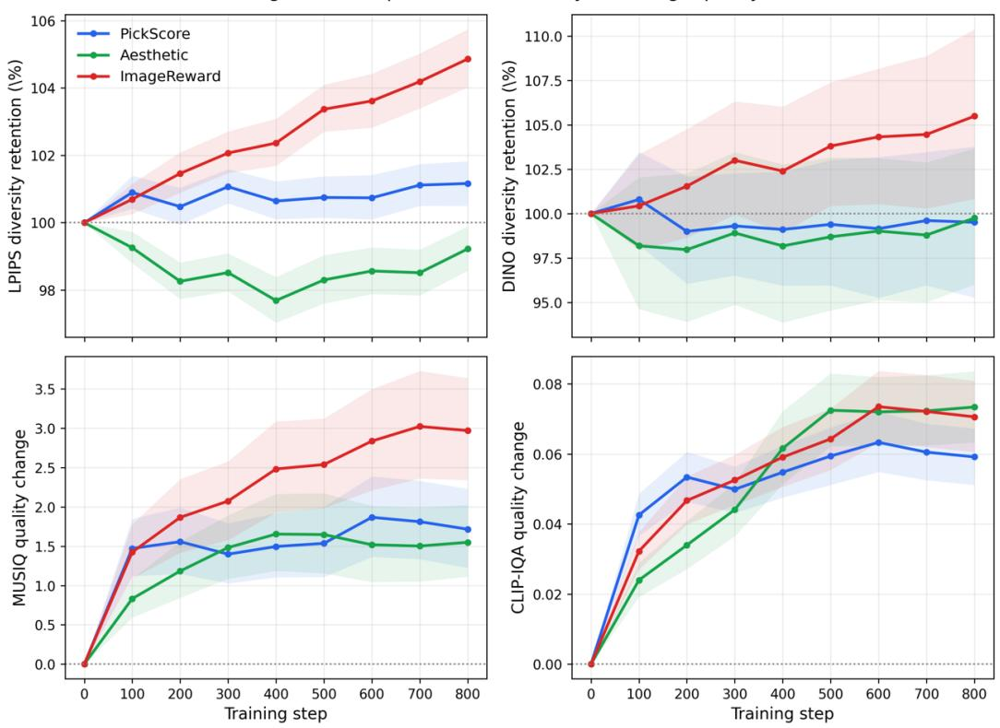  
Figure 7: Diversity and no-reference image quality throughout single-reward optimization. LPIPS and DINO diversity are normalized by the unoptimized SDXL-Turbo baseline, while MUSIQ and CLIP-IQA are shown as absolute improvements over the baseline. All methods preserve nearly all of the baseline diversity, while consistently improving perceptual image quality. Shaded regions indicate 95% paired bootstrap confidence intervals over prompts.

Table 8: Cross-reward evaluation of single-reward LeNO models on SDXL-Turbo. Rows denote the training reward and columns the evaluation reward. Values in parentheses denote improvement over SDXL-Turbo; shaded cells indicate the target reward.
<table><tr><td rowspan="2">Training reward</td><td colspan="3">Evaluation reward</td></tr><tr><td>Aesthetic ↑</td><td>PickScore ↑</td><td>ImageReward ↑</td></tr><tr><td>SDXL-Turbo (no training)</td><td>6.1174</td><td>21.8608</td><td>0.9710</td></tr><tr><td>Aesthetic</td><td>6.1796 (+0.0622)</td><td>21.9728 (+0.1120)</td><td>1.0297 (+0.0587)</td></tr><tr><td>PickScore</td><td>6.1688 (+0.0514)</td><td>22.3308 (+0.4701)</td><td>1.1306 (+0.1596)</td></tr><tr><td>ImageReward</td><td>6.1558 (+0.0384)</td><td>21.9092 (+0.0484)</td><td>1.1984 (+0.2274)</td></tr></table>

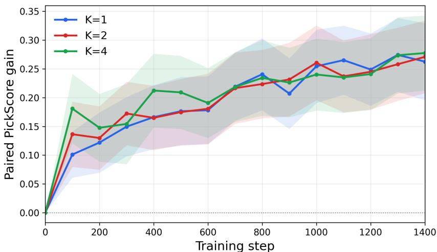  
Figure 8: Ablation for multi-step transport reward gain.

## E.2 MULTI-STEP CORRECTION ABLATION

We additionally investigate whether applying the learned noise correction over multiple residual steps provides finer-grained optimization than the single-step formulation used in the main experiments. We consider $k \in \{ 1 , 2 , 4 \}$ residual transport steps. For the multi-step variants, we use a branching strategy in which stochastic perturbations are introduced at only one of the k steps, while the remaining steps follow deterministic residual transitions. Concretely, at the selected branching step, multiple local particles are generated around the predicted correction and evaluated using the terminal reward; before and after this branching point, the transport is applied deterministically. This preserves the local reward comparison used by Local GRPO without exponentially branching the trajectory at every step.

Figure 8 compares the reward gain throughout training for k = 1, 2, and 4. All three settings exhibit nearly identical improvement curves, and increasing the number of residual steps does not lead to a clear additional gain. Although a multi-step transport is in principle more expressive and could progressively refine the corrected noise, we do not observe such a benefit in this setting. One possible explanation is that the single-step state-dependent correction already captures most of the useful local reward-improvement direction. Moreover, under the branching strategy, only one step receives stochastic local exploration in each branched trajectory, while the remaining steps compose deterministic transformations. Therefore, increasing k does not necessarily provide additional independent reward-improvement signals. These results suggest that iterative refinement is not essential for the tasks considered here, motivating the use of the simpler single-step transport in our main experiments.

## E.3 KL REGULARIZATION ABLATION

We study the effect of the KL regularization weight β, which controls how strongly the learned residual transport is constrained to remain close to the reference noise distribution. We evaluate $\beta \in \{ 0 , 0 . 0 1 , \dot { 0 } . 1 , 1 . 0 \}$ using ImageReward as the optimization objective.

As shown in Fig. 9, a small amount of KL regularization improves both the final reward gain and training stability. Without KL regularization $( \beta = 0 )$ , LeNO still improves the reward substantially, but achieves a lower final gain $\mathbf { \bar { \rho } } ( + 0 . 1 8 8 9 \pm 0 . 1 0 3 8 )$ and win rate (69%) than $\beta \ : = \ : 0 . 0 1$ , which obtains the best result $( + 0 . 2 5 0 4 \pm 0 . 0 8 8 7 _ { \cdot }$ , 76% win rate). Increasing the regularization further reduces the attainable improvement: $\beta = 0 . 1$ yields a gain of $+ 0 . 1 4 3 3 \pm 0 . 0 5 4 3$ , while $\beta = 1 . 0$ nearly suppresses the reward improvement entirely.

These results suggest that the KL term plays more than a purely reward-regularization role. When its weight is zero, the residual transport can move the corrected-noise distribution more freely away from the reference prior, which may weaken the local structure assumed by the residual parameterization and lead to less stable optimization. A small KL weight acts as a trust-region constraint, allowing sufficient movement toward high-reward regions while preventing excessively large distributional shifts. Conversely, overly strong regularization restricts the correction magnitude and prevents the transport from reaching high-reward noise states. Accordingly, an intermediate KL weight provides the best trade-off between reward improvement and preservation of the reference noise structure. This behavior is consistent with the reward-tilted target, which balances reward maximization against deviation from the reference noise distribution rather than optimizing reward alone.

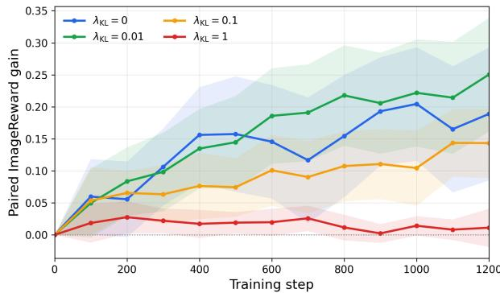

Table 9: Effect of $\beta$ on ImageReward gain and win rate.
<table><tr><td> $\beta$ </td><td>ImageReward Gain</td><td>Win Rate</td></tr><tr><td>0</td><td>0.1889</td><td>69%</td></tr><tr><td>0.01</td><td>0.2504</td><td>76%</td></tr><tr><td>0.1</td><td>0.1433</td><td>68%</td></tr><tr><td>1.0</td><td>0.0112</td><td>59%</td></tr></table>

Figure 9: Ablation of the KL regularization weight $\beta .$

## E.4 GENERALIZATION TO A ONE-STEP GAN GENERATOR

We further evaluate whether LeNO is applicable beyond diffusion-based generators by applying it to DF-GAN (Tao et al., 2022), a one-step prompt-conditioned GAN. We use the same LeNO training setup as in the main experiments, keeping the pretrained generator frozen and optimizing only the residual correction from scalar reward evaluations. Since LeNO operates entirely in the initial noise space and does not require gradients through either the generator or the reward function, no modification of the generator architecture or its internal sampling process is required.

Figure 10 shows qualitative examples before and after LeNO correction to PickScore. Across different prompts, the corrected initial noises produce samples with improved reward-aligned visual characteristics while preserving the underlying generation capability of the frozen DF-GAN. Importantly, this experiment uses the same optimization procedure despite the substantially different generator family. The result therefore supports that LeNO is not tied to a particular diffusion formulation or denoising trajectory, but can be applied to deterministic prompt-conditioned generators whenever they expose an initial noise input and can be evaluated by a scalar reward oracle. This provides additional evidence for the black-box applicability of LeNO to both the generator and the reward function.

## F ADDITIONAL RESULTS

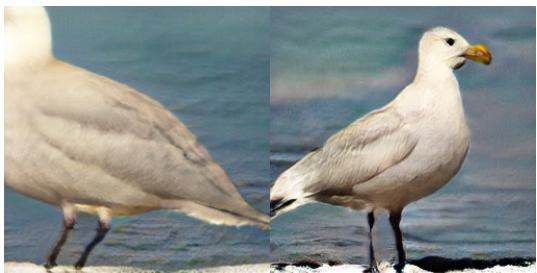  
a white head and an orange beak

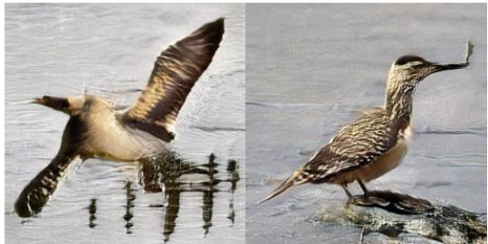  
\~ have white markings on the secondaries

  
a white neck mottled white and gray bellow

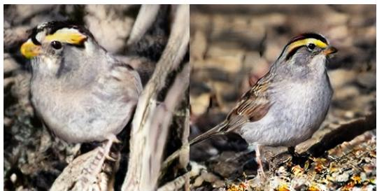  
has a yellow beak that curves downward

Figure 10: Qualitative comparison of DF-GAN generated samples before (left) and after LeNO noise correction (right).  
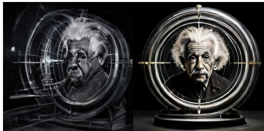  
Archive photo of Einstein

  
A rubber duck floating in space

  
A cup of coffee … phoenix rooster …

  
A frog wearing a pink kimono …

Figure 11: Additional qualitative comparison of SANA-Sprint optimized with compositional multirewards.

  
Water bottle

  
A beautiful plant, aesthetic, …

  
Frozen food logo

  
… mountains with some forests, small lake …

Figure 12: Additional qualitative comparison of SDXL-Turbo optimized with Image Rewards.  
  
Red stop sign, school bus …

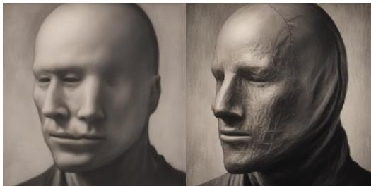  
A head … Studio Harcourt style …

  
Watercolor painting of woodpecker

  
A man as a were wolf …

Figure 13: Additional qualitative comparison of SDXL-Turbo optimized with PickScore.

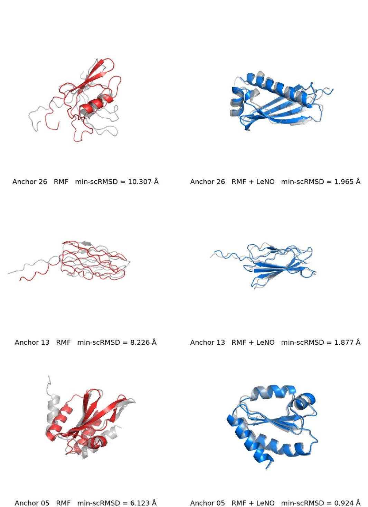  
Figure 14: Additional qualitative self-consistency comparison with RMF at protein length L=96.