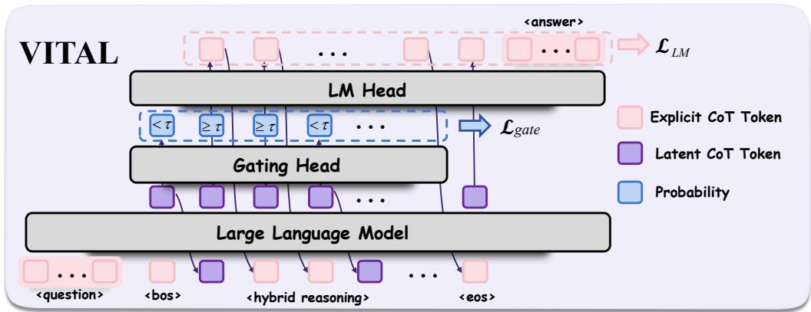
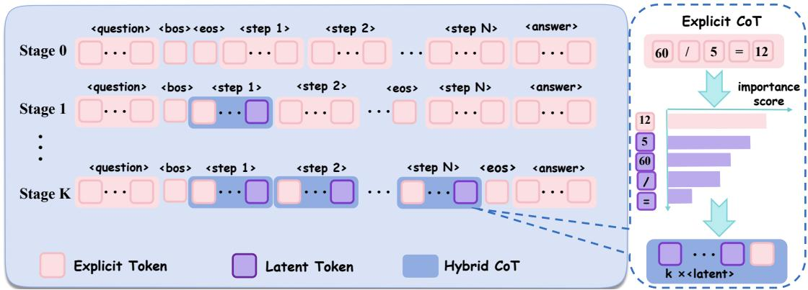
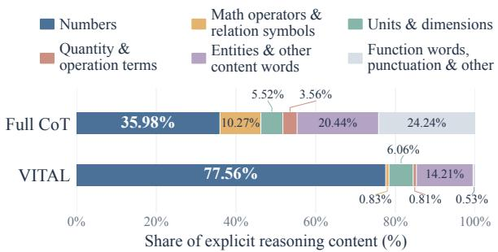
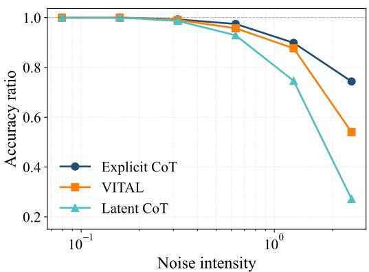
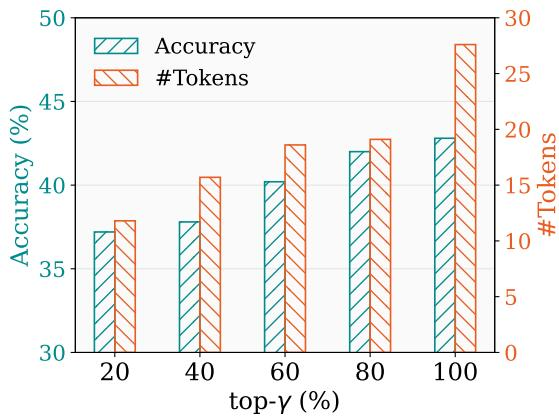

# Learning When to Think Aloud in Latent Reasoning

Zhehao Zhou1, Tongrui Su2, Shengyu Zhu2\*, Da Li2,3, Zeyu Liu3, Jun Zhu3, Xueqi Cheng2

1Beijing Institute of Technology

2Key Laboratory of AI Safety, Institute of Computing Technology, Chinese Academy of Sciences 3Kuaishou Technology

1120232721@bit.edu.cn, sutongrui25s@ict.ac.cn, zhushengyu@ict.ac.cn

## Abstract

Latent Chain-of-Thought (CoT) reasoning improves efficiency by shifting intermediate computation into continuous hidden states. However, fully latent methods often struggle on precision-critical tasks such as mathematical reasoning, while existing hybrid approaches retain substantial token-generation overhead. We introduce VITAL, an importance-guided hybrid reasoning framework that selectively verbalizes informative tokens as reasoning anchors while keeping most computation latent. A lightweight gating head dynamically selects between explicit token generation and direct hidden-state feedback. VITAL constructs hybrid trajectories from explicit CoT using tokenimportance estimation and trains the model through curriculum-based supervised training, followed by reinforcement learning with a reward that balances correctness and conciseness. Experiments show that VITAL consistently outperforms existing fully latent reasoning methods, achieving relative average accuracy gains of 9.6% on GPT-2 and 5.1% on Llama-3.2-1B at comparable reasoning lengths. Compared with hybrid baselines, VITAL achieves higher reasoning accuracy with substantially shorter reasoning trajectories on Qwen3-1.7B.

## 1 Introduction

Large Language Models (LLMs) have demonstrated remarkable reasoning capabilities through Chain-of-Thought (CoT) prompting, which decomposes complex problems into step-by-step natural language rationales (Wei et al., 2022). However, generating lengthy reasoning traces incurs substantial decoding costs. To improve efficiency, latent CoT methods perform intermediate computation in continuous representations rather than verbalizing every reasoning step. Coconut (Hao et al., 2025) introduces hidden-state feedback for continuous reasoning, while CODI (Shen et al., 2025) and Co-LaR (Tan et al., 2025) explore compressing explicit CoT into latent representations. SIM-CoT (Wei et al., 2026) further applies step-level supervision to latent reasoning, while ACoT (Ramji et al., 2026) reasons with discrete abstract tokens instead of continuous states. Recent hybrid approaches, such as Token Assorted (Su et al., 2025), HRPO (Yue et al., 2025) and HybridCoT (Shen et al., 2026) combine latent and explicit representations to improve the overall reasoning performance.

Despite these advances, fully latent methods often underperform explicit CoT on precision-critical tasks like mathematical reasoning, where reliable multi-step computation requires a more accurate handling of intermediate quantities and operations. Wei et al. (2026) show that increasing latent depth can destabilize training and reduce step-level semantic diversity. Zou et al. (2026) introduce a notion of symbolic index to explain the fundamental trade-off between exploration and execution in the reasoning process. Meanwhile, hybrid reasoning methods incorporate explicit intermediate tokens to improve the reasoning accuracy, but generally incur a greater token overhead than fully latent methods. For example, Token Assorted compresses only the initial portion of the reasoning trajectory, whereas HRPO still generates a token at each reasoning step despite incorporating latent representations. Based on these observations, we ask: Can we selectively verbalize a small number of informative tokens as discrete reasoning anchors to preserve critical intermediate information while keeping most computation latent? For training, these tokens serve as explicit prediction targets; during inference, their embeddings are fed back into the model to support subsequent latent computation.

In this work, we propose VITAL, a hybrid reasoning framework that learns when to think aloud by Verbalizing Informative Tokens as reasoning Anchors for Latent reasoning. Rather than generating the full CoT, VITAL selectively externalizes key intermediate tokens while keeping less essential computation latent. As illustrated in Figure 1, VITAL augments a base language model with a lightweight gating head that dynamically decides whether to generate an explicit token or continue latent computation. In the former case, the model generates a token through standard autoregressive decoding and feeds its embedding back as the next input. In the latter case, the current hidden state is directly fed back for subsequent computation. This mechanism enables VITAL to interleave explicit reasoning anchors with continuous latent computation within a unified autoregressive trajectory.

  
Figure 1: Architecture of VITAL. A lightweight gating head dynamically selects between explicit token generation and latent computation at each reasoning step.

To train VITAL, we construct hybrid trajectories from explicit CoT demonstrations. Specifically, we employ LLMLingua-2 (Pan et al., 2024) to estimate token importance within each reasoning step, retaining high-importance tokens as explicit anchors while compressing the remaining spans into latent representation. We adopt curriculum-based supervised training that progressively transforms explicit CoT trajectories into hybrid trajectories, and further apply Reinforcement Learning (RL) post-training with a tailored reward that balances both correctness and conciseness.

We evaluate VITAL on mathematical and scientific reasoning benchmarks using GPT-2 (Radford et al., 2019), Llama-3.2-1B (Meta, 2024), and Qwen3-1.7B (Team, 2025). Experimental results show that VITAL consistently outperforms existing fully latent reasoning baselines, achieving relative improvements in average accuracy of 9.6% on GPT-2 and 5.1% on Llama-3.2-1B at comparable reasoning lengths. Compared with hybrid methods Token Assorted and HRPO, VI-

TAL achieves higher reasoning accuracy with substantially shorter reasoning trajectories. Ablation studies further show that selecting high-importance tokens achieves higher accuracy than random or low-importance tokens. These findings validate the effectiveness of importance-guided selective verbalization in improving the accuracy-length tradeoff of latent reasoning.

Our contributions are threefold:

• We propose VITAL, a hybrid reasoning framework that uses a lightweight gating head to interleave sparse explicit reasoning anchors with continuous latent computation.

• We develop an importance-guided, step-wise trajectory construction strategy together with a twostage training procedure to enable selective verbalization of informative tokens.

• We evaluate VITAL against explicit, latent, and hybrid reasoning baselines across three backbones, demonstrating an improved accuracylength trade-off and the importance of selecting informative reasoning anchors.

## 2 Related Work

Latent CoT Reasoning. Latent CoT methods seek to reduce explicit token generation by internalizing intermediate reasoning into continuous hidden states. Early work, such as iCoT (Deng et al., 2024a), progressively internalizes explicit reasoning steps during training. Coconut (Hao et al., 2025) learns continuous reasoning through curriculum-based hidden-state feedback, while CODI (Shen et al., 2025) compresses explicit CoT through self-distillation. CoLaR (Tan et al., 2025) learns to predict compressed embeddings with adjustable compression factors. SIM-CoT (Wei et al., 2026) introduces step-level supervision through an auxiliary decoder that is removed at inference. Unlike these approaches, VITAL selectively verbalizes informative intermediate tokens as discrete reasoning anchors during inference. These tokens are then fed back into the model as embeddings to support subsequent latent computation.

Hybrid CoT Reasoning. Hybrid methods combine latent and explicit reasoning tokens. Token ${ \mathrm { A s } } -$ sorted (Su et al., 2025) replaces a prefix of the reasoning trace with discrete latent codes, and HRPO (Yue et al., 2025) uses RL to learn a gated blend of token embeddings and continuous representations while still sampling a token at every step. Hybrid-CoT (Shen et al., 2026) generates each text block in full, compresses it into latent tokens, and keeps only LLM-annotated math spans in the context, reducing context length rather than decoding steps. In contrast, VITAL retains importance-selected tokens within every reasoning step as anchors and never decodes the remaining content as text, replacing it with latent computation. During inference, a lightweight gating head selects between explicit token generation and direct hidden-state feedback at each position. This design improves reasoning accuracy while keeping the decoding trajectory short.

Soft-Embedding Reasoning. Another line of work performs continuous reasoning by constructing soft embeddings from vocabulary distributions. Soft Thinking (Zhang et al., 2025) replaces discrete token selection with a probability-weighted mixture of vocabulary embeddings. SwiReasoning (Shi et al., 2026) and SeLaR (Fu and Luo, 2026) dynamically switch between such soft embeddings and explicit token generation using confidence signals. These approaches operate at inference without additional training. In contrast, VITAL directly feeds back the current hidden state during latent computation, rather than constructing soft embeddings from vocabulary distributions, and learns its routing policy from hybrid trajectories constructed from explicit CoT demonstrations.

## 3 Preliminary

This section introduces the notation and the token importance estimation method used in the paper.

## 3.1 Notation

We denote the base causal language model by $\mathcal { M } _ { \theta }$ For an input sequence $y _ { \le t } = ( y _ { 1 } , y _ { 2 } , \cdot \cdot \cdot , y _ { t } )$ , let

$E _ { t } = [ e ( y _ { 1 } ) , e ( y _ { 2 } ) , \cdot \cdot \cdot , e ( y _ { t } ) ]$ be the sequence of input embeddings up to position t, where $e ( \cdot )$ represents the token embedding function. We also use $e _ { t }$ to represent the input embedding at position t. The model produces hidden states

$$
H _ { t } = \mathcal { M } _ { \theta } ( E _ { t } ) , \quad h _ { t } = H _ { t } [ t , : ] ,\tag{1}
$$

where $H _ { t } \in \mathbb { R } ^ { t \times d } .$ , and $h _ { t } \in \mathbb { R } ^ { d }$ is the hidden state at the last position. Standard next-token prediction is given by $p _ { \theta } ( y _ { t + 1 } \mid y _ { \le t } ) = \mathrm { S o f t m a x } ( W h _ { t } )$ 2 with $W$ the language modeling head.

For explicit CoT output, we assume that each example consists of a question x, a step-wise rationale $\boldsymbol { c } = \left( s _ { 1 } , \ldots , s _ { N } \right)$ , and a final response a. Here $s _ { i }$ is the i-th reasoning step with tokens $\left( s _ { i , 1 } , s _ { i , 2 } , \cdots , s _ { i , N _ { i } } \right)$

## 3.2 Token Importance

Not every token in the CoT output contributes the same to the response. Recently, Li et al. (2023) measure the importance of output tokens using the semantic confidence of $\mathrm { L L M s } \colon - \log p _ { \phi } ( y _ { t } \mid y _ { < t } )$ where $\mathcal { M } _ { \phi }$ is the LLM used to compute the confidence and $\{ y _ { i } \} _ { i = 1 } ^ { t }$ is the given tokens.

Despite its simplicity, Pan et al. (2024) argue that there are two limitations. First, perplexity-based scores often assign lower importance to tokens near the end of a sentence. Second, causal language models rely on unidirectional attention and may fail to capture important contextual information. Authors then introduce LLMLingua-2 using a bidirectional BERT-like model (Devlin et al., 2019) to estimate token importance. It utilizes GPT-4 to label whether a token is important, and trains the bidirectional model with a classification objective. The importance is measured by the predicted probability of each token: $p _ { \phi ^ { \prime } } ( y _ { i } \mid y _ { \leq t } )$ with $\mathcal { M } _ { \phi ^ { \prime } }$ the bidirectional model. We will treat LLMLingua-2 as a frozen scoring module and use the scores to decide which tokens serve as reasoning anchors.

## 4 VITAL: Learning When to Think Aloud

This section presents VITAL, a hybrid autoregressive reasoning framework that combines explicit symbolic reasoning and latent computation.

## 4.1 Overview

VITAL modifies a base language model with a lightweight gating module, enabling it to operate in a mixed symbolic-latent space. The model dynamically switches between generating explicit token in the language space or performing latent computation in the continuous hidden space.

  
Figure 2: Curriculum-based supervised training for VITAL. We construct hybrid reasoning trajectories from explicit CoT by identifying high-importance tokens as the anchors.

Figure 2 illustrates the training process of VI-TAL. We construct hybrid trajectories from explicit rationales by identifying high-importance tokens as reasoning anchors. We train VITAL with a joint objective consisting of language modeling loss and token-wise gating loss, following a stage-wise curriculum-based procedure. Finally, we apply RL post-training to further improve the performance.

## 4.2 Hybrid Trajectory Construction

VITAL employs LLMLingua-2 (Pan et al., 2024) introduced in Section 3.2 as an off-the-shelf token importance scoring model. Different from Xia et al. (2025), we perform token selection individually within each reasoning step so that every step retains some symbolic anchors. This strategy helps preserve local symbolic structure. In contrast, selection over the entire CoT often results in a subset of tokens from merely one or a few reasoning steps, leading to degraded performance.

High-Importance Tokens. Concretely, for each step $s _ { i } = \{ s _ { i , j } \} _ { j }$ , we use $\{ q _ { i , j } \} _ { j }$ to denote corresponding importance scores. For our purpose, we pick the top-γ, $\gamma \in \mathsf { ( 0 , 1 ) }$ fraction of tokens in the reasoning step according to the importance score. That is, we rank the scores $\{ q _ { i , j } \} _ { j }$ in a descending order, and denote by $q _ { i } ( \gamma )$ the empirical γ-quantile of these importance values. Tokens with importance values greater than or equal to $q _ { i } ( \gamma )$ are selected as anchor tokens:

$$
\begin{array} { r } { S _ { i } = \left\{ s _ { i , j } \mid q _ { i , j } \geq q _ { i } ( \gamma ) \right\} . } \end{array}\tag{2}
$$

The rest tokens are considered to be processed through latent computation.

Hybrid Trajectory. Next, we convert each reasoning step into a mixed symbolic-latent form. In particular, consecutive “unimportant” tokens, i.e., tokens not in $\textstyle S _ { i } .$ , are compressed into a fixed number $k _ { \mathrm { l a t e n t } }$ of special <latent> placeholders, regardless of the original length. The tokens in $s _ { i }$ are retained as ordinary tokens. This construction preserves important tokens as anchors, while less essential content is compressed into compact placeholder sequences that trigger latent computation. Figure 6 in Appendix D presents an example hybrid trajectory with $k _ { \mathrm { l a t e n t } } = 1$

We use $\tilde { s } _ { i }$ to denote the symbolic-latent reasoning step. Then the hybrid trajectory is

$$
\tilde { c } = ( \tilde { s } _ { 1 } , \tilde { s } _ { 2 } , \cdots , \tilde { s } _ { N } ) .\tag{3}
$$

For ease of presentation, we also represent the hybrid trajectory in the form of concrete tokens, associated with binary labels whose entry indicates whether the corresponding token is explicit:

$$
\begin{array} { r } { \tilde { c } = ( \tilde { c } _ { 1 } , \tilde { c } _ { 2 } , \cdots , \tilde { c } _ { T } ) , } \\ { \tilde { g } = ( \tilde { g } _ { 1 } , \tilde { g } _ { 2 } , \cdots , \tilde { g } _ { T } ) , } \end{array}\tag{4}
$$

where T is the total number of latent placeholders and explicit tokens, and $\tilde { g } _ { t } = 1$ indicates that $\tilde { c } _ { t }$ is the explicit token.

## 4.3 Model Architecture and Loss Function

We now introduce the model architecture and learning objective based on the hybrid trajectories.

Architecture. VITAL modifies the base language model by incorporating a lightweight gating head, to decide whether the subsequent token should be verbalized. Specifically, given the hidden state $h _ { t }$ at the last position, we compute a gate probability with a two-layer MLP $p _ { \mathrm { g a t e } } ( t )$ = $\sigma ( W _ { 2 } \operatorname { R e L U } ( W _ { 1 } h _ { t } ) )$ , where $\sigma ( \cdot )$ is the Sigmoid function. During inference, we obtain a binary routing decision $z _ { t } = \mathbf { 1 } [ p _ { \mathrm { g a t e } } ( t ) \geq \tau ]$ with $\tau \textbf { a }$ predefined threshold. $z _ { t } = 1$ indicates that the next step is verbalized as an explicit token, while $z _ { t } = 0$ indicates latent computation. Denote by $\hat { c } _ { t + 1 }$ the generated token, which is explicit when $z _ { t } = 1$

The key mechanism of VITAL is that explicit and latent tokens correspond to different next-input representations. When $z _ { t } ~ = ~ 1$ , VITAL follows standard autoregressive decoding and feeds the embedding of the generated token $\hat { c } _ { t + 1 }$ . When $z _ { t } = 0$ it directly feeds back the current hidden state $h _ { t }$ as the next-input embedding. Formally, the next-input embedding is given by

$$
e _ { t + 1 } = { \left\{ \begin{array} { l l } { e ( { \hat { c } } _ { t + 1 } ) , } & { z _ { t } = 1 , } \\ { h _ { t } , } & { z _ { t } = 0 . } \end{array} \right. }\tag{5}
$$

This design can automatically decide when to verbalize intermediate states to steer the reasoning process. It distinguishes VITAL from prior latent reasoning methods such as Coconut, CODI, and CoLaR, where the number of latent thoughts is predetermined before generating a response.

Supervised Loss Function. We optimize a joint objective consisting of a language modeling loss and a gating loss. To facilitate the prediction of future reasoning, the anchor tokens and answer tokens are supervised, while latent placeholders are masked. Specifically, for a sequence of hybrid tokens $\tilde { c } = \{ \tilde { c } _ { t } \} _ { t = 1 } ^ { T }$ and binary labels $\tilde { g } = \{ \tilde { g } _ { t } \} _ { t = 1 } ^ { T }$ defined in Eq. (4), the language modeling loss is

$$
\mathcal { L } _ { \mathrm { L M } } = - \sum _ { t } \tilde { g } _ { t } \log p _ { \theta } ( \tilde { c } _ { t } \mid \tilde { c } _ { < t } ) ,\tag{6}
$$

where $\tilde { g } _ { t } = 1$ means that $\tilde { c } _ { t }$ is the explicit anchor token while $\tilde { g } _ { t } = 0$ indicates a latent placeholder.

In addition, we supervise the routing behavior at each hybrid token, involving the gating probability $p _ { \mathrm { g a t e } } ( t )$ and the binary label $\tilde { g } _ { t }$

$$
\mathcal { L } _ { \mathrm { g a t e } } = \sum _ { t } \mathrm { C r o s s E n t r o p y } \left( \tilde { g } _ { t } , p _ { \mathrm { g a t e } } ( t ) \right) .\tag{7}
$$

The final objective is then given by

$$
\begin{array} { r } { \mathcal { L } = \mathcal { L } _ { \mathrm { L M } } + \lambda \mathcal { L } _ { \mathrm { g a t e } } , } \end{array}\tag{8}
$$

where $\lambda > 0$ is a balancing hyper-parameter. This learning objective will be used in the following supervised training stage.

## 4.4 Training and Inference

We train VITAL in two phases: curriculum-based supervised training followed by RL training. During inference, VITAL performs gated autoregressive decoding in a mixed symbolic-latent space.

Curriculum-based Training. Inspired by the progressive curriculum strategy of Coconut (Hao et al., 2025), we adopt a stage-wise curriculum that gradually transitions from explicit CoT supervision to hybrid reasoning. Specifically, we construct a sequence of training trajectories with increasing degrees of hybridization. At stage k, the first k reasoning steps are converted into hybrid forms while remaining steps remain explicit:

$$
\tilde { c } ^ { ( k ) } = ( \tilde { s } _ { 1 } , \cdot \cdot \cdot , \tilde { s } _ { k } , s _ { k + 1 } , \cdot \cdot \cdot , s _ { N } ) .\tag{9}
$$

Thus, stage 0 corresponds to the original explicit CoT c, while the final stage corresponds to the fully hybridized rationale c˜. At each stage, the model is trained on $\tilde { c } ^ { ( k ) }$ using the supervised objective in Eq. (8). The hybrid reasoning tokens are additionally enclosed by two special boundary markers, <start\_hybrid> and <end\_hybrid>, allowing the model to distinguish hybrid reasoning from the question prompt and the final answer.

RL Training. We can further improve VITAL’s performance using Group Relative Policy Optimization (GRPO), to explore trajectories that are correct and more concise. For each input question, we sample a group of G hybrid reasoning trajectories and assign each trajectory a reward $R _ { i }$ combining response correctness and conciseness:

$$
R _ { i } = \mathbf { 1 } [ \hat { a } _ { i } = a ] \left[ 1 + \beta \left( 1 - \frac { T _ { i } } { T _ { \operatorname* { m a x } } } \right) \right] ,\tag{10}
$$

where $\hat { a } _ { i }$ and Ti are the generated answer and length of the i-th trajectory, respectively, a is the true answer, $\beta > 0$ is a hyper-parameter, and $T _ { \mathrm { m a x } }$ is a predefined maximum length.

We normalize the rewards $\{ R _ { i } \} _ { i = 1 } ^ { G }$ to obtain group-relative advantages. At each step, we compute the importance ratio over the sampled hybrid action. Unlike standard token-level policy ratios, here the ratio includes both the gating and tokengeneration probabilities for anchor actions, but only the gating probability for a latent-computation action. GRPO then updates the policy model with a clipped group-relative objective. Due to space limit, we provide the detailed formulation in Section A.

Inference Process. At inference, VITAL performs autoregressive generation in the hybrid space. The gating dynamically selects between generating an explicit anchor token or continuing latent computation. In the explicit mode, the model generates the next token via standard decoding; in the latent mode, it feeds the current hidden state back as the next input and records a <latent> marker. Once <end\_hybrid> is produced, the model exits hybrid reasoning and generates the final answer. In this way, VITAL can dynamically allocate its reasoning budget within a unified autoregressive process.

## 5 Experiments

We evaluate the effectiveness of VITAL through experiments on mathematical reasoning tasks.

## 5.1 Experimental Setup

Training Dataset. Unless otherwise stated, we train models on GSM8K-Aug (Deng et al., 2024b), a CoT augmented version of GSM8K (Cobbe et al., 2021) that provides explicit intermediate reasoning trajectories with final answers. Both supervised training and subsequent RL training are conducted on this dataset, without using additional data.

Evaluation Benchmarks. We report the experimental results on the GSM8K-Aug (Deng et al., 2024b) test split, as our in-domain benchmark. To evaluate the generalized performance beyond training distribution, we also test on three out-of-domain benchmarks: (1) SVAMP (Patel et al., 2021), which evaluates robustness on arithmetic word problems with simple variations; (2) GSM8K-Hard (Gao et al., 2023), a harder GSM8K-style benchmark with increasing numerical magnitude and compositional difficulty; and (3) MultiArith (Roy and Roth, 2015), a subset of MAWPS (Koncel-Kedziorski et al., 2016) consisting of multi-step arithmetic word problems. See Section B for more dataset details.

Baselines. We consider the following baselines: (1) CoT-SFT: finetunes the model on full CoT data and performs explicit token-level reasoning at inference; (2) Coconut (Hao et al., 2025): gradually replaces explicit reasoning with latent reasoning through curriculum learning and performs reasoning via hidden-state feedback; (3) CODI (Shen et al., 2025): compresses explicit CoT into the continuous latent space through self-distillation; (4) CoLaR (Tan et al., 2025): compresses multiple reasoning tokens into latent variables and further improves latent reasoning with dynamic compression; (5) SIM-CoT (Wei et al., 2026): adds steplevel supervision via an auxiliary decoder.

Implementation. For VITAL, we use the same hybrid trajectory construction throughout the paper: in each reasoning step we keep the top-γ fraction of tokens as explicit anchors and compress the remaining tokens into latent placeholders, with $\gamma = 0 . 2$ and $k _ { \mathrm { l a t e n t } } = 1$ . Due to space limit, more implementation details and hyper-parameter settings are described in Appendix C.

## 5.2 Main Results

Table 1 reports the main results on GPT-2 small and Llama-3.2-1B. VITAL consistently outperforms prior fully latent baselines in terms of accuracy while maintaining comparable or improved efficiency, demonstrating the effectiveness of verbalizing high-importance tokens as reasoning anchors. The RL-trained variant, VITAL-RL, further improves performance and achieves the highest average accuracy among efficient reasoning methods.

Compared with CoT-SFT, VITAL-RL attains comparable average accuracy with substantially shorter reasoning traces. It reduces the average reasoning length from 25.9 to 9.4 tokens on GPT-2 and from 24.3 to 9.1 tokens on Llama-3.2-1B. Notably, on MultiArith with GPT-2, VITAL-RL achieves an accuracy of 85.6% with only 6.8 average tokens.

## 5.3 Comparison with Hybrid Methods

We further evaluate VITAL against hybrid reasoning methods on more diverse and challenging benchmarks. Specifically, we train VITAL with Qwen3-1.7B on the training splits of GSM8K-Aug-NL (Deng et al., 2024b; Shen et al., 2025) and MATH (Hendrycks et al., 2021), and evaluate it on their test splits, MATH-500 (Lightman et al., 2024), and ARC-C (Clark et al., 2018). These experiments extend our evaluation beyond equationcentric GSM8K-Aug setting to natural-language mathematical reasoning, more challenging mathematical problems, and science reasoning. We compare VITAL with CoT-SFT, HRPO (Yue et al., 2025), and Token Assorted (Su et al., 2025), reporting answer accuracy and total reasoning length, which includes explicit tokens and latent steps.

For VITAL-RL, we use a binary correctness reward ${ R } _ { i } = \mathbf { 1 } [ \hat { a } _ { i } = a ]$ . We omit the length penalty to avoid explicitly favoring shorter reasoning trajectories in this comparison, since these two hybrid methods generally have much longer reasoning trajectories than fully latent methods.

Table 1: Main results on in-domain and out-of-domain benchmarks. Performance is measured by accuracy (Acc., %) and average reasoning length (# Tokens).
<table><tr><td rowspan="3">Method</td><td colspan="2">In-domain</td><td colspan="6">Out-of-domain</td><td colspan="2">Overall</td></tr><tr><td colspan="2">GSM8K</td><td colspan="2">GSM8K-Hard</td><td colspan="2">Multi-Arith</td><td colspan="2">SVAMP</td><td colspan="2">Average</td></tr><tr><td>Acc.(%)</td><td>#Tokens</td><td>Acc.(%)</td><td>#Tokens</td><td>Acc.(%)</td><td>#Tokens</td><td>Acc.(%)</td><td>#Tokens</td><td>Acc.(%)</td><td>#Tokens</td></tr><tr><td colspan="10">GPT-2</td></tr><tr><td>CoT-SFT</td><td>42.7</td><td>27.6</td><td>9.0</td><td>39.1</td><td>85.0</td><td>19.6</td><td>41.6</td><td>17.6</td><td>45.2</td><td>25.9</td></tr><tr><td>Coconut</td><td>34.1</td><td>8.0</td><td>6.9</td><td>8.0</td><td>80.7</td><td>8.0</td><td>32.0</td><td>8.0</td><td>38.4</td><td>8.0</td></tr><tr><td>CODI</td><td>24.6</td><td>8.0</td><td>5.0</td><td>8.0</td><td>45.0</td><td>8.0</td><td>26.9</td><td>8.0</td><td>25.4</td><td>8.0</td></tr><tr><td>CoLaR</td><td>26.8</td><td>12.9</td><td>6.3</td><td>16.5</td><td>79.4</td><td>8.4</td><td>31.3</td><td>6.7</td><td>35.9</td><td>11.2</td></tr><tr><td>SIM-CoT</td><td>33.1</td><td>12.0</td><td>7.5</td><td>12.0</td><td>81.6</td><td>12.0</td><td>32.6</td><td>12.0</td><td>38.7</td><td>12.0</td></tr><tr><td>VITAL (Ours)</td><td>37.2</td><td>11.8</td><td>8.6</td><td>14.3</td><td>85.0</td><td>6.2</td><td>36.3</td><td>6.1</td><td>42.1</td><td>9.6</td></tr><tr><td>VITAL-RL (Óurs)</td><td>38.8</td><td>11.4</td><td>8.4</td><td>13.5</td><td>85.6</td><td>6.8</td><td>36.7</td><td>6.1</td><td>42.4</td><td>9.4</td></tr><tr><td colspan="10">Llama-3.2-1B</td></tr><tr><td>CoT-SFT</td><td>49.4</td><td>28.3</td><td>11.6</td><td>34.3</td><td>97.7</td><td>18.4</td><td>52.6</td><td>16.2</td><td>52.8</td><td>24.3</td></tr><tr><td>Coconut</td><td>33.2</td><td>8.0</td><td>7.0</td><td>8.0</td><td>63.3</td><td>8.0</td><td>43.7</td><td>8.0</td><td>36.8</td><td>8.0</td></tr><tr><td>CODI</td><td>37.1</td><td>8.0</td><td>9.3</td><td>8.0</td><td>90.6</td><td>8.0</td><td>47.2</td><td>8.0</td><td>46.1</td><td>8.0</td></tr><tr><td>CoLaR</td><td>40.1</td><td>12.9</td><td>9.0</td><td>14.0</td><td>91.3</td><td>7.4</td><td>46.5</td><td>6.2</td><td>46.7</td><td>10.1</td></tr><tr><td>SIM-CoT</td><td>39.0</td><td>12.0</td><td>9.1</td><td>12.0</td><td>86.7</td><td>12.0</td><td>42.5</td><td>12.0</td><td>44.3</td><td>12.0</td></tr><tr><td>VITAL(Ours)</td><td>44.2</td><td>11.5</td><td>9.7</td><td>12.2</td><td>91.6</td><td>7.0</td><td>48.3</td><td>5.8</td><td>48.5</td><td>9.1</td></tr><tr><td>VITAL-RL (Ours)</td><td>46.0</td><td>11.4</td><td>9.5</td><td>12.2</td><td>92.2</td><td>7.0</td><td>48.7</td><td>5.9</td><td>49.1</td><td>9.1</td></tr></table>

Table 2: Results on Qwen3-1.7B. Acc.(%) denotes final-answer accuracy, and #Tokens denotes average reasoning length, including both explicit tokens and latent steps.
<table><tr><td rowspan="2">Method</td><td colspan="2">GSM8K-NL</td><td colspan="2">MATH</td><td colspan="2">MATH500</td><td colspan="2">ARC-C</td><td colspan="2">Average</td></tr><tr><td>Acc.(%)</td><td>#Tokens</td><td>Acc.(%)</td><td>#Tokens</td><td>Acc.(%)</td><td>#Tokens</td><td>Acc.(%)</td><td>#Tokens</td><td>Acc.(%)</td><td>#Tokens</td></tr><tr><td colspan="9">Qwen3-1.7B</td><td></td></tr><tr><td>CoT-SFT</td><td>69.5</td><td>81.8</td><td>35.6</td><td>321.1</td><td>35.0</td><td>302.7</td><td>57.6</td><td>541.7</td><td>49.4</td><td>311.8</td></tr><tr><td>HRPO</td><td>64.5</td><td>110.2</td><td>27.6</td><td>763.2</td><td>26.0</td><td>765.1</td><td>53.7</td><td>464.2</td><td>43.0</td><td>525.7</td></tr><tr><td>Token Assorted</td><td>60.1</td><td>73.9</td><td>26.9</td><td>183.4</td><td>27.6</td><td>253.4</td><td>66.0</td><td>88.3</td><td>45.2</td><td>149.8</td></tr><tr><td>VITAL (Ours)</td><td>53.5</td><td>32.5</td><td>23.4</td><td>136.6</td><td>26.2</td><td>120.1</td><td>63.2</td><td>67.8</td><td>41.6</td><td>89.3</td></tr><tr><td>VITAL-RL (Ours)</td><td>62.5</td><td>37.7</td><td>34.4</td><td>140.3</td><td>34.8</td><td>136.5</td><td>71.6</td><td>70.3</td><td>50.8</td><td>96.2</td></tr></table>

As shown in Table 2, VITAL produces the shortest trajectories, albeit with lower average accuracy than the baselines. RL training substantially improves accuracy across all four benchmarks, increasing average accuracy from 41.6% to 50.8%, with only 7.7% increase in average reasoning length (from 89.3 to 96.2). Compared with Token Assorted, VITAL-RL achieves higher accuracy with shorter trajectories on all four benchmarks. It also outperforms HRPO in terms of accuracy on three of the four benchmarks while maintaining shorter trajectories on all the benchmarks.

## 5.4 Analysis of Generated Tokens

To better understand what VITAL selectively verbalizes, we compare the token-category distributions of its explicit outputs on Qwen3-1.7B with those of full CoT. As shown in Figure 3, numerical tokens account for a substantially larger proportion of VITAL’s explicit outputs, while function words, punctuation, and other general textual content are less prevalent. This suggests that VITAL does not merely generate shortened natural language rationales, but instead prioritizes compact numerical and symbolic information in its explicit outputs.

  
Figure 3: Token-category distributions of full CoT and VITAL on GSM8K-NL (Qwen3-1.7B).

## 5.5 Robustness to Error Accumulation

As discussed in Zou et al. (2026), small errors can accumulate when the continuous states are repeatedly propagated in fully latent reasoning methods. In contrast, explicit CoT is more robust as it discretizes intermediate states into concrete tokens. To evaluate the robustness of VITAL against error accumulation, we use a similar setting from Zou et al. (2026) and inject Gaussian noise into the hidden states during the reasoning process. Figure 4 reports the performance degradation under different noise intensity on Llama-3.2-1B. In comparison with the fully latent CoT method Coconut, emitting explicit tokens as reasoning anchors clearly improves the robustness to noises, validating the effectiveness of VITAL.

  
Figure 4: Performance degradation under noise injection. We inject Gaussian noise $\mathcal { N } ( 0 , \sigma ^ { 2 } I _ { d } )$ to the hidden states during reasoning and report the accuracy result of GSM8K on Llama-3.2-1B.

## 5.6 Ablation Study

Anchor Selection. To further investigate the contribution of important tokens to the performance gains of VITAL, we compare three token-selection strategies using Qwen3-1.7B: highest-importance selection (used by VITAL); random selection, and lowest-importance selection.

Table 3 reports the accuracy results on GSM8K-Aug, GSM8K-Hard, MultiArith, and SVAMP. Highest-importance selection outperforms both alternatives on all four benchmarks. Random selection obtains smaller average gains over Coconut, whereas the performance of lowest-importance selection performs is close to Coconut. This result highlights the effectiveness of importance-guided anchor selection, suggesting that the choice of verbalized tokens matters more than merely introducing explicit tokens.

Top-γ Ratio. We study how the top-γ ratio in hybrid trajectory construction affects reasoning performance. Specifically, we vary γ in {0.2, 0.4, 0.6,

Table 3: Accuracy (%) on four benchmarks. VITAL uses highest-importance tokens as reasoning anchors.
<table><tr><td>Method</td><td>GSM8K-Aug</td><td>GSM8K-Hard MultiArith</td><td></td><td>SVAMP</td><td> $\operatorname { A v g } .$ </td></tr><tr><td>SFT</td><td>69.1</td><td>36.5</td><td>98.9</td><td>77.5</td><td>71.3</td></tr><tr><td>Coconut</td><td>60.2</td><td>25.3</td><td>97.2</td><td>65.4</td><td>62.0</td></tr><tr><td>Lowest</td><td>59.2</td><td>25.1</td><td>97.8</td><td>66.1</td><td>62.1</td></tr><tr><td>Random</td><td>62.8</td><td>28.2</td><td>97.8</td><td>67.8</td><td>64.1</td></tr><tr><td>VITAL</td><td>64.1</td><td>30.1</td><td>98.3</td><td>69.2</td><td>65.4</td></tr></table>

  
Figure 5: Ablation on the top-γ ratio. We vary the proportion of explicit anchors and evaluate its effect.

0.8, 1.0}, where larger values retain more tokens as reasoning anchors and smaller values enable greater latent compression. As shown in Figure 5, increasing γ generally improves accuracy, as more information is preserved in explicit anchors. However, this also increases the reasoning length. Overall, γ = 0.2 appears to achieve the best trade-off, retaining sufficient anchors for stable reasoning while keeping most computation latent.

## 6 Concluding Remarks

We propose VITAL, a hybrid reasoning framework that learns when to think aloud and when to remain silent. VITAL selectively verbalizes informative tokens as anchors for latent reasoning. It introduces a lightweight gating head to the base language model. For training, we construct hybrid trajectories from explicit rationales, followed by a two-stage training process consisting of curriculum-based supervised training and RL training. Experiments show that VITAL consistently outperforms existing fully latent reasoning methods at comparable reasoning lengths. Compared with hybrid baselines, VITAL achieves higher reasoning accuracy with substantially shorter reasoning trajectories. These results validate the effectiveness of importance-guided selective verbalization in improving the accuracylength trade-off of latent reasoning.

## Limitations

In this paper, the largest model on which we conduct supervised training is Llama-3.2-3B-Instruct (see Appendix E). Due to limited GPU resources, we are not able to complete RL training at this scale, and our RL results are limited to smaller models. Another limitation is on the choice of reasoning anchors. The present work considers only the “important” tokens in the original explicit CoT trajectories, and the proposed method is effective in improving the accuracy-length trade-off for latent reasoning. Yet, we do not investigate other forms of reasoning anchors. Future work can explore suitable hidden embeddings or other supervision signals as the reasoning anchors.

## Ethics Impact

The proposed method VITAL is designed to improve both reasoning performance and efficiency. Part of the reasoning process is performed in latent space, and the generated rationales may expose only a few explicit anchor tokens rather than the full internal reasoning trajectory. This may make model behavior less transparent than fully explicit CoT in some settings. Therefore, VITAL should be used with appropriate task-specific evaluation and safety checks before deployment in high-stakes applications. We will also release our code to facilitate future research on efficient and transparent LLM reasoning.

## References

Peter Clark, Isaac Cowhey, Oren Etzioni, Tushar Khot, Ashish Sabharwal, Carissa Schoenick, and Oyvind Tafjord. 2018. Think you have solved question answering? try arc, the ai2 reasoning challenge. arXiv preprint arXiv:1803.05457.

Karl Cobbe, Vineet Kosaraju, Mohammad Bavarian, Mark Chen, Heewoo Jun, Lukasz Kaiser, Matthias Plappert, Jerry Tworek, Jacob Hilton, Reiichiro Nakano, Christopher Hesse, and John Schulman. 2021. Training verifiers to solve math word problems. arXiv preprint arXiv:2110.14168.

Yuntian Deng, Yejin Choi, and Stuart Shieber. 2024a. From explicit cot to implicit cot: Learning to internalize cot step by step. arXiv preprint arXiv:2405.14838.

Yuntian Deng, Yejin Choi, and Stuart Shieber. 2024b. From explicit CoT to implicit CoT: Learning to internalize CoT step by step. arXiv preprint arXiv:2405.14838.

Jacob Devlin, Ming-Wei Chang, Kenton Lee, and Kristina Toutanova. 2019. BERT: Pre-training of deep bidirectional transformers for language understanding. In Proceedings of the 2019 Conference of the North American Chapter of the Association for Computational Linguistics: Human Language Technologies, Volume 1 (Long and Short Papers).

Renyu Fu and Guibo Luo. 2026. Selar: Selective latent reasoning in large language models. In Proceedings of the 64th Annual Meeting of the Association for Computational Linguistics (Volume 1: Long Papers).

Luyu Gao, Aman Madaan, Shuyan Zhou, Uri Alon, Pengfei Liu, Yiming Yang, Jamie Callan, and Graham Neubig. 2023. PAL: Program-aided language models. In International Conference on Machine Learning.

Shibo Hao, Sainbayar Sukhbaatar, DiJia Su, Xian Li, Zhiting Hu, Jason Weston, and Yuandong Tian. 2025. Training large language models to reason in a continuous latent space. In Conference on Language Modeling.

Dan Hendrycks, Collin Burns, Saurav Kadavath, Akul Arora, Steven Basart, Eric Tang, Dawn Song, and Jacob Steinhardt. 2021. Measuring mathematical problem solving with the math dataset. arXiv preprint arXiv:2103.03874.

Rik Koncel-Kedziorski, Subhro Roy, Aida Amini, Nate Kushman, and Hannaneh Hajishirzi. 2016. MAWPS: A math word problem repository. In Proceedings of the 2016 Conference of the North American Chapter of the Association for Computational Linguistics: Human Language Technologies.

Yucheng Li, Bo Dong, Frank Guerin, and Chenghua Lin. 2023. Compressing context to enhance inference efficiency of large language models. In Proceedings of the 2023 Conference on Empirical Methods in Natural Language Processing.

Hunter Lightman, Vineet Kosaraju, Yuri Burda, Harrison Edwards, Bowen Baker, Teddy Lee, Jan Leike, John Schulman, Ilya Sutskever, and Karl Cobbe. 2024. Let’s verify step by step. In International Conference on Learning Representations, volume 2024, pages 39578–39601.

Meta. 2024. Llama 3.2: Revolutionizing edge AI and vision with open, customizable models. Meta AI Blog. https://ai.meta.com/blog/llama-3-2-c onnect-2024-vision-edge-mobile-devices/.

Zhuoshi Pan, Qianhui Wu, Huiqiang Jiang, Menglin Xia, Xufang Luo, Jue Zhang, Qingwei Lin, Victor Rühle, Yuqing Yang, Chin-Yew Lin, H. Vicky Zhao, Lili Qiu, and Dongmei Zhang. 2024. LLMLingua-2: Data distillation for efficient and faithful task-agnostic prompt compression. In Findings of the Association for Computational Linguistics: ACL 2024.

Arkil Patel, Satwik Bhattamishra, and Navin Goyal. 2021. Are NLP models really able to solve simple

math word problems? In Proceedings of the 2021 Conference of the North American Chapter of the Associationfor Computational Linguistics: Human Language Technologies.

Alec Radford, Jeff Wu, Rewon Child, David Luan, Dario Amodei, and Ilya Sutskever. 2019. Language models are unsupervised multitask learners.

Keshav Ramji, Tahira Naseem, and Ramón Fernandez Astudillo. 2026. Thinking without words: Efficient latent reasoning with abstract chain-of-thought. arXiv preprint arXiv:2604.22709.

Subhro Roy and Dan Roth. 2015. Solving general arithmetic word problems. In Proceedings of the 2015 Conference on Empirical Methods in Natural Language Processing.

Shannon Zejiang Shen, Rulin Shao, Chenyu Wang, Songlin Yang, Vincent-Pierre Berges, Gargi Ghosh, Pang Wei Koh, Luke Zettlemoyer, Yoon Kim, Jason E Weston, David Sontag, and Wen tau Yih. 2026. Hybridcot: Interleaving latent and text chain-of-thought for efficient reasoning.

Zhenyi Shen, Hanqi Yan, Linhai Zhang, Zhanghao Hu, Yali Du, and Yulan He. 2025. CODI: Compressing chain-of-thought into continuous space via selfdistillation. In Proceedings of the 2025 Conference on Empirical Methods in Natural Language Processing.

Dachuan Shi, Abedelkadir Asi, Keying Li, Xiangchi Yuan, Leyan Pan, Wenke Lee, and Wen Xiao. 2026. Swireasoning: Switch-thinking in latent and explicit for pareto-superior reasoning llms. In International Conference on Learning Representations, volume 2026, pages 137060–137093.

DiJia Su, Hanlin Zhu, Yingchen Xu, Jiantao Jiao, Yuandong Tian, and Qinqing Zheng. 2025. Token assorted: Mixing latent and text tokens for improved language model reasoning. In Forty-second International Conference on Machine Learning.

Wenhui Tan, Jiaze Li, Jianzhong Ju, Zhenbo Luo, Ruihua Song, and Jian Luan. 2025. Think silently, think fast: Dynamic latent compression of llm reasoning chains. In The Thirty-ninth Annual Conference on Neural Information Processing Systems.

Qwen Team. 2025. Qwen3 technical report. arXiv preprint arXiv:2505.09388.

Jason Wei, Xuezhi Wang, Dale Schuurmans, Maarten Bosma, brian ichter, Fei Xia, Ed H. Chi, Quoc V Le, and Denny Zhou. 2022. Chain of thought prompting elicits reasoning in large language models. In Advances in Neural Information Processing Systems.

Xilin Wei, Xiaoran Liu, Yuhang Zang, Xiaoyi Dong, Yuhang Cao, Jiaqi Wang, Xipeng Qiu, and Dahua Lin. 2026. SIM-CoT: Supervised implicit chain-ofthought. In The Fourteenth International Conference on Learning Representations.

Heming Xia, Chak Tou Leong, Wenjie Wang, Yongqi Li, and Wenjie Li. 2025. Tokenskip: Controllable chainof-thought compression in LLMs. In Proceedings of the 2025 Conference on Empirical Methods in Natural Language Processing.

Qiying Yu, Zheng Zhang, Ruofei Zhu, Yufeng Yuan, Xiaochen Zuo, YuYue, Weinan Dai, Tiantian Fan, Gaohong Liu, Juncai Liu, LingJun Liu, Xin Liu, Haibin Lin, Zhiqi Lin, Bole Ma, Guangming Sheng, Yuxuan Tong, Chi Zhang, Mofan Zhang, and 17 others. 2025. DAPO: An open-source LLM reinforcement learning system at scale. In The Thirty-ninth Annual Conference on Neural Information Processing Systems.

Zhenrui Yue, Bowen Jin, Huimin Zeng, Honglei Zhuang, Zhen Qin, Jinsung Yoon, Lanyu Shang, Jiawei Han, and Dong Wang. 2025. Hybrid latent reasoning via reinforcement learning. In The Thirty-ninth Annual Conference on Neural Information Processing Systems.

Zhen Zhang, Xuehai He, Weixiang Yan, Ao Shen, Chenyang Zhao, and Xin Wang. 2025. Soft thinking: Unlocking the reasoning potential of LLMs in continuous concept space. Advances in Neural Information Processing Systems.

Jiaxuan Zou, Yaozhong Xiong, and Yong Liu. 2026. Capabilities and fundamental limits of latent chainof-thought. arXiv preprint arXiv:2602.01148.

## A RL Training Details

Following the reward defined in Eq. (10), we estimate the advantage through group-relative reward normalization. The advantage of the i-th trajectory is given by

$$
A _ { i } = \frac { R _ { i } - \mathrm { m e a n } ( \{ R _ { i } \} _ { i = 1 } ^ { G } ) } { \mathrm { s t d } ( \{ R _ { i } \} _ { i = 1 } ^ { G } ) } .
$$

At each step t, we compute the importance ratio over the sampled hybrid action. Let $z _ { i , t }$ denote the binary decision of the gating function in the i-th trajectory and $\hat { c } _ { i , t }$ the explicit token with $z _ { i , t } = 1$ Then we define the hybrid action as:

$$
y _ { i , t } = \left\{ \begin{array} { l l } { ( z _ { i , t } , \hat { c } _ { i , t } ) , } & { z _ { i , t } = 1 , } \\ { z _ { i , t } , } & { z _ { i , t } = 0 . } \end{array} \right.
$$

The policy probability of a hybrid action depends on whether the action corresponds to explicit anchor generation or latent computation, which is

$$
\begin{array} { r l } & { \pi _ { \theta } ( y _ { i , t } \mid x , y _ { i , < t } ) } \\ & { \ = \left\{ \begin{array} { l l } { p _ { \mathrm { g a t e } , \theta } ( t ) p _ { \theta } ^ { \mathrm { L M } } ( \hat { c } _ { i , t } \mid x , y _ { i , < t } ) , } & { z _ { i , t } = 1 , } \\ { 1 - p _ { \mathrm { g a t e } , \theta } ( t ) , } & { z _ { i , t } = 0 , } \end{array} \right. } \end{array}
$$

and the importance ratio is defined as

$$
\rho _ { i , t } = \frac { \pi _ { \theta } ( y _ { i , t } \mid x , y _ { i , < t } ) } { \pi _ { \theta _ { \mathrm { o l d } } } ( y _ { i , t } \mid x , y _ { i , < t } ) } ,
$$

where $\pi _ { \theta }$ and $\pi _ { \boldsymbol { \theta } _ { \mathrm { o l d } } }$ are the current and old policy models, x is the input question, $y _ { i , t }$ is the hybrid action corresponding to either anchor generation or latent computation, and $y _ { i , < t }$ is the i-th trajectory before the t-th step. GRPO then minimizes the clipped policy loss:

$$
\begin{array} { c } { \displaystyle { \mathcal { L } _ { \mathrm { G R P O } } = - \frac { 1 } { G } \sum _ { i = 1 } ^ { G } \sum _ { t = 1 } ^ { T _ { i } } \operatorname* { m i n } \Big ( \rho _ { i , t } \frac { A _ { i } } { T _ { i } } , } } \\ { \displaystyle { \mathrm { c l i p } ( \rho _ { i , t } , 1 - \epsilon , 1 + \epsilon ) \frac { A _ { i } } { T _ { i } } \Big ) , } } \end{array}
$$

where ϵ is a clipping hyperparameter and $T _ { i }$ is the length of the i-th reasoning trajectory. Here we also remove the KL-regularization term from original GRPO for efficient training, following Yu et al. (2025); Tan et al. (2025).

## B Datasets

We provide examples and statistics of the training datasets and evaluation benchmarks.

## B.1 Examples

## GSM8k-Aug

Question = "Out of 600 employees in a company, 30% got promoted while 10% received bonus. How many employees did not get either a promotion or a bonus?"

CoT = "«600\*30/100=180»«600\*10/100=60» «180+60=240»«600-240=360»" Answer = "360"

## GSM-Hard

Question = "Marie ordered one chicken meal that costs \$12, 5 packs of milk that costs \$3 each, 4 apples that cost \$1.3299286 each, and some boxes of pizza. Marie paid a total of \$3299286. How many boxes of pizza did Marie order if each box costs \$8.3299286?" Answer = "388147.4117647059"

## MultiArith

Question = "A waiter at ’The Greasy Spoon’ restaurant had 26 customers to wait on. During the lunch rush he added another 27 customers. If 27 of the customers didn’t leave him a tip, how many customers did leave a tip?" Answer = "26"

## SVAMP

Question = "Paul got a box of some crayons for his birthday. During the school year he gave 52 crayons to his friends while he lost 535 crayons. If he only had 492 crayons left, how many crayons had been lost or given away?" Answer = "587.0"

## B.2 Dataset Statistics

The statistics of the training data are shown in Table 4, and the statistics of the evaluation benchmarks are shown in Table 5.

Table 4: Training data statistics.
<table><tr><td>Training Dataset | Num. Data</td><td></td><td>Avg. CoT Tokens</td></tr><tr><td>GSM8K-Aug</td><td>385,620</td><td>20.3</td></tr></table>

Table 5: Evaluation benchmark statistics.
<table><tr><td>Benchmark</td><td>Type</td><td>Data Size</td></tr><tr><td>GSM8K-Aug</td><td>In-domain</td><td>1,319</td></tr><tr><td>GSM8K-Hard</td><td>Out-of-domain</td><td>1,319</td></tr><tr><td>SVAMP</td><td>Out-of-domain</td><td>1,000</td></tr><tr><td>MultiArith</td><td>Out-of-domain</td><td>500</td></tr></table>

## C Implementation Details

## C.1 General Setup

We evaluate VITAL on three backbones: GPT-2, Llama-3.2-1B, and Llama-3.2-3B. All models are trained solely on GSM8K-Aug. To ensure a fair comparison, all compared methods adopt the same training dataset and evaluation protocol. Due to limited computing resources, each dataset-level result is obtained from a single run unless otherwise stated. GPT-2 (Radford et al., 2019) and Llama-3.2-1B are trained in fp32 precision, while Llama-3.2-3B (Meta, 2024) is trained in bf16 precision.

We measure reasoning efficiency by the average reasoning chain length (# Tokens). We count only the tokens within the reasoning chain, i.e., the explicit anchor tokens together with the <latent> placeholders, and exclude the question and the final answer tokens.

## C.2 Setup of VITAL

Hybrid Trajectory Construction. We employ LLMLingua-2 (Pan et al., 2024) as a frozen tokenimportance scoring module. Within each reasoning step, we retain the top-γ fraction of tokens as explicit anchors with $\gamma = 0 . 2$ , and compress each segment of consecutive non-anchor tokens into $k _ { \mathrm { l a t e n t } } = 1$ <latent> placeholder. The hybrid reasoning tokens are enclosed by the special markers <start\_hybrid> and <end\_hybrid>.

Gating and Loss. At inference, a token is generated explicitly when the gate probability exceeds the threshold $\tau = 0 . 5$ . The training objective combines the language-modeling loss and the gating loss with a balancing weight λ = 0.1.

RL Training. After supervised training, we further optimize VITAL with GRPO. We pick group size $G = 3 2$ , conciseness weight $\beta = 0 . 5$ for the reward, clipping parameter $\epsilon = 0 . 2$ , and a learning rate of $5 \times 1 0 ^ { - 6 }$

## C.3 Setup of Baseline Methods

We reproduce the baseline methods following their default configurations reported in the papers.

Coconut (Hao et al., 2025): We use a fixed learning rate of $1 \times 1 0 ^ { - 4 }$ and represent each reasoning step with 2 continuous thoughts. A multi-stage curriculum progressively converts explicit reasoning steps into latent thoughts. The model is trained for 3 epochs in each stage except the last stage.

CODI (Shen et al., 2025): We use the AdamW optimizer with a cosine learning-rate schedule, linear warm-up over the first 3% training steps, an effective batch size of 128. The model uses 6 continuous thoughts, and the distillation objective weights are set to be 1 for both the student and distillation terms. The learning rate is $3 \times 1 0 ^ { - 3 }$ with 40 epochs for GPT-2 and $8 \times 1 0 ^ { - 4 }$ with 10 epochs for Llama-3.2-1B.

CoLaR (Tan et al., 2025): We use the AdamW optimizer with a weight decay of $1 0 ^ { - 2 }$ and a learning rate of $1 \times 1 0 ^ { - 4 }$ for supervised fine-tuning. The latent head is a three-layer MLP, the maximum compression factor is 5, and the finetuning batch size is 256.

SIM-CoT (Wei et al., 2026): SIM-CoT is a plug-and-play step-level supervision module that introduces an auxiliary decoder during training, which is removed at inference. It is applied on top of Coconut and CODI, inheriting their respective configurations above. We use Adam $( \beta _ { 1 } = 0 . 9 ,$ $\beta _ { 2 } = 0 . 9 9 9$ and weight decay 0.1) optimizer and set batch size to 128 for GPT-2 and Llama-3.2-1B.

## C.4 Summary of Hyperparameters

Table 6 summarizes the key hyperparameters of VITAL, and Table 7 summarizes the configurations of baselines.

Table 6: Hyperparameters of VITAL.
<table><tr><td>Hyperparameter</td><td>Value</td></tr><tr><td>Anchor ratio γ Latent placeholders  $k _ { \mathrm { l a t e n t } }$  Gating threshold τ Loss weight λ Curriculum stages Epochs per stage</td><td>0.2 1 0.5 0.1 3</td></tr></table>

Computing Budget. All the experiments are conducted on a compute node with 2 NVIDIA H800 80GB GPUs. For supervised training, the GPT-2, Llama-3.2-1B, and Llama-3.2-3B experiments require approximately 6, 40, and 100 hours, respectively.

Table 7: Configurations of the baselines. All models are trained for the specified number of epochs or 50 hours, whichever is reached first.
<table><tr><td>Method</td><td>Model</td><td>LR</td><td>Epochs</td></tr><tr><td rowspan="2">Coconut</td><td>GPT-2 Llama-3.2-1B</td><td> $1 \times 1 0 ^ { - 4 }$ </td><td>20</td></tr><tr><td>Llama-3.2-3B</td><td> $8 \times 1 0 ^ { - 4 }$   $8 \times 1 0 ^ { - 4 }$ </td><td>20 20</td></tr><tr><td>CODI</td><td>GPT-2 Llama-3.2-1B Llama-3.2-3B</td><td> $3 \times 1 0 ^ { - 3 }$   $8 \times 1 0 ^ { - 4 }$   $8 \times 1 0 ^ { - 4 }$ </td><td>40 10 10</td></tr><tr><td>CoLaR</td><td>GPT-2 Llama-3.2-1B Llama-3.2-3B</td><td> $1 \times 1 0 ^ { - 4 }$   $1 \times 1 0 ^ { - 4 }$   $1 \times 1 0 ^ { - 4 }$ </td><td>50 50 50</td></tr></table>

## D An Example of Constructed Hybrid CoT.

Figure 6 shows an example hybrid trajectory with $k _ { \mathrm { l a t e n t } } = 1$

Example of Hybrid Trajectory   
Problem: A car travels with a speed of 80 miles per   
hour. If it has already travelled 6 hours, how long more   
does it have to travel if the total distance is 1000 miles?   
Original CoT:   
«80 \* 6 = 480»   
$\ll 1 0 0 0 - 4 8 0 = 5 2 8 \gg$   
«520 / 80 = 6.5»   
Hybrid CoT:   
<latent> \* 6 <latent>   
<latent> - 480 <latent>   
<latent> 80 <latent> 6.5   
Answer: 6.5  
Figure 6: An example of the constructed hybrid CoT.

## E Additional Results on Larger Backbones

To examine whether VITAL remains effective on a larger model, we consider Llama-3.2-3B with the same GSM8K-Aug setting as in Table 1 and compare VITAL against CoT-SFT and the latent baselines Coconut, CODI, and CoLaR. Due to limited computational resources, we report results for the supervised model only and do not perform RL training at this scale. The results are reported in Table 8.

On Llama-3.2-3B, VITAL continues to provide a favorable accuracy-length trade-off. It achieves 54.1% average accuracy with 8.3 reasoning steps, outperforming the strongest latent baseline, CODI, by 2.1 percentage points at a similar reasoning length. Compared with CoLaR, it improves average accuracy by 3.0 percentage points while reducing the average reasoning length from 16.8 to 8.3. Compared with CoT-SFT, VITAL is only 2.4 percentage points lower in average accuracy while using 34.6% of its reasoning length.

## F Artifact Licenses and Responsible Use

Artifacts. This work uses existing public datasets, pretrained models, and baseline methods. The datasets include GSM8K-Aug, GSM8K-Hard, MultiArith, SVAMP, and CommonsenseQA. The pretrained backbones include GPT-2 and Llama-3.2 models. We also use LLMLingua-2 as a frozen token-importance scorer and compare our method with prior latent reasoning baselines including Coconut, CODI, CoLaR, and SIM-CoT.

Licenses and Terms of Use. We use these artifacts for research and benchmarking purposes. We check the licenses and terms of use of the public artifacts used in our experiments. GSM8K is released under the MIT License, GPT-2 is released under a modified MIT License, and CommonsenseQA is distributed under the MIT License according to its dataset card. Llama-3.2 models are used under the Llama-3.2 Community License and its acceptable use policy. For all artifacts, we follow their intended research use and do not redistribute any restricted model weights or data beyond what is permitted by the corresponding licenses.

Intended Use. The intended use of our experiments is to study efficient reasoning in language models. The derived models and experimental results are intended for research evaluation only. They should not be used directly in high-stakes domains such as medical, legal, financial, or safetycritical decision making without additional validation and safeguards.

Privacy and Offensive Content. We do not collect new user data and do not conduct humansubject data collection. The datasets used in this work are existing public benchmarks. They consist primarily of mathematical word problems and multiple-choice commonsense questions. We do not intentionally use personally identifying information. However, as with many public NLP datasets, we cannot completely rule out the presence of unintended sensitive or biased content. We therefore restrict our use of these datasets to research evaluation and report aggregate benchmark results only.

Table 8: Experimental results on Llama-3.2-3B. Accuracy and average reasoning chain length are reported across in-domain and out-of-domain benchmarks.
<table><tr><td rowspan="3">Method</td><td colspan="2">In-domain</td><td colspan="6">Out-of-domain</td><td colspan="2">Overall</td></tr><tr><td colspan="2">GSM8K-Aug</td><td colspan="2">GSM8K-Hard</td><td colspan="2">MultiArith</td><td colspan="2">SVAMP</td><td colspan="2">Average</td></tr><tr><td>Acc. (%)</td><td># Tokens</td><td>Acc. (%)</td><td># Tokens</td><td>Acc. (%)</td><td># Tokens</td><td>Acc. (%)</td><td># Tokens</td><td>Acc. (%)</td><td># Tokens</td></tr><tr><td>CoT-SFT</td><td>55.4</td><td>28.5</td><td>12.7</td><td>35.7</td><td>96.7</td><td>17.6</td><td>61.0</td><td>14.5</td><td>56.5</td><td>24.0</td></tr><tr><td>Coconut</td><td>36.7</td><td>8.0</td><td>8.7</td><td>8.0</td><td>90.5</td><td>8.0</td><td>37.8</td><td>8.0</td><td>43.4</td><td>8.0</td></tr><tr><td>CODI</td><td>47.2</td><td>8.0</td><td>11.2</td><td>8.0</td><td>93.2</td><td>8.0</td><td>56.5</td><td>8.0</td><td>52.0</td><td>8.0</td></tr><tr><td>CoLaR</td><td>45.4</td><td>13.5</td><td>10.1</td><td>40.4</td><td>96.3</td><td>7.3</td><td>51.8</td><td>6.0</td><td>51.1</td><td>16.8</td></tr><tr><td>VITAL</td><td>52.2</td><td>11.9</td><td>11.6</td><td>10.2</td><td>97.2</td><td>6.1</td><td>55.2</td><td>5.1</td><td>54.1</td><td>8.3</td></tr></table>