# Nowcasting Future Performance for Population Pruning in Survival-of-the-Fittest Training

Rico Städeli1  Léo Meynent1  Boris Knyazev2,3 Damian Borth1,3

1University of St.Gallen, 2University of Montreal 3Weight Space Labs

{rico.staedeli, leo.meynent, damian.borth}@unisg.ch

## Abstract

Training high-performing neural networks often involves evaluating populations of candidate models with varying hyperparameters, architectures, or random seeds. Training every candidate to completion is computationally expensive, yet stopping seemingly weaker runs early risks discarding models that would ultimately perform better, as learning curves can cross. To address this challenge, we investigate whether intermediate training checkpoints can predict future model accuracy and enable more informed pruning decisions. Our nowcasters predict test accuracy five epochs ahead or at the end of training. They are trained with accuracy and loss histories, weight statistics, and SANE representations as inputs. SANE is a transformer autoencoder that encodes a checkpoint as a sequence of latent tokens. We then use the nowcasters in Survival-of-the-Fittest (SOTF) training. SOTF repeatedly ranks runs during training by predicted accuracy and stops the lowestranked ones. Our results show that weight statistics work best for five-epoch forecasts, and SANE representations work best for final accuracy prediction. For evaluation, we compare SOTF with pruning the population by current accuracy. In homogeneous model zoos such as the CNN zoos, pruning by current accuracy already retains a final model only slightly worse than the best. Model zoos with a larger spread in performance, such as the ResNet-18 and ViT zoos, are more difficult to prune by current accuracy alone. In these zoos, SOTF with nowcasted final accuracy almost closes the gap to the best model.

Code is available at: https://github.com/RicoStaedeli/sotf-training.

## 1 Introduction

Training a neural network is rarely an isolated procedure. Practical machine-learning workflows typically train populations of candidate models that vary in their random seeds, hyperparameters widths, or architectures before selecting a model for deployment or further study. Fully training every candidate is expensive, particularly when only a small fraction of the population will ultimately be retained. Adaptive resource-allocation methods such as Successive Halving, Hyperband, BOHB, and Population Based Training reduce this cost by pruning candidates during training and concentrating computation on the most promising runs [1, 2, 3, 4]. Their effectiveness, however, depends on whether the information available at an intermediate checkpoint reliably identifies the models that will perform well later. Current performance is not always such a signal. At any epoch, ordering the candidates by their observed accuracy defines a ranking of the population but this ranking is only useful for pruning the population if it agrees with the ranking that would be observed once training finishes. In practice, the accuracy curves of two candidates can cross: a model that currently trails may later overtake a model that currently leads, so their relative order in the ranking swaps. When such crossings still lie ahead, the intermediate ranking is a misleading guide to final quality, even though it accurately reflects current performance. In an irreversible pruning procedure, an eliminated candidate cannot be reconsidered, so a crossing that occurs after a pruning decision permanently removes what would have been the better-performing model. Reliable early selection therefore requires more than an accurate description of what a model currently achieves. It requires also evidence about how its training trajectory, and hence its position in the ranking, is likely to continue to change. Weight-space learning offers a natural perspective on this problem by treating neural network parameters as a data modality rather than only as the output of optimization [5]. Following the taxonomy of Ettling et al. [6], existing downstream tasks can be organized along two complementary axes. The first concerns the prediction target. Discriminative methods map weights to model properties such as accuracy, generalization, or training hyperparameters [7, 8], whereas generative methods synthesize, edit, or update parameters [9, 10]. The second axis concerns the observations supplied to the method, namely whether a model is represented by an isolated checkpoint or by a sequence of checkpoints sampled along its optimization trajectory. Combining these axes distinguishes static property prediction from the less explored setting in which a partial weight trajectory is used to anticipate future learning behavior. Neuron Interaction and Nowcasting Networks (NiNo) occupy the generative, trajectoryconditioned part of this design space. Given recent parameters, NiNo predicts the parameters of a future checkpoint and uses the generated state to skip optimizer steps along an individual training run [11]. We study the neighboring discriminative, trajectory-conditioned problem. Given intermediate checkpoint representations and the metrics observed so far, we predict future scalar performance and use the resulting nowcasts to rank a population of training runs. In analogy to NiNo, we refer to these predictions as performance nowcasts and to the resulting selection procedure as Survival-of-the-Fittest training (SOTF training). We propose SOTF training as a new population-level resource-allocation method for concentrating computation on models with the greatest predicted potential. By stopping less promising trajectories early, it aims to reduce the total compute and associated energy required to train and select from a model population.

Our central question is whether intermediate checkpoint weights contain information about future model quality that is complementary to the observed learning curve, and whether this information leads to better pruning decisions. The distinction between these two questions is important. A predictor may reduce numerical nowcasting error without changing which models are retained, while an imperfect nowcast may still preserve the strongest candidates. We therefore study the problem in three stages. First, we quantify consequential rank instability and pairwise cross-overs across nine checkpointed model zoos. Second, we nowcast horizon-specific and final test accuracy from performance histories, checkpoint-derived weight statistics, and representations obtained with SANE [12]. SANE represents a checkpoint as a sequence of latent tokens, each encoding a local subset of its parameters. We compare a compact embedding obtained by averaging these tokens with predictors that preserve their window- or token-level structure. The latter can use differences and relationships between parts of the checkpoint that are lost when all tokens are collapsed into a single vector. Third, we conduct retrospective SOTF training evaluations on held-out recorded trajectories. Starting with a population of partially trained models, each selection round retains the candidates with the strongest predicted future performance. We then measure whether the models that ultimately perform best remain in the population and how much training compute the pruning decisions can save, using this quantity as a proxy for energy savings. Throughout these evaluations, predictors are trained once on completed historical runs and then applied without refitting to a held-out population.

## 2 Related work

Our work lies at the intersection of three lines of research: the analysis of learning dynamics, learning from neural network weights, and learning-curve prediction for adaptive resource allocation.

## 2.1 Learning dynamics and weight-space trajectories

Intermediate checkpoints sample a trajectory through parameter space, exposing structure absent from the final model. Weight changes have been used to monitor training progress and distinguish optimization phases [13]. In representation space, learned features evolve in structured ways during training [14], and directional analyses of parameter trajectories reveal recurring patterns of exploration and redundancy [15]. Phase-transition model zoos extend this view from individual runs to deliberately heterogeneous populations with qualitatively different learning behavior [16]. These studies show that optimization trajectories are structured, but not when this structure helps allocate compute among partially trained models. We therefore ask not only whether weights or rankings change, but whether these changes are large enough to affect population quality, and connect trajectory analysis to model selection by measuring local rank cross-overs throughout training.

## 2.2 Learning from neural network weights

A model zoo is a systematically generated population of neural networks with recorded training configurations, weights, and performance metrics [17, 18]. When intermediate checkpoints are retained, each model also provides a sampled trajectory through training time and weight space. Model zoos therefore provide the population-level data needed to learn functions over neural network parameters. On the discriminative side, Unterthiner et al. show that simple layer-wise weight statistics can predict the accuracy of trained networks without evaluating them on input data [7]. Learned hyper-representations instead encode checkpoints into latent spaces that support the prediction of properties such as accuracy, epoch, and hyperparameters [8]. SANE, the Sequential Autoencoder for Neural Embeddings, is a transformer-based autoencoder for neural-network checkpoints [12]. It splits parameter tensors into position-encoded weight tokens and encodes bounded token windows into contextualized latent tokens, which scales to larger networks; a reconstruction decoder ensures that the latents retain local parameter structure. Existing property-prediction tasks mainly ask about the current state of a single model or checkpoint. We extend this discriminative setting to account for training dynamics by predicting the future or final accuracy of a model that is still training from its current checkpoint and, potentially, its preceding trajectory. Generative weight-space methods use similar artifacts for a different output. They generate new model parameters, reconstruct checkpoints, or modify existing networks. For example, hyper-representations have been used to sample previously unseen neural network weights [19, 20]. Most closely related to our focus on training dynamics are weight nowcasting methods. Weight Nowcaster Networks predict a future parameter state from recent checkpoints and intermittently replace conventional optimizer steps [21]. NiNo improves this approach by representing neuron connectivity explicitly and modeling interactions between parameters [11]. Both nowcasting methods generate the future weights of one trajectory. In contrast, we predict the future scalar performance of many trajectories and use these predictions to select among them at the population level: NiNo advances individual trajectories, whereas our method allocates resources across trajectories.

## 2.3 Learning-curve prediction and adaptive resource allocation

Learning-curve prediction estimates future performance from a partially observed sequence of metrics. Parametric extrapolation fits a predefined curve family, whereas methods such as LCNet learn distributions over learning curves across configurations [22]. These approaches provide important baselines for our task because they use the same metric history available to a pruning policy, but not the corresponding checkpoint state. We test whether weight statistics and learned SANE representations supply information beyond this observed performance history. Adaptive resource-allocation methods turn intermediate observations into training decisions. Successive Halving repeatedly removes weak configurations, Hyperband evaluates different trade-offs between initial population size and permodel budget, and BOHB combines this multi-fidelity allocation with model-based configuration search [1, 2, 3]. Population Based Training additionally updates the configurations of retained models during training [4]. These methods primarily rank candidates using observed performance or configuration-level models. Our SOTF training evaluations hold the candidate population and its recorded trajectories fixed and isolate a different question: whether checkpoint-derived nowcasts produce better elimination decisions than current accuracy or learning curves alone.

## 3 Method

We study a checkpointed model zoo as a population of independently trained models. For model i, the available checkpoints form a trajectory $\{ ( \pmb \theta _ { i , e } , y _ { i , e } ) : e \in \mathcal { E } _ { i } \}$ , where $\theta _ { i , e }$ denotes the parameters and $y _ { i , e }$ the recorded test accuracy at epoch e. Our corpus contains nine image-classification zoos spanning CIFAR-10 [23], STL-10 [24], and Tiny ImageNet [25]. Six zoos contain CNNs and vary random seeds or training hyperparameters; the remaining zoos contain width-varying ResNet-18s or Vision Transformers constructed to cover different phase-transition regimes [16, 17]. The training horizons range from 50 to 300 epochs. For all predictor experiments, we partition each zoo at the model level, so all checkpoints from one trajectory belong to exactly one of the training, validation, or test splits. The training split is used to fit representations, feature transformations, and predictors; the validation split is used for hyperparameter tuning and predictor selection; and the test split is reserved for the retrospective SOTF training evaluation

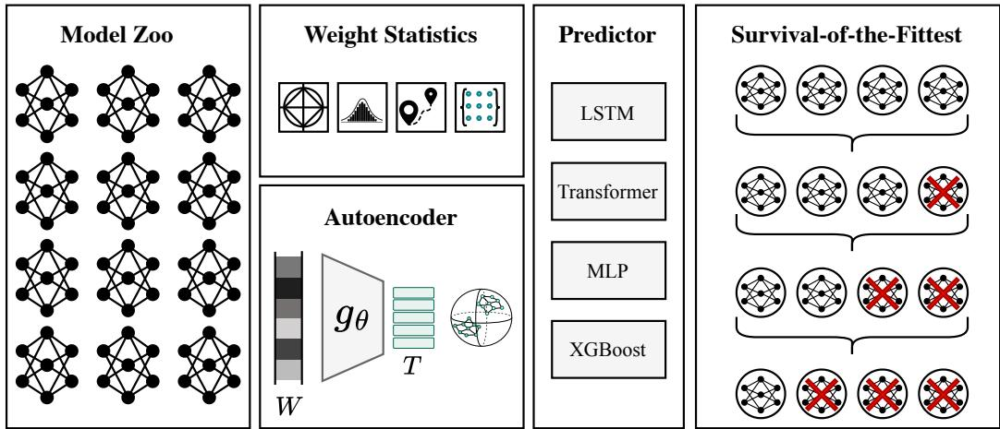  
Figure 1: Overview of the methodology. Input to the pipeline is a raw model zoo containing checkpoints with weights and recorded performance metrics. The pipeline produces aligned checkpointlevel datasets with weight-space representations and performance metrics. These datasets are used for descriptive learning-dynamics analysis and for training nowcasting predictors. The trained predictors are then held fixed during the Survival-of-the-Fittest training (SOTF training) on a held-out population, where weak models are removed before the end of their recorded trajectories.

## 3.1 Learning dynamics

The learning-dynamics analysis establishes when intermediate accuracy is an unreliable selection signal. Accuracy distributions describe population-level heterogeneity over time, whereas cross-overs measure changes in the relative ordering of individual models.

Accuracy distributions over training. For every zoo and saved epoch e, we form the empirical distribution $\mathcal { V } _ { e } = \{ y _ { i , e } : e \in \mathcal { E } _ { i } \}$ . We visualize these epoch-wise distributions together with a small sample of individual learning curves and summarize their center and spread using the mean, standard deviation, interquartile range, and 10th-90th percentile interval. Because the zoos have different training horizons, comparisons across zoos use normalized progress $p _ { i , e } = e / e _ { i } ^ { \mathrm { m a x } }$ ; withinzoo analyses retain the original epoch scale. The resulting summaries reveal whether a population converges to a narrow performance band or retains distinct groups of weak and strong models throughout training.

Pairwise cross-overs. For two models i and j observed at consecutive shared checkpoints $e < e ^ { \prime } { . }$ a raw cross-over occurs when their accuracy difference changes sign. The number of such events at a transition is

$$
C _ { e  e ^ { \prime } } = \sum _ { i < j } \mathbb { I } [ ( y _ { i , e } - y _ { j , e } ) ( y _ { i , e ^ { \prime } } - y _ { j , e ^ { \prime } } ) < 0 ] .\tag{1}
$$

Raw counts can be dominated by reversals between nearly tied models. We therefore also report €-significant cross-overs, for which both pairwise margins must exceed €:

$$
C _ { e \to e ^ { \prime } } ^ { ( \epsilon ) } = \sum _ { i < j } { \mathbb { I } } [ ( y _ { i , e } - y _ { j , e } ) ( y _ { i , e ^ { \prime } } - y _ { j , e ^ { \prime } } ) < 0 , \ | y _ { i , e } - y _ { j , e } | \geq \epsilon , \ | y _ { i , e ^ { \prime } } - y _ { j , e ^ { \prime } } | \geq \epsilon ] ,\tag{2}
$$

with $\epsilon = 0 . 0 2$ , i.e., two accuracy percentage points on the [0, 1] scale. We accompany these local transition counts with Kendall's τ between the ranking at epoch e and the final ranking. This distinguishes transient local reordering from changes that affect which models eventually finish near the top.

## 3.2 Performance predictors and SOTF training

Predictor training. For each model zoo and prediction target, we train a predictor once before the SOTF training. The completed trajectories in the training split provide the checkpoint features and future target values used for fitting, and the configuration is selected on the validation split. The resulting predictor is then transferred to the test split, which represents a new population from the same zoo, and remains fixed throughout population pruning. Learned representation encoders and feature transformations remain fixed as well. At a decision epoch, the predictor may inspect only the current and preceding checkpoints of an active trajectory. Later checkpoints and the target value of that trajectory remain hidden from the policy and are revealed only when computing outcome metrics.

Nowcasting task. We consider two regression targets: (1) the final value $z _ { i , e } ^ { \mathrm { f i n a l } } = y _ { i , e _ { i } ^ { \mathrm { m a x } } }$ and (2) the fixed-horizon value $z _ { i , e } ^ { \mathrm { h o r } } = y _ { i , e + h } ,$ using $h = 5$ epochs in the main horizon experiments. Samples without the required future checkpoint are omitted. For a fixed-length checkpoint representation ${ \bf x } _ { i , e } .$ , the design vector contains the current representation, the three preceding available representations, their first-order differences, epoch and normalized-progress variables, and, depending on the ablation, the observed accuracy and loss history. We compare three sources of information: performance history alone, a checkpoint representation alone, and their combination. Performance features comprise current and lagged accuracy and loss, recent changes, epoch, and training progress. Engineered weight features are distribution statistics of the parameters (mean, variance, percentiles, and range), computed for the full model and, depending on the configuration, per layer (Appendix C). Learned representations are produced by SANE [12]. Its 128-dimensional latent tokens are used either as a mean-pooled checkpoint embedding, as a sequence of pooled latent windows, or as the complete token sequence. The last two variants preserve within-checkpoint structure that is removed by global mean pooling. Fixed-length features are modeled with ridge regression, multilayer perceptrons, and XGBoost. A unidirectional LSTM consumes the latent-window sequence, while a hierarchical Transformer first encodes local groups of SANE tokens and then relates the resulting group representations globally. We compare these models with the current-value rule, deterministic parametric learning-curve extrapolation, and an LCNet-style learning-curve predictor [22]. Predictor configurations are compared on validation trajectories with RMSE, MAE, and $R ^ { 2 }$ . Feature ablations compare representation-only, performance-only, and hybrid inputs under the same model-level splits. The selected predictors are then held fixed and evaluated as ranking policies in SOTF training on the test trajectories.

Nowcasting-guided population pruning. Prediction error does not fully determine the value of a nowcasting method because two predictors with similar RMSE can induce different rankings near a pruning boundary. We therefore propose Survival-of-the-Fittest training (SOTF training), a population-level resource-allocation method designed to reduce the compute and associated energy cost of training a population of models. It uses nowcasted future performance to allocate the remaining training budget, continuing promising runs while stopping weaker candidates early. SOTF training begins with all candidate models active. At each decision round, it assigns every active model a performance nowcast, ranks the population by these estimates, and retains the top fraction specified by the retention rate $\rho .$ The number of retained models is rounded up, and at least one candidate always remains. Eliminated models cannot return. The main experiment uses a five-epoch decision interval, retention rates $\rho \in \{ 0 . 1 0 , 0 . 2 5 , 0 . 5 0 , 0 . 7 5 , 0 . 9 0 \}$ , and three zoo-specific start epochs between 7% and 50% of the training horizon (Appendix Table 8). We vary the nowcasting target, representation, and predictor family. At every decision round, SOTF training applies the same fixed predictor described above. Because the complete test trajectories are recorded, we can measure what eliminated models would ultimately have achieved. Their future checkpoints are used only to compute outcomes and are never exposed to the predictor. Our primary measure is the best-retained-model gap

$$
G = \operatorname* { m a x } _ { i \in \mathcal { A } _ { 0 } } y _ { i , e _ { i } ^ { \operatorname* { m a x } } } - \operatorname* { m a x } _ { i \in \mathcal { A } _ { \mathrm { f i n a l } } } y _ { i , e _ { i } ^ { \operatorname* { m a x } } } ,\tag{3}
$$

where $\mathcal { A } _ { \mathrm { 0 } }$ is the initial population and $\boldsymbol { A } _ { \mathrm { f i n a l } }$ is the set of models that survive pruning. Thus, G is the final test-accuracy loss caused by pruning: it subtracts the accuracy of the best survivor from that of the best model in the original population, using the fully recorded trajectories to evaluate both; $G = 0$ means that the population's best final model survives. To assess whether SOTF training preserves the best models more broadly, we also report oracle top-K recall, where $K = | \mathcal { A } _ { \mathrm { f i n a l } } | ;$ the fraction of the true top K models by recorded final accuracy that appear among SOTF training's K survivors. We additionally report final population size and the fraction of training epochs saved relative to fully training the initial population. Saved epochs serve as an architecture- and hardware-independent proxy for compute and energy reduction; we do not directly measure wall-clock energy consumption. Reporting selection quality and efficiency together prevents the degenerate no-pruning policy from appearing optimal and tests whether lower nowcasting error translates into a better allocation of the population's training budget.

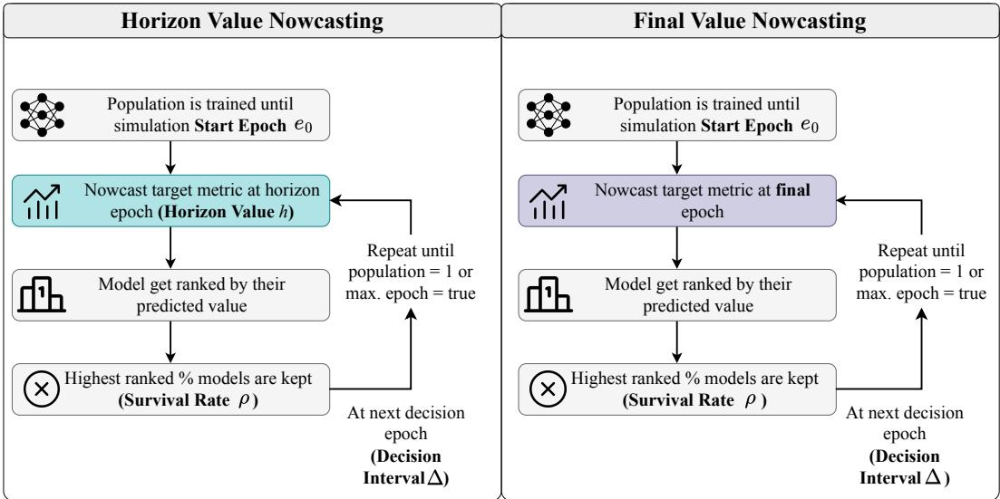  
Figure 2: Survival-of-the-Fittest training. Starting at epoch e0, the same fixed predictor, trained beforehand, estimates either performance five epochs ahead (left) or final performance (right). At intervals of ∆ epochs, active models are ranked by their nowcasted test accuracy and the top fraction ρ is retained. The procedure stops when one model remains or the recorded training horizon is reached.

## 4 Results

We first characterize how model rankings evolve during training before evaluating nowcasting accuracy and selection performance.

## 4.1 Accuracy rankings remain unstable during training

The checkpoint distributions reveal two qualitatively different population regimes (Appendix Figure 8). The uniform CIFAR-10 and STL-10 CNN zoos converge to narrow final distributions, with standard deviations below one percentage point. Their hyperparameter variants, the width-varying ResNet-18 zoos, and the ViT zoo retain much wider spreads. For example, final test accuracy has standard deviation 16.1 percentage points in the Tiny ImageNet ResNet-18 zoo and 22.8 percentage points in the CIFAR-10 ViT zoo. These spreads provide the scale for the ranking analysis. Rank changes in a narrow zoo often correspond to small absolute accuracy differences, whereas the same changes in a heterogeneous zoo can span much larger differences. Intermediate rankings nevertheless remain unstable in both regimes. Figure 3 visualizes the Tiny ImageNet ResNet-18 zoo, whose 192 models induce 18,336 unordered pairs at every transition. Moreover, agreement with the final ranking is non-monotonic. Kendall's τ falls from 0.814 at epoch 10 to 0.551 at epoch 50 before approaching one near the end of training. The distinction between raw and significant reversals is important. In the uniform STL-10 CNN zoo (Appendix Figure 14), the raw count remains high because many models are nearly tied, but the significant count falls from 23,817 at the first transition to 74 at the second, 1 at the third, and zero thereafter. The Tiny ImageNet zoo follows a different pattern and retains many significant local cross-overs throughout training. Raw cross-over counts, significant cross-over counts, and rank correlation therefore describe complementary properties of the observed learning dynamics.

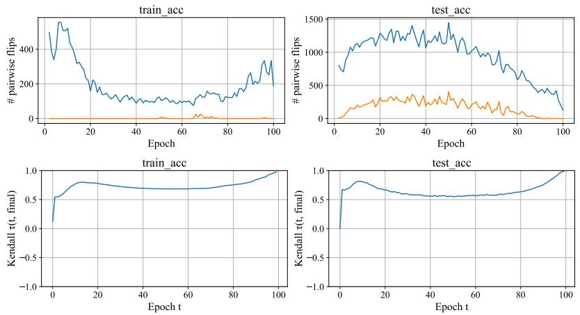  
Figure 3: Tiny ImageNet ResNet-18. The upper row shows pairwise rank changes: blue denotes the raw number of cross-overs and orange the number of €-significant cross-overs. The lower row shows Kendall's τ between the ranking at epoch e and the final ranking.

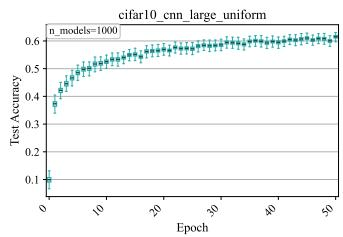

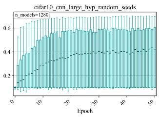

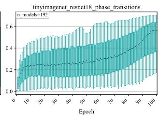  
Figure 4: Distribution of test accuracy. Distribution of test accuracy over training for three model ZOOS.

## 4.2 Checkpoint predictors improve metric nowcasting

Figure 6 compares the best validated configuration within each predictor family under the training procedure described above. Horizon-5 nowcasting is close to saturated on most zoos, yet checkpointbased predictors still improve on the learning-curve baselines. The best weight-statistic predictor outperforms LCNet on all nine zoos, wins six of nine comparisons against the best SANE predictor, and reduces RMSE by a median of 21.5% relative to LCNet. XGBoost is the most robust model for these short-range nowcasts, indicating that recent metric changes and compact checkpoint statistics provide an effective local continuation signal. Final-value prediction produces a clearer separation between representation families. The best SANE-based predictor has lower RMSE than the best weight-statistic predictor on six of nine zoos and achieves a median reduction of 37.9% relative to LCNet, compared with 32.1% for the best weight-statistic predictor. Several wins come from the latent-window LSTM and latent-token Transformer, suggesting that relationships among parts of a checkpoint matter more when extrapolating to the end of training. No family dominates every zoo, however; representation utility depends on both population structure and nowcasting horizon. The feature ablation in Figure 5 clarifies that the weights are complementary to, rather than a substitute for, observed performance. Pure checkpoint representations retain substantial signal, particularly for final-value prediction, while performance-only features are strong over the short horizon. Combining both sources is usually best or close to best and substantially stabilizes the SANE sequence predictors. The metric history describes how well a model currently learns; the checkpoint representation adds information about the parameter state from which that trajectory will continue.

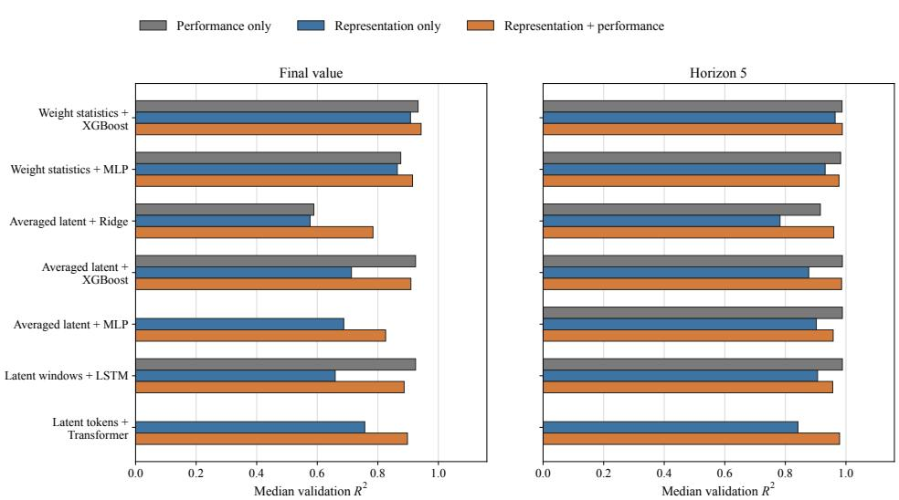  
Figure 5: Nowcasting feature ablation. Bars show median validation $R ^ { 2 }$ for performance-only, representation-only, and hybrid configurations. Values below zero are clipped to zero. A performanceonly token-Transformer variant is undefined because its architecture requires a latent-token sequence.

## 4.3 SOTF training improves retained-model quality in the difficult regimes

Nowcasting can improve pruning decisions, but the amount of available headroom varies sharply by zoo. Table 1 therefore reports selection results separately for the six CNN zoos and the three ResNet-18 and ViT zoos. On the CNN zoos, pruning by current accuracy already retains a model within half a percentage point of the population's best (mean gap 0.0051), and no learned predictor improves on this by more than 0.13 percentage points. These populations are nearly interchangeable at the top, so little remains to be gained. The ResNet-18 and ViT zoos expose the relevant regime, in which current performance and remaining potential diverge: pruning by current accuracy loses 6.4 percentage points on average and retains only 11% of the oracle top-K. For final-value selection, LCNet, which sees only the accuracy history, reduces the gap to 0.0247, and an XGBoost nowcaster trained on performance features alone to 0.0051. Adding weight statistics reduces it further to 0.0017 and raises oracle top-K recall from 0.20 to 0.72; a paired bootstrap over the 44 matched configurations places this additional gap reduction at 0.0034 (95% CI [0.0018, 0.0051]). Weight statistics without performance features perform almost as well and are never worse than current-accuracy pruning in any of these configurations. Horizon-5 selection gains are smaller and not robust: the best policy reduces the gap from 0.0629 to 0.0479, but the 95% confidence interval of this improvement includes zero. SANE-based predictors help on individual zoos – on Tiny ImageNet, averaged-latent XGBoost with performance features retains the best model in nearly every configuration (Appendix Table 10) – but are unstable on the ViT zoo. Against LCNet, only averaged-latent XGBoost among them improves the regime-level gap (0.0185 vs. 0.0247). This means a model that produces more accurate nowcasts at every checkpoint need not preserve the strongest candidate at a pruning boundary.

Observed performance remains important inside SOTF training. Across matched predictor pairs, adding performance features reduces the gap in all but one case (Appendix Table 9) and is especially valuable for SANE predictors in horizon mode. Figure 7 shows that the aggregate improvement is not obtained by sacrificing efficiency. On the Tiny ImageNet ResNet-18 zoo, the latent-token Transformer reduces the gap relative to learning-curve extrapolation by 0.033–0.064 in all 12 configurations with retention rates between 0.10 and 0.75, while saving 45%–79% of training epochs. Oracle recall improves in 11 of the 12 configurations. At retention rate 0.90, the advantage largely disappears as the policy keeps more models and compute savings fall. Against LCNet, however, the Transformer is not better on this zoo (mean gap 0.0065 vs. 0.0050; Appendix Table 10), unlike averaged-latent XGBoost and the latent-window LSTM.

The useful schedule remains population-specific. On the CIFAR-10 width-varying ResNet-18 zoo (Figure 42), the latent-window LSTM helps mainly when pruning starts at epoch 40 or 60, where it reduces the gap relative to learning-curve extrapolation by 0.037 in five of ten configurations while saving 58%–72% of training epochs. Starting at epoch 20 yields no benefit at retention rates up to 0.50 and smaller gains of 0.014 at higher ones. Averaged over all configurations, its gap (0.0033) matches LCNet (0.0031). The CIFAR-10 ViT zoo exhibits the opposite extreme. At start epoch 20 and retention rates 0.10, 0.25, and 0.50, weight-statistic XGBoost reduces the final-value gap relative to learning-curve extrapolation by 0.702, 0.610, and 0.651, respectively, while saving 89%–92% of training epochs. Its horizon results are substantially less stable. SOTF training can therefore yield large quality-efficiency gains, but only when its nowcasting target and pruning schedule match the learning dynamics of the candidate population.

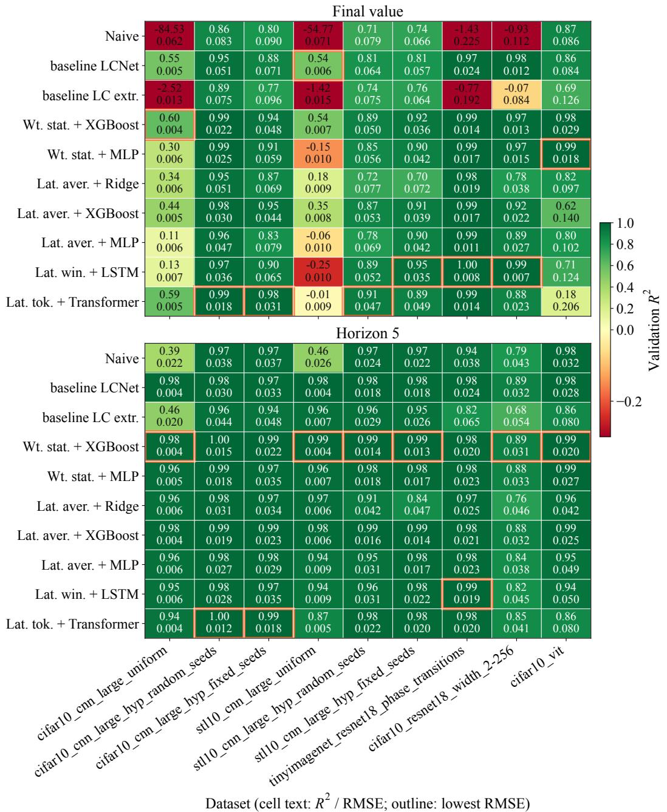  
Figure 6: Predictor-family comparison. Each cell reports validation $R ^ { 2 }$ (top) and RMSE (bottom) for the selected configuration; outlines mark the lowest-RMSE learned predictor for each zoo and target.

Table 1: SOTF training results by population regime. Each cell reports the mean best-retainedmodel gap / mean oracle top-K recall over all start epochs and retention rates, separately for the six CNN zoos and the three ResNet-18 and ViT zoos. Lower gap and higher recall are better; the best value per column is in bold. “perf." denotes accuracy and loss history features, “weights" engineered weight statistics, and “SANE"SANE latent representations. All predictors are trained once and held fixed. Results for all policies are in Appendix F.
<table><tr><td></td><td colspan="2">Final value</td><td colspan="2">Horizon 5</td></tr><tr><td>Ranking policy</td><td>CNN</td><td>ResNet-18 / ViT</td><td>CNN</td><td>ResNet-18 / ViT</td></tr><tr><td>Current accuracy</td><td>0.0051 / 0.48</td><td>0.0643 / 0.11</td><td>0.0051 / 0.48</td><td>0.0629 / 0.11</td></tr><tr><td>LC extrapolation</td><td>0.0062 / 0.47</td><td>0.0689 / 0.05</td><td>0.0050 / 0.51</td><td>0.0490 / 0.05</td></tr><tr><td>LCNet</td><td>0.0056 / 0.48</td><td>0.0247 / 0.10</td><td>0.0104 / 0.43</td><td>0.0656 / 0.11</td></tr><tr><td>XGB (perf.)</td><td>0.0040 / 0.45</td><td>0.0051 / 0.20</td><td>0.0039 / 0.46</td><td>0.0495 / 0.09</td></tr><tr><td>XGB (weights)</td><td>0.0060 / 0.34</td><td>0.0018 / 0.67</td><td>0.0056 / 0.37</td><td>0.0608 / 0.09</td></tr><tr><td>XGB (perf. + weights)</td><td>0.0054 / 0.42</td><td>0.0017 / 0.72</td><td>0.0043 / 0.45</td><td>0.0479 / 0.16</td></tr><tr><td>Avg. latent XGB (perf. + SANE)</td><td>0.0055 / 0.38</td><td>0.0185 / 0.44</td><td>0.0058 / 0.44</td><td>0.0622 / 0.09</td></tr><tr><td>Latent-window LSTM (perf. + SANE)</td><td>0.0107 / 0.33</td><td>0.0241 / 0.27</td><td>0.0110/0.33</td><td>0.0580 / 0.05</td></tr><tr><td>Latent-token Transf. (perf. + SANE)</td><td>0.0060 / 0.36</td><td>0.0991 / 0.19</td><td>0.0061 / 0.43</td><td>0.0504 / 0.06</td></tr></table>

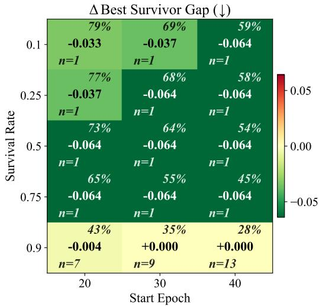

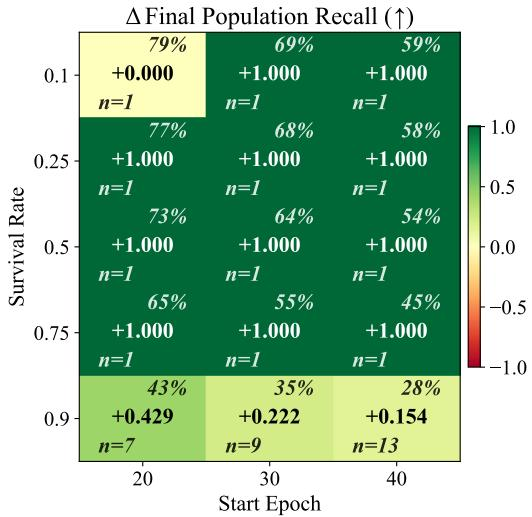  
Figure 7: SOTF training sensitivity on the Tiny ImageNet ResNet-18 zoo. The latent-token Transformer, trained beforehand and held fixed throughout SOTF training, is compared with learningcurve extrapolation for final-value nowcasting. Negative gap differences and positive recall differences favor SOTF training. Each cell additionally reports compute savings (top right) and final population size n (bottom left). “Best survivor gap"denotes the best-retained-model gap defined in Equation 3.

## 5 Discussion and limitations

Our results support performance nowcasting from neural network checkpoints, but also delimit when it is useful. Checkpoint representations complement rather than replace the learning curve, which the feature ablations reflect: hybrid predictors are usually strongest or close to it. The two prediction targets differ similarly. Over a five-epoch horizon, recent metrics and compact weight statistics already give a robust local continuation signal, whereas predicting the end of training requires longer-range extrapolation, where preserving the window- or token-level structure of SANE representations helps. No single representation dominates, so the prediction horizon and the source of population heterogeneity should guide the choice of checkpoint encoding. The learning-dynamics and pruning results further show that rank instability alone does not justify a more complex policy: in homogeneous CNN zoos, most rank reversals occur between nearly interchangeable models, and current accuracy already retains one close to the population optimum. SOTF training instead pays off when intermediate and final rankings diverge meaningfully and checkpoint features can recover that difference, as in the heterogeneous ResNet-18 and ViT populations – though even there the useful start epoch, retention rate, and prediction target remain population-specific. This also explains why regression and selection results need not agree. RMSE weights every prediction error, whereas pruning depends mainly on ordering near the retention boundary and penalizes eliminating a future winner heavily, so decision-aware measures such as the best-retained-model gap and oracle top-K recall remain necessary complements to standard regression metrics. Uncertainty-aware variants of SOTF training could better reflect this asymmetric cost by postponing decisions for candidates whose predicted ranks remain ambiguous.

Several limitations constrain these findings. The nine zoos cover only image classification with a limited set of CNN, ResNet-18, and Vision Transformer populations, which limits statistical power for high-capacity sequence predictors and does not establish generalization to larger architectures, other modalities, optimizer families, or longer training horizons. SOTF training is also evaluated retrospectively on completed trajectories: this enables controlled counterfactual comparison but does not capture scheduling, checkpoint I/O, variable per-epoch costs, or wall-clock contention in a live system, so saved epochs are only a proxy for compute and energy use, excluding the cost of constructing weight statistics and of training and applying SANE. Since SANE backbones are trained separately per zoo, the experiments demonstrate the value of zoo-specific representations rather than a reusable, transferable encoder, and these costs could outweigh the savings for small populations even if amortized in larger or recurring workloads. In zoos whose members differ mainly in width or training hyperparameters, weight statistics may also partly encode the configuration itself: on the width-varying ResNet-18 zoo, weight-statistic XGBoost recovers the oracle top-K almost perfectly (recall 0.99). A baseline that receives the configuration directly is needed to separate these effects. Finally, we do not repeat experiments across multiple random seeds, so we cannot quantify variability from initialization, data ordering, or predictor training; the main study also fixes a five-epoch horizon over a finite grid of start epochs and retention rates. Future work should repeat the evaluation with several seeds, and the strong sensitivity to horizon and schedule choices motivates adaptive schedules that jointly account for prediction uncertainty, expected accuracy loss, and the actual marginal cost of continuing each candidate.

## 6 Conclusion

We studied whether intermediate neural-network checkpoints contain predictive signal about future model quality beyond the observed learning curve, and whether that signal improves pruning decisions in a population of training runs. Across nine checkpointed model zoos, the answer is yes, but conditionally. Weight statistics provide the most reliable short-horizon continuation signal, whereas structured SANE representations are more useful for longer-range final-value extrapolation. The strongest predictors usually combine weight-space embeddings with observed performance rather than relying on either source alone. In the SOTF training experiments, the benefit depends on the population. In the CNN zoos, current accuracy already retains a near-optimal model. In the heterogeneous ResNet-18 and ViT zoos, where current performance can be misleading, ranking by nowcasted final accuracy reduces the mean best-retained-model gap from 0.064 to 0.0017. The learning curve accounts for most of this reduction, while weight statistics further reduce the gap and raise oracle top-K recall from 0.20 to 0.72. The potential positive societal impact of this work lies primarily in improving the efficiency of model development. If training runs can be ranked more reliably before completion, it may avoid unnecessary compute, energy use, and associated emissions, while making large-scale experimentation more accessible to smaller research groups with limited resources.

## References

[1] K. Jamieson and A. Talwalkar, “Non-stochastic Best Arm Identification and Hyperparameter Optimization,"

[2] L. Li, K. Jamieson, G. DeSalvo, A. Rostamizadeh, and A. Talwalkar. “Hyperband: A Novel Bandit-Based Approach to Hyperparameter Optimization." arXiv: 1603. 06560 [cs], Accessed: Jan. 31, 2026. [Online]. Available: http://arxiv. org/abs/1603. 06560prepublished.

[3] S. Falkner, A. Klein, and F. Hutter, "BOHB: Robust and Efficient Hyperparameter Optimization at Scale," in Proceedings of the 35th International Conference on Machine Learning, PMLR, Jul. 3, 2018, pp. 1437–1446. Accessed: Jun. 1, 2026. [Online]. Available: https : //proceedings.mlr.press/v80/falkner18a.html

[4] M. Jaderberg et al. "Population Based Training of Neural Networks." arXiv: 1711 . 09846 [cs], Accessed: Jan. 25, 2026. [Online]. Available: http://arxiv.org/abs/1711.09846 pre-published.

[5] X. Han et al., “A survey of weight space learning: Understanding, representation, and generation," arXiv preprint arXiv:2603.10090, 2026.

[6] T. Ettling et al., "Weight space learning needs to unify benchmarking! a taxonomy of evaluation practices," in The Fortieth Annual Conference on Neural Information Processing Systems Position Paper Track, 2026.

[7] T. Unterthiner, D. Keysers, S. Gelly, O. Bousquet, and I. Tolstikhin. “Predicting Neural Network Accuracy from Weights." arXiv: 2002. 11448 [stat], Accessed: Dec. 11, 2025. [Online]. Available: http://arxiv.org/abs/2002.11448 pre-published.

[8] K. Schürholt, D. Kostadinov, and D. Borth, “Self-Supervised Representation Learning on Neural Network Weights for Model Characteristic Prediction,"

[9] J. Hanna, D. Falk, S. X. Yu, and D. Borth, “GeoSANE: Learning Geospatial Representations from Models, Not Data,

[10] Anonymous, “LFNT : Forecasting training trajectories in the latent space of weights," in Submitted to The Fifteenth International Conference on Learning Representations, under review, 2026. [Online]. Available: https://openreview.net/forum?id=zytRJpwQMV

[11] B. Knyazev, A. Moudgil, G. Lajoie, E. Belilovsky, and S. Lacoste-Julien. “Accelerating Training with Neuron Interaction and Nowcasting Networks." arXiv: 2409.04434[cs .LG], Accessed: Sep. 2, 2026. [Online]. Available: http : / / arxiv . org / abs / 2409 . 04434 pre-published.

[12] K. Schürholt, M. W. Mahoney, and D. Borth. "Towards Scalable and Versatile Weight Space Learning." arXiv: 2406.09997 [cs], Accessed: Dec. 11, 2025. [Online]. Available: http: //arxiv.org/abs/2406.09997pre-published.

[13] K. Schürholt and D. Borth. “An Investigation of the Weight Space to Monitor the Training Progress of Neural Networks." arXiv: 2006. 10424 [cs], Accessed: Jan. 29, 2026. [Online]. Available: http://arxiv.org/abs/2006.10424 pre-published.

[14] M. Raghu, J. Gilmer, J. Yosinski, and J. Sohl-Dickstein. “"SVCCA: Singular Vector Canonical Correlation Analysis for Deep Learning Dynamics and Interpretability." arXiv: 1706.05806 [stat], Accessed: Jan. 31, 2026. [Online]. Available: http://arxiv. org/abs/1706. 05806 pre-published.

[15] S. P. Singh, B. He, T. Hofmann, and B. Schölkopf. "Hallmarks of Optimization Trajectories in Neural Networks: Directional Exploration and Redundancy." arXiv: 2403.07379 [cs], Accessed: Jan. 5, 2026. [Online]. Available: http://arxiv. org/abs/2403.07379 prepublished.

[16] K. Schürholt, L. Meynent, Y. Zhou, H. Lu, Y. Yang, and D. Borth. “A Model Zoo on Phase Transitions in Neural Networks."arXiv: 2504 . 18072[cs.LG], Accessed: Jun. 17, 2026. [Online]. Available: http://arxiv.org/abs/2504.18072 pre-published.

[17] K. Schürholt, D. Taskiran, B. Knyazev, X. Giró-i-Nieto, and D. Borth. "Model Zoos: A Dataset of Diverse Populations of Neural Network Models."arXiv: 2209 . 14764 [cs], Accessed: Jan. 29, 2026. [Online]. Available: http://arxiv.org/abs/2209.14764 pre-published.

[18] D. Falk, L. Meynent, F. Pfammatter, K. Schürholt, and D. Borth. “A Model Zoo of Vision Transformers." arXiv: 2504.10231 [cs.LG], Accessed: Jun. 17, 2026. [Online]. Available: http://arxiv.org/abs/2504.10231 pre-published.

[19] K. Schürholt, B. Knyazev, X. Giró-i-Nieto, and D. Borth. “Hyper-Representations as Generative Models: Sampling Unseen Neural Network Weights." arXiv: 2209 . 14733 [cs], Accessed: Jan. 31, 2026. [Online]. Available: http : / / arxiv . org/abs / 2209 . 14733 pre-published.

[20] A. Asefaw, K. Tzevelekakis, D. Falk, L. Meynent, and D. Borth. "WeightCLIP: Aligning Datasets and Models for Weight Space Learning." arXiv: 2607.03551 [cs .LG], Accessed: Sep. 7, 2026. [Online]. Available: http://arxiv.org/abs/2607.03551 pre-published.

[21] J. Jang et al., “"Learning to Boost Training by Periodic Nowcasting Near Future Weights," in Proceedings of the 40th International Conference on Machine Learning, PMLR, Jul. 3, 2023, pp. 14 730–14 757. Accessed: Jun. 1, 2026. [Online]. Available: https : //proceedings. mlr.press/v202/jang23b.html

[22] A. Klein, S. Falkner, J. T. Springenberg, and F. Hutter, “LEARNING CURVE PREDICTION WITH BAYESIAN NEU- RAL NETWORKS," 2017.

[23] A. Krizhevsky, “Learning Multiple Layers of Features from Tiny Images," University of Toronto, Apr. 2009.

[24] A. Coates, A. Ng, and H. Lee, “An Analysis of Single-Layer Networks in Unsupervised Feature Learning," in Proceedings of the Fourteenth International Conference on Artificial Intelligence and Statistics, JMLR Workshop and Conference Proceedings, Jun. 14, 2011, pp. 215–223. Accessed: Jun. 24, 2026. [Online]. Available: https : //proceedings . mlr. press/v15/coates11a.html

[25] Y. Le and X. Yang, “Tiny ImageNet Visual Recognition Challenge," CS 231N, vol. 7, p. 3, 2015.

## A Model zoo corpus

Table 2 lists the nine model zoos used throughout the paper, together with the dataset name used to refer to each zoo, the architecture family, how the population was generated, the number of models, and the training-epoch horizon. Uniform denotes a zoo with fixed hyperparameters and varying random seeds. $H y p .$ random follows the Hyp-10-rand setting of Schürholt et al. [17]: a grid of hyperparameter configurations is repeated with ten randomly drawn seeds per grid point. Hyp. fixed follows their Hyp-10-fix setting, using the same hyperparameter grid but repeating each grid point with the fixed seeds $1 , \ldots , 1 0$ . Phase trans. denotes phase-transition zoos in which model width is varied to span under- and over-parameterized regimes [16]. Splits are defined at the model level, so all checkpoints belonging to one trajectory fall into exactly one of the training, validation, or test partitions described in Section 3; the pipeline does not fix a single split ratio shared across zoos, so exact per-zoo split sizes are not reported here.

Table 2: Model zoo corpus. The dataset name is used to refer to the model zoo throughout the paper. Architecture abbreviations: CNN (1) for large convolutional networks, RN-18 width for ResNet-18 populations with varying width, and ViT for Vision Transformers.
<table><tr><td>Dataset name</td><td>Image data</td><td>Architecture</td><td>Population</td><td>Models</td><td>Epochs</td></tr><tr><td>cifar10_cnn_large_uniform</td><td>CIFAR-10</td><td>CNN (l)</td><td>Uniform</td><td>1000</td><td>50</td></tr><tr><td>cifar10_cnn_large_hyp_random_seeds</td><td>CIFAR-10</td><td>CNN (l)</td><td>Hyp. random</td><td>1280</td><td>50</td></tr><tr><td>cifar10_cnn_large_hyp_fixed_seeds</td><td>CIFAR-10</td><td>CNN (l)</td><td>Hyp. fixed</td><td>1280</td><td>50</td></tr><tr><td>stl10_cnn_large_uniform</td><td>STL-10</td><td>CNN (l)</td><td>Uniform</td><td>1000</td><td>50</td></tr><tr><td>stl10_cnn_large_hyp_random_seeds</td><td>STL-10</td><td>CNN (l)</td><td>Hyp. random</td><td>2560</td><td>50</td></tr><tr><td>stl10_cnn_large_hyp_fixed_seeds</td><td>STL-10</td><td>CNN (l)</td><td>Hyp. fixed</td><td>2560</td><td>50</td></tr><tr><td>tinyimagenet_resnet18_phase_transitions</td><td>Tiny ImageNet1</td><td>RN-18 width</td><td>Phase trans.</td><td>192</td><td>100</td></tr><tr><td>cifar10_resnet18_width_2-256</td><td>CIFAR-10</td><td>RN-18 width</td><td>Phase trans.</td><td>192</td><td>150</td></tr><tr><td>cifar10_vit</td><td>CIFAR-10</td><td>ViT</td><td>Phase trans.</td><td>147</td><td>300</td></tr></table>

## B Learning dynamics

Distribution of test accuracy over epochs  
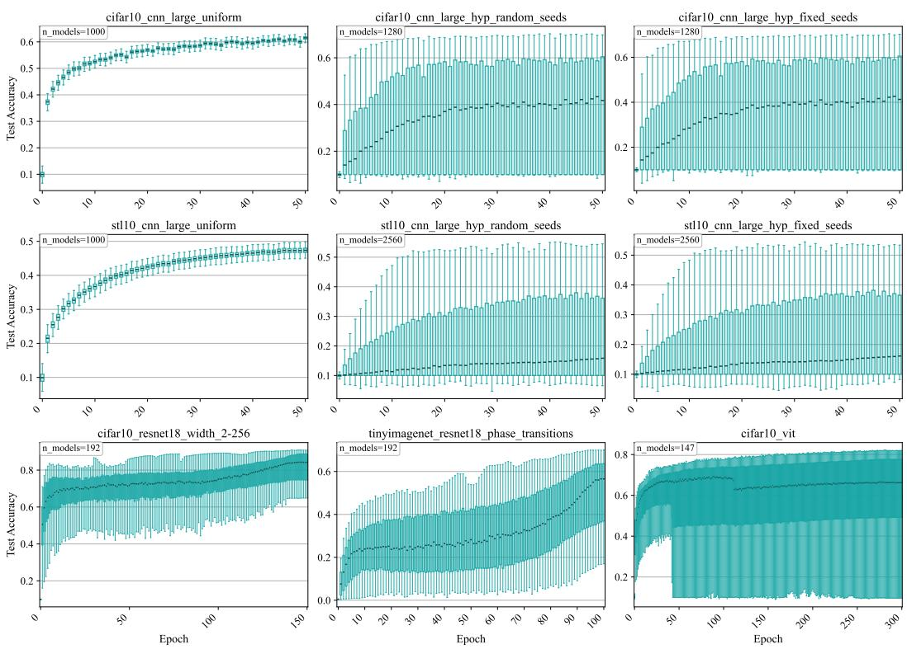  
Figure 8: Accuracy distributions across all model zoos. Test-accuracy distributions at each checkpoint for all nine model zoos. Boxes summarize the population-level spread and reveal the contrast between narrow uniform zoos and heterogeneous architecture or width variants.

Section 4 discusses ranking stability in detail for the Tiny ImageNet ResNet-18 phase-transition zoo (Figure 3) and the STL-10 uniform CNN zoo (Figure 14). Figures 9–16 report the same raw and €-smoothed pairwise rank-flip diagnostic for all eight zoos other than Tiny ImageNet, so that the rank-instability evidence underlying Section 4 can be inspected for every zoo in the corpus.

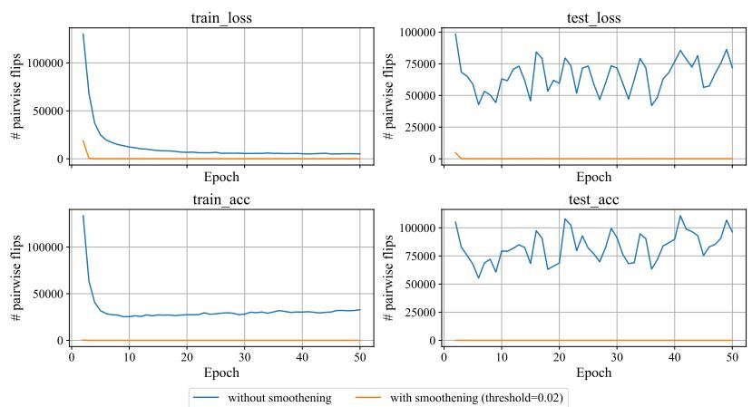  
Figure 9: Pairwise rank flips — CIFAR-10 uniform CNN zoo. Raw and smoothed pairwise rank flips between consecutive epochs.

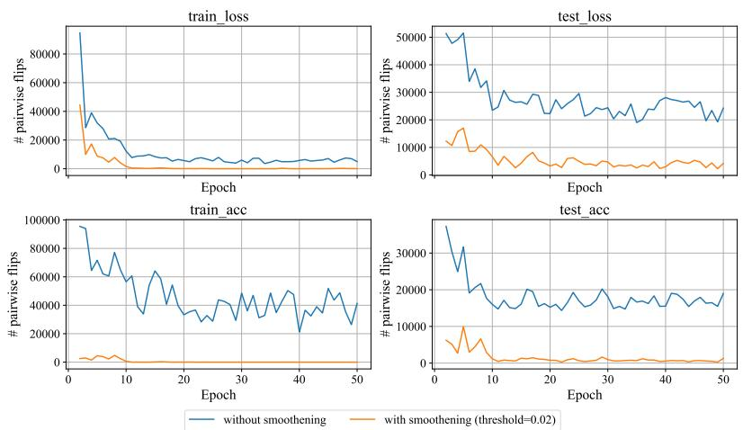  
Figure 10: Pairwise rank flips — CIFAR-10 CNN Hyp-10-rand. Raw and smoothed pairwise rank flips between consecutive epochs.

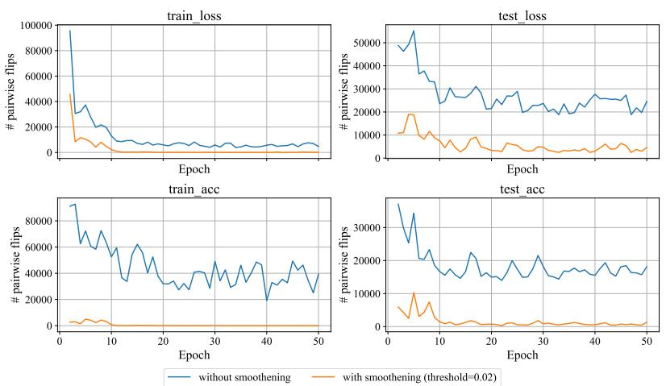  
Figure 11: Pairwise rank flips — CIFAR-10 CNN Hyp-10-fix. Raw and smoothed pairwise rank flips between consecutive epochs.

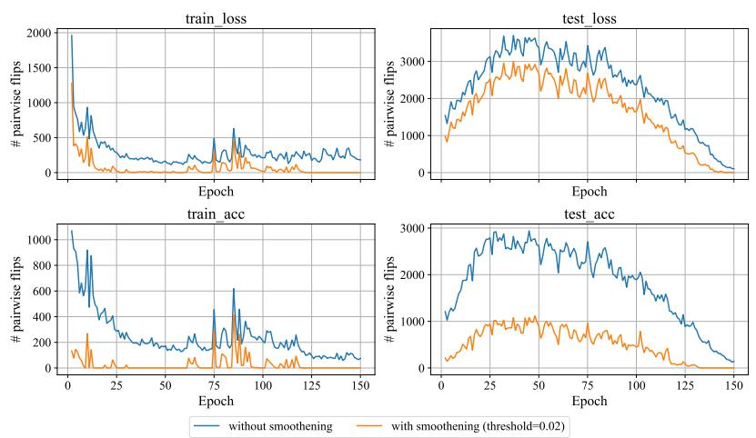  
Figure 12: Pairwise rank flips — CIFAR-10 ResNet-18 width zoo. Raw and smoothed pairwise rank flips between consecutive epochs.

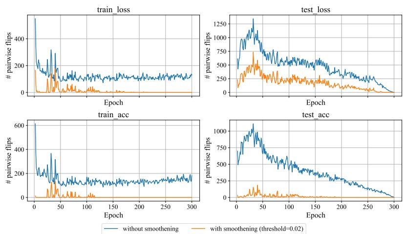  
Figure 13: Pairwise rank flips — CIFAR-10 ViT zoo. Raw and smoothed pairwise rank flips between consecutive epochs.

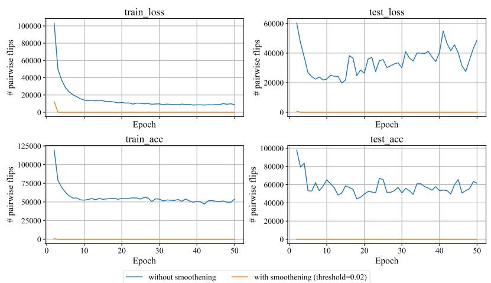  
Figure 14: Pairwise rank flips — STL-10 uniform CNN zoo. Raw and smoothed pairwise rank flips between consecutive epochs.

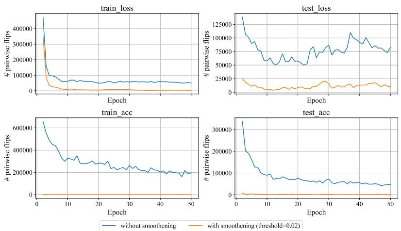  
Figure 15: Pairwise rank flips — STL-10 CNN Hyp-10-rand. Raw and smoothed pairwise rank flips between consecutive epochs.

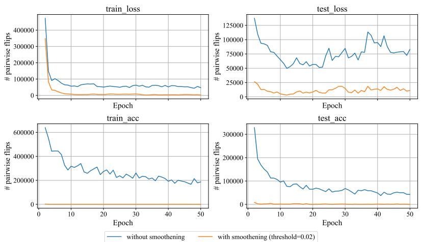  
Figure 16: Pairwise rank flips — STL-10 CNN Hyp-10-fix. Raw and smoothed pairwise rank flips between consecutive epochs.

## C Weight-statistic features

Table 3 lists the four families of checkpoint-derived weight statistics summarized in Section 3.2. Statistics are computed at both the full-model and the per-layer level; parameters are grouped by layer name, pairing a weight tensor with its bias tensor where available, and depending on the statistic are computed on weights only, biases only, the combined weight-and-bias group, or the complete flattened checkpoint. Layer-level norms are aggregated to model level (e.g., the model $\ell _ { 2 }$ norm is the square root of the sum of squared layer $\ell _ { 2 }$ norms); matrix statistics are aggregated using their mean and maximum across layers.

Table 3: Checkpoint-derived weight-statistic families.
<table><tr><td>Family</td><td>Included statistics</td><td>Captured property</td></tr><tr><td>Norm</td><td> $\ell _ { 1 } , \ell _ { 2 } , \mathrm { a n d } \ell _ { \infty }$  norms</td><td>Overall parameter scale and the presence of large individual values</td></tr><tr><td>Distribution</td><td>Mean, variance, percentiles, and range</td><td>Center, spread, and tails of the flattened param- eter distribution.</td></tr><tr><td>Matrix</td><td>Frobenius norm, mean and maximum absolute value, root mean square, dimensions, aspect ratio, and row- and column-wise norms</td><td>Layer shape, scale, and variation across input and output directions.</td></tr><tr><td>Distance</td><td>Distance and cosine similarity to initialization and to the previous checkpoint, cumulative path length, and path straightness</td><td>Movement of the full model through parameter space during training.</td></tr></table>

The distance family is defined relative to the initial checkpoint $\theta _ { i , e _ { 0 } }$ and the previous saved checkpoint $\theta _ { i , e _ { q } ^ { - } } \colon$

$$
d _ { \mathrm { i n i t } } ( i , e _ { q } ) = \lVert \theta _ { i , e _ { q } } - \theta _ { i , e _ { 0 } } \rVert _ { 2 } , \qquad d _ { \mathrm { p r e v } } ( i , e _ { q } ) = \lVert \theta _ { i , e _ { q } } - \theta _ { i , e _ { q } ^ { - } } \rVert _ { 2 } ,\tag{4}
$$

$$
L ( i , e _ { t } ) = \sum _ { q = 1 } ^ { t } \lVert \theta _ { i , e _ { q } } - \theta _ { i , e _ { q } ^ { - } } \rVert _ { 2 } , \qquad r _ { \mathrm { s t r a i g h t } } ( i , e _ { t } ) = \frac { d _ { \mathrm { i n i t } } ( i , e _ { t } ) } { L ( i , e _ { t } ) + \varepsilon } ,\tag{5}
$$

where $L$ is the cumulative path length through weight space and $r _ { \mathrm { s t r a i g h t } }$ is close to one for a comparatively direct trajectory and smaller for a less direct one. The regression experiments in Section 3 use the distribution family as the compact, architecture-agnostic weight-statistic representation; the norm, matrix, and distance families are computed by the same pipeline and used in the descriptive learning-dynamics analysis.

## D Predictor configurations and baseline specifications

This appendix reports the fixed configuration used for each predictor family in the main experiments, and the exact specification of the two learning-curve-only baselines.

Table 4: Ridge and XGBoost configurations.
<table><tr><td>Parameter</td><td>Ridge</td><td>XGBoost</td></tr><tr><td>Objective / penalty</td><td>Squared error + l2</td><td>Squared error</td></tr><tr><td>Regularization strength</td><td> $\eta _ { \mathrm { r i d g e } } = 1 . 0$ </td><td> $\ell _ { 2 }$  leaf reg. = 1.0, l1 leaf reg. = 0</td></tr><tr><td>Boosting rounds</td><td></td><td>400</td></tr><tr><td>Maximum tree depth</td><td></td><td>6</td></tr><tr><td>Learning rate</td><td></td><td>0.05</td></tr><tr><td>Row / feature subsampling</td><td></td><td>0.8 / 0.8</td></tr><tr><td>Tree construction</td><td></td><td>Histogram</td></tr><tr><td>Solver / other</td><td>Automatic solver selection, fitted inter- cept</td><td>Fixed random seed</td></tr></table>

Table 5: Feed-forward and sequence predictor configurations for the SANE representation and weight-statistic MLPs.
<table><tr><td>Parameter</td><td>Weight-stat. MLP</td><td>Avg.-latent MLP</td><td>Latent-window LSTM</td><td>Latent-token Transf.</td></tr><tr><td>Input dimension</td><td>Weight-statistic vector</td><td>128 (SANE latent)</td><td>128 (window em- bedding)</td><td>128 (token embed- ding)</td></tr><tr><td>Architecture</td><td>Hidden widths 256, 128, 64; Layer-</td><td>Hidden widths 256, 128, 64; 128, 64; or 64,32</td><td>LSTM hidden size 64, 1 layer</td><td>Internal dim. 64, 4 heads, 1 local + 2</td></tr><tr><td>Local chunk size w</td><td></td><td></td><td></td><td>global layers 8, 16, 32, 128, 256, or 512</td></tr><tr><td>Regression head</td><td>Linear readout</td><td>Linear readout</td><td>Width 32, GELU</td><td>Width 32, GELU</td></tr><tr><td>Activation Dropout</td><td>GELU 0.1</td><td>GELU 0 or 0.1</td><td>0</td><td>0</td></tr><tr><td>Positional encoding</td><td></td><td></td><td></td><td>Sinusoidal; learned [CLS] token before</td></tr><tr><td></td><td></td><td></td><td></td><td>global stage</td></tr><tr><td>Optimizer Batch size</td><td>AdamW 128</td><td>AdamW 16</td><td>AdamW 16</td><td>AdamW</td></tr><tr><td>Learning rate</td><td> $1 0 ^ { - 3 }$ </td><td> $1 0 ^ { - 3 }$ </td><td> $1 0 ^ { - 3 }$ </td><td>8 or 16</td></tr><tr><td>Weight decay</td><td> $1 0 ^ { - 4 }$ </td><td> $1 0 ^ { - 3 }$ </td><td>10⁻3</td><td> $1 0 ^ { - 3 }$   $1 0 ^ { - 3 }$ </td></tr><tr><td>Maximum epochs</td><td>500</td><td>500</td><td>200</td><td>200</td></tr><tr><td>Loss</td><td>Smooth  $\ell _ { 1 }$ </td><td>Smooth  $\ell _ { 1 }$ </td><td>Smooth  $\ell _ { 1 }$ </td><td>Smooth l1</td></tr></table>

Larger local chunks together with a batch size of 8 are used for the longest token sequences, while shorter sequences use smaller chunks and a batch size of 16; the local transformer stage is skipped when a sequence is shorter than the local chunk size. Model hyperparameters are fixed for ridge regression, XGBoost, the weight-statistic MLP, and the latent-window LSTM; for these families, only the input feature set varies across runs (with or without lagged checkpoints, first-order differences. layer-level statistics, and performance features). For the averaged-latent MLP and the latent-token Transformer, the predefined architecture variants listed above are additionally trained per zoo. In all cases, the variant with the lowest validation RMSE is reported (Appendix E); no automated hyperparameter search is used. The codebase separately exposes a Ray Tune search space for XGBoost and LightGBM (num. samples $= 6 ,$ 4 concurrent trials, CPU-only) that widens nestimators, tree depth, learning rate, subsampling, and $\ell _ { 1 } / \ell _ { 2 }$ regularization around the values above; this search capability exists in the pipeline for exploratory use but was not the source of the fixed configurations reported here.

Learning-curve extrapolation baseline. The baseline fits four parametric curve families to the observed accuracy prefix — linear, logarithmic, exponential saturation, and power-law saturation — and predicts the median of all successful extrapolations, clipped to the target range observed in the corresponding training and validation split. It receives only the observed scalar learning curve up to the current checkpoint: no weight statistics, SANE latents, architecture metadata, or hyperparameters. This is a deterministic, point-prediction simplification of the eleven-curve-family Bayesian extrapolation method of Domhan et al., omitting the MCMC-based predictive uncertainty and termination rule.

LCNet-style baseline. Following Klein et al. [22], the baseline replaces the original Bayesianneural-network posterior sampler and parametric basis-function layer with a two-hidden-layer MLP (width 128, ReLU activations, dropout $p = 0 . 1 )$ trained with AdamW (learning rate $1 0 ^ { - 3 }$ , weight decay $1 0 ^ { - 4 }$ , Smooth ${ \boldsymbol { \cdot } } { \boldsymbol { \ell } } _ { 1 }$ loss, early stopping). Its input feature map contains: the current and target epoch; the progress fractions $e / e _ { \mathrm { m a x } }$ and $( e ^ { \star } - e ) / e _ { \mathrm { m a x } } ;$ the current test accuracy; the first observed test accuracy in the prefix; the prefix mean and standard deviation; the total gain from the first observed checkpoint to the current one; the recent slope and recent first-order accuracy deltas; the last eight observed test-accuracy values and their epochs; and binary masks indicating which of those eight lag positions are actually observed. At inference, dropout is kept active for $S = 3 0$ Monte Carlo forward passes; the mean prediction is used for RMSE and $R ^ { 2 }$ , and the resulting variance is retained but not scored. No weight statistics, SANE latents, architecture metadata, or hyperparameters are provided as input.

## E Detailed metric-prediction results by predictor family

This appendix reports the per-family metric-prediction results underlying the aggregate comparison in Figure 6. For each dataset and target mode, the configuration with the lowest validation RMSE is shown for the given family.

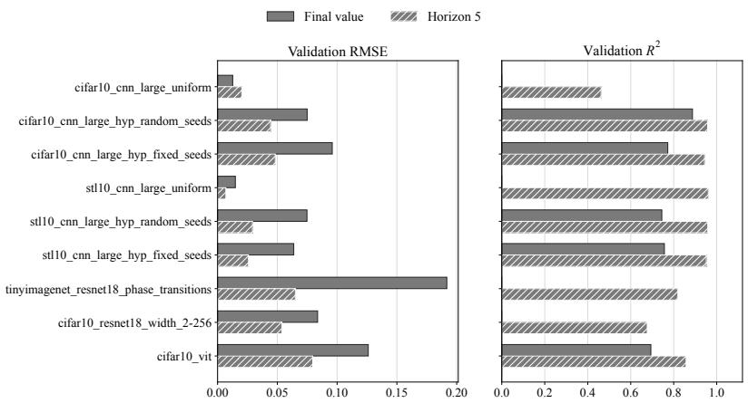  
Figure 17: Learning-curve extrapolation baseline performance. Validation RMSE and $R ^ { 2 }$ for the parametric learning-curve extrapolation baseline on final-value and horizon-5 nowcasting. The $R ^ { 2 }$ axis is clipped at 0 for readability.

The baseline is strong over short horizons, reaching a median validation $R ^ { 2 }$ of 0.94 and a median RMSE of 0.044 for horizon-5 nowcasting, but is less reliable for final-value nowcasting (median $R ^ { 2 } = 0 . 6 9$ , negative mean $R ^ { 2 }$ because several zoos extrapolate poorly from their observed prefixes).

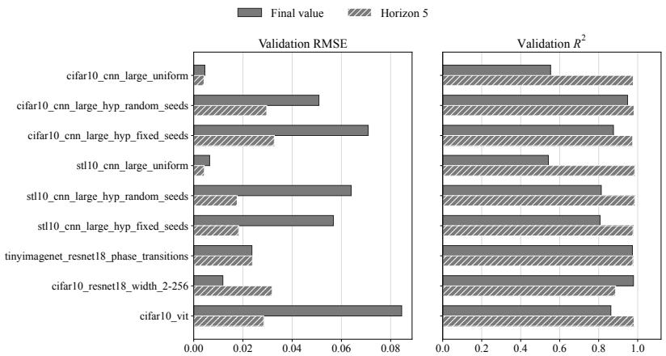  
Figure 18: LCNet learning-curve baseline performance. Validation RMSE and $R ^ { 2 }$ for the LCNetstyle baseline on final-value and horizon-5 nowcasting.

LCNet improves over parametric extrapolation on every dataset and target mode: median final-value $R ^ { 2 }$ rises from 0.69 to 0.86 (median $\mathrm { R M S E } \ 0 . 0 7 5  0 . 0 5 1 )$ , and median horizon-5 $R ^ { 2 }$ rises from 0.94 to 0.98 (median $\mathrm { R M S E } \ 0 . 0 4 4 \to 0 . 0 2 4 )$ . All final-value $R ^ { 2 }$ values are positive, making LCNet the relevant learning-curve-only reference for the checkpoint-based predictors below.

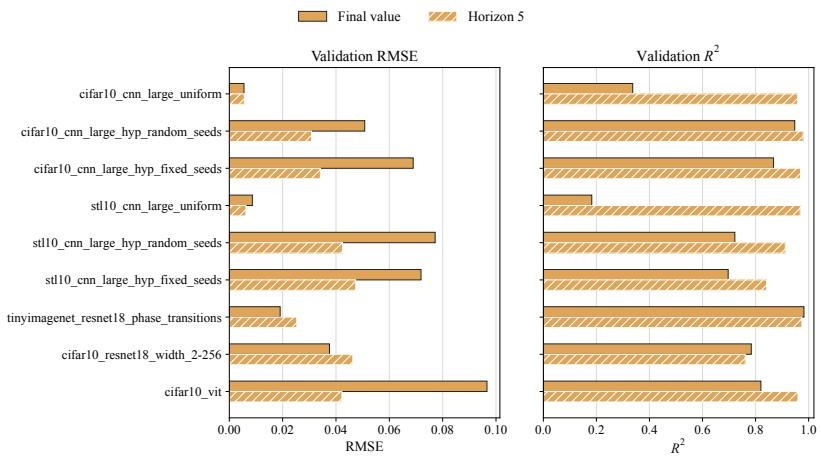  
Figure 19: Averaged-latent ridge performance by dataset. Validation RMSE and $R ^ { 2 }$ for final-value and horizon-5 nowcasting from the mean-pooled SANE embedding.

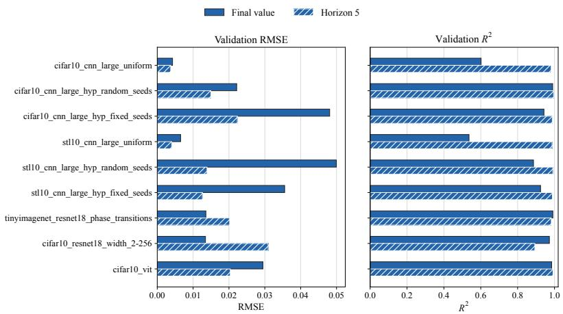  
Figure 20: Weight-statistic XGBoost performance by dataset.

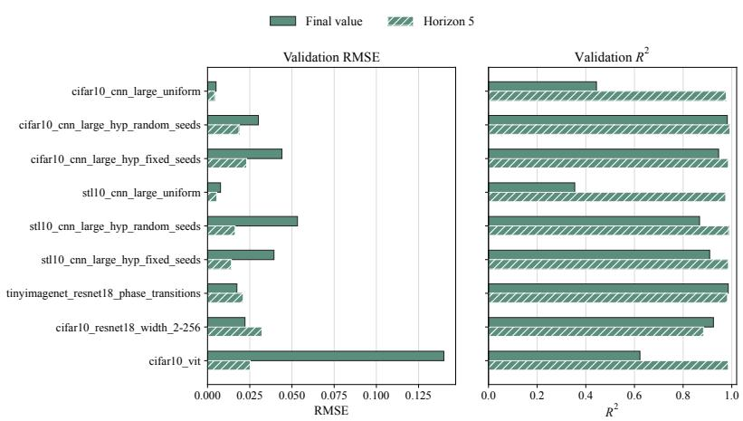  
Figure 21: Averaged-latent XGBoost performance by dataset. The ViT zoo is a notable failure case: even with performance features appended, the mean-pooled checkpoint vector provides little reliable information about final accuracy beyond the learning-curve position.

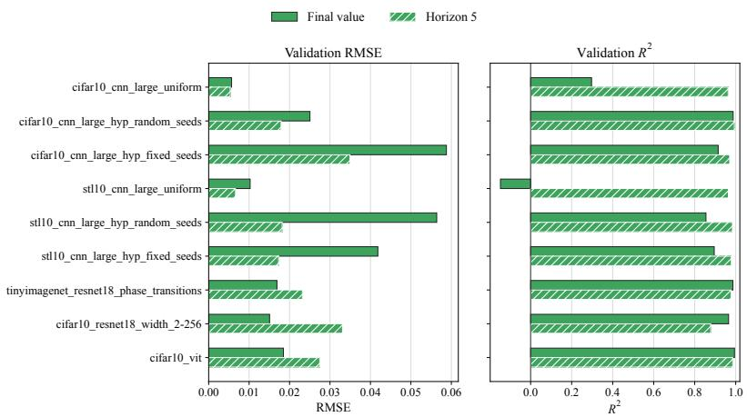  
Figure 22: Weight-statistic MLP performance by dataset. Competitive for final-value nowcasting but selected less consistently than XGBoost.

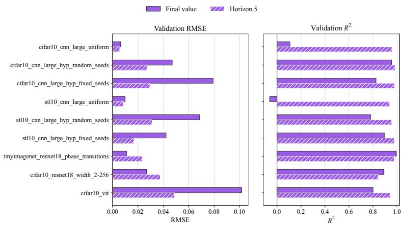  
Figure 23: Averaged-latent MLP performance by dataset.

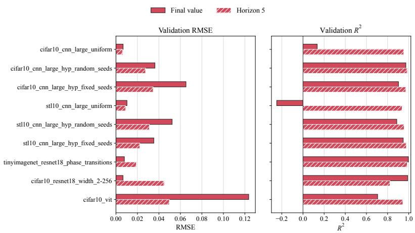  
Figure 24: Latent-window LSTM performance by dataset. Strongest on final-value prediction for the trajectory-sensitive Tiny ImageNet phase-transition and CIFAR-10 ResNet-18 width zoos.

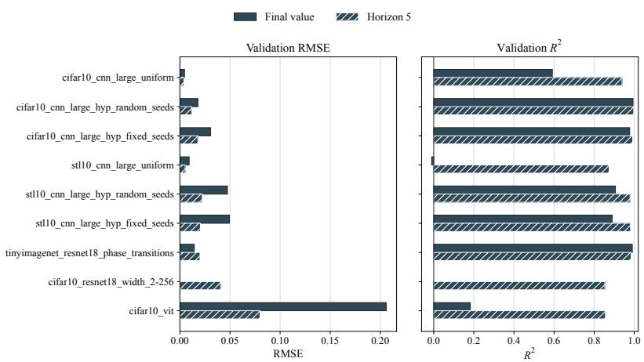  
Figure 25: Latent-token Transformer performance by dataset.

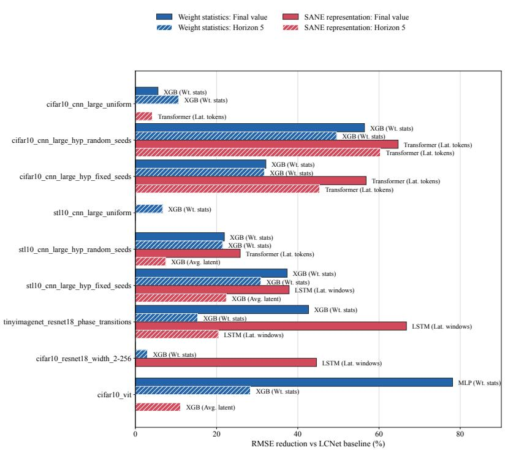  
Figure 26: Predictor improvement over the LCNet baseline. Validation RMSE reduction relative to LCNet for the best weight-statistic and best SANE-representation predictor per dataset and target mode. Bars at zero indicate no improvement; labels report the selected predictor family.

Table 6 expands Figure 26 to every predictor family, in percent RMSE reduction relative to LCNet (positive is better; best family per row in bold).

Table 6: Predictor improvements over the LCNet baseline. Validation RMSE reduction in percent relative to LCNet. WS = weight-statistic, Avg = averaged SANE latent, LW = latent-window, LT = latent-token.  
Final value.
<table><tr><td>Dataset</td><td>WS-XGB</td><td>WS-MLP</td><td>Avg-Ridge Avg-XGB</td><td></td><td></td><td>Avg-MLP LW-LSTM LT-Trans.</td><td></td></tr><tr><td>cifar10_cnn_large_uniform</td><td>5.6</td><td>-25.5</td><td>-21.9</td><td>-11.6</td><td>-41.3</td><td>-47.7</td><td>-1.4</td></tr><tr><td>cifar10_cnn_large_hyp_random_seeds</td><td>56.4</td><td>50.8</td><td>0.2</td><td>40.8</td><td>7.5</td><td>28.6</td><td>64.7</td></tr><tr><td>cifar10_cnn_large_hyp_fixed_seeds</td><td>32.1</td><td>17.1</td><td>2.7</td><td>37.8</td><td>-11.7</td><td>8.0</td><td>56.8</td></tr><tr><td>st110_cnn_large_uniform</td><td>-0.6</td><td>-58.3</td><td>-33.6</td><td>-18.7</td><td>-52.2</td><td>-58.3</td><td>-42.4</td></tr><tr><td>stl10_cnn_large_hyp_random_seeds</td><td>21.9</td><td>11.8</td><td>-20.7</td><td>16.7</td><td>-7.3</td><td>18.2</td><td>25.8</td></tr><tr><td>st110_cnn_large_hyp_fixed_seeds</td><td>37.4</td><td>26.3</td><td>-26.7</td><td>30.7</td><td>25.7</td><td>37.9</td><td>12.9</td></tr><tr><td>tinyimagenet_resnet18_phase_transitions</td><td>42.7</td><td>28.6</td><td>19.3</td><td>26.4</td><td>52.7</td><td>66.8</td><td>39.4</td></tr><tr><td>cifar10_resnet18_width_2-256</td><td>-13.6</td><td>-27.2</td><td>-217.1</td><td>-87.3</td><td>-125.2</td><td>44.6</td><td>-98.3</td></tr><tr><td>cifar10_vit</td><td>65.1</td><td>78.1</td><td>-14.4</td><td>-65.7</td><td>-20.4</td><td>-46.3</td><td>-143.8</td></tr></table>

Horizon 5.
<table><tr><td>Dataset</td><td>WS-XGB</td><td>WS-MLP</td><td>Avg-Ridge</td><td>Avg-XGB</td><td>Avg-MLP</td><td>LW-LSTM LT-Trans.</td><td></td></tr><tr><td>cifar10_cnn_large_uniform</td><td>10.7</td><td>-27.0</td><td>-34.4</td><td>0.4</td><td>-35.4</td><td>-43.7</td><td>4.2</td></tr><tr><td>cifar10_cnn_large_hyp_random_seeds</td><td>49.5</td><td>39.6</td><td>-4.0</td><td>37.2</td><td>8.7</td><td>7.0</td><td>60.3</td></tr><tr><td>cifar10_cnn_large_hyp_fixed_seeds</td><td>31.8</td><td>-6.7</td><td>-4.3</td><td>29.2</td><td>10.5</td><td>-5.8</td><td>45.4</td></tr><tr><td>stl10_cnn_large_uniform</td><td>6.7</td><td>-53.6</td><td>-44.3</td><td>-27.8</td><td>-99.6</td><td>-104.0</td><td>-21.5</td></tr><tr><td>st110_cnn_large_hyp_random_seeds</td><td>21.5</td><td>-2.8</td><td>-140.1</td><td>7.4</td><td>-75.8</td><td>-76.1</td><td>-26.5</td></tr><tr><td>stl10_cnn_large_hyp_fixed_seeds</td><td>30.9</td><td>5.2</td><td>-160.0</td><td>22.4</td><td>8.1</td><td>-21.9</td><td>-12.1</td></tr><tr><td>tinyimagenet_resnet18_phase_transitions</td><td>15.3</td><td>2.9</td><td>-6.0</td><td>11.4</td><td>2.6</td><td>20.4</td><td>15.9</td></tr><tr><td>cifar10_resnet18_width_2-256</td><td>3.0</td><td>-3.8</td><td>-45.2</td><td>-1.3</td><td>-17.8</td><td>-39.7</td><td>-28.8</td></tr><tr><td>cifar10_vit</td><td>28.3</td><td>3.4</td><td>-48.6</td><td>11.1</td><td>-71.9</td><td>-75.0</td><td>-181.8</td></tr></table>

This table is the evidence behind the aggregate claims in Section 4: no single representation family wins on every zoo, several families (Avg-Ridge, Avg-MLP, LT-Trans. under horizon-5) are frequently worse than the LCNet baseline, and the CIFAR-10 ResNet-18 width and ViT zoos in particular show large negative entries for most SANE-sequence predictors, underscoring that representation utility is population- and horizon-specific rather than uniform.

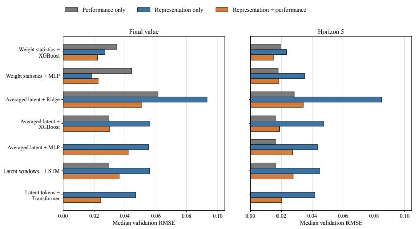  
Figure 27: Performance-feature ablation — RMSE view. Median validation RMSE (lower is better) for the performance-only, representation-only, and hybrid ablation configurations shown as $R ^ { 2 }$ in Figure 5. The performance-only ablation for the latent-token Transformer was not run, since that architecture requires a latent-token sequence as input.

## F SOTF training configuration and full results

## F.1 Ranking policies and sweep configuration

Table 7 lists all ranking-policy families evaluated in the retrospective SOTF training experiments, and Table 8 gives the exact start epochs used for each model zoo. All runs maximize test accuracy, use decision interval $I _ { \mathrm { s e l } } = 5$ epochs, minimum population size $n _ { \mathrm { m i n } } = 1$ , and retention rates $\rho \in \{ 0 . 1 0 , 0 . 2 5 , 0 . 5 0 , 0 . 7 5 , 0 . 9 0 \} \ ( \rho = 1$ is excluded because it performs no pruning). Start epochs differ by zoo because training horizons differ: phase-transition zoos train for 100–300 epochs, while CNN zoos train for only 50. Consistent with Section 3, every checkpoint predictor below is trained once on the training split and then held fixed throughout SOTF training.

Table 7: SOTF training ranking configurations. Complete list of ranking policies compared in SOTF training experiments.
<table><tr><td>Configuration</td><td>Predictor used for ranking</td></tr><tr><td>Naive current-value baseline</td><td>Current observed test accuracy.</td></tr><tr><td>LC Extrapolation baseline</td><td>Parametric learning-curve fit applied to the observed accuracy history.</td></tr><tr><td>LCNet baseline</td><td>LCNet-style predictor applied to the observed accuracy his- tory. Final value: the predictor from the metric-prediction experiments, trained on the complete training-split learning curves of the zoo and held fixed. Horizon 5: refit at every</td></tr><tr><td>Weight-statistic XGBoost variants</td><td>pruning round on the history observed so far. Predictors loaded from the metric-prediction experiments, using weight-statistic features with and without observed met-</td></tr><tr><td>SANE latent variants</td><td>rics. Predictors loaded from the metric-prediction experiments, using averaged latent, latent-window LSTM, or latent-token Transformer predictors for selected zoos.</td></tr></table>

Table 8: SOTF training model-zoo coverage and start epochs.
<table><tr><td>Model zoo</td><td>Horizon-5 start epochs</td><td>Final-value start epochs</td></tr><tr><td>cifar10_cnn_large_uniform</td><td>5, 10,25</td><td>5, 10,25</td></tr><tr><td>cifar10_cnn_large_hyp_random_seeds</td><td>5, 10,25</td><td>5, 10,25</td></tr><tr><td>cifar10_cnn_large_hyp_fixed_seeds</td><td>5, 10,25</td><td>5, 10,25</td></tr><tr><td>stl10_cnn_large_uniform</td><td>5,10,25</td><td>5,10,25</td></tr><tr><td>stl10_cnn_large_hyp_random_seeds</td><td>5, 10,25</td><td>5, 10,25</td></tr><tr><td>stl10_cnn_large_hyp_fixed_seeds</td><td>5,10,25</td><td>5,10,25</td></tr><tr><td>tinyimagenet_resnet18_phase_transitions</td><td>20, 30, 40</td><td>20, 30, 40</td></tr><tr><td>cifar10_resnet18_width_2-256</td><td>20, 40, 60</td><td>20,40, 60</td></tr><tr><td>cifar10_vit</td><td>20, 40,60</td><td>20,40,60</td></tr></table>

## F.2 Full results by population regime

Table 9 extends Table 1 to all 15 evaluated ranking policies, and Table 10 breaks the final-value results down for the three ResNet-18 and ViT zoos. All values are averaged over the start epochs in Table 8 and the five retention rates, restricted to configurations in which every policy completed (269 of 270; one final-value configuration of the CIFAR-10 ResNet-18 width zoo is missing for the current-accuracy baseline). Compute savings are determined by the pruning schedule and are therefore nearly identical across policies at a given configuration; the sensitivity plots in Section F.3 report them per cell.

Table 9: SOTF training results for all ranking policies by population regime. Each cell reports the mean best-retained-model gap / mean oracle top-K recall, separately for the six CNN zoos and the three ResNet-18 and ViT zoos. Final value ranks by predicted test accuracy at the end of training; horizon 5 ranks by predicted test accuracy five epochs ahead. Lower gap and higher recall are better; the best value per column is in bold. “perf." denotes accuracy and loss history features, “weights" engineered weight statistics, and “SANE"SANE representations.
<table><tr><td rowspan="2">Ranking policy</td><td colspan="2">Final value</td><td colspan="2">Horizon 5</td></tr><tr><td>CNN</td><td>ResNet-18 / ViT</td><td>CNN</td><td>ResNet-18 / ViT</td></tr><tr><td>Current accuracy</td><td>0.0051 / 0.48</td><td>0.0643 / 0.11</td><td>0.0051 / 0.48</td><td>0.0629 / 0.11</td></tr><tr><td>LC extrapolation</td><td>0.0062 / 0.47</td><td>0.0689 / 0.05</td><td>0.0050 / 0.51</td><td>0.0490 / 0.05</td></tr><tr><td>LCNet</td><td>0.0056 / 0.48</td><td>0.0247 / 0.10</td><td>0.0104 / 0.43</td><td>0.0656 / 0.11</td></tr><tr><td>XGB (perf.)</td><td>0.0040 / 0.45</td><td>0.0051 / 0.20</td><td>0.0039 / 0.46</td><td>0.0495 / 0.09</td></tr><tr><td>MLP (perf.)</td><td>0.0038 / 0.48</td><td>0.0082 / 0.22</td><td>0.0047 / 0.46</td><td>0.0494 / 0.14</td></tr><tr><td>XGB (weights)</td><td>0.0060 / 0.34</td><td>0.0018 / 0.67</td><td>0.0056 / 0.37</td><td>0.0608 / 0.09</td></tr><tr><td>XGB (perf. + weights)</td><td>0.0054 / 0.42</td><td>0.0017 / 0.72</td><td>0.0043 / 0.45</td><td>0.0479 / 0.16</td></tr><tr><td>Avg. latent XGB (SANE)</td><td>0.0112 / 0.29</td><td>0.0410 / 0.48</td><td>0.0112 / 0.28</td><td>0.1311 / 0.24</td></tr><tr><td>Avg. latent XGB (perf. + SANE)</td><td>0.0055 / 0.38</td><td>0.0185 / 0.44</td><td>0.0058 / 0.44</td><td>0.0622 / 0.09</td></tr><tr><td>Avg. latent MLP (SANE)</td><td>0.0105 / 0.29</td><td>0.1130 / 0.14</td><td>0.0101 / 0.34</td><td>0.1982 / 0.27</td></tr><tr><td>Avg. latent MLP (perf. + SANE)</td><td>0.0081 / 0.33</td><td>0.0379 / 0.21</td><td>0.0080 / 0.39</td><td>0.0579 / 0.18</td></tr><tr><td>Latent-window LSTM (SANE)</td><td>0.0119 / 0.28</td><td>0.0234 / 0.08</td><td>0.0134 / 0.27</td><td>0.1677 / 0.06</td></tr><tr><td>Latent-window LSTM (perf. + SANE)</td><td>0.0107 / 0.33</td><td>0.0241 / 0.27</td><td>0.0110/0.33</td><td>0.0580 / 0.05</td></tr><tr><td>Latent-token Transf. (SANE)</td><td>0.0069 / 0.32</td><td>0.1140 / 0.42</td><td>0.0095 / 0.29</td><td>0.2292 / 0.06</td></tr><tr><td>Latent-token Transf. (perf. + SANE)</td><td>0.0060 / 0.36</td><td>0.0991 / 0.19</td><td>0.0061 / 0.43</td><td>0.0504 / 0.06</td></tr><tr><td></td><td></td><td></td><td></td><td></td></tr></table>

Table 10: Final-value SOTF training results per ResNet-18 and ViT zoo. Each cell reports the mean best-retained-model gap / mean oracle top-K recall over start epochs and retention rates. Lower gap and higher recall are better; the best value per column is in bold.
<table><tr><td>Ranking policy</td><td>Tiny ImageNet ResNet-18</td><td>CIFAR-10 ResNet-18 width</td><td>CIFAR-10 ViT</td></tr><tr><td>Current accuracy</td><td>0.0387 / 0.16</td><td>0.0249 / 0.19</td><td>0.1267 / 0.00</td></tr><tr><td>LC extrapolation</td><td>0.0461 / 0.13</td><td>0.0223 / 0.03</td><td>0.1351 / 0.00</td></tr><tr><td>LCNet</td><td>0.0050 / 0.17</td><td>0.0031 / 0.04</td><td>0.0645 / 0.07</td></tr><tr><td>XGB (perf.)</td><td>0.0063 / 0.25</td><td>0.0037 / 0.21</td><td>0.0053 / 0.13</td></tr><tr><td>XGB (weights)</td><td>0.0051 / 0.26</td><td>0.0000 / 0.99</td><td>0.0001 / 0.80</td></tr><tr><td>XGB (perf. + weights)</td><td>0.0051 / 0.26</td><td>0.0000 / 0.99</td><td>0.0000 / 0.93</td></tr><tr><td>Avg. latent XGB (perf. + SANE)</td><td>0.0000 / 0.98</td><td>0.0003 / 0.33</td><td>0.0540 / 0.00</td></tr><tr><td>Latent-window LSTM (perf. + SANE)</td><td>0.0013 / 0.64</td><td>0.0033 / 0.14</td><td>0.0664 / 0.00</td></tr><tr><td>Latent-token Transf. (perf. + SANE)</td><td>0.0065 / 0.19</td><td>0.0034 / 0.40</td><td>0.2811 / 0.00</td></tr></table>

Two observations complement the main text. First, appending observed performance features reduces the gap for almost every SANE predictor and is essential in horizon mode, where SANEonly predictors are worse than every baseline on the ResNet-18 and ViT zoos. Second, the per-zoo breakdown shows that the regime averages hide strong zoo-specific differences: SANE representations retain the best model on Tiny ImageNet but fail on the ViT zoo, whereas weight statistics are nearperfect on the CIFAR-10 width and ViT zoos. On the width zoo, this may partly reflect that weight statistics encode network width (Section 5).

## F.3 Parameter-sensitivity plots

Section 4 reads specific cells of the full start-epoch/retention-rate grid for the Tiny ImageNet ResNet-18 zoo and the CIFAR-10 ViT zoo, the two zoos with the largest selection headroom in Table 10. Figures 28–41 give the full parameter-sensitivity grids for a representative selection of configurations on these two zoos, chosen to include both robust and unsuccessful cases rather than only favorable ones: each cell reports the gap difference relative to LC Extrapolation, compute savings in the upper-right corner, and final population size in the lower-left corner. In final-value mode, LCNet is the stronger learning-curve baseline on the Tiny ImageNet and CIFAR-10 width zoos, with a lower gap than LC Extrapolation in 13 and 12 of 15 configurations, respectively; gains relative to LCNet are therefore smaller there than the grids show. All runs use a decision interval of 5 epochs; the horizon-value runs additionally predict 5 epochs ahead of the decision point. Rows index the survival rate and columns the start epoch of the first pruning decision. Figure 42 additionally reports the same grid for the latent-window LSTM on the CIFAR-10 width-varying ResNet-18 zoo, discussed in Section 4 for its schedule-dependent behavior.

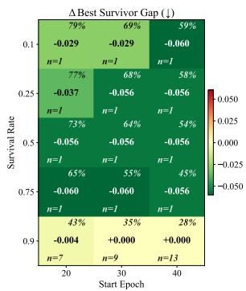

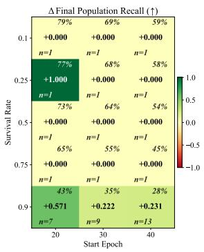  
Figure 28: TinyImageNet phase, final value: weight-statistic XGBoost with performance features; mostly robust improvements.

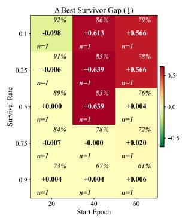

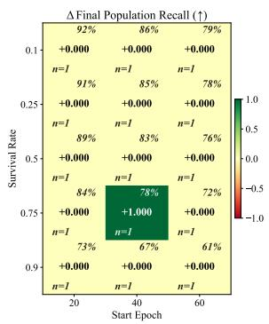  
Figure 29: CIFAR-10 ViT, final value: latent-token Transformer; mixed results across pruning schedules.

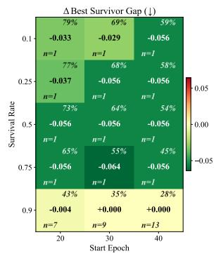

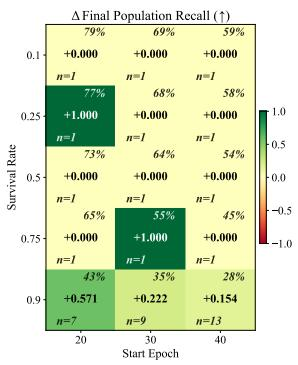  
Figure 30: TinyImageNet phase, final value: averaged-latent MLP; consistently better under meaningful pruning.

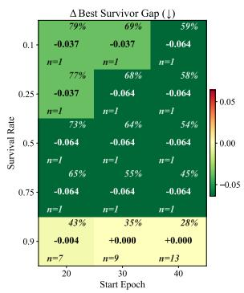

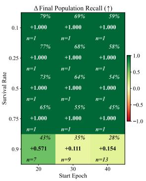  
Figure 31: TinyImageNet phase, final value: averaged-latent XGBoost with performance features; robust improvements.

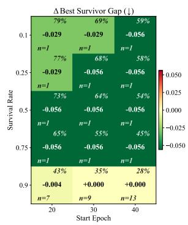

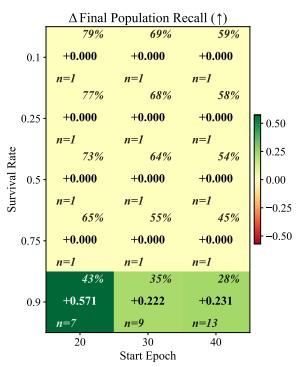  
Figure 32: TinyImageNet phase, final value: latent-token Transformer with performance features; broadly effective.

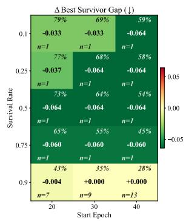

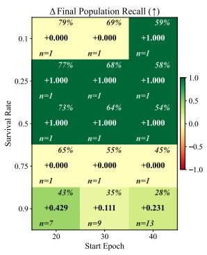  
Figure 33: TinyImageNet phase, final value: latent-window LSTM with performance features; mostly robust improvements.

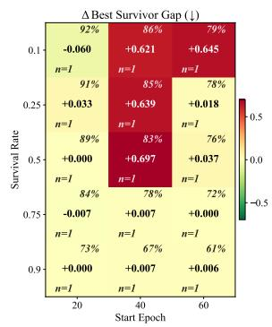

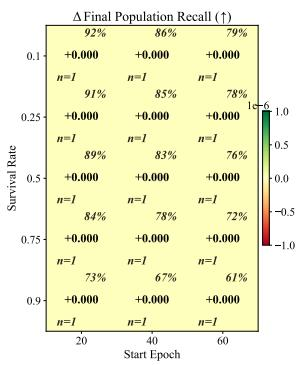  
Figure 34: CIFAR-10 ViT, final value: averaged-latent MLP; unstable and frequently worse than LC Extrapolation.

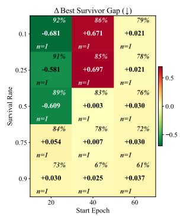

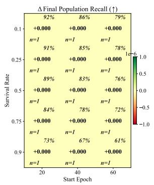  
Figure 35: CIFAR-10 ViT, final value: averaged-latent XGBoost; strong early gains but poor transfer to later starts.

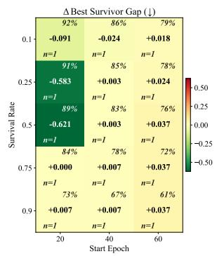

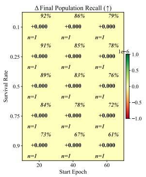  
Figure 36: CIFAR-10 ViT, final value: latent-window LSTM; effective early but unreliable elsewhere.

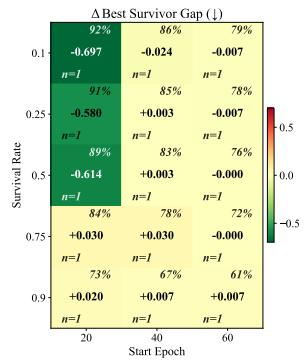

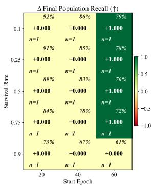  
Figure 37: CIFAR-10 ViT, final value: performance-only MLP; large early gains coexist with later degradations.

  
Figure 38: CIFAR-10 ViT, horizon value: averaged-latent MLP; predominantly worse than LC Extrapolation.

  
Figure 39: CIFAR-10 ViT, horizon value: averaged-latent XGBoost; mostly unsuccessful except at isolated settings.

  
Figure 40: CIFAR-10 ViT, horizon value: latent-token Transformer; consistently poor at moderate pruning rates.

  
Figure 41: CIFAR-10 ViT, horizon value: latent-window LSTM; generally worse despite high compute savings.

  
Figure 42: CIFAR-10 width-varying ResNet-18, final value: latent-window LSTM; helps mainly when pruning starts at epoch 40 or 60.

The mix of outcomes above is deliberate: several configurations (e.g. Figures 34, 38–41) are worse than the learning-curve extrapolation baseline across most of the grid. SOTF training's benefit therefore comes from selecting among these configurations using validation performance, not from every checkpoint-based predictor improving pruning automatically.

## G Compute resources and reproducibility

What is and is not measured. As stated in Section 5, “training epochs saved" is an architectureand hardware-independent proxy for compute and energy reduction; we do not report GPU-hours,

wall-clock runtime, FLOPs, or energy consumption for zoo training, SANE backbone training, predictor training, or the SOTF training simulation itself, and the reported compute savings do not include the cost of computing weight statistics or of training and applying SANE encoders. This limitation is intentional rather than an oversight of reporting: the underlying model zoos were trained and checkpointed prior to this work, so their original training cost is not directly re-measurable, and the SANE backbones and predictors used here were trained once per zoo, offline, ahead of the SOTF training evaluation, rather than inside a live, wall-clock- metered training loop.

Code availability. The code to reproduce our experiments is available at https: //github. com/ RicoStaedeli/sotf-training.