# Offline Learning of Reserve Prices from Censored Bids

Lavanya Marla Yunzong Xu Boxuan Zhou<sup>\*</sup>

Department of Industrial and Enterprise Systems Engineering, University of Illinois Urbana-Champaign

## Abstract

We study how a seller can learn a reserve price for a second-price auction from censored historical bid data. Because values below past reserves are unobserved, even unlimited data may not reveal which reserve earns the most revenue. At the population level, we characterize exactly when an optimal reserve can be identified under a monotone hazard rate (MHR) assumption, even though the value distribution may remain unidentified. Identification holds in two situations. In the first, revenue has not yet begun to fall at the lowest historical reserve, so the best reserve lies among the observed bids. In the second, the censored fraction is as large as MHR allows given the observed bids, which pins down the entire value distribution. When identification fails, we derive the reserve that minimizes worst-case revenue regret over distributions consistent with the data. We prove that both the unique minimax reserve and its regret depend on just two observable quantities: the censored fraction and the hazard just above the lowest historical reserve.

With finite data, we estimate these two quantities from � historical bidders who faced the lowest reserve. In the identifiable regime the optimal reserve itself is learned, with expected worst-case regret $O ( N ^ { - 1 / 2 } )$ from the observed bids when it lies among them, and $O ( N ^ { - 1 } )$ from the censored count alone when the censored fraction is as large as MHR allows and the optimum lies at or below the lowest reserve. In the nonidentifiable regime, we show that the rule that plugs these estimates into the minimax reserve has expected worst-case revenue regret within $O ( N ^ { - 2 / 5 } )$ of the population minimum under local density smoothness. We prove a matching minimax lower bound on a smooth class in this regime. Beyond MHR, we solve the minimax problem for regular and unrestricted distributions, and prove an $O ( N ^ { - 2 / 5 } )$ learning upper bound under smoothness and known bounds on the boundary parameters in the regular nonidentifiable regime. Numerical experiments on synthetic and real-world eBay data show gains from exploiting MHR and the benefits of our robust pricing rule when parametric models are misspecified.

Keywords: offline learning, reserve prices, second-price auctions, censored data, minimax regret, partial identifica tion, monotone hazard rate

## 1 Introduction

Prices shape both trade and what a seller can learn about demand. A buyer who turns down an offer may be willing to pay just a little less, or much less. The refusal alone does not tell us which. Repeating the offer reveals how often buyers reject it, but leaves open which lower prices they would accept.

Reserve prices make this tension concrete in auctions. A reserve is the lowest price at which the seller will sell. In a second-price auction, a winner pays the reserve if no other bid meets it, and otherwise pays the second-highest bid. A bidder’s own bid determines whether it wins, but not the price it pays if it wins. Bidding its true value is therefore optimal regardless of the other bids [Vic61]. Raising the reserve can increase the payment or prevent a sale. Classical auction theory characterizes the best reserve when the value distribution is known [Mye81, BR89]. Historical bids offer a way to learn this choice: in a field experiment on search-advertising auctions, reserves learned from past bids increased revenue [OS23].

A past reserve, however, can hide precisely the values needed to evaluate a lower one. We study historical bid data in which a bidder reports a value when it meets the reserve and submits no bid otherwise. The seller knows how many bidders faced each reserve, including those who did not bid. The task is offline: choose a new reserve from these data, without collecting new observations at lower prices.

## 1.1 Learning despite censoring

Let � be the lowest historical reserve, which we call the censoring boundary. Even with unlimited data, the seller learns only the distribution at and above �—the observed tail—and the probability of a value below it. The distribution of these lower values—the hidden body—remains unidentified without further assumptions. Figure 1.1 shows two value distributions that produce indistinguishable censored records but different optimal reserves. No number of additional bids collected at the same historical reserves can distinguish them. Does this make it impossible to learn an effective reserve from censored bids?

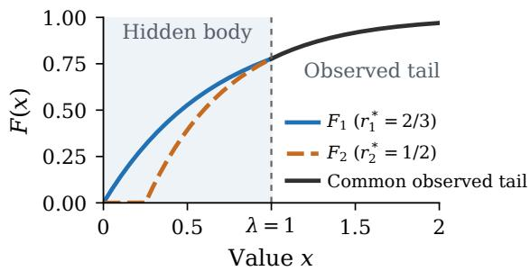  
Figure 1.1 A nonidentifiable instance. Two value distributions agree at and above the historical reserve $\lambda = 1$ so they induce the same distribution of censored records. Their unique optimal reserves are $2 / 3$ and $1 / 2 .$ The seller observes the total probability below the boundary, but not its distribution within the shaded region. Both distributions have a monotone hazard rate (see Section 3).

Fortunately, choosing a reserve can require less information than recovering the whole distribution: different bodies can share an optimal reserve. When their optima disagree, we adopt the minimax viewpoint developed for offline pricing and censored inventory problems [BSLW23, HS26]. We compare the revenue of a chosen reserve with each compatible distribution’s own optimal revenue. We call this difference revenue regret, whether the reserve is chosen using exact information or learned from samples. When the censored fraction (the share of bidders who submit no bid) and the observed tail are known exactly, the smallest achievable worst-case regret is the population minimax regret. It is the benchmark for learning from samples: more records at the same historical reserves cannot reduce worst-case regret below it. For censored auctions, this leads to our research questions:

When do censored bids identify an optimal reserve? When they do not, what revenue regret is unavoidable, and how can the seller learn the best reserve despite the hidden values?

## 1.2 Main results

Our main results exploit monotone hazard rate (MHR), a standard shape constraint on demand in auction and pricing theory [DRY15, CR14, ABB22]. The hazard rate measures the relative rate at which demand falls as the price rises and governs the tradeoff between a higher payment and a lost sale. MHR requires this rate to be nondecreasing and covers a broad class of distributions, including all distributions with log-concave densities [BB05]. MHR excludes some hidden bodies that the censored data alone cannot rule out. To quantify the benefit of this constraint, we also solve the problem for regular and unrestricted distributions (Section 6 and Table 7.1). Under MHR, we first solve the problem with the tail known exactly, then learn the required quantities from samples.

Identification We distinguish two regimes according to whether censored bids identify an optimal reserve shared by all compatible distributions (Theorem 3.6). In the identifiable regime, this can happen in two ways. If revenue has not yet begun to fall at �, the hidden body cannot change the best choice in the observed tail. We call this the tail-optimal case. Alternatively, if the censored fraction is as large as MHR allows for the hazard just above �, MHR forces the body to have constant hazard. Thisfully identified case determines the entire distribution and is a special case of the identifiable regime. The two cases can overlap. In the remaining nonidentifiable regime, compatible distributions prefer different reserves, leaving a positive minimax regret Δ that more bids at the same prices cannot remove.

Minimax pricing When compatible distributions prefer different reserves, pricing too high loses sales while pricing too low gives up revenue. We prove that a unique minimax reserve balances the largest possible losses from these mistakes (Theorem 4.3). For fixed bidder count � and historical reserve �, this reserve and Δ depend on only two observable quantities: the censored fraction and the hazard just above �, the right-hand hazard of the observed tail, which we call the boundary hazard (Proposition 4.1). The minimax reserve lies strictly between the reciprocal of the boundary hazard, the optimum if the hazard stayed at its boundary value, and the historical reserve. Reusing � is therefore strictly worse in every nonidentifiable instance (Theorem 4.3 and Proposition 4.4).

In the nonidentifiable regime every compatible optimum lies at or below �, so only reserves up to � need to be compared. The revenue difference between two such reserves depends on the values above � only through how often they occur, not through their size. An auction with at least two values above � pays the same second-highest value under either reserve. The censored fraction gives this frequency, and the boundary hazard bounds the hidden bodies through MHR, which is why two observable quantities suffice. For each fixed reserve, the worst case is attained by a body with at most two constant hazard levels (Theorem 4.2), reducing the infinite-dimensional search over compatible distributions to a two-dimensional optimization over these levels.

Learning from finite data The learning rate depends on what censoring leaves us to estimate. In the tail-optimal case, an empirical tail rule has $O ( N ^ { - 1 / 2 } )$ expected regret (Proposition 5.1). Here � counts historical bidders facing �. In the nonidentifiable regime, we instead estimate the censored fraction and the hazard just above �. Under local density smoothness, the rule that plugs these estimates into the minimax reserve, the plug-in rule, has expected worst-case regret $\Delta + O ( N ^ { - 2 / 5 } )$ (Theorem 5.5). A matching lower bound on a smooth class of nonidentifiable MHR instances shows that the exponent $2 / 5$ cannot be improved uniformly (Proposition 5.6).

In the special fully identified case with an optimum at or below �, the linear-completion rule, which uses only the censored count, the number of bidders who submit no bid, gives $O ( N ^ { - 1 } )$ expected total regret without estimating a density (Proposition 5.8). Small departures from full identification add only a regret term that is quadratic in the distance to full identification. That distance is the gap between the largest cumulative hazard that MHR allows below � and the one the censored fraction implies, $\lambda h _ { 0 } - A$ in the notation of Section 3.

To choose a reserve without knowing the regime, the auto-selector (Algorithm 5.2) first tests for a tail optimum using the estimated boundary hazard, then selects the tail rule or the plug-in rule. Under common smoothness and parameter bounds, it has $O ( N ^ { - 2 / 5 } )$ excess worst-case regret with high probability (Proposition B.10).

Extensions beyond MHR Regular distributions, a broader class, rule out a revenue decline followed by an increase as the reserve rises. Their nonidentifiable regime retains the reduction to two observable quantities and an $O ( N ^ { - 2 / 5 } )$ upper bound on expected excess regret under the smoothness and parameter conditions in Section 6. They do not retain MHR’s fully identified case or its fast $O ( N ^ { - 1 } )$ guarantee. We also solve the minimax problem without shape restrictions.

Numerical experiments We compare the reserves chosen under MHR, regular distributions, and no shape restrictions for the same censored records. Exploiting MHR reduces actual regret relative to the unrestricted reserve in all three synthetic examples of Section 7.1, alongside much smaller minimax regret (Table 7.1). We then compare the robust rule with maximum-likelihood estimators (MLEs), which fit the parameters of an assumed distribution family to the censored records. A correct family can help recover the optimal reserve. But a misspecified family can match the observed records while assigning the wrong distribution to the hidden values, causing regret that persists as the sample grows. Our experiments quantify the robust rule’s protection against this error and its cost under individual distributions (Section 7). On eBay bids, the rule’s held-out regret is below every censored parametric fit’s at two of the three Palm Pilot reference boundaries, and below the Weibull fit’s at seven of the eight most frequent Palm Pilot opening bids (four to seven as the imputed bidder count varies). Reusing the opening bid loses up to 54% of the optimal revenue (Section 7.4).

## 1.3 Related work

Our identification and learning questions build on the theory of offline decisions from censored data. Bu et al. [BSLW23] study pricing from historical prices, inventories, and censored sales; they introduced the notion of problem identifiability, linked it to vanishing minimax regret, and developed a policy approaching minimax regret. The closest problem is the censored newsvendor of Hssaine and Sinclair [HS26]. They characterize minimax regret, solve the population minimax problem, and give finite-sample guarantees with matching lower bounds up to logarithmic factors. As in both papers, we evaluate worst-case regret at the decision produced by the sample. We also build on Hssaine and Sinclair’s use of samples at the censoring boundary and a regime test before selecting a rule. Kumar and Mouchtaki [KM26] compute the exact worst-case regret of standard censored newsvendor policies at every sample size.

In the newsvendor model of [HS26], costs specify the optimal demand quantile, so the censored fraction determines whether it is observed. Optimal auction reserves instead depend on the hazard rate: the density relative to the probability of exceeding the reserve. The censored fraction alone cannot determine this tradeoff between higher payments and lost sales. Accordingly, the population minimax problem is no longer one-dimensional in the censored fraction: under MHR it becomes a two-dimensional optimization over hazard levels. We solve it with certified error bounds and match the learning rate of the resulting plug-in rule with a lower bound. We also seek to exploit economically meaningful shape constraints on demand. Under MHR or regular distributions, a worst-case body must join the observed tail without violating the shape restriction. Constructing such bodies is an additional analytical challenge. Exploiting these constraints can lower regret relative to each compatible distribution’s own optimal revenue. We quantify the benefit by also solving the unrestricted auction problem (Section 6 and Table 7.1).

The dependence on the hazard also affects learning. In the nonidentifiable MHR regime, we must estimate a density at the censoring boundary. We show how its estimation error affects revenue regret. The $N ^ { - 2 / 5 }$ upper bound is uniform over classes with common local density smoothness bounds and is matched by a minimax lower bound on a smooth interior class; the newsvendor rate in [HS26] is $N ^ { - 1 / 2 }$ , up to logarithmic factors.

Allouah et al. [ABB23] maximize the guaranteed fraction of optimal posted-price revenue when the sale probability at one historical price is known. Two constant hazard levels also appear in their MHR analysis. For posted pricing, sale probabilities at two prices fix their revenue difference. In a second-price auction, this difference also depends on the distribution of values between the reserves. Our two-level characterization follows from a separate comparison of auction revenues while preserving the observed tail (Theorem 4.2). In the nonidentifiable MHR regime, this reduction determines the smallest worst-case revenue regret and the reserve that achieves it. Anunrojwong [Anu26] also builds worst cases for MHR bidders from constant hazards, for a revenue ratio and without data; in our problem the levels must also join the observed tail and account for the censored fraction.

Online reserve learning from censored auction feedback is well established [CBGM15], including with strategic bidders or context [KN21, GJM21]. Online learning has a fundamental advantage: the seller can deliberately lower reserves to explore values hidden by earlier reserves. Zhang et al. [ZLZ<sup>+</sup>24] learn a threshold from censored feedback by choosing the thresholds they query, and Cherapanamjeri et al. [CDIZ22] estimate auction models by setting reserves; both can sample below any earlier threshold. In offline learning, values below the lowest historical reserve remain hidden even with unlimited data. We address this obstruction directly.

With uncensored values, auction-learning bounds quantify the samples needed for near-optimal revenue [CR14, GHZ19, MR15, MMM16, DRY15]. Jin et al. [JLX23] establish tight sample-complexity bounds for learning reserves in second-price auctions. Methods for personalized reserves in advertising also optimize over fully logged bids [PLPV16, DGPL22]. In our setting, by contrast, censored records can leave positive regret even with unlimited data. Bid-landscape forecasting also learns from censored auction logs [RQZ<sup>+</sup>19, GMS<sup>+</sup>20]. Those works estimate a bidder’s distribution of market prices from winning and losing auctions; our decision is the seller’s reserve. Chahuara et al. [CGJR17] model bids censored by a publisher’s reserves with a survival model inside an online engine, without identification or rate guarantees.

Auction econometrics studies what incomplete bids reveal about values and counterfactual revenues [HT03, Tan11, ALGQ13, GPV00, AH02]. With a binding public reserve, Paarsch [Paa97] estimates the optimal reserve from a parametric family; Freyberger and Larsen [FL22] and Hickman et al. [HHP17] give point identification when the number of bidders is unknown or only bounded below; and Qi [Qi25] shows that truncated second-price transaction prices identify the censored fraction and the value distribution above the reserve, taking the posted reserve to be optimal. These are the observables of our model; we ask what they imply for a new reserve when the values below the old one stay hidden.

Reserve selection under partial identification has also been studied [AK13, JP24]. Kim et al. [KKP26] compute maximin-revenue reserves from valuation bounds. Ponomarev and Wen [PW26] use minimax regret, our criterion, but their ambiguity concerns the highest value under non-binding reserves, restricted by likelihood ratios rather than hazards, and their reserve depends on a whole estimated distribution. Tang and Wang [TW26] design maximin mechanisms from the distribution of one order statistic. Coey et al. [CLSW21] show that the top two bids can identify an optimal reserve without the whole value distribution, using zero or secret reserves that leave those bids observable. A positive public reserve can instead hide both highest values and leave revenue at a lower reserve unidentified even with unlimited data. We determine when this hidden information still permits an optimal decision; otherwise, we characterize the reserve with the smallest regret relative to each compatible distribution’s own optimum, and the rate at which it can be learned.

Robust pricing and auction design also use finite samples, shape information, moments, or support restrictions [ABB22, TTW26, AB20, Suz22, Che22, KIKW20]. Minimax regret also appears in posted pricing, screening, and auctions [BS08, WLZ24, ABB25]. Anunrojwong et al. [ABB26] find the minimaxregret mechanism when only the support of values is known, measuring regret against the revenue obtainable with known values. We measure it against each compatible distribution’s own optimal revenue, as in [BSLW23, HS26]. Censored inventory research also studies exploration, adaptive ordering, and confidence intervals for learned policies [BM13, HR09, Ban20].

## 1.4 Organization and notation

Section 2 introduces the auction, historical data, and regret criterion. Sections 3–5 determine when an optimal reserve can be identified, solve the minimax problem, and develop learning guarantees. Section 6 extends the analysis to regular and unrestricted distributions. Section 7 reports experiments, and Section 8 concludes. The appendices contain proofs, additional theoretical results, and further experimental details; Appendix A.1 lists the notation.

Throughout, � counts bidders in the target auction, and � counts historical bidders who faced the lowest reserve �. We write � for the true cumulative distribution function and � for a candidate, with densities � and �. Also, $( x ) _ { + } = \operatorname* { m a x } \{ x , 0 \}$ , and 1{�} is the indicator of an event �.

## 2 Model and Objective

## 2.1 Auction model and revenue

The seller offers one item in a second-price auction with reserve $r \geq 0 \mathrm { ~ t o ~ } n \geq 2$ risk-neutral bidders. Their private values are independent draws from an unknown absolutely continuous distribution � on $[ 0 , \infty )$ with finite mean. A bidder reports its value if it meets the reserve and submits no bid otherwise; this is optimal regardless of the other bids [Vic61]. With exactly one qualifying bid, the winner pays �; with at least two, it pays the second-highest value. With none, revenue is zero.

The admissible value distributions form the class

$$
\mathcal { G } : = \{ F : \operatorname { s u p p } ( F ) \subseteq [ 0 , \infty ) , \quad F \mathrm { ~ a b s o l u t e l y ~ c o n t i n u o u s , } \quad \mathbb { E } _ { F } [ V ] < \infty \} .\tag{2.1}
$$

Let $f$ be the density of a candidate $F , \mathbf { V } = \left( V _ { 1 } , \ldots , V _ { n } \right)$ the values, and $V _ { ( 1 ) } \geq V _ { ( 2 ) }$ for the two highest. The auction’s payment can be written as

$$
\mathrm { r e v } ( r , { \bf V } ) = r { \bf 1 } \{ V _ { ( 1 ) } \geq r \} + ( V _ { ( 2 ) } - r ) _ { + } .\tag{2.2}
$$

Let $R _ { F } ( r )$ be its expectation under �. Splitting by one or at least two qualifying bids gives

$$
R _ { F } ( r ) = n r F ( r ) ^ { n - 1 } ( 1 - F ( r ) ) + \int _ { r } ^ { \infty } u n ( n - 1 ) F ( u ) ^ { n - 2 } ( 1 - F ( u ) ) f ( u ) d u .\tag{2.3}
$$

For a known distribution �, define its optimal revenue and reserve by

$$
R _ { F } ^ { * } : = \operatorname* { m a x } _ { r \ge 0 } R _ { F } ( r ) , \qquad r _ { F } ^ { * } : = \operatorname* { m i n } \operatorname* { a r g m a x } _ { r \ge 0 } R _ { F } ( r ) .\tag{2.4}
$$

Finite mean ensures that the maximum exists (Lemma A.1); the smallest maximizer resolves ties. The identification notion of Definition 2.4 below asks only for a shared maximizer and does not depend on this tie rule.

## 2.2 Censored bid data

The historical data may contain several reserves. Auction $k \in \{ 1 , \ldots , K \}$ has a known reserve $r _ { k } ^ { \mathrm { o f f } }$ and bidder count $N _ { k }$ , which need not equal the target count �. The reserves and counts are fixed before values are drawn. The values $V _ { k i } ^ { \mathrm { o f f } } , i = 1 , \dots , N _ { k }$ , are i.i.d. from � across all $k , i ,$ independently of this design. A randomized design can be treated conditionally on its realization. The seller observes

$$
Y _ { k i } ^ { \mathrm { o f f } } = \left\{ \begin{array} { l l } { V _ { k i } ^ { \mathrm { o f f } } , } & { V _ { k i } ^ { \mathrm { o f f } } \geq r _ { k } ^ { \mathrm { o f f } } , } \\ { \varnothing , } & { V _ { k i } ^ { \mathrm { o f f } } < r _ { k } ^ { \mathrm { o f f } } . } \end{array} \right.
$$

An observed bid reveals a value; $\emptyset$ reveals only that it lies below the reserve. The observed bids and the number of bidders who submit no bid determine $N _ { k } ;$ ; their identities are unnecessary. Such counts are

available, for example, when participation is registered before bidding.

Write $Y ^ { \mathrm { o f f } } = ( Y _ { k i } ^ { \mathrm { o f f } } ) _ { k , i }$ and $r ^ { \mathrm { o f f } } = ( r _ { k } ^ { \mathrm { o f f } } ) _ { k \in \{ 1 , \dots , K \} }$

Definition 2.1 (Censoring boundary and sample size). The lowest historical reserve and the number of bidders who faced it are

$$
\lambda : = \operatorname* { m i n } _ { k } r _ { k } ^ { \mathrm { o f f } } , \qquad N : = \sum _ { k : r _ { k } ^ { \mathrm { o f f } } = \lambda } N _ { k } .\tag{2.5}
$$

We assume $\lambda > 0$ and call it the censoring boundary.

The lowest reserve determines what remains hidden even with unlimited data. In the population limit, records at � reveal $G ( x )$ for every $x \ge \lambda$ . Higher-reserve records can improve finite-sample tail estimates but add no population information. Our rules use the $N$ lowest-reserve records, and their learning bounds are expressed in terms of �. Reserve choices that depend on the values they censor are outside this sampling model (Remark B.12).

For these � records, we suppress the auction index, write $V _ { i } , i = 1 , \ldots , N$ , for their values, and set $Y _ { i } = V _ { i } \operatorname { i f } V _ { i } \geq \lambda$ , and $Y _ { i } = \emptyset$ otherwise. The number of no-bid records divided by � estimates the censored fraction

$$
\alpha : = G ( \lambda ) \in ( 0 , 1 ) .\tag{2.6}
$$

The observed bids alone would not determine this fraction. Censoring does not reveal how this probability is distributed below �. We call this hidden part the hidden body, or simply the body, and a distribution that agrees with the observed tail a compatible completion, or a compatible distribution.

## 2.3 Minimax regret

Following the offline censored-data framework of Bu et al. [BSLW23] and Hssaine and Sinclair [HS26], we group distributions that the historical data cannot distinguish and evaluate reserves by worst-case revenue regret. At reserves at least �, all compatible distributions have the same revenue. Below �, their revenues and optimal reserves can differ. The distributions indistinguishable from � in the population limit form the following set.

Definition 2.2 (Ambiguity set).

$$
{ \mathcal { F } } ( \lambda ; G ) : = \{ F \in { \mathcal { G } } : F ( x ) = G ( x ) { \mathrm { ~ f o r ~ a l l ~ } } x \geq \lambda \} .\tag{2.7}
$$

A shape assumption narrows this set. For any resulting $\boldsymbol { \mathcal { A } } \subseteq \mathcal { F } ( \lambda ; G )$ containing $G ,$ we evaluate a reserve by its revenue regret relative to each completion’s own optimum.

Definition 2.3 (Minimax regret).

$$
\Delta ( \mathcal { A } ) : = \operatorname* { i n f } _ { r \geq 0 } \operatorname* { s u p } _ { F \in \mathcal { A } } \{ R _ { F } ^ { * } - R _ { F } ( r ) \} .\tag{2.8}
$$

The seller chooses a reserve to minimize the largest revenue regret over compatible distributions. The value $\Delta ( \mathcal { A } )$ measures the irreducible regret caused by censoring when the tail is known exactly, and does not

depend on �. Since $G \in { \mathcal { A } } .$ , regret under the true distribution can be smaller than the worst case at the same reserve:

$$
R _ { G } ^ { * } - R _ { G } ( r ) \leq \operatorname* { s u p } _ { F \in \mathcal { A } } \{ R _ { F } ^ { * } - R _ { F } ( r ) \} \qquad ( r \geq 0 ) .\tag{2.9}
$$

In particular, a reserve’s regret under $G$ can fall below $\Delta ( \mathcal { A } )$

## 2.4 Identification and learning

An optimal reserve can be identifiable even when the value distribution is not fully identified: it suffices that all compatible distributions share one.

Definition 2.4 (Identifiability). The distribution of censored records identifies an optimal reserve over $\mathcal { A }$ if its compatible distributions share an optimum:

$$
\mathrm { t h e r e ~ e x i s t s ~ } r \ge 0 ~ \mathrm { s u c h ~ t h a t ~ } R _ { F } ( r ) = R _ { F } ^ { * } \quad \mathrm { f o r ~ e v e r y ~ } F \in \mathcal { A } .\tag{2.10}
$$

With finite data, a reserve rule is a measurable map

$$
\pi : ( Y ^ { \mathrm { o f f } } , r ^ { \mathrm { o f f } } ) \longmapsto r ^ { \pi } \in [ 0 , \infty ) .\tag{2.11}
$$

We write Π for these rules. A rule’s regret under the true distribution is

$$
\operatorname { R e g r e t } ( r ^ { \pi } ) : = R _ { G } ^ { * } - R _ { G } ( r ^ { \pi } ) .\tag{2.12}
$$

Following Bu et al. [BSLW23] and Hssaine and Sinclair [HS26], we evaluate each sample’s reserve by its worst-case revenue regret over compatible distributions. The expected excess regret is

$$
\mathbb { E } _ { G } \bigg [ \operatorname* { s u p } _ { F \in \mathcal { A } } \{ R _ { F } ^ { * } - R _ { F } ( r ^ { \pi } ) \} \bigg ] - \Delta ( \mathcal { A } ) .\tag{2.13}
$$

The sample produces a reserve, which is then evaluated against every compatible distribution. Averaging this worst-case regret over samples and subtracting $\Delta ( \mathcal { A } )$ isolates the additional cost of learning from finite data. Taking the worst case before averaging lets the worst compatible distribution vary with the realized reserve; averaging first would instead evaluate the rule against a single completion fixed across samples.

The connection between identifiability and zero minimax regret underlies the offline pricing analysis of Bu et al. [BSLW23] and is stated explicitly for the censored newsvendor problem by Hssaine and Sinclair [HS26]. The following proposition establishes the corresponding connection for auctions.

Proposition 2.5 (Identification and vanishing regret). Let $G \in \mathcal { A } \subseteq \mathcal { F } ( \lambda ; G )$ . The minimax infimum is attained, and identifiability is equivalent to $\Delta ( { \mathcal { A } } ) = 0 .$ . For the unrestricted, MHR, and regular classes studied here (Definition 3.2), each zero-regret case admits one sample-based rule whose worst-case regret vanishes in probability for every $G$ in that case. For regular distributions, the right density at $\lambda$ is assumed to exist, as in Theorem C.1.

Thus a common optimum can be learned even when the body remains unidentified. The population claim is proved in Appendix A.3, the learning claims in Appendices B.1 and B.3. When the compatible optima disagree, the goal is to approach the positive population value $\Delta ( \mathcal { A } )$

## 3 Identifiability under MHR

Our main analysis exploits MHR to link the hidden body to the observed tail, excluding distributions that the censored data alone cannot rule out. This restriction can identify an optimal reserve even when the body remains unknown (Theorem 3.6), and can lower minimax regret when no common optimum is identifiable (Table 7.1). We first define the shape restrictions, then determine when MHR identifies an optimal reserve. Section 6 shows what survives for regular and unrestricted distributions.

## 3.1 Revenue and the hazard rate

Consider a small increase from $r \mathrm { ~ t o ~ } r + \varepsilon$ . To first order, the revenue change comes from auctions with exactly one bid above �. The winner pays an additional � if its value clears the new reserve; otherwise the sale is lost, reducing revenue by about �. Conditional on clearing �, the probability that this value lies in $[ r , r + \varepsilon )$ is approximately $f ( r ) \varepsilon / ( 1 - F ( r ) )$ . The coefficient $f ( r ) / ( 1 - F ( r ) )$ is the hazard rate, which measures the rate at which qualifying bids cease to qualify as the reserve rises.

Definition 3.1 (Hazard and cumulative hazard). For a distribution � with density �, where $F ( x ) < 1$ , define

$$
h _ { F } ( x ) : = { \frac { f ( x ) } { 1 - F ( x ) } } , \qquad H _ { F } ( x ) : = \int _ { 0 } ^ { x } h _ { F } ( u ) d u = - \log ( 1 - F ( x ) ) .
$$

Thus $1 - F ( x ) = e ^ { - H _ { F } ( x ) }$

The payment gain and the risk of losing the sale give, almost everywhere on the interior of the effective support,

$$
R _ { F } ^ { \prime } ( r ) = n F ( r ) ^ { n - 1 } ( 1 - F ( r ) ) ( 1 - r h _ { F } ( r ) ) .
$$

The positive factor is the probability of exactly one qualifying bid. Thus revenue rises when $r h _ { F } ( r ) < 1$ and falls when $r h _ { F } ( r ) > 1$ . For a fixed completion, the bidder count changes the magnitude of this effect but not its direction.

Where $0 < F ( r ) < 1$ and $f ( r ) > 0$ , define the virtual value $\phi _ { F } ( r ) : = r - ( 1 - F ( r ) ) / f ( r ) =$ $r - 1 / h _ { F } ( r )$ . The revenue derivative can then be written as $R _ { F } ^ { \prime } ( r ) = - n F ( r ) ^ { n - 1 } f ( r ) \phi _ { F } ( r )$ . We consider two restrictions on the distribution’s shape.

Definition 3.2 (MHR and regular distributions). A distribution has monotone hazard rate (MHR) if $h _ { F }$ is nondecreasing, or equivalently if $H _ { F }$ is convex. It is regular if its virtual value $\phi _ { F }$ is nondecreasing.

For both classes, we assume $f > 0$ on the interior of the effective support $\{ x : 0 < F ( x ) < 1 \}$ , so virtual value is defined there and prices can be indexed by quantiles.

Every MHR distribution is regular because both � and − $\cdot 1 / h _ { F } ( r )$ are nondecreasing, but the converse does not hold. Section 6 compares the identification and regret guarantees under the two assumptions.

Definition 3.3 (Shape-restricted ambiguity sets).

$$
\mathcal { F } _ { \mathrm { M H R } } ( \lambda ; G ) : = \{ F \in \mathcal { F } ( \lambda ; G ) : F { \mathrm { i s ~ M H R } } \} .\tag{3.1}
$$

Define $\mathcal { F } _ { \mathrm { r e g } } ( \lambda ; G )$ similarly over regular distributions. Then $\mathcal { F } _ { \mathrm { M H R } } \subseteq \mathcal { F } _ { \mathrm { r e g } } .$

Assumption 3.4 (MHR). The true value distribution � is MHR.

Sections 3–5 use this assumption, so $G$ belongs to the MHR ambiguity set. Results for regular and unrestricted distributions in Section 6 and the appendices state their own distributional conditions.

## 3.2 Zero-regret frontier

For now, take the censored fraction and observed tail as known exactly. They fix the cumulative hazard’s height and its right slope at the censoring boundary:

$$
A : = H _ { G } ( \lambda ) = - \log ( 1 - \alpha ) > 0 ,\tag{3.2}
$$

$$
h _ { 0 } : = H _ { G } ^ { \prime } ( \lambda ^ { + } ) \in ( 0 , \infty ) .\tag{3.3}
$$

We assume that this right hazard is finite; when the right density exists, $h _ { 0 } = g ( \lambda ^ { + } ) / ( 1 - \alpha )$ , with $g$ the density of �. At a jump of the hazard we use its right-continuous version. For an MHR distribution this is the right derivative of the convex function $H _ { G } ,$ , as in (3.3). For a regular distribution it is the right density divided by the survival probability, as Appendix C assumes. For a compatible body, $A / \lambda$ is the average hazard on [0, �], and MHR bounds its hazard above by $h _ { 0 }$ . The average cannot exceed this upper bound, so feasibility requires

$$
A \leq \lambda h _ { 0 } .\tag{3.4}
$$

This condition is also sufficient: since � is MHR, its tail cumulative hazard is convex with hazard at least $h _ { 0 }$ above �, so the body with constant hazard $A / \lambda \le h _ { 0 }$ (the chord of Figure 3.1) pastes to it and the result is MHR.

The zero-regret frontier has two sources. In the tail-optimal case, $\lambda h _ { 0 } \leq 1$ , so $r h _ { F } ( r ) \leq 1$ throughout every compatible body. Raising the reserve toward � cannot lower revenue, so the best reserve in the observed tail is optimal regardless of the hidden body.

If $A = \lambda h _ { 0 }$ , the average body hazard equals its upper bound, forcing $h _ { F } ( x ) = h _ { 0 }$ almost everywhere below �. Every compatible body therefore has $F ( x ) = 1 - e ^ { - h _ { 0 } x } { \mathrm { f o r } } 0 \leq x \leq \lambda$ . Together with the observed tail, this determines the entire distribution; we call it the $f u l l y$ identified case. The optimum is $1 / h _ { 0 }$ when $1 / h _ { 0 } \leq \lambda ;$ otherwise it lies in the observed tail above �. The two cases overlap when $A = \lambda h _ { 0 } \leq 1$ . When neither identification condition holds, compatible bodies can place the crossing of $r h _ { F } ( r ) = 1$ at different reserves.

Example 3.5 (Nonidentifiable MHR completions). Figure 1.1 illustrates the nonidentifiable regime. Set $\lambda = 1$ $A = 3 / 2$ , and $h _ { 0 } = 2 .$ , so $A < \lambda h _ { 0 }$ and $\lambda h _ { 0 } > 1$ . Two compatible body cumulative hazards are

$$
\begin{array} { r } { H _ { 1 } ( x ) = \frac { 3 } { 2 } x , \qquad H _ { 2 } ( x ) = \operatorname* { m a x } \{ 0 , 2 x - \frac { 1 } { 2 } \} , \qquad 0 \leq x \leq 1 , } \end{array}
$$

continued by $H _ { i } ( x ) = \textstyle { \frac { 3 } { 2 } } + 2 ( x - 1 )$ above 1. Both distributions $F _ { i } = 1 - e ^ { - H _ { i } }$ are MHR and censor the same fraction $1 - e ^ { - 3 / 2 }$ . In the first body the hazard is $3 / 2$ throughout; in the second it is zero up to $1 / 4$ and then 2. The product $r h _ { F _ { i } } ( r )$ crosses one at $2 / 3$ and $1 / 2 ,$ , respectively; since the sign of the revenue derivative does not depend on the bidder count (Section 3.1), these are the unique optimal reserves of $F _ { 1 }$ and $F _ { 2 }$ for every $n \geq 2 .$ . The historical record nevertheless has the same law under both distributions. Section 4 returns to this example to choose a reserve that minimizes regret over all compatible bodies.

For the formal characterization, write

$$
q _ { \lambda } : = 1 - \alpha = e ^ { - A } ,\tag{3.5}
$$

$$
\phi _ { 0 } : = \phi _ { G } ( \lambda ) = \lambda - 1 / h _ { 0 } .\tag{3.6}
$$

Here $q _ { \lambda }$ is the probability of an observed bid, and $\phi _ { 0 }$ is the right boundary virtual value. The condition $\phi _ { 0 } \leq 0$ is exactly $\lambda h _ { 0 } \leq 1$

Theorem 3.6 (Zero-regret frontier). Under Assumption $3 . 4 ,$ suppose $0 < h _ { 0 } < \infty$ . Then

$$
\Delta ( { \mathcal { F } } _ { \mathrm { M H R } } ( \lambda ; G ) ) = 0 \quad \Longleftrightarrow \quad \phi _ { 0 } \leq 0 o r A = \lambda h _ { 0 } .
$$

$I f \phi _ { 0 } \leq 0 ,$ , every maximizer of $R _ { G }$ over $[ \lambda , \infty )$ is optimal for every compatible MHR completion.

In the remaining nonidentifiable regime, $h _ { 0 } > 1 / \lambda$ and $A < \lambda h _ { 0 }$ . Theorem 3.6 thus sorts instances into two regimes and three cases: the identifiable regime, which holds the tail-optimal and fully identified cases (they can overlap), and the nonidentifiable regime, the third case. The proof constructs two completions with different unique optima and establishes positive minimax regret (Appendix A.3). Since the censored record has the same law under these completions, additional observations at the same reserves cannot distinguish their optimal decisions.

Corollary 3.7 (Censored fraction and tail optimality). Under Assumption 3.4, $i f \alpha > 1 - e ^ { - 1 } \approx 0 . 6 3 2$ , the instance cannot be in the tail-optimal case. It is nonidentifiable unless $A = \lambda h _ { 0 }$

Indeed, $A > 1$ and $_ { ( 3 . 4 ) }$ force $\lambda h _ { 0 } > 1$ . The censored count can rule out the tail-optimal case, but cannot distinguish the nonidentifiable regime from the fully identified case.

## 3.3 Feasible cumulative hazards

The feasible bodies admit a geometric description that will be useful for the minimax problem. A compatible � is a convex nondecreasing curve joining (0, 0) to $( \lambda , A )$ , with terminal slope at most $h _ { 0 }$ . Convexity bounds

it above by the chord, while the terminal slope bound places it above the line drawn backward from $( \lambda , A )$ (Figure 3.1). Hence

$$
( A - h _ { 0 } ( \lambda - r ) ) _ { + } \leq H ( r ) \leq r A / \lambda , \qquad 0 \leq r \leq \lambda .\tag{3.7}
$$

In survival probabilities, this is

$$
e ^ { - r A / \lambda } \leq 1 - F ( r ) \leq e ^ { - ( A - h _ { 0 } ( \lambda - r ) ) + } .\tag{3.8}
$$

Both bounds are attained (Lemma A.7). The two bodies in Example 3.5 are precisely the chord and backward tangent: they share the observed endpoint but differ below it. The next section uses this geometry to minimize revenue regret over the full set of compatible bodies.

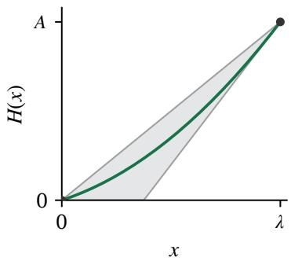  
Figure 3.1 The observed tail fixes the endpoint $( \lambda , A )$ and caps the body’s slope at $h _ { 0 }$ . Every MHR body is a convex nondecreasing curve between the chord and the backward tangent. The bounds coincide in the fully identified case, $A = \lambda h _ { 0 }$

## 4 Minimax Reserve under MHR

In the nonidentifiable regime, no reserve is optimal for every compatible distribution. We choose one that minimizes the largest revenue regret. Throughout this section, $0 < A < \lambda h _ { 0 }$ and $h _ { 0 } > 1 / \lambda$ . The key is to compare two reserves directly: their common tail payments cancel, and the worst comparisons come from bodies with at most two constant hazard levels.

## 4.1 Reduction to two boundary parameters

Above �, MHR gives $h _ { F } ( r ) \geq h _ { 0 } > 1 / \lambda$ , so revenue cannot increase there. The reserve � is therefore at least as good as every higher reserve. We need only compare reserves $r , s \in [ 0 , \lambda ]$ : � is the seller’s choice, and � is an alternative that may earn more under a compatible distribution.

Consider the payments in a single auction. If at least two values exceed �, both reserves collect the same second-highest value. If exactly one does, the winner pays the larger of the reserve and the second-highest value, which is below �. If none does, every value is in the hidden body. Thus the magnitudes of values above � do not affect the payment difference; only their frequency matters.

The revenue formula makes this cancellation explicit. Write $\psi ( p ) = 1 - n p ^ { n - 1 } + ( n - 1 ) p ^ { n }$ for the probability that at least two bidders exceed � when $p \ = \ F ( x )$ . The payment identity (2.2) gives $\begin{array} { r } { R _ { F } ( r ) = r [ 1 - F ( r ) ^ { n } ] + \int _ { r } ^ { \infty } \psi ( F ( x ) ) } \end{array}$ ��, and hence

$$
R _ { F } ( s ) - R _ { F } ( r ) = s [ 1 - F ( s ) ^ { n } ] - r [ 1 - F ( r ) ^ { n } ] + \int _ { s } ^ { r } \psi ( F ( x ) ) d x .\tag{4.1}
$$

The comparison uses $F$ only at the two reserves and between them.

The tail still limits which hidden bodies are possible. The censored fraction fixes $H ( \lambda ) = A$ , while MHR bounds the body’s hazard by $h _ { 0 }$ . Hence the feasible cumulative hazards form $\mathcal { H } ( A , h _ { 0 } )$ : the convex nondecreasing curves joining $( 0 , 0 )$ to $( \lambda , A )$ with final slope at most $h _ { 0 }$ . Both the allowed bodies and the revenue comparisons depend on the tail only through these two quantities.

For a posted reserve $r ,$ let $W _ { G } ( r )$ be its largest revenue regret over compatible distributions, and let $\Delta$ be the smallest such regret:

$$
W _ { G } ( r ) : = \operatorname* { s u p } _ { \substack { F \in \mathcal { F } _ { \mathrm { M H R } } ( \lambda ; G ) } } \{ R _ { F } ^ { * } - R _ { F } ( r ) \} , \qquad \Delta : = \operatorname* { m i n } _ { r \in [ 0 , \lambda ] } W _ { G } ( r ) .\tag{4.2}
$$

Restricting the minimum to $[ 0 , \lambda ]$ loses nothing, because no reserve above $\lambda$ improves on $\lambda$ under any compatible completion (Lemma A.5). Throughout, $\Delta$ abbreviates $\Delta ( \mathcal { F } _ { \mathrm { M H R } } ( \lambda ; G ) )$ of Definition 2.3; we write $\Delta ( A , h _ { 0 } )$ for the same quantity when its dependence on the boundary pair matters, and $\Delta ( G )$ (Section 5) when its dependence on the population $G$ matters. Computing $W _ { G } ( r )$ means choosing both a compatible distribution and the alternative reserve that makes � look worst:

$$
W _ { G } ( r ) = \operatorname* { s u p } _ { { F \in { \mathcal { F } } _ { \mathrm { M H R } } } ( \lambda ; G ) } \operatorname* { s u p } _ { s \in [ 0 , \lambda ] } \{ R _ { F } ( s ) - R _ { F } ( r ) \} .\tag{4.3}
$$

By (4.1), the inner difference uses $F$ only on $[ 0 , \lambda ]$ , where $F = 1 - e ^ { - H }$ for a feasible body �. We therefore define the body objective

$$
\mathsf { W } ( r ; A , h _ { 0 } ) : = \operatorname* { s u p } _ { H \in \mathcal { H } ( A , h _ { 0 } ) } \operatorname* { s u p } _ { s \in [ 0 , \lambda ] } \{ R _ { F } ( s ) - R _ { F } ( r ) \} , \qquad F = 1 - e ^ { - H } \operatorname { o n } [ 0 , \lambda ] ,\tag{4.4}
$$

the largest revenue advantage of an alternative reserve in $[ 0 , \lambda ]$ over � across feasible bodies. It is defined for every $0 \leq A \leq \lambda h _ { 0 }$ , including the identifiable cases, where Section $5$ uses it, and it equals $W _ { G } ( r )$ whenever $h _ { 0 } \geq 1 / \lambda$ , since then no alternative reserve above � is needed.

Proposition 4.1 (Two-parameter reduction). Let $\mathcal { D } = \{ ( A , h _ { 0 } ) : 0 < A < \lambda h _ { 0 } , h _ { 0 } > 1 / \lambda \}$ . Under Assumption 3.4, for $( A , h _ { 0 } ) \in \mathcal { D }$ and $r \in [ 0 , \lambda ] , W _ { G } ( r ) = \mathsf { W } ( r ; A , h _ { 0 } ) \ o f \ ( 4 . 4 )$ , which depends only on $A , h _ { 0 }$ and the known �, �. Its minimum $\Delta ( A , h _ { 0 } )$ and its unique minimizing reserve $r ^ { \dagger } ( A , h _ { 0 } )$ also depend only on these quantities. Uniqueness is established in Theorem 4.3 below.

For example, keep $\lambda = 1 , A = 3 / 2$ , and $h _ { 0 } = 2$ from Example 3.5, but replace the common tail by $H ( 1 + u ) = 3 / 2 + 2 u + u ^ { 2 } / 2$ for $u \geq 0$ . This changes the observed bid values and the absolute revenues. It changes neither the allowed bodies nor the revenue differences between reserves below $\lambda ,$ so the minimax reserve and minimax regret remain the same.

## 4.2 Two-level worst-case bodies

The remaining search is over an entire cumulative-hazard curve. Convexity lets us replace it by two straight pieces without decreasing the revenue advantage of an alternative reserve � over the posted reserve �.

If $s > r ,$ , join $( 0 , 0 )$ to $( s , H ( s ) )$ and then to $( \lambda , A )$ . These chords lie above � between the reserves. They preserve $F ( s )$ , increase $F ( r )$ , and decrease $\psi ( F ( x ) )$ on $[ r , s ]$ . In (4.1), the endpoint term at � and the negatively signed integral can therefore only increase the revenue difference.

If $s < r ,$ , extend the chord from $( 0 , 0 )$ to $( s , H ( s ) )$ to the right and the chord from $( r , H ( r ) ) \mathrm { t o } ( \lambda , A )$ to the left, then take the larger of the two lines. The resulting curve lies below � between the reserves and agrees with it at both endpoints. The endpoint terms stay fixed, while the positively signed integral increases. Both constructions preserve convexity and the slope bound; Figure 4.1 shows the geometry. Appendix A.5 treats the endpoint cases and proves attainment.

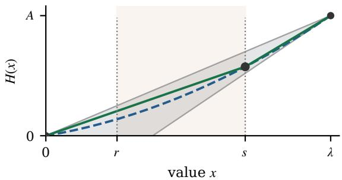  
(a) A higher alternative reserve: � $> r .$

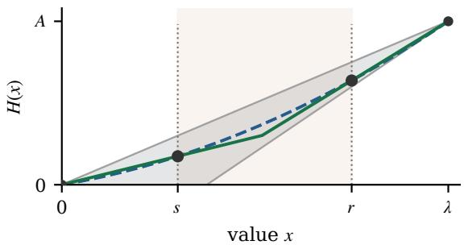  
(b) A lower alternative reserve: � $< r .$  
Figure 4.1 Straight-line replacements of a compatible cumulative hazard. When the alternative reserve is higher, two chords raise the curve between the reserves. When it is lower, two extended lines lower it. Each replacement can only increase the alternative reserve’s revenue advantage and gives a body hazard with at most one upward jump. Dashed: the original curve; gray: the band of Figure 3.1; the shaded strip lies between the two reserves.

Write � for the first body hazard level and � for the second. Their cumulative hazard is

$$
H _ { a , b } ( x ) = \operatorname* { m a x } \{ a x , A - b ( \lambda - x ) \} , \qquad ( a , b ) \in [ 0 , A / \lambda ] \times [ A / \lambda , h _ { 0 } ] .
$$

The average hazard $A / \lambda$ lies between the two levels. Once $a < b$ are chosen, the total cumulative hazard fixes the jump location: $a \tau + b ( \lambda - \tau ) = A , \mathrm { s o } \tau = ( b \lambda - A ) / ( b - a )$ , which lies in $[ 0 , \lambda ]$ because $a \leq A / \lambda \leq b$ If $a = b = A / \lambda$ , the hazard is constant. Let $\mathcal { T } ( A , h _ { 0 } )$ denote these bodies joined to the observed tail. Thus $A , h _ { 0 }$ are the observed inputs, while �, � are the variables in the worst-case search.

Theorem 4.2 (Two-level worst-case completions). Under Assumption 3.4, let $( A , h _ { 0 } ) \in \mathcal { D }$ . For every posted reserve $r \in [ 0 , \lambda ]$

$$
W _ { G } ( r ) = \operatorname * { m a x } _ { F \in \mathcal { T } ( A , h _ { 0 } ) } \{ R _ { F } ^ { * } - R _ { F } ( r ) \} .
$$

For a fixed alternative reserve $s > r ,$ a maximizing body has its break at �; for $s < r ,$ , a maximizing body has its break in $[ s , r ]$

This reduces the infinite-dimensional search over hidden bodies to an exact two-dimensional search over

$a , b .$ The straight-line replacement works whenever $0 \leq A \leq \lambda h _ { 0 } ;$ ; the nonidentifiable-regime condition is used only to ensure that an optimal alternative reserve lies in $[ 0 , \lambda ]$

## 4.3 Balancing the two sources of regret

A posted reserve can lose revenue in two ways: it may be too high for one compatible distribution and too low for another. We separate these risks by comparing � with lower and higher alternatives:

$$
\begin{array} { r l r } & { } & { L ( r ) : = \underset { F } { \operatorname* { s u p } } \underset { 0 \leq s \leq r } { \operatorname* { m a x } } \{ R _ { F } ( s ) - R _ { F } ( r ) \} , } \\ & { } & { U ( r ) : = \underset { F } { \operatorname* { s u p } } \underset { r \leq s \leq \lambda } { \operatorname* { m a x } } \{ R _ { F } ( s ) - R _ { F } ( r ) \} , } \end{array}\tag{4.5}
$$

where $F \in { \mathcal { F } } _ { \mathrm { M H R } } ( \lambda ; G )$ . Here $L ( r )$ is the worst-case loss from posting too high, and $U ( r )$ is the worst-case loss from posting too low. Their maximum is ${ \mathsf { W } } ( r ; A , h _ { 0 } )$

Each completion’s revenue is nondecreasing up to an optimum and nonincreasing after it. As � rises, regret against lower reserves can therefore only increase, while regret against higher reserves can only decrease. Taking the worst case preserves these directions. The best compromise is the reserve where the two losses are equal. We call it the equalizer.

Theorem 4.3 (Uniqueness of the minimax reserve). Under Assumption 3.4, for $( A , h _ { 0 } ) \in \mathcal { D }$ , the minimax reserve $r ^ { \dagger }$ is unique and

$$
L ( r ^ { \dagger } ) = U ( r ^ { \dagger } ) = \Delta > 0 .
$$

Both directional regrets are continuous; � is nondecreasing and � nonincreasing, strictly so wherever they are positive. Consequently W decreases strictly before $r ^ { \dagger }$ and increases strictly after it.

Using $n = 3$ and the boundary parameters of Example 3.5, numerical maximization over the two-level bodies gives $r ^ { \dagger } \approx 0 . 6 2 1$ and $\Delta \approx 0 . 0 0 5 2 4$ (Figure 4.2). At this reserve, one compatible distribution would prefer 0.5, while another would prefer approximately 0.720. Their revenue regrets are equal. The first of these is the body $H _ { 2 }$ of Example 3.5. The minimax choice thus balances losses under different distributions, rather than finding the optimum of one fitted distribution.

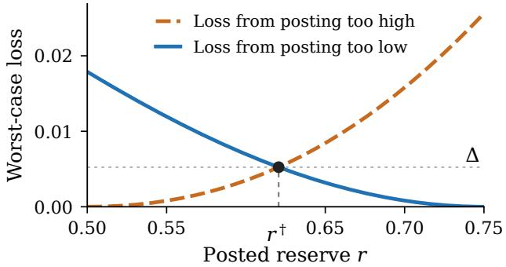  
Figure 4.2 The two worst-case losses cross at $r ^ { \dagger } \approx 0 . 6 2 1$ . Raising the reserve beyond this point increases the loss from posting too high; lowering it increases the loss from posting too low. Their common value is $\Delta \approx 0 . 0 0 5 2 4$ for $\lambda = 1 , A = 1 . 5 , h _ { 0 } = 2 , n = 3 .$

This balance matters for learning. $\mathbf { A } \mathbf { t } \ r ^ { \dagger }$ , one adverse distribution has a lower optimum and another has a higher optimum. Moving the reserve in either direction increases one of their revenue regrets to first order. The worst-case regret can therefore have a corner at its minimum, even if the individual revenue curves are smooth. Formally, for an instance-dependent $c > 0$ ,

$$
\mathsf { W } ( r ; A , h _ { 0 } ) - \Delta ( A , h _ { 0 } ) \geq c | r - r ^ { \dagger } | \qquad ( 0 \leq r \leq \lambda )
$$

(Lemma A.18). Excess regret at most � thus requires reserve error at most $\varepsilon / c .$ The next section studies how accurately samples allow us to locate this reserve.

Proposition 4.4 (Location and monotonicity). Under Assumption 3.4, let $( A , h _ { 0 } ) \in \mathcal { D }$ . The minimax reserve lies strictly inside

$$
\frac { 1 } { h _ { 0 } } < r ^ { \dagger } < \operatorname* { m i n } \{ \lambda , \lambda - ( A - 1 ) / h _ { 0 } \} .\tag{4.6}
$$

This interval has length at most $\lambda - A / h _ { 0 } . A t .$ fixed $A , \Delta ( A , h _ { 0 } )$ is nondecreasing in $h _ { 0 }$

The interval shrinks to a point as � reaches $\lambda h _ { 0 }$ , matching the fully identified case of Section 3.2. At fixed �, increasing $h _ { 0 }$ allows more hidden bodies and cannot decrease minimax regret. In every nonidentifiable instance, reusing the historical reserve � gives strictly greater worst-case regret than $r ^ { \dagger }$ . Appendix A.5 proves these results.

Numerical computation For each pair $a , b ,$ we compute an optimal reserve where $r h _ { F } ( r )$ reaches or jumps past one, then compare its revenue with that of the posted reserve. These comparisons have closed forms. We maximize them over a grid of hazard pairs and minimize the resulting worst-case regret over a grid of posted reserves. Corollary A.20 bounds the errors from both grids; Appendix A.6.1 gives the formulas. With finite data, we use the same calculation with estimates of $A , h _ { 0 }$

## 5 Learning from Censored Bids

We now build on the population analysis to learn a reserve from � censored records. The two regimes of Section 3 leave three learning tasks. In the tail-optimal case, we learn a common optimum from the empirical CDF. If the optimum is not identifiable, we estimate the boundary hazard to find the minimax reserve. If MHR determines the hidden body and its optimum lies at or below the boundary, the censored count alone suffices. Table 5.1 summarizes the corresponding rates. Each task requires a different kind of estimate from the same censored records.

We measure expected excess regret by $\mathbb { E } [ W _ { G } ( r ^ { \pi } ) - \Delta ( G ) ]$ for a rule $\pi ,$ where $\Delta ( G ) : = \Delta ( \mathcal { F } _ { \mathrm { M H R } } ( \lambda ; G ) )$ is the minimax regret of Definition 2.3 for the population �, keeping the worst case inside the sample expectation as in (2.13). In the nonidentifiable regime it equals $\Delta$ of (4.2); in the identifiable regime $\Delta ( G ) = 0$ (Proposition 2.5), so this is total regret. Throughout, let � be the number of uncensored bids and set $\widehat { A } _ { N } = - \log ( m / N )$ , with $\widehat { A } _ { N } = + \infty$ when $m = 0$

Table 5.1 Two regimes, three cases: expected excess worst-case regret of the corresponding rules under MHR, under the conditions stated below. At $A = \lambda h _ { 0 } = 1$ , the linear-completion guarantee also applies.
<table><tr><td>Regime</td><td>Case</td><td>Boundary condition</td><td>1 Rule</td><td>Regret rate</td></tr><tr><td>Identifiable</td><td>Tail-optimal</td><td> $\lambda h _ { 0 } \leq 1$ </td><td>Empirical tail</td><td> $O ( N ^ { - 1 / 2 } )$ </td></tr><tr><td></td><td>Fully identified</td><td> $A = \lambda h _ { 0 } \geq 1$ </td><td>Linear completion</td><td> $O ( N ^ { - 1 } )$ </td></tr><tr><td>Nonidentifiable</td><td></td><td> $A < \lambda h _ { 0 } , \lambda h _ { 0 } > 1$ </td><td>Plug-in</td><td> $O ( N ^ { - 2 / 5 } )$ </td></tr></table>

## 5.1 Learning in the tail-optimal case

In the tail-optimal case, $h _ { 0 } \leq 1 / \lambda$ , and every compatible distribution shares an optimal reserve in the observed tail. We can compare reserves there without reconstructing the body. Let ${ \widehat G } _ { N } ^ { - } ( x )$ be the fraction of historical bidders whose value is below $x \ge \lambda$ , counting censored bidders as below. Fix a known lower bound $h _ { \operatorname* { m i n } } > 0$ on $h _ { 0 }$ and set $\bar { \lambda } = \operatorname* { m a x } \{ \lambda , 1 / h _ { \operatorname* { m i n } } \}$ . MHR makes revenue nonincreasing beyond $\bar { \lambda } ,$ so this is a bounded search interval.

The empirical tail rule $\widehat { r } _ { N } ^ { \mathrm { t a i l } }$ maximizes the estimated revenue gain over posting �, using $\widehat { G } _ { N } ^ { - }$ on $[ \lambda , { \bar { \lambda } } ]$ (equation (B.3) in Appendix B.1). Subtracting revenue at � cancels payments from values beyond this interval. Only the empirical CDF is needed, and its $N ^ { - 1 / 2 }$ estimation error transfers to revenue regret.

Proposition 5.1 (Learning in the observed tail). Under Assumption $3 . 4 ,$ suppose $h _ { 0 } \geq h _ { \operatorname* { m i n } } > 0$ . For every $\delta \in ( 0 , 1 )$ , with probability at least $1 - \delta ,$

$$
\operatorname* { s u p } _ { r \ge \lambda } R _ { G } ( r ) - R _ { G } ( \hat { r } _ { N } ^ { \mathrm { t a i l } } ) \le 4 n \bar { \lambda } \sqrt { \frac { \log ( 2 / \delta ) } { 2 N } } .
$$

When $h _ { 0 } \leq 1 / \lambda ,$ , this is total worst-case regret and $\Delta ( G ) = 0 .$ . In this case, $\mathbb { E } [ W _ { G } ( \widehat { r } _ { N } ^ { \mathrm { t a i l } } ) ] = O ( N ^ { - 1 / 2 } )$ . No density smoothness is needed. Appendix B.1 gives the proof.

## 5.2 Learning in the nonidentifiable regime

## 5.2.1 Estimating the boundary parameters

In outline: the censored fraction gives � directly from the count of no-bids. The boundary hazard $h _ { 0 }$ is a density at the edge of the observed tail, so it must be estimated from the bids just above $\lambda ,$ and that estimate is what sets the $N ^ { - 2 / 5 }$ rate. Sampling error can produce a pair that no MHR body is compatible with, so we project the estimates onto the feasible set. Everything else rests on one fact: the worst-case regret is Lipschitz in the pair $( A , h _ { 0 } )$ , so an error in the estimates moves the worst case by at most a constant times that error, and the rule that posts the minimax reserve for the estimated pair inherits their rate.

Conditional on observing a bid, its density is $\tilde { g } = g / q _ { \lambda } , \ s o \ \tilde { g } ( \lambda ^ { + } ) = h _ { 0 }$

Assumption 5.2 (Boundary density smoothness). The conditional bid density $\tilde { g }$ is twice continuously differentiable on a fixed interval $[ \lambda , \lambda + { \bar { b } } ] .$ , with $\bar { b } > 0$

We use this condition only for results that estimate the boundary density. No smoothness is imposed on the hidden body.

We fit a line to histogram density estimates over a window of width $b _ { N }$ , using distance from � as the predictor. Its slope accounts for the density’s local linear change, and its intercept $\widehat { h } _ { 0 }$ estimates $h _ { 0 }$ . Its remaining bias is $O ( b _ { N } ^ { 2 } )$ , while its sampling error is $O ( ( N b _ { N } ) ^ { - 1 / 2 } )$ , since the expected number of bids in the window is of order $N b _ { N }$ . Balancing these terms gives $b _ { N } = c _ { b } N ^ { - 1 / 5 }$ and error $N ^ { - 2 / 5 }$ [FG96, CFM97]. We use a fixed number of histogram cells. The weights, concentration bounds, and fixed tuning choices are specified in Appendix B.2.1; the values used in the experiments are in Appendix D.1.

As noted above, sampling error can produce estimates that are incompatible with MHR, such as $\widehat { h } _ { 0 } < 0$ or $\widehat { A } _ { N } > \lambda \widehat { h } _ { 0 }$ , and we project the estimated pair onto the feasible parameter set. This changes the set of compatible bodies, so the regret bound must control the effect of changing that set. Recall the body objective ${ \sf W } ( r ; A , h _ { 0 } )$ of (4.4), defined for every $0 \leq A \leq \lambda h _ { 0 }$ . It equals $W _ { G } ( r )$ there when $h _ { 0 } \geq 1 / \lambda ;$ when $h _ { 0 } < 1 / \lambda$ , the full objective also compares with tail reserves.

Lemma 5.3 (Lipschitz stability of the body objective). Let $\lambda > 0$ and $n \geq 2$ . For pairs $( A , h _ { 0 } ) , ( A ^ { \prime } , h _ { 0 } ^ { \prime } ) \in$ $[ 0 , \infty ) ^ { 2 }$ satisfying $A \leq \lambda h _ { 0 }$ and $A ^ { \prime } \leq \lambda h _ { 0 } ^ { \prime }$ , including equality,

$$
\operatorname* { s u p } _ { r \in [ 0 , \lambda ] } \vert \mathsf { W } ( r ; A , h _ { 0 } ) - \mathsf { W } ( r ; A ^ { \prime } , h _ { 0 } ^ { \prime } ) \vert \le 3 \lambda \big ( \vert A - A ^ { \prime } \vert + \lambda \vert h _ { 0 } - h _ { 0 } ^ { \prime } \vert \big ) .\tag{5.1}
$$

The bound is independent of the target bidder count $n .$ Moreover, $r \mapsto \mathsf { W } ( r ; A , h _ { 0 } )$ is Lipschitz on $[ 0 , \lambda ]$ with constant $\mathrm { L i p } _ { r } = \operatorname* { m a x } \{ 1 , \lambda h _ { 0 } \}$

The proof constructs corresponding bodies by adjusting their total hazard and hazard cap. It also applies in the fully identified case (Appendix $\mathbf { A . } 5 )$ . For $h _ { 0 } \geq 1 / \lambda$ , we project the scaled estimates $( \widehat { A } _ { N } , \lambda \widehat { h } _ { 0 } )$ onto

$$
{ \mathcal { P } } _ { \lambda } = \{ ( x , y ) : 0 \leq x \leq y , y \geq 1 \} .\tag{5.2}
$$

In the scaled coordinates $( x , y ) = ( A , \lambda h _ { 0 } )$ , the bound (5.1) reads $3 \lambda ( | x - x ^ { \prime } | + | y - y ^ { \prime } | )$ , so projection error and stability are measured in the same units. When $\lambda h _ { 0 } \geq 1$ , the closed convex set $\mathcal { P } _ { \lambda }$ contains the true pair, so projection cannot move the estimate away from it. If too few bids are observed, we instead use the reserve

$$
r _ { c } ( A ) = \operatorname* { m i n } \{ \lambda , \lambda / A \} \quad ( 0 \leq A < \infty ) , \qquad r _ { c } ( + \infty ) = 0 ,\tag{5.3}
$$

with $\lambda / 0 = + \infty$ . This is the linear-completion reserve: the optimal reserve when the hidden body is completed with the constant hazard $A / \lambda .$ , so that its cumulative hazard is the straight line (the chord) from (0, 0) to $( \lambda , A )$ in Figure 3.1. It uses the censored fraction alone and never estimates $h _ { 0 }$

Definition 5.4 (Projected plug-in rule). Fix $m _ { \mathrm { m i n } } \ge 1 , c _ { b } , c _ { \mathrm { g } } > 0$ , and $M \geq 2$ independently of the data. Here � is the number of histogram cells. The projected plug-in rule, or plug-in for short, is $\hat { r } _ { N } ^ { \dag }$ of Algorithm 5.1.

The rule uses the target bidder count $n _ { : }$ , the boundary $\lambda ,$ the record count $N _ { \ast }$ , the tuning constants $m _ { \mathrm { m i n } }$ $M , c _ { \mathrm { g } }$ , and the bandwidth constant $c _ { b } ,$ or the fixed grid from which it is selected (Section 5.2.2).

```latex
Algorithm 5.1 Projected plug-in reserve
1: Count uncensored bids � and set $\widehat { A } _ { N } = - \log ( m / N ) , \mathrm { w i t h - l o g } 0 = + \infty .$
2: if $m < m _ { \mathrm { m i n } }$ then return $r _ { c } ( \widehat { A } _ { N } )$
3: Estimate $\widehat { h } _ { 0 }$ by the local-linear histogram fit on $[ \lambda , \lambda + c _ { b } N ^ { - 1 / 5 } ] .$
4: $( \bar { A } _ { N } , \lambda \bar { h } _ { N } )  \mathrm { p r o j } _ { \mathcal { P } _ { \lambda } } ( \widehat { A } _ { N } , \lambda \widehat { h } _ { 0 } )$
5: if $\bar { A } _ { N } = 0$ or $\lambda \bar { h } _ { N } = 1$ then return $\lambda .$
6: if $\bar { A } _ { N } = \lambda \bar { h } _ { N }$ then return $r _ { c } ( { \bar { A } } _ { N } )$
7: Grid $[ 0 , \lambda ] , [ 0 , \bar { A } _ { N } / \lambda ]$ , and $[ \bar { A } _ { N } / \lambda , \bar { h } _ { N } ]$ with endpoints and mesh at most $\varepsilon _ { N } = c _ { \bf g } N ^ { - 1 / 2 }$
8: return the smallest reserve minimizing the finite two-level worst case of Corollary A.20.
```

## 5.2.2 Regret of the plug-in rule

Theorem 5.5 (Regret of the plug-in rule). Under Assumptions $3 . 4$ and 5.2, suppose $h _ { 0 } \geq 1 / \lambda$ . For every $\delta \in ( 0 , 1 )$ and $N \ge \underline { { N } } ( \delta )$ , with probability at least $1 - \delta ,$

$$
W _ { G } ( \widehat { r } _ { N } ^ { \dagger } ) \leq \Delta ( G ) + C _ { \star } \sqrt { \log ( 6 / \delta ) } N ^ { - 2 / 5 } + c _ { \mathrm { g } } C _ { \mathrm { n u m } } N ^ { - 1 / 2 } .\tag{5.4}
$$

Here $C _ { \star }$ and $C _ { \mathrm { n u m } }$ bound statistical and discretization errors, respectively. Appendix B.2.1 gives their formulas and their dependence on the true distribution and tuning choices. The required sample-size threshold $\underline { { \boldsymbol { N } } } ( \delta )$ is specified in (B.6). Moreover, $\mathbb { E } [ W _ { G } ( \hat { r } _ { N } ^ { \dagger } ) ] \le \Delta ( G ) + O ( N ^ { - 2 / 5 } )$ . Both bounds are uniform on classes with $q _ { \lambda }$ bounded awayfrom zero and common bounds on $\tilde { g }$ and $| \tilde { g } ^ { \prime \prime } |$ over the same interval. They require no positive distance from either zero-regret frontier.

Theorem 5.5 fixes the bandwidth constant $c _ { b }$ in advance. In practice we select it from the fixed grid $\mathcal { C } _ { b } = \{ \lambda / 4 , \lambda / 2 , \lambda , 2 \lambda \}$ by a data-driven rule, and the theorem extends to that selection with the same rate, a larger constant, and log $( 2 4 / \delta )$ in place of log $( 6 / \delta )$ (Corollary B.5 in Appendix B.2.1). We note this because the experiments of Section 7 use the selected bandwidth.

Proposition 5.6 (Matching interior lower bound). For every fixed $n \geq 2$ and $\lambda > 0$ , there exist a class $\mathcal { G } _ { \mathrm { i n t } }$ whose members satisfy Assumptions 3.4 and 5.2, and a constant $c > 0$ such that,for all sufficiently large �,

$$
\operatorname* { i n f } _ { \pi } \operatorname* { s u p } _ { G \in { \mathcal G } _ { \mathrm { i n t } } } \mathbb E _ { G } [ W _ { G } ( r ^ { \pi } ) - \Delta ( G ) ] \ge c N ^ { - 2 / 5 } .
$$

The class consists of one base distribution, with an exponential body and a smooth tail, together with a sequence oflocal perturbations ofits boundary hazard near a single interior boundary pair. Its members have common boundary smoothness bounds and boundary pairs in a compact subset of $0 < A < \lambda h _ { 0 } , h _ { 0 } > 1 / \lambda$ The infimum includes randomized rules based only on � independent records censored at �.

The upper bound follows by applying the stability bound (5.1) to the two estimation errors. Projection keeps the combined error at order $N ^ { - 2 / 5 }$ , and discretizing the reserve and hazard levels adds the smaller $N ^ { - 1 / 2 }$ term. The lower bound uses a smooth hazard perturbation that changes $h _ { 0 }$ and the minimax reserve by $N ^ { - 2 / 5 }$ while producing censored-record laws that are difficult to distinguish. The linear cost of reserve error then gives revenue regret of the same order (Appendix B.2.2). Matching refers to the rate on this family:

the upper bound is uniform over classes with common bounds, and no rule improves on the exponent $2 / 5$ over this family, although individual distributions may admit faster rates.

A natural alternative to estimating $( A , h _ { 0 } )$ is to fit a parametric family to the censored records and post the fitted optimum. Such a rule converges to a fixed reserve, and the next proposition shows that no such rule can attain the minimax regret unless that reserve happens to be $r ^ { \dagger }$

Proposition 5.7 (Parametric reserve rules). Under the conditions ofTheorem 5.5, let $( A , h _ { 0 } ) \in \mathcal { D }$ , and let $\widehat { r } _ { N } ^ { \mathrm { p a r } }$ be any reserve rule that converges in probability to a constant $r ^ { \mathrm { p a r } } \geq 0$ . Then

$$
\operatorname* { l i m } _ { N \to \infty } \mathbb { E } \big [ W _ { G } ( \hat { r } _ { N } ^ { \mathrm { p a r } } ) \big ] = W _ { G } ( r ^ { \mathrm { p a r } } ) > \Delta ( G ) = \operatorname* { l i m } _ { N \to \infty } \mathbb { E } \big [ W _ { G } ( \hat { r } _ { N } ^ { \dagger } ) \big ] \qquad u n l e s s \ r ^ { \mathrm { p a r } } = r ^ { \dagger } .
$$

Moreover, $\mathbb { E } [ R _ { G } ^ { * } - R _ { G } ( \hat { r } _ { N } ^ { \dagger } ) ] \leq \Delta ( G ) + O ( N ^ { - 2 / 5 } )$ , whereas the limit $R _ { G } ^ { * } - R _ { G } ( r ^ { \mathrm { p a r } } )$ is not bounded by $\Delta ( G )$ in general.

A censored maximum-likelihood fit within a parametric family, followed by the fitted distribution’s optimal reserve, is an example. Under the conditions of White [Whi82], the estimate converges to the family member whose censored-record law is closest to that of � in Kullback–Leibler divergence, and $r ^ { \mathrm { p a r } }$ is that member’s optimal reserve when it is unique. This holds whether or not the family contains �. If it does, $r ^ { \mathrm { p a r } }$ is the optimal reserve $r _ { G } ^ { * }$ of $G$ itself, which is in general not the minimax reserve $r ^ { \dagger }$ , so even a correctly specified family has limit worst-case regret above $\Delta ( G )$ . Section 7.3 quantifies this limit for censored parametric fits. The proof is in Appendix B.2.1.

## 5.3 Learning in the fully identified case

In the fully identified case, $A = \lambda h _ { 0 }$ and every completion has the same body, $H ( x ) = A x / \lambda$ . When $h _ { 0 } \geq 1 / \lambda$ , its optimal reserve is $r _ { c } ( A ) \leq \lambda .$ , so the linear-completion rule $\widehat { r } _ { c } = r _ { c } ( \widehat { A } _ { N } )$ requires no density estimate. To study departures from full identification, write $d = \lambda h _ { 0 } - A$

Proposition 5.8 (Regret near full identification). Under Assumption 3.4, let $h _ { 0 } \geq 1 / \lambda , 0 \leq A \leq \lambda h _ { 0 }$ $d = \lambda h _ { 0 } - A , a n d k _ { 1 } = \operatorname* { m a x } _ { 0 \leq z \leq 1 } n z ^ { n - 1 } ( 1 - z ) = ( ( n - 1 ) / n ) ^ { n - 1 }$ . Then

$$
\mathbb { E } [ W _ { G } ( \widehat { r } _ { c } ) ] \leq \frac { k _ { 1 } d ^ { 2 } } { h _ { 0 } } + \frac { 4 k _ { 1 } \lambda ^ { 2 } h _ { 0 } \alpha } { q _ { \lambda } N } + \lambda e ^ { - N q _ { \lambda } / 8 } .\tag{5.5}
$$

At the population level,

$$
\Delta ( G ) \leq W _ { G } ( \operatorname* { m i n } \{ \lambda , ( 1 + d / 2 ) / h _ { 0 } \} ) \leq \frac { k _ { 1 } d ^ { 2 } } { 8 h _ { 0 } } , \qquad W _ { G } ( r _ { c } ( A ) ) \leq \frac { k _ { 1 } d ^ { 2 } } { 2 h _ { 0 } } .\tag{5.6}
$$

No density smoothness is needed. On classes with bounded $h _ { 0 }$ and $q _ { \lambda }$ bounded awayfrom zero, atfixed �, total expected worst-case revenue regret is $O ( d ^ { 2 } + N ^ { - 1 } )$ , giving the fast $O ( N ^ { - 1 } )$ rate in thefully identified case.

Every completion has an optimal reserve between $1 / h _ { 0 }$ and min $\{ \lambda , ( 1 + d ) / h _ { 0 } \}$ , an interval of length at most $d / h _ { 0 } ;$ integrating the revenue derivative over it gives the quadratic bounds on the population minimax regret and on the regret of $r _ { c } ( A )$ . At � = 0 the only error is the $N ^ { - 1 / 2 }$ error in estimating � from the censored fraction, which produces $O ( N ^ { - 1 } )$ revenue regret (Appendix B.3), and Proposition B.9 shows that this scale cannot be improved for instances within $O ( N ^ { - 1 / 2 } )$ of the fully identified case. For $d > 0$ the same statistical term is added to the population term of order $d ^ { 2 }$ in (5.5), so the total rate is still $N ^ { - 1 }$ when $d = O ( N ^ { - 1 / 2 } )$ .

## 5.4 Selecting a rule from the data

Algorithm 5.1 assumes $h _ { 0 } \geq 1 / \lambda$ and posts a reserve in $[ 0 , \lambda ]$ . In the tail-optimal case with $h _ { 0 } < 1 / \lambda$ , all compatible distributions share an optimal reserve above �, in the observed tail, and a reserve in $[ 0 , \lambda ]$ forfeits it. The seller usually does not know the regime, so we first check the estimated boundary hazard against $1 / \lambda$ to select the reserve rule. We call the rule that performs this check and then posts the selected reserve the auto-selector.

Algorithm 5.2 Auto-selector reserve   
1: Count uncensored bids � and set $\widehat { A } _ { N } = - \log ( m / N )$ , as in Algorithm 5.1.   
2: $\mathbf { i f } m < m _ { \mathrm { m i n } }$ then return $r _ { c } ( \widehat { A } _ { N } )$   
3: Estimate $\widehat { h } _ { 0 }$ as in Algorithm 5.1, before projection.   
4: if $\widehat { h } _ { 0 } \leq 1 / \lambda$ then return the tail rule $\widehat { r } _ { N } ^ { \mathrm { t a i l } }$   
5: else return the plug-in reserve $ { \widehat { r } } _ { N } ^ { \dagger }$ of Algorithm 5.1.

The three rates above are guarantees for separate rules. The auto-selector selects between the tail rule and the plug-in rule. On the estimation event of Lemma B.3, which has probability at least $1 - \delta ,$ , a wrong branch can be selected only near $h _ { 0 } = 1 / \lambda .$ . At this threshold, � is a common optimum. Nearby, stability controls body regret, while the gain from a missed tail optimum is bounded by a quadratic term in $\lambda h _ { 0 } - 1$ . When survival, hazard, and local smoothness have common bounds, the auto-selector has uniform $O _ { P } ( N ^ { - 2 / 5 } )$ excess regret across both zero-regret frontiers (Proposition B.10), without prior knowledge of the regime. Here $O _ { P }$ denotes a rate in probability. The fast $O ( N ^ { - 1 } )$ guarantee in the fully identified case is for the separate linear-completion rule of Section 5.3. This construction follows the regime-testing approach of Hssaine and Sinclair [HS26]; their test estimates a probability, whereas ours estimates a density.

What each assumption carries The bidder count, including no-bids, is the only source of the censored fraction $\alpha ,$ and hence of �. Every rule uses it, and without it the fully identified case cannot be recognized (Table D.10 varies the imputed count). MHR ties the hidden body to the observed tail; regular distributions keep the plug-in and, given a known parameter rectangle, its $O ( N ^ { - 2 / 5 } )$ rate but lose full identification, and unrestricted distributions lose the link altogether (Section 6). The bound $h _ { \mathrm { m i n } }$ sets the tail rule’s search interval and, with an upper bound $h _ { \mathrm { m a x } }$ on $h _ { 0 }$ , the constants of the auto-selector’s guarantee. Smoothness serves only the $O ( N ^ { - 2 / 5 } )$ rate, and common bounds make the guarantees uniform over a class; the tail rule needs no smoothness, and the identification results of Section 3 need only MHR. The $O ( N ^ { - 2 / 5 } )$ rate is minimax optimal on a smooth interior class, and the $O ( N ^ { - 1 } )$ scale is unavoidable within $O ( N ^ { - 1 / 2 } )$ of full identification (Propositions 5.6 and B.9).

## 6 Beyond MHR

MHR does two jobs: it ties the hidden body to the observed tail, and it keeps revenue single-peaked in the reserve. Regular distributions keep the second job and only a weaker link to the tail; unrestricted distributions keep neither. The regular class keeps the two-quantity reduction and the learning rate but loses full identification; the unrestricted class reduces the worst case to three simple scenarios, in which the observed tail starts to matter. Section 7.1 shows what each relaxation costs.

Regular distributions A regular distribution lets the hazard fall, but never so far that revenue, once falling, rises again, so the balancing argument of Section 4.3 still applies. Recall $q _ { \lambda } = e ^ { - A }$ and the boundary virtual value $\phi _ { 0 } = \lambda - 1 / h _ { 0 }$

Proposition 6.1 (Reserve characterization for regular distributions). Suppose � is regular, $A > 0$ , its right density at � exists, and $0 < h _ { 0 } < \infty$ . Then $\Delta ( \mathcal { F } _ { \mathrm { r e g } } ( \lambda ; G ) ) = 0$ exactly when $\phi _ { 0 } \leq 0 . \mathrm { ~ } H \phi _ { 0 } > 0 $ , worst-case regretfor each $r \in [ 0 , \lambda ]$ , its minimum, and the minimizing reserve depend only on $A , h _ { 0 }$ and the known $n , \lambda .$ In this case, the minimax reserve is the unique equalizer ofthe worst lossesfrom posting too high and too low, and lies in $( \lambda q _ { \lambda } , \lambda )$

Compared with MHR, two things change. The reserve is now located by the censored fraction alone, between � times the probability of an observed bid and $\lambda ;$ the MHR interval of Proposition 4.4 also uses the boundary hazard and collapses to a point as � approaches $\lambda h _ { 0 }$ . That collapse is full identification. Regular distributions leave many bodies compatible even then, so the fully identified case and its fast $O ( N ^ { - 1 } )$ rate (Proposition 5.8) do not extend. The worst case still has a finite description, so the minimax reserve is a scalar computation with error bounds (Appendix C.5.1), and the plug-in carries over with $O ( N ^ { - 2 / 5 } )$ expected excess worst-case regret under Assumption 5.2 and a known bounded parameter rectangle, away from $A = 0$ and $h _ { 0 } = 1 / \lambda$ , containing the true pair in its interior (Proposition C.10; Appendix C gives the rule and proofs).

Unrestricted distributions Without a shape restriction, the censored fraction � can sit anywhere below �: just under the posted reserve $r ,$ just under $\lambda ,$ or so that a reserve above � is best. Each scenario gives one term of the worst-case regret. Let $r _ { \mathrm { T } }$ maximize revenue on $[ \lambda , \infty )$ , and let $B _ { \lambda } = R _ { G } ( r _ { \mathrm { T } } ) - R _ { G } ( \lambda )$ be its gain over �. Write $k _ { \alpha } = \operatorname* { m a x } _ { 0 \leq z \leq \alpha } n z ^ { n - 1 } ( 1 - z )$

Proposition 6.2 (Unrestricted solution). Let � satisfy the model ofSection 2, without a shape restriction. For $0 \leq r \leq \lambda$ , unrestricted worst-case regret is

$$
\begin{array} { r } { W _ { \mathrm { a l l } } ( r ) = \operatorname* { m a x } \{ r \alpha ^ { n } , ( \lambda - r ) k _ { \alpha } , B _ { \lambda } + ( \lambda - r ) n \alpha ^ { n - 1 } ( 1 - \alpha ) \} . } \end{array}
$$

The best tail reserve has regret $W _ { \mathrm { a l l } } ( r _ { \mathrm { T } } ) = ( \lambda \alpha ^ { n } - B _ { \lambda } ) _ { + }$ . Thus $\Delta ( \mathcal { F } ( \lambda ; G ) ) = 0$ exactly when $B _ { \lambda } \geq \lambda \alpha ^ { n }$

The first term is the loss when every hidden value sits just below �: with probability $\alpha ^ { n }$ nobody clears �, and a slightly lower reserve would have sold. The second is the loss against a reserve between � and � that a lone bidder would have paid. The third is the loss against the best tail reserve: $B _ { \lambda }$ , plus the gap $\lambda - r$ whenever exactly one bidder clears �. The maximum is piecewise linear, so the minimizer comes from a few breakpoints compared with $r _ { \mathrm { T } }$ . Zero regret occurs exactly when $B _ { \lambda }$ is at least $\lambda \alpha ^ { n }$ , the most any reserve below � can gain when every bidder is hidden; the boundary hazard plays no role. Theorem $\mathrm { A } . 2$ and Corollary A.3 give the proof and the minimizer.

Randomization and competition Two facts hold for MHR and regular distributions. Randomizing the reserve cannot remove the cost of nonidentification: a random reserve mixes fixed ones, so it gains nothing under our criterion, and under the weaker criterion that averages before taking the worst case it lowers minimax regret by at most half (Proposition A.13); the $N ^ { - 2 / 5 }$ lower bound already allows randomized rules (Proposition 5.6). Competition caps the cost of censoring: lowering the reserve below � can improve on posting � only when every value is hidden, an event of probability $\alpha ^ { n }$ , so minimax regret is at most $\lambda \alpha ^ { n }$ (Proposition A.15). The body calculations also extend to an observed tail without shape restrictions, with slope caps imposed separately and the tail’s best gain over � as an extra input (Proposition C.11).

## 7 Computational Experiments

We ask three questions. What does the shape constraint buy (Section 7.1)? Does the learned rule approach the minimax regret at the predicted rate (Section 7.2)? Does it beat parametric fits to the censored records (Section 7.3)? We answer them on synthetic instances, where the true distribution is known, and then ask the same questions of recorded eBay bids (Section 7.4). All comparisons use $n = 3$ bidders. Within each replication, learned rules receive the same � independent censored records. The plug-in estimates $( A , h _ { 0 } )$ and posts the minimax reserve for the estimates; the auto-selector can instead learn a reserve from the observed tail (Algorithms 5.1 and 5.2). The plug-in selects its bandwidth constant $c _ { b }$ from a fixed grid by the data-driven rule of Corollary B.5.

We compare these rules with maximum-likelihood estimators (MLEs), which fit Weibull, gamma, or lognormal parameters to make the censored records most likely, then post the fitted distribution’s optimal reserve. An oracle MLE uses the correct family and estimates its parameters from the same sample. We distinguish two measures. Actual regret under a distribution � is $R _ { F } ^ { * } - R _ { F } ( r )$ : the revenue lost by posting � instead of that distribution’s optimal reserve. Worst-case regret $W _ { G } ( r )$ is the largest such loss over compatible MHR distributions. Section 7.1 also compares the regular and unrestricted classes. For learned reserves, we average each measure over sample replications. We report excess worst-case regret $W _ { G } - \Delta$ when studying convergence to the minimax reserve; actual regret can be smaller than $\Delta \left( 2 . 9 \right)$ . Percentages use the reference revenue specified in each table or figure. Appendix D gives the experimental settings, numerical checks, the studies that extend each design, and the data statement.

## 7.1 The value of shape constraints

With the censored fraction and observed tail known exactly, we choose the minimax reserve under MHR, regular distributions, and no shape restrictions. Table 7.1 reports its worst-case regret over the chosen class, followed by its actual regret under each listed distribution. The MHR reserve has lower actual regret than the unrestricted reserve in all three examples. For Weibull(2.5, 1.5), regret falls from 0.58% to 0.19% of optimal revenue. The regular reserve does still better on the two Weibull distributions: minimizing worst-case regret need not minimize regret at any one distribution.

Table 7.1 Regret of the minimax reserves under three distribution classes $( n = 3 )$ , with exact censored fraction and observed tail. Worst-case regret ranges over compatible distributions in the indicated class; actual regret uses the listed distribution. All percentages use the listed distribution’s $R _ { G } ^ { * }$ . Appendix D.6 gives the reserves and computation details.
<table><tr><td rowspan="2">Instance</td><td rowspan="2">λ</td><td colspan="2">MHR</td><td colspan="2">Regular</td><td colspan="2">Unrestricted</td></tr><tr><td>Worst-case</td><td>Actual</td><td>Worst-case</td><td>Actual</td><td>Worst-case</td><td>Actual</td></tr><tr><td>Rayleigh(1)</td><td>1.5</td><td>1.65%</td><td>0.20%</td><td>4.66%</td><td>0.49%</td><td>22.07%</td><td>0.24%</td></tr><tr><td>Weibull(1.5, 1)</td><td>1</td><td>0.80%</td><td>0.18%</td><td>3.98%</td><td>0.05%</td><td>18.41%</td><td>0.56%</td></tr><tr><td>Weibull(2.5, 1.5)</td><td>2</td><td>3.37%</td><td>0.19%</td><td>9.74%</td><td>&lt; 0.01%</td><td>40.09%</td><td>0.58%</td></tr></table>

MHR also provides much stronger worst-case protection. In the Rayleigh example, minimax regret is 1.65% under MHR, 4.66% under regular distributions, and 22.07% without shape restrictions. The censored records are the same; the difference comes from excluding hidden bodies that violate the chosen constraint.

## 7.2 Learning the minimax reserve

Figure 7.1a uses the three instances of Table 7.1. The plug-in’s excess worst-case regret falls toward zero as � grows. Its fitted slopes over � = 250 to 64,000, −0.58, −0.45 and −0.51 in panel order (standard errors at most 0.03), are steeper than the reference $- 2 / 5 \colon$ the $N ^ { - 2 / 5 }$ rate is a worst case over the smoothness class, and a fixed distribution can be learned faster. The Weibull MLE is an oracle here, yet it learns each distribution’s own optimal reserve, whose worst-case regret can exceed $\Delta .$ . Another compatible body may favor a different reserve. Thus fitting the correct family and minimizing worst-case regret remain different objectives. The linear-completion rule, which posts the reserve $r _ { c } ( \widehat { A } _ { N } )$ of Section 5.2 from the censored fraction alone, stays flat at a higher level because it ignores the boundary hazard.

Figure 7.1b varies the historical reserve for Rayleigh(1). The auto-selector performs well on both sides of the zero-regret frontier $\lambda = 1$ . In the tail-optimal case it learns the optimum from the observed tail, where the plug-in’s search below � cannot reach it. In the nonidentifiable regime it coincides with the plug-in and stays close to $\Delta ,$ below the correctly specified Weibull MLE and below the linear-completion rule, except just above the frontier and near $\lambda = 1 . 8 ,$ , where the linear-completion reserve is itself nearly minimax. This sweep suggests that, under MHR, a seller who does not know the regime should post the auto-selector’s reserve: it loses little on either side of the frontier, whereas the plug-in and the linear-completion rule each fail on one side, and even the correctly specified Weibull MLE stays about a point above $\Delta$ beyond the frontier.

## 7.3 Robustness to model misspecification

We censor Weibull(2.5, 1), denoted by $G ,$ at its median $\lambda = ( \log 2 ) ^ { 2 / 5 } \approx 0 . 8 6 4$ , then replace its hidden body in three ways. The exponential body has constant hazard $A / \lambda ;$ the equalizer body makes $r ^ { \dagger }$ optimal; the tangent body has hazard zero followed by $h _ { 0 }$ . These names describe the hidden bodies. The four completed distributions are MHR and share the same censored fraction and Weibull tail, but favor different reserves (Appendix D.2).

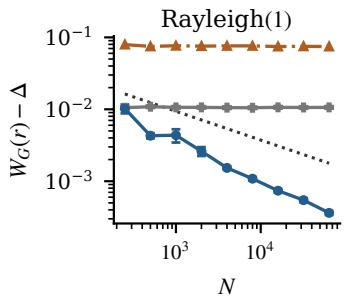

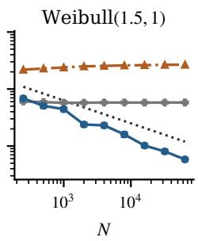  
(a) Excess worst-case regret against sample size, one panel per instance.

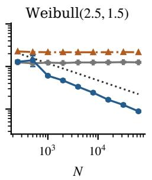

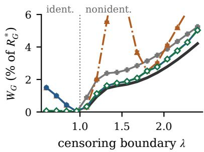  
(b) Regret across the frontier.  
Δ plug-in auto-selector Weibull MLE linear completion $N ^ { - 2 / 5 }$ reference  
Figure 7.1 Learning the robust reserve $( n = 3 )$ . (a) Mean excess worst-case regret $W _ { G } - \Delta$ in revenue units, over 200 replications. (b) Mean worst-case regret in percent of $R _ { G } ^ { * }$ for Rayleigh(1), with $N = 2 0 0 0$ and 80 replications per �, on a linear axis capped at 6%; the linear-completion rule exceeds it at $\lambda = 1 . 4 4$ (its peak, 9.1%), 1.56, 2.28 and 2.40. Bars show one Monte-Carlo standard error; some are smaller than the markers, and the linear-completion rule in (a) is drawn without them.

Table 7.2 Four distributions with indistinguishable censored records. Mean worst-case and actual regret in percent of the original Weibull distribution’s $R _ { G } ^ { * } \left( N = 3 0 0 0 \right.$ , 200 paired replications). Actual regret compares each distribution with its own optimal revenue. Numerical minimax regret is $\Delta = 1 . 3 5 \%$ ; Monte-Carlo standard errors are at most 0.02 percentage points.
<table><tr><td rowspan="2">Rule</td><td rowspan="2">Worst-case regret  $W _ { G }$ </td><td colspan="4">Actual regret under each distribution</td></tr><tr><td>Weibull G</td><td>Equalizer</td><td>Exponential</td><td>Tangent</td></tr><tr><td>Plug-in, Auto-selector</td><td>1.46</td><td>0.32</td><td>0.00</td><td>1.36</td><td>1.35</td></tr><tr><td>Plug-in (Weibull hazard)</td><td>1.43</td><td>0.31</td><td>0.00</td><td>1.36</td><td>1.34</td></tr><tr><td>Weibull MLE</td><td>2.49</td><td>0.00</td><td>0.12</td><td>2.49</td><td>0.43</td></tr><tr><td>Gamma MLE</td><td>2.97</td><td>0.04</td><td>0.22</td><td>2.97</td><td>0.22</td></tr><tr><td>Lognormal MLE</td><td>3.17</td><td>0.07</td><td>0.26</td><td>3.17</td><td>0.16</td></tr></table>

The Weibull family correctly describes the distribution of observed records in all four cases. Weibull MLE is an oracle only under �, and misspecified under the other three because it imposes the wrong hidden body. Table 7.2 reports both measures. Weibull MLE has almost zero actual regret under �, but 2.49% under the exponential completion, compared with the plug-in’s 1.36%. These columns evaluate each rule under a fixed distribution. The worst-case column instead maximizes regret over all compatible MHR distributions for each learned reserve, then averages over samples. The plug-in’s numerical worst-case regret is 1.46%, close to minimax regret 1.35%. Plug-in and auto-selector agree at the displayed precision and share a row.

Using the Weibull fit only to estimate the boundary hazard gives a similar worst-case regret (1.43% versus 1.46%). This suggests that the reserve objective matters more than the hazard estimator on this instance. The gaps between parametric fits and the plug-in persist as samples grow (Appendix D.2): additional censored records cannot check a fitted model’s assumptions about hidden values.

## 7.4 Experiments on eBay bids

We now ask the same questions of recorded bids from eBay auctions [JS10]. The data record every bid in 628 auctions of three standardized items: Palm Pilot M515 handhelds, Xbox game consoles, and Cartier wristwatches. eBay’s proxy bidding is a second-price mechanism, so a bidder’s highest proxy bid in an auction serves as a value proxy. The seller’s opening bid acts as a reserve: bidders with lower values never appear. We therefore form each item’s reference sample from the auctions whose opening bid is at most one dollar: 1,652 bidder records in 132 Palm Pilot auctions, 460 in 42 Xbox auctions, and 392 in 40 Cartier auctions. eBay reveals the winner’s bid only up to the closing price, so one record per auction is right-censored; Appendix D.3 describes its imputation. These records serve as the values in what follows.

A shape-constrained refit � of each reference sample, a kernel density with its hazard projected onto the nondecreasing cone, supplies the minimax regret $\Delta$ and the regime at each boundary. The boundaries 155, 199, and 219 of Table 7.3 are the whole-dollar quantiles 0.5, 0.7, and 0.8 of the Palm Pilot refit (all nine cells: Appendix D.3).

A kernel-hazard diagnostic with bidder-bootstrap bands (Appendix D.3) finds no significant hazard decrease in the Palm Pilot records at any bandwidth. For Xbox it finds a significant decrease at every bandwidth, and for Cartier a simultaneous-band decrease at the narrowest bandwidth and no MHR-feasible kernel fit at any boundary. Palm Pilot therefore carries the tables below; Appendix D.3 reports Xbox and Cartier. One lesson from Xbox is worth stating here: at its highest boundary the jointly projected pair lands on the face $\bar { A } _ { N } = \lambda \bar { h } _ { N }$ in every split, and the plug-in, which then posts the linear-completion reserve $r _ { c } ( { \bar { A } } _ { N } )$ at the projected estimate, loses heavily. The linear-completion rule $r _ { c } ( \widehat { A } _ { N } )$ , which keeps the original censored-count estimate rather than adjusting it through the joint projection, loses far less (Appendix D.3). Here the projection reaches the face because the shape constraint fails, and this rule is the better fallback; reaching the face does not by itself show that the true distribution is near full identification. Appendix D.3 repeats the three synthetic experiments with the refit as the true distribution, with the same conclusions. The two studies below also evaluate reserves on the recorded bids.

Learning from censored records, scored on the recorded bids Each of 1000 random splits assigns 70% of the item’s bidders to training and the rest to testing. The rules see the training records censored at �, so the censored count is known exactly; � is the number of training records, since every bidder in a one-dollar auction faced no effective reserve. We evaluate a posted reserve by its exact mean payment on 20,000 simulated three-bidder auctions among distinct test bidders and compare it with the test optimum. This evaluates reserves on the observed and imputed bid records rather than on a refit. The full-information reserve (Full-info), fitted to the uncensored training records, is the oracle row of Table 7.3; Table D.1 defines every rule.

On the Palm Pilot cells the plug-in and auto-selector have lower held-out regret than every MLE at � = 155 and 219 (1.4% and 0.6% against 2.3–2.8% and 1.1–1.9%); at 219 the boundary rule (post �) and Drop (maximize empirical revenue over the observed bids only) lose 28%. At � = 199 the MLEs are ahead (1.25–1.52% against 1.68%): the data-driven bandwidth rule selects a twelve-dollar window there, and the plug-in with the fixed window $c _ { b } = \lambda / 2$ loses 1.0% (1.1% and 0.6% at 155 and 219). The gap comes from the narrow window, not from whole-dollar price points (Appendix D.3). Full-info loses 0.08%.

Table 7.3 Held-out regret on the recorded Palm Pilot bids, in percent of each split’s test optimum (� = 3, 1000 bidder splits, 20,000 test auctions per split; Monte-Carlo standard errors at most 0.13 points). � is the mean number of training records. Full-info fits a reserve to the uncensored training records.
<table><tr><td colspan="7"></td><td colspan="3">Censored MLE</td><td></td><td></td><td></td></tr><tr><td>Item</td><td>λ</td><td></td><td></td><td></td><td>N Full-info Plug-in Auto-selector Weibull Gamma Lognormal Linear compl. Boundary</td><td></td><td></td><td></td><td></td><td></td><td>Drop</td></tr><tr><td>Palm Pilot 155</td><td></td><td>1156</td><td>0.08</td><td>1.39</td><td>1.44</td><td>2.26</td><td>2.61</td><td>2.77</td><td>1.64</td><td>1.64</td><td>2.34</td></tr><tr><td>Palm Pilot 199</td><td></td><td>1156</td><td>0.08</td><td>1.68</td><td>1.68</td><td>1.52</td><td>1.30</td><td>1.25</td><td>3.64</td><td>10.84</td><td>11.14</td></tr><tr><td>Palm Pilot 219 1157</td><td></td><td></td><td>0.08</td><td>0.63</td><td>0.63</td><td>1.05</td><td>1.41</td><td>1.90</td><td>1.53</td><td>27.73</td><td>27.98</td></tr></table>

Sellers’ own reserves The remaining 211 Palm Pilot auctions have opening bids above one dollar: reserves chosen by sellers. eBay records only the bidders who appeared, so the censored fraction must come from participation (Section 2). The reference auctions have 12.5 records each, so � auctions with opening bid � are taken to have faced $\widehat { N } = 1 2 . 5 K$ bidders, of whom � appeared; the rules receive the � records and $\widehat { N } - m \mathrm { n o - b i d s }$ . This assumes that the number of potential bidders does not depend on the opening bid; the comparison with $G ( \lambda )$ below shows where it fails. Table 7.4 uses every opening bid shared by at least eight auctions (opening bids within one cent), eight in all. Every rule’s search bound is the larger of 4� and twice the largest observed record, since the optimum lies far above a ten-dollar opening bid.

At opening bids of 150 and above, the participation-based censored fraction �̂︀ is within 0.03 of �(�) except at 175, where it is 0.70 against 0.58. At 10, 50, and 100 it overstates censoring (0.13 against 0.02, 0.35 against 0.14, 0.45 against 0.31): auctions with a positive opening bid draw fewer bidders for reasons beyond censoring. Varying the rate from 8 to 20 records per auction leaves the detected regime unchanged in every cell, keeps the auto-selector below the Weibull fit in four to seven of the eight cells, and moves the reserve by two to four dollars per record in the nonidentifiable cells (Appendix D.3).

The auto-selector’s branch agrees with the refit’s regime in seven of the eight cells. At 50 the data-driven bandwidth rule selects its narrowest window $( c _ { b } = \lambda / 4 )$ , whose boundary-hazard estimate exceeds $1 / \lambda ,$ , so the auto-selector takes the plug-in branch, and the overstated count leads it to post about 49 dollars, near the opening bid; it loses 6.9% on the reference records against 3.4% for the Weibull MLE. With the fixed window $c _ { b } = \lambda / 2$ it takes the tail branch and loses 0.04%. In the five nonidentifiable cells, with 100 to 488 inferred bidders, its worst-case regret is 0.3 to 2.8 points above $\Delta$ and below the Weibull MLE’s in every cell. Scored on the reference records it loses 0.4–2.5%, against 1.6–3.0% for the Weibull MLE; the boundary loses from 0.04% at 150, where the opening bid sits at the optimum, to 54% at 240. The refit’s optimal reserve itself scores 0.76% on these test auctions, so the auto-selector’s 0.4–0.9% at 200 to 240 is the attainable level. Its 2.5% at 175 comes from the overstated count, which pulls the reserve down to 126 dollars.

## 8 Conclusion

More bids at the same reserves can reduce estimation error, but cannot directly reveal how values are distributed below the lowest historical reserve. Our main results show how to exploit MHR to choose a reserve even when these hidden values prevent identification of the optimum.

Table 7.4 Sellers’ own opening bids on Palm Pilot $( n = 3 ) . \ K$ auctions with opening bid within one cent of �, � records, $\widehat { N } = 1 2 . 5 \bar { K }$ inferred bidders, and $\widehat { \alpha } = 1 - m / \widehat { N } ; G ( \lambda )$ and the regime are those of the refit, and Detected is the auto-selector’s branch. Weibull is the censored Weibull MLE. Worst-case regret $W _ { G }$ in percent of $R _ { G } ^ { * }$ and held-out regret on 20,000 auctions among reference bidders in percent of the test optimum, means over 50 draws of the winner imputation (standard errors at most 0.26 points, conditional on the recorded auctions); $\Delta$ in percent of $R _ { G } ^ { * }$
<table><tr><td></td><td>λ K</td><td></td><td></td><td></td><td></td><td></td><td></td><td></td><td></td><td colspan="2">Worst-case</td><td colspan="3">Held-out</td></tr><tr><td>Item</td><td></td><td></td><td>m</td><td>N</td><td>α</td><td>G(λ)</td><td>Regime</td><td>Detected</td><td>∆</td><td>Auto-selector</td><td>Weibull</td><td>Auto-selector</td><td>Weibull</td><td>Boundary</td></tr><tr><td>Palm Pilot</td><td>10</td><td>32</td><td>347</td><td>400</td><td>0.13</td><td>0.02</td><td>ident.</td><td>ident.</td><td>0</td><td>0.03</td><td>1.07</td><td>0.15</td><td>2.52</td><td>7.56</td></tr><tr><td>Palm Pilot</td><td>50</td><td>9</td><td>73</td><td>113</td><td>0.35</td><td>0.14</td><td>ident.</td><td>nonident.</td><td>0</td><td>4.82</td><td>1.57</td><td>6.88</td><td>3.39</td><td>6.84</td></tr><tr><td>Palm Pilot</td><td>100</td><td>9</td><td>62</td><td>113</td><td>0.45</td><td>0.31</td><td>ident.</td><td>ident.</td><td>0</td><td>0.06</td><td>2.19</td><td>0.04</td><td>4.18</td><td>3.57</td></tr><tr><td>Palm Pilot</td><td>150</td><td>14</td><td>90</td><td>175</td><td>0.49</td><td>0.48</td><td>nonident.</td><td>nonident.</td><td>0.14</td><td>0.94</td><td>2.38</td><td>1.17</td><td>2.32</td><td>0.04</td></tr><tr><td>Palm Pilot</td><td>175</td><td>39</td><td>145</td><td>488</td><td>0.70</td><td>0.58</td><td>nonident.</td><td>nonident.</td><td>1.65</td><td>3.00</td><td>3.89</td><td>2.52</td><td>2.95</td><td>2.41</td></tr><tr><td>Palm Pilot</td><td>200 215</td><td>8</td><td>27</td><td>100</td><td>0.73</td><td>0.70</td><td>nonident.</td><td>nonident.</td><td>2.18</td><td>2.46</td><td>3.31</td><td>0.94</td><td>1.96</td><td>11.06</td></tr><tr><td>Palm Pilot</td><td>240</td><td>11 14</td><td>28 22</td><td>138 175</td><td>0.80 0.87</td><td>0.78 0.90</td><td>nonident. nonident. 5.34</td><td>nonident. nonident. 3.05</td><td></td><td>3.48 8.12</td><td>3.74 12.09</td><td>0.83</td><td>1.63</td><td>25.41</td></tr><tr><td>Palm Pilot</td><td></td><td></td><td></td><td></td><td></td><td></td><td></td><td></td><td></td><td></td><td></td><td>0.40</td><td>2.10</td><td>53.52</td></tr></table>

In the nonidentifiable regime, two observable quantities determine the reserve with the smallest worst-case revenue regret, and our learning bounds quantify the extra regret from estimating them. The analysis extends to regular and unrestricted distributions: regular distributions retain the two-quantity reduction, while MHR additionally permits full identification and can reduce minimax regret.

Experiments on synthetic instances show the learned rule approaching the minimax regret at moderate sample sizes, while the parametric fits’ worst-case regret stays above it. On recorded eBay bids its held-out regret is below every parametric fit’s at two of the three Palm Pilot reference boundaries and below the Weibull fit’s at seven of the eight most frequent Palm Pilot opening bids (four to seven under other imputed bidder counts), and reusing the historical reserve can lose more than half the optimal revenue. Two practical lessons follow: MHR can be checked on the observed tail, and when the projected pair lands on the face $\bar { A } _ { N } = \lambda \bar { h } _ { N }$ , as on one Xbox cell, the linear-completion rule at the original censored-count estimate can be the better fallback.

Our analysis focuses on second-price auctions and assumes independent values from a common distribution. It also requires participation counts to estimate the censored fraction. The $N ^ { - 2 / 5 }$ learning guarantees require a smooth density just above the censoring boundary. We leave these limitations to future work.

## Acknowledgments

Use of AI tools The authors proposed all research questions, designed all experiments, and derived the original proofs of the theoretical results, except for a few steps in the lower-bound proof of Proposition 5.6. We used ChatGPT and Claude to complete those steps (Appendix B.2.2), polish the writing, implement experimental code, and assist with proof checks and simplification. The authors verified the results and take full responsibility for the manuscript.

## References

[AB20] Amine Allouah and Omar Besbes. Prior-independent optimal auctions. Management Science, 66(10):4417– 4432, 2020.

[ABB22] Amine Allouah, Achraf Bahamou, and Omar Besbes. Pricing with samples. Operations Research, 70(2):1088–1104, 2022.

[ABB23] Amine Allouah, Achraf Bahamou, and Omar Besbes. Optimal pricing with a single point. Management Science, 69(10):5866–5882, 2023.

[ABB25] Jerry Anunrojwong, Santiago R. Balseiro, and Omar Besbes. On the robustness of second-price auctions in prior-independent mechanism design. Operations Research, 73(3):1659–1674, 2025.

[ABB26] Jerry Anunrojwong, Santiago R. Balseiro, and Omar Besbes. Robust auction design with support information. Management Science, 2026. Articles in advance; doi:10.1287/mnsc.2023.02703.

[AH02] Susan Athey and Philip A. Haile. Identification of standard auction models. Econometrica, 70(6):2107– 2140, 2002.

[AK13] Gaurab Aryal and Dong-Hyuk Kim. A point decision for partially identified auction models. Journal of Business & Economic Statistics, 31(4):384–397, 2013.

[ALGQ13] Andrés Aradillas-López, Amit Gandhi, and Daniel Quint. Identification and inference in ascending auctions with correlated private values. Econometrica, 81(2):489–534, 2013.

[Anu26] Jerry Anunrojwong. Robust scale-free auctions. arXiv:2608.02479, 2026.

[Ban20] Gah-Yi Ban. Confidence intervals for data-driven inventory policies with demand censoring. Operations Research, 68(2):309–326, 2020.

[BB05] Mark Bagnoli and Ted Bergstrom. Log-concave probability and its applications. Economic Theory, 26(2):445–469, 2005.

[BM13] Omar Besbes and Alp Muharremoglu. On implications of demand censoring in the newsvendor problem. Management Science, 59(6):1407–1424, 2013.

[BR89] Jeremy Bulow and John Roberts. The simple economics of optimal auctions. Journal of Political Economy, 97(5):1060–1090, 1989.

[BS08] Dirk Bergemann and Karl H. Schlag. Pricing without priors. Journal of the European Economic Association, 6(2–3):560–569, 2008.

[BSLW23] Jinzhi Bu, David Simchi-Levi, and Li Wang. Offline pricing and demand learning with censored data. Management Science, 69(2):885–903, 2023.

[CBGM15] Nicolò Cesa-Bianchi, Claudio Gentile, and Yishay Mansour. Regret minimization for reserve prices in second-price auctions. IEEE Transactions on Information Theory, 61(1):549–564, 2015.

[CDIZ22] Yeshwanth Cherapanamjeri, Constantinos Daskalakis, Andrew Ilyas, and Manolis Zampetakis. Estimation of standard auction models. In Proceedings ofthe 23rd ACM Conference on Economics and Computation (EC), pages 602–603, 2022.

[CFM97] Ming-Yen Cheng, Jianqing Fan, and James S. Marron. On automatic boundary corrections. The Annals of Statistics, 25(4):1691–1708, 1997.

[CGJR17] Pedro Chahuara, Nicolas Grislain, Grégoire Jauvion, and Jean-Michel Renders. Real-time optimization of web publisher RTB revenues. In Proceedings of the 23rd ACM SIGKDD International Conference on Knowledge Discovery and Data Mining (KDD), pages 1743–1751, 2017.

[Che22] Ethan Che. Robustly optimal auction design under mean constraints. In Proceedings ofthe 23rd ACM Conference on Economics and Computation (EC), pages 153–181, 2022.

[CLSW21] Dominic Coey, Bradley J. Larsen, Kane Sweeney, and Caio Waisman. Scalable optimal online auctions. Marketing Science, 40(4):593–618, 2021.

[CR14] Richard Cole and Tim Roughgarden. The sample complexity of revenue maximization. In Proceedings of the 46th Annual ACM Symposium on Theory of Computing (STOC), pages 243–252, 2014.

[DGPL22] Mahsa Derakhshan, Negin Golrezaei, and Renato Paes Leme. Linear program-based approximation for personalized reserve prices. Management Science, 68(3):1849–1864, 2022.

[DRY15] Peerapong Dhangwatnotai, Tim Roughgarden, and Qiqi Yan. Revenue maximization with a single sample. Games and Economic Behavior, 91:318–333, 2015.

[FG96] Jianqing Fan and Irène Gijbels. Local polynomial modelling and its applications. Chapman & Hall/CRC, 1996.

[FL22] Joachim Freyberger and Bradley J. Larsen. Identification in ascending auctions, with an application to digital rights management. Quantitative Economics, 13(2):505–543, 2022.

[GHZ19] Chenghao Guo, Zhiyi Huang, and Xinzhi Zhang. Settling the sample complexity of single-parameter revenue maximization. In Proceedings of the 51st Annual ACM SIGACT Symposium on Theory of Computing (STOC), pages 662–673, 2019.

[GJM21] Negin Golrezaei, Adel Javanmard, and Vahab Mirrokni. Dynamic incentive-aware learning: robust pricing in contextual auctions. Operations Research, 69(1):297–314, 2021.

[GMS<sup>+</sup>20] Aritra Ghosh, Saayan Mitra, Somdeb Sarkhel, Jason Xie, Gang Wu, and Viswanathan Swaminathan. Scalable bid landscape forecasting in real-time bidding. In Machine Learning and Knowledge Discovery in Databases (ECML PKDD 2019), volume 11908 of Lecture Notes in Computer Science, pages 451–466, 2020.

[GPV00] Emmanuel Guerre, Isabelle Perrigne, and Quang Vuong. Optimal nonparametric estimation of first-price auctions. Econometrica, 68(3):525–574, 2000.

[HHP17] Brent R. Hickman, Timothy P. Hubbard, and Harry J. Paarsch. Identification and estimation of a bidding model for electronic auctions. Quantitative Economics, 8(2):505–551, 2017.

[HR09] Woonghee Tim Huh and Paat Rusmevichientong. A nonparametric asymptotic analysis of inventory planning with censored demand. Mathematics of Operations Research, 34(1):103–123, 2009.

[HS26] Chamsi Hssaine and Sean R. Sinclair. The data-driven censored newsvendor problem. Management Science, 2026. Forthcoming.

[HT03] Philip A. Haile and Elie Tamer. Inference with an incomplete model of English auctions. Journal of Political Economy, 111(1):1–51, 2003.

[JLX23] Yaonan Jin, Pinyan Lu, and Tao Xiao. Learning reserve prices in second-price auctions. In 14th Innovations in Theoretical Computer Science Conference (ITCS 2023), volume 251 of Leibniz International Proceedings in Informatics, pages 75:1–75:24, 2023.

[JP24] Sung Jae Jun and Joris Pinkse. An information-theoretic approach to partially identified auction models. Journal ofEconometrics, 238(2):105566, 2024.

[JS10] Wolfgang Jank and Galit Shmueli. Modeling Online Auctions. Wiley, Hoboken, NJ, 2010.

[KIKW20] Cagil Kocyigit, Garud Iyengar, Daniel Kuhn, and Wolfram Wiesemann. Distributionally robust mechanism design. Management Science, 66(1):159–189, 2020.

[KKP26] Dongwoo Kim, Kyoo il Kim, and Pallavi Pal. Partial identification of the valuation distribution in sequential English auctions. arXiv:2605.14400, 2026.

[KM26] Rachitesh Kumar and Omar Mouchtaki. What is the value of censored data? An exact analysis for the data-driven newsvendor. arXiv:2602.16842, 2026.

[KN21] Yash Kanoria and Hamid Nazerzadeh. Incentive-compatible learning of reserve prices for repeated auctions. Operations Research, 69(2):509–524, 2021.

[LMS97] Oleg V. Lepski, Enno Mammen, and Vladimir G. Spokoiny. Optimal spatial adaptation to inhomogeneous smoothness: an approach based on kernel estimates with variable bandwidth selectors. The Annals of Statistics, 25(3):929–947, 1997.

[MMM16] Mehryar Mohri and Andrés Muñoz Medina. Learning algorithms for second-price auctions with reserve. Journal ofMachine Learning Research, 17(74):1–25, 2016

[MR15] Jamie H. Morgenstern and Tim Roughgarden. On the pseudo-dimension of nearly optimal auctions. In Advances in Neural Information Processing Systems (NIPS), volume 28, pages 136–144, 2015.

[Mye81] Roger B. Myerson. Optimal auction design. Mathematics ofOperations Research, 6(1):58–73, 1981.

[OS23] Michael Ostrovsky and Michael Schwarz. Reserve prices in internet advertising auctions: a field experiment. Journal ofPolitical Economy, 131(12):3352–3376, 2023.

[Paa97] Harry J. Paarsch. Deriving an estimate of the optimal reserve price: An application to British Columbian timber sales. Journal ofEconometrics, 78(2):333–357, 1997.

[PLPV16] Renato Paes Leme, Martin Pál, and Sergei Vassilvitskii. A field guide to personalized reserve prices. In Proceedings ofthe 25th International Conference on World Wide Web (WWW), pages 1093–1102, 2016.

[PW26] Kirill Ponomarev and Bruce Wen. Identification and optimal reserve prices in English auctions, with an application to art. Working paper, 2026.

[Qi25] Tonghui Qi. Identification in auctions with truncated transaction prices. arXiv:2510.04464, 2025.

[RQZ<sup>+</sup>19] Kan Ren, Jiarui Qin, Lei Zheng, Zhengyu Yang, Weinan Zhang, and Yong Yu. Deep landscape forecasting for real-time bidding advertising. In Proceedings of the 25th ACM SIGKDD International Conference on Knowledge Discovery & Data Mining (KDD), pages 363–372, 2019.

[Suz22] Alex Suzdaltsev. Distributionally robust pricing in independent private value auctions. Journal of Economic Theory, 206:105555, 2022.

[Tan11] Xun Tang. Bounds on revenue distributions in counterfactual auctions with reserve prices. The RAND Journal of Economics, 42(1):175–203, 2011.

[TTW26] Zhihao Gavin Tang, Yixin Tao, and Shixin Wang. Pricing with a hidden sample. arXiv:2602.18038, 2026.

[TW26] Zhihao Gavin Tang and Shixin Wang. Robust mechanism design with anonymous information. arXiv:2602.20429, 2026.

[Vic61] William Vickrey. Counterspeculation, auctions, and competitive sealed tenders. The Journal of Finance, 16(1):8–37, 1961.

[Whi82] Halbert White. Maximum likelihood estimation of misspecified models. Econometrica, 50(1):1–25, 1982.

[WLZ24] Shixin Wang, Shaoxuan Liu, and Jiawei Zhang. Minimax regret robust screening with moment information. Manufacturing & Service Operations Management, 26(3):992–1012, 2024.

[ZLZ<sup>+</sup>24] Jiahao Zhang, Tao Lin, Weiqiang Zheng, Zhe Feng, Yifeng Teng, and Xiaotie Deng. Learning thresholds with latent values and censored feedback. In International Conference on Learning Representations (ICLR), 2024.

## A Proofs for the Population Problem

The first results concern what can be learned from the population record. We then prove the MHR reduction, its equalizer, and the numerical error bounds. Throughout, $n \geq 2$ is an integer, $\lambda > 0$ , and $G \in { \mathcal { G } }$ . Each result states the shape restrictions it uses.

## A.1 Notation

Table A.1 collects the recurring notation of the paper.

## A.2 Revenue and the unrestricted benchmark

Lemma A.1 (Existence of an optimal reserve). Let $F \in { \mathcal { G } }$ and $n \geq 2 .$ . Then the nonnegative function $R _ { F }$ in (2.3) attains its supremum on $[ 0 , \infty )$

Proof. Finite mean bounds the tail integrand in (2.3) by an integrable multiple of $u f ( u )$ , so $R _ { F }$ is continuous. Moreover, $r ( 1 - F ( r ) ) \leq \mathbb { E } _ { F } [ V \mathbf { 1 } \{ V > r \} ]  0$ , and the integral also tends to zero. Since $R _ { F } ( 0 ) =$ $\mathbb { E } _ { F } [ V _ { ( 2 ) } ] > 0$ , the maximum is attained on a compact interval. □

Recall $\alpha = G ( \lambda ) \in ( 0 , 1 )$ and put

$$
c _ { \alpha } = \alpha ^ { n } , \qquad p _ { \alpha } = n \alpha ^ { n - 1 } ( 1 - \alpha ) , \qquad k _ { \alpha } = \operatorname* { m a x } _ { 0 \leq z \leq \alpha } n z ^ { n - 1 } ( 1 - z ) .
$$

The last maximum occurs at $z = \mathrm { m i n } \{ \alpha , ( n - 1 ) / n \}$ . Let $r _ { \mathrm { T } }$ maximize the common tail revenue, and write $B _ { \lambda } = R _ { G } ( r _ { \mathrm { T } } ) - R _ { G } ( \lambda )$ . Here $c _ { \alpha }$ is the all-censored probability, $p _ { \alpha }$ the exactly-one-uncensored probability, and $B _ { \lambda }$ the observable tail gain.

Theorem A.2 (Unrestricted minimax regret). Let $G \in { \mathcal { G } } , n \geq 2 , \lambda > 0$ , and $\alpha = G ( \lambda ) \in ( 0 , 1 )$ . Use the quantities $c _ { \alpha } , p _ { \alpha } , k _ { \alpha } , r _ { \mathrm { T } } , B _ { \lambda }$ defined above, and set $\begin{array} { r } { W _ { \mathrm { a l l } } ( r ) : = \operatorname* { s u p } _ { F \in \mathcal { F } ( \lambda ; G ) } \{ R _ { F } ^ { * } - R _ { F } ( r ) \} } \end{array}$ . For $0 \leq r \leq \lambda ,$

$$
W _ { \mathrm { a l l } } ( r ) = \operatorname* { m a x } \{ r c _ { \alpha } , ( \lambda - r ) k _ { \alpha } , B _ { \lambda } + ( \lambda - r ) p _ { \alpha } \} ,\tag{A.1}
$$

and $W _ { \mathrm { a l l } } ( r _ { \mathrm { T } } ) = ( \lambda c _ { \alpha } - B _ { \lambda } ) _ { + }$ <sub>+</sub>. For $r \geq \lambda ,$ , every completion agrees with �, so $W _ { \mathrm { a l l } } ( r ) = \operatorname* { m a x } \{ B _ { \lambda } , \lambda c _ { \alpha } \} +$ $R _ { G } ( \lambda ) - R _ { G } ( r )$ , which is minimized over the tail at $r _ { \mathrm { T } } .$ . Consequently,

$$
\Delta ( { \mathcal { F } } ( \lambda ; G ) ) = 0 \iff B _ { \lambda } \geq \lambda \alpha ^ { n } .\tag{A.2}
$$

The three branches compare with reserves below �, elsewhere in the body, and in the tail. The optimal body reserve equalizes the increasing branch with the larger decreasing branch. Figure A.1 shows the pointwise CDF ranges of the three classes for one observed tail.

Corollary A.3 (Computing the unrestricted reserve). Under the hypotheses and notation of Theorem A.2, if $B _ { \lambda } < \lambda c _ { \alpha } ,$ , set

$$
r _ { \mathrm { b } } : = \operatorname* { m a x } \left\{ \frac { \lambda k _ { \alpha } } { c _ { \alpha } + k _ { \alpha } } , \frac { B _ { \lambda } + \lambda p _ { \alpha } } { c _ { \alpha } + p _ { \alpha } } \right\} .
$$

Table A.1 Recurring notation. Boundary quantities belong to the observed tail and are common to all compatible completions.
<table><tr><td>Symbol</td><td>Meaning</td></tr><tr><td> $n , N$ </td><td>Number of bidders in the target auction; number of historical records subject to censoring at the lowest reserve  $\lambda ,$  one per bidder who faced it.</td></tr><tr><td> $G , F , \lambda$ </td><td>True distribution, a compatible completion, and the censoring boundary (the lowest historical reserve).</td></tr><tr><td> $\mathcal { F } ( \lambda ; G )$ </td><td>Ambiguity set: all completions of the observed tail; subscripts restrict the shape.</td></tr><tr><td> $h _ { F } , H _ { F }$ </td><td>Hazard and cumulative hazard; MHR means  $H _ { F }$  convex.</td></tr><tr><td> $\phi _ { F } , \Phi _ { F }$ </td><td>Virtual value and single-bidder revenue curve in quantile coordinates; regularity means</td></tr><tr><td> $R _ { F } ( r ) , R _ { F } ^ { * }$ </td><td> $\Phi _ { F }$  Second-price auction revenue at reserve r, and its optimal value.</td></tr><tr><td> $\Delta ( \mathcal { A } ) , \Delta _ { \mathrm { r a n d } } ( \mathcal { A } )$ </td><td>Minimax regret over the completion class  $\mathcal { A } ;$  its value when the seller may randomize the reserve.</td></tr><tr><td> $r ^ { \dagger } , W _ { G } ( r )$ </td><td> $\Delta ( A , h _ { 0 } )$  and  $\Delta ( G )$  all denote the MHR value  $\Delta ( \mathcal { F } _ { \mathrm { M H R } } ( \lambda ; G ) )$  (Section 4). The minimax reserve and the worst-case regret of reserve r over compatible MHR completions.</td></tr><tr><td> ${ \sf W } ( r ; A , h _ { 0 } )$ </td><td>Body objective, Equation (4.4); equals  $W _ { G } ( r )$  when  $h _ { 0 } \geq 1 / \lambda .$ </td></tr><tr><td> $\mathsf { W } _ { \mathrm { r e g } }$ </td><td>The regular worst case, Equation  $( \mathbf { C } . 7 ) .$ </td></tr><tr><td> $A , h _ { 0 }$ </td><td>Boundary cumulative hazard  $H _ { G } ( \lambda ) = - \log ( 1 - \alpha )$  and boundary hazard, the right derivative</td></tr><tr><td> $\alpha , q _ { \lambda }$ </td><td> $H _ { G } ^ { \prime } ( \lambda ^ { + } \dot { ) }$  Censored fraction  $G ( \lambda ) = 1 - e ^ { - A }$  and probability of an observed bid  $1 - \alpha = e ^ { - A } ,$ </td></tr><tr><td> $B _ { \lambda }$ </td><td>Tail gain: revenue of the best reserve in  $[ \lambda , \infty )$  minus revenue at λ.</td></tr><tr><td> $c _ { \alpha } , p _ { \alpha } , k _ { \alpha }$ </td><td>Probability  $\alpha ^ { n }$  that all n values lie below λ, probability  $n \alpha ^ { n - 1 } ( 1 - \alpha )$  that exactly one lies above, and</td></tr><tr><td> $\phi _ { 0 } , c _ { 0 }$ </td><td> $\operatorname* { m a x } _ { 0 \leq z \leq \alpha } n z ^ { n - 1 } ( 1 - z )$  Boundary virtual value  $\lambda - 1 / h _ { 0 }$  and revenue-curve height  $\lambda q _ { \lambda }$  at the boundary.</td></tr><tr><td> $\mathcal { H } ( A , h _ { 0 } )$ </td><td>Feasible body cumulative hazards: convex nondecreasing curves from  $\left( 0 , 0 \right) \mathrm { t o } \left( \lambda , A \right)$  with final slope at</td></tr><tr><td> $\mathcal { T } ( A , h _ { 0 } )$ </td><td>most  $h _ { \mathrm { 0 } } .$  Two-level completions: bodies in  $\mathcal { H } ( A , h _ { 0 } )$  with two hazard levels, joined to the observed tail; they attain</td></tr><tr><td> $\mathcal { C } ( A , h _ { 0 } )$ </td><td>the MHR worst case of every reserve. As a superscript  $( \mathsf { W } ^ { \mathcal { T } } , \Delta ^ { \mathcal { T } } )$  restriction to a finite grid of levels.  $E _ { t }$  </td></tr><tr><td> $L ( r ) , U ( r )$ </td><td>Feasible regular body revenue curves;  $S _ { s }$  and are the straight and capped kinked families. Worst-case losses against lower and higher alternative reserves: from posting too high and from posting</td></tr><tr><td></td><td>too low. The same directional losses over regular completions.</td></tr><tr><td> $\mathsf { L } _ { \mathrm { r e g } } , \mathsf { U } _ { \mathrm { r e g } }$   $d , k _ { 1 }$ </td><td>Distance to full identification  $\lambda h _ { 0 }$  — A and the constant  $k _ { 1 } = ( ( n - 1 ) / n ) ^ { n - 1 }$  , the value of</td></tr><tr><td> $m , \mathcal { U } _ { N }$ </td><td> $\alpha = 1 .$  Number and multiset of uncensored bids among the N records.</td></tr><tr><td> $\widehat { A } _ { N } , \widehat { h } _ { 0 }$ </td><td>Raw boundary estimates  $, - \log ( m / N )$  and the local-linear histogram estimate of  $h _ { \mathrm { 0 } } ;$ </td></tr><tr><td></td><td>projected estimates.  $( \widehat { A } _ { N } , \widehat { \lambda } \widehat { h } _ { 0 } )$ </td></tr><tr><td> $\mathcal { P } _ { \lambda }$   $\mathcal { D }$ </td><td>Projection set for the scaled estimates , Equation (5.2). Parameter domain  $\{ ( A , h _ { 0 } ) : 0 < A < \lambda h _ { 0 } , h _ { 0 } > 1 / \lambda \}$  of the nonidentifiable regime.</td></tr><tr><td> $\theta , { \widehat { \theta } } , { \bar { \theta } }$ </td><td>Scaled boundary pair  $( A , \lambda h _ { 0 } )$  , its raw estimate and its projection onto  ${ \mathcal { P } } _ { \lambda } ;$  Appendix C uses the</td></tr><tr><td> $\psi ( p )$ </td><td>unscaled pair  $( A , h _ { 0 } ) .$   $1 - n p ^ { n - 1 } + ( n - 1 ) p ^ { n }$  , the probability that at least two of n values exceed the p-quantile.</td></tr><tr><td> $\tilde { g } , B _ { N }$ </td><td>Conditional density  $g / q _ { \lambda }$  of an observed bid; the event  $\lbrace m \geq N q _ { \lambda } / 2 \rbrace$ </td></tr><tr><td> $T _ { \lambda } , r _ { \mathrm { T } }$ </td><td>Second-highest-value contribution above λ, common to all completions; the reserve maximizing</td></tr><tr><td> $\mathcal { C } _ { b } , \widehat { c }$ </td><td> $[ \lambda , \infty )$ </td></tr><tr><td> $\mathcal { Q }$ </td><td>Grid of bandwidth constants of the data-driven rule and the selected constant. Quantile grid of the regular scalar search, Corollary C.8.</td></tr><tr><td> $\kappa _ { \mathrm { r e g } }$ </td><td>Parameter rectangle of the regular plug-in.</td></tr><tr><td> $r _ { c } ( A )$ </td><td>Linear-completion reserve min  $\{ \lambda , \lambda / A \}$  , optimal under constant body hazard</td></tr><tr><td></td><td> $r _ { c } ( + \infty ) = 0 .$ </td></tr><tr><td> $h _ { \operatorname* { m i n } } , \bar { \lambda }$   $h _ { \operatorname* { m a x } } , q _ { \operatorname* { m i n } }$ </td><td>Known lower bound on  $h _ { \mathrm { 0 } }$  and the end of the tail search interval, max  $\{ \lambda , 1 / h _ { \operatorname* { m i n } } \} .$  Upper bound on  $h _ { \mathrm { 0 } }$  and lower bound on in the auto-selector&#x27;s guarantee, Proposition B.10.</td></tr><tr><td> $m _ { \mathrm { m i n } } , M , b _ { N } , c _ { \mathrm { g } }$ </td><td> $q _ { \lambda }$  Fewest uncensored bids before the plug-in estimates  $h _ { \mathrm { 0 } }$  (below it, the MHR plug-in posts the</td></tr><tr><td></td><td>linear-completion reserve and the regular rule of Definition C.9 posts λ); number of histogram cells;</td></tr><tr><td> $\kappa _ { A } , \kappa _ { h }$ </td><td>bandwidth  $\bar { c } _ { b } N ^ { - 1 / 5 }$  ; mesh constant of the reserve and hazard-level grids,  $\varepsilon _ { N } = c _ { \mathrm { g } } N ^ { - \tilde { 1 / 2 } }$ </td></tr><tr><td> $\mathrm { L i p } _ { \Theta } , \mathrm { L i p } _ { r }$ </td><td>Constants in the boundary concentration bounds, Lemma B.3. MHR stability constants 3λ max  $\{ 1 , \lambda \}$  and  $\operatorname* { m a x } \{ 1 , \lambda h _ { 0 } \}$ </td></tr><tr><td> $C _ { \mathrm { r e g } } , \mathrm { L i p } _ { r } ^ { \mathrm { r e g } }$ </td><td>Parameter-stability and reserve-Lipschitz constants of the regular worst case, Proposition C.10.</td></tr><tr><td></td><td></td></tr><tr><td> $C _ { \star } , C _ { \mathrm { n u m } }$ </td><td>Statistical and discretization constants in Theorem 5.5.</td></tr></table>

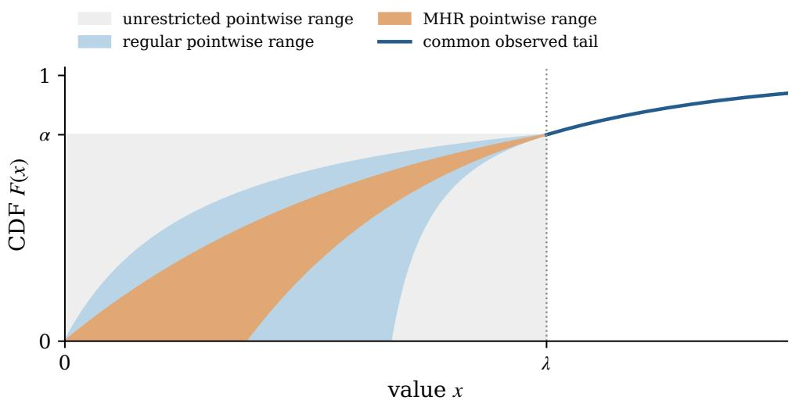  
Figure A.1 Pointwise CDF ranges for unrestricted, regular, and MHR completions of the same observed tail. A curve inside a shaded band must still satisfy its class’s shape constraint; unattained unrestricted boundaries are limits of absolutely continuous completions.

Then $r _ { \mathrm { b } } \in [ 0 , \lambda ]$ minimizes the body objective, and

$$
\Delta ( \mathcal { F } ( \lambda ; G ) ) = \operatorname* { m i n } \{ c _ { \alpha } r _ { \mathrm { b } } , \lambda c _ { \alpha } - B _ { \lambda } \} .
$$

In this case, an optimal reserve is the better of $\dot { r } _ { \mathrm { b } }$ and $r _ { \mathrm { T } } .$ . If instead $B _ { \lambda } \ge \lambda c _ { \alpha }$ , posting $r _ { \mathrm { T } }$ gives zero regret.

Proof of Theorem A.2 and Corollary A.3. Let $T _ { \lambda } = \mathbb { E } _ { F } [ V _ { ( 2 ) } \mathbf { 1 } \{ V _ { ( 2 ) } \geq \lambda \} ]$ , which is common to all completions. Then $R _ { G } ( \lambda ) = T _ { \lambda } + \lambda p _ { \alpha }$ . Fix $r \in [ 0 , \lambda ]$

For a lower competitor $s \ \leq \ r$ , reserve � weakly dominates � whenever the largest value clears �. Otherwise the payment at � is at most �. Thus the gain is at most $r F ( r ) ^ { n } \leq r c _ { \alpha }$ . For $r > 0$ , put all body mass in $( r - \varepsilon , r )$ and post $s = r - \varepsilon$ . The gain tends to $r c _ { \alpha } ;$ ; at $r = 0$ it is zero.

For $r \leq s \leq \lambda$ , the revenue derivative gives

$$
R _ { F } ( s ) - R _ { F } ( r ) = \int _ { r } ^ { s } n F ( u ) ^ { n - 1 } ( 1 - F ( u ) ) d u - \int _ { r } ^ { s } u d ( F ( u ) ^ { n } ) \leq ( s - r ) k _ { \alpha } .
$$

To approach $( \lambda - r ) k _ { \alpha }$ , put mass $z _ { * } = \operatorname* { m i n } \{ \alpha , ( n - 1 ) / n \}$ just below $^ { r , }$ the remaining body mass above $s ,$ and let $s \uparrow \lambda$ . The CDF is $z _ { * }$ on $[ r , s ]$ . At $r = 0$ , put the first mass in $( 0 , \varepsilon )$ ; the discarded contribution is $O ( \varepsilon )$ . These are absolutely continuous completions.

For a tail competitor, the largest revenue is $R _ { G } ( r _ { \mathrm { T } } )$ , whereas $R _ { F } ( r ) \geq T _ { \lambda } + r p _ { \alpha }$ . This gives the third branch $B _ { \lambda } + ( \lambda - r ) p _ { \alpha }$ , attained when all body mass lies below $r ;$ at zero, concentrate it arbitrarily close to zero. Taking the largest of the three sharp bounds proves $( \mathrm { A } . 1 )$

Finally, a lower reserve can beat � only when all bidders are censored, so

$$
\operatorname* { s u p } _ { F } \operatorname* { m a x } _ { s \leq \lambda } R _ { F } ( s ) = R _ { G } ( \lambda ) + \lambda c _ { \alpha } .\tag{A.3}
$$

For sharpness put the body in $( \lambda - \varepsilon , \lambda )$ and post $\lambda - \varepsilon$ . Hence at any tail reserve

$$
W _ { \mathrm { a l l } } ( r ) = \operatorname* { m a x } \{ B _ { \lambda } , \lambda c _ { \alpha } \} + R _ { G } ( \lambda ) - R _ { G } ( r ) .
$$

This proves the tail formula and the zero-regret frontier. If $B _ { \lambda } < \lambda c _ { \alpha }$ , the two crossings of $r c _ { \alpha }$ with the decreasing branches are exactly those in Corollary A.3. Their larger crossing minimizes the body objective; comparison with � finishes the solution. In particular, if $B _ { \lambda } < \lambda c _ { \alpha }$ , the minimum is min $\{ c _ { \alpha } r _ { \mathrm { b } } , \lambda c _ { \alpha } { - } B _ { \lambda } \} >$ 0, so $\Delta ( \mathcal { F } ( \lambda ; G ) ) > 0 ;$ ; this is the converse direction of (A.2). □

Remark A.4 (An identifiable unrestricted instance). For $n = 2 , \lambda = 1$ , and $\begin{array} { r } { G = \frac { 1 } { 2 } \mathrm { U n i f } [ 0 , 1 ] + \frac { 1 } { 2 } \mathrm { U n i f } [ 2 , 3 ] } \end{array}$ every completion has $R _ { F } ( 2 ) = 1 9 / 1 2$ , while $( \mathsf { A } . 3 )$ bounds every body revenue by $4 / 3$ . Thus all completions share an optimal tail reserve.

## A.3 The zero-regret frontier

Lemma A.5 (Tail domination). Let $ { \mathcal { A } } \subseteq \mathcal { F } ( \lambda ; G )$ be nonempty. Assume $R _ { F } ( r ) \leq R _ { F } ( \lambda )$ for every $F \in { \mathcal { A } }$ and every $r \geq \lambda .$ . Then

$$
\Delta ( \mathcal { A } ) = \operatorname* { i n f } _ { r \in [ 0 , \lambda ] } \operatorname* { s u p } _ { F \in \mathcal { A } } \{ R _ { F } ^ { * } - R _ { F } ( r ) \} .
$$

Proof. Replacing any reserve above � by � weakly increases revenue under every completion.

Remark A.6 (Feasibility of an MHR body). An MHR completion exists exactly when the observed cumulative hazard is convex and $A \leq \lambda h _ { 0 }$ . Necessity follows from $\begin{array} { r } { A = \int _ { 0 } ^ { \lambda } h _ { F } \leq \lambda h _ { 0 } ; } \end{array}$ ; the chord $H ( x ) = A x / \lambda$ proves sufficiency. At equality the hazard must equal $h _ { 0 }$ almost everywhere, so the chord is the only body.

Lemma A.7 (Feasible heights). Assume $\mathcal { F } _ { \mathrm { M H R } } ( \lambda ; G )$ is nonempty and the common right boundary hazard satisfies $0 < h _ { 0 } < \infty$ . Then, for every $F \in { \mathcal { F } } _ { \mathrm { M H R } } ( \lambda ; G )$ and every $r \in [ 0 , \lambda ]$

$$
( A - h _ { 0 } ( \lambda - r ) ) _ { + } \leq H _ { F } ( r ) \leq A r / \lambda .
$$

Each bound is attained by a completion in thisfull ambiguity set.

Proof. Convexity bounds $H _ { F }$ by its chord. The remaining interval accumulates at most $h _ { 0 } ( \lambda - r )$ hazard, giving the lower bound. The chord and $H ( x ) = ( A - h _ { 0 } ( \lambda - x ) ) .$ <sub>+</sub> attain the two bounds. The latter has a positive lower support endpoint, which our definition of MHR permits. Exponentiation gives (3.8). □

Remark A.8 (Measurability). The supremum of the continuous functions $R _ { F } ^ { * } - R _ { F } ( r )$ is lower semicontinuous, hence Borel. Composing it with a measurable reserve gives a random loss. Our empirical rules select the smallest maximizer from specified finite candidate sets, so the reserves are measurable as well.

Lemma A.9 (Revenue derivative). Let $F \in { \mathcal { G } }$ and $n \geq 2 .$ . Then $R _ { F }$ is locally absolutely continuous on $[ 0 , \infty )$ and, for almost every $r \geq 0 _ { i }$

$$
R _ { F } ^ { \prime } ( r ) = n F ( r ) ^ { n - 1 } \bigl ( 1 - F ( r ) - r f ( r ) \bigr ) .\tag{A.4}
$$

Where $f ( r ) > 0 ;$ , this equals − ${ \cdot n F ( r ) ^ { n - 1 } f ( r ) \phi _ { F } ( r ) }$ . Thus the sign of virtual value determines the direction of revenue.

Proof. The integrand in (2.3) is bounded by $n ( n - 1 ) u f ( u )$ , which is integrable. Differentiating its two terms on compact intervals cancels the contributions containing $F ^ { n - 2 } ( 1 - F ) f$ and gives the formula. An absolutely continuous function with nonnegative (nonpositive) derivative almost everywhere is nondecreasing (nonincreasing). □

Lemma A.10 (Two-distribution lower bound). Let $A \subseteq { \mathcal { F } } ( \lambda ; G )$ and let $F ^ { ( i ) } \in \mathcal { A }$ have a unique optimal reserve $r _ { i } ^ { * } \in [ 0 , \lambda ] f o r i \in \{ 1 , 2 \} . \ H r _ { 1 } ^ { * } \neq r _ { 2 } ^ { * }$ , then $\Delta ( \mathcal { A } ) > 0$

Proof. The two continuous losses vanish at different reserves, so their maximum is positive everywhere. Both revenues tend to zero at infinity, so this maximum is bounded away from zero outside a compact interval. Its minimum on that interval is positive as well. Nature’s supremum dominates this two-distribution loss, proving $\Delta ( \mathcal { A } ) > 0$ □

Proof of Theorem 3.6. If $h _ { 0 } \leq 1 / \lambda .$ , every body has $r h _ { F } ( r ) \leq 1$ , so revenue is nondecreasing up to �. Every completion therefore shares the tail maximizers. If $A = \lambda h _ { 0 }$ , Remark A.6 gives a uniquely determined completion. Both cases have zero regret.

In the remaining regime, tail revenue is nonincreasing, so it suffices to exhibit two body completions with distinct unique optima. Choose

$$
\operatorname* { m a x } \{ A / \lambda , 1 / \lambda \} < b _ { 1 } < b _ { 2 } < \operatorname* { m i n } \{ h _ { 0 } , ( A + 1 ) / \lambda \} .\tag{A.5}
$$

This interval is nonempty. For each �, take $\tau _ { i } = \lambda - A / b _ { i } + \varepsilon _ { i }$ , where $0 < \varepsilon _ { i } < \operatorname* { m i n } \{ 1 / b _ { i } - \lambda + A / b _ { i } , 1 / b _ { i } \}$ and set $a _ { i } = b _ { i } \varepsilon _ { i } / \tau _ { i }$ . Then

$$
a _ { i } \tau _ { i } + b _ { i } ( \lambda - \tau _ { i } ) = A ,\tag{A.6}
$$

with $0 < a _ { i } < b _ { i } < h _ { 0 } , \tau _ { i } < 1 / b _ { i } < \lambda$ , and

$$
a _ { i } \tau _ { i } = b _ { i } \varepsilon _ { i } < 1 .\tag{A.7}
$$

The hazard $a _ { i }$ followed by $b _ { i }$ pastes to the common tail and is MHR. Revenue strictly increases to $1 / b _ { i }$ and strictly decreases afterwards. These two unique optima differ, so Lemma A.10 gives $\Delta > 0$ □

Remark A.11. Nonidentifiability concerns disagreement between completions, not the location of the true optimum. For example, the hazard $1 / 2$ below $\lambda = 1$ and 2 above it gives $r _ { G } ^ { * } = 1$ , but $A = 1 / 2 < \lambda h _ { 0 } = 2$ and $\phi _ { 0 } > 0$ , so other compatible MHR bodies have different optima.

Proof of the population claim in Proposition 2.5. Let $\begin{array} { r } { W ( r ) = \operatorname* { s u p } _ { F \in \mathcal { A } } \{ R _ { F } ^ { * } - R _ { F } ( r ) \} } \end{array}$ . It is finite and lower semicontinuous. All tail revenues equal $R _ { G }$ , which tends to zero, whereas $R _ { G } ( \lambda ) > 0$ . Thus some $K \geq \lambda$ makes reserve � dominate all reserves above �, under every completion. The minimax infimum is attained on $[ 0 , K ]$ . It equals zero exactly when its minimizing reserve is optimal for every completion. This proves the population equivalence. □

## A.4 Randomization and competition

Remark A.12 (Randomized reserves). A distribution $\mu$ over reserves defines an alternative population benchmark:

$$
\begin{array} { r } { \Delta _ { \mathrm { r a n d } } ( \mathcal { A } ) : = \underset { \mu } { \operatorname* { i n f } } \ \underset { F \in \mathcal { A } } { \operatorname* { s u p } } \mathbb { E } _ { r \sim \mu } [ R _ { F } ^ { * } - R _ { F } ( r ) ] . } \end{array}
$$

For every nonempty set $\boldsymbol { \mathcal { A } } \subseteq \mathcal { F } ( \lambda ; G )$ of regular distributions, $\Delta ( \mathcal { A } ) / 2 \le \Delta _ { \mathrm { r a n d } } ( \mathcal { A } ) \le \Delta ( \mathcal { A } )$ . Here nature chooses a completion before the reserve is drawn. Our learning criterion instead takes worst-case regret at the realized reserve, then averages over the historical sample.

Proposition A.13 (Randomization preserves the frontier). Let $A \subseteq { \mathcal { F } } ( \lambda ; G )$ be nonempty and assume every $F \in { \mathcal { A } }$ is regular. Then

$$
{ \begin{array} { r } { { \frac { 1 } { 2 } } \Delta ( { \mathcal { A } } ) \leq \Delta _ { \operatorname { r a n d } } ( A ) \leq \Delta ( { \mathcal { A } } ) . } \end{array} }\tag{A.8}
$$

Under the historical design of Section 2.2, every possibly randomized data-driven rule satisfies, at every sample size,

$$
\operatorname* { s u p } _ { F \in { \mathcal A } } \mathbb E _ { F } \big [ R _ { F } ^ { * } - R _ { F } ( r ^ { \pi } ) \big ] \geq \frac { 1 } { 2 } \Delta ( { \mathcal A } ) ,
$$

where the expectation includes the historical data and the rule’s randomization; since every historical reserve is at least $\lambda ,$ the censored record has the same law under every $F \in { \mathcal { A } } ,$ so E may be read as E on the record. Thus the zero-regret conditions in Theorems 3.6 and C.1 also hold for randomized reserves and for vanishing worst-case expected regret ofdata-driven rules.

Proof of Proposition A.13. For regular distributions, revenue is unimodal. For any reserve distribution $\mu ,$ let $m _ { \mu }$ be a median. For each completion, the half of $\mu$ lying on the side of $m _ { \mu }$ away from a maximizer has loss at least the loss at $m _ { \mu }$ . Consequently

$$
\begin{array} { r } { \mathbb { E } _ { r \sim \mu } [ R _ { F } ^ { * } - R _ { F } ( r ) ] \ge \frac { 1 } { 2 } \big ( R _ { F } ^ { * } - R _ { F } ( m _ { \mu } ) \big ) . } \end{array}
$$

Take the supremum over $F$ and the infimum over $\mu$ to get the lower bound; point masses give the upper bound. All compatible completions induce the same censored-data law, hence the same reserve law $\mu _ { N }$ for any rule, including its random seed. Applying the inequality to $\mu _ { N }$ proves the rule bound. Conversely, the zero-regret rules of Proposition 2.5 have uniformly bounded loss, $R _ { F } ^ { * } \leq n ( \lambda + \mathbb { E } _ { G } [ ( V - \lambda ) _ { + } ] )$ . Their convergence in probability therefore gives convergence in expectation. □

Remark A.14 (Which minimax criterion applies to a rule?). Theorem 5.5 controls $\mathbb { E } [ \operatorname* { s u p } _ { F } \{ R _ { F } ^ { * } - R _ { F } ( r ^ { \pi } ) \} ]$ whose minimum with the distribution of censored records known is $\Delta$ . For the weaker criterion $\mathrm { s u p } _ { F } \mathbb { E } [ R _ { F } ^ { * } -$ $R _ { F } ( r ^ { \pi } ) ]$ , the corresponding minimax regret is $\Delta _ { \mathrm { r a n d } } { \mathrm { : } }$ : even a deterministic function of the random record posts a random reserve. Explicit randomization selects that reserve law directly. Proposition A.13 bounds the potential benefit by a factor of two.

Mixing is allowed over $[ 0 , \infty )$ , the same domain as deterministic reserves. In the nonidentifiable regime, tail domination permits all mass above � to be moved to �. This restriction would be wrong in a tail-optimal instance with its common optimum above �.

Proposition A.15 (An exponential bound in the number of bidders). Let $G \in \mathcal { A } \subseteq \mathcal { F } ( \lambda ; G )$ , and assume every $F \in { \mathcal { A } }$ has an optimal reserve in $[ 0 , \lambda ]$ . Then

$$
\Delta ( { \cal A } ) \le \operatorname* { s u p } _ { F \in { \cal A } } \{ R _ { F } ^ { * } - R _ { F } ( \lambda ) \} \le \lambda \alpha ^ { n } , \qquad \frac { \Delta ( { \cal A } ) } { R _ { G } ^ { * } } \le \frac { \alpha ^ { n } } { 1 - \alpha ^ { n } } .\tag{A.9}
$$

This applies to both shape classes in the nonidentifiable regime.

Proof of Proposition A.15. Let $s _ { F } \leq \lambda$ be an optimum. Whenever some value clears $\lambda ,$ posting � weakly dominates $s _ { F }$ . Otherwise the gain is at most $\lambda .$ . That event has probability $\alpha ^ { n }$ , proving $\Delta ( \mathcal { A } ) \leq \lambda \alpha ^ { n }$ . Also $R _ { G } ^ { * } \geq R _ { G } ( \lambda ) \geq \lambda ( 1 - \alpha ^ { n } )$ , which gives the relative bound. □

Remark A.16 (Sharpness and an MHR refinement). For an exponential tail of hazard $h \geq 1 / \lambda , B _ { \lambda } = 0 .$ At fixed $\alpha < 1$ and sufficiently large $n , k _ { \alpha } = p _ { \alpha }$ , so the unrestricted formula gives

$$
\Delta ( \mathcal { F } ( \lambda ; G ) ) = \lambda \alpha ^ { n } \frac { n ( 1 - \alpha ) } { \alpha + n ( 1 - \alpha ) } \sim \lambda \alpha ^ { n } .
$$

Thus the exponential order is sharp for unrestricted completions. For MHR in the nonidentifiable regime, every completion has an optimum at or below $u = \mathrm { m i n } \{ \lambda , \lambda - ( A - 1 ) / h _ { 0 } \}$ . The same event argument at �, using $H _ { F } ( u ) \leq A u / \lambda .$ , gives

$$
\Delta \le \operatorname* { s u p } _ { F } \{ R _ { F } ^ { * } - R _ { F } ( u ) \} \le u ( 1 - e ^ { - A u / \lambda } ) ^ { n } .\tag{A.10}
$$

This improves the bound when $A > 1$ . Neither bound asserts monotonicity of the exact minimax regret in � or a rate when � also tends to one.

## A.5 MHR geometry and the equalizer

We justify the two-level replacement, establish stability, and then prove the unique equalizer.

Proof of Proposition 4.1. Since $h _ { 0 } > 1 / \lambda$ , every completion’s revenue is nonincreasing above � (Section 4.1), so its optimum and every alternative reserve can be taken in [0, �]. By (4.1) and the characterization of feasible bodies in Section 4.1, both the revenue comparison and the feasible set of bodies depend on the tail only through $( A , h _ { 0 } )$ □

Proofofthe two-level reduction (Theorem 4.2). Fix the alternative reserve � and a feasible body �. $\operatorname { I f } s > r .$ replace � by the chords through $( 0 , 0 ) , ( s , H ( s ) )$ and $( \lambda , A )$ . The replacement is convex, has terminal slope at most $h _ { 0 }$ , and raises � on $[ r , s ]$ while preserving $H ( s )$ . Thus it raises the CDF there, improving both the negative endpoint term at � and $- \int _ { r } ^ { s } \psi ( F )$ in (4.1).

If $s < r .$ , take the maximum of the ray through $( 0 , 0 ) , ( s , H ( s ) )$ and the line through $( r , H ( r ) ) , ( \lambda , A )$ Convexity puts this maximum below � on $[ s , r ]$ , preserving both endpoint heights. Its slopes are ordered and bounded by $h _ { 0 }$ , and its break lies in $[ s , r ]$ . It lowers the CDF and increases $\begin{array} { r } { \int _ { s } ^ { r } \psi ( F ) . \mathrm { A t } s = 0 } \end{array}$ use the zero ray; at $r = \lambda$ use the backward line of slope $h _ { 0 } . \mathrm { A t } s = \lambda$ the first replacement is the whole-body chord.

Both replacements are feasible two-level bodies (Figure A.2). The reverse inequality follows from inclusion. Continuity on the compact level rectangle (Lemma A.17) gives attainment; the paragraph on attainment in the two-level family below gives the details. □

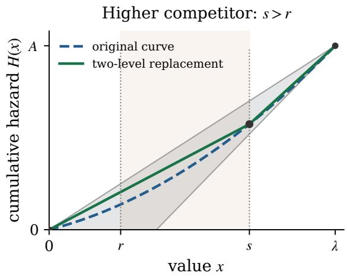

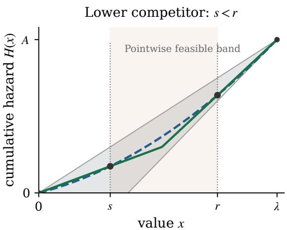  
Figure A.2 Replacing a convex cumulative hazard by a two-level body. A higher alternative reserve uses two chords to raise the curve between the reserves; a lower one uses the maximum of two extended chords to lower it. The preserved heights make each replacement improve nature’s revenue comparison.

For $t = H _ { F } ( r )$ and $\tilde { t } = H _ { F } ( \tilde { r } )$ , the density form of the comparison is

$$
\begin{array} { l } { { R _ { F } ( \tilde { r } ) - R _ { F } ( r ) = n \tilde { r } ( 1 - e ^ { - \tilde { t } } ) ^ { n - 1 } e ^ { - \tilde { t } } - n r ( 1 - e ^ { - t } ) ^ { n - 1 } e ^ { - t } } } \\ { { \nonumber } } \\ { { \displaystyle ~ + \int _ { \tilde { r } } ^ { r } x n ( n - 1 ) F ( x ) ^ { n - 2 } ( 1 - F ( x ) ) f ( x ) d x . } } \end{array}\tag{A.11}
$$

Define

$$
\beta ( z ) = n ( n - 1 ) ( 1 - e ^ { - z } ) ^ { n - 2 } e ^ { - 2 z } .\tag{A.12}
$$

Its unknown integral becomes

$$
I ( F ) = \int _ { \tilde { r } } ^ { r } x \beta ( H _ { F } ( x ) ) h _ { F } ( x ) d x .\tag{A.13}
$$

On each affine piece with positive slope, $z = H _ { F } ( x )$ makes � affine in �; Lemma A.19 evaluates the resulting integral. A zero-slope piece contributes zero.

Lemma A.17 (Continuity of the body revenue difference). Let $n \geq 2 , \lambda > 0$ , and let $H , { \bar { H } }$ be nonnegative cumulative-hazard bodies on [0, �]. Define $D _ { r , s } ( H ) b y ( 4 . 1 )$ , with $F = 1 - e ^ { - H }$ . Then,for every � $, s \in [ 0 , \lambda ]$

$$
| D _ { r , s } ( H ) - D _ { r , s } ( \bar { H } ) | \leq ( r + s + 2 | r - s | ) \| H - \bar { H } \| _ { \infty } \leq 3 \lambda \| H - \bar { H } \| _ { \infty } .\tag{A.14}
$$

The bound does not require equal endpoint heights, and its constant is independent of the bidder count.

Proof. In cumulative-hazard coordinates put $p = 1 - e ^ { - z }$ and define $\Psi _ { 1 } ( z ) = 1 - p ^ { n } , \Psi _ { 2 } ( z ) = \psi ( p )$ . Their

derivatives satisfy

$$
| \Psi _ { 1 } ^ { \prime } ( z ) | = n p ^ { n - 1 } ( 1 - p ) \leq 1 , \qquad | \Psi _ { 2 } ^ { \prime } ( z ) | = n ( n - 1 ) p ^ { n - 2 } ( 1 - p ) ^ { 2 } \leq 2 .
$$

The two expressions are, respectively, a binomial probability and twice a binomial probability. Applying these derivative bounds to the two endpoint terms and the integral in (4.1) gives (A.14). □

Attainment in the two-level family For the two-level parameterization,

$$
\| H _ { a , b } - H _ { a ^ { \prime } , b ^ { \prime } } \| _ { \infty } \leq \lambda \operatorname* { m a x } \{ | a - a ^ { \prime } | , | b - b ^ { \prime } | \} .
$$

Regret, including its maximization over �, is therefore continuous on the compact level rectangle. For a fixed $s > r$ , the family with break at � is closed: its levels satisfy $a s = A - b ( \lambda - s )$ . For $s < r ,$ , a break in $[ s , r ]$ is equivalently described by the two closed inequalities �� $\geq A - b ( \lambda - s )$ and $a r \le A - b ( \lambda - r )$ . Constant bodies are included in both descriptions. Thus the fixed-competitor suprema in Theorem 4.2 are attained. Moreover, $( a , b , s ) \mapsto D _ { r , s } ( H _ { a , b } )$ is jointly Lipschitz on the compact set $[ 0 , A / \lambda ] \times [ A / \lambda , h _ { 0 } ] \times [ 0 , \lambda ]$ with constant $3 \lambda ^ { 2 }$ in the levels by the bound above and max $\{ 1 , \lambda h _ { 0 } \}$ in � by the revenue-derivative bound $| R _ { F } ^ { \prime } | \leq \operatorname* { m a x } \{ 1 , \lambda h _ { 0 } \}$ for bodies with hazard at most $h _ { 0 } ;$ hence the supremum over bodies and alternative reserves in Theorem 4.2 is a maximum, and $\begin{array} { r } { R _ { F _ { a , b } } ^ { * } - R _ { F _ { a , b } } ( r ) = \operatorname* { m a x } _ { s } D _ { r , s } ( H _ { a , b } ) } \end{array}$ is continuous in $( a , b )$

Proof of global stability (Lemma 5.3). For any feasible body �, define

$$
\Lambda _ { r } ( H ) = \operatorname* { s u p } _ { s \in [ 0 , \lambda ] } D _ { r , s } ( H ) , \qquad \mathsf { W } ( r ; A , h _ { 0 } ) = \operatorname* { s u p } _ { H \in \mathcal { H } ( A , h _ { 0 } ) } \Lambda _ { r } ( H ) ,\tag{A.15}
$$

where $D _ { r , s }$ is (4.1) with $F = 1 - e ^ { - H }$ ; the second expression is the body objective (4.4) of Section 4.   
Lemma $\mathrm { A . 1 7 }$ makes Λ<sub>�</sub> 3�-Lipschitz in �. We now match the feasible body sets.

Write $v = H ^ { \prime }$ and $A _ { * } = \operatorname* { m i n } \{ A , A ^ { \prime } \}$ . Scale � to have integral $A _ { * }$ ; this moves its cumulative integral by at most $A - A _ { * } . \mathrm { I f } \ h _ { 0 } ^ { \prime } < h _ { 0 }$ , replace the scaled hazard by

$$
v _ { \gamma } ( x ) = \operatorname* { m i n } \{ h _ { 0 } ^ { \prime } , \operatorname* { m a x } \{ \gamma , v ( x ) \} \} , \qquad 0 \leq \gamma \leq h _ { 0 } ^ { \prime } .
$$

Its integral ranges continuously from at most �<sub>\*</sub> to $\lambda h _ { 0 } ^ { \prime } \geq A ^ { \prime } \geq A _ { * }$ . Choose $\gamma$ to preserve $A _ { * }$ . The mass removed at the end equals that added at the beginning and is at most $\lambda ( h _ { 0 } - h _ { 0 } ^ { \prime } )$ . Thus the cumulative integral moves by at most this amount. If $h _ { 0 } ^ { \prime } \geq h _ { 0 }$ , no cap adjustment is needed. Finally, interpolate with the constant hazard $h _ { 0 } ^ { \prime }$ until the integral is $A ^ { \prime } .$ . This adds mass $A ^ { \prime } - A _ { * }$ <sub>\*</sub> while preserving monotonicity and the cap. The degenerate cases need no separate argument: if $A _ { * } = 0$ the scaled hazard is zero and the floor $\gamma = 0$ keeps it so; if $A ^ { \prime } = \lambda h _ { 0 } ^ { \prime }$ the interpolation ends at the constant hazard $h _ { 0 } ^ { \prime }$ , the only element of $\mathcal { H } ( A ^ { \prime } , h _ { 0 } ^ { \prime } ) ; \mathrm { i f } A = \lambda h _ { 0 }$ the source hazard is the constant $h _ { 0 }$ . In each case every step above is defined as written. The resulting $\bar { H } \in \mathcal { H } ( A ^ { \prime } , h _ { 0 } ^ { \prime } )$ satisfies

$$
\| H - \bar { H } \| _ { \infty } \leq | A - A ^ { \prime } | + \lambda | h _ { 0 } - h _ { 0 } ^ { \prime } | .
$$

Repeat in the reverse direction and apply the functional bound to obtain (5.1).

The revenue derivative on the body also gives

$$
| R _ { F } ^ { \prime } ( r ) | = n F ( r ) ^ { n - 1 } ( 1 - F ( r ) ) | 1 - r h _ { F } ( r ) | \leq \operatorname* { m a x } \{ 1 , \lambda h _ { 0 } \} = \mathrm { L i p } _ { r } .
$$

This bound passes to the comparison suprema and proves reserve stability.

Proof of the unique equalizer (Theorem 4.3). For a completion with optimum $r _ { F } ^ { \ast }$ , its directional losses are

$$
\ell _ { F } ( r ) = R _ { F } ( \operatorname* { m i n } \{ r , r _ { F } ^ { * } \} ) - R _ { F } ( r ) , \qquad u _ { F } ( r ) = R _ { F } ( \operatorname* { m a x } \{ r , r _ { F } ^ { * } \} ) - R _ { F } ( r ) .
$$

Unimodality makes $\ell _ { F }$ nondecreasing and $u _ { F }$ nonincreasing. Both are $\mathrm { L i p } _ { r } { \mathrm { - L i p s c h i t z } } ,$ so their suprema $L , U$ are continuous and have the same directions. The compact two-level family attains these suprema, including their alternative reserves.

If $L ( r _ { 1 } ) > 0$ , an attaining completion has already lost revenue before $r _ { 1 }$ . Hence $F ( r _ { 1 } ) > 0$ and $r _ { 1 } h _ { F } ( r _ { 1 } ^ { + } ) > 1$ . Hazard monotonicity preserves both inequalities to the right, so its revenue strictly decreases there. Retaining this completion proves $L ( r _ { 2 } ) > L ( r _ { 1 } )$ for $r _ { 2 } > r _ { 1 }$

If $U ( r _ { 2 } ) > 0$ , choose an attaining higher competitor $s > r _ { 2 }$ . The two-level replacement has constant initial hazard � up to �. Positive gain requires $a > 0$ and $a r _ { 2 } < 1$ , so its revenue strictly increases on $( 0 , r _ { 2 } ]$ Retaining it gives $U ( r _ { 1 } ) > U ( r _ { 2 } )$ for $r _ { 1 } < r _ { 2 }$

At $l = 1 / h _ { 0 }$ , every completion’s revenue has been nondecreasing, so $L ( l ) = 0 . { \mathrm { ~ A t ~ } } u = \operatorname* { m i n } \{ \lambda , \lambda -$ $\left( A - 1 \right) / h _ { 0 } \}$ , convexity and the backward tangent give �ℎ ${ \bf \Gamma } _ { F } ( x ) \ge H _ { F } ( x ) \ge 1$ for $x \geq u$ , whenever $u < \lambda$ Thus $U ( u ) = 0 ;$ this is immediate if $u = \lambda$ . Since $\Delta > 0$ , the opposite directional losses at these endpoints are positive. Continuity gives a positive crossing in $( l , u )$ , and strictness makes it unique. To its left $W = U$ strictly decreases; to its right $W = L$ strictly increases. □

ProofofProposition 4.4. The endpoints � and � above satisfy $L ( l ) = 0 < U ( l )$ and $U ( u ) = 0 < L ( u )$ , so the unique crossing lies strictly between them, which is (4.6). Subtracting $1 / h _ { 0 }$ from the upper endpoint bounds the length by $\lambda - A / h _ { 0 }$ . At fixed $A ,$ increasing $h _ { 0 }$ enlarges $\mathcal { H } ( A , h _ { 0 } )$ and leaves the regret functional unchanged, so W and its minimum do not decrease. □

Lemma A.18 (A sharp minimum). Let $n \geq 2 , \lambda > 0 , 0 < A < \lambda h _ { 0 } ,$ , and $h _ { 0 } > 1 / \lambda .$ . Write $r ^ { \dagger } = r ^ { \dagger } ( A , h _ { 0 } ) f o r$ the minimax reserve. There are $c _ { L } , c _ { R } > 0$ such that,for every $r \in [ 0 , \lambda ]$

$$
\mathsf { W } ( r ; A , h _ { 0 } ) - \Delta ( A , h _ { 0 } ) \ge \left\{ \begin{array} { l l } { c _ { L } ( r ^ { \dagger } - r ) , } & { r \le r ^ { \dagger } , } \\ { c _ { R } ( r - r ^ { \dagger } ) , } & { r \ge r ^ { \dagger } . } \end{array} \right.
$$

These constants may deteriorate near the zero-regretfrontier.

Proof. For the left side, retain an attaining higher competitor and its body with initial hazard $a > 0 , a r ^ { \dagger } < 1$ Its revenue derivative on $[ r ^ { \dagger } / 2 , r ^ { \dagger } ]$ is at least

$$
c _ { \mathrm { d e r } } = n ( 1 - e ^ { - a r ^ { \dagger } / 2 } ) ^ { n - 1 } e ^ { - a r ^ { \dagger } } ( 1 - a r ^ { \dagger } ) > 0 .
$$

For � in this half interval, integrate the bound. For smaller �, monotonicity gives at least the loss over the upper half interval. Thus $c _ { L } = c _ { \mathrm { d e r } } / 2$ works on all $[ 0 , r ^ { \dagger } ]$

For the right side, retain an attaining lower competitor. Its positive loss at $r ^ { \dagger }$ implies $F ( r ^ { \dagger } ) > 0$ and $r ^ { \dagger } h _ { \dagger } > 1$ , where $h _ { \dagger } = h _ { F } ( r ^ { \dagger + } )$ . For almost every $x \in [ r ^ { \dagger } , \lambda ]$

$$
\begin{array} { r } { { \cal { - R } } _ { F } ^ { \prime } ( x ) \ge n F ( r ^ { \dagger } ) ^ { n - 1 } e ^ { - A } ( r ^ { \dagger } h _ { \dagger } - 1 ) = : c _ { { \cal R } } > 0 . } \end{array}
$$

Integration gives the claim.

If two parameter pairs $\theta , \theta ^ { \prime }$ have objectives within � uniformly, optimality of the perturbed minimizer gives $\mathsf { W } ( r ^ { \dagger } ( \theta ^ { \prime } ) ; \theta ) - \Delta ( \theta ) \le 2 \eta$ . Thus, with $c = \operatorname* { m i n } \{ c _ { L } , c _ { R } \}$ ，

$$
| r ^ { \dagger } ( \theta ^ { \prime } ) - r ^ { \dagger } ( \theta ) | \leq 2 \eta / c .
$$

Together with global stability, this controls the reserve at each instance in $\mathcal { D } ;$ it does not give a uniform positive � up to the frontier.

## A.6 MHR numerical certificates

Lemma A.19 (Closed-form integration). Let $n \geq 2$ be an integer and let $\mu , \nu , z _ { 1 } , z _ { 2 } \in \mathbb { R }$ . For $\beta$ in (A.12),

$$
\begin{array} { l } { { \displaystyle \int _ { z _ { 1 } } ^ { z _ { 2 } } ( \mu + \nu z ) \beta ( z ) d z = n ( n - 1 ) \sum _ { k = 0 } ^ { n - 2 } \binom { n - 2 } { k } ( - 1 ) ^ { k } } } \\ { { \displaystyle \qquad \cdot \left[ - e ^ { - ( k + 2 ) z } \left( \frac { \mu + \nu z } { k + 2 } + \frac { \nu } { ( k + 2 ) ^ { 2 } } \right) \right] _ { z _ { 1 } } ^ { z _ { 2 } } . } } \end{array}\tag{A.16}
$$

Proof. Expand $( 1 - e ^ { - z } ) ^ { n - 2 }$ and integrate each exponential term. On a positive-slope affine piece of $H ,$ the substitution $z = H ( x )$ makes $x = \mu + \nu z$ . A zero-slope piece contributes zero. The extremal comparisons therefore require at most two such integrals. □

## A.6.1 The level-grid computation

For $( A , h _ { 0 } )$ with $0 < A < \lambda h _ { 0 }$ and $h _ { 0 } > 1 / \lambda .$ , grid the rectangle $[ 0 , A / \lambda ] \times [ A / \lambda , h _ { 0 } ]$ , including endpoints.   
Write $\mathsf { W } ^ { \mathcal { T } } ( r )$ for the largest regret among these bodies, using their exact body optima.

Corollary A.20 (Grid error). Under Assumption 3.4, let $0 < A < \lambda h _ { 0 }$ and $h _ { 0 } > 1 / \lambda .$ . Use the endpointinclusive level grids defined above, with maximum gaps $\varepsilon _ { a } , \varepsilon _ { b }$ . Put $\eta _ { \mathcal { T } } = 3 \lambda ^ { 2 } \operatorname* { m a x } \{ \varepsilon _ { a } , \varepsilon _ { b } \}$ and $\mathrm { L i p } _ { r } =$ max $\{ 1 , \lambda h _ { 0 } \}$ . Then $0 \leq W _ { G } ( r ) - \mathsf { W } ^ { \tau } ( r ) \leq \eta \tau$ for every $r \in [ 0 , \lambda ]$ . For the minimum $\Delta ^ { \tau }$ on an endpoint-inclusive posted grid on [0, �] with maximum gap $\varepsilon _ { r } ,$

$$
\begin{array} { r } { \Delta ^ { \mathcal { T } } - \mathrm { L i p } _ { r } \varepsilon _ { r } \leq \Delta \leq \Delta ^ { \mathcal { T } } + \eta \tau . } \end{array}\tag{A.17}
$$

Maximizing each body’s revenue on an endpoint-inclusive grid on $[ 0 , \lambda ]$ with maximum $g a p \varepsilon { _ x }$ adds $\mathrm { L i p } _ { r } \varepsilon _ { x }$ to the upper error bounds. By Proposition 4.1, $W _ { G } = \mathsf { W } ( \cdot ; A , h _ { 0 } )$ and $\Delta = \Delta ( A , h _ { 0 } )$ , so these bounds hold for every pair in �, in particularfor the projected pair ofAlgorithm 5.1.

Proof. Every grid body is feasible. Rounding the attaining levels changes $H _ { a , b }$ by at most $\lambda \operatorname* { m a x } \{ \varepsilon _ { a } , \varepsilon _ { b } \}$ ; Lemma A.17 gives the reverse bound with error �<sub>�</sub>. A posted grid point near the true minimizer gives $\Delta ^ { \tau } \le \Delta + \mathrm { L i p } _ { r } \varepsilon _ { r }$ . At the minimizing grid point, $\Delta \le W _ { G } \le \Delta ^ { \gamma } + \eta _ { T }$ . The price-grid error follows from the same reserve Lipschitz bound. □

For a two-level body with break $\tau = ( b \lambda - A ) / ( b - a )$ , its hazard-weighted reserve crosses or jumps past one at the body optimum

$$
r _ { a , b } ^ { \mathrm { o p t } } = \operatorname* { m i n } \left\{ \lambda , \operatorname* { m a x } \left\{ \frac { 1 } { b } , \operatorname* { m i n } \left\{ \tau , \frac { 1 } { a } \right\} \right\} \right\} .\tag{A.18}
$$

Use $1 / 0 = \infty ;$ for $a = b = A / \lambda$ , take $r _ { a , b } ^ { \mathrm { o p t } } = \operatorname* { m i n } \{ \lambda , 1 / a \}$ and $\tau = \lambda$ . The derivative formula proves this directly on the two segments. If $a = 0$ and $b \tau \geq 1$ , all reserves in $[ 0 , \tau ]$ are optimal, and the formula chooses � .

Corollary A.21 (Closed-form worst-case regret). Let $n \geq 2 , \lambda > 0 , 0 \leq A \leq \lambda h _ { 0 } ,$ , and $0 \leq a \leq A / \lambda \leq b \leq$ $h _ { 0 } .$ . For $r \in [ 0 , \lambda ]$ , let $F _ { a , b }$ be the two-level body joined to a common observed tail, and put $z _ { r } = H _ { a , b } ( r )$ $z _ { \tau } = a \tau$ , and $\begin{array} { r } { \mathsf { B } _ { \mu , \nu } ( z _ { 1 } , z _ { 2 } ) = \int _ { z _ { 1 } } ^ { z _ { 2 } } ( \mu + \nu z ) \beta ( z ) d z } \end{array}$ , evaluated by (A.16). Let $T _ { \lambda }$ denote the common secondhighest-value contribution above � in (2.3). Then

$$
\begin{array} { r l } & { R _ { F _ { a , b } } ( r ) - T _ { \lambda } = n r ( 1 - e ^ { - z _ { r } } ) ^ { n - 1 } e ^ { - z _ { r } } } \\ & { \phantom { R e \ } + { \bf 1 } \{ a > 0 \} { \sf B } _ { 0 , 1 / a } ( z _ { r } , \operatorname* { m a x } \{ z _ { r } , z _ { \tau } \} ) } \\ & { \phantom { R e \ } + { \sf B } _ { \lambda - A / b , 1 / b } ( \operatorname* { m a x } \{ z _ { r } , z _ { \tau } \} , A ) . } \end{array}\tag{A.19}
$$

Thefirst integral is omitted when $a = 0 .$ . Under Assumption 3.4, with $( A , h _ { 0 } ) \in \mathcal { D }$ , differences ofthisformula give

$$
\mathsf { W } ( r ; A , h _ { 0 } ) = \operatorname* { m a x } _ { 0 \leq a \leq A / \lambda \leq b \leq h _ { 0 } } \{ R _ { F _ { a , b } } ( r _ { a , b } ^ { \mathrm { o p t } } ) - R _ { F _ { a , b } } ( r ) \} .
$$

At $A = 0$ the body is zero and all its comparison losses are zero. Under Assumption $3 . 4 ,$ for every $r \geq \lambda ,$ $W _ { G } ( r ) = W _ { G } ( \lambda ) + R _ { G } ( \lambda ) - R _ { G } ( r )$

Proof. In the body integral substitute $z = H ( x )$ . Its two inverse pieces are $x = z / a$ and $x = \lambda - ( A - z ) / b ;$ a zero-slope segment contributes zero. This proves the formula. The two-level reduction gives the maximum, and common tail revenues give the last identity. □

Corollary A.22 (Reserve bisection). Under the hypotheses and grid conventions ofCorollary A.20, restrict the directional losses to the level grid, obtaining $L _ { T } , U _ { T }$ . Bisection on $L \tau - U \tau$ over $[ 0 , \lambda ]$ returns an interval containing a minimizer $o f \mathsf { W } ^ { \mathcal { T } }$ . Ifits length is at most $\varepsilon _ { r } > 0$ , then any point �̂︀ in it, with $\boldsymbol { v } = \boldsymbol { \mathsf { W } } ^ { \mathcal { T } } ( \widehat { \boldsymbol { r } } )$ satisfies

$$
v - \mathrm { L i p } _ { r } \varepsilon _ { r } \leq \Delta \leq v + \eta \tau , \qquad W _ { G } ( \widehat { r } ) \leq \Delta + \eta \tau + \mathrm { L i p } _ { r } \varepsilon _ { r } .
$$

If the grids have $M _ { a }$ and $M _ { b }$ hazard levels, the cost is $O ( M _ { a } M _ { b } [ 1 + \log _ { + } ( \lambda / \varepsilon _ { r } ) ] )$ evaluations.

Proof. The finite directional losses are continuous and monotone in opposite directions. Their difference is nonpositive at zero and nonnegative at �; every zero minimizes their maximum. If that minimum is $d \tau$ then $d _ { T } \leq \Delta \leq d _ { T } + \eta _ { T }$ and $d _ { T } \leq v \leq d _ { T } + \mathrm { L i p } _ { r } \varepsilon _ { r }$ . Combining these bounds proves the certificate. Each bisection step evaluates all bodies, and halves the interval. □

## B Learning from Censored Samples

We organize the proofs around the three settings in Section 5: a tail-optimal case, a nonidentifiable regime, and a fully identified case with an optimum at or below �. The corresponding expected excess-regret bounds are $O ( N ^ { - 1 / 2 } ) , O ( N ^ { - 2 / 5 } )$ , and $O ( N ^ { - 1 } )$ ), respectively. We then prove the auto-selector guarantee for selecting between the tail and plug-in rules.

## B.1 Learning in the observed tail

When $h _ { 0 } \leq 1 / \lambda ,$ , all compatible MHR distributions share an optimal reserve in the observed tail. We learn it by maximizing empirical revenue. The following identity includes bids equal to the reserve and controls the contribution of an unbounded tail.

Lemma B.1 (Empirical revenue and uniform truncation). Fix $n \geq 2$ . For any CDF � on $[ 0 , \infty )$ with finite first moment, auction revenue satisfies

$$
R _ { F } ( r ) ~ = ~ r ( 1 - F ( r ^ { - } ) ^ { n } ) ~ + ~ \int _ { r } ^ { \infty } \Bigl ( 1 - n F ( u ) ^ { n - 1 } + ( n - 1 ) F ( u ) ^ { n } \Bigr ) d u .\tag{B.1}
$$

Let � and ${ \widehat { G } } _ { N }$ be two such CDFs, continuous at a boundary $\lambda > 0$ , and write $\widehat { R } _ { N } = R _ { \widehat { G } _ { N } }$ . Then, for every $T \geq \lambda ,$ , the following bound holds with $c _ { n } = n ^ { 2 }$

$$
\operatorname* { s u p } _ { r \ge \lambda } \bigl | \widehat { R } _ { N } ( r ) - R _ { G } ( r ) \bigr | \le c _ { n } ( 1 + T ) \bigl \| \widehat { G } _ { N } - G \bigr \| _ { \infty , [ \lambda , \infty ) } + c _ { n } \Bigl ( \mathbb { E } _ { \widehat { G } _ { N } } \bigl [ V \mathbf { 1 } \{ V > T \} \bigr ] + \mathbb { E } _ { G } \bigl [ V \mathbf { 1 } \{ V > T \} \bigr ] \Bigr ) .\tag{B.2}
$$

The same bound holds with $\lambda = 0$ , without a continuity assumption at zero. Thus it also controls revenues uniformly over all reserves.

Proof. The payment identity

$$
\mathrm { r e v } ( r , { \bf V } ) = r { \bf 1 } \{ V _ { ( 1 ) } \geq r \} + ( V _ { ( 2 ) } - r ) _ { + }
$$

proves (B.1). The left limit includes bids equal to the reserve. Put $\psi ( p ) = 1 - n p ^ { n - 1 } + ( n - 1 ) p ^ { n }$ and $\delta _ { G } = \| \widehat { G } _ { N } - G \| _ { \infty , [ \lambda , \infty ) }$ . The bounds $| ( p ^ { n } ) ^ { \prime } | \leq n , | \psi ^ { \prime } | \leq n ( n - 1 )$ , and $0 \leq \psi ( p ) \leq n ( n - 1 ) ( 1 - p )$ compare the two formulas on $[ r , T ]$ and bound the remaining integrals by their tail first moments. For $r \leq T$ this gives

$$
| \widehat { R } _ { N } ( r ) - R _ { G } ( r ) | \leq n ^ { 2 } T \delta _ { G } + n ^ { 2 } \sum _ { F \in \{ \widehat { G } _ { N } , G \} } \mathbb { E } _ { F } [ V \mathbf { 1 } \{ V > T \} ] .
$$

For $r > T$ , each revenue is at most $n \mathbb { E } _ { F } [ V \mathbf { 1 } \{ V > T \} ]$ . Continuity at � extends $\delta _ { G }$ to the left limits there; at zero both left limits are zero. This proves (B.2). □

Suppose a lower bound $h _ { \operatorname* { m i n } } > 0$ on $h _ { 0 }$ is known. Set

$$
\bar { \lambda } = \operatorname* { m a x } \{ \lambda , 1 / h _ { \operatorname* { m i n } } \} .
$$

For $x \ge \lambda$ , with $\mathcal { U } _ { N }$ the multiset of uncensored bids, the observable empirical left CDF is

$$
\widehat { G } _ { N } ^ { - } ( x ) = \frac { N - m + \sum _ { U \in \mathcal { U } _ { N } } \mathbf { 1 } \{ U < x \} } { N } .
$$

With $\psi ( p ) = 1 - n p ^ { n - 1 } + ( n - 1 ) p ^ { n }$ , define

$$
\widehat { Q } _ { N } ( r ) = r \bigl ( 1 - \widehat { G } _ { N } ^ { - } ( r ) ^ { n } \bigr ) - \lambda \bigl ( 1 - \widehat { G } _ { N } ^ { - } ( \lambda ) ^ { n } \bigr ) - \int _ { \lambda } ^ { r } \psi ( \widehat { G } _ { N } ^ { - } ( x ) ) d x , \qquad \lambda \leq r \leq \bar { \lambda } .\tag{B.3}
$$

Let $\widehat { r } _ { N } ^ { \mathrm { t a i l } }$ be its smallest maximizer over $\{ \lambda , \bar { \lambda } \} \cup ( { \mathcal { U } } _ { N } \cap [ \lambda , \bar { \lambda } ] )$ . Using the left CDF treats a bid equal to the reserve as qualifying. Between bids the objective is affine with nonnegative slope; at a bid it takes the upper value before a downward jump. Thus this finite search attains the supremum on the interval.

Subtracting revenue at � cancels payments from values beyond the search interval; only the CDF on it needs to be estimated.

Proof of Proposition 5.1. MHR and $h _ { 0 } \geq h _ { \operatorname* { m i n } }$ make revenue nonincreasing beyond $\bar { \lambda } ,$ so the tail optimum is in $[ \lambda , { \bar { \lambda } } ]$ . The population analogue $Q$ of (B.3) equals $R _ { G } ( r ) - R _ { G } ( \lambda )$ . Since $| ( p ^ { n } ) ^ { \prime } | \leq n { \mathrm { ~ a n d ~ } } | \psi ^ { \prime } ( p ) | =$ $n ( n - 1 ) p ^ { n - 2 } ( 1 - p ) \leq n .$

$$
\operatorname* { s u p } _ { [ \lambda , \bar { \lambda } ] } \vert \widehat { Q } _ { N } - Q \vert \leq 2 n \bar { \lambda } \operatorname* { s u p } _ { x \geq \lambda } \vert \widehat { G } _ { N } ^ { - } ( x ) - G ( x ) \vert .
$$

The Dvoretzky–Kiefer–Wolfowitz (DKW) inequality applies to the left empirical CDF by taking left limits in its usual bound. Empirical maximization costs twice this error, proving the result. For $h _ { 0 } \leq 1 / \lambda$ , all body revenues are nondecreasing, so every completion shares the tail optimum. Integrating the DKW tail bound gives $\mathbb { E } \| \widehat { G } _ { N } ^ { - } - G \| _ { \infty , [ \lambda , \infty ) } = O ( N ^ { - 1 / 2 } )$ , and hence the stated expected-regret bound. □

Tail-optimum part of Proposition 2.5. The unrestricted frontier and the tail-optimal cases of the two shape classes give

$$
R _ { F } ^ { * } = \operatorname* { m a x } _ { r \geq \lambda } R _ { G } ( r ) = : R ^ { \star } \qquad ( F \in { \mathcal { A } } ) .\tag{B.4}
$$

For the shape classes this is the monotonicity of every completion’s revenue on [0, �] in the tail-optimal case (Theorems 3.6 and C.1); for the unrestricted class it is the frontier condition $B _ { \lambda } \geq \lambda \alpha ^ { n }$ of Theorem A.2 together with (A.3), which bounds every completion’s body revenue by $R _ { G } ( \lambda ) + \lambda \alpha ^ { n } \leq R ^ { \star }$ . Assign every censored record to zero and form its empirical $\mathrm { C D F } \widehat { G } _ { N }$ . This recovers the empirical tail without completing the hidden values for revenue comparisons above �. Post the smallest empirical-revenue maximizer $\widehat { r } _ { N }$ over $\{ \lambda \} \cup \mathcal { U } _ { N }$ , where $\mathcal { U } _ { N }$ is the multiset of uncensored bids. Between bids empirical revenue is affine and nondecreasing; above the largest bid it is zero. The finite search thus attains the tail supremum, and returns � when no bids are observed.

Glivenko–Cantelli gives uniform tail CDF convergence. For fixed $T \geq \lambda$ , the empirical tail first moment beyond � converges by the law of large numbers. First choosing � large and then applying Lemma B.1 gives $\begin{array} { r } { \operatorname* { s u p } _ { r \ge \lambda } | R _ { \widehat { G } _ { N } } ( r ) - R _ { G } ( r ) | = o _ { P } ( 1 ) } \end{array}$ . The maximizer inequality then yields

$$
\operatorname* { s u p } _ { F \in A } \{ R _ { F } ^ { \ast } - R _ { F } ( \widehat { r } _ { N } ) \} = R ^ { \star } - R _ { G } ( \widehat { r } _ { N } ) \leq 2 \operatorname* { s u p } _ { r \geq \lambda } | R _ { \widehat { G } _ { N } } ( r ) - R _ { G } ( r ) | = o _ { P } ( 1 ) .
$$

This needs no uniqueness of the tail optimum.

Remark B.2 (The uncensored benchmark). Learning a common reserve for all bidders differs from learning the full revenue-optimal auction mechanism. Jin et al. [JLX23] obtain $\tilde { \Theta } ( \varepsilon ^ { - 2 } )$ sample complexity for bounded-support and MHR values, without the bidder-count factor in the general-mechanism bounds of Guo et al. [GHZ19]. These results use multiplicative revenue approximation and samples of all bidders’ values; here we use additive loss and individual i.i.d. bids. For continuous MHR values, the best-known lower bound is only $\tilde { \Omega } ( \varepsilon ^ { - 3 / 2 } )$ ; the matching $\varepsilon ^ { - 2 }$ lower bound permits discrete distributions.

## B.2 Learning in the nonidentifiable regime

The projected plug-in rule estimates $A , h _ { 0 }$ and solves the corresponding minimax problem. We first bound the two estimation errors, then transfer them to regret using projection and global stability. The matching lower bound shows why estimating the boundary density determines the rate.

## B.2.1 Estimator and grid conventions

For $m \geq 1$ , set $\begin{array} { r } { b _ { N } = c _ { b } N ^ { - 1 / 5 } , w = b _ { N } / M , z _ { j } = ( j - 1 / 2 ) / M , K _ { j } = \frac { 3 } { 4 } ( 1 - z _ { j } ^ { 2 } ) } \end{array}$ , and $\begin{array} { r } { S _ { k } = \sum _ { j = 1 } ^ { M } K _ { j } z _ { j } ^ { k } } \end{array}$ The histogram and local-linear weights are

$$
\widehat { g } _ { j } = \frac { \# \{ U \in \mathcal { U } _ { N } : \lambda + ( j - 1 ) w \leq U < \lambda + j w \} } { m w } , \qquad \omega _ { j } = \frac { K _ { j } ( S _ { 2 } - S _ { 1 } z _ { j } ) } { S _ { 0 } S _ { 2 } - S _ { 1 } ^ { 2 } } , \qquad \widehat { h } _ { 0 } = \sum _ { j } \omega _ { j } \widehat { g } _ { j } .
$$

The denominator is positive because the $M \geq 2$ design points are distinct and have positive weights. The weights depend only on � and satisfy $\begin{array} { r } { \sum _ { j } \omega _ { j } = 1 , \sum _ { j } \omega _ { j } z _ { j } = 0 } \end{array}$ . Algorithm 5.1 divides each grid interval of length $\ell _ { \mathrm { g } }$ into max $\{ 1 , \lceil \ell _ { \mathrm { g } } / \varepsilon _ { N } \rceil \}$ equal subintervals, including endpoints; a zero-length interval is a single point. Euclidean projection and the smallest-index tie-breaking make the plug-in rule measurable. The bandwidth constant $c _ { b }$ is fixed before sampling.

Lemma B.3 (Boundary-parameter concentration). Under Assumption $5 . 2 , f x c _ { b } > 0 , M \ge 2$ , and $m _ { \operatorname* { m i n } } \ge 1$ For every $\delta \in ( 0 , 1 )$ , there arefinite constants $\kappa _ { A } , \kappa _ { h }$ and $\underline { { \boldsymbol { N } } } ( \delta )$ such that,for $N \ge \underline { { N } } ( \delta )$ , with probability at least $1 - \delta _ { : }$

$$
| \widehat { A } _ { N } - A | \le \kappa _ { A } \sqrt { \log ( 6 / \delta ) / N } , \qquad | \widehat { h } _ { 0 } - h _ { 0 } | \le \kappa _ { h } \sqrt { \log ( 6 / \delta ) } N ^ { - 2 / 5 } ,\tag{B.5}
$$

$$
m \ge N q _ { \lambda } / 2 \ge m _ { \mathrm { m i n } } .
$$

The constants depend on $q _ { \lambda }$ , the bounds on $\tilde { g }$ and $| \tilde { g } ^ { \prime \prime } |$ over $[ \lambda , \lambda + { \bar { b } } ]$ , and thefixed choices $c _ { b } , M , m _ { \mathrm { m i n } } , \bar { b } .$ Their explicit choices appear in the proofbelow.

ProofofLemma B.3. Write $q = q _ { \lambda } , L _ { \delta } = \log ( 6 / \delta ) , \bar { g } = \operatorname* { s u p } _ { [ \lambda , \lambda + \bar { b } ] } \tilde { g } .$ and $\bar { g } _ { 2 } = \operatorname* { s u p } _ { [ \lambda , \lambda + \bar { b } ] } | \tilde { g } ^ { \prime \prime } |$ . For $\widehat { \alpha } _ { N } = 1 - m / N$ , Hoeffding gives $| \widehat { \alpha } _ { N } - \alpha | \leq \sqrt { L _ { \delta } / ( 2 N ) }$ with failure probability $\delta / 3$ . If $N \geq 2 L _ { \delta } / q ^ { 2 }$ then $m / N \geq q / 2$ on this event, and the logarithm is $2 / q { \mathrm { - I } }$ Lipschitz between � and $m / N$ . Thus $| \widehat { A } _ { N } - A | \leq$ $\kappa _ { A } \sqrt { L _ { \delta } / N }$ with $\kappa _ { A } = \sqrt { 2 } / q$ . Also, for $\mathcal { B } _ { N } = \{ m \ge N q / 2 \} , \mathbb { P } ( \mathcal { B } _ { N } ^ { c } ) \le e ^ { - N q / 8 }$ by Chernoff.

Conditionally on $m ,$ the observed bids are independent with density ${ \tilde { g } } .$ Put $\bar { \omega } = \operatorname* { m a x } _ { j } | \omega _ { j } |$ and

$$
\mu _ { 2 } = \sum _ { j } | \omega _ { j } | z _ { j } ^ { 2 } + \frac { 1 } { 1 2 M ^ { 2 } } \sum _ { j } | \omega _ { j } | .
$$

Cell averaging differs from the density at a midpoint by at most $\bar { g } _ { 2 } w ^ { 2 } / 2 4$ . Taylor expansion at $\lambda$ and $\begin{array} { r } { \sum \omega _ { j } = 1 , \sum \omega _ { j } z _ { j } = 0 } \end{array}$ therefore give

$$
\begin{array} { r } { | \mathbb { E } [ \widehat { h } _ { 0 } \mid m ] - h _ { 0 } | \leq \frac { 1 } { 2 } \mu _ { 2 } \bar { g } _ { 2 } b _ { N } ^ { 2 } . } \end{array}
$$

For $\begin{array} { r } { \varpi ( u ) = \sum _ { j } \omega _ { j } \mathbf { 1 } } \end{array}$ {� is in cell $j \} , \widehat { h } _ { 0 } = ( m w ) ^ { - 1 } \sum _ { i = 1 } ^ { m } \varpi ( U _ { i } ) , | \varpi - \mathbb { E } \varpi | \le 2 \bar { \omega }$ , and $\mathrm { V a r } ( \varpi ) \le \bar { \omega } ^ { 2 } \bar { g } b _ { N }$ Bernstein consequently gives conditional failure probability at most $\delta / 3$ for

$$
| \widehat { h } _ { 0 } - \mathbb { E } [ \widehat { h } _ { 0 } \mid m ] | \leq \bar { \omega } M \sqrt { \frac { 2 \bar { g } L _ { \delta } } { m b _ { N } } } + \frac { 4 \bar { \omega } M L _ { \delta } } { 3 m b _ { N } } .
$$

On $B _ { N } , m b _ { N } \geq q c _ { b } N ^ { 4 / 5 } / 2$ . The second term is at most $\sqrt { L _ { \delta } } N ^ { - 2 / 5 }$ when $N \geq ( 8 \bar { \omega } M \sqrt { L _ { \delta } } / ( 3 q c _ { b } ) ) ^ { 5 / 2 }$ . A valid choice is therefore

$$
\begin{array} { r } { \kappa _ { h } = \frac { 1 } { 2 } \mu _ { 2 } \bar { g } _ { 2 } c _ { b } ^ { 2 } + \bar { \omega } M \sqrt { 4 \bar { g } / ( q c _ { b } ) } + 1 , } \end{array}
$$

and, including the requirements $b _ { N } \le \bar { b }$ and $N q / 2 \ge m _ { \mathrm { m i n } }$

$$
\underline { { N } } ( \delta ) = \operatorname* { m a x } \left\{ \frac { 2 \log ( 6 / \delta ) } { q ^ { 2 } } , \frac { 8 \log ( 3 / \delta ) } { q } , \frac { 2 m _ { \operatorname* { m i n } } } { q } , \left( \frac { c _ { b } } { \bar { b } } \right) ^ { 5 } , \left( \frac { 8 \bar { \omega } M \sqrt { \log ( 6 / \delta ) } } { 3 q c _ { b } } \right) ^ { 5 / 2 } \right\} .\tag{B.6}
$$

A union bound proves (B.5).

For the expectation and bounds near full identification, the same argument gives

$$
\begin{array} { r l } & { \mathbb { E } [ | \widehat { A } _ { N } - A | \mathbf { 1 } _ { \mathcal { B } _ { N } } ] \leq 2 \sqrt { \alpha / ( q N ) } , \qquad \mathbb { E } [ ( \widehat { A } _ { N } - A ) ^ { 2 } \mathbf { 1 } _ { \mathcal { B } _ { N } } ] \leq 4 \alpha / ( q N ) , } \\ & { \qquad \mathbb { E } [ | \widehat { h } _ { 0 } - h _ { 0 } | \mathbf { 1 } _ { \mathcal { B } _ { N } } ] = O ( N ^ { - 2 / 5 } ) . } \end{array}\tag{B.7}
$$

The first two follow from the logarithm bound and $\mathrm { V a r } ( \widehat { \alpha } _ { N } ) = \alpha q / N$ ; the last follows from the conditional bias and variance by Cauchy–Schwarz. The same moment orders hold on any fixed compact rectangle of finite raw estimates: outside $B _ { N }$ their errors are bounded and its probability is exponentially small. The raw ${ \widehat { A } } _ { N }$ has no unconditional finite moment, since it is infinite when $m = 0$ □

In Theorem 5.5, take

$$
C _ { \star } = 6 \sqrt 2 \lambda ( \kappa _ { A } + \lambda \kappa _ { h } ) , \qquad C _ { \mathrm { n u m } } = 3 \lambda ^ { 2 } + \operatorname* { m a x } \{ 1 , \lambda h _ { 0 } \} .
$$

The statistical constant $C _ { \star }$ bounds the effect of estimation error after projection. The numerical constant $C _ { \mathrm { n u m } }$ bounds the errors from the hazard and reserve grids: the mesh $\varepsilon N$ in Algorithm 5.1 is applied to each grid in its own units, units of value for the reserve grid and of hazard for the two-level grids, and by Corollary $_ { \mathrm { A . 2 0 } }$ a level mesh of $\varepsilon _ { N }$ moves the worst case by at most $3 \lambda ^ { 2 } \varepsilon _ { N }$ , the first term of $C _ { \mathrm { n u m } }$ . The auxiliary Lipschitz constants used for numerical certificates are

$$
\mathrm { L i p } _ { r } = \operatorname * { m a x } \{ 1 , \lambda h _ { 0 } \} , \qquad \mathrm { L i p } _ { \Theta } = 3 \lambda \operatorname * { m a x } \{ 1 , \lambda \} ,
$$

where the latter uses the unscaled parameter $\ell ^ { 1 }$ norm. Both are independent of $n .$

Corollary B.4 (Expectation and sample complexity). Under the conditions ofTheorem 5.5, expected regret is $\Delta ( G ) + O ( N ^ { - 2 / 5 } )$ . For $\varepsilon > 0$ and $\delta \in ( 0 , 1 )$ , excess regret at most � with probability $1 - \delta$ is guaranteed when

$$
N \geq \operatorname* { m a x } \left\{ \underline { { N } } ( \delta ) , \left( \frac { 2 C _ { \star } } { \varepsilon } \right) ^ { 5 / 2 } \left( \log ( 6 / \delta ) \right) ^ { 5 / 4 } , \left( \frac { 2 c _ { \mathrm { g } } C _ { \mathrm { n u m } } } { \varepsilon } \right) ^ { 2 } \right\} .
$$

The sample bound follows by making each term of (5.4) at most $\varepsilon / 2 .$ . The expectation proof below uses moments, so it adds no logarithmic factor.

Data-driven bandwidth A wider window reduces sampling noise but can increase bias. The rule compares the estimates from the fixed grid $\{ \lambda / 4 , \lambda / 2 , \lambda , 2 \lambda \}$ and widens the window until its estimate no longer agrees with those from narrower windows. The last accepted window is chosen. This is Lepski’s rule [LMS97]; Appendix D.2 reports its effect. For each grid point $^ { c , }$ compute $\widehat { h } _ { 0 } ( c )$ and the plug-in standard error $s ( c ) = ( \widehat { p } \sum _ { j } \omega _ { j } ^ { 2 } / ( m w _ { c } ) ) ^ { 1 / 2 }$ , where $w _ { c } = c N ^ { - 1 / 5 } / M$ and $\widehat { p }$ is the share of uncensored bids within $2 \lambda N ^ { - 1 / 5 }$ of � divided by that width. Starting with the narrowest grid point, accept successive candidates while their estimates lie within $2 s ( c ^ { \prime } )$ of the estimate at every narrower point $c ^ { \prime } .$ Stop at the first failure and return the last accepted point. Let $\mathcal { C } _ { b }$ denote this four-point grid and �̂︀ the selected point. Write $\kappa _ { h } ( c )$ and $\underline { { N } } _ { c }$ for the constants in Lemma B.3 at bandwidth constant $c .$ Applying that lemma at level $\delta / 4$ to each candidate gives a simultaneous event of probability at least $1 - \delta .$ Thus the selected rule satisfies the high-probability bound of Theorem 5.5 with $\log ( 6 / \delta )$ replaced by $\log ( 2 4 / \delta )$ , using

$$
\kappa _ { h } ^ { \mathrm { s e l } } = \operatorname* { m a x } _ { c \in \mathcal { C } _ { b } } \kappa _ { h } ( c ) , \qquad \underline { { N } } ^ { \mathrm { s e l } } ( \delta ) = \operatorname* { m a x } _ { c \in \mathcal { C } _ { b } } \underline { { N } } _ { c } ( \delta / 4 ) .
$$

The expectation bound in Corollary B.4 also holds: the selected estimation error is bounded by the maximum of the four candidate errors, whose moments give $O ( N ^ { - 2 / 5 } )$ without a logarithmic factor, as shown below. The rate guarantee uses only simultaneous concentration over the four fixed candidates. It therefore holds for any measurable selection from this grid, even though the plug-in standard errors need not be calibrated confidence bounds. Together with the moment computation at the end of the proof of Theorem 5.5 below, this paragraph proves the following statement.

Corollary B.5 (Data-driven bandwidth). Let the bandwidth constant in Algorithm 5.1 be chosen from the fixed grid $\mathcal { C } _ { b } = \{ \lambda / 4 , \lambda / 2 , \lambda , 2 \lambda \}$ by the rule above, or by any measurable selection from this grid. Under the conditions of Theorem 5.5, for every $\delta \in ( 0 , 1 )$ and $N \geq \underline { { N } } ^ { \mathrm { s e l } } ( \delta )$ , the bound (5.4) holds with probability at least $1 - \delta$ with $\log ( 6 / \delta )$ replaced by $\log ( 2 4 / \delta )$ , where $C _ { \star }$ uses $\kappa _ { h } ^ { \mathrm { s e l } }$ . The expectation bound $\mathbb { E } [ W _ { G } ( \widehat { r } _ { N } ^ { \dagger } ) ] \leq$ $\Delta ( G ) + O ( N ^ { - 2 / 5 } )$ is unchanged.

Lemma B.6 (Bounded regret). For every $F \in { \mathcal { F } } ( \lambda ; G )$ and $r \geq 0 _ { i }$

$$
R _ { F } ^ { * } - R _ { F } ( r ) \leq \overline { { W } } = n \big ( \lambda + \mathbb { E } _ { G } [ ( V - \lambda ) _ { + } ] \big ) < \infty .
$$

Under Assumption 3.4, $i f h _ { 0 } \geq 1 / \lambda ,$ , then $W _ { G } ( r ) \leq \lambda f o r r \in [ 0 , \lambda ]$

Proof. Revenue is at most the largest value, bounded in expectation by $n \mathbb { E } _ { F } [ V ] \leq \overline { { W } }$ . For the sharper bound, optima lie in $[ 0 , \lambda ]$ . Payments at any two reserves there agree if the second highest value clears both; otherwise both payments are in $[ 0 , \lambda ]$ □

Proof of Theorem 5.5. We first compare the selected reserve with a grid point near the true minimax reserve.   
Stability controls the error from estimating the parameters; the grid bounds control the numerical error.

Use scaled coordinates $\theta \ = \ ( A , \lambda h _ { 0 } ) , \ \widehat \theta \ = \ ( { \widehat A } _ { N } , \lambda { \widehat h } _ { 0 } )$ , and $\bar { \theta } \ = \ \mathrm { p r o j } _ { \mathcal { P } _ { \lambda } } \widehat { \theta } ; \ \mathsf { W } ( r ; \theta )$ abbreviates ${ \sf W } ( r ; A , h _ { 0 } )$ . Nonexpansiveness implies

$$
\lVert \bar { \theta } - \theta \rVert _ { 1 } \leq \sqrt { 2 } \lVert \widehat { \theta } - \theta \rVert _ { 1 } .\tag{B.8}
$$

When the fallback is inactive and $( \bar { A } _ { N } , \bar { h } _ { N } ) \in \mathcal { D }$ , let $r _ { \mathrm { g } }$ be a grid reserve within $\varepsilon N$ of a true minimizer. The inner objective $\mathsf { W } ^ { \mathcal { T } }$ underestimates W by at most $3 \lambda ^ { 2 } \varepsilon _ { N }$ . Grid optimality and stability give

$$
\begin{array} { r l } & { \mathsf { W } ( \hat { r } _ { N } ^ { \dagger } ; \theta ) \le \mathsf { W } ^ { \mathcal { T } } ( \hat { r } _ { N } ^ { \dagger } ; \bar { \theta } ) + 3 \lambda ^ { 2 } \varepsilon _ { N } + 3 \lambda \| \bar { \theta } - \theta \| _ { 1 } } \\ & { \hphantom { \hat { W } ( \hat { r } _ { N } ^ { \dagger } ; \theta ) } \le \mathsf { W } ( r _ { \mathrm { g } } ; \theta ) + 3 \lambda ^ { 2 } \varepsilon _ { N } + 6 \lambda \| \bar { \theta } - \theta \| _ { 1 } } \\ & { \hphantom { \hat { W } ( \hat { r } _ { N } ^ { \dagger } ; \theta ) } \le \Delta ( G ) + C _ { \mathrm { n u m } } \varepsilon _ { N } + 6 \sqrt { 2 } \lambda \| \widehat { \theta } - \theta \| _ { 1 } . } \end{array}
$$

Reserve rounding uses the Lipschitz constant at the true pair, so no bound on the random projected hazard is needed. At a degenerate projected pair the algorithm returns an exact minimizer: � for $A = 0 \mathrm { o r } \lambda h _ { 0 } = 1$ and the linear-completion reserve for $A = \lambda h _ { 0 }$ . The same comparison holds with zero grid error. Lemma B.3 now proves the high-probability bound.

To obtain the expectation bound, we use moments of the same estimation errors. For sufficiently large $N .$ , the fallback is inactive on $\boldsymbol { B } _ { N }$ . Integrating the pathwise bound there and using (B.7) gives expected excess $O ( N ^ { - 2 / 5 } )$ . On $B _ { N } ^ { c }$ the rule stays in $[ 0 , \lambda ]$ , so Lemma B.6 adds at most $\lambda e ^ { - N q _ { \lambda } / 8 }$ . This proves the expectation bound and Corollary B.4. The distribution enters $\kappa _ { A } , \kappa _ { h } , \underline { { N } } ( \delta )$ and the expectation bound only through $q _ { \lambda }$ and the bounds on $\tilde { g } , | \tilde { g } ^ { \prime \prime } |$ near �. The remaining choices $c _ { b } , M , m _ { \mathrm { m i n } }$ are fixed. The numerical constant $C _ { \mathrm { n u m } }$ depends on $h _ { 0 } = \tilde { g } ( \lambda ^ { + } )$ , covered by the same density bound. Thus both regret bounds hold uniformly when $q _ { \lambda }$ is bounded away from zero and the density and smoothness bounds are common to the class.

For the finite-grid bandwidth selector, the simultaneous concentration event in Appendix B.2.1 proves the probability bound. For its expectation bound, on $\boldsymbol { B } _ { N }$ we have

$$
\mathbb { E } \Big [ | \widehat { h } _ { 0 } ( \widehat { c } ) - h _ { 0 } | \mathbf { 1 } _ { \mathcal { B } _ { N } } \Big ] \leq \sum _ { c \in \mathcal { C } _ { b } } \mathbb { E } \Big [ | \widehat { h } _ { 0 } ( c ) - h _ { 0 } | \mathbf { 1 } _ { \mathcal { B } _ { N } } \Big ] = O ( N ^ { - 2 / 5 } ) ,
$$

by (B.7) for each of the four fixed candidates. The constant can be taken as four times the largest candidate moment constant. The pathwise regret comparison and the complement term are unchanged, so no logarithmic factor is needed in the expected regret. □

ProofofProposition 5.7. On $[ 0 , \lambda ] , W _ { G }$ is Lipschitz with constant $\mathrm { L i p } _ { r }$ (Lemma 5.3). For $r \geq \lambda$ , every completion agrees with � on $[ \lambda , \infty )$ , so $W _ { G } ( r ) = W _ { G } ( \lambda ) + R _ { G } ( \lambda ) - R _ { G } ( r )$ , which is continuous. Since $W _ { G }$ is bounded (Lemma B.6), convergence in probability of the reserve gives convergence of $\mathbb { E } [ W _ { G } ( \widehat { r } _ { N } ^ { \mathrm { p a r } } ) ]$ to $W _ { G } ( r ^ { \mathrm { p a r } } )$ ; Corollary B.4 gives the limit $\Delta ( G )$ for the plug-in. By Theorem 4.3, $W _ { G } > \Delta \mathrm { o n } [ 0 , \lambda ] \backslash \{ r ^ { \dagger } \}$ . For $r > \lambda , G$ is MHR with $h _ { G } ( r ) \geq h _ { 0 } > 1 / \lambda$ , so its virtual value is positive and $R _ { G }$ is nonincreasing on $[ \lambda , \infty )$ (Lemma A.9); hence $W _ { G } ( r ) \geq W _ { G } ( \lambda ) > \Delta$ , because $r ^ { \dagger } < \lambda$ (Proposition 4.4). Finally, $G \in { \mathcal { F } } _ { \mathrm { M H R } } ( \lambda ; G )$ gives $R _ { G } ^ { * } - R _ { G } ( r ) \leq W _ { G } ( r )$ for every �, and the realized-regret bound follows from Corollary B.4. For the last claim, let $r ^ { \mathrm { p a r } } \neq r ^ { \dagger }$ and let $F ^ { \star }$ be a completion attaining $W _ { G } ( \operatorname* { m i n } \{ r ^ { \mathrm { p a r } } , \lambda \} )$ (Theorem 4.2); for $r ^ { \mathrm { p a r } } > \lambda$ it also attains $W _ { G } ( r ^ { \mathrm { p a r } } )$ , since all completions agree above �. Its censored records have the law of $G " { \mathrm { s } } ,$ so the rule has the same limit $r ^ { \mathrm { p a r } }$ when the data come from $F ^ { \star }$ , and $\Delta ( F ^ { \star } ) = \Delta ( G )$ because both completion sets coincide. Hence $R _ { F ^ { \star } } ^ { * } - R _ { F ^ { \star } } ( r ^ { \mathrm { p a r } } ) = W _ { G } ( r ^ { \mathrm { p a r } } ) > \Delta ( F ^ { \star } )$ . Table 7.2 shows an instance: at $N = 3 0 0 0$ the Weibull MLE loses 2.49% under the exponential-body completion, against $\Delta = 1 . 3 5 \%$ □

## B.2.2 A matching interior lower bound

The lower bound combines two facts: regret grows linearly with reserve error, and the minimax reserve changes to first order with the boundary hazard at some interior instance. We prove these facts before constructing two smooth tails that are difficult to distinguish.

Normalize $\lambda = 1$ and fix $n \geq 2$ . Write $W _ { A , h }$ for the body objective, $\Delta ( A , h )$ for its minimum, and $r ( A , h )$ for its unique minimizer. For $0 < A < h$ and $h > 1$ this agrees with the full objective on [0, 1].

Lemma B.7 (A uniform sharp minimum). Fix $A > 0 , 1 < h ^ { + } < \infty$ , and $\Delta _ { \operatorname* { m i n } } > 0$ . For pairs $( A , h ) \in { \mathcal { D } }$ with $h \leq h ^ { + }$ and $\Delta ( A , h ) \ge \Delta _ { \operatorname* { m i n } } , p u t$

$$
\begin{array} { r } { a _ { * } = ( \Delta _ { \operatorname* { m i n } } / n ) ^ { 1 / ( n - 1 ) } , \qquad c _ { L } = \frac { n } { 2 } ( 1 - e ^ { - a _ { * } / ( 2 h ^ { + } ) } ) ^ { n - 1 } e ^ { - A } \Delta _ { \operatorname* { m i n } } , } \end{array}
$$

$$
c _ { R } = e ^ { - A } \Delta _ { \operatorname * { m i n } } , \qquad c = \operatorname * { m i n } \{ c _ { L } , c _ { R } \} > 0 .
$$

Then $W _ { A , h } ( t ) - \Delta ( A , h ) \geq c | t - r ( A , h ) | f o r t \in [ 0 , 1 ]$ . For the full objective of any � satisfying Assumption 3.4 with this pair, replace � on the right by min $\{ t , 1 \} f o r a l l t \ge 0 .$

Proof. Let $r _ { * } ~ = ~ r ( A , h )$ . An attaining upper-loss witness has initial hazard $a > 0$ constant up to its

competitor � $\rangle > r _ { * }$ , with $a r _ { * } < 1$ . Bounding the positive revenue derivative on $[ r _ { * } , s ]$ gives

$$
\Delta _ { \operatorname* { m i n } } \leq \Delta \leq n a ^ { n - 1 } , \qquad \Delta _ { \operatorname* { m i n } } \leq \Delta \leq 1 - a r _ { * } .
$$

Thus $a \ge a _ { * } , 1 - a r _ { * } \ge \Delta _ { \operatorname* { m i n } }$ , and $r _ { * } > 1 / h ^ { + } . \mathrm { ~ O n } \left[ r _ { * } / 2 , r _ { * } \right] , R ^ { \prime } ( x ) \geq n ( 1 - e ^ { - a _ { * } / ( 2 h ^ { + } ) } ) ^ { n - 1 } e ^ { - A } \Delta _ { \operatorname* { m i n } } =$ $2 c _ { L }$ . Retaining this witness and integrating proves the left bound; for $t < r _ { * } / 2$ , integration over the upper half gives at least $c _ { L } r _ { * } \geq c _ { L } ( r _ { * } - t )$

For an attaining lower-loss witness put $z = h _ { F } ( r _ { * } ^ { + } )$ . Positive loss implies $r _ { * } z > 1$ , and

$$
\Delta _ { \operatorname* { m i n } } \leq \Delta = \int _ { s } ^ { r _ { * } } - R ^ { \prime } ( x ) d x \leq n F ( r _ { * } ) ^ { n - 1 } ( r _ { * } z - 1 ) .
$$

For $x \in [ r _ { * } , 1 ]$ , monotonicity and $1 - F ( x ) \ge e ^ { - A } \mathrm { ~ g i v e ~ } - R ^ { \prime } ( x ) \ge e ^ { - A } n F ( r _ { * } ) ^ { n - 1 } ( r _ { * } z - 1 ) \ge c _ { R }$ Integration proves the right bound. Tail revenue is nonincreasing, so $W _ { G } ( t ) \geq W _ { G } ( 1 )$ for $t \geq 1$ □

Lemma B.8 (An interior sensitivity point). For $A = 1 / 2 ,$ , there are $h _ { * } > 1 , k _ { * } > 0$ , and $\varepsilon _ { * } > 0$ such that

$$
| r ( A , h _ { * } + \varepsilon ) - r ( A , h _ { * } ) | \geq k _ { * } \varepsilon , \qquad 0 < \varepsilon \leq \varepsilon _ { * } .\tag{B.9}
$$

Proof. For $\varphi ( h ) = r ( 1 / 2 , h )$ , Proposition 4.4 gives $1 / h < \varphi ( h ) < 1$ . Hence $\varphi ( h ) \to 1$ as $h \downarrow 1$ , but $\varphi ( 2 ) < 1$ . Choose $h _ { L } \in ( 1 , 2 )$ with $\varphi ( h _ { L } ) > \varphi ( 2 )$ . Stability makes $\Delta ( 1 / 2 , h )$ continuous, so its positive minimum on $[ h _ { L } , 2 ]$ supplies a common � in Lemma B.7. Optimality and stability give

$$
W _ { 1 / 2 , h } ( \varphi ( h ^ { \prime } ) ) - \Delta ( 1 / 2 , h ) \leq 6 | h ^ { \prime } - h | , \qquad | \varphi ( h ^ { \prime } ) - \varphi ( h ) | \leq ( 6 / c ) | h ^ { \prime } - h | .
$$

Thus $\varphi$ is absolutely continuous, and $\begin{array} { r } { \int _ { h _ { I } } ^ { 2 } \varphi ^ { \prime } ( h ) d h = \varphi ( 2 ) - \varphi ( h _ { L } ) < 0 } \end{array}$ . At some interior differentiability point $h _ { * } , \varphi ^ { \prime } ( h _ { * } ) < 0$ . Take $k _ { * } = | \varphi ^ { \prime } ( h _ { * } ) | / 2$ and shrink $\varepsilon _ { * }$ so that (B.9) holds and $h _ { * } + \varepsilon _ { * } < 2$ □

Proof of Proposition 5.6. Take the sensitivity point above, $A = 1 / 2 , q = e ^ { - A }$ , and a base distribution with cumulative hazard

$$
H _ { 0 } ( x ) = A x ( 0 \leq x \leq 1 ) , \qquad H _ { 0 } ( 1 + u ) = A + h _ { * } u + u ^ { 2 } / 2 ( u \geq 0 ) .
$$

Keep its body fixed and perturb its right hazard to

$$
h _ { N } ( 1 + u ) = h _ { * } + u + \delta _ { N } ( 1 - u / w _ { N } ) _ { + } ^ { 3 } , \qquad w _ { N } = N ^ { - 1 / 5 } , \quad \delta _ { N } = \kappa w _ { N } ^ { 2 } ,
$$

where $\kappa > 0$ is fixed with $q \kappa ^ { 2 } / ( 1 4 h _ { * } ) \leq 1 / 8$ . For large $N , 1 - 3 \kappa w _ { N } \geq 1 / 2$ , so the new hazard is increasing and joins the body with an upward jump. It is $C ^ { 2 }$ on the right, including at the cutoff. On $u \in [ 0 , 1 ]$ , its height and first two derivatives are bounded uniformly: $h _ { N } \leq h _ { * } + 1 + \kappa , 1 / 2 \leq h _ { N } ^ { \prime } \leq 1 , 0 \leq h _ { N } ^ { \prime \prime } \leq 6 \kappa .$ The identity $g _ { N } ^ { \prime \prime } = ( h _ { N } ^ { \prime \prime } - 3 h _ { N } h _ { N } ^ { \prime } + h _ { N } ^ { 3 } ) e ^ { - H _ { N } }$ gives common density bounds. Survival is at most the base Gaussian-tail survival, so means are finite. Both distributions have height $A ,$ and their boundary hazards differ by $\delta _ { N }$ . Call the base distribution $G _ { 0 }$ and the perturbed one $G _ { N }$ , with densities $g _ { 0 }$ and $g _ { N }$

Let $P _ { 0 } , P _ { N }$ be their one-record laws. Their no-bid atoms both have mass $1 - q$ . Conditional on a bid, write $\xi ( u ) = h _ { * } + u , \vartheta ( u ) = \delta _ { N } ( 1 - u / w _ { N } ) _ { + } ^ { 3 }$ , and $S _ { 0 } ( u ) = e ^ { - h _ { * } u - u ^ { 2 } / 2 }$ . The conditional densities are $\xi S _ { 0 }$ and $( \xi + \vartheta ) S _ { 0 } e ^ { - \int _ { 0 } ^ { u } \vartheta }$ , so

$$
\begin{array} { l } { { \displaystyle D _ { \mathrm { K L } } ( P _ { 0 } \| P _ { N } ) = q \int _ { 0 } ^ { \infty } S _ { 0 } ( u ) \left[ \vartheta ( u ) - \xi ( u ) \log \left( 1 + \frac { \vartheta ( u ) } { \xi ( u ) } \right) \right] d u } } \\ { { \displaystyle \qquad \leq \frac { q } { 2 h _ { * } } \int _ { 0 } ^ { w _ { N } } \vartheta ( u ) ^ { 2 } d u = \frac { q \kappa ^ { 2 } w _ { N } ^ { 5 } } { 1 4 h _ { * } } } . } \end{array}
$$

For the equality, Tonelli transforms the cumulative-hazard contribution $\textstyle { \int } \xi S _ { 0 } \int _ { 0 } ^ { u } \vartheta$ into $\int S _ { 0 } \vartheta$ , using the identity

$$
\int _ { v } ^ { \infty } \xi ( u ) S _ { 0 } ( u ) d u = S _ { 0 } ( v ) .
$$

The inequality uses $z - \log ( 1 + z ) \leq z ^ { 2 } / 2 \operatorname { f o r } z \geq 0$ . For � records, KL is at most $1 / 8$ and total variation at most $1 / 4$ . Thus the two records are difficult to distinguish, even though their boundary hazards differ by order $N ^ { - 2 / 5 }$

Write $r _ { 0 } = r ( A , h _ { * } ) , r _ { N } = r ( A , h _ { * } + \delta _ { N } )$ . For large $N , | r _ { N } - r _ { 0 } | \ge k _ { * } \delta _ { N }$ by (B.9), and stability gives $\Delta ( A , h _ { * } + \delta _ { N } ) \ge \Delta ( A , h _ { * } ) / 2 > 0$ . Lemma B.7 supplies one $c > 0$ for both losses. For every $t \geq 0$ , with $\ell _ { i } ( t ) = W _ { G _ { i } } ( t ) - \Delta ( G _ { i } )$

$$
\ell _ { 0 } ( t ) + \ell _ { N } ( t ) \geq c \big ( | \operatorname* { m i n } \{ t , 1 \} - r _ { 0 } | + | \operatorname* { m i n } \{ t , 1 \} - r _ { N } | \big ) \geq c k _ { * } \delta _ { N } .
$$

Let $K _ { D }$ be the conditional reserve law of a possibly randomized rule, and let $p _ { 0 } , p _ { N }$ be densities of its two record laws with respect to a common measure. Nonnegativity gives

$$
\mathbb { E } _ { G _ { 0 } } \ell _ { 0 } ( r ^ { \pi } ) + \mathbb { E } _ { G _ { N } } \ell _ { N } ( r ^ { \pi } ) \geq \int \operatorname* { m i n } \{ p _ { 0 } , p _ { N } \} \int ( \ell _ { 0 } + \ell _ { N } ) d K _ { D } \geq \frac { 3 } { 4 } c k _ { * } \kappa N ^ { - 2 / 5 } .
$$

The maximum risk is therefore at least $3 c k _ { * } \kappa N ^ { - 2 / 5 } / 8$ . The fixed class $\{ G _ { 0 } \} \cup \{ G _ { N } : N \geq N _ { 0 } \}$ , with $N _ { 0 }$ the threshold beyond which $1 - 3 \kappa w _ { N } \geq 1 / 2$ and $\delta _ { N } \leq \varepsilon _ { * }$ , has common smoothness bounds and boundary hazards in $[ h _ { * } , h _ { * } + \varepsilon _ { * } ]$ , uniformly away from both frontiers. Finally, multiplying values by � preserves information distance and multiplies regret by �. The density bounds rescale on $[ \lambda , 2 \lambda ]$ □

## B.3 Learning when the body is fully identified

Here the body is determined by �. When its optimum is at or below �, the censored fraction alone suffices to learn the optimal reserve. We first establish consistency, including the case of an optimum in the observed tail, then prove the fast rate and the bounds for nearby instances.

Fully identified part of Proposition 2.5. When $A = \lambda h _ { 0 }$ , the body is $H ( x ) = A x / \lambda$ . With $m = \lvert \mathcal { U } _ { N } \rvert$ estimate � by $\widehat { A } _ { N } = - \log ( m / N )$ and paste $1 - e ^ { - \widehat { A } _ { N } x / \lambda }$ below $\lambda$ to the empirical tail. The result is a $\mathrm { C D F } \widehat { F } _ { N } ;$ both pieces have boundary mass $1 - e ^ { - \widehat { A } _ { N } }$ . Its body revenue is maximized at $r _ { c } ( \widehat { A } _ { N } )$ , the linearcompletion reserve in (5.3), so maximize empirical revenue over $\{ \lambda , r _ { c } ( \widehat { A } _ { N } ) \} \cup \mathcal { U } _ { N }$ . When all observations are censored, post zero; this event has probability $\alpha ^ { N } \to 0$ . Otherwise $\widehat { A } _ { N } \to _ { P } A$ , and, with $F$ the unique

compatible completion,

$$
\| \widehat { F } _ { N } - F \| _ { \infty } \leq | \widehat { A } _ { N } - A | + \| \widehat { G } _ { N } - G \| _ { \infty , [ \lambda , \infty ) } \to _ { P } 0 .
$$

The tail moments are the same as before. The all-reserves form of Lemma B.1 gives uniform revenue convergence, and its maximizer inequality again gives vanishing regret. When $A \geq 1$ , the population optimum is $\lambda / A \le \lambda ;$ the simpler rule based on the censored fraction alone has the fast $O ( N ^ { - 1 } )$ expected regret rate proved in Proposition 5.8. □

Proof of Proposition 5.8. All compatible optima lie in a short interval. We first bound revenue loss quadratically in the distance to possible optima, then apply the mean-square bound for ${ \widehat { A } } _ { N }$

Write $h = h _ { 0 } , l = 1 / h .$ , and $u = ( 1 + d ) / h$ . On the body, $h _ { F } \leq h$ and convexity gives $v h _ { F } ( v ) \geq$ $H _ { F } ( v ) \geq h v - d .$ . Revenue thus rises up to � and falls from � onward; the common tail also has decreasing revenue. Every completion has an optimum in $[ l , \operatorname* { m i n } \{ \lambda , u \} ]$ . Since $n F ^ { n - 1 } ( 1 - F ) \leq k _ { 1 }$

$$
( R _ { F } ^ { \prime } ( v ) ) _ { + } \leq k _ { 1 } ( 1 - h v + d ) _ { + } , \qquad ( - R _ { F } ^ { \prime } ( v ) ) _ { + } \leq k _ { 1 } ( h v - 1 ) _ { + } .
$$

Integrating between a reserve and an optimum gives

$$
W _ { G } ( r ) \leq \frac { k _ { 1 } h } { 2 } \operatorname* { m a x } \{ ( u - r ) _ { + } ^ { 2 } , ( r - l ) _ { + } ^ { 2 } \} , \qquad r \in [ 0 , \lambda ] .\tag{B.10}
$$

At the midpoint, both distances are at most $d / ( 2 h )$ . If the midpoint exceeds $\lambda ,$ posting � cannot under-reserve because every optimum is at most $\lambda ;$ its remaining distance $\lambda - l$ is less than $d / ( 2 h )$ . The linear-completion reserve is in [�, min $\{ \lambda , u \} ]$ ]: it equals � for $A \leq 1$ , and for $A > 1 , h r _ { c } ( A ) = 1 + d / A \leq 1 + d .$ . Its two distances are at most $d / h$ . These observations prove (5.6).

The map $r _ { c }$ is �-Lipschitz on finite nonnegative inputs, so

$$
W _ { G } ( r _ { c } ( \widehat { A } _ { N } ) ) \leq \frac { k _ { 1 } } { 2 h } \big ( d + \lambda h | \widehat { A } _ { N } - A | \big ) ^ { 2 } .\tag{B.11}
$$

On $B _ { N }$ , apply $( x + y ) ^ { 2 } \leq 2 x ^ { 2 } + 2 y ^ { 2 }$ and the two moment bounds for ${ \widehat { A } } _ { N }$ in (B.7), which use only the logarithm bound and the variance of the censored fraction, not Assumption 5.2. The complement contributes at most $\lambda e ^ { - N q _ { \lambda } / 8 }$ by bounded regret, including $m = 0$ . This proves (5.5). □

Proposition B.9 (The statistical scale near full identification). Fix $n \geq 2$ and $\lambda > 0$ . There is $c > 0$ such that, for every $N \geq 1$ , there are two MHR distributions with smooth right-boundary densities and boundary pairs in $\mathcal { D }$ satisfying

$$
\operatorname* { m a x } _ { i = 1 , 2 } \mathbb { E } _ { G _ { i } } [ W _ { G _ { i } } ( r ^ { \pi } ) - \Delta ( G _ { i } ) ] \ge c / N
$$

for every rule using � independent records at �. Their distances from the fully identified frontier are $O ( N ^ { - 1 / 2 } )$ , and their boundary density bounds are uniform in �.

Proof. We choose two nearby distributions whose optimal reserves are separated by order $N ^ { - 1 / 2 }$ . Their minimax regrets are small enough that the quadratic revenue loss from confusing the two still forces order $N ^ { - 1 }$ excess regret.

Let $A _ { \vartheta } = \lambda \vartheta - \zeta$ and use cumulative hazard $( A _ { \vartheta } / \lambda ) \colon$ � below $\lambda ,$ and $A _ { \vartheta } + \vartheta ( x - \lambda ) + ( x - \lambda ) ^ { 2 }$ above it. Fix $\lambda \vartheta _ { 1 } \geq 2 .$ , set $\vartheta _ { 2 } = \vartheta _ { 1 } + c _ { \vartheta } N ^ { - 1 / 2 } , \zeta = c _ { \zeta } N ^ { - 1 / 2 }$ , with $0 < c _ { \vartheta } \leq 1 / \lambda , 0 < c _ { \zeta } \leq 1 / 2$ . The two distributions, $G _ { 1 }$ and $G _ { 2 }$ with densities $g _ { 1 }$ and $g _ { 2 }$ , are MHR with $A _ { i } \in [ 3 / 2 , \lambda \vartheta _ { 1 } + 1 ]$ . One record has an atom $p _ { \vartheta } = 1 - e ^ { - A _ { \vartheta } }$ and tail density $g _ { \vartheta } ( u ) = e ^ { - A _ { \vartheta } } ( \vartheta + 2 u ) e ^ { - \vartheta u - u ^ { 2 } }$ . The atom is bounded away from zero and one, while

$$
\partial \vartheta \log g _ { \vartheta } ( u ) = - \lambda + ( \vartheta + 2 u ) ^ { - 1 } - u .
$$

On this compact parameter range, $g _ { \vartheta } / g _ { \vartheta _ { 1 } }$ is bounded and the tail is Gaussian. Hence $\chi ^ { 2 } ( P _ { \vartheta _ { 2 } } \Vert P _ { \vartheta _ { 1 } } ) \ \leq$ $C _ { \chi } ( \vartheta _ { 2 } - \vartheta _ { 1 } ) ^ { 2 }$ , with $C _ { \chi }$ uniform in $\zeta ,$ by integrating the squared density derivative. Choose $c _ { \vartheta }$ small enough that the �-record total variation is at most $1 / 2 .$

The actual optima are $r _ { i } = \lambda / A _ { i }$ , separated by at least $c _ { r } c _ { \vartheta } N ^ { - 1 / 2 }$ , where $c _ { r } = \lambda ^ { 2 } / ( \lambda \vartheta _ { 1 } + 1 ) ^ { 2 }$ . On $| x - r _ { i } | \leq r _ { i } / 2$ , the prefactor in $- R _ { G _ { i } } ^ { \prime } ( x ) = n G _ { i } ( x ) ^ { n - 1 } g _ { i } ( x ) ( x - r _ { i } )$ has a uniform positive lower bound. Integration and unimodality therefore give $R _ { G _ { i } } ^ { * } - R _ { G _ { i } } ( r ) \geq c _ { q } \operatorname* { m i n } \{ ( r - r _ { i } ) ^ { 2 } , ( r _ { i } / 2 ) ^ { 2 } \}$ for all $^ { r , }$ with $c _ { q } > 0$ Also Proposition 5.8 gives $\Delta ( G _ { i } ) \leq c _ { \zeta } ^ { 2 } / ( 8 \vartheta _ { 1 } N )$ . Since $r _ { i } \ge \lambda / ( \lambda \vartheta _ { 1 } + 1 )$ , choosing $c _ { \vartheta }$ small ensures that $\sigma _ { N } = c _ { r } c _ { \vartheta } N ^ { - 1 / 2 } / 2$ is at most $r _ { i } / 2$ for every �. Every reserve � is at least $\sigma _ { N }$ from one of the optima, say $r _ { i }$ . Since $G _ { i }$ is a compatible completion of its own record, $W _ { G _ { i } } ( r ) \geq R _ { G _ { i } } ^ { * } - R _ { G _ { i } } ( r )$ . Hence

$$
W _ { G _ { i } } ( r ) - \Delta ( G _ { i } ) \geq c _ { q } \sigma _ { N } ^ { 2 } - \frac { c _ { \zeta } ^ { 2 } } { 8 \vartheta _ { 1 } N } = \frac { 1 } { N } \left( \frac { c _ { q } c _ { r } ^ { 2 } c _ { \vartheta } ^ { 2 } } { 4 } - \frac { c _ { \zeta } ^ { 2 } } { 8 \vartheta _ { 1 } } \right) \geq \frac { c _ { \mathrm { l b } } } { N } , \qquad c _ { \mathrm { l b } } : = \frac { c _ { q } c _ { r } ^ { 2 } c _ { \vartheta } ^ { 2 } } { 8 } ,
$$

provided $c _ { \zeta } ^ { 2 } \leq \vartheta _ { 1 } c _ { q } c _ { r } ^ { 2 } c _ { \vartheta } ^ { 2 }$ . This choice is independent of �. Integrating against the overlap of the two record laws gives a sum of expected risks at least $c _ { \mathrm { l b } } / ( 2 N )$ , and hence the claimed bound. □

## B.4 Selecting between the tail and plug-in rules

The auto-selector compares the estimated boundary hazard with $1 / \lambda$ . Away from this threshold, it selects the correct rule with high probability. Near the threshold, selecting the other rule has a controlled cost, as shown below.

Fix bounds $0 \mathrm { ~ < ~ } h _ { \operatorname* { m i n } } \mathrm { ~ < ~ } 1 / \lambda \mathrm { ~ < ~ } h _ { \operatorname* { m a x } } \mathrm { ~ < ~ } \infty$ and $q _ { \mathrm { m i n } } ~ > ~ 0 .$ . Let $\mathcal { G } ^ { \sharp }$ be the class of distributions satisfying Assumptions 3.4 and 5.2 with $h _ { \operatorname* { m i n } } \leq h _ { 0 } \leq h _ { \operatorname* { m a x } } , q _ { \lambda } \geq q _ { \operatorname* { m i n } } $ , and common bounds $\bar { g } , \bar { g } _ { 2 }$ for $\tilde { g } , | \tilde { g } ^ { \prime \prime } |$ on $[ \lambda , \lambda + { \bar { b } } ]$ . Set $\bar { \lambda } = \operatorname* { m a x } \{ \lambda , 1 / h _ { \operatorname* { m i n } } \}$ . Denote by $r ^ { \mathrm { s e l } }$ the auto-selector reserve of Algorithm 5.2: on $m < m _ { \mathrm { m i n } }$ it posts $r _ { c } ( \widehat { A } _ { N } )$ ; otherwise it posts $\widehat { r } _ { N } ^ { \mathrm { t a i l } }$ when the raw estimate $\widehat { h } _ { 0 } \leq 1 / \lambda$ , and $\hat { r } _ { N } ^ { \dag }$ when it exceeds this threshold.

Proposition B.10 (Uniform auto-selector guarantee). For the class $\mathcal { G } ^ { \sharp }$ defined above and every $\delta \in ( 0 , 1 )$ , there are $K _ { A } , K _ { h }$ and $N _ { \sharp } ( \delta )$ depending only on these class bounds and the fixed tuning constants. Put

$$
t _ { N } = ( K _ { A } + \lambda K _ { h } ) \sqrt { \log ( 1 2 / \delta ) } N ^ { - 2 / 5 } , \qquad s _ { N } = \sqrt { \log ( 4 / \delta ) / ( 2 N ) } ,
$$

$$
e _ { N } ^ { \mathrm { n u m } } = c _ { \mathrm { g } } \big ( 3 \lambda ^ { 2 } + \operatorname* { m a x } \{ 1 , \lambda h _ { \operatorname* { m a x } } \} \big ) N ^ { - 1 / 2 } .
$$

For $N \ge N _ { \sharp } ( \delta )$ and every $G \in { \mathcal { G } } ^ { \sharp }$ , with probability at least $1 - \delta ,$

$$
W _ { G } ( r ^ { \mathrm { s e l } } ) - \Delta ( G ) \leq 6 \lambda ( 2 \sqrt { 2 } + 1 ) t _ { N } + \frac { t _ { N } ^ { 2 } } { 2 h _ { \operatorname* { m i n } } } + e _ { N } ^ { \mathrm { n u m } } + 4 n \bar { \lambda } s _ { N } .
$$

The excess is therefore uniformly $O _ { P } ( N ^ { - 2 / 5 } )$ , including at both zero-regretfrontiers.

Proof of Proposition B.10. Choose $K _ { A } , K _ { h }$ from the concentration constants using $q _ { \mathrm { m i n } }$ and the common density bounds. Take $N _ { \sharp } ( \delta )$ from (B.6) with these bounds and $\delta / 2 .$ . Together with DKW, with probability $1 - \delta$ we have � $\geq m _ { \mathrm { m i n } }$

$$
\varsigma _ { N } = | \widehat { A } _ { N } - A | + \lambda | \widehat { h } _ { 0 } - h _ { 0 } | \leq t _ { N } , \qquad \operatorname* { s u p } _ { x \geq \lambda } | \widehat { G } _ { N } ^ { - } ( x ) - G ( x ) | \leq s _ { N } .
$$

Write $\theta = \left( A , \lambda h _ { 0 } \right)$ and $\widehat { \theta } = ( \widehat { A } _ { N } , \lambda \widehat { h } _ { 0 } )$ . Correct selection of the body rule costs at most $6 \sqrt { 2 } \lambda \varsigma _ { N } + e _ { N } ^ { \mathrm { n u m } }$ ; correct tail selection costs at most $4 n \bar { \lambda } s _ { N }$

If $\lambda h _ { 0 } \geq 1 \geq \lambda \widehat { h } _ { 0 }$ , then $\lambda h _ { 0 } - 1 \le \varsigma _ { N }$ . The feasible pair $\theta _ { 0 } = ( \operatorname* { m i n } \{ A , 1 \} , 1 )$ has $\lVert \boldsymbol { \theta } - \boldsymbol { \theta } _ { 0 } \rVert _ { 1 } \leq 2 \varsigma _ { N }$ and ${ \sf W } ( \lambda ; \theta _ { 0 } ) = 0$ . Stability gives $\mathsf { W } ( \lambda ; \theta ) \le 6 \lambda \varsigma _ { N } ;$ ; for a tail reserve $r ,$

$$
W _ { G } ( r ) \leq \mathsf { W } ( \lambda ; \theta ) + \operatorname* { s u p } _ { s \geq \lambda } R _ { G } ( s ) - R _ { G } ( r ) .\tag{B.12}
$$

The wrong tail selection therefore costs at most $6 \lambda \varsigma _ { N } + 4 n \lambda s _ { N }$

If �ℎ<sub>0</sub> < 1 < �̂︀ℎ<sub>0</sub>, put $\theta _ { 0 } = ( A , 1 ) \in \mathcal { P } _ { \lambda }$

$$
\begin{array} { r } { \| \operatorname { p r o j } _ { \mathcal { P } _ { \lambda } } \widehat { \theta } - \theta \| _ { 1 } \leq \sqrt { 2 } \| \widehat { \theta } - \theta _ { 0 } \| _ { 1 } + \| \theta _ { 0 } - \theta \| _ { 1 } \leq ( 2 \sqrt { 2 } + 1 ) \varsigma _ { N } . } \end{array}
$$

Comparing the selected body reserve with the grid endpoint � gives $\mathsf { W } ( r ^ { \mathrm { s e l } } ; \theta ) \le 6 \lambda ( 2 \sqrt { 2 } + 1 ) \varsigma _ { N } + e _ { N } ^ { \mathrm { n u m } }$ since ${ \sf W } ( \lambda ; \theta ) = 0$ . The additional tail gain satisfies

$$
B _ { \lambda } = \operatorname* { s u p } _ { s \ge \lambda } R _ { G } ( s ) - R _ { G } ( \lambda ) \le \frac { ( 1 - \lambda h _ { 0 } ) _ { + } ^ { 2 } } { 2 h _ { 0 } } \le \frac { \varsigma _ { N } ^ { 2 } } { 2 h _ { \operatorname* { m i n } } } .\tag{B.13}
$$

Indeed, at a tail reserve $v \geq \lambda$ the positive revenue derivative is at most $( 1 - v h _ { 0 } ) _ { + }$ . For a body reserve $W _ { G } ( r ) \leq \mathsf { W } ( r ; \theta ) + B _ { \lambda }$ , and here $\Delta ( G ) = 0$ . These bounds cover both correct selections and both possible mistakes, which proves the guarantee.

The same comparison applies if $\widehat { h } _ { 0 }$ is selected from the four bandwidth candidates in Appendix B.2.1. Apply Lemma B.3 to each candidate at level $\delta / 8 .$ , and DKW at level $\delta / 2$ . Using the largest class constants and thresholds over the grid replaces log $( 1 2 / \delta )$ in $t _ { N }$ by $\log ( 4 8 / \delta )$ ; the remaining terms are unchanged. This selected-bandwidth auto-selector therefore retains the uniform $O _ { P } ( N ^ { - 2 / 5 } )$ rate. □

## B.5 Participation counts and adaptive historical reserves

Remark B.11 (An incorrect bidder count). If the seller uses $\tilde { N } = ( 1 + \nu ) N \ge m$ , with $\nu > - 1$ , then

$$
\tilde { A } _ { N } = - \log ( m / \tilde { N } ) = \widehat { A } _ { N } + \log ( 1 + \nu ) .\tag{B.14}
$$

A fixed multiplicative count error therefore causes a persistent height bias. The bandwidth constant changes by $( 1 + \nu ) ^ { - 1 / 5 }$ , preserving the density-estimation rate. The projected plug-in argument adds at most $6 \sqrt { 2 } \lambda | \log ( 1 + \nu ) |$ to its excess-regret bound, besides the sampling and numerical terms. This is an error bound, not a way to infer unrecorded participation.

Remark B.12 (Adaptive historical reserves). Our finite-sample results use a design fixed before values are drawn. If a reserve is chosen from earlier records, current values can still be independent draws from �. At a fixed level posted infinitely often, centered censoring and tail indicators form martingale differences, so population identification at that level survives by the martingale strong law. The finite-sample proof would need martingale concentration for a random boundary count and control of the data-dependent minimum reserve; it is not established here. If the reserve depends on the very values it censors, or on a common contemporaneous demand shock, the censoring probability conditional on the reserve need not be $G ( \lambda )$ at all.

## C Extensions to Regular Distributions

Regular distributions have nondecreasing virtual value. We now solve the reserve problem over

$$
\mathcal { F } _ { \mathrm { r e g } } ( \lambda ; G ) = \{ F \in \mathcal { F } ( \lambda ; G ) : F \mathrm { i s ~ r e g u l a r } \} ,\tag{C.1}
$$

which contains $\mathcal { F } _ { \mathrm { M H R } } ( \lambda ; G )$ because every MHR distribution is regular. Enlarging the compatible set changes the worst case, but retains a tractable structure. In the nonidentifiable regime, the worst-case problem still reduces to two one-parameter families. A body with constant virtual value gives the largest loss from setting the reserve too high; a body whose virtual value changes from negative to positive as the bidder’s value increases gives the largest loss from setting it too low. As under MHR, the unique minimax reserve equates these losses. The resulting plug-in rule achieves expected excess regret $O ( N ^ { - 2 / 5 } )$ under local density smoothness, when supplied with a parameter rectangle containing $( A , h _ { 0 } )$ in its interior (Proposition C.10).

## C.1 Regular completions and the zero-regret frontier

For the regular-completion analysis, assume $G \in { \mathcal { G } }$ is regular, with positive density on the interior of its effective support. Assume its right density at � exists and $h _ { 0 } = g ( \lambda ^ { + } ) / ( 1 - G ( \lambda ) ) \in ( 0 , \infty )$ . We retain $\lambda > 0 , n \ge 2$ , and $0 < G ( \lambda ) < 1$ from the model. We use its right-continuous virtual value, with value $- \infty$ below the support. Its observed boundary value is $\phi _ { 0 } = \lambda - 1 / h _ { 0 }$

To describe regular distributions geometrically, use a single bidder’s acceptance probability $q = 1 - F ( v )$ at price �. This differs from the auction sale probability $1 - F ( v ) ^ { n }$ . Increasing � moves toward lower values.

With $v ( q ) : = F ^ { - 1 } ( 1 - q )$ , define the single-bidder revenue curve

$$
\Phi _ { F } ( q ) : = q v ( q ) , \qquad 0 < q < 1 ,\tag{C.2}
$$

which is single-bidder posted-price revenue, not the �-bidder auction revenue $R _ { F }$ . Virtual value governs the derivatives of both revenue functions. Extend $\Phi _ { F }$ continuously to the endpoints. Finite mean gives $\Phi _ { F } ( 0 ) = 0$ , while $\Phi _ { F } ( 1 )$ is the lower endpoint of the support and may be positive. We drop the subscript when the distribution is clear. For almost every $q \in ( 0 , 1 ) , \Phi ^ { \prime } ( q ) = \phi _ { F } ( v ( q ) )$ , so $F$ is regular exactly when $\Phi _ { F }$ is concave (Lemma C.5, Appendix C.4). Recall the boundary quantile $q _ { \lambda } = 1 - \alpha = e ^ { - A }$ of (3.5) and write

$$
c _ { 0 } : = \lambda q _ { \lambda }\tag{C.3}
$$

for the revenue curve’s height there. The observed tail fixes Φ on $[ 0 , q \lambda ]$ . A regular completion extends this curve to $[ q _ { \lambda } , 1 ]$ , preserving concavity and starting at $( q _ { \lambda } , c _ { 0 } )$ with slope at most $\phi _ { 0 }$ . It therefore lies below the line of slope $\phi _ { 0 }$ through that point and above the chord to $( 1 , 0 )$

If $\phi _ { 0 } \leq 0$ , monotonicity of virtual value gives $\phi _ { F } \leq 0$ below � for every completion. Auction revenue is then nondecreasing on $[ 0 , \lambda ]$ , so an optimal reserve lies in the observed tail. $\mathrm { I f } \phi _ { 0 } > 0$ , the observed tail no longer determines the sign of virtual value below $\lambda .$ Compatible completions can have disjoint optimal reserve sets, giving positive minimax regret.

Theorem C.1 (Zero-regret frontier for regular distributions). Suppose $G \in { \mathcal { G } }$ is regular, has positive density on the interior of its effective support, and has right density at � with $h _ { 0 } = g ( \lambda ^ { + } ) / ( 1 - G ( \lambda ) ) \in ( 0 , \infty )$ . Then

$$
\Delta \left( { \mathcal { F } } _ { \mathrm { r e g } } ( \lambda ; G ) \right) = 0 \qquad \iff \qquad \phi _ { G } ( \lambda ) \leq 0 .
$$

In that case, every maximizer of $R _ { G }$ on $[ \lambda , \infty )$ is optimal for all $F \in { \mathcal { F } } _ { \mathrm { r e g } } ( \lambda ; G )$

For regular distributions, the problem is identifiable exactly in the tail-optimal case $\phi _ { 0 } \leq 0 ;$ the smaller MHR set has one additional zero-regret case: the fully identified body $A = h _ { 0 } \lambda$ of Theorem 3.6.

Proof. If $\phi _ { 0 } \leq 0 $ , every compatible distribution has nondecreasing virtual value, so $\phi _ { F } \leq 0$ below �. Thus $R _ { F }$ is nondecreasing there, and any maximizer of the common tail revenue is optimal for every completion.

If $\phi _ { 0 } > 0$ , the tail revenue is nonincreasing, so reserves above � are dominated by �. Consider two body revenue curves: the line of slope �<sub>0</sub> through $( q _ { \lambda } , c _ { 0 } )$ , and the chord from that point to (1, 0). Both paste to the observed regular tail (Lemma C.2). The first has constant positive virtual value on its support, so its optimal reserves form $[ 0 , c _ { 0 } + \phi _ { 0 } ( 1 - q _ { \lambda } ) ]$ ; the second has negative virtual value below $\lambda ,$ so its optimal set lies in $[ \lambda , \infty )$ . These optimal sets are disjoint because $c _ { 0 } + \phi _ { 0 } ( 1 - q _ { \lambda } ) < \lambda$ . Their two loss functions are continuous on $[ 0 , \lambda ]$ , so their pointwise maximum has a strictly positive minimum. Hence $\Delta ( \mathcal { F } _ { \mathrm { r e g } } ( \lambda ; G ) ) > 0$ □

## C.2 Revenue curves and regular completions

With $\rho = 1 - F ( r )$ , changing variables in (2.3) gives (Lemma C.6)

$$
R _ { F } ( r ) = R _ { \Phi } ( \rho ) : = n ( 1 - \rho ) ^ { n - 1 } \Phi ( \rho ) + n ( n - 1 ) \int _ { 0 } ^ { \rho } \Phi ( q ) ( 1 - q ) ^ { n - 2 } d q .\tag{C.4}
$$

The objective is affine in the curve when the quantile is fixed. A posted price does not fix that quantile. Above the lower support endpoint, its quantile is the intersection with the ray $\Phi ( \rho ) = r \rho ;$ at or below that endpoint, we set the quantile to 1.

The tail determines Φ on $[ 0 , q _ { \lambda } ]$ , with $q _ { \lambda } = e ^ { - A }$ and $c _ { 0 } = \lambda q _ { \lambda }$ . Concavity across the boundary caps the first unknown slope by $\phi _ { 0 } = \lambda - 1 / h _ { 0 }$ . For the regular-completion reduction and learning rule below, take $A > 0$ and $\phi _ { 0 } > 0$ , the regular nonidentifiable regime. The possible bodies are

$$
\mathcal { C } = \mathcal { C } ( A , h _ { 0 } ) : = \{ \Phi \in C ( [ q _ { \lambda } , 1 ] ) : \Phi \mathrm { ~ c o n c a v e } , \Phi \geq 0 , \Phi ( q _ { \lambda } ) = c _ { 0 } , \Phi ^ { \prime } ( q _ { \lambda } ^ { + } ) \leq \phi _ { 0 } \} .\tag{C.5}
$$

This geometric class describes exactly the regular completions.

Lemma C.2 (Realization of the regular revenue curves). Suppose $G \in { \mathcal { G } }$ is regular, its right density at � exists, and $h _ { 0 } = g ( \lambda ^ { + } ) / ( 1 - G ( \lambda ) ) > 1 / \lambda$ is finite. Every $\Phi \in \mathcal { C } ( A , h _ { 0 } )$ is the body revenue curve of exactly one $F \in { \mathcal { F } } _ { \mathrm { r e g } } ( \lambda ; G )$ . Its price curve $v _ { \Phi } ( q ) = \Phi ( q ) / q$ is strictly decreasing, and its inverse, extended by $\rho _ { \Phi } ( r ) = 1 f o r r \le \Phi ( 1 )$ , is $h _ { 0 } e ^ { A }$ -Lipschitz on $[ 0 , \lambda ]$ . The completion is $F ( x ) = 1 - \rho _ { \Phi } ( x )$ below �, pasted to � above it. It is absolutely continuous, has density at most $h _ { 0 } e ^ { A }$ on the body, and has no atom. Thus $F \mapsto \Phi _ { F } \vert _ { [ q _ { \lambda } , 1 ] }$ is a bijection.

The slope cap makes $v _ { \Phi }$ strictly decreasing, so its inverse constructs the unique completion. Lemma C.7 gives the quantitative inverse bound, which will control the effect of changing a posted price.

The common observed tail cancels from revenue differences. In particular, with

$$
U _ { \Phi } ( q ) : = n ( 1 - q ) ^ { n - 1 } \Phi ( q ) + n ( n - 1 ) \int _ { q _ { \lambda } } ^ { q } \Phi ( u ) ( 1 - u ) ^ { n - 2 } d u ,\tag{C.6}
$$

the worst-case regret is

$$
\mathsf { W } _ { \mathrm { r e g } } ( r ; A , h _ { 0 } ) : = \operatorname* { s u p } _ { \Phi \in \mathcal { C } } \left\{ \operatorname* { m a x } _ { q \in [ q _ { \lambda } , 1 ] } U _ { \Phi } ( q ) - U _ { \Phi } \big ( \rho _ { \Phi } ( r ) \big ) \right\} , \qquad r \in [ 0 , \lambda ] .\tag{C.7}
$$

Every completion’s optimum lies in $[ 0 , \lambda ]$ , since its virtual value above � is at least $\phi _ { 0 } ~ > ~ 0$ . Hence $( \mathbf { C . 7 } )$ is the original worst-case regret, and it depends on the observed tail only through $( A , h _ { 0 } )$ . Write $\begin{array} { r } { \Delta _ { \mathrm { r e g } } ( A , h _ { 0 } ) : = \operatorname* { m i n } _ { r \in [ 0 , \lambda ] } { \mathsf { W } } _ { \mathrm { r e g } } ( r ; A , h _ { 0 } ) } \end{array}$ for its minimum.

## C.3 Two families and a unique minimax reserve

Both families begin at the observed boundary point $( q _ { \lambda } , c _ { 0 } )$ and respect the boundary slope cap �<sub>0</sub>. Write $\ell ( t ) = c _ { 0 } + \phi _ { 0 } ( t - q _ { \lambda } )$ for the cap line. The families are

$$
S _ { s } ( u ) = c _ { 0 } + s ( u - q _ { \lambda } ) , \quad 0 \leq s \leq \phi _ { 0 } ; \qquad E _ { t } ( u ) = \left\{ \begin{array} { l l } { \ell ( u ) , } & { q _ { \lambda } \leq u \leq t , } \\ { \ell ( t ) \frac { 1 - u } { 1 - t } , } & { t \leq u \leq 1 , } \end{array} \right. \quad q _ { \lambda } \leq t < 1 ,\tag{C.8}
$$

and $E _ { 1 } = \ell .$ . The straight curve $S _ { s }$ has constant virtual value � on the body. Every reserve below its lower support endpoint $b _ { s } = c _ { 0 } +$ �� is optimal (recall $q _ { \lambda } = 1 - \alpha )$ . For $t < 1 , E _ { t }$ has virtual value $\phi _ { 0 }$ at values above its kink and a negative virtual value below it. In increasing quantile order its slope therefore changes from positive to negative. Its optimal reserve is $r _ { E _ { t } } ^ { * } = \ell ( t ) / t$

Figure C.1 in Appendix C.5 shows both families and how a posted reserve determines the seller’s quantile.

As in the MHR problem, $\mathsf { L } _ { \mathrm { r e g } }$ compares with lower alternative reserves, and $\mathsf { U } _ { \mathrm { r e g } }$ with higher ones. For a reserve that is too high, the regret of $S _ { s }$ is

$$
u _ { s } ( r ) : = \left\{ \begin{array} { l l } { 0 , \quad } & { r \leq b _ { s } , } \\ { s \left( \displaystyle { \frac { r - c _ { 0 } - \alpha s } { r - s } } \right) ^ { n } , } & { r > b _ { s } . } \end{array} \right. \quad \quad \mathsf { L } _ { \mathrm { r e g } } ( r ) : = \operatorname* { m a x } _ { 0 \leq s \leq \phi _ { 0 } } u _ { s } ( r ) .\tag{C.9}
$$

For $t < 1$ , put $\sigma _ { t } = \ell ( t ) / ( 1 - t )$ . The loss from posting below the optimum of $E _ { t }$ is

$$
d _ { t } ( r ) : = \left\{ \begin{array} { l l } { \sigma _ { t } \left[ ( 1 - t ) ^ { n } - \left( \frac { r } { \sigma _ { t } + r } \right) ^ { n } \right] , } & { r \leq r _ { E _ { t } } ^ { \ast } , } \\ { 0 , } & { r > r _ { E _ { t } } ^ { \ast } , } \end{array} \right. \quad d _ { 1 } ( r ) : = 0 , \qquad \mathsf { U } _ { \mathrm { r e g } } ( r ) : = \operatorname* { m a x } _ { q _ { \lambda } \leq t \leq 1 } d _ { t } ( r ) .\tag{C.10}
$$

Setting $d _ { t }$ to zero above $r _ { E _ { t } } ^ { * }$ retains only the loss from a reserve that is too low. The other direction is already covered by (C.9).

Theorem C.3 (Exact regular reduction and the minimax reserve). Suppose $G \in { \mathcal { G } }$ is regular, its right density at � exists, and $h _ { 0 } = g ( \lambda ^ { + } ) / ( 1 - G ( \lambda ) ) > 1 / \lambda$ is finite. Then

$$
\mathsf { W } _ { \mathrm { r e g } } ( r ; A , h _ { 0 } ) = \operatorname* { m a x } \{ \mathsf { L } _ { \mathrm { r e g } } ( r ) , \mathsf { U } _ { \mathrm { r e g } } ( r ) \} , \qquad 0 \leq r \leq \lambda .\tag{C.11}
$$

A worst-case completion is attained in one of the two families in (C.8). The function $\mathsf { U } _ { \mathrm { r e g } }$ is continuous and strictly decreasing on $[ 0 , \lambda ] ; \mathsf { L } _ { \mathrm { r e g } }$ is continuous, vanishes on $[ 0 , c _ { 0 } ]$ , and is strictly increasing on $[ c _ { 0 } , \lambda ]$ . There is a unique minimax reserve $r _ { \mathrm { r e g } } ^ { \dagger } \in \left( c _ { 0 } , \lambda \right)$ , characterized by

$$
\mathsf { L } _ { \mathrm { r e g } } ( r _ { \mathrm { r e g } } ^ { \dagger } ) = \mathsf { U } _ { \mathrm { r e g } } ( r _ { \mathrm { r e g } } ^ { \dagger } ) = \Delta ( \mathcal { F } _ { \mathrm { r e g } } ( \lambda ; G ) ) .\tag{C.12}
$$

Together with Theorem C.1, this theorem proves Proposition 6.1. The proof fixes the seller’s and competitor’s quantiles. Raising the competitor’s feasible height yields $S _ { s }$ for lower competing prices and $E _ { t }$ for higher ones.

The equalizer balances the worst losses from posting too high and too low. The posted price fixes a ray, rather than a quantile, so both families are needed to solve nature’s problem.

For computation, the straight-family loss has the explicit quadratic formula (C.16); only the kink location requires a grid. A quantile grid with maximum gap �, followed by reserve bisection to tolerance $\eta ,$ returns a reserve with worst-case regret at most $\Delta _ { \mathrm { r e g } } + n \lambda \varepsilon + n \lambda h _ { 0 } e ^ { A } \eta$ . Appendix C.5.1 gives the certificate and Algorithm C.1, used in the experiments.

Remark C.4 (What regular distributions permit). On a linear revenue-curve piece, virtual value is constant, say $\varphi ,$ and the hazard $h _ { F } ( v ) = 1 / ( v - \varphi )$ decreases. Thus MHR excludes both families in (C.8), despite their continuous distributions. Table 7.1 compares the resulting ambiguity costs at the same boundary scalars, with the reserves in Appendix $\mathrm { D } . 6 ;$ neither tests a shape assumption.

## C.4 Regular completion geometry

We verify the correspondence between concave revenue curves and regular completions before proving the two-family reduction.

Lemma C.5 (Regular distributions and concave revenue curves). Let $F \in { \mathcal { G } }$ have positive density on the interior of its effective support, and let $v ( q ) = F ^ { - 1 } ( 1 - q )$ . Then $\Phi _ { F } ^ { \prime } ( q ) = \phi _ { F } ( v ( q ) )$ for almost every $q \in ( 0 , 1 )$ . Consequently, � is regular if and only $i f \Phi _ { F }$ is concave.

Lemma C.6 (Auction revenue in quantile coordinates). Let $F \in { \mathcal { G } }$ have positive density on the interior of its effective support, and let $n \geq 2 .$ . For every reserve $r \geq 0 ,$ , with survival quantile $\rho = 1 - F ( r )$ $R _ { F } ( r ) = R _ { \Phi _ { F } } ( \rho )$ , where $R _ { \Phi _ { F } }$ is the functional in (C.4).

Lemma C.7 (The price curve is uniformly steep). Let $\lambda > 0 , A > 0 , h _ { 0 } > 1 / \lambda$ , and $\Phi \in \mathcal { C } ( A , h _ { 0 } )$ . The price curve $v _ { \Phi } ( \rho ) = \Phi ( \rho ) / \rho$ satisfies, for almost every $\rho \in ( q _ { \lambda } , 1 )$ ,

$$
v _ { \Phi } ^ { \prime } ( \rho ) \leq - \frac { q _ { \lambda } } { h _ { 0 } \rho ^ { 2 } } \leq - \frac { e ^ { - A } } { h _ { 0 } } .\tag{C.13}
$$

It is strictly decreasing on $[ q _ { \lambda } , 1 ]$ . Its inverse, extended by $\rho _ { \Phi } ( r ) = 1$ below the lower support endpoint $\Phi ( 1 )$ is $h _ { 0 } e ^ { A }$ -Lipschitz on $[ 0 , \lambda ]$

ProofofLemma C.5. Fix � in the interior with $f ( v ( q ) ) > 0$ . From $q = 1 - F ( v )$ we get $d v / d q = - 1 / f ( v )$ so differentiating $\Phi ( q ) = q v ( q )$

$$
\Phi ^ { \prime } ( q ) = v ( q ) + q v ^ { \prime } ( q ) = v - \frac { 1 - F ( v ) } { f ( v ) } = \phi _ { F } ( v ( q ) ) .
$$

Since $v ( \cdot )$ is strictly decreasing on the interior of the effective support, $\phi _ { F }$ is nondecreasing in � if and only if $\Phi ^ { \prime }$ is nonincreasing in $q .$ . The identity holds almost everywhere; the revenue curve is locally absolutely continuous, so a nonincreasing version of its derivative is equivalent to concavity. The canonical endpoint limits preserve that concavity on the closed interval. □

Proof of Lemma $C . 6 .$ If $\rho = 0$ , both sides are zero. If � is below the lower support endpoint, $\rho = 1$ , the boundary term vanishes because $n \geq 2$ , and both sides equal the expected second-highest value. Otherwise substitute $q = 1 - F ( x ) , x = v ( q )$ and $f ( x ) d x = - d q$ in (2.3), noting that $x = r$ corresponds to $q = \rho$ and $x  \infty$ to $q  0$ . The boundary term becomes � � $F ( r ) ^ { n - 1 } ( 1 - F ( r ) ) = n v ( \rho ) ( 1 - \rho ) ^ { n - 1 } \rho =$ $n ( 1 - \rho ) ^ { n - 1 } \Phi ( \rho )$ , using $\rho v ( \rho ) = \Phi ( \rho )$ . The integral becomes

$$
\begin{array} { r } { n ( n - 1 ) { \displaystyle \int _ { r } ^ { \infty } } x F ( x ) ^ { n - 2 } ( 1 - F ( x ) ) f ( x ) d x = n ( n - 1 ) { \displaystyle \int _ { 0 } ^ { \rho } } v ( q ) ( 1 - q ) ^ { n - 2 } q d q } \\ { = n ( n - 1 ) { \displaystyle \int _ { 0 } ^ { \rho } } \Phi ( q ) ( 1 - q ) ^ { n - 2 } d q , } \end{array}
$$

again by $q v ( q ) = \Phi ( q )$ . Adding the two gives (C.4).

Proof of Lemma C.7. Concavity gives $\Phi ^ { \prime } ( \rho ) \leq ( \Phi ( \rho ) - c _ { 0 } ) / ( \rho - q _ { \lambda } )$ , the chord slope from the pasting point, so

$$
\Phi ^ { \prime } ( \rho ) \rho - \Phi ( \rho ) \ \leq \ { \frac { q _ { \lambda } ( \Phi ( \rho ) - \lambda \rho ) } { \rho - q _ { \lambda } } } ,
$$

using $c _ { 0 } = \lambda q _ { \lambda }$ . The slope cap gives $\Phi ( \rho ) \leq c _ { 0 } + \phi _ { 0 } ( \rho - q _ { \lambda } )$ , and $\phi _ { 0 } - \lambda = - 1 / h _ { 0 } ,$ , so $\Phi ( \rho ) - \lambda \rho \leq$ $- ( \rho - q _ { \lambda } ) / h _ { 0 }$ . Substituting and dividing by $\rho ^ { 2 }$ yields (C.13). The bound is attained at $\rho = 1$ by the completion that leaves $( q _ { \lambda } , c _ { 0 } )$ at the cap, so it cannot be improved. □

Proof of Lemma C.2. Write $v ( q ) = \Phi ( q ) / q$ and $b = \Phi ( 1 )$ . The price-slope bound makes � a continuous strictly decreasing bijection from $[ q _ { \lambda } , 1 ]$ onto $[ b , \lambda ]$ , with $h _ { 0 } e ^ { A }$ -Lipschitz inverse $\rho .$ Define $F = 0$ below $b ,$ $F ( x ) = 1 - \rho ( x ) \ \mathrm { o n } \ [ b , \lambda ]$ , and $F = G$ above �. The endpoint values match, and the inverse bound makes $F$ absolutely continuous with density at most $h _ { 0 } e ^ { A }$ . On the interior, finite negative one-sided derivatives of � give positive density; at a kink we use the corresponding one-sided version. The completion has finite mean because its changed values are bounded by �.

Its body virtual value is $\Phi ^ { \prime } ( q )$ at $x \ = \ v ( q )$ . Concavity and the reversed quantile order make this nondecreasing in $x ,$ and the slope cap $\Phi ^ { \prime } ( q _ { \lambda } ^ { + } ) \leq$ �<sub>0</sub> preserves nondecreasing virtual value at the join. Conversely, any regular completion has such a concave revenue curve. The quantile function determines its distribution uniquely, proving the bijection. The construction also preserves revenue at reserves below �: all bidders qualify there, and the convention $\rho _ { \Phi } ( r ) = 1$ gives the same second-highest-value revenue. □

## C.5 The regular scalar computation

Proof of Theorem C.3. Write $q = q _ { \lambda } , p = 1 - q , c = c _ { 0 }$ and $\phi = \phi _ { 0 }$ . On an affine piece of slope $\sigma _ { \mathrm { { : } } }$ differentiation of (C.4) gives

$$
R _ { \Phi } ( v ) - R _ { \Phi } ( u ) = \sigma [ ( 1 - u ) ^ { n } - ( 1 - v ) ^ { n } ] .\tag{C.14}
$$

Fix the seller’s price �, its quantile $\rho ,$ and a competitor quantile �. Usually $\Phi ( \rho ) = r \rho . { \mathrm { I f } } \rho = 1$ and $\Phi ( 1 ) > r$ replace the curve after $t < 1$ by the chord to $( 1 , r )$ . This preserves concavity and the slope cap, lowers the curve, and increases the competitor’s revenue gap because the terminal boundary term vanishes for $n \geq 2 .$ Thus we may assume the seller anchor is $( \rho , r \rho )$ in every case.

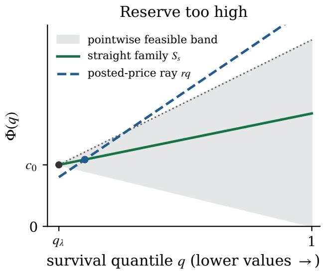

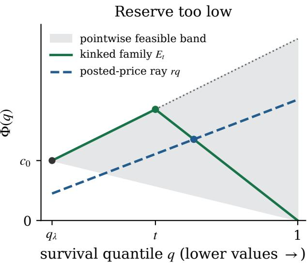  
Figure C.1 The regular families share boundary point $\left( q _ { \lambda } , c _ { 0 } \right)$ , with $c _ { 0 } = \lambda q _ { \lambda }$ , and slope cap $\phi _ { 0 } = \lambda - 1 / h _ { 0 }$ Gray shading gives the pointwise feasible range; curves must also be concave. $S _ { s }$ gives the worst loss against lower alternative reserves, and $E _ { t }$ against higher ones. The price ray $\Phi = r q$ intersects each displayed curve at the seller’s quantile; a reserve below a curve’s lower support endpoint has quantile 1. Moving right, toward larger survival quantiles, means moving to lower bidder values.

Lower competing prices $( t > \rho ) .$ . For $\rho > q ,$ set $s = ( r \rho - c ) / ( \rho - q )$ . Concavity puts the curve below the line $S _ { s } \mathrm { o n } \left[ \rho , t \right]$ . Raising it to this line increases both the competitor boundary term and the positively weighted integral in (C.4). The gap is therefore at most $s [ ( 1 - \rho ) ^ { n } - ( 1 - t ) ^ { n } ]$ . Nonpositive � gives no positive gap; otherwise $s \leq \phi$ and the bound is at most $s ( 1 - \rho ) ^ { n }$ , attained by $S _ { s }$ with competitor quantile 1. $\mathbf { A } \mathbf { t } \rho = q$ the same argument uses the cap line $s = \phi .$ . Solving $S _ { s } ( \rho ) = r \rho$ gives

$$
1 - \rho = { \frac { r - c - p s } { r - s } } \qquad ( r > b _ { s } ) ,
$$

and hence exactly $u _ { s } ( r )$

Higher competing prices $( t < \rho )$ . Let $y = \Phi ( t )$ . Concavity puts Φ above the chord between the two anchors; the integral now has a negative sign. Consequently the gap is at most

$$
\frac { y - r \rho } { \rho - t } [ ( 1 - t ) ^ { n } - ( 1 - \rho ) ^ { n } ] , \qquad y \leq \operatorname* { m i n } \left\{ \ell ( t ) , \frac { r \rho ( 1 - t ) } { 1 - \rho } \right\} ,\tag{C.15}
$$

where the second upper bound follows from $\Phi ( 1 ) \ge 0$ and is omitted at $\rho = 1$ . The gap increases with �.

If the terminal bound is active, put $\gamma = r \rho / ( 1 - \rho )$ . The lines $\ell ( u )$ and $\gamma ( 1 - u )$ meet at some $\tau \in [ q , t ]$ the latter is above � at $q$ by concavity and below $\ell ( t )$ at �. Thus $E _ { \tau }$ has seller quantile $\rho .$ Moving the competitor from � to its optimum � only increases the gap, giving $d _ { \tau } ( r )$

If the cap bound is active, put $v = \rho - t , w = 1 - t ,$ , and $C = \ell ( t ) - r t$ . Then $y - r \rho = C - r v$ , and the

bound becomes

$$
\left( \frac { C } { v } - r \right) [ w ^ { n } - ( w - v ) ^ { n } ] = C \frac { w ^ { n } - ( w - v ) ^ { n } } { v } - r [ w ^ { n } - ( w - v ) ^ { n } ] .
$$

A positive gap implies $C > 0$ . The first term is $C$ times the average of the decreasing function $z \mapsto$ $n ( w - z ) ^ { n - 1 }$ over $[ 0 , \upsilon ]$ , so it is nonincreasing in �; the second is $- r$ times a nondecreasing function of $\upsilon .$ The bound therefore decreases with $^ { v , }$ that is, with $\rho .$ Since the cap bound is active, $( 1 - \rho ) \ell ( t ) \leq r \rho ( 1 - t )$ so $\rho \ge \rho _ { 0 } = \ell ( t ) / ( \ell ( t ) + r ( 1 - t ) )$ . The inequality $\rho _ { 0 } > t \mathrm { i s } \ell ( t ) ( 1 - t ) > r t ( 1 - t )$ , which is $C > 0 ;$ it also gives $r < \ell ( t ) / t = r _ { E _ { t } } ^ { * } . \mathrm { A t } \rho = \rho _ { 0 }$ the line through the anchors $( t , \ell ( t ) )$ and $( \rho _ { 0 } , r \rho _ { 0 } )$ passes through $( 1 , 0 )$ , because $\rho _ { 0 } ( \ell ( t ) + r ( 1 - t ) ) = \ell ( t )$ . The bounding curve is therefore $E _ { t } ,$ , with slope $- \sigma _ { t }$ on [�, 1] and seller quantile $\rho _ { 0 } = \sigma _ { t } / ( \sigma _ { t } + r )$ , and the bound equals $\sigma _ { t } [ ( 1 - t ) ^ { n } - ( r / ( \sigma _ { t } + r ) ) ^ { n } ] = d _ { t } ( r )$ . For $r = 0$ $\rho _ { 0 } = 1$ and the same formula applies. Thus every positive higher-competitor gap is bounded by $\operatorname* { m a x } _ { t } d _ { t } ( r )$

Conversely both families are feasible, and their optimal reserves give $u _ { s } ( r )$ and $d _ { t } ( r )$ . This proves the exact reduction. Both maxima are attained: $u _ { s } ( r )$ is continuous on $[ 0 , \phi ]$ , and $0 \leq d _ { t } ( r ) \leq \ell ( t ) ( 1 - t ) ^ { n - 1 } \to 0$ as $t \uparrow 1$

For the closed expression for $\mathsf { L } _ { \mathrm { r e g } }$ , assume $\textit { c } < \textit { r } < \textit { \lambda }$ and write $\varrho \ = \ r - c .$ The derivative of $s [ ( \varrho - p s ) / ( r - s ) ] ^ { n }$ has the sign of

$$
\begin{array} { r } { p s ^ { 2 } - \xi _ { r } s + r \varrho , \qquad \xi _ { r } = \varrho + p r + n q ( \lambda - r ) . } \end{array}
$$

On $[ 0 , \varrho / p ]$ this polynomial decreases strictly from a positive to a negative value: its derivative is at most $2 \varrho - \xi _ { r } = - ( n + 1 ) q ( \lambda - r ) < 0$ . Its smaller root, clipped at $\phi ,$ gives (C.16). The endpoints give $\mathsf { L } _ { \mathrm { r e g } } = 0$ for $r \leq c$ and $\mathsf { L } _ { \mathrm { r e g } } ( \lambda ) = \phi p ^ { n }$

Each $d _ { t } ( r )$ decreases strictly while positive, and $E _ { q }$ has optimum $\lambda ,$ so their maximum is strictly decreasing for $r < \lambda$ . Each positive $u _ { s } ( r )$ increases strictly, so its maximum strictly increases above $c .$ Joint continuity and the compact parameter intervals give continuity. Since

$$
\mathsf { L } _ { \mathrm { r e g } } ( c ) = 0 < \mathsf { U } _ { \mathrm { r e g } } ( c ) , \qquad \mathsf { U } _ { \mathrm { r e g } } ( \lambda ) = 0 < \mathsf { L } _ { \mathrm { r e g } } ( \lambda ) ,
$$

the two losses cross once in $( c , \lambda )$ . Their maximum decreases before that crossing and increases after it, proving uniqueness. □

## C.5.1 Computing the regular minimax reserve

The exact reduction separates computation into a closed expression for $\mathsf { L } _ { \mathrm { r e g } }$ , the loss against lower alternative reserves, and a one-dimensional maximization for $\mathsf { U } _ { \mathrm { r e g } }$ , the loss against higher ones. Throughout, $A > 0$ $h _ { 0 } > 1 / \lambda$ , and $n \geq 2 ; q _ { \lambda } = e ^ { - A } , c _ { 0 } = \lambda q _ { \lambda } , \alpha = 1 - q _ { \lambda } , \mathrm { a n d } \phi _ { 0 } = \lambda - 1 / h _ { 0 }$

The straight-family loss is explicit. For $c _ { 0 } < r < \lambda$ , let

$$
\varrho = r - c _ { 0 } , \qquad \xi _ { r } = \varrho + \alpha r + n q _ { \lambda } ( \lambda - r ) , \qquad s _ { r } = \operatorname * { m i n } \left\{ \phi _ { 0 } , \frac { 2 r \varrho } { \xi _ { r } + \sqrt { \xi _ { r } ^ { 2 } - 4 \alpha r \varrho } } \right\} .\tag{C.16}
$$

Then $\mathsf { L } _ { \mathrm { r e g } } ( r ) = u _ { s _ { r } } ( r ) ; \mathsf { L } _ { \mathrm { r e g } } ( r ) = 0 \mathrm { f o r } r \leq c _ { 0 } , \mathrm { a n d } \mathsf { L } _ { \mathrm { r e g } } ( \lambda ) = \phi _ { 0 } \alpha ^ { n }$

Corollary C.8 (Certified scalar search). Let $\lambda > 0 , A > 0 , h _ { 0 } > 1 / \lambda ,$ , and $n \geq 2 .$ . Let $\mathcal { Q } \subset [ q _ { \lambda } , 1 ]$ be a finite grid containing both endpoints, with maximum successive gap $\varepsilon > 0 ,$ and put $\mathsf { U } _ { \mathcal { Q } } ( r ) = \operatorname* { m a x } _ { t \in \mathcal { Q } } d _ { t } ( r )$ . For every $r \in [ 0 , \lambda ]$

$$
0 \leq \mathsf { U } _ { \mathrm { r e g } } ( r ) - \mathsf { U } _ { \mathcal { Q } } ( r ) \leq n \lambda \varepsilon .
$$

Let $r _ { \mathcal { Q } }$ be the unique solution of $\dot { \mathsf { L } } _ { \mathrm { r e g } } ( r ) = \mathsf { U } _ { \mathcal { Q } } ( r )$ and $\Delta _ { \mathcal { Q } } = \mathsf { L } _ { \mathrm { r e g } } ( r _ { \mathcal { Q } } )$ . Then

$$
0 \leq \Delta _ { \mathrm { r e g } } - \Delta _ { \mathcal { Q } } \leq n \lambda \varepsilon , \qquad \mathsf { W } _ { \mathrm { r e g } } ( r _ { \mathcal { Q } } ) \leq \Delta _ { \mathrm { r e g } } + n \lambda \varepsilon .
$$

For every $\eta > 0$ and $r \in [ 0 , \lambda ]$ with $| r - r _ { \mathcal { Q } } | \leq \eta ,$ the last bound increases by at most $\phantom { } _ { \ l { 2 } } \lambda h _ { 0 } e ^ { A } \eta$

The derivative bound $| \partial d _ { t } ( r ) / \partial t | \leq n \lambda$ controls how much a quantile grid can underestimate the highercompetitor loss. Algorithm C.1 combines this grid with bisection of the equalizer and requires no integration. Table 7.1 and Appendix D.6 report the computed values.

Proof of Corollary C.8. Write $q = q _ { \lambda } , c = c _ { 0 }$ , and $\phi = \phi _ { 0 }$ . We bound the sensitivity to the kink location. On the active interval $r \leq r _ { E _ { t } } ^ { * }$ , put

$$
w = 1 - t , \qquad \Gamma = c + \phi ( 1 - q ) \leq \lambda , \qquad \sigma = \sigma _ { t } = \Gamma / w - \phi , \qquad z = r / ( \sigma + r ) \leq w .
$$

Since $\sigma ^ { \prime } = \Gamma / w ^ { 2 }$ , differentiation gives

$$
\frac { \partial d _ { t } ( r ) } { \partial t } = \frac { \Gamma } { w ^ { 2 } } \left[ w ^ { n } - z ^ { n } + \frac { n \sigma z ^ { n } } { \sigma + r } \right] - n \sigma w ^ { n - 1 } .
$$

The bracket is between 0 and $n w ^ { n }$ , because the coefficient of $z ^ { n }$ is between −1 and $n - 1$ and $z \leq w$ . Thus the first term lies in $[ 0 , n \Gamma w ^ { n - 2 } ]$ and the second in $[ 0 , n \ell ( t ) w ^ { n - 2 } ]$ . Both are in $[ 0 , n \lambda ]$ , so the derivative has absolute value at most $n \lambda .$ . The function meets zero continuously at the boundary of its active interval and extends continuously at $t = 1$ . It is consequently ��-Lipschitz in � on the whole interval. Rounding an attaining kink to a grid point proves $0 \leq \mathsf { U } _ { \mathrm { r e g } } - \mathsf { U } _ { \mathcal { Q } } \leq n \lambda \varepsilon$ uniformly in �.

The finite maximum $\mathsf { U } _ { \mathcal { Q } }$ is continuous. Because $q \in \mathcal { Q } .$ , it is positive and strictly decreasing for $r < \lambda ,$ , by the same maximizing-curve argument as in the theorem. It therefore has a unique crossing $r _ { \mathcal { Q } } \in ( c , \lambda )$ with $\mathsf { L } _ { \mathrm { r e g } } .$ , and the minimum of max $\{ \mathsf { L } _ { \mathrm { r e g } } , \mathsf { U } _ { \mathcal { Q } } \} \mathrm { i s } \Delta _ { \mathcal { Q } }$ . The pointwise grid bound implies $\Delta _ { \mathcal { Q } } \leq \Delta _ { \mathrm { r e g } } \leq \Delta _ { \mathcal { Q } } + n \lambda \varepsilon$ Also $\mathsf { U } _ { \mathcal { Q } } \leq \mathsf { U } _ { \mathrm { r e g } }$ gives $r _ { \mathcal { Q } } \leq r _ { \mathrm { r e g } } ^ { \dagger }$ . Hence

$$
\mathsf { W } _ { \mathrm { r e g } } ( r _ { \mathcal { Q } } ) = \mathsf { U } _ { \mathrm { r e g } } ( r _ { \mathcal { Q } } ) \le \mathsf { L } _ { \mathrm { r e g } } ( r _ { \mathcal { Q } } ) + n \lambda \varepsilon \le \Delta _ { \mathrm { r e g } } + n \lambda \varepsilon .
$$

Finally, for every $\Phi \in { \mathcal { C } } , U _ { \Phi }$ has derivative $n ( 1 - x ) ^ { n - 1 } \Phi ^ { \prime } ( x )$ at quantile �, of absolute value at most $n \lambda .$ Lemma C.7 bounds its inverse-price map by $h _ { 0 } e ^ { A }$ . Their composition, and therefore the supremum regret, is $n \lambda h _ { 0 } e ^ { A _ { - } } \mathrm { I }$ Lipschitz in the reserve. This gives the bisection error. □

Cost of the scalar algorithm Algorithm C.1 implements the theoretical reduction of Theorem C.3.

Algorithm C.1 Certified scalar search for the regular minimax reserve   
Require: $n \ge 2 , \lambda > 0 , A > 0 , h _ { 0 } > 1 / \lambda ;$ quantile mesh $\varepsilon > 0 ;$ reserve tolerance $\eta > 0$   
1: $q _ { \lambda }  e ^ { - A } , c _ { 0 }  \lambda q _ { \lambda } , \phi _ { 0 }  \lambda - 1 / h _ { 0 }$   
2: form a grid $\mathcal { Q } \subset [ q _ { \lambda } , 1 ]$ containing both endpoints, with maximum gap at most �   
3: evaluate $\mathsf { L } _ { \mathrm { r e g } }$ by (C.16) and its endpoint conventions; set $\mathsf { U } _ { \mathcal { Q } } ( r ) = \operatorname* { m a x } _ { t \in \mathcal { Q } } d _ { t } ( r )$ using (C.10)   
4: $a  c _ { 0 } ; b  \lambda$   
5: while $b - a > \eta$ do   
6: $r \gets ( a + b ) / 2$   
7: $\mathbf { i f } \ L _ { \mathrm { r e g } } ( r ) < \mathsf { U } _ { \mathcal { Q } } ( r )$ then   
8: $a \gets r$   
9: else   
10: $b \gets r$   
11: end if   
12: end while   
13: return reserve $( a + b ) / 2$ and the interval $[ \mathsf { L } _ { \mathrm { r e g } } ( a ) , \mathsf { L } _ { \mathrm { r e g } } ( b ) + n \lambda \varepsilon ]$ containing the minimax regret

Each bisection step costs $O ( | \mathcal { Q } | )$ scalar evaluations. A uniform grid therefore costs $O ( \varepsilon ^ { - 1 } \log ( 1 + \lambda / \eta ) )$ evaluations for fixed $( n , \lambda )$ , without quadrature. The returned interval contains the true minimax regret by Corollary C.8 and monotonicity of $\mathsf { L } _ { \mathrm { r e g } }$

## C.6 Stability and learning for regular distributions

The rule estimates the same two boundary quantities as under MHR. Here we supply a rectangle containing the true pair; for regular distributions, the MHR constraint $A \leq \lambda h _ { 0 }$ need not hold.

Definition C.9 (Regular plug-in rule). Fix $\begin{array} { r } { \mathcal { K } _ { \mathrm { r e g } } = [ A _ { - } , A _ { + } ] \times [ h _ { - } , h _ { + } ] } \end{array}$ with $0 < A _ { - } \le A _ { + } < \infty$ and $1 / \lambda < h _ { - } \leq h _ { + } < \infty$ . Compute the raw boundary estimates of Section 5.2.1 and clip them coordinatewise into $\kappa _ { \mathrm { r e g } }$ . At the clipped pair, run Algorithm C.1 with quantile mesh $\varepsilon _ { N } ^ { \mathrm { q } } \asymp N ^ { - 1 / 2 }$ and bisection tolerance $\eta _ { N } \asymp N ^ { - 1 / 2 }$ , and post its reserve $\hat { r } _ { N } ^ { \dagger , \mathrm { r e g } }$ . If fewer than the fixed threshold $m _ { \mathrm { m i n } }$ bids are uncensored, post � instead.

Proposition C.10 (Stability and regret of the regular rule). Fix $\kappa = \kappa _ { \mathrm { r e g } }$ as in Definition C.9.

(i) For all $( A , h _ { 0 } ) , ( A ^ { \prime } , h _ { 0 } ^ { \prime } ) \in \mathcal { K } ,$

$$
\begin{array} { c } { { \displaystyle \operatorname* { s u p } _ { r \in [ 0 , \lambda ] } \left| \mathsf { W } _ { \mathrm { r e g } } ( r ; A ^ { \prime } , h _ { 0 } ^ { \prime } ) - \mathsf { W } _ { \mathrm { r e g } } ( r ; A , h _ { 0 } ) \right| \le C _ { \mathrm { r e g } } \big ( | A ^ { \prime } - A | + \lambda \big | h _ { 0 } ^ { \prime } - h _ { 0 } \big | \big ) , } } \\ { { \displaystyle \qquad \ } } \\ { { C _ { \mathrm { r e g } } : = n \lambda \big ( 4 n + 4 + 3 \lambda h _ { + } e ^ { 2 A _ { + } } \big ) . } } \end{array}\tag{C.17}
$$

For each $( A , h _ { 0 } ) \in { \mathcal { K } } ,$ , thefunction $r \mapsto \mathsf { W } _ { \mathrm { r e g } } ( r ; A , h _ { 0 } )$ is Lipschitz on [0, �] with constant $\mathrm { L i p } _ { r } ^ { \mathrm { r e g } } \leq$ $n \lambda h _ { + } e ^ { A _ { + } }$

(ii) Suppose $G \in { \mathcal { G } }$ is regular, $( A , h _ { 0 } )$ is in the interior of �, and Assumption 5.2 holds. Then the rule of Definition C.9 satisfies

$$
\mathbb { E } \Bigg [ \operatorname* { s u p } _ { F \in \mathcal { F } _ { \mathrm { r e g } } ( \lambda ; G ) } \{ R _ { F } ^ { * } - R _ { F } ( \hat { r } _ { N } ^ { \dagger , \mathrm { r e g } } ) \} \Bigg ] \leq \Delta ( \mathcal { F } _ { \mathrm { r e g } } ( \lambda ; G ) ) + O ( N ^ { - 2 / 5 } ) .
$$

The expectation is over the boundary sample. The proof transports concave revenue curves between the two quantile intervals, then controls the quantile at which a fixed posted price meets each curve.

Proof. For a feasible curve define the revenue primitive

$$
V _ { \Phi } ( q ) = n ( 1 - q ) ^ { n - 1 } \Phi ( q ) - n ( n - 1 ) \int _ { q } ^ { 1 } \Phi ( u ) ( 1 - u ) ^ { n - 2 } d u .
$$

It differs from $U _ { \Phi }$ by a constant, so its completion regret is $J _ { \Phi } ( r ) = \operatorname* { m a x } V _ { \Phi } - V _ { \Phi } ( \rho _ { \Phi } ( r ) )$ . The cap gives $0 \leq \Phi \leq \lambda$ . Concavity gives $- \Phi ( q ) / ( 1 - q ) \le \Phi ^ { \prime } ( q ) \le \phi _ { 0 }$ , and hence $| V _ { \Phi } ^ { \prime } | = | n ( 1 - q ) ^ { n - 1 } \Phi ^ { \prime } ( q ) | \leq n \lambda$ Together with Lemma C.7, this proves the stated reserve Lipschitz bound.

From here on, write $\theta = ( A , h _ { 0 } ) , \theta ^ { \prime } = ( A ^ { \prime } , h _ { 0 } ^ { \prime } ) , q = e ^ { - A } , p = 1 - q ,$ and use primes for the second pair. Put $a = | A ^ { \prime } - A | , b = \lambda | h _ { 0 } ^ { \prime } - h _ { 0 } |$ , and $\varsigma = a + b .$ Map the new interval onto the old one by $\chi ( u ) = 1 - ( p / p ^ { \prime } ) ( 1 - u )$ , an affine bijection of $[ q ^ { \prime } , 1 ]$ onto $[ q , 1 ]$ , and transport any $\Phi \in { \mathcal { C } } ( \theta )$ to

$$
\widehat { \Phi } ( u ) = \operatorname * { m i n } \{ \ell ^ { \prime } ( u ) , ( c _ { 0 } ^ { \prime } / c _ { 0 } ) \Phi ( \chi ( u ) ) \} .
$$

This is concave as a minimum of concave functions and nonnegative, since $\ell ^ { \prime } \geq c _ { 0 } ^ { \prime } > 0$ on $[ q ^ { \prime } , 1 ]$ . Both branches equal $c _ { 0 } ^ { \prime }$ at $q ^ { \prime } .$ , because $\chi ( q ^ { \prime } ) = q .$ , and the first caps the right slope at $q ^ { \prime }$ by $\phi _ { 0 } ^ { \prime }$ . Thus ${ \widehat { \Phi } } \in { \mathcal { C } } ( \theta ^ { \prime } )$

Step 1: three elementary bounds. On $[ q ^ { \prime } , 1 ]$ we have $1 - \chi ( u ) = ( p / p ^ { \prime } ) ( 1 - u )$ and $1 - u \le p ^ { \prime }$ . Hence

$$
| \chi ( u ) - u | = \frac { ( 1 - u ) | p ^ { \prime } - p | } { p ^ { \prime } } \leq | p ^ { \prime } - p | \leq a ,
$$

$$
\left| \frac { c _ { 0 } ^ { \prime } } { c _ { 0 } } - 1 \right| = | e ^ { A - A ^ { \prime } } - 1 | \le e ^ { a } a , \qquad \left| \phi _ { 0 } ^ { \prime } - \phi _ { 0 } \right| = \frac { | h _ { 0 } ^ { \prime } - h _ { 0 } | } { h _ { 0 } h _ { 0 } ^ { \prime } } \le \lambda b ,
$$

using $| e ^ { - A } - e ^ { - A ^ { \prime } } | \leq | A - A ^ { \prime } |$ and $h _ { 0 } , h _ { 0 } ^ { \prime } > 1 / \lambda$

Step 2: distance between the curves. Put $\Psi = ( c _ { 0 } ^ { \prime } / c _ { 0 } ) \Phi \circ \chi .$ , so that $\widehat { \Phi } = \Psi - ( \Psi - \ell ^ { \prime } ) _ { + }$ and

$$
\widehat { \Phi } - \Phi \circ \chi = \Big ( \frac { c _ { 0 } ^ { \prime } } { c _ { 0 } } - 1 \Big ) \Phi \circ \chi - ( \Psi - \ell ^ { \prime } ) _ { + } .
$$

The cap gives $0 \leq \Phi \leq \ell \leq \lambda$ , so the first term is at most $\lambda e ^ { a } a$ in absolute value. For the second, $\Phi \le \ell$ and $\chi ( u ) - q = ( p / p ^ { \prime } ) ( u - q ^ { \prime } )$ give

$$
\Psi ( u ) - \ell ^ { \prime } ( u ) \le \frac { c _ { 0 } ^ { \prime } } { c _ { 0 } } \ell ( \chi ( u ) ) - \ell ^ { \prime } ( u ) = \frac { u - q ^ { \prime } } { p ^ { \prime } } \Big [ \phi _ { 0 } \Big ( \frac { c _ { 0 } ^ { \prime } } { c _ { 0 } } p - p ^ { \prime } \Big ) + p ^ { \prime } \big ( \phi _ { 0 } - \phi _ { 0 } ^ { \prime } \big ) \Big ] ,
$$

and $( c _ { 0 } ^ { \prime } / c _ { 0 } ) p - p ^ { \prime } = c _ { 0 } ^ { \prime } / c _ { 0 } - 1$ . With $0 \leq u - q ^ { \prime } \leq p ^ { \prime } \leq 1$ and $\phi _ { 0 } \leq \lambda .$ , the excess $( \Psi - { \ell ^ { \prime } } ) _ { + }$ is at most $\lambda e ^ { a } a + \lambda b$ . Together,

$$
z : = \| \widehat \Phi - \Phi \circ \chi \| _ { \infty } \leq \lambda ( 2 e ^ { a } a + b ) .
$$

Step 3: distance between the revenue primitives. The substitution $v = \chi ( w )$ , with $d v = ( p / p ^ { \prime } )$ �� and $1 - v = ( p / p ^ { \prime } ) ( 1 - w )$ , gives $V _ { \Phi } \circ \chi = ( p / p ^ { \prime } ) ^ { n - 1 } V _ { \Phi \circ \chi }$ , where $V _ { \Phi \circ \chi }$ is the primitive of Φ ∘ � on $[ q ^ { \prime } , 1 ]$ For any curve $\Psi$ on $\begin{array} { r } { [ q ^ { \prime } , 1 ] , n ( n - 1 ) \int _ { u } ^ { 1 } ( 1 - v ) ^ { n - 2 } d v = n ( 1 - u ) ^ { n - 1 } \operatorname { g i v e s } | V _ { \Psi } ( u ) | \leq 2 n ( 1 - u ) ^ { n - 1 } \| \Psi \| _ { \infty } , } \end{array}$

Since � is linear in the curve,

$$
V _ { \widehat { \Phi } } - V _ { \Phi } \circ \chi = V _ { \widehat { \Phi } - \Phi \circ \chi } + \big [ 1 - ( p / p ^ { \prime } ) ^ { n - 1 } \big ] V _ { \Phi \circ \chi } .
$$

The first term is at most 2��. The second is at most

$$
2 n \lambda ( 1 - u ) ^ { n - 1 } \big | 1 - ( p / p ^ { \prime } ) ^ { n - 1 } \big | = 2 n \lambda \Big ( \frac { 1 - u } { p ^ { \prime } } \Big ) ^ { n - 1 } | p ^ { \prime } ^ { n - 1 } - p ^ { n - 1 } | \leq 2 n ( n - 1 ) \lambda a ,
$$

using $1 - u \le p ^ { \prime }$ and $| p ^ { \prime ^ { n - 1 } } - p ^ { n - 1 } | \leq ( n - 1 ) | p ^ { \prime } - p | \leq ( n - 1 ) a$ . Hence

$$
z _ { V } : = \| V _ { \widehat { \Phi } } - V _ { \Phi } \circ \chi \| _ { \infty } \leq 2 n [ z + ( n - 1 ) \lambda a ] .
$$

Because $\chi$ maps $[ q ^ { \prime } , 1 ]$ onto $[ q , 1 ]$ , max $V _ { \Phi } \circ \chi = \operatorname* { m a x } V _ { \Phi }$ , so the two maxima also differ by at most $z _ { V }$

Step 4: the seller’s quantile. Let $\rho = \rho _ { \Phi } ( r ) , \widehat { \rho } = \rho _ { \widehat { \Phi } } ( r )$ , and $\check { \rho } = \chi ( \widehat { \rho } ) \in [ q , 1 ] . \mathrm { I f } \widehat { \rho } < 1$ , then $\widehat { \Phi } ( \widehat { \rho } ) = r \widehat { \rho } ,$ and with $| \Phi ( \check { \rho } ) - \widehat { \Phi } ( \widehat { \rho } ) | \leq z , | \widehat { \rho } - \check { \rho } | \leq a , r \leq \lambda$ and $\check { \rho } \ge q = e ^ { - A }$

$$
| v _ { \Phi } ( \tilde { \rho } ) - r | \leq \frac { | \Phi ( \tilde { \rho } ) - \widehat { \Phi } ( \widehat { \rho } ) | } { \tilde { \rho } } + r \widehat { \rho } \big | \frac { 1 } { \check { \rho } } - \frac { 1 } { \widehat { \rho } } \big | \leq \frac { z + r | \widehat { \rho } - \check { \rho } | } { \check { \rho } } \leq e ^ { A } ( z + \lambda a ) .
$$

Since $\rho = \rho _ { \Phi } ( r )$ and $\check { \rho } = \rho _ { \Phi } ( v _ { \Phi } ( \check { \rho } ) )$ , the $h _ { 0 } e ^ { A } { \ – } 1$ Lipschitz inverse of Lemma C.7 gives $| \check { \rho } - \rho | \leq h _ { 0 } e ^ { 2 A } ( z +$ $\lambda a )$ . If $\widehat \rho = 1$ , then $\check { \rho } = 1$ and $r \le \widehat \Phi ( 1 ) \le \Phi ( 1 ) + z \colon$ either $r \leq \Phi ( 1 )$ and $\rho = 1$ , or the clipped inverse gives $| 1 - \rho | \leq h _ { 0 } e ^ { A } ( r - \Phi ( 1 ) ) \leq h _ { 0 } e ^ { A } z$ . In both cases $| \check { \rho } - \rho | \leq h _ { 0 } e ^ { 2 A } ( z + \lambda a )$

Step 5: the completion regret. Using Step 3 twice and $| V _ { \Phi } ^ { \prime } | \leq n \lambda .$

$$
\begin{array} { r } { J _ { \widehat { \Phi } } ( r ) = \operatorname* { m a x } V _ { \widehat { \Phi } } - V _ { \widehat { \Phi } } ( \widehat { \rho } ) \geq \left( \operatorname* { m a x } V _ { \Phi } - z _ { V } \right) - \left( V _ { \Phi } ( \check { \rho } ) + z _ { V } \right) \geq J _ { \Phi } ( r ) - 2 z _ { V } - n \lambda h _ { 0 } e ^ { 2 A } ( z + \lambda a ) . } \end{array}
$$

Taking the supremum over $\Phi \in { \mathcal { C } } ( \theta )$ bounds $\mathsf { W } _ { \mathrm { r e g } } ( r ; \theta ) - \mathsf { W } _ { \mathrm { r e g } } ( r ; \theta ^ { \prime } )$ by the error term, and the transport from $\theta ^ { \prime }$ to $\theta$ gives the reverse inequality with the primed parameters, which lie in the same rectangle.

Step 6: the constant. Inserting Steps 2 and 3, the error term is at most $4 n [ z + ( n - 1 ) \lambda a ] + n \lambda h _ { 0 } e ^ { 2 A } ( z + \lambda a )$ Uniformly on the rectangle, $e ^ { a } = 1 + O ( a ) , \mathrm { s o } z = \lambda ( 2 a + b ) + O ( \varsigma ^ { 2 } )$ and the error is at most

$$
n \lambda \big [ ( 4 n + 4 ) a + 4 b + \lambda h _ { + } e ^ { 2 A _ { + } } ( 3 a + b ) \big ] + O ( \varsigma ^ { 2 } ) \le n \lambda ( 4 n + 4 + 3 \lambda h _ { + } e ^ { 2 A _ { + } } ) \varsigma + O ( \varsigma ^ { 2 } ) .
$$

The rectangle is convex, so the segment from $\theta$ to $\theta ^ { \prime }$ stays in it; divide the segment into � equal parts. The linear errors add to $C _ { \mathrm { r e g } } \varsigma$ , whereas the quadratic errors, whose constant is uniform on the rectangle, add to $O ( \varsigma ^ { 2 } / k )$ . Letting $k \to \infty$ proves (C.17).

For the learning claim, on the event that $m \ge m _ { \mathrm { m i n } }$ and the raw estimate lies in the rectangle, put $e _ { N } = | \widehat { A } _ { N } - A | + \lambda | \widehat { h } _ { 0 } - h _ { 0 } |$ . Stability, optimality at the estimated pair, and the scalar certificate give

$$
\begin{array} { r } { \mathsf { W } _ { \mathrm { r e g } } ( \hat { r } _ { N } ^ { \dagger , \mathrm { r e g } } ; \theta ) \leq \Delta _ { \mathrm { r e g } } ( \theta ) + 2 C _ { \mathrm { r e g } } e _ { N } + n \lambda \varepsilon _ { N } ^ { \mathsf { q } } + n \lambda h _ { + } e ^ { A _ { + } } \eta _ { N } . } \end{array}
$$

Lemma B.3 bounds the expected estimation term by $O ( N ^ { - 2 / 5 } )$ . Because the true pair is interior to the

rectangle, its concentration bounds make the complementary event $O ( N ^ { - 2 } )$ ; the low-bid-count event is exponentially small. Regret is bounded for reserves in $[ 0 , \lambda ]$ , including the fallback. These events therefore add $O ( N ^ { - 2 } )$ , and the numerical tolerances add $O ( N ^ { - 1 / 2 } )$ . □

## C.7 An arbitrary observed tail

An arbitrary observed tail contributes an additional observable quantity: its best revenue gain over the boundary reserve. We first separate this gain from body comparisons for any compatible class, then specialize to shape-restricted bodies with separately imposed boundary slope caps.

For a nonempty class $\boldsymbol { \mathcal { A } } \subseteq \mathcal { F } ( \lambda ; G )$ , write

$$
B _ { \lambda } = \operatorname* { m a x } _ { s \geq \lambda } R _ { G } ( s ) - R _ { G } ( \lambda ) , \qquad r _ { \mathrm { T } } \in \arg \operatorname* { m a x } _ { s \geq \lambda } R _ { G } ( s ) .
$$

The maximum exists by continuity and finite mean. For body reserves put

$$
\begin{array} { l l } { { W _ { \mathrm { b o d y } } ( r ) = \displaystyle \operatorname* { s u p } _ { F \in \mathcal { A } } \operatorname* { m a x } _ { s \in [ 0 , \lambda ] } \{ R _ { F } ( s ) - R _ { F } ( r ) \} , } } \\ { { \begin{array} { r l } { V _ { \mathrm { b o d y } } ( r ) = \displaystyle \operatorname* { s u p } _ { F \in \mathcal { A } } \{ R _ { F } ( \lambda ) - R _ { F } ( r ) \} , \ } & { J _ { \mathrm { b o d y } } = W _ { \mathrm { b o d y } } ( \lambda ) . } \end{array} } } \end{array}
$$

Here $J _ { \mathrm { b o d y } }$ is the largest gain that can hide below the boundary. All three body quantities are independent of the common tail revenue.

Proposition C.11 (Body and tail gains). Let $ { \mathcal { A } } \subseteq \mathcal { F } ( \lambda ; G )$ be nonempty, with $B _ { \lambda } , r _ { \mathrm { T } } , W _ { \mathrm { b o d y } } , V _ { \mathrm { b o d y } } , J _ { \mathrm { b o d y } }$ defined above. Then, for every $r \in [ 0 , \lambda ]$

$$
\operatorname* { s u p } _ { F \in A } \{ R _ { F } ^ { * } - R _ { F } ( r ) \} = \operatorname* { m a x } \{ W _ { \mathrm { b o d y } } ( r ) , B _ { \lambda } + V _ { \mathrm { b o d y } } ( r ) \} .\tag{C.18}
$$

The best tail reserve has worst-case regret

$$
\operatorname* { s u p } _ { F \in \mathcal { A } } \{ R _ { F } ^ { * } - R _ { F } ( r _ { \mathrm { T } } ) \} = ( J _ { \mathrm { b o d y } } - B _ { \lambda } ) _ { + } .\tag{C.19}
$$

Consequently

$$
\Delta ( A ) = \operatorname* { m i n } \left\{ \operatorname* { i n f } _ { r \in [ 0 , \lambda ] } \operatorname* { m a x } \{ W _ { \mathrm { b o d y } } ( r ) , B _ { \lambda } + V _ { \mathrm { b o d y } } ( r ) \} , ( J _ { \mathrm { b o d y } } - B _ { \lambda } ) _ { + } \right\} .\tag{C.20}
$$

Proof. Put $d _ { F } ( r ) = R _ { F } ( r ) - R _ { G } ( \lambda )$ and $m _ { F } = \mathrm { m a x } _ { s \in [ 0 , \lambda ] } d _ { F } ( s )$ . Since tail revenue is common, $R _ { F } ^ { * } =$ $R _ { G } ( \lambda ) + \operatorname* { m a x } \{ m _ { F } , B _ { \lambda } \}$ . Subtracting $R _ { F } ( r )$ and taking the supremum proves (C.18). At $r _ { \mathrm { T } }$ the loss is $( m _ { F } - B _ { \lambda } ) _ { + }$ , proving (C.19). This reserve dominates every other choice above $\lambda ,$ which proves the minimax formula. □

For this specialization, let � be the full class of completions obtained by pasting to $G$ a body satisfying the following constraints. For MHR bodies, use convex nondecreasing cumulative hazards with $H ( 0 ) = 0$

$H ( \lambda ) = A$ , and terminal slope at most $h _ { 0 } ;$ for regular bodies, use the concave revenue curves in $( \mathbf { C } . 5 )$ including the cap $\Phi ^ { \prime } ( q _ { \lambda } ^ { + } ) \leq \phi _ { 0 }$ . Here the boundary caps are additional assumptions: body shape alone does not constrain the join to an arbitrary tail. The pasted tail need not share the body’s shape. The existing body computations give $W _ { \mathrm { b o d y } }$ and $J _ { \mathrm { b o d y } }$ . The remaining loss $V _ { \mathrm { b o d y } }$ is attained by the chord $H ( x ) = A x / \lambda$ under MHR, and by the chord from $( q _ { \lambda } , c _ { 0 } )$ to $( 1 , 0 )$ for regular bodies. Each chord gives the stochastically smallest compatible values, and fixed-reserve auction revenue is nondecreasing in each bidder’s value.

For regular bodies with $\phi _ { 0 } > 0 ;$ , writing $q = e ^ { - A }$ and $p = 1 - q$ , this gives

$$
V _ { \mathrm { b o d y } } ( r ) = \frac { \lambda q } { p } \left[ p ^ { n } - \left( \frac { r p } { \lambda q + r p } \right) ^ { n } \right] , \qquad J _ { \mathrm { b o d y } } = \phi _ { 0 } p ^ { n } .
$$

The nonidentifiable regime for the body problem is $0 < A < \lambda h _ { 0 }$ with $h _ { 0 } > 1 / \lambda$ for MHR bodies, and $A > 0$ with $\phi _ { 0 } > 0$ for regular bodies. For the corresponding full classes, inf $W _ { \mathrm { b o d y } } ( r ) > 0$ . The minimax formula therefore gives the exact frontier

$$
\Delta ( A ) = 0 \quad \Longleftrightarrow \quad B _ { \lambda } \geq J _ { \mathrm { b o d y } } ,
$$

which is $B _ { \lambda } \geq \phi _ { 0 } p ^ { n }$ for regular bodies. A sufficiently profitable tail makes learning the body unnecessary. The minimax value depends on $( A , h _ { 0 } , B _ { \lambda } )$ ; the maximizing tail reserve itself still comes from the full observed revenue curve.

## D Experimental Details and Additional Results

This appendix gives the rule definitions, experimental settings and numerical checks behind Section 7.

## D.1 Implementation and regret evaluation

The projected plug-in uses $M = 1 2 , m _ { \mathrm { m i n } } = 2 0$ and $c _ { \mathrm { g } } = 0 . 2 5$ , in units where $\lambda = 1$ . Its boundary-density window has width $b _ { N } = c _ { b } N ^ { - 1 / 5 }$ . In Section 7 and Appendices D.2 and D.3 we choose $c _ { b }$ by the data-driven rule of Corollary B.5; in the frontier and non-MHR studies below we fix $c _ { b } = \lambda / 2$ . The auto-selector uses $h _ { \operatorname* { m i n } } = 0 . 1 / \lambda$ to bound its tail search at 10�. Neither rule receives the true distribution parameters. Table D.1 defines the comparators.

To approximate worst-case regret under MHR, we search a 400 × 400 grid of two-level bodies and refine it near those giving the largest regret, with $H ( \lambda ) = A$ imposed exactly. For $r > \lambda ,$ , it uses $W _ { G } ( r ) =$ $W _ { G } ( \lambda ) + R _ { G } ( \lambda ) - R _ { G } ( r )$ . In identifiable instances the comparison also includes the observed tail’s optimal revenue. Each completed distribution’s revenue and optimal reserve are in closed form. Searching only finitely many bodies can underestimate $W _ { G }$ at a fixed reserve; searching only finitely many reserves can raise the computed minimax regret. Appendix D.7 distinguishes the proved error bound based on grid spacing from the observed change under refinement.

Empirical revenues are evaluated as finite sums, without interpolation. Revenues of the Rayleigh and Weibull distributions and of every two-level completion have closed forms. The gamma and lognormal fits use numerical integration. Standard errors measure uncertainty in the reported sample averages, with the distribution fixed. Comparisons are paired: each rule receives the same sample in a replication. Each study runs as numbered tasks, one per cell; task � uses NumPy defau $\mathtt { l t \_ r n g }$ with seed $2 0 2 6 0 9 2 9 + 1 0 0 0 k$ Different studies reuse these task seeds, so their tables are not independent. All computations use Python 3.13 with NumPy, SciPy and pandas.

Table D.1 Reserve rules compared in Section 7 and Appendix D.
<table><tr><td>Rule</td><td>How the reserve is chosen</td></tr><tr><td>Full-info</td><td>The full-information reserve of the held-out eBay study: the exact revenue maximizer on simulated auctions among the uncensored training bidders. It sees the values that censoring hides from every other rule and serves as the oracle row.</td></tr><tr><td>Plug-in Auto-selector</td><td>Algorithm 5.1, at the projected boundary estimates. Algorithm 5.2: empirical tail rule on [λ, 10λ] (on  $[ \lambda , r _ { \mathrm { m a x } } ]$  with  $r _ { \mathrm { m a x } }$  the larger of 4λ and twice the largest observed record in the opening-bid study of Section 7.4) when the raw</td></tr><tr><td>Plug-in (Weibull hazard)</td><td> $\widehat { h } _ { 0 } \leq 1 / \lambda ;$  plug-in otherwise. Algorithm 5.1 with the boundary hazard replaced by the censored Weibull fit&#x27;s hazard at  $\lambda ;$  the count estimate  $\widehat { A } _ { N }$  is kept.</td></tr><tr><td>Censored MLE</td><td>Maximum likelihood fit in a Weibull, gamma (shape at least one) or lognormal family. Observed bids contribute their fitted density; no-bid records contribute the fitted probability below λ. Post the fitted distribution&#x27;s optimal reserve. It is an oracle MLE when the full</td></tr><tr><td>Linear completion</td><td>distribution belongs to the fitted family.  $r _ { c } ( \widehat { A } _ { N } )$  The linear-completion reserve of (5.3): it uses only the censored fraction and is optimal when the body hazard is constant below λ.</td></tr><tr><td>Boundary</td><td>Post the historical reserve λ.</td></tr><tr><td>Drop</td><td>Maximize exact empirical revenue from observed bids only; choose the largest maximizer.</td></tr></table>

At $\lambda = 0 . 6$ in Figure 7.1b, mean worst-case regret is 1.5% of $R _ { G } ^ { * }$ for the plug-in and 0.07% for the auto-selector. The plug-in’s search below � misses the optimum in the observed tail.

## D.2 Four compatible distributions and the two-level family

Instance selection We selected the instance by a deterministic scan over Weibull shapes $k \in$ $\{ 1 . 5 , 2 , 2 . 5 , 3 , 4 \}$ , scale 1, and censored fraction $\alpha \in \{ 0 . 3 , 0 . 4 , \hdots , 0 . 9 \}$ , with $\lambda = ( - \log ( 1 - \alpha ) ) ^ { 1 / k }$ . The numerical gap $W _ { G } ( r _ { G } ^ { * } ) - \Delta$ ranges from 0.1 to 1.4 percentage points of $R _ { G } ^ { * }$ over the nonidentifiable cells. We chose $k = 2 . 5$ and $\alpha = 1 / 2$ , where the gap is 1.14 points.

The two-level family With $c = A / \lambda$ , the worst case of every reserve is attained at a two-level completion $H ( x ) = \operatorname* { m a x } \{ a x , A - b ( \lambda - x ) \} , a \in [ 0 , c ] , b \in [ c , h _ { 0 } ]$ (Theorem 4.2). We evaluate every posted reserve under a $2 1 \times 2 1$ grid of them, 441 bodies including the exponential body $( a = b = c )$ and the tangent $( a = 0 ,$ $b = h _ { 0 } )$ , and under the equalizer body, which has $a = 0$ and $b = 1 / r ^ { \dagger }$ . Each completion keeps �’s hazard above �; its revenue, optimal reserve and regret are in closed form (Appendix D.1), and under � itself the Weibull closed form applies. Figure D.1 plots the mean actual regret of the plug-in and of the Weibull and lognormal MLEs under every completion as a function of its rightmost optimal reserve, at $N = 3 0 0 0 .$ A zero-hazard initial segment contains no bidder values and gives flat revenue on $[ 0 , \tau ]$ ; when this interval contains optimal reserves, we plot its rightmost endpoint � .

For the four distributions of Table 7.2, � = log 2 and $h _ { 0 } = 2 . 5 \lambda ^ { 3 / 2 } \approx 2 . 0 1$ . The numerical minimax reserve is $r ^ { \dagger } \approx 0 . 7 6 7$ , whereas $G " s$ own optimal reserve is $r _ { G } ^ { * } = 2 . 5 ^ { - 2 / 5 } \approx 0 . 6 9 3$ . The exponential body has hazard $A / \lambda$ throughout $[ 0 , \lambda ]$ and optimal reserve � since $A < 1$ . The equalizer body has hazard 0 on $[ 0 , \tau )$ and $b = 1 / r ^ { \dagger }$ on $[ \tau , \lambda ]$ , with $\tau = \lambda - A / b \approx 0 . 3 3$ , making $r ^ { \dagger }$ optimal. The tangent body has hazard 0 below $\lambda - A / h _ { 0 } \approx 0 . 5 2$ and $h _ { 0 }$ up to �. All three retain $G \ ' \mathrm { s }$ hazard above �.

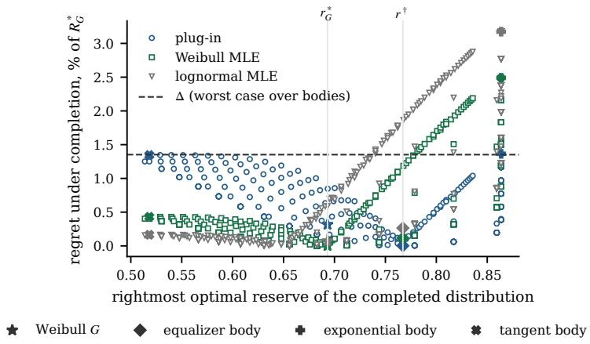  
Figure D.1 Mean actual regret under 441 two-level completions and the equalizer completion of Weibull(2.5, 1), censored at $\lambda = ( \log 2 ) ^ { 2 / 5 } ( n = 3 , N = 3 0 0 0$ , 200 paired replications). Each completion is compared with its own optimal reserve; percentages divide by $R _ { G } ^ { * }$ . Actual regret can fall below $\Delta .$

The plug-in’s mean actual regret is at most 1.36% on the tested body grid. Its larger worst-case regret, 1.46% in Table 7.2, averages each sample’s worst case over a finer grid; the maximizing body need not be the same across samples.

Smoothness of the hidden body The exponential body’s hazard jumps from $c \approx 0 . 8 0$ to $h _ { 0 } \approx 2 . 0 1$ at �, and the equalizer body has no values below $\tau \approx 0 . 3 3$ . Both are MHR. Our learning assumption requires smoothness only of the observed boundary density, not the hidden hazard. Imposing a smoothness bound on the hidden hazard would shrink the compatible class and could reduce minimax regret. Continuity alone still permits steep approximations to a jump with the same limiting regret.

Rate and bandwidth on this instance The plug-in’s mean excess worst-case regret $W _ { G } ( r ^ { \pi } ) - \Delta$ falls from 0.33 to 0.04 percentage points between $N = 2 5 0$ and 32,000; with fixed $c _ { b } = \lambda / 2$ , it falls from 0.66 to 0.07 points. At $N = 3 0 0 0$ , the data-driven rule selects $c _ { b } = 2 \lambda$ in 94% of samples and gives $W _ { G } = 1 . 4 6 \%$ compared with 1.59% for the fixed bandwidth. Under each of the four distributions of Table 7.2, their mean actual regrets differ by at most 0.14 points.

Figure D.2 shows that increasing � does not resolve the hidden-body ambiguity. The Weibull MLE’s mean actual regret falls below 0.001% under �, whereas the parametric fits level off at 2.49–3.17% under the exponential completion. The censored likelihoods and fitted reserves are the same across these distributions (Proposition 5.7). The equalizer body favors the plug-in by construction, just as � favors the oracle MLE.

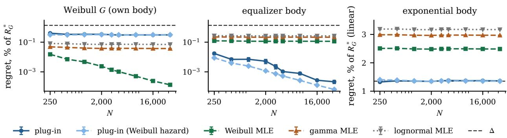  
Figure D.2 Mean actual regret under three compatible completions of Weibull(2.5, 1), censored at its median (� = 3, 200 paired replications per �). Percentages use $R _ { G } ^ { * }$ . Each rule posts the same reserves across panels. Plug-in (Weibull hazard) is the plug-in with a fitted Weibull boundary hazard. The right panel has a linear axis. Bars show one Monte-Carlo standard error. Actual regret can fall below $\Delta .$

## D.3 Experiments on eBay bids: data and further results

Data The data of Jank and Shmueli [JS10] record 10,681 bids in 628 eBay auctions of three items: 343 auctions of Palm Pilot M515 handhelds, 149 of Xbox game consoles and 136 of Cartier wristwatches. Each bid carries the bidder’s identity, the auction’s opening bid and its closing price. A bidder’s record in an auction is their highest proxy bid; there are 3,022, 1,229 and 922 such records. The opening bid is the lowest acceptable bid, so bidders with lower values never appear in the history: 211, 107 and 96 auctions have opening bids above one dollar and form the naturally censored samples of the opening-bid study in Section 7.4. The remaining 132, 42 and 40 auctions have opening bids of at most one dollar and reveal every participating bidder’s record; they contain 1,652, 460 and 392 records, 9.8 to 12.5 per auction. eBay records the winner at the closing price, the second-highest record plus one increment, which is a lower bound on the winner’s value. We replace each of these 132, 42 and 40 records by a draw from the Kaplan–Meier conditional distribution of the item’s records above its closing price: one draw with a fixed seed in the held-out study, and 50 draws in the opening-bid study. Between 75% and 85% of the records are whole dollars.

The refit For each item we fit a Gaussian kernel density with Silverman’s bandwidth, 15.7, 15.2 and 182 dollars. On 4000 equally spaced points of [0, $1 . 6 \operatorname* { m a x } _ { i } b _ { i } ]$ we project the kernel hazard onto nondecreasing sequences by pool-adjacent-violators with weights equal to the survival probability. The projected hazard is constant between grid points and held at its last value beyond the grid, so its cumulative hazard is piecewise linear and its distribution function, revenue and inverse sampling rule are in closed form. This gives a continuous MHR distribution � with finite mean; it imposes MHR rather than testing it. The boundaries are the whole-dollar quantiles 0.5, 0.7 and 0.8 of �. Table D.2 lists the nine cells. On the Xbox refit the projected hazard is constant between 111 and 141 dollars, so the two nonidentifiable cells share $h _ { 0 } ;$ numerically they also have the same minimax regret and, up to numerical error, the same minimax reserve. On the Cartier refit the hazard is constant from below 555 dollars, so � is within 0.02 of $\lambda h _ { 0 }$ at $\lambda = 9 5 6$ and 1274: these cells lie close to the fully identified frontier and their minimax regret is below 0.01%.

Table D.2 The nine eBay cells $( n = 3 ) . \ G ( \lambda )$ is the censored fraction, $r _ { G } ^ { * }$ the refit’s optimal reserve, Δ the numerical minimax regret in percent of $R _ { G } ^ { * }$ and $r ^ { \dagger }$ the minimax reserve; $\lambda , R _ { G } ^ { * } , r _ { G } ^ { * }$ and $r ^ { \dagger }$ are in dollars.
<table><tr><td>Item</td><td>λ</td><td>G(λ)</td><td>A</td><td> $h _ { 0 }$ </td><td> $\lambda h _ { 0 }$ </td><td>Regime</td><td> $R _ { G } ^ { * }$ </td><td> $r _ { G } ^ { * }$ </td><td> $\Delta$ </td><td> $r ^ { \dagger }$ </td></tr><tr><td>Palm Pilot</td><td>155</td><td>0.50</td><td>0.692</td><td>0.0080</td><td>1.23</td><td>nonident.</td><td>156.74</td><td>145.19</td><td>0.45%</td><td>149.02</td></tr><tr><td>Palm Pilot</td><td>199</td><td>0.70</td><td>1.202</td><td>0.0169</td><td>3.35</td><td>nonident.</td><td>156.74</td><td>145.19</td><td>2.14%</td><td>143.38</td></tr><tr><td>Palm Pilot</td><td>219</td><td>0.80</td><td>1.619</td><td>0.0255</td><td>5.59</td><td>nonident.</td><td>156.74</td><td>145.19</td><td>3.36%</td><td>142.37</td></tr><tr><td>Xbox</td><td>74</td><td>0.50</td><td>0.699</td><td>0.0134</td><td>0.99</td><td>ident.</td><td>85.73</td><td>74.19</td><td>0</td><td>74.19</td></tr><tr><td>Xbox</td><td>111</td><td>0.70</td><td>1.204</td><td>0.0137</td><td>1.52</td><td>nonident.</td><td>85.73</td><td>74.19</td><td>0.39%</td><td>84.18</td></tr><tr><td>Xbox</td><td>141</td><td>0.80</td><td>1.614</td><td>0.0137</td><td>1.93</td><td>nonident.</td><td>85.73</td><td>74.19</td><td>0.39%</td><td>84.17</td></tr><tr><td>Cartier</td><td>555</td><td>0.50</td><td>0.694</td><td>0.0013</td><td>0.71</td><td>ident.</td><td>717.26</td><td>784.90</td><td>0</td><td>784.90</td></tr><tr><td>Cartier</td><td>956</td><td>0.70</td><td>1.204</td><td>0.0013</td><td>1.22</td><td>nonident.</td><td>717.26</td><td>784.90</td><td>&lt; 0.01%</td><td>789.30</td></tr><tr><td>Cartier</td><td>1274</td><td>0.80</td><td>1.610</td><td>0.0013</td><td>1.62</td><td>nonident.</td><td>717.26</td><td>784.90</td><td> $< 0 . 0 1 \%$ </td><td>790.18</td></tr></table>

The shape assumption on the three items For each item we fit the unconstrained Gaussian kernel density at bandwidths 0.5, 1 and 2 times Silverman’s, compute its hazard $h = f / S$ on 400 points, and resample the item’s bidders with replacement 2000 times, keeping all of a bidder’s records. On the region where the full-sample survival lies between 0.05 and 0.95 we form pointwise 90% percentile bands and a simultaneous sup-� band; “significant decrease” means some $x < y$ with the upper band at � below the lower band at �, and only the simultaneous band gives a 10%-level test of a nondecreasing smoothed hazard. The prespecified contrast $C _ { \lambda }$ is the mean hazard on the far half of $[ \lambda , x _ { S } ]$ minus that on the near half, with � the point where the unscaled fit has survival 0.05; a negative value is a decrease. Table D.3 reports the diagnostic and Table D.4 the boundary scalars and minimax regret of the kernel fit next to those of the refit.

On Palm Pilot no bandwidth shows a decrease, and every contrast is positive with an interval excluding zero. On Xbox every bandwidth shows a significant decrease: the hazard peaks near 115 dollars and falls beyond, and the contrast at $\lambda = 7 4$ is negative in at least 99% of the draws at every bandwidth. On Cartier the two narrower bandwidths show a pointwise decrease and the kernel fit has $A > \lambda h _ { 0 }$ at every boundary, so no MHR completion of the unconstrained fit exists. The refit imposes the shape on these two items against their data; on Palm Pilot the kernel fit’s minimax regret is within 0.06 points of the refit’s.

Table D.3 Kernel-hazard diagnostic on the reference records (2000 bidder-bootstrap draws). “bw×” is the multiple of Silverman’s bandwidth; “Peak” is the location of the full-sample hazard’s maximum with its 90% bootstrap interval; the contrasts are at the item’s three boundaries of Table D.2.
<table><tr><td></td><td></td><td colspan="2">Significant decrease</td><td></td><td colspan="3">Contrast  $1 0 ^ { 3 } C _ { \lambda }$  (90% interval)</td></tr><tr><td>Item</td><td>bw×</td><td>pointwise</td><td>sup-t</td><td>Peak (90%)</td><td> $\lambda _ { 1 }$ </td><td> $\lambda _ { 2 }$ </td><td> $\lambda _ { 3 }$ </td></tr><tr><td>Palm Pilot</td><td>0.5</td><td>no</td><td>no</td><td>252 [247, 255]</td><td>24.2 [20.8, 28.0]</td><td>21.0 [15.6, 26.5]</td><td>13.6 [7.5, 19.6]</td></tr><tr><td>Palm Pilot</td><td>1</td><td>no</td><td>no</td><td>255 [252, 259]</td><td>20.4 [18.0, 23.0]</td><td>16.4 [13.6, 19.4]</td><td>11.5 [9.0, 14.2]</td></tr><tr><td>Palm Pilot</td><td>2</td><td>no</td><td>no</td><td>266 [264, 269]</td><td>12.9 [12.0, 13.8]</td><td>9.3 [8.6, 10.0]</td><td>6.6 [6.1, 7.1]</td></tr><tr><td>Xbox</td><td>0.5</td><td>yes</td><td>yes</td><td>120 [103, 205]</td><td>-5.1 [-8.6, -1.4]</td><td>0.5 [−3.5, 4.9]</td><td>4.0 [0.5, 8.2]</td></tr><tr><td>Xbox</td><td>1</td><td>yes</td><td>yes</td><td>113 [106, 119]</td><td>-5.4 [−8.7, −2.0]</td><td>-1.3 [−4.8, 2.6]</td><td>2.1 [−1.0, 5.6]</td></tr><tr><td>Xbox</td><td>2</td><td>yes</td><td>yes</td><td>115 [108, 122]</td><td>-5.1 [−7.7, −2.4]</td><td>-3.6 [-6.4, −0.7]</td><td>-1.2 [-3.6, 1.5]</td></tr><tr><td>Cartier</td><td>0.5</td><td>yes</td><td>yes</td><td>1874 [1555, 1944]</td><td>1.2 [0.7, 1.7]</td><td>1.4 [0.9, 2.1]</td><td>0.8 [0.1, 1.6]</td></tr><tr><td>Cartier</td><td>1</td><td>yes</td><td>no</td><td>1843 [1672, 1929] 1.0 [0.6, 1.4]</td><td></td><td>1.1 [0.7, 1.6]</td><td>0.8 [0.4, 1.3]</td></tr><tr><td>Cartier</td><td>2</td><td>no</td><td>no</td><td>1929 [1796, 2022] 0.5 [0.2, 0.7]</td><td></td><td>0.5 [0.3, 0.7]</td><td>0.4 [0.2, 0.6]</td></tr></table>

Table D.4 Boundary scalars, regime and minimax regret (percent of the fit’s own $R _ { G } ^ { * } )$ of the unconstrained kernel fit and of the isotonic refit at the nine boundaries. “Infeasible” means $A > \lambda h _ { 0 } ,$ , so no MHR completion exists.
<table><tr><td rowspan="2">Item</td><td rowspan="2">λ</td><td colspan="4">Kernel fit</td><td colspan="4">Isotonic MHR refit</td></tr><tr><td>A</td><td> $h _ { 0 }$ </td><td>Regime</td><td> $\Delta$ </td><td>A</td><td> $h _ { 0 }$ </td><td>Regime</td><td> $\Delta$ </td></tr><tr><td>Palm Pilot</td><td>155</td><td>0.72</td><td>0.0080</td><td>nonident.</td><td>0.46%</td><td>0.69</td><td>0.0080</td><td>nonident.</td><td>0.45%</td></tr><tr><td>Palm Pilot</td><td>199</td><td>1.23</td><td>0.0169</td><td>nonident.</td><td>2.16%</td><td>1.20</td><td>0.0169</td><td>nonident.</td><td>2.14%</td></tr><tr><td>Palm Pilot</td><td>219</td><td>1.64</td><td>0.0255</td><td>nonident.</td><td>3.42%</td><td>1.62</td><td>0.0255</td><td>nonident.</td><td>3.36%</td></tr><tr><td>Xbox</td><td>74</td><td>0.75</td><td>0.0134</td><td>ident.</td><td>0</td><td>0.70</td><td>0.0134</td><td>ident.</td><td>0</td></tr><tr><td>Xbox</td><td>111</td><td>1.40</td><td>0.0209</td><td>nonident.</td><td>1.51%</td><td>1.20</td><td>0.0137</td><td>nonident.</td><td>0.39%</td></tr><tr><td>Xbox</td><td>141</td><td>1.93</td><td>0.0111</td><td>infeasible</td><td></td><td>1.61</td><td>0.0137</td><td>nonident.</td><td>0.39%</td></tr><tr><td>Cartier</td><td>555</td><td>0.92</td><td>0.0012</td><td>infeasible</td><td>一</td><td>0.69</td><td>0.0013</td><td>ident.</td><td>0</td></tr><tr><td>Cartier</td><td>956</td><td>1.34</td><td>0.0010</td><td>infeasible</td><td></td><td>1.20</td><td>0.0013</td><td>nonident.</td><td> $< 0 . 0 1 \%$ </td></tr><tr><td>Cartier</td><td>1274</td><td>1.68</td><td>0.0012</td><td>infeasible</td><td></td><td>1.61</td><td>0.0013</td><td>nonident.</td><td>&lt; 0.01%</td></tr></table>

The synthetic design on the refits The synthetic experiments of Sections 7.1 to 7.3 need a known distribution, since worst-case regret, the minimax regret $\Delta$ and a convergence rate are defined relative to it. To repeat them on the eBay data we take the refit � of an item as the truth, draw training samples from � censored at �, and score every rule against � and its compatible completions, exactly as in the synthetic design; � is then a simulation size rather than a count of recorded bids, and MHR is imposed on the fitted law rather than tested. Table D.5 repeats Table 7.1 on the nine cells, Figure D.3 repeats Figure 7.1 on the Palm Pilot refit, and Table D.6 repeats Table 7.2 on the Palm Pilot cell at $\lambda = 1 9 9$

On the Palm Pilot cells, which lie far from full identification $( \lambda h _ { 0 } - A$ is 0.54, 2.15 and 3.98), the MHR minimax regret is 0.45–3.36% of $R _ { G } ^ { * }$ and the minimax reserve’s actual regret under $G$ is at most 0.04%; under regular distributions the minimax regret is 1.59–7.46%, and 9–33% without a shape restriction, the ordering of Table 7.1. The regular reduction of Theorem C.3 requires $\phi _ { 0 } > 0 .$ , so it does not apply on the two identifiable cells, where $\lambda h _ { 0 } \leq 1$ ; there the observed tail contains a shared optimum, so regular minimax regret is zero (Proposition 6.1), as is MHR minimax regret (Theorem 3.6). On the Xbox cell at 111, $G \ ' \mathrm { s }$ optimal reserve 74.19 lies well below � and the fitted hazard is nearly constant above it, so the MHR minimax reserve 84.18 pays almost its full minimax regret under � itself (0.38% of 0.39%). The Cartier cells at 956 and 1274 lie close to the fully identified frontier, with minimax regret below 0.01%.

Figure D.3a shows excess worst-case regret against � on the three Palm Pilot cells. The plug-in’s falls on every cell, with fitted log-log slopes of −0.41, −0.49 and −0.42 (regression standard errors at most 0.03), against the −0.4 of Theorem 5.5; the censored Weibull MLE’s and the linear-completion rule’s stay flat, since neither converges to the minimax reserve, and by � = 2000 the plug-in lies below both on every cell. Figure D.3b varies the boundary across the Palm Pilot refit; the frontier is at $\lambda = r _ { G } ^ { * } \approx 1 4 5$ dollars, and the picture matches Figure 7.1b. The auto-selector stays below 0.1% on the identifiable side, where it takes its tail branch in every sample at $\lambda \le 1 2 8$ and in 58 of 80 samples at $\lambda = 1 4 2$ , and tracks $\Delta$ within 0.33 points on the other side, where it takes the plug-in branch in all but one sample. The Weibull MLE loses 1.0–1.7% on the identifiable side and sits 0.2–2.0 points above $\Delta$ on the other; the linear-completion rule nearly coincides with the plug-in on the identifiable side, where both post reserves at or near $\lambda ,$ and peaks at 12.7% at � = 189.

Table D.5 Regret of the minimax reserves under three distribution classes on the nine eBay cells $( n = 3 )$ , in percent of $R _ { G } ^ { * } ,$ , with exact censored fraction and observed tail; the layout of Table 7.1. Worst-case regret ranges over the compatible distributions in the indicated class; actual regret uses the refit �. On the two identifiable cells the observed tail contains a shared optimum, so regular minimax regret is zero (Proposition 6.1).
<table><tr><td></td><td></td><td></td><td colspan="2">MHR</td><td colspan="2">Regular</td><td colspan="2">Unrestricted</td></tr><tr><td>Item</td><td>λ</td><td>Regime</td><td>Worst-case</td><td>Actual</td><td>Worst-case</td><td>Actual</td><td>Worst-case</td><td>Actual</td></tr><tr><td>Palm Pilot</td><td>155</td><td>nonident.</td><td>0.45%</td><td>0.04%</td><td>1.59%</td><td>0.03%</td><td>9.24%</td><td>1.22%</td></tr><tr><td>Palm Pilot</td><td>199</td><td>nonident.</td><td>2.14%</td><td>0.01%</td><td>5.08%</td><td>&lt; 0.01%</td><td>24.54%</td><td>1.46%</td></tr><tr><td>Palm Pilot</td><td>219</td><td>nonident.</td><td>3.36%</td><td>0.02%</td><td>7.46%</td><td>0.21%</td><td>33.35%</td><td>2.18%</td></tr><tr><td>Xbox</td><td>74</td><td>ident.</td><td>0</td><td>0</td><td>0</td><td>0</td><td>8.21%</td><td>1.49%</td></tr><tr><td>Xbox</td><td>111</td><td>nonident.</td><td>0.39%</td><td>0.38%</td><td>5.19%</td><td>0.18%</td><td>25.07%</td><td>0.66%</td></tr><tr><td>Xbox</td><td>141</td><td>nonident.</td><td>0.39%</td><td>0.38%</td><td>6.91%</td><td>0.25%</td><td>39.20%</td><td>0.41%</td></tr><tr><td>Cartier</td><td>555</td><td>ident.</td><td>0</td><td>0</td><td>0</td><td>0</td><td>7.74%</td><td>3.84%</td></tr><tr><td>Cartier</td><td>956</td><td>nonident.</td><td> $< 0 . 0 1 \% < 0 . 0 1 \%$ </td><td></td><td>4.61%</td><td>0.12%</td><td>25.81%</td><td>2.14%</td></tr><tr><td>Cartier</td><td>1274</td><td>nonident.</td><td>&lt; 0.01%</td><td>&lt; 0.01%</td><td>7.47%</td><td>0.06%</td><td>42.26%</td><td>1.36%</td></tr></table>

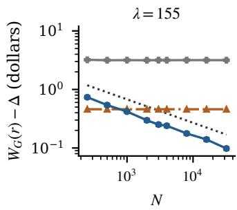

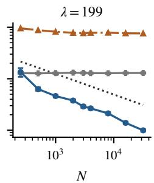  
(a) Excess worst-case regret against sample size, one panel per cell.

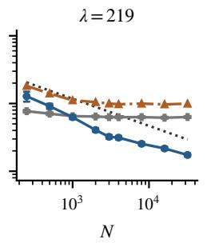

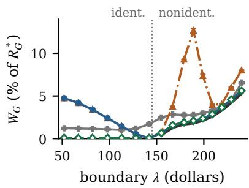  
(b) Regret across the frontier.

$$
N ^ { - 2 / 5 }
$$

Figure D.3 Learning the robust reserve on the Palm Pilot refit $( n = 3 ) { \mathrm { ; } }$ ; the layout of Figure 7.1. (a) Mean excess worst-case regret $W _ { G } - \Delta$ in dollars over 200 replications on the three Palm Pilot cells: the plug-in, the censored Weibull MLE and the linear-completion rule. (b) Mean worst-case regret in percent of $R _ { G } ^ { * }$ with $N = 2 0 0 0$ and 80 replications per $\lambda ,$ on a linear axis; the frontier is at $\lambda = r _ { G } ^ { * }$ ≈ 145 dollars. Bars show one Monte-Carlo standard error; some are smaller than the markers.

Table D.6 repeats Table 7.2 on the Palm Pilot cell at $\lambda = 1 9 9$ , with the three completions of Section 7.3 built on $G " s$ censored fraction and observed tail. Here no MLE is an oracle: the refit is nonparametric, so each family is misspecified under every completion. The plug-in’s worst-case regret is 2.32% against the minimax regret 2.14%, and its actual regret under � is 0.01%. The three MLEs have worst-case regret 2.70–2.96% and actual regret 0.16–0.27% under �. The linear-completion reserve, which is optimal for the exponential completion, loses 1.32% under � and 7.03% in the worst case. Posting the boundary loses 13.4% under �, since $G \ ' _ { \mathrm { s } }$ optimal reserve 145 lies well below $\lambda = 1 9 9$

Table D.7 gives the worst-case regret and the actual regret under � of the plug-in and the three MLEs on the five nonidentifiable Palm Pilot and Xbox cells at � = 3000 and $N = 3 2 { , } 0 0 0$ . The plug-in’s worst-case regret falls on every cell; each MLE’s stays where it was, since the fit converges to the optimum of its own family (Proposition 5.7). On the Palm Pilot cells the plug-in also has the lowest actual regret under � at � = 155 and 199, and is within 0.02 points of the best at 219. The Xbox cells, where the diagnostic above rejects MHR, are less favorable: at $N = 3 0 0 0$ the Weibull MLE’s worst-case regret is 0.52% against the plug-in’s 0.69% at $\lambda = 1 1 1$ , and its actual regret under $G$ is lower, 0.27% against 0.57%. The plug-in’s worst-case regret keeps falling, to 0.46% at $N = 3 2 { , } 0 0 0$ against 0.52% for the MLE, while its actual regret under � settles at 0.40%, close to the 0.38% cost of $r ^ { \dagger }$ itself under �: on this cell the refit happens to favor a reserve near the MLE’s limit, another compatible body would reverse the comparison, and the censored records cannot distinguish them.

Table D.6 Four distributions with the censored records of the Palm Pilot refit at � = 199; the layout of Table 7.2. Mean worst-case and actual regret in percent of $R _ { G } ^ { * } \left( N = 3 0 0 0 \right.$ , 200 paired replications). Actual regret compares each distribution with its own optimal revenue. Numerical minimax regret is $\Delta = 2 . 1 4 \% ;$ Monte-Carlo standard errors are at most 0.02 percentage points except in the Linear completion row (0.12). Rules that post the same reserves share a row.
<table><tr><td rowspan="2">Rule</td><td rowspan="2">Worst-case regret  $W _ { G }$ </td><td colspan="4">Actual regret under each distribution</td></tr><tr><td>Refit G</td><td>Equalizer</td><td>Exponential</td><td>Tangent</td></tr><tr><td>Plug-in, Auto-selector</td><td>2.32</td><td>0.01</td><td>0.00</td><td>0.39</td><td>0.72</td></tr><tr><td>Plug-in (Weibull hazard)</td><td>2.46</td><td>0.01</td><td>0.01</td><td>0.34</td><td>0.92</td></tr><tr><td>Weibull MLE</td><td>2.96</td><td>0.27</td><td>0.09</td><td>0.84</td><td>0.04</td></tr><tr><td>Gamma MLE</td><td>2.85</td><td>0.22</td><td>0.07</td><td>0.77</td><td>0.08</td></tr><tr><td>Lognormal MLE</td><td>2.70</td><td>0.16</td><td>0.04</td><td>0.69</td><td>0.14</td></tr><tr><td>Linear completion</td><td>7.03</td><td>1.32</td><td>0.48</td><td>0.01</td><td>6.38</td></tr><tr><td>Boundary</td><td>25.02</td><td>13.42</td><td>3.04</td><td>0.95</td><td>25.02</td></tr><tr><td>Drop</td><td>25.13</td><td>13.54</td><td>3.15</td><td>1.06</td><td>25.13</td></tr></table>

Whole-dollar price points and the estimation window In the held-out study of Section 7.4, 75% of the Palm Pilot records are whole dollars. The data-driven bandwidth rule selects windows of 45 to 69 dollars holding 190 to 380 training records at � = 155 and 219, but a twelve-dollar window holding about 100 records at $\lambda = 1 9 9$ , where the MLEs are ahead. Jittering the training records by up to half a dollar, on the first 200 splits, lowers the regret at 199 from 1.02 to 0.83% for the fixed window and from 1.66 to 1.44% for the data-driven window (standard errors 0.07–0.08), leaving their gap at about 0.6 points, so the gap comes from the narrow window rather than from the price points.

Held-out regret on Xbox and Cartier Table D.8 repeats the held-out study of Section 7.4 on the other two items, with 321 or 322 and 274 training records. On Xbox the plug-in loses 1.8% at $\lambda = 7 4 .$ , against 1.9–3.1% for the MLEs, and 2.2% at 111, against 2.0% for the gamma MLE and 2.3 and 3.3% for the Weibull and lognormal MLEs; the linear-completion reserve loses 1.3% and 1.8%. $\mathrm { { A t } } \lambda = 1 4 1$ the plug-in loses 22.6% and the auto-selector 25%. The kernel hazard of the full sample is already infeasible there (Table D.4: $\lambda h _ { 0 } = 1 . 5 7 < A = 1 . 9 3 )$ , since the Xbox hazard peaks near 115 dollars and falls beyond; with only 43 training records above �, 23 of them in the selected 89-dollar window, the estimated boundary hazard is lower still. The projected estimates land on the face $\bar { A } _ { N } = \lambda \bar { h } _ { N }$ in every split, and the linear-completion reserve at the projected pair posts 116 dollars on average, while the auto-selector’s tail search posts 194. The linear-completion reserve at the raw count, which needs no hazard estimate, loses 2.1%. On Cartier every rule loses between 4.6% and 14.6% and the full-information reserve (Full-info in Table D.1) 8%: with 274 records spread up to 3,103 dollars, the test optimum is itself noisy. The auto-selector’s 5.6% at � = 555 is below the full-information row, but the full-information rule is itself estimated from a small training sample, so it need not have the lowest held-out regret.

Table D.7 Worst-case regret and actual regret under the refit � on the five nonidentifiable Palm Pilot and Xbox cells, in percent of $R _ { G } ^ { * } \left( n = 3 . \right.$ , mean over 200 paired replications). Monte-Carlo standard errors are at most 0.04 points.
<table><tr><td rowspan="2">Cell</td><td rowspan="2"> $\Delta$ </td><td rowspan="2">Rule</td><td colspan="2">N = 3,000</td><td colspan="2">N = 32,000</td></tr><tr><td> $W _ { G }$ </td><td>under G</td><td> $W _ { G }$ </td><td>under G</td></tr><tr><td>Palm Pilot, λ = 155</td><td>0.45</td><td>Plug-in</td><td>0.61</td><td>0.06</td><td>0.52</td><td>0.04</td></tr><tr><td></td><td></td><td>Weibull MLE</td><td>2.48</td><td>0.70</td><td>2.47</td><td>0.70</td></tr><tr><td></td><td></td><td>Gamma MLE</td><td>2.95</td><td>1.02</td><td>2.94</td><td>1.01</td></tr><tr><td></td><td></td><td>Lognormal MLE</td><td>3.08</td><td>1.11</td><td>3.07</td><td>1.10</td></tr><tr><td>Palm Pilot, λ = 199</td><td>2.14</td><td>Plug-in</td><td>2.32</td><td>0.01</td><td>2.20</td><td>0.01</td></tr><tr><td></td><td></td><td>Weibull MLE</td><td>2.96</td><td>0.27</td><td>2.96</td><td>0.27</td></tr><tr><td></td><td></td><td>Gamma MLE</td><td>2.85</td><td>0.22</td><td>2.85</td><td>0.21</td></tr><tr><td>Palm Pilot, λ = 219</td><td></td><td>Lognormal MLE</td><td>2.70</td><td>0.16</td><td>2.70</td><td>0.15</td></tr><tr><td></td><td>3.36</td><td>Plug-in</td><td>3.56</td><td>0.02</td><td>3.47</td><td>0.01</td></tr><tr><td></td><td></td><td>Weibull MLE</td><td>3.76</td><td>0.12</td><td>3.76</td><td>0.11</td></tr><tr><td></td><td></td><td>Gamma MLE</td><td>3.68</td><td>0.01</td><td>3.65</td><td>&lt; 0.01</td></tr><tr><td>Xbox, λ = 111</td><td></td><td>Lognormal MLE</td><td>4.20</td><td>0.01</td><td>4.19</td><td>0.01</td></tr><tr><td></td><td>0.39</td><td>Plug-in</td><td>0.69</td><td>0.57</td><td>0.46</td><td>0.40</td></tr><tr><td></td><td></td><td>Weibull MLE</td><td>0.52</td><td>0.27</td><td>0.52</td><td>0.26</td></tr><tr><td></td><td></td><td>Gamma MLE Lognormal MLE</td><td>0.71 1.95</td><td>0.14</td><td>0.72</td><td>0.13</td></tr><tr><td>Xbox, λ = 141</td><td></td><td></td><td></td><td>0.18</td><td>1.96</td><td>0.18</td></tr><tr><td></td><td>0.39</td><td>Plug-in</td><td>0.58</td><td>0.51</td><td>0.44</td><td>0.41</td></tr><tr><td></td><td></td><td>Weibull MLE</td><td>0.54</td><td>0.26</td><td>0.53</td><td>0.25</td></tr><tr><td></td><td></td><td>Gamma MLE</td><td>0.72</td><td>0.14</td><td>0.72</td><td>0.13</td></tr><tr><td></td><td></td><td>Lognormal MLE</td><td>1.78</td><td>0.11</td><td>1.79</td><td>0.11</td></tr></table>

Table D.8 Held-out regret on the recorded Xbox and Cartier bids, in percent of each split’s test optimum; the layout and experimental settings of Table 7.3. Standard errors at most 0.37 points.
<table><tr><td colspan="7"></td><td colspan="3">Censored MLE</td><td colspan="3"></td></tr><tr><td>Item</td><td></td><td>λ</td><td>N Full-info</td><td></td><td>Plug-in Auto-selector Weibull</td><td></td><td></td><td></td><td>Gamma Lognormal Linear compl. Boundary</td><td></td><td>Drop</td></tr><tr><td>Cartier</td><td>555 274</td><td></td><td>8.16</td><td>14.46</td><td>5.60</td><td>10.90</td><td>11.85</td><td>13.52</td><td>14.60</td><td>14.46</td><td>7.53</td></tr><tr><td>Cartier</td><td>956274</td><td></td><td>8.15</td><td>9.19</td><td>9.86</td><td>11.11</td><td>11.47</td><td>14.04</td><td>9.98</td><td>4.56</td><td>7.04</td></tr><tr><td>Cartier</td><td>1274274</td><td></td><td>8.32</td><td>9.47</td><td>9.75</td><td>10.49</td><td>11.05</td><td>12.27</td><td>9.06</td><td>6.38</td><td>8.11</td></tr><tr><td>Xbox</td><td>74 322</td><td></td><td>1.09</td><td>1.82</td><td>1.88</td><td>2.37</td><td>1.93</td><td>3.12</td><td>1.33</td><td>1.33</td><td>1.83</td></tr><tr><td>Xbox</td><td>111 321</td><td></td><td>0.99</td><td>2.22</td><td>2.63</td><td>2.31</td><td>1.96</td><td>3.25</td><td>1.79</td><td>17.84</td><td>24.14</td></tr><tr><td>Xbox</td><td>141322</td><td></td><td>1.07</td><td>22.57</td><td>25.24</td><td>2.73</td><td>1.86</td><td>3.29</td><td>2.05</td><td>31.12</td><td>23.86</td></tr></table>

Sellers’ own reserves on Xbox and Cartier Table D.9 repeats the opening-bid study on the other two items, with reference rates of 11.0 and 9.8 records per auction. On Xbox the participation-based fraction is within 0.05 of $G ( \lambda )$ at 50 and 100 and overstated at 10; the auto-selector with the data-driven bandwidth misclassifies the cell at 10, where the auto-selector with the fixed bandwidth takes the tail branch and loses 0.7% held out, and the cell at 100 has 13 records, below $m _ { \mathrm { m i n } } ,$ so the fallback posts the linear-completion reserve. On Cartier the fraction is overstated at 10 and 100, the cell at 500 is tail-optimal and lies close to the fully identified frontier, where the auto-selector takes the nonidentifiable branch (worst-case regret 2.80% against 0.03% for the Weibull MLE), and the Weibull MLE has the lower regret in two of the three cells.

Table D.9 Sellers’ own opening bids on Xbox and Cartier; the layout of Table 7.4, with $\widehat { N }$ from the item’s own reference rate. “fallback” marks fewer than $m _ { \mathrm { m i n } }$ records.
<table><tr><td></td><td></td><td></td><td></td><td></td><td></td><td></td><td></td><td></td><td></td><td colspan="2">Worst-case</td><td colspan="3">Held-out</td></tr><tr><td>Item</td><td>λ K</td><td></td><td>m</td><td>N</td><td>α</td><td>G(λ)</td><td>Regime</td><td>Detected</td><td>∆</td><td>Auto-selector</td><td>Weibull</td><td>Auto-selector</td><td>Weibull</td><td>Boundary</td></tr><tr><td>Cartier</td><td>10</td><td>12</td><td>75</td><td>118</td><td>0.36</td><td>0.01</td><td>ident.</td><td>ident.</td><td>0</td><td>5.76</td><td>0.48</td><td>10.18</td><td>6.81</td><td>23.66</td></tr><tr><td>Cartier</td><td>100</td><td>8</td><td>39</td><td>78</td><td>0.50</td><td>0.11</td><td>ident.</td><td>ident.</td><td>0</td><td>1.06</td><td>3.89</td><td>6.94</td><td>14.18</td><td>22.62</td></tr><tr><td>Cartier</td><td>500</td><td>9</td><td>49</td><td>88</td><td>0.44</td><td>0.46</td><td>ident.</td><td>nonident.</td><td>0</td><td>2.80</td><td>0.03</td><td>12.01</td><td>5.35</td><td>12.01</td></tr><tr><td>Xbox</td><td>10</td><td>13</td><td>124</td><td>142</td><td>0.13</td><td>0.05</td><td>ident.</td><td>nonident.</td><td>0</td><td>5.18</td><td>0.05</td><td>8.66</td><td>1.24</td><td>8.66</td></tr><tr><td>Xbox</td><td>50</td><td>15</td><td>112</td><td>164</td><td>0.32</td><td>0.34</td><td>ident.</td><td>ident.</td><td>0</td><td>0.00</td><td>0.11</td><td>0.45</td><td>1.39</td><td>3.59</td></tr><tr><td>Xbox</td><td>100</td><td>3</td><td>13</td><td>33</td><td>0.61</td><td>0.65</td><td>nonident.</td><td>fallback</td><td>0.39</td><td>2.47</td><td>0.75</td><td>5.66</td><td>2.40</td><td>5.66</td></tr></table>

The imputed bidder count Table D.10 reruns the Palm Pilot cells of Table 7.4 with the reference rate of 12.5 records per auction replaced by 8, 10, 15 and 20, with the same seeds, rules and replications; the rows at 12.5 reproduce Table 7.4. The auto-selector’s branch is unchanged at every rate in every cell except $\lambda = 1 5 0$ at rate 8, where 12% of the replications take the tail branch. A higher rate overstates censoring and lowers the reserve, as Remark B.11 predicts: at $\lambda = 1 5 0$ from 149 dollars at rate 8 to 122 at rate 20, two to four dollars per record in every nonidentifiable cell. Both the auto-selector and the Weibull fit use the imputed count, and how their held-out regret moves with the rate differs across cells: at $\lambda = 1 5 0$ both do best at rate 8, while at $\lambda = 2 4 0$ the Weibull fit’s regret falls from 2.98% at rate 8 to 1.04% at rate 20. The auto-selector stays below the Weibull fit in seven of the eight cells at 12.5 and 15, in six at 10, in five at 20 and in four at 8; at 50 it loses to the Weibull fit at every rate. Rates below 10.8 are ruled out by the data: at $\lambda = 1 0$ the opening-bid auctions themselves hold 10.8 records each, so the count at rates 8 and 10 is clipped to $m + 1$ as is rate 8 at $\lambda = 5 0$

Competition Table D.11 varies the number of bidders on the Palm Pilot refit at its three boundaries and on the Xbox refit at $\lambda = 1 1 1$ , with one censored sample of $N = 3 0 0 0$ per replication scored at every � (40 paired replications). The minimax regret falls by a factor of 40 to 165 between $n = 2$ and $n = 1 0$ (before rounding), and the plug-in’s excess over it falls in proportion. The plug-in has the lowest worst-case regret in eight of the twelve Palm Pilot cells, two of them at $n = 1 0$ , where it leads the MLEs by at most 0.03 points, and is within 0.16 points of the best in the other four; on Xbox the Weibull MLE stays slightly ahead up to $n = 5$ and ties at $n = 1 0$

Table D.10 Sensitivity of the Palm Pilot opening-bid study to the imputed bidder count: the reference rate (records per auction) replaced by 8, 10, 15 and 20, with 12.5 the rate of Table 7.4 (� = 3, 50 draws of the winner imputation). Detected is the auto-selector’s majority branch, Reserve its mean posted reserve in dollars, and Auto-selector and Weibull the held-out regret of the auto-selector and the censored Weibull MLE in percent of the test optimum. <sup>†</sup>: � times the rate is below the � observed records, so ${ \widehat { N } } = m + 1$
<table><tr><td></td><td>λ Rate</td><td> $\widehat { N }$ </td><td> $\widehat { \alpha }$ </td><td>Detected</td><td>Reserve</td><td>Auto-selector</td><td>Weibull</td></tr><tr><td>10</td><td>8</td><td>348†</td><td>0.00</td><td>ident.</td><td>149</td><td>0.15</td><td>2.58</td></tr><tr><td>10</td><td>10</td><td>348†</td><td>0.00</td><td>ident.</td><td>149</td><td>0.15</td><td>2.58</td></tr><tr><td>10</td><td>12.5</td><td>400</td><td>0.13</td><td>ident.</td><td>149</td><td>0.15</td><td>2.52</td></tr><tr><td>10</td><td>15</td><td>480</td><td>0.28</td><td>ident.</td><td>149</td><td>0.15</td><td>1.25</td></tr><tr><td>10</td><td>20</td><td>640</td><td>0.46</td><td>ident.</td><td>149</td><td>0.15</td><td>21.05</td></tr><tr><td>50</td><td>8</td><td>74†</td><td>0.01</td><td>nonident.</td><td>50</td><td>6.84</td><td>1.58</td></tr><tr><td>50</td><td>10</td><td>90</td><td>0.19</td><td>nonident.</td><td>50</td><td>6.84</td><td>2.44</td></tr><tr><td>50</td><td>12.5</td><td>113</td><td>0.35</td><td>nonident.</td><td>49</td><td>6.88</td><td>3.39</td></tr><tr><td>50</td><td>15</td><td>135</td><td>0.46</td><td>nonident.</td><td>47</td><td>6.95</td><td>3.57</td></tr><tr><td>50</td><td>20</td><td>180</td><td>0.59</td><td>nonident.</td><td>44</td><td>7.05</td><td>3.79</td></tr><tr><td>100</td><td>8</td><td>72</td><td>0.14</td><td>ident.</td><td>150</td><td>0.04</td><td>2.14</td></tr><tr><td>100</td><td>10</td><td>90</td><td>0.31</td><td>ident.</td><td>150</td><td>0.04</td><td>3.14</td></tr><tr><td>100</td><td>12.5</td><td>113</td><td>0.45</td><td>ident.</td><td>150</td><td>0.04</td><td>4.18</td></tr><tr><td>100</td><td>15</td><td>135</td><td>0.54</td><td>ident.</td><td>150</td><td>0.04</td><td>4.22</td></tr><tr><td>100</td><td>20</td><td>180</td><td>0.66</td><td>ident.</td><td>150</td><td>0.04</td><td>5.15</td></tr><tr><td>150</td><td>8</td><td>112</td><td>0.20</td><td>nonident.</td><td>149</td><td>0.73</td><td>0.35</td></tr><tr><td>150</td><td>10</td><td>140</td><td>0.36</td><td>nonident.</td><td>144</td><td>0.82</td><td>1.65</td></tr><tr><td>150</td><td>12.5</td><td>175</td><td>0.49</td><td>nonident.</td><td>139</td><td>1.17</td><td>2.32</td></tr><tr><td>150</td><td>15</td><td>210</td><td>0.57</td><td>nonident.</td><td>132</td><td>1.95</td><td>3.10</td></tr><tr><td>150</td><td>20</td><td>280</td><td>0.68</td><td>nonident.</td><td>122</td><td>2.27</td><td>4.18</td></tr><tr><td>175</td><td>8</td><td>312</td><td>0.54</td><td>nonident.</td><td>150</td><td>1.86</td><td>1.94</td></tr><tr><td>175</td><td>10</td><td>390</td><td>0.63</td><td>nonident.</td><td>137</td><td>1.43</td><td>2.09</td></tr><tr><td>175</td><td>12.5</td><td>488</td><td>0.70</td><td>nonident.</td><td>126</td><td>2.52</td><td>2.95</td></tr><tr><td>175</td><td>15</td><td>585</td><td>0.75</td><td>nonident.</td><td>119</td><td>2.49</td><td>3.33</td></tr><tr><td>175</td><td>20</td><td>780</td><td>0.81</td><td>nonident.</td><td>107</td><td>3.69</td><td>4.08</td></tr><tr><td>200</td><td>8</td><td></td><td>64 0.58</td><td>nonident.</td><td>162</td><td>2.51</td><td>0.25</td></tr><tr><td>200</td><td>10</td><td></td><td>800.66</td><td>nonident.</td><td>150</td><td>0.05</td><td>1.15</td></tr><tr><td>200</td><td>12.5</td><td>100</td><td>0.73</td><td>nonident.</td><td>140</td><td>0.94</td><td>1.96</td></tr><tr><td>200</td><td>15</td><td>120</td><td>0.78</td><td>nonident.</td><td>132</td><td>1.99</td><td>2.11</td></tr><tr><td>200</td><td>20</td><td>160</td><td>0.83</td><td>nonident.</td><td>118</td><td>2.64</td><td>3.03</td></tr><tr><td>215</td><td>8</td><td></td><td>88 0.68</td><td>nonident.</td><td>164</td><td>2.15</td><td>1.84</td></tr><tr><td>215</td><td>10</td><td>110</td><td>0.75</td><td>nonident.</td><td>154</td><td>1.90</td><td>0.98</td></tr><tr><td>215</td><td>12.5</td><td>138</td><td>0.80</td><td>nonident.</td><td>145</td><td>0.83</td><td>1.63</td></tr><tr><td>215</td><td>15</td><td>165</td><td>0.83</td><td>nonident.</td><td>133</td><td>1.88</td><td>2.08</td></tr><tr><td>215</td><td>20</td><td>220</td><td>0.87</td><td>nonident.</td><td>124</td><td>2.47</td><td>2.45</td></tr><tr><td>240</td><td>8</td><td>112</td><td>0.80</td><td>nonident.</td><td>162</td><td>2.62</td><td>2.98</td></tr><tr><td>240</td><td>10</td><td>140</td><td>0.84</td><td>nonident.</td><td>154</td><td>1.40</td><td>2.41</td></tr><tr><td>240</td><td>12.5</td><td>175</td><td>0.87</td><td>nonident.</td><td>147</td><td>0.40</td><td>2.10</td></tr><tr><td>240</td><td>15</td><td>210</td><td>0.90</td><td>nonident.</td><td>141</td><td>1.45</td><td>1.63</td></tr><tr><td>240</td><td>20</td><td>280</td><td>0.92</td><td>nonident.</td><td>132</td><td>1.93</td><td>1.04</td></tr></table>

Table D.11 Minimax regret and mean worst-case and actual regret against the number of bidders, in percent of $R _ { G } ^ { * } ~ ( N = 3 0 0 0$ , 40 paired replications; standard errors at most 0.11 points for the plug-in and the MLEs and 0.43 for the linear-completion reserve).
<table><tr><td colspan="4"></td><td colspan="5">Worst-case regret</td><td colspan="2">Actual regret</td></tr><tr><td>Item</td><td>λn</td><td></td><td>Δ</td><td>Plug-in</td><td>Weibull</td><td></td><td></td><td>Gamma Lognormal Linear compl. Boundary</td><td></td><td>Plug-in Weibull</td></tr><tr><td>Palm Pilot 155</td><td></td><td>2 0.82</td><td></td><td>1.15</td><td>4.49</td><td>5.43</td><td>5.70 1.35</td><td>1.35</td><td>0.09</td><td>1.44</td></tr><tr><td>Palm Pilot 155</td><td></td><td>3 0.45</td><td>0.62</td><td></td><td>2.50 2.98</td><td>3.11</td><td>0.75</td><td>0.75</td><td>0.06</td><td>0.72</td></tr><tr><td>Palm Pilot 155</td><td></td><td>50.13</td><td>0.17</td><td></td><td>0.73 0.85</td><td>0.88</td><td>0.22</td><td>0.22</td><td>0.02</td><td>0.17</td></tr><tr><td>Palm Pilot 155</td><td></td><td>100.00</td><td></td><td>0.01</td><td>0.03 0.03</td><td>0.03</td><td>0.01</td><td>0.01</td><td>0.00</td><td>0.00</td></tr><tr><td>Palm Pilot 199</td><td></td><td>2 4.50</td><td></td><td>4.95</td><td>5.28 5.05</td><td>4.79</td><td>16.40</td><td>42.01</td><td>0.20</td><td>0.51</td></tr><tr><td>Palm Pilot 199</td><td></td><td>3 2.14</td><td></td><td>2.34</td><td>2.96 2.85</td><td>2.71</td><td>7.07</td><td>25.02</td><td>0.01</td><td>0.27</td></tr><tr><td>Palm Pilot 199</td><td></td><td>5 0.63</td><td></td><td>0.70</td><td>1.03 1.00</td><td>0.96</td><td>1.83</td><td>10.64</td><td>0.02</td><td>0.07</td></tr><tr><td>Palm Pilot 199</td><td></td><td>10 0.05</td><td></td><td>0.05</td><td>0.08 0.08</td><td>0.08</td><td>0.11</td><td>1.61</td><td>0.01</td><td>0.00</td></tr><tr><td>Palm Pilot 219</td><td></td><td>2 7.15</td><td></td><td>7.60</td><td>7.57 8.70</td><td>9.76</td><td>8.20</td><td>76.31</td><td>0.10</td><td>0.22</td></tr><tr><td>Palm Pilot 219</td><td></td><td>3 3.36</td><td></td><td>3.56</td><td>3.76 3.74</td><td>4.24</td><td>4.03</td><td>51.08</td><td>0.02</td><td>0.12</td></tr><tr><td>Palm Pilot 219</td><td></td><td>51.02</td><td></td><td>1.09</td><td>1.19 1.07</td><td>1.17</td><td>1.26</td><td>28.01</td><td>0.00</td><td>0.03</td></tr><tr><td>Palm Pilot 219</td><td></td><td>100.08</td><td></td><td>0.09</td><td>0.09 0.08</td><td>0.09</td><td>0.09</td><td>8.26</td><td>0.00</td><td>0.00</td></tr><tr><td>Xbox</td><td>111</td><td>2 0.60</td><td></td><td>0.95</td><td>0.76 1.05</td><td>3.13</td><td>1.95</td><td>6.92</td><td>0.74</td><td>0.47</td></tr><tr><td>Xbox</td><td>111</td><td>3 0.39</td><td></td><td>0.60</td><td>0.50 0.69</td><td>1.93</td><td>1.27</td><td>4.98</td><td>0.48</td><td>0.28</td></tr><tr><td>Xbox</td><td>111</td><td>5 0.16</td><td></td><td>0.24</td><td>0.21 0.29</td><td>0.72</td><td>0.52</td><td>2.52</td><td>0.20</td><td>0.10</td></tr><tr><td>Xbox</td><td>111</td><td>10 0.01</td><td></td><td>0.02</td><td>0.02 0.03</td><td>0.06</td><td>0.05</td><td>0.43</td><td>0.02</td><td>0.01</td></tr></table>

The winner’s record Table D.12 refits each item with the winner’s record treated in three ways: the Kaplan–Meier draw above the closing price used throughout, the closing price itself, and dropping the record. Palm Pilot’s regimes and minimax reserves are insensitive to the closing-price treatment: the minimax regret at its three boundaries moves from 0.45, 2.14 and 3.36% to 0.47, 2.27 and 3.85%. Dropping the records lowers its optimal revenue by 6% and raises the minimax regret to 1.09, 2.76 and 4.68%. Xbox and Cartier are not: under the closing price the Xbox cell at 74 becomes nonidentifiable and the minimax regret at 111 rises from 0.39 to 0.99%, and Cartier’s optimal revenue falls by 12%.

## D.4 Behavior near the zero-regret frontiers

Percentages in this subsection use the generating distribution’s optimal revenue $R _ { G } ^ { * }$

Near full identification As the boundary pair approaches the zero-regret frontier $A = \lambda h _ { 0 }$ , the linearcompletion reserve overtakes the plug-in (Table D.13). The distributions have $\lambda = 1 . 5 , h _ { 0 } = 2$ and $A = 3 ( 1 - \zeta )$ , with constant body hazard �/� and tail hazard $h _ { 0 }$ . Reducing � from 0.5 to 0.005 reduces the minimax regret from 2.376% to 0.001%. At the two smallest distances, $\zeta = 0 . 0 1$ and 0.005, the plug-in’s mean worst-case regret is 0.558% and 0.803%, the linear-completion reserve’s 0.043% and 0.023%. At $N = 3 0 0 0$ the error in the boundary-hazard estimate still dominates, whereas the linear-completion reserve depends only on the censored count, as Proposition 5.8 predicts. For $\zeta \leq 0 . 1$ , the raw estimate lies beyond the frontier in 40–67% of the replications, and the plug-in then posts the linear-completion reserve at the projected pair, $r _ { c } ( { \bar { A } } _ { N } )$ . The plug-in’s grid error at the true $( A , h _ { 0 } )$ is below $2 \times 1 0 ^ { - 4 }$ revenue units, so its remaining regret is estimation error. The auto-selector coincides with the plug-in except at $\zeta = 0 . 0 2$ , where

Table D.12 The winner’s right-censored record under three treatments: sample size, optimal revenue and reserve of the refit, and at each of the item’s three boundaries the censored fraction, regime, minimax regret (percent of $R _ { G } ^ { * } )$ and minimax reserve (dollars).
<table><tr><td>Item</td><td>Winner&#x27;s record</td><td>Records</td><td> $R _ { G } ^ { * }$ </td><td> $r _ { G } ^ { * }$ </td><td>λ</td><td> $G ( \lambda )$ </td><td>Regime</td><td> $\Delta$ </td><td> $r ^ { \dagger }$ </td></tr><tr><td></td><td>Palm Pilot Kaplan-Meier</td><td>1652</td><td>156.7</td><td>145.2</td><td>155</td><td>0.50</td><td>nonident.</td><td>0.45</td><td>149</td></tr><tr><td rowspan="5"></td><td rowspan="5"></td><td rowspan="5"></td><td rowspan="5"></td><td></td><td>199</td><td>0.70</td><td>nonident.</td><td>2.14</td><td>143</td></tr><tr><td></td><td>219</td><td>0.80</td><td>nonident.</td><td>3.36</td><td>142</td></tr><tr><td>1652 155.8 145.1</td><td>155</td><td>0.50</td><td>nonident.</td><td>0.47</td><td></td><td>149</td></tr><tr><td></td><td>199</td><td>0.71</td><td>nonident.</td><td>2.27</td><td>143</td></tr><tr><td></td><td>219</td><td>0.82</td><td>nonident.</td><td>3.85</td><td>141</td></tr><tr><td rowspan="3">Palm Pilot dropped</td><td rowspan="3"></td><td rowspan="3">1520</td><td rowspan="3">146.6</td><td>138.0</td><td>155</td><td>0.54</td><td>nonident.</td><td>1.09</td><td>139</td></tr><tr><td></td><td>199</td><td>0.76</td><td>nonident.</td><td>2.76</td><td>135</td></tr><tr><td></td><td>219</td><td>0.87</td><td>nonident.</td><td>4.68</td><td>132</td></tr><tr><td rowspan="3">Xbox</td><td rowspan="3">Kaplan-Meier</td><td rowspan="3">460</td><td rowspan="3">85.7</td><td>74.2</td><td>74</td><td>0.50</td><td>ident.</td><td>0</td><td>74</td></tr><tr><td></td><td>111</td><td>0.70</td><td>nonident.</td><td>0.39</td><td>84</td></tr><tr><td></td><td>141</td><td>0.80</td><td>nonident.</td><td>0.39</td><td>84</td></tr><tr><td rowspan="3">Xbox</td><td rowspan="3">closing price</td><td rowspan="3">460</td><td rowspan="3">80.2</td><td>72.4</td><td>74</td><td>0.52</td><td>nonident.</td><td>0.04</td><td>74</td></tr><tr><td></td><td>111</td><td>0.74</td><td>nonident.</td><td>0.99</td><td>74</td></tr><tr><td></td><td>141</td><td>0.85</td><td>nonident.</td><td>0.99</td><td>74</td></tr><tr><td rowspan="3">Xbox</td><td rowspan="3">dropped</td><td rowspan="3">418</td><td rowspan="3">75.0</td><td>68.7</td><td>74</td><td>0.55</td><td>nonident.</td><td>0.29</td><td>71</td></tr><tr><td></td><td>111</td><td>0.77</td><td>nonident.</td><td>0.93</td><td>69</td></tr><tr><td></td><td>141</td><td>0.87</td><td>nonident.</td><td>0.93</td><td>69</td></tr><tr><td rowspan="3">Cartier</td><td rowspan="3">Kaplan-Meier</td><td rowspan="3">392</td><td rowspan="3">717.3</td><td>784.9</td><td>555</td><td>0.50</td><td>ident.</td><td>0</td><td>785</td></tr><tr><td></td><td>956</td><td>0.70</td><td>nonident.</td><td>&lt; 0.01</td><td>789</td></tr><tr><td></td><td>1274 0.80</td><td>nonident.</td><td>&lt; 0.01</td><td></td><td>790</td></tr><tr><td rowspan="3">Cartier</td><td rowspan="3">closing price</td><td rowspan="3">392</td><td rowspan="3">634.2</td><td>686.8</td><td>555</td><td>0.55</td><td>ident.</td><td>0</td><td>687</td></tr><tr><td></td><td>956</td><td>0.75</td><td>nonident.</td><td>&lt; 0.01</td><td>694</td></tr><tr><td></td><td>1274</td><td>0.84</td><td>nonident.</td><td>&lt; 0.01</td><td>693</td></tr><tr><td rowspan="3">Cartier</td><td rowspan="3">dropped</td><td rowspan="3"></td><td rowspan="3">352 585.8</td><td rowspan="3">636.1</td><td>555</td><td>0.58</td><td>ident.</td><td>0</td><td></td><td>636</td></tr><tr><td>956</td><td>0.77</td><td>nonident.</td><td>&lt; 0.01</td><td>640</td></tr><tr><td>1274</td><td>0.86</td><td>nonident.</td><td>&lt; 0.01</td><td>640</td></tr></table>

in one replication the raw $\widehat { h } _ { 0 }$ fell below $1 / \lambda$ and the tail branch cost about 48 percentage points.

At the population level, the linear-completion reserve’s worst-case regret stays below the quadratic bound of Proposition 5.8 as � approaches $\lambda h _ { 0 }$ (Table D.14): the ratio of $\mathsf { W } ( r _ { c } )$ to the bound lies between 0.10 and 0.93 in every row. The ratio ${ \sf W } ( r _ { c } ) / \Delta$ falls from 5–6 at $A = \lambda h _ { 0 } / 2$ to 1.1 at $A = 0 . 9 9 \lambda h _ { 0 }$ when $\lambda h _ { 0 } = 2$ and rises from 1.3–1.4 to 2.2 when $\lambda h _ { 0 } = 4$

The auto-selector’s excess worst-case regret is small on both sides of both zero-regret frontiers (Table D.15). The 21 cells use Weibull and two-level distributions at $\lambda = 1$ , with 200 replications at $N = 1 0 0 0$ and 10,000. The largest excess over the cells falls from 1.33% to 0.21% as � increases. At $\lambda h _ { 0 } = 1$ the auto-selector’s branch disagrees with the true regime in 46–54% of the replications, yet a wrong branch at a frontier costs little because the two candidate reserves are close: branch accuracy and regret are different quantities. At $N = 1 0 { , } 0 0 0$ the tail rule has the smallest excess of the auto-selector, the plug-in and the tail rule in 9 of the 11 tail-optimal cells, but it loses 5.4–5.8% at $\lambda h _ { 0 } = 1 . 5 ;$ the auto-selector’s plug-in branch prevents this loss. On the identifiable side, projection moves every estimate to the frontier, so the plug-in’s excess falls only from 0.139% to 0.121% at $\lambda h _ { 0 } = 0 . 8 5$ , while the auto-selector’s falls from 0.118% to 0.027%.

Table D.13 Worst-case regret of the plug-in, the auto-selector and the linear-completion reserve in percent of $R _ { G } ^ { * }$ mean (Monte-Carlo standard error), for two-level MHR distributions approaching full identification: $\lambda = 1 . 5$ $h _ { 0 } = 2 , A = h _ { 0 } \lambda ( 1 - \zeta ) ( n = 3 , N = 3 0 0 0$ , 60 paired replications per $\zeta )$ . “Frontier” is the percentage of replications in which the raw estimate lies beyond the zero-regret frontier $A = \lambda h _ { 0 }$ and the plug-in posts the linear-completion reserve at the projected pair, $r _ { c } ( { \bar { A } } _ { N } )$ ). The minimax regret $\Delta$ has body-grid error at most $8 . 3 \times 1 0 ^ { - 4 }$ percentage points.
<table><tr><td>ζ</td><td> $G ( \lambda )$ </td><td> $r ^ { \dagger }$ </td><td> $\Delta$ </td><td>Plug-in</td><td>Auto-selector</td><td>Linear compl.</td><td>Frontier</td></tr><tr><td>0.500</td><td>0.78</td><td>0.949</td><td>2.376%</td><td>2.736 (0.038)</td><td>2.736 (0.038)</td><td>3.737 (0.090)</td><td>0%</td></tr><tr><td>0.300</td><td>0.88</td><td>0.735</td><td>1.904%</td><td>2.454 (0.059)</td><td>2.454 (0.059)</td><td>2.322 (0.031)</td><td>2%</td></tr><tr><td>0.200</td><td>0.91</td><td>0.646</td><td>1.236%</td><td>1.979 (0.132)</td><td>1.979 (0.132)</td><td>1.620 (0.030)</td><td>23%</td></tr><tr><td>0.100</td><td>0.93</td><td>0.572</td><td>0.416%</td><td>1.189 (0.119)</td><td>1.189 (0.119)</td><td>0.616 (0.018)</td><td>40%</td></tr><tr><td>0.050</td><td>0.94</td><td>0.537</td><td>0.119%</td><td>0.880 (0.113)</td><td>0.880 (0.113)</td><td>0.223 (0.012)</td><td>47%</td></tr><tr><td>0.020</td><td>0.95</td><td>0.515</td><td>0.020%</td><td>0.758 (0.167)</td><td>1.558 (0.913)</td><td>0.073 (0.006)</td><td>47%</td></tr><tr><td>0.010</td><td>0.95</td><td>0.507</td><td>0.005%</td><td>0.558 (0.120)</td><td>0.558 (0.120)</td><td>0.043 (0.006)</td><td>67%</td></tr><tr><td>0.005</td><td>0.95</td><td>0.504</td><td>0.001%</td><td>0.803 (0.113)</td><td>0.803 (0.113)</td><td>0.023 (0.003)</td><td>57%</td></tr></table>

Table D.14 Worst-case regret $\mathsf { W } ( r _ { c } )$ of the linear-completion reserve and minimax regret $\Delta$ at the population level, in revenue units, as � approaches $\lambda h _ { 0 } \left( \lambda = 1 \right)$ . $w = A ( \lambda h _ { 0 } - A ) / ( \lambda h _ { 0 } )$ is the largest gap between the chord and the backward tangent; $\Delta$ uses 1600 × 1600 bodies (body-grid error at most $5 . 1 \times 1 0 ^ { - 6 } )$ ; “bound” is $k _ { 1 } d ^ { 2 } / ( 2 h _ { 0 } )$ of Proposition 5.8 with $d = \lambda h _ { 0 } - A$ and $k _ { 1 } = ( ( n - 1 ) / n ) ^ { n - 1 }$
<table><tr><td>n</td><td> $\lambda h _ { 0 }$ </td><td> $A / ( \lambda h _ { 0 } )$ </td><td>w</td><td>∆</td><td> $\mathsf { W } ( r _ { c } )$ </td><td> ${ \sf W } ( r _ { c } ) / \Delta$ </td><td>bound</td><td> $\mathsf { W } ( r _ { c } ) .$  /bound</td></tr><tr><td>2</td><td>2</td><td>0.50</td><td>0.500</td><td>0.02177</td><td>0.11574</td><td>5.3</td><td>0.12500</td><td>0.93</td></tr><tr><td>2</td><td>2</td><td>0.80</td><td>0.320</td><td>0.00430</td><td>0.00775</td><td>1.8</td><td>0.02000</td><td>0.39</td></tr><tr><td>2</td><td>2</td><td>0.90</td><td>0.180</td><td>0.00111</td><td>0.00150</td><td>1.3</td><td>0.00500</td><td>0.30</td></tr><tr><td>2</td><td>2</td><td>0.95</td><td>0.095</td><td>0.00028</td><td>0.00033</td><td>1.2</td><td>0.00125</td><td>0.26</td></tr><tr><td>2</td><td>2</td><td>0.99</td><td>0.020</td><td>0.00001</td><td>0.00001</td><td>1.1</td><td>0.00005</td><td>0.24</td></tr><tr><td>2</td><td>4</td><td>0.50</td><td>1.000</td><td>0.02612</td><td>0.03417</td><td>1.3</td><td>0.25000</td><td>0.14</td></tr><tr><td>2</td><td>4</td><td>0.80</td><td>0.640</td><td>0.00774</td><td>0.01263</td><td>1.6</td><td>0.04000</td><td>0.32</td></tr><tr><td>2</td><td>4</td><td>0.90</td><td>0.360</td><td>0.00215</td><td>0.00393</td><td>1.8</td><td>0.01000</td><td>0.39</td></tr><tr><td>2</td><td>4</td><td>0.95</td><td>0.190</td><td>0.00056</td><td>0.00111</td><td>2.0</td><td>0.00250</td><td>0.45</td></tr><tr><td>2</td><td>4</td><td>0.99</td><td>0.040</td><td>0.00002</td><td>0.00005</td><td>2.2</td><td>0.00010</td><td>0.50</td></tr><tr><td>3</td><td>2</td><td>0.50</td><td>0.500</td><td>0.01381</td><td>0.08434</td><td>6.1</td><td>0.11111</td><td>0.76</td></tr><tr><td>3</td><td>2</td><td>0.80</td><td>0.320</td><td>0.00356</td><td>0.00621</td><td>1.7</td><td>0.01778</td><td>0.35</td></tr><tr><td>3</td><td>2</td><td>0.90</td><td>0.180</td><td>0.00099</td><td>0.00131</td><td>1.3</td><td>0.00444</td><td>0.29</td></tr><tr><td>3</td><td>2</td><td>0.95</td><td>0.095</td><td>0.00026</td><td>0.00030</td><td>1.2</td><td>0.00111</td><td>0.27</td></tr><tr><td>3</td><td>2</td><td>0.99</td><td>0.020</td><td>0.00001</td><td>0.00001</td><td>1.1</td><td>0.00004</td><td>0.25</td></tr><tr><td>3</td><td>4</td><td>0.50</td><td>1.000</td><td>0.01644</td><td>0.02316</td><td>1.4</td><td>0.22222</td><td>0.10</td></tr><tr><td>3</td><td>4</td><td>0.80</td><td>0.640</td><td>0.00538</td><td>0.00982</td><td>1.8</td><td>0.03556</td><td>0.28</td></tr><tr><td>3</td><td>4</td><td>0.90</td><td>0.360</td><td>0.00178</td><td>0.00336</td><td>1.9</td><td>0.00889</td><td>0.38</td></tr><tr><td>3</td><td>4</td><td>0.95</td><td>0.190</td><td>0.00050</td><td>0.00100</td><td>2.0</td><td>0.00222</td><td>0.45</td></tr><tr><td>3</td><td>4</td><td>0.99</td><td>0.040</td><td>0.00002</td><td>0.00005</td><td>2.2</td><td>0.00009</td><td>0.53</td></tr></table>

Table D.15 Excess worst-case regret $W _ { G } ( r ) - \Delta$ of four rules in percent of $R _ { G } ^ { * }$ , mean (Monte-Carlo standard error), in cells on both sides of the zero-regret frontiers at $\lambda = 1 ( n = 3$ , 200 paired replications per cell and �). $\mathrm { \ddot { s h d e } } ^ { , }$ is the case of the true boundary pair $( A , h _ { 0 } )$ : tail-optimal or fully identified, both in the identifiable regime, or nonidentifiable; “Misclass.” is the percentage of replications in which the auto-selector’s branch disagrees with that regime (binomial standard error). Tail is the empirical revenue maximizer on $[ \lambda , 1 0 \lambda ]$ . In identifiable cells $\Delta = 0$ and $W _ { G }$ includes the tail gain (B.13). Entries without a standard error are constant across replications.
<table><tr><td rowspan=1 colspan=14>Family        λh0 $A / ( \lambda h _ { 0 } )$ Side            NMisclass.   Plug-in   Auto-selector    Tail    Linear compl.</td></tr><tr><td rowspan=1 colspan=5>Weibull(k=2)0.85      0.5tail-optimal</td><td rowspan=1 colspan=1>1,000</td><td rowspan=1 colspan=1>22.0 (2.9)</td><td rowspan=1 colspan=2>0.139 (0.005)</td><td rowspan=2 colspan=5>0.118 (0.011) 0.090 (0.011)0.120 (0.000)0.023 (0.003) 0.120 (0.000)</td></tr><tr><td rowspan=1 colspan=4>Weibull(k=2)0.85      0.5</td><td rowspan=1 colspan=1>tail-optimal</td><td rowspan=1 colspan=1>10,000</td><td rowspan=1 colspan=1>3.0 (1.2)</td><td rowspan=1 colspan=2>0.121 (0.000)</td><td rowspan=1 colspan=2>0.027 (0.003)</td></tr><tr><td rowspan=1 colspan=4>Weibull(k=2)  0.9      0.5</td><td rowspan=1 colspan=1>tail-optimal</td><td rowspan=1 colspan=1>1,000</td><td rowspan=1 colspan=1>34.5 (3.4)</td><td rowspan=1 colspan=2>0.094 (0.008)</td><td rowspan=1 colspan=2>0.122 (0.016)</td><td rowspan=1 colspan=2>0.091 (0.015)</td><td rowspan=1 colspan=1>0.055</td></tr><tr><td rowspan=1 colspan=4>Weibull(k=2)  0.9      0.5</td><td rowspan=1 colspan=1>tail-optimal</td><td rowspan=1 colspan=1>10,000</td><td rowspan=1 colspan=1>11.5 (2.3)</td><td rowspan=1 colspan=2>0.056 (0.001)</td><td rowspan=1 colspan=2>0.020 (0.002)</td><td rowspan=1 colspan=2>0.016 (0.001)</td><td rowspan=1 colspan=1>0.055</td></tr><tr><td rowspan=1 colspan=4>Weibull(k=2)0.95      0.5</td><td rowspan=1 colspan=1>tail-optimal</td><td rowspan=1 colspan=1>1,000</td><td rowspan=1 colspan=1>36.5 (3.4)</td><td rowspan=1 colspan=2>0.072 (0.009)</td><td rowspan=1 colspan=2>0.127 (0.013)</td><td rowspan=1 colspan=2>0.095 (0.012)</td><td rowspan=1 colspan=1>0.014 (0.000)</td></tr><tr><td rowspan=1 colspan=4>Weibull(k=2)0.95      0.5</td><td rowspan=1 colspan=1>tail-optimal</td><td rowspan=1 colspan=1>10,000</td><td rowspan=1 colspan=1>32.5 (3.3)</td><td rowspan=1 colspan=2>0.026 (0.003)</td><td rowspan=1 colspan=2>0.024 (0.003)</td><td rowspan=1 colspan=2>0.013 (0.001)</td><td rowspan=1 colspan=1>0.014 (0.000)</td></tr><tr><td rowspan=1 colspan=4>Weibull(k=2) 0.98      0.5</td><td rowspan=1 colspan=1>tail-optimal</td><td rowspan=1 colspan=1>1,000</td><td rowspan=1 colspan=1>48.5 (3.5)</td><td rowspan=1 colspan=2>0.096 (0.012)</td><td rowspan=1 colspan=2>0.164 (0.014)</td><td rowspan=1 colspan=2>0.109 (0.013)</td><td rowspan=1 colspan=1>0.002 (0.000)</td></tr><tr><td rowspan=1 colspan=4>Weibull(k=2)0.98      0.5 ta</td><td rowspan=1 colspan=1>il-optimal</td><td rowspan=1 colspan=1>10,000</td><td rowspan=1 colspan=1>45.0 (3.5)</td><td rowspan=1 colspan=2>0.026 (0.004)</td><td rowspan=1 colspan=2>0.036 (0.004)</td><td rowspan=1 colspan=2>0.017 (0.002)</td><td rowspan=1 colspan=1>0.002 (0.000)</td></tr><tr><td rowspan=1 colspan=4>Weibull(k=2)   1      0.5 ta</td><td rowspan=1 colspan=1>il-optimal</td><td rowspan=1 colspan=1>1,000</td><td rowspan=1 colspan=1>49.5 (3.5)</td><td rowspan=1 colspan=1>0.102 (0</td><td rowspan=1 colspan=1>.012)</td><td rowspan=1 colspan=2>0.164 (0.014)</td><td rowspan=1 colspan=2>0.103 (0.013)</td><td rowspan=1 colspan=1>0.000</td></tr><tr><td rowspan=1 colspan=4>Weibull(k=2)   1      0.5 ta</td><td rowspan=1 colspan=1>il-optimal</td><td rowspan=1 colspan=1>10,000</td><td rowspan=1 colspan=1>50.0 (3.5)</td><td rowspan=1 colspan=2>0.026 (0.004)</td><td rowspan=1 colspan=2>0.039 (0.004)</td><td rowspan=1 colspan=2>0.019 (0.002)</td><td rowspan=1 colspan=1>0.000</td></tr><tr><td rowspan=1 colspan=4>Weibull(k=2)1.02      0.5 n</td><td rowspan=1 colspan=1>onident.</td><td rowspan=1 colspan=1>1,000</td><td rowspan=1 colspan=1>47.0 (3.5)</td><td rowspan=1 colspan=2>0.113 (0.013)</td><td rowspan=1 colspan=2>0.179 (0.013)</td><td rowspan=1 colspan=2>0.097 (0.010)</td><td rowspan=1 colspan=1>0.000 (0.000)</td></tr><tr><td rowspan=1 colspan=1>Weibull(k=2)</td><td rowspan=1 colspan=3>1.02      0.5 n</td><td rowspan=1 colspan=1>onident.</td><td rowspan=1 colspan=1>10,000</td><td rowspan=1 colspan=1>42.0 (3.5)</td><td rowspan=1 colspan=2>0.038 (0.005)</td><td rowspan=1 colspan=2>0.051 (0.005)</td><td rowspan=1 colspan=2>0.018 (0.002)</td><td rowspan=1 colspan=1>0.000 (0.000)</td></tr><tr><td rowspan=1 colspan=1>Weibull(k=2)</td><td rowspan=1 colspan=3>1.05      0.5 n</td><td rowspan=1 colspan=1>onident.</td><td rowspan=1 colspan=1>1,000</td><td rowspan=1 colspan=1>46.0 (3.5)</td><td rowspan=1 colspan=2>0.133 (0.015)</td><td rowspan=1 colspan=2>0.213 (0.016)</td><td rowspan=1 colspan=2>0.117 (0.012)</td><td rowspan=1 colspan=1>0.003 (0.000)</td></tr><tr><td rowspan=1 colspan=1>Weibull(k=2)</td><td rowspan=1 colspan=3>1.05      0.5 n</td><td rowspan=1 colspan=1>onident.</td><td rowspan=1 colspan=1>10,000</td><td rowspan=1 colspan=1>30.5 (3.3)</td><td rowspan=1 colspan=2>0.058 (0.007)</td><td rowspan=1 colspan=2>0.072 (0.006)</td><td rowspan=1 colspan=2>0.022 (0.002)</td><td rowspan=1 colspan=1>0.003 (0.000)</td></tr><tr><td rowspan=1 colspan=4>Weibull(k=2)  1.1      0.5</td><td rowspan=1 colspan=1>nonident.</td><td rowspan=1 colspan=1>1,000</td><td rowspan=1 colspan=1>36.5 (3.4)</td><td rowspan=1 colspan=2>0.178 (0.016)</td><td rowspan=1 colspan=2>0.265 (0.016)</td><td rowspan=1 colspan=1>0.152 (</td><td rowspan=1 colspan=1>0.014)</td><td rowspan=1 colspan=1>0.020 (0.000)</td></tr><tr><td rowspan=1 colspan=4>Weibull(k=2) 1.1      0.5</td><td rowspan=1 colspan=1>nonident.</td><td rowspan=1 colspan=1>10,000</td><td rowspan=1 colspan=1>18.0 (2.7)</td><td rowspan=1 colspan=2>0.093 (0.009)</td><td rowspan=1 colspan=2>0.101 (0.009)</td><td rowspan=1 colspan=2>0.040 (0.003)</td><td rowspan=1 colspan=1>0.020 (0.000)</td></tr><tr><td rowspan=1 colspan=4>Weibull(k=2) 1.2      0.5</td><td rowspan=1 colspan=1>nonident.</td><td rowspan=1 colspan=1>1,000</td><td rowspan=1 colspan=1>22.5 (3.0)</td><td rowspan=1 colspan=2>0.274 (0.017)</td><td rowspan=1 colspan=2>0.341 (0.018)</td><td rowspan=1 colspan=2>0.259 (0.013)</td><td rowspan=1 colspan=1>0.137 (0.000)</td></tr><tr><td rowspan=1 colspan=4>Weibull(k=2) 1.2      0.5 n</td><td rowspan=1 colspan=1>onident.</td><td rowspan=1 colspan=1>10,000</td><td rowspan=1 colspan=1>4.0 (1.4)</td><td rowspan=1 colspan=2>0.130 (0.008)</td><td rowspan=1 colspan=2>0.133 (0.008)</td><td rowspan=1 colspan=2>0.154 (0.002)</td><td rowspan=1 colspan=1>0.137 (0.000)</td></tr><tr><td rowspan=1 colspan=4>two-level      0.9      0.9</td><td rowspan=1 colspan=1>tail-optimal</td><td rowspan=1 colspan=1>1,000</td><td rowspan=1 colspan=1>35.0 (3.4)</td><td rowspan=1 colspan=2>0.307 (0.015)</td><td rowspan=1 colspan=2>0.400 (0.035)</td><td rowspan=1 colspan=1>0.360 (</td><td rowspan=1 colspan=1>0.044)</td><td rowspan=1 colspan=1>0.212 (0.000)</td></tr><tr><td rowspan=1 colspan=2>two-level      0.9</td><td rowspan=1 colspan=1></td><td rowspan=1 colspan=1>0.9</td><td rowspan=1 colspan=1>tail-optimal</td><td rowspan=1 colspan=1>10,000</td><td rowspan=1 colspan=1>15.0 (2.5)</td><td rowspan=1 colspan=1>0.218 (0</td><td rowspan=1 colspan=1>.002)</td><td rowspan=1 colspan=1>0.089 (</td><td rowspan=1 colspan=1>0.008)</td><td rowspan=1 colspan=1>0.059 (</td><td rowspan=1 colspan=1>0.007)</td><td rowspan=1 colspan=1>0.212 (0.000)</td></tr><tr><td rowspan=1 colspan=2>two-level      0.9</td><td rowspan=1 colspan=1></td><td rowspan=1 colspan=1>0.99</td><td rowspan=1 colspan=1>tail-optimal</td><td rowspan=1 colspan=1>1,000</td><td rowspan=1 colspan=1>34.5 (3.4)</td><td rowspan=1 colspan=1>0.323 (</td><td rowspan=1 colspan=1>0.014)</td><td rowspan=1 colspan=1>0.384 (</td><td rowspan=1 colspan=1>0.038)</td><td rowspan=1 colspan=1>0.325 (</td><td rowspan=1 colspan=1>0.045)</td><td rowspan=1 colspan=1>0.234 (0.000)</td></tr><tr><td rowspan=1 colspan=2>two-level      0.9</td><td rowspan=1 colspan=1></td><td rowspan=1 colspan=1>0.99</td><td rowspan=1 colspan=1>tail-optimal</td><td rowspan=1 colspan=1>10,000</td><td rowspan=1 colspan=1>13.5 (2.4)</td><td rowspan=1 colspan=1>0.242 (</td><td rowspan=1 colspan=1>0.002)</td><td rowspan=1 colspan=1>0.100 (</td><td rowspan=1 colspan=1>0.008)</td><td rowspan=1 colspan=1>0.074 (</td><td rowspan=1 colspan=1>0.007)</td><td rowspan=1 colspan=1>0.234 (0.000)</td></tr><tr><td rowspan=1 colspan=2>two-level      0.9</td><td rowspan=1 colspan=1></td><td rowspan=1 colspan=1></td><td rowspan=1 colspan=1>tail-optimal</td><td rowspan=1 colspan=1>1,000</td><td rowspan=1 colspan=1>32.0 (3.3)</td><td rowspan=1 colspan=1>0.333 (</td><td rowspan=1 colspan=1>0.016)</td><td rowspan=1 colspan=1>0.432 (</td><td rowspan=1 colspan=1>0.042)</td><td rowspan=1 colspan=1>0.382 (</td><td rowspan=1 colspan=1>0.044)</td><td rowspan=1 colspan=1>0.237 (0.000)</td></tr><tr><td rowspan=1 colspan=2>two-level      0.9</td><td rowspan=1 colspan=1></td><td rowspan=1 colspan=1></td><td rowspan=1 colspan=1>tail-optimal</td><td rowspan=1 colspan=1>10,000</td><td rowspan=1 colspan=1>16.5 (2.6)</td><td rowspan=1 colspan=1>0.249 (0</td><td rowspan=1 colspan=1>.003)</td><td rowspan=1 colspan=1>0.114 (</td><td rowspan=1 colspan=1>0.009)</td><td rowspan=1 colspan=1>0.075 (</td><td rowspan=1 colspan=1>0.007)</td><td rowspan=1 colspan=1>0.237 (0.000)</td></tr><tr><td rowspan=1 colspan=2>two-level        1</td><td rowspan=1 colspan=1></td><td rowspan=1 colspan=1>0.9</td><td rowspan=1 colspan=1>tail-optimal</td><td rowspan=1 colspan=1>1,000</td><td rowspan=1 colspan=1>46.0 (3.5)</td><td rowspan=1 colspan=1>0.183 (</td><td rowspan=1 colspan=1>0.022)</td><td rowspan=1 colspan=1>0.379 (</td><td rowspan=1 colspan=1>0.033)</td><td rowspan=1 colspan=1>0.316 (</td><td rowspan=1 colspan=1>0.035)</td><td rowspan=1 colspan=1>0.000 (0.000)</td></tr><tr><td rowspan=1 colspan=2>two-level        1</td><td rowspan=1 colspan=2>0.9</td><td rowspan=1 colspan=1>tail-optimal</td><td rowspan=1 colspan=1>10,000</td><td rowspan=1 colspan=1>53.0 (3.5)</td><td rowspan=1 colspan=1>0.062 (</td><td rowspan=1 colspan=1>0.008)</td><td rowspan=1 colspan=1>0.093 (</td><td rowspan=1 colspan=1>0.009)</td><td rowspan=1 colspan=1>0.050 (</td><td rowspan=1 colspan=1>0.007)</td><td rowspan=1 colspan=1>0.000</td></tr><tr><td rowspan=1 colspan=2>two-level        1</td><td rowspan=1 colspan=2>0.99</td><td rowspan=1 colspan=1>tail-optimal</td><td rowspan=1 colspan=1>1,000</td><td rowspan=1 colspan=1>51.5 (3.5)</td><td rowspan=1 colspan=1>0.163 (</td><td rowspan=1 colspan=1>0.020)</td><td rowspan=1 colspan=1>0.326 (</td><td rowspan=1 colspan=1>0.029)</td><td rowspan=1 colspan=1>0.327 (</td><td rowspan=1 colspan=1>0.040)</td><td rowspan=1 colspan=1>0.017 (0.003)</td></tr><tr><td rowspan=1 colspan=2>two-level        1</td><td rowspan=1 colspan=2>0.99</td><td rowspan=1 colspan=1>tail-optimal</td><td rowspan=1 colspan=1>10,000</td><td rowspan=1 colspan=1>54.0 (3.5)</td><td rowspan=1 colspan=1>0.045 (</td><td rowspan=1 colspan=1>0.006)</td><td rowspan=1 colspan=1>0.084 (</td><td rowspan=1 colspan=1>0.008)</td><td rowspan=1 colspan=1>0.068 (</td><td rowspan=1 colspan=1>0.008)</td><td rowspan=1 colspan=1>0.001 (0.000)</td></tr><tr><td rowspan=1 colspan=2>two-level        1</td><td rowspan=1 colspan=2>1 t</td><td rowspan=1 colspan=1>ail-optimal</td><td rowspan=1 colspan=1>1,000</td><td rowspan=1 colspan=1>46.5 (3.5)</td><td rowspan=1 colspan=1>0.112 (</td><td rowspan=1 colspan=1>0.015)</td><td rowspan=1 colspan=1>0.300 (</td><td rowspan=1 colspan=1>0.037)</td><td rowspan=1 colspan=1>0.383 (</td><td rowspan=1 colspan=1>0.054)</td><td rowspan=1 colspan=1>0.015 (0.002)</td></tr><tr><td rowspan=1 colspan=2>two-level        1</td><td rowspan=1 colspan=2>1</td><td rowspan=1 colspan=1>tail-optimal</td><td rowspan=1 colspan=1>10,000</td><td rowspan=1 colspan=1>54.0 (3.5)</td><td rowspan=1 colspan=1>0.037 (</td><td rowspan=1 colspan=1>0.005)</td><td rowspan=1 colspan=1>0.068 (</td><td rowspan=1 colspan=1>0.007)</td><td rowspan=1 colspan=1>0.056 (</td><td rowspan=1 colspan=1>0.007)</td><td rowspan=1 colspan=1>0.002 (0.000)</td></tr><tr><td rowspan=1 colspan=2>two-level      1.1</td><td rowspan=1 colspan=2>0.9 n</td><td rowspan=1 colspan=1>onident.</td><td rowspan=1 colspan=1>1,000</td><td rowspan=1 colspan=1>43.0 (3.5)</td><td rowspan=1 colspan=2>0.265 (0.019)</td><td rowspan=1 colspan=1>0.435 (</td><td rowspan=1 colspan=1>0.026)</td><td rowspan=1 colspan=1>0.487 (</td><td rowspan=1 colspan=1>0.031)</td><td rowspan=1 colspan=1>0.121 (0.004)</td></tr><tr><td rowspan=1 colspan=4>two-level      1.1      0.9 n</td><td rowspan=1 colspan=1>onident.</td><td rowspan=1 colspan=1>10,000</td><td rowspan=1 colspan=1>17.5 (2.7)</td><td rowspan=1 colspan=2>0.122 (0.008)</td><td rowspan=1 colspan=2>0.141 (0.009)</td><td rowspan=1 colspan=1>0.215 (</td><td rowspan=1 colspan=1>0.008)</td><td rowspan=1 colspan=1>0.147 (0.002)</td></tr><tr><td rowspan=1 colspan=4>two-level      1.1     0.99</td><td rowspan=1 colspan=1>nonident.</td><td rowspan=1 colspan=1>1,000</td><td rowspan=1 colspan=1>41.5 (3.5)</td><td rowspan=1 colspan=2>0.211 (0.013)</td><td rowspan=1 colspan=2>0.448 (0.032)</td><td rowspan=1 colspan=2>0.638 (0.038)</td><td rowspan=1 colspan=1>0.049 (0.004)</td></tr><tr><td rowspan=1 colspan=4>two-level      1.1     0.99</td><td rowspan=1 colspan=1>nonident.</td><td rowspan=1 colspan=1>10,000</td><td rowspan=1 colspan=1>28.5 (3.2)</td><td rowspan=1 colspan=2>0.085 (0.006)</td><td rowspan=1 colspan=2>0.148 (0.012)</td><td rowspan=1 colspan=2>0.312 (0.008)</td><td rowspan=1 colspan=1>0.009 (0.001)</td></tr><tr><td rowspan=1 colspan=4>two-level      1.1        1 f</td><td rowspan=1 colspan=1>ully ident.</td><td rowspan=1 colspan=1>1,000</td><td rowspan=1 colspan=1>39.0 (3.4)</td><td rowspan=1 colspan=1>0.216 (0</td><td rowspan=1 colspan=1>.013)</td><td rowspan=1 colspan=2>0.465 (0.040)</td><td rowspan=1 colspan=1>0.648 (</td><td rowspan=1 colspan=1>0.046)</td><td rowspan=1 colspan=1>0.044 (0.004)</td></tr><tr><td rowspan=1 colspan=4>two-level      1.1        1 f</td><td rowspan=1 colspan=1>ully ident.</td><td rowspan=1 colspan=1>10,000</td><td rowspan=1 colspan=1>23.5 (3.0)</td><td rowspan=1 colspan=1>0.077 (0</td><td rowspan=1 colspan=1>.006)</td><td rowspan=1 colspan=2>0.130 (0.012)</td><td rowspan=1 colspan=1>0.306 (</td><td rowspan=1 colspan=1>0.007)</td><td rowspan=1 colspan=1>0.004 (0.000)</td></tr><tr><td rowspan=1 colspan=4>two-level      1.5      0.9 n</td><td rowspan=1 colspan=1>onident.</td><td rowspan=1 colspan=1>1,000</td><td rowspan=1 colspan=1>16.0 (2.6)</td><td rowspan=1 colspan=1>0.817 (0</td><td rowspan=1 colspan=1>.087)</td><td rowspan=1 colspan=2>1.328 (0.162)</td><td rowspan=1 colspan=1>5.708 (</td><td rowspan=1 colspan=1>0.048)</td><td rowspan=1 colspan=1>0.220 (0.015)</td></tr><tr><td rowspan=1 colspan=4>two-level      1.5      0.9 n</td><td rowspan=1 colspan=1>onident.</td><td rowspan=1 colspan=1>10,000</td><td rowspan=1 colspan=1>0.5 (0.5)</td><td rowspan=1 colspan=1>0.188 (0</td><td rowspan=1 colspan=1>.016)</td><td rowspan=1 colspan=2>0.207 (0.031)</td><td rowspan=1 colspan=1>5.354 (</td><td rowspan=1 colspan=1>0.005)</td><td rowspan=1 colspan=1>0.166 (0.005)</td></tr><tr><td rowspan=1 colspan=4>two-level      1.5     0.99</td><td rowspan=1 colspan=1>nonident.</td><td rowspan=1 colspan=1>1,000</td><td rowspan=1 colspan=1>9.5 (2.1)</td><td rowspan=1 colspan=2>0.365 (0.043)</td><td rowspan=1 colspan=2>0.824 (0.138)</td><td rowspan=1 colspan=2>6.146 (0.038)</td><td rowspan=1 colspan=1>0.052 (0.005)</td></tr><tr><td rowspan=1 colspan=4>two-level      1.5    0.99 n</td><td rowspan=1 colspan=1>onident.</td><td rowspan=1 colspan=1>10,000</td><td rowspan=1 colspan=1>0.0</td><td rowspan=1 colspan=2>0.070 (0.007)</td><td rowspan=1 colspan=2>0.070 (0.007)</td><td rowspan=1 colspan=2>5.820 (0.005)</td><td rowspan=1 colspan=1>0.009 (0.001)</td></tr><tr><td rowspan=1 colspan=4>two-level      1.5        1 f</td><td rowspan=1 colspan=1>ully ident.</td><td rowspan=1 colspan=1>1,000</td><td rowspan=1 colspan=1>14.5 (2.5)</td><td rowspan=1 colspan=2>0.468 (0.065)</td><td rowspan=1 colspan=2>1.168 (0.177)</td><td rowspan=1 colspan=2>6.215 (0.044)</td><td rowspan=1 colspan=1>0.026 (0.003)</td></tr><tr><td rowspan=1 colspan=4>two-level      1.5        1 f</td><td rowspan=1 colspan=1>ully ident.</td><td rowspan=1 colspan=1>10,000</td><td rowspan=1 colspan=1>0.0</td><td rowspan=1 colspan=2>0.073 (0.009)</td><td rowspan=1 colspan=2>0.073 (0.009)</td><td rowspan=1 colspan=3>5.844 (0.004) 0.004 (0.000)</td></tr></table>

The population minimax regret Figure D.4 maps the minimax regret and the minimax reserve over the boundary pair for $n = 3 .$ , on a $3 6 \times 3 6$ grid with $1 < \lambda h _ { 0 } \le 6$ that contains 786 feasible nonidentifiable cells. The largest computed $\Delta / \lambda$ on this grid is 2.6%, at $( \lambda h _ { 0 } , A ) = ( 5 . 9 , 2 . 1 )$ , and every computed minimax reserve is below �.

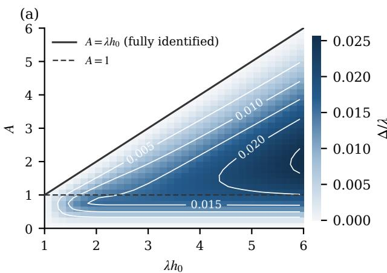

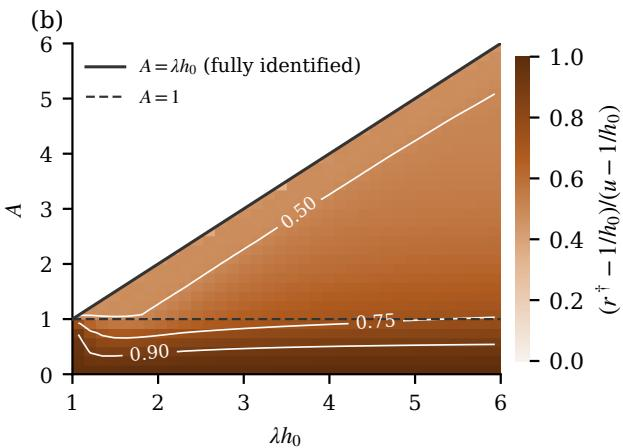  
Figure D.4 (a) Minimax regret $\Delta / \lambda$ and (b) the position $( r ^ { \dagger } - 1 / h _ { 0 } ) / ( u - 1 / h _ { 0 } )$ of the minimax reserve in the interval (4.6), $u = \mathrm { m i n } \{ \lambda , \lambda - ( A - 1 ) / h _ { 0 } \}$ , over the boundary pair $( \lambda h _ { 0 } , A ) , n = 3$ , computed with $2 0 0 \times 2 0 0$ bodies, 401 reserves and three local refinement rounds. No pair lies above the line $A = \lambda h _ { 0 } ;$ white lines are contours.

## D.5 When MHR is false

Lognormal distributions are not MHR: their hazard eventually decreases. When the observed tail violates MHR, the compatible MHR set is empty, so $W _ { G }$ under that set is not a useful regret measure. We instead evaluate actual regret $R _ { G } ^ { * } - R _ { G } ( r )$ against the distribution’s own optimum. Table D.16 uses 400 shared replications per cell at � = 3000. The plug-in continues to post a reserve after projection; it does not test or certify MHR.

Under light censoring $( \lambda = 3 )$ the projected plug-in rule misses the observed-tail optimum, and the auto-selector and Drop perform better. At the larger reserve the ordering changes. The plug-in’s mean actual regrets are 0.00–1.69%; a small loss under one distribution supplies no worst-case guarantee when MHR is false.

Table D.16 Mean actual regret in percent of each lognormal distribution’s optimal revenue $( n = 3 , N = 3 0 0 0$ 400 paired replications). Parentheses show Monte-Carlo standard errors.
<table><tr><td>Distribution</td><td>λ</td><td>Plug-in</td><td>Auto-selector</td><td>Drop</td></tr><tr><td>Lognormal(1.6, 0.5)</td><td>3</td><td>0.34 (0.00)</td><td>0.03 (0.00)</td><td>0.03 (0.00)</td></tr><tr><td>Lognormal(1.6, 0.5)</td><td>5</td><td>0.66 (0.02)</td><td>0.66 (0.02)</td><td>2.40 (0.01)</td></tr><tr><td>Lognormal(1.6, 0.8)</td><td>3</td><td>1.69 (0.00)</td><td>0.09 (0.01)</td><td>0.11 (0.01)</td></tr><tr><td>Lognormal(1.6, 0.8)</td><td>5</td><td>0.00 (0.00)</td><td>0.06 (0.01)</td><td>0.29 (0.01)</td></tr></table>

## D.6 Reserves under different shape constraints

Table D.17 gives the reserves used in Table 7.1, with the same observed tail for all three classes.

We compute minimax regret for the regular class using Theorem C.3. For the unrestricted class, tail revenue is decreasing above � on all three instances, so $B _ { \lambda } = 0$ . Corollary A.3 then gives $r _ { \mathrm { a l l } } ^ { \dag } = \lambda k _ { \alpha } / ( \alpha ^ { n } +$ $k _ { \alpha } )$ and $\Delta _ { \mathrm { a l l } } = \alpha ^ { n } r _ { \mathrm { a l l } } ^ { \dagger }$

For actual regret in Table 7.1, we integrate the revenue derivative of Section 3.1 to compute $1 0 0 [ R _ { G } ^ { * } -$ $R _ { G } ( r ) ] / R _ { G } ^ { * }$ . The true optimum for Weibull shape � and scale � is $s k ^ { - 1 / k } ;$ ; Rayleigh(1) uses $k = 2 , s = { \sqrt { 2 } }$ Direct subtraction of auction revenues agrees within $1 0 ^ { - 1 1 }$ revenue units. These are population comparisons with exact boundary information and no sampling error. MHR and regular reserves are numerical; unrestricted reserves use the exact formula above.

Table D.17 Population minimax reserves used in Table 7.1 $( n = 3 )$
<table><tr><td>Instance</td><td>λ</td><td> $r _ { \mathrm { M H R } } ^ { \dagger }$ </td><td> $r _ { \mathrm { r e g } } ^ { \dagger }$ </td><td> $r _ { \mathrm { a l l } } ^ { \dagger }$ </td></tr><tr><td>Rayleigh(1)</td><td>1.5</td><td>1.088</td><td>1.132</td><td>0.886</td></tr><tr><td>Weibull(1.5,1)</td><td>1</td><td>0.827</td><td>0.797</td><td>0.636</td></tr><tr><td>Weibull(2.5,1.5)</td><td>2</td><td>1.128</td><td>1.030</td><td>0.803</td></tr></table>

## D.7 Numerical accuracy

Table D.18 reports numerical MHR minimax regret from the default $4 0 0 \times 4 0 0$ body grid and 801 reserves with four local refinement rounds. The last column is the observed change when the number of bodies per side increases from 150 to 800. It is a stabilization check, not a rigorous error bar. The largest change on the three instances is below 0.01% of the computed minimax regret.

Corollary A.20 gives the rigorous interval

$$
\Delta ^ { \mathcal { T } } - \mathrm { L i p } _ { r } \varepsilon _ { r } \leq \Delta \leq \Delta ^ { \mathcal { T } } + 3 \lambda ^ { 2 } \operatorname* { m a x } \{ \varepsilon _ { a } , \varepsilon _ { b } \} .
$$

This bound is much more conservative than the observed refinement changes. The tables use refined numerical estimates, not tightly certified MHR minimax regret values. The regular scalar solver uses quantile mesh $1 0 ^ { - 7 }$ ; its certified intervals for minimax regret have width at most $5 \times 1 0 ^ { - 5 }$ percentage points on these instances.

Table D.18 Numerical MHR minimax regret in revenue units $( n = 3 )$ . Refinement change compares 150 with 800 bodies per side and is not an error bound.
<table><tr><td>Instance</td><td>λ</td><td>Computed minimax regret</td><td>Refinement change</td></tr><tr><td>Rayleigh(1)</td><td>1.5</td><td>0.02039</td><td>0.000001</td></tr><tr><td>Weibull(1.5,1)</td><td>1</td><td>0.00699</td><td>0.000000</td></tr><tr><td>Weibull(2.5,1.5)</td><td>2</td><td>0.04468</td><td>0.000002</td></tr></table>

Conservatism of stability constants Finite differences of the two-level worst case were compared with the bounds of Lemma 5.3 and the constants of Appendix B.2.1, on tested instances with $n \in \{ 2 , 3 , 5 \}$ and $\lambda \in \{ 0 . 5 , 1 , 2 \}$ . Table D.19 gives the largest measured-to-bound ratios. These diagnostics indicate slack on the tested instances; they do not establish uniform sharpness or replace a proof.

Table D.19 Measured finite-difference slopes relative to the proved MHR bounds.
<table><tr><td>Quantity Bound</td><td></td><td>Largest measured / bound</td></tr><tr><td> $\operatorname { L i p } _ { \Theta }$ </td><td> $3 \lambda \operatorname* { m a x } \{ 1 , \lambda \}$ </td><td>0.0486</td></tr><tr><td> $\operatorname { L i p } _ { r }$ </td><td> $\operatorname* { m a x } \{ 1 , \lambda h _ { 0 } \}$ </td><td>0.169</td></tr></table>

## D.8 Restricted randomized games

The two-level reduction concerns a single posted reserve and does not justify restricting nature to two levels against a mixture of reserves. In an exploratory finite game, the seller mixes over 61 reserves in [0.3�, �] plus the computed $r ^ { \dagger }$ , and nature chooses among $1 5 0 \times 1 5 0$ two-level bodies; a finer seller grid uses 121 reserves plus $r ^ { \dagger }$ . At the resulting mixture, a separate seeded search allows �-level hazards for $k \in \{ 2 , 3 , 4 , 6 , 8 \}$ , initialized at the game’s best two-level responses, and every returned response is re-evaluated with an independent closed form.

On the three synthetic instances of Table 7.1, the restricted game’s value is 0.9999–1.0000 times the minimax regret $\Delta .$ , and the �-level best-response search leaves the ratio within $1 0 ^ { - 4 }$ of one. A separate $6 \times 6$ grid of boundary pairs at � = 1 gives restricted values down to 0.911 of the computed minimax regret, without the �-level check. These finite searches do not determine $\Delta _ { \mathrm { r a n d } }$ : restricting the seller raises the value and restricting nature lowers it, so the experiments do not show that randomization has no value. The only guarantee the paper uses is Proposition A.13.

## D.9 Data and code availability

The eBay bid data of Jank and Shmueli [JS10] are public, under a Creative Commons Attribution 4.0 license, at Zenodo record 11259259 (originally distributed at modelingonlineauctions.com); we use its file auction.csv unchanged. Appendix D.3 describes the records we form from it, the winner imputation, the refit, and the study that repeats the comparisons of Sections 7.1 to 7.3 on the refits. Seeds and sample sharing are described in Appendix D.1. We will archive the experiment code, synthetic-data generation routines and per-replication outputs on Zenodo.