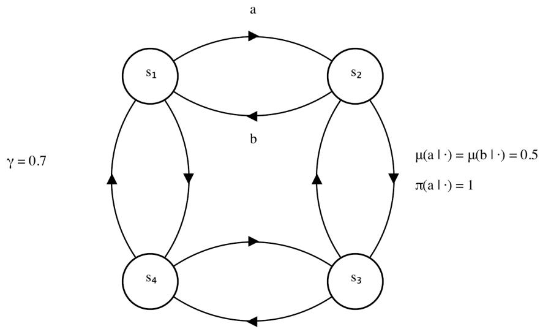

# On Convergence of Gradient Temporal-Diference Learning with Regularized Corrections and Eligibility Traces

Jingyi Jin∗   
Department of Mathematical and Statistical Sciences   
Interdisciplinary Lab for Mathematical Ecology and Epidemiology   
University of Alberta   
Edmonton, Alberta, Canada Martha White w Department of Computing Science   
University of Alberta and the Alberta Machine Intelligence Institute (Amii) Edmonton, Alberta, Canada

Hao Wang

jjin12@ualberta.ca

Department of Mathematical and Statistical Sciences

Interdisciplinary Lab for Mathematical Ecology and Epidemiology

University of Alberta

Edmonton, Alberta, Canada

hitem@ualberta.ca

hao8@ualberta.ca

## Abstract

Temporal-diference (TD) learning underlies many prediction and control algorithms, but can diverge when combined with of-policy learning, bootstrapping, and function approximation. TD with Regularized Corrections (TDRC) is theoretically sound and practically simple, but existing convergence theory covers only the one-step case under i.i.d. sampling, while the Huber Bellman-error formulation has not been extended to TDRC or eligibility traces. In this work, we establish convergence of constrained TDRC(λ) with diminishing stepsizes and non-i.i.d. of-policy data, for state-dependent and history-dependent λ-parameters. We also propose TDRC(λ)-Huber, which preserves the TDRC(λ) fixed point while reducing sensitivity to large Bellman errors. For both algorithms, we apply an ODE-based weak-convergence method from stochastic approximation theory. For the nonlinear mean dynamics of TDRC(λ)-Huber, we give an integral small-gain condition that guarantees uniqueness and global asymptotic stability of the target equilibrium. We then establish convergence of the constrained algorithm, derive computable suficient conditions for convergence, and identify a regularization-based convergence mechanism shared by linear TDRC(λ) and TDRC(λ)-Huber. When the mean TD matrix is positive stable, both constrained algorithms converge under suficiently strong regularization without requiring positive definiteness.

Keywords: Reinforcement learning, gradient temporal-diference learning, and convergence analysis.

## 1 Introduction

Of-policy value estimation with function approximation is a central problem in reinforcement learning (RL) (Patterson et al., 2022). Temporal-diference (TD) learning provides an eficient bootstrapping method for estimating value functions and forms the basis of many prediction and control algorithms. However, combining of-policy learning, bootstrapping, and function approximation can lead to divergence. Several widely used algorithms, including classical TD, semi-gradient TD, and Q-learning, may diverge in this setting (Baird, 1995; Tsitsiklis and Van Roy, 1997; Sutton and Barto, 2018; Elelimy et al., 2025). Conversely, algorithms with theoretical guarantees, such as Gradient TD methods (Sutton et al., 2009), Emphatic TD (Sutton et al., 2016), and Hybrid TD methods (Hackman, 2012; White and White, 2016), are often dificult to use in practice (Ghiassian et al., 2020). Designing ofpolicy TD algorithms that are both theoretically sound and practically efective therefore remains an important problem.

TD with Regularized Corrections (TDRC) was introduced as a gradient-based algorithm that addresses some of these limitations (Ghiassian et al., 2020; Patterson et al., 2022). TDRC adds an $\ell _ { 2 }$ regularizer to the secondary update of TD with Corrections (TDC). This regularizer is designed to retain the theoretical soundness of TDC while improving its practical behavior. In particular, the regularization parameter $\beta$ controls the interpolation between TDC and TD: setting $\beta = 0$ recovers TDC, whereas increasing β makes TDRC behave more like TD. The resulting algorithm has been studied from both empirical and theoretical perspectives. Empirically, regularization has been shown to reduce variance and accelerate the learning of the secondary weights without incurring much bias (Ghiassian et al., 2020; Patterson et al., 2022). More recent experiments have further shown that the multistep extension TDRC(λ) performs efectively in deep reinforcement learning and often exhibits stable and fast learning among the gradient-TD variants considered in (Elelimy et al., 2025). On the theoretical side, (Ghiassian et al., 2020) established convergence of one-step TDRC under the assumption of i.i.d. state transitions.

Most value function learning algorithms, including TDRC, are based on the mean squared (projected) Bellman error. A related dificulty is that squared errors are sensitive to outliers, which can both skew the solution of the objective and produce high-magnitude and high-variance updates. To reduce the influence of such errors, (Patterson et al., 2023) formulated Huber and absolute Bellman errors and derived gradient-based algorithms for their optimization. In particular, their TDC-Huber algorithm clips the estimate of the secondary variable before using it in the gradient-correction update. The resulting Huber algorithms showed improved stability and reduced sensitivity to meta-parameters.

Despite these developments, two related gaps remain. First, the existing convergence analysis of TDRC covers only the one-step case under i.i.d. state transitions (Ghiassian et al., 2020). For multistep gradient-TD algorithms with positive λ, the eligibility traces are constructed from a sequence of non-i.i.d. of-policy transitions and gather information about the multistep Bellman operator (Yu, 2017). Consequently, the existing one-step analysis does not directly cover TDRC(λ), for which no corresponding convergence result is currently available. Second, existing Huber gradient-TD algorithms are based on one-step updates (Patterson et al., 2023), and their extension to TDRC(λ) with general eligibility traces has not been proposed and analyzed. Such an extension may combine the improved stability and reduced sensitivity to meta-parameters observed for TDC-Huber with the regularization and multistep credit assignment of TDRC(λ). However, the extension is not immediate: the λ-parameters induce a generalized Bellman operator and a state–trace process, while Huber clipping makes the coupled mean field nonlinear. It therefore remains to determine whether the resulting algorithm preserves the TDRC(λ) fixed point and converges using non-i.i.d. of-policy data.

In this work, we address the two gaps identified above. We first establish convergence results for TDRC(λ) with state-dependent and history-dependent λ-parameters, using noni.i.d. of-policy data. We then formulate a Huber extension of TDRC(λ) and establish its convergence under the same settings. More specifically, our contributions are as follows.

1. Convergence of TDRC(λ). We establish convergence of constrained single-timescale TDRC(λ) with state-dependent and history-dependent λ-parameters using noni.i.d. of-policy data.

2. TDRC(λ)-Huber and a regularization-based convergence mechanism. We propose a new algorithm, TDRC(λ)-Huber, that accommodates state-dependent and history-dependent λ-parameters. We show that the proposed algorithm preserves the same fixed point as TDRC(λ) and establish convergence of the constrained algorithm under an integral small-gain condition. Our analysis further identifies a large-β convergence mechanism arising from regularization. This mechanism applies to both linear TDRC(λ) and TDRC(λ)-Huber. The clipping induced by the Huber loss reduces sensitivity to large Bellman errors while preserving this convergence guarantee.

3. Small-gain analysis for TDRC(λ)-Huber. We formulate the nonlinear mean dynamics of TDRC(λ)-Huber in feedback form. This representation separates the coupled dynamics into a Hurwitz linear subsystem and a globally Lipschitz nonlinear feedback term arising from clipping. We then apply an integral small-gain condition to establish stability of the resulting nonlinear system. This analysis shows that the target equilibrium is unique and globally asymptotically stable.

4. Computable convergence conditions and the role of the regularization parameter $\beta .$ . We derive computable suficient conditions for convergence, covering state-dependent and history-dependent λ-parameters as well as the one-step case. These conditions clarify the roles of $\beta$ and the secondary stepsize η in the convergence analysis.

The scope of these results can be compared through the matrix $A _ { \lambda }$ , defined formally in Section 3.1, which governs the mean TD(λ) dynamics. In the classical on-policy analysis, $A _ { \lambda }$ is positive definite (Tsitsiklis and Van Roy, 1997). In this case, the linear TDRC(λ) condition holds for all $\beta \geq 0$ and $\eta > 0$ . When $A _ { \lambda }$ is nonsingular but not positive definite, the suficient condition in Lemma 4, obtained by directly analyzing the coeficient matrix of the coupled linear mean ODE, involves coupled bounds on $\beta$ and $\eta .$ . For the positive-stable subclass, a diferent feedback representation, developed in Section 5.2, reveals an additional large-β convergence mechanism driven by regularization. For every $\eta > 0$ , the resulting computable suficient condition holds for both linear TDRC(λ) and TDRC(λ)-Huber when $\beta$ is suficiently large.

Our proofs combine properties of the state–trace process with the ODE-based weakconvergence method from stochastic approximation theory (Kushner and Yin, 2003). Several TD methods with eligibility traces, including LSTD(λ), ETD(λ), and GTD(λ), have been analyzed within this framework (Yu and Bertsekas, 2009; Yu, 2015, 2016, 2017). Our treatment of the primary and secondary iterates difers from the two-time-scale analysis of GTDb in Section 3.2 of (Yu, 2017). In that analysis, the secondary iterate evolves on a faster time scale, and the slow mean ODE is obtained by replacing the secondary variable with its equilibrium for each fixed value of the primary variable. In TDRC(λ), the two updates use stepsizes $\alpha _ { n }$ and $\eta \alpha _ { n } .$ , respectively, where $\eta$ is fixed. The iterates therefore evolve on the same time scale and are analyzed jointly through a coupled mean ODE. For TDRC(λ), this ODE is linear, so its stability can be studied directly. For TDRC(λ)-Huber, Huber clipping introduces a nonlinear correction to the mean ODE. We separate the resulting dynamics into a linear subsystem and a globally Lipschitz nonlinear feedback term, and establish stability through an integral small-gain condition. These ODE stability results allow the weak-convergence method to be applied to the constrained iterates.

The paper is organized as follows. In Section 2, we introduce the of-policy evaluation setting, generalized Bellman equations, and properties of the state–trace process. In Section 3, we present TDRC(λ) and TDRC(λ)-Huber and characterize their target fixed points. In Section 4, we give the convergence analysis of constrained TDRC(λ). In Section $5 ,$ we analyze the convergence of constrained TDRC(λ)-Huber. In Section 6, we discuss the role of $\beta$ and illustrate the convergence conditions using a four-state of-policy prediction problem. We conclude the paper in Section 7. The appendices contain the deferred proofs, supporting stability results, stochastic approximation verifications, and derivations of the computable conditions.

## 2 Preliminaries

In this section, we first describe the of-policy evaluation problem. We then present two choices of λ-parameters, the associated generalized Bellman equations, and the linear function approximation framework. Finally, to prepare for the subsequent convergence analysis, we introduce the state–trace process underlying the TD algorithms and review the relevant properties established by (Yu, 2017, Section 2.2).

## 2.1 Of-policy Evaluation and Linear Function Approximation

We consider policy evaluation in a finite Markov decision process (MDP). At time t, the agent observes $S _ { t } ~ \in ~ S$ and selects $A _ { t } ~ \in ~ { \cal A }$ Conditional on $S _ { t } ~ = ~ s$ and $A _ { t } \ = \ a ,$ the environment transitions to $S _ { t + 1 } = s ^ { \prime }$ with probability $p ( s ^ { \prime } \mid s , a )$ and generates a random reward $R _ { t + 1 }$ . We assume that, conditional on $( S _ { t } , A _ { t } , S _ { t + 1 } ) = ( s , a , s ^ { \prime } )$ , the reward has mean $r ( s , s ^ { \prime } )$ and finite variance. The policy to be evaluated is a stationary target policy $\pi : S \times A  [ 0 , 1 ]$ , where $\pi ( a \mid s )$ denotes the probability of selecting action a in state s.

The performance of the target policy is evaluated through its expected discounted sum of future rewards:

$$
v _ { \pi } ( s ) : = \mathbb { E } _ { s } ^ { \pi } \left[ r _ { \pi } ( S _ { 0 } ) + \sum _ { n = 1 } ^ { \infty } \left( \prod _ { k = 1 } ^ { n } \gamma ( S _ { k } ) \right) r _ { \pi } ( S _ { n } ) \right] , \qquad { \mathrm { f o r ~ a l l ~ } } s \in { \mathcal { S } } .\tag{1}
$$

Here, $r _ { \pi } : { \mathcal { S } }  \mathbb { R }$ is the expected one-step reward under $\pi , \ \gamma : S  [ 0 , 1 ]$ is the statedependent discount factor, and $\mathbb { E } _ { s } ^ { \pi }$ denotes expectation for the Markov chain induced by π with $S _ { 0 } = s$ . The function $v _ { \pi }$ in (1) is called the value function of $\pi .$ . Condition 1(i) below ensures that $v _ { \pi }$ is well defined.

In the of-policy setting, transitions and rewards are generated by a behavior policy $b : S \times \mathcal { A }  [ 0 , 1 ]$ . Let $P$ and $P ^ { o }$ denote the transition matrices on S induced by the target and behavior policies, respectively, and let $\Gamma = \mathrm { d i a g } ( \gamma ( s ) : s \in S )$ . We impose the following standard condition, adapted from Condition 2.1 of (Yu, 2017).

Condition 1 (Target and behavior policies) The transition matrices P and $P ^ { o }$ satisfy the following:

(i) The inverse $( I - P \Gamma ) ^ { - 1 }$ exists.

(ii) For all $s , s ^ { \prime } \in \mathcal { S }$

$$
P _ { s s ^ { \prime } } ^ { o } = 0 \quad \Longrightarrow \quad P _ { s s ^ { \prime } } = 0 ,
$$

and the Markov chain induced by $P ^ { o }$ is irreducible.

Under Condition $1 ( \mathrm { i } )$ , the value function $v _ { \pi }$ is well-defined and is the unique solution of the Bellman equation

$$
\begin{array} { r } { \boldsymbol { v } _ { \pi } = \boldsymbol { r } _ { \pi } + P \Gamma \boldsymbol { v } _ { \pi } , } \end{array}
$$

or, equivalently, $v _ { \pi } = ( I - P \Gamma ) ^ { - 1 } r _ { \pi }$ . Moreover, Condition 1(ii) ensures that $P ^ { o }$ has a unique invariant probability distribution ξ. Let Ξ denote the diagonal matrix whose diagonal entries are the components of $\xi .$ . For $s , s ^ { \prime } \in S$ , define the importance-sampling ratio

$$
\rho ( s , s ^ { \prime } ) = \frac { P _ { s s ^ { \prime } } } { P _ { s s ^ { \prime } } ^ { o } } ,
$$

with the convention that $\rho ( s , s ^ { \prime } ) = 0$ when $P _ { s s ^ { \prime } } ^ { o } = 0$ . These ratios correct for the diference between the transition dynamics induced by the target and behavior policies. For simplicity, we write $\rho _ { t } = \rho ( S _ { t } , S _ { t + 1 } )$

To approximate the value function $v _ { \pi }$ , let $\phi : { \mathcal { S } }  \mathbb { R } ^ { d }$ be a feature mapping, where

$$
{ \boldsymbol { \phi } } ( s ) = { \bigl ( } \phi _ { 1 } ( s ) , \ldots , \phi _ { d } ( s ) { \bigr ) } ^ { \intercal }
$$

is the feature vector associated with state s. The component functions $\phi _ { 1 } , \ldots , \phi _ { d }$ span the linear approximation subspace $\mathcal { L } _ { \phi } : = \operatorname { s p a n } \{ \phi _ { 1 } , \ldots , \phi _ { d } \}$ . Each approximate value function in $\mathcal { L } _ { \phi }$ can be parameterized as $\boldsymbol { v } _ { \boldsymbol { \theta } } ( s ) = \boldsymbol { \phi } ( s ) ^ { \top } \boldsymbol { \theta }$ . Let $\check { \Phi } \in \mathbb { R } ^ { | S | \times d }$ denote the corresponding feature matrix whose row associated with state s is $\phi ( s ) ^ { \top }$ . After identifying each function on the finite state space with the vector of its values at all states, the approximation subspace can equivalently be written as

$$
\mathcal { L } _ { \phi } = \mathrm { c o l } ( \Phi ) = \left\{ \Phi \theta : \theta \in \mathbb { R } ^ { d } \right\} \subseteq \mathbb { R } ^ { | S | } .
$$

Thus, in matrix notation, the approximate value function is $v _ { \theta } = \Phi \theta \in \mathcal { L } _ { \phi }$ , and the objective is to find a function in $\mathcal { L } _ { \phi }$ that approximates $v _ { \pi }$

## 2.2 Generalized Bellman Equations and λ-Parameters

To incorporate multistep credit assignment, we consider the eligibility-trace sequence $\left\{ \boldsymbol { e } _ { t } \right\}$ defined by

$$
e _ { t } = \lambda _ { t } \gamma _ { t } \rho _ { t - 1 } e _ { t - 1 } + \phi ( S _ { t } ) , \qquad t \geq 1 ,
$$

where $e _ { 0 } \in \mathbb { R } ^ { d }$ is an initial trace vector, $\lambda _ { t } \in [ 0 , 1 ]$ is the trace-decay parameter at time $t ,$ and $\gamma _ { t } = \gamma ( S _ { t } )$ . Following (Yu, 2017), we consider two choices of $\lambda _ { t }$

(i) State-dependent λ. In this case,

$$
\lambda _ { t } = \lambda ( S _ { t } ) , \qquad \lambda : S \to [ 0 , 1 ] .
$$

(ii) History-dependent λ. In this case, $\lambda _ { t }$ depends on the previous trace $e _ { t - 1 }$ and an auxiliary memory state $y _ { t }$ . More precisely,

$$
y _ { t } = f ( y _ { t - 1 } , S _ { t } ) , \qquad \lambda _ { t } = \lambda ( y _ { t } , e _ { t - 1 } ) ,\tag{2}
$$

where $f$ and λ are prescribed functions.

State-dependent λ is a special case of history-dependent λ. The main motivation for using history-dependent λ is that it provides greater flexibility in controlling the eligibility traces while allowing $\lambda _ { t }$ to take values over a broad range. Following Yu (2017, Section 2.1.3), we restrict our attention to history-dependent trace constructions satisfying the following additional conditions. These conditions will be used in the next subsection to establish the required properties of the state–trace process.

Condition 2 (Memory-state process) The memory states $\{ y _ { t } \}$ take values in a finite set M. Under the behavior policy $b ,$ the Markov chain $\{ ( S _ { t } , y _ { t } ) \}$ on ${ \mathcal { S } } \times { \mathcal { M } }$ has a single recurrent class.

Condition 3 (History-dependent λ) The function $\lambda : \mathcal { M } \times \mathbb { R } ^ { d } \to [ 0 , 1 ]$ satisfies the following properties. There exists a norm $\| \cdot \|$ on $\mathbb { R } ^ { d }$ such that, for every $y \in \mathcal { M }$

(i) for all $e , e ^ { \prime } \in \mathbb { R } ^ { d } , \| \lambda ( y , e ) e - \lambda ( y , e ^ { \prime } ) e ^ { \prime } \| \le \| e - e ^ { \prime } \| .$

(ii) there exists a constant $C _ { y } < \infty$ such that

$$
\left\| \gamma ( s ^ { \prime } ) \rho ( s , s ^ { \prime } ) \lambda ( y , e ) e \right\| \le C _ { y }
$$

for all $e \in \mathbb { R } ^ { d }$ and all possible state transitions $( s , s ^ { \prime } )$ that can lead to the memory state $y$

The λ-parameters afect the TD algorithms through the eligibility traces and also determine the generalized Bellman equation to be solved. In particular, the target value function $v _ { \pi }$ is the unique solution of

$$
v _ { \pi } = T ^ { ( \lambda ) } v _ { \pi } ,\tag{3}
$$

where $T ^ { ( \lambda ) }$ is an afine operator on $\mathbb { R } ^ { | \boldsymbol { S } | }$ of the form

$$
T ^ { ( \lambda ) } v = r _ { \pi } ^ { ( \lambda ) } + P ^ { ( \lambda ) } v , \qquad v \in \mathbb { R } ^ { | \mathcal { S } | } ,
$$

with $r _ { \pi } ^ { ( \lambda ) } \in \mathbb { R } ^ { | \cal { S } | }$ and $P ^ { ( \lambda ) }$ being a substochastic matrix. Under linear function approximation, TD algorithms seek an approximate solution to (3) in the approximation subspace col(Φ). The detailed construction and properties of $T ^ { ( \lambda ) }$ for state-dependent and historydependent λ are provided by (Yu, 2017, Section 2.1.3) and are not repeated here.

In most of our analysis, we treat the two choices of λ together. We therefore collect the conditions for both cases in the following assumption.

Assumption 1 Condition 1 holds. For the history-dependent λ defined in (2), Conditions 2 and 3 also hold.

## 2.3 Properties of the State–Trace Process

Following (Yu, 2017, Section 2.2), we review the key properties of the state–trace process generated under the behavior policy. These properties provide the foundation for the subsequent weak convergence analysis of the algorithms within the stochastic approximation framework (Kushner and Yin, 2003).

In the state-dependent case, define the state–trace process by $X _ { t } = ( S _ { t } , e _ { t } )$ , and in the history-dependent case by $X _ { t } = ( S _ { t } , y _ { t } , e _ { t } )$ . To prepare for handling the TD updates, which also involve the successor state, we further define $Z _ { t } = ( S _ { t } , e _ { t } , S _ { t + 1 } )$ in the state-dependent case, and $Z _ { t } = ( S _ { t } , y _ { t } , e _ { t } , S _ { t + 1 } )$ in the history-dependent case. In both cases, we use Z to denote the space of $Z _ { t }$

For an initial condition x of the state–trace process, define its occupation probability measure by

$$
\mu _ { x , n } ( D ) = { \frac { 1 } { n + 1 } } \sum _ { t = 0 } ^ { n } \mathbf { 1 } _ { \{ X _ { t } \in D \} } ,
$$

for every Borel subset D of the state–trace space. Thus, $\mu _ { x , n } ( D )$ represents the proportion of time that the process spends in D during the first $n + 1$ time steps.

Under Condition 1 and, in the history-dependent case, Conditions 2 and 3, the state– trace process has the following properties established by (Yu, 2017, Theorem 2.1 and Propositions 2.2–2.3). Let $\mathbb { P } _ { x }$ denote the probability measure associated with the process starting from the initial condition $x ,$ and $\mathbb { P } _ { x ^ { - } \mathrm { a . s } }$ . means almost surely with respect to $\mathbb { P } _ { x }$

## Proposition 1 (Properties of the state–trace process) The following statements hold:

(i) The state–trace process $\{ X _ { t } \}$ is a weak Feller Markov chain and has a unique invariant probability measure ζ. For every initial condition $x ,$ the sequence of occupation probability measures $\{ \mu _ { x , n } \}$ converges weakly to $\zeta , \mathbb { P } _ { x ^ { - } a . s }$

(ii) Let $\mathbb { E } _ { \zeta }$ denote expectation with respect to the stationary state–trace process initialized according to $\zeta . \textit { I f f } : \mathcal { Z } \to \mathbb { R } ^ { k }$ is Lipschitz continuous in the trace variable $e ,$ then $\mathbb { E } _ { \zeta } \left[ \| f ( Z _ { 0 } ) \| \right] < \infty$ . Moreover, for every initial condition of the process,

$$
\operatorname* { l i m } _ { n  \infty } \frac { 1 } { n } \sum _ { t = 0 } ^ { n - 1 } f ( Z _ { t } ) = \mathbb { E } _ { \zeta } [ f ( Z _ { 0 } ) ]
$$

both in mean and almost surely.

(iii) For every initial trace $e _ { 0 }$ , the family of trace iterates $\{ e _ { t } \} _ { t \ge 0 }$ is uniformly integrable; that is,

$$
\operatorname* { l i m } _ { K \to \infty } \operatorname* { s u p } _ { t \geq 0 } \mathbb { E } \left[ \| e _ { t } \| { \bf 1 } _ { \{ \| e _ { t } \| > K \} } \right] = 0 .
$$

(iv) For any function f satisfying the conditions in part (ii), let $\bar { f } = \mathbb { E } _ { \zeta } [ f ( Z _ { 0 } ) ]$ . Then, for every compact set $D \subset { \mathcal { Z } }$

$$
\operatorname* { l i m } _ { m , n \to \infty } { \frac { 1 } { m } } \sum _ { i = n } ^ { n + m - 1 } \left( f ( Z _ { i } ) - { \bar { f } } \right) \mathbf { 1 } _ { \{ Z _ { n } \in D \} } = 0 \qquad i n \ m e a n .
$$

The preceding properties will be used to verify the averaging conditions needed to identify the mean ODEs associated with the algorithms. The stability properties of these ODEs will then be used to establish the convergence of the algorithms.

We next record several identities used in deriving the associated mean ODEs. For $v \in \mathbb { R } ^ { | S | }$ , define the TD error by

$$
\bar { \delta } _ { t } ( v ) = \rho _ { t } \left( r ( S _ { t } , S _ { t + 1 } ) + \gamma _ { t + 1 } v ( S _ { t + 1 } ) - v ( S _ { t } ) \right) .
$$

The following identities are established in (Yu, 2017, Proposition 2.1):

$$
\mathbb { E } _ { \zeta } \left[ \phi ( S _ { 0 } ) \phi ( S _ { 0 } ) ^ { \top } \right] = \Phi ^ { \top } \Xi \Phi ,\tag{4}
$$

$$
\mathbb { E } _ { \zeta } \left[ e _ { 0 } \bar { \delta } _ { 0 } ( v ) \right] = \Phi ^ { \top } \Xi \left( T ^ { ( \lambda ) } v - v \right) , \qquad \forall v \in \mathbb { R } ^ { | \mathcal { S } | } ,\tag{5}
$$

$$
\mathbb { E } _ { \zeta } \left[ e _ { 0 } \rho _ { 0 } \left( \phi _ { i } ( S _ { 0 } ) - \gamma _ { 1 } \phi _ { i } ( S _ { 1 } ) \right) \right] = \Phi ^ { \top } \Xi \left( I - P ^ { ( \lambda ) } \right) \Phi _ { i } , \qquad 1 \leq i \leq d ,\tag{6}
$$

$$
\mathbb { E } _ { \zeta } \left[ e _ { 0 } \rho _ { 0 } ( 1 - \lambda _ { 1 } ) \gamma _ { 1 } \phi _ { i } ( S _ { 1 } ) \right] = \Phi ^ { \top } \Xi P ^ { ( \lambda ) } \Phi _ { i } , \qquad 1 \leq i \leq d .\tag{7}
$$

These identities will be used later to derive the mean fields and associated mean ODEs of the algorithms.

## 3 TDRC(λ) and Its Huber Extension

This section introduces TDRC(λ) and its Huber extension. We first define the mean squared projected Bellman error (MSPBE) and characterize its unique minimizer $\theta _ { \lambda } ^ { * }$ . We then present $\mathrm { T D R C } ( \lambda )$ and show that $( \theta _ { \lambda } ^ { * } , 0 )$ is a fixed point of its expected-update equations. Finally, we introduce one-step TDRC-Huber and extend it to general eligibility traces. The pair $( \theta _ { \lambda } ^ { * } , 0 )$ remains a fixed point of the Huber extension, while its uniqueness and stability are established in the subsequent convergence analysis.

## 3.1 Projected Bellman Error and Its Minimizer

To find a function $v \in \mathcal { L } _ { \phi }$ that approximately satisfies $v = T ^ { ( \lambda ) } v$ , we consider the projected Bellman equation on the linear approximation subspace

$$
\mathcal { L } _ { \phi } : = \mathrm { c o l } ( \Phi ) = \left\{ \Phi \theta : \theta \in \mathbb { R } ^ { d } \right\} .
$$

Let ξ denote the invariant probability distribution of the Markov chain induced by the behavior policy, and let $\Xi$ be the diagonal matrix with diagonal entries $\xi _ { s } .$ Since the behavior-policy Markov chain is irreducible, $\xi _ { s } > 0$ for every $s \in { \mathcal { S } }$ . Define the weighted Euclidean norm by

$$
\| v \| _ { \xi } ^ { 2 } : = \sum _ { s \in \mathcal { S } } \xi _ { s } v ( s ) ^ { 2 } = v ^ { \top } \Xi v .
$$

Define

$$
C = \Phi ^ { \top } \Xi \Phi .
$$

We assume that $\Phi$ has full column rank. Since $\Xi$ is positive definite, $C$ is positive definite and hence nonsingular. The projection onto $\mathcal { L } _ { \phi }$ with respect to $\lVert \cdot \rVert _ { \xi }$ is therefore

$$
\Pi _ { \xi } = \Phi C ^ { - 1 } \Phi ^ { \top } \Xi .
$$

The projected Bellman equation associated with $T ^ { ( \lambda ) }$ is

$$
\Phi \theta = \Pi _ { \xi } T ^ { ( \lambda ) } ( \Phi \theta ) .\tag{8}
$$

Define

$$
A _ { \lambda } = \Phi ^ { \top } \Xi \left( I - P ^ { ( \lambda ) } \right) \Phi , \qquad b _ { \lambda } = \Phi ^ { \top } \Xi r _ { \pi } ^ { ( \lambda ) } .
$$

Then (8) is equivalent to

$$
A _ { \lambda } \theta = b _ { \lambda } .
$$

For $v _ { \theta } = \Phi \theta$ , the associated MSPBE is

$$
J _ { \lambda } ( \theta ) : = \frac 1 2 \left\| \Pi _ { \boldsymbol { \xi } } \left( \boldsymbol { T } ^ { ( \lambda ) } \boldsymbol { v } _ { \theta } - \boldsymbol { v } _ { \theta } \right) \right\| _ { \boldsymbol { \xi } } ^ { 2 } = \frac 1 2 \left( b _ { \lambda } - A _ { \lambda } \theta \right) ^ { \top } \boldsymbol { C } ^ { - 1 } \left( b _ { \lambda } - A _ { \lambda } \theta \right) .
$$

We assume throughout that $A _ { \lambda }$ is nonsingular. Under this assumption, the projected Bellman equation has the unique solution

$$
\theta _ { \lambda } ^ { * } = A _ { \lambda } ^ { - 1 } b _ { \lambda } .
$$

Moreover,

$$
J _ { \lambda } ( \theta _ { \lambda } ^ { * } ) = 0 .
$$

Since $J _ { \lambda } ( \theta ) \ge 0$ for every $\boldsymbol { \theta } \in \mathbb { R } ^ { d }$ , with equality if and only if $A _ { \lambda } \theta = b _ { \lambda }$ , the vector $\theta _ { \lambda } ^ { * }$ is also the unique minimizer of $J _ { \lambda }$ . Consequently,

$$
v _ { \theta _ { \lambda } ^ { * } } = \Phi \theta _ { \lambda } ^ { * }
$$

is the unique element of $\mathcal { L } _ { \phi }$ satisfying the projected Bellman equation.

The MSPBE is used to characterize $\theta _ { \lambda } ^ { * }$ and to relate the algorithms to the gradient-TD framework. The proposed algorithms need not follow the exact gradient of the MSPBE. Instead, we verify directly that $( \theta _ { \lambda } ^ { * } , 0 )$ is a fixed point of their expected-update equations and establish convergence by analyzing the associated mean ODEs.

## 3.2 TDRC(λ)

Recall from Section 2 the importance-sampling ratio $\rho _ { t }$ , the state-dependent discount factor $\gamma _ { t }$ , and the eligibility trace $e _ { t }$ . For the linear approximation $v _ { \theta } = \Phi \theta$ , define the sample TD error by

$$
\begin{array} { r } { \delta _ { t } ( \theta ) = \rho _ { t } \left( R _ { t + 1 } + \gamma _ { t + 1 } \phi ( S _ { t + 1 } ) ^ { \top } \theta - \phi ( S _ { t } ) ^ { \top } \theta \right) . } \end{array}
$$

The main idea of TDRC(λ) is to regularize the secondary weights using the $\ell _ { 2 }$ regularizer $\frac { \beta } { 2 } \lVert x \rVert _ { 2 } ^ { 2 }$ , where $\beta \geq 0$ is the regularization parameter. Let $\eta > 0$ be the secondary-stepsize, so that $\eta \alpha _ { t }$ is the stepsize for the secondary update. The TDRC(λ) updates are

$$
\begin{array} { r l } & { x _ { t + 1 } = x _ { t } + \eta \alpha _ { t } \left[ e _ { t } \delta _ { t } ( \theta _ { t } ) - \phi ( S _ { t } ) \phi ( S _ { t } ) ^ { \top } x _ { t } - \beta x _ { t } \right] , } \\ & { \theta _ { t + 1 } = \theta _ { t } + \alpha _ { t } \left[ e _ { t } \delta _ { t } ( \theta _ { t } ) - \rho _ { t } ( 1 - \lambda _ { t + 1 } ) \gamma _ { t + 1 } \phi ( S _ { t + 1 } ) e _ { t } ^ { \top } x _ { t } \right] . } \end{array}
$$

The primary update has the same form as in TDC(λ), while the secondary update includes the additional term $- \beta x _ { t }$ . When $\beta \ : = \ : 0$ , the update reduces to TDC(λ). A detailed discussion of the role of $\beta$ is given in Section 6.

Under linear function approximation, a fixed point is a parameter value that remains unchanged under the expected update (Sutton and Barto, 2018, Section 9.4). Accordingly, a parameter pair $( \theta , x )$ is called a fixed point of TDRC(λ) if both expected updates are zero. As shown in Section 4.1, taking stationary expectations of the TDRC(λ) updates and using the identities established in Section 2.3 gives the associated mean ODE. Therefore, a fixed point is equivalently an equilibrium of this ODE and satisfies

$$
\begin{array} { r } { 0 = b _ { \lambda } - A _ { \lambda } \theta + ( A _ { \lambda } ^ { \top } - C ) x , } \end{array}\tag{9}
$$

$$
0 = b _ { \lambda } - A _ { \lambda } \theta - ( C + \beta I ) x .\tag{10}
$$

The following proposition identifies this fixed point and establishes its uniqueness.

Proposition 2 (Fixed point of TDRC(λ)) Suppose that $A _ { \lambda }$ and $A _ { \lambda } + \beta I$ are nonsingular. Then the expected $T D R C ( \lambda )$ recursion has the unique fixed point

$$
( \theta ^ { * } , x ^ { * } ) = ( \theta _ { \lambda } ^ { * } , 0 ) , \qquad \theta _ { \lambda } ^ { * } = A _ { \lambda } ^ { - 1 } b _ { \lambda } .
$$

Moreover, $\theta _ { \lambda } ^ { * }$ is the unique minimizer of $J _ { \lambda } ( \theta )$ .

The proof is given in Appendix A.1.

Thus, although TDRC(λ) does not follow the MSPBE gradient, it preserves the unique minimizer of $J _ { \lambda } ( \theta )$ as its unique fixed point. The subsequent convergence analysis considers the constrained algorithm, whose iterates are confined to a bounded Euclidean ball $B ( R )$ and establishes convergence to that unique fixed point from every initialization $U _ { 0 } \in B ( R )$ This is not a serious restriction in practice because, for any given finite initial point $U _ { 0 }$ , the radius R can be chosen suficiently large so that $U _ { 0 } \in B ( R )$ , after which the convergence result applies.

## 3.3 TDRC(λ)-Huber

Squared errors are sensitive to large TD errors, which may produce high-magnitude and high-variance updates. To address this issue, (Patterson et al., 2023) introduced TDC-Huber in the one-step setting, where $\lambda _ { t } \equiv 0$ and $e _ { t } = \phi ( S _ { t } )$ for $t \geq 1$ . This algorithm incorporates clipping into the correction term. Following this approach, we obtain onestep TDRC-Huber and then extend it to state-dependent and history-dependent eligibility traces, yielding TDRC(λ)-Huber.

For a threshold $\tau > 0$ , define the Huber loss by

$$
\ell _ { \tau } ( u ) = \left\{ \begin{array} { l l } { \displaystyle \frac { 1 } { 2 } u ^ { 2 } , } & { | u | \leq \tau , } \\ { \displaystyle \tau | u | - \frac { 1 } { 2 } \tau ^ { 2 } , } & { | u | > \tau . } \end{array} \right.
$$

The Huber loss admits the biconjugate representation

$$
\ell _ { \tau } ( u ) = \operatorname* { m a x } _ { h \in [ - \tau , \tau ] } \left\{ u h - \frac { 1 } { 2 } h ^ { 2 } \right\}
$$

(Patterson et al., 2023, Proposition 4.1). Thus, the auxiliary variable h in this representation is constrained to $[ - \tau , \tau ]$ . Following Patterson et al. (2023), we impose the analogous bound on the scalar correction estimate using the clipping function

$$
\begin{array} { r } { \mathrm { c l i p } _ { \tau } ( u ) = \left\{ \begin{array} { l l } { - \tau , } & { u < - \tau , } \\ { u , } & { | u | \leq \tau , } \\ { \tau , } & { u > \tau . } \end{array} \right. } \end{array}
$$

We apply the same clipping construction to TDRC. We first introduce the one-step version and then extend it to state-dependent and history-dependent eligibility traces.

When $\lambda _ { t } \equiv 0$ , the eligibility trace satisfies $e _ { t } = \phi ( S _ { t } )$ for $t \geq 1$ . We define the TDRC(0)- Huber recursion by

$$
\begin{array} { r l } & { x _ { t + 1 } = x _ { t } + \eta \alpha _ { t } \left[ \phi ( S _ { t } ) \delta _ { t } ( \theta _ { t } ) - \phi ( S _ { t } ) \phi ( S _ { t } ) ^ { \top } x _ { t } - \beta x _ { t } \right] , } \\ & { } \\ & { \theta _ { t + 1 } = \theta _ { t } + \alpha _ { t } \left[ \phi ( S _ { t } ) \delta _ { t } ( \theta _ { t } ) - \rho _ { t } \gamma _ { t + 1 } \phi ( S _ { t + 1 } ) \mathrm { c l i p } _ { \tau } \left( \phi ( S _ { t } ) ^ { \top } x _ { t } \right) \right] . } \end{array}
$$

This update combines TDC-Huber with the regularized secondary update of TDRC. When $\beta = 0$ , it reduces to TDC-Huber.

We extend this construction to eligibility traces by replacing $\phi ( S _ { t } )$ in the correction term with $e _ { t }$ . The resulting TDRC(λ)-Huber update is

$$
\begin{array} { r l } & { x _ { t + 1 } = x _ { t } + \eta \alpha _ { t } \left[ e _ { t } \delta _ { t } ( \theta _ { t } ) - \phi ( S _ { t } ) \phi ( S _ { t } ) ^ { \top } x _ { t } - \beta x _ { t } \right] , } \\ & { \theta _ { t + 1 } = \theta _ { t } + \alpha _ { t } \left[ e _ { t } \delta _ { t } ( \theta _ { t } ) - \rho _ { t } ( 1 - \lambda _ { t + 1 } ) \gamma _ { t + 1 } \phi ( S _ { t + 1 } ) \mathrm { c l i p } _ { \tau } ( e _ { t } ^ { \top } x _ { t } ) \right] . } \end{array}
$$

Thus, TDRC(0)-Huber is obtained by setting $\lambda _ { t } \equiv 0$ . Moreover,

$$
\operatorname* { l i m } _ { \tau  \infty } \mathrm { c l i p } _ { \tau } ( u ) = u ,
$$

so TDRC(λ)-Huber reduces to TDRC(λ) as $\tau \to \infty$

To identify the target fixed point, define the stationary mean correction

$$
\begin{array} { r } { \mathcal { H } _ { \lambda , \tau } ( x ) : = \mathbb { E } _ { \zeta } \left[ \rho _ { 0 } ( 1 - \lambda _ { 1 } ) \gamma _ { 1 } \phi ( S _ { 1 } ) \mathrm { c l i p } _ { \tau } ( e _ { 0 } ^ { \top } x ) \right] . } \end{array}
$$

As derived in Section 5.2, the equilibria of the associated nonlinear mean ODE, equivalently the fixed points of the expected update, satisfy

$$
0 = b _ { \lambda } - A _ { \lambda } \theta - \mathcal { H } _ { \lambda , \tau } ( x ) ,\tag{11}
$$

$$
0 = b _ { \lambda } - A _ { \lambda } \theta - ( C + \beta I ) x .\tag{12}
$$

Proposition 3 (Fixed point of TDRC(λ)-Huber) Suppose that $A _ { \lambda }$ is nonsingular. Then

$$
\left( \theta ^ { * } , x ^ { * } \right) = ( \theta _ { \lambda } ^ { * } , 0 ) , \qquad \theta _ { \lambda } ^ { * } = A _ { \lambda } ^ { - 1 } b _ { \lambda } ,
$$

is a fixed point of TDRC(λ)-Huber. Its θ-component is the minimizer of $J _ { \lambda } ( \theta )$ identified in Section 3.1. In particular, TDRC(0)-Huber has the fixed point

$$
( \theta _ { 0 } ^ { * } , 0 ) , \qquad \theta _ { 0 } ^ { * } = A _ { 0 } ^ { - 1 } b _ { 0 } .
$$

The proof is given in Appendix B.1.

This proposition establishes the existence of the target fixed point; that is, it shows that $( \theta _ { \lambda } ^ { * } , 0 )$ is a fixed point of TDRC(λ)-Huber. The later analysis in Section 5 establishes its uniqueness and convergence to it. Moreover, this point coincides with the unique fixed point of TDRC(λ), and its θ-component minimizes $J _ { \lambda } ( \theta )$

More specifically, because clipping makes the expected update nonlinear in x, the nonsingularity of $A _ { \lambda }$ alone does not rule out additional fixed points of TDRC(λ)-Huber. The convergence conditions introduced later, including the required gain condition, establish that $( \theta _ { \lambda } ^ { * } , 0 )$ is the unique globally asymptotically stable equilibrium of the associated nonlinear mean ODE. Under these conditions, it is therefore the unique fixed point of the expected recursion, and the stochastic approximation analysis establishes convergence to it. The case $\lambda _ { t } \equiv 0$ is stated separately because the subsequent analysis treats the general-trace and one-step cases separately.

## 4 Convergence Analysis of TDRC(λ)

This section establishes the convergence of constrained TDRC(λ) with diminishing stepsizes, a setting commonly used in practice. Following the weak convergence method for constrained stochastic approximation (Kushner and Yin, 2003), we first state the main convergence results. We then develop the supporting analysis by deriving the associated mean ODE and establishing the stability of its equilibrium. Finally, we verify the required stochastic approximation conditions and complete the proofs of the main results.

## 4.1 Associated Mean ODE and Main Convergence Results

In this subsection, we formulate constrained TDRC(λ) as a projected stochastic approximation recursion, derive its associated mean ODE, and establish the stability property needed for the main convergence results.

Let

$$
U _ { n } = { \binom { x _ { n } } { \theta _ { n } } } \in \mathbb { R } ^ { 2 d } , \qquad B ( R ) = \left\{ u \in \mathbb { R } ^ { 2 d } : \| u \| _ { 2 } \leq R \right\} ,
$$

and let $\Pi _ { B ( R ) }$ denote the Euclidean projection onto $B ( R )$ . The constrained TDRC(λ) recursion is

$$
U _ { n + 1 } = \Pi _ { B ( R ) } \left( \begin{array} { c } { { x _ { n } + \eta \alpha _ { n } \left[ e _ { n } \delta _ { n } ( \theta _ { n } ) - \phi ( S _ { n } ) \phi ( S _ { n } ) ^ { \top } x _ { n } - \beta x _ { n } \right] } } \\ { { \theta _ { n } + \alpha _ { n } \left[ e _ { n } \delta _ { n } ( \theta _ { n } ) - \rho _ { n } ( 1 - \lambda _ { n + 1 } ) \gamma _ { n + 1 } \phi ( S _ { n + 1 } ) e _ { n } ^ { \top } x _ { n } \right] } } \end{array} \right) .\tag{13}
$$

The projection ensures that the iterates remain bounded. The radius R is chosen suficiently large; a precise lower bound is given below in (19).

Following (Yu, 2016), we impose the following diminishing-stepsize condition. It includes slowly decreasing stepsizes such as $\alpha _ { n } = ( n + 1 ) ^ { - c }$ for $c \in ( 0 , 1 ]$

Assumption 2 (Diminishing stepsizes) The deterministic sequence $\left\{ \alpha _ { n } \right\}$ satisfies

$$
\alpha _ { n } > 0 , \qquad \alpha _ { n } \longrightarrow 0 , \qquad \sum _ { n = 0 } ^ { \infty } \alpha _ { n } = \infty .
$$

Moreover, there exists a sequence of positive integers $m _ { n } \to \infty$ such that

$$
\operatorname* { l i m } _ { n  \infty } \operatorname* { s u p } _ { 0 \leq j \leq m _ { n } } | { \frac { \alpha _ { n + j } } { \alpha _ { n } } } - 1 | = 0 .
$$

We next rewrite the update in the more concise form used in the weak-convergence analysis of (Yu, 2017). Let $Z _ { n }$ be the state–trace process defined in Section 2.3. From now on, we write

$$
Z _ { n } = ( S _ { n } , y _ { n } , e _ { n } , S _ { n + 1 } )
$$

in both cases, treating the memory state $y _ { n }$ as a dummy variable in the state-dependent case. Let $\mathcal { Z }$ denote the state space of $\left\{ Z _ { n } \right\}$

For $\boldsymbol { z } = ( s , y , e , s ^ { \prime } )$ , define

$$
\begin{array} { r l } & { \bar { \delta } ( s , s ^ { \prime } , v _ { \theta } ) = \rho ( s , s ^ { \prime } ) \left[ r ( s , s ^ { \prime } ) + \gamma ( s ^ { \prime } ) \phi ( s ^ { \prime } ) ^ { \top } \theta - \phi ( s ) ^ { \top } \theta \right] , } \\ & { \quad k ( \theta , x , z ) = e \bar { \delta } ( s , s ^ { \prime } , v _ { \theta } ) - \phi ( s ) \phi ( s ) ^ { \top } x , } \\ & { \quad h ( \theta , x , z ) = \eta \left[ k ( \theta , x , z ) - \beta x \right] . } \end{array}
$$

For state-dependent λ, define

$$
g ( \theta , x , z ) = e \bar { \delta } ( s , s ^ { \prime } , v _ { \theta } ) - \rho ( s , s ^ { \prime } ) \left( 1 - \lambda ( s ^ { \prime } ) \right) \gamma ( s ^ { \prime } ) \phi ( s ^ { \prime } ) e ^ { \top } x .
$$

For history-dependent λ, define

$$
g ( \theta , x , z ) = e \bar { \delta } ( s , s ^ { \prime } , v _ { \theta } ) - \rho ( s , s ^ { \prime } ) \left( 1 - \lambda ( f ( y , s ^ { \prime } ) , e ) \right) \gamma ( s ^ { \prime } ) \phi ( s ^ { \prime } ) e ^ { \top } x ,
$$

where f is the function in (2) that determines the next memory state.

The functions k and $g$ follow the notation of (Yu, 2017, Eqs. (3.43)–(3.46)). The function k corresponds to the secondary update of $\mathrm { T D C } ( \lambda )$ , while h includes the regularization term $- \beta x$ and the secondary-stepsize multiplier $\eta$ used in TDRC(λ).

Let

$$
\omega _ { n + 1 } = \rho _ { n } \left( R _ { n + 1 } - r ( S _ { n } , S _ { n + 1 } ) \right) ,
$$

which has zero mean given the history. The constrained update can then be written as

$$
U _ { n + 1 } = \Pi _ { B ( R ) } \left( { \begin{array} { c } { x _ { n } + \alpha _ { n } \left[ h ( \theta _ { n } , x _ { n } , Z _ { n } ) + \eta e _ { n } \omega _ { n + 1 } \right] } \\ { \theta _ { n } + \alpha _ { n } \left[ g ( \theta _ { n } , x _ { n } , Z _ { n } ) + e _ { n } \omega _ { n + 1 } \right] } \end{array} } \right) .
$$

Let

$$
u = { \binom { x } { \theta } } , \qquad F ( u , z ) = { \binom { h ( \theta , x , z ) } { g ( \theta , x , z ) } } , \qquad \varepsilon _ { n + 1 } = { \binom { \eta e _ { n } \omega _ { n + 1 } } { e _ { n } \omega _ { n + 1 } } } .
$$

Then the update has the compact form

$$
U _ { n + 1 } = \Pi _ { B ( R ) } \left[ U _ { n } + \alpha _ { n } \left( F ( U _ { n } , Z _ { n } ) + \varepsilon _ { n + 1 } \right) \right] .\tag{14}
$$

For each fixed $( \theta , x )$ , let

$$
\bar { h } ( \theta , x ) : = \mathbb { E } _ { \zeta } \left[ h ( \theta , x , Z _ { 0 } ) \right] , \qquad \bar { g } ( \theta , x ) : = \mathbb { E } _ { \zeta } \left[ g ( \theta , x , Z _ { 0 } ) \right] ,
$$

where $\mathbb { E } _ { \zeta }$ denotes expectation with respect to the stationary distribution of the state–trace process. By the stationary identities in Section 2.3,

$$
\bar { h } ( \theta , x ) = \eta \left[ \Phi ^ { \top } \Xi \left( T ^ { ( \lambda ) } v _ { \theta } - v _ { \theta } \right) - ( \Phi ^ { \top } \Xi \Phi + \beta I ) x \right] = \eta \left[ b _ { \lambda } - A _ { \lambda } \theta - \left( C + \beta I \right) x \right] ,\tag{15}
$$

$$
\begin{array} { r } { \bar { g } ( \theta , x ) = \Phi ^ { \top } \Xi \left( T ^ { ( \lambda ) } v _ { \theta } - v _ { \theta } \right) - \left( \Phi ^ { \top } \Xi P ^ { ( \lambda ) } \Phi \right) ^ { \top } x = b _ { \lambda } - A _ { \lambda } \theta + ( A _ { \lambda } ^ { \top } - C ) x . } \end{array}\tag{16}
$$

The final equality follows from $- \left( \Phi ^ { \top } \Xi P ^ { ( \lambda ) } \Phi \right) ^ { \top } = A _ { \lambda } ^ { \top } - C$

Define

$$
\begin{array} { r } { G ^ { \lambda } = \left( \begin{array} { c c } { - \eta ( C + \beta I ) } & { - \eta A _ { \lambda } } \\ { A _ { \lambda } ^ { \top } - C } & { - A _ { \lambda } } \end{array} \right) , \qquad g ^ { \lambda } = \left( \begin{array} { c } { \eta b _ { \lambda } } \\ { b _ { \lambda } } \end{array} \right) . } \end{array}
$$

Then

$$
\binom { \bar { h } ( \theta , x ) } { \bar { g } ( \theta , x ) } = G ^ { \lambda } u + g ^ { \lambda } .
$$

The associated projected mean ODE is

$$
\dot { u } = G ^ { \lambda } u + g ^ { \lambda } + z , \qquad z \in - \mathcal { N } _ { B ( R ) } ( u ) ,\tag{17}
$$

where z is the boundary-reflection term induced by the projection. For the Euclidean ball,

$$
\mathcal { N } _ { B ( R ) } ( u ) = \left\{ \begin{array} { l l } { \{ 0 \} , } & { \| u \| _ { 2 } < R , } \\ { \{ a u : a \geq 0 \} , } & { \| u \| _ { 2 } = R . } \end{array} \right.
$$

Thus, $z = 0$ in the interior. On the boundary, when the projection is active, $z = - a u$ for some $a \geq 0$

We now state the conditions used to establish the stability of this ODE. Let

$$
H _ { \lambda } = \frac { A _ { \lambda } + A _ { \lambda } ^ { \top } } { 2 } .
$$

A real square matrix is called Hurwitz if all its eigenvalues have negative real parts, and positive stable if all its eigenvalues have positive real parts. The following lemma gives a suficient condition for the stability of the linear mean ODE.

Lemma 4 (A suficient Hurwitz condition) Suppose that $A _ { \lambda }$ is nonsingular. If

$$
0 \leq \beta < \left\{ \begin{array} { l l } { + \infty , } & { H _ { \lambda } \succeq 0 , } \\ { \quad \quad 1 } & { \eta > \operatorname* { m a x } \left\{ 0 , - \lambda _ { \operatorname* { m i n } } \left( C ^ { - 1 } H _ { \lambda } \right) \right\} , } \\ { \overline { { \lambda _ { \operatorname* { m a x } } \left( - ( A _ { \lambda } A _ { \lambda } ^ { \top } ) ^ { - 1 } H _ { \lambda } \right) } } , } & { H _ { \lambda } \notin 0 , } \end{array} \right. \quad \eta > \operatorname* { m a x } \left\{ 0 , - \lambda _ { \operatorname* { m i n } } \left( C ^ { - 1 } H _ { \lambda } \right) \right\} ,\tag{18}
$$

then $G ^ { \lambda }$ is Hurwitz and $A _ { \lambda } + \beta I$ is nonsingular.

The condition in Lemma 4 can be satisfied for every nonsingular $A _ { \lambda }$ . It covers all possible cases of $H _ { \lambda }$ . In particular, there is no upper bound on $\beta$ when $H _ { \lambda } \succeq 0$ , whereas a finite positive upper bound is obtained when $H _ { \lambda }$ has a negative eigenvalue. The eigenvalues in (18) are real because $( A _ { \lambda } A _ { \lambda } ^ { \top } ) ^ { - 1 } H _ { \lambda }$ and $C ^ { - 1 } H _ { \lambda }$ are similar to symmetric matrices. The proof, including its relation to Conditions C1–C3 in (Ghiassian et al., 2020, Appendix H.3.1), is given in Appendix A.2.

Under (18), Lemma 4 shows that $G ^ { \lambda }$ is Hurwitz, and its unique equilibrium is

$$
u ^ { * } = - ( G ^ { \lambda } ) ^ { - 1 } g ^ { \lambda } = { \binom { 0 } { \theta _ { \lambda } ^ { * } } } , \qquad \theta _ { \lambda } ^ { * } = A _ { \lambda } ^ { - 1 } b _ { \lambda } .
$$

This is the same fixed point identified in Proposition 2.

Let $P _ { G } \succ 0$ be the unique solution of the Lyapunov equation

$$
( G ^ { \lambda } ) ^ { \top } P _ { G } + P _ { G } G ^ { \lambda } = - I ,
$$

and define

$$
R _ { 0 } = \operatorname* { m a x } \left\{ \| u ^ { * } \| _ { 2 } , \frac { \| P _ { G } u ^ { * } \| _ { 2 } } { \lambda _ { \operatorname* { m i n } } ( P _ { G } ) } \right\} .\tag{19}
$$

The following lemma shows that choosing $R ~ > ~ R _ { 0 }$ preserves the stability of $u ^ { * }$ under projection.

Lemma 5 (Stability under Euclidean projection) Suppose that $G ^ { \lambda }$ is Hurwitz, and let

$$
u ^ { * } = - ( G ^ { \lambda } ) ^ { - 1 } g ^ { \lambda } .
$$

Let $P _ { G } \succ 0$ be the unique solution of

$$
( G ^ { \lambda } ) ^ { \top } P _ { G } + P _ { G } G ^ { \lambda } = - I .
$$

If

$$
R > R _ { 0 } : = \operatorname* { m a x } \left\{ \| u ^ { * } \| _ { 2 } , \frac { \| P _ { G } u ^ { * } \| _ { 2 } } { \lambda _ { \operatorname* { m i n } } ( P _ { G } ) } \right\} ,
$$

then $u ^ { \ast } \in$ int $B ( R )$ and is the unique globally asymptotically stable equilibrium of (17) relative to $B ( R )$ . Consequently, the limit set of the projected ODE associated with $B ( R )$ satisfies ${ \cal L } _ { B ( R ) } = \{ u ^ { * } \}$

The radius R of the constraint set can be chosen suficiently large. Thus, although the lower bound $R _ { 0 }$ may be conservative, the requirement $R > R _ { 0 }$ is not a serious restriction. When $R > R _ { 0 } , u ^ { * }$ lies in the interior of $B ( R )$ , and the projection does not change the limiting point. The projection is inactive near $u ^ { * }$ and only prevents the iterates from leaving a bounded region.

The proof is given in Appendix A.3. The lemma provides the ODE stability property required by the weak-convergence analysis. We now state the corresponding convergence results.

For $k \geq 0$ and $T > 0$ , define

$$
m ( k , T ) = \operatorname* { m a x } \left\{ m \geq k : \sum _ { j = k } ^ { m - 1 } \alpha _ { j } \leq T \right\} ,
$$

and, for $D \subset  { \mathbb { R } } ^ { 2 d }$ and $\delta > 0$ , define

$$
N _ { \delta } ( D ) = \left\{ u : \operatorname* { i n f } _ { v \in D } \| u - v \| _ { 2 } < \delta \right\} .
$$

For a singleton, we write

$$
N _ { \delta } ( u ^ { * } ) : = N _ { \delta } ( \{ u ^ { * } \} ) = \left\{ u : \| u - u ^ { * } \| _ { 2 } < \delta \right\} .
$$

Theorem 6 (Convergence of constrained TDRC(λ)) Suppose that Assumption 1 holds. Suppose also that $A _ { \lambda }$ is nonsingular and that (18) in Lemma 4 holds. Let $\left\{ \alpha _ { n } \right\}$ be diminishing stepsizes satisfying Assumption 2. Choose the constraint-set radius $R > R _ { 0 }$ as required by Lemma 5. For every initial condition of the state–trace process, including every initial trace $e _ { 0 }$ , and every $U _ { 0 } \in B ( R )$ , there exists a sequence $T _ { k } \to \infty$ such that, for every $\delta > 0$

$$
\operatorname* { l i m } _ { k \to \infty } \operatorname { s u p } _ { \mathbb { P } } \mathbb { P } \left( U _ { i } \notin N _ { \delta } ( u ^ { * } ) \ f o r \ s o m e \ i \in [ k , m ( k , T _ { k } ) ] \right) = 0 .\tag{20}
$$

Consequently,

$$
U _ { n } \longrightarrow u ^ { * } \qquad i n \ p r o b a b i l i t y .
$$

Corollary 7 (Convergence in mean) Under the conditions of Theorem $\delta ,$

$$
\operatorname* { l i m } _ { n \to \infty } \mathbb { E } \left[ \| U _ { n } - u ^ { * } \| _ { 2 } \right] = 0 .
$$

The preceding analysis studies $G ^ { \lambda }$ directly and yields the suficient condition in Lemma 4. A diferent feedback representation reveals an additional large-β convergence mechanism driven by regularization. The feedback representation underlying this result is developed in Section 5.2, and the proof is given in Appendix A.4.

Corollary 8 (A large-β condition for TDRC(λ)) Suppose that Assumption 1 holds and that $A _ { \lambda }$ is positive stable. Let $P _ { A , \lambda } \succ 0$ be the unique solution of

$$
A _ { \lambda } ^ { \top } P _ { A , \lambda } + P _ { A , \lambda } A _ { \lambda } = I ,
$$

and define

$$
\kappa _ { 2 } ( P _ { A , \lambda } ) : = \frac { \lambda _ { \operatorname* { m a x } } ( P _ { A , \lambda } ) } { \lambda _ { \operatorname* { m i n } } ( P _ { A , \lambda } ) } , \qquad \overline { { L } } _ { \lambda } : = \gamma _ { \operatorname* { m a x } } \phi _ { \operatorname* { m a x } } ^ { 2 } \xi ^ { \top } ( I - P \Gamma ) ^ { - 1 } \mathbf { 1 } .
$$

If $\eta > 0$ and $\beta \geq 0$ satisfy

$$
\beta > 2 \overline { { L } } _ { \lambda } \lambda _ { \mathrm { m a x } } ( P _ { A , \lambda } ) \sqrt { \kappa _ { 2 } ( P _ { A , \lambda } ) } \| A _ { \lambda } \| _ { 2 } - \lambda _ { \mathrm { m i n } } ( C ) ,
$$

then $G ^ { \lambda }$ is Hurwitz. Consequently, under the stepsize and projection-radius conditions of Theorem $\delta ,$ all conclusions of Theorem 6 and Corollary 7 hold.

Thus, the direct matrix analysis and the feedback representation provide suficient conditions in diferent ranges of $\beta .$ The stochastic approximation conditions required to relate the constrained recursion (14) to the projected mean ODE are verified in Appendix A.5, following the weak-convergence method of (Kushner and Yin, 2003, Theorem 8.2.3) and the organization of (Yu, 2017, Section 3.1.2). Together with Lemma 5, this verification completes the proof of the main convergence result. The proofs of Theorem 6 and Corollaries 7 and 8 are given in Appendix A.4.

Remark (correction to the original one-step TDRC condition). For $\lambda = 0$ , the bound on $\beta$ in Lemma 4 corrects the corresponding condition in Theorem 3.1 of (Ghiassian et al., 2020). Conditions C1–C3 in their Appendix H.3.1 are valid, but the derivation from Eqs. (18) to (20) leads to the incorrect bound $\beta < - \lambda _ { \operatorname* { m a x } } ( H _ { 0 } ^ { - 1 } A _ { 0 } A _ { 0 } ^ { \top } )$ . Lemma 4 corrects this bound: there is no upper bound on $\beta$ when $H _ { 0 } \succeq 0$ , whereas otherwise the corrected bound is $\beta < \frac { 1 } { \lambda _ { \operatorname* { m a x } } \mathopen { } \mathclose \bgroup \left( - ( A _ { 0 } A _ { 0 } ^ { \top } ) ^ { - 1 } H _ { 0 } \aftergroup \egroup \right) }$ . The corresponding proof is given in Appendix A.2.

## 5 Convergence Analysis of TDRC(λ)-Huber

This section establishes convergence of constrained TDRC(λ)-Huber with diminishing stepsizes. We first state the main convergence results and computable conditions for general eligibility traces and the one-step case. These computable conditions identify a large-β convergence mechanism driven by regularization. We then derive the corresponding nonlinear mean ODEs and establish their stability using an integral small-gain argument. The supporting stability results, derivations of the computable conditions, stochastic approximation verifications, and proofs are given in the appendices.

## 5.1 Main Convergence Results

The case $\lambda _ { n } \equiv 0$ gives the one-step TDRC-Huber algorithm, while TDRC(λ)-Huber extends it to general eligibility traces. We first give the convergence result for TDRC(λ)-Huber under an integral small-gain condition and then derive a computable suficient condition.

We finally specialize the analysis to the one-step case, for which specialized conditions are available.

We use the joint parameter u, the joint iterate $U _ { n } .$ , the constraint set $B ( R )$ , and the Euclidean projection $\Pi _ { B ( R ) }$ defined in Section 4.1. The constrained TDRC(λ)-Huber update is

$$
\boldsymbol { U } _ { n + 1 } = \boldsymbol { \Pi } _ { B ( R ) } \left( \begin{array} { c } { x _ { n } + \eta \alpha _ { n } \left[ e _ { n } \delta _ { n } ( \boldsymbol { \theta } _ { n } ) - \phi ( \boldsymbol { S } _ { n } ) \phi ( \boldsymbol { S } _ { n } ) ^ { \top } \boldsymbol { x } _ { n } - \beta \boldsymbol { x } _ { n } \right] } \\ { \theta _ { n } + \alpha _ { n } \left[ e _ { n } \delta _ { n } ( \boldsymbol { \theta } _ { n } ) - \rho _ { n } ( 1 - \lambda _ { n + 1 } ) \gamma _ { n + 1 } \phi ( \boldsymbol { S } _ { n + 1 } ) \mathrm { c l i p } _ { \tau } ( e _ { n } ^ { \top } \boldsymbol { x } _ { n } ) \right] } \end{array} \right) .
$$

Compared with the constrained TDRC(λ) update in (13), the auxiliary update is unchanged, while the correction term in the primary update is clipped. As in Section 4.1, the projection keeps the iterates bounded, and the radius R is chosen suficiently large.

General eligibility traces. Define

$$
M _ { \beta , \lambda } : = \left( \begin{array} { c c } { { - \eta ( C + \beta I ) } } & { { - \eta A _ { \lambda } } } \\ { { 0 } } & { { - A _ { \lambda } } } \end{array} \right) , \qquad B _ { \lambda } : = \left( \begin{array} { c } { { 0 } } \\ { { - I } } \end{array} \right) , \qquad \mathscr { C } _ { \lambda } : = \left( I \begin{array} { c } { { 0 } } \end{array} \right) .
$$

When $M _ { \beta , \lambda }$ is Hurwitz, define the integral small gain

$$
\Gamma _ { 2 } \left( M _ { \beta , \lambda } , B _ { \lambda } , \mathcal { C } _ { \lambda } \right) : = \int _ { 0 } ^ { \infty } \left\| \mathcal { C } _ { \lambda } e ^ { M _ { \beta , \lambda } t } B _ { \lambda } \right\| _ { 2 } d t .
$$

This gain is used below to formulate an integral small-gain condition that controls the efect of the nonlinear clipping term. Under the stated condition, the target fixed point of the expected recursion, equivalently the equilibrium of the mean ODE, is unique and globally asymptotically stable. This is the main ODE stability property required for the convergence theorem.

Also, define

$$
L _ { \lambda } : = \mathbb { E } _ { \zeta } \left[ \rho _ { 0 } ( 1 - \lambda _ { 1 } ) \gamma _ { 1 } \lVert \phi ( S _ { 1 } ) \rVert _ { 2 } \lVert e _ { 0 } \rVert _ { 2 } \right] .
$$

The quantity $L _ { \lambda }$ provides a Lipschitz bound for the nonlinear mean correction, thereby bounding the magnitude of its change in response to changes in x. Its properties are established in Proposition 11.

Theorem 9 (Convergence of constrained TDRC(λ)-Huber) Suppose that Assumption 1 holds and that $\left\{ \alpha _ { n } \right\}$ is a sequence of diminishing stepsizes satisfying Assumption 2. Suppose also that $A _ { \lambda }$ is positive stable, $\beta \geq 0$ , and $\eta > 0$ . Suppose that at least one of the following conditions holds:

(i) The integral gain satisfies

$$
L _ { \lambda } \Gamma _ { 2 } \left( M _ { \beta , \lambda } , B _ { \lambda } , \mathcal { C } _ { \lambda } \right) < 1 .\tag{21}
$$

(ii) Let $P _ { A , \lambda } \succ 0$ be the unique solution of

$$
A _ { \lambda } ^ { \top } P _ { A , \lambda } + P _ { A , \lambda } A _ { \lambda } = I ,\tag{22}
$$

and define

$$
\kappa _ { 2 } ( P _ { A , \lambda } ) : = \frac { \lambda _ { \operatorname* { m a x } } ( P _ { A , \lambda } ) } { \lambda _ { \operatorname* { m i n } } ( P _ { A , \lambda } ) } .
$$

Also, let

$$
\overline { { L } } _ { \lambda } : = \gamma _ { \mathrm { m a x } } \phi _ { \mathrm { m a x } } ^ { 2 } \boldsymbol { \xi } ^ { \top } ( I - P \Gamma ) ^ { - 1 } \mathbf { 1 } ,
$$

which is the computable upper bound on $L _ { \lambda }$ given in Appendix C. The parameter $\beta$ satisfies

$$
\beta > 2 \overline { { L } } _ { \lambda } \lambda _ { \operatorname* { m a x } } ( P _ { A , \lambda } ) \sqrt { \kappa _ { 2 } ( P _ { A , \lambda } ) } \| A _ { \lambda } \| _ { 2 } - \lambda _ { \operatorname* { m i n } } ( C ) .\tag{23}
$$

Define

$$
\theta _ { \lambda } ^ { \ast } : = A _ { \lambda } ^ { - 1 } b _ { \lambda } , \qquad u _ { \lambda } ^ { \ast } : = \left( { 0 \atop \theta _ { \lambda } ^ { \ast } } \right) .
$$

Choose $R > R _ { \lambda , \tau ; }$ , where $R _ { \lambda , \tau }$ is defined in Proposition 18, and let $\{ U _ { n } \} _ { n \ge 0 }$ be generated by the constrained $T D R C ( \lambda )$ -Huber recursion. For every initial condition of the state–trace process, including every initial trace $e _ { 0 }$ , and every $U _ { 0 } ~ \in ~ B ( R )$ , there exists a sequence $T _ { k } \to \infty$ such that, for every $\delta > 0$ 2

$$
\operatorname* { l i m } _ { k \to \infty } \operatorname { s u p } _ { \mathbb { P } } \mathbb { P } \left( U _ { i } \notin N _ { \delta } ( u _ { \lambda } ^ { * } ) \ f o r \ s o m e \ i \in [ k , m ( k , T _ { k } ) ] \right) = 0 .\tag{24}
$$

Consequently,

$$
U _ { n } \longrightarrow u _ { \lambda } ^ { * } \qquad i n p r o b a b i l i t y .\tag{25}
$$

Moreover, since the iterates remain in the bounded set $B ( R )$ ，

$$
\operatorname* { l i m } _ { n \to \infty } \mathbb { E } \left[ \| U _ { n } - u _ { \lambda } ^ { * } \| _ { 2 } \right] = 0 .\tag{26}
$$

Condition (i) can be checked by evaluating the integral gain numerically. Condition (ii) avoids this integration: it can be checked by solving the Lyapunov equation (22) and evaluating the resulting explicit lower bound on $\beta .$ . The derivation showing that condition (ii) implies condition (i) is given in Appendix B.6.

The one-step case. We next specialize the analysis to $\lambda _ { n } \equiv 0$ . Define

$$
\begin{array}{c} M _ { \beta , 0 } : = \left( \begin{array} { c c } { { - \eta ( C + \beta I ) } } & { { - \eta A _ { 0 } } } \\ { { 0 } } & { { - A _ { 0 } } } \end{array} \right) , \qquad B _ { 0 } : = \left( \begin{array} { c } { { 0 } } \\ { { - D _ { 0 } } } \end{array} \right) , \qquad \mathscr { C } _ { 0 } : = \left( \Phi ^ { \mathrm { ~ \tiny ~ } }  & { { 0 } } \end{array} \right) .
$$

The following result gives three suficient conditions for convergence. The first condition uses the integral gain directly. The second bounds this gain through a Lyapunov equation, while the third gives a more direct condition that avoids solving such an equation.

Corollary 10 (Convergence conditions for the one-step case) Suppose that Assumption 1 holds. Let $\left\{ \alpha _ { n } \right\}$ be a sequence of diminishing stepsizes satisfying Assumption 2. Suppose also that $A _ { 0 }$ is positive stable, $\beta \geq 0$ , and $\eta > 0$ . Define

$$
\theta _ { 0 } ^ { * } : = A _ { 0 } ^ { - 1 } b _ { 0 } , \qquad u _ { 0 } ^ { * } : = \left( { 0 \atop \theta _ { 0 } ^ { * } } \right) .
$$

Suppose that at least one of the following conditions holds:

(i) The integral gain satisfies

$$
\Gamma _ { 2 } \left( M _ { \beta , 0 } , B _ { 0 } , \mathcal { C } _ { 0 } \right) < 1 .\tag{27}
$$

(ii) Let $P _ { A } \succ 0$ be the unique solution of

$$
A _ { 0 } ^ { \top } P _ { A } + P _ { A } A _ { 0 } = I ,\tag{28}
$$

and define

$$
\kappa _ { 2 } ( P _ { A } ) : = \frac { \lambda _ { \operatorname* { m a x } } ( P _ { A } ) } { \lambda _ { \operatorname* { m i n } } ( P _ { A } ) } .
$$

The parameter $\beta$ satisfies

$$
\beta > 2 \lambda _ { \operatorname* { m a x } } ( P _ { A } ) \sqrt { \kappa _ { 2 } ( P _ { A } ) } \| \Phi \| _ { 2 } \| A _ { 0 } \| _ { 2 } \| D _ { 0 } \| _ { 2 } - \lambda _ { \operatorname* { m i n } } ( C ) .\tag{29}
$$

(iii) The symmetric part

$$
H _ { 0 } : = \frac { A _ { 0 } + A _ { 0 } ^ { \top } } { 2 }
$$

is positive definite, and

$$
\beta > \frac { \| \Phi \| _ { 2 } \| A _ { 0 } \| _ { 2 } \| D _ { 0 } \| _ { 2 } } { \lambda _ { \operatorname* { m i n } } ( H _ { 0 } ) } - \lambda _ { \operatorname* { m i n } } ( C ) .\tag{30}
$$

Choose $R > R _ { 0 , \tau }$ and let $\{ U _ { n } \} _ { n \ge 0 }$ be generated by the constrained TDRC(0)-Huber recursion with $U _ { 0 } \in B ( R )$ . Then all conclusions of Theorem 9 hold with $u _ { \lambda } ^ { * }$ replaced by $u _ { 0 } ^ { * }$

Condition (i) can be evaluated numerically. Condition (ii) gives an explicit suficient lower bound on β by bounding the integral gain through the solution of the Lyapunov equation (28). Although this condition is also numerically computable, it requires solving an auxiliary Lyapunov equation. Condition (iii) avoids this step: all quantities in the resulting bound can be computed directly from the problem matrices. Both conditions (ii) and (iii) imply condition (i) and hence guarantee convergence. The two explicit conditions are compared numerically in Section 6.3. The derivation showing that conditions (ii) and (iii) imply condition (i) is given in Appendix B.6.

We refer to condition (ii) of Theorem 9 for general eligibility traces and conditions (ii) and (iii) of Corollary 10 for the one-step case collectively as the computable conditions. These conditions provide explicit lower bounds on $\beta$ while imposing no restriction on $\eta$ beyond $\eta > 0$ . Thus, for any chosen $\eta > 0$ , convergence is guaranteed by taking $\beta$ suficiently large, making parameter selection more flexible in practice.

## 5.2 Mean ODE and Feedback Representations

We first introduce the nonlinear mean field generated by the Huber correction term. We then derive feedback representations of the mean ODE for general eligibility traces and for the one-step case.

## 5.2.1 State-Dependent and History-Dependent Choices of λ

Proposition 11 Under Assumption 1, define

$$
\begin{array} { r } { \mathcal { H } _ { \lambda , \tau } ( x ) : = \mathbb { E } _ { \zeta } \Big [ \rho _ { 0 } ( 1 - \lambda _ { 1 } ) \gamma _ { 1 } \phi ( S _ { 1 } ) \mathrm { c l i p } _ { \tau } ( e _ { 0 } ^ { \top } x ) \Big ] , \qquad x \in \mathbb { R } ^ { d } . } \end{array}
$$

Then $\mathcal { H } _ { \lambda , \tau } ( 0 ) = 0$ . Moreover, $\mathcal { H } _ { \lambda , \tau }$ is globally Lipschitz:

$$
\begin{array} { r } { \| \mathcal { H } _ { \lambda , \tau } ( \boldsymbol { x } ) - \mathcal { H } _ { \lambda , \tau } ( \boldsymbol { y } ) \| _ { 2 } \le L _ { \lambda } \| \boldsymbol { x } - \boldsymbol { y } \| _ { 2 } , \qquad \boldsymbol { x } , \boldsymbol { y } \in \mathbb { R } ^ { d } , } \end{array}
$$

where

$$
L _ { \lambda } : = \mathbb { E } _ { \zeta } [ \rho _ { 0 } ( 1 - \lambda _ { 1 } ) \gamma _ { 1 } \| \phi ( S _ { 1 } ) \| _ { 2 } \| e _ { 0 } \| _ { 2 } ] < \infty .
$$

Consequently,

$$
\begin{array} { r } { \| \mathcal { H } _ { \lambda , \tau } ( x ) \| _ { 2 } \leq L _ { \lambda } \| x \| _ { 2 } , \qquad x \in \mathbb { R } ^ { d } . } \end{array}\tag{31}
$$

The mean field is also uniformly bounded:

$$
\begin{array} { r l } & { \| \mathcal { H } _ { \lambda , \tau } ( x ) \| _ { 2 } \leq \tau \mathbb { E } _ { \zeta } [ \rho _ { 0 } ( 1 - \lambda _ { 1 } ) \gamma _ { 1 } \| \phi ( S _ { 1 } ) \| _ { 2 } ] } \\ & { \qquad = : \overline { { H } } _ { \lambda , \tau } < \infty . } \end{array}\tag{32}
$$

The proof is given in Appendix B.2.

Recall that

$$
\begin{array} { r } { C : = \Phi ^ { \top } \Xi \Phi , \qquad A _ { \lambda } : = \Phi ^ { \top } \Xi ( I - P ^ { ( \lambda ) } ) \Phi , \qquad b _ { \lambda } : = \Phi ^ { \top } \Xi r _ { \pi } ^ { ( \lambda ) } . } \end{array}
$$

We derive the mean ODE following the same steps as in Section 4.1. For state-dependent $\lambda ,$ define

$$
\begin{array} { r } { g _ { \tau } ( \theta , x , z ) = e \bar { \delta } ( s , s ^ { \prime } , v _ { \theta } ) - \rho ( s , s ^ { \prime } ) \left( 1 - \lambda ( s ^ { \prime } ) \right) \gamma ( s ^ { \prime } ) \phi ( s ^ { \prime } ) \mathrm { c l i p } _ { \tau } ( e ^ { \top } x ) . } \end{array}
$$

For history-dependent $\lambda ,$ define

$$
\begin{array} { r } { g _ { \tau } ( \theta , x , z ) = e \bar { \delta } ( s , s ^ { \prime } , v _ { \theta } ) - \rho ( s , s ^ { \prime } ) \left( 1 - \lambda ( f ( y , s ^ { \prime } ) , e ) \right) \gamma ( s ^ { \prime } ) \phi ( s ^ { \prime } ) \mathrm { c l i p } _ { \tau } ( e ^ { \top } x ) , } \end{array}
$$

where $f$ is the function in (2) that determines the next memory state.

Let

$$
\omega _ { n + 1 } = \rho _ { n } \left( R _ { n + 1 } - r ( S _ { n } , S _ { n + 1 } ) \right) ,
$$

which has zero mean given the history. The constrained update can then be written as

$$
U _ { n + 1 } = \Pi _ { B ( R ) } \left( { { x _ { n } + \alpha _ { n } \left[ h ( \theta _ { n } , x _ { n } , Z _ { n } ) + \eta e _ { n } \omega _ { n + 1 } \right] } \atop \theta _ { n } + \alpha _ { n } \left[ g _ { \tau } ( \theta _ { n } , x _ { n } , Z _ { n } ) + e _ { n } \omega _ { n + 1 } \right] } \right) .
$$

Let

$$
u = { \binom { x } { \theta } } , \qquad F _ { \tau } ( u , z ) = { \binom { h ( \theta , x , z ) } { g _ { \tau } ( \theta , x , z ) } } , \qquad \varepsilon _ { n + 1 } = { \binom { \eta e _ { n } \omega _ { n + 1 } } { e _ { n } \omega _ { n + 1 } } } .
$$

Then the update has the compact form

$$
U _ { n + 1 } = \Pi _ { B ( R ) } \left[ U _ { n } + \alpha _ { n } \left( F _ { \tau } ( U _ { n } , Z _ { n } ) + \varepsilon _ { n + 1 } \right) \right] .\tag{33}
$$

The secondary update is unchanged from TDRC(λ). Hence, its mean field is

$$
\begin{array} { r } { \overline { { h } } ( \theta , x ) = \eta \left[ b _ { \lambda } - A _ { \lambda } \theta - ( C + \beta I ) x \right] , } \end{array}
$$

which coincides with (15). For the primary update, define

$$
\begin{array} { r l } & { \bar { g } _ { \tau } ( \theta , x ) : = \mathbb { E } _ { \zeta } \left[ g _ { \tau } ( \theta , x , Z _ { 0 } ) \right] } \\ & { \quad \quad = b _ { \lambda } - A _ { \lambda } \theta - \mathbb { E } _ { \zeta } \Big [ \rho _ { 0 } ( 1 - \lambda _ { 1 } ) \gamma _ { 1 } \phi ( S _ { 1 } ) \mathrm { c l i p } _ { \tau } ( e _ { 0 } ^ { \top } x ) \Big ] } \\ & { \quad \quad = b _ { \lambda } - A _ { \lambda } \theta - \mathcal { H } _ { \lambda , \tau } ( x ) . } \end{array}
$$

Therefore, the unprojected mean ODE is

$$
\begin{array} { l } { \dot { x } ( t ) = - \eta ( C + \beta I ) x ( t ) - \eta A _ { \lambda } \theta ( t ) + \eta b _ { \lambda } , } \\ { \dot { \theta } ( t ) = - A _ { \lambda } \theta ( t ) + b _ { \lambda } - \mathcal { H } _ { \lambda , \tau } ( x ( t ) ) . } \end{array}
$$

Under the nonsingularity assumption in Section $3 , A _ { \lambda }$ is nonsingular. Define

$$
\theta _ { \lambda } ^ { \ast } : = A _ { \lambda } ^ { - 1 } b _ { \lambda } , \qquad u _ { \lambda } ^ { \ast } : = \left( { 0 \atop \theta _ { \lambda } ^ { \ast } } \right) .
$$

Let

$$
M _ { \beta , \lambda } : = \left( \begin{array} { c c } { { - \eta ( C + \beta I ) } } & { { - \eta A _ { \lambda } } } \\ { { 0 } } & { { - A _ { \lambda } } } \end{array} \right) , \qquad B _ { \lambda } : = \left( \begin{array} { c } { { 0 } } \\ { { - I } } \end{array} \right) , \qquad \mathscr { C } _ { \lambda } : = \left( I \begin{array} { c } { { 0 } } \end{array} \right) ,
$$

and

$$
q _ { \lambda } : = { \binom { \eta b _ { \lambda } } { b _ { \lambda } } } .
$$

Then

$$
q _ { \lambda } = - M _ { \beta , \lambda } u _ { \lambda } ^ { * } , \qquad \mathcal { C } _ { \lambda } u _ { \lambda } ^ { * } = 0 .
$$

Writing $u = ( x ^ { \top } , \theta ^ { \top } ) ^ { \top }$ , the mean ODE can therefore be expressed directly in the original coordinates as

$$
\begin{array} { r l } & { \dot { u } ( t ) = M _ { \beta , \lambda } u ( t ) + q _ { \lambda } + B _ { \lambda } \mathcal { H } _ { \lambda , \tau } \left( \mathcal { C } _ { \lambda } u ( t ) \right) } \\ & { \qquad = M _ { \beta , \lambda } \left( u ( t ) - u _ { \lambda } ^ { * } \right) + B _ { \lambda } \mathcal { H } _ { \lambda , \tau } \left( \mathcal { C } _ { \lambda } \left( u ( t ) - u _ { \lambda } ^ { * } \right) \right) . } \end{array}\tag{34}
$$

## 5.2.2 The One-Step Case

In the one-step case, $e _ { n } = \phi ( S _ { n } )$ , and $P ^ { ( 0 ) } = P \Gamma$ . The nonlinear mean field then admits the following explicit representation.

Corollary 12 (The one-step mean field) Suppose that the conditions of Proposition 11 hold and that $\lambda _ { n } \equiv 0$ . Then

$$
\mathcal { H } _ { 0 , \tau } ( \boldsymbol { x } ) = D _ { 0 } \Pi _ { [ - \tau , \tau ] ^ { | \boldsymbol { \mathcal { S } } | } } ( \boldsymbol { \Phi } \boldsymbol { x } ) , \qquad \boldsymbol { x } \in \mathbb { R } ^ { d } ,\tag{35}
$$

where

$$
D _ { 0 } : = \boldsymbol { \Phi } ^ { \top } ( P \boldsymbol { \Gamma } ) ^ { \top } \boldsymbol { \Xi } = \boldsymbol { \Phi } ^ { \top } ( P ^ { ( 0 ) } ) ^ { \top } \boldsymbol { \Xi } .
$$

Equivalently,

$$
\begin{array} { r } { \Big [ \Pi _ { [ - \tau , \tau ] ^ { | \mathcal { S } | } } ( \Phi \boldsymbol { x } ) \Big ] _ { \boldsymbol { s } } = \mathrm { c l i p } _ { \tau } ( \phi ( \boldsymbol { s } ) ^ { \top } \boldsymbol { x } ) , \qquad \boldsymbol { s } \in \mathcal { S } . } \end{array}
$$

Moreover, $\mathcal { H } _ { 0 , \tau }$ is globally Lipschitz:

$$
\begin{array} { r } { \left\| \Pi _ { [ - \tau , \tau ] ^ { | \mathcal { S } | } } ( v ) - \Pi _ { [ - \tau , \tau ] ^ { | \mathcal { S } | } } ( w ) \right\| _ { 2 } \le \| v - w \| _ { 2 } , \qquad v , w \in \mathbb { R } ^ { | \mathcal { S } | } . } \end{array}\tag{36}
$$

The proof is given in Appendix B.2. When $\lambda _ { n } \equiv 0$ , the one-step mean ODE is

$$
\begin{array} { l } { \dot { x } ( t ) = - \eta ( C + \beta I ) x ( t ) - \eta A _ { 0 } \theta ( t ) + \eta b _ { 0 } , } \\ { \dot { \theta } ( t ) = - A _ { 0 } \theta ( t ) + b _ { 0 } - D _ { 0 } \Pi _ { [ - \tau , \tau ] ^ { | \mathcal { S } | } } ( \Phi x ( t ) ) . } \end{array}
$$

Under the assumptions in Section $3 , A _ { 0 }$ is nonsingular. Define

$$
\theta _ { 0 } ^ { * } : = A _ { 0 } ^ { - 1 } b _ { 0 } , \qquad u _ { 0 } ^ { * } : = \left( { 0 \atop \theta _ { 0 } ^ { * } } \right) .
$$

Let

$$
M _ { \beta , 0 } : = \left( \begin{array} { c c } { { - \eta ( C + \beta I ) } } & { { - \eta A _ { 0 } } } \\ { { 0 } } & { { - A _ { 0 } } } \end{array} \right) , \qquad B _ { 0 } : = \left( \begin{array} { c } { { 0 } } \\ { { - D _ { 0 } } } \end{array} \right) , \qquad \mathscr { C } _ { 0 } : = \left( \Phi \begin{array} { c } { { 0 } } \end{array} \right) ,
$$

and

$$
q _ { 0 } : = { \binom { \eta b _ { 0 } } { b _ { 0 } } } .
$$

Then

$$
q _ { 0 } = - M _ { \beta , 0 } u _ { 0 } ^ { * } , \qquad \mathcal { C } _ { 0 } u _ { 0 } ^ { * } = 0 ,
$$

and the one-step mean ODE can be written as

$$
\begin{array} { r l } & { \dot { u } ( t ) = M _ { \beta , 0 } u ( t ) + q _ { 0 } + B _ { 0 } \Pi _ { [ - \tau , \tau ] ^ { | S | } } \left( \mathcal { C } _ { 0 } u ( t ) \right) } \\ & { \qquad = M _ { \beta , 0 } \left( u ( t ) - u _ { 0 } ^ { * } \right) + B _ { 0 } \Pi _ { [ - \tau , \tau ] ^ { | S | } } \left( \mathcal { C } _ { 0 } \left( u ( t ) - u _ { 0 } ^ { * } \right) \right) . } \end{array}\tag{37}
$$

Hence, in both the general and one-step cases, the mean ODE can be written in the form

$$
\dot { u } ( t ) = M \left( u ( t ) - u ^ { * } \right) + B F \left( \boldsymbol { \mathcal { C } } \left( u ( t ) - u ^ { * } \right) \right) .
$$

## 5.3 Stability of the Mean ODEs

The feedback representations derived in Section 5.2 show that the general eligibility-trace and one-step mean ODEs can both be written in the common form

$$
\dot { u } ( t ) = M \big ( u ( t ) - u ^ { * } \big ) + B F \big ( C ( u ( t ) - u ^ { * } ) \big ) .
$$

This common structure allows the same small-gain argument to be used in both cases. We first establish general stability criteria for a system of this form and its projected version, and then apply these results to the general eligibility-trace and one-step TDRC(λ)-Huber mean ODEs to establish their stability.

General stability criteria. For a Hurwitz matrix M, define

$$
\Gamma _ { 2 } ( M , B , { \mathcal { C } } ) : = \int _ { 0 } ^ { \infty } \| { \mathcal { C } } e ^ { M t } B \| _ { 2 } d t .
$$

Lemma 13 (Integral stability criterion) Suppose that M is Hurwitz and that $F : \mathbb { R } ^ { p } $ $\mathbb { R } ^ { q }$ satisfies

$$
F ( 0 ) = 0
$$

and

$$
\| F ( v ) - F ( w ) \| _ { 2 } \leq L _ { F } \| v - w \| _ { 2 } , \qquad v , w \in \mathbb { R } ^ { p } ,\tag{38}
$$

for some $L _ { F } \geq 0$ . If

$$
L _ { F } \Gamma _ { 2 } ( M , B , \mathcal { C } ) < 1 ,
$$

then $u ^ { * }$ is the unique globally asymptotically stable equilibrium of

$$
\dot { u } ( t ) = M \left( u ( t ) - u ^ { * } \right) + B F \left( \boldsymbol { \mathcal { C } } \left( u ( t ) - u ^ { * } \right) \right) .\tag{39}
$$

The proof is given in Appendix B.3. It applies the small-gain argument to the deviation $\widetilde { u } = u - u ^ { * }$

We next consider the projected system

$$
\dot { u } = M ( u - u ^ { * } ) + B F \left( \mathcal { C } ( u - u ^ { * } ) \right) + z , \qquad z \in - \mathcal { N } _ { B ( R ) } ( u ) ,\tag{40}
$$

where

$$
B ( R ) : = \left\{ u \in \mathbb { R } ^ { m } : \| u \| _ { 2 } \leq R \right\} ,
$$

and $\mathcal { N } _ { B ( R ) } ( u )$ denotes the normal cone of $B ( R )$ at u.

Lemma 14 (Stability under Euclidean projection) Suppose that M is Hurwitz, that the unprojected system (39) has $u ^ { * }$ as its unique globally asymptotically stable equilibrium, and that F is globally Lipschitz and satisfies

$$
\| F ( v ) \| _ { 2 } \leq \overline { { F } } , \qquad v \in \mathbb { R } ^ { p } .
$$

Let $Q \succ 0$ be the unique solution of

$$
\boldsymbol { M } ^ { \top } \boldsymbol { Q } + \boldsymbol { Q } \boldsymbol { M } = - \boldsymbol { I } ,
$$

and define

$$
K _ { Q } : = \| Q M u ^ { * } \| _ { 2 } + \| Q B \| _ { 2 } \overline { { F } }
$$

and

$$
R _ { Q } : = \operatorname* { m a x } \left\{ \| u ^ { * } \| _ { 2 } , 2 K _ { Q } \sqrt { \frac { \lambda _ { \operatorname* { m a x } } ( Q ) } { \lambda _ { \operatorname* { m i n } } ( Q ) } } \right\} .
$$

If

$$
R > R _ { Q } ,
$$

then $u ^ { \ast } \in$ int $B ( R )$ and is the unique globally asymptotically stable equilibrium of (40) relative to $B ( R )$ . Consequently,

$$
{ \cal L } _ { B ( R ) } = \{ u ^ { * } \} .
$$

The proof is given in Appendix B.4. It first shows that every projected solution enters a positively invariant set contained in int $B ( R )$ . The projection term then vanishes, and the conclusion of Lemma 13 gives convergence to $u ^ { * }$

Application to the mean ODEs. Having established Lemmas 13 and 14, we apply them to obtain stability results for the projected mean ODEs corresponding to the general eligibility-trace and one-step feedback representations (34) and (37), respectively.

For state-dependent and history-dependent choices of λ, the general eligibility-trace case corresponds to

$$
M = M _ { \beta , \lambda } , \qquad B = B _ { \lambda } , \qquad \mathcal { C } = \mathcal { C } _ { \lambda } , \qquad F = \mathcal { H } _ { \lambda , \tau } , \qquad u ^ { * } = u _ { \lambda } ^ { * } .
$$

Under condition (21) and $R > R _ { \lambda , \tau }$ , the two lemmas imply that $u _ { \lambda } ^ { * }$ is the unique globally asymptotically stable equilibrium of the projected mean ODE, with ${ \cal L } _ { B ( R ) } = \{ u _ { \lambda } ^ { * } \}$

For the one-step case, we instead take

$$
M = M _ { \beta , 0 } , \qquad B = B _ { 0 } , \qquad \mathcal { C } = \mathcal { C } _ { 0 } , \qquad F = \Pi _ { [ - \tau , \tau ] ^ { | \mathcal { S } | } } , \qquad u ^ { * } = u _ { 0 } ^ { * } .
$$

Under condition (27) and $R > R _ { 0 , \tau }$ , the same argument implies that $u _ { 0 } ^ { * }$ is the unique globally asymptotically stable equilibrium of the projected mean ODE, with ${ \cal L } _ { { B } ( R ) } = \{ u _ { 0 } ^ { * } \}$ The complete stability statements, the definitions of $R _ { \lambda , \tau }$ and $R _ { 0 , \tau }$ , and the detailed proofs are given in Appendix B.5.

Given these stability conclusions, Appendix B.7 verifies the stochastic approximation conditions needed to connect the constrained recursion (33) to the corresponding projected mean ODEs. Combining the ODE stability results with this stochastic approximation argument yields the main convergence conclusions, whose proofs are completed in Appendix B.8.

## 6 The Role of the Regularization Parameter $\beta$

This section discusses the role of the regularization parameter $\beta$ in TDRC(λ) and TDRC(λ)- Huber. We first examine its efect on the algorithms, their target equilibrium, and their convergence conditions. In particular, we explain how a diferent feedback representation reveals an additional large- $- \beta$ convergence mechanism driven by regularization. This mechanism applies to both linear TDRC(λ) and TDRC(λ)-Huber when $A _ { \lambda }$ is positive stable, including cases in which $H _ { \lambda } \yen 0$ . We then derive a necessary condition for the small-gain condition and examine how $\beta$ and $\eta$ enter this condition and the computable suficient conditions stated in Section 5.1 and justified in Appendix B.6. We also compare TDRC(λ)- Huber with TDC-Huber. Finally, we illustrate these results using a four-state of-policy prediction problem.

## 6.1 Efect of $\beta$ on the Algorithm and Convergence

The parameter $\beta$ controls the $\ell _ { 2 }$ regularization applied to the secondary update of TDC. This regularization can reduce the variance of the auxiliary weights and help them converge more quickly (Patterson et al., 2023; Ghiassian et al., 2020). When $\beta = 0$ , TDRC reduces to TDC, whereas increasing $\beta$ makes the algorithm behave more like TD. Thus, $\beta$ provides a way to interpolate between TDC and TD.

Under the assumptions used in our analysis, this regularization does not change the target equilibrium. For both TDRC(λ) and TDRC(λ)-Huber, the equilibrium satisfies

$$
A _ { \lambda } \theta _ { \lambda } ^ { \ast } = b _ { \lambda } , \qquad x ^ { \ast } = 0 .
$$

The regularization term $- \beta x$ therefore vanishes at the equilibrium. Hence, $\beta$ afects the transient dynamics and the convergence conditions, but not the limiting parameter $\theta _ { \lambda } ^ { * }$

For linear TDRC(λ), recall that

$$
H _ { \lambda } : = \frac { A _ { \lambda } + A _ { \lambda } ^ { \top } } { 2 } .
$$

If $H _ { \lambda } \succeq 0$ , the suficient condition in Lemma 4 applies for every $\beta \geq 0$ and $\eta > 0$ . If $H _ { \lambda } \yen 0$ that condition requires $\beta$ to remain below a finite upper bound and $\eta$ to exceed a lower bound. This restriction belongs to that particular suficient condition, rather than to linear TDRC(λ) itself.

The feedback representation and Corollary 8 together reveal an additional large- $\boldsymbol { \cdot } \beta$ convergence mechanism driven by regularization. If $A _ { \lambda }$ is positive stable, then, for every $\eta > 0$ the computable suficient condition holds for both linear TDRC(λ) and TDRC(λ)-Huber when $\beta$ is suficiently large. Thus, regularization provides the large- $\boldsymbol { \cdot } \beta$ convergence mechanism, while the clipping induced by the Huber loss reduces sensitivity to large Bellman errors and preserves this guarantee.

## 6.2 Efect of $\beta$ on the Small-Gain Conditions

This subsection examines how $\beta$ and $\eta$ afect the small-gain convergence analysis. We consider both a necessary condition and computable suficient conditions, and use them to compare TDRC-Huber with TDC-Huber.

We first derive a necessary condition for the small-gain condition for general λ. Since $M _ { \beta , \lambda }$ is Hurwitz,

$$
\int _ { 0 } ^ { \infty } \mathcal { C } _ { \lambda } e ^ { M _ { \beta , \lambda } t } B _ { \lambda } d t = - \mathcal { C } _ { \lambda } M _ { \beta , \lambda } ^ { - 1 } B _ { \lambda } = ( C + \beta I ) ^ { - 1 } .
$$

Therefore, the triangle inequality gives

$$
\begin{array} { r l } { \Gamma _ { 2 } \left( M _ { \beta , \lambda } , B _ { \lambda } , \mathcal { C } _ { \lambda } \right) = \displaystyle \int _ { 0 } ^ { \infty } \left\| \mathcal { C } _ { \lambda } e ^ { M _ { \beta , \lambda } t } B _ { \lambda } \right\| _ { 2 } d t } & { } \\ { \displaystyle \geq \left\| \int _ { 0 } ^ { \infty } \mathcal { C } _ { \lambda } e ^ { M _ { \beta , \lambda } t } B _ { \lambda } d t \right\| _ { 2 } } & { } \\ { \displaystyle = \left\| ( C + \beta I ) ^ { - 1 } \right\| _ { 2 } } & { } \\ { \displaystyle } & { = \frac { 1 } { \lambda _ { \operatorname* { m i n } } ( C ) + \beta } . } \end{array}\tag{41}
$$

Consequently, the small-gain condition

$$
L _ { \lambda } \Gamma _ { 2 } \left( M _ { \beta , \lambda } , B _ { \lambda } , \mathcal { C } _ { \lambda } \right) < 1
$$

can hold only if

$$
L _ { \lambda } < \lambda _ { \operatorname* { m i n } } ( C ) + \beta ,\tag{42}
$$

or equivalently,

$$
\beta > L _ { \lambda } - \lambda _ { \operatorname* { m i n } } ( C ) .\tag{43}
$$

This necessary condition shows the diferent roles of $\beta$ and $\eta$ in the small-gain analysis. Increasing $\beta$ increases the right-hand side of (42) and therefore makes the condition easier to satisfy. In contrast, changing η may change the actual value of the integral gain $\Gamma _ { 2 } ( M _ { \beta , \lambda } , B _ { \lambda } , \mathcal { C } _ { \lambda } )$ , but it does not change $L _ { \lambda }$ or the lower bound $\frac { 1 } { \lambda _ { \operatorname* { m i n } } ( C ) + \beta }$ in (41). Thus, if $\beta \leq L _ { \lambda } - \lambda _ { \operatorname* { m i n } } ( C )$ , no choice of $\eta$ can make the small-gain condition hold. However, choosing $\beta > L _ { \lambda } - \lambda _ { \operatorname* { m i n } } ( C )$ does not guarantee the small-gain condition, because the actual integral gain may still be too large. Therefore, the lower bound on $\beta$ in (43) is necessary but not suficient.

We next consider the computable suficient conditions. In the proofs, the integral gain is bounded above by expressions of the form

$$
\frac { \textsf { K } } { \lambda _ { \operatorname* { m i n } } ( C ) + \beta } ,
$$

where K does not depend on $\beta ;$ see (78), (84), and (88). Requiring these upper bounds to be less than one gives the lower bounds on $\beta$ stated in condition (ii) of Theorem 9 and in Corollary 10. Hence, increasing $\beta$ not only relaxes the necessary condition but also makes these computable suficient conditions easier to satisfy.

This also clarifies the diference between TDRC-Huber and TDC-Huber. When $\lambda = 0$ and $\beta = 0 .$ , TDRC-Huber reduces to the TDC-Huber algorithm of Patterson et al. (2023). For every $\eta > 0$ , the corresponding upper bounds take the forms

$$
{ \frac { { \mathsf { K } } _ { 0 } } { \lambda _ { \operatorname* { m i n } } ( C ) + \beta } } \qquad { \mathrm { a n d } } \qquad { \frac { { \mathsf { K } } _ { 0 } } { \lambda _ { \operatorname* { m i n } } ( C ) } }
$$

for TDRC-Huber and TDC-Huber, respectively. The TDC-Huber upper bound is independent of $\eta .$ If this upper bound is greater than or equal to one, it cannot verify the suficient small-gain condition. In contrast, $\beta$ provides an additional degree of freedom in TDRC-Huber. Increasing $\beta$ reduces its upper bound and may make it less than one, thereby verifying convergence of TDRC-Huber even when the corresponding TDC-Huber bound cannot verify convergence.

Together, these results clarify how $\beta$ and $\eta$ enter the convergence analysis:

1. Necessary condition. If $\beta$ does not satisfy (43), no choice of $\eta$ can make the smallgain condition hold. This does not imply divergence; it means that convergence cannot be established through this small-gain condition.

2. Computable suficient conditions. For every $\eta > 0$ , increasing $\beta$ reduces the analytic upper bounds on the integral gain. If one of these upper bounds becomes less than one, the corresponding suficient condition holds and convergence is guaranteed.

## 6.3 A Four-State Illustration

We illustrate these efects using the four-state of-policy prediction problem shown in Figure 1. The state space is

$$
\begin{array} { r } { S = \{ s _ { 1 } , s _ { 2 } , s _ { 3 } , s _ { 4 } \} . } \end{array}
$$

  
Figure 1: Four-state of-policy prediction problem. The target policy moves clockwise, whereas the behavior policy chooses the clockwise and counterclockwise actions with equal probability.

Let $a _ { \mathrm { { c w } } }$ and $a _ { \mathrm { c c w } }$ denote the actions that move clockwise and counterclockwise, respectively. The target policy always selects the clockwise action,

$$
\pi ( a _ { \mathrm { c w } } \mid s ) = 1 ,
$$

whereas the behavior policy b selects the two actions uniformly:

$$
b ( a _ { \mathrm { c w } } \mid s ) = b ( a _ { \mathrm { c c w } } \mid s ) = \frac { 1 } { 2 } .
$$

If $s _ { \mathrm { c w } }$ and $s _ { \mathrm { c c w } }$ are the corresponding successor states, the transition-level importancesampling ratios are

$$
\rho ( s , s _ { \mathrm { c w } } ) = 2 , \qquad \rho ( s , s _ { \mathrm { c c w } } ) = 0 .
$$

The behavior policy has the uniform stationary distribution

$$
\Xi = \frac { 1 } { 4 } I _ { 4 } .
$$

Let $P _ { \pi }$ denote the clockwise transition matrix. Set $\gamma = 0 . 7$ and choose

$$
\Phi = \frac { 1 } { 1 2 } \left( \begin{array} { c c } { { 3 } } & { { - 2 } } \\ { { - 3 } } & { { - 2 } } \\ { { 3 } } & { { 0 } } \\ { { - 3 } } & { { 2 } } \end{array} \right) , \qquad r _ { \pi } = \left( \begin{array} { c } { { 7 / 2 0 } } \\ { { - 2 7 / 4 0 } } \\ { { 1 / 4 } } \\ { { 0 } } \end{array} \right) .
$$

For $\lambda = 0$ , direct calculation gives

$$
C = { \frac { 1 } { 9 6 } } \left( { \begin{array} { c c } { 6 } & { - 1 } \\ { - 1 } & { 2 } \end{array} } \right) , \qquad A _ { 0 } = { \frac { 1 } { 9 6 0 } } \left( { \begin{array} { c c } { 1 0 2 } & { - 1 7 } \\ { - 1 7 } & { 2 0 } \end{array} } \right) ,
$$

and

$$
D _ { 0 } = { \frac { 7 } { 4 8 0 } } \left( { \begin{array} { c c c c } { - 3 } & { 3 } & { - 3 } & { 3 } \\ { - 2 } & { 0 } & { 2 } & { - 2 } \end{array} } \right) , \qquad b _ { 0 } = \left( { 5 1 / 6 4 0 } \right) .
$$

It follows that

$$
\theta _ { 0 } ^ { * } = A _ { 0 } ^ { - 1 } b _ { 0 } = { \binom { 1 } { 3 / 2 } } , \qquad v _ { \theta _ { 0 } ^ { * } } = \Phi \theta _ { 0 } ^ { * } = { \binom { 0 } { - 1 / 2 } } .
$$

A direct Bellman calculation verifies that

$$
r _ { \pi } = ( I - P _ { \pi } \Gamma ) v _ { \theta _ { 0 } ^ { \ast } } .
$$

Hence, $v _ { \theta _ { 0 } ^ { \ast } } = v _ { \pi }$ , so the target value function is exactly representable by the chosen features. Moreover, $A _ { 0 }$ is symmetric positive definite, and therefore both the direct and Lyapunov conditions apply.

## 6.3.1 The One-Step Conditions

For the numerical calculations, set $\eta = 1$ and define

$$
\Gamma _ { 0 } ^ { \mathrm { n u m } } ( \beta ) : = \Gamma _ { 2 } ( M _ { \beta , 0 } , B _ { 0 } , \mathcal { C } _ { 0 } ) .
$$

The direct and Lyapunov upper bounds on this gain are

$$
\begin{array} { r l } & { \widehat \Gamma _ { 0 } ^ { \mathrm { d i r } } ( \beta ) : = \frac { \| \Phi \| _ { 2 } \| A _ { 0 } \| _ { 2 } \| D _ { 0 } \| _ { 2 } } { \lambda _ { \operatorname* { m i n } } ( H _ { 0 } ) \left( \lambda _ { \operatorname* { m i n } } ( C ) + \beta \right) } , } \\ & { \widehat \Gamma _ { 0 } ^ { \mathrm { L y a p } } ( \beta ) : = \frac { 2 \lambda _ { \operatorname* { m a x } } ( P _ { A } ) \sqrt { \kappa _ { 2 } ( P _ { A } ) } \| \Phi \| _ { 2 } \| A _ { 0 } \| _ { 2 } \| D _ { 0 } \| _ { 2 } } { \lambda _ { \operatorname* { m i n } } ( C ) + \beta } . } \end{array}
$$

By (88) and (84),

$$
\Gamma _ { 0 } ^ { \mathrm { n u m } } ( \beta ) \leq \widehat { \Gamma } _ { 0 } ^ { \mathrm { d i r } } ( \beta ) , \qquad \Gamma _ { 0 } ^ { \mathrm { n u m } } ( \beta ) \leq \widehat { \Gamma } _ { 0 } ^ { \mathrm { L y a p } } ( \beta ) .
$$

Hence, requiring either upper bound to be less than one guarantees the one-step small-gain condition (27). For this example, the resulting requirements are

$$
\begin{array} { r l } { \widehat \Gamma _ { 0 } ^ { \mathrm { d i r } } ( \beta ) < 1 } & { \iff \quad \beta > \frac { \| \Phi \| _ { 2 } \| A _ { 0 } \| _ { 2 } \| D _ { 0 } \| _ { 2 } } { \lambda _ { \operatorname* { m i n } } ( H _ { 0 } ) } - \lambda _ { \operatorname* { m i n } } ( C ) \approx 0 . 2 7 0 , } \\ { \widehat \Gamma _ { 0 } ^ { \mathrm { L y a p } } ( \beta ) < 1 } & { \iff \quad \beta > 2 \lambda _ { \operatorname* { m a x } } ( P _ { A } ) \sqrt { \kappa _ { 2 } ( P _ { A } ) } \| \Phi \| _ { 2 } \| A _ { 0 } \| _ { 2 } \| D _ { 0 } \| _ { 2 } - \lambda _ { \operatorname* { m i n } } ( C ) \approx 0 . 7 0 8 . } \end{array}
$$

These are the lower bounds on $\beta$ from conditions (iii) and (ii), respectively, of Corollary 10, evaluated for this example.

Table 1: Numerically evaluated integral gain and its analytic upper bounds for $\lambda = 0$ . A value below one verifies the corresponding small-gain condition.
<table><tr><td> $\beta$ </td><td> $\Gamma _ { 0 } ^ { \mathrm { n u m } } ( \beta )$   $\widehat { \Gamma } _ { 0 } ^ { \mathrm { d i r } } ( \beta )$ </td><td> $\widehat { \Gamma } _ { 0 } ^ { \mathrm { L y a p } } ( \beta )$ </td></tr><tr><td>0</td><td>1.181 15.696</td><td>39.530</td></tr><tr><td> $1 / 2$ </td><td>0.092 0.556</td><td>1.401</td></tr><tr><td>1</td><td>0.049 0.283</td><td>0.713</td></tr></table>

At $\beta = 0$ , the numerical gain exceeds one, and neither analytic bound verifies the smallgain condition. $\mathrm { A t } \ \beta = 1 / 2$ , the numerical gain and the direct bound are below one, whereas the Lyapunov bound remains inconclusive. At $\beta = 1$ , the two analytic bounds are below one and therefore verify the small-gain condition. These results show that the value of $\beta$ required to verify convergence depends on the suficient condition being used. The directly evaluated gain requires the smallest value of $\beta ,$ followed by the direct analytic bound and then the more conservative Lyapunov bound.

The two bounds trade sharpness for generality. The direct bound requires

$$
H _ { 0 } = \frac { A _ { 0 } + A _ { 0 } ^ { \top } } { 2 } \succ 0 ,
$$

equivalently, $x ^ { \top } A _ { 0 } x > 0$ for every $x \neq 0$ . It is less conservative in this example. The Lyapunov bound requires only that $A _ { 0 }$ be positive stable. Since $H _ { 0 } \succ 0$ implies positive stability of $A _ { 0 }$ , but the converse need not hold, the Lyapunov condition applies more broadly, although its bound can be more conservative.

## 6.3.2 The General-Trace Condition

We next evaluate the suficient small-gain condition for several constant choices $\lambda ( s ) \equiv \lambda$ The stationary trace distribution gives

$$
( L _ { 0 } , L _ { 1 / 4 } , L _ { 1 / 2 } , L _ { 5 / 8 } ) = ( 0 . 0 5 7 8 8 8 , 0 . 0 3 8 6 9 6 , 0 . 0 2 4 2 9 3 , 0 . 0 1 8 3 9 0 ) .
$$

These values were obtained by deterministic summation from the stationary trace distribution, rather than by simulation. Let N denote the number of consecutive clockwise transitions immediately preceding the current state. Conditional on $S _ { 0 } = s .$

$$
\mathbb { P } ( N = k \mid S _ { 0 } = s ) = 2 ^ { - ( k + 1 ) } , \qquad k \geq 0 ,
$$

and

$$
e _ { 0 } = \sum _ { j = 0 } ^ { k } ( 2 \lambda \gamma ) ^ { j } \phi ( s _ { - j } ) ,
$$

where $s _ { - j }$ is the jth predecessor of s under the clockwise target dynamics. Therefore,

$$
L _ { \lambda } = \frac { ( 1 - \lambda ) \gamma } { 4 } \sum _ { s \in \cal S } \| \phi ( s _ { \mathrm { c w } } ) \| _ { 2 } \sum _ { k = 0 } ^ { \infty } 2 ^ { - ( k + 1 ) } \left\| \sum _ { j = 0 } ^ { k } ( 2 \lambda \gamma ) ^ { j } \phi ( s _ { - j } ) \right\| _ { 2 } .
$$

The series was truncated when the first omitted geometric weight was at most 10−16. For the values of λ considered here, the resulting truncation error is less than $4 \times 1 0 ^ { - 1 7 }$ . In particular,

$$
L _ { 5 / 8 } - \lambda _ { \mathrm { m i n } } ( C ) \approx 1 . 6 2 0 2 \times 1 0 ^ { - 5 } > 0 ,
$$

so the sign of this diference is not afected by numerical truncation. For each pair $( \lambda , \beta )$ ， define the small-gain quantity

$$
G _ { \lambda } ^ { \mathrm { n u m } } ( \beta ) : = L _ { \lambda } \Gamma _ { 2 } \left( M _ { \beta , \lambda } , B _ { \lambda } , \mathcal { C } _ { \lambda } \right) .\tag{44}
$$

The values with $\eta = 1$ are reported in Table 2.

Table 2: Direct numerical evaluation of $G _ { \lambda } ^ { \mathrm { n u m } } ( \beta )$ with $\eta = 1$ . A value below one verifies the suficient small-gain condition.
<table><tr><td> $\lambda$ </td><td> $\beta = 0$   $\beta = 0 . 0 2$ </td><td> $\beta = 0 . 0 5$ </td><td> $\beta = 0 . 1$ </td></tr><tr><td>0</td><td>3.465 1.781</td><td>1.072</td><td>0.662</td></tr><tr><td> $1 / 4$ </td><td>2.281 1.162</td><td>0.694</td><td>0.427</td></tr><tr><td> $1 / 2$ </td><td>1.417 0.717</td><td>0.426</td><td>0.261</td></tr><tr><td> $5 / 8$ </td><td>1.069</td><td>0.539 0.320</td><td>0.196</td></tr></table>

At $\beta = 0 ,$ all four values are greater than one. Thus, the direct evaluation with $\eta = 1$ does not verify the small-gain condition. To determine whether changing $\eta$ can make the condition hold, we use the necessary condition (43).

For this example,

$$
\lambda _ { \operatorname* { m i n } } ( C ) = { \frac { 4 - { \sqrt { 5 } } } { 9 6 } } \approx 0 . 0 1 8 3 7 4 .
$$

The necessary lower bounds on $\beta$ are therefore

$$
\begin{array} { r } { L _ { 0 } - \lambda _ { \mathrm { m i n } } ( C ) \approx 0 . 0 3 9 5 1 4 , } \\ { L _ { 1 / 4 } - \lambda _ { \mathrm { m i n } } ( C ) \approx 0 . 0 2 0 3 2 2 , } \\ { L _ { 1 / 2 } - \lambda _ { \mathrm { m i n } } ( C ) \approx 0 . 0 0 5 9 1 9 , } \\ { L _ { 5 / 8 } - \lambda _ { \mathrm { m i n } } ( C ) \approx 0 . 0 0 0 0 1 6 . } \end{array}
$$

These lower bounds are all positive. Hence, when $\beta = 0 ,$ , no choice of $\eta$ can make the small-gain condition hold for any of the four values of λ. In particular, when $\lambda = 0$ and $\beta = 0$ , this conclusion applies to the general-trace small-gain condition for TDC-Huber. It does not address the separate one-step condition in Corollary 10. This does not imply divergence; it only shows that convergence cannot be verified through the general-trace small-gain condition.

At $\beta = 0 . 0 2$ , the necessary condition is violated for $\lambda = 0$ and $\lambda = 1 / 4$ . Thus, no choice of $\eta$ can make the small-gain condition hold in these two cases. For $\lambda = 1 / 2$ and $\lambda = 5 / 8$ the necessary condition holds, and the corresponding values of $G _ { \lambda } ^ { \mathrm { n u m } } ( \beta )$ with $\eta = 1$ are below one. Hence, the suficient small-gain condition is verified for these two values of $\lambda .$

At $\beta = 0 . 0 5$ , the necessary condition holds for all four values of λ. However, with $\eta = 1$ $G _ { 0 } ^ { \mathrm { n u m } } ( 0 . 0 5 ) = 1 . 0 7 2 > 1$ . This shows that the necessary condition is not suficient for the small-gain condition. The suficient condition is verified for the other three values of λ. At $\beta = 0 . 1$ , it is verified in all four cases.

Remark. The values in the $\lambda = 0$ row of Table 2 need not agree with the corresponding values of $\Gamma _ { 0 } ^ { \mathrm { n u m } } ( \beta )$ in Table 1. The former are based on the general mean-field representation and its Lipschitz constant $L _ { 0 }$ , whereas the latter are based on the explicit one-step factorization involving $D _ { 0 }$ and Φ. These are two diferent suficient small-gain formulations of the same one-step mean ODE.

Overall, this subsection gives the following three conclusions.

(i) For $\eta = 1$ , the reported values of $G _ { \lambda } ^ { \mathrm { n u m } } ( \beta )$ decrease as $\beta$ increases, making the suficient convergence condition easier to satisfy.

(ii) Increasing $\beta$ enlarges the range of $( \lambda , \beta )$ for which the suficient convergence condition can be verified.

(iii) Whenever $\beta \leq L _ { \lambda } - \lambda _ { \operatorname* { m i n } } ( C )$ , no choice of $\eta > 0$ can make the general-trace small-gain condition hold.

These conclusions are illustrated by the numerical values and calculations above. The first two conclusions are consistent with the dependence of $G _ { \lambda } ^ { \mathrm { n u m } } ( \beta )$ on $\beta$ through $M _ { \beta , \lambda }$ in (44). The third follows from the necessary condition (43) derived in the preceding subsection.

## 7 Conclusions

In this paper, we established convergence results for constrained single-time-scale TDRC(λ) under linear function approximation. Our analysis covers state-dependent and historydependent λ-parameters and non-i.i.d. of-policy data. By treating the primary and secondary iterates jointly through a coupled linear mean ODE, we proved convergence in probability and in mean to the target fixed point.

We also introduced TDRC(λ)-Huber by extending the Huber Bellman-error formulation. We showed that the resulting algorithm preserves the fixed point of TDRC(λ). Since the clipping induced by the Huber loss introduces a nonlinear term into the mean ODE, we used an integral small-gain condition to establish uniqueness and global asymptotic stability of the equilibrium, and then proved convergence of the constrained algorithm. We further derived computable suficient conditions for state-dependent and history-dependent λ-parameters, together with specialized conditions for the one-step case. These results also identify a regularization-based convergence mechanism shared by linear TDRC(λ) and TDRC(λ)-Huber. For positive-stable $A _ { \lambda }$ , suficiently large $\beta$ gives a simple, computable convergence guarantee for every $\eta > 0$ , including cases in which $H _ { \lambda } \not \subseteq 0$ . The clipping induced by the Huber loss reduces sensitivity to large Bellman errors while preserving this convergence guarantee and the target fixed point. The four-state example illustrates how increasing $\beta$ can make the suficient convergence conditions easier to verify.

The analysis in this paper concerns constrained algorithms under linear function approximation and diminishing stepsizes. One direction for future work is to extend the convergence results to constant stepsizes. Another is to extend the ODE-based small-gain approach developed here beyond the Huber setting and apply it to a broader class of algorithms with nonlinear mean ODEs. A further direction is to develop less conservative stability analyses that exploit the additional structure of the clipping residual, with the aim of extending the Huber convergence analysis from positive-stable $A _ { \lambda }$ to the more general nonsingular setting covered by linear TDRC(λ).

## Acknowledgments and Disclosure of Funding

We thank Dr. Huizhen Yu for helpful discussions. The research of Hao Wang was partially supported by the Natural Sciences and Engineering Research Council of Canada (Individual Discovery Grant RGPIN-2025-05734) and the Canada Research Chairs program (Tier 1 Canada Research Chair Award).

## Appendix A. Proofs for Linear TDRC(λ)

## A.1 Proof of the Fixed-Point Result

Proof of Proposition 2 Let

$$
C _ { \beta } = C + \beta I , \qquad A _ { \lambda , \beta } = A _ { \lambda } + \beta I .
$$

Since $C$ is positive definite and $\beta \ge 0 , C _ { \beta }$ is positive definite and hence nonsingular. From (10),

$$
x = C _ { \beta } ^ { - 1 } \left( b _ { \lambda } - A _ { \lambda } \theta \right) .\tag{45}
$$

Substituting (45) into (9) gives

$$
0 = \left[ C _ { \beta } + A _ { \lambda } ^ { \top } - C \right] C _ { \beta } ^ { - 1 } \left( b _ { \lambda } - A _ { \lambda } \theta \right) = A _ { \lambda , \beta } ^ { \top } C _ { \beta } ^ { - 1 } \left( b _ { \lambda } - A _ { \lambda } \theta \right) .
$$

Since $A _ { \lambda , \beta }$ and $C _ { \beta }$ are nonsingular, it follows that

$$
b _ { \lambda } - A _ { \lambda } \theta = 0 .
$$

The nonsingularity of $A _ { \lambda }$ then gives

$$
\theta = { \cal A } _ { \lambda } ^ { - 1 } b _ { \lambda } = \theta _ { \lambda } ^ { * } .
$$

Substituting this result into (45) gives $x = 0$

Finally, $A _ { \lambda } \theta ^ { * } = b _ { \lambda }$ implies $J _ { \lambda } ( \theta ^ { * } ) = 0$ . Hence, $\theta _ { \lambda } ^ { * }$ is the unique minimizer of $J _ { \lambda } ( \theta )$ ■

## A.2 Proof of the Suficient Hurwitz Condition

Proof of Lemma 4 Since $A _ { \lambda }$ is nonsingular, $A _ { \lambda } A _ { \lambda } ^ { \top } \succ 0$ . We first follow the characteristicequation argument in (Ghiassian et al., 2020, Appendix H.3.1). For each eigenvalue $s \in \mathbb { C }$ of $G ^ { \lambda }$ , there exists $v \in \mathbb { C } ^ { d } \setminus \{ 0 \}$ such that

$$
s ^ { 2 } + \left( \eta \beta + \eta b _ { c } + \mu \right) s + \eta \left( \beta \mu + b _ { a } \right) = 0 ,
$$

where

$$
b _ { c } = \frac { v ^ { * } C v } { \| v \| _ { 2 } ^ { 2 } } , \qquad b _ { a } = \frac { v ^ { * } A _ { \lambda } A _ { \lambda } ^ { \top } v } { \| v \| _ { 2 } ^ { 2 } } , \qquad \mu = \frac { v ^ { * } A _ { \lambda } v } { \| v \| _ { 2 } ^ { 2 } } = \mu _ { r } + \mathrm { i } \mu _ { i } .
$$

Since

$$
H _ { \lambda } = \frac { A _ { \lambda } + A _ { \lambda } ^ { \top } } { 2 } ,
$$

we have

$$
\mu _ { r } = { \frac { v ^ { * } H _ { \lambda } v } { \| v \| _ { 2 } ^ { 2 } } } .
$$

The conditions C1–C3 in (Ghiassian et al., 2020, Appendix H.3.1) are satisfied if

$$
\beta \mu _ { r } + b _ { a } > 0 , \qquad \eta b _ { c } + \mu _ { r } > 0\tag{46}
$$

for every $v \neq 0$ . To see this, let

$$
q = \beta \mu _ { r } + b _ { a } , \qquad p = \eta b _ { c } + \mu _ { r } ,
$$

and define

$$
\Omega = \eta \beta + p , \qquad \chi = \mu _ { i } ^ { 2 } + 4 \eta q .
$$

If $p > 0$ and $q > 0$ , then

$$
\Omega > 0 , \qquad \Omega ^ { 2 } + \mathcal { X } > 0 ,
$$

and

$$
\Omega ^ { 2 } q + \beta \mu _ { i } ^ { 2 } p > 0 .
$$

These are C1–C3, respectively. It is therefore suficient to verify (46).

By the definitions above,

$$
\beta \mu _ { r } + b _ { a } = \frac { v ^ { * } ( A _ { \lambda } A _ { \lambda } ^ { \top } + \beta H _ { \lambda } ) v } { \| v \| _ { 2 } ^ { 2 } } , \qquad \eta b _ { c } + \mu _ { r } = \frac { v ^ { * } ( \eta C + H _ { \lambda } ) v } { \| v \| _ { 2 } ^ { 2 } } .
$$

Thus, (46) follows from

$$
A _ { \lambda } A _ { \lambda } ^ { \top } + \beta H _ { \lambda } \succ 0 , \qquad \eta C + H _ { \lambda } \succ 0 .\tag{47}
$$

We now show that the conditions in (18) imply these two matrix inequalities. If $H _ { \lambda } \succeq 0$ then, since $A _ { \lambda }$ is nonsingular, $A _ { \lambda } A _ { \lambda } ^ { \top } \succ 0$ , and $\beta H _ { \lambda } \succeq 0$ for every $\beta \geq 0$ . Therefore, $A _ { \lambda } A _ { \lambda } ^ { \top } + \beta H _ { \lambda } \succ 0$

Suppose that $H _ { \lambda } \yen 0$ . For any $x \in \mathbb { R } ^ { d } \backslash \{ 0 \}$ , let $y = ( A _ { \lambda } A _ { \lambda } ^ { \top } ) ^ { 1 / 2 } x$ . Since $A _ { \lambda }$ is nonsingular, $y \ne 0$ , and

$$
\begin{array} { r l } & { x ^ { \top } \left( A _ { \lambda } A _ { \lambda } ^ { \top } + \beta H _ { \lambda } \right) x } \\ & { \quad = y ^ { \top } \left[ I + \beta ( A _ { \lambda } A _ { \lambda } ^ { \top } ) ^ { - 1 / 2 } H _ { \lambda } ( A _ { \lambda } A _ { \lambda } ^ { \top } ) ^ { - 1 / 2 } \right] y } \\ & { \quad \geq \left[ 1 + \beta \lambda _ { \operatorname* { m i n } } \left( ( A _ { \lambda } A _ { \lambda } ^ { \top } ) ^ { - 1 / 2 } H _ { \lambda } ( A _ { \lambda } A _ { \lambda } ^ { \top } ) ^ { - 1 / 2 } \right) \right] \| y \| _ { 2 } ^ { 2 } . } \end{array}\tag{48}
$$

The matrix $( A _ { \lambda } A _ { \lambda } ^ { \top } ) ^ { - 1 } H _ { \lambda }$ is similar to $( A _ { \lambda } A _ { \lambda } ^ { \top } ) ^ { - 1 / 2 } H _ { \lambda } ( A _ { \lambda } A _ { \lambda } ^ { \top } ) ^ { - 1 / 2 }$ . Therefore,

$$
\lambda _ { \operatorname* { m i n } } \left( ( A _ { \lambda } A _ { \lambda } ^ { \top } ) ^ { - 1 / 2 } H _ { \lambda } ( A _ { \lambda } A _ { \lambda } ^ { \top } ) ^ { - 1 / 2 } \right) = - \lambda _ { \operatorname* { m a x } } \left( - ( A _ { \lambda } A _ { \lambda } ^ { \top } ) ^ { - 1 } H _ { \lambda } \right) .
$$

The upper bound on $\beta$ gives $1 - \beta \lambda _ { \mathrm { m a x } } \left( - ( A _ { \lambda } A _ { \lambda } ^ { \top } ) ^ { - 1 } H _ { \lambda } \right) > 0$ . It therefore follows from (48) that $A _ { \lambda } A _ { \lambda } ^ { \top } + \beta H _ { \lambda } \succ 0$

Next, for any $x \in \mathbb { R } ^ { d } \backslash \{ 0 \}$ , let $y = C ^ { 1 / 2 } x$ . Since $C \succ 0 , y \ne 0$ , and

$$
\begin{array} { r l } & { x ^ { \top } ( \eta C + H _ { \lambda } ) x = y ^ { \top } \left( \eta I + C ^ { - 1 / 2 } H _ { \lambda } C ^ { - 1 / 2 } \right) y } \\ & { \qquad \geq \left[ \eta + \lambda _ { \operatorname* { m i n } } \left( C ^ { - 1 / 2 } H _ { \lambda } C ^ { - 1 / 2 } \right) \right] \| y \| _ { 2 } ^ { 2 } . } \end{array}
$$

Since $C ^ { - 1 } H _ { \lambda }$ is similar to $C ^ { - 1 / 2 } H _ { \lambda } C ^ { - 1 / 2 }$

$$
\lambda _ { \mathrm { m i n } } \left( C ^ { - 1 / 2 } H _ { \lambda } C ^ { - 1 / 2 } \right) = \lambda _ { \mathrm { m i n } } ( C ^ { - 1 } H _ { \lambda } ) .
$$

The condition on η gives

$$
\eta + \lambda _ { \operatorname* { m i n } } ( C ^ { - 1 } H _ { \lambda } ) > 0 ,
$$

and hence

$$
\eta C + H _ { \lambda } \succ 0 .
$$

We have proved (47). Therefore, (46) and Conditions C1–C3 hold. The root calculation in (Ghiassian et al., 2020, Appendix H.3.1) then gives

$$
\mathrm { R e } ( s ) < 0
$$

for every eigenvalue s of $G ^ { \lambda }$ . Thus, $G ^ { \lambda }$ is Hurwitz.

It remains to prove that $A _ { \lambda } + \beta I$ is nonsingular. Suppose, to the contrary, that $A _ { \lambda } ^ { \top } + \beta I$ is singular. Since this matrix is real, there exists a real vector $v \neq 0$ such that

$$
A _ { \lambda } ^ { \top } v = - \beta v .
$$

It follows that

$$
v ^ { \top } A _ { \lambda } A _ { \lambda } ^ { \top } v = \| A _ { \lambda } ^ { \top } v \| _ { 2 } ^ { 2 } = \beta ^ { 2 } \| v \| _ { 2 } ^ { 2 } .
$$

Moreover, since

$$
v ^ { \top } A _ { \lambda } v = v ^ { \top } A _ { \lambda } ^ { \top } v ,
$$

we have

$$
v ^ { \top } H _ { \lambda } v = { \frac { 1 } { 2 } } v ^ { \top } \left( A _ { \lambda } + A _ { \lambda } ^ { \top } \right) v = v ^ { \top } A _ { \lambda } ^ { \top } v = - \beta \| v \| _ { 2 } ^ { 2 } .
$$

Consequently,

$$
v ^ { \top } \left( A _ { \lambda } A _ { \lambda } ^ { \top } + \beta H _ { \lambda } \right) v = \beta ^ { 2 } \| v \| _ { 2 } ^ { 2 } - \beta ^ { 2 } \| v \| _ { 2 } ^ { 2 } = 0 ,
$$

which contradicts $A _ { \lambda } A _ { \lambda } ^ { \top } + \beta H _ { \lambda } \succ 0$ . Therefore, $A _ { \lambda } ^ { \top } + \beta I$ , and hence $A _ { \lambda } + \beta I$ , is nonsingular.

## A.3 Proof of Projected Mean-ODE Stability

Proof of Lemma 5 Since

$$
R > R _ { 0 } \geq \| u ^ { * } \| _ { 2 } ,
$$

the point $u ^ { * }$ lies in the interior of $B ( R )$ . Moreover,

$$
G ^ { \lambda } u ^ { \ast } + g ^ { \lambda } = 0 ,
$$

Let

so $u ^ { * }$ is an equilibrium of the projected ODE.

$$
\widetilde { u } = u - u ^ { * }
$$

and define

$$
V ( u ) = \widetilde { u } ^ { \top } P _ { G } \widetilde { u } .
$$

Since

$$
( G ^ { \lambda } ) ^ { \top } P _ { G } + P _ { G } G ^ { \lambda } = - I ,
$$

every solution of the projected ODE satisfies, almost everywhere,

$$
\dot { V } ( u ) = 2 \widetilde { u } ^ { \top } P _ { G } \left( G ^ { \lambda } \widetilde { u } + z \right) = - \| \widetilde { u } \| _ { 2 } ^ { 2 } + 2 \widetilde { u } ^ { \top } P _ { G } z .
$$

$[ \mathbf { f _ { \alpha } } ] | u | | _ { 2 } < R$ , then $z = 0$ . If u lies on the boundary of $B ( R )$ , then

$$
z = - a u
$$

for some $a \geq 0 .$ , where $a = 0$ includes the case in which the projection is inactive. On the boundary,

$$
\begin{array} { r } { \tilde { { \boldsymbol { u } } } ^ { \top } { \boldsymbol { P } } _ { G } { \boldsymbol { u } } = { \boldsymbol { u } } ^ { \top } { \boldsymbol { P } } _ { G } { \boldsymbol { u } } - ( { \boldsymbol { u } } ^ { * } ) ^ { \top } { \boldsymbol { P } } _ { G } { \boldsymbol { u } } \geq \lambda _ { \operatorname* { m i n } } ( { \boldsymbol { P } } _ { G } ) { \boldsymbol { R } } ^ { 2 } - \| { \boldsymbol { P } } _ { G } { \boldsymbol { u } } ^ { * } \| _ { 2 } { \boldsymbol { R } } > 0 , } \end{array}
$$

where the last inequality follows from $R > R _ { 0 }$ . Therefore,

$$
2 \widetilde { u } ^ { \top } P _ { G } z = - 2 a \widetilde { u } ^ { \top } P _ { G } u \le 0 .
$$

Together with the interior case, this gives

$$
\dot { V } ( u ) \le - \| \widetilde { u } \| _ { 2 } ^ { 2 } \le - \frac { 1 } { \lambda _ { \mathrm { m a x } } ( P _ { G } ) } V ( u ) \qquad \mathrm { a l m o s t ~ e v e r y w h e r e } .\tag{49}
$$

Using the integrating factor exp $\left( \frac { t } { \lambda _ { \operatorname* { m a x } } ( P _ { G } ) } \right)$ , (49) gives

$$
{ \frac { d } { d t } } \left[ \exp \left( { \frac { t } { \lambda _ { \operatorname* { m a x } } ( P _ { G } ) } } \right) V ( u ( t ) ) \right] \leq 0 \qquad \mathrm { a l m o s t ~ e v e r y w h e r e } .
$$

Therefore,

$$
V ( u ( t ) ) \leq \exp \left( - \frac { t } { \lambda _ { \operatorname* { m a x } } ( P _ { G } ) } \right) V ( u ( 0 ) ) .
$$

Since

$$
\begin{array} { r } { \lambda _ { \operatorname* { m i n } } ( P _ { G } ) \| \widetilde { u } \| _ { 2 } ^ { 2 } \leq V ( u ) \leq \lambda _ { \operatorname* { m a x } } ( P _ { G } ) \| \widetilde { u } \| _ { 2 } ^ { 2 } , } \end{array}
$$

we obtain

$$
\| u ( t ) - u ^ { * } \| _ { 2 } \leq \sqrt { \frac { \lambda _ { \operatorname* { m a x } } ( P _ { G } ) } { \lambda _ { \operatorname* { m i n } } ( P _ { G } ) } } \exp \left( - \frac { t } { 2 \lambda _ { \operatorname* { m a x } } ( P _ { G } ) } \right) \| u ( 0 ) - u ^ { * } \| _ { 2 } .\tag{50}
$$

The multiplicative constant is finite, and the exponential factor is at most one. Hence, (50) implies Lyapunov stability (Chicone, 2024, Definition 1.31). The exponential factor also converges to zero as $t  \infty .$ , so every solution starting in $B ( R )$ converges to $u ^ { * }$ . Thus, $u ^ { * }$ is globally asymptotically stable relative to $B ( R )$ ; see (Chicone, 2024, Definition 1.33). It is the unique equilibrium in $B ( R )$ , since any other equilibrium would contradict (50).

It remains to identify the limit set. Following Yu (2016, Section 3.1), the limit set of the projected ODE associated with $B ( R )$ is

$$
L _ { B ( R ) } = \bigcap _ { \bar { t } > 0 } \bigcup _ { u ( 0 ) \in B ( R ) } \{ u ( t ) : t \geq \bar { t } \} ,\tag{51}
$$

where the union is taken over all solutions with initial conditions in $B ( R )$ , and the overline denotes closure. For every $u ( 0 ) \in B ( R )$ ，

$$
\lVert u ( 0 ) - u ^ { * } \rVert _ { 2 } \leq R + \lVert u ^ { * } \rVert _ { 2 } .
$$

Therefore, (50) gives

$$
0 \leq \operatorname* { l i m } _ { t  \infty } \| u ( t ) - u ^ { * } \| _ { 2 } \leq \operatorname* { l i m } _ { t  \infty } \sqrt { \frac { \lambda _ { \operatorname* { m a x } } ( P _ { G } ) } { \lambda _ { \operatorname* { m i n } } ( P _ { G } ) } } \exp ( - \frac { t } { 2 \lambda _ { \operatorname* { m a x } } ( P _ { G } ) } ) ( R + \| u ^ { * } \| _ { 2 } ) = 0 .
$$

Thus, for every $\delta > 0$ , there exists $\bar { t } _ { \delta } < \infty$ , independent of the initial condition and the choice of solution, such that

$$
\| u ( t ) - u ^ { * } \| _ { 2 } < \delta \qquad \mathrm { f o r ~ a l l ~ } t \geq \bar { t } _ { \delta }
$$

for every solution starting in $B ( R )$ . Consequently,

$$
\bigcup _ { u ( 0 ) \in { \cal B } ( R ) } \left\{ u ( t ) : t \geq \bar { t } _ { \delta } \right\} \subseteq N _ { \delta } ( u ^ { * } ) .
$$

It follows from (51) that

$$
L _ { B ( R ) } \subseteq \bigcup _ { u ( 0 ) \in B ( R ) } \{ u ( t ) : t \geq \bar { t } _ { \delta } \} \subseteq \overline { { { N _ { \delta } ( u ^ { * } ) } } } .
$$

Since $\delta > 0$ is arbitrary,

$$
L _ { B ( R ) } \subseteq \bigcap _ { \delta > 0 } { \overline { { N _ { \delta } ( u ^ { * } ) } } } = \{ u ^ { * } \} .
$$

Conversely, $u ( t ) \equiv u ^ { * }$ is a solution of the projected ODE. Therefore, for every $\bar { t } > 0$

$$
u ^ { \ast } \in \bigcup _ { u \left( 0 \right) \in B \left( R \right) } \left\{ u ( t ) : t \geq \bar { t } \right\} ,
$$

and hence $u ^ { * } \in L _ { B ( R ) }$ . Combining the two inclusions gives

$$
{ \cal L } _ { B ( R ) } = \{ u ^ { * } \} .
$$

## A.4 Proofs of the Main Convergence Results

Proof of Theorem 6 Appendix A.5 states and verifies the hypotheses of the weakconvergence theorem for constrained stochastic approximation (Kushner and Yin, 2003, Theorem 8.2.3). The projected mean ODE is

$$
\dot { u } = G ^ { \lambda } u + g ^ { \lambda } + z , \qquad z \in - \mathcal { N } _ { B ( R ) } ( u ) .
$$

The theorem therefore yields a sequence $T _ { k } \to \infty$ such that, for every $\delta > 0$

$$
\operatorname* { l i m } _ { k \to \infty } \operatorname { s u p } _ { \mathbb { P } } \mathbb { P } \left( U _ { i } \notin N _ { \delta } ( L _ { B ( R ) } ) { \mathrm { ~ f o r ~ s o m e ~ } } i \in [ k , m ( k , T _ { k } ) ] \right) = 0 ,
$$

where $L _ { B ( R ) }$ is the limit set of the projected ODE. Under (18), Lemma 4 shows that $G ^ { \lambda }$ is Hurwitz. Since $R > R _ { 0 }$ , Lemma 5 gives

$$
{ \cal L } _ { B ( R ) } = \{ u ^ { * } \} .
$$

Substitution of this identity gives (20) and hence convergence in probability.

Proof of Corollary 7 Theorem 6 gives convergence in probability. Because $U _ { n }$ and $u ^ { * }$ belong to the bounded set $B ( R )$ , Dudley (2002, Theorem 10.3.6) implies that convergence also holds in mean.

Proof of Corollary 8 For $\tau = \infty$ , extend the definition of $\mathrm { c l i p } _ { \tau }$ by setting

$$
\mathrm { c l i p } _ { \infty } ( a ) : = a , \qquad a \in \mathbb { R } .
$$

By (7), we have

$$
\mathcal { H } _ { \lambda , \infty } ( x ) = \mathbb { E } _ { \zeta } \Big [ \rho _ { 0 } ( 1 - \lambda _ { 1 } ) \gamma _ { 1 } \phi ( S _ { 1 } ) e _ { 0 } ^ { \top } x \Big ] = ( C - A _ { \lambda } ^ { \top } ) x .
$$

Replacing $\mathrm { c l i p } _ { \tau }$ by the identity map in the proof of Proposition 11 gives

$$
\mathcal { H } _ { \lambda , \infty } ( 0 ) = 0
$$

and

$$
\begin{array} { r } { \| \mathcal { H } _ { \lambda , \infty } ( x ) - \mathcal { H } _ { \lambda , \infty } ( y ) \| _ { 2 } \leq L _ { \lambda } \| x - y \| _ { 2 } . } \end{array}
$$

Under the stated lower bound on $\beta _ { i }$ , the integral-gain estimate (78) gives

$$
L _ { \lambda } \Gamma _ { 2 } \left( M _ { \beta , \lambda } , B _ { \lambda } , \mathcal { C } _ { \lambda } \right) < 1 .
$$

Lemma 13, applied with $F = \mathcal { H } _ { \lambda , \infty } ,$ , therefore shows that

$$
\dot { u } = G ^ { \lambda } ( u - u ^ { * } )
$$

is globally asymptotically stable. Hence, $G ^ { \lambda }$ is Hurwitz. Lemma 5 and the same weakconvergence argument as in the proof of Theorem 6 give the stated convergence conclusions.

## A.5 Verification of the Stochastic Approximation Conditions for TDRC(λ)

This subsection states and verifies the four stochastic approximation conditions required by the weak-convergence theorem.

Recall the notation

$$
u = \left[ \begin{array} { c c c } { x } \\ { \theta } \end{array} \right] , \qquad F ( u , z ) = \left[ \begin{array} { c c c } { h ( \theta , x , z ) } \\ { g ( \theta , x , z ) } \end{array} \right] , \qquad \bar { F } ( u ) = \left[ \bar { h } ( \theta , x ) \right] ,
$$

and let

$$
\varepsilon _ { n + 1 } = \left[ \begin{array} { l l } { \eta e _ { n } \omega _ { n + 1 } } \\ { e _ { n } \omega _ { n + 1 } } \end{array} \right] .
$$

Following the weak-convergence approach to stochastic approximation (Kushner and Yin, 2003), we verify the following conditions to show that the projected ODE

$$
\dot { u } = \bar { F } ( u ) + z , \qquad z \in - \mathcal { N } _ { B ( R ) } ( u ) ,
$$

is the mean ODE associated with the constrained TDRC(λ) recursion (14).

1. The following families of random variables are uniformly integrable:

$$
\{ F ( U _ { n } , Z _ { n } ) \} _ { n \ge 0 } , \qquad \{ F ( u , Z _ { n } ) : n \ge 0 , \ u \in B ( R ) \} ,
$$

and

$$
\{ F ( U _ { n } , Z _ { n } ) + \varepsilon _ { n + 1 } \} _ { n \geq 0 } .
$$

2. The family $\{ Z _ { n } \} _ { n \geq 0 }$ is tight.

3. For every compact set $D \subset { \mathcal { Z } }$ , the function $F ( u , z )$ is continuous in u, uniformly over $z \in D$

4. The mean field $\bar { F } : B ( R ) \to  { \mathbb { R } } ^ { 2 d }$ is continuous and, for every fixed $u \in B ( R )$ and every compact set $D \subset { \mathcal { Z } }$ , the conditional averaging property in Proposition 17 holds.

We verify these four conditions in turn.

## A.5.1 Verification of Condition 1

Proposition 15 For every initial trace $e _ { 0 }$ , the following families are uniformly integrable:

1. $\{ e _ { n } \} _ { n \ge 0 } ;$

2. $\{ F ( u , Z _ { n } ) : n \ge 0 , ~ u \in B ( R ) \}$ ;

3. $\{ F ( U _ { n } , Z _ { n } ) \} _ { n \ge 0 } ;$

4. $\{ F ( U _ { n } , Z _ { n } ) + \varepsilon _ { n + 1 } \} _ { n \ge 0 } .$

Proof The argument follows Yu (2017, Section 3.1.2). By Proposition 1(iii), the trace sequence $\{ e _ { n } \}$ is uniformly integrable. In addition, the functions $g$ and k are Lipschitz continuous in the trace variable, uniformly over bounded parameter sets and the remaining components of $z ;$ see Yu (2017, Section 3.1.2). Recall that

$$
h ( \theta , x , z ) = \eta \big ( k ( \theta , x , z ) - \beta x \big ) .
$$

Since the regularization term $- \beta x$ does not depend on the trace variable, the Lipschitz continuity of k in the trace variable implies the same property for $h$

The remaining argument is the same as that in Yu (2017, Section 3.1.2). It uses the boundedness of $B ( R )$ , the finiteness of the state space, the uniform integrability of $\{ e _ { n } \}$ , the Lipschitz continuity in the trace variable stated above, and the finite variance of the noise terms $\left\{ \omega _ { n + 1 } \right\}$ . These properties give uniform integrability for the corresponding component functions. Finally,

$$
F ( U _ { n } , Z _ { n } ) = { \Big [ } h ( \theta _ { n } , x _ { n } , Z _ { n } ) { \Big ] }
$$

and

$$
F ( U _ { n } , Z _ { n } ) + \varepsilon _ { n + 1 } = \left[ \begin{array} { c } { h ( \theta _ { n } , x _ { n } , Z _ { n } ) + \eta e _ { n } \omega _ { n + 1 } } \\ { g ( \theta _ { n } , x _ { n } , Z _ { n } ) + e _ { n } \omega _ { n + 1 } } \end{array} \right] .
$$

The stated uniform integrability results therefore follow from the corresponding componentwise results. ■

## A.5.2 Verification of Condition 2

Condition 2 follows directly from Yu (2017, Section 3.1.2), since our definition of $\{ Z _ { n } \}$ and the assumptions imposed on the state–trace process are the same as those used therein.

## A.5.3 Verification of Condition 3

Proposition 16 For every compact set $D \subset { \mathcal { Z } }$ , the function $F ( u , z )$ is continuous in $u ,$ uniformly over $z \in D$

Proof Write $\boldsymbol { u } = ( \boldsymbol { x } ^ { \top } , \boldsymbol { \theta } ^ { \top } ) ^ { \top }$ and fix a compact set $D \subset { \mathcal { Z } }$ . By the same argument as in Yu (2017, Section 3.1.2), the functions $g ( \theta , x , z )$ and $k ( \theta , x , z )$ are continuous in $( \theta , x )$ uniformly over $z \in D$

It remains to consider

$$
h ( \theta , x , z ) = \eta \big ( k ( \theta , x , z ) - \beta x \big ) .
$$

For every $u , u ^ { \prime }$ and $z \in D$

$$
\begin{array} { r } { \| h ( \theta , x , z ) - h ( \theta ^ { \prime } , x ^ { \prime } , z ) \| _ { 2 } \leq \eta \| k ( \theta , x , z ) - k ( \theta ^ { \prime } , x ^ { \prime } , z ) \| _ { 2 } + \eta \beta \| x - x ^ { \prime } \| _ { 2 } . } \end{array}
$$

Since $\| x - x ^ { \prime } \| _ { 2 } \leq \| u - u ^ { \prime } \| _ { 2 }$ and k is continuous in $( \theta , x )$ uniformly over $z \in D$ , the right-hand side converges to zero uniformly over $z \in D$ as $u ^ { \prime }  u$ . Hence, $h$ is continuous in $( \theta , x )$ uniformly over $z \in D$

Therefore,

$$
F ( u , z ) = { \binom { h ( \theta , x , z ) } { g ( \theta , x , z ) } }
$$

is continuous in u, uniformly over $z \in D$

## A.5.4 Verification of Condition 4

Proposition 17 The mean field $\bar { F } : B ( R ) \to  { \mathbb { R } } ^ { 2 d }$ is continuous. Moreover, for each fixed $u \in B ( R )$ and each compact set $D \subset { \mathcal { Z } }$

$$
\operatorname* { l i m } _ { m , n \to \infty } \frac { 1 } { m } \sum _ { i = n } ^ { n + m - 1 } \mathbb { E } _ { n } \big [ F ( u , Z _ { i } ) - \bar { F } ( u ) \big ] \mathbf { 1 } _ { \{ Z _ { n } \in D \} } = 0 \quad i n \ m e a n .\tag{52}
$$

Proof The mean field $\bar { F } ( u ) = G ^ { \lambda } u + g ^ { \lambda }$ is afine and hence continuous. The argument follows (Yu, 2017, Lemma 3.4). Since ${ \mathbf { 1 } } _ { \{ Z _ { n } \in D \} }$ is measurable with respect to the information available at time n, conditional Jensen’s inequality shows that it is suficient to prove the stated convergence with $\mathbb { E } _ { n }$ removed.

Fix $u = ( x ^ { \top } , \theta ^ { \top } ) ^ { \top } \in B ( R )$ . The function $F ( u , \cdot )$ is Lipschitz continuous in the trace variable. Indeed, this property holds for $g ( \theta , x , \cdot )$ and $k ( \theta , x , \cdot )$ by Yu (2017, Section 3.1.2), and hence also holds for

$$
h ( \theta , x , z ) = \eta \big ( k ( \theta , x , z ) - \beta x \big ) .
$$

Moreover, by the definition of the mean field,

$$
\mathbb { E } _ { \zeta } \big [ F ( u , Z _ { 0 } ) \big ] = \bar { F } ( u ) .
$$

It therefore follows from Proposition 1 that, for every compact set $D \subset { \mathcal { Z } }$

$$
\frac { 1 } { m } \sum _ { i = n } ^ { n + m - 1 } \left[ F ( u , Z _ { i } ) - \bar { F } ( u ) \right] \mathbf { 1 } _ { \{ Z _ { n } \in D \} } \longrightarrow 0 \quad \mathrm { i n ~ m e a n }
$$

as $m , n  \infty$ . Conditional Jensen’s inequality then gives (52).

The four conditions above, together with Lemma 5, verify the hypotheses required to apply the weak-convergence theorem to (14).

## Appendix B. Proofs for TDRC(λ)-Huber

## B.1 Proof of the Fixed-Point Result

Proof of Proposition 3 Since

$$
A _ { \lambda } \theta _ { \lambda } ^ { * } = b _ { \lambda } \qquad \mathrm { a n d } \qquad \mathrm { c l i p } _ { \tau } ( 0 ) = 0 ,
$$

substituting $( \theta , x ) = ( \theta _ { \lambda } ^ { * } , 0 )$ into (11) and (12) gives zero in both equations. Therefore, $( \theta _ { \lambda } ^ { * } , 0 )$ is a fixed point. The result for TDRC(0)-Huber follows by setting $\lambda _ { t } \equiv 0$

## B.2 Proofs of the Mean-Field Representations

Proof of Proposition 11 Since clip $\phantom { } _ { \tau } ( 0 ) = 0 , \ \mathcal { H } _ { \lambda , \tau } ( 0 ) = 0$ . For arbitrary $x , y \in \mathbb { R } ^ { d }$ the triangle inequality, the 1-Lipschitz property of the scalar clipping function, and the Cauchy–Schwarz inequality give

$$
\begin{array} { r l } & { \| \mathcal { H } _ { \lambda , \tau } ( x ) - \mathcal { H } _ { \lambda , \tau } ( y ) \| _ { 2 } } \\ & { \quad \leq \mathbb { E } _ { \zeta } \Big [ \rho _ { 0 } ( 1 - \lambda _ { 1 } ) \gamma _ { 1 } \| \phi ( S _ { 1 } ) \| _ { 2 } \Big | { \mathrm { c l i p } } _ { \tau } ( e _ { 0 } ^ { \top } x ) - { \mathrm { c l i p } } _ { \tau } ( e _ { 0 } ^ { \top } y ) \Big | \Big ] } \\ & { \quad \leq \mathbb { E } _ { \zeta } \Big [ \rho _ { 0 } ( 1 - \lambda _ { 1 } ) \gamma _ { 1 } \| \phi ( S _ { 1 } ) \| _ { 2 } | e _ { 0 } ^ { \top } ( x - y ) | \Big ] } \\ & { \quad \leq L _ { \lambda } \| x - y \| _ { 2 } . } \end{array}
$$

By Proposition 1(ii), $\mathbb { E } _ { \zeta } [ \| e _ { 0 } \| _ { 2 } ] < \infty$ . The importance-sampling ratios and feature vectors are bounded under Condition 1 and the finite-state setting. Since $0 \leq 1 - \lambda _ { 1 } \leq 1$ and $0 \leq \gamma _ { 1 } \leq 1$

$$
L _ { \lambda } \leq \rho _ { \operatorname* { m a x } } \phi _ { \operatorname* { m a x } } \mathbb { E } _ { \zeta } [ \| e _ { 0 } \| _ { 2 } ] < \infty .
$$

Here,

$$
\rho _ { \operatorname* { m a x } } : = \operatorname* { m a x } _ { \{ ( s , s ^ { \prime } ) : P _ { \circ s ^ { \prime } } ^ { o } > 0 \} } \rho ( s , s ^ { \prime } ) , \qquad \phi _ { \operatorname* { m a x } } : = \operatorname* { m a x } _ { s \in \mathcal { S } } \| \phi ( s ) \| _ { 2 } .
$$

Setting $y = 0$ gives (31), while $| \operatorname { c l i p } _ { \tau } ( a ) | \leq \tau$ gives (32).

Proof of Corollary 12 Let

$$
c _ { x } : = \Pi _ { [ - \tau , \tau ] ^ { | { \cal S } | } } ( \Phi { \boldsymbol { x } } ) .
$$

For each $i = 1 , \ldots , d ,$ using a calculation similar to that in the proof of Proposition 2.1 of Yu (2017), we obtain

$$
\begin{array} { l } { { [ \mathcal { H } _ { 0 , \tau } ( x ) ] _ { i } = \displaystyle \sum _ { s \in \mathcal { S } } \xi _ { s } [ c _ { x } ] _ { s } \mathbb { E } _ { \zeta } [ \rho _ { 0 } \gamma _ { 1 } \phi _ { i } ( S _ { 1 } ) \mid S _ { 0 } = s ] } } \\ { { { } ~ } } \\ { { { } ~ = \displaystyle \sum _ { s \in \mathcal { S } } \xi _ { s } [ c _ { x } ] _ { s } \big ( P \Gamma \Phi _ { i } \big ) ( s ) } } \\ { { { } ~ } } \\ { { { } ~ = c _ { x } ^ { \top } \Xi P \Gamma \Phi _ { i } . } } \end{array}
$$

Therefore,

$$
\begin{array} { r } { \mathcal { H } _ { 0 , \tau } ( x ) = \left( c _ { x } ^ { \top } \Xi P \Gamma \Phi \right) ^ { \top } = \Phi ^ { \top } ( P \Gamma ) ^ { \top } \Xi c _ { x } = D _ { 0 } c _ { x } , } \end{array}
$$

which proves (35).

For arbitrary $v , w \in \mathbb { R } ^ { | S | }$ , the inequality

$$
\begin{array} { r } { | \mathrm { c l i p } _ { \tau } ( a ) - \mathrm { c l i p } _ { \tau } ( b ) | \leq | a - b | } \end{array}
$$

gives

$$
\left\| \Pi _ { [ - \tau , \tau ] ^ { \left| S \right| } } ( v ) - \Pi _ { [ - \tau , \tau ] ^ { \left| S \right| } } ( w ) \right\| _ { 2 } ^ { 2 } = \sum _ { s \in \mathcal { S } } \left| \mathrm { c l i p } _ { \tau } ( v _ { s } ) - \mathrm { c l i p } _ { \tau } ( w _ { s } ) \right| ^ { 2 } \leq \sum _ { s \in \mathcal { S } } \left| v _ { s } - w _ { s } \right| ^ { 2 } = \| v - w \| _ { 2 } ^ { 2 } .
$$

Hence,

$$
\begin{array} { r } { \left\| \Pi _ { [ - \tau , \tau ] ^ { | \mathcal { S } | } } ( v ) - \Pi _ { [ - \tau , \tau ] ^ { | \mathcal { S } | } } ( w ) \right\| _ { 2 } \le \| v - w \| _ { 2 } , \qquad v , w \in \mathbb { R } ^ { | \mathcal { S } | } . } \end{array}
$$

This proves (36).

## B.3 Proof of the Integral Stability Criterion

Proof of Lemma 13 Let

$$
\widetilde { \boldsymbol { u } } ( t ) : = \boldsymbol { u } ( t ) - \boldsymbol { u } ^ { * } .
$$

Since $F ( 0 ) = 0$ , the global Lipschitz condition (38) gives

$$
\| F ( v ) \| _ { 2 } = \| F ( v ) - F ( 0 ) \| _ { 2 } \leq L _ { F } \| v \| _ { 2 } , \qquad v \in \mathbb { R } ^ { p } .\tag{53}
$$

Under the change of variables $\widetilde { u } = u - u ^ { * }$ , the system becomes

$$
\dot { \widetilde { u } } = M \widetilde { u } + B F ( \mathcal { C } \widetilde { u } ) .
$$

Its vector field is globally Lipschitz. Indeed, for arbitrary $\widetilde { u } _ { 1 } , \widetilde { u } _ { 2 } \in \mathbb { R } ^ { m }$ 2

$$
\begin{array} { r l } & { \| M \widetilde { u } _ { 1 } + B F ( \mathcal { C } \widetilde { u } _ { 1 } ) - M \widetilde { u } _ { 2 } - B F ( \mathcal { C } \widetilde { u } _ { 2 } ) \| _ { 2 } } \\ & { \quad \leq \| M \| _ { 2 } \| \widetilde { u } _ { 1 } - \widetilde { u } _ { 2 } \| _ { 2 } + \| B \| _ { 2 } \| F ( \mathcal { C } \widetilde { u } _ { 1 } ) - F ( \mathcal { C } \widetilde { u } _ { 2 } ) \| _ { 2 } } \\ & { \quad \leq \left( \| M \| _ { 2 } + L _ { F } \| B \| _ { 2 } \| \mathcal { C } \| _ { 2 } \right) \| \widetilde { u } _ { 1 } - \widetilde { u } _ { 2 } \| _ { 2 } . } \end{array}
$$

Hence, for every initial condition, the unprojected system has a unique solution defined for all $t \geq 0$

Let

$$
\begin{array} { r } { y ( t ) : = \mathcal { C } \widetilde { u } ( t ) . } \end{array}
$$

By the variation-of-constants formula,

$$
\widetilde { u } ( t ) = e ^ { M t } \widetilde { u } ( 0 ) + \int _ { 0 } ^ { t } e ^ { M ( t - s ) } B F ( y ( s ) ) d s .\tag{54}
$$

Multiplying both sides by C gives

$$
y ( t ) = \mathcal { C } e ^ { M t } \widetilde { u } ( 0 ) + \int _ { 0 } ^ { t } \mathcal { C } e ^ { M ( t - s ) } B F ( y ( s ) ) d s .
$$

Using (53), we obtain

$$
\| y ( t ) \| _ { 2 } \leq \| \mathcal { C } e ^ { M t } \| _ { 2 } \| \widetilde { u } ( 0 ) \| _ { 2 } + L _ { F } \int _ { 0 } ^ { t } \left\| \mathcal { C } e ^ { M ( t - s ) } B \right\| _ { 2 } \| y ( s ) \| _ { 2 } d s .\tag{55}
$$

Since M is Hurwitz, it follows from (Hespanha, 2018, p. 90) that there exist constants $K _ { M } > 0$ and $\alpha _ { M } > 0$ such that

$$
\| e ^ { M t } \| _ { 2 } \le K _ { M } e ^ { - \alpha _ { M } t } , \qquad t \ge 0 .\tag{56}
$$

Using (56), we have

$$
\begin{array} { r } { \| \mathcal { C } e ^ { M t } \| _ { 2 } \le \| \mathcal { C } \| _ { 2 } \| e ^ { M t } \| _ { 2 } \le K _ { M } \| \mathcal { C } \| _ { 2 } e ^ { - \alpha _ { M } t } , \qquad t \ge 0 . } \end{array}
$$

Consequently,

$$
K _ { \mathcal { C } } : = \operatorname* { s u p } _ { t \geq 0 } \| \mathcal { C } e ^ { M t } \| _ { 2 } \leq K _ { M } \| \mathcal { C } \| _ { 2 } < \infty .
$$

Similarly,

$$
\| e ^ { M t } B \| _ { 2 } \leq \| e ^ { M t } \| _ { 2 } \| B \| _ { 2 } \leq K _ { M } e ^ { - \alpha _ { M } t } \| B \| _ { 2 } , \qquad t \geq 0 .
$$

Therefore,

$$
\Gamma _ { B , 2 } : = \int _ { 0 } ^ { \infty } \| e ^ { M t } B \| _ { 2 } d t \le K _ { M } \| B \| _ { 2 } \int _ { 0 } ^ { \infty } e ^ { - \alpha _ { M } t } d t = \frac { K _ { M } \| B \| _ { 2 } } { \alpha _ { M } } < \infty .
$$

For $T > 0$ , define

$$
Y _ { T } : = \operatorname* { s u p } _ { 0 \leq t \leq T } \| y ( t ) \| _ { 2 } .
$$

For every $t \in [ 0 , T ]$ , it follows from (55) that

$$
\begin{array} { l } { \displaystyle \| y ( t ) \| _ { 2 } \leq K _ { \mathcal { C } } \| \widetilde { u } ( 0 ) \| _ { 2 } + L _ { F } Y _ { T } \int _ { 0 } ^ { t } \left\| \mathcal { C } e ^ { M ( t - s ) } B \right\| _ { 2 } d s } \\ { \leq K _ { \mathcal { C } } \| \widetilde { u } ( 0 ) \| _ { 2 } + L _ { F } \Gamma _ { 2 } ( M , B , \mathcal { C } ) Y _ { T } . } \end{array}
$$

Taking the supremum over $t \in [ 0 , T ]$ gives

$$
Y _ { T } \le K _ { \mathcal { C } } \| \widetilde { u } ( 0 ) \| _ { 2 } + L _ { F } \Gamma _ { 2 } ( M , B , \mathcal { C } ) Y _ { T } .
$$

Therefore,

$$
Y _ { T } \le \frac { K _ { \mathcal { C } } } { 1 - L _ { F } \Gamma _ { 2 } ( M , B , \mathcal { C } ) } \| \widetilde { u } ( 0 ) \| _ { 2 } .
$$

Since the right-hand side is independent of $T$ , letting $T \to \infty$ gives

$$
\operatorname* { s u p } _ { t \geq 0 } \| y ( t ) \| _ { 2 } \leq \frac { K _ { \mathcal { C } } } { 1 - L _ { F } \Gamma _ { 2 } ( M , B , \mathcal { C } ) } \| \widetilde { u } ( 0 ) \| _ { 2 } .\tag{57}
$$

We next show that $y ( t ) \to 0$ . Define

$$
{ \overline { { y } } } : = \operatorname* { l i m } _ { t \to \infty } \| y ( t ) \| _ { 2 } .
$$

By (57), $\overline { { y } } < \infty$ . For every $\varepsilon > 0$ , there exists $T _ { \varepsilon } > 0$ such that

$$
\begin{array} { r } { \| y ( s ) \| _ { 2 } \le \overline { y } + \varepsilon , \qquad s \ge T _ { \varepsilon } . } \end{array}\tag{58}
$$

For $t \geq T _ { \varepsilon }$ , splitting the integral in (55) at $T _ { \varepsilon }$ gives

$$
\begin{array} { l } { \displaystyle \| y ( t ) \| _ { 2 } \leq \left\| \mathcal { C } e ^ { M t } \right\| _ { 2 } \| \widetilde { u } ( 0 ) \| _ { 2 } } \\ { \displaystyle \quad \quad + L _ { F } \int _ { 0 } ^ { T _ { \varepsilon } } \left\| \mathcal { C } e ^ { M ( t - s ) } B \right\| _ { 2 } \| y ( s ) \| _ { 2 } d s } \\ { \displaystyle \quad \quad + L _ { F } \int _ { T _ { \varepsilon } } ^ { t } \left\| \mathcal { C } e ^ { M ( t - s ) } B \right\| _ { 2 } \| y ( s ) \| _ { 2 } d s . } \end{array}\tag{59}
$$

The first term on the right-hand side converges to zero by (56). For the second term, (56) gives

$$
\int _ { 0 } ^ { T _ { \varepsilon } } \left\| { \mathcal { C } } e ^ { M ( t - s ) } B \right\| _ { 2 } \| y ( s ) \| _ { 2 } d s \leq \| { \mathcal { C } } \| _ { 2 } K _ { M } \| B \| _ { 2 } e ^ { - \alpha _ { M } ( t - T _ { \varepsilon } ) } \int _ { 0 } ^ { T _ { \varepsilon } } \| y ( s ) \| _ { 2 } d s ,
$$

which also converges to zero as $t \to \infty$

For the final term, (58) gives

$$
\begin{array} { l } { \displaystyle L _ { F } \int _ { T _ { \varepsilon } } ^ { t } \left\| \mathcal C e ^ { M ( t - s ) } B \right\| _ { 2 } \| y ( s ) \| _ { 2 } d s } \\ { \displaystyle \quad \leq L _ { F } ( \overline { y } + \varepsilon ) \int _ { T _ { \varepsilon } } ^ { t } \left\| \mathcal C e ^ { M ( t - s ) } B \right\| _ { 2 } d s } \\ { \displaystyle \quad \leq L _ { F } \Gamma _ { 2 } ( M , B , \mathcal C ) ( \overline { y } + \varepsilon ) . } \end{array}
$$

Taking the limit superior in (59), we obtain

$$
\begin{array} { r } { \overline { { y } } \leq L _ { F } \Gamma _ { 2 } ( M , B , \mathcal { C } ) ( \overline { { y } } + \varepsilon ) . } \end{array}
$$

Since $\varepsilon > 0$ is arbitrary, we obtain

$$
\overline { { { y } } } \leq L _ { F } \Gamma _ { 2 } ( M , B , { \mathcal { C } } ) \overline { { { y } } } .
$$

Since $L _ { F } \Gamma _ { 2 } ( M , B , { \mathcal { C } } ) < 1$ , it follows that $\overline { { y } } = 0$ . Hence,

$$
\operatorname* { l i m } _ { t \to \infty } y ( t ) = 0 .
$$

Returning to (54), we have

$$
\| \widetilde { u } ( t ) \| _ { 2 } \le \| e ^ { M t } \| _ { 2 } \| \widetilde { u } ( 0 ) \| _ { 2 } + L _ { F } \int _ { 0 } ^ { t } \| e ^ { M ( t - s ) } B \| _ { 2 } \| y ( s ) \| _ { 2 } d s .
$$

The first term converges to zero because M is Hurwitz. To treat the second term, fix $\varepsilon > 0$ and choose $T _ { \varepsilon } > 0$ such that

$$
\| y ( s ) \| _ { 2 } \leq \varepsilon , \qquad s \geq T _ { \varepsilon } .
$$

Splitting the integral at $T _ { \varepsilon }$ , the integral over [0, Tε] converges to zero by (56), while

$$
\begin{array} { l } { \displaystyle L _ { F } \int _ { T _ { \varepsilon } } ^ { t } \| e ^ { M ( t - s ) } B \| _ { 2 } \| y ( s ) \| _ { 2 } d s } \\ { \displaystyle \quad \leq L _ { F } \varepsilon \int _ { T _ { \varepsilon } } ^ { t } \| e ^ { M ( t - s ) } B \| _ { 2 } d s } \\ { \displaystyle \quad \leq L _ { F } \varepsilon \Gamma _ { B , 2 } . } \end{array}
$$

First letting $t \to \infty$ and then letting ε tend to zero, we conclude that

$$
\operatorname* { l i m } _ { t  \infty } \widetilde { u } ( t ) = 0 .\tag{60}
$$

It remains to verify Lyapunov stability of $u ^ { * }$ . From (54), (53), and (57), we obtain

$$
\begin{array} { l } { \displaystyle \| \widetilde { u } ( t ) \| _ { 2 } \leq K _ { M } \| \widetilde { u } ( 0 ) \| _ { 2 } + L _ { F } \Gamma _ { B , 2 } \operatorname* { s u p } _ { s \geq 0 } \| y ( s ) \| _ { 2 } } \\ { \leq \left( K _ { M } + \frac { L _ { F } \Gamma _ { B , 2 } K _ { \mathcal { C } } } { 1 - L _ { F } \Gamma _ { 2 } ( M , B , \mathcal { C } ) } \right) \| \widetilde { u } ( 0 ) \| _ { 2 } . } \end{array}
$$

Thus, $u ^ { * }$ is Lyapunov stable. Together with (60), this proves that $u ^ { * }$ is globally asymptotically stable. It is also the unique equilibrium, since a solution starting from any other equilibrium would be constant and could not converge to $u ^ { * }$ 7

## B.4 Proof of Projected Mean-ODE Stability

Proof of Lemma 14 Since

$$
R > R _ { Q } \geq \| u ^ { * } \| _ { 2 } ,
$$

we have $u ^ { \ast } \in$ int $B ( R )$ and hence $\mathcal { N } _ { B ( R ) } ( u ^ { * } ) = \{ 0 \}$ . Since $u ^ { * }$ is an equilibrium of the unprojected ODE, it is also an equilibrium of the projected ODE.

Let

$$
W ( u ) : = u ^ { \top } Q u .
$$

Since

$$
\boldsymbol { M } ^ { \top } \boldsymbol { Q } + \boldsymbol { Q } \boldsymbol { M } = - \boldsymbol { I } ,
$$

along every solution of the projected ODE,

$$
\begin{array} { r l } & { \dot { W } ( u ) = 2 u ^ { \top } Q \left[ M ( u - u ^ { * } ) + B F \left( \mathcal { C } ( u - u ^ { * } ) \right) + z \right] } \\ & { \qquad = - \| u \| _ { 2 } ^ { 2 } - 2 u ^ { \top } Q M u ^ { * } + 2 u ^ { \top } Q B F \left( \mathcal { C } ( u - u ^ { * } ) \right) + 2 u ^ { \top } Q z } \\ & { \qquad \leq - \| u \| _ { 2 } ^ { 2 } + 2 \| Q M u ^ { * } \| _ { 2 } \| u \| _ { 2 } + 2 \| Q B \| _ { 2 } \overline { { F } } \| u \| _ { 2 } + 2 u ^ { \top } Q z } \\ & { \qquad = - \| u \| _ { 2 } ^ { 2 } + 2 K _ { Q } \| u \| _ { 2 } + 2 u ^ { \top } Q z . } \end{array}
$$

If $u \in \operatorname { i n t } B ( R )$ , then $z = 0$ . If u lies on the boundary of $B ( R )$ , then

$$
z = - a u
$$

for some $a \geq 0$ . Hence,

$$
2 u ^ { \top } Q z = - 2 a u ^ { \top } Q u \le 0 .
$$

Together with the interior case, this gives

$$
\begin{array} { r } { \dot { W } ( u ) \leq - \| u \| _ { 2 } \left( \| u \| _ { 2 } - 2 K _ { Q } \right) . } \end{array}
$$

Since $R > R _ { Q }$ , we can choose s such that

$$
2 K _ { Q } < s < R \sqrt { \frac { \lambda _ { \operatorname* { m i n } } ( Q ) } { \lambda _ { \operatorname* { m a x } } ( Q ) } } .\tag{61}
$$

Define

$$
E _ { s } : = \left\{ u : u ^ { \top } Q u \leq \lambda _ { \operatorname* { m a x } } ( Q ) s ^ { 2 } \right\} .
$$

If u $\notin E _ { s }$ , then

$$
u ^ { \top } Q u > \lambda _ { \operatorname* { m a x } } ( Q ) s ^ { 2 } .
$$

Since

$$
u ^ { \top } Q u \leq \lambda _ { \operatorname* { m a x } } ( Q ) \| u \| _ { 2 } ^ { 2 } ,
$$

it follows that $\| u \| _ { 2 } > s$ . Therefore,

$$
\dot { W } ( u ) \leq - s ( s - 2 K _ { Q } ) < 0 , \qquad u \notin E _ { s } .\tag{62}
$$

The same inequality holds on $\partial E _ { s } .$ , where $\left\| u \right\| _ { 2 } \geq s .$ . Thus, $E _ { s }$ is positively invariant.

Moreover, every projected solution enters $E _ { s }$ in finite time. To see this, define the entrance time

$$
\tau _ { s } : = \operatorname* { i n f } \left\{ t \geq 0 : u ( t ) \in E _ { s } \right\} .
$$

If $u ( 0 ) \in E _ { s }$ , then $\tau _ { s } = 0$ . Suppose that $u ( 0 ) \notin E _ { s }$ . For every $t < \tau _ { s }$ , the solution remains outside $E _ { s }$ , and hence (62) gives

$$
\dot { W } ( u ( t ) ) \leq - s ( s - 2 K _ { Q } ) .
$$

Integrating over $[ 0 , t ] \mathrm { ~ y ~ }$ ields

$$
W ( u ( t ) ) \leq W ( u ( 0 ) ) - s ( s - 2 K _ { Q } ) t , \qquad 0 \leq t < \tau _ { s } .\tag{63}
$$

On the other hand, since $u ( t ) \notin E _ { s }$ for $t < \tau _ { s }$

$$
W ( u ( t ) ) > \lambda _ { \mathrm { m a x } } ( Q ) s ^ { 2 } .
$$

Combining this inequality with (63) gives

$$
t < \frac { W ( u ( 0 ) ) - \lambda _ { \operatorname* { m a x } } ( Q ) s ^ { 2 } } { s ( s - 2 K _ { Q } ) } , \qquad 0 \le t < \tau _ { s } .
$$

Therefore,

$$
\tau _ { s } \leq \frac { W ( u ( 0 ) ) - \lambda _ { \operatorname* { m a x } } ( Q ) s ^ { 2 } } { s ( s - 2 K _ { Q } ) } < \infty .
$$

Furthermore, for every $u ( 0 ) \in B ( R )$

$$
W ( u ( 0 ) ) \leq \lambda _ { \mathrm { m a x } } ( Q ) R ^ { 2 } .
$$

Hence,

$$
\tau _ { s } \leq \frac { \lambda _ { \operatorname* { m a x } } ( Q ) ( R ^ { 2 } - s ^ { 2 } ) } { s ( s - 2 K _ { Q } ) } ,
$$

so the entrance time into $E _ { s }$ is bounded uniformly over all initial conditions in $B ( R )$

We next show that $E _ { s }$ lies strictly inside the constraint set. If $u \in E _ { s }$ , then

$$
\begin{array} { r } { \lambda _ { \operatorname* { m i n } } ( Q ) \| u \| _ { 2 } ^ { 2 } \leq u ^ { \top } Q u \leq \lambda _ { \operatorname* { m a x } } ( Q ) s ^ { 2 } . } \end{array}
$$

Hence,

$$
\| u \| _ { 2 } \leq s \sqrt { \frac { \lambda _ { \operatorname* { m a x } } ( Q ) } { \lambda _ { \operatorname* { m i n } } ( Q ) } } < R ,
$$

where the final inequality follows from (61). Therefore,

$$
E _ { s } \subset \operatorname { i n t } B ( R ) .
$$

After a projected solution enters $E _ { s }$ , it remains in $E _ { s }$ and hence in the interior of $B ( R )$ The projection term then vanishes, and the solution follows the unprojected ODE (39). By the assumed global asymptotic stability of the unprojected system, the solution converges to $u ^ { * }$ . Thus, $u ^ { * }$ is globally attractive for the projected ODE relative to $B ( R )$

It remains to verify Lyapunov stability. Since $u ^ { \ast } \in$ int $B ( R )$ , there exists a neighborhood of $u ^ { * }$ contained in int $B ( R )$ . By Lyapunov stability of $u ^ { * }$ for the unprojected ODE, every solution starting suficiently close to $u ^ { * }$ remains in this neighborhood. The projection term therefore remains zero, and the projected solution coincides with the corresponding unprojected solution. Hence, $u ^ { * }$ is Lyapunov stable for the projected ODE. Together with global attractivity, this proves that $u ^ { * }$ is globally asymptotically stable relative to $B ( R )$ is the unique equilibrium in $B ( R )$ , since any other equilibrium would generate a constant solution that does not converge to $u ^ { * }$

It remains to identify the limit set. The entrance time into $E _ { s }$ is uniform over all initial conditions in $B ( R )$ , as shown above. Moreover, convergence of the unprojected flow to $u ^ { * }$ is uniform on the compact set $E _ { s } .$ . It follows that convergence of the projected solutions to $u ^ { * }$ is uniform over all initial conditions in $B ( R )$

Following (Yu, 2016, Section 3.1), the limit set of the projected ODE associated with $B ( R )$ is

$$
L _ { B ( R ) } : = \bigcap _ { \bar { t } > 0 } \bigcup _ { u ( 0 ) \in B ( R ) } \{ u ( t ) : t \geq \bar { t } \} ,\tag{64}
$$

where the union is taken over all projected solutions with initial conditions in $B ( R )$ , and the overline denotes closure.

For every $\delta > 0$ , uniform convergence gives a time $\bar { t } _ { \delta } < \infty$ , independent of the initial condition and the choice of solution, such that

$$
\Vert u ( t ) - u ^ { * } \Vert _ { 2 } < \delta , \qquad t \geq \bar { t } _ { \delta } ,
$$

for every projected solution starting in $B ( R )$ . Consequently,

$$
\bigcup _ { u ( 0 ) \in { \cal B } ( R ) } \left\{ u ( t ) : t \geq \bar { t } _ { \delta } \right\} \subset N _ { \delta } ( u ^ { * } ) .
$$

It follows from (64) that

$$
{ \cal L } _ { { \cal B } ( { \cal R } ) } \subseteq \overline { { { { \cal N } _ { \delta } ( u ^ { * } ) } } } .
$$

Since $\delta > 0$ is arbitrary,

$$
L _ { B ( R ) } \subseteq \bigcap _ { \delta > 0 } { \overline { { N _ { \delta } ( u ^ { * } ) } } } = \{ u ^ { * } \} .
$$

Conversely, $u ( t ) \equiv u ^ { * }$ is a solution of the projected ODE. Therefore, for every $\bar { t } > 0$

$$
u ^ { \ast } \in \bigcup _ { u ( 0 ) \in B ( R ) } \left\{ u ( t ) : t \geq \bar { t } \right\} ,
$$

and hence $u ^ { * } \in L _ { B ( R ) }$ . Combining the two inclusions gives

$$
{ \cal L } _ { B ( R ) } = \{ u ^ { * } \} .
$$

## B.5 Stability Results for the Mean ODEs

This subsection gives the complete stability results summarized after Lemma 14. We first apply Lemmas 13 and 14 to the unprojected and projected mean ODEs for general eligibility traces, and then specialize the argument to the one-step case. The resulting projectionradius conditions are those used in Theorem 9 and Corollary 10.

## B.5.1 State-Dependent and History-Dependent Choices of λ

Proposition 18 (Stability for state-dependent and history-dependent λ) Suppose that Assumption 1 holds. Suppose also that $A _ { \lambda }$ is positive stable, $\beta \geq 0$ , and $\eta > 0$ . Then $M _ { \beta , \lambda }$ is Hurwitz. Suppose, in addition, that

$$
L _ { \lambda } \Gamma _ { 2 } \left( M _ { \beta , \lambda } , B _ { \lambda } , \mathcal { C } _ { \lambda } \right) < 1 .\tag{65}
$$

Then the following conclusions hold.

(i) The point $u _ { \lambda } ^ { * }$ is the unique globally asymptotically stable equilibrium of the unprojected mean ODE (34).

(ii) Let $Q _ { \beta , \lambda } \succ 0$ be the unique solution of

$$
M _ { \beta , \lambda } ^ { \top } Q _ { \beta , \lambda } + Q _ { \beta , \lambda } M _ { \beta , \lambda } = - I ,
$$

and define

$$
K _ { \lambda , \tau } : = \| Q _ { \beta , \lambda } M _ { \beta , \lambda } u _ { \lambda } ^ { * } \| _ { 2 } + \| Q _ { \beta , \lambda } B _ { \lambda } \| _ { 2 } \overline { { H } } _ { \lambda , \tau }
$$

and

$$
R _ { \lambda , \tau } : = \operatorname* { m a x } \left\{ \| u _ { \lambda } ^ { * } \| _ { 2 } , 2 K _ { \lambda , \tau } \sqrt { \frac { \lambda _ { \operatorname* { m a x } } ( Q _ { \beta , \lambda } ) } { \lambda _ { \operatorname* { m i n } } ( Q _ { \beta , \lambda } ) } } \right\} .
$$

For every $R > R _ { \lambda , \tau } , \ : u _ { \lambda } ^ { * } \in$ int $B ( R )$ and is the unique globally asymptotically stable equilibrium of the projected mean ODE

$$
\dot { u } = M _ { \beta , \lambda } ( u - u _ { \lambda } ^ { * } ) + B _ { \lambda } \mathcal { H } _ { \lambda , \tau } \left( \mathcal { C } _ { \lambda } ( u - u _ { \lambda } ^ { * } ) \right) + z , \qquad z \in - \mathcal { N } _ { B ( R ) } ( u ) ,
$$

relative to $B ( R )$ . Moreover, the limit set of the projected ODE associated with $B ( R )$ satisfies

$$
{ \cal L } _ { B ( R ) } = \{ u _ { \lambda } ^ { * } \} .
$$

Proof Since $C + \beta I$ is positive definite and $A _ { \lambda }$ is positive stable, the block upper-triangular matrix $M _ { \beta , \lambda }$ is Hurwitz. Proposition 11 gives $\mathcal { H } _ { \lambda , \tau } ( 0 ) = 0$ and shows that $\mathcal { H } _ { \lambda , \tau }$ is globally Lipschitz with constant $L _ { \lambda }$ . Lemma 13 therefore gives conclusion (i).

Proposition 11 also gives the uniform bound (32). Applying Lemma 14 with

$$
M = M _ { \beta , \lambda } , \qquad B = B _ { \lambda } , \qquad \mathcal { C } = \mathcal { C } _ { \lambda } , \qquad F = \mathcal { H } _ { \lambda , \tau } , \qquad u ^ { * } = u _ { \lambda } ^ { * }
$$

gives conclusion (ii).

## B.5.2 The One-Step Case

Corollary 19 (Stability in the one-step case) Suppose that Assumption 1 holds, that $\lambda _ { n } \equiv 0$ , that $A _ { 0 }$ is positive stable, and that $\beta \geq 0$ and $\eta > 0$ . Then $M _ { \beta , 0 }$ is Hurwitz. Suppose, in addition, that

$$
\Gamma _ { 2 } \left( M _ { \beta , 0 } , B _ { 0 } , \mathcal { C } _ { 0 } \right) < 1 .\tag{66}
$$

Then the following conclusions hold.

(i) The point $u _ { 0 } ^ { * }$ is the unique globally asymptotically stable equilibrium of the unprojected one-step mean ODE (37).

(ii) Let $Q _ { \beta , 0 } \succ 0$ be the unique solution of

$$
M _ { \beta , 0 } ^ { \top } Q _ { \beta , 0 } + Q _ { \beta , 0 } M _ { \beta , 0 } = - I ,
$$

and define

$$
K _ { 0 , \tau } : = \| Q _ { \beta , 0 } M _ { \beta , 0 } u _ { 0 } ^ { * } \| _ { 2 } + \| Q _ { \beta , 0 } B _ { 0 } \| _ { 2 } \tau \sqrt { | { \cal S } | }
$$

and

$$
R _ { 0 , \tau } : = \operatorname* { m a x } \left\{ \| u _ { 0 } ^ { * } \| _ { 2 } , 2 K _ { 0 , \tau } \sqrt { \frac { \lambda _ { \operatorname* { m a x } } ( Q _ { \beta , 0 } ) } { \lambda _ { \operatorname* { m i n } } ( Q _ { \beta , 0 } ) } } \right\} .
$$

For every $R > R _ { 0 , \tau } , ~ u _ { 0 } ^ { * } \in$ int $B ( R )$ and is the unique globally asymptotically stable equilibrium of the projected one-step mean ODE

$$
\dot { u } = M _ { \beta , 0 } ( u - u _ { 0 } ^ { * } ) + B _ { 0 } \Pi _ { [ - \tau , \tau ] ^ { | \mathcal { S } | } } ( \mathcal { C } _ { 0 } ( u - u _ { 0 } ^ { * } ) ) + z , \qquad z \in - \mathcal { N } _ { B ( \cal R ) } ( u ) ,
$$

relative to $B ( R )$ . Moreover, the limit set of the projected ODE associated with $B ( R )$ satisfies

$$
{ \cal L } _ { { \cal B } ( R ) } = \{ u _ { 0 } ^ { * } \} .\tag{67}
$$

Proof The matrix $M _ { \beta , 0 }$ is Hurwitz because it is block upper triangular, $C + \beta I$ is positive definite, and $A _ { 0 }$ is positive stable. The componentwise clipping function fixes the origin and is globally 1-Lipschitz. Lemma 13 therefore gives conclusion (i).

Moreover,

$$
\begin{array} { r } { \left\| \Pi _ { [ - \tau , \tau ] ^ { | \boldsymbol { s } | } } ( \boldsymbol { v } ) \right\| _ { 2 } \le \tau \sqrt { | \boldsymbol { S } | } , \qquad \boldsymbol { v } \in \mathbb { R } ^ { | \boldsymbol { S } | } . } \end{array}
$$

Applying Lemma 14 with

$$
M = M _ { \beta , 0 } , \qquad B = B _ { 0 } , \qquad \mathcal { C } = \mathcal { C } _ { 0 } , \qquad F = \Pi _ { [ - \tau , \tau ] ^ { | \mathcal { S } | } } , \qquad u ^ { * } = u _ { 0 } ^ { * }
$$

gives conclusion (ii).

The preceding results establish stability of both the unprojected and projected mean ODEs under the integral small-gain conditions (65) and (66). These conditions can be checked by evaluating the corresponding integral gains numerically. We next derive analytic upper bounds on these gains and obtain explicit suficient conditions in terms of the regularization parameter $\beta .$

## B.6 Derivations of the Computable Small-Gain Conditions

The main text states three computable certificates for the integral small-gain conditions: condition (ii) of Theorem 9 for general eligibility traces and conditions (ii) and (iii) of Corollary 10 for the one-step case. We derive these certificates here.

## B.6.1 State-Dependent and History-Dependent Choices of λ

We first derive the integral-gain bound used in condition (ii) of Theorem 9. Recall from Appendix C that $L _ { \lambda } \leq \overline { { L } } _ { \lambda }$

Proposition 20 (A condition for state-dependent and history-dependent λ) Suppose that Assumption 1 holds. Suppose also that $A _ { \lambda }$ is positive stable. Let $\eta > 0$ and let $\beta \geq 0$ satisfy

$$
\beta > 2 \overline { { L } } _ { \lambda } \lambda _ { \mathrm { m a x } } ( P _ { A , \lambda } ) \sqrt { \kappa _ { 2 } ( P _ { A , \lambda } ) } \| A _ { \lambda } \| _ { 2 } - \lambda _ { \mathrm { m i n } } ( C ) .\tag{68}
$$

Then $M _ { \beta , \lambda }$ is Hurwitz and

$$
L _ { \lambda } \Gamma _ { 2 } \left( M _ { \beta , \lambda } , B _ { \lambda } , \mathcal { C } _ { \lambda } \right) < 1 .\tag{69}
$$

Consequently, all conclusions of Proposition 18 hold.

Proof Set

$$
q _ { \beta } : = \lambda _ { \operatorname* { m i n } } ( C ) + \beta .\tag{70}
$$

Since $C \succ 0$ and $\beta \geq 0$ , we have $q _ { \beta } > 0$ . Moreover,

$$
\left\| e ^ { - \eta ( C + \beta I ) t } \right\| _ { 2 } = e ^ { - \eta q _ { \beta } t } , \qquad t \ge 0 .\tag{71}
$$

Since $A _ { \lambda }$ is positive stable, both diagonal blocks of $M _ { \beta , \lambda }$ are Hurwitz. Hence, $M _ { \beta , \lambda }$ is Hurwitz.

Let $P _ { A , \lambda } \succ 0$ be the solution of (22). Consider the Lyapunov function

$$
V ( y ) : = y ^ { \top } P _ { A , \lambda } y
$$

for the linear system

$$
\dot { y } = - A _ { \lambda } y .
$$

The eigenvalue bounds for $P _ { A , \lambda }$ give

$$
\begin{array} { r } { \lambda _ { \operatorname* { m i n } } ( P _ { A , \lambda } ) \| y \| _ { 2 } ^ { 2 } \leq V ( y ) \leq \lambda _ { \operatorname* { m a x } } ( P _ { A , \lambda } ) \| y \| _ { 2 } ^ { 2 } . } \end{array}\tag{72}
$$

Moreover,

$$
\dot { V } ( y ) = - y ^ { \top } \left( A _ { \lambda } ^ { \top } P _ { A , \lambda } + P _ { A , \lambda } A _ { \lambda } \right) y = - \| y \| _ { 2 } ^ { 2 } \leq - \frac { 1 } { \lambda _ { \operatorname* { m a x } } ( P _ { A , \lambda } ) } V ( y ) .
$$

Therefore,

$$
V ( y ( t ) ) \le \exp \left( - \frac { t } { \lambda _ { \operatorname* { m a x } } ( P _ { A , \lambda } ) } \right) V ( y ( 0 ) ) .
$$

Using (72), we obtain

$$
\| y ( t ) \| _ { 2 } \leq \sqrt { \frac { \lambda _ { \operatorname* { m a x } } ( P _ { A , \lambda } ) } { \lambda _ { \operatorname* { m i n } } ( P _ { A , \lambda } ) } } \exp \left( - \frac { t } { 2 \lambda _ { \operatorname* { m a x } } ( P _ { A , \lambda } ) } \right) \| y ( 0 ) \| _ { 2 } .\tag{73}
$$

Since

$$
y ( t ) = e ^ { - A _ { \lambda } t } y ( 0 ) ,
$$

(73) implies that, for every $y ( 0 ) \neq 0$

$$
\frac { \left\| e ^ { - A _ { \lambda } t } y ( 0 ) \right\| _ { 2 } } { \| y ( 0 ) \| _ { 2 } } \leq \sqrt { \frac { \lambda _ { \operatorname* { m a x } } ( P _ { A , \lambda } ) } { \lambda _ { \operatorname* { m i n } } ( P _ { A , \lambda } ) } } \exp \left( - \frac { t } { 2 \lambda _ { \operatorname* { m a x } } ( P _ { A , \lambda } ) } \right) .\tag{74}
$$

By the definition of the induced matrix 2-norm,

$$
\left\| e ^ { - A _ { \lambda } t } \right\| _ { 2 } = \operatorname* { s u p } _ { y ( 0 ) \neq 0 } { \frac { \left\| e ^ { - A _ { \lambda } t } y ( 0 ) \right\| _ { 2 } } { \| y ( 0 ) \| _ { 2 } } } .
$$

Since the right-hand side of (74) does not depend on $y ( 0 )$ , taking the supremum over all $y ( 0 ) \neq 0$ gives

$$
\left\| e ^ { - A _ { \lambda } t } \right\| _ { 2 } \le K _ { A , \lambda } e ^ { - \alpha _ { A , \lambda } t } , \qquad t \ge 0 ,\tag{75}
$$

where

$$
K _ { A , \lambda } : = \sqrt { \frac { \lambda _ { \operatorname* { m a x } } ( P _ { A , \lambda } ) } { \lambda _ { \operatorname* { m i n } } ( P _ { A , \lambda } ) } } = \sqrt { \kappa _ { 2 } ( P _ { A , \lambda } ) } , \qquad \alpha _ { A , \lambda } : = \frac { 1 } { 2 \lambda _ { \operatorname* { m a x } } ( P _ { A , \lambda } ) } .\tag{76}
$$

The block upper-triangular structure of $M _ { \beta , \lambda }$ and the definitions of $B _ { \lambda }$ and $\mathcal { C } _ { \lambda }$ give

$$
\mathcal { C } _ { \lambda } e ^ { M _ { \beta , \lambda } t } B _ { \lambda } = \eta \int _ { 0 } ^ { t } e ^ { - \eta ( C + \beta I ) ( t - s ) } A _ { \lambda } e ^ { - A _ { \lambda } s } d s .
$$

Using (71) and (75), we obtain

$$
\big \| \mathcal { C } _ { \lambda } e ^ { M _ { \beta , \lambda } t } B _ { \lambda } \big \| _ { 2 } \leq \eta K _ { A , \lambda } \| A _ { \lambda } \| _ { 2 } \int _ { 0 } ^ { t } e ^ { - \eta q _ { \beta } ( t - s ) } e ^ { - \alpha _ { A , \lambda } s } d s .
$$

Integrating over $t \in [ 0 , \infty )$ and applying Tonelli’s theorem gives

$$
\begin{array} { r l } & { \Gamma _ { 2 } \left( M _ { \beta , \lambda } , B _ { \lambda } , \mathcal { C } _ { \lambda } \right) } \\ & { \quad \le \eta K _ { A , \lambda } \| A _ { \lambda } \| _ { 2 } \displaystyle \int _ { 0 } ^ { \infty } \int _ { 0 } ^ { t } e ^ { - \eta q _ { \beta } ( t - s ) } e ^ { - \alpha _ { A , \lambda } s } d s d t } \\ & { \quad = \eta K _ { A , \lambda } \| A _ { \lambda } \| _ { 2 } \displaystyle \int _ { 0 } ^ { \infty } e ^ { - \alpha _ { A , \lambda } s } \left( \displaystyle \int _ { s } ^ { \infty } e ^ { - \eta q _ { \beta } ( t - s ) } d t \right) d s } \\ & { \quad = \frac { K _ { A , \lambda } \| A _ { \lambda } \| _ { 2 } } { \alpha _ { A , \lambda } q _ { \beta } } . } \end{array}\tag{77}
$$

Since $L _ { \lambda } \leq \overline { { L } } _ { \lambda }$ , substituting (70) and (76) gives

$$
L _ { \lambda } \Gamma _ { 2 } \left( M _ { \beta , \lambda } , B _ { \lambda } , \mathcal { C } _ { \lambda } \right) \leq \frac { 2 \overline { { L } } _ { \lambda } \lambda _ { \operatorname* { m a x } } ( P _ { A , \lambda } ) \sqrt { \kappa _ { 2 } ( P _ { A , \lambda } ) } \| A _ { \lambda } \| _ { 2 } } { \lambda _ { \operatorname* { m i n } } ( C ) + \beta } .\tag{78}
$$

Condition (23) makes the right-hand side strictly smaller than one and therefore implies (21), as asserted in condition (ii) of Theorem 9.

## B.6.2 The One-Step Case

When $\lambda _ { n } \equiv 0$ , the explicit feedback representation $\mathcal { H } _ { 0 , \tau } ( x ) = D _ { 0 } \Pi _ { [ - \tau , \tau ] ^ { | \boldsymbol { S } | } } ( \Phi \boldsymbol { x } )$ yields two useful bounds on the integral gain. The first uses the Lyapunov equation in condition (ii) of Corollary 10; the second uses the positive definiteness assumption in condition (iii).

Lyapunov-based bound.

Corollary 21 (A numerically verifiable Lyapunov condition) Suppose that Assumption 1 holds. Suppose also that $\lambda _ { n } \equiv 0$ and that $A _ { 0 }$ is positive stable. Let $P _ { A } \succ 0$ be the unique solution of

$$
A _ { 0 } ^ { \top } P _ { A } + P _ { A } A _ { 0 } = I ,\tag{79}
$$

and define

$$
\kappa _ { 2 } ( P _ { A } ) : = \frac { \lambda _ { \operatorname* { m a x } } ( P _ { A } ) } { \lambda _ { \operatorname* { m i n } } ( P _ { A } ) } .
$$

Let $\eta > 0$ and let $\beta \geq 0$ satisfy

$$
\beta > 2 \lambda _ { \operatorname* { m a x } } ( P _ { A } ) \sqrt { \kappa _ { 2 } ( P _ { A } ) } \| \Phi \| _ { 2 } \| A _ { 0 } \| _ { 2 } \| D _ { 0 } \| _ { 2 } - \lambda _ { \operatorname* { m i n } } ( C ) .\tag{80}
$$

Then $M _ { \beta , 0 }$ is Hurwitz and

$$
\Gamma _ { 2 } \left( M _ { \beta , 0 } , B _ { 0 } , \mathcal { C } _ { 0 } \right) < 1 .\tag{81}
$$

Consequently, all conclusions of Corollary 19 hold.

Proof The calculation leading to (75), specialized to $\lambda = 0$ , gives

$$
\| e ^ { - A _ { 0 } t } \| _ { 2 } \le K _ { A } e ^ { - \alpha _ { A } t } , \qquad t \ge 0 ,\tag{82}
$$

where

$$
K _ { A } : = \sqrt { \kappa _ { 2 } ( P _ { A } ) } , \qquad \alpha _ { A } : = \frac { 1 } { 2 \lambda _ { \operatorname* { m a x } } ( P _ { A } ) } .
$$

Set

$$
q _ { \beta } : = \lambda _ { \operatorname* { m i n } } ( C ) + \beta .
$$

Since $C \succ 0$ and $\beta \geq 0$ , we have $q _ { \beta } > 0$ . Therefore,

$$
\left\| e ^ { - \eta ( C + \beta I ) t } \right\| _ { 2 } = e ^ { - \eta q _ { \beta } t } , \qquad t \ge 0 .
$$

Moreover, $A _ { 0 }$ is positive stable, so both diagonal blocks of $M _ { \beta , 0 }$ are Hurwitz. Hence, $M _ { \beta , 0 }$ is Hurwitz.

The block matrix-exponential formula gives

$$
\mathcal { C } _ { 0 } e ^ { M _ { \beta , 0 } t } B _ { 0 } = \eta \Phi \int _ { 0 } ^ { t } e ^ { - \eta ( C + \beta I ) ( t - s ) } A _ { 0 } e ^ { - A _ { 0 } s } D _ { 0 } d s .\tag{83}
$$

Using (82), we obtain

$$
\big \| \mathcal { C } _ { 0 } e ^ { M _ { \beta , 0 } t } B _ { 0 } \big \| _ { 2 } \leq \eta \| \Phi \| _ { 2 } K _ { A } \| A _ { 0 } \| _ { 2 } \| D _ { 0 } \| _ { 2 } \int _ { 0 } ^ { t } e ^ { - \eta q _ { \beta } ( t - s ) } e ^ { - \alpha _ { A } s } d s .
$$

Applying the same integration calculation used in deriving (77) gives

$$
\Gamma _ { 2 } \left( M _ { \beta , 0 } , B _ { 0 } , \mathcal { C } _ { 0 } \right) \leq \frac { \| \Phi \| _ { 2 } K _ { A } \| A _ { 0 } \| _ { 2 } \| D _ { 0 } \| _ { 2 } } { \alpha _ { A } q _ { \beta } } = \frac { 2 \lambda _ { \operatorname* { m a x } } ( P _ { A } ) \sqrt { \kappa _ { 2 } ( P _ { A } ) } \| \Phi \| _ { 2 } \| A _ { 0 } \| _ { 2 } \| D _ { 0 } \| _ { 2 } } { \lambda _ { \operatorname* { m i n } } ( C ) + \beta } .\tag{84}
$$

Condition (29) makes the right-hand side strictly smaller than one. Thus, condition (ii) implies the integral small-gain condition (27). ■

Direct bound.

Corollary 22 (A directly verifiable condition) Suppose that Assumption 1 holds and that $\lambda _ { n } \equiv 0$ . Define

$$
H _ { 0 } : = \frac { A _ { 0 } + A _ { 0 } ^ { \top } } { 2 } ,
$$

and suppose that

$$
H _ { 0 } \succ 0 .
$$

Let $\eta > 0$ and let $\beta \geq 0$ satisfy

$$
\beta > \frac { \| \Phi \| _ { 2 } \| A _ { 0 } \| _ { 2 } \| D _ { 0 } \| _ { 2 } } { \lambda _ { \operatorname* { m i n } } ( H _ { 0 } ) } - \lambda _ { \operatorname* { m i n } } ( C ) .\tag{85}
$$

Then $M _ { \beta , 0 }$ is Hurwitz and

$$
\Gamma _ { 2 } \left( M _ { \beta , 0 } , B _ { 0 } , \mathcal { C } _ { 0 } \right) < 1 .\tag{86}
$$

Consequently, all conclusions of Corollary 19 hold.

Proof Consider the linear system

$$
\dot { y } ( t ) = - A _ { 0 } y ( t ) .
$$

Along every solution,

$$
\begin{array} { r l } & { \displaystyle \frac { d } { d t } \| y ( t ) \| _ { 2 } ^ { 2 } = - y ( t ) ^ { \top } \left( A _ { 0 } + A _ { 0 } ^ { \top } \right) y ( t ) } \\ & { \quad \quad \quad = - 2 y ( t ) ^ { \top } H _ { 0 } y ( t ) } \\ & { \quad \quad \quad \leq - 2 \lambda _ { \operatorname* { m i n } } ( H _ { 0 } ) \| y ( t ) \| _ { 2 } ^ { 2 } . } \end{array}
$$

Therefore,

$$
\| y ( t ) \| _ { 2 } \le e ^ { - \lambda _ { \operatorname* { m i n } } ( H _ { 0 } ) t } \| y ( 0 ) \| _ { 2 } , \qquad t \ge 0 .
$$

Since $y ( t ) = e ^ { - A _ { 0 } t } y ( 0 )$ and the estimate holds for every initial condition, the definition of the induced matrix 2-norm gives

$$
\| e ^ { - A _ { 0 } t } \| _ { 2 } \le e ^ { - \lambda _ { \operatorname* { m i n } } ( H _ { 0 } ) t } , \qquad t \ge 0 .\tag{87}
$$

In particular, $- A _ { 0 }$ is Hurwitz.

Set

$$
q _ { \beta } : = \lambda _ { \operatorname* { m i n } } ( C ) + \beta .
$$

Since $C \succ 0$ and $\beta \geq 0$ , we have $q _ { \beta } > 0$ , and

$$
\left\| e ^ { - \eta ( C + \beta I ) t } \right\| _ { 2 } = e ^ { - \eta q _ { \beta } t } , \qquad t \ge 0 .
$$

Thus, both diagonal blocks of $M _ { \beta , 0 }$ are Hurwitz, and hence $M _ { \beta , 0 }$ is Hurwitz.

Applying (87) to (83) gives

$$
\big \| \mathcal { C } _ { 0 } e ^ { M _ { \beta , 0 } t } B _ { 0 } \big \| _ { 2 } \leq \eta \| \Phi \| _ { 2 } \| A _ { 0 } \| _ { 2 } \| D _ { 0 } \| _ { 2 } \int _ { 0 } ^ { t } e ^ { - \eta q _ { \beta } ( t - s ) } e ^ { - \lambda _ { \operatorname* { m i n } } ( H _ { 0 } ) s } d s .
$$

Using the same integration calculation as above, we obtain

$$
\Gamma _ { 2 } \left( M _ { \beta , 0 } , B _ { 0 } , \mathcal { C } _ { 0 } \right) \leq \frac { \| \Phi \| _ { 2 } \| A _ { 0 } \| _ { 2 } \| D _ { 0 } \| _ { 2 } } { \lambda _ { \operatorname* { m i n } } ( H _ { 0 } ) q _ { \beta } } = \frac { \| \Phi \| _ { 2 } \| A _ { 0 } \| _ { 2 } \| D _ { 0 } \| _ { 2 } } { \lambda _ { \operatorname* { m i n } } ( H _ { 0 } ) \left( \lambda _ { \operatorname* { m i n } } ( C ) + \beta \right) } .\tag{88}
$$

Condition (30) makes the right-hand side strictly smaller than one. Thus, condition (iii) also implies the integral small-gain condition (27). ■

## B.7 Verification of the Stochastic Approximation Conditions for TDRC(λ)-Huber

This subsection states and verifies the four stochastic approximation conditions required by the weak-convergence theorem. Following Section 5.1, recall the notation

$$
u = \left[ \begin{array} { c c c } { x } \\ { \theta } \end{array} \right] , \qquad F _ { \tau } ( u , z ) = \left[ \begin{array} { c c c } { h ( \theta , x , z ) } \\ { g _ { \tau } ( \theta , x , z ) } \end{array} \right] , \qquad \varepsilon _ { n + 1 } = \left[ \begin{array} { c c c } { \eta e _ { n } \omega _ { n + 1 } } \\ { e _ { n } \omega _ { n + 1 } } \end{array} \right] .
$$

Set

$$
\bar { F } _ { \tau } ( u ) : = \mathbb { E } _ { \zeta } [ F _ { \tau } ( u , Z _ { 0 } ) ] = \binom { \bar { h } ( \theta , x ) } { \bar { g } _ { \tau } ( \theta , x ) } = \binom { - \eta ( C + \beta I ) x - \eta A _ { \lambda } \theta + \eta b _ { \lambda } } { - A _ { \lambda } \theta + b _ { \lambda } - \mathcal { H } _ { \lambda , \tau } ( x ) } .\tag{89}
$$

Following the weak-convergence approach to stochastic approximation (Kushner and Yin, 2003), we verify the following conditions to show that the projected ODE

$$
\dot { u } = \bar { F } _ { \tau } ( u ) + z , \qquad z \in - \mathcal { N } _ { B ( R ) } ( u ) ,
$$

is the mean ODE associated with the constrained TDRC(λ)-Huber recursion (33).

1. The following families of random variables are uniformly integrable:

$$
\{ F _ { \tau } ( U _ { n } , Z _ { n } ) \} _ { n \ge 0 } , \qquad \{ F _ { \tau } ( u , Z _ { n } ) : n \ge 0 , \ u \in B ( R ) \} ,
$$

and

$$
\{ F _ { \tau } ( U _ { n } , Z _ { n } ) + \varepsilon _ { n + 1 } \} _ { n \geq 0 } .
$$

2. The family $\{ Z _ { n } \} _ { n \geq 0 }$ is tight.

3. For every compact set $D \subset { \mathcal { Z } }$ , the function $F _ { \tau } ( u , z )$ is continuous in u, uniformly over $z \in D$

4. The mean field $\bar { F } _ { \tau } : B ( R ) \to \mathbb { R } ^ { 2 d }$ is continuous and, for every fixed $u \in B ( R )$ and every compact set $D \subset { \mathcal { Z } } .$ the conditional averaging property in Proposition 26 holds.

The verification of these four conditions is given in turn.

Since $\lambda _ { n } \equiv 0$ is included in this setting, the preceding verification also applies to TDRC(0)-Huber. Therefore, the four stochastic approximation conditions need not be verified separately for $\lambda = 0$

## B.7.1 Verification of Condition 1

We first record the trace-continuity property needed for uniform integrability.

Lemma 23 Let $u = ( x ^ { \top } , \theta ^ { \top } ) ^ { \top }$ . Under Assumption 1, for each fixed u, $g _ { \tau } ( \theta , x , \cdot )$ is $L i p \ / -$ schitz continuous in the trace variable e. Moreover, the Lipschitz constant can be chosen uniformly over $u \in B ( R )$

## Proof

In the state-dependent case, $\lambda ^ { \prime } = \lambda ( s ^ { \prime } )$ does not depend on e. Hence,

$$
\begin{array} { r } { \left| ( 1 - \lambda ( s ^ { \prime } ) ) \left[ \mathrm { c l i p } _ { \tau } ( e ^ { \top } x ) - \mathrm { c l i p } _ { \tau } ( ( e ^ { \prime } ) ^ { \top } x ) \right] \right| \leq \left| e ^ { \top } x - ( e ^ { \prime } ) ^ { \top } x \right| \leq \| x \| _ { 2 } \| e - e ^ { \prime } \| _ { 2 } . } \end{array}\tag{90}
$$

We next consider the history-dependent case. Let $y ^ { \prime } = f ( y , s ^ { \prime } )$ be the next memory state. By Condition 3(i), together with equivalence of norms, there exists $K < \infty$ such that

$$
\begin{array} { r } { \| \lambda ( y ^ { \prime } , e ) e - \lambda ( y ^ { \prime } , e ^ { \prime } ) e ^ { \prime } \| _ { 2 } \leq K \| e - e ^ { \prime } \| _ { 2 } . } \end{array}
$$

It follows that

$$
\begin{array} { r l } & { \left\| ( 1 - \lambda ( y ^ { \prime } , e ) ) e - ( 1 - \lambda ( y ^ { \prime } , e ^ { \prime } ) ) e ^ { \prime } \right\| _ { 2 } } \\ & { \quad \leq \| e - e ^ { \prime } \| _ { 2 } + \left\| \lambda ( y ^ { \prime } , e ) e - \lambda ( y ^ { \prime } , e ^ { \prime } ) e ^ { \prime } \right\| _ { 2 } } \\ & { \quad \leq ( K + 1 ) \| e - e ^ { \prime } \| _ { 2 } . } \end{array}\tag{91}
$$

Recall that

$$
\mathrm { c l i p } _ { \tau } ( a ) = a \mathrm { m i n } \left\{ 1 , \frac { \tau } { | a | } \right\} ,\tag{92}
$$

where the multiplier is taken to be 1 at $a = 0$ . For arbitrary $a , b \in \mathbb { R }$ 2

$$
\begin{array} { r l } & { | b | | \operatorname* { m i n } \{ 1 , \frac { \tau } { | a | } \} - \operatorname* { m i n } \{ 1 , \frac { \tau } { | b | } \} | } \\ & { ~ = | b \operatorname* { m i n } \{ 1 , \frac { \tau } { | a | } \} - b \operatorname* { m i n } \{ 1 , \frac { \tau } { | b | } \} | } \\ & { ~ = | ( b - a ) \operatorname* { m i n } \{ 1 , \frac { \tau } { | a | } \} + a \operatorname* { m i n } \{ 1 , \frac { \tau } { | a | } \} - b \operatorname* { m i n } \{ 1 , \frac { \tau } { | b | } \} } \\ & { ~ = | ( b - a ) \operatorname* { m i n } \{ 1 , \frac { \tau } { | a | } \} + \mathrm { c l i p } _ { \tau } ( a ) - \mathrm { c l i p } _ { \tau } ( b ) | } \\ & { ~ \leq | b - a | + | \mathrm { c l i p } _ { \tau } ( a ) - \mathrm { c l i p } _ { \tau } ( b ) | } \\ & { ~ \leq 2 | a - b | . } \end{array}\tag{93}
$$

Using (92), we have

$$
\begin{array} { r } { ( 1 - \lambda ( y ^ { \prime } , e ) ) \operatorname { c l i p } _ { \tau } ( e ^ { \top } x ) = \left[ ( 1 - \lambda ( y ^ { \prime } , e ) ) e \right] ^ { \top } x \operatorname* { m i n } \left\{ 1 , \frac { \tau } { | e ^ { \top } x | } \right\} . } \end{array}
$$

Consequently,

$$
\begin{array} { r l } & { \left| ( 1 - \lambda ( y ^ { \prime } , e ) ) \operatorname { c l i p } _ { \tau } ( e ^ { \top } x ) - ( 1 - \lambda ( y ^ { \prime } , e ^ { \prime } ) ) \operatorname { c l i p } _ { \tau } ( ( e ^ { \prime } ) ^ { \top } x ) \right| } \\ & { \quad \leq \left\| ( 1 - \lambda ( y ^ { \prime } , e ) ) e - ( 1 - \lambda ( y ^ { \prime } , e ^ { \prime } ) ) e ^ { \prime } \right\| _ { 2 } \left\| x \right\| _ { 2 } \operatorname* { m i n } \left\{ 1 , \frac { \tau } { \left| e ^ { \top } x \right| } \right\} } \\ & { \quad + \left| \left[ ( 1 - \lambda ( y ^ { \prime } , e ^ { \prime } ) ) e ^ { \prime } \right] ^ { \top } x \right| \left| \operatorname* { m i n } \left\{ 1 , \frac { \tau } { \left| e ^ { \top } x \right| } \right\} - \operatorname* { m i n } \left\{ 1 , \frac { \tau } { \left| ( e ^ { \prime } ) ^ { \top } x \right| } \right\} \right| . } \end{array}
$$

The first term on the right-hand side is bounded by

$$
( K + 1 ) \| x \| _ { 2 } \| e - e ^ { \prime } \| _ { 2 }
$$

by (91). For the second term, since $0 \leq 1 - \lambda ( y ^ { \prime } , e ^ { \prime } ) \leq 1$ , we have

$$
\left| \left[ ( 1 - \lambda ( y ^ { \prime } , e ^ { \prime } ) ) e ^ { \prime } \right] ^ { \top } x \right| \leq | ( e ^ { \prime } ) ^ { \top } x | .\tag{94}
$$

Applying (94) and (93) with $a = e ^ { \top } :$ x and $b = ( e ^ { \prime } ) ^ { \top } x$ therefore gives

$$
\begin{array} { r l } & { \left| \left[ ( 1 - \lambda ( y ^ { \prime } , e ^ { \prime } ) ) e ^ { \prime } \right] ^ { \top } x \right| \left| \operatorname* { m i n } \left\{ 1 , \frac { \tau } { | e ^ { \top } x | } \right\} - \operatorname* { m i n } \left\{ 1 , \frac { \tau } { | ( e ^ { \prime } ) ^ { \top } x | } \right\} \right| } \\ & { \qquad \leq | ( e ^ { \prime } ) ^ { \top } x | \left| \operatorname* { m i n } \left\{ 1 , \frac { \tau } { | e ^ { \top } x | } \right\} - \operatorname* { m i n } \left\{ 1 , \frac { \tau } { | ( e ^ { \prime } ) ^ { \top } x | } \right\} \right| } \\ & { \qquad \leq 2 \left| ( e - e ^ { \prime } ) ^ { \top } x \right| \leq 2 \| x \| _ { 2 } \| e - e ^ { \prime } \| _ { 2 } . } \end{array}
$$

Combining these two estimates yields

$$
\begin{array} { r l } & { \left| ( 1 - \lambda ( y ^ { \prime } , e ) ) \operatorname { c l i p } _ { \tau } ( e ^ { \top } x ) - ( 1 - \lambda ( y ^ { \prime } , e ^ { \prime } ) ) \operatorname { c l i p } _ { \tau } ( ( e ^ { \prime } ) ^ { \top } x ) \right| } \\ & { \qquad \leq ( K + 3 ) \| x \| _ { 2 } \| e - e ^ { \prime } \| _ { 2 } . } \end{array}
$$

The remaining trace-dependent term in $g _ { \tau }$ satisfies

$$
\begin{array} { r } { \left. e \bar { \delta } ( s , s ^ { \prime } , v _ { \theta } ) - e ^ { \prime } \bar { \delta } ( s , s ^ { \prime } , v _ { \theta } ) \right. _ { 2 } } \\ { = \left. \bar { \delta } ( s , s ^ { \prime } , v _ { \theta } ) \right. \left. e - e ^ { \prime } \right. _ { 2 } . } \end{array}
$$

Thus, in the history-dependent case,

$$
\begin{array} { r l } & { \| g _ { \tau } ( \theta , x , z ) - g _ { \tau } ( \theta , x , z ^ { \prime } ) \| _ { 2 } } \\ & { \quad \leq \Big ( | \bar { \delta } ( s , s ^ { \prime } , v _ { \theta } ) | + \rho ( s , s ^ { \prime } ) \gamma ( s ^ { \prime } ) \| \phi ( s ^ { \prime } ) \| _ { 2 } ( K + 3 ) \| x \| _ { 2 } \Big ) \| e - e ^ { \prime } \| _ { 2 } . } \end{array}\tag{95}
$$

The state-dependent case satisfies the analogous bound by (90).

Finally, $B ( R )$ is bounded, and the state space, feature vectors, mean rewards, discount factors, and importance-sampling ratios are bounded. Hence, the coeficient in (95) can be bounded uniformly over $u \in B ( R )$ and the remaining components of z. This proves the result.

Proposition 24 Under Assumptions 1 and 2, for every initial trace, the following families of random variables are uniformly integrable:

1. $\{ e _ { n } \} _ { n \ge 0 } ;$

$$
2 . \ \{ F _ { \tau } ( u , Z _ { n } ) : n \geq 0 , \ u \in B ( R ) \} ;
$$

3. $\{ F _ { \tau } ( U _ { n } , Z _ { n } ) \} _ { n \ge 0 } ;$

$$
\begin{array} { r } { 4 \cdot \ \{ \{ F _ { \tau } } ( U _ { n } , Z _ { n } ) + \varepsilon _ { n + 1 } \} _ { n \geq 0 } .  \end{array}
$$

Proof The argument is analogous to that of Proposition 15 and (Yu, 2017, Section 3.1.2). By Proposition 1(iii), the sequence $\{ e _ { n } \} _ { n \ge 0 }$ is uniformly integrable. By Lemma $2 3 , g _ { \tau } ( \theta , x , z )$ is Lipschitz continuous in the trace variable e, uniformly with respect to $( x , \theta ) \in B ( R )$ and the remaining components of z.

The component $h$ is unchanged from the linear TDRC(λ) analysis in Appendix A.5. Hence, it retains the same Lipschitz continuity property in the trace variable. The corresponding componentwise uniform integrability conclusions follow from:

1. the boundedness of $B ( R )$ , and hence of the iterates;

2. the finiteness of the state space;

3. the uniform integrability of $\{ e _ { n } \} _ { n \ge 0 } ;$

4. the Lipschitz continuity of $g _ { \tau }$ and h in the trace variable $e ,$ uniformly with respect to $( \theta , x ) \in B ( R )$ and the remaining components of $z ;$

5. the standing finite-variance assumption on the reward-noise sequence $\left\{ \omega _ { n + 1 } \right\}$

The argument is otherwise identical to that in (Yu, 2017, Section 3.1.2).

Finally, since

$$
F _ { \tau } ( u , z ) = { \Big [ } h ( \theta , x , z ) { \Big ] }
$$

and

$$
F _ { \tau } ( U _ { n } , Z _ { n } ) + \varepsilon _ { n + 1 } = \left[ \begin{array} { l } { h ( \theta _ { n } , x _ { n } , Z _ { n } ) + \eta e _ { n } \omega _ { n + 1 } } \\ { g _ { \tau } ( \theta _ { n } , x _ { n } , Z _ { n } ) + e _ { n } \omega _ { n + 1 } } \end{array} \right] ,
$$

the stated uniform integrability results follow from the corresponding componentwise results. ■

## B.7.2 Verification of Condition 2

Condition 2 follows directly from Yu (2017, Section 3.1.2), since our definition of $\{ Z _ { n } \}$ and the assumptions imposed on the state–trace process are the same as those used therein.

## B.7.3 Verification of Condition 3

Proposition 25 For every compact set $D \subset { \mathcal { Z } }$ , the function $F _ { \tau } ( u , z )$ is continuous in $u ,$ uniformly over $z \in D$

Proof Write $\boldsymbol { u } = ( x ^ { \top } , \theta ^ { \top } ) ^ { \top }$ and fix a compact set $D \subset { \mathcal { Z } }$ . By the proof of Proposition 16, the functions $g ( \theta , x , z )$ and $h ( \theta , x , z )$ are continuous in $( \theta , x )$ , uniformly over $z \in D$

It remains to consider the clipping correction in $g _ { \tau }$ . Let

$$
c ( z ) : = \rho ( s , s ^ { \prime } ) ( 1 - \lambda ^ { \prime } ) \gamma ( s ^ { \prime } ) \phi ( s ^ { \prime } )
$$

and define

$$
r _ { \tau } ( a ) : = a - \mathrm { c l i p } _ { \tau } ( a ) , \qquad a \in \mathbb { R } .
$$

Then

$$
\begin{array} { r } { g _ { \tau } ( \boldsymbol { \theta } , \boldsymbol { x } , z ) = g ( \boldsymbol { \theta } , \boldsymbol { x } , z ) + c ( z ) r _ { \tau } ( e ^ { \top } \boldsymbol { x } ) . } \end{array}\tag{96}
$$

The scalar function $r _ { \tau }$ is uniformly continuous on $\mathbb { R } .$ . Since D is compact, both $c ( z )$ and the trace component e are bounded on $D .$ . In particular, there exist constants $C _ { D } , E _ { D } < \infty$ such that

$$
\| c ( z ) \| _ { 2 } \leq C _ { D } , \qquad \| e \| _ { 2 } \leq E _ { D } , \qquad z \in D .
$$

For every $u , u ^ { \prime }$ and $z \in D$

$$
\begin{array} { r l } & { \left\| c ( z ) r _ { \tau } ( e ^ { \top } x ) - c ( z ) r _ { \tau } ( e ^ { \top } x ^ { \prime } ) \right\| _ { 2 } } \\ & { \quad \leq C _ { D } \left| r _ { \tau } ( e ^ { \top } x ) - r _ { \tau } ( e ^ { \top } x ^ { \prime } ) \right| } \\ & { \quad = C _ { D } \left| e ^ { \top } ( x - x ^ { \prime } ) - \left[ \mathrm { c l i p } _ { \tau } ( e ^ { \top } x ) - \mathrm { c l i p } _ { \tau } ( e ^ { \top } x ^ { \prime } ) \right] \right| } \\ & { \quad \leq C _ { D } | e ^ { \top } ( x - x ^ { \prime } ) | + C _ { D } \left| \mathrm { c l i p } _ { \tau } ( e ^ { \top } x ) - \mathrm { c l i p } _ { \tau } ( e ^ { \top } x ^ { \prime } ) \right| } \\ & { \quad \leq 2 C _ { D } E _ { D } \| u - u ^ { \prime } \| _ { 2 } . } \end{array}\tag{97}
$$

Therefore, as $u ^ { \prime }  u$ , the right-hand side of (97) converges to zero uniformly over $z \in D$ Hence, the clipping correction is continuous in $( \theta , x )$ uniformly over $z \in D$

It follows from (96) and the continuity of $g$ in $( \theta , x )$ uniformly over $z \in D$ that $g _ { \tau }$ has the same property. Since h also has this property,

$$
F _ { \tau } ( u , z ) = { \binom { h ( \theta , x , z ) } { g _ { \tau } ( \theta , x , z ) } }
$$

is continuous in u, uniformly over $z \in D$

## B.7.4 Verification of Condition 4

Proposition 26 Under Assumption $^ { 1 , }$ the mean field $\bar { F } _ { \tau } : B ( R ) \to \mathbb { R } ^ { 2 d }$ is continuous. Moreover, for each fixed $u \in B ( R )$ and each compact set $D \subset { \mathcal { Z } }$

$$
\operatorname* { l i m } _ { m , n \to \infty } \frac { 1 } { m } \sum _ { i = n } ^ { n + m - 1 } \mathbb { E } _ { n } \big [ F _ { \tau } ( u , Z _ { i } ) - \bar { F } _ { \tau } ( u ) \big ] \mathbf { 1 } _ { \{ Z _ { n } \in D \} } = 0 \quad i n \ m e a n .\tag{98}
$$

Proof The continuity of $\bar { F } _ { \tau }$ follows from (89) and the global Lipschitz continuity of $\mathcal { H } _ { \lambda , \tau }$ established in Proposition 11.

The argument follows that of Proposition 17. Since ${ \mathbf { 1 } } _ { \{ Z _ { n } \in D \} }$ is measurable with respect to the information available at time n, conditional Jensen’s inequality shows that it is suficient to prove the stated convergence with $\mathbb { E } _ { n }$ removed.

For each fixed $u = ( x ^ { \top } , \theta ^ { \top } ) ^ { \top } \in B ( R )$ , the function $h ( \theta , x , \cdot )$ is Lipschitz continuous in the trace variable by the proof of Proposition 15, and $g _ { \tau } ( \theta , x , \cdot )$ has the same property by Lemma 23. Moreover, by the definition of the mean fields,

$$
\mathbb { E } _ { \boldsymbol { \zeta } } \left[ h ( \theta , x , Z _ { 0 } ) \right] = \bar { h } ( \theta , x ) , \qquad \mathbb { E } _ { \boldsymbol { \zeta } } \left[ g _ { \tau } ( \theta , x , Z _ { 0 } ) \right] = \bar { g } _ { \tau } ( \theta , x ) .
$$

It therefore follows from Proposition 1 that, for every compact set $D \subset { \mathcal { Z } }$

$$
\frac { 1 } { m } \sum _ { i = n } ^ { n + m - 1 } \left[ h ( \theta , x , Z _ { i } ) - \bar { h } ( \theta , x ) \right] \mathbf { 1 } _ { \{ Z _ { n } \in D \} } \longrightarrow 0 \quad \mathrm { i n ~ m e a n } ,\tag{99}
$$

$$
\frac { 1 } { m } \sum _ { i = n } ^ { n + m - 1 } \left[ g _ { \tau } ( \theta , x , Z _ { i } ) - \bar { g } _ { \tau } ( \theta , x ) \right] \mathbf { 1 } _ { \{ Z _ { n } \in D \} } \longrightarrow 0 \mathrm { i n ~ m e a n . }\tag{100}
$$

Finally, combining (99) and (100),

$$
\frac { 1 } { m } \sum _ { i = n } ^ { n + m - 1 } \left[ F _ { \tau } ( u , Z _ { i } ) - \bar { F } _ { \tau } ( u ) \right] \mathbf { 1 } _ { \{ Z _ { n } \in D \} } \longrightarrow 0 \mathrm { i n ~ m e a n }
$$

as $m , n  \infty$ . Conditional Jensen’s inequality then gives (98).

## B.8 Proofs of the Main Convergence Results

Proof of Theorem 9 Under condition (i), (21) holds directly. Under condition (ii), the derivation in Appendix B.6 shows that (23) implies (21). Thus, the required integral small-gain condition holds in either case.

Appendix B.7 states and verifies the hypotheses of the weak-convergence theorem for constrained stochastic approximation (Kushner and Yin, 2003, Theorem 8.2.3). The projected mean ODE is

$$
\dot { u } = M _ { \beta , \lambda } u + q _ { \lambda } + B _ { \lambda } \mathcal { H } _ { \lambda , \tau } ( \mathcal { C } _ { \lambda } u ) + z , \qquad z \in - \mathcal { N } _ { B ( R ) } ( u ) .
$$

The theorem therefore yields a sequence $T _ { k } \to \infty$ such that, for every $\delta > 0$

$$
\operatorname* { l i m } _ { k \to \infty } \operatorname { s u p } _ { \mathbb { P } } \mathbb { P } \left( U _ { i } \notin N _ { \delta } ( L _ { B ( R ) } ) { \mathrm { ~ f o r ~ s o m e ~ } } i \in [ k , m ( k , T _ { k } ) ] \right) = 0 ,\tag{101}
$$

where $L _ { B ( R ) }$ is the limit set of the projected mean ODE. Under (21), Proposition 18 applies. Since $R > R _ { \lambda , \tau } .$ it gives

$$
{ \cal L } _ { B ( R ) } = \{ u _ { \lambda } ^ { * } \} .
$$

Substitution of this identity into (101) gives (24) and hence convergence in probability. Because $U _ { n }$ and $u _ { \lambda } ^ { * }$ belong to the bounded set $B ( R )$ , Dudley (2002, Theorem 10.3.6) gives (26). 7

Proof of Corollary 10 Condition (i) is (27). Condition (ii) implies (27) by the Lyapunovbased derivation in Appendix B.6, while the direct derivation there gives the same implication under condition (iii). Hence, under any one of conditions (i)–(iii), Corollary 19 gives (67).

The stochastic approximation verification in Appendix B.7 also applies when $\lambda _ { n } \equiv 0$ Therefore, the same weak-convergence argument as in the proof of Theorem 9 gives the one-step versions of (24), (25), and (26), with $u _ { \lambda } ^ { * }$ replaced by $u _ { 0 } ^ { * }$

## Appendix C. Derivation of a Computable Bound on $L _ { \lambda }$

This appendix derives an upper bound on the Lipschitz constant

$$
L _ { \lambda } : = \mathbb { E } _ { \zeta } [ \rho _ { 0 } ( 1 - \lambda _ { 1 } ) \gamma _ { 1 } \lVert \phi ( S _ { 1 } ) \rVert _ { 2 } \lVert e _ { 0 } \rVert _ { 2 } ] .\tag{102}
$$

The bound applies to the state-dependent and history-dependent choices of λ covered by Assumption 1.

Let

$$
\begin{array} { r l } & { \phi _ { \operatorname* { m a x } } : = \underset { s \in \cal { S } } { \operatorname* { m a x } } \| \phi ( s ) \| _ { 2 } , } \\ & { \gamma _ { \operatorname* { m a x } } : = \underset { s \in \cal { S } } { \operatorname* { m a x } } \gamma ( s ) , } \end{array}
$$

and let 1 denote the all-ones vector of the appropriate dimension. Under Condition 1(i),

$$
( I - P \Gamma ) ^ { - 1 } = \sum _ { k = 0 } ^ { \infty } ( P \Gamma ) ^ { k } .
$$

Proposition 27 (A computable bound on $L _ { \lambda } )$ Under Assumption 1,

$$
L _ { \lambda } \leq \overline { { { L } } } _ { \lambda } ,\tag{103}
$$

where

$$
\begin{array} { r } { \overline { { L } } _ { \lambda } : = \gamma _ { \operatorname* { m a x } } \phi _ { \operatorname* { m a x } } ^ { 2 } \xi ^ { \top } ( I - P \Gamma ) ^ { - 1 } \mathbf { 1 } . } \end{array}
$$

Proof By Yu (2017, Lemma 2.1) and the argument used in its proof, on a double-ended stationary state–trace process,

$$
e _ { 0 } = \sum _ { k = 0 } ^ { \infty } \left( \prod _ { j = 1 } ^ { k } \lambda _ { 1 - j } \gamma _ { 1 - j } \rho _ { - j } \right) \phi ( S _ { - k } ) .
$$

Moreover, for every $k \geq 0$

$$
\mathbb { E } _ { \zeta } \left[ \prod _ { j = 1 } ^ { k } \gamma _ { 1 - j } \rho _ { - j } \right] = \xi ^ { \top } ( P \Gamma ) ^ { k } \mathbf { 1 } .\tag{104}
$$

Here and below, the product corresponding to $k = 0$ is understood to be 1.

Since $0 \leq \lambda _ { n } \leq 1$ and all discount factors and importance-sampling ratios are nonnegative, the triangle inequality gives

$$
\begin{array} { l } { \displaystyle \| e _ { 0 } \| _ { 2 } \le \sum _ { k = 0 } ^ { \infty } \left( \prod _ { j = 1 } ^ { k } \lambda _ { 1 - j } \gamma _ { 1 - j } \rho _ { - j } \right) \| \phi ( S _ { - k } ) \| _ { 2 } } \\ { \displaystyle \le \phi _ { \operatorname* { m a x } } \sum _ { k = 0 } ^ { \infty } \prod _ { j = 1 } ^ { k } \gamma _ { 1 - j } \rho _ { - j } . } \end{array}\tag{105}
$$

Taking expectations in (105) and using Tonelli’s theorem together with (104) yields

$$
\begin{array} { r l r } {  { \mathbb { E } _ { \zeta } [ \| e _ { 0 } \| _ { 2 } ] \le \phi _ { \operatorname* { m a x } } \sum _ { k = 0 } ^ { \infty } \xi ^ { \top } ( P \Gamma ) ^ { k } { \mathbf 1 } } } \\ & { } & \\ & { } & { = \phi _ { \operatorname* { m a x } } \xi ^ { \top } ( \sum _ { k = 0 } ^ { \infty } ( P \Gamma ) ^ { k } ) { \mathbf 1 } } \\ & { } & \\ & { } & { = \phi _ { \operatorname* { m a x } } \xi ^ { \top } ( I - P \Gamma ) ^ { - 1 } { \mathbf 1 } . } \end{array}\tag{106}
$$

Returning to (102), the bounds $0 \le 1 - \lambda _ { 1 } \le 1 , \gamma _ { 1 } \le \gamma _ { \mathrm { m a x } }$ , and $\| \phi ( S _ { 1 } ) \| _ { 2 } \le \phi _ { \mathrm { m a x } }$ ， together with conditioning on the state–trace history through time 0, give

$$
\begin{array} { r l } & { L _ { \lambda } \le \gamma _ { \mathrm { m a x } } \phi _ { \mathrm { m a x } } \mathbb { E } _ { \zeta } \Bigg [ \| e _ { 0 } \| _ { 2 } \displaystyle \sum _ { s ^ { \prime } \in \mathcal { S } } P _ { S _ { 0 } s ^ { \prime } } ^ { o } \rho ( S _ { 0 } , s ^ { \prime } ) \Bigg ] } \\ & { ~ = \gamma _ { \mathrm { m a x } } \phi _ { \mathrm { m a x } } \mathbb { E } _ { \zeta } [ \| e _ { 0 } \| _ { 2 } ] , } \end{array}\tag{107}
$$

where the last equality follows from

$$
\sum _ { s ^ { \prime } \in S } P _ { s s ^ { \prime } } ^ { o } \rho ( s , s ^ { \prime } ) = \sum _ { s ^ { \prime } \in S } P _ { s s ^ { \prime } } = 1 .
$$

Combining (106) and (107) proves (103).

## References

Leemon C. Baird. Residual algorithms: Reinforcement learning with function approximation. In Proceedings of the Twelfth International Conference on Machine Learning, pages 30–37, 1995.

Carmen Chicone. Ordinary Diferential Equations with Applications, volume 34 of Texts in Applied Mathematics. Springer, Cham, 3 edition, 2024. doi: 10.1007/978-3-031-51652-8.

R. M. Dudley. Real Analysis and Probability, volume 74 of Cambridge Studies in Advanced Mathematics. Cambridge University Press, Cambridge, 2 edition, 2002.

Esraa Elelimy, Brett Daley, Andrew Patterson, Marlos C. Machado, Adam White, and Martha White. Deep reinforcement learning with gradient eligibility traces. In Reinforcement Learning Conference, 2025. URL https://openreview.net/forum?id= LZAafvwVMa.

Sina Ghiassian, Andrew Patterson, Shivam Garg, Dhawal Gupta, Adam White, and Martha White. Gradient temporal-diference learning with regularized corrections. In Proceedings of the 37th International Conference on Machine Learning, volume 119 of Proceedings of Machine Learning Research, pages 3524–3534. PMLR, 2020. URL https://proceedings.mlr.press/v119/ghiassian20a.html.

Leah M. Hackman. Faster gradient TD algorithms. M.sc. thesis, University of Alberta, Edmonton, Canada, 2012.

Jo˜ao P. Hespanha. Linear Systems Theory. Princeton University Press, Princeton, NJ, 2 edition, 2018. ISBN 9780691179575. URL https://www.jstor.org/stable/j.ctvc772kp.

Harold J. Kushner and G. George Yin. Stochastic Approximation and Recursive Algorithms and Applications, volume 35 of Stochastic Modelling and Applied Probability. Springer, New York, 2 edition, 2003. doi: 10.1007/b97441.

Andrew Patterson, Adam White, and Martha White. A generalized projected bellman error for of-policy value estimation in reinforcement learning. Journal of Machine Learning Research, 23(145):1–61, 2022. URL https://www.jmlr.org/papers/v23/21-037.html.

Andrew Patterson, Victor Liao, and Martha White. Robust losses for learning value functions. IEEE Transactions on Pattern Analysis and Machine Intelligence, 45(5):6157–6167, 2023. doi: 10.1109/TPAMI.2022.3213503.

Richard S. Sutton and Andrew G. Barto. Reinforcement Learning: An Introduction. Adaptive Computation and Machine Learning. MIT Press, Cambridge, MA, 2 edition, 2018. ISBN 9780262039246.

Richard S. Sutton, Hamid Reza Maei, Doina Precup, Shalabh Bhatnagar, David Silver, Csaba Szepesv´ari, and Eric Wiewiora. Fast gradient-descent methods for temporaldiference learning with linear function approximation. In Proceedings of the 26th Annual International Conference on Machine Learning, pages 993–1000, 2009. doi: 10.1145/1553374.1553501.

Richard S. Sutton, A. Rupam Mahmood, and Martha White. An emphatic approach to the problem of of-policy temporal-diference learning. Journal of Machine Learning Research, 17(73):1–29, 2016. URL https://www.jmlr.org/papers/v17/14-488.html.

John N. Tsitsiklis and Benjamin Van Roy. An analysis of temporal-diference learning with function approximation. IEEE Transactions on Automatic Control, 42(5):674–690, 1997. doi: 10.1109/9.580874.

Adam White and Martha White. Investigating practical linear temporal diference learning. In Proceedings of the 2016 International Conference on Autonomous Agents and Multiagent Systems, AAMAS ’16, pages 494–502, Richland, SC, 2016. International Foundation for Autonomous Agents and Multiagent Systems. ISBN 9781450342391.

Huizhen Yu. On convergence of emphatic temporal-diference learning. In Proceedings of the 28th Conference on Learning Theory, volume 40 of Proceedings of Machine Learning Research, pages 1724–1751. PMLR, 2015. URL https://proceedings.mlr.press/v40/ Yu15.html.

Huizhen Yu. Weak convergence properties of constrained emphatic temporal-diference learning with constant and slowly diminishing stepsize. Journal of Machine Learning Research, 17(219):1–58, 2016. URL https://www.jmlr.org/papers/v17/16-242.html.

Huizhen Yu. On convergence of some gradient-based temporal-diferences algorithms for ofpolicy learning. arXiv preprint arXiv:1712.09652, 2017. doi: 10.48550/arXiv.1712.09652. URL https://arxiv.org/abs/1712.09652.

Huizhen Yu and Dimitri P. Bertsekas. Convergence results for some temporal diference methods based on least squares. IEEE Transactions on Automatic Control, 54(7):1515– 1531, 2009. doi: 10.1109/TAC.2009.2022097.