# PINR-ESI: Physics-Informed Self-Supervised Implicit Neural Representation Framework for EEG Extended-Source Imaging

Zhiyong Zhoua,b,†,\*, Sheng Liaoa,b,†, Youshen Xiaoc, Xiaolin Lib, and Yakang Daia,b,\*

Abstract— EEG extended-source imaging aims to localize active cortical regions and characterize their spatial extent, yet supervised inverse networks typically depend on synthetic EEG–source pairs and may be sensitive to syntheticto-real mismatch. We propose a physics-informed selfsupervised implicit neural representation (INR) framework for spatial source reconstruction without paired source labels or simulation-based supervised pretraining. The lead field matrix encodes the source-to-sensor volumeconduction model and constrains the INR through agreement between predicted and measured EEG. Cortical current density is modeled as a continuous coordinate-conditioned field. A classical inverse estimate provides warm initialization and spatial constraints on source activity, while patch-integrated projection maps the field to discrete source coefficients for forward modeling. Simulations with varying noise levels, source counts, and source extents showed the clearest advantage in identifying active cortical regions, particularly for multiple and larger sources. Quantitative and qualitative evaluations using real EEG recordings from epilepsy patients and intracranial stimulation experiments further supported the feasibility of the framework for source imaging. These findings suggest the potential of physicsinformed self-supervised INR for extended-source imaging.

Index Terms— Implicit Neural Representation, EEG, Inverse Problems, Neuroimaging, Source Localisation

## I. INTRODUCTION

E LECTROPHYSIOLOGICAL source imaging (ESI) es- timates neural activity from noninvasive scalp EEG or MEG and provides a bridge between systems neuroscience and clinical neurophysiology [1], [2]. With its high temporal resolution, ESI is valuable for epilepsy evaluation, functional mapping, and noninvasive brain monitoring. However, ESI is severely ill-posed, as multiple cortical source configurations can produce similar scalp measurements. This ambiguity is further exacerbated in extended-source imaging, where the objective is not only to localize source peaks but also to characterize the spatial distribution and extent of active cortical sources [3]. Beyond this inherent ambiguity, supervised and conventional ESI methods face additional challenges in generalizing to real EEG and efficiently representing extended sources, respectively.

(1) Supervised inverse models are prone to a synthetic-toreal gap because real EEG–source training pairs are scarce (Fig. 1(a)). Most methods therefore learn from synthetic pairs generated using a forward model [17]. These data depend on assumptions about source activity, measurement noise, and head properties [2], and mismatches with real recordings can limit generalization [10]. Incorporating physics into a supervised network does not remove this dependence. For example, 3D PIUNet refines a classical inverse estimate using a supervised network [11], whereas deep-unrolling methods retain forwardmodel operations within learned iterative updates [9], [20], [21]. Both routes still rely on paired source labels to train their learned components. This motivates reconstruction strategies that exploit the known forward model without learning an inverse mapping from synthetic EEG–source pairs.

(2) Conventional ESI methods face a resolution-complexity trade-off imposed by predefined discrete source spaces (Fig. 1(b)). Cortical activity is typically represented on predefined vertices, voxels, or regions of interest over discrete meshes, so that the spatial discretization simultaneously determines the representation resolution and the number of unknown source coefficients. Coarser discretization reduces the dimensionality of the discrete source space and the number of unknowns, but its lower sampling density limits the ability to represent fine spatial variation in extended-source activity. Finer discretization improves the representation resolution and enables more detailed characterization of the source distribution; however, it increases the number of source coefficients and the size of the lead-field matrix, thereby raising computational cost and aggravating the underdetermined nature of the inverse problem.

To address these challenges, we propose PINR-ESI, a physics-informed self-supervised implicit neural representation framework for EEG extended-source imaging. For the first challenge, PINR-ESI optimizes network parameters independently for each measured EEG observation rather than learning a shared inverse mapping from paired training data. The known lead-field matrix maps the reconstructed cortical sources to predicted scalp potentials [2], and agreement with measured

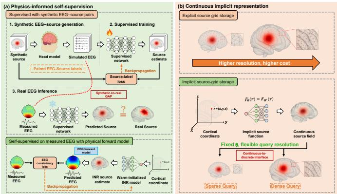  
Fig. 1. Core ideas of the proposed physics-informed self-supervised implicit source-field framework for EEG extended source imaging. (a) Supervised inverse models are typically trained on synthetic EEG-source pairs and may suffer from a synthetic-to-real gap when applied to real scalp EEG. In contrast, the proposed PINR-ESI reconstructs source activity directly from measured EEG by enforcing EEG consistency through the physical forward model in a self-supervised manner. (b) Instead of storing source activity on a fixed explicit grid, PINR-ESI represents cortical current density as a neural implicit source field. The implicit representation enables flexible query resolution with fixed parameters, where spatial coordinates are used only as query variables for evaluating the continuous source field.

EEG provides self-supervision. For the second challenge, a coordinate-conditioned multilayer perceptron (MLP) represents cortical current density as a continuous field, replacing independently optimized coefficients at predefined source locations [3]. Shared network parameters allow denser spatial queries without adding trainable source coefficients. A classical inverse estimate [5] initializes the network and provides soft spatial constraints, rather than a ground-truth target for the final reconstruction. A patch-integrated continuous-to-discrete mapping connects field evaluations to the lead-field source space. Forward consistency and the spatial constraints jointly guide observation-specific optimization. The main contributions are summarized as follows.

1) We introduce a physics-informed self-supervised INR reconstruction framework $( \mathrm { P I S } ^ { 2 } { \cdot } \mathrm { I R F } )$ that removes the need for synthetic EEG–source training pairs. By reconstructing spatial source distributions directly from measured EEG, $\mathrm { P I S } ^ { 2 } { \mathrm { - } } \mathrm { I R F }$ avoids learning an inverse mapping from synthetic data that may not fully capture the properties of real neural activity.

2) We propose a continuous implicit neural source-field representation (CIN-SF) to address the resolution– complexity trade-off in explicit source parameterizations. CIN-SF enables finer spatial sampling with a fixed set of network parameters, avoiding a separate trainable source coefficient at each queried location.

3) We systematically against representative model-based and supervised methods evaluate PINR-ESI across varying source extents, SNRs, and source counts, demonstrating its effectiveness in identifying active cortical regions. Quantitative evaluation on clinical EEG recordings from epilepsy patients and qualitative analysis of intracranial stimulation EEG further support its feasibility for real-

## world source imaging.

The remainder of this paper is organized as follows. After reviewing related work in Section II, we present the proposed method in Section III and describe the experiments in Section IV. Section V reports the results, Section VI discusses the findings and limitations, and Section VII concludes the paper.

## II. RELATED WORK

DeepSIF [4] and ConvDip [8] learn end-to-end sensor-tosource mappings, with the forward model used to generate training pairs. DST-CedNet [22] additionally includes a forwardtransformation layer and jointly minimizes source- and sensordomain training losses. Other physics-guided designs include 3D-PIUNet, which refines an eLORETA estimate using a supervised 3D U-Net [11], and deep-unrolling methods such as ADMM-ESINet [9], XDL-ESI [20], and $\mathrm { V S S I } _ { 2 p } { \mathrm { - N e t } }$ [21], which embed iterative solvers into trainable networks. Despite differences in how physics is incorporated, these approaches learn from paired synthetic data and remain dependent on the training distribution [10]. This motivates reconstructing each observation through measured-EEG consistency without paired source-label pretraining.

Classical distributed ESI methods constrain source estimates through regularization or probabilistic priors [2], [5]. MNE minimizes source energy, whereas LORETA imposes spatial smoothness through a Laplacian penalty [5]. FAST-IRES combines iteratively reweighted edge-sparsity constraints with temporal basis functions [6]. Block-Champagne models local source correlations using overlapping blocks within a Bayesian framework [7]. These approaches encode different spatial or spatiotemporal assumptions, but represent source activity on predefined discrete source spaces. For a fixed spatial domain, finer source sampling increases the number of source coefficients and lead-field columns [3]. This motivates a continuous parameterization whose trainable dimension is not tied one-to-one to query locations.

INRs model a signal or physical quantity as a continuous function evaluated at queried locations and have shown promise in solving inverse problems in medical imaging [12], [16]. For ESI, this representation can describe cortical current density without assigning an independent trainable coefficient to every query location. However, the continuous neural field must still be coupled to the discrete source space of the EEG lead-field matrix. Studies of neural-field sampling and projection have examined how continuous representations can be linked to discrete measurements [13]– [15]. PINR-ESI couples CIN-SF to the lead-field source space through patch-integrated continuous-to-discrete forward projection (C2DFP), while EEG forward consistency and classical spatial guidance constrain observation-specific reconstruction.

## III. METHODS

## A. Overview ofthe Proposed Framework

Let $\mathbf { y } \in \mathbb { R } ^ { N _ { e } }$ denote a scalp EEG topography recorded by $N _ { e }$ electrodes at a given time point, and let $\mathbf { \bar { s } } \in \mathbb { R } ^ { N _ { \bar { s } } }$ s denote the coefficients of $N _ { s }$ cortical sources with fixed orientations.

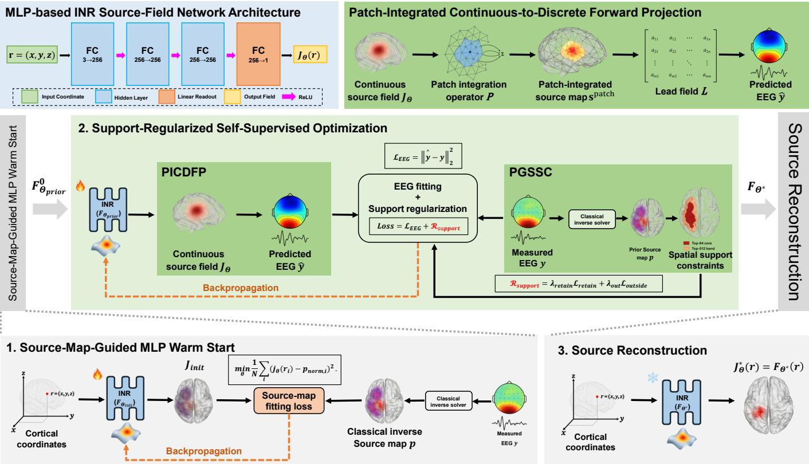  
Fig. 2. Overall workflow of PINR-ESI. Source-Map-Guided MLP Warm Start fits a classical inverse source map to initialize the coordinate-conditioned network. During Forward-Consistency-Guided Self-Supervised Optimization, Patch-Integrated Continuous-to-Discrete Forward Projection (C2DFP) maps the point-wise field evaluations through the patch operator P and lead field matrix L to predict EEG. Prior-Guided Spatial Support Constraints (PGSSC) retain activity in the prior core and suppress activity outside the broader prior region. EEG consistency and PGSSC update the INR parameters. The upper-left panel specifies the MLP architecture, and the upper-right panel details C2DFP.

The forward model is $\mathbf { y } = \mathbf { L s } + \varepsilon ,$ , where $\mathbf { L } \in \mathbb { R } ^ { N _ { e } \times N _ { s } }$ is the known lead-field matrix and ε denotes sensor noise.

Fig. 2 summarizes PINR-ESI for spatial reconstruction of extended cortical sources. Given $\mathbf { y } , \mathbf { L } ,$ and a cortical surface mesh M, each time point is reconstructed independently without paired source labels or supervised pre-training. A coordinate-conditioned neural field represents cortical current density, with one set of network parameters shared across spatial locations.

A classical inverse solver first computes a source map from the same EEG and lead field. Source-Map-Guided MLP Warm Start fits the normalized map at cortical vertices to initialize the INR parameters. The map also defines PGSSC: a highamplitude prior core is encouraged to retain activity, while activity outside a broader prior region is softly penalized. These constraints guide refinement without treating the classical estimate as a ground-truth source label.

During Forward-Consistency-Guided Self-Supervised Optimization, C2DFP aggregates neural-field evaluations over local mesh neighborhoods using fixed geometric weights. The result ing coefficients are mapped through the lead-field matrix to predict EEG. The EEG discrepancy and PGSSC jointly update the network parameters; the prior map, projection weights, and lead-field matrix remain fixed. After optimization, the patchintegrated source coefficients are used for reconstruction and quantitative evaluation.

## B. Source-Map-Guided MLP Warm Start

Let $V = \{ 1 , \dots , N _ { s } \}$ index the cortical mesh vertices, with coordinates $\mathbf { r } _ { i } \in \mathcal { M } \subset \mathbb { R } ^ { 3 }$ . To initialize the INR parameters, we first compute a classical inverse source map. Exact lowresolution brain electromagnetic tomography estimates $\textbf { p } \in$ $\mathbb { R } ^ { N _ { s } }$ from the same y and L. The map is normalized at each vertex:

$$
p _ { \mathrm { n o r m } , i } = \frac { p _ { i } } { \operatorname* { m a x } _ { j \in V } | p _ { j } | + \delta } , \quad i \in V .\tag{1}
$$

Here, $p _ { i }$ is the estimate at vertex i, and δ is a positive numerical stability constant. The normalized map $\mathbf { p } _ { \mathrm { n o r m } }$ serves as a fitting target for initialization, without requiring groundtruth source labels. The network receives cortical coordinates as inputs and learns to reproduce the corresponding normalized source values.

The coordinate-conditioned multilayer perceptron (MLP) $F _ { \theta }$ has three 256-unit hidden layers with rectified linear unit (ReLU) activations and a scalar linear output. Its mapping is $F _ { \theta } : \mathcal { M }  \mathbb { R } , \mathbf { r } \mapsto j _ { \theta } ( \mathbf { r } )$ , where $j _ { \theta } ( \mathbf { r } )$ denotes the scalar current-density value along the prescribed source orientation. To initialize the weights and biases θ, we minimize the mean squared error between network outputs and the normalized prior map at mesh vertices:

$$
\theta _ { \mathrm { p r i o r } } = \underset { \theta } { \arg \operatorname* { m i n } } \frac { 1 } { N _ { s } } \sum _ { i = 1 } ^ { N _ { s } } \big ( j _ { \theta } ( \mathbf { r } _ { i } ) - p _ { \mathrm { n o r m } , i } \big ) ^ { 2 } .\tag{2}
$$

This fitting step transfers the spatial pattern of the classical estimate into the network parameters. The fitted parameters $\theta _ { \mathrm { p r i o r } }$ provide the initial network weights and biases for EEGconsistency optimization. During refinement, θ is updated using measured EEG and the soft spatial constraints defined in Section III-C, allowing the source amplitudes to depart from the initialization.

## C. Forward-Consistency-Guided Self-Supervised Optimization

Forward-Consistency-Guided Self-Supervised Optimization (Fig. 2) combines C2DFP and PGSSC within EEG-consistency optimization. Let $\mathbf { s } _ { \mathrm { p o i n t } } \in \mathbb { R } ^ { N _ { s } }$ collect the neural-field values $j _ { \boldsymbol { \theta } } ( \mathbf { r } _ { i } )$ at the source vertices. A fixed geometric patch matrix $\mathbf { \bar { P } } \in \mathbb { R } ^ { N _ { s } \times N _ { s } }$ produces the patch-integrated source coefficients $\mathbf { s } _ { \mathrm { p a t c h } } = \mathbf { P } \mathbf { s } _ { \mathrm { p o i n t } }$ , yielding the predicted EEG $\widehat { \mathbf { y } } = \mathbf { L s } _ { \mathrm { p a t c h } }$ Section III-D details this projection.

Starting from $\theta _ { \mathrm { p r i o r } }$ obtained in Section III-B, PINR-ESI optimizes the network parameters independently for the EEG topography at each time point while y, L, and P remain fixed. Reconstruction is formulated as

$$
\theta ^ { * } = \mathop { \arg \operatorname* { m i n } } _ { \theta } \left\{ \| { \widehat { \mathbf { y } } } - \mathbf { y } \| _ { 2 } ^ { 2 } + { \mathcal { R } } _ { \operatorname { s u p p o r t } } ( \theta ) \right\} .\tag{3}
$$

The measured y provides the self-supervisory target, while $\mathcal { R } _ { \mathrm { s u p p o r t } } ( \theta )$ denotes the spatial penalty imposed by PGSSC during refinement. The classical source map has two roles: it provides the fitting target for warm initialization and defines the fixed prior regions used in this penalty. The loss is decomposed as

$$
\mathcal { L } ( \boldsymbol { \theta } ) = \mathcal { L } _ { \mathrm { E E G } } ( \boldsymbol { \theta } ) + \mathcal { R } _ { \mathrm { s u p p o r t } } ( \boldsymbol { \theta } ) ,\tag{4}
$$

where

$$
\mathcal { L } _ { \mathrm { E E G } } = \| \mathbf { L P s } _ { \mathrm { p o i n t } } - \mathbf { y } \| _ { 2 } ^ { 2 } ,\tag{5}
$$

and PGSSC contributes

$$
\mathcal { R } _ { \mathrm { s u p p o r t } } ( \theta ) = \lambda _ { \mathrm { r e t a i n } } \mathcal { L } _ { \mathrm { r e t a i n } } ( \theta ) + \lambda _ { \mathrm { o u t } } \mathcal { L } _ { \mathrm { o u t s i d e } } ( \theta ) .\tag{6}
$$

In (5), EEG consistency is evaluated on the patch-integrated coefficients $\mathbf { s } _ { \mathrm { p a t c h } } ~ = ~ \mathbf { P } \mathbf { s } _ { \mathrm { p o i n t } }$ . In (6), $\mathcal { L } _ { \mathrm { { r e t a i n } } }$ and $\mathcal { L } _ { \mathrm { o u t s i d e } }$ constrain the prior-defined regions as specified below. The nonnegative weights $\lambda _ { \mathrm { { r e t a i n } } }$ and $\lambda _ { \mathrm { o u t } }$ balance these support penalties.

Here, spatial support means the cortical region regarded as active, represented on the mesh by a set of vertex indices. To construct the prior regions, the indices in V are ranked by $| p _ { \mathrm { n o r m } , i } |$ . The core $C$ contains the $\mathrm { { t o p } } { - } K _ { 1 }$ indices, and the broader region B contains the top-K2 indices, with $C \subset B \subset$ $V$ and $K _ { 1 } < K _ { 2 } < N _ { s }$ . These are prior-derived regions, not ground-truth active sets. At vertex i, the current field magnitude is $| s _ { \mathrm { p o i n t } , i } | = | j _ { \theta } ( \mathbf { r } _ { i } ) |$ |. We normalize these magnitudes by their maximum over all vertices, with δ ensuring numerical stability:

$$
\widetilde { s } _ { i } = \frac { | s _ { \mathrm { p o i n t } , i } | } { \operatorname* { m a x } _ { j \in V } | s _ { \mathrm { p o i n t } , j } | + \delta } , \quad i \in V .\tag{7}
$$

The retention penalty discourages the normalized field amplitude from falling below the normalized prior amplitude within C:

$$
\mathcal { L } _ { \mathrm { r e t a i n } } = \frac { 1 } { K _ { 1 } } \sum _ { i \in C } \left[ \operatorname* { m a x } \bigl ( 0 , | p _ { \mathrm { n o r m } , i } | - \widetilde { s } _ { i } \bigr ) \right] ^ { 2 } .\tag{8}
$$

The outside-region penalty averages the normalized field magnitude over the $N _ { s } - K _ { 2 }$ vertices outside B:

$$
\mathcal { L } _ { \mathrm { o u t s i d e } } = \frac { 1 } { N _ { s } - K _ { 2 } } \sum _ { i \in V \backslash B } \widetilde { s } _ { i } .\tag{9}
$$

Equation (8) is one-sided: it penalizes loss of prior-supported activity in C but does not force the reconstructed amplitudes to equal the prior. Equation (9) discourages activity outside B as a soft penalty rather than a hard exclusion. Together with EEG consistency, these constraints permit refinement while retaining a bias toward the spatial regions identified by the classical estimate.

## D. Patch-Integrated Continuous-to-Discrete Forward Projection (C2DFP)

C2DFP forms the left block of Forward-Consistency-Guided Self-Supervised Optimization in Fig. 2, with its detailed projection shown in the upper-right schematic. For each cortical vertex, C2DFP defines a local patch comprising the vertex and its two-ring mesh neighbors. The area-weighted average of neural-field values within this patch forms a discrete source coefficient compatible with the EEG forward model.

Evaluating the network at cortical coordinate $\mathbf { r } _ { i }$ gives one scalar current-density value $j _ { \theta } ( { \bf r } _ { i } )$ . Collecting one value from each of the $N _ { s }$ vertices, in vertex order, forms the vector $\mathbf { s } _ { \mathrm { p o i n t } } \colon$

$$
\mathbf { s } _ { \mathrm { p o i n t } } = \left[ j _ { \theta } ( \mathbf { r } _ { 1 } ) , \dots , j _ { \theta } ( \mathbf { r } _ { N _ { s } } ) \right] ^ { T } \in \mathbb { R } ^ { N _ { s } } .\tag{10}
$$

The entry $s _ { \mathrm { p o i n t } , i }$ equals $j _ { \theta } ( \mathbf { r } _ { i } )$ . The patch matrix $\mathrm { ~ \bf ~ P ~ } \in$ $\mathbb { R } ^ { N _ { s } \times N _ { s } }$ combines neighboring point-wise values. Both the input and output vectors contain one scalar entry per cortical vertex, so the mapping preserves the dimension of the source space:

$$
\begin{array} { r } { \mathbf { s } _ { \mathrm { p a t c h } } = \mathbf { P } \mathbf { s } _ { \mathrm { p o i n t } } \in \mathbb { R } ^ { N _ { s } } , } \end{array}\tag{11}
$$

Let $N _ { i } ^ { ( 2 ) }$ denote the local two-ring neighborhood: vertices reachable from vertex i by following at most two mesh edges. The weight $P _ { i j }$ specifies how much the output at vertex $j$ contributes to the patch coefficient at vertex $i ,$ and is zero when $j$ lies outside $N _ { i } ^ { ( 2 ) }$ . The component-wise form is

$$
s _ { \mathrm { p a t c h } , i } = \sum _ { j \in N _ { i } ^ { ( 2 ) } } P _ { i j } j _ { \theta } ( { \bf r } _ { j } ) , \quad i \in V .\tag{12}
$$

Within each neighborhood, $P _ { i j }$ is proportional to the surface area associated with vertex $j ,$ and the weights are normalized to sum to one for each i. Thus, each entry of $\mathbf { s } _ { \mathrm { p a t c h } }$ is an area weighted average of neighboring network outputs. The matrix

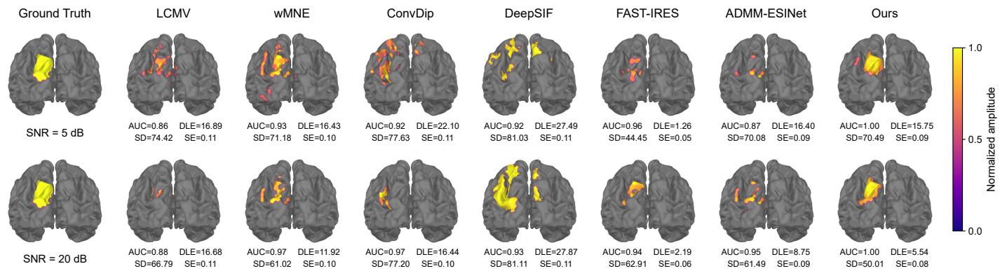  
Fig. 3. ESI results of seven methods at SNRs of 5 dB (top) and 20 dB (bottom), with identical single-source ground truth of 10 cm2. Both example share the same single-source ground truth with a target area of 10 cm2. Source maps are independently normalized to 0–1. AUC, DLE (mm), SD (mm), and SE (full-map NRMSE) are shown below each reconstruction.

P is computed from the mesh geometry before optimization and kept fixed. The resulting source coefficients predict EEG through the lead-field matrix:

$$
\widehat { \mathbf { y } } = \mathbf { L } \mathbf { s } _ { \mathrm { p a t c h } } = \mathbf { L } \mathbf { P } \mathbf { s } _ { \mathrm { p o i n t } } \in \mathbb { R } ^ { N _ { e } } .\tag{13}
$$

Equation (13) completes the chain from coordinateconditioned field evaluations to sensor prediction. The reported quantitative evaluation uses ${ \bf s } _ { \mathrm { p a t c h } } ;$ direct point-wise readout is retained for diagnostic comparisons and ablations. Denser queries of the optimized field change its sampling density but do not automatically change the discrete source space associated with L.

While the continuous field provides a flexible query interface, the reported quantitative evaluation uses the patch-integrated discrete coefficients, and the physical resolution remains governed by the lead field source space.

## IV. EXPERIMENTAL DESIGN

## A. Simulation and Evaluation Protocol

The aggregate simulation benchmark used an fsaverage cortical surface, a BioSemi64 EEG montage, and an ico4 source space with 5,124 fixed-orientation cortical vertices. The methods were evaluated on the same forward geometry, source space, and matched simulation cases in Figs. 4, 6, and 8. The benchmark comprised 11 conditions: four SNR levels (0, 5, 10, and 20 dB), three source areas (3, 5, and $1 0 \ \mathrm { c m ^ { 2 } } )$ , and four source counts (1, 2, 3, and 4). The source-area and sourcecount experiments used an SNR of 10 dB. Each condition contained 100 Monte Carlo cases, and all methods used the same realizations within each comparison. Table I summarizes the protocol. An additional exploratory paired comparison with the initial eLORETA estimate evaluated reconstruction gains at SNRs of 0, 5, 10, and 15 dB (Fig. 9).

Real-data validation included quantitative assessment against surgical resection regions in the HDEEG-IED-SurgOutcome epilepsy cohort (Fig. 10) and qualitative assessment against known stimulation sites in Localize-MI (Fig. 11), using individual forward models as described in Section V-B.

Patient-specific forward models for the epilepsy cohort used FreeSurfer cortical surfaces, an ico4 source space, and a threelayer BEM.

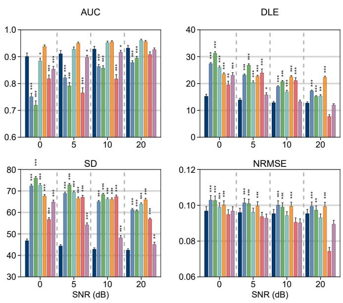  
Ours LCMV wMNE ConvDip DeepSIF FAST-IRES ADMM-ESINet  
Fig. 4. Performance metrics for seven ESI methods at SNRs of 0, 5, 10, and 20 dB. Bars show means across 100 Monte Carlo trials per condition, with upper error bars indicating one SEM. Each condition includes mixed single- and two-source configurations. DLE and SD are in millimeters. Asterisks indicate superiority of the proposed method using one-sided paired Wilcoxon tests with Holm correction: \*p<0.05, \*\*p<0.01, and \*\*\*p<0.001.

## B. Compared Methods and Training Protocol

The comparison included LCMV, wMNE, ConvDip, Deep-SIF, FAST-IRES, ADMM-ESINet, and PINR-ESI.

For the aggregate simulation comparisons, ConvDip, Deep-SIF, and ADMM-ESINet shared 20,000 simulated EEG–source training pairs and 2,000 validation pairs. Training used 5,000 source configurations at four SNR levels (0, 5, 10, and 20 dB), giving 5,000 training pairs per SNR. Validation used 500 separate source configurations at the same SNR levels. The configurations covered different source counts, extents, and separations. Training, validation, and evaluation sets were separated by source configuration. A single mixed-SNR checkpoint for each supervised method was used across all

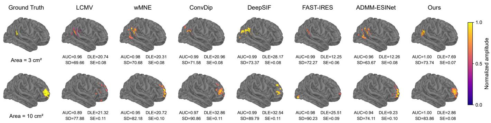  
Fig. 5. ESI results of seven methods with target source areas of $3 \mathsf { c m } ^ { 2 }$ (top) and 10 cm2 (bottom) at 10 dB SNR. Source maps are independently normalized to 0–1. The two single-source examples have different source locations.

TABLE I
<table><tr><td colspan="2">MAIN EVALUATION PROTOCOL</td></tr><tr><td>Component</td><td>Protocol</td></tr><tr><td>Source space</td><td>fsaverage; ico4 cortical mesh; 5,124 fixed-orientation vertices</td></tr><tr><td>Sensors</td><td>BioSemi64 EEG montage</td></tr><tr><td>Evaluation axes</td><td>SNR: 0, 5, 10, 20 dB; source area: 3, 5, 10  $\mathrm { c m ^ { 2 } } ;$  source count: 1, 2, 3, 4. Area and count sweeps use 10 dB</td></tr><tr><td>Simulation training</td><td>20,000 EEG–source pairs shared by the three supervised methods; balanced across 0, 5, 10, and 20 dB</td></tr><tr><td>Simulation valida- tion</td><td>2,000 pairs from separate source configurations; the same four SNR levels</td></tr><tr><td>Evaluation cases Metrics and tests</td><td>11 conditions; 100 matched cases per condition AUC and NRMSE (dimensionless); DLE and SD (mm); one-sided paired Wilcoxon signed-rank tests with Holm</td></tr></table>

SNR, source-area, and source-count conditions. This training protocol applies to the simulation benchmark; the real-data evaluations used models matched to their individual forward settings.

The supervised methods were adapted to the common singletime-point task. ConvDip used a topographic convolutional network, and DeepSIF used a vertex-wise support-classification adaptation. The ADMM-ESINet implementation used a shared trainable convolutional proximal operator with positive penalty and threshold parameters. Its configuration and checkpoint were selected using the validation objective. The comparisons concern these task-specific implementations.

PINR-ESI optimized each observation independently without paired source-label training. Its parameter settings were fixed within each experimental sweep, with a separate setting for the source-count analysis. Some supervised checkpoints and PINR-ESI parameters were adopted after examining evaluation results. The reported aggregate comparisons should therefore be interpreted as exploratory comparisons of the evaluated configurations.

## C. Metrics and Statistical Testing

We evaluated the simulated reconstructions using four metrics: the area under the receiver operating characteristic curve (AUC), distance localization error (DLE), spatial dispersion (SD) [9], and energy-aligned full-map normalized root-meansquare error (NRMSE) [17]. AUC assesses active-region detection across cortical vertices. DLE uses a bidirectional nearest-neighbor calculation: the Euclidean distance from estimated active vertices to their nearest ground-truth active vertices is averaged with the corresponding mean in the reverse direction. SD measures the amplitude-weighted spatial spread around the ground-truth active-region centroid. Higher AUC and lower DLE, SD, and NRMSE indicate better performance. DLE and SD are reported in millimeters; AUC and NRMSE are dimensionless. NRMSE compares the full nonnegative prediction map with the binary ground-truth patch map. This evaluates spatial map agreement after energy alignment, rather than absolute source-strength or temporal accuracy. SE in Figs. 3, 5, and 7 denotes this same metric. Comparisons are primarily made within each condition because source-support size varies across conditions. Metrics were computed from absolute source values or nonnegative prediction scores, using the patch-integrated estimates for the proposed method. The estimated active region for DLE was obtained by applying Otsu’s method to min–max normalized amplitudes. Bars in Figs. 4, 6, and 8 show means with upper error bars of one standard error of the mean (SEM), calculated as the sample standard deviation divided by the square root of the trial count. One-sided paired Wilcoxon signed-rank tests assessed whether the proposed method achieved higher AUC or lower DLE, SD, and NRMSE than each baseline. Holm correction was applied across the six baseline comparisons within each condition and metric.

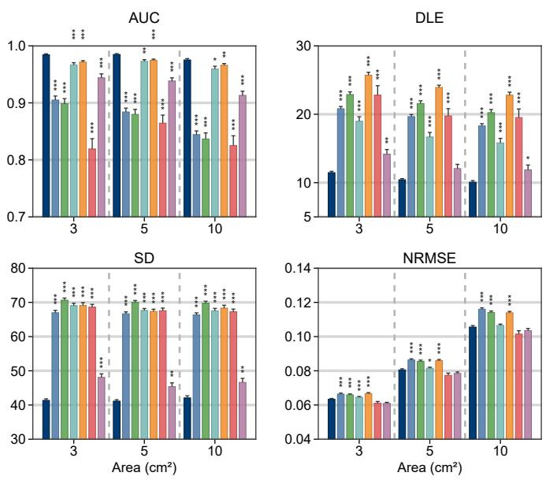  
Ours LCMV wMNE ConvDip DeepSIF FAST-IRES ADMM-ESINet  
Fig. 6. Performance metrics for seven ESI methods across target source areas of 3, 5, and 10 cm2. Bars show means across 100 Monte Carlo trials per condition, with upper error bars indicating one SEM. DLE and SD are in millimeters. Asterisks indicate superiority of the proposed method using one-sided paired Wilcoxon tests with Holm correction: \*p<0.05, \*\*p<0.01, and \*\*\*p<0.001.

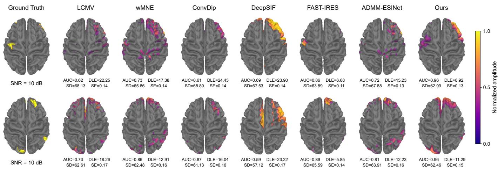  
Fig. 7. ESI results of seven methods with three (top) and four (bottom) source patches at 10 dB SNR. Each source map is independently normalized to 0–1. Values below each reconstruction indicate AUC, DLE (mm), SD (mm), and SE (energy-aligned full-map NRMSE).

For the epilepsy evaluation, active vertices were extracted with the same min–max normalization and Otsu thresholding. Clinical DLE used the mean of the two directional nearestneighbor distances between these vertices and the full surfaceprojected resection region, in millimeters.

## V. RESULTS

We first evaluate the influence of SNR, source extent, and number of sources through controlled simulations, presenting illustrative reconstructions alongside aggregate performance metrics. A paired comparison with eLORETA evaluates the reconstruction gains beyond the initial estimate. We then assess the geometric agreement between estimated active cortical regions and surgical resection regions in 24 epilepsy patients with favorable surgical outcomes.

## A. Results of simulation experiments

1) Influence of SNR: Fig. 3 shows single-source reconstructions at 5 and 20 dB, and Fig. 4 summarizes the performance at 0, 5, 10, and 20 dB. As SNR increased, most methods showed higher AUC and lower DLE and SD, indicating that reduced noise improved source reconstruction. The proposed method achieved the lowest SD at all tested SNRs and the lowest DLE at 0, 5, and 10 dB, indicating good localization and limited spatial dispersion even under relatively noisy conditions. Other methods showed advantages on different metrics: DeepSIF achieved higher AUC, and ConvDip also showed an AUC advantage at some SNRs; FAST-IRES performed better in NRMSE and also achieved a lower DLE at 20 dB. DeepSIF and ConvDip were both trained on simulated data covering multiple SNR levels. This supervised training may help them learn source patterns under the corresponding noise conditions and distinguish active from inactive regions, contributing to their favorable AUC performance.

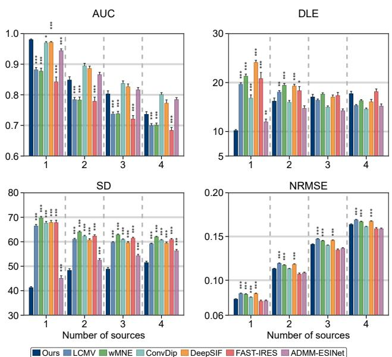  
Fig. 8. Performance metrics for seven ESI methods with one to four sources. Bars show means across 100 Monte Carlo trials per condition, with upper error bars indicating one SEM. DLE and SD are in millimeters. Asterisks indicate superiority of the proposed method using one-sided paired Wilcoxon tests with Holm correction: \*p<0.05, \*\*p<0.01, and \*\*\*p<0.001.

2) Influence of source extent: Fig. 5 shows single-source reconstructions with source areas of 3 and 10 cm2, and Fig. 6 summarizes the results for 3, 5, and 10 cm2. As source area increased, the AUC of LCMV and wMNE decreased, whereas that of the proposed method remained relatively stable. The proposed method achieved the highest AUC and the lowest

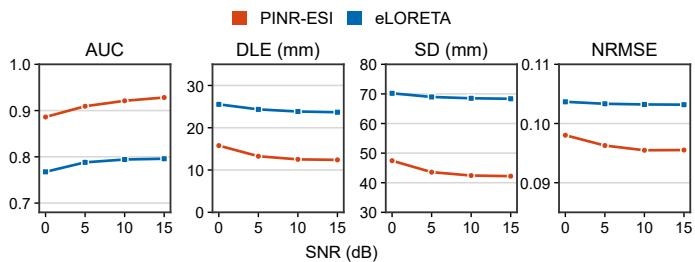  
Fig. 9. Comparison of the complete PINR-ESI reconstruction and the eLORETA estimate used for initialization at SNRs of 0, 5, 10, and 15 dB. Curves show means across 100 source configurations per SNR, with matched cases for both methods. The four panels show AUC, DLE, SD, and NRMSE. DLE and SD are in millimeters.

DLE and SD at all three source areas, indicating good detection and localization of active regions across source extents. FAST IRES and ADMM-ESINet had lower NRMSE, showing an advantage in full-map reconstruction. The proposed method’s performance may benefit from the combination of a continuous source field and spatial support constraints. The network fits the spatial distribution of source activity, while the prior-guided constraints softly penalize activity outside the prior region, helping to limit spatial dispersion.

3) Influence of the number of sources: Fig. 7 shows reconstructions with three and four sources, and Fig. 8 summarizes the results as the number of sources increased from one to four. Across methods, AUC generally decreased and NRMSE increased with the number of sources. The proposed method showed good detection and localization of active regions in the single-source condition and maintained the lowest SD across all source counts, although its advantages in AUC and DLE diminished with multiple sources. ConvDip, DeepSIF, and ADMM-ESINet achieved higher AUC in the multiple-source conditions, and ADMM-ESINet also showed lower DLE. The consistently low SD of the proposed method may be related to its prior-guided spatial support constraints, which help limit the spread of reconstructed activity. However, the superposition of signals from multiple sources at the sensors still makes it harder to distinguish individual active regions.

4) Comparison with the eLORETA initialization: To assess the reconstruction gains of PINR-ESI over a classical inverse solution, we compared the complete method with the eLORETA estimate used for initialization. As shown in Fig. 9, PINR-ESI achieved a higher mean AUC and lower mean DLE, SD, and NRMSE at all tested SNRs, indicating improvements in active-region detection, localization, spatial dispersion, and fullmap reconstruction error. eLORETA provides the initial source distribution and spatial support information. PINR-ESI then continues to optimize the source field using EEG consistency and spatial constraints, allowing the reconstruction to be refined beyond the initial estimate. These results support the additional reconstruction benefits of the complete optimization process beyond the classical initialization.

## B. Results of Real Data

1) HDEEG-IED-SurgOutcome data: We analyzed averaged preoperative interictal epileptiform discharges from 24 patients in HDEEG-IED-SurgOutcome [18] who had an ILAE

1 outcome at 12 months after surgery and passed quality control. All methods used patient-specific forward models and reconstructed sources when the GFP of the averaged spike first reached 50% of its peak. Resection masks generated from pre- and postoperative MRI using RAMPS [19] were projected onto the cortical source space and used as clinical spatial references [17]. Agreement was assessed by bidirectional DLE between the estimated active regions and resection masks. Supervised baselines were trained on synthetic data generated with patient-specific forward models, while PINR-ESI used wMNE initialization.

Fig. 10(a) shows the EEG, resection mask, and reconstructions from seven methods for patient sub-pat02. The main activity reconstructed by PINR-ESI was close to the resection region, whereas some comparators showed more dispersed activity or activity away from this region. Across the 24 patients in Fig. 10(b), PINR-ESI achieved the lowest mean and median DLE. PINR-ESI had a mean DLE of 14.49 mm, followed by wMNE at 17.67 mm. The representative case and cohort results support good spatial agreement between PINR-ESI estimates and surgical resection regions in this cohort.

2) Localize-MI data: We further used Localize-MI [23] for qualitative evaluation, with the intracranial stimulating contacts and their midpoint as spatial references. Preprocessed trials were averaged within each session, and sources were reconstructed at the time point with maximum GFP within ±2 ms of stimulation. All methods used the same retained channels, individual forward model, and source space; PINR-ESI used eLORETA initialization. Fig. 11 shows two selected examples from subjects 1 and 3. In subject 1, ConvDip and DeepSIF produced broader activity near the reference, while PINR-ESI produced a more concentrated reconstruction in its vicinity. In subject 3, the dominant activity from ConvDip and DeepSIF appeared below the reference, whereas that from PINR-ESI was near it. These examples provide qualitative support for the feasibility of PINR-ESI in reconstructing activity near known stimulation sites in real stimulation recordings.

## VI. DISCUSSION

PINR-ESI reconstructs extended cortical activity by fitting a continuous neural field to measured EEG without paired source labels or supervised pretraining. Its most consistent benefit in the evaluated simulations was lower spatial dispersion across noise levels, source areas, and source counts (Figs. 4, 6, and 8). At 0 dB, the method achieved the lowest mean DLE and SD, supporting good localization even at the lowest tested SNR. It also achieved the highest AUC and the lowest DLE and SD across the tested source areas. Its relative advantages in AUC and DLE diminished with multiple sources, and several baselines achieved lower NRMSE. These findings indicate strengths in spatial dispersion control and localization, with active-region detection depending on the source configuration.

The framework combines forward consistency, continuous representation, and spatial guidance. EEG consistency provides an observation-specific fitting objective, while the neural field shares parameters across spatial locations. C2DFP maps field evaluations to the discrete source coefficients required by the lead-field matrix. The classical inverse estimate initializes the field and supplies spatial support information, with soft constraints guiding subsequent refinement. In the paired eLORETA comparison (Fig. 9), the complete method improved all four mean metrics under the reported configuration, supporting an additional benefit from the complete reconstruction stage. Denser field queries do not require additional trainable source coefficients, although they increase evaluation cost and do not change the physical resolution imposed by the forward model.

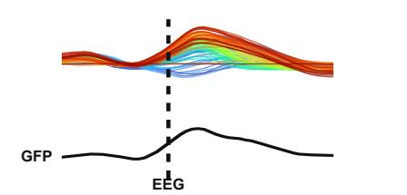

(a)  
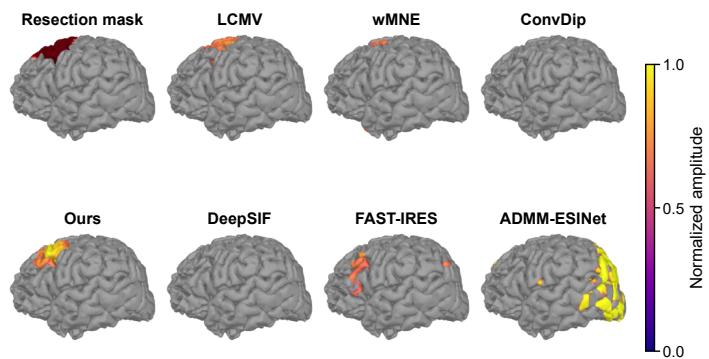

(b)  
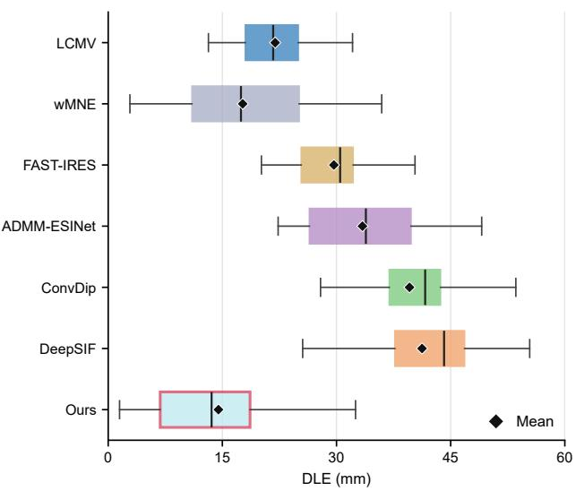  
(b)Fig. 10. Real-data evaluation on the HDEEG-IED-SurgOutcome cohort. (a) EEG and source maps for sub-pat02 at mid-GFP, shown with the RAMPS resection mask. (b) Bidirectional DLE between estimated active cortical regions and the full surface-projected resection region across 24 MeanILAE-1 subjects. Boxes show medians and interquartile ranges; whiskers follow the 1.5-IQR rule, and diamonds denote means. Outlier symbols are omitted, but all values are included in the statistics.

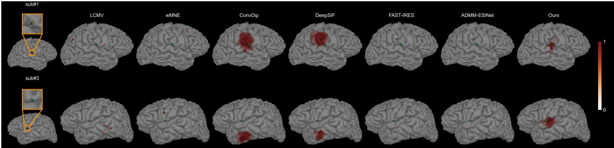  
Fig. 11. Qualitative source imaging results for Localize-MI subjects 1 and 3 in the upper and lower rows, respectively. The insets show the two stimulating contacts as red and yellow points, with their midpoint marked in blue. The projected midpoint is also marked in green on each reconstructed source map. Maps are independently normalized to 0–1 and projected onto the cortical view.

The real-data analyses provide complementary evidence. In the 24-patient epilepsy cohort, PINR-ESI achieved lower mean and median resection-based DLE than the compared methods (Fig. 10). In two selected Localize-MI examples, reconstructed activity was near the known stimulation sites (Fig. 11). These findings support the feasibility of reconstructing real recordings without paired source-label training. This property may be useful when such training data are unavailable or do not capture the characteristics of clinical recordings. The evaluations support spatial agreement with the available references; resection masks and stimulation contacts do not provide complete ground-truth source maps.

Separating multiple sources remains an important challenge. The source-count experiments show that low SD can coexist with weaker AUC and DLE relative to other methods. Signals from multiple sources overlap at the sensors, and the current formulation treats each time point independently. It therefore does not exploit temporal variation that could help distinguish different generators. Extending the neural field to include time or introducing constraints across successive EEG topographies may improve the separation of overlapping sources and the consistency of reconstructed activity.

Per-observation optimization also adds computational cost. More efficient optimization, compact networks, and reuse of initialization across related observations could make the approach more practical for long recordings. The current noise results support performance within the tested 0–20 dB simulation range. Further evaluation should examine negative SNRs, physiological artifacts, inaccuracies in the forward model, and errors in the initial spatial estimate. These tests would clarify the conditions under which EEG consistency and spatial guidance can reliably support reconstruction beyond the settings evaluated here.

## VII. CONCLUSION

This work presents PINR-ESI, a physics-informed selfsupervised framework that combines a continuous neural source field, patch-integrated forward projection, and classical spatial guidance to reconstruct extended cortical activity without paired source labels or supervised pretraining. Simulations showed consistent benefits in spatial dispersion control and favorable localization across the evaluated noise levels and source extents, including at 0 dB, with additional reconstruction gains over the eLORETA initialization in the paired comparison. Quantitative evaluation in the epilepsy cohort and qualitative Localize-MI examples supported spatial agreement with surgical resection regions and known stimulation sites, respectively. Future work will focus on temporal modeling, separation of multiple sources, and computational efficiency.

[1] Z. He, D. Ding, and B. Yuan, “Electrophysiological source imaging: A noninvasive window to brain dynamics,” IEEE Rev. Biomed. Eng., 2018.

[2] S. Asadzadeh et al., “A systematic review of EEG source localization techniques and their applications on diagnosis of brain abnormalities,” J. Neurosci. Methods, 2020.

[3] A. Sohrabpour and B. He, “Exploring the extent of source imaging: Recent advances in noninvasive electromagnetic brain imaging,” Curr. Opin. Biomed. Eng., vol. 18, Art. no. 100277, 2021.

[4] H. Sun et al., “Deep neural networks constrained by neural mass models improve electrophysiological source imaging of spatiotemporal brain dynamics,” Proc. Natl. Acad. Sci. U.S.A., 2022.

[5] Z. Feng et al., “Explaining E/MEG source imaging and beyond: An updated review,” IEEE J. Biomed. Health Inform., 2025, doi: 10.1109/JBHI.2025.3588350.

## REFERENCES

[6] A. Sohrabpour et al., “Noninvasive electromagnetic source imaging of spatiotemporally distributed epileptogenic brain sources,” Nat. Commun., 2020.

[7] Z. Feng, C. Guan, and Y. Sun, “Block-Champagne: A novel Bayesian framework for imaging extended E/MEG source,” IEEE Trans. Med. Imaging, 2025, doi: 10.1109/TMI.2025.3642620.

[8] L. Hecker et al., “ConvDip: A convolutional neural network for better EEG source imaging,” Front. Neurosci., vol. 15, Art. no. 569918, 2021.

[9] X. Liu et al., “ADMM-ESINet: A deep unrolling network for EEG extended source imaging,” IEEE J. Biomed. Health Inform., 2025.

[10] S. Reynaud et al., “Comprehensive analysis of supervised learning methods for electrical source imaging,” 2024.

[11] M. Morik, A. Hashemi, K.-R. Müller, S. Haufe, and S. Nakajima, “Enhancing brain source reconstruction by initializing 3D neural networks with physical inverse solutions,” IEEE Trans. Med. Imaging, 2025, doi: 10.1109/TMI.2025.3594724.

[12] A. Molaei et al., “Implicit neural representation in medical imaging: A comparative survey,” 2023.

[13] J. Barron et al., “Mip-NeRF: A multiscale representation for anti-aliasing neural radiance fields,” ICCV, 2021.

[14] E. Najaf and G. Ongie, “Towards a sampling theory for implicit neural representations,” 2024.

[15] Y. Chen et al., “Anti-aliasing projection representation field for inverse problems in imaging,” 2023.

[16] S. Essakine et al., “Where do we stand with implicit neural representa tions? A technical and performance survey,” 2024.

[17] S. Wang et al., “A geometry-aware framework enhances noninvasive mapping of whole human brain dynamics,” Nat. Biomed. Eng., 2026, doi: 10.1038/s41551-026-01664-0.

[19] C. Simpson, G. Hall, J. S. Duncan, Y. Wang, and P. N. Taylor, “Automated generation of epilepsy surgery resection masks: The RAMPS pipeline,” Imaging Neurosci., vol. 3, Art. no. IMAG.a.147, 2025.

[18] B. J. Vorderwülbecke et al., “High-density EEG source localisation of averaged interictal epileptic discharges validated by surgical outcome,” Sci. Data, vol. 12, Art. no. 1441, 2025.

[20] M. Jiao et al., “XDL-ESI: Electrophysiological sources imaging via explainable deep learning framework with validation on simultaneous EEG and iEEG,” NeuroImage, vol. 299, Art. no. 120802, 2024, doi: 10.1016/j.neuroimage.2024.120802.

[21] L. Wang et al., “VSSI2p-Net: Physics-guided deep unfolding with $\ell _ { 2 , p } -$ norm and variation sparsity for EEG source imaging,” NeuroImage, vol. 328, Art. no. 121793, 2026, doi: 10.1016/j.neuroimage.2026.121793.

[22] G. Huang et al., “Electromagnetic source imaging via a data-synthesisbased convolutional encoder–decoder network,” IEEE Trans. Neural Netw. Learn. Syst., vol. 35, no. 5, pp. 6423–6437, 2024, doi: 10.1109/TNNLS.2022.3209925.

[23] E. Mikulan et al., “Simultaneous human intracerebral stimulation and HD-EEG, ground-truth for source localization methods,” Sci. Data, vol. 7, Art. no. 127, 2020, doi: 10.1038/s41597-020-0467-x.