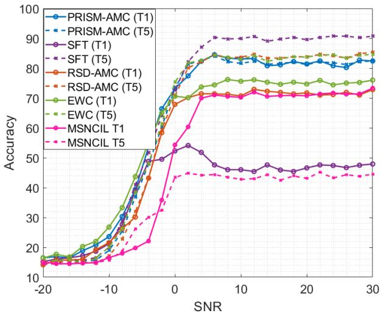
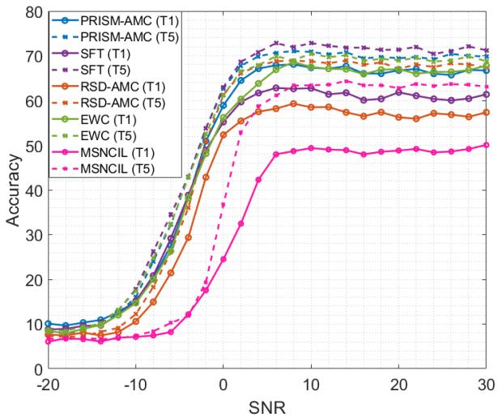
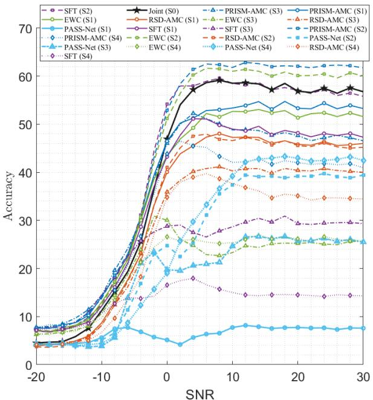
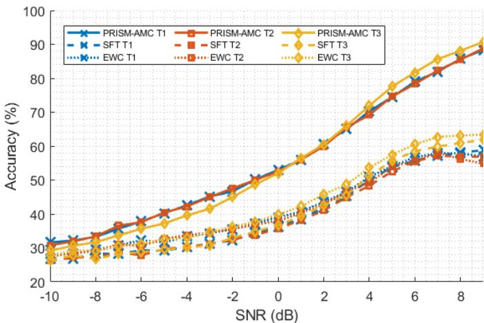
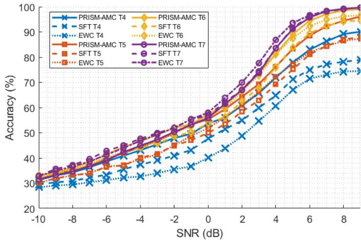
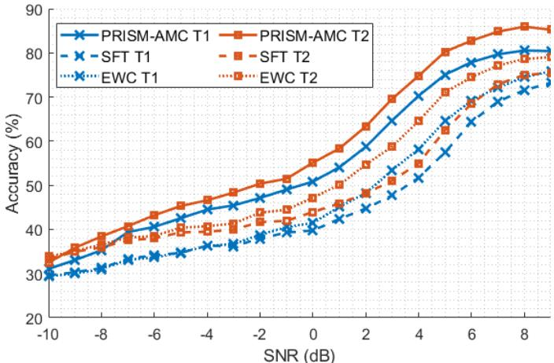
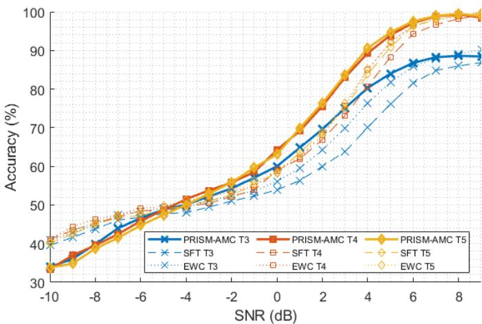
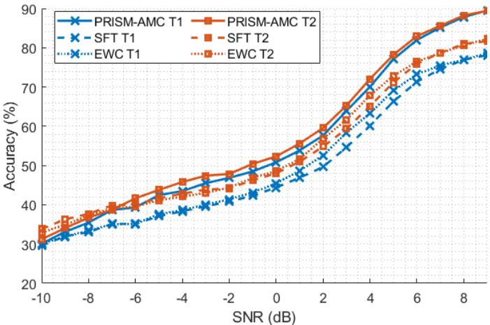
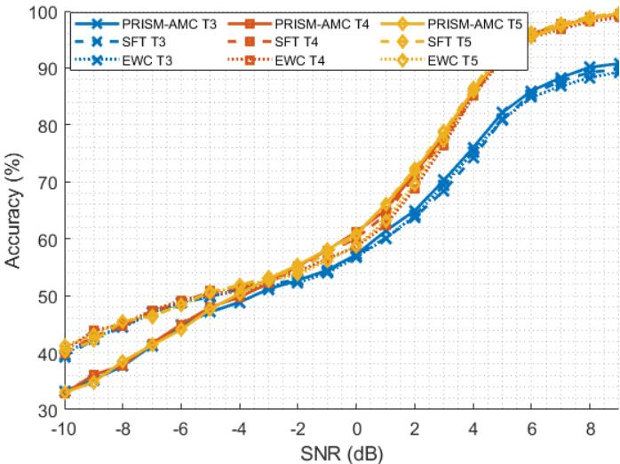

# PRISM-AMC: Replay-Free Continual Learning for Automatic Modulation Classification

Usman Akram∗, Matthew Graham†, and Haris Vikalo∗

∗Department of Electrical and Computer Engineering, University of Texas at Austin, Austin, TX, USA

usman.akram@austin.utexas.edu, hvikalo@ece.utexas.edu

†Applied Research Laboratories, Austin, TX, USA

matthew.graham@arlut.utexas.edu

Abstract—Automatic modulation classification (AMC) is a key component of cognitive wireless systems, enabling spectrum awareness and adaptive communication. Most deep learning approaches to AMC assume a fixed set of modulation classes and access to previously observed training data. In practice, modulation classes and channel conditions may evolve over time, while storage or data-retention constraints may preclude replay of raw baseband I/Q samples. We propose PRISM-AMC, a replay-free continual learning framework that mitigates catastrophic forgetting by preserving task-relevant subspaces of intermediate representations via gradient projection memory. We further analyze projected stochastic-gradient updates under an SNR-dependent gradient-noise model. PRISM-AMC is evaluated in both class-incremental and domain-incremental settings. Experiments on the MIGOU and DeepSig 2018.01A datasets show substantially reduced forgetting relative to sequential finetuning and elastic weight consolidation, while remaining competitive with or outperforming replay-based RSD-AMC in classincremental settings, without storing raw I/Q samples.

Index Terms—Continual learning, modulation classification, gradient projection memory

## I. INTRODUCTION

Reliable identification of signal modulation plays a fundamental role in cognitive and software-defined radios operating in heterogeneous and uncoordinated spectrum environments, supporting the identification of unknown transmitters, dynamic spectrum access, and adaptive demodulation without prior signaling [1], [2]. Automatic modulation classification (AMC) supports blind demodulation and spectrum sharing in nextgeneration wireless networks [3]. Recent advances in deep learning have significantly improved AMC performance by directly processing raw I/Q samples and learning robust representations under complex channel conditions [4]. Prior work has explored convolutional architectures, lightweight models, autoencoder-based methods, and federated learning for AMC [5]–[10], illustrating the breadth of learning-based approaches.

Despite recent progress, most deep learning approaches to AMC assume a fixed and fully known set of modulation classes available during training. In practice, modulation schemes may appear sequentially due to operational constraints or evolving deployment scenarios, requiring models to incorporate new classes or adapt to changing signal conditions while preserving performance on previously learned ones. This motivates a continual learning formulation of AMC, where the model encounters multiple tasks sequentially and must mitigate catastrophic forgetting.

Early work on continual AMC has largely focused on classincremental learning and relied on replay-based mechanisms [11], [12]. However, replay requires retention or reconstruction of raw signal samples, which may be impractical under storage, data-governance, or regulatory constraints. In many deployments, retention or sharing of baseband I/Q data may be restricted, necessitating replay-free adaptation mechanisms.

To address this challenge, we propose PRISM-AMC, a replay-free continual learning framework based on gradient projection memory (GPM) that mitigates forgetting without storing raw I/Q samples. Instead, PRISM-AMC retains lowdimensional subspace representations derived from intermediate activations and constrains subsequent updates to avoid interference with prior tasks. Experiments on simulated and over-the-air datasets demonstrate reduced forgetting relative to sequential fine-tuning and EWC, while achieving competitive or superior performance relative to replay-based baselines in the class-incremental settings.

The contributions of this work can be summarized as follows: (i) we formulate automatic modulation classification as a continual learning problem under raw-sample retention constraints; (ii) we develop a replay-free framework based on gradient projection memory that mitigates catastrophic forgetting without storing raw I/Q samples; (iii) we analyze projected Randomized Stochastic Gradient (RSG) updates [13] under an SNR-dependent gradient-noise model and derive a bound on the expected squared norm of the projected gradient; (iv) we provide empirical evaluations on over-theair and synthetic datasets demonstrating reduced forgetting and competitive or improved accuracy relative to sequential, regularization-based, and replay-based baselines; and (v) we also investigate a domain-incremental setting where the tasks differ in the underlying channel conditions rather than the modulation classes.1

## II. SYSTEM MODEL

We consider the problem of identifying the modulation scheme underlying a received complex baseband signal. The

received samples over an observation window of length $N$ are modeled as

$$
r [ n ] = A e ^ { j \left( \frac { 2 \pi \Delta f n } { N } + \Delta \theta \right) } s [ n ] + w [ n ] ,\tag{1}
$$

where s[n] denotes a transmitted sample drawn according to modulation scheme $\Omega _ { c } \in \{ \Omega _ { 1 } , \ldots , \Omega _ { C } \}$ , A and $\Delta \theta$ denote amplitude and phase offsets, $\Delta f$ is the carrier frequency offset (CFO), and $w [ n ]$ is complex Gaussian noise. The task is to infer $\Omega _ { c }$ from the received I/Q samples over the observation window.

In this work, we study continual learning for automatic modulation classification in a sequence of tasks whose modulation classes or underlying signal distributions may change over time. At task t, the model is trained on a dataset $\mathcal { D } _ { t }$ associated with a set of modulation schemes $\Omega ^ { t } = \{ \Omega _ { 1 } ^ { t } , \dots , \Omega _ { C _ { t } } ^ { t } \}$ , where $C _ { t }$ is the number of modulation classes present in task $t .$ The model is sequentially trained on datasets $\mathcal { D } _ { 1 } , \ldots , \mathcal { D } _ { T }$ , each corresponding to modulation sets $\Omega ^ { 1 } , \dots , \Omega ^ { T }$ , respectively. In the class-incremental setting, new modulation classes are introduced over time, and the objective is to learn them while preserving performance on previously observed classes. In the domain-incremental setting, the modulation classes remain fixed across tasks, while the underlying channel conditions and signal statistics change.

## III. PRISM-AMC FRAMEWORK

To mitigate catastrophic forgetting under raw-sample retention constraints, we develop PRISM-AMC, a projection-based continual learning framework for sequentially encountered raw I/Q data. Unlike replay-based approaches, PRISM-AMC neither stores nor regenerates previously observed baseband samples. Instead, it preserves task-relevant subspaces of intermediate feature representations and projects subsequent gradient updates onto their orthogonal complement, thereby reducing interference with previously learned tasks.

PRISM-AMC builds upon the Gradient Projection Memory (GPM) framework [15], which exploits the fact that the gradient with respect to a neural network layer’s weights lies in the span of its input activations. By identifying taskspecific activation subspaces and projecting future gradients onto the orthogonal complement of retained subspaces from prior tasks, GPM reduces interference between sequential tasks. In PRISM-AMC, this principle is applied to intermediate feature representations of the modulation classifier to preserve prior knowledge without storing raw signal samples. For convolutional layers, the same property holds after unfolding the convolution into matrix form. Let X denote the matrix of input feature patches and $\Delta$ the backpropagated error. The gradient with respect to the filter weights can be expressed as

$$
\nabla _ { W } L = X ^ { \top } \Delta ,
$$

so its columns lie in the subspace spanned by the input feature patches. Thus, activation subspaces can be estimated for convolutional layers and used to constrain future gradients in the same manner as for fully connected layers.

The central idea of gradient projection memory is to decompose the gradient space at each layer into two orthogonal subspaces: the Core Gradient Space (CGS) and the Residual Gradient Space (RGS). After training on task 1 with dataset $\mathcal { D } _ { 1 }$ , we select $n _ { s }$ samples from $\mathcal { D } _ { 1 }$ and construct, for each layer $l ,$ a representation matrix ${ \bf R } _ { 1 } ^ { l }$ using the corresponding input activations. For a fully connected layer,

$$
\mathbf { R } _ { 1 } ^ { l } = [ \mathbf { x } _ { 1 , 1 } ^ { l } , \ldots , \mathbf { x } _ { n _ { s } , 1 } ^ { l } ] ,
$$

and for a convolutional layer, the unfolded feature patches are stacked similarly. To obtain a basis for the CGS, we perform singular value decomposition (SVD), $\mathbf { R } _ { 1 } ^ { l } = U _ { 1 } ^ { l } \Sigma _ { 1 } ^ { l } ( V _ { 1 } ^ { l } ) ^ { \top }$ , and select the smallest rank $k _ { 1 } ^ { l }$ such that

$$
\| ( \mathbf { R } _ { 1 } ^ { l } ) _ { k _ { 1 } ^ { l } } \| _ { F } ^ { 2 } \geq \epsilon _ { \mathrm { t h } } ^ { l } \| \mathbf { R } _ { 1 } ^ { l } \| _ { F } ^ { 2 } ,
$$

where $( \mathbf { R } _ { 1 } ^ { l } ) _ { k _ { 1 } ^ { l } }$ denotes the rank- ${ \bf \nabla } \cdot { \bf k } _ { 1 } ^ { l }$ truncated SVD approximation. The CGS for layer $l ,$ denoted $S ^ { l }$ , is initialized as the span of the first $k _ { 1 } ^ { l }$ columns of $U _ { 1 } ^ { l }$ . The corresponding basis vectors are stored in the gradient projection memory $\mathcal { M } = ( M ^ { l } ) _ { l = 1 } ^ { L } ,$ where

$$
M ^ { l } = [ u _ { 1 , 1 } ^ { l } , \dots , u _ { k _ { 1 } ^ { l } , 1 } ^ { l } ] .
$$

For tasks $t > 1$ , the gradients are projected onto the RGS to reduce interference with previously learned tasks:

$$
\mathrm { F C \ l a y e r { : } } \quad \widetilde { \nabla } _ { W _ { t } ^ { l } } L _ { t } = \nabla _ { W _ { t } ^ { l } } L _ { t } - \nabla _ { W _ { t } ^ { l } } L _ { t } M ^ { l } ( M ^ { l } ) ^ { \top } ,\tag{2}
$$

$$
\mathrm { C o n v \ l a y e r : \quad } \widetilde { \nabla } _ { W _ { t } ^ { l } } L _ { t } = \nabla _ { W _ { t } ^ { l } } L _ { t } - M ^ { l } ( M ^ { l } ) ^ { \top } \nabla _ { W _ { t } ^ { l } } L _ { t } .\tag{3}
$$

At the end of task $t ,$ activations are collected to form $\mathbf { R } _ { t } ^ { l } ,$ which is projected onto the RGS:

$$
\hat { \mathbf { R } } _ { t } ^ { l } = \mathbf { R } _ { t } ^ { l } - M ^ { l } ( M ^ { l } ) ^ { \top } \mathbf { R } _ { t } ^ { l } .\tag{4}
$$

Performing SVD on $\hat { \mathbf { R } } _ { t } ^ { l } = \hat { U } _ { t } ^ { l } \hat { \Sigma } _ { t } ^ { l } ( \hat { V } _ { t } ^ { l } ) ^ { \top }$ , we select the smallest $k _ { t } ^ { l }$ such that

$$
\| \mathbf { R } _ { t , \mathrm { p r o j } } ^ { l } \| _ { F } ^ { 2 } + \| ( \hat { \mathbf { R } } _ { t } ^ { l } ) _ { k _ { t } ^ { l } } \| _ { F } ^ { 2 } \geq \epsilon _ { \mathrm { t h } } ^ { l } \| \mathbf { R } _ { t } ^ { l } \| _ { F } ^ { 2 } ,
$$

where

$$
\mathbf { R } _ { t , \mathrm { p r o j } } ^ { l } = M ^ { l } ( M ^ { l } ) ^ { \top } \mathbf { R } _ { t } ^ { l }
$$

is the component of the current-task representation already captured by the retained CGS. The basis $M ^ { l }$ is then updated by appending the first $k _ { t } ^ { l }$ columns of $\hat { U } _ { t } ^ { l }$ . The complete training procedure is summarized in Algorithm 1.

The original GPM framework was developed for convolutional and fully connected layers [15]. Accordingly, PRISM-AMC uses a lightweight 1D convolutional neural network for modulation classification. Such architectures have demonstrated strong performance on raw I/Q data in prior AMC literature [6], [8]. The network architecture is summarized in Table I. We omit bias terms in the lower layers, which we found to improve performance in the continual learning setting.

## IV. ANALYSIS OF PROJECTED STOCHASTIC UPDATES

In this section, we analyze the optimization behavior induced by the gradient-projection mechanism used in PRISM-AMC. Specifically, we consider the stochastic-gradient updates within a task while holding the retained subspace from previous tasks fixed. Relying on the Randomized Stochastic Gradient (RSG) framework [13], we derive a bound on the expected squared norm of the gradient projected onto the residual subspace under an SNR-dependent gradient-noise model. Let $f : \mathbb { R } ^ { n }  \mathbb { R }$ be a differentiable, not necessarily convex function that is bounded below and has an L-Lipschitz continuous gradient, i.e.,

Algorithm 1 PRISM-AMC Training   
1: Input: Model $f _ { W }$ , task datasets $\{ \mathcal { D } _ { t } \} _ { t = 1 } ^ { T }$ , learning rate $\eta ,$   
thresholds $\{ \epsilon _ { \mathrm { t h } } ^ { l } \} _ { l = 1 } ^ { L } ,$ loss $\mathcal { L }$   
2: Initialize $M ^ { l } \gets [ ]$ for $l = 1 , \ldots , L$   
3: $\mathcal { M }  ( M ^ { l } ) _ { l = 1 } ^ { L } , \bar { W }  W _ { 0 }$   
4: for $t = 1 , \dots , T$ do   
5: repeat   
6: Sample mini-batch $B \sim \mathcal { D } _ { t }$   
7: $\Delta _ { W }  \mathrm { G r a d i e n t s } ( B , f _ { W } , \mathcal { L } )$   
8: if $t > 1$ then   
9: $\Delta _ { W } \gets \mathrm { P R O J } ( \Delta _ { W } , \mathcal { M } )$   
10: end if   
11: $W  W - \eta \Delta _ { W }$   
12: until convergence   
13: Sample $n _ { s }$ examples $B _ { n _ { s } } \sim \mathcal { D } _ { t }$   
14: Compute layer-wise representation matrices $\{ \mathbf { R } _ { t } ^ { l } \} _ { l = \cdot } ^ { L }$   
15: for $l = 1 , \ldots , L$ do   
16: if $M ^ { l }$ not empty then   
17: $\mathbf { R } _ { t , \mathrm { p r o j } } ^ { l }  \dot { \mathcal { M } } ^ { l } ( M ^ { l } ) ^ { \top } \mathbf { R } _ { t } ^ { l } , \hat { \mathbf { R } } _ { t } ^ { l }  \mathbf { R } _ { t } ^ { l } - \mathbf { R } _ { t , \mathrm { p r o j } } ^ { l }$   
18: else   
19: $\mathbf { R } _ { t , \mathrm { p r o j } } ^ { l }  0 , \hat { \mathbf { R } } _ { t } ^ { l }  \mathbf { R } _ { t } ^ { l }$   
20: end $\mathbf { i f }$   
21: $\hat { U } _ { t } ^ { l } \gets \mathrm { S V D } ( \hat { \mathbf { R } } _ { t } ^ { l } )$   
22: Select the smallest $k _ { t } ^ { l }$ such that $\| \mathbf { R } _ { t , \mathrm { p r o j } } ^ { l } \| _ { F } ^ { 2 } ~ +$   
$\| ( \hat { \mathbf { R } } _ { t } ^ { l } ) _ { k _ { t } ^ { l } } \| _ { F } ^ { 2 } \geq \epsilon _ { \mathrm { t h } } ^ { l } \| \mathbf { R } _ { t } ^ { l } \| _ { F } ^ { 2 }$   
23: $M ^ { l } \gets \bar { [ } M ^ { l } , \ \hat { U } _ { t } ^ { l } ( : , 1 : k _ { t } ^ { l } ) ]$   
24: end for   
25: end for   
26: return $f _ { W }$

$$
\| \nabla f ( y ) - \nabla f ( x ) \| \leq L \| y - x \| , \qquad \forall x , y \in \mathbb { R } ^ { n } .\tag{5}
$$

It then follows that

$$
| f ( y ) - f ( x ) - \langle \nabla f ( x ) , y - x \rangle | \leq { \frac { L } { 2 } } \| y - x \| ^ { 2 } , \forall x , y \in \mathbb { R } ^ { n } .\tag{6}
$$

Consider the unconstrained stochastic optimization problem

$$
f ^ { * } = \operatorname* { i n f } _ { x \in \mathbb { R } ^ { n } } f ( x ) .
$$

At iteration $k ,$ a stochastic first-order oracle returns a gradient estimate $G ( x _ { k } , \xi _ { k } )$ satisfying

$$
\mathbb { E } [ G ( x _ { k } , \xi _ { k } ) \mid x _ { k } ] = \nabla f ( x _ { k } ) ,\tag{7}
$$

$$
\begin{array} { r } { \mathbb { E } \big [ \| G ( x _ { k } , \xi _ { k } ) - \nabla f ( x _ { k } ) \| ^ { 2 } \mid x _ { k } \big ] \leq \sigma ^ { 2 } + \alpha \gamma ^ { - 1 } , } \end{array}\tag{8}
$$

where $\gamma$ denotes the (linear scale) signal-to-noise ratio (SNR), $\alpha \geq 0$ controls the SNR-dependent contribution to the gradient variance, and $\sigma ^ { 2 }$ accounts for SNR-independent stochasticity arising from factors such as mini-batch sampling. In our prior work [16], we derived an additive SNR-dependent term in a gradient-variance bound for self-supervised learning of wireless signals, motivating the variance model in (8).

Algorithm 2 Projected Randomized Stochastic Gradient   
(RSG) Method   
Require: Initial point $x _ { 1 } .$ , iteration limit ${ \overline { { N } } } ,$ stepsizes   
$\{ \eta _ { k } \} _ { k \ge 1 } ,$ probability mass function $P _ { R } ( \cdot )$ supported on   
$\{ 1 , \ldots , N \}$ , orthogonal projection matrix $\mathcal { P }$   
1: Generate a random variable $R$ with probability mass   
function $P _ { R }$   
2: for $k = 1 , \ldots , R$ do   
3: Call the stochastic first-order oracle to obtain $G ( x _ { k } , \xi _ { k } )$   
4: Update   
$x _ { k + 1 } = x _ { k } - \eta _ { k } \mathcal { P } G ( x _ { k } , \xi _ { k } )$   
5: end for   
6: return $x _ { R }$

To formalize the within-task PRISM-AMC update, we vectorize the network parameters and their gradients. Each layerwise projection in (2)–(3) induces an orthogonal projection on the corresponding vectorized parameter block. Collecting these projections across layers yields a block-diagonal orthogonal projector $\mathcal { P }$ on the full parameter space. Equivalently, we write

$$
\mathcal { P } = I - M M ^ { \top } ,
$$

where the columns of M form an orthonormal basis for the retained directions associated with prior tasks in the vectorized parameter space. During optimization of a given task, these retained directions are fixed, and $\mathcal { P }$ projects the stochastic gradient onto the corresponding residual subspace. For the analysis, we consider the projected RSG iteration in Algorithm 2.

The following theorem places an upper bound on the expected squared norm of the projected gradient.

Theorem 1: Suppose that $\mathcal { P }$ is a fixed orthogonal projection matrix and that the stepsizes $\{ \eta _ { k } \}$ and the probability mass function $P _ { R } ( \cdot )$ in the RSG method are chosen such that $0 <$ $\begin{array} { r } { \eta _ { k } < \frac { 2 } { L } } \end{array}$ , and

$$
P _ { R } ( k ) : = \mathrm { P r o b } \{ R = k \} = \frac { 2 \eta _ { k } - L \eta _ { k } ^ { 2 } } { \sum _ { j = 1 } ^ { N } ( 2 \eta _ { j } - L \eta _ { j } ^ { 2 } ) } , k = 1 , \ldots , N .\tag{9}
$$

Assume that R is independent of the stochastic oracle randomness ${ \xi } _ { [ N ] } = ( { \xi } _ { 1 } , \ldots , { \xi } _ { N } )$ . Then, for any $N \geq 1$

$$
\frac { 1 } { L } \mathbb { E } \big [ \| \mathcal { P } \nabla f ( x _ { R } ) \| ^ { 2 } \big ] \leq \frac { D _ { f } ^ { 2 } + ( \sigma ^ { 2 } + \alpha \gamma ^ { - 1 } ) \sum _ { k = 1 } ^ { N } \eta _ { k } ^ { 2 } } { \sum _ { k = 1 } ^ { N } ( 2 \eta _ { k } - L \eta _ { k } ^ { 2 } ) } ,\tag{10}
$$

where the expectation is taken with respect to R and the stochastic oracle randomness, and

$$
D _ { f } : = \left[ \frac { 2 ( f ( x _ { 1 } ) - f ^ { * } ) } { L } \right] ^ { 1 / 2 } .\tag{11}
$$

Proof: The proof follows the RSG analysis in [13], modified to account for the projected stochastic-gradient update. Let

$$
G _ { k } : = G ( x _ { k } , \xi _ { k } ) , \qquad g _ { k } : = \nabla f ( x _ { k } ) .
$$

Since $\mathcal { P }$ is an orthogonal projection matrix, $\mathcal { P } ^ { \top } = \mathcal { P }$ and $\mathcal { P } ^ { 2 } \ : = \ : \mathcal { P }$ . Using the L-Lipschitz continuity of $\nabla f$ and the update

$$
\boldsymbol { x } _ { k + 1 } = \boldsymbol { x } _ { k } - \eta _ { k } \mathcal { P } \boldsymbol { G } _ { k } ,
$$

□

we have

$$
f ( x _ { k + 1 } ) \leq f ( x _ { k } ) - \eta _ { k } \langle g _ { k } , \mathcal { P } G _ { k } \rangle + \frac { L } { 2 } \eta _ { k } ^ { 2 } \| \mathcal { P } G _ { k } \| ^ { 2 } .\tag{12}
$$

Let $\mathbb { E } _ { k } [ \cdot ]$ denote expectation with respect to $\xi _ { k }$ conditioned on $x _ { k } . \mathrm { B y }$ the unbiasedness of the stochastic first-order oracle,

$$
\mathbb { E } _ { k } [ \langle g _ { k } , \mathcal { P } G _ { k } \rangle ] = \langle g _ { k } , \mathcal { P } g _ { k } \rangle = \| \mathcal { P } g _ { k } \| ^ { 2 } .\tag{13}
$$

Moreover,

$$
\begin{array} { r l } & { \mathbb { E } _ { k } [ \| \mathcal { P } G _ { k } \| ^ { 2 } ] = \| \mathcal { P } g _ { k } \| ^ { 2 } + \mathbb { E } _ { k } \big [ \| \mathcal { P } ( G _ { k } - g _ { k } ) \| ^ { 2 } \big ] } \\ & { \qquad \leq \| \mathcal { P } g _ { k } \| ^ { 2 } + \sigma ^ { 2 } + \alpha \gamma ^ { - 1 } , } \end{array}\tag{14}
$$

where the inequality follows from $\| \mathcal P v \| \ \leq \ \| v \|$ for an orthogonal projector and (8).

Taking conditional expectation in (12) therefore gives

$$
\begin{array} { r c l } { \displaystyle \mathbb { E } _ { k } [ f ( x _ { k + 1 } ) ] } & { \leq } & { f ( x _ { k } ) - \left( \eta _ { k } - \frac { L } { 2 } \eta _ { k } ^ { 2 } \right) \| \mathcal { P } g _ { k } \| ^ { 2 } } \\ & { + } & { \displaystyle \frac { L } { 2 } \eta _ { k } ^ { 2 } ( \sigma ^ { 2 } + \alpha \gamma ^ { - 1 } ) . } \end{array}\tag{15}
$$

Taking total expectation, summing over $k = 1 , \ldots , N$ , and using $f ( x _ { N + 1 } ) \geq f ^ { * }$ yields

$$
\sum _ { k = 1 } ^ { N } \left( \eta _ { k } - \frac { L } { 2 } \eta _ { k } ^ { 2 } \right) \mathbb { E } \big [ \| \mathcal { P } \nabla f ( x _ { k } ) \| ^ { 2 } \big ] \leq
$$

$$
f ( x _ { 1 } ) - f ^ { * } + \frac { L } { 2 } ( \sigma ^ { 2 } + \alpha \gamma ^ { - 1 } ) \sum _ { k = 1 } ^ { N } \eta _ { k } ^ { 2 } .\tag{16}
$$

By the definition of $P _ { R } ( k )$ and the independence of R from the stochastic oracle randomness,

$$
\mathbb { E } \big [ \| \mathcal { P } \nabla f ( x _ { R } ) \| ^ { 2 } \big ] = \frac { \sum _ { k = 1 } ^ { N } ( 2 \eta _ { k } - L \eta _ { k } ^ { 2 } ) \mathbb { E } \big [ \| \mathcal { P } \nabla f ( x _ { k } ) \| ^ { 2 } \big ] } { \sum _ { k = 1 } ^ { N } ( 2 \eta _ { k } - L \eta _ { k } ^ { 2 } ) } .\tag{17}
$$

Multiplying (16) by 2 and substituting the above identity gives

$$
\frac { 1 } { L } \mathbb { E } \big [ \| \mathcal { P } \nabla f ( x _ { R } ) \| ^ { 2 } \big ] \leq \frac { \frac { 2 ( f ( x _ { 1 } ) - f ^ { * } ) } { L } + ( \sigma ^ { 2 } + \alpha \gamma ^ { - 1 } ) \sum _ { k = 1 } ^ { N } \eta _ { k } ^ { 2 } } { \sum _ { k = 1 } ^ { N } ( 2 \eta _ { k } - L \eta _ { k } ^ { 2 } ) } .\tag{18}
$$

Using

$$
D _ { f } ^ { 2 } = { \frac { 2 ( f ( x _ { 1 } ) - f ^ { * } ) } { L } }
$$

establishes the stated result.

With an appropriate choice of stepsizes, Theorem 1 yields

$$
\mathbb { E } \left[ \Vert \mathcal { P } \nabla f ( x _ { R } ) \Vert ^ { 2 } \right] = \mathcal { O } \left( \frac { 1 } { N } \right) + \mathcal { O } \left( \sqrt { \frac { \sigma ^ { 2 } + \alpha \gamma ^ { - 1 } } { N } } \right) .
$$

Thus, for any fixed SNR $\gamma > 0 , \mathbb { E } [ \Vert \mathcal { P } \nabla f ( x _ { R } ) \Vert ^ { 2 } ]  0$ as $N \to \infty$ . This rate is formalized in the following theorem.

Theorem 2: Under the assumptions of Theorem 1, suppose that the stepsizes $\{ \eta _ { k } \}$ are set to

$$
\eta _ { k } = \operatorname* { m i n } \left( \frac { 1 } { L } , \frac { \tilde { D } } { \sqrt { ( \sigma ^ { 2 } + \alpha \gamma ^ { - 1 } ) N } } \right) , \quad k = 1 , \dots , N ,\tag{19}
$$

for some $\tilde { D } > 0$ , with $\sigma ^ { 2 } + \alpha \gamma ^ { - 1 } > 0$ . Let the probability mass function $P _ { R } ( \cdot )$ be given by

$$
P _ { R } ( k ) = \frac { 2 \eta _ { k } - L \eta _ { k } ^ { 2 } } { \sum _ { j = 1 } ^ { N } ( 2 \eta _ { j } - L \eta _ { j } ^ { 2 } ) } , \quad k = 1 , \dots , N .\tag{20}
$$

Then,

$$
\frac { 1 } { L } \mathbb { E } \left[ \Vert \mathcal { P } \nabla f ( x _ { R } ) \Vert ^ { 2 } \right] \leq \frac { L D _ { f } ^ { 2 } } { N } + \left( \tilde { D } + \frac { D _ { f } ^ { 2 } } { \tilde { D } } \right) \sqrt { \frac { \sigma ^ { 2 } + \alpha \gamma ^ { - 1 } } { N } } ,\tag{21}
$$

where

$$
D _ { f } : = \left[ \frac { 2 ( f ( x _ { 1 } ) - f ^ { * } ) } { L } \right] ^ { 1 / 2 } .\tag{22}
$$

Proof: Let

$$
v : = \sigma ^ { 2 } + \alpha \gamma ^ { - 1 } , \qquad \eta : = \operatorname* { m i n } \left\{ \frac { 1 } { L } , \frac { \tilde { D } } { \sqrt { v N } } \right\} .
$$

Since $\eta _ { k } = \eta$ for all $k ,$ Theorem 1 gives

$$
\frac { D _ { f } ^ { 2 } + v \sum _ { k = 1 } ^ { N } \eta _ { k } ^ { 2 } } { \sum _ { k = 1 } ^ { N } ( 2 \eta _ { k } - L \eta _ { k } ^ { 2 } ) } = \frac { D _ { f } ^ { 2 } + N v \eta ^ { 2 } } { N \eta ( 2 - L \eta ) } .\tag{23}
$$

Because $\eta \leq 1 / L$ , we have $2 - L \eta \ge 1$ , and hence

$$
\frac { D _ { f } ^ { 2 } + N v \eta ^ { 2 } } { N \eta ( 2 - L \eta ) } \leq \frac { D _ { f } ^ { 2 } } { N \eta } + v \eta .\tag{24}
$$

From the definition of $\eta ,$

$$
\frac { 1 } { \eta } = \operatorname* { m a x } \left\{ L , \frac { \sqrt { v N } } { \tilde { D } } \right\} ,
$$

and

$$
\eta \leq \frac { { \tilde { D } } } { \sqrt { v N } } .
$$

Therefore,

$$
\frac { D _ { f } ^ { 2 } } { N \eta } + v \eta \leq \frac { D _ { f } ^ { 2 } } { N } \operatorname* { m a x } \left\{ L , \frac { \sqrt { v N } } { \tilde { D } } \right\} + \tilde { D } \sqrt { \frac { v } { N } }
$$

$$
\leq \frac { L D _ { f } ^ { 2 } } { N } + \left( \tilde { D } + \frac { D _ { f } ^ { 2 } } { \tilde { D } } \right) \sqrt { \frac { v } { N } } .\tag{25}
$$

Substituting $v = \sigma ^ { 2 } + \alpha \gamma ^ { - 1 }$ establishes the result. □

## V. EXPERIMENTAL RESULTS

For our experiments, we evaluate PRISM-AMC against the following baselines:

• Sequential Fine-Tuning (SFT): The model is trained sequentially across tasks without any mechanism to mitigate catastrophic forgetting.

• Replay and Soft Distillation (RSD-AMC): An adaptation of the replay-based class-incremental framework proposed in [11], which combines replay of previously observed samples with knowledge distillation.

• Elastic Weight Consolidation (EWC): A replay-free continual learning baseline [17] that mitigates catastrophic forgetting by penalizing deviations from previously learned parameters. After completing task $k ,$ we store the parameters $\theta ^ { * ( k ) }$ and estimate their importance via the diagonal empirical Fisher information matrix $F ^ { ( k ) }$ . During training on subsequent tasks, we add a quadratic regularization term

$$
\mathcal { L } _ { \mathrm { E W C } } = \frac { \lambda _ { \mathrm { E W C } } } { 2 } \sum _ { k < t } \sum _ { i } F _ { i } ^ { ( k ) } \left( \boldsymbol { \theta } _ { i } - \boldsymbol { \theta } _ { i } ^ { * ( k ) } \right) ^ { 2 } .\tag{26}
$$

• MSNCIL: A task-incremental method proposed in [18] that avoids storing historical training data by partitioning the network into task-specific submodels via neural state assignment. Once assigned to a task, the corresponding neurons are frozen during subsequent training, yielding a BWT of 0 by construction in the task-incremental setting. We implement MSNCIL using the hyperparameter configuration reported in [18]. Since MSNCIL assumes task-specific subnetworks and task identity at inference time, we do not include it in the strict single-head classincremental experiments.

• PASS-Net: For the strict single-head class-incremental setting, we consider PASS-Net, a few-shot classincremental learning method proposed in [19] that leverages pseudo-classes and stochastic classifiers for AMC. We implement PASS-Net using the architecture and relevant hyperparameters reported in [19].

Unless specified otherwise, the baselines employ the same network architecture as PRISM-AMC for a fair comparison; PASS-Net uses the architecture reported in [19]. We report final average accuracy (ACC) and backward transfer (BWT). The final average accuracy is defined as

$$
\mathrm { A C C } = \frac { 1 } { T } \sum _ { t = 1 } ^ { T } a c c _ { T , t } ,
$$

and BWT is defined as

$$
\mathrm { B W T } = \frac { 1 } { T - 1 } \sum _ { t = 1 } ^ { T - 1 } \left( a c c _ { T , t } - a c c _ { t , t } \right) ,
$$

where $a c c _ { j , t }$ denotes the accuracy on task t after training up to task $j .$ . More negative BWT values indicate greater forgetting. Unless specified otherwise, all methods use separate taskspecific classifier heads.

Unless otherwise specified, PRISM-AMC, SFT, RSD-AMC, and EWC are trained for 70 epochs per task using Adam with an initial learning rate $\eta _ { \mathrm { i n i t } } = 0 . 0 0 1$ . A ReduceLROnPlateau scheduler reduces the learning rate by a factor of 0.5 with patience of 6 epochs. For PRISM-AMC, the energy threshold $\epsilon _ { \mathrm { t h } }$ is initialized to 0.97 for all layers and increased by 0.003 after each task, and the activation batch size for subspace estimation is fixed to $n _ { s } = 1 2 5$ . For RSD-AMC, the replay memory is limited to 125 samples per task with approximately uniform class representation. For EWC, we set $\lambda _ { \mathrm { E W C } }$ to 500.

## A. Results on MIGOU

1) Task-specific-head settings: We first evaluate PRISM-AMC on the MIGOU dataset [20], which contains over-the-air I/Q measurements from 11 modulation classes (e.g., AM, FM, QAM, PSK) transmitted using a USRP B210 and recorded at distances of 1 m and 6 m, corresponding to average SNRs of 37 dB and 22 dB. Each sample consists of $N ~ = ~ 1 2 8$ I/Q symbols. We consider $T = 5$ tasks, each containing 3 randomly selected modulation classes with independent label assignments, allowing identical modulation types to appear in different tasks with task-specific labels. For each task, 35,000 samples per class are used for training, and 7,000 per class for each of validation and testing.

TABLE I  
1D CNN ARCHITECTURE (INPUT LENGTH N)
<table><tr><td>Layer</td><td>Type</td><td>Kernel / Units</td><td>Output</td><td>Details</td></tr><tr><td>Input</td><td>一</td><td>一</td><td> $2 \times N$ </td><td>I/Q samples</td></tr><tr><td>Conv1</td><td> $\mathrm { 1 D ~ C o n v }$ </td><td> $1 2 8 \times 1 6$ </td><td> $1 2 8 \times ( N + 1 )$ </td><td>stride 1, pad 8, no bias</td></tr><tr><td>BN1 + ReLU</td><td> $\mathrm { B N } + \mathrm { R e L U }$ </td><td></td><td> $1 2 8 \times \dot { ( } N + 1 \dot { ) }$ </td><td>Dropout 0.1</td></tr><tr><td>Conv2</td><td> $\mathrm { 1 D ~ C o n v }$ </td><td> $6 4 \times 8$ </td><td> $6 4 \times ( \dot { N } + 2 )$ </td><td>stride 1, pad 4, no bias</td></tr><tr><td>BN2 + ReLU</td><td> $\mathrm { B N } + \mathrm { R e L U }$ </td><td>一</td><td> $6 4 \times \dot { ( } N + 2 )$ </td><td>Dropout 0.1</td></tr><tr><td>Flatten</td><td>一</td><td>一</td><td> $6 4 ( \dot { N } + 2 )$ </td><td></td></tr><tr><td>FC1</td><td> $\mathrm { F C }$ </td><td>256</td><td>256</td><td>no bias</td></tr><tr><td>BN3 + ReLU</td><td> $\mathrm { B N } + \mathrm { R e L U }$ </td><td></td><td>256</td><td>Dropout 0.5</td></tr><tr><td>FC2</td><td>FC</td><td>128</td><td>128</td><td>no bias</td></tr><tr><td>BN4 + ReLU</td><td> $\mathrm { B N } + \mathrm { R e L U }$ </td><td>一</td><td>128</td><td>Dropout 0.5</td></tr><tr><td>FC3t</td><td>Task Head</td><td>nt</td><td>nt</td><td>task-specific-head settings</td></tr></table>

Tables II–III report the continual learning performance for PRISM-AMC and baseline algorithms. PRISM-AMC achieves performance competitive with RSD-AMC and MSNCIL while outperforming EWC and SFT in terms of final average accuracy by 4.88 and 60.00 percentage points, respectively. The improvement is more pronounced on early tasks evaluated after training on all tasks, reflecting stronger retention. This is further corroborated by BWT improvements of 6.15 and 75.03 percentage points over EWC and SFT, respectively.

We additionally consider a strict class-disjoint setting in which Task 1 contains three modulation classes and each subsequent task introduces two previously unseen classes. As shown in Table IV, PRISM-AMC maintains competitive average accuracy and achieves the best BWT among the competing baselines other than MSNCIL. MSNCIL achieves a BWT of zero by construction, but has lower average accuracy than both PRISM-AMC and RSD-AMC. A drop in accuracy on Task 5 exhibited by all methods may reflect the difficulty of distinguishing AM-SSB and AM-DSB in the I/Q domain. This is consistent with the fact that even sequential finetuning (SFT), which imposes no constraints on model updates, exhibits reduced performance on Task 5. For PRISM-AMC, the reduction in Task 5 accuracy may also be influenced by the accumulation of subspace constraints across tasks. As more tasks are learned, the residual gradient space available for adaptation shrinks, which can limit the model’s ability to learn fine-grained distinctions in later tasks. As demonstrated by the ablation experiments on $\epsilon _ { \mathrm { t h } }$ presented later, this reflects the inherent stability–plasticity tradeoff: preserving performance on earlier tasks reduces flexibility for adapting to more subtle and challenging new tasks.

Training time per epoch is summarized in Table V. Replaybased training grows from 68 s (Task 1) to 216 s (Task 5) due to the expanding replay buffer, while SFT remains nearly constant at approximately 34 s after Task 1. The compute time for Elastic Weight Consolidation (EWC) increases with the number of tasks since the quadratic regularization term must be computed with respect to task-specific Fisher information of all previously learned tasks. MSNCIL remains approximately constant at 42 s per epoch from Tasks 2 through 5. PRISM-

AMC incurs additional per-epoch cost from gradient projection beginning with Task 2, but stabilizes at roughly 86 s per epoch thereafter. In these experiments, its per-epoch training time remains essentially constant from Tasks 2 through 5.

Memory consumption across tasks is reported in Table VI. PRISM-AMC stores only the retained subspace bases derived from intermediate activations, rather than raw I/Q samples, and requires memory comparable to the size of the model. In the considered small-replay regime, RSD-AMC uses less memory, but does so by retaining raw I/Q samples; its storage grows with the replay-buffer size, the number of tasks, and the signal dimensionality. MSNCIL maintains a constant memory footprint of approximately 8.52 MB across tasks. EWC has the largest memory footprint because it stores task-specific parameter snapshots together with the corresponding diagonal Fisher information. For each task, these quantities together require approximately twice the model size, so the total EWC memory grows approximately linearly with the number of tasks.

Next, we conduct an ablation study on $\epsilon _ { \mathrm { t h } }$ , which controls the amount of representation energy retained in the stored subspace and hence the stability–plasticity tradeoff. Smaller ϵth implies fewer basis vectors representing prior tasks, thus imposing less restriction on learning a new task; this, however, increases the chance of forgetting. Table VII further illustrates this tradeoff; as can be seen in the table, accuracy on the earliest task, namely Task 1, generally increases with ϵth, whereas accuracy on the latest task, Task 5, generally decreases. Consequently, BWT generally improves as ϵth grows. Finally, the ablation results presented in Table VIII support the omission of bias terms in the lower layers.

## TABLE II

CONTINUAL LEARNING PERFORMANCE ON THE MIGOU DATASET USING PRISM-AMC: TASK–TASK ACCURACY MATRIX. ENTRY (i, j) DENOTES THE ACCURACY ON TASK j AFTER TRAINING UP TO TASK i. FINAL AVERAGE ACCURACY: 99.20%; BWT: −0.87 PERCENTAGE POINTS.
<table><tr><td rowspan=1 colspan=1></td><td rowspan=1 colspan=5>Evaluation Task</td></tr><tr><td rowspan=1 colspan=1>After Task</td><td rowspan=1 colspan=1>T1</td><td rowspan=1 colspan=1>T2</td><td rowspan=1 colspan=1>T3</td><td rowspan=1 colspan=1>T4</td><td rowspan=1 colspan=1>T5</td></tr><tr><td rowspan=1 colspan=1>T1</td><td rowspan=1 colspan=1>99.9</td><td rowspan=1 colspan=1>一</td><td rowspan=1 colspan=1>一</td><td rowspan=1 colspan=1>一</td><td rowspan=1 colspan=1>一</td></tr><tr><td rowspan=1 colspan=1>T2</td><td rowspan=1 colspan=1>92.6</td><td rowspan=1 colspan=1>99.9</td><td rowspan=1 colspan=1>一</td><td rowspan=1 colspan=1>一</td><td rowspan=1 colspan=1>一</td></tr><tr><td rowspan=1 colspan=1>T3</td><td rowspan=1 colspan=1>95.3</td><td rowspan=1 colspan=1>99.4</td><td rowspan=1 colspan=1>100.0</td><td rowspan=1 colspan=1>一</td><td rowspan=1 colspan=1>一</td></tr><tr><td rowspan=1 colspan=1>T4</td><td rowspan=1 colspan=1>99.0</td><td rowspan=1 colspan=1>97.4</td><td rowspan=1 colspan=1>93.3</td><td rowspan=1 colspan=1>99.7</td><td rowspan=1 colspan=1>一</td></tr><tr><td rowspan=1 colspan=1>T5</td><td rowspan=1 colspan=1>99.1</td><td rowspan=1 colspan=1>99.0</td><td rowspan=1 colspan=1>99.9</td><td rowspan=1 colspan=1>98.0</td><td rowspan=1 colspan=1>100.0</td></tr></table>

TABLE III

2) Single-head 11-way class-incremental setting: We proceed to consider a more challenging yet practical single-head 11-way class-incremental setting on the MIGOU dataset. In contrast to the task-specific-head setting considered above, the single-head class-incremental setting does not provide task identity at test time. Thus, a task-specific classifier cannot be selected during inference. We therefore replace the taskspecific output heads with a unified cosine-prototype classifier over all classes observed so far. After each session, prototypes for the newly introduced classes are computed by averaging the normalized feature embeddings of their training examples and are retained for subsequent inference; prototypes of previously observed classes are retained without storing their raw I/Q samples. During inference, a test example is assigned to

CONTINUAL LEARNING PERFORMANCE ON THE MIGOU DATASET ACROSS FIVE TASKS WITH THREE CLASSES PER TASK. REPORTING FINAL TASK ACCURACIES AFTER TRAINING ON ALL FIVE TASKS, OVERALL AVERAGE ACCURACY (AVG), AND BACKWARD TRANSFER (BWT).

<table><tr><td rowspan=1 colspan=1>Method</td><td rowspan=1 colspan=1>T1</td><td rowspan=1 colspan=1>T2</td><td rowspan=1 colspan=1>T3</td><td rowspan=1 colspan=1>T4</td><td rowspan=1 colspan=1>T5</td><td rowspan=1 colspan=1>Avg</td><td rowspan=1 colspan=1>BWT</td></tr><tr><td rowspan=1 colspan=1>SFT</td><td rowspan=1 colspan=1>32.3</td><td rowspan=1 colspan=1>5.8</td><td rowspan=1 colspan=1>0.0</td><td rowspan=1 colspan=1>57.9</td><td rowspan=1 colspan=1>100.0</td><td rowspan=1 colspan=1>39.20</td><td rowspan=1 colspan=1>-75.90</td></tr><tr><td rowspan=1 colspan=1>RSD-AMC</td><td rowspan=1 colspan=1>99.22</td><td rowspan=1 colspan=1>98.45</td><td rowspan=1 colspan=1>99.88</td><td rowspan=1 colspan=1>98.64</td><td rowspan=1 colspan=1>99.94</td><td rowspan=1 colspan=1>99.23</td><td rowspan=1 colspan=1>-0.81</td></tr><tr><td rowspan=1 colspan=1>EWC</td><td rowspan=1 colspan=1>88.4</td><td rowspan=1 colspan=1>95.9</td><td rowspan=1 colspan=1>99.9</td><td rowspan=1 colspan=1>87.3</td><td rowspan=1 colspan=1>100.0</td><td rowspan=1 colspan=1>94.32</td><td rowspan=1 colspan=1>-7.02</td></tr><tr><td rowspan=1 colspan=1>MSNCIL</td><td rowspan=1 colspan=1>99.84</td><td rowspan=1 colspan=1>99.83</td><td rowspan=1 colspan=1>99.96</td><td rowspan=1 colspan=1>99.17</td><td rowspan=1 colspan=1>99.91</td><td rowspan=1 colspan=1>99.74</td><td rowspan=1 colspan=1>0.00</td></tr><tr><td rowspan=1 colspan=1>PRISM-AMC</td><td rowspan=1 colspan=1>99.1</td><td rowspan=1 colspan=1>99.0</td><td rowspan=1 colspan=1>99.9</td><td rowspan=1 colspan=1>98.0</td><td rowspan=1 colspan=1>100.0</td><td rowspan=1 colspan=1>99.20</td><td rowspan=1 colspan=1>-0.87</td></tr></table>

TABLE IV

CONTINUAL LEARNING PERFORMANCE ON THE MIGOU DATASET UNDER CLASS-DISJOINT TASK SEQUENCES. REPORTING FINAL TASK ACCURACIES, OVERALL AVERAGE ACCURACY (AVG), AND BACKWARD TRANSFER (BWT).
<table><tr><td rowspan=1 colspan=1>Method</td><td rowspan=1 colspan=1>T1</td><td rowspan=1 colspan=1>T2</td><td rowspan=1 colspan=1>T3</td><td rowspan=1 colspan=1>T4</td><td rowspan=1 colspan=1>T5</td><td rowspan=1 colspan=1>Avg</td><td rowspan=1 colspan=1>BWT</td></tr><tr><td rowspan=1 colspan=1>SFT</td><td rowspan=1 colspan=1>63.8</td><td rowspan=1 colspan=1>94.0</td><td rowspan=1 colspan=1>86.9</td><td rowspan=1 colspan=1>81.8</td><td rowspan=1 colspan=1>64.6</td><td rowspan=1 colspan=1>78.22</td><td rowspan=1 colspan=1>-17.73</td></tr><tr><td rowspan=1 colspan=1>RSD-AMC</td><td rowspan=1 colspan=1>82.9</td><td rowspan=1 colspan=1>99.52</td><td rowspan=1 colspan=1>99.9</td><td rowspan=1 colspan=1>98.2</td><td rowspan=1 colspan=1>69.2</td><td rowspan=1 colspan=1>89.94</td><td rowspan=1 colspan=1>-4.55</td></tr><tr><td rowspan=1 colspan=1>EWC</td><td rowspan=1 colspan=1>89.3</td><td rowspan=1 colspan=1>89.5</td><td rowspan=1 colspan=1>83.9</td><td rowspan=1 colspan=1>83.2</td><td rowspan=1 colspan=1>70.3</td><td rowspan=1 colspan=1>83.26</td><td rowspan=1 colspan=1>-13.24</td></tr><tr><td rowspan=1 colspan=1>MSNCIL</td><td rowspan=1 colspan=1>98.79</td><td rowspan=1 colspan=1>99.89</td><td rowspan=1 colspan=1>99.80</td><td rowspan=1 colspan=1>89.19</td><td rowspan=1 colspan=1>50.01</td><td rowspan=1 colspan=1>87.54</td><td rowspan=1 colspan=1>0.00</td></tr><tr><td rowspan=1 colspan=1>PRISM-AMC</td><td rowspan=1 colspan=1>89.9</td><td rowspan=1 colspan=1>99.1</td><td rowspan=1 colspan=1>99.7</td><td rowspan=1 colspan=1>99.6</td><td rowspan=1 colspan=1>59.4</td><td rowspan=1 colspan=1>89.53</td><td rowspan=1 colspan=1>-2.28</td></tr></table>

the class whose prototype has the largest cosine similarity with its embedding. This ensures that all seen classes are compared in a shared output space.

To study the effect of the initial base-session size, we evaluate four class-incremental protocols while keeping the final classification problem fixed at 11 classes.

• Setting 1 (9+2): The base session contains BPSK, QPSK, 8PSK, PAM4, WBFM, QAM16, GFSK, QAM64, and AM-SSB. The second session introduces CPFSK and AM-DSB.

• Setting 2 (7+2+2): The base session contains BPSK, QPSK, 8PSK, PAM4, WBFM, QAM16, and GFSK. The second session introduces QAM64 and CPFSK. The third session introduces AM-DSB and AM-SSB.

• Setting 3 (5+2+2+2): The base session contains BPSK, QPSK, 8PSK, PAM4, and WBFM. The second session introduces QAM16 and QAM64. The third session introduces GFSK and CPFSK. The fourth session introduces AM-DSB and AM-SSB.

• Setting 4 (3+2+2+2+2): The base session contains BPSK, QPSK, and 8PSK. The second session introduces PAM4 and QAM16. The third session introduces QAM64 and GFSK. The fourth session introduces CPFSK and WBFM. The fifth session introduces AM-DSB and AM-SSB.

The results, presented in Table IX, show that PRISM-AMC consistently outperforms all competing baselines across the considered class-incremental settings. The strongest baseline varies across settings: EWC performs best in Settings 1 and 4, RSD-AMC in Setting 2, and PASS-Net in Setting 3. PRISM-AMC improves over the strongest competing baseline by 21.15, 18.17, 21.07, and 26.06 percentage points in Settings 1– 4, respectively.

TABLE V  
TIME PER EPOCH (SECONDS) ACROSS TASKS. REPLAY EXHIBITS INCREASING COMPUTATIONAL COST WITH TASK INDEX, WHEREAS PRISM-AMC STABILIZES AFTER TASK 1.
<table><tr><td rowspan=1 colspan=1>Method</td><td rowspan=1 colspan=1>T1</td><td rowspan=1 colspan=1>T2</td><td rowspan=1 colspan=1>T3</td><td rowspan=1 colspan=1>T4</td><td rowspan=1 colspan=1>T5</td></tr><tr><td rowspan=1 colspan=1>RSD-AMC</td><td rowspan=1 colspan=1>68.03</td><td rowspan=1 colspan=1>73.83</td><td rowspan=1 colspan=1>101.43</td><td rowspan=1 colspan=1>155.15</td><td rowspan=1 colspan=1>215.92</td></tr><tr><td rowspan=1 colspan=1>SFT</td><td rowspan=1 colspan=1>56.30</td><td rowspan=1 colspan=1>33.78</td><td rowspan=1 colspan=1>33.65</td><td rowspan=1 colspan=1>34.05</td><td rowspan=1 colspan=1>34.10</td></tr><tr><td rowspan=1 colspan=1>MSNCIL</td><td rowspan=1 colspan=1>60.56</td><td rowspan=1 colspan=1>42.14</td><td rowspan=1 colspan=1>42.18</td><td rowspan=1 colspan=1>42.39</td><td rowspan=1 colspan=1>42.33</td></tr><tr><td rowspan=1 colspan=1>EWC</td><td rowspan=1 colspan=1>50.70</td><td rowspan=1 colspan=1>64.06</td><td rowspan=1 colspan=1>94.81</td><td rowspan=1 colspan=1>157.03</td><td rowspan=1 colspan=1>191.12</td></tr><tr><td rowspan=1 colspan=1>PRISM-AMC</td><td rowspan=1 colspan=1>54.18</td><td rowspan=1 colspan=1>85.96</td><td rowspan=1 colspan=1>86.05</td><td rowspan=1 colspan=1>86.41</td><td rowspan=1 colspan=1>86.39</td></tr></table>

TABLE VI

MEMORY GROWTH ON MIGOU (FLOAT32). PRISM-AMC MEMORY IS COMPUTED FROM THE RETAINED GRADIENT-CONSTRAINT SUBSPACES. REPLAY (RSD-AMC) STORES 120 RAW I/Q EXAMPLES PER TASK.
<table><tr><td rowspan=1 colspan=1>#Tasks</td><td rowspan=1 colspan=1>1</td><td rowspan=1 colspan=1>2</td><td rowspan=1 colspan=1>3</td><td rowspan=1 colspan=1>4</td><td rowspan=1 colspan=1>5</td></tr><tr><td rowspan=1 colspan=1>PRISM-AMC (MB)</td><td rowspan=1 colspan=1>2.52</td><td rowspan=1 colspan=1>4.94</td><td rowspan=1 colspan=1>6.66</td><td rowspan=1 colspan=1>8.23</td><td rowspan=1 colspan=1>9.05</td></tr><tr><td rowspan=1 colspan=1>RSD-AMC</td><td rowspan=1 colspan=1>0.12</td><td rowspan=1 colspan=1>0.24</td><td rowspan=1 colspan=1>0.36</td><td rowspan=1 colspan=1>0.48</td><td rowspan=1 colspan=1>0.60</td></tr><tr><td rowspan=1 colspan=1>MSNCIL</td><td rowspan=1 colspan=1>8,52</td><td rowspan=1 colspan=1>8.52</td><td rowspan=1 colspan=1>8.52</td><td rowspan=1 colspan=1>8.52</td><td rowspan=1 colspan=1>8.52</td></tr><tr><td rowspan=1 colspan=1>EWC</td><td rowspan=1 colspan=1>27.00</td><td rowspan=1 colspan=1>54.00</td><td rowspan=1 colspan=1>81.01</td><td rowspan=1 colspan=1>108.01</td><td rowspan=1 colspan=1>135.02</td></tr></table>

TABLE VII

CONTINUAL LEARNING PERFORMANCE ON THE MIGOU DATASET UNDER CLASS-DISJOINT TASK SEQUENCES: ABLATION OVER DIFFERENT VALUES OF ϵth.
<table><tr><td rowspan=1 colspan=1>€</td><td rowspan=1 colspan=1>T1</td><td rowspan=1 colspan=1>T2</td><td rowspan=1 colspan=1>T3</td><td rowspan=1 colspan=1>T4</td><td rowspan=1 colspan=1>T5</td><td rowspan=1 colspan=1>Avg</td><td rowspan=1 colspan=1>BWT</td></tr><tr><td rowspan=1 colspan=1>0.750</td><td rowspan=1 colspan=1>41.6</td><td rowspan=1 colspan=1>77.4</td><td rowspan=1 colspan=1>75.7</td><td rowspan=1 colspan=1>74.1</td><td rowspan=1 colspan=1>74.8</td><td rowspan=1 colspan=1>68.71</td><td rowspan=1 colspan=1>-32.56</td></tr><tr><td rowspan=1 colspan=1>0.900</td><td rowspan=1 colspan=1>76.6</td><td rowspan=1 colspan=1>94.1</td><td rowspan=1 colspan=1>88.2</td><td rowspan=1 colspan=1>97.1</td><td rowspan=1 colspan=1>72.6</td><td rowspan=1 colspan=1>85.71</td><td rowspan=1 colspan=1>-10.73</td></tr><tr><td rowspan=1 colspan=1>0.925</td><td rowspan=1 colspan=1>77.2</td><td rowspan=1 colspan=1>95.3</td><td rowspan=1 colspan=1>96.1</td><td rowspan=1 colspan=1>97.4</td><td rowspan=1 colspan=1>72.5</td><td rowspan=1 colspan=1>87.67</td><td rowspan=1 colspan=1>-8.25</td></tr><tr><td rowspan=1 colspan=1>0.950</td><td rowspan=1 colspan=1>75.0</td><td rowspan=1 colspan=1>92.7</td><td rowspan=1 colspan=1>99.2</td><td rowspan=1 colspan=1>97.5</td><td rowspan=1 colspan=1>69.9</td><td rowspan=1 colspan=1>86.86</td><td rowspan=1 colspan=1>-8.63</td></tr><tr><td rowspan=1 colspan=1>0.970</td><td rowspan=1 colspan=1>89.9</td><td rowspan=1 colspan=1>99.1</td><td rowspan=1 colspan=1>99.7</td><td rowspan=1 colspan=1>99.6</td><td rowspan=1 colspan=1>59.4</td><td rowspan=1 colspan=1>89.53</td><td rowspan=1 colspan=1>-2.28</td></tr></table>

## B. Results on DeepSig 2018.01A Dataset

We conduct a second set of experiments on the DeepSig 2018.01A dataset [21], which contains 24 digital and analog modulation classes with SNR values ranging from −20 dB to 30 dB in 2 dB increments. Each sample consists of 1024 complex I/Q symbols, and for every modulation–SNR pair the dataset provides 4096 examples.

We consider a class-incremental scenario with T = 5 tasks and two settings, with 7 and 15 randomly selected modulation classes per task, respectively. For each task, the training set contains 85,000 samples per class aggregated across the SNR range, while the validation and test sets contain 5,000 and 15,000 samples per class, respectively.

Table X and Table XI report the final SNR-averaged task accuracies after training on all five tasks. The SNR-dependent performance for Tasks 1 and 5 in the 7-class and 15-class settings is shown in Fig. 1 and Fig. 2, respectively. In the 7-class setting, all competing baselines experience substantial catastrophic forgetting, with PRISM-AMC exceeding the best baseline by 8.45 percentage points in average accuracy and by 9.35 percentage points in BWT. In the 15-class setting, EWC and PRISM-AMC both retain strong performance on Task 1, particularly in the high-SNR regime. On Task 5, however, EWC slightly underperforms both PRISM-AMC and SFT in the high-SNR regime.

We then proceed to consider four single-head 24-way classincremental learning settings that differ in the number of modulation classes included in the initial session and the number of subsequent incremental sessions:

TABLE VIII  
CONTINUAL LEARNING PERFORMANCE ON THE MIGOU DATASET UNDER CLASS-DISJOINT TASK SEQUENCES: REMOVING BIAS RESULTS IN BETTER PERFORMANCE.
<table><tr><td rowspan=1 colspan=1>Method</td><td rowspan=1 colspan=1>T1</td><td rowspan=1 colspan=1>T2</td><td rowspan=1 colspan=1>T3</td><td rowspan=1 colspan=1>T4</td><td rowspan=1 colspan=1>T5</td><td rowspan=1 colspan=1>Avg</td><td rowspan=1 colspan=1>BWT</td></tr><tr><td rowspan=1 colspan=1>With bias term</td><td rowspan=1 colspan=1>80.9</td><td rowspan=1 colspan=1>99.4</td><td rowspan=1 colspan=1>89.5</td><td rowspan=1 colspan=1>83.6</td><td rowspan=1 colspan=1>70.6</td><td rowspan=1 colspan=1>84.69</td><td rowspan=1 colspan=1>-11.35</td></tr><tr><td rowspan=1 colspan=1>Without bias term</td><td rowspan=1 colspan=1>89.9</td><td rowspan=1 colspan=1>99.1</td><td rowspan=1 colspan=1>99.7</td><td rowspan=1 colspan=1>99.6</td><td rowspan=1 colspan=1>59.4</td><td rowspan=1 colspan=1>89.53</td><td rowspan=1 colspan=1>-2.28</td></tr></table>

  
Fig. 1. SNR-dependent accuracy on the DeepSig dataset (7 classes per task) after training up to Task 5. For clarity, only the curves for Tasks 1 and 5 are shown.

  
Fig. 2. SNR-dependent accuracy on the DeepSig dataset (15 classes per task) after training up to Task 5. For clarity, only the curves for Tasks 1 and 5 are shown.

• Setting 1: The initial session contains 22 modulation classes. The remaining two classes, OQPSK and 16APSK, are introduced together in one incremental session.

• Setting 2: The initial session contains 20 modulation classes. Two additional incremental sessions are then introduced, containing {AM-DSB-WC, OQPSK} and {32PSK, 16APSK}, respectively.

TABLE IX  
PER-CLASS FINAL ACCURACY ON THE MIGOU DATASET UNDER SINGLE-HEAD 11-WAY CLASS-INCREMENTAL PROTOCOLS. EACH ROW REPORTSACCURACY AFTER COMPLETING ALL SESSIONS FOR A GIVEN METHOD AND CLASS-INCREMENTAL SETTING.
<table><tr><td>Setting</td><td>Method</td><td>BPSK</td><td>QPSK</td><td>8PSK</td><td>PAM4</td><td>WBFM</td><td>GFSK</td><td>QAM16</td><td>QAM64</td><td>CPFSK</td><td>AM-SSB</td><td>AM-DSB</td><td>Avg</td></tr><tr><td>Joint &amp; One-session</td><td></td><td>99.41</td><td>99.49</td><td>92.47</td><td>99.16</td><td>63.03</td><td>56.60</td><td>99.90</td><td>99.94</td><td>87.30</td><td>72.01 100.00</td><td>52.39</td><td>83.79</td></tr><tr><td rowspan="5">Setting 1</td><td>SFT</td><td>81.34 94.30</td><td>42.09 75.80</td><td>8.64 54.60</td><td>92.43 95.90</td><td>29.41 58.10</td><td>42.47</td><td>71.16</td><td>100.00 100.00</td><td>45.81 47.70</td><td>100.00</td><td>0.20 0.30</td><td>55.78 70.79</td></tr><tr><td>EWC</td><td></td><td></td><td></td><td></td><td></td><td>55.70</td><td>96.30</td><td></td><td></td><td></td><td></td><td></td></tr><tr><td>RSD-AMC</td><td>95.5</td><td>91.7</td><td>85.1</td><td>93.4</td><td>69.9</td><td>67.5</td><td>98.9</td><td>12.9</td><td>66.7</td><td>69.8</td><td>22.8</td><td>70.38</td></tr><tr><td>PASS-Net</td><td>79.67</td><td>83.34</td><td>94.43</td><td>70.01</td><td>32.99</td><td>0.00</td><td>78.61</td><td>80.47</td><td>67.49</td><td>15.64</td><td>0.00</td><td>54.79</td></tr><tr><td>PRISM-AMC</td><td>99.03</td><td>92.10</td><td>95.04</td><td>98.57</td><td>77.53</td><td>69.24</td><td>99.90</td><td>100.00</td><td>80.34</td><td>100.00</td><td>99.53</td><td>91.94</td></tr><tr><td rowspan="6">Setting 2</td><td>SFT</td><td>18.16</td><td>4.09</td><td>0.51</td><td>5.77</td><td>38.70</td><td>46.70</td><td>6.73</td><td>35.70</td><td>35.19</td><td>84.24</td><td>65.14</td><td>30.99</td></tr><tr><td>EWC</td><td>34.61</td><td>61.71</td><td>12.20</td><td>69.99</td><td>56.04</td><td>45.79</td><td>28.14</td><td>36.37</td><td>68.67</td><td>81.71</td><td>62.96</td><td>50.75</td></tr><tr><td>RSD-AMC</td><td>85.3</td><td>82.3</td><td>79.2</td><td>78.7</td><td>43.0</td><td>25.9</td><td>85.2</td><td>20.4</td><td>51.0</td><td>13.6</td><td>14.8</td><td>52.67</td></tr><tr><td>PASS-Net</td><td>47.87</td><td>28.74</td><td>58.71</td><td>54.37</td><td>99.93</td><td>34.60</td><td>99.00</td><td>37.91</td><td>12.07</td><td>0.01</td><td>0.13</td><td>43.03</td></tr><tr><td>PRISM-AMC</td><td>71.46</td><td>95.83</td><td>67.07</td><td>55.53</td><td>75.17</td><td>82.69</td><td>24.99</td><td>77.81</td><td>85.70</td><td>78.59</td><td>64.40</td><td>70.84</td></tr><tr><td>SFT</td><td>1.84</td><td>4.63</td><td>3.04</td><td>0.96</td><td>16.51</td><td>14.31</td><td>18.53</td><td>0.24</td><td>21.53</td><td>85.23</td><td>62.26</td><td>20.83</td></tr><tr><td rowspan="6">Setting 3</td><td>EWC</td><td>0.26</td><td>1.99</td><td>5.69</td><td>36.41</td><td>19.54</td><td>6.03</td><td>28.47</td><td>29.73</td><td>34.80</td><td>81.06</td><td>53.80</td><td>27.07</td></tr><tr><td>RSD-AMC</td><td>68.1</td><td>34.7</td><td>22.1</td><td>62.7</td><td>10.7</td><td>12.1</td><td>18.2</td><td>14.3</td><td>43.9</td><td>16.3</td><td>9.5</td><td>28.42</td></tr><tr><td>PASS-Net</td><td>42.27</td><td>13.24</td><td>96.17</td><td>43.91</td><td>41.11</td><td>8.59</td><td>18.44</td><td>0.87</td><td>24.64</td><td>62.73</td><td>8.93</td><td>32.81</td></tr><tr><td>PRISM-AMC</td><td>66.40</td><td>28.24</td><td>68.07</td><td>70.74</td><td>23.50</td><td>13.29</td><td>63.34</td><td>60.89</td><td>69.64</td><td>74.13</td><td>54.46</td><td>53.88</td></tr><tr><td>SFT</td><td>23.91</td><td>24.96</td><td>12.13</td><td>15.94</td><td>6.87</td><td>6.01</td><td>11.74</td><td>23.04</td><td>8.63</td><td>84.29</td><td>60.11</td><td>25.24</td></tr><tr><td>EWC</td><td>2.54</td><td>16.47</td><td>3.23</td><td>40.34</td><td>28.59</td><td>37.37</td><td>24.01</td><td>0.30</td><td>10.09</td><td>83.16</td><td>54.43</td><td>27.32</td></tr><tr><td rowspan="4">Setting 4</td><td>RSD-AMC</td><td>41.2</td><td>17.7</td><td>15.3</td><td>36.3</td><td>7.9</td><td>19.8</td><td>50.7</td><td>28.0</td><td>16.5</td><td>10.9</td><td>15.1</td><td>23.58</td></tr><tr><td>PASS-Net</td><td>99.60</td><td>2.64</td><td>0.00</td><td>23.57</td><td>0.00</td><td>0.00</td><td>2.24</td><td>100.00</td><td>3.14</td><td>0.49</td><td>0.01</td><td>21.06</td></tr><tr><td>PRISM-AMC</td><td>59.00</td><td>34.90</td><td>60.71</td><td>42.67</td><td>50.40</td><td>55.29</td><td>69.10</td><td>65.47</td><td>22.07</td><td>76.21</td><td>51.39</td><td>53.38</td></tr><tr><td></td><td></td><td></td><td></td><td></td><td></td><td></td><td></td><td></td><td></td><td></td><td></td><td></td></tr></table>

TABLE X

CONTINUAL LEARNING PERFORMANCE ON THE DEEPSIG 2018.01A DATASET (7 CLASSES PER TASK). FINAL TASK ACCURACIES ARE AVERAGED ACROSS SNR VALUES; OVERALL AVERAGE ACCURACY (AVG) AND BACKWARD TRANSFER (BWT) ARE ALSO REPORTED.
<table><tr><td rowspan=1 colspan=1>Method</td><td rowspan=1 colspan=1>T1</td><td rowspan=1 colspan=1>T2</td><td rowspan=1 colspan=1>T3</td><td rowspan=1 colspan=1>T4</td><td rowspan=1 colspan=1>T5</td><td rowspan=1 colspan=1>Avg</td><td rowspan=1 colspan=1>BWT</td></tr><tr><td rowspan=1 colspan=1>SFT</td><td rowspan=1 colspan=1>38.45</td><td rowspan=1 colspan=1>35.82</td><td rowspan=1 colspan=1>25.63</td><td rowspan=1 colspan=1>26.19</td><td rowspan=1 colspan=1>66.74</td><td rowspan=1 colspan=1>38.52</td><td rowspan=1 colspan=1>-28.47</td></tr><tr><td rowspan=1 colspan=1>RSD-AMC</td><td rowspan=1 colspan=1>47.54</td><td rowspan=1 colspan=1>53.98</td><td rowspan=1 colspan=1>41.74</td><td rowspan=1 colspan=1>39.37</td><td rowspan=1 colspan=1>59.45</td><td rowspan=1 colspan=1>48.36</td><td rowspan=1 colspan=1>-12.75</td></tr><tr><td rowspan=1 colspan=1>EWC</td><td rowspan=1 colspan=1>53.03</td><td rowspan=1 colspan=1>48.45</td><td rowspan=1 colspan=1>38.64</td><td rowspan=1 colspan=1>40.85</td><td rowspan=1 colspan=1>62.42</td><td rowspan=1 colspan=1>48.65</td><td rowspan=1 colspan=1>-14.15</td></tr><tr><td rowspan=1 colspan=1>PRISM-AMC</td><td rowspan=1 colspan=1>61.39</td><td rowspan=1 colspan=1>59.56</td><td rowspan=1 colspan=1>53.49</td><td rowspan=1 colspan=1>48.95</td><td rowspan=1 colspan=1>62.13</td><td rowspan=1 colspan=1>57.10</td><td rowspan=1 colspan=1>-3.40</td></tr></table>

TABLE XI

CONTINUAL LEARNING PERFORMANCE ON THE DEEPSIG 2018.01A DATASET (15 CLASSES PER TASK). FINAL TASK ACCURACIES ARE AVERAGED ACROSS SNR VALUES; OVERALL AVERAGE ACCURACY (AVG) AND BACKWARD TRANSFER (BWT) ARE ALSO REPORTED.
<table><tr><td rowspan=1 colspan=1>Method</td><td rowspan=1 colspan=1>T1</td><td rowspan=1 colspan=1>T2</td><td rowspan=1 colspan=1>T3</td><td rowspan=1 colspan=1>T4</td><td rowspan=1 colspan=1>T5</td><td rowspan=1 colspan=1>Avg</td><td rowspan=1 colspan=1>BWT</td></tr><tr><td rowspan=1 colspan=1>SFT</td><td rowspan=1 colspan=1>46.7</td><td rowspan=1 colspan=1>46.5</td><td rowspan=1 colspan=1>50.0</td><td rowspan=1 colspan=1>47.8</td><td rowspan=1 colspan=1>56.0</td><td rowspan=1 colspan=1>49.40</td><td rowspan=1 colspan=1>-2.68</td></tr><tr><td rowspan=1 colspan=1>RSD-AMC</td><td rowspan=1 colspan=1>41.0</td><td rowspan=1 colspan=1>41.0</td><td rowspan=1 colspan=1>43.2</td><td rowspan=1 colspan=1>36.9</td><td rowspan=1 colspan=1>50.4</td><td rowspan=1 colspan=1>42.50</td><td rowspan=1 colspan=1>-6.68</td></tr><tr><td rowspan=1 colspan=1>EWC</td><td rowspan=1 colspan=1>50.3</td><td rowspan=1 colspan=1>48.0</td><td rowspan=1 colspan=1>50.1</td><td rowspan=1 colspan=1>43.8</td><td rowspan=1 colspan=1>53.0</td><td rowspan=1 colspan=1>49.02</td><td rowspan=1 colspan=1>-0.51</td></tr><tr><td rowspan=1 colspan=1>PRISM-AMC</td><td rowspan=1 colspan=1>51.1</td><td rowspan=1 colspan=1>49.1</td><td rowspan=1 colspan=1>50.6</td><td rowspan=1 colspan=1>45.6</td><td rowspan=1 colspan=1>54.4</td><td rowspan=1 colspan=1>50.16</td><td rowspan=1 colspan=1>-0.30</td></tr></table>

• Setting 3: The initial session contains 18 modulation classes. The remaining classes are introduced over three incremental sessions containing {16PSK, 32PSK}, {16APSK, 64APSK}, and {AM-DSB-WC, OQPSK}, respectively.

• Setting 4: The initial session contains 16 modulation classes. Four subsequent incremental sessions introduce two classes each: {16PSK, 32PSK}, {16APSK, 64APSK}, {256QAM, AM-DSB-WC}, and {AM-DSB-SC, OQPSK}, respectively.

For comparison, we also consider a non-incremental setting in which all 24 modulation classes are available during a single training session. As shown in Fig. 3, PRISM-AMC consistently outperforms the competing methods across the classincremental settings, further demonstrating its effectiveness in mitigating catastrophic forgetting.

  
Fig. 3. SNR-dependent classification accuracy on the DeepSig 2018.01A dataset under different single-head 24-way class-incremental settings. Setting 0 denotes joint training using all modulation classes, while Settings 1– 4 represent class-incremental configurations with an increasing number of incremental sessions. PRISM-AMC consistently outperforms the competing baselines across Settings 1–4.

## C. Results for Domain-Incremental Setting

To investigate the domain-incremental setting, we generate data using (1). The dataset consists of four modulation classes (BPSK, QPSK, 8-PSK, and 16-QAM), with 35,000 examples per class. All tasks consist of the same modulation classes with equal class proportions, while the signals corresponding to each class differ across tasks according to the underlying channel statistics. All tasks use a common classifier head. We model the amplitude and phase offsets as A ∼ Rayleigh(Au)

and $\Delta \theta \sim \mathcal { U } ( 0 , \theta _ { u } )$ , respectively, where $A _ { u }$ is the Rayleigh scale parameter.

For the first set of experiments, we set $A _ { u } \ = \ 0 . 3 5$ and $\theta _ { u } ~ = ~ \pi / 1 6$ , and vary $\Delta f$ across tasks, with $\begin{array} { l l } { \Delta f } & { = } \end{array}$ $[ 0 , 0 . 0 1 , 0 . 1 , 0 . 5 , 1 . 0 , 1 0 , 2 0 ]$ for Tasks 1 through 7, respectively. The results presented in Fig. 4 and Tables XII and XIII show that PRISM-AMC substantially reduces catastrophic forgetting under changes in carrier frequency offset. At SNR = 10 dB, PRISM-AMC achieves a final average accuracy of 94.54%, compared with 77.31% for SFT and 76.09% for EWC, while improving BWT from −26.26 and −27.70 to −6.11, respectively.

  
(a) Tasks 1–3

  
(b) Tasks 4–7  
Fig. 4. SNR-dependent accuracy for the domain-incremental setting with CFO varying across tasks.

To explore variation in phase offset, we fix $\Delta f = 0 . 1$ and $A _ { u } = 0 . 3 5$ , and vary $\theta _ { u }$ across five tasks as $[ \pi , { \frac { \pi } { 2 } } , { \frac { \pi } { 4 } } , { \frac { \pi } { 8 } } , { \frac { \pi } { 1 6 } } ]$ The results in Fig. 5 and Tables XIV and XV show that PRISM-AMC achieves higher final average accuracy and less forgetting than EWC and sequential fine-tuning.

Finally, with $\Delta f = 0 . 1$ fixed, we jointly vary $A _ { u }$ and $\theta _ { u }$ across five tasks using the pairs

$$
\left\{ ( 1 , \pi ) , \left( 0 . 7 5 , \frac { \pi } { 2 } \right) , \left( 0 . 5 , \frac { \pi } { 4 } \right) , \left( 0 . 3 5 , \frac { \pi } { 8 } \right) , \left( 0 . 2 5 , \frac { \pi } { 1 6 } \right) \right\} .
$$

The corresponding results, presented in Fig. 6 and Tables XVI and XVII, again show that PRISM-AMC achieves higher final

## TABLE XII

TASK-WISE ACCURACY (%) MATRIX FOR PRISM-AMC UNDER THE DOMAIN-INCREMENTAL SETTING WITH CARRIER FREQUENCY OFFSET VARYING ACROSS TASKS, EVALUATED AT SNR = 10 DB. ENTRY $( i , j )$ DENOTES THE ACCURACY ON TASK j AFTER TRAINING UP TO TASK i. FINAL AVERAGE ACCURACY: 94.54%; BWT: −6.11.

<table><tr><td rowspan=1 colspan=1></td><td rowspan=1 colspan=7>Evaluation Task</td></tr><tr><td rowspan=1 colspan=1>After Task</td><td rowspan=1 colspan=1>T1</td><td rowspan=1 colspan=1>T2</td><td rowspan=1 colspan=1>T3</td><td rowspan=1 colspan=1>T4</td><td rowspan=1 colspan=1>T5</td><td rowspan=1 colspan=1>T6</td><td rowspan=1 colspan=1>T7</td></tr><tr><td rowspan=1 colspan=1>T1</td><td rowspan=1 colspan=1>99.7</td><td rowspan=1 colspan=1>一</td><td rowspan=1 colspan=1>一</td><td rowspan=1 colspan=1>一</td><td rowspan=1 colspan=1>一</td><td rowspan=1 colspan=1>一</td><td rowspan=1 colspan=1>一</td></tr><tr><td rowspan=1 colspan=1>T2</td><td rowspan=1 colspan=1>99.7</td><td rowspan=1 colspan=1>99.7</td><td rowspan=1 colspan=1>-</td><td rowspan=1 colspan=1>一</td><td rowspan=1 colspan=1>一</td><td rowspan=1 colspan=1>一</td><td rowspan=1 colspan=1>一</td></tr><tr><td rowspan=1 colspan=1>T3</td><td rowspan=1 colspan=1>99.6</td><td rowspan=1 colspan=1>99.7</td><td rowspan=1 colspan=1>99.7</td><td rowspan=1 colspan=1>-</td><td rowspan=1 colspan=1>一</td><td rowspan=1 colspan=1>一</td><td rowspan=1 colspan=1>一</td></tr><tr><td rowspan=1 colspan=1>T4</td><td rowspan=1 colspan=1>98.3</td><td rowspan=1 colspan=1>98.2</td><td rowspan=1 colspan=1>98.2</td><td rowspan=1 colspan=1>99.9</td><td rowspan=1 colspan=1>-</td><td rowspan=1 colspan=1>一</td><td rowspan=1 colspan=1>一</td></tr><tr><td rowspan=1 colspan=1>T5</td><td rowspan=1 colspan=1>96.3</td><td rowspan=1 colspan=1>96.4</td><td rowspan=1 colspan=1>95.6</td><td rowspan=1 colspan=1>98.0</td><td rowspan=1 colspan=1>99.9</td><td rowspan=1 colspan=1>一</td><td rowspan=1 colspan=1>一</td></tr><tr><td rowspan=1 colspan=1>T6</td><td rowspan=1 colspan=1>94.3</td><td rowspan=1 colspan=1>93.9</td><td rowspan=1 colspan=1>93.4</td><td rowspan=1 colspan=1>94.8</td><td rowspan=1 colspan=1>98.5</td><td rowspan=1 colspan=1>99.8</td><td rowspan=1 colspan=1>一</td></tr><tr><td rowspan=1 colspan=1>T7</td><td rowspan=1 colspan=1>91.2</td><td rowspan=1 colspan=1>90.7</td><td rowspan=1 colspan=1>92.1</td><td rowspan=1 colspan=1>91.5</td><td rowspan=1 colspan=1>97.2</td><td rowspan=1 colspan=1>99.2</td><td rowspan=1 colspan=1>99.8</td></tr></table>

TABLE XIII

CONTINUAL LEARNING PERFORMANCE UNDER THE   
DOMAIN-INCREMENTAL SETTING (CARRIER FREQUENCY OFFSET),   
EVALUATED AT SNR = 10 DB. REPORTING FINAL TASK ACCURACIES   
AFTER TRAINING ON ALL SEVEN TASKS, FINAL AVERAGE ACCURACY (AVG), AND BACKWARD TRANSFER (BWT).

<table><tr><td rowspan=1 colspan=1>Method</td><td rowspan=1 colspan=1>T1</td><td rowspan=1 colspan=1>T2</td><td rowspan=1 colspan=1>T3</td><td rowspan=1 colspan=1>T4</td><td rowspan=1 colspan=1>T5</td><td rowspan=1 colspan=1>T6</td><td rowspan=1 colspan=1>T7</td><td rowspan=1 colspan=1>Avg</td><td rowspan=1 colspan=1>BWT</td></tr><tr><td rowspan=1 colspan=1>SFT</td><td rowspan=1 colspan=1>59.5</td><td rowspan=1 colspan=1>56.3</td><td rowspan=1 colspan=1>61.5</td><td rowspan=1 colspan=1>79.6</td><td rowspan=1 colspan=1>89.8</td><td rowspan=1 colspan=1>94.6</td><td rowspan=1 colspan=1>99.9</td><td rowspan=1 colspan=1>77.31</td><td rowspan=1 colspan=1>-26.26</td></tr><tr><td rowspan=1 colspan=1>EWC</td><td rowspan=1 colspan=1>56.5</td><td rowspan=1 colspan=1>53.5</td><td rowspan=1 colspan=1>62.8</td><td rowspan=1 colspan=1>74.8</td><td rowspan=1 colspan=1>88.3</td><td rowspan=1 colspan=1>96.8</td><td rowspan=1 colspan=1>99.9</td><td rowspan=1 colspan=1>76.09</td><td rowspan=1 colspan=1>-27.70</td></tr><tr><td rowspan=1 colspan=1>PRISM-AMC</td><td rowspan=1 colspan=1>91.2</td><td rowspan=1 colspan=1>90.7</td><td rowspan=1 colspan=1>92.1</td><td rowspan=1 colspan=1>91.5</td><td rowspan=1 colspan=1>97.2</td><td rowspan=1 colspan=1>99.2</td><td rowspan=1 colspan=1>99.8</td><td rowspan=1 colspan=1>94.54</td><td rowspan=1 colspan=1>-6.11</td></tr></table>

average accuracy and less forgetting than EWC and sequential fine-tuning.

## TABLE XIV

TASK-WISE ACCURACY (%) MATRIX FOR PRISM-AMC UNDER THE DOMAIN-INCREMENTAL SETTING WITH $\theta _ { u }$ VARIED ACROSS TASKS, EVALUATED AT SNR = 10 DB. ENTRY $( i , j )$ DENOTES THE ACCURACY ON TASK j AFTER TRAINING UP TO TASK i. FINAL AVERAGE ACCURACY: 89.48%; BWT: −3.91.

<table><tr><td rowspan=1 colspan=1></td><td rowspan=1 colspan=5>Evaluation Task</td></tr><tr><td rowspan=1 colspan=1>After Task</td><td rowspan=1 colspan=1>T1</td><td rowspan=1 colspan=1>T2</td><td rowspan=1 colspan=1>T3</td><td rowspan=1 colspan=1>T4</td><td rowspan=1 colspan=1>T5</td></tr><tr><td rowspan=1 colspan=1>T1</td><td rowspan=1 colspan=1>74.5</td><td rowspan=1 colspan=1>1</td><td rowspan=1 colspan=1>-</td><td rowspan=1 colspan=1>-</td><td rowspan=1 colspan=1>-</td></tr><tr><td rowspan=1 colspan=1>T2</td><td rowspan=1 colspan=1>91.6</td><td rowspan=1 colspan=1>96.4</td><td rowspan=1 colspan=1>1</td><td rowspan=1 colspan=1>1</td><td rowspan=1 colspan=1>1</td></tr><tr><td rowspan=1 colspan=1>T3</td><td rowspan=1 colspan=1>88.8</td><td rowspan=1 colspan=1>93.5</td><td rowspan=1 colspan=1>96.4</td><td rowspan=1 colspan=1>一</td><td rowspan=1 colspan=1>-</td></tr><tr><td rowspan=1 colspan=1>T4</td><td rowspan=1 colspan=1>82.7</td><td rowspan=1 colspan=1>88.2</td><td rowspan=1 colspan=1>92.4</td><td rowspan=1 colspan=1>97.9</td><td rowspan=1 colspan=1>1</td></tr><tr><td rowspan=1 colspan=1>T5</td><td rowspan=1 colspan=1>79.6</td><td rowspan=1 colspan=1>84.6</td><td rowspan=1 colspan=1>87.9</td><td rowspan=1 colspan=1>97.5</td><td rowspan=1 colspan=1>97.8</td></tr></table>

TABLE XV

DOMAIN-INCREMENTAL SETTING WITH $\theta _ { u }$ VARIED ACROSS TASKS, EVALUATED AT SNR = 10 DB. FINAL TASK ACCURACIES AFTER TRAINING ON ALL FIVE TASKS, FINAL AVERAGE ACCURACY (AVG), AND BACKWARD TRANSFER (BWT) ARE REPORTED.

<table><tr><td rowspan=1 colspan=1>Method</td><td rowspan=1 colspan=1>T1</td><td rowspan=1 colspan=1>T2</td><td rowspan=1 colspan=1>T3</td><td rowspan=1 colspan=1>T4</td><td rowspan=1 colspan=1>T5</td><td rowspan=1 colspan=1>Avg</td><td rowspan=1 colspan=1>BWT</td></tr><tr><td rowspan=1 colspan=1>SFT</td><td rowspan=1 colspan=1>72.3</td><td rowspan=1 colspan=1>75.4</td><td rowspan=1 colspan=1>86.3</td><td rowspan=1 colspan=1>98.7</td><td rowspan=1 colspan=1>99.3</td><td rowspan=1 colspan=1>86.40</td><td rowspan=1 colspan=1>-9.85</td></tr><tr><td rowspan=1 colspan=1>EWC</td><td rowspan=1 colspan=1>75.6</td><td rowspan=1 colspan=1>79.0</td><td rowspan=1 colspan=1>90.3</td><td rowspan=1 colspan=1>99.4</td><td rowspan=1 colspan=1>99.5</td><td rowspan=1 colspan=1>88.76</td><td rowspan=1 colspan=1>-6.98</td></tr><tr><td rowspan=1 colspan=1>PRISM-AMC</td><td rowspan=1 colspan=1>79.6</td><td rowspan=1 colspan=1>84.6</td><td rowspan=1 colspan=1>87.9</td><td rowspan=1 colspan=1>97.5</td><td rowspan=1 colspan=1>97.8</td><td rowspan=1 colspan=1>89.48</td><td rowspan=1 colspan=1>-3.91</td></tr></table>

## VI. CONCLUSION

We presented PRISM-AMC, a projection-based continual learning framework for automatic modulation classification under raw-sample retention constraints. By retaining taskrelevant activation subspaces rather than raw I/Q samples,

  
(a) Tasks 1–2

  
(b) Tasks 3–5  
Fig. 5. SNR-dependent accuracy for the domain incremental setting $( \theta _ { u }$ varied across tasks) Top: Tasks 1–2. Bottom: Tasks 3–5.

## TABLE XVI

TASK-WISE ACCURACY (%) MATRIX FOR PRISM-AMC UNDER THE DOMAIN-INCREMENTAL SETTING WITH $A _ { u }$ AND θu JOINTLY VARIED ACROSS TASKS, EVALUATED AT SNR = 10 DB. ENTRY $( i , j )$ DENOTES THE ACCURACY ON TASK j AFTER TRAINING UP TO TASK i. FINAL AVERAGE ACCURACY: 93.62%; BWT: −5.69.

<table><tr><td rowspan=1 colspan=1></td><td rowspan=1 colspan=5>Evaluation Task</td></tr><tr><td rowspan=1 colspan=1>After Task</td><td rowspan=1 colspan=1>T1</td><td rowspan=1 colspan=1>T2</td><td rowspan=1 colspan=1>T3</td><td rowspan=1 colspan=1>T4</td><td rowspan=1 colspan=1>T5</td></tr><tr><td rowspan=1 colspan=1>T1</td><td rowspan=1 colspan=1>94.1</td><td rowspan=1 colspan=1>一</td><td rowspan=1 colspan=1>-</td><td rowspan=1 colspan=1>-</td><td rowspan=1 colspan=1>1</td></tr><tr><td rowspan=1 colspan=1>T2</td><td rowspan=1 colspan=1>98.7</td><td rowspan=1 colspan=1>99.3</td><td rowspan=1 colspan=1>-</td><td rowspan=1 colspan=1>-</td><td rowspan=1 colspan=1>1</td></tr><tr><td rowspan=1 colspan=1>T3</td><td rowspan=1 colspan=1>97.2</td><td rowspan=1 colspan=1>98.1</td><td rowspan=1 colspan=1>99.0</td><td rowspan=1 colspan=1>-</td><td rowspan=1 colspan=1>-</td></tr><tr><td rowspan=1 colspan=1>T4</td><td rowspan=1 colspan=1>94.5</td><td rowspan=1 colspan=1>94.9</td><td rowspan=1 colspan=1>97.6</td><td rowspan=1 colspan=1>99.2</td><td rowspan=1 colspan=1>一</td></tr><tr><td rowspan=1 colspan=1>T5</td><td rowspan=1 colspan=1>89.3</td><td rowspan=1 colspan=1>89.5</td><td rowspan=1 colspan=1>90.8</td><td rowspan=1 colspan=1>99.3</td><td rowspan=1 colspan=1>99.2</td></tr></table>

TABLE XVII

## CONTINUAL LEARNING PERFORMANCE UNDER THE

DOMAIN-INCREMENTAL SETTING WITH Au AND θu JOINTLY VARIED ACROSS TASKS, EVALUATED AT SNR = 10 DB. FINAL TASK ACCURACIES AFTER TRAINING ON ALL FIVE TASKS, FINAL AVERAGE ACCURACY (AVG), AND BACKWARD TRANSFER (BWT) ARE REPORTED.

<table><tr><td rowspan=1 colspan=1>Method</td><td rowspan=1 colspan=1>T1</td><td rowspan=1 colspan=1>T2</td><td rowspan=1 colspan=1>T3</td><td rowspan=1 colspan=1>T4</td><td rowspan=1 colspan=1>T5</td><td rowspan=1 colspan=1>Avg</td><td rowspan=1 colspan=1>BWT</td></tr><tr><td rowspan=1 colspan=1>SFT</td><td rowspan=1 colspan=1>78.9</td><td rowspan=1 colspan=1>81.9</td><td rowspan=1 colspan=1>89.8</td><td rowspan=1 colspan=1>99.3</td><td rowspan=1 colspan=1>99.5</td><td rowspan=1 colspan=1>89.88</td><td rowspan=1 colspan=1>-10.49</td></tr><tr><td rowspan=1 colspan=1>EWC</td><td rowspan=1 colspan=1>79.7</td><td rowspan=1 colspan=1>82.3</td><td rowspan=1 colspan=1>89.5</td><td rowspan=1 colspan=1>99.2</td><td rowspan=1 colspan=1>99.6</td><td rowspan=1 colspan=1>90.08</td><td rowspan=1 colspan=1>-10.26</td></tr><tr><td rowspan=1 colspan=1>PRISM-AMC</td><td rowspan=1 colspan=1>89.3</td><td rowspan=1 colspan=1>89.5</td><td rowspan=1 colspan=1>90.8</td><td rowspan=1 colspan=1>99.3</td><td rowspan=1 colspan=1>99.2</td><td rowspan=1 colspan=1>93.62</td><td rowspan=1 colspan=1>-5.69</td></tr></table>

  
(a) Tasks 1–2

  
(b) Tasks 3–5  
Fig. 6. SNR-dependent accuracy for the domain incremental setting $( A _ { u }$ and $\theta _ { u }$ jointly varied across tasks) Top: Tasks 1–2. Bottom: Tasks 3–5.

PRISM-AMC mitigates catastrophic forgetting without replay. We further analyzed the projected stochastic-gradient updates under an SNR-dependent gradient-noise model. Experiments in both class-incremental and domain-incremental settings demonstrate reduced forgetting and competitive or superior accuracy relative to sequential, regularization-based, and replaybased baselines.

## REFERENCES

[1] Octavia A Dobre, Ali Abdi, Yeheskel Bar-Ness, and Wei Su, “Survey of automatic modulation classification techniques: classical approaches and new trends,” IET communications, vol. 1, no. 2, pp. 137–156, 2007.

[2] Pavlos Triantaris, Evgeny Tsimbalo, Woon Hau Chin, and Deniz Gund ¨ uz, “Automatic modulation classification in the presence of ¨ interference,” in 2019 European Conference on Networks and Communications (EuCNC). IEEE, 2019, pp. 549–553.

[3] Haithem Ben Chikha, Alaa Alaerjan, and Randa Jabeur, “Automatic classification of 5g waveform-modulated signals using deep residual networks,” Sensors, vol. 25, no. 15, pp. 4682, 2025.

[4] Xinyu Tian, Qinghe Zheng, Binglin Li, Dali Qiao, Kan Yu, Zhiqing Wei, Bin Li, Hao Jiang, Xingwang Li, Yun Lin, et al., “A survey on deep learning enabled automatic modulation classification methods: Data representations, model structures, and regularization techniques,” Signal Processing, p. 110444, 2025.

[5] Zufan Zhang, Chun Wang, Chenquan Gan, Shaohui Sun, and Mengjun Wang, “Automatic modulation classification using convolutional neural network with features fusion of spwvd and bjd,” IEEE Transactions on Signal and Information Processing over Networks, vol. 5, no. 3, pp. 469–478, 2019.

[6] Yu Wang, Jie Yang, Miao Liu, and Guan Gui, “Lightamc: Lightweight automatic modulation classification via deep learning and compressive sensing,” IEEE Transactions on Vehicular Technology, vol. 69, no. 3, pp. 3491–3495, 2020.

[7] Ziqi Ke and Haris Vikalo, “Real-time radio technology and modulation classification via an lstm auto-encoder,” IEEE Transactions on Wireless Communications, vol. 21, no. 1, pp. 370–382, 2022.

[8] Yu Wang, Guan Gui, Haris Gacanin, Bamidele Adebisi, Hikmet Sari, and Fumiyuki Adachi, “Federated learning for automatic modulation classification under class imbalance and varying noise condition,” IEEE Transactions on Cognitive Communications and Networking, vol. 8, no. 1, pp. 86–96, 2021.

[9] Ratun Rahman and Dinh C Nguyen, “Improved modulation recognition using personalized federated learning,” IEEE Transactions on Vehicular Technology, 2024.

[10] Peihan Qi, Xiaoyu Zhou, Yuanlei Ding, Zhengyu Zhang, Shilian Zheng, and Zan Li, “Fedbkd: Heterogenous federated learning via bidirectional knowledge distillation for modulation classification in iot-edge system,” IEEE Journal of Selected Topics in Signal Processing, vol. 17, no. 1, pp. 189–204, 2022.

[11] Yong Yang, Menghan Chen, XiaoYa Wang, and Piming Ma, “Modulation recognition based on incremental deep learning,” in 2020 5th International Conference on Mechanical, Control and Computer Engineering (ICMCCE). IEEE, 2020, pp. 1701–1705.

[12] Yan Zhao, Shichuan Chen, Tao Chen, Weiguo Shen, Shilian Zheng, Zhijin Zhao, and Xiaoniu Yang, “Incremental learning of radio modulation classification based on sample recall,” China Communications, vol. 20, no. 7, pp. 258–272, 2023.

[13] Saeed Ghadimi and Guanghui Lan, “Stochastic first- and zeroth-order methods for nonconvex stochastic programming,” 2013.

[14] Usman Akram, Matthew Graham, and Haris Vikalo, “Prism-amc: Replay-free continual learning for automatic modulation classification,” in 2026 2nd International Conference on Federated Learning and Intelligent Computing Systems (FLICS), 2026, pp. 296–301.

[15] Gobinda Saha, Isha Garg, and Kaushik Roy, “Gradient projection memory for continual learning,” in International Conference on Learning Representations.

[16] Usman Akram, Yiyue Chen, and Haris Vikalo, “Federated selfsupervised learning for automatic modulation classification under noniid and class-imbalanced data,” 2025.

[17] James Kirkpatrick, Razvan Pascanu, Neil Rabinowitz, Joel Veness, Guillaume Desjardins, Andrei A Rusu, Kieran Milan, John Quan, Tiago Ramalho, Agnieszka Grabska-Barwinska, et al., “Overcoming catastrophic forgetting in neural networks,” Proceedings of the national academy of sciences, vol. 114, no. 13, pp. 3521–3526, 2017.

[18] Zhiwen Deng, Chunbo Luo, Zixi Tang, and Yang Luo, “Msncil: A domain-agnostic class-incremental learning method tailored for automatic modulation recognition,” IEEE Communications Letters, vol. 29, no. 6, pp. 1456–1460, 2025.

[19] Haoyue Tan, Zhenxi Zhang, Yu Li, Xiaoran Shi, Li Wang, Xinyao Yang, and Feng Zhou, “Pass-net: A pseudo classes and stochastic classifiersbased network for few-shot class-incremental automatic modulation classification,” IEEE Transactions on Wireless Communications, vol. 23, no. 12, pp. 17987–18003, 2024.

[20] Ramiro Utrilla, Roberto Rodriguez-Zurrunero, Jose Martin, Alba Rozas, and Alvaro Araujo, “Migou: A low-power experimental platform with programmable logic resources and software-defined radio capabilities,” Sensors, vol. 19, no. 22, pp. 4983, 2019.

[21] DeepSig Inc., “RadioML 2018.01A Dataset,” 2018, Accessed: March 2025.

[22] Yarin Gal and Zoubin Ghahramani, “Dropout as a bayesian approximation: Representing model uncertainty in deep learning,” in international conference on machine learning. PMLR, 2016, pp. 1050–1059.

[23] Alex Kendall and Yarin Gal, “What uncertainties do we need in bayesian deep learning for computer vision?,” in Advances in Neural Information Processing Systems, I. Guyon, U. Von Luxburg, S. Bengio, H. Wallach, R. Fergus, S. Vishwanathan, and R. Garnett, Eds. 2017, vol. 30, Curran Associates, Inc.

[24] Yarin Gal, Riashat Islam, and Zoubin Ghahramani, “Deep bayesian active learning with image data,” in International conference on machine learning. PMLR, 2017, pp. 1183–1192.

## APPENDIX A DETECTION OF A NEW MODULATION CLASS

In this section, we investigate the detection of wireless signals belonging to modulation classes that were not observed during training. To this end, we employ Monte Carlo (MC) dropout [22] to estimate the model’s epistemic uncertainty. In [22], it is shown that a neural network trained with dropout can be interpreted as an approximate Bayesian neural network. Consequently, stochastic samples from an approximate posterior distribution over the model parameters can be obtained by retaining dropout during inference and performing multiple forward passes.

As discussed in [23], predictive uncertainty can broadly be categorized into the following two types:

• Aleatoric uncertainty: This uncertainty arises from inherent ambiguity or noise in the observations, such as channel noise, interference, hardware impairments, or overlapping signal characteristics. Under a fixed datageneration and measurement process, aleatoric uncertainty cannot generally be reduced merely by collecting additional training samples.

• Epistemic uncertainty: This uncertainty arises from insufficient knowledge of the model parameters due to limited or unrepresentative training data. It is typically elevated for inputs lying outside the training distribu tion, including signals belonging to previously unseen modulation classes or domains. Unlike aleatoric uncertainty, epistemic uncertainty can generally be reduced by training the model on representative data from the newly encountered classes or domains.

Let r denote an input signal and let M denote the number of stochastic forward passes. During the m-th forward pass, a different dropout mask is sampled, producing the classprobability vector

$$
\mathbf { p } _ { m } = p ( y \mid \mathbf { r } , W _ { m } ) = \mathrm { s o f t m a x } \left( f _ { W _ { m } } ( \mathbf { r } ) \right) ,\tag{27}
$$

where $W _ { m }$ denotes the effective model parameters induced by the m-th dropout realization. The Monte Carlo estimate of the posterior predictive distribution is

$$
\bar { \mathbf { p } } = \frac { 1 } { M } \sum _ { m = 1 } ^ { M } \mathbf { p } _ { m } .\tag{28}
$$

To quantify epistemic uncertainty, we compute the mutual information between the predicted class label and the model parameters [24]:

$$
\begin{array} { l } { \displaystyle \mathcal { U } _ { \mathrm { e p i } } ( \mathbf { r } ) = H ( \bar { \mathbf { p } } ) - \frac { 1 } { M } \sum _ { m = 1 } ^ { M } H ( \mathbf { p } _ { m } ) } \\ { \displaystyle \qquad = - \sum _ { c = 1 } ^ { C } \bar { p } _ { c } \log \bar { p } _ { c } + \frac { 1 } { M } \sum _ { m = 1 } ^ { M } \sum _ { c = 1 } ^ { C } p _ { m , c } \log p _ { m , c } . } \end{array}\tag{29}
$$

where C denotes the total number of modulation classes known to the model. A received signal may be flagged as potentially belonging to an unseen modulation class when

$$
\mathcal { U } _ { \mathrm { e p i } } ( \mathbf { r } ) > \tau _ { \mathrm { d e t } } ,\tag{30}
$$

TABLE XVIII  
EPISTEMIC UNCERTAINTY OBTAINED USING MC DROPOUT IN LEAVE-ONE-CLASS-OUT EXPERIMENTS. FOR EACH ROW, THE MODEL IS TRAINED WITH THE INDICATED MODULATION CLASS EXCLUDED, AND EACH ENTRY REPORTS THE MEAN EPISTEMIC UNCERTAINTY FOR TEST SAMPLES FROM THE CORRESPONDING COLUMN CLASS. THE DIAGONAL ENTRIES. SHOWN IN BOLD. THEREFORE CORRESPOND TO THE HELD-OUT CLASS. THE FINAI COLUMN REPORTS THE AUROC FOR DISCRIMINATING HELD-OUT-CLASS SAMPLES FROM SAMPLES BELONGING TO THE KNOWN CLASSES USING EPISTEMIC UNCERTAINTY.
<table><tr><td>Held-out class</td><td>BPSK</td><td>QPSK</td><td>8PSK</td><td>PAM4</td><td>WBFM</td><td>GFSK</td><td>QAM16</td><td>QAM64</td><td>CPFSK</td><td>AM-SSB</td><td>AM-DSB</td><td>AUROC</td></tr><tr><td>BPSK</td><td>0.380</td><td>0.026</td><td>0.054</td><td>0.008</td><td>0.092</td><td>0.092</td><td>0.010</td><td>0.003</td><td>0.034</td><td>0.032</td><td>0.037</td><td>0.971</td></tr><tr><td>QPSK</td><td>0.010</td><td>0.044</td><td>0.039</td><td>0.013</td><td>0.090</td><td>0.091</td><td>0.007</td><td>0.003</td><td>0.033</td><td>0.030</td><td>0.033</td><td>0.631</td></tr><tr><td>8PSK</td><td>0.014</td><td>0.025</td><td>0.222</td><td>0.011</td><td>0.087</td><td>0.079</td><td>0.009</td><td>0.004</td><td>0.033</td><td>0.034</td><td>0.031</td><td>0.935</td></tr><tr><td>PAM4</td><td>0.009</td><td>0.027</td><td>0.059</td><td>0.481</td><td>0.096</td><td>0.089</td><td>0.016</td><td>0.003</td><td>0.039</td><td>0.040</td><td>0.043</td><td>0.967</td></tr><tr><td>WBFM</td><td>0.010</td><td>0.025</td><td>0.041</td><td>0.012</td><td>0.038</td><td>0.030</td><td>0.009</td><td>0.005</td><td>0.026</td><td>0.031</td><td>0.031</td><td>0.491</td></tr><tr><td>GFSK</td><td>0.011</td><td>0.031</td><td>0.064</td><td>0.012</td><td>0.032</td><td>0.044</td><td>0.008</td><td>0.004</td><td>0.035</td><td>0.035</td><td>0.041</td><td>0.508</td></tr><tr><td>QAM16</td><td>0.012</td><td>0.027</td><td>0.050</td><td>0.012</td><td>0.094</td><td>0.090</td><td>0.030</td><td>0.004</td><td>0.023</td><td>0.028</td><td>0.027</td><td>0.484</td></tr><tr><td>QAM64</td><td>0.012</td><td>0.025</td><td>0.057</td><td>0.015</td><td>0.092</td><td>0.086</td><td>0.013</td><td>0.197</td><td>0.036</td><td>0.035</td><td>0.041</td><td>0.916</td></tr><tr><td>CPFSK</td><td>0.012</td><td>0.023</td><td>0.058</td><td>0.009</td><td>0.084</td><td>0.083</td><td>0.003</td><td>0.002</td><td>0.142</td><td>0.006</td><td>0.008</td><td>0.685</td></tr><tr><td>AM-SSB</td><td>0.011</td><td>0.025</td><td>0.052</td><td>0.014</td><td>0.093</td><td>0.091</td><td>0.007</td><td>0.004</td><td>0.036</td><td>0.028</td><td>0.020</td><td>0.540</td></tr><tr><td>AM-DSB</td><td>0.011</td><td>0.025</td><td>0.051</td><td>0.013</td><td>0.097</td><td>0.089</td><td>0.009</td><td>0.005</td><td>0.035</td><td>0.024</td><td>0.035</td><td>0.532</td></tr><tr><td></td><td></td><td></td><td></td><td></td><td></td><td></td><td></td><td></td><td></td><td></td><td>AUROC</td><td>0.606</td></tr></table>

for a suitably chosen detection threshold $\tau _ { \mathrm { d e t } }$

We set M = 50 and evaluate this strategy on the MIGOU dataset using leave-one-class-out experiments. The results in Table XVIII report the mean epistemic uncertainty obtained when each modulation class is excluded during training. The MC-dropout-based detector achieves an average AUROC of 0.696 across the eleven experiments, indicating moderate overall ability to distinguish previously unseen modulation classes from known classes. Detection performance is strongly classdependent. When BPSK, PAM4, 8PSK, and QAM64 are held out, the corresponding AUROC values are 0.971, 0.967, 0.935, and 0.916, respectively. In contrast, performance is close to random chance when WBFM, GFSK, QAM16, AM-SSB, and AM-DSB are held out, with AUROC values ranging from 0.484 to 0.540. In these cases, the mean uncertainty of the held-out class is not clearly separated from that of the known classes. This class-dependent behavior motivates combining epistemic uncertainty with an additional feature-space novelty measure, such as the distance or cosine similarity between the received-signal representation and the known-class prototypes.