# Pathwise-Budgeted LLM Routing: Online Allocation with K-Bit Tail-Cost Learning

Hanzhang Qin, Sophie H. Yu, Yuewei Zhang, and Zhi-Hai Zhang∗

## Abstract

Firms using large language models under fixed budgets must decide which model to call and whether to retry a failed task. Because a call’s charge is revealed only after completion, one long response can exhaust the remaining budget and leave later tasks unserved. Our objective is to maximize the number of tasks solved before service stops. We develop a contextual bandit policy, ADP-HT, which learns each model’s task-specific success probability and constructs conservative cost estimates from coarsened response-length labels on a quantile grid with 2K intervals. The policy weighs predicted success against these costs, adjusting the cost penalty to realized spending and the budget available per remaining task. Under calibration, local regularity, and grid-coverage conditions, we bound the excess allowance in the policy’s conservative cost estimates. At a fixed sample size, increasing K reduces the discretization term but increases the estimation allowance. At the tightest tested budgets, ADP-HT solves more than twice as many MATH500 and GPQA tasks as the best implemented baseline. It achieves the highest mean cumulative score at ten of fourteen RouterBench budgets. On LiveCodeBench, it outperforms a deployed commercial router in both default and cost-saving modes at the three lowest test budgets.

Keywords: Bandits with knapsacks; Pathwise budgets; Online resource allocation; Quantized feedback; LLM routing.

## Contents

1 Introduction 2   
2 Literature Review 4   
2.1 Online Resource Allocation under Random Consumption 4   
2.2 Tail-Sensitive Learning with Coarsened Cost Feedback 5   
2.3 Cost-Aware and Sequential LLM Routing 5   
3 Problem Statement 6   
3.1 Tasks, Models, and Information . 6   
3.2 Decision Process 7   
3.3 Pathwise Budget and Stopping Rule 7   
3.4 Objective 8   
4 Methodology 8   
4.1 Reward Learner 9   
4.2 Cost Learner 10   
4.3 Dual-Pace Controller 12   
4.4 Model Selection and Retry Gate 13   
5 Numerical Experiments 15   
5.1 Experiment 1: Routing and Retries Under a Binding Budget 15   
5.2 Experiment 2: Comparison on a Public Benchmark . 17   
5.3 Experiment 3: Comparison with a Deployed Commercial Router 19   
6 Conclusion 19   
EC.1 Proof and Calibration Details 25   
EC.2 Implementation and Evaluation Details 30   
EC.3 Cost-Head Ablation on RouterBench 35   
EC.4 Validation and Analysis in a Numerical Example 36   
EC.5 Tail Costs and the Value of Future Service 40

## 1 Introduction

Large language models (LLMs) are now used at scale in software development, customer service, and other knowledge-intensive work. As these applications expand, finite budgets for model use have become a central operating constraint. Developer tools and model platforms typically define these budgets over rolling or monthly usage periods and meter them in dollars or tokens [Git26, Ant26]. Providers difer sharply in capability and price, so the same budget can support materially diferent amounts of service depending on which models are used. A call’s final charge is also uncertain at admission, since it depends in part on the length of the response. Together, finite budgets, price dispersion, and uncertain call costs create an operational opportunity for routing. By matching each task to a capable model whose cost fits the remaining budget, users complete more work before the budget is exhausted.

Much of the literature on LLM routing treats model choice as a quality–cost trade-of for the current request. Cascades decide whether to escalate an inexpensive response, while supervised routers learn which model is likely to deliver suficient quality at an acceptable expected cost [CZZ24, AMA+24, DMW+24, OAW+25, SPdO+26]. This expected-value perspective is natural when requests can be considered independently or spending is controlled on average. However, a finite pathwise budget in most LLM services is enforced based on cumulative realized spending along the actual sequence of calls, rather than on expected spending. This stopping rule changes the consequences of call-cost uncertainty. A call’s realized charge becomes known only after completion, and unusually long responses are dificult to anticipate. One call can therefore exhaust the remaining budget and end service for every later task. Its consequence includes both the current charge and the loss of future service. Optimizing expected quality against expected cost request by request does not control this stopping risk.

Consider a developer with a \$100 monthly budget for model calls on OpenRouter. Coding tasks arrive one at a time, from a short unit-test fix to a dificult multi-file change. For each task, the developer chooses among models including GPT-5.6 Sol, Claude Opus 5, Kimi K3, GLM 5.2, and others. The models difer in price and in the kinds of tasks they solve well [Ope26c, Ope26d]. Only after a call finishes does the developer observe its total token count and exact provider charge. If the response fails, the developer must decide whether another call, now carrying the failed exchange in a longer prompt, is worth its cost or whether to abandon the task and preserve budget for later work. Each selected call reveals its model’s outcome and response length, whereas the outcomes of unselected models remain unknown. The challenge is to learn which model fits each task while preserving enough budget to complete as many later tasks as possible.

The same operating structure arises when firms assign API budgets to employees, when an LLM customer-service system handles cases of diferent dificulty, and when a metered AI service allocates model access across client requests. We focus on settings with three features. Tasks are processed online under a pathwise budget. Call cost is unknown at admission and can vary substantially in its upper tail. Success and cost profiles must be learned from selected calls. These features lead to our central operations question: how should an operator route and retry a sequential task stream to maximize the number of tasks completed before a finite LLM budget stops service?

To answer this question, we formulate LLM routing as a K-bit Pathwise Contextual Bandits with Knapsacks problem and develop ADP-HT (Adaptive Dual-Pace Hybrid-Threshold), an online policy that weighs each call’s chance of solving the current task against the future service its uncertain cost puts at risk. Our contributions are fourfold.

First, we formalize LLM routing under a budget with a halt-after-crossing rule, treating each model as an arm. A successful response removes a task from the stream, a failed task may be retried or abandoned, and the first call whose charge crosses the budget ends service. The objective is to maximize the number of tasks solved before this stopping time. LLM’s response lengths are heavy-tailed and dificult to predict [WQX+26], and a single long response may exhaust the remaining budget and terminate service for all future tasks. For such a halt-aftercrossing budget, the cost needs to be forecast in a risk-aware manner rather than an expected point estimate sense. We therefore introduce a K-bit cost-shape channel, which discretizes response length into 2K intervals and estimates the exceedance probability at each interval boundary. This changes the cost prediction problem from estimating the exact response length to estimating whether the response length would be longer or shorter, which is more robust and reliable. A larger K improves the resolution of prediction but may increase the estimation dificulty, which introduces a trade-of between resolution and precision. This structure extends the random-cost, halt-after-crossing formulation of [CES20] from repeated arm pulls to an online task stream with per-task value, router-controlled retries, and K-bit cost prediction.

Second, we give an implementable online policy for choosing models and retries. A hybrid reward learner combines a shared low-dimensional component with model-specific adjustments to form an optimistic solve probability. Threshold-survival heads use the quantized targets to estimate a pre-call cost bound at a chosen tail tolerance. The selector subtracts that shadowpriced cost bound from the optimistic solve probability, so an expensive model remains eligible when its chance of solving the task compensates for the budget it would consume. A dual-pace controller adjusts the shadow price from realized spending and smooths the pacing response through recent average costs. After a failure, the retry gate raises its margin with the attempt index and spending beyond the revised task allowance.

Third, we characterize the K-bit trade-of between resolution and precision and show that its discretization and estimation terms are jointly order-tight under the stated confidence calibration. The implemented grid divides a core range containing the more common response lengths into quantile-based intervals and reserves one tail interval for the remaining long responses. Our main theorem separates the excess cost allowance arising from grid coarseness, warm-data placement of the grid edges, and simultaneous estimation of the threshold-crossing probabilities. More bits reduce the discretization term but increase the estimation allowance at a fixed sample size. The result applies when the target response-length threshold, including its estimation allowance, remains in the core. The same argument extends to other fixed grids through their local edge spacing. We also ask how the value of tail protection changes with the remaining workload even when cost distributions are known, by solving a two-model specialization with one call per task. At a fixed budget, the optimal first choice can move from the risky model to the predictable model and then back as the number of remaining tasks increases. Predictable calls protect future service, but their higher ordinary cost can displace useful calls when many tasks remain.

Fourth, three numerical experiments evaluate the policy, from benchmark task streams to a deployed commercial router. At the tightest tested budgets, ADP-HT solves an average of 216.2 MATH500 problems and 85.0 GPQA questions, more than twice the best implemented online comparator in each dataset. On RouterBench, the implemented ADP-HT policy leads in the descriptive ranking at all eight tight budgets and ranks first in ten of fourteen budgets overall. In the commercial experiment, ADP-HT’s test phase solves 682 problems while incurring \$0.8084, whereas default AutoRouter’s complete run solves 623 for \$22.86.

The rest of the paper is organized as follows. Section 2 reviews the related literature to situate our formulation among bandits with resource constraints, tail-aware learning, and costaware LLM routing. Section 3 defines the formal model including the task stream, exact budget ledger, and stopping rule. Section 4 develops ADP-HT, which prices every call and retry against the budget it puts at risk and characterizes the K-bit trade-of in pre-call cost precision. Section 5 evaluates the policy in three experiments, from live routing with retries to crosstask allocation on a public benchmark and a comparison with a deployed commercial router. Section 6 concludes.

Notation. Throughout the paper, we write $[ n ] : = \{ 1 , \dots , n \}$ and I{·} for the indicator of an event. For $l \leq u , \mathrm { c l i p } _ { [ l , u ] } \{ v \} : = \operatorname* { m i n } \{ u , \operatorname* { m a x } \{ l , v \} \}$ } truncates v to [l, u]. A tilde marks a random potential outcome and the same symbol without a tilde its realized value, while a hat marks a quantity estimated from data. Finally, ${ \widetilde { O } } ( \cdot )$ hides polylogarithmic factors.

## 2 Literature Review

Our work draws from and contributes to three streams of literature, which we connect by examining how a depleting pathwise budget and coarsened tail-cost information jointly shape model-choice and retry decisions.

## 2.1 Online Resource Allocation under Random Consumption

Online resource allocation provides the primary operations perspective for our problem. In revenue management, bid prices express the opportunity cost of consuming capacity now rather than reserving it for later demand [TvR98, Top09], and online-allocation policies extend this logic by updating resource prices as demand and consumption unfold [BLM23]. The same logic applies to an LLM budget. Every admitted call spends capacity that could otherwise serve a later task, and our policy prices each call against that displaced service.

Bandits with knapsacks bring learning into this opportunity-cost framework. Canonical models combine selected-arm feedback with a finite resource [TTCRJ12, BKS18]. Contextual and regression-oracle variants allow reward and consumption to depend on observed covariates [AD16, SZSF24, ZKSV22]. Related learning problems arise in inventory control and reusableresource pricing [TDSY26, JSS22]. Random-cost formulations allow jointly distributed costs and rewards that are observed after selection [CES20]. Our formulation retains the finite budget, random consumption, and stopping upon depletion, and applies them to an online stream of tasks.

Within this stream, [CES20] provides a close starting point. Each pull generates a random cost–reward pair, play ends when cumulative cost first exceeds the budget, and the last pull’s reward is retained. Their model allows signed and potentially unbounded costs and rewards. We focus on nonnegative token charges, stop when spending reaches or exceeds the budget, and retain the final response’s reward. We add three operational features to this post-call accounting. First, the allocation unit is an online stream of distinct tasks rather than repeated arm pulls, so value is earned only when a task is completed and a verified task leaves the stream. Second, continuation is itself a decision. After a failed call, the policy chooses whether another call should compete with unserved tasks for the shared budget. Third, the cost predictor uses quantized response-length targets to estimate the upper tail of the next call’s cost. This tail matters for both model choice and continuation because a large realized charge can end service for later tasks.

## 2.2 Tail-Sensitive Learning with Coarsened Cost Feedback

Risk-sensitive and safety-constrained bandits protect diferent aspects of sequential performance. Conservative policies require cumulative performance to remain above a prescribed fraction of a baseline, with guarantees in expectation or with high probability [WSLS16]. Related formulations address anytime cumulative constraints [LLSY21] and chance constraints on resource use [CKMZ19, LNSZ21]. Gambler and survival bandits model termination at a ruin threshold for accumulated reward or wealth $[ \mathrm { P V G ^ { + } 2 1 }$ , RHS24b]. Quantile forecasts describe uncertainty in service outcomes [ATM23], while quantile-bandit and sequential-estimation methods estimate reward quantiles and identify arms by their quantile performance [ZO21, HR22]. Our focus is the conditional upper tail of the next call’s cost.

A second stream shows that aggressively coarsened feedback can support efective shape learning, which is operationally relevant when the exact cost is unknown at admission and hard to predict. Communication-constrained bandits quantize rewards into a few bits while preserving learning performance [HYF22], and one-bit quantile bandits use adaptive threshold queries to identify the arm with the highest reward quantile [LS25]. We bring this coarsenedfeedback idea to cost-tail estimation. The exact provider charge updates the pathwise ledger, while the cost learner receives only which of $2 ^ { K }$ fixed response-length intervals contains the call. The resolution parameter K thereby becomes an information-design parameter, since a finer mesh localizes the conditional tail more closely but enlarges the set of thresholds estimated simultaneously, and our analysis characterizes this finite-sample trade-of for the algorithm we propose.

## 2.3 Cost-Aware and Sequential LLM Routing

LLM routing methods difer in whether they enforce a budget through realized cumulative spending across tasks and whether they jointly model uncertain call costs and retries. Cascades such as FrugalGPT and AutoMix escalate from an inexpensive model when its response is judged insuficient [CZZ24, AMA+24]. HybridLLM, RouteLLM, and CARROT instead learn a requestlevel choice along a quality–cost frontier [DMW+24, OAW+25, SPdO+26], and RouterBench supplies an ofline environment for comparing such routers [HBL+24]. Adaptive methods reach further. PILOT allocates estimated costs over a known query set $[ \mathrm { P M D ^ { + } 2 5 } ]$ , [PDL+26] control up to H calls within a query and screen models by confidence bounds on mean cost, Pareto-Bandit paces an average per-request cost ceiling over an open-ended stream [TM26], ACQB uses user retrials as implicit feedback for joint routing and scheduling [BSL26], and SeqRoute and MTRouter learn ofline from logged trajectories how a model choice bears on the terminal outcome of a session [XZW26, ZLW+26]. [BTZ26] develop OSCAR and analyze which LLM configurations to call and when to stop while searching for the next simulator-certified improvement. Related stopping decisions arise in contextual search [BCW26] and LLM-based sequential testing [LLL+26]. Our decision unit is instead a shared task-stream budget that binds pathwise by halting, so a call’s consequence includes the future service its realized cost displaces, and the exact cross-task ledger, the tail-cost bound for the next call, and router-controlled retries must be modeled jointly. The router also learns online from chosen-arm feedback on verifier-checked tasks rather than ofline from logs.

## 3 Problem Statement

We consider a budget holder who calls LLMs directly under a single monetary or token amount fixed for the period, such as the developer of Section 1. Tasks arrive online, one at a time, and each is served with one of the available models. After a failed response, the decision maker may retry with the failed exchange added to the prompt or leave the task for manual work. The objective is to maximize the number of tasks completed before the budget is exhausted. Each call both draws down the budget and generates data about the model that was called, so the exploration–exploitation trade-of is central to the problem. A model’s output is observed only after the call returns, and its length, the part of the charge that is unknown at admission, is dificult to predict accurately in advance, even for a fixed prompt on a fixed model $[ \mathrm { W Q X ^ { + } 2 6 } ]$ The remainder of this section fixes the primitives of the problem, namely the task stream, the information available before a call, the pathwise ledger, and the rule that stops service when spending reaches or crosses the budget.

## 3.1 Tasks, Models, and Information

We model this problem in a bandit framework. Let M be the finite set of available LLMs and regard each one as an arm, so that $M = | { \mathcal { M } } |$ is the number of arms. The total number of tasks $T$ and the total budget B are known in advance, but the contents and dificulty of future tasks are unknown until they arrive. The tasks $q _ { 1 } , \ldots , q _ { T }$ arrive online, one at a time, and are served under this budget. For each task, the decision maker selects and calls an LLM in an attempt to solve it. We call the policy that makes these model and retry choices the router. A task can receive at most $H \geq 1$ calls and leaves the stream after its first successful response, after the router abandons it, or after all H attempts have been used. For bookkeeping, we order the $S = T H$ potential task–attempt steps lexicographically and index them by $s = ( t - 1 ) H + h \in [ S ]$ , where $t \in [ T ]$ is a task and $h \in [ H ]$ an attempt. Conversely, $( t _ { s } , h _ { s } )$ denotes the task and attempt associated with step s, with $t _ { s } = \lceil s / H \rceil$ and $h _ { s } = s - ( t _ { s } - 1 ) H$ . Let $G _ { s } \in \{ 0 , 1 \}$ indicate whether step s executes a call. For a first attempt when there is still remaining budget, we always have $G _ { s } = 1$ . While for a retry, $G _ { s } = 1$ only if the router chooses to call rather than abandon and move to next task. For an abandoned or solved task, $G _ { u } = 0$ for every later step $u > s$ with $t _ { u } = t _ { s }$ . And we write $a _ { s } \in \mathcal { M }$ for the arm called when $G _ { s } = 1$ . When $H = 1$ , the problem contains one model choice per task and no retry decision.

State and information. Before step s, the router observes a state $x _ { s }$ in a state space $\mathcal { X } _ { : }$ a context summary constructed from known information, including the current prompt, the failed responses already obtained for task $t _ { s }$ , the attempt index $h _ { s }$ , and the budget ledger. Let $\mathcal { F } _ { s }$ be the σ-field generated by all states, decisions, outcomes, and ledger values realized through step $s - 1$ together with the current state $x _ { s }$ , so that $\mathcal { F } _ { s }$ is the information available before the response, and the sequence $\{ \mathcal { F } _ { s } \} _ { s \in [ S ] }$ is the pre-outcome filtration. Every pre-call quantity, including the state, the budget, the decision to call, and each selection score, is $\mathcal { F } _ { s ^ { - } }$ measurable, whereas the response and its cost are not. We take $x _ { s }$ to be suficient for the response, in the sense that the solve probability and the response-length distribution of a called arm depend on the past only through $x _ { s } ,$ , so the conditional means and survival probabilities used in Section 4 are functions of $( a , x _ { s } )$ . The router’s estimators, shadow price, and pacing multiplier, by contrast, depend on the whole realized path, so decisions are required to be $\mathcal { F } _ { s ^ { - } }$ measurable rather than functions of $x _ { s }$ alone. The policy later uses two deterministic views of the observed state, a reward feature $\boldsymbol { x } _ { s } ^ { r } \in \mathbb { R } ^ { d _ { r } }$ and, for each candidate arm, a cost feature $x _ { s } ^ { c } ( a ) \in \mathbb { R } ^ { d _ { c } }$ where we use r and c as upper or lower indices to denote features for reward and cost, respectively.

Outcomes and feedback. If a candidate arm a is called in state $x _ { s }$ , it produces a solve indicator $\tilde { r } _ { s } ( a , x _ { s } ) \in \{ 0 , 1 \}$ and an output length $\tilde { \ell } _ { s } ^ { \mathrm { o u t } } ( a , x _ { s } ) \in [ 0 , \ell _ { \mathrm { m a x } } ^ { \mathrm { o u t } } ]$ , where $\ell _ { \mathrm { m a x } } ^ { \mathrm { o u t } }$ is a known upper bound on response length (GPT-5.6 Sol, for instance, caps completions at 128,000 tokens $\mathrm { [ O p e 2 6 a ] } )$ . We assume the verifiable binary success feedback becomes available after the call. For example, an execution grader can run code tests for a coding task, or a verifier can compare a mathematical answer with its reference answer. Providers charge by the token, so the call costs

$$
\widetilde { c } _ { s } ( \boldsymbol { a } , \boldsymbol { x } _ { s } ) = \rho _ { \boldsymbol { a } } ^ { \mathrm { i n } } \ell _ { s } ^ { \mathrm { i n } } ( \boldsymbol { a } ) + \rho _ { \boldsymbol { a } } ^ { \mathrm { o u t } } \widetilde { \ell } _ { s } ^ { \mathrm { o u t } } ( \boldsymbol { a } , \boldsymbol { x } _ { s } ) ,\tag{1}
$$

where $\ell _ { s } ^ { \mathrm { i n } } ( a )$ is the prompt length in tokens under arm a’s own tokenizer, known before the call, and $\rho _ { a } ^ { \mathrm { i n } } , \rho _ { a } ^ { \mathrm { o u t } } > 0$ are the known input and output prices per token. Only the selected arm reveals outcomes. Its realized values are $r _ { s } , \ell _ { s } ^ { \mathrm { o u t } }$ , and $c _ { s } = \rho _ { a _ { s } } ^ { \mathrm { i n } } \ell _ { s } ^ { \mathrm { i n } } ( a _ { s } ) + \rho _ { a _ { s } } ^ { \mathrm { o u t } } \ell _ { s } ^ { \mathrm { o u t } }$ . The input side of the charge is therefore known at admission, whereas the output side is not.

## 3.2 Decision Process

Let $\begin{array} { r } { C _ { s - 1 } = \sum _ { u < s } G _ { u } c _ { u } } \end{array}$ be the exact spend before step s and $R _ { s } = B - C _ { s - 1 }$ the remaining Pbudget. Each step proceeds in four stages.

(i) Observe. The router reads the state $x _ { s } .$ , including the prompt, retry history, and current ledger.

(ii) Decide. The step is live if task $t _ { s }$ is unsolved and not abandoned and $R _ { s } > 0$ . At a live first attempt the router selects an arm $a _ { s } \in \mathcal { M }$ and calls it. At a live retry it either calls an arm or abandons the task. Set $G _ { s } = 1$ for a call and $G _ { s } = 0$ otherwise. A task that has been solved or abandoned is no longer live, so $G _ { u } = 0$ at every later step u $> s$ with $t _ { u } = t _ { s }$

(iii) Realize. If $G _ { s } = 1$ , the selected arm returns $( r _ { s } , \ell _ { s } ^ { \mathrm { o u t } } , c _ { s } )$ and the ledger becomes $C _ { s } =$ $C _ { s - 1 } + c _ { s }$ . If $G _ { s } = 0$ , no call is made, ${ c _ { s } = 0 }$ , and $C _ { s } = C _ { s - 1 }$

(iv) Transition. If $G _ { s } = 1$ and $r _ { s } = 1$ , task $t _ { s }$ is solved and the stream advances. If $G _ { s } = 1$ $r _ { s } \ = \ 0 .$ , and $h _ { s } \ < \ H .$ , the failed response is appended to the state used for the next attempt. A failure at $h _ { s } = H$ leaves the task unsolved and advances the stream, as does an abandonment decision taken at stage (ii).

Thus every executed step includes model selection, while admission control begins with the first retry. Figure 1 draws the resulting process at the task–attempt level, with step subscripts suppressed. The router decides from pre-call information, observes the selected model only after execution, and then updates both the state and the budget, so that one realized charge tightens every later admission.

## 3.3 Pathwise Budget and Stopping Rule

Executed charges accumulate in the ledger $\begin{array} { r } { C _ { s } = \sum _ { u < s } G _ { u } c _ { u } } \end{array}$ . A call can be admitted whenever $R _ { s } > 0$ P, but its realized charge may exceed the remainder. Service stops after the first call that reaches or crosses the budget, at

$$
\tau _ { B } = \operatorname* { i n f } \{ s \geq 1 : C _ { s } \geq B \} ,\tag{2}
$$

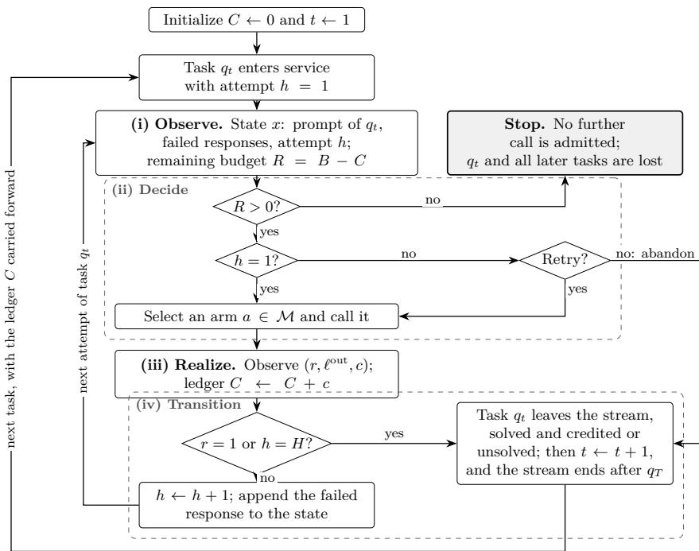  
Figure 1: Decision flow of the task stream under the budget B.

with $\tau _ { B } = \infty$ when no crossing occurs. The crossing response is observed and receives credit if it solves the current task, but $G _ { u } = 0$ for every later step $u > \tau _ { B }$ . This halt-after-crossing rule therefore limits future admissions rather than truncating a response already in service.

This pathwise rule makes the consequence of an expensive call depend on its position in the task stream. Beyond the current charge, its loss includes the later tasks the charge removes from service, so the budget is a one-dimensional, absorbing capacity constraint rather than an average-cost penalty applied independently to each request.

## 3.4 Objective

Let $\Pi _ { \mathrm { n a } }$ be the class of nonanticipating policies, those whose step-s decisions are $\mathcal { F } _ { s }$ -measurable. The router maximizes the expected number of distinct tasks solved before service stops, with $\mathbb { E } _ { \pi }$ denoting expectation under the policy π:

$$
\operatorname* { m a x } _ { \pi \in \mathrm { I I _ { n a } } } \mathbb { E } _ { \pi } [ \mathrm { S o L V E D } ( \pi ) ] , \qquad \mathrm { S o L N E D } ( \pi ) = \sum _ { t = 1 } ^ { T } \mathbb { I } \{ \exists s \leq \operatorname* { m i n } \{ S , \tau _ { B } \} : \ t _ { s } = t , \ G _ { s } = 1 , \ r _ { s } = 1 \} .\tag{3}
$$

This objective values each unit of budget through the tasks it keeps serviceable, rather than through a per-call quality–cost ratio.

## 4 Methodology

We develop ADP-HT, an online policy for LLM routing, which is motivated by the bid-price principle of online resource allocation. Consider a budgeted bandit problem. In each round, the decision maker selects an arm, receives a reward $r ,$ and consumes c units of a limited resource. Resource spent on the current pull is no longer available in later rounds. Then each arm’s value can be measured by the reward it produces minus the opportunity cost of the resource it consumes, which can be expressed as

$$
Q = r - \lambda c ,\tag{4}
$$

where λ is the shadow price, the opportunity cost of consuming one unit of budget. And Q can be viewed as the net value of the action, so the decision maker should select the arm with the highest Q.

However, this score is not directly available in LLM routing. In this setting, each arm corresponds to a candidate LLM. The reward r records whether its call solves the current task, with r = 1 for success and $r = 0$ otherwise, and c is the budget charged for the call, but the router does not know either exactly before a call is made. For example, even when the prompt length and token prices are known, the number of output tokens is unknown until the response is generated, and the exact charge cannot be determined in advance. So it has to learn the solve probability from selected calls and estimate the cost before the response returns. Because one long response can exhaust the remaining budget, the cost term should take this risk into account. The shadow price should also track realized spending adaptively to better utilize the remaining budget. And for tasks that fail on the first attempt, the router needs to decide whether to retry the same task or preserve the budget for later tasks. The rest of this section builds ADP-HT based on the score (4) with modifications for these challenges.

ADP-HT supplies these quantities in four modules designed for LLM routing. For the reward (see Section 4.1), a hybrid learner combines a shared task-dificulty component with a modelspecific adjustment and reports an upper confidence bound (UCB) on the solve probability. For the cost (see Section 4.2), we utilize a K-bit prediction of the response length to construct a one-sided pre-call cost bound that covers the tail of the response-length distribution. It is dificult to predict the exact output tokens for a LLM, but it is much easier to predict whether the response will be short, medium, or long. This motivates the K-bit threshold-survival heads, which can help the router predict more reliably with a loss of resolution, introducing a trade-of between resolution and precision. The shadow price is controlled by a dual-pace mechanism (see Section 4.3). Its fast component updates the price directly from the latest call’s charge, while its slow component updates a pacing multiplier from an exponential moving average of recent charges. These components adjust the cost penalty and the current task’s spending reference in response to realized spending and remaining capacity. Finally, the retry gate (see Section 4.4) decides whether a failed task should continue competing for capacity, using the current pre-call score of the selected candidate and a margin computed after the previous failure. The margin rises with retry depth and with spend beyond the revised task allowance. The following subsections describe these modules, and Algorithm 1 gives the full policy.

## 4.1 Reward Learner

The first term r of the score (4), the reward that a model solves the current task, is provided by the reward learner. Estimating it separately for every model wastes information because a dificult prompt tends to be dificult for several models, and a call to any model reveals something about that common dificulty. Pooling all calls into one predictor creates the opposite problem, because models have diferent strengths. The hybrid reward learner therefore combines a shared task component with a model-specific adjustment.

The reward feature $x _ { s } ^ { r }$ of step s is a high-dimensional prompt embedding, and the calls available to each model are limited in online routing. The shared component therefore works on the projected feature $z _ { s } = P x _ { s } ^ { r }$ , where $P \in \mathbb { R } ^ { d _ { 0 } \times d _ { r } }$ is a fixed projection matrix with orthonormal rows and $d _ { 0 } \ll d _ { r }$ , so the pooled block is estimated in a much smaller space. An unregularized fit would still be sensitive to directions that the executed calls sample poorly, so we estimate both components jointly under a ridge penalty, which limits the influence of those directions [Has20].

Every executed call updates the shared suficient statistics and the local suficient statistics of the selected model. The fit returns a shared coeficient $\hat { \beta } _ { s } \in \mathbb { R } ^ { d _ { 0 } }$ and a coeficient $\hat { \theta } _ { s , a } \in \mathbb { R } ^ { d _ { r } }$ for each model a.

$$
\hat { r } _ { s } ( \boldsymbol { a } , \boldsymbol { x } _ { s } ^ { r } ) = z _ { s } ^ { \top } \hat { \beta } _ { s } + \boldsymbol { x } _ { s } ^ { r \top } \hat { \theta } _ { s , a } .\tag{5}
$$

The first term reads how dificult the task is for all models, and the second characterizes each model’s specific performance on that task. This additive structure follows the hybrid linear upper-confidence-bound (LinUCB) algorithm [LCLS10]. The fixed projection reduces the shared block’s dimension, motivated by random-projection methods for dimension reduction [Ach03]. The detailed implementation is provided in EC.2.

A point estimate alone would favor models already sampled often and could prematurely discard a capable but less-tested model. The learner therefore adds the uncertainty $v _ { s } ^ { r } ( a , x _ { s } ^ { r } )$ of the same ridge fit, which is large when the current model–task pair is poorly covered by past calls:

$$
\begin{array} { r } { U _ { s } ^ { r } ( a , x _ { s } ^ { r } ) = \mathrm { c l i p } _ { [ 0 , 1 ] } \left\{ \hat { r } _ { s } ( a , x _ { s } ^ { r } ) + \alpha _ { r } \sqrt { \mathrm { m a x } \{ v _ { s } ^ { r } ( a , x _ { s } ^ { r } ) , 0 \} } \right\} , } \end{array}\tag{6}
$$

where $\alpha _ { r } > 0$ is the reward-exploration scale, clipping keeps the score in [0, 1], and the inner max $\left. \{ \cdot , 0 \} \right.$ guards against a negative variance proxy produced by rounding. The selector uses $U _ { s } ^ { r }$ rather than the point prediction, so fresh evidence can overturn an estimate built from few calls, leading to a balanced exploration–exploitation trade-of.

## 4.2 Cost Learner

The term c of (4) is supplied by the cost learner. For a call to LLM a, the cost consists of two parts, an input charge and an output charge, with known per-token prices $\rho _ { a } ^ { \mathrm { i n } }$ and $\rho _ { a } ^ { \mathrm { o u t } }$ . The input side of the charge is already known at admission (the prompt), so the quantity to forecast is the response length, for which the natural device is a point estimate. Such an estimate is unreliable, because a prompt does not determine a length. Even holding the model and the decoding configuration fixed, repeated calls on the same prompt trace out a heavy-tailed distribution of output lengths rather than one deterministic value [WQX+26], so the estimate reports the center of a distribution whose spread is precisely what matters. The consequences of prediction error are asymmetric. Overprediction lowers a model’s selection score and can discourage a retry that the budget could have aforded. Underprediction can instead favor a response whose realized charge crosses the budget and ends service for every later task. The selection score therefore needs a statement about the tail of the length distribution rather than only its center.

The K-bit mechanism takes the place of that point estimate. The resolution parameter K determines the number of response-length intervals, $J = 2 ^ { K }$ . Rather than predict precisely how many tokens a response will contain, the router first discretizes the range of possible lengths into J intervals, then asks at each interval boundary whether the response will run past it, and reports the upper edge of an interval as its final prediction. This can lower the dificulty of the prediction, and the reason is easy to see intuitively. At $K = 1$ , for instance, the router predicts only whether a response will be short or long. That single bit can be easier to get right than an exact point estimate, and it also helps control the risk that a misprediction lets an overlong response exhaust the remaining budget. The price of the lost resolution is just as visible. A coarse grid limits how precisely the learner can locate the target response-length threshold. A larger K supplies more thresholds, and every call updates all heads of its selected model. The trade-of comes from requiring confidence across more estimates, which increases the estimation allowance at a fixed sample size under the stated confidence calibration. The analysis following Algorithm 1 quantifies this trade-of between resolution and precision.

We call this coarsened signal the K-bit cost-shape channel, and construct it as follows. In the formal model, the J intervals are delimited by edges $0 = e _ { 0 } < e _ { 1 } < \cdot \cdot \cdot < e _ { J } \leq \ell _ { \operatorname* { m a x } } ^ { \mathrm { o u t } }$ , where $\ell _ { \mathrm { m a x } } ^ { \mathrm { o u t } }$ is the known maximum output length. These edges are chosen before the run and fixed during online decision processes. The edges can be constructed from the warm-start samples. For example, for $K = 2$ and an equal-probability grid, the three interior edges are chosen to be the 25%, 50%, and 75% quantiles of the historical response length distribution of warm-up calls or stored user datasets. In our implementation, we instead use warm-start quantiles to place

$2 ^ { K } - 1$ intervals within a core range and reserve one interval for the modeled tail, where $e _ { J }$ can be chosen and updated by the maximum observed length. This prevents the longest possible response length $\ell _ { \mathrm { m a x } } ^ { \mathrm { o u t } }$ from influencing the core resolution. Thus $K = 2$ gives three core intervals and one tail interval. The empirical top edge and the construction details are given in EC.2.1. At each threshold, we observe whether the response ran past the edge, an indicator we write $y _ { s , j } ^ { c } = \mathbb { I } \{ \ell _ { s } ^ { \mathrm { o u t } } > e _ { j } \}$ . It then updates every threshold head of the selected model The formal analysis also allows other fixed, strictly increasing construction methods, such as equal-width partitions. For other grids, the extension in EC.1.5 uses the distance to the next available edge. This term is no larger than the widest interval, ma $\mathfrak { c } _ { j \in [ J ] } ( e _ { j } - e _ { j - 1 } )$ . Thus, the edge choice afects the size of the bound, but not its structure.

For candidate model a and edge $e _ { j } , j \in [ J ]$ , the learner estimates the exceedance probability

$$
p _ { s } ^ { c } ( a , x _ { s } , j ) = \operatorname* { P r } \left( \tilde { \ell } _ { s } ^ { \mathrm { o u t } } ( a , x _ { s } ) > e _ { j } \mid \mathcal { F } _ { s } \right) .\tag{7}
$$

Here $\tilde { \ell } _ { s } ^ { \mathrm { o u t } } ( a , x _ { s } )$ is the length model a would return in state $x _ { s } .$ , and the conditioning is on everything the router knows before the call. Note that since $e _ { J }$ is an empirical upper bound in the implementation, actual response lengths may exceed it, so the probability in (7) can be positive even for $j = J$

For each model–edge pair $( a , j )$ , a threshold head uses ridge regression fitted on past calls to model a to predict the exceedance label $y _ { s , j } ^ { c }$ from the cost feature $x _ { s } ^ { c } ( a )$ , where $x _ { s } ^ { c } ( a )$ combines the projected prompt feature $z _ { s }$ with pre-call information such as retry depth, input length, and the previous call’s outcome and cost. With cost-exploration scale $\alpha _ { c } > 0$ , the head reports the raw upper confidence bound

$$
\begin{array} { r } { \hat { U } _ { s } ^ { c } ( a , x _ { s } ^ { c } ( a ) , j ) = \mathrm { c l i p } _ { [ 0 , 1 ] } \left\{ \hat { p } _ { s } ( a , x _ { s } ^ { c } ( a ) , j ) + \alpha _ { c } \sqrt { \operatorname* { m a x } \{ v _ { s } ^ { c } ( a , x _ { s } ^ { c } ( a ) ) , 0 \} } \right\} . } \end{array}\tag{8}
$$

Here $\hat { p } _ { s } ( a , x _ { s } ^ { c } ( a ) , j )$ is the fitted exceedance probability, and $v _ { s } ^ { c } ( a , x _ { s } ^ { c } ( a ) )$ measures estimation uncertainty at the current cost feature. The uncertainty measure $v _ { s } ^ { c } ( a , x _ { s } ^ { c } ( a ) )$ is common to all J heads of model $^ { a , }$ because they use the same past calls, cost features, and ridge regularization and difer only in their exceedance labels. EC.2 gives the regression statistics and the expression for $v _ { s } ^ { c }$ in detail.

True exceedance probabilities are nonincreasing in the threshold index $j ,$ since a response that exceeds $e _ { j }$ also exceeds every shorter edge. But heads fitted separately need not respect that ordering in finite samples. The router restores it with a single sweep from short to long, replacing each bound by the smallest one seen so far as follows.

$$
U _ { s } ^ { c } ( a , x _ { s } ^ { c } ( a ) , j ) = \operatorname* { m i n } _ { i \leq j } \hat { U } _ { s } ^ { c } ( a , x _ { s } ^ { c } ( a ) , i ) .\tag{9}
$$

The reported bound $U _ { s } ^ { c } ( a , x _ { s } ^ { c } ( a ) , j )$ is therefore nonincreasing in the edge. We call this correction the monotone projection, which restores coherence without adding information.

To obtain a response-length bound, fix a tail tolerance $\delta _ { c } \in ( 0 , 1 )$ specifying the maximum acceptable exceedance probability.1 The first-safe-edge rule selects the smallest edge whose reported bound $U _ { s } ^ { c } ( a , x _ { s } ^ { c } ( a ) , j )$ is at most $\delta _ { c }$ . If none qualifies, it falls back to the top edge $e _ { J }$ The resulting edge length is

$$
\hat { e } _ { s } ^ { + } ( a , x _ { s } ^ { c } ( a ) ) = \operatorname* { m i n } \left( \{ e _ { j } : j \in [ J ] , \ U _ { s } ^ { c } ( a , x _ { s } ^ { c } ( a ) , j ) \leq \delta _ { c } \} \cup \{ e _ { J } \} \right) .\tag{10}
$$

Known token prices convert this length into the cost bound used in the selection score and retry rule,

$$
\hat { c } _ { s } ^ { + } ( a , x _ { s } ^ { c } ( a ) ) = \rho _ { a } ^ { \mathrm { i n } } \ell _ { s } ^ { \mathrm { i n } } ( a ) + \rho _ { a } ^ { \mathrm { o u t } } \hat { e } _ { s } ^ { + } ( a , x _ { s } ^ { c } ( a ) ) ,\tag{11}
$$

where $\ell _ { s } ^ { \mathrm { i n } } ( a )$ is the prompt length under model a’s own tokenizer, a function of a because tokenizers difer enough across model families that one prompt yields a diferent token count, and hence a diferent input charge, on each candidate [PLMTB23].

## 4.3 Dual-Pace Controller

The dual-pace controller sets the shadow price λ in (4) and the budget references used to evaluate each call. At decision step s, the remaining budget $R _ { s }$ needs to support the $N _ { s }$ tasks remaining in the stream, including the current task. Since the dificulty of future tasks is unknown, we use the equal share $\bar { b } _ { s } = R _ { s } / N _ { s }$ as an initial spending reference. A strict per-task cap at this share can be too restrictive. If inexpensive tasks repeatedly leave part of their share unused, the share available to later tasks increases. A strict cap can therefore limit spending on earlier tasks even when budget is left unused at the end. Allowing unrestricted spending creates the opposite risk, because early tasks may exhaust the budget before later tasks are served.

ADP-HT uses the dual-pace controller to manage this tradeof. A pacing multiplier $\phi _ { s }$ adjusts the spending reference for the current task based on recent average call costs. A shadow price $\lambda _ { s }$ adjusts the cost penalty in model selection based on the cost of the latest call. The former responds to the recent spending pattern, while the latter responds directly to the latest call.

We define the task budget reference $b _ { s } ^ { \mathrm { t a s k } }$ and step budget reference $b _ { s } ^ { \mathrm { s t e p } }$ as

$$
b _ { s } ^ { \mathrm { t a s k } } = \operatorname* { m a x } \{ \phi _ { s } \bar { b } _ { s } , \epsilon \} ,\tag{12a}
$$

$$
b _ { s } ^ { \mathrm { s t e p } } = \operatorname* { m a x } \left\{ \frac { b _ { s } ^ { \mathrm { t a s k } } } { H - h _ { s } + 1 } , \epsilon \right\} ,\tag{12b}
$$

where $H - h _ { s } + 1$ is the number of attempts remaining for the current task, including the current attempt. The task budget reference $b _ { s } ^ { \mathrm { t a s k } }$ provides a scale for the cost normalization, while the step budget reference $b _ { s } ^ { \mathrm { s t e p } }$ provides the spending reference for updating $\lambda _ { s }$ . The small constant $\epsilon > 0$ keeps denominators positive.

After a call returns, the router observes its exact cost $c _ { s }$ and updates an exponential moving average (EMA) of call costs,

$$
m _ { s + 1 } = ( 1 - \alpha _ { \mathrm { E M A } } ) m _ { s } + \alpha _ { \mathrm { E M A } } c _ { s } ,\tag{13}
$$

where $\alpha _ { \mathrm { E M A } } \in ( 0 , 1 )$ is the weight on the latest charge. The initial average is obtained from the historical data.

The shadow price compares the latest charge with the step allowance, whereas the pacing multiplier compares the equal-share reference with the updated average cost. With learning rates $\eta _ { \lambda } , \eta _ { \phi } > 0$ , the two multiplicative updates are

$$
\lambda _ { s + 1 } = \mathrm { c l i p } _ { [ \lambda _ { \mathrm { m i n } } , \lambda _ { \mathrm { m a x } } ] } \Biggl \{ \lambda _ { s } \exp \left( \eta _ { \lambda } \mathrm { c l i p } _ { [ g _ { \lambda } ^ { l b } , g _ { \lambda } ^ { u b } ] } \left\{ \frac { c _ { s } } { b _ { s } ^ { \mathrm { s t e p } } } - 1 \right\} \right) \Biggr \} ,\tag{14a}
$$

$$
\phi _ { s + 1 } = \mathrm { c l i p } _ { [ \phi _ { \mathrm { m i n } } , \phi _ { \mathrm { m a x } } ] } \bigg \{ \phi _ { s } \exp \bigg ( \eta _ { \phi } \mathrm { c l i p } _ { [ g _ { \phi } ^ { l b } , g _ { \phi } ^ { u b } ] } \bigg \{ \frac { \bar { b } _ { s } } { \operatorname* { m a x } \{ m _ { s + 1 } , \epsilon \} } - 1 \bigg \} \bigg ) \bigg \} ,\tag{14b}
$$

where the clipping bounds $g _ { \lambda } ^ { l b } , g _ { \lambda } ^ { u b } , g _ { \phi } ^ { l b } , g _ { \phi } ^ { u b }$ prevent extreme updates, and the outer clips $[ \lambda _ { \operatorname* { m i n } } , \lambda _ { \operatorname* { m a x } } ]$ and $[ \phi _ { \mathrm { m i n } } , \phi _ { \mathrm { m a x } } ]$ keep the shadow price and pacing multiplier within reasonable ranges.

For each LLM call, if the realized cost $c _ { s }$ exceeds the step allowance $b _ { s } ^ { \mathrm { s t e p } }$ , the shadow price rises, lowering the score of expensive models in the next step. If the realized cost is below the allowance, the shadow price falls, leading to more aggressive spending. The pacing multiplier $\phi _ { s }$ compares the equal-share reference with the moving average of recent costs. If the average cost is below the equal share, $\phi _ { s }$ rises, allowing more budget for the current task. If the average cost exceeds the equal share, $\phi _ { s }$ falls and thus tighten the budget. The use of a moving average makes pacing less sensitive to a single charge, while the shadow price responds to that charge directly. The dual-pace controller therefore adapts to both the realized spending path and the recent cost pattern, which helps avoid overspending and underspending adaptively.

## 4.4 Model Selection and Retry Gate

With all modules above, the router computes the score for each model arm and selects the one with the highest score as follows:

$$
\begin{array} { r } { Q _ { s } ( a , x _ { s } ) = U _ { s } ^ { r } ( a , x _ { s } ^ { r } ) - \lambda _ { s } \frac { \hat { c } _ { s } ^ { + } ( a , x _ { s } ^ { c } ( a ) ) } { b _ { s } ^ { \mathrm { t a s k } } } , } \end{array}\tag{15a}
$$

$$
a _ { s } = \underset { a \in \mathcal { M } } { \arg \operatorname* { m a x } } Q _ { s } ( a , x _ { s } ) .\tag{15b}
$$

The score (15a) aligns with the core design of score (4). The cost $\hat { c } _ { s } ^ { + }$ is normalized by the task budget reference $b _ { s } ^ { \mathrm { t a s k } }$ , which is dynamically adjusted by the remaining budget and the recent spending pattern. The shadow price $\lambda _ { s }$ changes with the realized cost of the latest call, reflecting the current scarcity and value of the remaining budget. By multiplying the normalized cost by the shadow price, the cost can be translated into the same scale as the reward $U _ { s } ^ { r }$ , allowing a direct comparison. A model with higher possible reward and lower cost will have a higher score, and the models with higher rewards but higher costs may also be preferred. The score therefore balances the reward of solving the task with the cost of the call, and the model with the highest score is selected for step s. Ties are broken first by the optimistic solve probability and then by a mean-cost proxy, both recorded in EC.2.

Equation (15) determines which model to call. After a failed attempt, the router must decide whether to make another call or move to the next task. A further attempt can exploit the failed exchange, but it starts from a longer prompt and may also fail with higher cost. The retry gate therefore evaluates this choice before the next call using accumulated cost and remaining budget.

Suppose attempt $h _ { s } < H$ fails and leaves $R _ { s } - c _ { s } > 0$ . The router records the exact charge, updates the dual-pace controller, and recomputes the task budget reference from the smaller post-call budget as $b _ { s } ^ { \mathrm { r e t r y } } = \operatorname* { m a x } \{ \phi _ { s + 1 } \bar { b } _ { s + 1 } , \epsilon \}$ with $\bar { b } _ { s + 1 } = ( R _ { s } - c _ { s } ) / N _ { s }$ , where $N _ { s }$ is unchanged because the failed task is still unsolved. The exact spend on the current task through step s is $\textstyle \sum _ { u \leq s : t _ { u } = t _ { s } } G _ { u } c _ { u }$ , where $G _ { u }$ indicates whether step u executes a call. Using this sum, the router Pcomputes a retry margin $\kappa _ { s }$ that rises with retry depth and spending beyond the revised task budget reference as follows.

$$
\kappa _ { s } = \kappa _ { 0 } + \kappa _ { h } \frac { h _ { s } - 1 } { H - 1 } + \kappa _ { b } \left( \frac { \sum _ { u \leq s : t _ { u } = t _ { s } } G _ { u } c _ { u } } { b _ { s } ^ { \mathrm { r e t r y } } } - 1 \right) _ { + } ,\tag{16}
$$

where $( u ) _ { + } : = \operatorname* { m a x } \{ u , 0 \}$ . The base term $\kappa _ { 0 }$ is the required retry margin, $\kappa _ { h }$ penalizes deeper retries, and $\kappa _ { b }$ penalizes overspending. This retry gate aligns with the LLM’s practical behavior, because a retry after multiple failures is less likely to succeed, and the cost will be higher because the prompt is longer with the failed response appended [LHZN26]. After computing $\kappa _ { s }$ and rebuilding the next state $x _ { s + 1 }$ , the router reevaluates all candidates using the updated learners and controller. The task continues if and only if ma $\mathrm { x } _ { a } Q _ { s + 1 } ( a , x _ { s + 1 } ) \geq \kappa _ { s }$ . Algorithm 1 summarizes the overall execution of ADP-HT.

1. Replay $\mathcal { D } _ { \mathrm { w a r m } }$ to fix the edges and initialize both learners, λ, ϕ, and m and set $C  0 .$ ▷   
initialization   
2. for $t = 1$ to T do   
3. Set $C ^ { \mathrm { t a s k } } \gets 0$ and $N \gets T - t + 1$   
4. Observe q and build its first-attempt state x.   
5. for $h = 1$ to H do   
6. if $C \geq B$ then halt.   
7. Compute $b ^ { \mathrm { t a s k } }$ and $b ^ { \mathrm { s t e p } }$ using (12). ▷ pacing sets the local shares   
8. for $a \in \mathcal { M }$ do   
9. Compute $U ^ { r } ( a )$ using (6) and $\hat { c } ^ { + } ( a )$ using (11). ▷ value and cost bound   
10. $Q ( a )  U ^ { r } ( a ) - \lambda \hat { c } ^ { + } ( a ) / b ^ { \mathrm { t a s k } }$ as in (15a). ▷ cost priced in value units   
11. end for   
12. Select $a ^ { \star } \in \arg \operatorname* { m a x } _ { a \in { \mathcal { M } } } Q ( a ) .$   
13. if $Q ( a ^ { \star } ) < \kappa$ and $h \neq 1$ then break; otherwise execute the call. ▷ retry gate   
14. Observe $( r , c , \ell ^ { \mathrm { o u t } } )$ and update both learners. ▷ feedback and update   
15. Set $C \gets C + c$ and $C ^ { \mathrm { t a s k } } \gets C ^ { \mathrm { t a s k } } + c .$   
16. Update m, λ, and $\phi$ in that order using (13)–(14b). ▷ price fast, pace slow   
17. if $r = 1$ then mark task t solved and break.   
18. if $h = H$ or $C \geq B$ then break.   
19. Recompute $b ^ { \mathrm { r e t r y } }$ and κ using (16), and append the failure and rebuild the next state.   
20. end for   
21. end for

For Algorithm 1, we capture the K-bit trade-of in the pre-call cost bound. A larger K creates a finer grid and produces a cost bound with higher resolution, while requires more data and efort to update all $2 ^ { K }$ threshold heads. We quantify this in the following theorem.

Theorem (Informal). Given $\delta _ { c } \in ( 0 , 1 )$ , the gap between the true conditional $( 1 - \delta _ { c } )$ cost quantile $c _ { s } ^ { \delta _ { c } } ( a )$ and the pre-call cost bound $\hat { c } _ { s } ^ { + } ( a , x _ { s } ^ { c } ( a ) )$ in (11) satisfies the following order bound under the calibration, local tail-margin, core-coverage, and grid-spacing conditions in EC.1, with the remaining parameters fixed:

$$
0 \leq \hat { c } _ { s } ^ { + } ( a , x _ { s } ^ { c } ( a ) ) - c _ { s } ^ { \delta _ { c } } ( a ) = O \left( \underbrace { 2 ^ { - K } } _ { \mathrm { r e s o l u t i o n ~ e r r o r } } + \underbrace { \sqrt { \frac { K } { n _ { s , a } } } } _ { \mathrm { p r e c i s i o n ~ e r r o r } } \right) ,\tag{17}
$$

where $n _ { s , a }$ is the number of all calls used to fit model a’s cost heads.

A formal theorem statement and its proof are provided in EC.1. The resolution term comes from grid rounding and decreases as the grid becomes finer. The precision term is the allowance for simultaneous estimation across all $2 ^ { K }$ threshold heads and increases with K at a fixed sample size under the stated calibration. EC.1.4 gives a matching construction establishing joint order tightness under the stated calibration w.r.t. (17).

Holding reward estimates and controller values fixed, a larger estimated cost bound $\hat { c } _ { s } ^ { + } ( a , x _ { s } ^ { c } ( a ) )$ can lower a model’s score in (15a). The K-bit trade-of can therefore afect model selection and retry decisions. EC.1.2 bounds the one-step quantile-score loss, while Section 5.1.2 evaluates tasks solved and EC.2.7 checks empirical coverage, providing practical guidance on choosing K.

We next examine how the value of tail protection varies with the number of remaining tasks. Suppose we route $T$ identical tasks, with one call per task and total budget $B ,$ using two models with known distributions. The predictable model P has deterministic cost c and success probability u. The risky model R has success probability $v > u$ . It costs ℓ with probability $1 - \varepsilon$ and $d \ge B$ with probability $\varepsilon ,$ where $\ell < c < d .$ A response that reaches or crosses the budget is still completed and, if successful, counted before service stops.

It is easy to construct an instance in which every fixed mean-cost score prefers R. For example, take $( \ell , c , d , \varepsilon , u , v , B ) = ( 1 , 4 , 9 , 0 . 2 , 0 . 7 5 , 1 , 7 . 5 )$ . Then R has both a higher success probability and a lower mean cost. Thus, for every $\lambda \geq 0$ , the score (4) prefers R.

However, the budget stopping rule changes this conclusion because a high-cost call to R may end future service. With few tasks remaining, there is little future service to lose, so R is better. As more tasks remain, avoiding termination protects enough future service to justify choosing P. With many tasks remaining, however, the extra cost of P uses budget that could pay for several cheap calls to R, so R becomes better again.

This example shows how the number of remaining tasks changes the optimal first choice. Even when R has both a higher success probability and a lower mean cost, the optimal first choice moves from R to P and then back to R as the number of remaining tasks increases. A fixed score whose predictions do not change with the number of remaining tasks cannot reproduce these changes. ADP-HT uses a state-dependent cost penalty: the efective price $\lambda _ { s } / b _ { s } ^ { \mathrm { t a s k } }$ on the cost bound in (15a) responds to realized spending and the remaining budget per unfinished task. The example yields the following structural insight.

Remark 1. For a given budget, the value of tail protection can rise and fall as the number of remaining tasks increases. With few remaining tasks, there is little future service to protect. With many remaining tasks, the extra cost of tail protection displaces cheap risky calls. The optimal first choice can therefore be risky, then predictable, then risky again, which should be adaptively reflected in the model score.

This analysis motivates a state-dependent cost penalty. EC.5 gives the formal results and distinguishes the optimal price in the two-model setting from ADP-HT’s adaptive rule; in particular, fixed initialization cannot reproduce both backlog reversals.

## 5 Numerical Experiments

We conduct three experiments under the operating rules of Section 3. Experiment 1 (Section 5.1) compares the implemented policies on live MATH500 [HBK+21] and GPQA [RHS+24a] streams, with retries. It examines performance across budgets and sensitivity to the resolution parameter K, the retry gate, and pacing. Experiment 2 evaluates adapted configurations on a public benchmark (Section 5.2), and Experiment 3 compares test-time allocation with a commercial router provided by OpenRouter (Section 5.3). We also conduct experiments in EC.3 and EC.4 to examine the K-bit mechanism through cost predictor ablations and assess how closely ADP-HT approaches the dynamic programming optimum. All experiments run on a MacBook Air with an Apple M4 chip and 16GB of RAM.

We compare ADP-HT against four implemented policies from the multi-LLM routing literature and a deployed commercial router. Budget-aware (BA) and Position-aware (PA) LinUCB [PDL+26] are budget-aware contextual bandit routers. ParetoBandit [TM26] is ported to the finite stream with its primal–dual reward–cost rule intact, and Greedy LinUCB always calls the arm with the highest UCB, standing in for a budget-unaware online router.

## 5.1 Experiment 1: Routing and Retries Under a Binding Budget

We use a 20%/80% stratified split of each dataset into warm and test streams, with five sharedwarm-start replicates per dataset. The warm stream is used to construct the warm-up data to initialize the predictors, which is excluded from budget accounting. And the budget is for the test stream only. A task may receive at most H = 4 calls and leaves the stream after its first verifier-confirmed success, and the outcome is the number of distinct test tasks solved before service ends. The MATH500 budget grid is $B ~ \in ~ \{ 0 . 0 2 5 , 0 . 0 5 , 0 . 0 7 5 , 0 . 1 2 5 , 0 . 3 0 , 0 . 4 5 , 0 . 6 0 \}$ USD, to which GPQA adds 0.80 and 1.00. The tightest budgets cover only a small fraction of the stream, so the grid spans the scarcity regimes the model targets. Every policy faces the same five-model menu, task order, prompt constructors, verifier, local representation, seedspecific warm log, and cost accounting; the warm log is generated once by unconstrained Greedy LinUCB and replayed before each finite-budget run. EC.2.2 reports the details.

## 5.1.1 Results

Figure 2 reports the operating frontiers. ADP-HT’s mean solved-count advantage over the budget-aware comparators is largest at tight budgets and narrows as the budget increases. At $B = 0 . 0 2 5$ it solves 216.2 MATH500 problems and 85.0 GPQA questions against 100.8 and 29.8 for Position-aware LinUCB, the strongest implemented comparator in both datasets, or more than twice as many in each. At the largest budget of each dataset, the advantage over the best of BA, PA, and ParetoBandit is 2.6 and 4.6 tasks. Budget-unaware Greedy, far behind at tight budgets, closes to within twelve tasks on MATH500 and has a similar mean solved count on GPQA.

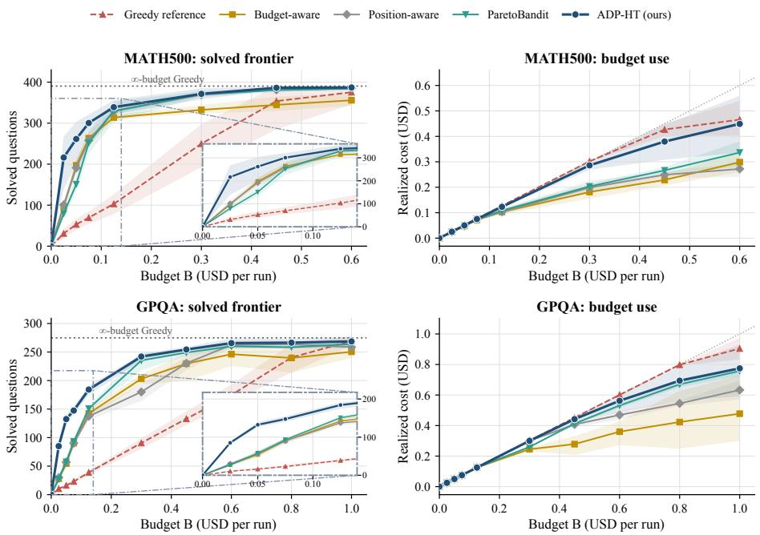  
Figure 2: Performance on MATH500 and GPQA streams.

Converting the budget into completions is not the same objective as spending little. At B = 0.30 on GPQA, ParetoBandit solves 235.2 questions for about \$0.26, whereas ADP-HT solves 242.0 for about \$0.30. ADP-HT nevertheless has the higher solved-count mean at every tested budget, with grid-averaged advantages of 44.8 tasks on MATH500 and 27.9 on GPQA. Because the same warm replay re-enters the analysis at every budget of its seed, budget cells are not independent replicates. A two-level paired bootstrap of that diference yields 95% percentile intervals entirely above zero in all six dataset–baseline comparisons. EC.2.5 reports its construction and the cell-level means behind Figure 2.

The realized paths help describe how ADP-HT uses the budget. It uses 93.4% of the nominal budget on average across the MATH500 grid, against 75.7–81.5% for BA, PA, and ParetoBandit. This greater utilization is consistent with pacing releasing unused budget, although the comparison does not isolate its contribution. As the budget expands, the policy shifts calls from inexpensive models toward more capable ones. Calls per task on MATH500 first rise as second attempts become afordable and then fall when stronger first calls enter, whereas on GPQA retries remain common because first attempts fail more often. The remaining unsolved tasks account for a disproportionate share of spending. Here we denote profile as the complete attempt history of one task actually started in one seed’s run, and tasks never reached by the router are excluded. At the largest MATH500 budget, unsolved profiles make up 3.25% of these recorded profiles but absorb 20.2% of spending. On GPQA, their share of spending is 53.9%. These figures show why neither low spending nor budget exhaustion alone measures allocation quality. EC.2.5 records the underlying utilization, profile counts, and per-task costs.

## 5.1.2 Choosing the Resolution Parameter K.

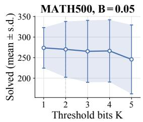

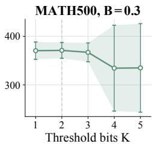  
Figure 3: K-sweep in Experiment 1.

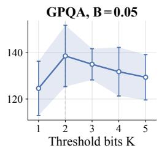

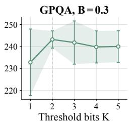

Theorem 4.4 identifies the trade-of between resolution and precision but does not select an operating point. On live trafic the resolution sweep favors a coarse mesh. The sweep shows no clear gain beyond the compact $K = 2$ used in Figure 2, and empirical coverage declines at the finest meshes. Two groups of new runs examine these outcomes. A sweep reruns the full policy at $K \in \{ 1 , \ldots , 5 \}$ in four dataset–budget cells, changing only the resolution parameter $K _ { i }$ , and a call-level audit compares the deployed bound with the charges it admitted. In the sweep (Figure 3), across-seed dispersion grows several-fold on MATH500 at the two finest meshes; a two-level bootstrap pooled over the four cells separates $K = 2$ from $K = 4$ and $K = 5$ but not from $K = 1$ or $K = 3$ . The audit checks the coverage of the deployed cost bounds. These runs reuse warm data and tune the confidence scales, so the audit does not verify the theorem’s calibration assumptions. The observed fraction of calls satisfying $c _ { s } \leq \hat { c } _ { s } ^ { + }$ declines monotonically in K on both datasets, and on GPQA it falls below the operating target $1 - \delta _ { c }$ at $K \geq 4$ . Provider variation and diferences in routing history also afect these results. They support using a coarse mesh at the reported sample sizes, but do not isolate the estimation term or establish an optimal K. EC.2.6 and EC.2.7 report the sweep design, cell-level counts, mean diferences, and coverage audit.

## 5.1.3 Ablation Study.

The ablation removes the retry gate and the pacing update, separately and together, at $B = 0 . 0 5$ and B = 0.30 with three seed indices per cell. The largest observed loss from removing the retry gate occurs at the tighter budget. At $B = 0 . 0 5$ the no-gate variant solves about a third fewer MATH500 tasks and under half as many GPQA tasks as the full policy, whereas at $B = 0 . 3 0$ the gaps narrow to 7.4 and 23.0 tasks. Freezing the pacing multiplier at its initial value costs little on MATH500 but 12.7 tasks on GPQA at the tight budget. The no-gate gap is smaller at the larger tested budget, while the loss associated with freezing pacing varies by dataset and budget. These comparisons describe sensitivity to component removal. Table 1 reports all cells and the seed protocol.

## 5.2 Experiment 2: Comparison on a Public Benchmark

We also compare on RouterBench $[ \mathrm { H B L ^ { + } 2 4 } ]$ , a public benchmark of 36,497 queries drawn from eight datasets and answered by eleven models under a single-call limit, with a standardized test stream, model costs, and a stored score in [0, 1] per query–model pair. ADP-HT runs against BA, PA, ParetoBandit, and budget-unaware Greedy LinUCB over five seeds, each on a stratified

Table 1: Ablation study solved counts. Budgets are in USD.
<table><tr><td>Dataset</td><td>Budget</td><td>ADP-HT</td><td>Frozen-φ</td><td>No-gate</td><td>Frozen-φ+No-gate</td></tr><tr><td rowspan="2">MATH500</td><td>0.05</td><td>291.3 (±28.9)</td><td>286.3 (±2.1)</td><td>192.3 (±16.3)</td><td>198.7 (±7.6)</td></tr><tr><td>0.30</td><td>371.7 (±15.9)</td><td>365.7 (±6.7)</td><td>364.3 (±21.0)</td><td>366.7 (±6.5)</td></tr><tr><td rowspan="2">GPQA</td><td>0.05</td><td>129.7 (±7.6)</td><td>117.0 (±1.7)</td><td>63.0 (±3.5)</td><td>53.7 (±10.5)</td></tr><tr><td>0.30</td><td>246.0 (±1.0)</td><td>239.3 (±8.0)</td><td>223.0 (±3.0)</td><td>239.0 (±12.5)</td></tr></table>

Mean over three seeds, ± one standard deviation.

20%/80% split, across fourteen budgets spanning \$0.50 to \$80.04. The outcome is the five-seed mean cumulative score of all tasks. Figure 4 plots it with the budgets ordered as categories, because the grid spans more than two orders of magnitude. ADP-HT leads all eight budgets through B = \$5.336, reaching 9,827 at B = \$1.50 against 6,982 for the nearest comparator and 1,283 for Greedy. It exceeds BA and ParetoBandit in every cell and leads all five protocols in ten of fourteen, with a largest deficit of 2.8% in the four remaining cells. EC.2.3 gives the configurations, the warm information available to each method, and the cell-level means.

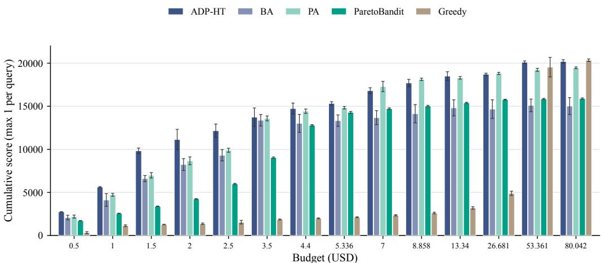  
Figure 4: Comparison on RouterBench.

We also conduct a cost-head ablation on RouterBench within a common reward learner and budget controller. K-Bit is the K-bit head implemented in ADP-HT. Continuous Mean uses the corresponding continuous output-length mean predictor. Mean-Adjusted adds a continuous-length confidence correction to Continuous Mean. K-Bit and Mean-Adjusted share the same tail-tolerance setting $\delta _ { c }$

Table 2: Cost-head comparison on RouterBench.
<table><tr><td>Budget (USD)</td><td>K-Bit</td><td>Continuous Mean</td><td>Mean-Adjusted</td></tr><tr><td>5.00</td><td>15,989.4 (770.9)</td><td>14,774.2 (768.9)</td><td>15,502.3 (416.7)</td></tr><tr><td>8.86</td><td>18,397.6 (462.3)</td><td>16,923.7 (1,589.2)</td><td>17,419.5 (1,048.8)</td></tr><tr><td>10.00</td><td>18,673.3 (376.0)</td><td>17,248.3 (1,359.2)</td><td>17,446.2 (1,199.9)</td></tr><tr><td>13.34</td><td>18,931.1 (515.2)</td><td>17,851.0 (1,330.5)</td><td>17,762.9 (1,310.1)</td></tr><tr><td>20.00</td><td>18,996.2 (532.9)</td><td>18,771.0 (883.9)</td><td>18,668.4 (992.8)</td></tr><tr><td>40.02</td><td>19,888.3 (315.2)</td><td>20,072.6 (151.7)</td><td>20,054.0 (188.7)</td></tr><tr><td>80.04</td><td>20,272.6 (187.2)</td><td>20,263.1 (195.8)</td><td>20,283.6 (184.1)</td></tr></table>

Entries are five-seed means with sample standard deviations. Bold indicates the highest mean at each budget.

Table 2 compares seven representative budgets over five runs with diferent seeds. K-Bit has the highest mean score at tight budgets, which shows the benefit of a discrete tail-safe predictor. And as the budget grows, all the three heads perform similarly, which is intuitive because the risk of exhausting the budget too early is lower. EC.3 reports the grid diagnostic and all paired intervals.

## 5.3 Experiment 3: Comparison with a Deployed Commercial Router

Experiment 3 compares ADP-HT with the OpenRouter AutoRouter service [Ope26b], using its recorded default and cost-saving configurations. We use LiveCodeBench [JHG+25] release\_v6, with 844 test problems after a fixed-seed split reserves 211 for ADP-HT’s warm start. Both routers share the frozen 39-model pool, problem order, one-call limit, and process-isolated execution grader, and use API-reported cost accounting.

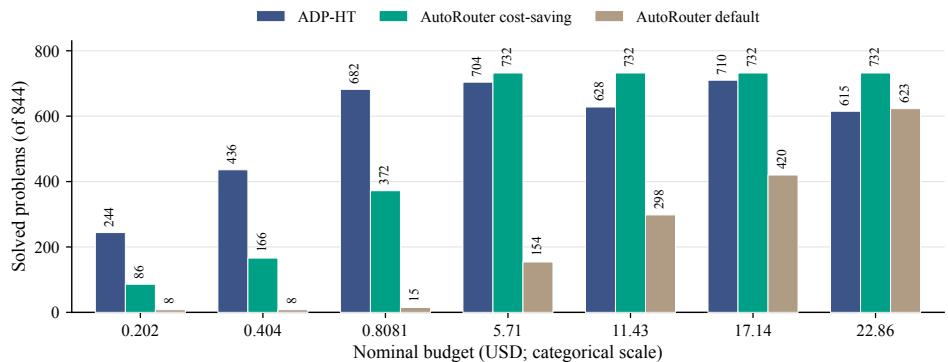  
Figure 5: Commercial-router comparison on the common 844-problem LiveCodeBench stream.

Against a commercial router, ADP-HT’s advantage is concentrated where the budget binds, and there it is large. At the three lowest budgets, \$0.202, \$0.404, and \$0.8081, it essentially exhausts each one and solves 244, 436, and 682 problems, against 86, 166, and 372 for costsaving AutoRouter and at most 15 for the default setting (Figure 5). In the two larger of those cells, it also spends less than cost-saving AutoRouter. Its 682-problem point exceeds default AutoRouter’s complete path of 623 problems at \$22.86 in solved count and uses less test-time spend. Each AutoRouter curve is one complete pass truncated at the first budget crossing, so it cannot fall as B grows, whereas every ADP-HT point is a separate live run whose learning path and provider responses difer from cell to cell even at temperature zero. With only one run per budget, this response and execution variability is not averaged out and influenced by the LLM service provider, so ADP-HT’s counts may not rise monotonically.

At larger budgets, call failures complicate the comparison. Cost-saving AutoRouter issues all 844 calls for \$1.62 and solves 732 problems, more than ADP-HT reaches at any of the four larger budgets and at lower realized spend. All four of those ADP-HT paths encounter providercredit or relay-transport failures, reported in Table 6. We retain these calls as unsuccessful. The failures depress the recorded counts and prevent a clean comparison of routing performance at the larger budgets. This single-split study provides a snapshot of the two routers’ performance on a shared stream, and highlights the importance of an adaptive and budget-aware routing policy. ADP-HT learns from its warm-start calls and keeps updating during service. The earlier AutoRouter service was described as using a pretrained router [Not26], whose training-data size was not disclosed but can be expected to be large. This also uncovers another advantage of ADP-HT, which can learn online and dynamically even after deployment, whereas a pretrained router cannot.

## 6 Conclusion

We study LLM routing as an online allocation problem in which a call’s cost is learned only after the budget has been committed. Under a halt-after-crossing budget, an admission decision afects both the current task and every later task the remaining budget could have served, so controlling spending in expectation does not control that exposure. We formulate the problem as K-bit Pathwise Contextual Bandits with Knapsacks. Exact charges accumulate in the ledger, while the cost learner observes only which of $2 ^ { K }$ response-length intervals a call landed in. ADP-HT turns those labels into a one-sided pre-call cost bound and prices it by the current shadow value of capacity, so one score governs both model choice and retries. The analysis gives a conditional K-bit trade-of for the implemented quantile mesh. More bits reduce core discretization but increase the allowance for simultaneous estimation, with an additional term for edge-placement error. A matching construction establishes the tightness of the two K-dependent terms under the stated confidence calibration. This bound motivates choosing resolution to match the available sample size. Under the protocols we report, the gains concentrate where the budget determines which tasks are reached. At the tightest tested budgets ADP-HT completes more than twice as many MATH500 and GPQA tasks as the best implemented comparator, leads ten of fourteen RouterBench budgets, and outperforms a deployed commercial router at the three lowest test budgets.

Future work. Several directions remain open. First, extending pathwise budget control to open-ended work such as writing, analysis, and code review would require modeling the uncertainty of a learned judge and its rubric-based evaluations. The resolution–estimation trade-of could then appear in the grading mesh as well as the length mesh, which makes that setting a natural test of how far the mechanism travels. Second, a joint treatment of selection, pricing, pacing, and retries would bring the dual path inside the guarantee and deliver an end-toend pathwise statement. Lower bounds over routing policies would clarify how much additional service can be gained from finer cost information. Third, sharper response-length prediction is an immediately practical lever. Any predictor that localizes the conditional tail more tightly shrinks the estimation radius at a fixed resolution, so the same mesh admits a tighter bound, and the mechanism composes with advances made elsewhere. Fourth, an adaptive mesh that re-places its edges and reset K as the workload drifts, would make the resolution parameter K and edge positions a control component that the operator can tune during service rather than a constant fixed at warm start.

## References

[Ach03] Dimitris Achlioptas. Database-friendly random projections: Johnson–lindenstrauss with binary coins. Journal of Computer and System Sciences, 66(4):671–687, 2003.

[AD16] Shipra Agrawal and Nikhil R. Devanur. Linear contextual bandits with knapsacks. In Advances in Neural Information Processing Systems, volume 29, 2016.

[AMA+24] Pranjal Aggarwal, Aman Madaan, Ankit Anand, Srividya Pranavi Potharaju, Swaroop Mishra, Pei Zhou, Aditya Gupta, Dheeraj Rajagopal, Karthik Kappaganthu, Yiming Yang, Shyam Upadhyay, Manaal Faruqui, and Mausam. AutoMix: Automatically mixing language models. In Advances in Neural Information Processing Systems, volume 37, pages 131000–131034, 2024.

[Ant26] Anthropic. Pricing. https://platform.claude.com/docs/en/about-claude/pricing, 2026. Accessed 2026-10-28.

[ATM23] Siddharth Arora, James W. Taylor, and Ho-Yin Mak. Probabilistic forecasting of patient waiting times in an emergency department. Manufacturing & Service Operations Management, 25(4):1489–1508, 2023.

[AYPS11] Yasin Abbasi-Yadkori, Dávid Pál, and Csaba Szepesvári. Improved algorithms for

linear stochastic bandits. In Advances in Neural Information Processing Systems, volume 24, pages 2312–2320, 2011.

[BCW26] Alexandre Belloni, Yan Chen, and Yehua Wei. Online pandora’s box for contextual LLM cascading. arXiv preprint arXiv:2606.07392, 2026.

[Bei23] Beijing Academy of Artificial Intelligence. BAAI/bge-small-en-v1.5 model card. https://huggingface.co/BAAI/bge-small-en-v1.5, 2023. Accessed 2026-10-28.

[BKS18] Ashwinkumar Badanidiyuru, Robert Kleinberg, and Aleksandrs Slivkins. Bandits with knapsacks. Journal of the ACM, 65(3):13:1–13:55, 2018.

[BLM23] Santiago R. Balseiro, Haihao Lu, and Vahab Mirrokni. The best of many worlds: Dual mirror descent for online allocation problems. Operations Research, 71(1):101–119, 2023.

[BSL26] Seoungbin Bae, Junyoung Son, and Dabeen Lee. Learning to route and schedule LLMs from user retrials via contextual queueing bandits. arXiv preprint arXiv:2602.02061, 2026.

[BTZ26] Jinzhi Bu, Haixin Tang, and Huanan Zhang. OR for AI that does OR: Routing LLMs up the escalator inside the OSCAR framework. SSRN working paper 7541118, September 2026. Also available as arXiv:2610.00912.

[CES20] Semih Cayci, Atilla Eryilmaz, and R. Srikant. Budget-constrained bandits over general cost and reward distributions. In Proceedings of the Twenty Third International Conference on Artificial Intelligence and Statistics, volume 108 of Proceedings of Machine Learning Research, pages 4388–4398. PMLR, 2020.

[CKMZ19] Maxime C. Cohen, Philipp W. Keller, Vahab Mirrokni, and Morteza Zadimoghaddam. Overcommitment in cloud services: Bin packing with chance constraints. Management Science, 65(7):3255–3271, 2019.

[CZZ24] Lingjiao Chen, Matei Zaharia, and James Zou. FrugalGPT: How to use large language models while reducing cost and improving performance. Transactions on Machine Learning Research, 2024.

[DBV25] Jasper Dekoninck, Maximilian Baader, and Martin Vechev. A unified approach to routing and cascading for LLMs. In Proceedings of the 42nd International Conference on Machine Learning, volume 267 of Proceedings of Machine Learning Research, pages 12987–13010. PMLR, 2025.

[DMW+24] Dujian Ding, Ankur Mallick, Chi Wang, Robert Sim, Subhabrata Mukherjee, Victor Rühle, Laks V. S. Lakshmanan, and Ahmed Hassan Awadallah. Hybrid LLM: Cost-eficient and quality-aware query routing. In The Twelfth International Conference on Learning Representations, 2024.

[Git26] GitHub. Usage-based billing for organizations and enterprises. https://docs.github.com/en/copilot/concepts/billing-and-usage/ organizations-and-enterprises/billing, 2026. Accessed 2026-10-28.

[Has20] Trevor Hastie. Ridge regularization: An essential concept in data science. Technometrics, 62(4):426–433, 2020.

[HBK+21] Dan Hendrycks, Collin Burns, Saurav Kadavath, Akul Arora, Steven Basart, Eric Tang, Dawn Song, and Jacob Steinhardt. Measuring mathematical problem solving with the MATH dataset. In Proceedings of the Neural Information Processing Systems Track on Datasets and Benchmarks, volume 1, 2021.

[HBL+24] Qitian Jason Hu, Jacob Bieker, Xiuyu Li, Nan Jiang, Benjamin Keigwin, Gaurav Ranganath, Kurt Keutzer, and Shriyash Kaustubh Upadhyay. RouterBench: A benchmark for multi-LLM routing system. arXiv preprint arXiv:2403.12031, 2024.

[HR22] Steven R. Howard and Aaditya Ramdas. Sequential estimation of quantiles with applications to a/b testing and best-arm identification. Bernoulli, 28(3):1704–1728, 2022.

[HYF22] Osama A. Hanna, Lin Yang, and Christina Fragouli. Solving multi-arm bandit using a few bits of communication. In Proceedings of The 25th International Conference on Artificial Intelligence and Statistics, volume 151 of Proceedings of Machine Learning Research, pages 11215–11236. PMLR, 2022.

[JHG+25] Naman Jain, King Han, Alex Gu, Wen-Ding Li, Fanjia Yan, Tianjun Zhang, Sida I. Wang, Armando Solar-Lezama, Koushik Sen, and Ion Stoica. LiveCodeBench: Holistic and contamination free evaluation of large language models for code. In The Thirteenth International Conference on Learning Representations, 2025.

[JSS22] Huiwen Jia, Cong Shi, and Siqian Shen. Online learning and pricing with reusable resources: Linear bandits with sub-exponential rewards. In Proceedings of the 39th International Conference on Machine Learning, volume 162 of Proceedings of Machine Learning Research, pages 10135–10160. PMLR, 2022.

[LCLS10] Lihong Li, Wei Chu, John Langford, and Robert E. Schapire. A contextual-bandit approach to personalized news article recommendation. In Proceedings of the 19th International Conference on World Wide Web, pages 661–670, 2010.

[LHZN26] Philippe Laban, Hiroaki Hayashi, Yingbo Zhou, and Jennifer Neville. LLMs get lost in multi-turn conversation. In C. Vondrick, B. Hariharan, C. Rafel, L. Pinto, D. Yang, and A. Faust, editors, International Conference on Learning Representations, volume 2026, pages 54738–54778, 2026.

[LLL+26] Guokai Li, Alys Liang, Mo Liu, Murray Lei, Stefanus Jasin, Fenghua Yang, and Preet Baxi. Sequential sampling for binary classification: Two LLMs are (almost) all you need. arXiv preprint arXiv:2604.01086, 2026.

[LLSY21] Xin Liu, Bin Li, Pengyi Shi, and Lei Ying. An eficient pessimistic-optimistic algorithm for stochastic linear bandits with general constraints. In Advances in Neural Information Processing Systems, volume 34, 2021.

[LNSZ21] Mengshi Lu, Hideaki Nakao, Siqian Shen, and Lin Zhao. Non-profit resource allocation and service scheduling with cross-subsidization and uncertain resource consumptions. Omega, 99:102191, 2021.

[LS25] Ivan Lau and Jonathan Scarlett. Quantile multi-armed bandits with 1-bit feedback. In Proceedings of the 36th International Conference on Algorithmic Learning Theory, volume 272 of Proceedings of Machine Learning Research, pages 664–699. PMLR, 2025.

[Mas90] Pascal Massart. The tight constant in the Dvoretzky–Kiefer–Wolfowitz inequality. The Annals of Probability, 18(3):1269–1283, 1990.

[Not26] Not Diamond. What is model routing? https://docs.notdiamond.ai/docs/ what-is-model-routing, 2026. Accessed 2026-10-28.

[OAW+25] Isaac Ong, Amjad Almahairi, Vincent Wu, Wei-Lin Chiang, Tianhao Wu, Joseph E. Gonzalez, M. Waleed Kadous, and Ion Stoica. RouteLLM: Learning to route LLMs from preference data. In The Thirteenth International Conference on Learning Representations, 2025.

[Ope26a] OpenAI. GPT-5.6 Sol. https://developers.openai.com/api/docs/models/gpt-5. 6-sol, 2026. Accessed 2026-10-28.

[Ope26b] OpenRouter. Auto router. https://openrouter.ai/docs/guides/routing/routers/ auto-router, 2026. Accessed 2026-10-28.

[Ope26c] OpenRouter. Models. https://openrouter.ai/docs/guides/overview/models, 2026. Accessed 2026-10-28.

[Ope26d] OpenRouter. Pricing. https://openrouter.ai/pricing, 2026. Accessed 2026-10-28.

[PDL+26] Manhin Poon, Xiangxiang Dai, Xutong Liu, Fang Kong, John C. S. Lui, and Jinhang Zuo. Online multi-LLM selection via contextual bandits under unstructured context evolution. In Proceedings ofthe AAAI Conference on Artificial Intelligence, volume 40, pages 24855–24863, 2026.

[PLMTB23] Aleksandar Petrov, Emanuele La Malfa, Philip H. S. Torr, and Adel Bibi. Language model tokenizers introduce unfairness between languages. In Advances in Neural Information Processing Systems, volume 36, pages 36963–36990, 2023.

[PMD+25] Pranoy Panda, Raghav Magazine, Chaitanya Devaguptapu, Sho Takemori, and Vishal Sharma. Adaptive LLM routing under budget constraints. In Findings of the Association for Computational Linguistics: EMNLP 2025, pages 23934–23949, Suzhou, China, November 2025. Association for Computational Linguistics.

[PVG+21] Filipo Studzinski Perotto, Sattar Vakili, Pratik Gajane, Yaser Faghan, and Mathieu Bourgais. Gambler bandits and the regret of being ruined. In Proceedings of the 20th International Conference on Autonomous Agents and Multiagent Systems, pages 1664–1667, 2021. Extended abstract.

[RHS+24a] David Rein, Betty Li Hou, Asa Cooper Stickland, Jackson Petty, Richard Yuanzhe Pang, Julien Dirani, Julian Michael, and Samuel R. Bowman. GPQA: A graduatelevel google-proof Q&A benchmark. In First Conference on Language Modeling, 2024.

[RHS24b] Charles Riou, Junya Honda, and Masashi Sugiyama. The survival bandit problem. Transactions on Machine Learning Research, 2024.

[SPdO+26] Seamus Somerstep, Felipe Maia Polo, Allysson Flavio Melo de Oliveira, Prattyush Mangal, Mírian Silva, Onkar Bhardwaj, Mikhail Yurochkin, and Subha Maity. CARROT: A cost aware rate optimal router. The Annals of Applied Statistics, 2026. Accepted for publication; to appear.

[SZSF24] Aleksandrs Slivkins, Xingyu Zhou, Karthik Abinav Sankararaman, and Dylan J. Foster. Contextual bandits with packing and covering constraints: A modular Lagrangian approach via regression. Journal of Machine Learning Research, 25(394):1–37, 2024.

[TDSY26] Jingwen Tang, Izak Duenyas, Cong Shi, and Nan Yang. Multiproduct inventory systems with upgrading: Replenishment, allocation, and online learning. Manufacturing & Service Operations Management, 28(2):537–557, 2026.

[TM26] Annette Taberner-Miller. ParetoBandit: Budget-paced adaptive routing for nonstationary LLM serving. arXiv preprint arXiv:2604.00136, 2026.

[Top09] Huseyin Topaloglu. Using lagrangian relaxation to compute capacity-dependent bid prices in network revenue management. Operations Research, 57(3):637–649, 2009.

[TTCRJ12] Long Tran-Thanh, Archie Chapman, Alex Rogers, and Nicholas R. Jennings. Knapsack based optimal policies for budget-limited multi-armed bandits. In Proceedings of the AAAI Conference on Artificial Intelligence, volume 26, pages 1134– 1140. AAAI Press, 2012.

[TvR98] Kalyan Talluri and Garrett van Ryzin. An analysis of bid-price controls for network revenue management. Management Science, 44(11-part-1):1577–1593, 1998.

[WQX+26] Jing Wang, Yu-Yang Qian, Ke Xue, Chao Qian, Peng Zhao, and Zhi-Hua Zhou. Robust length prediction: A perspective from heavy-tailed prompt-conditioned distributions. arXiv preprint arXiv:2604.07931, 2026.

[WSLS16] Yifan Wu, Roshan Sharif, Tor Lattimore, and Csaba Szepesvári. Conservative bandits. In Proceedings of The 33rd International Conference on Machine Learning, volume 48 of Proceedings of Machine Learning Research, pages 1254–1262. PMLR, 2016.

[XZW26] Zhongling Xu, Shunan Zheng, and Wei Wang. SeqRoute: Global budgetaware sequential LLM routing via ofline reinforcement learning. arXiv preprint arXiv:2605.25424, 2026.

[ZKSV22] Mohammad Zhalechian, Esmaeil Keyvanshokooh, Cong Shi, and Mark P. Van Oyen. Online resource allocation with personalized learning. Operations Research, 70(4):2138–2161, 2022.

[ZLW+26] Yiqun Zhang, Hao Li, Zihan Wang, Shi Feng, Xiaocui Yang, Daling Wang, Bo Zhang, Lei Bai, and Shuyue Hu. MTRouter: Cost-aware multi-turn LLM routing with history–model joint embeddings. In Proceedings of the 64th Annual Meeting of the Association for Computational Linguistics (Volume 1: Long Papers), pages 44206–44226, San Diego, California, United States, July 2026. Association for Computational Linguistics.

[ZO21] Mengyan Zhang and Cheng Soon Ong. Quantile bandits for best arms identification. In Proceedings of the 38th International Conference on Machine Learning, volume 139 of Proceedings of Machine Learning Research, pages 12513–12523. PMLR, 2021.

## EC.1 Proof and Calibration Details

We prove (17) and derive its model-selection implication. We then give statistical conditions for the estimation bound, show that both error terms can attain the stated orders, and extend the result to other grids.

## EC.1.1 Formal Cost-Bound Theorem

Fix $( s , a )$ , suppress the feature arguments, and write $p _ { s } ( a ; \ell ) = \operatorname* { P r } ( \tilde { \ell } _ { s } ^ { \mathrm { o u t } } ( a ) > \ell \mid \mathcal { F } _ { s } )$ . For tail tolerance $\delta _ { c } \in ( 0 , 1 )$ , define

$$
\begin{array} { r } { q _ { s } ( a ) = \operatorname* { i n f } \{ \ell \geq 0 \mid p _ { s } ( a ; \ell ) \leq \delta _ { c } \} , \qquad c _ { s } ^ { \delta _ { c } } ( a ) = \rho _ { a } ^ { \mathrm { i n } } \ell _ { s } ^ { \mathrm { i n } } ( a ) + \rho _ { a } ^ { \mathrm { o u t } } q _ { s } ( a ) . } \end{array}\tag{18}
$$

Let $\hat { c } _ { s } ^ { + } ( a )$ denote (11). We study the excess $\hat { c } _ { s } ^ { + } ( a ) - c _ { s } ^ { \delta _ { c } } ( a )$ . If $q _ { s } ( a )$ is finite, right-continuity ensures $p _ { s } ( a ; q _ { s } ( a ) ) \le \delta _ { c }$

At grid edges, $p _ { s } ( a ; e _ { j } ) = p _ { s } ^ { c } ( a , x _ { s } , j )$ by (7). Let $U _ { s } ^ { c } ( a , j )$ and $\hat { e } _ { s } ^ { + } ( a )$ be the bound and selected length from $( 9 ) \substack { - } ( 1 0 )$

For integer $K \geq 1$ , the frozen mesh $0 = e _ { 0 } < \cdots < e _ { J }$ has $J = 2 ^ { K }$ intervals, with $J _ { c } = J - 1$ core intervals and one tail interval. A nondecreasing reference curve $\mathsf Q : [ 0 , 1 ] \to [ 0 , \infty )$ assigns core-edge reference locations $\mathsf Q ( j / J _ { c } )$ and need not describe the current length distribution. Require $\eta \ge 0 , L _ { Q } > 0$ , and

$$
\begin{array} { r l } & { | e _ { j } - \mathsf Q ( j / J _ { c } ) | \le \eta , \quad j = 0 , \ldots , J _ { c } , } \\ & { | \mathsf Q ( v ) - \mathsf Q ( u ) | \le L _ { Q } | v - u | , \quad u , v \in [ 0 , 1 ] . } \end{array}\tag{19}
$$

Here η bounds finalized edge error in tokens from warm-data estimation, integer lengths, and repeated-edge adjustments, without an assumed sampling rate.

Define the maximum actual core spacing $h _ { K } = \operatorname* { m a x } _ { 1 \leq j \leq J _ { c } } ( e _ { j } - e _ { j - 1 } )$ and reference spacing $\begin{array} { r } { \Delta _ { Q , K } = \operatorname* { m a x } _ { 1 \leq j \leq J _ { c } } [ \mathsf { Q } ( j / J _ { c } ) - \mathsf { Q } ( ( j - 1 ) / J _ { c } ) ] } \end{array}$ . Equation (19) gives

$$
h _ { K } \leq \Delta _ { Q , K } + 2 \eta \leq \frac { L _ { Q } } { 2 ^ { K } - 1 } + 2 \eta .
$$

For $h _ { K } \leq C _ { h } 2 ^ { - K }$ with $C _ { h }$ independent of $K , n _ { s , a }$ , suficient placement conditions are

$$
\begin{array} { r c l } { { \eta \le \Delta _ { Q , K } } } & { { \Longrightarrow } } & { { C _ { h } = 6 L _ { Q } , } } \\ { { \eta \le D _ { \eta } 2 ^ { - K } } } & { { \Longrightarrow } } & { { C _ { h } = 2 L _ { Q } + 2 D _ { \eta } , } } \end{array}\tag{20}
$$

where $L _ { Q }$ and $D _ { \eta } \geq 0$ are fixed across grids. These follow from $1 / ( 2 ^ { K } - 1 ) \le 2 2 ^ { - K }$ . Exact placement permits $C _ { h } = 2 L _ { Q }$ . The full bound retains η without either spacing condition.

Let $r _ { s , K } \ge 0$ bound the excess of every reported probability bound. All threshold heads share $n _ { s , a } = | \{ u < s : G _ { u } = 1 , \ a _ { u } = a \} | \ge 1$ warm $( u \le 0 )$ and earlier online fitting calls in (35), excluding separate grid-placement pilot data under EC.1.3. Require

$$
0 \leq U _ { s } ^ { c } ( a , j ) - p _ { s } ( a ; e _ { j } ) \leq r _ { s , K } , \qquad j \in [ J ] ,\tag{21}
$$

$$
r _ { s , K } = C _ { c } \sqrt { \frac { A + K \log 2 } { n _ { s , a } } } .\tag{22}
$$

The constants $C _ { c } , A > 0$ are independent of $K$ . Here A collects feature, fitting-horizon, and confidence parameters, while $K \log 2 = \log ( 2 ^ { K } )$ accounts for simultaneous confidence across thresholds. EC.1.3 gives a calibration.

To translate probability error into a length allowance, let u denote tokens added to $q _ { s } ( a )$ . In addition to the grid and estimation conditions above, assume that there are constants $\nu , u _ { 0 } > 0$ satisfying

$$
\begin{array} { r } { p _ { s } ( a ; q _ { s } ( a ) + u ) \le \delta _ { c } - \nu u , \qquad 0 \le u \le u _ { 0 } , } \end{array}\tag{23}
$$

$$
\frac { r _ { s , K } } { \nu } \leq u _ { 0 } , \qquad q _ { s } ( a ) + \frac { r _ { s , K } } { \nu } \leq e _ { J _ { c } } .\tag{24}
$$

Here ν bounds the probability margin per added token from below over the range $u _ { 0 }$ . The last two inequalities keep the length allowance within this range and the core. The bound below holds at every history satisfying the grid, estimation, and margin conditions. It retains η and A. The simplified rate also requires core spacing to decrease as $2 ^ { - K }$ and A to remain fixed.

The local margin condition (23) in Theorem 1 does not require a continuous response-length distribution. It holds, for example, if $p _ { s } ( a ; \cdot )$ is absolutely continuous on $[ q _ { s } ( a ) , q _ { s } ( a ) + u _ { 0 } ]$ and $- \partial _ { \ell } p _ { s } ( a ; \ell ) \geq \nu$ almost everywhere on that interval. Since $p _ { s } ( a ; q _ { s } ( a ) ) \le \delta _ { c }$ , integration gives $p _ { s } ( a ; q _ { s } ( a ) + u ) \le \delta _ { c } - \nu u$ . The length allowance $r _ { s , K } / \nu$ must still satisfy (24).

Theorem 1 (K-bit cost-bound trade-of). At a pre-call pair $( s , a )$ , use the grid and notation above with $K , n _ { s , a } \ge 1$ , finite $q _ { s } ( a )$ , input charge known at $\mathcal { F } _ { s }$ , and $\rho _ { a } ^ { \mathrm { o u t } } > 0$ . Construct the bounds and selected edge by $( 9 ) \not { - } ( 1 1 )$ , replacing only the fallback $\ell _ { \mathrm { m a x } } ^ { \mathrm { o u t } }$ in (10) by an empirical top edge $e _ { J }$ when applicable. Assume the following conditions hold at this history.

(i) The finalized core grid satisfies (19).

(ii) All reported bounds satisfy (21)–(22).

(iii) The conditional tail and core coverage satisfy (23)–(24).

A core edge passes the first-safe-edge test, and

$$
\begin{array} { r l r } {  { 0 \leq \hat { c } _ { s } ^ { + } ( a ) - c _ { s } ^ { \delta _ { c } } ( a ) \leq \rho _ { a } ^ { \mathrm { o u t } } ( h _ { K } + \frac { r _ { s , K } } { \nu } ) } } \\ & { } & { \leq \rho _ { a } ^ { \mathrm { o u t } } [ \frac { L _ { Q } } { 2 ^ { K } - 1 } + 2 \eta + \frac { C _ { c } } { \nu } \sqrt { \frac { A + K \log 2 } { n _ { s , a } } } ] . } \end{array}\tag{25}
$$

For the potential call cost $\widetilde { c } _ { s } ( a ) = \rho _ { a } ^ { \mathrm { i n } } \ell _ { s } ^ { \mathrm { i n } } ( a ) + \rho _ { a } ^ { \mathrm { o u t } } \tilde { \ell } _ { s } ^ { \mathrm { o u t } } ( a )$ , the same history satisfies

$$
\operatorname* { P r } \left( \tilde { c } _ { s } ( a ) > \hat { c } _ { s } ^ { + } ( a ) \mid \mathcal { F } _ { s } \right) \leq \delta _ { c } .\tag{26}
$$

If, in addition, $h _ { K } \leq C _ { h } 2 ^ { - K }$ and $C _ { h } , C _ { c } , A , \nu ,$ , and $\rho _ { a } ^ { \mathrm { o u t } }$ are fixed independently of K and $n _ { s , a ; }$ then

$$
0 \leq \hat { c } _ { s } ^ { + } ( a ) - c _ { s } ^ { \delta _ { c } } ( a ) \leq \rho _ { a } ^ { \mathrm { o u t } } \left[ C _ { h } 2 ^ { - K } + \frac { C _ { c } \sqrt { A + \log 2 } } { \nu } \sqrt { \frac { K } { n _ { s , a } } } \right] .\tag{27}
$$

Thus (17) holds uniformly over the pairs $( K , n _ { s , a } )$ satisfying these conditions, with a constant independent of K and $n _ { s , a }$

## EC.1.2 Proof and Model Selection

Proof of Theorem 1. Write $q = q _ { s } ( a )$ and $r = r _ { s , K }$ . For each finalized core interval, (19) gives

$$
e _ { j } - e _ { j - 1 } \le \mathsf { Q } ( j / J _ { c } ) - \mathsf { Q } ( ( j - 1 ) / J _ { c } ) + 2 \eta \le \frac { L _ { Q } } { J _ { c } } + 2 \eta .\tag{28}
$$

Set $t = q + r / \nu$ and take the first core edge $e _ { j } \geq t$ , which exists by (24). Then $e _ { j } - t \leq e _ { j } - e _ { j - 1 }$ 2 also for $j = 1$ since $e _ { 0 } = 0 \leq t$ . Monotonicity and (23) give $p _ { s } ( a ; e _ { j } ) \leq p _ { s } ( a ; t ) \leq \delta _ { c } - r$ and $U _ { s } ^ { c } ( a , j ) \leq p _ { s } ( a ; e _ { j } ) + r \leq \delta _ { c }$ . Thus $e _ { j }$ qualifies and coverage yields $q \le \hat { e } _ { s } ^ { + } ( a ) \le e _ { j }$ , so

$$
0 \leq \hat { e } _ { s } ^ { + } ( a ) - q \leq ( e _ { j } - t ) + ( t - q ) \leq h _ { K } + \frac { r } { \nu } \leq \frac { L _ { Q } } { 2 ^ { K } - 1 } + 2 \eta + \frac { r } { \nu } .
$$

The input charge cancels. Multiplying by $\rho _ { a } ^ { \mathrm { o u t } }$ and substituting (22) proves (25). For (27), substitute $h _ { K } \leq C _ { h } 2 ^ { - K }$ and $A + K \log 2 \leq ( A + \log 2 ) K$ in (25). Equation (20) supplies suficient $C _ { h }$ . The implicit constant can be $\rho _ { a } ^ { \mathrm { o u t } }$ max $\{ C _ { h } , C _ { c } \sqrt { A + \log { 2 } } / \nu \}$ , independent of $K , n _ { s , a }$ under the fixed-parameter conditions. The calibration below requires fixed $N _ { ; }$ , feature and regularization parameters, and confidence level. If N grows with $n _ { s , a } ,$ retain A as in (25). Cost exceeds its bound exactly when output length exceeds the selected edge, giving (26). A qualifying core edge avoids any need for a support bound at $e _ { J }$ □

At an executed step with controller values $\lambda _ { s } \geq 0$ and $b _ { s } ^ { \mathrm { t a s k } } > 0$ , define

$$
\begin{array} { r l } & { \mu _ { s } ( a ) = \mathbb { E } [ \tilde { r } _ { s } ( a , x _ { s } ) \mid \mathcal { F } _ { s } ] = \operatorname* { P r } ( \tilde { r } _ { s } ( a , x _ { s } ) = 1 \mid \mathcal { F } _ { s } ) , } \\ & { g _ { s } ( a ) = \mu _ { s } ( a ) - \cfrac { \lambda _ { s } } { b _ { s } ^ { \mathrm { t a s k } } } c _ { s } ^ { \delta _ { c } } ( a ) , \qquad a _ { s } ^ { \star } \in \underset { a \in \mathcal { M } } { \arg \operatorname* { m a x } } g _ { s } ( a ) . } \end{array}\tag{29}
$$

For $a _ { s }$ selected by (15b), let $E _ { s , K } ( a )$ denote (25). If the theorem holds for $a _ { s } , a _ { s } ^ { \star }$ and both reward estimates satisfy $| \hat { r } _ { s } ( a , x _ { s } ^ { r } ) - \mu _ { s } ( a ) | \leq \alpha _ { r } \sqrt { \mathrm { m a x } \{ v _ { s } ^ { r } ( a , x _ { s } ^ { r } ) , 0 \} }$ , then

$$
\begin{array} { r l } & { 0 \leq g _ { s } ( a _ { s } ^ { \star } ) - g _ { s } ( a _ { s } ) } \\ & { \quad \leq 2 \alpha _ { r } \sqrt { \operatorname* { m a x } \{ v _ { s } ^ { r } ( a _ { s } , x _ { s } ^ { r } ) , 0 \} } + \frac { \lambda _ { s } } { b _ { s } ^ { \mathrm { t a s k } } } E _ { s , K } ( a _ { s } ^ { \star } ) . } \end{array}\tag{30}
$$

Put $\tau = \lambda _ { s } / b _ { s } ^ { \mathrm { t a s k } } \geq 0 , d _ { a } = U _ { s } ^ { r } ( a , x _ { s } ^ { r } ) - \mu _ { s } ( a )$ , and $\epsilon _ { a } = \hat { c } _ { s } ^ { + } ( a ) - c _ { s } ^ { \delta _ { c } } ( a )$ . For both arms, clipping and reward confidence give $0 \leq d _ { a } \leq 2 \alpha _ { r } \sqrt { \operatorname* { m a x } \{ v _ { s } ^ { r } ( a , x _ { s } ^ { r } ) , 0 \} }$ , and the theorem gives $0 \leq \epsilon _ { a } \leq E _ { s , K } ( a )$ . Maximization of $Q _ { s } ( a , x _ { s } ) = g _ { s } ( a ) + d _ { a } - \tau \epsilon _ { a }$ yields

$$
\begin{array} { r l } & { 0 \leq g _ { s } ( a _ { s } ^ { \star } ) - g _ { s } ( a _ { s } ) \leq d _ { a _ { s } } - d _ { a _ { s } ^ { \star } } + \tau ( \epsilon _ { a _ { s } ^ { \star } } - \epsilon _ { a _ { s } } ) } \\ & { \phantom { 0 leq } \leq 2 \alpha _ { r } \sqrt { \operatorname* { m a x } \{ v _ { s } ^ { r } ( a _ { s } , x _ { s } ^ { r } ) , 0 \} } + \tau E _ { s , K } ( a _ { s } ^ { \star } ) . } \end{array}
$$

This proves (30).

## EC.1.3 Statistical Conditions for the Estimation Bound

Fix a deterministic fitting-call bound N per model and $\delta _ { \mathrm { s t a t } } \in ( 0 , 1 )$ . The following bounds hold on one event of probability at least $1 - \delta _ { \mathrm { { s t a t } } }$ over fitting data.

Fix a deterministic mesh before collecting fitting data, or construct it from separate pilot data and condition all assumptions on those data. Exclude pilot data from fits. At every warm or online fitting call, model choice and cost feature must be known before the response, but may depend on earlier responses. For each $( a , j )$ , a fixed coeficient $\theta _ { a , j } ^ { c } \in \mathbb { R } ^ { d _ { c } }$ applies to fitting and prediction, with $p _ { s } ( a ; e _ { j } ) = x _ { s } ^ { c } ( a ) ^ { \top } \theta _ { a , j } ^ { c } , \| x _ { s } ^ { c } ( a ) \| \leq L _ { c }$ , and $\| \theta _ { a , j } ^ { c } \| \leq S _ { c }$ . Extend $\mathcal { F } _ { u }$ to warm calls, including separate pilot data in the initial information. For every fitting call u to model $a _ { u } .$ , threshold $j ,$ and $t \in \mathbb { R }$ , require

$$
\begin{array} { r l r } & { } & { \mathbb { E } [ y _ { u , j } ^ { c } \mid { \mathcal F } _ { u } ] = x _ { u } ^ { c } ( a _ { u } ) ^ { \top } \theta _ { a _ { u } , j } ^ { c } , } \\ & { } & { \mathbb { E } \left[ \exp \left\{ t \big ( y _ { u , j } ^ { c } - x _ { u } ^ { c } ( a _ { u } ) ^ { \top } \theta _ { a _ { u } , j } ^ { c } \big ) \right\} \mid { \mathcal F } _ { u } \right] \le \exp ( t ^ { 2 } R _ { c } ^ { 2 } / 2 ) . } \end{array}
$$

All conditions include warm observations. Binary labels permit $R _ { c } = 1 / 2$ . Let $\gamma _ { c } > 0$ denote ridge regularization, $V _ { s , a } ^ { c }$ the design in (35), and $I _ { d _ { c } }$ the identity.

Apply the self-normalized ridge bound of [AYPS11] to each head with failure probability $\delta _ { \mathrm { s t a t } } / ( M 2 ^ { K } )$ . The bound is simultaneous over fitting times and therefore permits adaptive model choices. The determinant bound

$$
\frac { \operatorname* { d e t } V _ { s , a } ^ { c } } { \operatorname* { d e t } ( \gamma _ { c } I _ { d _ { c } } ) } \leq \left( 1 + \frac { n _ { s , a } L _ { c } ^ { 2 } } { \gamma _ { c } d _ { c } } \right) ^ { d _ { c } } \leq \left( 1 + \frac { N L _ { c } ^ { 2 } } { \gamma _ { c } d _ { c } } \right) ^ { d _ { c } }
$$

and a union bound over $M 2 ^ { K }$ heads, requiring no independence between them, give the simultaneous prediction bounds

$$
\beta _ { K } = R _ { c } \sqrt { d _ { c } \log \left( 1 + \frac { N L _ { c } ^ { 2 } } { \gamma _ { c } d _ { c } } \right) + 2 \log \left( \frac { M 2 ^ { K } } { \delta _ { \mathrm { s t a t } } } \right) } + \sqrt { \gamma _ { c } } S _ { c } ,\tag{31}
$$

$$
| \hat { p } _ { s } ( a , x _ { s } ^ { c } ( a ) , j ) - p _ { s } ( a ; e _ { j } ) | \leq \beta _ { K } \sqrt { x _ { s } ^ { c } ( a ) ^ { \top } ( V _ { s , a } ^ { c } ) ^ { - 1 } x _ { s } ^ { c } ( a ) } .\tag{32}
$$

Set $\alpha _ { c } = \beta _ { K }$ , write $x = x _ { s } ^ { c } ( a )$ , and abbreviate the clipped bound before monotone projection as $\hat { U } _ { s } ^ { c } ( a , j )$ . On this event, (8) gives $0 \leq \hat { U } _ { s } ^ { c } ( a , j ) - p _ { s } ( a ; e _ { j } ) \leq 2 \beta _ { K } \sqrt { x ^ { \top } ( V _ { s , a } ^ { c } ) ^ { - 1 } x }$ . For $i \leq j$ $p _ { s } ( a ; e _ { j } ) \leq p _ { s } ( a ; e _ { i } ) \leq { \hat { U } } _ { s } ^ { c } ( a , i )$ . The cumulative minimum therefore preserves coverage and can only reduce the excess at edge $j$

If the smallest eigenvalue satisfies $\lambda _ { \operatorname* { m i n } } ( V _ { s , a } ^ { c } ) \ge \kappa n _ { s , a }$ at every step considered, for fixed $\kappa > 0$ , a valid calibration in (22) is

$$
\begin{array} { l } { { \displaystyle { \cal A } = 1 + \frac { d _ { c } } { 2 } \log \left( 1 + \frac { N L _ { c } ^ { 2 } } { \gamma _ { c } d _ { c } } \right) + \log \left( \frac { M } { \delta _ { \mathrm { s t a t } } } \right) , } } \\ { { \displaystyle C _ { c } = \frac { 2 L _ { c } } { \sqrt { \kappa } } \left( \sqrt { 2 } R _ { c } + \sqrt { \gamma _ { c } } S _ { c } \right) . } } \end{array}\tag{33}
$$

Substitution in (31) gives $\beta _ { K } \leq ( \sqrt { 2 } R _ { c } + \sqrt { \gamma _ { c } } S _ { c } ) \sqrt { A + K }$ log 2 since $A + K$ log $2 > 1$ . Combining this with $\| x \| \leq L _ { c }$ and the eigenvalue bound gives

$$
0 \leq U _ { s } ^ { c } ( a , j ) - p _ { s } ( a ; e _ { j } ) \leq \frac { 2 \beta _ { K } L _ { c } } { \sqrt { \kappa n _ { s , a } } } \leq C _ { c } \sqrt { \frac { A + K \log 2 } { n _ { s , a } } } = r _ { s , K } .
$$

The factor 2 covers prediction error and confidence bonus. For fixed K, the theorem therefore holds on this event at all pairs with $1 \leq n _ { s , a } \leq N$ satisfying its grid, margin, core, and design conditions. Here $\delta _ { \mathrm { s t a t } }$ controls estimation, whereas $\delta _ { c }$ bounds the next call’s conditional tail probability. For finitely many candidate K values, split failure probability equally across them and add their log count to A.

## EC.1.4 Order Tightness

The following exact-core construction $( \eta = 0 )$ attains both K-dependent orders in (25) under the stated calibration.

Proposition 1 (Order tightness). Fix $\delta _ { \mathrm { s t a t } } , \zeta \in ( 0 , 1 )$ and integers $n , K \geq 1$ , with confidence parameter $\delta _ { \mathrm { s t a t } }$ and finite-sample failure probability ζ. The parameter $\delta _ { \mathrm { s t a t } }$ enters the confidence radius used by the algorithm, whereas ζ controls the probability ofthe empirical-cdfevent on which the finite-sample conclusion below holds. At horizon $N = n$ , take independent normalized lengths $Y _ { i } \sim \mathrm { U n i f } [ 0 , 1 ] \ ( 1 \leq i \leq n )$ from one model, constant feature $x = 1$ , unit ridge regularization, $\delta _ { c } = 1 / 2$ , and

$$
\alpha _ { c } = \beta _ { n , K } = \frac { 1 } { 2 } \sqrt { \log ( 1 + n ) + 2 \log \biggl ( \frac { 2 ^ { K } } { \delta _ { \mathrm { s t a t } } } \biggr ) } + 1 .
$$

(33)

Set $J = 2 ^ { K } , J _ { c } = J - 1 , h = 3 / ( 4 J _ { c } )$ , core edges $e _ { j } = j h ~ ( 0 \leq j \leq J _ { c } )$ , and $e _ { J } = 1$ . After n observations, abbreviate the first-safe-edge length and cost $b y \widehat { q } , \widehat { c } ^ { + }$ . The target is $q = 1 / 2$ , with cost $c ^ { 1 / 2 }$ from (18). For price $\rho ^ { \mathrm { o u t } } > 0 , \widehat { c } ^ { + } - c ^ { 1 / 2 } = \rho ^ { \mathrm { o u t } } ( \widehat { q } - 1 / 2 )$

$$
M = d _ { c } = L _ { c } = S _ { c } = \gamma _ { c } = \kappa = 1 , R _ { c } = 1 / 2
$$

$$
N = n
$$

gives $A = A _ { n } , C _ { c } = C _ { 0 }$ , and the allowance and empirical-distribution radius

$$
\begin{array} { r l r } & { } & { A _ { n } = 1 + \frac { 1 } { 2 } \log ( 1 + n ) + \log ( 1 / \delta _ { \mathrm { s t a t } } ) , ~ C _ { 0 } = 2 + \sqrt { 2 } , ~ } \\ & { } & { r _ { n , K } = C _ { 0 } \sqrt { \frac { A _ { n } + K \log 2 } { n } } , ~ \varepsilon _ { n } = \sqrt { \frac { \log ( 2 / \zeta ) } { 2 n } } . } \end{array}
$$

$I f \varepsilon _ { n } + 1 / n \leq \beta _ { n , K } / ( 2 \sqrt { n } )$ and $r _ { n , K } \leq 1 / 4$ , then with probability at least $1 - \zeta _ { i }$ , Theorem $1 ( i )$ –(iii) hold with $r _ { s , K } = r _ { n , K } , L _ { Q } = 3 / 4 , \eta = 0 , \nu = 1$ , and

$$
\frac { \rho ^ { \mathrm { o u t } } } { 6 } \left( h + \frac { \beta _ { n , K } } { \sqrt { n } } \right) \leq \widehat { c } ^ { + } - c ^ { 1 / 2 } \leq 2 \rho ^ { \mathrm { o u t } } \left( h + \frac { \beta _ { n , K } } { \sqrt { n } } \right) .\tag{34}
$$

For fixed $\delta _ { \mathrm { s t a t } }$ and $n \to \infty$ , take $K = K ( n )$ with log $n = o ( K )$ and $K = o ( n )$ . Then log $n / K $ $0 , \ K / n \ \to \ 0$ , and $( \widehat { c } ^ { + } - c ^ { 1 / 2 } ) / [ \rho ^ { \mathrm { o u t } } \sqrt { K / n } ] \stackrel { P } { \longrightarrow } \sqrt { \log { 2 / 2 } }$ , where $\xrightarrow { P }$ denotes convergence in probability.

The comparison $\sqrt { ( A _ { n } + K \log 2 ) / 2 } \leq \beta _ { n , K } \leq ( 1 + 1 / \sqrt { 2 } ) \sqrt { A _ { n } + K }$ log 2 and $h = 3 / [ 4 ( 2 ^ { K } -$ $1 ) ] , \eta = 0$ p, show that (34) matches both K, n orders in (25). This result retains $A _ { n }$ because $N = n$ grows and applies only to the stated calibration.

Proof of Proposition 1. The scalar model has $p ( e ) = 1 - e$ on $[ 0 , 1 ] , \theta _ { j } = 1 - e _ { j }$ with $| \theta _ { j } | \le 1$ conditionally 1/2-sub-Gaussian centered Bernoulli noise, and design $V _ { n } = n + 1 \ge n$ . The curve $\mathsf Q ( u ) = 3 u / 4$ gives $L _ { Q } = 3 / 4$ and $\eta = 0$ . Since $p ( q + u ) = 1 / 2 - u$ for $0 \leq u \leq 1 / 2$ , we also have $\nu = 1$ and $u _ { 0 } = 1 / 2$

Write $t = \beta _ { n , K } / \sqrt { n }$ , ridge bonus $b = \beta _ { n , K } / \sqrt { n + 1 }$ , shrinkage $\omega = n / ( n + 1 )$ , and $r = r _ { n , K }$ Equation (33) gives $2 t \leq r \leq 1 / 4 .$ , so $t \leq 1 / 8$ . Let ${ \widehat { F } } _ { n }$ be the empirical cdf, $\widehat { S } _ { n } = 1 - \widehat { F } _ { n }$ , and $\begin{array} { r } { \mathcal { E } _ { n } = \{ \operatorname* { s u p } _ { 0 \leq u \leq 1 } | \widehat { F } _ { n } ( u ) - u | \leq \varepsilon _ { n } \} } \end{array}$ b b b. The Dvoretzky–Kiefer–Wolfowitz inequality [Mas90] gives $\Pr ( \mathcal E _ { n } ) \geq 1 - \zeta$ b. Since ${ \widehat { p } } _ { n } ( e ) = \omega { \widehat { S } } _ { n } ( e )$ and $1 - \omega = \omega / n$ , on ${ \mathcal { E } } _ { n }$ the excess before clipping satisfies

$$
\begin{array} { r l } & { \widehat { p } _ { n } ( e ) + b - p ( e ) \geq b - \omega ( \varepsilon _ { n } + 1 / n ) \geq t ( \sqrt { \omega } - \omega / 2 ) > 0 , } \\ & { \widehat { p } _ { n } ( e ) + b - p ( e ) \leq b + \omega \varepsilon _ { n } \leq 3 t / 2 . } \end{array}
$$

Clipping to [0, 1] preserves coverage and excess. The clipped bounds are nonincreasing in $e ,$ so the cumulative minimum leaves them unchanged. Hence $0 \leq U _ { n } ( e _ { j } ) - p ( e _ { j } ) \leq 3 t / 2 \leq r$ . Also $r \leq 1 / 4$ gives $r / \nu \leq u _ { 0 }$ and $q + r / \nu \leq e _ { J _ { c } } = 3 / 4$ , verifying Theorem $1 ( \mathrm { i } ) { - } ( \mathrm { i i i } )$ on ${ \mathcal { E } } _ { n }$

The safe-edge test requires $\widehat { F } _ { n } ( e ) \geq 1 / 2 + \Delta$ , where $\Delta = ( n + 1 ) b / n - 1 / ( 2 n ) = t \sqrt { 1 + 1 / n }$ $1 / ( 2 n )$ . Thus on ${ \mathcal { E } } _ { n } ,$ bthe selected edge satisfies

$$
\widehat { q } - q \geq \Delta - \varepsilon _ { n } \geq t \big ( \sqrt { 1 + 1 / n } - 1 / 2 \big ) + \frac { 1 } { 2 n } > \frac { t } { 2 } .
$$

Also, $q / h = 2 J _ { c } / 3 .$ , so every grid edge strictly above $q$ is at least $h / 3$ above it. Hence ${ \widehat { q } } - q \geq$ max $\{ h / 3 , t / 2 \} \geq ( h + t ) / 6$ . For the upper bound, the first core edge at or above $v = q + 3 t / 2 <$ $3 / 4$ lies within h and has reported bound at most $p ( v ) + 3 t / 2 = 1 / 2$ . It qualifies, giving $\widehat { q } - q \leq h + 3 t / 2 \leq 2 ( h + t )$ . Cancelling input charge and multiplying by $\rho ^ { \mathrm { { o u t } } }$ proves (34) on $\mathcal { E } _ { n } .$ Set $\tau _ { n } = 1 / 2 + \Delta = 1 / 2 + b + ( b - 1 / 2 ) / n$ and $m = \lceil n \tau _ { n } \rceil = \lceil ( n - 1 ) / 2 + ( n + 1 ) b \rceil$ . The test is ${ \widehat { F } } _ { n } ( e ) \geq \tau _ { n } .$ . Since $b \leq 1 / 8$ , we have $0 < \tau _ { n } < 1$ and $1 \leq m \leq n$ . Thus, for $E _ { K } = \{ e _ { 1 } , \ldots , e _ { J } \}$ band the mth order statistic $Y _ { ( m ) } , { \widehat { q } } = \operatorname* { m i n } \{ e \in E _ { K } : e \geq Y _ { ( m ) } \}$ almost surely. Also,

$$
\mathbb { E } [ Y _ { ( m ) } ] = \frac { m } { n + 1 } = \frac { 1 } { 2 } + b + O ( n ^ { - 1 } ) ,
$$

$$
\operatorname { V a r } ( Y _ { ( m ) } ) = { \frac { m ( n + 1 - m ) } { ( n + 1 ) ^ { 2 } ( n + 2 ) } } \leq { \frac { 1 } { 4 ( n + 2 ) } } .
$$

Hence $Y _ { ( m ) } = 1 / 2 + b + O _ { P } ( n ^ { - 1 / 2 } )$ . Under fixed $\delta _ { \mathrm { s t a t } }$ , log $n = o ( K )$ , and $K = o ( n )$ , we have $\beta _ { n , K } \sim \sqrt { K \log { 2 / 2 } } , \ b \sim \sqrt { K \log { 2 / ( 2 n ) } }$ , and $h = o ( \sqrt { K / n } )$ With probability tending to one, $Y _ { ( m ) } \le 3 / 4$ p, so its next edge is in the core and $0 \leq \widehat { q } - Y _ { ( m ) } < h$ almost surely. Thus $\widehat { q } - 1 / 2 = b + O _ { P } ( n ^ { - 1 / 2 } ) + O _ { P } ( h )$ . Divide by $\sqrt { K / n }$ band use $\widehat { c } ^ { + } - c ^ { 1 / 2 } = \rho ^ { \mathrm { o u t } } ( \widehat { q } - 1 / 2 )$ for the bclaimed limit. For fixed $\zeta \in ( 0 , 1 )$ p b b, the finite-sample conditions eventually hold since $r \to 0$ and $( \varepsilon _ { n } + 1 / n ) / t \to 0$ □

## EC.1.5 Grid Conditions and Extension

A density bounded below by $1 / L _ { Q }$ throughout the reference core support gives L -Lipschitz quantiles. To compare grids across K, fix the state, sample size, and $L _ { Q } , C _ { c } , A , \nu , u _ { 0 }$ , and require each grid to satisfy the theorem. The placement error η may vary, but the two-term rate requires common $C _ { h }$ . Separate routing runs may use diferent data.

For fixed $( s , a )$ , write $q = q _ { s } ( a )$ and $r = r _ { s , K }$ . A frozen, strictly increasing grid has upward rounding distance $\begin{array} { r } { \Delta _ { K } ( u ) = \mathrm { m i n } _ { j \in [ J ] , e _ { j } \geq u } ( e _ { j } - u ) } \end{array}$ on $[ 0 , e J ]$ . The same proof under (21) and (23) gives, if $r / \nu \leq u _ { 0 }$ and $q + r / \nu \leq e _ { J }$

$$
0 \leq \hat { c } _ { s } ^ { + } ( a ) - c _ { s } ^ { \delta _ { c } } ( a ) \leq \rho _ { a } ^ { \mathrm { o u t } } \left[ \Delta _ { K } ( q + r / \nu ) + r / \nu \right] .
$$

Equal-width grids give $\Delta _ { K } ( u ) \le e _ { J } 2 ^ { - K }$ . Quantile meshes can have large tail rounding errors, so their core-resolution rate requires $q + r / \nu$ in the core.

The experiments reuse warm data for placement and fitting, tune $\alpha _ { c }$ , and use an empirical top edge. Because these choices need not satisfy the calibration assumptions, we measure coverage directly in EC.2.7.

## EC.2 Implementation and Evaluation Details

## EC.2.1 Learners, Frozen Mesh, and Parameters

We use normalized BGE-small-en-v1.5 embeddings and seed-specific QR for projection P in Section 4.1. The cost feature $x _ { s } ^ { c } ( a ) = [ z _ { s } ; \xi _ { s } ( a ) ]$ has dimension $d _ { c } = d _ { 0 } + 1 0$ . Its ten pre-call components are retry fraction, retry-depth fraction, current-task-spend ratio, remaining-budget ratio, log input-token scale, candidate-arm price scale, previous-arm price scale, previous reward, previous-cost scale, and a same-as-previous-arm indicator.

Ridge learners. Fitting includes warm calls $( u \leq 0 , G _ { u } = 1 )$ and online calls before s. The reward feature $\Phi _ { s } ( a ) = [ z _ { s } ; 0 ; \ldots ; x _ { s } ^ { r } ; \ldots ; 0 ] \in \mathbb { R } ^ { D _ { r } } , D _ { r } = d _ { 0 } + M d _ { r }$ , places $x _ { s } ^ { r }$ in model a’s block. With ridge penalties $\gamma _ { r } , \gamma _ { c } > 0$ and identity matrix $I _ { d } ,$

$$
V _ { s } ^ { r } = \gamma _ { r } I _ { D _ { r } } + \sum _ { u < s : G _ { u } = 1 } \Phi _ { u } ( a _ { u } ) \Phi _ { u } ( a _ { u } ) ^ { \top } , \quad b _ { s } ^ { r } = \sum _ { u < s : G _ { u } = 1 } r _ { u } \Phi _ { u } ( a _ { u } ) , \quad \hat { w } _ { s } = ( V _ { s } ^ { r } ) ^ { - 1 } b _ { s } ^ { r } .
$$

In $( 5 ) , \hat { \beta } _ { s }$ and $\widehat { \theta } _ { s , a }$ are the first $d _ { 0 }$ entries and subsequent model blocks of $\hat { w } _ { s }$ . We use variance proxy $v _ { s } ^ { r } ( a ) = \Phi _ { s } ( a ) ^ { \top } ( V _ { s } ^ { r } ) ^ { - 1 } \Phi _ { s } ( a )$ and Schur complements with $\gamma _ { r } = 1$ . Cost heads share a design matrix with threshold-specific feature-label vectors,

$$
\begin{array} { r l } & { V _ { s , a } ^ { c } = \gamma _ { c } I _ { d _ { c } } + \displaystyle \sum _ { u < s : G _ { u } = 1 , a _ { u } = a } x _ { u } ^ { c } ( a ) x _ { u } ^ { c } ( a ) ^ { \top } , } \\ & { b _ { s , a , j } ^ { c } = \displaystyle \sum _ { u < s : G _ { u } = 1 , a _ { u } = a } \mathbb { I } \{ \ell _ { u } ^ { \mathrm { o u t } } > e _ { j } \} x _ { u } ^ { c } ( a ) . } \end{array}\tag{35}
$$

Writing $x = x _ { s } ^ { c } ( a )$ , their estimates and common variance proxy are

$$
\begin{array} { r } { \hat { p } _ { s } ( a , j ) = x ^ { \top } ( V _ { s , a } ^ { c } ) ^ { - 1 } b _ { s , a , j } ^ { c } , \qquad v _ { s } ^ { c } ( a ) = x ^ { \top } ( V _ { s , a } ^ { c } ) ^ { - 1 } x . } \end{array}
$$

Warm mesh. Experiment 1 uses unconstrained Greedy LinUCB warm logs, fixes $\lambda , \phi$ during replay, and rebuilds cost heads on the finalized grid. Let the multiset $\mathcal { L } _ { w }$ contain warm completion-token counts (estimated from cost if unavailable) and $Q _ { \tau } ( A )$ be the empirical τ- quantile. With one tail and $J _ { c } = 2 ^ { K } - 1$ core intervals, set $e _ { \mathrm { c o r e } } = \operatorname* { m a x } \{ 1 , Q _ { \tau _ { \mathrm { c o v e r } } } ( \mathcal { L } _ { w } ) \}$ , where $\tau _ { \mathrm { c o v e r } } ~ = ~ 0 . 9 5$ for MATH500 and 0.75 for GPQA. For $\ell ^ { \mathrm { c l i p } } = \mathrm { m i n } \{ \mathrm { m a x } \{ \ell , 0 \} , e _ { \mathrm { c o r e } } \}$ , place $e _ { m } = Q _ { m / J _ { c } } ( \{ \ell ^ { \mathrm { c l i p } } : \ell \in \mathcal { L } _ { w } \} )$ for $m = 0 , \ldots , J _ { c }$ , with $e _ { 0 } = 0$ and $e _ { J _ { c } } = e _ { \mathrm { c o r e } }$ . Replace each nonincreasing edge by its predecessor plus $1 0 ^ { - 6 }$ , which can move $e _ { J _ { c } }$ slightly above the target $e _ { \mathrm { c o r e } }$ . The top edge is

$$
e _ { J } = \operatorname* { m a x } \{ 4 e _ { \mathrm { c o r e } } , 1 . 0 5 \operatorname* { m a x } \mathcal { L } _ { w } , e _ { \mathrm { c o r e } } + 1 \} .
$$

Below max $\{ 3 2 , J _ { c } + 1 \}$ warm samples, we use a geometric core grid. All reported runs permit quantile placement. Length labels use K bits, while the ledger, controller, and features retain exact charges and prior outcomes.

Execution details. Score ties favor reward UCB, then the smaller mean-cost proxy. For fixed $s , a ,$ let $\begin{array} { r } { \bar { p } _ { j } = \operatorname* { m i n } _ { 1 \leq i \leq j } \operatorname { c l i p } _ { [ 0 , 1 ] } \hat { p } _ { s } ( a , i ) } \end{array}$ and $\bar { p } _ { 0 } = 1$ . The left-edge approximation to the survival integral on [0, eJ] gives

$$
\hat { \mu } _ { s } ^ { c } ( a ) = \rho _ { a } ^ { \mathrm { i n } } \ell _ { s } ^ { \mathrm { i n } } ( a ) + \rho _ { a } ^ { \mathrm { o u t } } \sum _ { j = 1 } ^ { J } ( e _ { j } - e _ { j - 1 } ) \bar { p } _ { j - 1 } .
$$

We follow Algorithm 1 with pacing after four samples and stopping rule (2). Spending discrepancies in (14a) and (14b) are clipped to [−1, 4], and exponents to [−10, 10]. Neither limit binds. Table 3 gives dataset-specific settings, with “init” denoting initial online values. Budget-aware (BA) and Position-aware (PA) LinUCB share parameters.

Table 3: Experiment 1 implementation settings.
<table><tr><td>Setting</td><td>MATH500</td><td>GPQA</td></tr><tr><td>Seeds, warm/test split Warm-start, retry upper bound</td><td>42–46, 20%/80% Greedy infinite-budget replay, H = 4</td><td>42-46, 20%/80% Greedy infinite-budget replay, H = 4</td></tr><tr><td>Embedding and grader</td><td>BGE-small-en-v1.5, GPT-OSS-120B</td><td>BGE-small-en-v1.5, GPT-OSS-120B</td></tr><tr><td>Arms</td><td>Qwen3-8B, Phi-4, Gemini-Flash-Lite, DeepSeek-V3.2, GPT-5-mini 0.025, 0.05, 0.075, 0.125, 0.30, 0.45, 0.60</td><td>MATH grid plus 0.80, 1.00</td></tr><tr><td>Budgets (USD)</td><td></td><td></td></tr><tr><td>K, mesh edges, d0</td><td>2, warm-start quantiles, 8</td><td>2, warm-start quantiles, 8</td></tr><tr><td></td><td></td><td></td></tr><tr><td>Core coverage quantile</td><td>0.95</td><td>0.75</td></tr><tr><td>αr, αc, δc</td><td>0.25, 0.35, 0.10</td><td>0.35, 0.18, 0.24</td></tr><tr><td>λinit, λmax, ηλ</td><td>0.25, 8.0, 0.05</td><td>0.50, 12.0, 0.08</td></tr><tr><td>λmin</td><td>10-4</td><td>10−4</td></tr><tr><td>φinit, [φmin, φmax], ηφ</td><td>1.0, [0.5, 3.0], 0.12</td><td>0.80, [0.35, 2.5], 0.10</td></tr><tr><td>κ0, κh, κb</td><td>0.02, 0.10, 0.50</td><td>0.03, 0.12, 0.65</td></tr></table>

## EC.2.2 Experiment 1 Protocol and Baselines

Stratified 20%/80% splits give 100/400 warm/test problems for MATH500 and 90/358 for GPQA. Policies share warm logs, task order, prompts, GPT-OSS-120B verifier, local BGE embeddings [Bei23], model menu, retry limit, and ledger. Tables 3 and 4 give seeds, budgets, and token prices.

Calls use one user message and no system prompt [PDL+26]. The first-call template is

Solve the following problem: {question}   
Please answer in a short, clear, and concise way. Show only the essential derivation, and end with the   
,→ final answer in LaTeX format, enclosed within \boxed{}. For example: 'The final answer is \boxed{x   
,→ =5}'.

After failure, we retain the question and append failed attempts in order.

The previous attempts below were incorrect. Please answer the problem again with the same short, clear,   
,→ and concise style.   
- Attempt 1 (by {model\_id\_1}): {failed\_response\_1}   
- Attempt 2 (by {model\_id\_2}): {failed\_response\_2}   
Now please provide your new answer based on the above attempts and the original question.   
The grader sees only candidate and reference answers. Reward is one exactly when its whitespace   
stripped output is True.   
Expression 1: {model\_answer}   
Expression 2: {ground\_truth\_answer}   
Expression 2 is the answer and expression 1 is attempt by student. Look at their final answer only, which   
,→ might be boxed. Does the student get the final expected answer? Respond with only the word 'True'   
,→ or 'False'.

Implemented baselines. LinUCB baselines fit rewards by arm. Greedy selects by reward UCB, and its unconstrained trajectory is replayed under (2). BA admits arms whose empirical mean cost plus one standard deviation fits $R _ { s } / N _ { s }$ , then ranks reward UCB divided by a cost lower confidence bound. PA solves a 0–1 knapsack with these cost estimates and reward UCBs, choosing the highest reward-UCB feasible arm. Both use exploration scale 0.675, cost coeficient 1.0, and ridge penalty 0.45 on both datasets [PDL+26].

ParetoBandit [TM26] uses exploration scale $\alpha = 1 . 0 { : }$ variance-inflation cap $v _ { \mathrm { m a x } } = 2 0 0$ geometric forgetting $\gamma = 0 . 9 9 7$ , static cost weight $\lambda _ { c } = 0 . 3$ , adaptive dual cap $\bar { \lambda } = 5 . 0$ , dual step $\eta = 0 . 0 5$ , EMA coeficient 0.05, cost floor $1 0 ^ { - 7 }$ , no forced initial pulls, and finite-stream average-cost target $R _ { s } / ( N _ { s } H )$ . Preference and cascade routers lack this replay protocol and appear as related systems.

Table 4: Model identifiers and configured token prices (USD/token).
<table><tr><td>Model</td><td>Input price Output price</td><td></td></tr><tr><td>qwen/qwen3-8b</td><td> $5 . 0 \times 1 0 ^ { - 8 }$ </td><td> $4 . 0 \times 1 0 ^ { - 7 }$ </td></tr><tr><td>microsoft/phi-4</td><td> $6 . 5 \times 1 0 ^ { - 8 }$ </td><td> $1 . 4 \times 1 0 ^ { - 7 }$ </td></tr><tr><td>google/gemini-2.5-flash-lite</td><td> $1 . 0 \times 1 0 ^ { - 7 }$ </td><td> $4 . 0 \times 1 0 ^ { - 7 }$ </td></tr><tr><td>deepseek/deepseek-v3.2</td><td> $2 . 6 \times 1 0 ^ { - 7 }$ </td><td> $3 . 8 \times 1 0 ^ { - 7 }$ </td></tr><tr><td>openai/gpt-5-mini</td><td> $2 . 5 \times 1 0 ^ { - 7 }$ </td><td> $2 . 0 \times 1 0 ^ { - 6 }$ </td></tr></table>

## EC.2.3 RouterBench Protocol and Configurations

RouterBench has 36,497 prompts and eleven models, with scores in [0, 1] (78.9% binary). Seeds 42–46 give task-stratified 20%/80% warm/test splits of approximately 7,298/29,199 prompts. We set $H = 1$ , reveal each selected outcome, and charge its stored cost under the common crossing rule. Cumulative score sums outcomes until stopping. Completion length is estimated as max{1, characters/4} from stored responses. Input token price is zero. Output token price is each model’s median cost divided by its median proxy length.

All five policies share Greedy chosen-arm warm logs, splits, test order, and ledger across budgets, with baselines from EC.2.2. Table 5 reports five-seed means to one decimal.

## EC.2.4 Commercial-Router Protocol

The seed-42 split of 1,055 LiveCodeBench release\_v6 problems gives 211 warm and 844 test problems. An isolated grader requires all public and private tests to pass. Requests use temperature zero, one call per problem, and no output-token cap. All routers use the same 39 candidates from July 1, 2026 without output-cap filtering.

Table 5: RouterBench cumulative scores, with five-seed means and budgets in USD.
<table><tr><td>Budget</td><td>ADP-HT</td><td>BA</td><td>PA</td><td>ParetoBandit</td><td>Greedy</td></tr><tr><td>0.500</td><td>2,745.2</td><td>2,083.4</td><td>2,192.2</td><td>1,714.7</td><td>330.8</td></tr><tr><td>1.000</td><td>5,616.6</td><td>4,120.2</td><td>4,720.7</td><td>2,564.3</td><td>1,137.2</td></tr><tr><td>1.500</td><td>9,827.2</td><td>6,601.7</td><td>6,982.4</td><td>3,389.5</td><td>1,283.0</td></tr><tr><td>2.000</td><td>11,142.8</td><td>8,234.4</td><td>8,664.6</td><td>4,242.6</td><td>1,361.9</td></tr><tr><td>2.500</td><td>12,157.7</td><td>9,309.8</td><td>9,891.7</td><td>5,992.2</td><td>1,545.0</td></tr><tr><td>3.500</td><td>13,731.9</td><td>13,375.3</td><td>13,586.9</td><td>9,041.4</td><td>1,857.7</td></tr><tr><td>4.400</td><td>14,737.0</td><td>13,013.4</td><td>14,423.9</td><td>12,794.8</td><td>1,988.4</td></tr><tr><td>5.336</td><td>15,323.9</td><td>13,330.8</td><td>14,831.2</td><td>14,292.5</td><td>2,116.2</td></tr><tr><td>7.000</td><td>16,815.8</td><td>13,677.8</td><td>17,293.8</td><td>14,727.4</td><td>2,347.0</td></tr><tr><td>8.858</td><td>17,702.6</td><td>14,135.3</td><td>18,122.0</td><td>15,030.9</td><td>2,608.7</td></tr><tr><td>13.340</td><td>18,496.9</td><td>14,814.1</td><td>18,295.6</td><td>15,390.6</td><td>3,197.4</td></tr><tr><td>26.681</td><td>18,718.4</td><td>14,667.8</td><td>18,813.8</td><td>15,771.6</td><td>4,892.3</td></tr><tr><td>53.361</td><td>20,101.2</td><td>15,100.8</td><td>19,229.2</td><td>15,847.6</td><td>19,534.0</td></tr><tr><td>80.042</td><td>20,200.2</td><td>15,020.0</td><td>19,463.6</td><td>15,893.2</td><td>20,340.7</td></tr></table>

Default and cost-saving AutoRouter use cost\_quality\_tradeoff 7 and 10, respectively. Each full pass is reordered to the common sequence and replayed under (2) at every budget. Each ADP-HT budget has a separate live run.

Table 6 counts ADP-HT errors as unsolved with zero reported charge. Default AutoRouter solves 623 for \$22.86 (one error, 32 truncation flags), and cost-saving solves 732 for \$1.62 (seven errors, 14 flags). Auto-CS and Auto-default denote these settings, with default spending in parentheses. Frequent errors complicate comparison at larger budgets.

Table 6: Commercial comparison on the common 844-problem LiveCodeBench order.
<table><tr><td>Nominal B</td><td>ADP-HT solved</td><td>ADP-HT spend</td><td>Errors</td><td>Auto-CS solved</td><td>Auto-CS spend</td><td>Auto-default (spend)</td></tr><tr><td>0.202</td><td>244</td><td>0.2024</td><td>0</td><td>86</td><td>0.2020</td><td>8 (0.5013)</td></tr><tr><td>0.404</td><td>436</td><td>0.4041</td><td>0</td><td>166</td><td>0.4116</td><td>8 (0.5013)</td></tr><tr><td>0.8081</td><td>682</td><td>0.8084</td><td>0</td><td>372</td><td>0.8092</td><td>15 (0.8190)</td></tr><tr><td>5.710</td><td>704</td><td>5.7103</td><td>1</td><td>732</td><td>1.6161</td><td>154 (5.7851)</td></tr><tr><td>11.430</td><td>628</td><td>7.4154</td><td>137</td><td>732</td><td>1.6161</td><td>298 (11.4701)</td></tr><tr><td>17.140</td><td>710</td><td>15.5118</td><td>36</td><td>732</td><td>1.6161</td><td>420 (17.3688)</td></tr><tr><td>22.860</td><td>615</td><td>10.7744</td><td>137</td><td>732</td><td>1.6161</td><td>623 (22.8551)</td></tr></table>

## EC.2.5 Experiment 1 Results and Uncertainty

Table 7 gives five-seed means and sample standard deviations for Figure 2. B-aware, P-aware, and Pareto denote BA, PA, and ParetoBandit. Gap is ADP-HT’s mean minus the best of these baseline means. The plotted 95% intervals use 10,000 bootstrap resamples with a deterministic hash seed. Budgets share warm logs, making outcomes dependent.

Table 8 reports mean diferences in solved counts, with equal weight on each budget in the fixed grid. For each dataset, we construct approximate paired 95% two-level bootstrap confidence intervals. Each draw first resamples budget cells with replacement and then resamples the five seed-level policy pairs within each drawn budget, keeping ADP-HT and the comparator aligned on the same seed. The statistic is the equally weighted mean diference over the fixed budget grid. The comparisons also reflect implementation and tuning diferences.

Table 9 describes spending. Utilization averages spending/budget on MATH500. Profiles pool five ADP-HT runs at the largest budget, one per task/replicate. Unsolved is their unsolved fraction, and Unsolved spend is those tasks’ spending share. Mean costs separate solved and

Table 7: Experiment 1 solved counts (mean ± sample standard deviation over five seeds). Budgets are in USD.
<table><tr><td>Dataset</td><td>Budget</td><td>Greedy</td><td>B-aware</td><td>P-aware</td><td>Pareto</td><td>ADP-HT</td><td>Gap</td></tr><tr><td rowspan="5">MATH500 0.025</td><td></td><td> $3 1 . 0 \pm 1 4 . 8$ </td><td> $9 6 . 6 \pm 8 . 0$ </td><td> $1 0 0 . 8 \pm 1 6 . 8$ </td><td> $7 9 . 6 \pm 1 3 . 0$ </td><td> $2 1 6 . 2 \pm 8 3 . 8$ </td><td>115.4</td></tr><tr><td>0.050</td><td> $5 3 . 0 \pm 1 8 . 8$ </td><td>197.0 ± 22.0 191.0 ± 21.6 151.0 ± 23.3</td><td></td><td></td><td> $2 6 1 . 4 \pm 6 7 . 7$ </td><td>64.4</td></tr><tr><td>0.075</td><td> $6 9 . 4 \pm 1 9 . 8$ </td><td>263.4 ± 18.8 257.8 ± 23.1</td><td></td><td> $2 5 2 . 2 \pm 3 3 . 6$ </td><td> $3 0 0 . 4 \pm 2 9 . 1$ </td><td>37.0</td></tr><tr><td>0.125</td><td> $1 0 3 . 0 \pm 3 0 . 9$ </td><td>313.8 ± 7.7</td><td> $3 2 9 . 2 \pm 8 . 0$ </td><td> $3 2 9 . 6 \pm 3 0 . 9$ </td><td> $3 3 9 . 0 \pm 2 2 . 4$ </td><td>9.4</td></tr><tr><td>0.300</td><td> $2 4 9 . 8 \pm 6 7 . 5$ </td><td>332.4 ± 13.5</td><td> $3 6 9 . 4 \pm 5 . 8$ </td><td> $3 7 0 . 8 \pm 8 . 8$ </td><td> $3 7 1 . 4 \pm 1 7 . 5$ </td><td>0.6</td></tr><tr><td rowspan="6">GPQA</td><td>0.450 0.600</td><td></td><td>353.8 ± 76.6 344.6 ± 23.0 381.2 ± 3.4</td><td></td><td> $3 8 0 . 6 \pm 7 . 0$ </td><td> $3 8 6 . 2 \pm 5 . 3$ </td><td>5.0</td></tr><tr><td></td><td> $3 7 5 . 4 \pm 3 3 . 3$ </td><td>355.8 ± 19.0</td><td> $3 8 4 . 4 \pm 5 . 0$ </td><td> $3 8 4 . 4 \pm 6 . 2$ </td><td> $3 8 7 . 0 \pm 2 . 1$ </td><td>2.6</td></tr><tr><td>0.025</td><td> $1 0 . 4 \pm 1 . 5$ </td><td> $2 8 . 0 \pm 4 . 8$ </td><td> $2 9 . 8 \pm 4 . 7$ </td><td> $2 6 . 8 \pm 3 . 6$ </td><td> $8 5 . 0 \pm 4 . 8$ </td><td>55.2</td></tr><tr><td>0.050</td><td> $1 6 . 2 \pm 2 . 8$ </td><td> $5 4 . 4 \pm 1 0 . 4$ </td><td> $5 7 . 0 \pm 9 . 7$ </td><td> $5 7 . 6 \pm 8 . 1$ </td><td> $1 3 2 . 4 \pm 8 . 4$ </td><td>74.8</td></tr><tr><td>0.075</td><td> $2 3 . 0 \pm 4 . 8$ </td><td>90.2 ± 8.0</td><td> $9 0 . 2 \pm 9 . 0$ </td><td> $9 3 . 2 \pm 4 . 9$ </td><td> $1 4 7 . 4 \pm 9 . 8$ </td><td>54.2</td></tr><tr><td>0.125</td><td> $3 8 . 8 \pm 4 . 7$ </td><td> $1 4 2 . 2 \pm 1 0 . 6$ </td><td> $1 3 7 . 4 \pm 7 . 2$ </td><td> $1 5 0 . 8 \pm 6 . 1$ </td><td> $1 8 4 . 2 \pm 1 0 . 8$ </td><td>33.4</td></tr><tr><td rowspan="5"></td><td>0.300</td><td> $9 0 . 6 \pm 1 1 . 6$ </td><td></td><td></td><td>203.0 ± 11.2 180.0 ± 19.7 235.2 ± 21.1</td><td> $2 4 2 . 0 \pm 7 . 4$ </td><td>6.8</td></tr><tr><td>0.450</td><td> $1 3 3 . 0 \pm 1 4 . 7$ </td><td>229.6 ± 33.7 230.2 ± 16.1</td><td></td><td> $2 4 9 . 0 \pm 7 . 4$ </td><td> $2 5 4 . 4 \pm 6 . 4$ </td><td>5.4</td></tr><tr><td>0.600</td><td>174.6 ± 20.8 246.2 ± 22.9</td><td></td><td> $2 6 2 . 4 \pm 7 . 8$ </td><td> $2 6 0 . 0 \pm 5 . 0$ </td><td> $2 6 5 . 6 \pm 8 . 8$ </td><td>3.2</td></tr><tr><td>0.800</td><td>240.4 ± 31.4 239.6 ± 28.9</td><td></td><td> $2 6 3 . 8 \pm 8 . 9$ </td><td> $2 5 8 . 4 \pm 2 . 1$ </td><td> $2 6 6 . 4 \pm 1 0 . 8$ </td><td>2.6</td></tr><tr><td>1.000</td><td> $2 6 9 . 4 \pm 1 0 . 6 ~ 2 5 0 . 4 \pm 1 4 . 3$ </td><td></td><td> $2 5 8 . 6 \pm 2 . 5$ </td><td> $2 6 4 . 0 \pm 8 . 4$ </td><td> $2 6 8 . 6 \pm 1 0 . 6$ </td><td>4.6</td></tr></table>

Table 8: Experiment 1 hierarchical-bootstrap gaps over each dataset’s budget grid.
<table><tr><td>Dataset</td><td>Baseline</td><td>Mean diff.</td><td>95% CI</td><td>p-value (one-sided)</td></tr><tr><td>GPQA</td><td>Budget-aware</td><td>40.3</td><td>[27.4, 54.2]</td><td> $< 1 0 ^ { - 4 }$ </td></tr><tr><td>GPQA</td><td>Position-aware</td><td>37.4</td><td>[19.6, 54.2]</td><td> $< 1 0 ^ { - 4 }$ </td></tr><tr><td>GPQA</td><td>ParetoBandit</td><td>27.9</td><td>[11.3, 46.3]</td><td> $< 1 0 ^ { - 4 }$ </td></tr><tr><td>MATH500</td><td>Budget-aware</td><td>51.1</td><td>[31.5, 80.4]</td><td> $< 1 0 ^ { - 4 }$ </td></tr><tr><td>MATH500</td><td>Position-aware</td><td>35.4</td><td>[7.1, 71.3]</td><td>0.001</td></tr><tr><td>MATH500</td><td>ParetoBandit</td><td>44.8</td><td>[8.1, 88.2]</td><td>0.002</td></tr></table>

Table 9: Experiment 1 operational-path summaries from the five-seed main-frontier runs.
<table><tr><td colspan="4">Panel A, mean budget utilization on MATH500 (%)</td></tr><tr><td>Policy</td><td>ADP-HT</td><td>BA</td><td>PA</td><td>ParetoBandit</td></tr><tr><td>Realized spend / nominal budget</td><td>93.4</td><td>75.7</td><td>77.2</td><td>81.5</td></tr><tr><td>Panel B, maximum-budget task profiles for ADP-HT Dataset (B)</td><td></td><td></td><td>Profiles Unsolved (%) Unsolved spend (%) Mean</td><td> $\mathrm { c o s t } ,$  solved / unsolved</td></tr><tr><td></td><td></td><td></td><td></td><td></td></tr><tr><td>MATH500 (0.60)</td><td>2,000</td><td>3.25</td><td>20.2</td><td>0.926/6.989</td></tr><tr><td>GPQA (1.00)</td><td>1,784</td><td>24.72</td><td>53.9</td><td>1.331/4.732</td></tr></table>

Mean task costs in Panel B are in $1 0 ^ { - 3 }$ USD.

## EC.2.6 Resolution Sweep

We vary $K \in \{ 1 , \ldots , 5 \}$ on both datasets at $B = 0 . 0 5 , 0 . 3 0$ , with five replicates per setting. Each replicate shares warm lengths and the protocol of EC.2.2 across K. These runs are separate from the main frontier. Default $K = 2$ predates this analysis.

Table 10 reports solved counts $\mathrm { ( P a n e l \ A ) }$ and paired two-level bootstrap with equal-weight settings (Panel B). Intervals favor $K = 2$ over $K = 4 , 5$ but include zero against $K = 1 , 3 .$ Provider variation and routing history also afect outcomes, so this does not establish an optimal K or verify the theorem’s assumptions.

Panel A. Cell-level solved counts  
Table 10: Resolution sweep with five-seed solved counts (mean ± sample standard deviation) and pooled two-level bootstrap comparisons. Budgets are in USD.
<table><tr><td>Dataset</td><td>Budget</td><td> $K = 1$ </td><td> $K = 2$ </td><td> $K = 3$ </td><td> $K = 4$ </td><td></td><td> $K = 5$ </td></tr><tr><td>MATH500</td><td>0.05</td><td> $2 7 3 . 8 \pm 4 9 . 3$ </td><td> $2 7 0 . 2 \pm 6 7 . 8$ </td><td> $2 6 5 . 4 \pm 7 5 . 3$ </td><td></td><td> $2 6 6 . 4 \pm 7 5 . 7$ </td><td> $2 4 5 . 8 \pm 8 3 . 8$ </td></tr><tr><td>MATH500</td><td>0.3</td><td> $3 7 0 . 4 \pm 1 7 . 9$ </td><td> $3 7 1 . 0 \pm 1 6 . 2$ </td><td> $3 6 7 . 0 \pm 1 9 . 4$ </td><td></td><td> $3 3 4 . 4 \pm 8 8 . 3$ </td><td> $3 3 5 . 0 \pm 9 1 . 0$ </td></tr><tr><td>GPQA</td><td>0.05</td><td> $1 2 4 . 6 \pm 1 1 . 7$ </td><td> $1 3 8 . 6 \pm 1 3 . 2$ </td><td> $1 3 5 . 0 \pm 6 . 7$ </td><td></td><td> $1 3 1 . 8 \pm 1 0 . 5$ </td><td> $1 2 9 . 4 \pm 9 . 8$ </td></tr><tr><td>GPQA</td><td>0.3</td><td> $2 3 2 . 8 \pm 1 5 . 2$ </td><td> $2 4 3 . 2 \pm 3 . 9$ </td><td> $2 4 1 . 8 \pm 9 . 8$ </td><td></td><td> $2 3 9 . 8 \pm 7 . 3$ </td><td> $2 4 0 . 0 \pm 7 . 2$ </td></tr></table>

<table><tr><td colspan="3">Panel B. Two-level bootstrap over the four cells</td></tr><tr><td>Comparison</td><td>Mean diff.</td><td>95% CI</td></tr><tr><td>K = 2 minus K = 1</td><td>5.3</td><td>[−4.5, 14.1]</td></tr><tr><td>K = 2 minus K = 3</td><td>3.5</td><td>[−1.0, 8.2]</td></tr><tr><td>K = 2 minus K = 4</td><td>12.7</td><td>[0.7, 38.9]</td></tr><tr><td>K = 2 minus  $K = 5$ </td><td>18.2</td><td>[1.2, 46.3]</td></tr></table>

## EC.2.7 Coverage of the Deployed Cost Bound

We check coverage empirically because the deployed grid and heads share warm data and use tuned confidence scales. Table 11 compares selected-arm bounds $\hat { c } _ { s } ^ { + }$ with provider-reported charges $c _ { s }$ over two budgets and five seeds per dataset and K (ten runs), excluding gate skips. Coverage is the fraction $c _ { s } \ \leq \ \hat { c } _ { s } ^ { + }$ . All-call gap averages max $\{ c _ { s } - \hat { c } _ { s } ^ { + } , 0 \}$ over all calls $( 1 0 ^ { - 5 }$ USD). Conditional severity averages $c _ { s } - \hat { c } _ { s } ^ { + }$ over exceedances $( 1 0 ^ { - 4 } ~ \mathrm { U S D } )$ . Exceedance above the target core cutof is the fraction of raw completion-token counts above ecore.

At $K = 2 ,$ coverage is 0.876 on GPQA and 0.988 on MATH500, above their respective targets $1 - \delta _ { c } = 0 . 7 6 , 0 . 9 0 .$ . Coverage declines as K increases. On GPQA, it falls below target at $K = 4 , 5$ , reaching 0.751 and 0.715, while MATH500 remains above target at $K = 5$ . For MATH500 at $K = 1$ , coverage rounds from 0.9998 to 1.000, which explains why a positive gap is still reported. These pooled summaries do not establish simultaneous conditional coverage or identify why coverage declines.

Core overflow uses the target $e _ { \mathrm { c o r e } }$ , which duplicate-edge correction can place below the actual tail interval. It does not use top edge $e _ { J }$

Table 11: Executed-call cost-bound audit across $\underline { { K . } }$
<table><tr><td>Dataset</td><td>K</td><td>cells</td><td>Coverage</td><td>All-call gap  $( \times 1 0 ^ { - 5 } )$ </td><td>Cond. severity  $( \times 1 0 ^ { - 4 } )$ </td><td>Target-core exceedance rate</td></tr><tr><td>GPQA</td><td>1</td><td>10</td><td>0.960</td><td>2.40</td><td>6.08</td><td>0.0126</td></tr><tr><td>GPQA</td><td>2</td><td>10</td><td>0.876</td><td>4.11</td><td>3.31</td><td>0.0137</td></tr><tr><td>GPQA</td><td>3</td><td>10</td><td>0.807</td><td>5.56</td><td>2.88</td><td>0.0124</td></tr><tr><td>GPQA</td><td>4</td><td>10</td><td>0.751</td><td>5.68</td><td>2.28</td><td>0.0116</td></tr><tr><td>GPQA</td><td>5</td><td>10</td><td>0.715</td><td>6.53</td><td>2.29</td><td>0.0112</td></tr><tr><td>MATH500</td><td>1</td><td>10</td><td>1.000</td><td>0.03</td><td>12.28</td><td>0.0006</td></tr><tr><td>MATH500</td><td>2</td><td>10</td><td>0.988</td><td>0.13</td><td>1.04</td><td>0.0015</td></tr><tr><td>MATH500</td><td>3</td><td>10</td><td>0.970</td><td>0.76</td><td>2.54</td><td>0.0010</td></tr><tr><td>MATH500</td><td>4</td><td>10</td><td>0.959</td><td>1.26</td><td>3.08</td><td>0.0009</td></tr><tr><td>MATH500</td><td>5</td><td>10</td><td>0.944</td><td>1.49</td><td>2.68</td><td>0.0005</td></tr></table>

## EC.3 Cost-Head Ablation on RouterBench

We compare three cost heads within one routing controller. K-Bit is the K-bit thresholdsurvival head implemented in ADP-HT. Continuous Mean replaces that head with a continuous output-length mean predictor. Mean-Adjusted adds a one-sided confidence correction

Protocol. We use seeds 42–46 and budgets 5.00, 8.86, 10.00, 13.34, 20.00, 40.02, and 80.04 USD. Each seed applies the original20%/80% split. All heads share the warm observations, reward learner, dual update, pacing, model order, and test order.

Table 12. K-Bit, Continuous Mean, and Mean-Adjusted on RouterBench (five seeds).
<table><tr><td>Budget (USD)</td><td>K-Bit</td><td>Continuous Mean</td><td>Mean-Adjusted</td></tr><tr><td colspan="4">Panel A. Cumulative score, mean (sample standard deviation) 5.00 15,989.4 (770.9) 14,774.2 (768.9) 8.86 18,397.6 (462.3) 16,923.7 (1,589.2)</td></tr><tr><td>10.00 18,673.3 (376.0) 13.34 18,931.1 (515.2) 20.00 18,996.2 (532.9) 40.02 80.04 Panel B. Mean number of queries served</td><td>17,248.3 (1,359.2) 17,851.0 (1,330.5) 19,888.3 (315.2) 20,072.6 (151.7) 20,272.6 (187.2)</td><td>18,771.0 (883.9) 20,263.1 (195.8) 27,564.4</td><td>15,502.3 (416.7) 17,419.5 (1,048.8) 17,446.2 (1,199.9) 17,762.9 (1,310.1) 18,668.4 (992.8) 20,054.0 (188.7) 20,283.6 (184.1) 28,720.4</td></tr><tr><td colspan="4">5.00 29,199.0 8.86 29,198.2 28,450.2 29,164.4 10.00 29,198.8 28,704.4 29,078.4 13.34 29,199.0 29,068.0 29,197.8 20.00 29,199.0 29,199.0 29,199.0 40.02 29,199.0 29,199.0 29,199.0 80.04 29,199.0 29,199.0 29,199.0</td></tr><tr><td colspan="4">Panel C. Mean score per served query 5.00 0.5476 0.5361</td></tr><tr><td>8.86 0.6301 0.6395</td><td>0.5940 0.6004</td><td></td><td>0.5397 0.5972 0.5998</td></tr><tr><td colspan="4">10.00 13.34</td></tr><tr><td></td><td>0.6483</td><td>0.6139</td><td>0.6084</td></tr><tr><td>20.00</td><td>0.6506</td><td>0.6429</td><td>0.6394</td></tr><tr><td>40.02</td><td>0.6811</td><td>0.6874</td><td>0.6868</td></tr><tr><td></td><td></td><td></td><td></td></tr><tr><td></td><td>0.6943</td><td></td><td></td></tr><tr><td>80.04</td><td></td><td>0.6940</td><td></td></tr><tr><td></td><td></td><td></td><td>0.6947</td></tr><tr><td></td><td></td><td></td><td></td></tr></table>

Table 12 shows that K-Bit leads at the tight and intermediate budgets, while Continuous Mean and Mean-Adjusted become more competitive as the budget expands. At the tightest budget, K-Bit reaches the end of the test stream, whereas the continuous heads exhaust their budgets earlier. It also achieves higher average quality per served query, so the gain reflects both broader service and the models selected. Once all three heads reach the full stream, allocation quality rather than service reach determines the comparison. K-Bit retains the strongest perquery performance through the intermediate budgets. Continuous Mean has the strongest perquery performance at the next-to-highest budget, and Mean-Adjusted holds a slight advantage at the highest budget.

## EC.4 Validation and Analysis in a Numerical Example

We use a synthetic task stream to measure how closely ADP-HT approaches the optimal expected solved count. The design preserves model choice and retries under a common budget, with discrete outcomes that make a dynamic program (DP) tractable. We vary cost uncertainty, dificulty persistence, and budget while holding the remaining primitives fixed. All parameters are set before testing.

## EC.4.1 Experimental Design

Each stream contains 1,000 tasks and allows at most $H = 4$ calls per task. The three models, indexed by $a \in \{ L , M , S \}$ , are listed in order of increasing success probability and mean output cost. A task’s observed type $x \in \{ E , D \}$ is easier (E) or more dificult (D). Types are drawn independently with equal probability. Hidden dificulty is good (g) with prior probability $\pi _ { x }$ and bad (b) otherwise, where $\pi _ { E } = 0 . 7 5$ and $\pi _ { D } = 0 . 2 5$

Let $p _ { a , g }$ and $p _ { a , b }$ denote model a’s success probabilities conditional on good and bad dificulty. Given the hidden state and selected model, each call uses a fresh Bernoulli draw. The first-call success probability for type x is $p _ { a } ( x ) = \pi _ { x } p _ { a , g } + ( 1 - \pi _ { x } ) p _ { a , b }$ . Table 13 gives these probabilities and two output-length distributions. Lengths are deterministic in the fixed setting. In the tail setting, parentheses give the probabilities of the listed lengths.

Table 13. Success probabilities and output lengths in the synthetic environment.
<table><tr><td>Model</td><td> $p _ { a , g }$ </td><td> $p _ { a , b }$ </td><td> $p _ { a } ( E )$ </td><td> $p _ { a } ( D )$ </td><td>Fixed length</td><td>Tail length</td></tr><tr><td>L</td><td>0.80</td><td>0.20</td><td>0.650</td><td>0.350</td><td>2</td><td>2</td></tr><tr><td>M</td><td>0.90</td><td>0.40</td><td>0.775</td><td>0.525</td><td>3</td><td>2 (0.8), 7 (0.2)</td></tr><tr><td>S</td><td>0.95</td><td>0.55</td><td>0.850</td><td>0.650</td><td>4</td><td>2 (0.8), 12 (0.2)</td></tr></table>

Hidden dificulty is either redrawn independently from the type-specific prior at every attempt, labeled iid in the tables, or held fixed within a task, labeled persistent. Output length is independent of dificulty and success. Crossing these two dificulty settings with the two length distributions and initial budgets $B \in \{ 2 , 0 0 0 , 5 , 0 0 0 \}$ gives eight environments.

Before attempt $h ,$ let u be the total output length of the current task’s $h - 1$ failed calls. A new call with output length ℓ costs $c = h + u + \ell .$ Input and output have unit prices, and lengths and costs use synthetic units. Both policies make a first call whenever the balance is positive. After failure, they may call any model or abandon the task. Success, abandonment, or the fourth call ends the task. A call that reaches or crosses the budget is completed and credited before service stops, as in Section 3.3.

DP observes the same task type, call history, and budget ledger as ADP-HT, but also knows the outcome distributions. Neither policy observes hidden dificulty or future responses. We retain the ADP-HT learners, allocation rule, dual and pacing updates, and retry gate, with cost-label resolution $K = 2 .$ tail tolerance $\delta _ { c } = 0 . 1$ , and fixed controller defaults. Synthetic features replace embeddings. Let $f _ { a }$ count failures of model a on the current task, so $h =$ $\textstyle 1 + \sum _ { a \in \{ L , M , S \} } f _ { a }$ . The unprojected feature is

$$
[ 1 , \mathbb { I } \{ x = E \} , \mathbb { I } \{ x = D \} , f _ { L } / 4 , f _ { M } / 4 , f _ { S } / 4 , u / 3 6 , ( 1 + u + \sum _ { a } f _ { a } ) / 4 0 , \mathbb { I } \{ h > 1 \} ] ,
$$

where I{·} is the indicator function and 4, 36, and 40 are fixed normalization constants. The shared reward component projects these nine coordinates to four dimensions.

Each environment uses 20 test seeds shared across policies and three equally weighted warm initializations, each based on 32 tasks outside the operating budget. Warm logs are reused across budgets, giving 160 DP and 480 ADP-HT runs overall. Only selected responses are revealed. Confidence intervals (CIs) use 10,000 bootstrap resamples of the 20 test-seed blocks, retaining all three initializations within each block.

Observed type provides an imperfect dificulty signal, and persistent dificulty makes failures informative for later attempts. The input cost $h + u$ includes the initial prompt, retained failed outputs, and overhead from retries. The length settings vary uncertainty at a fixed mean output cost per call for each model, while the budgets vary resource scarcity. These settings reflect the general characteristics of LLM calls and routing.

## EC.4.2 Dynamic Program

Before revealing the next task’s type, let $V ( n , b )$ be the optimal expected additional solved count with n tasks and balance b remaining. Set $V ( n , b ) = 0 { \mathrm { ~ i f ~ } } n = 0 { \mathrm { ~ o r ~ } } b \leq 0$ . Once the current type x is observed, the state is $z = ( n , b , x , f , u )$ , where n includes the current task, $\pmb { f } = \left( f _ { L } , f _ { M } , f _ { S } \right)$ records its model-specific failure counts, and u is its accumulated failed-output length. Let $W ( z )$ be the optimal expected additional solved count conditional on this state. The next attempt is $h = 1 + \textstyle \sum _ { a } f _ { a }$ . Under persistent dificulty, let $\pi ( z )$ denote the posterior Pprobability of good dificulty, given the observed failures:

$$
\pi ( z ) = \frac { \pi _ { x } \prod _ { a } ( 1 - p _ { a , g } ) ^ { f _ { a } } } { \pi _ { x } \prod _ { a } ( 1 - p _ { a , g } ) ^ { f _ { a } } + ( 1 - \pi _ { x } ) \prod _ { a } ( 1 - p _ { a , b } ) ^ { f _ { a } } } .\tag{36}
$$

For independent dificulty, $\pi ( z ) = \pi _ { x }$ . Write $p _ { a } ( z ) = \pi ( z ) p _ { a , g } + [ 1 - \pi ( z ) ] p _ { a , b }$ for model a’s next-call success probability at state z. Let $\nu _ { a } ( \ell )$ be the probability that model a returns output length $\ell ,$ and let $e _ { a }$ be the unit vector that increments its failure count. Denote by $Q ^ { * } ( z , a )$ the expected additional solved count from calling a and acting optimally thereafter, and by $F ( z , a , \ell )$ the optimal continuation value if that call fails. Summing over the possible output lengths gives

$$
Q ^ { * } ( z , a ) = \sum _ { \ell } \nu _ { a } ( \ell ) \left[ p _ { a } ( z ) \{ 1 + V ( n - 1 , b - c ) \} + [ 1 - p _ { a } ( z ) ] F ( z , a , \ell ) \right] ,\tag{37}
$$

$$
F ( z , a , \ell ) = \left\{ \begin{array} { l l } { W ( n , b - c , x , f + e _ { a } , u + \ell ) , } & { h < H , \ b - c > 0 , } \\ { V ( n - 1 , b - c ) , } & { \mathrm { o t h e r w i s e , } } \end{array} \right.\tag{38}
$$

Here $c = h + u + \ell$ is the realized call cost. Abandonment is available when $h > 1$ and has action value $Q ^ { * } ( z , \mathrm { a b a n d o n } ) = V ( n - 1 , b )$ . The value $W ( z )$ is the maximum action value over the available calls and, when permitted, abandonment. A new task starts with failure-count vector 0 and accumulated output length zero. Averaging over its type gives

$$
V ( n , b ) = { \textstyle { \frac { 1 } { 2 } } } \sum _ { x \in \{ E , D \} } W ( n , b , x , \mathbf { 0 } , 0 ) .\tag{39}
$$

The recursion credits successful budget-crossing calls with zero continuation and permits finaltask retries.

We define the Bellman loss as $D ( z , a ) = W ( z ) - Q ^ { * } ( z , a ) \geq 0$ . It measures the chosen action’s loss against the best action at that state, with optimal continuation. Here a can be either a model call or abandonment. Let π be a nonanticipating routing policy, whose decisions use only information revealed before each decision, and let $\mathcal { D } _ { \pi }$ index all decisions it visits, including abandonment. Write $z _ { j }$ and $a _ { j }$ for the state and action at decision $j ,$ , and Solved for the total number of tasks solved in the stream. For a fixed warm log, summing Bellman equations gives

$$
V ( 1 , 0 0 0 , B ) - \mathbb { E } _ { \boldsymbol \pi } [ \mathrm { S O L V E D } ] = \mathbb { E } _ { \boldsymbol \pi } \left[ \sum _ { j \in \mathcal { D } _ { \boldsymbol \pi } } D ( z _ { j } , a _ { j } ) \right] ,\tag{40}
$$

The expectation $\mathbb { E } _ { \pi }$ averages task types and outcomes under policy π. Sampled losses separate first calls and retries.

## EC.4.3 Results and Interpretation

Let $V ^ { * } = V ( 1 , 0 0 0 , B )$ denote DP’s optimal expected solved count for the full stream. Table 14 reports solved counts and action agreement. Agreement means a value within $1 0 ^ { - 8 }$ of the best action at the same ADP-HT-visited state, including abandonment. Run-level fractions receive equal weight.

Table 14. Solved tasks and agreement with DP.
<table><tr><td>B</td><td>Cost /</td><td>difficulty</td><td>V*</td><td>ADP-HT</td><td> [95% CI]</td><td>ADP/V*</td><td>Agreement</td></tr><tr><td>2,000</td><td>Fixed</td><td>iid</td><td>336.30</td><td>309.80</td><td>[306.47, 313.73]</td><td>92.12%</td><td>31.32%</td></tr><tr><td>2,000</td><td>Fixed</td><td>persistent</td><td>336.28</td><td>315.28</td><td>[312.97, 317.45]</td><td>93.76%</td><td>33.78%</td></tr><tr><td>2,000</td><td>Tail /</td><td>iid</td><td>336.32</td><td>312.52</td><td>[308.10, 317.42]</td><td>92.92%</td><td>34.07%</td></tr><tr><td>2,000</td><td>Tail</td><td>persistent</td><td>336.31</td><td>315.48</td><td>[311.05, 319.92]</td><td>93.81%</td><td>33.70%</td></tr><tr><td>5,000</td><td>Fixed</td><td>iid</td><td>763.27</td><td>741.98</td><td>[734.52, 749.47]</td><td>97.21%</td><td>51.93%</td></tr><tr><td>5,000</td><td>Fixed</td><td>persistent</td><td>750.76</td><td>736.97</td><td>[731.97, 741.93]</td><td>98.16%</td><td>64.14%</td></tr><tr><td>5,000</td><td>Tail /</td><td>iid</td><td>767.50</td><td>735.55</td><td>[728.22, 742.65]</td><td>95.84%</td><td>51.12%</td></tr><tr><td>5,000</td><td>Tail /</td><td>persistent</td><td>754.77</td><td></td><td>729.80 [723.35, 736.05]</td><td>96.69%</td><td>59.66%</td></tr></table>

ADP-HT gives simulated means and 95% test-seed-block intervals conditional on three fixed warm logs.

Ratios for individual warm logs range from 89.7% to 100.4%, comparing simulated means with an expectation. All eight paired DP-minus-ADP-HT mean gaps have positive 95% intervals.

Cumulative Bellman loss links decision diferences to the expected reward gap in (40). We examine budget use to explain where this loss arises.

Table 15. Behavior in the fixed-length independent environment.
<table><tr><td rowspan="2">Measure</td><td colspan="2">B = 2,000</td><td colspan="2">B = 5,000</td></tr><tr><td>DP</td><td>ADP-HT</td><td>DP</td><td>ADP-HT</td></tr><tr><td>Tasks served</td><td>573.15</td><td>436.03</td><td>999.85</td><td>999.83</td></tr><tr><td>First-call success among served tasks (%)</td><td>59.23</td><td>71.51</td><td>67.53</td><td>71.41</td></tr><tr><td>First-call successes</td><td>339.50</td><td>309.80</td><td>675.20</td><td>714.02</td></tr><tr><td>Retry calls</td><td>0.00</td><td>0.00</td><td>122.40</td><td>41.87</td></tr><tr><td>Retry successes</td><td>0.00</td><td>0.00</td><td>95.60</td><td>27.97</td></tr><tr><td>Solved tasks</td><td>339.50</td><td>309.80</td><td>770.80</td><td>741.98</td></tr><tr><td>Calls / solution</td><td>1.69</td><td>1.41</td><td>1.46</td><td>1.41</td></tr><tr><td>Cost / solution</td><td>5.91</td><td>6.47</td><td>6.50</td><td>6.73</td></tr></table>

Means use each policy’s own trajectories. Rates and ratios are calculated per run before averaging. Costs and calls include failures. DP counts are simulated. Table 14 uses the optimal expectation.

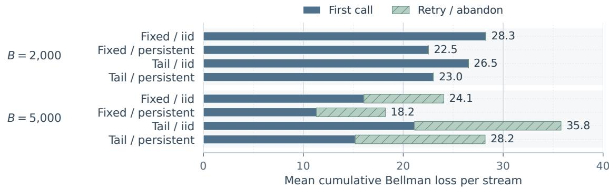  
Figure 6. Mean Bellman loss per stream under ADP-HT by decision type.

ADP-HT attains 92.12% to 98.16% of $\mathrm { D P s }$ optimal expected reward despite action agreement of only 31.32% to 64.14%. Their diferent allocation patterns help interpret this result. First, under tight budgets, ADP-HT favors the stronger model S, while DP mainly uses L and M. In the fixed-length independent setting, its higher first-call success rate comes with greater cost per solution and fewer tasks served (Table 15). Second, at the larger budget with fixed lengths, ADP-HT retries less often than DP under independent dificulty but more often under persistent dificulty, indicating that its recovery decisions vary with the failure process. Finally, first calls account for nearly all sampled Bellman loss under tight budgets and 54% to 67% at the larger budget, leaving a larger share of the loss to retry and abandonment decisions (Figure 6). These patterns also have practical relevance. Cascading accumulates the costs of successive calls [DBV25], and studies of conversations with progressively revealed instructions find that LLMs can retain earlier incorrect assumptions [LHZN26]. Where failed outputs remain in context and hinder correction, a stronger first call may avoid repeated errors and growing input costs. Several cheap retries may then cost more than a single expensive call. Thus, ADP-HT’s tendency to invest in initial success may be useful in real LLM routing scenarios.

## EC.5 Tail Costs and the Value of Future Service

We specialize Section 3 to identical tasks, known distributions, and one call per task. We compare the future service protected by a predictable call with the extra budget it consumes. Throughout this section, backlog means the number of unfinished tasks, including the current task; the initial backlog is T.

## EC.5.1 Model and Optimal Call Sequence

The predictable model P has cost c and success probability u. The risky model R has success probability v and cost

$$
\begin{array}{c} \begin{array} { r l } & { C _ { R } = \left\{ \ell , \quad \mathrm { w i t h ~ p r o b a b i l i t y } ~ q , \right.} \\ & { \begin{array} { r l r l } { d , } & { \mathrm { w i t h ~ p r o b a b i l i t y } ~ \varepsilon , } & & { q = 1 - \varepsilon , } \\ { 0 < \ell < c < d , } & { d \geq B , } & { 0 < u < v \leq 1 , } & { 0 < \varepsilon < 1 . } \end{array} } \end{array}   \\ & { \quad \quad 0 < \ell < c < d , \quad d \geq B , \quad 0 < u < v \leq 1 , \quad 0 < \varepsilon < 1 . } \end{array}\tag{41}
$$

Each call’s success and cost are independent of the past, although they may be correlated within the call. A high-cost response always ends service and receives credit if successful under (2).

Let $V _ { t } ( b )$ be the optimal expected number of solved tasks with t tasks remaining and remaining budget b. Set $V _ { 0 } ( b ) = 0$ and $V _ { t } ( b ) = 0$ for $b \leq 0$ . For $0 < b \le B$

$$
V _ { t } ( b ) = \operatorname* { m a x } \{ u + V _ { t - 1 } ( b - c ) , \ v + q V _ { t - 1 } ( b - \ell ) \} .\tag{42}
$$

The immediate risky reward is $v ,$ including the high-cost response. For $b > c ,$ let $Q _ { P } ^ { * } ( t , b )$ and $Q _ { R } ^ { * } ( t , b )$ be the optimal expected numbers of solved tasks when the first call uses P and $R ,$ respectively, with optimal choices thereafter. Their diference is

$$
Q _ { P } ^ { * } ( t , b ) - Q _ { R } ^ { * } ( t , b ) = - ( v - u ) + \varepsilon V _ { t - 1 } ( b - c ) - q \{ V _ { t - 1 } ( b - \ell ) - V _ { t - 1 } ( b - c ) \} .\tag{43}
$$

The last bracket is nonnegative because additional budget cannot reduce the optimum. A predictable call reduces the immediate success probability by $v - u$ and uses $c - \ell$ more budget than a low-cost risky call. Its benefit is the future service protected from termination.

Write $\textstyle G ( k ) = \sum _ { i = 0 } ^ { k - 1 } q ^ { i } = ( 1 - q ^ { k } ) / \varepsilon$ , with $G ( 0 ) = 0$ . Thus $v G ( k )$ is the expected number Pof solved tasks from at most k risky calls, including the high-cost response. We call an initial sequence of predictable calls the predictable prefix and the following risky calls the risky sufix.

Proposition 2 (Predictable calls precede risky calls). Under (41), consider a predictable prefix of length m and define

$$
\begin{array} { r } { m _ { \mathrm { m a x } } = \operatorname* { m i n } \{ T - 1 , \lceil B / c \rceil - 1 \} , \qquad k _ { m } = \operatorname* { m i n } \{ T - m , \lceil ( B - m c ) / \ell \rceil \} . } \end{array}
$$

Here $k _ { m }$ is the maximum number of risky calls that can follow this prefix. Then

$$
V _ { T } ( B ) = \operatorname* { m a x } _ { m = 0 , \ldots , m _ { \operatorname* { m a x } } } \{ m u + v G ( k _ { m } ) \} .\tag{44}
$$

An optimal policy makes a maximizing number m of predictable calls first and then uses R on all remaining tasks until service stops to banlance the rewards and the risk.

Proof. Backward induction gives a deterministic optimal policy whose choices depend only on the current state. Every risky call that does not end service costs ℓ, so the model choices before any high-cost response form a deterministic sequence. Past successes give no information about future tasks. A predictable call on the final task or one that exhausts the budget can be replaced by R: the immediate expected reward increases, and the expected reward from later tasks remains nonnegative.

Any adjacent pair R, P in an optimal sequence therefore starts with remaining budget greater than $\ell + c .$ Swapping it to $P , R$ leaves the same state after a low-cost risky call. The expected rewards through the pair change from $v + q u$ to $u + v ,$ , a strict gain of εu. Thus all predictable calls precede all risky calls. This predictable prefix must leave positive budget and at least one task. Its risky sufix admits at most $k _ { m }$ calls, with call i reached with probability $q ^ { i - 1 }$ . This proves (44) over all nonanticipating policies. □

## EC.5.2 Backlog and the Optimal First Model

Theorem 2 (A reversal as backlog increases). Suppose $c < B \le 2 c$ $P u t \ z = \lceil B / \ell \rceil , \ j =$ $\lceil ( B - c ) / \ell \rceil$ , and $a = u / v$ . An optimal policy either always chooses R or chooses P once and then uses R. For $T \geq 2$ , their values are

$$
\begin{array} { r l r l } & { F _ { 0 } ( T ) = v G ( \operatorname* { m i n } \{ T , z \} ) , } & & { F _ { 1 } ( T ) = u + v G ( \operatorname* { m i n } \{ T - 1 , j \} ) , } \\ & { \quad D _ { T } = G ( \operatorname* { m i n } \{ T , z \} ) - G ( \operatorname* { m i n } \{ T - 1 , j \} ) . } \end{array}\tag{45}
$$

(46)

Then $V _ { T } ( B ) = \operatorname* { m a x } \{ F _ { 0 } ( T ) , F _ { 1 } ( T ) \}$ . Model P is optimal first exactly when $a \geq D _ { T }$ , where

$$
D _ { T } = \left\{ \begin{array} { l l } { q ^ { T - 1 } , } & { 1 \leq T \leq j + 1 , } \\ { q ^ { j } G ( T - j ) , } & { j + 1 \leq T \leq z , } \\ { q ^ { j } G ( z - j ) , } & { T \geq z . } \end{array} \right.\tag{47}
$$

Strict comparisons give a unique first model and equality gives a tie. At $T = 1$ , R is uniquely optimal. A strict preference for R, then P, then R as T increases occurs exactly when

$$
q ^ { j } < a < q ^ { j } G ( z - j ) .\tag{48}
$$

Proof. The budget restriction permits at most one predictable call that does not exhaust the budget, so Proposition 2 gives $F _ { 0 }$ and $F _ { 1 }$ . Their diference is $v ( a - D _ { T } )$ . The adjacent-swap argument also implies that a globally optimal policy starting with R uses no later predictable call. Hence this comparison identifies the optimal first model.

For $T \le j + 1$ , subtracting $G ( T - 1 )$ from $G ( T )$ gives $q ^ { T - 1 }$ . The number of risky calls following P stops increasing at $j ,$ giving the second expression. Both expected values stop increasing once $T \geq z$ . The expressions agree at their endpoints. Thus $D _ { T }$ decreases to $q ^ { j }$ , then increases to $q ^ { j } G ( z - j ) { \mathrm { ~ i f ~ } } z - j > 1$ , and stays constant thereafter. Since $a < 1$ , a strict middle preference for P and a strict eventual preference for R are equivalent to (48). □

A short backlog leaves little future service to protect. An intermediate backlog makes avoiding termination valuable. With a long backlog, the low-cost risky calls displaced by predictable service can restore the preference for R.

(b) Initial prices

For an exact example, take $( \ell , c , d , \varepsilon , u , v , B ) = ( 1 , 4 , 9 , 0 . 2 , 0 . 7 5 , 1 , 7 . 5 )$ . Model R has both a higher success probability and a lower mean cost, 2.6 compared with 4. Here $z = 8 , j = 4$ and $0 . 4 0 9 6 < 0 . 7 5 < 1 . 2 0 9 1 3 9 2$ . The optimal first model is R for $T = 1 , 2 , P$ for $T = 3 , 4 , 5 , 6 ,$ and R for $T \geq 7$ . At $T = 5$ , a predictable first call followed by risky calls yields 3.702 expected successes, compared with 3.3616 under always choosing R, a 10.1% increase. Figure 7 shows the exact values.

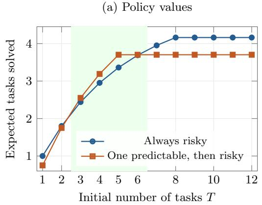

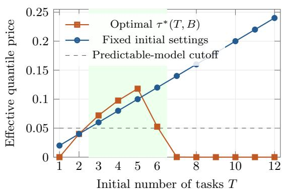  
Figure 7. Exact policy values in panel (a) and efective cost prices in panel (b). Shading marks backlogs where $P$ is optimal first. Each backlog is a separate initial state with the same budget and model distributions.

## EC.5.3 General Budgets

When $c < B \leq 2 c .$ , at most one predictable call can leave positive budget for another call. For general $B > c ,$ several predictable calls may be optimal. Proposition 2 still characterizes the predictable-first backlog region and when two reversals occur. Even with multiple predictable calls, that region remains an interval rather than alternating arbitrarily between P and R.

Theorem 3 (Backlog intervals for general budgets). Suppose $B > c ,$ and retain $a = u / v$ Define

$$
\begin{array} { r } { m _ { B } = \lceil B / c \rceil - 1 , \qquad z _ { m } = \lceil ( B - m c ) / \ell \rceil \quad ( 0 \leq m \leq m _ { B } ) , \qquad T ^ { * } = 1 + z _ { 1 } . } \end{array}
$$

Thus $z _ { m }$ is the number of risky calls that fit after m predictable calls, including the crossing response. For $T \geq 2$ , model P is an optimal first choice exactly when

$$
\left\{ \begin{array} { l l } { a \geq q ^ { T - 1 } , } & { T \leq T ^ { * } , } \\ { \displaystyle \operatorname* { m a x } _ { m = 1 , \ldots , m _ { B } } \{ m a + G ( z _ { m } ) \} \geq G ( \operatorname* { m i n } \{ T , z _ { 0 } \} ) , } & { T \geq T ^ { * } . } \end{array} \right.\tag{49}
$$

The two cases give the same comparison at $T = T ^ { * }$ . Strict inequalities give a unique first model, and equality gives a tie. The predictable-first backlogs form an interval. A strict preference for $R ,$ then P, then R as T increases occurs exactly when

$$
q ^ { z _ { 1 } } < a < \operatorname* { m i n } _ { m = 1 , \ldots , m _ { B } } \frac { G ( z _ { 0 } ) - G ( z _ { m } ) } { m } .\tag{50}
$$

Proof. For $0 \le m \le m _ { B }$ , the value of m predictable calls followed by risky calls is

$$
F _ { m } ( T ) = m u + v G ( \operatorname* { m i n } \{ T - m , z _ { m } \} ) = v \left[ m a + G ( \operatorname* { m i n } \{ T - m , z _ { m } \} ) \right] .
$$

The expected value of the risky sufix stops increasing at $T = m + z _ { m }$ . Since

$$
m + z _ { m } = \lceil B / \ell - m ( c / \ell - 1 ) \rceil ,
$$

these thresholds are nonincreasing in $m .$ , and $T ^ { * } \le z _ { 0 }$

If $T \leq T ^ { * }$ , then $F _ { 0 } ( T ) = v G ( T )$ and $F _ { 1 } ( T ) = u + v G ( T - 1 )$ . Every feasible positive prefix satisfies

$$
\frac { F _ { m } ( T ) - F _ { 0 } ( T ) } { v } \leq m a + G ( T - m ) - G ( T ) = m a - \sum _ { i = T - m } ^ { T - 1 } q ^ { i } \leq m ( a - q ^ { T - 1 } ) .
$$

Thus no positive prefix strictly improves on always choosing R when $a < q ^ { T - 1 }$ . The one-call prefix strictly improves when $a > q ^ { T - 1 }$ and ties when $a = q ^ { T - 1 }$ . This gives the first case in (49).

If $T \geq T ^ { * }$ , every positive prefix is feasible and the expected value of its risky sufix has stopped increasing. The best value divided by v among these prefixes is therefore ma $\mathrm { x } _ { m } \{ m a +$ $G ( z _ { m } ) \}$ , which gives the second case. The adjacent-swap argument in Proposition 2 converts these policy comparisons into first-model comparisons.

Before $T ^ { * }$ , the threshold $q ^ { T - 1 }$ strictly decreases. After $T ^ { * }$ , the best value among prefixes with $m \geq 1$ is fixed, while the always-risky value weakly increases. Thus the predictable-first backlogs form an interval. At $T = T ^ { * }$ , the comparison is a versus $q ^ { z _ { 1 } }$ , so $P$ is strictly optimal first for some $T$ exactly when $a > q ^ { z _ { 1 } }$ . A strict eventual return to $R$ occurs exactly when ma $\mathrm { x } _ { m } \{ m a + G ( z _ { m } ) \} < G ( z _ { 0 } )$ , giving (50). Model R is uniquely optimal at $T = 1$ because $u < v$ □

When $c < B \leq 2 c , m _ { B } = 1$ , recovering Theorem 2.

## EC.5.4 Quantile Scores and Expected Completions

Let ${ \mathcal { Q } } _ { a } ( 1 - \delta _ { c } ) = \operatorname* { i n f } \{ x \mid \operatorname* { P r } ( C _ { a } \leq x ) \geq 1 - \delta _ { c } \}$ . For $\delta _ { c } < \varepsilon$ , the two quantiles are $\mathcal { Q } _ { P } = c$ and ${ \mathcal { Q } } _ { R } = d .$ . For $\delta _ { c } \geq \varepsilon ,$ the risky quantile is $\ell ,$ including equality under this convention. Write $p _ { P } = u$ and $p _ { R } = v$ . Throughout this subsection, each score keeps its success probabilities, cost estimates, and efective price $\tau$ fixed as $T$ varies.

Proposition 3 (Help and harm from a fixed quantile penalty). Suppose qℓ $+ \varepsilon d \leq c , \delta _ { c } < \varepsilon ,$ and $\tau > ( v - u ) / ( d - c )$ . The fixed score $p _ { a } - \tau \mathbb { E } C _ { a }$ always selects $R ,$ whereas $p _ { a } - \tau \mathcal { Q } _ { a } ( 1 - \delta _ { c } )$ always selects P. Writing $k = \lceil B / c \rceil$ and $z = \lceil B / \ell \rceil$ , their values are

$$
J _ { \mathrm { m e a n } } ( T ) = v G ( \operatorname* { m i n } \{ T , z \} ) , \qquad J _ { \mathrm { q u a n t } } ( T ) = u \operatorname* { m i n } \{ T , k \} .\tag{51}
$$

The quantile score improves expected successes $i f$ and only $i f \left( u / v \right)$ min $\{ T , k \} > G ( \operatorname* { m i n } \{ T , z \} )$ Strict help at intermediate backlogs and harm at $T = 1$ and all $T \geq z$ occur exactly when

$$
G ( k ) < ( u / v ) k < G ( z ) .\tag{52}
$$

Proof. The assumptions give strict score preferences. The call counts in (51) include the crossing response. $\mathrm { U p }$ to $T = k , G ( T ) / T$ strictly decreases because it averages $1 , q , \ldots , q ^ { T - 1 }$ An improvement from the quantile score can therefore begin only once. From k to z, the predictable value is constant and the risky value increases. Both are constant afterwards. Any strict improvement must include $T = k$ . Combining its inequality with strict harm after z gives (52). □

Thus the model choices under both fixed scores are constant, but their ranking in expected solved tasks can change with the backlog. The changing value of future service drives this diference.

Even the mean and a single upper quantile together need not identify the optimal first model. Fix $c = 3 , u = 0 . 8 5 , v = 1 , B = 7 , T = 3$ , and $\delta _ { c } = 0 . 0 2 5$ . In instance A, R costs 0.5 with probability 0.8 and 10 otherwise. In instance B, it costs 2 with probability 0.95 and 10 otherwise. Both have mean 2.4 and 0.975-quantile 10.

Without a high risky cost, any two calls cost at most $6 < B$ , so all three tasks are attempted unless a high risky cost occurs. Let $W _ { t }$ be the optimal expected number of solved tasks with t tasks remaining. The recursion becomes W = max $\{ u { + } W _ { t - 1 } , v { + } q W _ { t { - } 1 } \}$ , with $W _ { 0 } = 0$ . Instance A has optimal sequence $P , P , R$ and value 2.70. Instance B optimally uses R throughout and has value 2.8525. Thus the same mean and quantile summaries give opposite optimal first choices. $\mathrm { A t } ~ \tau ~ = ~ 0 . 0 3$ , fixed quantile pricing selects P throughout and earns 2.55 in both instances. It improves on always choosing R by 0.11 in A and loses 0.3025 in B. The diference is the probability of losing later service. For a fixed model-choice sequence, increasing d further above B changes neither when service stops nor the number of solved tasks. It still changes both fixed scores.

## EC.5.5 Implications for the Efective Cost Price

In (15a), the efective price is $\tau _ { s } = \lambda _ { s } / b _ { s } ^ { \mathrm { t a s k } }$ . Consider initial decisions with the known success probabilities and cost quantiles. Hold these predictions, $\lambda _ { 0 } \ge 0 , \phi _ { 0 } > 0$ , and B fixed while varying only T. Equation (12a) gives

$$
\tau _ { 0 } ( T ) = \frac { \lambda _ { 0 } } { \operatorname* { m a x } \{ \phi _ { 0 } B / T , \epsilon \} } , \qquad Q _ { 0 } ( P ) - Q _ { 0 } ( R ) = u - v + \tau _ { 0 } ( T ) ( d - c )\tag{53}
$$

when $\delta _ { c } < \varepsilon$ . This diference is nondecreasing in $T ,$ , so fixed initialization cannot reproduce both reversals in Theorem 2. For $\delta _ { c } \geq \varepsilon , R$ wins at every nonnegative price.

When $c < B \leq 2 c$ , there is also an explicit price that implements the optimal choices. At a state with $t \geq 2$ and $c < b \leq 2 c$ , define

$$
D _ { t } ( b ) = G ( \operatorname* { m i n } \{ t , \lceil b / \ell \rceil \} ) - G ( \operatorname* { m i n } \{ t - 1 , \lceil ( b - c ) / \ell \rceil \} ) ,\tag{54}
$$

$$
\tau ^ { * } ( t , b ) = \frac { v [ 1 - D _ { t } ( b ) ] _ { + } } { d - c } .\tag{55}
$$

Set $\tau ^ { * } ( t , b ) = 0$ for states with $b \leq c \ \mathrm { o r } \ t = 1$ . For any fixed $\delta _ { c } \ < \ \varepsilon ,$ maximizing $p _ { a } \ -$ $\tau ^ { * } ( t , b ) \mathcal { Q } _ { a } ( 1 - \delta _ { c } )$ gives an optimal policy under $B \leq 2 c$

If $D _ { t } ( b ) < 1$ , the score diference is $u - v D _ { t } ( b )$ , as in Theorem 2. Otherwise the price is zero and R is optimal since $u < v$ . Model R also dominates when $b \leq c \ \mathrm { o r } \ t = 1$ . Backward induction establishes optimality. For fixed b, the price first weakly increases and then weakly decreases with t. It gives the optimal comparison between the two models and is a coeficient in the score, not necessarily the value of adding one unit of budget.

Equation (55) makes the adaptation explicit through the remaining budget and backlog in $D _ { t } ( b )$ and the risky cost probability in G. In ADP-HT, $b _ { s } ^ { \mathrm { t a s k } }$ contains the remaining budget per unfinished task, and $\lambda _ { s }$ and $\phi _ { s }$ respond to realized spending. The exact $\tau ^ { * } ( t , b )$ is a structural benchmark for how the price should vary with the value of future service. ADP-HT’s empirical updates allow its efective price to respond to related state variables, which leading to better performance in routing.

Figure 7(b) uses $\lambda _ { 0 } = 0 . 1 5$ and $\phi _ { 0 } = 1$ , giving $\tau _ { 0 } ( T ) = 0 . 0 2 T$ because ϵ does not afect the plotted values. This initialized price crosses the cutof $( v - u ) / ( d - c ) = 0 . 0 5$ once, whereas $\tau ^ { * } ( T , 7 . 5 )$ crosses it twice.