# REINFORCEMENT LEARNING ENABLES SCALING GENERALIST ROBOT POLICY IMPROVEMENT

Michal Korniak1,∗ Marco Bagatella1,2,∗ Ralf Romer¨ 3,∗

Michal Nauman4,5 Yarden As1 Pranav Vignesh6 Manan Agarwal6 Leander Diaz-Bone1,2 Piotr Zalewski5 Mikołaj Czarnecki4 Lenart Treven1 Shashwat Saxena6 Sreyas Venkataraman6 Sarvesh Patil6 Zhiyuan Zhou7 Daniel Marta1

Oier Mees1,8,† Nur Muhammad Mahi Shafiullah7,† Carmelo Sferrazza7,† Bhavya Sukhija1,† Angela P. Schoellig3,† Andreas Krause1,†

Max Simchowitz6,9,‡ Andrew Wagenmaker7,10,‡

1ETH Zurich 2MPI for Intelligent Systems, Tubingen ¨ 3Technical University of Munich 4University of Warsaw 5Nomagic 6Carnegie Mellon University 7UC Berkeley 8Microsoft 9Amazon FAR 10Physical Intelligence

∗Co-First Authors, order by coin flip †Co-Principal Investigators ‡Lead Principal Investigators

Project page: https://lasgroup.github.io/generalist-improvement Repository: https://github.com/lasgroup/generalist-improvement

## ABSTRACT

The introduction of generalist robot policies has enabled a single, large model to learn to perform a variety of tasks from a vast pre-training corpus. While these models often exhibit powerful zero-shot generalization capabilities, they typically require an adaptation phase to achieve sufficient performance in deployment. Iterated self-improvement via reinforcement learning (RL) has demonstrated promise in enabling this adaptation, yet such approaches have been largely explored in single-task settings – where the goal is to simply improve on a narrow deployment task – which lies in stark contrast to the multi-task capabilities of the base policy. In this work we ask whether generalist robot policies are capable of multitask, generalist improvement in deployment – targeting many diverse tasks simultaneously – and what algorithmic recipe enables this. To answer this question, we first develop a set of structured evaluations to test generalist improvement capabilities, and systematically evaluate algorithmic and practical design choices regarding value estimation, policy extraction and resource allocation. We show that not only can generalist policies be improved online across diverse tasks, but that the right recipe can enable generalization and increase performance on tasks not considered during online training. We characterize when this generalization occurs and show that both the training task distribution and the use of value-based RL are critical. To the best of our knowledge, this is among the first evidence for online generalist improvement for robot foundation models.

## 1 INTRODUCTION

Generalist robot policies, particularly Vision-Language-Action Models (VLAs), have shown promise in enabling general-purpose robotic capabilities, allowing a single policy to be deployed across diverse tasks (Brohan et al., 2023; Octo Model Team et al., 2024; Black et al., 2025; NVIDIA et al., 2025). However, despite encoding diverse task-solving behaviors, such policies often lack sufficient reliability for robust deployment, and a degree of adaptation is typically necessary for effective performance (Kim et al., 2025; Intelligence et al., 2025b; Reuss et al., 2025). While enabling this adaptation through human supervision is often prohibitively expensive, autonomous adaptation through reinforcement learning (RL) has emerged as a promising approach to scale policy improvement, enabling robots to learn from their own experience in deployment (Intelligence et al., 2025a). Yet, such autonomous improvement is typically limited to narrow single-task settings. As such, while these approaches enable generalist policies to improve, they may also specialize this improvement to the particular deployment task considered, and achieving improved performance on additional tasks of interest generally requires further online interaction and fine-tuning.

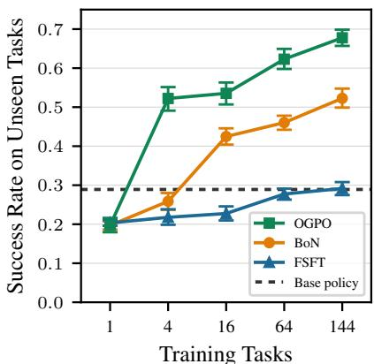  
Figure 1: Scaling the number of RL training tasks enables generalist improvement of generalist robot policies. As training task diversity increases, critic-guided policy extraction (OGPO) or refinement (BoN) prevent forgetting and improve performance on unseen tasks on MolmoSpaces, unlike filtered supervised fine-tuning (FSFT).

A generalist policy, however, can produce a wide range of behaviors across diverse tasks, even if these behaviors may be far from optimal. Ideally we might hope that, by deploying on a diverse range of tasks, we could improve the performance of the policy across all tasks simultaneously – boosting its performance not just on a single deployment task, but on the entire distribution of tasks of interest. In particular, we might hope to enable truly generalist improvement: improvement on both the diverse set of tasks we deploy on, as well as generalization beyond these deployment tasks and improved performance on future novel deployment settings. This motivates the central question we consider in this work: how can we leverage interaction across a diverse set of tasks to enable online generalist improvement of generalist policies? That is, can a careful adaptation phase over multiple tasks enable both (i) improvement across these tasks simultaneously, and (ii) generalization beyond them, improving performance on tasks not encountered during post-training?

In this paper, we undertake a systematic study to quantify generalist policy improvement across different axes of generalization. We show that appropriate recipes, when instantiated carefully, can enable not only generalist policy improvement across a diverse set of training tasks, but also task-generalization – improvement on tasks not seen during training. Further, we show that this improvement scales with the number and diversity of tasks trained on, as we showcase in Figure 1. Our results suggest that moving beyond the single-task paradigm is not only possible but also crucial for achieving broader, generalist improvement.

We isolate the essential algorithmic ingredients that enable multi-task learning and generalization. Specifically, we compare three families of learning approaches:

(a) Direct Policy Adaptation, which directly improves the policy via filtered supervised finetuning on successful trajectories (FSFT, Peters & Schaal, 2007; Zhou et al., 2024; Qin & Springenberg, 2025).

(b) Critic-Guided Test-Time Refinement, which uses test-time optimization against a learned state-action critic to improve actions. Here, we focus on Best-of-N sampling (BoN, Nakamoto et al., 2024; Giridhar et al., 2026) with respect to that critic’s induced action ranking as a representative recipe.

(c) Critic-Guided Policy Extraction, which updates a policy so as to maximize the value the critic assigns to the actions produced. Here, we adopt off-policy generative policy optimization (OGPO, Patil et al., 2026) as a representative recipe, while also ablating alternative approaches such as combining FSFT and BoN sampling, or using AWR-inspired policy updates (Peng et al., 2019).

Overall, while all three approaches enable some degree of generalization given a sufficient diversity in training tasks, we find that critic-guided methods enable a substantially greater degree of task generalization than direct policy adaptation alone. In particular, we show that critic-guided methods afford generalization both across training scenes, and, perhaps more surprisingly, across object types. Furthermore, we find that critic-guided policy extraction (OGPO) significantly outperforms test-time refinement (BoN), while also exhibiting similar scaling trends with training task diversity. This finding further points to critic-learning as the key component that enables generalist robotic policy improvement as task diversity scales.

In addition to investigating algorithmic choices, we also systematically evaluate the training task distribution necessary for achieving such generalist improvement. We show that both the number of distinct training tasks, as well as the type of diversity exhibited in these training tasks, is critical to achieving generalist improvement. In particular, we find that a high degree of diversity in the required solution strategies within the training task distribution is crucial to learning generalizable task-solving behaviors.

We believe these results illustrate a path forward for efficient online improvement of generalist robot policies. Rather than expensive single-task improvement on each deployment task of interest, our results show that, by amortizing this cost across a diverse set of tasks, one can enable generalist improvement, achieving improved performance on future deployment tasks of interest without paying the cost of additional online fine-tuning.

## 2 RELATED WORK

VLA post-training. Diffusion and flow-matching provide expressive generative policy classes that, when trained through behavior cloning at sufficient scale and diversity, can form the basis of generalist policies (Janner et al., 2022; Chi et al., 2023; Reed et al., 2022). Recent RL fine-tuning methods directly optimize such policies (Psenka et al., 2024; Park et al., 2025b; Wagenmaker et al., 2025; Patil et al., 2026; Li & Levine, 2026), but scaling them to large VLAs remains challenging. Existing VLA post-training therefore often relies on simpler, readily scalable methods. One family directly updates the policy using high-quality experience, including filtered supervised finetuning (Qin & Springenberg, 2025; Yang et al., 2026), conditioned behavior cloning (Intelligence et al., 2025a), and soft variants that weight demonstrations by estimated value (Peng et al., 2019; Su et al., 2026). A complementary family leaves the policy unchanged and instead uses learned value functions for test-time action selection, such as Best-of-N (Nakamoto et al., 2024; Dodeja et al., 2026), or by learning residual policies to modify the output action (Ankile et al., 2025; Dong et al., 2026a; Xiao et al., 2026) or steer the pre-trained policy’s denoising process (Wagenmaker et al., 2025). We likewise focus on simple, scalable techniques, demonstrating (cf. Section 4) that they can achieve competitive performance. While these existing approaches to VLA post-training have demonstrated performance gains (Zhang et al., 2024; Hu et al., 2025; Ankile et al., 2025; Myers et al., 2024; Li et al., 2025; Chen et al., 2025; Dong et al., 2026b; Guo et al., 2025; Lu et al., 2025; Sun & Song, 2025), they are limited, primarily, to improvement on single, individual tasks (Xu et al., 2026; Pan et al., 2026b; NVIDIA et al., 2025; Team et al., 2026). In contrast, we study joint post-training across increasingly broad task distributions and ask whether the resulting policy also improves on tasks outside the training distribution.

Multi-task generalization. A separate literature studies how robotic performance scales with the diversity of training tasks. Prior work considers multi-task scaling without foundation-model policies (Nauman et al., 2025), while meta-reinforcement learning instead develops algorithms that learn to rapidly adapt to unseen tasks (rather than to directly transfer a fixed policy to new tasks, the setting we consider), traditionally with relatively small policies (Duan et al., 2016; Finn et al., 2017; Yu et al., 2019). More recent work extends this perspective to VLA policies through behavior cloning (Bianchi et al., 2026). Other works study generalization arising from scaling behavior cloning during pretraining (Zheng et al., 2026; Dyna Robotics, 2026) or post-training (Lin et al., 2025; 2026). Here we focus on self-improvement via reinforcement learning. Perhaps closest to our setting is Liu et al. (2025), who compare generalization of offline SFT from expert demonstrations with on-policy reinforcement-learning algorithms such as PPO (Schulman et al., 2017) and GRPO (Shao et al., 2024). Our study differs in two important ways. First, Liu et al. (2025) utilize a single fixed distribution over training environments for all experiments; in contrast, a primary contribution of our work is quantifying which training distributions are necessary to induce generalization. Second, while we consider standard online RL fine-tuning procedures commonly used for ${ \mathrm { V L A s } } .$ , and study which such fine-tuning procedures enable generalization, this work compares non-RL approaches (SFT on expert demonstrations) to on-policy RL. While Liu et al. (2025) show that RL fine-tuning can enable greater generalization than SFT, our work provides informative guidance as to which design decisions are key to enabling this in practice. We note as well that multi-task generalization in post-training has been long studied in LLM post-training. We refer to Appendix A where we draw parallels to this work.

## 3 PROBLEM SETTING AND EXPERIMENTAL METHODOLOGY

## 3.1 PROBLEM SETTING: GENERALIST IMPROVEMENT OF GENERALIST POLICIES

We model our environment as a contextual Markov decision process $\mathcal { M } = ( \mathcal { S } , \mathcal { A } , \mathcal { C } , P , R , \mu _ { 0 } , \gamma )$ where S and A are continuous state and action spaces, C is a space of contexts encoding different tasks1, $P : \mathcal { S } \times \mathcal { A } \times \mathcal { C }  \Delta ( \mathcal { S } )$ is a stochastic transition function, $R : \mathcal { S } \times \mathcal { A } \times \mathcal { C }  [ R _ { \mathrm { m i n } } , R _ { \mathrm { m a x } } ]$ is a context-conditional reward function specifying each task, $\mu _ { 0 } : { \mathcal { C } } \to \Delta ( { \mathcal { S } } )$ is an initial distribution and $\gamma \in [ 0 , 1 )$ is a discount factor. We model a generalist agent as a context-conditional policy $\pi : \bar { S } \times \bar { \mathcal { C } }  \Delta ( { \mathcal { A } } ) ^ { 2 }$ , and evaluate its expected return from a state-action pair $( s , a )$ and task c according to its Q-function:

$$
\begin{array} { r } { Q ^ { \pi } ( s , a , c ) = \mathbb { E } _ { P , \pi , c } \left[ \sum _ { t \geq 0 } \gamma ^ { t } R ( s _ { t } , a _ { t } , c ) \mid s _ { 0 } = s , a _ { 0 } = a \right] , } \end{array}\tag{1}
$$

where above, $\mathbb { E } _ { P , \pi , c }$ denotes expectation with respect to $a _ { t } \sim \pi ( \cdot | s _ { t } , c )$ and $s _ { t + 1 } \sim P ( \cdot \mid s _ { t } , a _ { t } , c )$ We denote $V ^ { \pi } ( s , c ) = \mathbb { E } _ { a \sim \pi ( \cdot \mid s , c ) } [ Q ^ { \pi } ( s , a , c ) ]$

In this work, we are interested in enabling improvement on tasks from some test distribution $\rho _ { \mathrm { t e s t } } \in$ $\Delta ( \mathcal { C } )$ , which may or may not correspond to the training distribution. We refer to this setting as generalist improvement of generalist policies (or generalist improvement for brevity). Given a task distribution $\rho _ { \mathrm { t e s t } }$ , the objective of generalist improvement of generalist policies is to update π so as to maximize:

$$
J ( \pi ; \rho _ { \mathrm { t e s t } } ) = \mathbb { E } _ { c \sim \rho _ { \mathrm { t e s t } } , s _ { 0 } \sim \mu _ { 0 } ( c ) } \left[ V ^ { \pi } ( s _ { 0 } , c ) \right] .\tag{2}
$$

Generalist improvement protocol. In this work we assume we are given some initial generalist policy $\pi _ { \mathrm { g e n } }$ , achieving non-zero but imperfect zero-shot success across tasks, and that we can interact online with a set of training tasks drawn from a distribution $\rho _ { \mathrm { t r a i n } } .$ . As stated, our goal is to learn a fine-tuned policy $\pi _ { \mathrm { f t } }$ that maximizes $J ( \pi _ { \mathrm { f t } } ; \rho _ { \mathrm { t e s t } } )$ . Crucially, $\rho _ { \mathrm { t e s t } }$ need not coincide with $\rho _ { \mathrm { t r a i n } } ,$ in which case the policy must generalize to tasks it was not trained on. At the same time, these two distributions need to be related (see Figure 3), as generalization to arbitrary tasks is in practice unrealistic (see Appendix C.1, Yu et al., 2020 and Malik et al. (2021)). For simplicity, we will assume that $\rho _ { \mathrm { t r a i n } }$ is supported on a finite set of tasks $[ c _ { 1 } , \dots , c _ { N _ { \mathrm { t a s k } } } ]$ . We consider interaction with the training tasks through repeated iterations $m = 1 , \ldots , M _ { ☉ }$ , each involving online interaction and training. For each iteration $m .$ , we first collect K episodes $\tau _ { 1 , 1 : K } , \ldots , \tau _ { N _ { \mathrm { t a s k } } , 1 : K }$ from each training task $[ c _ { 1 } , \ldots , c _ { N _ { \mathrm { t a s k } } } ] .$ , with the policy frozen, and then update the policy given the newly collected experience. This protocol approaches traditional, single-task online RL by choosing $\rho _ { \mathrm { t r a i n } } = \rho _ { \mathrm { t e s t } }$ and setting $K = 1$ , and tends towards multi-task offline RL (or “batch online $\mathbf { R L } ^ { \prime \prime }$ Dong et al., 2026b) when a single iteration is applied $( M = 1 , K \gg 1 )$ and $\rho _ { \mathrm { t r a i n } }$ has larger support. To simulate realistic fleet-level robot deployments, we choose a moderately large K and M, discussed in Section C.3. We visualize the protocol in Figure 2.

## 3.2 MECHANISMS FOR GENERALIST IMPROVEMENT

In this work, we aim to understand what algorithmic approaches enable generalist improvement. We distinguish between two complementary and independent mechanisms for policy improvement: direct policy adaptation, which updates the parameters of the robot policy alone, and critic-guided refinement, which instead learns a value function to “grade” robot actions. We consider approaches that isolate each of these components (FSFT, BoN), in order to determine which mechanism drives generalist improvement, as well as representative approaches that combine both (in particular, we primarily consider OGPO). We emphasize that the focus of this work is not primarily developing novel algorithms, but rather understanding whether existing techniques for policy learning can enable generalist improvement. We therefore focus on existing paradigmatic approaches. We defer specific implementation details of the algorithms described below to Appendix D.2.

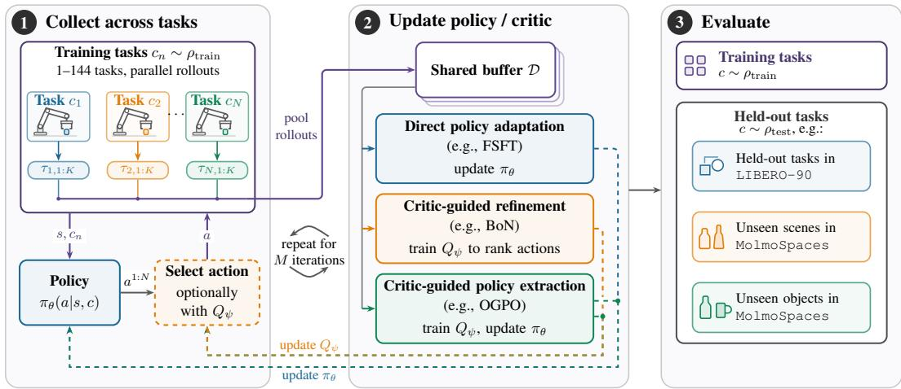  
Figure 2: Generalist improvement and evaluation. (1) A generalist policy collects $K$ rollouts $\tau _ { n , k }$ across training tasks $c _ { n } \sim \rho _ { \mathrm { t r a i n } }$ . (2) Task-specific experience is pooled in a shared replay buffer and used to enact one of three families of methods: direct policy adaptation updates the policy according to success labels, critic-guided refinement learns critics for action ranking, and critic-guided policy extraction learns critics and updates the policy towards actions with high critic values. This process is iterated M times. (3) Evaluation is carried out over training tasks $( c \sim \rho _ { \mathrm { t r a i n } } )$ , as well as on unseen test tasks $( c \sim \rho _ { \mathrm { t e s t } } )$ to test generalization.

Direct policy adaptation. As a representative and scalable approach to direct policy adaptation, we consider weighted supervised learning. At each iteration, we sample a batch of state-action-task tuples from the buffer, and define a weighting function w : $S \times A \times C \to$ R in order to minimize a weighted negative log-likelihood under the policy:

$$
\begin{array} { r } { \mathcal { L } _ { \mathrm { D P A } } ( \theta ) = - \mathbb { E } _ { ( s , a , c ) \sim \mathcal { D } } \big [ w ( s , a , c ) \log \pi _ { \theta } ( a | s , c ) \big ] , } \end{array}\tag{3}
$$

for policy parameters θ. When an explicit likelihood is not available, a tractable lower bound can be adopted (e.g., the flow matching loss in the case of modern VLAs (Intelligence et al., 2025b)). The simplest instantiation of this mechanism is referred to as %-BC (Chen et al., 2021) or filtered supervised fine-tuning (FSFT, Zhou et al., 2024), which sets $w ( s _ { t } , a _ { t } , c ) = \mathbf { 1 } _ { G ( s _ { t } , a _ { t } , c ) > G _ { \operatorname* { m i n } } }$ where $\begin{array} { r } { G ( s _ { t } , a _ { t } , c ) = \sum _ { t ^ { \prime } > t } R ( s _ { t ^ { \prime } } , a _ { t ^ { \prime } } , c ) } \end{array}$ is the empirical return, and $G _ { \mathrm { m i n } }$ a threshold. This mechanism implements a form of policy improvement (Qin & Springenberg, 2025) while isolating the policy update mechanism and conveniently remaining as close as possible to a purely supervised objective. We thus adopt FSFT as our paradigmatic approach for direct policy adaptation; we nevertheless also consider approaches that set $w ( s , a , c )$ based on a learned value function in Section 4.4.3.

Critic-guided test-time refinement. Orthogonally to direct policy adaptation, improvement can also occur through utilizing a learned value function. We consider training a parametric state-action critic $Q _ { \psi }$ to estimate the state-action value function expressed in Equation 1. While many approaches for value estimation exist (and are ablated in Section 4.4.2), we find that training $Q _ { \psi }$ together with a state value function $V _ { \eta }$ through the following standard temporal difference (TD) learning update performs reliably:

$$
\begin{array} { r l } { \mathcal { L } _ { Q } ( \psi ) = \mathbb { E } _ { ( s , a , r , s ^ { \prime } , c ) \sim \mathcal { D } } \Big [ \big ( Q _ { \psi } ( s , a , c ) - ( r + \gamma V _ { \eta } ( s ^ { \prime } , c ) ) \big ) ^ { 2 } \Big ] } & { { } \mathrm { a n d } } \end{array}\tag{4}
$$

$$
\mathcal { L } _ { V } ( \eta ) = \mathbb { E } _ { ( s , a , c ) \sim \mathcal { D } } \Big [ \big ( Q _ { \psi } ( s , a , c ) - V _ { \eta } ( s , c ) \big ) ^ { 2 } \Big ] .\tag{5}
$$

We refer to Section 4.4.2 for ablations of our critic-learning objective (e.g., Monte Carlo returns and distributional critics). As our goal is to understand the mechanisms that enable generalist improvement, we wish to isolate the contribution of policy adaptation from critic refinement. To achieve this, we build on a long line of works on test-time action selection (Kalashnikov et al., 2018) that guide the policy via Best-of-N (BoN) sampling (Nakamoto et al., 2024). In particular, we keep the policy parameters frozen and re-rank sampled actions at test-time according to their estimated values. That is, for a task c and the current state $s _ { t }$ in a rollout, we draw N action candidates $\{ a _ { t } ^ { i } \} _ { i = 1 } ^ { N } \sim \pi _ { \theta } ( s _ { t } , c )$ score them and execute action chunk $a _ { t } ^ { i ^ { \star } }$ with

$$
i ^ { \star } = \arg \operatorname* { m a x } _ { i } Q _ { \mathrm { t a r g } } ( s _ { t } , a _ { t } ^ { i } , c ) .\tag{6}
$$

where $Q _ { \mathrm { t a r g } }$ is a target critic network (Lillicrap et al., 2016) derived from $Q _ { \psi }$ (see Section D.2 for details). This allows online experience to influence behavior through action selection while preserving the policy parameters inherited from pre-training; moreover, despite its simplicity, we found this recipe to perform reliably in practice (see Section 4).

Critic-guided policy extraction. Lastly, we consider a third approach to policy improvement: updating the base policy so as to maximize the value the learned critic assigns to its actions (Peng et al., 2019; Lillicrap et al., 2016). Formally, rather than simply using the critic to select actions from the base policy as in Equation 6, we train the policy to produce actions with large critic values, for example, maximizing an objective of the form:

$$
\begin{array} { r } { \mathcal { L } _ { \mathrm { C P E } } ( \theta ) = \mathbb { E } _ { ( s , c ) \sim \mathcal { D } } \mathbb { E } _ { a \sim \pi _ { \theta } ( \cdot \vert s , c ) } [ Q _ { \mathrm { t a r g } } ( s , a ) ] . } \end{array}\tag{7}
$$

As a representative recipe, we focus on off-policy generative policy optimization (OGPO, Patil et al., 2026). Specifically, OGPO is targeted at generative control policies (Chi et al., 2023; Pan et al., 2026a), such as flow-policies (Black et al., 2025), which produce actions via a sequence of denoising steps. OGPO alternates between training a critic on observed transitions, using an update similar to Equation 4, and updating the generative control policy $\pi _ { \theta }$ to maximize (Equation 7), applying a PPO-like update (Schulman et al., 2017) to the action generation process to shift its generated actions towards higher critic values (see Appendix B for a detailed description).

In addition to OGPO, we ablate against two other approaches to critic-guided policy extraction: (i) FSFT+BoN, which adapts the policy with $\mathcal { L } _ { \mathrm { D P A } }$ and filters action at test-time according to a critic trained with ${ \mathcal { L } } _ { \mathrm { Q / V } }$ , and (ii) flow-based advantage-weighted regression (AWR, Peng et al., 2019), where we use critic-derived estimates of the advantage function to reweight the supervised learning loss following Equation 3. We evaluate each in Section 4.4.3 and provide full details in Appendices B and D.

## 3.3 EXPERIMENTAL SETUP

Our experiments are designed to answer the following core questions:

• Q1: As the diversity of training tasks increases, how effective are the three representative recipes (direct policy adaptation, critic-guided test-time refinement and critic-guided policy extraction) at driving self-improvement on the tasks they are exposed to?

• Q2: To what extent and at which scale does either mechanism generalize to unseen tasks?

• Q3: What is the nature of the observed generalization, and in which cases is it most effective?

• Q4: Which specific algorithmic design choices drive learning within and beyond the training task distribution, i.e., enable generalist improvement?

To answer these questions, we design a post-training and evaluation protocol centered on directly controlling the training and test task distributions $\rho _ { \mathrm { t r a i n } }$ and $\rho _ { \mathrm { t e s t } }$ introduced in Section 3.1.

Training environments. To answer Q1 and Q2, we consider training distributions that differ in both the number of distinct tasks and their diversity. We base our evaluation on the MolmoSpaces (Kim et al., 2026) benchmark, which gives precise control over task diversity. We focus on the pick suite, which instructs the agent to grasp and lift various objects in different domestic environments. This benchmark exposes 18 task objects and 55-56 scenes per object (e.g., the “fork” object spans 56 distinct scenes); we visualize examples in Figure 3. This enables task variation along multiple axes: scene variation, which is primarily visual in nature, and object variation, which generally alters the grasping strategy necessary to successfully solve the task. In our main evaluation (Figure 4), we consider training task distributions over growing numbers of tasks, from 1 to 144, spanning different objects and scenes. Each set of tasks is procedurally selected to be a superset of smaller sets, while maintaining the same non-zero average performance of the base policy over tasks (≈30%). This ensures that larger sets of tasks are at least as diverse as smaller ones, as they cannot include fewer objects and scenes. Additional evaluations, e.g., in Figure 6, ablate the diversity in the set of training tasks, which may only vary in terms of scenes, or also in terms of objects. We additionally evaluate on the popular LIBERO (Liu et al., 2023) manipulation suite, for which tasks are sampled from the LIBERO-90 subset.

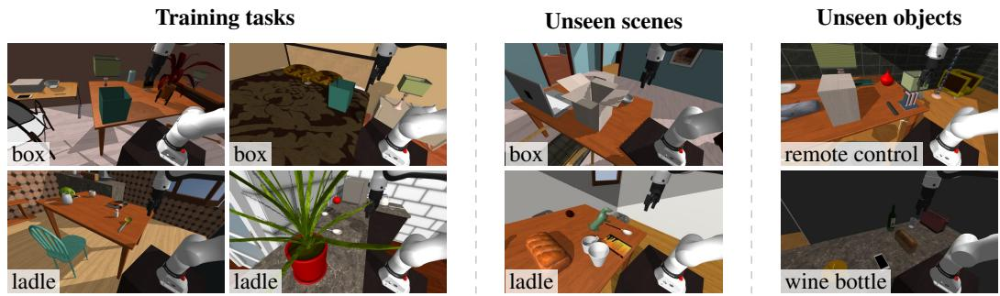  
Figure 3: Objects and scenes in MolmoSpaces. Left: 4 tasks covering two objects, each with two scenes. Center: unseen scenes of the training objects. Right: examples of unseen objects.

Evaluation tasks. To address Q1, we evaluate policy performance with respect to the training task distribution $( \rho _ { \mathrm { t e s t } } = \rho _ { \mathrm { t r a i n } } )$ . To address Q2, we largely leverage MolmoSpaces’s structured task diversity, varying task novelty across both the axes of task objects and scenes, described above and depicted in Figure 3. Similarly, we evaluate both training and unseen tasks in LIBERO to assess generalization capability when task diversity cannot be easily controlled. For a full description of task sets in MolmoSpaces we refer to Appendix D.1. In all experiments, we report the final mean success rate over three training seeds and 95% bootstrap CIs; see Appendix E for training curves.

Base model, critic architecture, and policy improvement protocol. Across experiments, we use the $\pi _ { 0 . 5 }$ VLA (Intelligence et al., 2025b) as the base generalist policy $\pi _ { \mathrm { g e n } }$ , in its droid and libero checkpoints for MolmoSpaces and LIBERO, respectively. Method-specific hyperparameters are optimized individually, and main results are stated for the best-performing hyperparameters for each approach. We briefly recap them here, and present detailed allocation studies and ablations justifying these decisions in Section 4.4 and Appendix C. We implement our critic networks as BroNet (Nauman et al., 2024) residual MLPs whose input is the concatenation of the $\pi _ { 0 . 5 }$ prefix representation, mean-pooled over the prefix token sequence, the proprioceptive state, and the flattened action chunk. We use an ensemble of Q and V -heads and aggregate them by taking the minimum (Fujimoto et al., 2018), both when forming the TD target in Equation (4) and when scoring candidate actions at inference time via Equation (6). In each experiment, we apply $M = 1 0$ iterations of policy improvement, collecting $K = 2 0$ episodes per task per epoch; we find that task performance does not improve much for larger K and M, as we report in Appendix C.3. For direct policy adaptation, we fine-tune policies for 100 gradient steps in single-task settings, and 500 gradient steps in multi-task settings due to greater data scale and variability. In the case of critic-guided test-time refinement, the critic MLPs, being both smaller and trained from scratch, are trained with 100× gradient steps (reaching convergence, and roughly matching the training cost of policy adaptation). We found methods relying on critic-guided policy extraction to prefer a different allocation of gradient steps (fewer critic updates with off-policy targets, and more policy updates, as detailed in Appendix D.3).

We ensure reproducibility by open-sourcing our full pipeline at this repository.

## 4 GENERALIST IMPROVEMENT SCALES WITH TASK DIVERSITY

We seek to answer our four core questions about generalist policy improvement. Our analysis centers on Figure 4, in which each point corresponds to a training split of k objects with k scenes each,

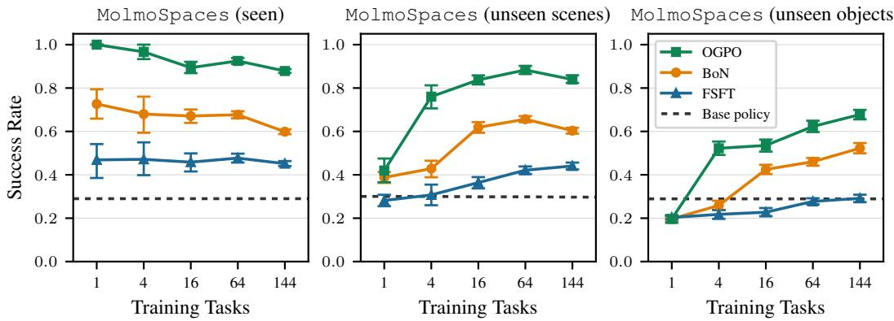  
Figure 4: Value-based generalist improvement generalizes beyond the training tasks. Final success rate on training tasks (left) and held-out tasks (center and right, unseen scenes and objects) in MolmoSpaces as the number of distinct training tasks increases (x-axis). BoN and OGPO display stronger generalization. We report the mean and 95% stratified bootstrap CIs across three seeds.

evaluated on its own training tasks (left), on eight unseen scenes of each of its k training objects (center), and on a fixed set of six unseen objects with eight scenes each (right). Appendix D.1 lists every split in full.

## 4.1 Q1: CAN WE ENABLE GENERALIST IMPROVEMENT ON TRAINING TASKS?

The left panel of Figure 4 evaluates to what extent posttraining can improve performance on the tasks sampled from the training task distribution. For FSFT, BoN and OGPO, we observe that success rate increases with respect to the base policy, and generalist improvement succeeds. We find OGPO and BoN to be generally more effective than FSFT in the single-task setting, where they lead by +53 pp and +26 pp, respectively. As the number of training tasks increases, we find that in the multi-task setting OGPO and BoN outperform FSFT by +43–50 pp and +15–21 pp, respectively. Neither of the recipes displays fully convincing cross-task expertise: while potentially overfitting to a specific task, the average performance of single-task experts (represented as the leftmost point on these curves) slightly exceeds that of multi-task policies. We observe similar trends on training tasks for LIBERO, in which the performance gap with respect to single-task experts is perhaps more marked – see Appendix C.1. We note, however, that generalist improvement nevertheless holds a computational edge over post-training single-task experts, as we display in Figure 5: with a matched data collection budget, a single BoN post-training run over 16 tasks requires 2.9× fewer gradient steps than 16 single-task runs to achieve similar multi-task performance improvements. Thus, even on in-distribution training tasks, generalist improvement enables more efficient improvement than single-task training.

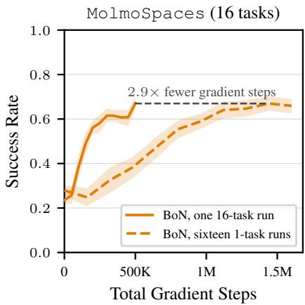  
Figure 5: Compute efficiency of generalist improvement. Post-training a policy on multiple tasks at once achieves the performance of posttrained single-task experts in significantly fewer gradient steps.

## 4.2 Q2: DO WE SEE GENERALIZATION BEYOND TRAINING TASKS?

A different pattern emerges when, instead of measuring performance on the tasks we train on, we turn to evaluating success rate on unseen tasks in MolmoSpaces. In this setting, we find, to the best of our knowledge, one of the first examples of generalization in VLA RL post-training at this scale. As shown in Figure 4 (center and right), single-task posttraining leads to forgetting on unseen objects, and yields at most modest gains on unseen scenes – while we can improve on the task we train on, performance often degrades on others.

number of training tasks, critic-based recipes (OGPO and BoN) exhibit a transition from forgetting to generalization. Specifically, we observe performance gains over the base policy of up to +58 pp for tasks where the object remains consistent but the scene changes from the training task, and +39 pp for tasks where the object also changes. This indicates that OGPO and BoN can even handle different objects altogether (e.g., picking up a knife after training only on other items, such as ladles, pots, and cups, as we further analyze in the next section). More generally, these results highlight that post-training

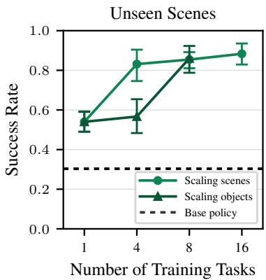

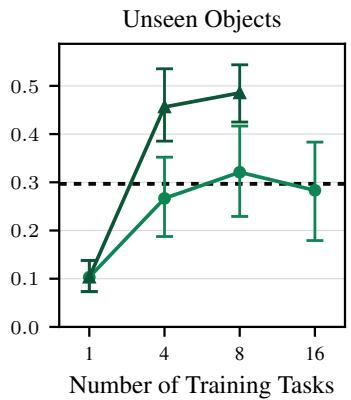  
Figure 6: Diversification transfers better along its own axis. OGPO success rate when scaling scenes of a single object, or objects with one scene each, evaluated on eight unseen scenes (left) and eight unseen objects (right). Each axis transfers best along itself, though only scaling objects surpasses the base policy on both. Mean and 95% stratified bootstrap CIs over three seeds.

VLAs on sufficiently diverse tasks can yield improvements beyond the training distribution. Indeed, this generalization scales with the number oftraining tasks – the more tasks we train on, the greater the generalization benefit – as long as the correct algorithmic approach is applied. In particular, this improvement is much more pronounced for OGPO and BoN than FSFT, demonstrating that critic-guided policy extraction or refinement is critical for enabling generalization. Together, this suggests that an effective recipe for generalist improvement is to (i) apply critic-based policy improvement while (ii) scaling the number of tasks we RL post-train on. We additionally evaluate generalization in LIBERO in Appendix C.1, in which we find that this benchmark presents a much greater challenge in terms of generalization, as inter-task variability is extreme: in this case, similar patterns occur, but only in terms of forgetting.

## 4.3 Q3: WHAT IS THE NATURE OF THE OBSERVED GENERALIZATION?

We next carefully analyze which training task splits are most critical for enabling generalization, and which types of generalization we might expect a given set of training tasks to induce.

Scaling training objects is critical for generalist improvement. We first isolate the two axes – scene and object – of task diversity. In Figure 4 they grow together: a split with $k ^ { 2 }$ tasks contains k objects with k scenes each. In this experiment, we instead vary the number of scenes of a single object, and separately the number of objects with one scene each. Both are evaluated on eight unseen objects, and on eight unseen scenes of the object whose scenes the first sweep scales (details and results for all recipes in Appendix C.2). As shown in Figure $^ { 6 , }$ we observe earlier generalization to new scenes by training on more diverse scenes, and greater generalization to new objects by training on more diverse objects. The two are not symmetric: scaling objects enables the post-trained policy to surpass the base policy on both unseen objects and scenes, whereas scaling scenes hardly exceeds it on unseen objects, even with 16 scenes. This suggests that, to achieve generalization to novel manipulation strategies (e.g., the grasp mechanics required to handle a new object), it is necessary to train on tasks involving diverse manipulation strategies, while robustness over the scene layout and appearance is easier to achieve.

Critic learning enables generalization on unseen objects that resemble training objects. Figure 8 illustrates this directly: for BoN, training on a similarly shaped object transfers better (e.g., boxes to bowls, spatulas to knives), whereas FSFT shows no such pattern. The per-object results (Figure 7) show the same trend at scale. BoN improves on atomizers and wine bottles mainly at 144 tasks (atomizer 0.29→0.42, wine bottle 0.24→0.44), the split that adds bottle-like objects such as soap dispensers and salt/pepper shakers (Figure 8, left). Forks and knives show substantial im provement with OGPO when we move from 1 to 4 tasks; at 4 tasks each training split contains spatulas, which require similar grasping motion to forks and knives; we believe this enables this generalization. The performance on forks and knives plateaus at 64 tasks, however. We hypothesize this is because the objects added between 64 and 144 tasks do not exhibit significant similarity to forks and knives. OGPO shows a similar pattern on atomizers (0.42→0.58) but not on wine bottles (0.09→0.12), while FSFT improves on neither. Since BoN keeps the policy frozen, the critic alone suffices to transfer to similar objects, while policy updates alone do not. Across all objects, we see that critic learning is essential to generalization—with the exception of bowls, we observe substantial generalization only when applying critic learning.

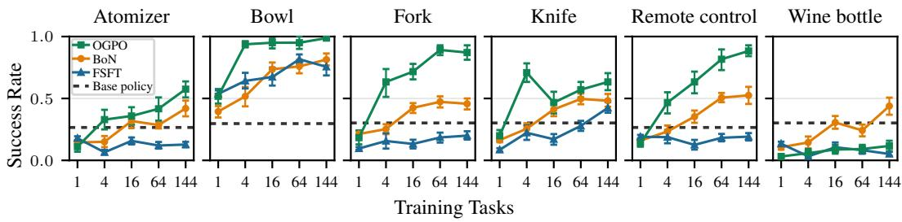  
Figure 7: MolmoSpaces. Final success rate on each of the 6 unseen objects, none of which appears in any training split, as a function of the number of training tasks. Points show the mean over three seeds with 95% stratified bootstrap CIs.

<table><tr><td>Tasks Objects</td></tr><tr><td>1 box or spatula</td></tr><tr><td>4</td></tr><tr><td>box, spatula</td></tr><tr><td>16 + cup, tissuepaper</td></tr><tr><td>64 + boiler, ladle, pot, spoon</td></tr><tr><td></td></tr><tr><td>144 + salt/pepper,</td></tr><tr><td>soapdispenser,</td></tr><tr><td>mug, fruit/veg.</td></tr></table>

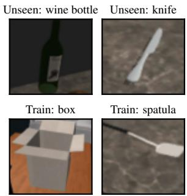

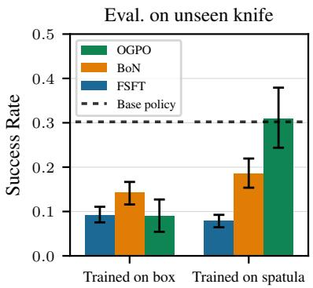  
Figure 8: Generalization across objects. Left: Training objects per MolmoSpaces split. Each split contains all objects of the previous one; + marks objects added. The 1-task split is trained separately on a single box or spatula task. Full task details are in Table 3. Right: We train each method on tasks involving a single object (box or spatula) and evaluate on the unseen knife. For methods that use a critic (BoN, OGPO), training on a similar object transfers better, whereas FSFT shows no such pattern. We report the mean and 95% stratified bootstrap CIs across three seeds.

Policy updates help on some objects but degrade performance on others. FSFT and OGPO both improve on some objects (e.g., bowls) but degrade on wine bottles, where both fall sharply below the base policy while BoN recovers to about 0.44 at 144 tasks. We find that policy updates can enable more effective generalization to objects similar to those in the training distribution (e.g., OGPO on forks), while leading to poor generalization and even forgetting on objects further from the training distribution (e.g. wine bottles). In contrast, critic-only updates can enable effective generalization even on objects far from the training distribution (e.g., BoN on wine bottle).

## 4.4 Q4: WHAT ENABLES GENERALIST POLICY IMPROVEMENT?

Having evaluated our recipes at scale, we now validate key design decisions for multi-task VLA post-training, and investigate several alternative techniques for critic-guided policy extraction; see Appendix C for additional ablations including data/compute scaling and resource allocation.

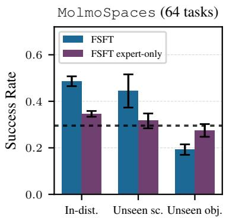

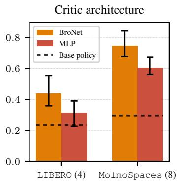

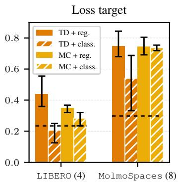  
Figure 9: Recipe ablations. Left: full VLA vs. expert-only tuning for FSFT on MolmoSpaces (64 tasks). Full tuning is essential in-distribution and on unseen scenes, but degrades most on unseen objects. Center: architecture for BoN. Right: TD vs MC, classification vs regression for BoN. Center and right are evaluated on LIBERO (4 tasks; see Table 4) and the object-diverse MolmoSpaces (8 objects, 1 scene each; see Table 1).

## 4.4.1 WHAT MAKES DIRECT POLICY ADAPTATION EFFECTIVE?

An important fine-tuning decision concerns which parameters to update: the entire VLA or only the action expert, i.e., the flow model mapping tokens from the backbone to continuous actions. We compare both settings for FSFT on the MolmoSpaces (64 tasks) split, evaluating in-distribution, on unseen scenes, and on strongly OOD unseen objects. The left panel of Figure 9 shows thatfull VLA fine-tuning is beneficial: it outperforms expert-only tuning by more than +12 pp both in-distribution and on unseen scenes, whereas expert-only tuning improves only marginally over the base policy. This comes at a cost: on unseen objects, full VLA tuning degrades performance by 10.6 pp relative to the base policy, against −2.2 pp for expert-only tuning. This suggests that full fine-tuning increases overfitting risks. The two settings therefore trade in-distribution gains against OOD performance.

## 4.4.2 WHAT MAKES A GOOD

## VALUE FUNCTION IN VLA POST-TRAINING?

Value function learning admits many possible implementations. To find a scalable recipe for multi-task VLA post-training, we conduct controlled ablations along multiple design axes, focusing on training-tasks improvement. We will use BoN as a representative algorithm, arguably being the simplest recipe involving a critic. Figure 9 (center, right) compares two network architectures, regression and classification objectives, as well as TD and MC targets. Compared to standard MLP critics, adding residual connections (BroNet; Nauman et al., 2024) increases performance by more than +10 pp. Regarding the training objective, combining TD targets with a simple regression loss yields the largest and most consistent improvements in our experiments. Notably, we find distributional critic formulations to scale poorly to multi-task settings; we hypothesize this is due to

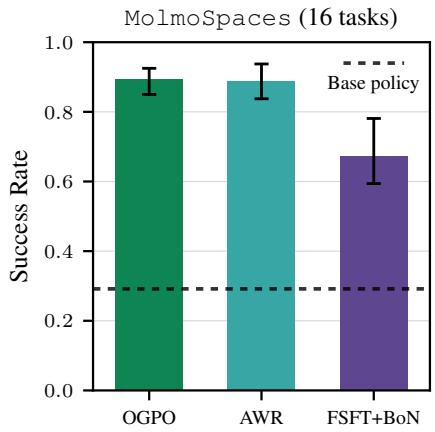  
Figure 10: Policy extraction schemes. We compare OGPO (Patil et al., 2026) to AWR (Peng et al., 2019) and a direct combination of FSFT and BoN. We find that natively actor-critic algorithms perform best.

return distributions of different tasks varying significantly. Finally, BoN introduces one further hyperparameter, the number of sampled candidates N. We ablate its impact on performance and inference time in Appendix C.6, and use N = 32 throughout.

## 4.4.3 RECIPES FOR POLICY EXTRACTION

Through our experiments, we find that OGPO (Patil et al., 2026) largely retains the generalization properties of BoN while enabling expressive policy extraction, and therefore reaches significantly higher performance.

As such, OGPO, and critic-guided policy extraction in general, can be interpreted as the combination of the other two mechanisms, namely direct policy adaptation and critic-guided test-time refinement, where the latter is applied at training time instead. OGPO is, however, one of many ways in which this combination can be instantiated. We thus ablate two alternatives in Figure 10. As a straightforward instantiation, we consider FSFT+BoN, which simultaneously fine-tunes the policy on successful rollouts and trains a critic for inference-time action selection. We also eval uate advantage-weighted regression (AWR; Peng et al., 2019), a popular technique which weights the objective in Equation 3 by exponentiated advantages, thus implementing a form of regularized policy improvement. We find that all three schemes are effective. Yet, OGPO and AWR generally outperform a straightforward combination of FSFT and BoN; we hypothesize this is due to a finer implementation of policy improvement.

## 5 DISCUSSION

This work studies the adaptation regimes of generalist policies as the diversity of their set of fine-tuning tasks increases. We isolate three techniques for self-improvement, centered respectively on updating the policy parameters, on training value estimates and refining actions at test-time, and on extracting a better policy according to those value estimates. While all mechanisms improve performance on training tasks, we find that, at a sufficient scale, value-based RL is instrumental in inducing a degree of generalization beyond observed tasks, and in achieving generalist improvement of generalist policies. We believe these results show a promising way forward for efficiently improving generalist robot policies, moving beyond expensive single-task improvement to enable improvement through generalization on diverse training tasks.

Limitations. Our contributions are empirical in nature. As such, while we dedicated significant effort and compute to broadening the scope of our evaluation, it remains limited to manipulation environments, which currently form a major domain of application for VLAs. Further studies on locomanipulation and whole-body control (NVIDIA et al., 2025) remain important directions for future work. Moreover, the evaluation was designed with the constraint that the base policy (in our case, π ) would make non-trivial progress on training tasks out of the box: for this reason, including tasks of arbitrary complexity would be less informative. Finally, given the large scale of our evaluation, and the number of diverse tasks required, it remains constrained to simulated environments.

The main goal of this work is thus to contribute to the understanding of mechanisms and trends of online self-improvement in dynamical systems. We believe that our results represent a promising starting point for future works, which can bootstrap off the simple and scalable RL recipes we derived, and study the benefits of multi-task post-training at scale on real hardware.

## REPRODUCIBILITY STATEMENT

We ensure reproducibility by releasing code for our full training pipeline at the URL listed at the end of Section 3.3. All data it uses is collected online, and no offline dataset is necessary to reproduce results. Moreover, we thoroughly report training details, hyperparameters and task splits in Appendix D.

## ACKNOWLEDGEMENTS

This work was supported under project IDs 143, 037 and 0220 as part of the Swiss AI Initiative, through a grant from the ETH Domain and computational resources provided by the Swiss National Supercomputing Centre (CSCS) under the Alps infrastructure. M.B. and L.D.B. were supported by the Max Planck ETH Center for Learning Systems. R.R. was supported by the German Research Foundation (DFG) within the RTG project ConVeY funded by grant GRK 2428. Y.A. received funding from grant no. 21039 of the Hasler Foundation and the ETH AI Center. M.C. was supported by the National Science Centre under Grant No. 2023/50/E/ST6/00665. D.M. was supported by the Knut and Alice Wallenberg Foundation. This work was supported by the German Federal Ministry of Research, Technology and Space (BMFTR) under the Robotics Institute Germany (RIG) funded by BMFTR grant 16ME0997K.

## REFERENCES

Rishabh Agarwal, Max Schwarzer, Pablo Samuel Castro, Aaron C Courville, and Marc Bellemare. Deep reinforcement learning at the edge of the statistical precipice. NeurIPS, 2021.

Lars Ankile, Anthony Simeonov, Idan Shenfeld, Marcel Torne, and Pulkit Agrawal. From imitation to refinement – residual RL for precise assembly. ICRA, 2025.

Christian Bianchi, Siamak Yousefi, Alessio Sampieri, Andrea Roberti, Luca Rigazio, Fabio Galasso, and Luca Franco. Robotic policy adaptation via weight-space meta-learning. arXiv preprint arXiv:2606.07217, 2026.

Kevin Black, Noah Brown, Danny Driess, Adnan Esmail, Michael Equi, Chelsea Finn, Niccolo Fusai, Lachy Groom, Karol Hausman, Brian Ichter, Szymon Jakubczak, Tim Jones, Liyiming Ke, Sergey Levine, Adrian Li-Bell, Mohith Mothukuri, Suraj Nair, Karl Pertsch, Lucy Xiaoyang Shi, James Tanner, Quan Vuong, Anna Walling, Haohuan Wang, and Ury Zhilinsky. π0: A visionlanguage-action flow model for general robot control. RSS, 2025.

Anthony Brohan, Noah Brown, Justice Carbajal, Yevgen Chebotar, Joseph Dabis, Chelsea Finn, Keerthana Gopalakrishnan, Karol Hausman, Alex Herzog, Jasmine Hsu, Julian Ibarz, Brian Ichter, Alex Irpan, Tomas Jackson, Sally Jesmonth, Nikhil J Joshi, Ryan Julian, Dmitry Kalashnikov, Yuheng Kuang, Isabel Leal, Kuang-Huei Lee, Sergey Levine, Yao Lu, Utsav Malla, Deeksha Manjunath, Igor Mordatch, Ofir Nachum, Carolina Parada, Jodilyn Peralta, Emily Perez, Karl Pertsch, Jornell Quiambao, Kanishka Rao, Michael Ryoo, Grecia Salazar, Pannag Sanketi, Kevin Sayed, Jaspiar Singh, Sumedh Sontakke, Austin Stone, Clayton Tan, Huong Tran, Vincent Vanhoucke, Steve Vega, Quan Vuong, Fei Xia, Ted Xiao, Peng Xu, Sichun Xu, Tianhe Yu, and Brianna Zitkovich. RT-1: Robotics transformer for real-world control at scale. RSS, 2023.

Lili Chen, Kevin Lu, Aravind Rajeswaran, Kimin Lee, Aditya Grover, Misha Laskin, Pieter Abbeel, Aravind Srinivas, and Igor Mordatch. Decision transformer: Reinforcement learning via sequence modeling. NeurIPS, 2021.

Yuhui Chen, Shuai Tian, Shugao Liu, Yingting Zhou, Haoran Li, and Dongbin Zhao. ConRFT: A reinforced fine-tuning method for VLA models via consistency policy. RSS, 2025.

Cheng Chi, Siyuan Feng, Yilun Du, Zhenjia Xu, Eric Cousineau, Benjamin Burchfiel, and Shuran Song. Diffusion policy: Visuomotor policy learning via action diffusion. RSS, 2023.

Tianzhe Chu, Yuexiang Zhai, Jihan Yang, Shengbang Tong, Saining Xie, Dale Schuurmans, Quoc V. Le, Sergey Levine, and Yi Ma. SFT memorizes, RL generalizes: A comparative study of founda tion model post-training. ICML, 2025.

Hyung Won Chung, Le Hou, Shayne Longpre, Barret Zoph, Yi Tay, William Fedus, Yunxuan Li, Xuezhi Wang, Mostafa Dehghani, Siddhartha Brahma, Albert Webson, Shixiang Shane Gu, Zhuyun Dai, Mirac Suzgun, Xinyun Chen, Aakanksha Chowdhery, Alex Castro-Ros, Marie Pellat, Kevin Robinson, Dasha Valter, Sharan Narang, Gaurav Mishra, Adams Yu, Vincent Zhao, Yanping Huang, Andrew Dai, Hongkun Yu, Slav Petrov, Ed H. Chi, Jeff Dean, Jacob Devlin, Adam Roberts, Denny Zhou, Quoc V. Le, and Jason Wei. Scaling instruction-finetuned language models. JMLR, 2024.

Lakshita Dodeja, Ondrej Biza, Shivam Vats, Stephen Hart, Stefanie Tellex, Robin Walters, Karl Schmeckpeper, and Thomas Weng. When life gives you BC, make Q-functions: Extracting Q-values from behavior cloning for on-robot reinforcement learning. arXiv preprint arXiv:2605.05172, 2026.

Perry Dong, Qiyang Li, Dorsa Sadigh, and Chelsea Finn. EXPO: Stable reinforcement learning with expressive policies. ICLR, 2026a.

Perry Dong, Suvir Mirchandani, Dorsa Sadigh, and Chelsea Finn. What matters for batch online reinforcement learning in robotics? ICLR, 2026b.

Yan Duan, John Schulman, Xi Chen, Peter L. Bartlett, Ilya Sutskever, and Pieter Abbeel. RL2: Fast reinforcement learning via slow reinforcement learning. arXiv preprint arXiv:1611.02779, 2016.

Dyna Robotics. Dyna-2: A 1-million-hour scaling law for world-action models. August 2026. URL https://dyna.co/dyna-2.

Chelsea Finn, Pieter Abbeel, and Sergey Levine. Model-agnostic meta-learning for fast adaptation of deep networks. ICML, 2017.

Scott Fujimoto, Herke van Hoof, and David Meger. Addressing function approximation error in actor-critic methods. ICML, 2018.

Varun Giridhar, Anant Khandelwal, Jeremy A. Collins, Ignat Georgiev, and Animesh Garg. Beyond imitation: Self-improving robot policies via off-policy Q-planning. arXiv preprint arXiv:2608.21204, 2026.

Yanjiang Guo, Jianke Zhang, Xiaoyu Chen, Xiang Ji, Yen-Jen Wang, Yucheng Hu, and Jianyu Chen. Improving vision-language-action model with online reinforcement learning. arXiv preprint arXiv:2501.16664, 2025.

Tuomas Haarnoja, Aurick Zhou, Pieter Abbeel, and Sergey Levine. Soft actor-critic: Off-policy maximum entropy deep reinforcement learning with a stochastic actor. ICML, 2018.

Jiaheng Hu, Rose Hendrix, Ali Farhadi, Aniruddha Kembhavi, Roberto Martin-Martin, Peter Stone, Kuo-Hao Zeng, and Kiana Ehsani. FLaRe: Achieving masterful and adaptive robot policies with large-scale reinforcement learning fine-tuning. ICRA, 2025.

Physical Intelligence, Ali Amin, Raichelle Aniceto, Ashwin Balakrishna, Kevin Black, Ken Conley, Grace Connors, James Darpinian, Karan Dhabalia, Jared DiCarlo, Danny Driess, Michael Equi, Adnan Esmail, Yunhao Fang, Chelsea Finn, Catherine Glossop, Thomas Godden, Ivan Goryachev, Lachy Groom, Hunter Hancock, Karol Hausman, Gashon Hussein, Brian Ichter, Szymon Jakubczak, Rowan Jen, Tim Jones, Ben Katz, Liyiming Ke, Chandra Kuchi, Marinda Lamb, Devin LeBlanc, Sergey Levine, Adrian Li-Bell, Yao Lu, Vishnu Mano, Mohith Mothukuri, Suraj Nair, Karl Pertsch, Allen Z. Ren, Charvi Sharma, Lucy Xiaoyang Shi, Laura Smith, Jost To bias Springenberg, Kyle Stachowicz, Will Stoeckle, Alex Swerdlow, James Tanner, Marcel Torne, Quan Vuong, Anna Walling, Haohuan Wang, Blake Williams, Sukwon Yoo, Lili Yu, Ury Zhilinsky, and Zhiyuan Zhou. π∗0.6: a VLA that learns from experience. arXiv preprint arXiv:2511.14759, 2025a.

Physical Intelligence, Kevin Black, Noah Brown, James Darpinian, Karan Dhabalia, Danny Driess, Adnan Esmail, Michael Equi, Chelsea Finn, Niccolo Fusai, Manuel Y. Galliker, Dibya Ghosh, Lachy Groom, Karol Hausman, Brian Ichter, Szymon Jakubczak, Tim Jones, Liyiming Ke, Devin LeBlanc, Sergey Levine, Adrian Li-Bell, Mohith Mothukuri, Suraj Nair, Karl Pertsch, Allen Z. Ren, Lucy Xiaoyang Shi, Laura Smith, Jost Tobias Springenberg, Kyle Stachowicz, James Tanner, Quan Vuong, Homer Walke, Anna Walling, Haohuan Wang, Lili Yu, and Ury Zhilinsky. π0.5: a vision-language-action model with open-world generalization. CoRL, 2025b.

Srinivasan Iyer, Xi Victoria Lin, Ramakanth Pasunuru, Todor Mihaylov, Daniel Simig, Ping Yu, Kurt Shuster, Tianlu Wang, Qing Liu, Punit Singh Koura, Xian Li, Brian O’Horo, Gabriel Pereyra, Jeff Wang, Christopher Dewan, Asli Celikyilmaz, Luke Zettlemoyer, and Ves Stoyanov. OPT-IML: Scaling language model instruction meta learning through the lens of generalization. arXiv preprint arXiv:2212.12017, 2022.

Michael Janner, Yilun Du, Joshua B Tenenbaum, and Sergey Levine. Planning with diffusion for flexible behavior synthesis. ICML, 2022.

Dmitry Kalashnikov, Alex Irpan, Peter Pastor, Julian Ibarz, Alexander Herzog, Eric Jang, Deirdre Quillen, Ethan Holly, Mrinal Kalakrishnan, Vincent Vanhoucke, and Sergey Levine. QT-Opt: Scalable deep reinforcement learning for vision-based robotic manipulation. CoRL, 2018.

Moo Jin Kim, Chelsea Finn, and Percy Liang. Fine-tuning vision-language-action models: Optimizing speed and success. RSS, 2025.

Yejin Kim, Wilbert Pumacay, Omar Rayyan, Max Argus, Winson Han, Eli VanderBilt, Jordi Salvador, Abhay Deshpande, Rose Hendrix, Snehal Jauhri, Shuo Liu, Nur Muhammad Mahi Shafi ullah, Maya Guru, Ainaz Eftekhar, Karen Farley, Donovan Clay, Jiafei Duan, Arjun Guru, Piper

Wolters, Alvaro Herrasti, Ying-Chun Lee, Georgia Chalvatzaki, Yuchen Cui, Ali Farhadi, Dieter Fox, and Ranjay Krishna. MolmoSpaces: A large-scale open ecosystem for robot navigation and manipulation. RSS, 2026.

Ilya Kostrikov, Ashvin Nair, and Sergey Levine. Offline reinforcement learning with implicit Qlearning. ICLR, 2022.

Qiyang Li and Sergey Levine. Q-learning with adjoint matching. ICLR, 2026.

Yunfei Li, Xiao Ma, Jiafeng Xu, Yu Cui, Zhongren Cui, Zhigang Han, Liqun Huang, Tao Kong, Yuxiao Liu, Hao Niu, Wanli Peng, Jingchao Qiao, Zeyu Ren, Haixin Shi, Zhi Su, Jiawen Tian, Yuyang Xiao, Shenyu Zhang, Liwei Zheng, Hang Li, and Yonghui Wu. GR-RL: Going dexterous and precise for long-horizon robotic manipulation. arXiv preprint arXiv:2512.01801, 2025.

Timothy P. Lillicrap, Jonathan J. Hunt, Alexander Pritzel, Nicolas Heess, Tom Erez, Yuval Tassa, David Silver, and Daan Wierstra. Continuous control with deep reinforcement learning. ICLR, 2016.

Fanqi Lin, Yingdong Hu, Pingyue Sheng, Chuan Wen, Jiacheng You, and Yang Gao. Data scaling laws in imitation learning for robotic manipulation. ICLR, 2025.

Sixu Lin, Yunpeng Qing, Litao Liu, Ming Zhou, Ruixing Jin, Xiaoyi Fan, and Guiliang Liu. DyGRO-VLA: Cross-task scaling of vision-language-action models via dynamic grouped residual optimization. ICML, 2026.

Bo Liu, Yifeng Zhu, Chongkai Gao, Yihao Feng, Qiang Liu, Yuke Zhu, and Peter Stone. LIBERO: Benchmarking knowledge transfer for lifelong robot learning. NeurIPS, 2023.

Jijia Liu, Feng Gao, Bingwen Wei, Xinlei Chen, Qingmin Liao, Yi Wu, Chao Yu, and Yu Wang. What can RL bring to VLA generalization? An empirical study. NeurIPS, 2025.

Shayne Longpre, Le Hou, Tu Vu, Albert Webson, Hyung Won Chung, Yi Tay, Denny Zhou, Quoc V Le, Barret Zoph, Jason Wei, and Adam Roberts. The FLAN collection: Designing data and methods for effective instruction tuning. ICML, 2023.

Guanxing Lu, Wenkai Guo, Chubin Zhang, Yuheng Zhou, Haonan Jiang, Zifeng Gao, Yansong Tang, and Ziwei Wang. VLA-RL: Towards masterful and general robotic manipulation with scalable reinforcement learning. arXiv preprint arXiv:2505.18719, 2025.

Dhruv Malik, Yuanzhi Li, and Pradeep Ravikumar. When is generalizable reinforcement learning tractable? NeurIPS, 2021.

Max Sobol Mark, Tian Gao, Georgia Gabriela Sampaio, Mohan Kumar Srirama, Archit Sharma, Chelsea Finn, and Aviral Kumar. Policy agnostic RL: Offline RL and online RL fine-tuning of any class and backbone. arXiv preprint arXiv:2412.06685, 2024.

Vivek Myers, Bill Chunyuan Zheng, Oier Mees, Sergey Levine, and Kuan Fang. Policy adaptation via language optimization: Decomposing tasks for few-shot imitation. CoRL, 2024.

Mitsuhiko Nakamoto, Yuexiang Zhai, Anikait Singh, Max Sobol Mark, Yi Ma, Chelsea Finn, Aviral Kumar, and Sergey Levine. Cal-QL: Calibrated offline RL pre-training for efficient online finetuning. NeurIPS, 2023.

Mitsuhiko Nakamoto, Oier Mees, Aviral Kumar, and Sergey Levine. Steering your generalists: Improving robotic foundation models via value guidance. CoRL, 2024.

Michal Nauman, Mateusz Ostaszewski, Krzysztof Jankowski, Piotr Miłos, and Marek Cygan.´ Bigger, regularized, optimistic: scaling for compute and sample efficient continuous control. NeurIPS, 2024.

Michal Nauman, Marek Cygan, Carmelo Sferrazza, Aviral Kumar, and Pieter Abbeel. Bigger, regularized, categorical: High-capacity value functions are efficient multi-task learners. NeurIPS, 2025.

NVIDIA, Johan Bjorck, Fernando Castaneda, Nikita Cherniadev, Xingye Da, Runyu Ding, Linxi Jim˜ Fan, Yu Fang, Dieter Fox, Fengyuan Hu, Spencer Huang, Joel Jang, Zhenyu Jiang, Jan Kautz, Kaushil Kundalia, Lawrence Lao, Zhiqi Li, Zongyu Lin, Kevin Lin, Guilin Liu, Edith Llontop, Loic Magne, Ajay Mandlekar, Avnish Narayan, Soroush Nasiriany, Scott Reed, You Liang Tan, Guanzhi Wang, Zu Wang, Jing Wang, Qi Wang, Jiannan Xiang, Yuqi Xie, Yinzhen Xu, Zhenjia Xu, Seonghyeon Ye, Zhiding Yu, Ao Zhang, Hao Zhang, Yizhou Zhao, Ruijie Zheng, and Yuke Zhu. GR00T N1: An open foundation model for generalist humanoid robots. arXiv preprint arXiv:2503.14734, 2025.

Octo Model Team, Dibya Ghosh, Homer Walke, Karl Pertsch, Kevin Black, Oier Mees, Sudeep Dasari, Joey Hejna, Charles Xu, Jianlan Luo, Tobias Kreiman, You Liang Tan, Lawrence Yunliang Chen, Pannag Sanketi, Quan Vuong, Ted Xiao, Dorsa Sadigh, Chelsea Finn, and Sergey Levine. Octo: An open-source generalist robot policy. RSS, 2024.

Chaoyi Pan, Giridharan Anantharaman, Nai-Chieh Huang, Claire Jin, Daniel Pfrommer, Chenyang Yuan, Frank Permenter, Guannan Qu, Nicholas Boffi, Guanya Shi, et al. Much ado about noising: Dispelling the myths of generative robotic control. ICLR, 2026a.

Mingjie Pan, Siyuan Feng, Qinglin Zhang, Xinchen Li, Jianheng Song, Chendi Qu, Yi Wang, Chuankang Li, Ziyu Xiong, Zhi Chen, Yi Liu, and Jianlan Luo. SOP: A scalable online posttraining system for vision-language-action models. arXiv preprint arXiv:2601.03044, 2026b.

Seohong Park, Kevin Frans, Benjamin Eysenbach, and Sergey Levine. OGBench: Benchmarking offline goal-conditioned RL. ICLR, 2025a.

Seohong Park, Qiyang Li, and Sergey Levine. Flow Q-learning. ICML, 2025b.

Sarvesh Patil, Mitsuhiko Nakamoto, Manan Agarwal, Shashwat Saxena, Jesse Zhang, Giri Anantharaman, Cleah Winston, Chaoyi Pan, Douglas Chen, Nai-Chieh Huang, Zeynep Temel, Oliver Kroemer, Sergey Levine, Abhishek Gupta, Hongkai Dai, Paarth Shah, and Max Simchowitz. OGPO: Sample efficient full-finetuning of generative control policies. arXiv preprint arXiv:2605.03065, 2026.

Xue Bin Peng, Aviral Kumar, Grace Zhang, and Sergey Levine. Advantage-weighted regression: Simple and scalable off-policy reinforcement learning. arXiv preprint arXiv:1910.00177, 2019.

Jan Peters and Stefan Schaal. Reinforcement learning by reward-weighted regression for operational space control. ICML, 2007.

Michael Psenka, Alejandro Escontrela, Pieter Abbeel, and Yi Ma. Learning a diffusion model policy from rewards via Q-score matching. ICML, 2024.

Chongli Qin and Jost Tobias Springenberg. Supervised fine tuning on curated data is reinforcement learning (and can be improved). arXiv preprint arXiv:2507.12856, 2025.

Scott Reed, Konrad Zolna, Emilio Parisotto, Sergio Gomez Colmenarejo, Alexander Novikov,´ Gabriel Barth-Maron, Mai Gimenez, Yury Sulsky, Jackie Kay, Jost Tobias Springenberg, Tom´ Eccles, Jake Bruce, Ali Razavi, Ashley Edwards, Nicolas Heess, Yutian Chen, Raia Hadsell, Oriol Vinyals, Mahyar Bordbar, and Nando de Freitas. A generalist agent. TMLR, 2022.

Allen Ren, Justin Lidard, Lars Ankile, Anthony Simeonov, Pulkit Agrawal, Anirudha Majumdar, Benjamin Burchfiel, Hongkai Dai, and Max Simchowitz. Diffusion policy policy optimization. ICLR, 2025.

Moritz Reuss, Hongyi Zhou, Marcel Ruhle,¨ Omer Erdinc¸ Ya¨ gmurlu, Fabian Otto, and Rudolf Li-˘ outikov. FLOWER: Democratizing generalist robot policies with efficient vision-language-action flow policies. CoRL, 2025.

John Schulman, Filip Wolski, Prafulla Dhariwal, Alec Radford, and Oleg Klimov. Proximal policy optimization algorithms. arXiv preprint arXiv:1707.06347, 2017.

Zhihong Shao, Peiyi Wang, Qihao Zhu, Runxin Xu, Junxiao Song, Xiao Bi, Haowei Zhang, Mingchuan Zhang, Y. K. Li, Y. Wu, and Daya Guo. DeepSeekMath: Pushing the limits of mathematical reasoning in open language models. arXiv preprint arXiv:2402.03300, 2024.

Idan Shenfeld, Jyothish Pari, and Pulkit Agrawal. RL’s razor: Why online reinforcement learning forgets less. ICLR, 2026.

Zhian Su, Weijie Kong, Haonan Dong, and Huixu Dong. IG-RFT: An interaction-guided RL framework for VLA models in long-horizon robotic manipulation. IEEE Transactions on Automation Science and Engineering, 2026.

Zhanyi Sun and Shuran Song. From prior to pro: Efficient skill mastery via distribution contractive RL finetuning. ICML, 2025.

Xiaomi Robotics Team, Jun Guo, Piaopiao Jin, Jason Li, Peiyan Li, Yingyan Li, Futeng Liu, Wanli Peng, Optimus Qin, Yifei Su, Nan Sun, Qiao Sun, Runze Suo, Heyun Wang, Yunhong Wang, Rujie Wu, Caoyu Xia, Lina Zhang, Jack Zhao, Guoliang Chen, Wenlong Chen, Xinze He, Bin Li, Qing Li, Zhuorong Li, Heng Qu, Wenxuan Song, Diyun Xiang, Yifan Xie, Peiran Xu, Hangjun Ye, Wen Ye, Han Zhao, and Quanyun Zhou. Xiaomi-Robotics-1: Scaling vision-language-action models with over 100K hours of real-world trajectories. arXiv preprint arXiv:2607.15330, 2026.

Andrew Wagenmaker, Mitsuhiko Nakamoto, Yunchu Zhang, Seohong Park, Waleed Yagoub, Anusha Nagabandi, Abhishek Gupta, and Sergey Levine. Steering your diffusion policy with latent space reinforcement learning. CoRL, 2025.

Jason Wei, Maarten Bosma, Vincent Y. Zhao, Kelvin Guu, Adams Wei Yu, Brian Lester, Nan Du, Andrew M. Dai, and Quoc V. Le. Finetuned language models are zero-shot learners. ICLR, 2022.

Wenli Xiao, Haotian Lin, Andy Peng, Haoru Xue, Tairan He, Zhengyi Luo, Yuqi Xie, Fengyuan Hu, Linxi Fan, Guanya Shi, and Yuke Zhu. Self-improving vision-language-action models with data generation via residual RL. ICLR, 2026.

Charles Xu, Jost Tobias Springenberg, Michael Equi, Ali Amin, Adnan Esmail, Sergey Levine, and Liyiming Ke. RL token: Bootstrapping online RL with vision-language-action models. arXiv preprint arXiv:2604.23073, 2026.

Rushuai Yang, Hecheng Wang, Zhichao Wu, Chiming Liu, Xiaohan Yan, Xuan Du, Shuoyu Yue, Chuheng Zhang, Yunlong Wang, Yongcheng Liu, Lizhe Qi, Yi Chen, Wei Shan, and Maoqing Yao. ALOE: Action-level off-policy evaluation for vision-language-action model post-training. arXiv preprint arXiv:2602.12691, 2026.

Tianhe Yu, Deirdre Quillen, Zhanpeng He, Ryan Julian, Avnish Narayan, Hayden Shively, Adithya Bellathur, Karol Hausman, Chelsea Finn, and Sergey Levine. Meta-World: A benchmark and evaluation for multi-task and meta reinforcement learning. CoRL, 2019.

Tianhe Yu, Saurabh Kumar, Abhishek Gupta, Sergey Levine, Karol Hausman, and Chelsea Finn. Gradient surgery for multi-task learning. NeurIPS, 2020.

Zijian Zhang, Kaiyuan Zheng, Zhaorun Chen, Joel Jang, Yi Li, Siwei Han, Chaoqi Wang, Mingyu Ding, Dieter Fox, and Huaxiu Yao. GRAPE: Generalizing robot policy via preference alignment. arXiv preprint arXiv:2411.19309, 2024.

Ruijie Zheng, Dantong Niu, Yuqi Xie, Jing Wang, Mengda Xu, Yunfan Jiang, Fernando Castaneda,˜ Fengyuan Hu, You Liang Tan, Letian Fu, Trevor Darrell, Furong Huang, Yuke Zhu, Danfei Xu, and Linxi Fan. EgoScale: Scaling dexterous manipulation with diverse egocentric human data. arXiv preprint arXiv:2602.16710, 2026.

Zhiyuan Zhou, Pranav Atreya, Abraham Lee, Homer Walke, Oier Mees, and Sergey Levine. Autonomous improvement of instruction following skills via foundation models. CoRL, 2024.

## A EXTENDED RELATED WORK

Connections to LLM post-training. A closely related pattern to the ones we observe appears in LLM post-training. For instance, increasing the diversity of instruction-finetuning tasks improves generalization to held-out tasks (Wei et al., 2022; Iyer et al., 2022; Longpre et al., 2023; Chung et al., 2024), with evidence of approximately log-linear scaling with task coverage (Longpre et al., 2023) and stronger gains for larger models (Chung et al., 2024). These works primarily study supervised fine-tuning on fixed datasets, whereas we consider online self-improvement through reinforcement learning and study how its benefits scale with task diversity—a question that, to our knowledge, has not been systematically investigated in robotics. More directly, recent work comparing RL and supervised fine-tuning finds that RL can generalize better to unseen task variants (Chu et al., 2025) and better preserve previously acquired capabilities during post-training (Shenfeld et al., 2026). These observations relate to our results in Figure 4, where FSFT similarly exhibits weaker generalization and degraded performance on the training tasks compared to BoN.

## B A TAXONOMY OF POST-TRAINING ALGORITHMS

Many algorithms have been proposed for finetuning pretrained generative control policies, such as Vision-Language-Action (VLA) models. We review a few representative approaches and connect them to the two policy improvement mechanisms identified in Section 3: direct policy adaptation and critic-guided refinement. As displayed in Figure 11, we distinguish whether these methods use value estimates and perform policy updates, and whether they use an unweighted supervised loss for policy extraction. As FSFT, BoN and FSFT+BoN are already introduced in Section 3, we focus on the remaining methods listed in Figure 11. This list is not meant to be exhaustive, but rather a representative comparison of existing methods. For simplicity, we will absorb the task conditioning in the state.

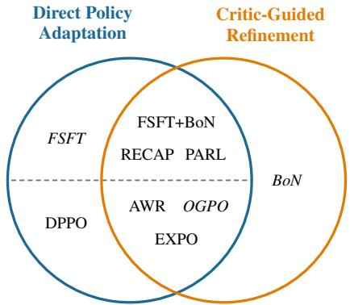  
Figure 11: A taxonomy of a few VLA post-training approaches. Approaches above the dashed line adopt a purely supervised objective for policy extraction. We italicize the three approaches at the center of the analysis in Sections 4.1 and 4.2.

DPPO. Diffusion Policy Policy Optimization (Ren et al., 2025) is designed for generative policies involving a denoising process $a _ { K : 0 } ~ = ~ ( a _ { K } , \ldots , a _ { 0 } ) \colon$ starting from $a _ { K } \sim \mathcal { N } ( 0 , { \bf { I } } )$ , the generative model samples $a _ { k - 1 } \sim \pi _ { \theta } ( \cdot \ | \ s , a _ { k } , k , c ) \forall k = K , \ldots , 1$ , until it arrives at the generated chunk a . DPPO applies on-policy PPO to a two-layer MDP, embedding the inner denoising MDP within the outer environment MDP. Policy gradients use tractable Gaussian likelihoods at each denoising step, with environment-step advantages estimated from on-policy rollouts and a state-value baseline. This allows policy extraction through simple PPO updates. For $k = 1 , \ldots , K .$

$$
\omega _ { k } ( \theta ) = \frac { \bar { \pi } _ { \theta } ( a _ { k - 1 } \mid s , a _ { k } , k ) } { \bar { \pi } _ { \theta _ { \mathrm { E M A } } } ( a _ { k - 1 } \mid s , a _ { k } , k ) } , \quad \widehat { A } _ { k } = \gamma _ { \mathrm { d e n } } ^ { k - 1 } \widehat { A } ^ { \mathrm { e n v } } ,\tag{8}
$$

$$
\mathcal { L } _ { \mathrm { D P P O } } ( \theta ) = - \mathbb { E } \left[ \sum _ { k = 1 } ^ { K } C _ { \epsilon } \Bigl ( \omega _ { k } ( \theta ) , \widehat { A } _ { k } \Bigr ) \right] ,\tag{9}
$$

where $\theta _ { \mathrm { E M A } }$ is an exponential moving average of the policy parameters, $\widehat { A } ^ { \mathrm { e n v } }$ is estimated using environment rewards and a learned value baseline, $\gamma _ { \mathrm { d e n } }$ discounts credit to earlier denoising transitions and the PPO surrogate is $C _ { \epsilon } ( \omega , A ) = \operatorname* { m i n } \{ \omega A , \mathrm { c l i p } ( \omega , 1 - \epsilon , 1 + \epsilon ) A \}$ . We do not classify this method as leveraging critic-based guidance, as the learned value function is not action-conditional, and is mostly used for variance reduction rather than for evaluating actions. Nevertheless, it updates the policy parameters, and thus performs direct policy adaptation.

RECAP. RL with Experience and Corrections via Advantage-conditioned Policies (Intelligence et al., 2025a) learns a state-only distributional critic from Monte Carlo (MC) returns and converts estimated advantages into binary conditioning labels. The policy is then conditioned on these labels, and trained with a supervised flow matching loss on both successful and unsuccessful trajectories. With the original method’s undiscounted n-step estimation, the advantage and the advantage labels for some state $s _ { 0 }$ are expressed as

$$
\widehat { A } = \sum _ { j = 0 } ^ { n - 1 } r _ { t + j } + V _ { \eta } ( s _ { n } ) - V _ { \eta } ( s _ { t } ) , \quad I _ { t } = \mathbf { 1 } \{ \widehat { A } > \varepsilon \} ,\tag{10}
$$

for some threshold ε. As such, this method combines a form of critic-based guidance (through advantage conditioning) with policy adaptation through conditional behavior cloning.

AWR. Advantage Weighted Regression (Peng et al., 2019) is an actor-critic algorithm which avoids differentiation through the critic, and updates the actor through a weighted supervised objective. Its early instantiations rely on a critic trained through Monte Carlo return estimation, but

AWR has since been applied widely, e.g., with temporal-difference critics in offline RL (Park et al., 2025a). With the notation introduced in Section 3, the advantage-weighted policy extraction objective is

$$
\begin{array} { r } { \mathcal { L } _ { \mathrm { A W R } } ( \theta ) = - \mathbb { E } _ { ( s , a ) \sim \mathcal { D } } \big [ e ^ { \frac { \hat { A } ( s , a ) } { \beta } } \log \pi _ { \theta } ( a | s ) \big ] , } \end{array}\tag{11}
$$

where $\widehat { A }$ is the advantage, often computed from $Q _ { \psi } ( s , a )$ , and $\beta$ is a temperature parameter that recovers pure behavior cloning as $\beta \to \infty$

PARL. Policy Agnostic RL (Mark et al., 2024) trains a state-action critic $Q _ { \psi } ( s , a )$ , originally with either IQL (Kostrikov et al., 2022) or Cal-QL (Nakamoto et al., 2023), while policy extraction relies on two steps: action optimization, and policy updates. The former consists of sampling action candidates from the current policy, and leveraging first- and zeroth-order optimization to approximately find $a ^ { \star } = \arg \operatorname* { m a x } _ { a } Q _ { \psi } ( s , a )$ for each state and task in the training batch. The latter simply encourages the policy to regress the best candidate through unweighted behavior cloning (see Equation 3). PARL is thus a close neighbor of FSFT+BoN; PARL optimizes over actions at training-time instead of test-time, and trains its policy on both successful and unsuccessful trajectories.

EXPO. Expressive Policy Optimization (Dong et al., 2026a) combines a critic trained through TD learning with a policy improvement scheme that integrates an expressive base policy with a lightweight edit policy. The edit policy is trained to maximize Q-values with a SAC-style objective (Haarnoja et al., 2018), while the base policy is updated according to a simple behavior cloning loss. Crucially, EXPO integrates a BoN-like mechanism, both for selecting actions during evaluation, and for computing TD targets. Thus, EXPO is also closely connected to FSFT+BoN, mostly differing in the introduction of an edit policy, and in the slightly different recipe used for value learning.

OGPO. Off-Policy Generative Policy Optimization (OGPO) (Patil et al., 2026) decouples the bilevel MDP formulation proposed in Ren et al. (2025) and uses off-policy Q functions with TDlearning for the environment MDP, while using on-policy PPO-style policy extraction (Schulman et al., 2017) for the denoising MDP of the generative control policy. For each replay state from the replay buffer, OGPO rolls out a group of G stochastic actions to obtain group-relative advantages. This mitigates the need for first-order optimization through the Q-functions and allows zeroth-order updates by conditioning the likelihoods via the PPO objective keeping the critics frozen during policy extraction:

$$
\widehat { A _ { i } } = Q _ { \mathrm { t a r g } } ( s , a ^ { i , ( 0 ) } ) - \frac { 1 } { G } \sum _ { j = 1 } ^ { G } Q _ { \mathrm { t a r g } } ( s , a ^ { j , ( 0 ) } ) , \quad \omega _ { i } ( \theta ) = \prod _ { k = 1 } ^ { K } \frac { \pi _ { \theta } ( a ^ { i , ( k - 1 ) } \mid s , a ^ { i , ( k ) } , k ) } { \pi _ { \theta _ { \mathrm { t a r g } } } ( a ^ { i , ( k - 1 ) } \mid s , a ^ { i , ( k ) } , k ) }\tag{12}
$$

and

$$
\mathcal { L } _ { \mathrm { O G P O } } ( \theta ) = - \mathbb { E } _ { \mathcal { D } , \theta _ { \mathrm { r e f } } } \left[ \frac { 1 } { G } \sum _ { i = 1 } ^ { G } C _ { \epsilon } \Bigl ( \omega _ { i } ( \theta ) , \widehat { A _ { i } } \Bigr ) \right] .\tag{13}
$$

Here, $\widehat { A _ { i } }$ is the group relative advantage, $\omega _ { i } ( \theta )$ is the annealed importance sampling ratio, $Q _ { \mathrm { t a r g } }$ is the EMA version of the online Q function, and similarly environment rollouts are conducted via $\pi _ { \mathrm { E M A } } .$ . Moreover, $( a ^ { i , ( K ) } , \ldots , a ^ { i , ( 0 ) } ) _ { i = 1 } ^ { G } \sim \pi _ { \theta } ( \cdot \ | \ s )$ is a group of denoising sequences, and $\pi _ { \boldsymbol { \theta } } ( a ^ { ( k - 1 ) } \mid s , a ^ { ( k ) } )$ denotes denoising-step likelihoods. OGPO proposes an ODE-to-SDE conversion of pretrained flow policies that allows the log probability updates on pretrained VLAs. Via these likelihoods, $\omega _ { i } ( \theta )$ captures the importance ratio between the denoising trajectories under current policy $\pi _ { \theta } .$ , and a slower-updating policy $\pi _ { \theta _ { \mathrm { s l o w } } }$ computed via a parameter exponential-moving average. Finally, $C _ { \epsilon }$ is a clipping function $C _ { \epsilon } ( \omega , A ) : = \operatorname* { m i n } \{ \omega A , \mathrm { c l i p } ( \omega , 1 - \epsilon , 1 + \epsilon ) A \}$ (Schulman et al., 2017). Informally, this update up-weights denoising sequences which lead to positive ${ \hat { A } } .$ down-weights those which lead to negative ${ \hat { A } } ,$ and incorporates clipping $C _ { \epsilon }$ to mitigate aggressive updates where the policy is uncertain. OGPO also proposes two key stabilization techniques: (1) a success buffer for FSFT on the base objective, and (2) conservative advantages that stabilize the gradient updates through underfit Q-functions in the beginning of RL-finetuning. Finally to improve critic accuracy, OGPO incorporates Q-variance reduction which averages the TD targets over $N _ { v r }$

$$
\mathcal { L } _ { \mathrm { c r i t i c } } = \mathbb { E } \left[ \left( Q ( s _ { t } , a _ { t } ) - \left( r _ { t } + \gamma \frac { 1 } { N _ { v r } } \sum _ { i = 1 } ^ { N _ { v r } } Q ( s _ { t + 1 } , a _ { t + 1 } ^ { ( i ) } ) \right) \right) ^ { 2 } \right] , a _ { t + 1 } ^ { ( i ) } \sim \pi _ { \theta } ( \cdot \mid s _ { t + 1 } ) .
$$

actions sampled from the actor.

(14)

## C ADDITIONAL EMPIRICAL RESULTS

## C.1 GENERALIST IMPROVEMENT ON LIBERO: DOES GENERALIZATION OCCUR FORCOMPLETELY NOVEL TASKS?

We extend the evaluation reported in Figure 4 to LIBERO, in terms of performance on seen and unseen tasks. For simplicity, we only consider the two most fundamental mechanisms out of the three introduced in Section 3. When evaluated on seen tasks (Figure 12, left), both direct policy adaptation (FSFT) and criticguided refinement (BoN) are generally able to improve success rates with respect to the base policy. As observed in Figure 4, performance of multi task models does not reach that of single-task experts, particularly for BoN, which barely improves over the base policy when trained over 64 tasks.

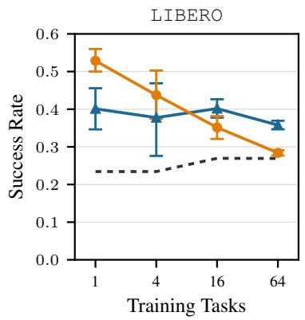

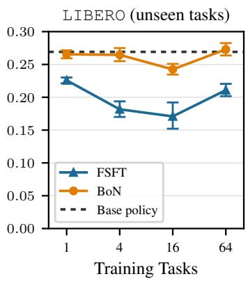  
Figure 12: Value-based generalist improvement is limited when tasks are loosely related. Performance of FSFT and BoN on training tasks (left) and held-out tasks (right) in LIBERO as the training tasks grow in number. The single-task lead of BoN reverses in larger multi-task experiments, but FSFT exhibits substantial forgetting on held-out tasks, unlike BoN.

The evaluation on unseen tasks (Figure 12, right) is instead distinct from the one in Figure 4, and highlights the limits of generalization to unseen tasks. Here, the degree of diversity of tasks is harder to control, and the variability across tasks is higher. Unseen tasks often involve completely different setups, motion patterns and goals compared to the training tasks. At the scale we train on $( N _ { \mathrm { t a s k } } \leq 6 4 )$ , generalization does not emerge. Nevertheless, BoN remains preferable to FSFT, as it only displays minimal forgetting.

## C.2 EXTENDED SCALING TASK DIVERSITY ABLATION

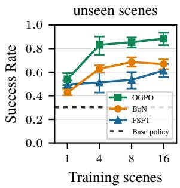

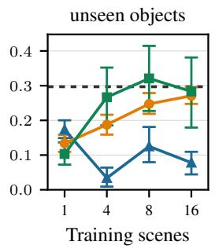

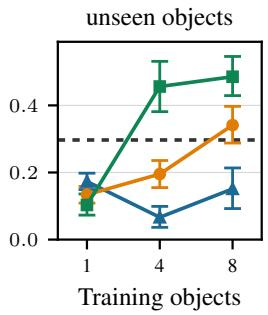

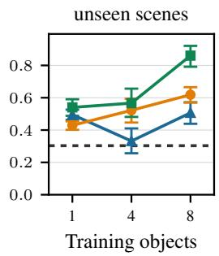  
Figure 13: Diversify along the axis of desired generalization. Scaling scenes of a single object (left two) or objects with one scene each (right two), evaluated on unseen scenes and unseen objects. Each axis transfers best along itself, and BoN scales better than FSFT, which falls below the base policy on unseen objects. Mean over three seeds, 95% stratified bootstrap CIs.

We extend Figure 6 by reporting trends for BoN and FSFT, and specify the task splits in full. We scale the number of scenes of a single object, {1, 4, 8, 16}, and separately the number of objects, {1, 4, 8}, with one scene each, evaluating both on eight held-out scenes of that object and on eight unseen objects. MolmoSpaces has 18 objects, of which we reserve 8 for evaluation, so at most 10 remain for training, explaining why the object sweep has no 16-object split. Table 1 lists the splits.

As shown in Figure 13, scaling scenes improves performance on unseen scenes by +36.5 pp for BoN and +31 pp for FSFT, but does not transfer across objects: both fall below the base policy there, although BoN recovers with more scenes while FSFT does not. Scaling objects eventually transfers: BoN falls below the base policy at 1 and 4 objects, but overtakes it at 8. At a matched budget of eight tasks each axis transfers best along itself, by +6.6 pp on unseen scenes and +9.4 pp on unseen objects. It is therefore beneficial to diversify along the axis of desired generalization, though object diversity is more effective overall.

Table 1: Task splits for the diversity ablation. Task IDs are given without the molmo prefix and grouped by object; Init. SR is the mean success rate of the base policy over a split. Scaling scenes varies the number of scenes of a single object; scaling objects varies the number of objects, with one scene each. Both regimes are evaluated on the same two held-out splits: eight unseen scenes of box, the one object common to every training split, and one scene of each of eight objects never seen during training. We note that the MolmoSpaces (8 tasks) split is used in Figures 9 and 16.
<table><tr><td>Split</td><td>Tasks</td><td>Objects</td><td>Init. SR (%)</td></tr><tr><td>Scaling scenes</td><td></td><td></td><td></td></tr><tr><td>1 task box: 267, 366, 138, 143</td><td>4</td><td>1</td><td>29.2</td></tr><tr><td>4 tasks box: 267, 366, 138, 143</td><td>4</td><td>1</td><td>29.2</td></tr><tr><td>8 tasks box: 164, 86, 70, 267, 366, 138, 143, 212</td><td>8</td><td>1</td><td>29.2</td></tr><tr><td>16 tasks box: 207, 393, 146, 55, 164, 86, 70, 267, 366, 138, 143, 212, 351, 333, 289, 122</td><td>16</td><td>1</td><td>33.9</td></tr><tr><td>Scaling objects</td><td></td><td></td><td></td></tr><tr><td>1 task box: 267, 366, 138, 143</td><td>4</td><td>1</td><td>29.2</td></tr><tr><td>4 tasks box: 138, cup: 24, tissuepaper: 221, spatula: 373</td><td>4</td><td>4</td><td>29.2</td></tr><tr><td>8 tasks — MolmoSpaces (8 tasks) boiler: 369, box: 138, cup: 24, ladle: 187, pot: 325,</td><td>8</td><td>8</td><td>29.7</td></tr><tr><td>tissuepaper: 221, spatula: 373, spoon: 148 Evaluation</td><td></td><td></td><td></td></tr><tr><td>Unseen scenes box: 666, 602, 543, 273, 916, 505, 769, 675</td><td>8</td><td>1</td><td>30.3</td></tr><tr><td>Unseen objects atomizer: 140, bowl: 356, fork: 345, knife: 155, re-</td><td>8</td><td>8</td><td>29.7</td></tr></table>

## C.3 ALLOCATING RESOURCES: DATA AND COMPUTE

Online post-training involves three important design axes when it comes to resource allocation: (i) how much data should be collected, (ii) how many gradient steps should be applied and (iii) how data collection and gradient updates should be interleaved. We thus consider these three axes, and validate the main experimental protocol outlined in Section 3.3 for BoN: post-training for 10 iterations, each alternating data collection (20 episodes per task) and model updates (100-500 gradient steps for the policy, 100× for the critic). While we present this ablation for BoN in LIBERO, we observed similar trends across algorithms and environments.

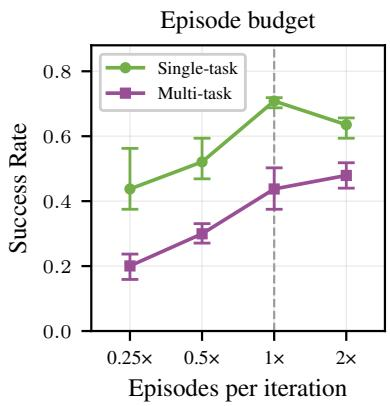

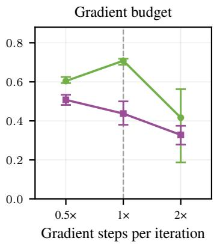

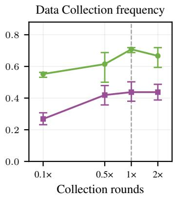  
Figure 14: Post-training benefits from more data and more frequent iterations. Final success rates for critic-guided refinement (BoN) on LIBERO. Each subplot changes one hyperparameter: the number of episodes collected per iteration (left), the number of gradient steps per iteration (middle) and the number of iterations (right) over which a data and compute budget is distributed. The other hyperparameters are fixed per plot. 1× marks the values used across the standard experimental protocol described in Section 3.3. Collecting more data is beneficial with diminishing gains, while more updates may be harmful; frequent iterations beat a single update phase after data collection.

As shown in the first column of Figure 14, we first study how performance changes with the amount of data collected per iteration, while keeping the number of iterations and of gradient steps fixed. We observe that in both single- and multi-task settings (adopting the 4-task split in this case), performance increases at a decreasing rate. We thus adopt the highest budget which brings significant benefits — 20 episodes per task. The second column keeps the number of episodes and iterations fixed instead, and ablates the amount of compute that should be allocated to training. In this case, we observe that more training is not always helpful, suggesting that the underlying training dynamics of online RL are not entirely stable. For these reasons, we settle on an intermediate budget. Finally, in the third column, we keep the amount of data and compute fixed, and we purely validate the number of iterations that should be applied. The leftmost point of the plot collects all the data at once, and follows this single data collection phase by a lengthy update phase, exhausting the entire gradient budget. The rightmost point instead distributes data and compute budgets across a large number of shorter iterations, each collecting 1/20th of the data and applying 1/20th of the gradient steps. Overall, we observe a gentle scaling trend which plateaus at high iteration frequencies, suggesting that frequent iterated online fine-tuning is beneficial. Accordingly, we post-train our base model over 10 iterations.

LIBERO (16 tasks)

## C.4 DOES A MULTI-TASK PRE-TRAINED CRITIC TRANSFER TO NEW TASKS?

A natural question in our setting is whether a critic pretrained on many tasks can accelerate value learning on unseen ones. We compare BoN with a critic pretrained on the MolmoSpaces (64 tasks) split against one trained from scratch, evaluating on unseen scenes of the pretrained critic’s training objects and on unseen objects. Figure 15 shows that pretraining helps only initially: the pretrained critic starts at a substantially higher success rate, but the gap closes in the next iteration, after which it trails the randomly initialized critic on both splits. These re-

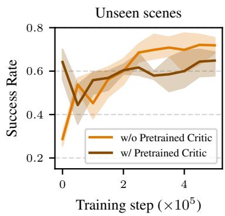

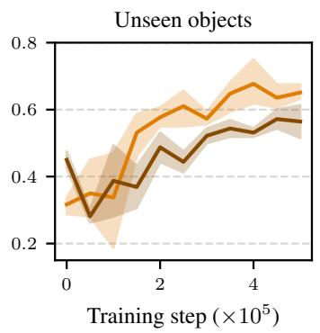  
Figure 15: Pretrained critic for accelerating value learning. A critic pretrained on MolmoSpaces (64 tasks) starts higher than one trained from scratch, but the gap closes within one iteration and then reverses, on both unseen scenes (left) and unseen objects (right). Mean and 95% stratified bootstrap CIs across three seeds.

sults indicate that pretrained critics offer little benefit for accelerating value learning and can even be detrimental. One possible explanation is a loss of plasticity in the pretrained critic, though we leave the identification of the precise mechanism to future work.

## C.5 STABILITY IN DIRECT POLICY ADAPTATION

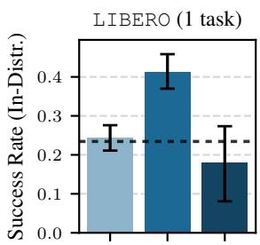

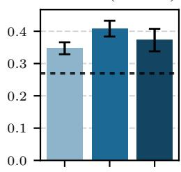  
MolmoSpaces (1 task) MolmoSpaces (8 tasks)

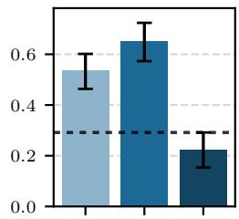

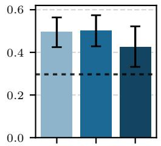

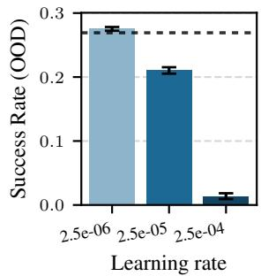

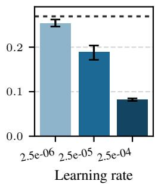

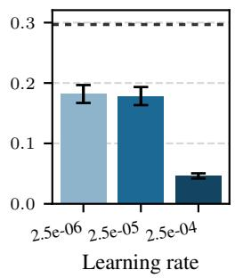

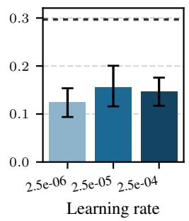  
Figure 16: Learning rate ablation for FSFT. We sweep three learning rates across four task splits: LIBERO (1 task), LIBERO (16 tasks), MolmoSpaces (1 task), and MolmoSpaces (8 tasks). We evaluate performance on the training tasks (In-Distr.) and on the validation tasks (OOD). Bars show the mean over three seeds, with error bars denoting 95% stratified bootstrap confidence.

FSFT has few hyperparameters, of which the learning rate is among the most impactful. To assess its importance, we measure its influence on in-distribution and out-of-distribution (OOD) performance across four single- and multi-task splits: LIBERO (1 task), LIBERO (16 tasks), MolmoSpaces (1 task), and MolmoSpaces (8 tasks). We sweep three learning rates, $\{ 2 . 5 \cdot 1 0 ^ { - 6 } , 2 . 5 \cdot \bar { 1 0 } ^ { - 5 } , 2 . 5$ $1 0 ^ { - 4 } \}$ , over three seeds each, leaving all other hyperparameters unchanged. Figure 16 presents the results. The smallest value, $2 . 5 \cdot \bar { 1 0 } ^ { - 6 }$ , degrades in-distribution performance, while the largest, $2 . 5 \cdot 1 0 ^ { - 4 }$ , is detrimental OOD. These results suggest that the learning rate mediates a trade-off between in-distribution and OOD performance. The middle value, $2 . 5 \cdot 1 0 ^ { - 5 }$ , balances the two, and we adopt it as the default in our FSFT experiments.

## C.6 NUMBER OF ACTION CANDIDATES N IN BEST-OF-N

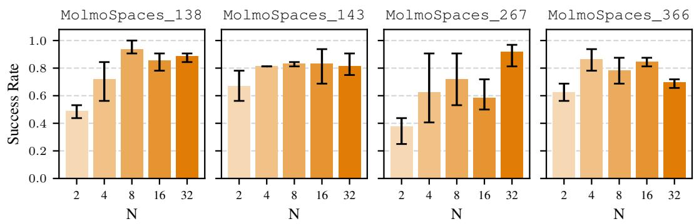  
Figure 17: Impact of the number of candidates N in Best-of-N on performance. Success rate of BoN on each of the four single-task MolmoSpaces runs as N grows. On average, performance grows with N and peaks at $N = 3 2$ , though the gains over $N \in \{ 8 , 1 6 \}$ are marginal. We report mean and 95% stratified bootstrap CIs over three seeds.

Beyond critic learning, Best-of-N introduces a single hyperparameter: the number of sampled actions $N . \quad \mathrm { A t }$ each step it draws N candidates $\{ a _ { t } ^ { i } \} _ { i = 1 } ^ { N } \sim \pi _ { \theta } ( s _ { t } , c )$ , scores them, and executes $a _ { t } ^ { \star } =$ $\arg \operatorname* { m a x } _ { i } Q _ { \psi } ( s _ { t } , a _ { t } ^ { i } , c )$ . Larger N gives the critic more candidates to choose from, at the cost of slower inference. To assess the impact of N on performance, we ablate $N ~ \in ~ \{ 2 , 4 , 8 , 1 6 , 3 2 \}$ on four single-task MolmoSpaces runs. As shown in Figure 17, performance roughly grows with N on all tasks and peaks on average at $N = 3 2$ , which we adopt as our default. The gains are diminishing, however: $\bar { N } = 3 2$ improves only marginally over $N \in \{ 8 , 1 6 \}$

<table><tr><td>N</td><td> ${ \mathrm { T i m e ~ } } ( { \mathrm { m s } } )$ </td><td>Rel.</td></tr><tr><td>1</td><td> $1 4 6 . 3 \pm 2 . 1$ </td><td>1.00×</td></tr><tr><td>2</td><td> $1 5 9 . 5 \pm 2 . 0$ </td><td> $1 . 0 9 \times$ </td></tr><tr><td>4</td><td> $1 8 3 . 9 \pm 1 . 5$ </td><td> $1 . 2 6 \times$ </td></tr><tr><td>8</td><td> $2 3 2 . 9 \pm 2 . 6$ </td><td> $1 . 5 9 \times$ </td></tr><tr><td>16</td><td> $3 2 5 . 2 \pm 2 . 2$ </td><td> $2 . 2 2 \times$ </td></tr><tr><td>32</td><td> $5 1 0 . 7 \pm 2 . 8$ </td><td> $3 . 4 9 \times$ </td></tr></table>

Table 2: BoN inference cost. Wall-clock time of one Best-of-N step on a single GH200 GPU, relative to $N { \bar { = } } 1$

Table 2 reports the wall-clock time of one BoN step as a function of N. Our default $N = 3 2$ costs 3.49× the time of $N = 1$ , against 1.59× for $N = 8$ , which offers a better balance between performance and inference cost. Since our experiments run in simulation, we keep $N = 3 2$ to prioritize performance; on a real robot, $N = 8$ would likely be preferable.

## D EXPERIMENTAL DETAILS

## D.1 ENVIRONMENTS AND TASK SPLITS

This section describes the environments we use and how we construct task splits. In all of our experiments, we utilize two benchmarks: LIBERO-90 and MolmoSpaces. LIBERO is a widely used manipulation benchmark, whereas MolmoSpaces offers precise control over task diversity, which makes it better suited to studying generalization. We use its pick suite, which exposes 18 objects with 55–56 scenes each, allowing us to vary scene and object diversity independently.

Studying multi-task training and generalization requires training splits of increasing size but comparable difficulty, together with held-out tasks. For MolmoSpaces, we first estimate the initial success rate of each task by rolling out 48 episodes with the base policy. From these we construct five training splits of 1, 4, 16, 64, and 144 tasks, each a superset of the smaller ones, with a mean initial success rate near 30%. A split of $k ^ { 2 }$ tasks contains k objects with k scenes each. We evaluate each training split on two held-out sets. The first contains eight unseen scenes of every object the split was trained on, so each split is tested only on new scenes of its own objects. The second, shared by all splits, contains eight scenes each of six objects that appear in no training split. Table 3 lists the resulting splits together with their objects and the initial success rates, and Figures 18, 19, and 20 visualize the tasks.

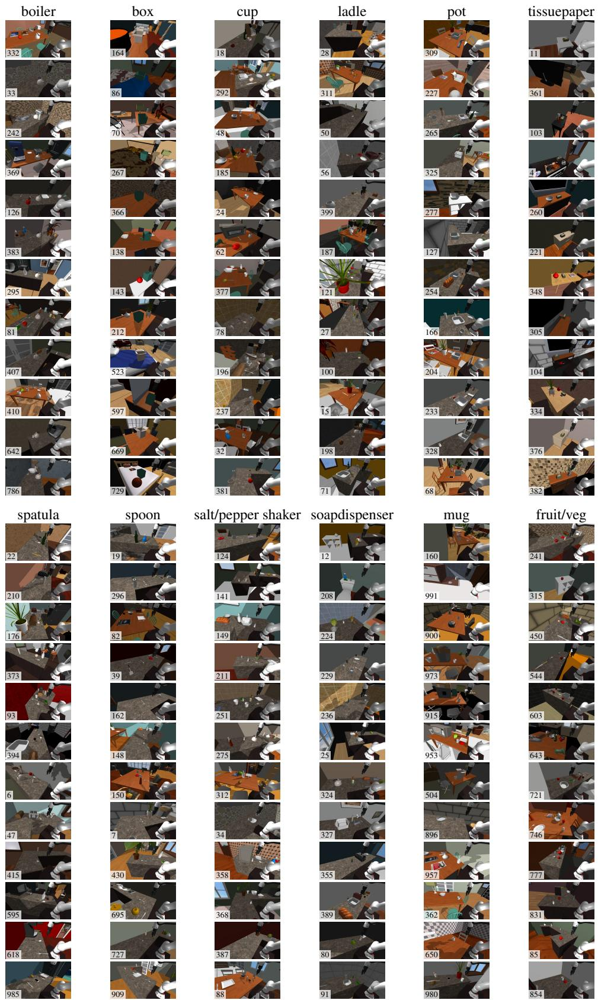  
Figure 18: MolmoSpaces training tasks – visualization. Initial exterior-camera frame of every training task of the 144-task split, ordered as in Table 3. Task IDs are shown in the lower-left corner of each frame.

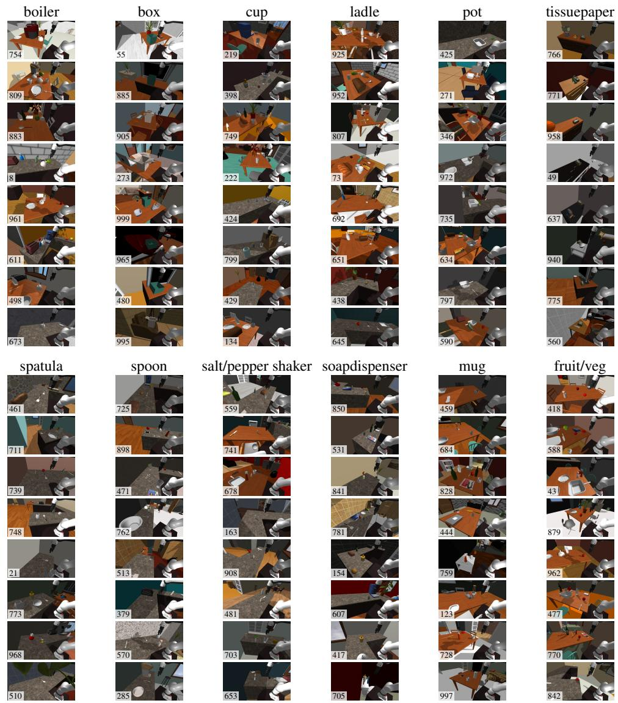  
Figure 19: MolmoSpaces unseen scenes – visualization. Initial exterior-camera frame of every unseen scene task of the 144-task split, ordered as in Table 3. Task IDs are shown in the lower-left corner of each frame.

Table 3: MolmoSpaces task splits. For each training split, we list the task IDs it contains, grouped by object and given without the molmo prefix. Scenes/obj. is the number of scenes per object; Init. SR the mean success rate of the base policy. Each training split is evaluated only on unseen scenes of the objects it was trained on (Eval. tasks: 8 held-out scenes per training object), and every split is evaluated on the same 8 scenes of each of 6 objects never seen during training. †Four independent single-task runs (one per listed task), each evaluated on the 8 unseen scenes of its own object. ‡Pool of unseen-scene tasks; each split uses the rows of its own training objects.

<table><tr><td rowspan="2">Split</td><td colspan="3">Training</td><td colspan="2">Unseen-scene eval.</td></tr><tr><td></td><td>Tasks Scenes/obj. SR (%) 1</td><td>30.2</td><td>Tasks 8×4</td><td>SR (%) 30.0</td></tr><tr><td>MolmoSpaces (1 task)† box: 366, 138; spatula: 373, 93</td><td>1×4</td><td></td><td></td><td></td><td></td></tr><tr><td>MolmoSpaces (4 tasks) box: 366, 138; spatula: 373, 93 MolmoSpaces (16 tasks)</td><td>4 16</td><td>2 4</td><td>30.2 29.2</td><td>16 32</td><td>30.0 29.9</td></tr><tr><td>box: 267, 366, 138, 143; spatula: 176, 373, 93, 394 cup: 48, 185, 24, 62; tissuepaper: 4, 260, 221, 348 MolmoSpaces (64 tasks)</td><td>64</td><td>8</td><td>29.5</td><td>64</td><td>29.9</td></tr><tr><td>boiler: 332, 33, 242, 369, 126, 383, 295, 81 box: 164, 86, 70, 267, 366, 138, 143, 212 cup: 18, 292, 48, 185, 24, 62, 377, 78 ladle: 28, 311, 50, 56, 399, 187, 121, 27 pot: 309, 227, 265, 325, 277, 127, 254, 166 tissuepaper: 11, 361, 103, 4, 260, 221, 348, 305 spatula: 22, 210, 176, 373, 93, 394, 6, 47 spoon: 19, 296, 82, 39, 162, 148, 150, 7</td><td></td><td></td><td></td><td></td><td></td></tr><tr><td>MolmoSpaces (144 tasks) boiler: 332, 33, 242, 369, 126, 383, 295, 81, 407, 410, 642, 786 box: 164, 86, 70, 267, 366, 138, 143, 212, 523, 597, 669, 729 cup: 18, 292, 48, 185, 24, 62, 377, 78, 196, 237, 32, 381 ladle: 28, 311, 50, 56, 399, 187, 121, 27, 100, 15, 198, 71 pot: 309, 227, 265, 325, 277, 127, 254, 166, 204, 233, 328, 68 tissuepaper: 11, 361, 103, 4, 260, 221, 348, 305, 104, 334, 376, 382 spatula: 22, 210, 176, 373, 93, 394, 6, 47, 415, 595, 618, 985 spoon: 19, 296, 82, 39, 162, 148, 150, 7, 430, 695, 727, 909 salt/pepper shaker: 124, 141, 149, 211, 251, 275, 312, 34, 358, 368, 387, 88 soapdispenser: 12, 208, 224, 229, 236, 25, 324, 327, 355, 389, 80, 91 mug: 160, 991, 900, 973, 915, 953, 504, 896, 957, 362, 650, 980 fruit/veg: 241, 315, 450, 544, 603, 643, 721, 746, 777, 831, 85, 854</td><td>144</td><td>12</td><td>29.0</td><td>96</td><td>29.7</td></tr><tr><td>Unseen scenes (eval.)‡ boiler: 754, 809, 883, 8, 961, 611, 498, 673 box: 55, 885, 905, 273, 999, 965, 480, 995 cup: 219, 398, 749, 222, 424, 799, 429, 134 ladle: 925, 952, 807, 73, 692, 651, 438, 645 pot: 425, 271, 346, 972, 735, 634, 797, 590 tissuepaper: 766, 771, 958, 49, 637, 940, 775, 560 spatula: 461, 711, 739, 748, 21, 773, 968, 510 spoon: 725, 898, 471, 762, 513, 379, 570, 285 salt/pepper shaker: 559, 741, 678, 163, 908, 481, 703, 653 soapdispenser: 850, 531, 841, 781, 154, 607, 417, 705 mug: 459, 684, 828, 444, 759, 123, 728, 997</td><td></td><td>8</td><td></td><td>96</td><td>29.7</td></tr><tr><td>fruit/veg: 418, 588, 43, 879, 962, 477, 770, 842 Unseen objects (eval., all splits) atomizer: 209, 397, 192, 99, 140, 57, 344, 400 bowl: 665, 118, 214, 356, 101, 136, 230, 718 fork: 281, 181, 372, 345, 167, 290, 518, 31 knife: 419, 433, 629, 934, 155, 223, 512, 878 remotecontrol: 465, 152, 349, 353, 390, 357, 359, 135 winebottle: 679, 206, 371, 448, 226, 340, 248, 798</td><td></td><td>8</td><td></td><td>48</td><td>28.9</td></tr></table>

We construct the LIBERO splits in the same way, estimating initial success rates from 48 rollouts on 89 of the 90 tasks, and again running the single-task split on four tasks. LIBERO is smaller than MolmoSpaces, so its splits cannot be balanced as tightly: mean initial success rate ranges from

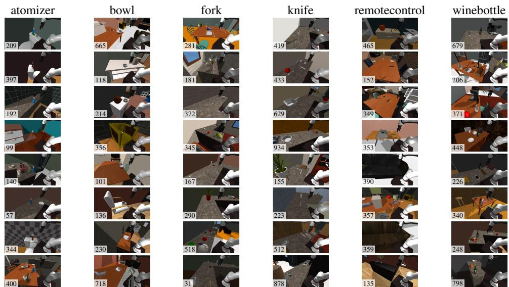  
Figure 20: MolmoSpaces unseen objects – visualization. Initial exterior-camera frame of every unseen object task of the 144-task split, ordered as in Table 3. Task IDs are shown in the lower-left corner of each frame.

23.4% to 27.0%. A further 25 tasks are held out to measure generalization. Table 4 lists the splits and their initial success rates.

Table 4: LIBERO task splits. All tasks are drawn from LIBERO-90; task IDs are given without the libero 90 prefix. Init. SR is the mean success rate of the base policy over the tasks of a split. The training splits are nested, and the unseen tasks are disjoint from all of them.
<table><tr><td>Split Tasks</td><td></td><td>Init. SR (%)</td></tr><tr><td>LIBERO (1 task) Task IDs: 79, 31, 82, 38</td><td>4</td><td>23.4</td></tr><tr><td>LIBERO (4 tasks) Task IDs: 79, 31, 82, 38</td><td>4</td><td>23.4</td></tr><tr><td>LIBERO (16 tasks) Task IDs: 36, 49, 87, 86, 21, 85, 53, 64, 31, 79, 38, 82, 30, 47, 56, 24</td><td>16</td><td>27.0</td></tr><tr><td>LIBERO (64 tasks) Task IDs: 5, 32, 6, 36, 74, 39, 40, 76, 41, 43, 45, 49, 89, 65, 62, 42, 78, 8, 1, 88, 16, 17, 3, 87, 86, 58, 21, 84, 83, 25, 80, 27, 85, 73, 35, 53, 63, 14, 44, 64, 31, 79, 38, 82, 28, 70, 59, 60, 30, 12, 29, 47, 54, 56, 33, 9, 46, 50, 67, 51, 24, 20, 55, 61</td><td>64</td><td>26.9</td></tr><tr><td>Unseen tasks Task IDs: 34, 37, 4, 71, 66, 52, 75, 11, 18, 23, 81, 10, 69, 48, 7, 13, 0, 26, 77, 19, 72, 22, 2, 68, 57</td><td>25</td><td>26.9</td></tr></table>

## D.2 IMPLEMENTATION DETAILS

Common Setup. All methods start from the same pretrained $\pi _ { 0 . 5 }$ checkpoint, i.e., pi05 libero on LIBERO and pi05 droid jointpos on MolmoSpaces, and share the same data collection loop. As in the released checkpoint, the policy sees only camera images and the language instruction; we verified that omitting proprioceptive state helps. Each iteration begins with a collection phase, in which the policy collects 20 episodes per task into a replay buffer; training then proceeds and differs by method. After the last iteration, a final evaluation phase begins. Collection and evaluation both use an exponential moving average of the policy parameters for stability. The policy outputs a chunk of 15 actions (10 actions on LIBERO) but executes only the first 5 before being queried again. We nonetheless store one sample per environment step, pairing each observation with the full action chunk executed from that step onward, stitched across consecutive queries rather than taken from a single predicted chunk. The buffer is FIFO and sampled uniformly.

FSFT. FSFT stores only successful episodes and fine-tunes all policy parameters, i.e., VLM backbone, action expert, and vision encoder, with the standard $\pi _ { 0 . 5 }$ flow-matching loss.

BoN. BoN keeps the VLA’s parameters frozen and instead learns a Q-function conditioned on observations and action chunks. At every query, it samples N=32 candidate chunks with independent initial noise and executes the one maximizing the minimum over the critic’s ensemble, both during data collection and at evaluation. The critic never sees raw images as it takes the mean-pooled finallayer token embeddings of the policy’s backbone, the proprioceptive state, and the flattened action chunk as input. Since the policy is frozen, this embedding is computed once at collection time and cached, which makes critic training substantially faster. We use a time-to-success reward (−1 per step, 0 on success), with episodes terminating only on success and time limits treated as truncation. We train Q and V on all collected episodes with H-step TD targets from slowly updated target networks: the H discounted rewards accumulated over the chunk, plus $\gamma ^ { H }$ times the bootstrapped value of the state reached at its end. Because V regresses Q at buffer actions rather than at a maximum or an upper expectile, this is a SARSA-style evaluation of the data-collecting policy.

OGPO. Our implementation of OGPO mostly follows the design choices specified in the original paper ((Patil et al., 2026)). However, we make some additional design choices and modifications to adapt it to fine-tune $\pi _ { 0 . 5 }$ . Specifically, we make the following design choices for our runs:

• Critic: Our implementation parametrizes the state-action value function using a BroNet residual MLP and uses an ensemble of 10 critics (Patil et al., 2026). The critics are aggregated by randomly sub-sampling two critics and then picking the minimum among the two.

• Critic Update: The critic is learned by regressing on a TD target with Q-variance reduction expressed in Equation 14. At every training step, this critic receives two gradient updates: one on a batch of transitions sampled from the replay buffer, and one on a batch sampled only from successful episodes. This success oversampling helps amplify the sparse reward signal.

• Policy Updates: Policy updates are performed using the group relative advantages as per Equation 12 and Equation 13. Additionally, policy updates also use conservative advantages and BC loss on transitions from successful episodes for stability.

• BoN: During collection rounds, we generate a set of N = 32 candidate chunks using SDE sampling and execute the one with the highest Q-value. We aggregate the Q-function for this using the same aggregation strategy described above. Evaluation uses $N = 1$

• Training: In experiments with OGPO, the backbone is frozen and only the action expert is trained.

The other design choices and exact hyperparameters used in our implementation are specified in Table 5.

AWR. The training pipeline of AWR is mostly the same pipeline as OGPO. The sole difference is in the policy training objective. AWR uses a weighted supervised loss (see Equation 3). The AWR weights are computed using the group relative advantages computed from the critic and normalize the advantages by dividing by the group’s standard deviation. The BC loss on successful transitions from OGPO is retained with the same weight.

FSFT+BoN. FSFT+BoN collects data with BoN and additionally fine-tunes the expert head of the policy on the successful transitions of the shared buffer. The critic training pipeline and collection strategy are the same as OGPO.

## D.3 HYPERPARAMETERS

Table 5: Hyperparameters. Training budget: each run performs M collection rounds of K episodes per task, with the given number of gradient steps per round (single-task / multi-task). Tuned weights: whether the full VLA or only the action expert is fine-tuned. Trained on: whether the SFT loss uses only successful episodes. Update interval: critic steps per policy update. Bootstrap: SARSA uses the next action stored in the buffer, TD uses an action sampled from the current policy. Critic-based methods use a replay buffer of 1M transitions (2M for OGPO on the 144-task split). BoN and OGPO run for 10 collection rounds, except on the 144-task split, where we extend it to 15 rounds because performance had not yet plateaued. FSFT, in contrast, plateaus early and then slightly declines, so 10 rounds was enough.
<table><tr><td rowspan="2"></td><td rowspan="2">FSFT</td><td rowspan="2">BoN</td><td rowspan="2">OGPO</td><td rowspan="2">AWR</td><td rowspan="2">FSFT +BoN</td></tr><tr><td></td></tr><tr><td>Training budget</td><td></td><td></td><td></td><td></td><td></td></tr><tr><td>Collection rounds M</td><td>10</td><td>10/15</td><td>10/15</td><td>10</td><td>10</td></tr><tr><td>Episodes per task K</td><td>20</td><td>20</td><td>20</td><td>20</td><td>20</td></tr><tr><td>Steps per round</td><td>100/500</td><td>10k/50k</td><td>1k</td><td>1k</td><td>1k</td></tr><tr><td>Policy</td><td></td><td></td><td></td><td></td><td></td></tr><tr><td>Learning rate</td><td>2.5.10-5</td><td></td><td>2.5·10−5</td><td>2.5.10-5</td><td>2.5.10-5</td></tr><tr><td>Batch size</td><td>256</td><td></td><td>512</td><td>512</td><td>256</td></tr><tr><td>EMA decay</td><td>0.999</td><td></td><td>0.995</td><td>0.995</td><td>0.995</td></tr><tr><td>Tuned weights</td><td>full</td><td></td><td>expert</td><td>expert</td><td>expert</td></tr><tr><td>Trained on</td><td>successes</td><td>一</td><td>all</td><td>all</td><td>successes</td></tr><tr><td>Update interval</td><td>一</td><td>一</td><td>1</td><td>1</td><td>1</td></tr><tr><td>Critic</td><td></td><td></td><td></td><td></td><td></td></tr><tr><td>Learning rate</td><td></td><td>10-4</td><td>10-4</td><td>10-4</td><td>10-4</td></tr><tr><td>Architecture</td><td></td><td>BroNet</td><td>BroNet</td><td>BroNet</td><td>BroNet</td></tr><tr><td>Hidden width</td><td></td><td>1024</td><td>1024</td><td>1024</td><td>1024</td></tr><tr><td>Batch size</td><td></td><td>1024</td><td>512</td><td>512</td><td>512</td></tr><tr><td>EMA decay</td><td></td><td>0.995</td><td>0.95</td><td>0.95</td><td>0.95</td></tr><tr><td>Bootstrap</td><td></td><td>SARSA</td><td>TD</td><td>TD</td><td>TD</td></tr><tr><td>Discount γ</td><td>一</td><td>0.995</td><td>0.995</td><td>0.995</td><td>0.995</td></tr><tr><td>Replay buffer</td><td></td><td></td><td></td><td></td><td></td></tr><tr><td>Capacity</td><td>500k</td><td>1M</td><td>1M/2M</td><td>1M</td><td>1M</td></tr><tr><td>Action selection</td><td></td><td></td><td></td><td></td><td></td></tr><tr><td>Candidates N</td><td>一</td><td>32</td><td>32</td><td>32</td><td>32</td></tr><tr><td>Method-specific</td><td></td><td></td><td></td><td></td><td></td></tr><tr><td>AWR temperature β</td><td></td><td></td><td>一</td><td>1.0</td><td></td></tr><tr><td>AWR Weight Clip</td><td></td><td></td><td></td><td>20</td><td></td></tr><tr><td>AWR/OGPO Group Size</td><td></td><td></td><td>32</td><td>32</td><td></td></tr><tr><td>AWR/OGPO BC Loss Weight</td><td></td><td></td><td>1.0</td><td>1.0</td><td></td></tr><tr><td>Variance Reduction Nvr</td><td></td><td></td><td>16</td><td>16</td><td>16</td></tr><tr><td>OGPO PPO Clip Ratio</td><td></td><td></td><td>0.01</td><td>一</td><td></td></tr></table>

## D.4 EVALUATION PROTOCOL

In this section we describe the evaluation protocol. On both LIBERO and MolmoSpaces we evaluate each policy in distribution and on unseen tasks. For LIBERO, the unseen set comprises 25 tasks; for MolmoSpaces, eight unseen scenes of objects from the 144-task split and six unseen objects (see Appendix D.1). Our metric throughout is success rate.

During training, the in-distribution success rate is measured on the 20 episodes the policy collects per task in each round, so no extra mid-evaluation rollouts are needed. After the last training phase, we run a separate evaluation phase of 32 episodes per task, both in distribution and on unseen tasks. We repeat every experiment with three seeds and report the mean success rate over seeds, together with 95% stratified bootstrap confidence intervals computed with rliable (Agarwal et al., 2021).

## D.5 COMPUTATIONAL RESOURCES

Our experiments ran on nodes with four NVIDIA GH200 GPUs each. A single-task run took about 2-5 hours of wall-clock time depending on the task, and runs on the largest multi-task splits took 200 hours.

## E TRAINING CURVES

We report success-rate curves over training for the experiments in Figures 4, 12 and 10.

## E.1 GENERALIZATION PER TASK - MOLMOSPACES

## E.1.1 MOLMOSPACES UNSEEN SCENES

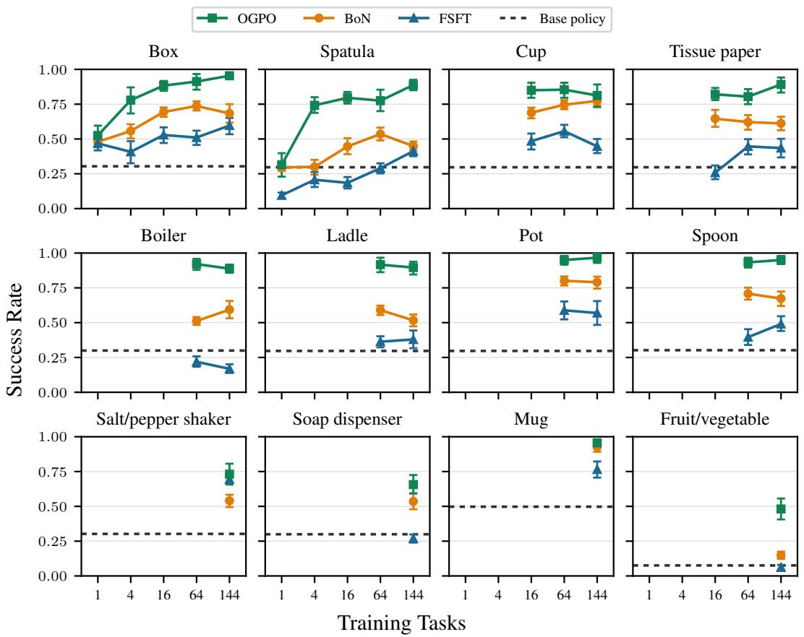  
Figure 21: MolmoSpaces. Final success rate on unseen scenes of the training objects. Points show the mean over three seeds with 95% stratified bootstrap CIs.

## E.2 MAIN RESULTS — MOLMOSPACES

## E.2.1 MOL MOSPA CE S (1 TASK) IN-DISTRIBUTION

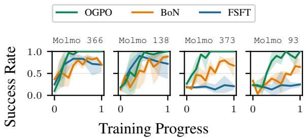  
Figure 22: MolmoSpaces (1 task): training tasks. Success rate on the training tasks as a function of normalized training progress, where 1 denotes the end of post-training. Lines show the mean over three seeds. Shaded regions denote 95% stratified bootstrap CIs.

E.2.2 MOLMOSPACES (1 TASK) UNSEEN SCENES  
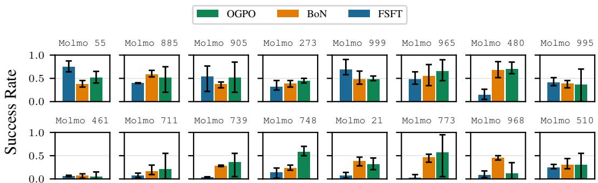  
Figure 23: MolmoSpaces (1 task): unseen scenes. Final success rate on unseen scenes. Bars show the mean over three seeds with 95% stratified bootstrap CIs.

E.2.3 MOLMOSPACES (1 TASK) UNSEEN OBJECTS  
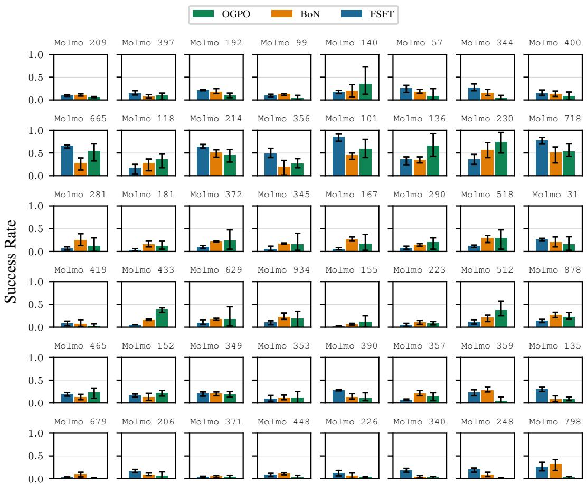  
Figure 24: MolmoSpaces (1 task): unseen objects. Final success rate on unseen objects. Bars show the mean over three seeds with 95% stratified bootstrap CIs.

## E.2.4 MO L M OSP A C E S (4 TASKS) IN-DISTRIBUTION

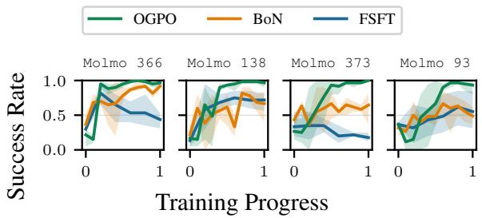  
Figure 25: MolmoSpaces (4 tasks): training tasks. Success rate on the training tasks as a function of normalized training progress, where 1 denotes the end of post-training. Lines show the mean over three seeds. Shaded regions denote 95% stratified bootstrap CIs.

## E.2.5 MOLMOSPACES (4 TASKS) UNSEEN SCENES

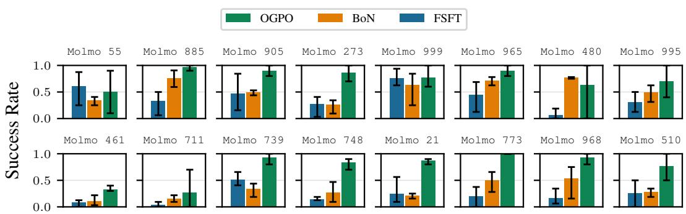  
Figure 26: MolmoSpaces (4 tasks): unseen scenes. Final success rate on unseen scenes. Bars show the mean over three seeds with 95% stratified bootstrap CIs.

E.2.6 MOLMOSPACES (4 TASKS) UNSEEN OBJECTS  
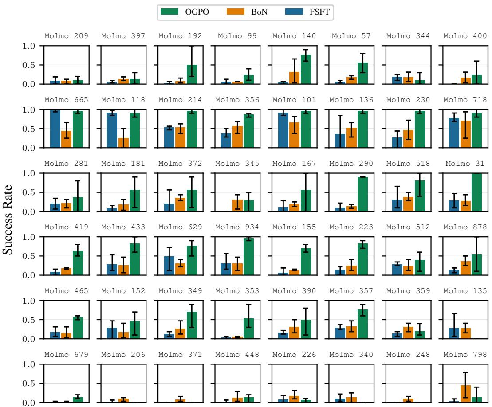  
Figure 27: MolmoSpaces (4 tasks): unseen objects. Final success rate on unseen objects. Bars show the mean over three seeds with 95% stratified bootstrap CIs.

E.2.7 MOL MOSPA CE S (16 TASKS) IN-DISTRIBUTION  
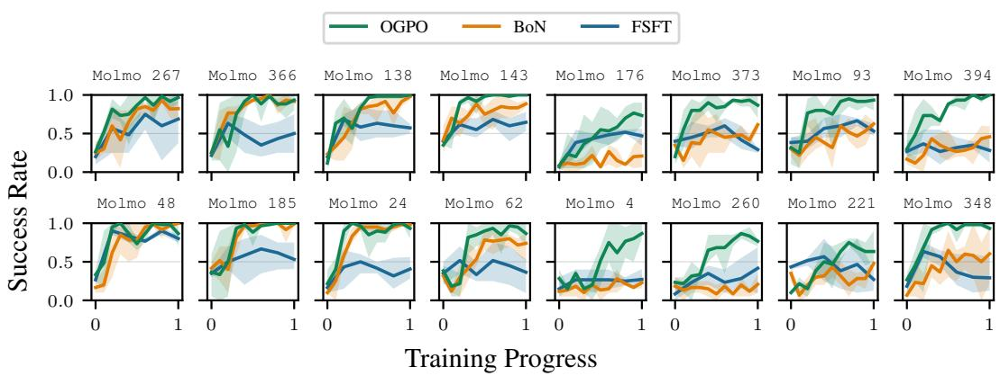  
Figure 28: MolmoSpaces (16 tasks): training tasks. Success rate on the training tasks as a function of normalized training progress, where 1 denotes the end of post-training. Lines show the mean over three seeds. Shaded regions denote 95% stratified bootstrap CIs.

E.2.8 MOLMOSPACES (16 TASKS) UNSEEN SCENES  
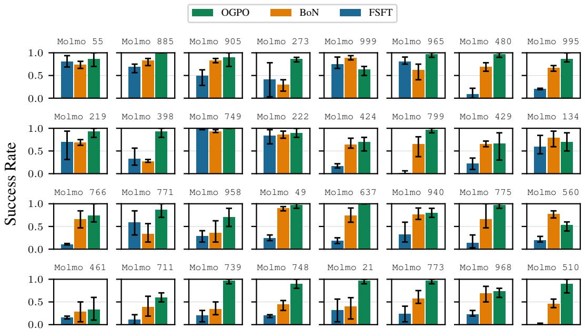  
Figure 29: MolmoSpaces (16 tasks): unseen scenes. Final success rate on unseen scenes. Bars show the mean over three seeds with 95% stratified bootstrap CIs.

E.2.9 MOLMOSPACES (16 TASKS) UNSEEN OBJECTS  
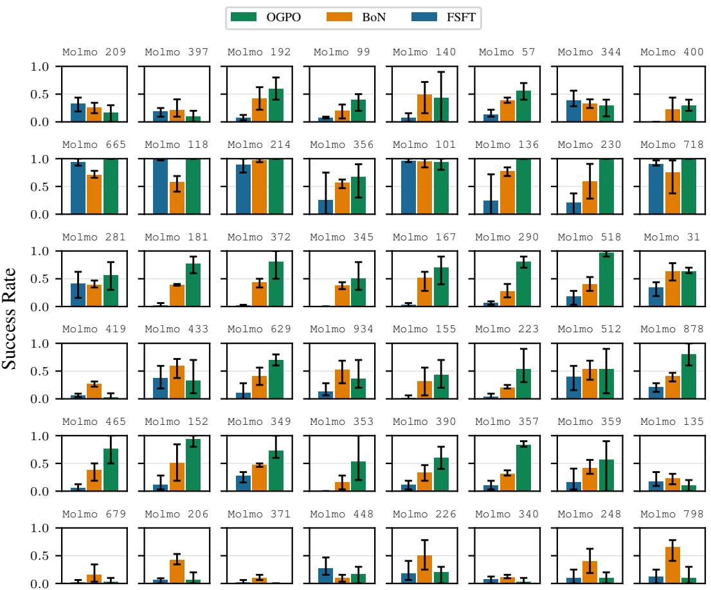  
Figure 30: MolmoSpaces (16 tasks): unseen objects. Final success rate on unseen objects. Bars show the mean over three seeds with 95% stratified bootstrap CIs.

## E.2.10 MOL MOSPA CE S (64 TASKS) IN-DISTRIBUTION

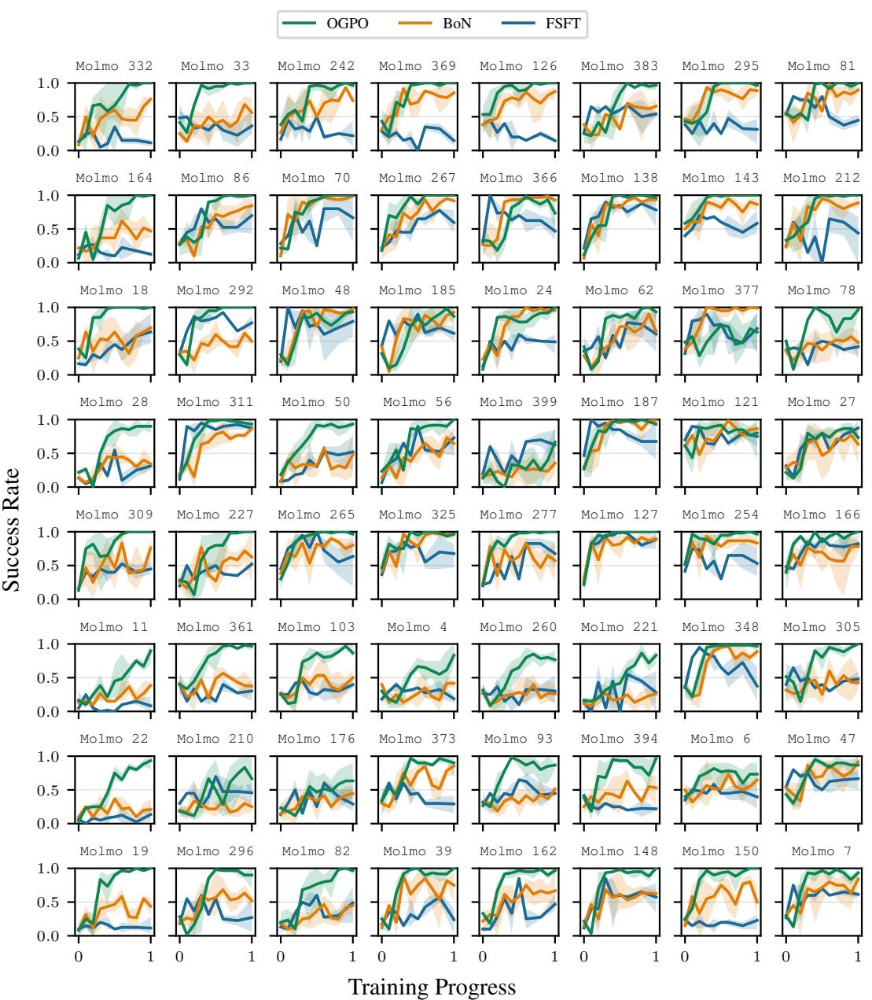  
Figure 31: MolmoSpaces (64 tasks): training tasks. Success rate on the training tasks as a function of normalized training progress, where 1 denotes the end of post-training. Lines show the mean over three seeds. Shaded regions denote 95% stratified bootstrap CIs.

## E.2.11 MOLMOSPACES (64 TASKS) UNSEEN SCENES

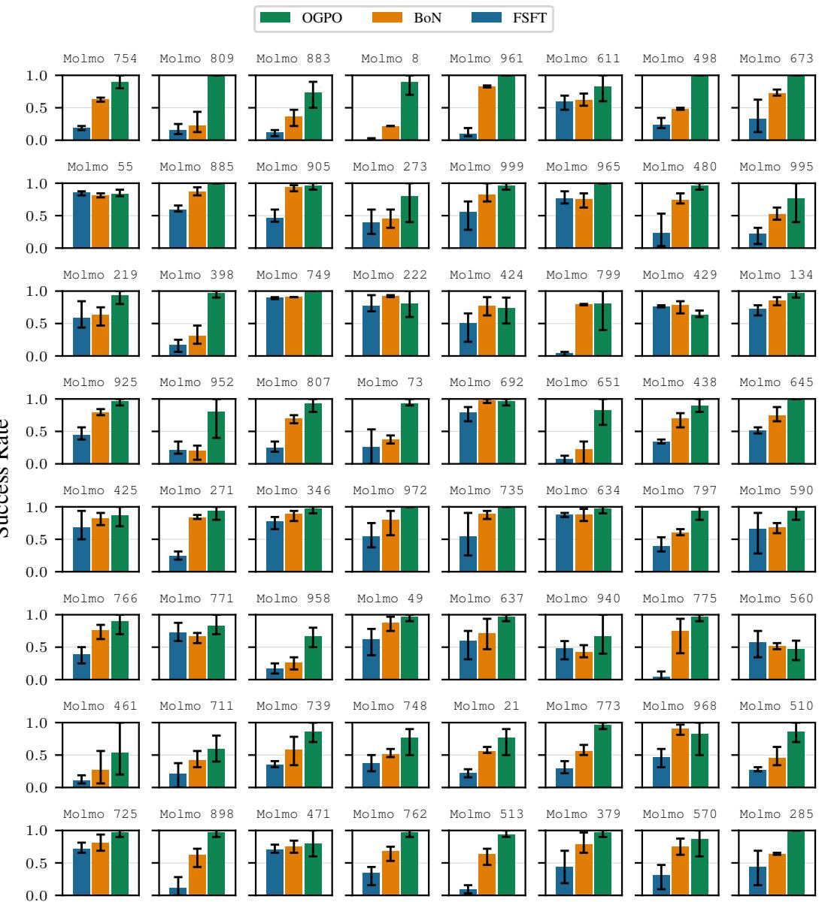  
Figure 32: MolmoSpaces (64 tasks): unseen scenes. Final success rate on unseen scenes. Bars show the mean over three seeds with 95% stratified bootstrap CIs.

## E.2.12 MOLMOSPACES (64 TASKS) UNSEEN OBJECTS

  
Figure 33: MolmoSpaces (64 tasks): unseen objects. Final success rate on unseen objects. Bars show the mean over three seeds with 95% stratified bootstrap CIs.

## E.2.13 MO L M OSP A C E S (144 TASKS) IN-DISTRIBUTION

  
Figure 34: MolmoSpaces (144 tasks, Part 1): training tasks. Success rate on the training tasks as a function of normalized training progress, where 1 denotes the end of post-training. Lines show the mean over three seeds. Shaded regions denote 95% stratified bootstrap CIs.

  
Figure 35: MolmoSpaces (144 tasks, Part 2): training tasks. Success rate on the training tasks as a function of normalized training progress, where 1 denotes the end of post-training. Lines show the mean over three seeds. Shaded regions denote 95% stratified bootstrap CIs.

## E.2.14 MOLMOSPACES (144 TASKS) UNSEEN SCENES

  
Figure 36: MolmoSpaces (144 tasks, Part 1): unseen scenes. Final success rate on unseen scenes. Bars show the mean over three seeds with 95% stratified bootstrap CIs.

  
Figure 37: MolmoSpaces (144 tasks, Part 2): unseen scenes. Final success rate on unseen scenes. Bars show the mean over three seeds with 95% stratified bootstrap CIs.

## E.2.15 MOLMOSPACES (144 TASKS) UNSEEN OBJECTS

  
Figure 38: MolmoSpaces (144 tasks): unseen objects. Final success rate on unseen objects. Bars show the mean over three seeds with 95% stratified bootstrap CIs.

## E.3 MAIN RESULTS — LIBERO

## E.3.1 LIBERO (1 TASK) IN-DISTRIBUTION

  
Figure 39: LIBERO (1 task): training tasks. Success rate on the training tasks as a function of normalized training progress, where 1 denotes the end of post-training. Lines show the mean over three seeds. Shaded regions denote 95% stratified bootstrap CIs.

## E.3.2 LIBERO (1 TASK) UNSEEN TASKS

  
Figure 40: LIBERO (1 task): unseen tasks. Final success rate on unseen tasks. Bars show the mean over three seeds with 95% stratified bootstrap CIs.

## E.3.3 LIBERO (4 TASKS) IN-DISTRIBUTION

  
Figure 41: LIBERO (4 tasks): training tasks. Success rate on the training tasks as a function of normalized training progress, where 1 denotes the end of post-training. Lines show the mean over three seeds. Shaded regions denote 95% stratified bootstrap CIs.

## E.3.4 LIBERO (4 TASKS) UNSEEN TASKS

  
Figure 42: LIBERO (4 tasks): unseen tasks. Final success rate on unseen tasks. Bars show the mean over three seeds with 95% stratified bootstrap CIs.

## E.3.5 LIBERO (16 TASKS) IN-DISTRIBUTION

  
Figure 43: LIBERO (16 tasks): training tasks. Success rate on the training tasks as a function of normalized training progress, where 1 denotes the end of post-training. Lines show the mean over three seeds. Shaded regions denote 95% stratified bootstrap CIs.

## E.3.6 LIBERO (16 TASKS) UNSEEN TASKS

  
Figure 44: LIBERO (16 tasks): unseen tasks. Final success rate on unseen tasks. Bars show the mean over three seeds with 95% stratified bootstrap CIs.

## E.3.7 LIBERO (64 TASKS) IN-DISTRIBUTION

  
Figure 45: LIBERO (64 tasks): training tasks. Success rate on the training tasks as a function of normalized training progress, where 1 denotes the end of post-training. Lines show the mean over three seeds. Shaded regions denote 95% stratified bootstrap CIs.

## E.3.8 LIBERO (64 TASKS) UNSEEN TASKS

  
Figure 46: LIBERO (64 tasks): unseen tasks. Final success rate on unseen tasks. Bars show the mean over three seeds with 95% stratified bootstrap CIs.

## E.4 RECIPES FOR POLICY EXTRACTION RESULTS

E.4.1 MOL MOSPA CE S (16 TASKS)  
  
Figure 47: MolmoSpaces (16 tasks): recipes for policy extraction. Success rate on the training tasks as a function of normalized training progress, where 1 denotes the end of post-training. Lines show the mean over three seeds. Shaded regions denote 95% stratified bootstrap CIs.