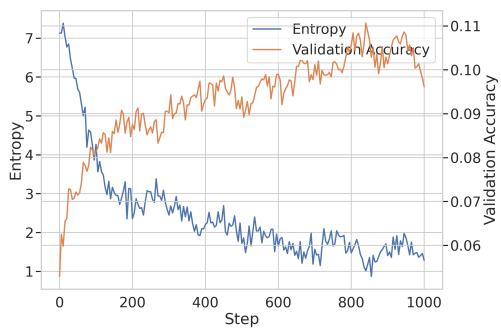
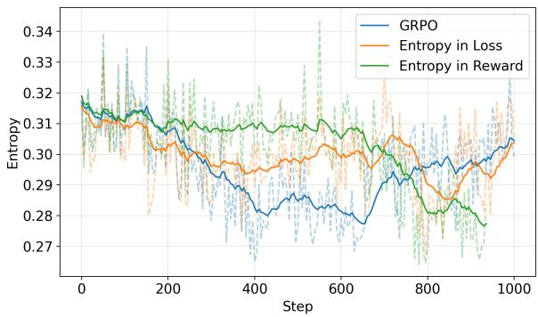
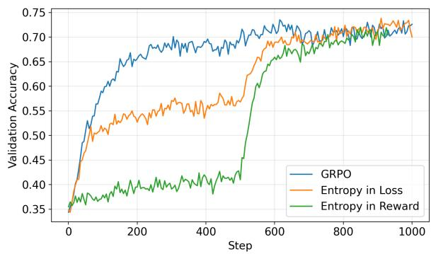
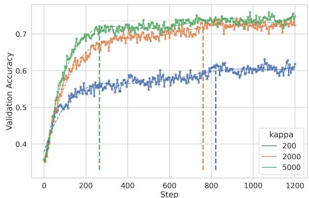
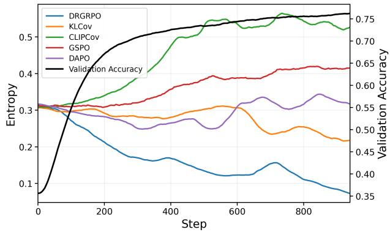
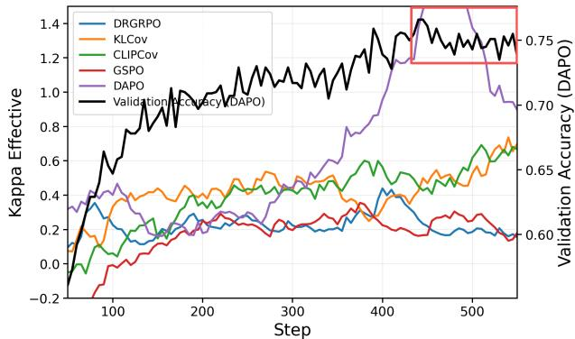
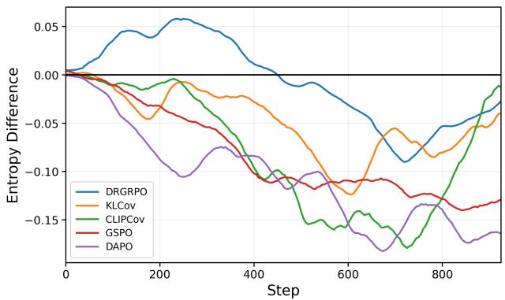
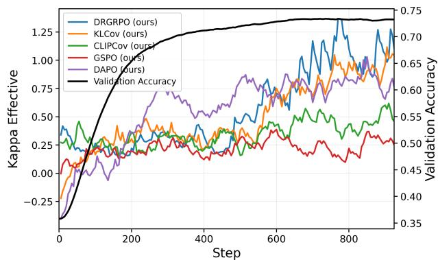
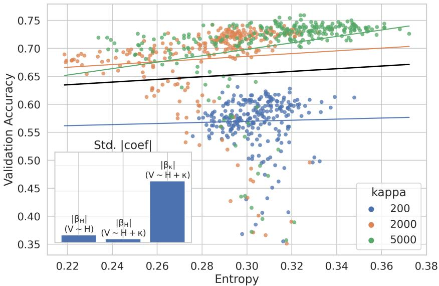

# Reward Budgeting Reduces Premature Convergence in Reinforcement Learning for LLM Reasoning

Mengni Jia<sup>2</sup>, Mengyu Zhou<sup>†1</sup>, Xiaoxi Jiang<sup>1</sup> and Guanjun Jiang<sup>1</sup> <sup>1</sup>Qwen Business Unit, Alibaba, <sup>2</sup>University of Cambridge

RL for LLM reasoning often reaches an early performance plateau as the policy distribution becomes increasingly sharp. Recent work has studied policy entropy as both a diagnostic and a control signal for this behavior. In our experiments, however, increasing entropy alone does not reliably change the eventual plateau. We analyze RL through its implicit target policy and derive a sharpness factor �, together with an efective counterpart $\kappa _ { \mathrm { e f f : } }$ , that describes how strongly reward or advantage gaps are translated into probability-ratio gaps. Motivated by this view, we introduce reward budgeting, a plug-in advantage construction that assigns a fixed total reward budget to each prompt. For binary rewards and independent on-policy rollouts, its unclipped score-function estimator follows the gradient of an exact finite-� concave objective with diminishing returns, while its advantage gap decreases as more rollouts become correct. For general rewards, a shifted log-mean interpretation holds asymptotically under the stated regularity conditions. These results motivate, rather than establish exact objective equivalence for, the clipped implementations. On Qwen3-8B and Llama3.2-3B-Instruct, reward budgeting consistently improves a range of RL baselines, with gains up to +12.50 on AMC23 and +10.00 on AIME24 and AIME25. Overall, our results support an update-dynamics view of premature convergence and show that strong gains can be obtained without explicitly preserving entropy.

## 1. Introduction

Policies trained with RL for LLM reasoning often improve rapidly at first and then enter a plateau where further training brings little gain. Such a plateau need not reflect an intrinsic limit of the model or data: optimization choices can change the performance reached under otherwise similar training conditions. For example, [12] report that, in their scaling study, GSPO [35] and CISPO [18] reach higher fitted asymptotic performance than DAPO [31]. This motivates us to distinguish natural convergence from algorithm-induced premature convergence: training may stop making useful progress, even when a diferent algorithm can reach a better solution.

This phenomenon has been commonly referred to as “entropy collapse”. This name arises from the observation that the policy seems to stop learning and converge prematurely once its entropy drops to a relatively low level [3]; see Figure 1. Consequently, many proposed remedies focus on explicit entropy control, typically by encouraging higher entropy or keeping it within a prescribed range [3, 26, 2, 24, 10, 4, 7, 32, 25, 19, 28, 20, 5, 13, 33, 31, 22, 30, 32, 15, 11]; see 2 for a discussion. These studies provide substantial evidence that entropy is related to RL training dynamics. Here, we ask a narrower question: is changing entropy itself suficient to change the eventual performance plateau?

  
Figure 1 | Average training entropy and validation accuracy across 12 runs for Llama3.2-3B-Instruct. accuracy across 12 runs for Llama3.2-3B-Instruct.

Our results suggest caution. First, the familiar entropy– accuracy pattern is often observed after averaging across runs, while individual methods have diferent entropy trajectories (§3.3). Second, in the intervention study of §3.1, two diferent entropy-promoting interventions substantially change entropy during early training, yet the trajectories return toward the same baseline behavior after the interventions are removed and do not reach a better final plateau. This does not imply that entropybased methods cannot be efective: such methods may alter optimization in useful ways beyond simply raising entropy. It does suggest that, in our setting, entropy promotion alone is not a suficient intervention for premature convergence.

Conceptually, entropy measures how dispersed the policy distribution is, but it does not indicate whether the resulting responses are correct or whether their diversity is useful. A high-entropy policy can produce diverse but unproductive outputs, while a low-entropy policy can be confidently correct. We therefore view entropy as an informative diagnostic of policy concentration rather than, by itself, an explanation of why training plateaus. For this reason, we use the term premature convergence rather than entropy collapse throughout the paper.

Once we question whether entropy is the primary cause behind the plateau, a natural question follows: if we do not control entropy directly, how can we sustain meaningful learning signals so that training can continue to realize incremental gains? In fact, reduced entropy (and the resulting sharper policy distribution) is expected, since it indicates that the policy is learning and becoming more confident on the training data. We just wish to avoid improper sharpening that locks the policy into cheap pseudo-modes and leaves little room for further gains. This matters because RL is inherently mode-seeking, and once a policy collapses onto a narrow set of modes, it becomes empirically dificult to re-expand it [14]. However, simply delaying convergence does not guarantee stronger performance: gentler dynamics can slow training and require more data for suficient learning. What we need is a mechanism that maintains gentler training dynamics to prevent premature sharpening, while adaptively relaxing control when genuine learning signals appear.

To describe the training dynamics more directly, we analyze RL through its implicit target policy in §3. For KL-regularized RL, the optimal target takes the reward-weighted form $\pi ^ { * } ( \gamma ) \propto \pi _ { \mathrm { r e f } } ( \gamma ) \exp ( R ( \gamma ) / \beta )$ . This view isolates a sharpness factor �, which determines how strongly reward gaps are amplified into probability-ratio gaps between higher- and lower-reward responses. We further define an efective version, $\kappa _ { \mathrm { e f f } }$ , for practical algorithms with normalized advantages, clipping, and other implicit constraints. In this sense, � and $\kappa _ { \mathrm { e f f } }$ describe the sharpening pressure induced by the update itself, rather than the resulting uncertainty of the policy.

Motivated by this, we introduce reward budgeting. For each prompt, we allocate a fixed total reward budget across sampled rollouts according to their positive reward gaps. In the binary-reward setting, if � out of � rollouts are correct, each correct rollout receives a reward share proportional to 1/�. As a result, the advantage gap decreases as a prompt becomes easier, producing stronger sharpening when successes are rare and gentler sharpening when successes are already common. Importantly, this behavior emerges without explicitly constraining policy entropy. We also discuss reference-free optimization in §4.2: removing a fixed KL reference avoids permanently anchoring the target policy to a static prior, while importance-ratio clipping can still provide local regularization.

Theoretically, reward budgeting admits a principled interpretation rather than a heuristic tweak. First, it regulates the � trajectory, distinguishing it from most existing methods. As more rollouts become correct, each correct rollout receives a smaller share of the reward, which implicitly reduces the sharpness factor � and automatically relaxes the sharpening pressure. Second, under binary rewards, which match our main RLVR experiments, the expected update of the proposed estimator is exactly the gradient of a finite-� concave objective with diminishing returns (§A.3). Thus, repeatedly solving an already-easy prompt contributes progressively less marginal benefit than under a linear expected-reward objective. Under general rewards, the gap-normalized estimator admits a shifted log-mean interpretation in the large-� limit under suitable support assumptions (§A.4).

Empirically, our method substantially improves on Qwen3-8B and Llama3.2-3B-Instruct across various RL baselines (up to +12.50 on AMC 23 and +10.00 on AIME24 & AIME25). The gains do not require higher entropy; after applying reward budgeting, entropy often decreases while final performance improves. Collectively, these results suggest that regulating algorithm-induced sharpening is a practical way to mitigate premature convergence, while entropy remains a useful diagnostic rather than a necessary quantity to preserve.

## 2. Related Work

Premature convergence in RL for LLM reasoning is often accompanied by a rapid decline in policy entropy. Recent studies have examined this behavior from diferent perspectives, including entropy dynamics, token selection, reward shaping, and regularization. While these approaches share an interest in improving exploration, they difer in how entropy enters the policy update.

Entropy Dynamics and Token-Level Interventions. [3] establish an empirical relationship between policy entropy and validation performance, and analyze entropy changes through the covariance between action log-probabilities and policy updates. Their analysis motivates Clip-Cov and KL-Cov, which selectively constrain high-covariance token updates to slow entropy reduction. From another perspective, [26] find that a small fraction of high-entropy tokens act as important forks in reasoning. They show that restricting policy-gradient updates to these tokens can match or outperform full-token training. Both works highlight the importance of where and how policy updates are applied. However, they focus on diferent signals: covariance characterizes contributions to entropy change, while token entropy identifies uncertain decision points. Our analysis instead examines how the RL objective and advantage construction determine the sharpening pressure of policy updates.

Entropy-Guided Credit Assignment. Other studies use entropy to improve the learning signal rather than directly regularizing the policy distribution. [2] associate high-entropy regions with exploratory reasoning behaviors, such as reflection and correction. They add a clipped, gradient-detached entropy term to token advantages, encouraging such behaviors without directly optimizing an entropy bonus. Similarly, [24] propose GTPO and GRPO-S to address coarse-grained credit assignment in GRPO. Their methods use entropy to assign greater rewards to uncertain decisions in successful responses and stronger penalties to confident errors, at the token and sequence levels, respectively. These approaches show that entropy can help identify where learning signals may be more useful. Our method also modifies reward allocation, but uses the relative rewards of rollouts within each prompt rather than their entropy. The goal is to adjust how strongly each prompt contributes to learning as its sampled success rate changes.

Selective Entropy Regularization. Direct entropy regularization provides another way to encourage exploration, but increasing entropy indiscriminately can also destabilize training. [10] study this issue and propose SIREN, which combines top-� action masking, high-entropy token selection, and a self-anchored regularizer. Rather than simply maximizing entropy, SIREN maintains a more controlled level of uncertainty over selected actions and positions. This distinction is important: the efectiveness of entropy-based methods can depend on which parts of the policy are regularized and how the updates are constrained, not only on the resulting entropy level.

Group-Relative Optimization and Reward Allocation. Our work is also related to the design of group-based RL objectives. GRPO [21] estimates advantages from relative rewards within each prompt group. Dr. GRPO [16] shows that group standard-deviation normalization can introduce dificulty-dependent weighting, and removes this normalization along with response-length normalization. DAPO [31] improves training through several changes, including dynamic sampling that excludes groups with uniformly correct or incorrect rollouts. These methods improve advantage estimation or group selection. In contrast, reward budgeting changes how rewards are allocated within each group. Instead of assigning each successful rollout an independent unit reward, it distributes a fixed budget across the group according to reward gaps. Under binary rewards, this makes the advantage gap decrease as the number of correct rollouts increases.

Relation to Our Work. The above studies show that entropy can be useful for understanding and improving RL, but its role depends on how it is used. We examine a related question: whether increasing entropy itself is suficient to change the final performance plateau. Our intervention experiments suggest that this is not reliable in the settings we study. We therefore focus on the sharpening pressure induced by policy updates, characterized by � and its efective counterpart $\kappa _ { \mathrm { e f f } }$ . Reward budgeting provides a simple way to adjust this pressure through advantage construction, without explicitly controlling entropy. Moreover, under binary rewards, its expected policy-gradient update corresponds to a finite-� concave objective with diminishing returns. Our results suggest that prompt-level reward allocation is another useful way to address premature convergence, alongside existing entropy-guided approaches.

## 3. Sharpness Analysis

Premature convergence is common in RL training, but its underlying dynamics remain unclear. In this section, we examine policy sharpening as a more direct description of RL updates than entropy alone. In §3.1, we show that increasing entropy alone does not reliably improve the final performance plateau in our settings. In §3.2, we derive a sharpness factor � from the RL objective, which characterizes how reward gaps are exponentially amplified in the implicit target policy. Finally, controlled experiments in §3.2.1 and individual-run analyses in §3.3 show how sharpening strength relates to convergence dynamics, while averaging can obscure inconsistencies in the entropy–accuracy relationship.

## 3.1. Entropy

Due to the observation that policies often plateau as their entropy drops, many remedies propose to control entropy. However, this correlation does not establish that entropy reduction causes the plateau. Before taking any action, we must first ask: is entropy truly the cause, or more like a correlate? This question is highly important, because treating the correlational signal as causal can lead to inefective interventions. Entropy may instead serve as a useful diagnostic of convergence dynamics, without being a suficient target for intervention. We test this hypothesis as follows.

Let $H ( \pi _ { \theta } )$ denote entropy on training data. We train Qwen3-8B in three runs that difer only by an early entropy-based intervention. For the first 500 steps, we use (1) Baseline: GRPO [21]. (2) Add Entropy to Loss: $J _ { \mathrm { R L } } ( \theta ) + 0 . 0 1 H ( \pi _ { \theta } )$ , and (3) Add Entropy to Reward: $R ( o ) + 0 . 0 1 H ( \pi _ { \theta } ( o ) )$ . After 500 steps, all runs revert to the baseline and train for another 500 steps.

If early entropy promotion is suficient to overcome premature convergence, the interventions should lead to higher post-intervention plateaus. Otherwise, the runs may return to similar performance once the interventions are removed.

  
(a) Entropy over training steps.

  
(b) Validation accuracy over training steps.  
Figure 2 | Entropy-intervention test: each method uses its own setting for the first 500 steps and then switches back to the same baseline for steps 500–1000.

From Figure 2a, both interventions increase entropy, yet neither improves final performance. Figure 2b shows no post-intervention after-efect: the trajectories return toward the baseline once the interventions are removed, with early intervention-runs even lagging behind initially. These interventions act through diferent mechanisms and increase entropy by diferent amounts, yet neither produces a lasting performance gain. This suggests that entropy is a useful diagnostic correlate of convergence dynamics, but increasing it alone is not suficient to improve the final plateau in our settings. This does not rule out a causal role for entropy in other interventions.

<table><tr><td>Entropy View</td><td>Supported?</td><td>What it suggests</td></tr><tr><td>A Sufficient Causal Lever</td><td>X</td><td>The tested early entropy interventions did not improve the final observed plateau.</td></tr><tr><td>A Diagnostic Correlate</td><td>L</td><td>Entropy can indicate over-converging dynamics.</td></tr></table>

## 3.2. Sharpness Factor

Consider the RL objective

$$
J _ { \mathrm { R L } } ( \theta ) = \mathbb { E } \big [ R ( \gamma ) \big ] - \beta D _ { \mathrm { K L } } \big ( \pi _ { \theta } \| \pi _ { \mathrm { r e f } } \big ) ,
$$

where $\pi _ { \mathrm { r e f } }$ is the reference policy, $R ( \gamma )$ is the reward of a trajectory $\gamma ,$ and $\beta > 0$ penalizes deviation from $\pi _ { \mathrm { r e f } } $ Prior works often explain premature convergence by analyzing its local gradients. Here, we take a global view: this objective is equivalent to minimizing the reverse KL between $\pi _ { \theta }$ and the target policy $\pi ^ { * } \left( \ S \& \ 6 \right)$

$$
\pi ^ { * } ( \gamma ) \propto \pi _ { \mathrm { r e f } } ( \gamma ) \exp ( R ( \gamma ) / \beta ) ,\tag{1}
$$

This view makes the efect of $\mathrm { R I }$ transparent: it pushes $\pi _ { \theta }$ toward a reward-weighted version of $\pi _ { \mathrm { r e f } }$ . On a finite response space, as $\beta \to 0 ^ { + }$ , this target concentrates on reward-maximizing responses within the support of $\pi _ { \mathrm { r e f } }$ . The limit is deterministic only when the supported maximizer is unique; with ties, it retains the reference policy’s relative weights among the maximizers.

Consider two responses $o ^ { + }$ and $o ^ { - }$ to a prompt � that receive a higher reward $r ^ { + }$ and a lower one � $r ^ { - }$ respectively. From Eq 1, the relative probability that $\pi ^ { * }$ assigns to $o ^ { + }$ over $o ^ { - }$ is exponentially controlled by the (principled) sharpness factor �:

$$
\frac { \pi ^ { * } ( o ^ { + } \mid p ) } { \pi ^ { * } ( o ^ { - } \mid p ) } = \frac { \pi _ { \mathrm { r e f } } ( o ^ { + } \mid p ) } { \pi _ { \mathrm { r e f } } ( o ^ { - } \mid p ) } \exp \biggl ( \frac { r ^ { + } - r ^ { - } } { \beta } \biggr ) , \qquad \left| \kappa : = \frac { r ^ { + } - r ^ { - } } { \beta } , \right.\tag{2}
$$

For $\beta > 0 , \iota$ � controls the multiplicative amplification of higher- versus lower-reward response odds relative to the reference policy. For example, $\beta = 0 . 0 0 1 , r ^ { + } = 1$ , and $r ^ { - } = 0$ give $\kappa = 1 0 0 0 \mathrm { ; }$ , so the target odds are the reference odds multiplied by $e ^ { 1 0 \bar { 0 } 0 } \approx 1 . 9 7 \times 1 0 ^ { 4 3 4 }$ . This characterizes the idealized target, rather than the speed with which a parameterized optimizer reaches it. Strong concentration can reduce probability assigned to lower-reward responses, some of which may contain useful reasoning segments.

The target-policy calculation above describes a KL-regularized objective. Practical algorithms also use normalized advantages and importance-ratio clipping, so their realized updates need not equal that idealized target. For a chosen higher- and lower-advantage response pair, we define an operational efective sharpness factor as the change in log odds:

$$
\boxed { \kappa _ { \mathrm { e f f } } ( s ; a ^ { + } , a ^ { - } ) : = \log \frac { \pi _ { \mathrm { n e w } } ( a ^ { + } \mid s ) } { \pi _ { \mathrm { n e w } } ( a ^ { - } \mid s ) } - \log \frac { \rho ( a ^ { + } \mid s ) } { \rho ( a ^ { - } \mid s ) } . }\tag{3}
$$

Here $\rho$ is the policy before the update, and all four probabilities must be positive. In the reported measurements, each response is a full sequence: after updating a batch, we recompute log-probabilities for the same sampled responses and sum token log-probability changes relative to their stored rollout policy. For each prompt, we select one maximum-advantage and one minimum-advantage response and subtract their sequence logprobability changes. We skip groups with fewer than two responses or a nonpositive advantage gap, and report the mean across valid prompts. For an idealized KL mirror step with temperature $\tau > 0$ , this statistic equals $\Delta \tilde { A } ( s ) / \tau$ (Appendix A.1). For a general update, $\tau _ { \mathrm { e f f } } : = \Delta \tilde { A } ( s ) / \kappa _ { \mathrm { e f f } }$ is only a pair-specific diagnostic when the denominator is nonzero; it need not be positive. PPO-style surrogate clipping alone does not establish an exact positive-temperature projection or a hard bound on this statistic.

Intuitively, $\kappa _ { \mathrm { e f f } }$ measures how aggressively RL turns advantage gaps into log-odds gaps after a single update. Hence a larger $\kappa _ { \mathrm { e f f } }$ implies more sharpening pressure on $\pi _ { \theta }$ . Loosely speaking, although larger � often indicates a more converging model that may give better performance, an ideal training trajectory should have large � mainly for genuine learning signals, and preserve room for lower-reward ones that may still contain useful segments to support better overall convergence.

Later, in §4.1, we compare how diferent advantage constructions shape � and examine their implications for training dynamics. This motivates reward budgeting, which regulates sharpening pressure through reward allocation rather than explicit entropy control.

Generally speaking, entropy, � and $\kappa _ { \mathrm { e f f } }$ difer in granularity and the use of response-quality signals. Entropy measures stepwise output randomness on training data and does not indicate response quality. � includes $r ^ { + , - }$ to distinguish good and bad responses, but it is a global metric shared across all steps. $\kappa _ { \mathrm { e f f } }$ extends � to the step level, preserving quality distinction while providing finer discrimination.

## 3.2.1. Sharpness Factor Controlled Studies

Compared with the tested entropy interventions in §3.1, changes to reward scale and KL strength produce clearer diferences in finite-horizon training trajectories. We summarize these configurations through � below; the comparison does not isolate it as a unique causal mediator or determine an asymptotic endpoint.

Specifically, we train Qwen3-8B [29] on DAPO-Math-17K [31] with DRGRPO [16], under three configurations: $( r ^ { + } - r ^ { - } , \beta ) = ( 5 , 0 . 0 0 1 ) , ( 2 , 0 . 0 0 1 )$ , and $( 1 , 0 . 0 0 5 )$ , yielding decreasing sharpening pressures of $\kappa = 5 0 0 0$ , 2000, 200. To simplify the analysis, we use � instead of $\kappa _ { \mathrm { e f f } } .$ , since the two serve as proxies for each other. We vary only � and the related quantities $r ^ { + } , r ^ { - }$ , and $\beta ,$ , while keeping other hyper-parameters fixed.

For each configuration, we define $t _ { \mathrm { { c o n v } } }$ as the first point where performance plateaus (§B.3). We visualize $t _ { \mathrm { { c o n v } } }$ by vertical lines. In Figure 3, larger � indeed exhibits markedly earlier $t _ { \mathrm { { c o n v } ; } }$ , but smaller � also yields lower final performance. This aligns with $\ S 3 . 2 ,$ where � (and $\kappa _ { \mathrm { e f f } } )$ are derived from sharpening pressure. Making � globally small can slow learning substantially without guaranteeing higher final accuracy; see more discussion in §4.1.

  
Figure 3 | Validation accuracy as training progresses. The three vertical dashed lines mark the convergence step �<sub>conv</sub>. Overall, smaller � results in later convergence but also slows training.

Under the same set-up, we provide a complementary conditional association analysis in $\mathrm { C } ,$ showing that entropy is much less predictive of future accuracy once variation in � is controlled for.

## 3.3. The Averaging Efect

When plotting entropy and accuracy, “entropy collapse” appears striking: accuracy plateaus as entropy drops. However, this observation is usually based on heavily averaged curves, such as 11 runs in [3] and 12 runs in our Figure 1. Although averaging reduces noise, it also introduces a subtle statistical risk: by smoothing away run-level heterogeneity, it can make weak or inconsistent trends appear visually robust. Therefore, averaged plots and individual runs can show markedly diferent trends. This distinction is particularly important for causal interpretation. The relationship between a strongly tied metric and accuracy should remain visible within individual runs, not only after averaging.

  
(a) Entropy over training steps.

  
(b) $\kappa _ { \mathrm { e f f } }$ over training steps.  
Figure 4 | Training dynamics for DRGRPO, KLCov, CLIPCov, GSPO, and DAPO. The left axes show entropy in (a) and $\kappa _ { \mathrm { e f f } }$ (b); the right axes show averaged validation accuracy in (a) and DAPO validation accuracy in (b).

Figure 4 shows method-specific diagnostic trajectories, with averaged validation accuracy in panel (a) and DAPO validation accuracy in panel (b). The diagnostic trajectories difer substantially across methods. These plots provide descriptive comparisons and do not establish a general within-run relationship or a causal connection between entropy, efective sharpness, and accuracy.

## 4. Method

We propose a plug-and-play advantage construction method, reward budgeting, to regulate RL training dynamics. Despite its simplicity, reward budgeting has a principled theoretical efect. First, for binary rewards and independent on-policy rollouts, its unclipped score-function estimator follows the gradient of a concave finite-group objective. After subtracting a parameter-independent constant, this objective approaches the logarithm of success probability as $G \to \infty$ . Second, it yields a � trajectory that is diferent from most existing RL methods which may better allocate training focus. Its empirical gains are further verified in §5.

Reward budgeting changes how advantages are constructed and can be used with a fixed-reference KL penalty. Section 4.2 discusses the reference-free variant, which we evaluate separately in the Qwen3-8B GRPO ablation.

## 4.1. Fixed Per-Prompt Reward Budgets

Algorithm 1 Advantage Construction in Fixed Per-Prompt Reward Budgets   
1. Initialize the policy $\pi _ { \theta }$ and set the reference policy $\pi _ { \mathrm { r e f } }  \pi _ { \theta } ;$ initialize training data $\mathcal { D }$ and the number of rollouts   
per prompt �.   
2. For each training step $t = 1 , 2 , \ldots$   
(a) Sample � prompts $\{ p _ { i } \} _ { i = 1 } ^ { B }$ from $\mathcal { D } .$   
(b) Generate � rollouts $\{ o _ { i } ^ { ( j ) } \} _ { j = 1 } ^ { G } \sim \pi _ { \theta }$ for each $p _ { i } .$   
(c) Assign raw rewards $r _ { i } ^ { ( j ) }$ to each $o _ { i } ^ { ( j ) }$   
(d) Compute per-prompt minimum �<sup>−</sup> := min $\mathbf { \varepsilon } _ { 1 \leq j \leq G } r _ { i } ^ { ( j ) }$   
(e) Subtract the minimum $g _ { i } ^ { ( j ) } : = r _ { i } ^ { ( j ) } - r _ { i } ^ { - }$   
(f) If a prompt $p _ { i }$ has $g _ { i } ^ { ( j ) } = \stackrel { \cdot } { 0 }$ for all $j \in \{ 1 , \ldots , G \}$ , skip the prompt; otherwise:   
i. Redesign rewards $R _ { i } ^ { ( j ) } : = g _ { i } ^ { ( j ) } / \sum _ { k = 1 } ^ { G } g _ { i } ^ { ( k ) }$   
ii. Compute $\begin{array} { r } { A _ { i } ^ { ( j ) } : = R _ { i } ^ { ( j ) } - \frac { 1 } { G } \dot { \sum _ { j } } R _ { i } ^ { ( j ) } } \end{array}$

Reward budgeting constructs advantages as follows: for each prompt $p ,$ let $\pi _ { \theta }$ sample � rollouts $\{ o _ { i } \} _ { i = 1 } ^ { G }$ with raw rewards $\{ r _ { i } \} _ { i = 1 } ^ { G }$ . It first removes a per-group minimum $r ^ { - } : = \operatorname* { m i n } _ { i } r _ { i }$ and keeps only the positive $ { \mathrm { } ^ { \mathfrak { a } } }  { \mathrm { p s } ^ { \mathfrak { n } } } g _ { i } : = r _ { i } - r ^ { - }$ . If all $\dot { g } _ { i } = 0$ , it skips the update. Otherwise it redistributes a unit total reward across the rollouts, proportional to their gaps: $R ( o _ { i } ) : = g _ { i } / \sum _ { j = 1 } ^ { G } g _ { j }$ so that $\begin{array} { r } { \sum _ { i } R ( o _ { i } ) = 1 } \end{array}$ . Finally, it defines the advantage as $\begin{array} { r } { A _ { i } : = R ( o _ { i } ) - \frac { 1 } { G } \sum _ { i } R ( o _ { i } ) } \end{array}$ to center the normalized rewards within the group; see Algorithm 1. The objective analysis below retains this centering and the group-skipping rule.

Global Optimization Objectives. To interpret fixed reward budgets, we first compare their idealized scorefunction update with the standard expected-reward policy gradient [23], whose objective is

$$
J _ { \mathrm { l i n } } = \mathbb { E } _ { p } \mathbb { E } _ { y \sim \pi _ { \theta } ( \cdot | p ) } \left[ R ( y ) \right] .
$$

For binary rewards, a sampled group of � rollouts has total raw reward � when � rollouts are correct. Reward budgeting instead assigns a fixed total redistributed reward of 1 to each mixed group. All-correct and allincorrect groups are skipped because their reward gaps are zero. Thus additional correct rollouts within a mixed group share the same budget; the exact calculation below shows how this produces diminishing returns as success probability increases.

For binary rewards and independent on-policy rollouts, let �<sub>correct</sub> $: = p _ { \theta }$ (correct $\mid p )$ . Appendix A.3 shows that the expected centered score-function estimator of Algorithm 1, before clipping and other implementationspecific modifications, is the gradient of

$$
J _ { G - 1 } = \mathbb { E } _ { p \sim \mathcal { D } } \left[ f _ { G - 1 } ( p _ { \mathrm { c o r r e c t } } ) \right] , \quad f _ { G - 1 } ( x ) = \sum _ { m = 1 } ^ { G - 1 } \frac { 1 - ( 1 - x ) ^ { m } } { m } .\tag{4}
$$

This objective is approximately linear up to scale near zero and gives diminishing returns as success probability grows. The result is exact for this estimator at $G = 8 ;$ only its logarithmic limit requires large �.

For general rewards, Appendix A.5 gives suficient conditions under which the actual gap-normalized estimator has the limiting expected direction associated with

$$
J _ { \mathrm { g a p } } = \mathbb { E } _ { p \sim \mathcal { D } } \left[ \log \left( \mathbb { E } _ { y \sim \pi _ { \theta } } [ R ( y ) ~ | ~ p ] - a ( p ) \right) \right] ,\tag{5}
$$

where $a ( p )$ is the finite, locally policy-independent essential infimum of the reward distribution. This is an asymptotic interpretation, not an exact finite-� objective for arbitrary graded rewards.

The $O ( 1 / G )$ mean-squared error and variance bounds in Appendix A.4 concern a separate idealized, nonshifted estimator under stronger assumptions; the resulting bias bound is $O ( G ^ { - 1 / 2 } )$ . They neither establish a rate for the actual gap-normalized estimator nor guarantee approximation accuracy at $G = 8$ . Clipping, importance weighting, and token-level optimization further limit equivalence to the evaluated implementations.

Sharpness Factor. Although reward budgeting applies only a fixed per-prompt reward re-allocation, it turns out to implicitly regulate � in a way that difers from existing RL methods. Specifically, we consider three representative forms of advantage construction:

• DRGRPO uses $A = r - \bar { r } , \mathrm { g i v i n g } \kappa _ { \mathrm { D R } } = 1 / \beta ;$

• GRPO, GSPO, DAPO, ClipCov and KLCov use $\begin{array} { r } { A = ( r - \bar { r } ) / \sigma , \mathrm { g i v i n g } \kappa _ { \mathrm { G R P O } } = \frac { 1 } { \beta \sigma } ; } \end{array}$

• Reward budgeting gives $\begin{array} { r } { \kappa _ { R B } = \frac { 1 } { \beta k } } \end{array}$

These � values show how diferent methods pose sharpening pressure. First, DRGRPO applies uniform sharpening pressure, which is stable but may risk under-convergence. Second, GRPO-style advantages maximize � at extreme $k \in \{ 1 , G - 1 \}$ , so the strongest sharpening occurs when a batch is almost all correct or almost all incorrect. While this can speed convergence, when a batch is almost all correct, such sharpening is less necessary, because the model is already near perfect. Finally, reward budgeting gives $\begin{array} { r } { \kappa = \frac { 1 } { k \beta } } \end{array}$ , assigning stronger sharpening to harder prompts. Thus, “easy” prompts do not keep generating increasingly sharp updates, reducing the incentive to overfit to cheaply repeatable templates.

Table 1 | Correct/incorrect samples’ advantages in 2 decimal places across diferent constructions: Reward Budget, DrGRPO and GRPO (most RL methods fall into this type). � is the group size and � is the number of correct rollouts.
<table><tr><td rowspan="2"> $k / G$ </td><td colspan="3">Reward Budget</td><td colspan="3">DrGRPO</td><td colspan="3">GRPO (Most)</td></tr><tr><td>+</td><td>一</td><td>K</td><td>+</td><td>一</td><td>K</td><td>+</td><td>一</td><td>K</td></tr><tr><td>1/8</td><td>0.88</td><td>3-0.13</td><td>1000</td><td></td><td>0.88-0.13</td><td>1000</td><td>2.65</td><td>-0.383024</td><td></td></tr><tr><td>2/8</td><td>0.38-0.13</td><td></td><td>500</td><td></td><td>0.75-0.25</td><td>1000</td><td>1.73</td><td>3 -0.58 2309</td><td></td></tr><tr><td>3/8</td><td>0.21-0.13</td><td></td><td>333</td><td></td><td>0.63-0.38</td><td>1000</td><td></td><td>1.29-0.78 2066</td><td></td></tr><tr><td>4/8</td><td>0.13-0.13</td><td></td><td>250</td><td></td><td></td><td></td><td></td><td>0.50-0.5010001.00-1.002000</td><td></td></tr><tr><td>5/8</td><td>0.08-0.13</td><td></td><td>200</td><td></td><td>0.38-0.63</td><td></td><td></td><td>31000 0.78 -1.29 2066</td><td></td></tr><tr><td>6/8</td><td>0.04-0.13</td><td></td><td>167</td><td></td><td>0.25-0.75</td><td></td><td>10000.58</td><td>3-1.73</td><td>2309</td></tr><tr><td>7/8</td><td>0.02-0.13</td><td></td><td>143</td><td></td><td>0.13-0.88</td><td></td><td></td><td>1000 0.38-2.65 3024</td><td></td></tr><tr><td>κ form</td><td></td><td>1/βk</td><td></td><td></td><td>1/β</td><td></td><td></td><td>1/βσ</td><td></td></tr></table>

This sharpness view complements the scoped objective analysis: reward budgeting adjusts the advantage gaps governing idealized sharpening. This provides a mechanism consistent with the observed gains, while the diagnostics do not isolate the causal contribution of each implementation component.

Stepwise KL. Fixed reward budgeting also permits a local surrogate interpretation. For a fixed non-constant sampled group and detached budget weights, consider

$$
\nabla _ { \theta } \sum _ { i = 1 } ^ { G } R ( o _ { i } ) \log \pi _ { \theta } ( o _ { i } \mid p ) .
$$

The nonnegative weights sum to one and define an empirical target distribution, combining weights for duplicate responses. Maximizing this fixed-sample weighted log-likelihood minimizes the KL divergence from that empirical target to the policy, up to a constant. This interpretation concerns only the uncentered weighted term; it omits group-relative centering and clipping and is not an exact scalar objective for the full implemented update.

## 4.2. The Prior Never Fades

Usually $\pi _ { \mathrm { r e f } }$ is introduced to promote stability by penalizing the current policy for drifting too far, but it in fact plays a deeper role: $\begin{array} { r } { \pi ^ { * } \propto \pi _ { \mathrm { r e f } } \exp ( \frac { 1 } { \beta } A ) } \end{array}$ permanently depends on $\pi _ { \mathrm { r e f } } ,$ so $\pi _ { \mathrm { r e f } }$ shapes what the policy is trained to approximate, and its impact never vanishes no matter how long we train.

Table 2 | Benchmark scores (%) from eight responses per prompt at temperature 0.7. Qwen3-8B uses mean accuracy across responses and Llama3.2-3B-Instruct uses pass@8. Shaded rows give the change in percentage points after adding reward budgeting (RB) to each baseline. GRPO retains its reference-policy KL penalty in this comparison.
<table><tr><td>Method</td><td>AMC23</td><td>AIME24</td><td>AIME25</td><td>MATH500</td><td>Olympiad (Physics)</td><td>Average</td></tr><tr><td colspan="7">Qwen3-8B</td></tr><tr><td>GRPO</td><td>82.50</td><td>26.67</td><td>43.33</td><td>95.60</td><td>51.27</td><td>59.87</td></tr><tr><td>+ RB</td><td>+10.00</td><td>+10.00</td><td>+10.00</td><td>+1.20</td><td>+2.12</td><td>+6.66</td></tr><tr><td>DrGRPO</td><td>82.50</td><td>30.00</td><td>43.33</td><td>97.20</td><td>47.46</td><td>60.10</td></tr><tr><td>+ RB</td><td>+5.00</td><td>+6.67</td><td>+3.33</td><td>-0.20</td><td>+1.27</td><td>+3.21</td></tr><tr><td>GSPO</td><td>90.00</td><td>26.67</td><td>36.67</td><td>96.80</td><td>47.04</td><td>59.44</td></tr><tr><td>+ RB</td><td>+5.00</td><td>+6.67</td><td>+6.67</td><td>+1.00</td><td>+1.69</td><td>+4.21</td></tr><tr><td>DAPO</td><td>87.50</td><td>36.67</td><td>40.00</td><td>96.40</td><td>49.15</td><td>61.94</td></tr><tr><td>+ RB</td><td>+7.50</td><td>+6.67</td><td>+6.67</td><td>+1.60</td><td>+0.85</td><td>+4.66</td></tr><tr><td>ClipCov</td><td>85.00</td><td>26.67</td><td>33.33</td><td>96.60</td><td>48.31</td><td>57.98</td></tr><tr><td>+ RB</td><td>+2.50</td><td>+10.00</td><td>+6.67</td><td>+1.40</td><td>+1.27</td><td>+4.37</td></tr><tr><td>KLCov</td><td>82.50</td><td>33.33</td><td>43.33</td><td>96.80</td><td>49.58</td><td>61.11</td></tr><tr><td>+ RB</td><td>+5.00</td><td>+10.00</td><td>+6.67</td><td>+0.80</td><td>+2.12</td><td>+4.92</td></tr><tr><td colspan="7">Llama3.2-3B-Instruct</td></tr><tr><td>GRPO</td><td>7.50</td><td>3.33</td><td>0.00</td><td>67.60</td><td>20.31</td><td>19.75</td></tr><tr><td>+ RB</td><td>+12.50</td><td>+0.00</td><td>+3.33</td><td>+3.20</td><td>+1.53</td><td>+4.11</td></tr><tr><td>DrGRPO</td><td>30.00</td><td>10.00</td><td>0.00</td><td>68.60</td><td>14.94</td><td>24.71</td></tr><tr><td>+ RB</td><td>+12.50</td><td>+6.67</td><td>+6.67</td><td>+2.00</td><td>+1.15</td><td>+5.80</td></tr><tr><td>GSPO</td><td>22.50</td><td>3.33</td><td>0.00</td><td>72.20</td><td>14.83</td><td>22.57</td></tr><tr><td>+ RB</td><td>+7.50</td><td>+3.33</td><td>+3.33</td><td>+5.00</td><td>+1.27</td><td></td></tr><tr><td>DAPO</td><td>17.50</td><td>6.67</td><td>3.33</td><td>70.40</td><td>21.84</td><td>+4.01</td></tr><tr><td></td><td>+7.50</td><td>+3.33</td><td>+0.00</td><td>+2.20</td><td>+1.47</td><td>23.95</td></tr><tr><td>+ RB</td><td></td><td></td><td></td><td></td><td></td><td>+2.90</td></tr><tr><td>ClipCov</td><td>22.50</td><td>10.00</td><td>0.00</td><td>69.80</td><td>13.98</td><td>23.26</td></tr><tr><td>+ RB</td><td>+12.50</td><td>+3.33</td><td>+3.33</td><td>+3.40</td><td>+1.27</td><td>+4.77</td></tr><tr><td>KLCov</td><td>30.00</td><td>10.00</td><td>0.00 +3.33</td><td>71.60</td><td>13.98</td><td>25.12 +4.82</td></tr><tr><td>+ RB</td><td>+10.0</td><td>+6.67</td><td></td><td>+2.40</td><td>+1.69</td><td></td></tr></table>

The reference-free variant removes the KL penalty while retaining importance-ratio clipping. Removing the fixed-reference penalty changes the unconstrained target to reward maximization, whose optima need not be deterministic when rewards tie. Clipping modifies the incentive for large sampled importance-ratio changes around the previous policy; it does not impose a hard global trust region or guarantee a bound on $\kappa _ { \mathrm { e f f } } .$ . The empirical efects of removing KL and adding reward budgeting are distinguished in the ablation study.

## 5. Experiment

## 5.1. Setup

Data. We train on DAPO-Math-17K [31] and evaluate on five benchmarks: AMC23 [1], AIME24 [9], AIME25 [34], MATH500 [8], and OlympiadBench (Physics) [6].

Models. We train (1) Llama3.2-3B-Instruct [17] and (2) Qwen3-8B [29].

Hyper-parameters. We sample eight rollouts per prompt and use 32 prompts per update. We train each method until its validation accuracy reaches a plateau. The benchmark comparisons in Table 2 therefore describe accuracy at the evaluated checkpoints within each model family. During evaluation, we set the maximum response length to 8192 tokens and generate 8 responses per prompt at temperature= 0.7. We report their average accuracy for Qwen3-8B and pass@8 for Llama3.2-3B-Instruct (see detailed settings in §B).

Baselines. We apply our method to six RL methods in two types: (1) Four Representative RL Methods: GRPO [21], DrGRPO [16], GSPO [35], and DAPO [31]; (2) Two Entropy-Based RL Methods: ClipCov and KLCov [3], which are entropy-based variants of DAPO.

## 5.2. Key Insights

More robust gains than entropy control. Table 2 includes two remedies: entropy (ClipCov and KLCov as entropy-based variants of DAPO) and our method. However, within each dataset, results of entropy-control methods are mixed. On average, on Qwen3-8B, DAPO even outperforms its variants (DAPO 61.94 vs. ClipCov 57.98 vs. KLCov 61.11); on Llama3.2-3B, KLCov marginally outperforms DAPO (25.12 vs. 23.95) while ClipCov slightly under-performs (23.26 vs. 23.95). In contrast, our method consistently improves in almost all cases.

Impact of advantage construction on �-dynamics. Apart from reward budgeting, the RL baselines in Table 2 construct advantages in mainly two ways: DRGRPO uses $A = r - { \bar { r } }$ , while others use $A = ( r - \bar { r } ) / \sigma$ (in fact, DAPO and its variants also includes length-based reward, but its magnitude is typically much smaller than �, thus we omit this for simplicity). These diferent advantage constructions then induce diferent �-trajectories (§4.1). Specifically, DRGRPO tends to exhibit slightly lower �, thus gentler sharpening pressure. Comparing DRGRPO to the others, we observe that its performance remains in the top tier. This agrees with our earlier discussion: well-regulated � can deliver better final convergence, though our method continues to improve even in this case.

## 5.3. Training Dynamics

  
(a) Entropy changes after applying our method

  
(b) $\kappa _ { \mathrm { e f f } }$ vs validation accuracy  
Figure 5 | Efect of reward budgeting on Qwen3-8B. (a) Training-entropy diferences relative to each baseline; most trajectories lie below zero. (b) Efective-sharpness trajectories alongside the mean validation accuracy across methods (black curve). These diagnostics describe the observed training dynamics and do not by themselves identify the cause of the accuracy gains.

From Figure 5a, after applying our method, entropy generally decreases, since most curves remain below the black zero line. This indicates that higher entropy is not necessary for improving final performance, and that our method does not achieve its gains by implicitly boosting entropy. Comparing Figures 5b and 4b, our method also regulates the $\kappa _ { \mathrm { e f f } }$ trajectories with noticeably smaller oscillations, which is consistent with our discussion in §4.1. These trajectories accompany accuracy gains without a sustained increase in entropy.

## 5.4. Ablation

The Qwen3-8B GRPO comparison in Table 2 retains the reference-policy KL penalty both with and without reward budgeting. To assess how this penalty afects the result, Table 3 crosses reward budgeting with KL retention or removal.

Table 3 provides a complete ablation. Removing the KL penalty alone changes the average score from 59.87% to 60.27%, with mixed efects across benchmarks. In contrast, reward budgeting improves the average by +6.66 percentage points when KL is retained and by +5.38 percentage points when KL is removed. It also improves every evaluated benchmark under both KL settings. These results indicate that the gains are primarily attributable to reward budgeting, rather than to KL removal.

Table 3 | Qwen3-8B GRPO ablation of the reference-policy KL penalty and reward budgeting (RB). The first two rows give the absolute scores for the GRPO comparison in Table 2.
<table><tr><td>KL</td><td>RB</td><td>AMC23</td><td>AIME24</td><td>AIME25</td><td>MATH500</td><td>Olympiad (Physics)</td><td>Average</td></tr><tr><td>√</td><td>X</td><td>82.50</td><td>26.67</td><td>43.33</td><td>95.60</td><td>51.27</td><td>59.87</td></tr><tr><td>√</td><td>√</td><td>92.50</td><td>36.67</td><td>53.33</td><td>96.80</td><td>53.39</td><td>66.53</td></tr><tr><td>X</td><td>X</td><td>85.00</td><td>30.00</td><td>40.00</td><td>96.00</td><td>50.35</td><td>60.27</td></tr><tr><td>X</td><td>√</td><td>95.00</td><td>36.67</td><td>46.67</td><td>97.00</td><td>52.89</td><td>65.65</td></tr></table>

## 5.5. Limitations

Our experiments concern verifiable reasoning tasks with predominantly binary rewards. The general-reward analysis requires additional assumptions and does not establish performance for noisy, learned, or open-ended reward functions. Each main configuration uses one training seed and a rollout-group size of $G = 8 .$ . We did not conduct a group-size sweep. The eight evaluation responses per prompt characterize decoding variability. The reported scores are point estimates from those training runs. The interventions and regressions describe finite-horizon behavior; they do not establish a unique causal mediator of eventual performance. Training stops when validation accuracy reaches a plateau; numerical plateau thresholds, per-run training lengths, and checkpoint-selection rules for the main benchmark table are not reported. The retrospective convergence-step measure in Appendix B.3 describes the intervention trajectories in Figure 3.

## 6. Conclusion

We study premature convergence in RL and suggest that aggregate entropy may not fully characterize training dynamics. Instead, RL’s implicit target $\pi ^ { * }$ reveals a built-in sharpening pressure, which is captured with the sharpness factor � (and $\kappa _ { \mathrm { e f f } } )$ . Motivated by this, we propose reward-budgeting to improve final performance without explicit entropy control.

## Declaration of LLM Usage

Appendix B identifies Qwen3-235B-Instruct as the mathematical-equivalence judge and provides its system instruction and user-prompt template. LLM tools also assisted with checking mathematical arguments, refining the proof exposition, and editing the manuscript. The authors take responsibility for the correctness and originality of all mathematical arguments, experimental results, text, and references.

Code availability. Code will be released upon approval.

## References

[1] AI-MO Team. AIMO Validation Set – AMC Subset. https://huggingface.co/datasets/AI-MO/ aimo-validation-amc, 2024. Validation set of AMC 2022–2024 problems; we use the AMC 2023 split (AMC23).

[2] Daixuan Cheng, Shaohan Huang, Xuekai Zhu, Bo Dai, Wayne Xin Zhao, Zhenliang Zhang, and Furu Wei. Reasoning with exploration: An entropy perspective, 2025. URL https://arxiv.org/abs/2506. 14758.

[3] Ganqu Cui, Yuchen Zhang, Jiacheng Chen, Lifan Yuan, Zhi Wang, Yuxin Zuo, Haozhan Li, Yuchen Fan, Huayu Chen, Weize Chen, Zhiyuan Liu, Hao Peng, Lei Bai, Wanli Ouyang, Yu Cheng, Bowen Zhou, and Ning Ding. The entropy mechanism of reinforcement learning for reasoning language models, 2025. URL https://arxiv.org/abs/2505.22617.

[4] Yaru Hao, Li Dong, Xun Wu, Shaohan Huang, Zewen Chi, and Furu Wei. On-policy rl with optimal reward baseline, 2025. URL https://arxiv.org/abs/2505.23585.

[5] Zhezheng Hao, Hong Wang, Haoyang Liu, Jian Luo, Jiarui Yu, Hande Dong, Qiang Lin, Can Wang, and Jiawei Chen. Rethinking entropy interventions in RLVR: An entropy change perspective. In Maria Liakata, Viviane P. Moreira, Jiajun Zhang, and David Jurgens, editors, Proceedings of the 64th Annual Meeting of the Associationfor Computational Linguistics (Volume 1: Long Papers), pages 31105–31133, San Diego, California, United States, July 2026. Association for Computational Linguistics. ISBN 979-8-89176-390-6. doi: 10.18653/v1/2026.acl-long.1436. URL https://aclanthology.org/2026.acl-long.1436/.

[6] Chaoqun He, Renjie Luo, Yuzhuo Bai, Shengding Hu, Zhen Thai, Junhao Shen, Jinyi Hu, Xu Han, Yujie Huang, Yuxiang Zhang, Jie Liu, Lei Qi, Zhiyuan Liu, and Maosong Sun. OlympiadBench: A challenging benchmark for promoting AGI with olympiad-level bilingual multimodal scientific problems. In Lun-Wei Ku, Andre Martins, and Vivek Srikumar, editors, Proceedings of the 62nd Annual Meeting of the Association for Computational Linguistics (Volume 1: Long Papers), pages 3828–3850, Bangkok, Thailand, August 2024. Association for Computational Linguistics. doi: 10.18653/v1/2024.acl-long.211. URL https://aclanthology.org/2024.acl-long.211/.

[7] Jujie He, Jiacai Liu, Chris Yuhao Liu, Rui Yan, Chaojie Wang, Peng Cheng, Xiaoyu Zhang, Fuxiang Zhang, Jiacheng Xu, Wei Shen, Siyuan Li, Liang Zeng, Tianwen Wei, Cheng Cheng, Bo An, Yang Liu, and Yahui Zhou. Skywork open reasoner 1 technical report, 2025. URL https://arxiv.org/abs/2505.22312.

[8] Dan Hendrycks, Collin Burns, Saurav Kadavath, Akul Arora, Steven Basart, Eric Tang, Dawn Song, and Jacob Steinhardt. Measuring mathematical problem solving with the math dataset. In J. Vanschoren and S. Yeung, editors, Proceedings of the Neural Information Processing Systems Track on Datasets and Benchmarks, volume 1, 2021. URL https://datasets-benchmarks-proceedings.neurips.cc/paper\_ files/paper/2021/file/be83ab3ecd0db773eb2dc1b0a17836a1-Paper-round2.pdf.

[9] Hugging Face H4. AIME24: AIME 2024 benchmark. https://huggingface.co/datasets/ HuggingFaceH4/aime\_2024, 2024. 30 problems from the 2024 AIME I and II exams.

[10] Yuxian Jiang, Yafu Li, Guanxu Chen, Dongrui Liu, Yu Cheng, and Jing Shao. Rethinking entropy regularization in large reasoning models, 2025. URL https://arxiv.org/abs/2509.25133.

[11] Renren Jin, Pengzhi Gao, Yuqi Ren, Zhuowen Han, Tongxuan Zhang, Wuwei Huang, Wei Liu, Jian Luan, and Deyi Xiong. Revisiting entropy in reinforcement learning for large reasoning models. In Maria Liakata, Viviane P. Moreira, Jiajun Zhang, and David Jurgens, editors, Findings of the Associationfor Computational Linguistics: ACL 2026, pages 25300–25322, San Diego, California, United States, July 2026. Association for Computational Linguistics. ISBN 979-8-89176-395-1. doi: 10.18653/v1/2026.findings-acl.1266. URL https://aclanthology.org/2026.findings-acl.1266/.

[12] Devvrit Khatri, Lovish Madaan, Rishabh Tiwari, Rachit Bansal, Venkata Sai Surya Subramanyam Duvvuri, Manzil Zaheer, Inderjit Dhillon, David Brandfonbrener, and Rishabh Agarwal. The art of scaling reinforcement learning compute for llms. In C. Vondrick, B. Hariharan, C. Rafel, L. Pinto, D. Yang, and A. Faust, editors, International Conference on Learning Representations, volume 2026, pages 72438–72467, 2026. URL https://proceedings.iclr.cc/paper\_files/paper/2026/file/ 75ea88aca02640cca54c1231db8cacdd-Paper-Conference.pdf.

[13] Shiye Lei, Zhihao Cheng, Kai Jia, and Dacheng Tao. Revisiting llm reasoning via information bottleneck, 2025. URL https://arxiv.org/abs/2507.18391.

[14] Cheuk Ting Li and Farzan Farnia. Mode-seeking divergences: Theory and applications to gans. In Francisco Ruiz, Jennifer Dy, and Jan-Willem van de Meent, editors, Proceedings of The 26th International Conference on Artificial Intelligence and Statistics, volume 206 of Proceedings of Machine Learning Research, pages 8321– 8350. PMLR, 25–27 Apr 2023. URL https://proceedings.mlr.press/v206/ting-li23a.html.

[15] Qingbin Li, Rongkun Xue, Jie Wang, Ming Zhou, Zhi Li, Xiaofeng Ji, Yongqi Wang, Miao Liu, Zheming Yang, Minghui Qiu, and Jing Yang. Cure: Critical-token-guided re-concatenation for entropy-collapse prevention, 2025. URL https://arxiv.org/abs/2508.11016.

[16] Zichen Liu, Changyu Chen, Wenjun Li, Penghui Qi, Tianyu Pang, Chao Du, Wee Sun Lee, and Min Lin. Understanding r1-zero-like training: A critical perspective. In Conference on Language Modeling (COLM), 2025.

[17] Meta. Llama-3.2-3b-instruct. Hugging Face model card, 2024. URL https://huggingface.co/ meta-llama/Llama-3.2-3B-Instruct.

[18] MiniMax, :, Aili Chen, Aonian Li, Bangwei Gong, Binyang Jiang, Bo Fei, Bo Yang, Boji Shan, Changqing Yu, Chao Wang, Cheng Zhu, Chengjun Xiao, Chengyu Du, Chi Zhang, Chu Qiao, Chunhao Zhang, Chunhui Du, Congchao Guo, Da Chen, Deming Ding, Dianjun Sun, Dong Li, Enwei Jiao, Haigang Zhou, Haimo Zhang, Han Ding, Haohai Sun, Haoyu Feng, Huaiguang Cai, Haichao Zhu, Jian Sun, Jiaqi Zhuang, Jiaren Cai, Jiayuan Song, Jin Zhu, Jingyang Li, Jinhao Tian, Jinli Liu, Junhao Xu, Junjie Yan, Junteng Liu, Junxian He, Kaiyi Feng, Ke Yang, Kecheng Xiao, Le Han, Leyang Wang, Lianfei Yu, Liheng Feng, Lin Li, Lin Zheng, Linge Du, Lingyu Yang, Lunbin Zeng, Minghui Yu, Mingliang Tao, Mingyuan Chi, Mozhi Zhang, Mujie Lin, Nan Hu, Nongyu Di, Peng Gao, Pengfei Li, Pengyu Zhao, Qibing Ren, Qidi Xu, Qile Li, Qin Wang, Rong Tian, Ruitao Leng, Shaoxiang Chen, Shaoyu Chen, Shengmin Shi, Shitong Weng, Shuchang Guan, Shuqi Yu, Sichen Li, Songquan Zhu, Tengfei Li, Tianchi Cai, Tianrun Liang, Weiyu Cheng, Weize Kong, Wenkai Li, Xiancai Chen, Xiangjun Song, Xiao Luo, Xiao Su, Xiaobo Li, Xiaodong Han, Xinzhu Hou, Xuan Lu, Xun Zou, Xuyang Shen, Yan Gong, Yan Ma, Yang Wang, Yiqi Shi, Yiran Zhong, Yonghong Duan, Yongxiang Fu, Yongyi Hu, Yu Gao, Yuanxiang Fan, Yufeng Yang, Yuhao Li, Yulin Hu, Yunan Huang, Yunji Li, Yunzhi Xu, Yuxin Mao, Yuxuan Shi, Yuze Wenren, Zehan Li, Zelin Li, Zhanxu Tian, Zhengmao Zhu, Zhenhua Fan, Zhenzhen Wu, Zhichao Xu, Zhihang Yu, Zhiheng Lyu, Zhuo Jiang, Zibo Gao, Zijia Wu, Zijian Song, and Zijun Sun. Minimax-m1: Scaling test-time compute eficiently with lightning attention, 2025. URL https://arxiv.org/abs/2506.13585.

[19] Jaesung R. Park, Junsu Kim, Gyeongman Kim, Jinyoung Jo, Sean Choi, Jaewoong Cho, and Ernest K. Ryu. Clip-low increases entropy and clip-high decreases entropy in reinforcement learning of large language models, 2025. URL https://arxiv.org/abs/2509.26114.

[20] Aleksei Petrenko, Ben Lipkin, Kevin Chen, Erik Wijmans, Marco Cusumano-Towner, Raja Giryes, and Philipp Krähenbühl. Entropy-preserving reinforcement learning, 2026. URL https://arxiv.org/ abs/2603.11682.

[21] Zhihong Shao, Peiyi Wang, Qihao Zhu, Runxin Xu, Junxiao Song, Xiao Bi, Haowei Zhang, Mingchuan Zhang, Y. K. Li, Y. Wu, and Daya Guo. Deepseekmath: Pushing the limits of mathematical reasoning in open language models, 2024. URL https://arxiv.org/abs/2402.03300.

[22] Zhenpeng Su, Leiyu Pan, Minxuan Lv, Yuntao Li, Wenping Hu, Fuzheng Zhang, Kun Gai, and Guorui Zhou. CE-GPPO: Coordinating entropy via gradient-preserving clipping policy optimization in reinforcement learning. In Maria Liakata, Viviane P. Moreira, Jiajun Zhang, and David Jurgens, editors, Proceedings of the 64th Annual Meeting of the Association for Computational Linguistics (Volume 1: Long Papers), pages 37747–37760, San Diego, California, United States, July 2026. Association for Computational Linguistics. ISBN 979-8-89176-390-6. doi: 10.18653/v1/2026.acl-long.1752. URL https://aclanthology.org/ 2026.acl-long.1752/.

[23] Richard S Sutton, David McAllester, Satinder Singh, and Yishay Mansour. Policy gradient methods for reinforcement learning with function approximation. In S. Solla, T. Leen, and K. Müller, editors, Advances in Neural Information Processing Systems, volume 12. MIT Press, 1999. URL https://proceedings.neurips.cc/paper\_files/paper/1999/file/ 464d828b85b0bed98e80ade0a5c43b0f-Paper.pdf.

[24] Hongze Tan, Zihan Wang, Jianfei Pan, Jinghao Lin, Hao Wang, Yifan Wu, Tao Chen, Zhihang Zheng, Zhihao Tang, and Haihua Yang. GTPO and GRPO-s: Token and sequence-level reward shaping with policy entropy. In Tong Zhang, Miroslav Dudik, Martin Jaggi, Alekh Agarwal, Sharon Li, Dale Schuurmans, Jerry Zhu, Felix Berkenkamp, Hanze Dong, and Alberto Bietti, editors, Proceedings of the 43rd International Conference on Machine Learning, volume 306 of Proceedings of Machine Learning Research, pages 118609– 118630. PMLR, 06–11 Jul 2026. URL https://proceedings.mlr.press/v306/tan26e.html.

[25] Chen Wang, Zhaochun Li, Jionghao Bai, Yuzhi Zhang, Shisheng Cui, Zhou Zhao, and Yue Wang. Arbitrary entropy policy optimization breaks the exploration bottleneck of reinforcement learning. arXiv preprint arXiv:2510.08141, 2025.

[26] Shenzhi Wang, Le Yu, Chang Gao, Chujie Zheng, Shixuan Liu, Rui Lu, Kai Dang, Xiong-Hui Chen, Jianxin Yang, Zhenru Zhang, Yuqiong Liu, An Yang, Andrew Zhao, Yang Yue, Shiji Song, Bowen Yu, Gao Huang, and Junyang Lin. Beyond the 80/20 rule: High-entropy minority tokens drive efective reinforcement learning for llm reasoning. In D. Belgrave, C. Zhang, H. Lin, R. Pascanu, P. Koniusz, M. Ghassemi, and N. Chen, editors, Advances in Neural Information Processing Systems, volume 38, Main Conference, pages 115452–115486. Curran Associates, Inc., 2025. doi: 10.52202/085713-3850. URL https://proceedings.neurips.cc/paper\_files/paper/2025/ file/a797c2d2e0c1fdabf4d1ab8cd0b465c6-Paper-Conference.pdf.

[27] Ronald J. Williams. Simple statistical gradient-following algorithms for connectionist reinforcement learning. Machine Learning, 8(3–4):229–256, 1992. doi: 10.1007/BF00992696.

[28] Wujiang Xu, Wentian Zhao, Zhenting Wang, Yu-Jhe Li, Can Jin, Mingyu Jin, Kai Mei, Kun Wan, and Dimitris N. Metaxas. Epo: Entropy-regularized policy optimization for llm agents reinforcement learning, 2026. URL https://arxiv.org/abs/2509.22576.

[29] An Yang, Anfeng Li, Baosong Yang, Beichen Zhang, Binyuan Hui, Bo Zheng, Bowen Yu, Chang Gao, Chengen Huang, Chenxu Lv, Chujie Zheng, Dayiheng Liu, Fan Zhou, Fei Huang, Feng Hu, Hao Ge, Haoran Wei, Huan Lin, Jialong Tang, Jian Yang, Jianhong Tu, Jianwei Zhang, Jianxin Yang, Jiaxi Yang, Jing Zhou, Jingren Zhou, Junyang Lin, Kai Dang, Keqin Bao, Kexin Yang, Le Yu, Lianghao Deng, Mei Li, Mingfeng Xue, Mingze Li, Pei Zhang, Peng Wang, Qin Zhu, Rui Men, Ruize Gao, Shixuan Liu, Shuang Luo, Tianhao Li, Tianyi Tang, Wenbiao Yin, Xingzhang Ren, Xinyu Wang, Xinyu Zhang, Xuancheng Ren, Yang Fan, Yang Su, Yichang Zhang, Yinger Zhang, Yu Wan, Yuqiong Liu, Zekun Wang, Zeyu Cui, Zhenru Zhang, Zhipeng Zhou, and Zihan Qiu. Qwen3 technical report, 2025. URL https://arxiv.org/abs/2505.09388.

[30] Kai Yang, Xin Xu, Yangkun Chen, Weijie Liu, Jiafei Lyu, Zichuan Lin, Deheng Ye, and Saiyong Yang. Entropic: Towards stable long-term training of llms via entropy stabilization with proportional-integral control, 2026. URL https://arxiv.org/abs/2511.15248.

[31] Qiying Yu, Zheng Zhang, Ruofei Zhu, Yufeng Yuan, Xiaochen Zuo, Yu Yue, Weinan Dai, Tiantian Fan, Gaohong Liu, Lingjun Liu, Xin Liu, Haibin Lin, Zhiqi Lin, Bole Ma, Guangming Sheng, Yuxuan Tong, Chi Zhang, Mofan Zhang, Wang Zhang, Hang Zhu, Jinhua Zhu, Jiaze Chen, Jiangjie Chen, Chengyi Wang, Hongli Yu, Yuxuan Song, Xiangpeng Wei, Hao Zhou, Jingjing Liu, Wei-Ying Ma, Ya-Qin Zhang, Lin Yan, Mu Qiao, Yonghui Wu, and Mingxuan Wang. Dapo: An open-source llm reinforcement learning system at scale, 2025. URL https://arxiv.org/abs/2503.14476.

[32] Xiaoyun Zhang, Xiaojian Yuan, Di Huang, Wang You, Chen Hu, Jingqing Ruan, Kejiang Chen, and Xing Hu. Revisiting entropy regularization: Adaptive coeficient unlocks its potential for LLM reinforcement learning. In Maria Liakata, Viviane P. Moreira, Jiajun Zhang, and David Jurgens, editors, Findings of the Association for Computational Linguistics: ACL 2026, pages 18005–18020, San Diego, California, United States, July 2026. Association for Computational Linguistics. ISBN 979-8-89176-395-1. doi: 10.18653/ v1/2026.findings-acl.895. URL https://aclanthology.org/2026.findings-acl.895/.

[33] Yanzhi Zhang, Zhaoxi Zhang, Haoxiang Guan, Yilin Cheng, Yitong Duan, Chen Wang, Yue Wang, Shuxin Zheng, and Jiyan He. No free lunch: Rethinking internal feedback for llm reasoning, 2025. URL https://arxiv.org/abs/2506.17219.

[34] Yifan Zhang and Team Math-AI. American invitational mathematics examination (aime) 2025, 2025.

[35] Chujie Zheng, Shixuan Liu, Mingze Li, Xiong-Hui Chen, Bowen Yu, Chang Gao, Kai Dang, Yuqiong Liu, Rui Men, An Yang, Jingren Zhou, and Junyang Lin. Group sequence policy optimization, 2025. URL https://arxiv.org/abs/2507.18071.

## A. Proofs

## A.1. The Efective Kappa

Lemma A.1 (Efective sharpness for a KL mirror step). Fix a state $s , a$ finite action space, a full-support policy $\rho ,$ detached advantages $\tilde { A } ( s , a )$ , and $\tau > 0 .$ . For the KL-regularized projection below and the log-odds definition in Eq. 3,

$$
\kappa _ { \mathrm { e f f } } ( s ; a ^ { + } , a ^ { - } ) = \frac { \tilde { A } ( s , a ^ { + } ) - \tilde { A } ( s , a ^ { - } ) } { \tau } .
$$

This identity describes the idealized projection, not an exact representation of arbitrary clipped policy updates.

Proof. Fix a prompt/state � and write $\pi ( a ) \equiv \pi ( a \mid s ) , \rho ( a ) \equiv \rho ( a \mid s )$ , and $\tilde { A } ( a ) \equiv \tilde { A } ( s , a )$ . Consider the KL-regularized projection (mirror descent) update

$$
\pi _ { \mathrm { n e w } } \in \arg \operatorname* { m a x } _ { \pi } \left\{ \sum _ { a } \pi ( a ) \tilde { A } ( a ) - \tau D _ { \mathrm { K L } } ( \pi \| \rho ) \right\}\tag{6}
$$

such that

$$
\sum _ { a } \pi ( a ) = 1 , D _ { \mathrm { K L } } ( \pi \| \rho ) : = \sum _ { a } \pi ( a ) \log \frac { \pi ( a ) } { \rho ( a ) } .\tag{7}
$$

Introduce the Lagrangian

$$
\mathcal { L } ( \pi , \lambda ) = \sum _ { a } \pi ( a ) \tilde { A } ( a ) - \tau \sum _ { a } \pi ( a ) \log \frac { \pi ( a ) } { \rho ( a ) } + \lambda \Big ( \sum _ { a } \pi ( a ) - 1 \Big ) .\tag{8}
$$

Taking derivatives and setting them to zero, for each � we have

$$
\begin{array} { c } { \displaystyle 0 = \frac { \partial \mathcal { L } } { \partial \pi ( a ) } = \tilde { A } ( a ) - \tau \Big ( \log \frac { \pi ( a ) } { \rho ( a ) } + 1 \Big ) + \lambda , } \\ { \displaystyle \log \frac { \pi ( a ) } { \rho ( a ) } = \frac { \tilde { A } ( a ) } { \tau } + \frac { \lambda - \tau } { \tau } , } \\ { \displaystyle \pi ( a ) = \rho ( a ) \exp \Big ( \frac { \tilde { A } ( a ) } { \tau } \Big ) \cdot \exp \Big ( \frac { \lambda - \tau } { \tau } \Big ) . } \end{array}\tag{9}
$$

Let $C : = \exp ( ( \lambda - \tau ) / \tau )$ , which does not depend on �. Enforcing normalization yields

$$
\begin{array} { r l } {  { 1 = \sum _ { a } \pi ( a ) = C \sum _ { a } \rho ( a ) \exp \Bigl ( \frac { \tilde { A } ( a ) } { \tau } \Bigr ) } } \\ { \Longrightarrow \quad C = \Bigg ( \sum _ { a ^ { \prime } } \rho ( a ^ { \prime } ) \exp \Bigl ( \frac { \tilde { A } ( a ^ { \prime } ) } { \tau } \Bigr ) \Bigg ) ^ { - 1 } . } \end{array}\tag{10}
$$

Therefore,

$$
\pi _ { \mathrm { n e w } } ( a \mid s ) = \frac { \rho ( a \mid s ) \exp ( \tilde { A } ( s , a ) / \tau ) } { \sum _ { a ^ { \prime } } \rho ( a ^ { \prime } \mid s ) \exp ( \tilde { A } ( s , a ^ { \prime } ) / \tau ) } .\tag{11}
$$

For any two actions/outputs $a ^ { + }$ and $a ^ { - }$ , the normalizer cancels:

$$
\frac { \pi _ { \mathrm { n e w } } ( a ^ { + } \mid s ) } { \pi _ { \mathrm { n e w } } ( a ^ { - } \mid s ) } = \frac { \rho ( a ^ { + } \mid s ) } { \rho ( a ^ { - } \mid s ) } \exp \Bigl ( \frac { \tilde { A } ( s , a ^ { + } ) - \tilde { A } ( s , a ^ { - } ) } { \tau } \Bigr ) ,\tag{12}
$$

$$
\log \frac { \pi _ { \mathrm { n e w } } ( a ^ { + } \mid s ) } { \pi _ { \mathrm { n e w } } ( a ^ { - } \mid s ) } - \log \frac { \rho ( a ^ { + } \mid s ) } { \rho ( a ^ { - } \mid s ) } = \frac { \tilde { A } ( s , a ^ { + } ) - \tilde { A } ( s , a ^ { - } ) } { \tau } .\tag{13}
$$

Defining $\Delta \tilde { A } ( s ) : = \tilde { A } ( s , a ^ { + } ) - \tilde { A } ( s , a ^ { - } )$ and

$$
\kappa _ { \mathrm { e f f } } ( s ; a ^ { + } , a ^ { - } ) : = \log \frac { \pi _ { \mathrm { n e w } } ( a ^ { + } \mid s ) } { \pi _ { \mathrm { n e w } } ( a ^ { - } \mid s ) } - \log \frac { \rho ( a ^ { + } \mid s ) } { \rho ( a ^ { - } \mid s ) } ,\tag{14}
$$

we obtain the claimed identity

$$
\kappa _ { \mathrm { e f f } } ( s ; a ^ { + } , a ^ { - } ) = \frac { \Delta \tilde { A } ( s ) } { \tau } \quad ( \mathrm { a n d } \ \tau _ { \mathrm { e f f } } = \tau \ \mathrm { w h e n } \ \Delta \tilde { A } ( s ) \neq 0 ) .\tag{15}
$$

## A.2. Scope of the Objective Analysis

Algorithm 1 uses a gap-normalized reward-budget estimator: it first subtracts the within-group minimum reward, normalizes the remaining positive gaps to a fixed per-prompt budget, and skips groups whose gaps are all zero. This difers from the simpler reward-normalized estimator that directly uses $R _ { i } / \sum _ { j } R _ { j }$

We therefore separate the objective analysis into three cases. First, in Appendix A.3, we derive the exact finite-� objective induced by Algorithm 1 in the binary-reward setting. This is the setting most closely aligned with our main RLVR experiments. Second, in Appendix A.4, we analyze an idealized non-shifted rewardnormalized estimator, which gives the clean ∇ log �[�] interpretation. This result should be understood as an intuition for why fixed reward budgets induce diminishing returns, rather than as the exact finite-� objective of Algorithm 1. Third, in Appendix A.5, we discuss the actual gap-normalized estimator under general rewards and show that, under additional support assumptions, it asymptotically corresponds to a shifted log-mean objective.

## A.3. Exact Objective of Algorithm 1 under Binary Rewards

We first analyze the estimator exactly induced by Algorithm 1 in the binary reward setting. This difers slightly from the simpler $c _ { i } / k$ estimator, because Algorithm 1 subtracts the group minimum reward and skips groups whose post-shift gaps are all zero.

Assumption A.2 (Binary reward setting). For a prompt �, sample � i.i.d. rollouts $y _ { 1 } , \dots , y _ { G } \sim \pi _ { \theta } ( \cdot | x )$ . Let $c ( y ) \in \{ 0 , 1 \}$ denote correctness, $c _ { i } : = c ( y _ { i } )$ , and

$$
k : = \sum _ { i = 1 } ^ { G } c _ { i } , \qquad p _ { \theta } ( x ) : = \operatorname* { P r } _ { y \sim \pi _ { \theta } ( \cdot | x ) } ( c ( y ) = 1 ) .
$$

Assume $G \ge 2 , 0 < p _ { \theta } ( x ) < 1$ , a correctness rule with no explicit � dependence, locally parameter-independent policy support, and the integrability and diferentiation conditions needed for the score-function identities below.

Under Algorithm 1, there are three cases:

� = 0 : all rollouts are incorrect and the group is skipped,

1 ≤ � ≤ � − 1 : the group is mixed and contributes an update,

� = � : all rollouts are correct and the group is skipped.

The last case is important: after subtracting the group minimum, all gaps become zero, so the group contains no within-group preference contrast.

For $1 \leq k \leq G - 1$ , the shifted gaps are $g _ { i } = c _ { i } ,$ the normalized budgeted rewards are $R _ { i } = c _ { i } / k ,$ and Algorithm 1 uses the group-relative advantage

$$
A _ { i } = \frac { c _ { i } } { k } - \frac { 1 } { G } .
$$

Thus the exact estimator is

$$
\hat { g } _ { \mathrm { R B } } ( \boldsymbol { x } ) = \mathbf { 1 } \{ 1 \leq k \leq G - 1 \} \sum _ { i = 1 } ^ { G } \left( \frac { c _ { i } } { k } - \frac { 1 } { G } \right) \nabla _ { \theta } \log \pi _ { \theta } ( y _ { i } | \boldsymbol { x } ) .
$$

Lemma A.3 (Exact binary objective of Algorithm 1). For binary rewards, the expected update of Algorithm 1 satisfies

$$
\mathbb { E } [ \hat { g } _ { \mathrm { R B } } ( x ) ] = \nabla _ { \theta } f _ { G - 1 } ( p _ { \theta } ( x ) ) ,
$$

where

$$
f _ { H } ( p ) = \sum _ { m = 1 } ^ { H } \frac { 1 - ( 1 - p ) ^ { m } } { m } , \qquad H = G - 1 .
$$

Moreover, $f _ { H }$ is concave in $p .$

Proof. Let

$$
\mu _ { + } : = \mathbb { E } [ \nabla _ { \theta } \log \pi _ { \theta } ( y | x ) \mid c ( y ) = 1 ] , \qquad \mu _ { - } : = \mathbb { E } [ \nabla _ { \theta } \log \pi _ { \theta } ( y | x ) \mid c ( y ) = 0 ] .
$$

By the score-function identity,

$$
\mu _ { + } = \nabla _ { \theta } \log p _ { \theta } ( x ) , \qquad \mu _ { - } = \nabla _ { \theta } \log ( 1 - p _ { \theta } ( x ) ) .
$$

Conditioned on $k \in \{ 1 , \ldots , G - 1 \}$ , there are � correct samples and $G - k$ incorrect samples. Therefore,

$$
\mathbb { E } [ \hat { g } _ { \mathrm { R B } } ( x ) \mid k ] = k \left( \frac { 1 } { k } - \frac { 1 } { G } \right) \mu _ { + } + ( G - k ) \left( - \frac { 1 } { G } \right) \mu _ { - } .
$$

This simplifies to

$$
\mathbb { E } [ \hat { g } _ { \mathrm { R B } } ( x ) \mid k ] = \frac { G - k } { G } ( \mu _ { + } - \mu _ { - } ) .
$$

Since $k \sim$ Binomia $\ l ( G , p )$ , we have

$$
{  { \mathbb E } } \left[ \frac { G - k } { G } { \mathbf 1 } \{ 1 \leq k \leq G - 1 \} \right] = ( 1 - p ) - ( 1 - p ) ^ { G } .
$$

Hence

$$
\begin{array} { r } { \mathbb { E } [ \hat { g } _ { \mathrm { R B } } ( x ) ] = \big ( ( 1 - p ) - ( 1 - p ) ^ { G } \big ) ( \mu _ { + } - \mu _ { - } ) . } \end{array}
$$

Using

$$
\mu _ { + } - \mu _ { - } = \nabla _ { \theta } \log p - \nabla _ { \theta } \log ( 1 - p ) = \frac { \nabla _ { \theta } p } { p ( 1 - p ) } ,
$$

we obtain

$$
\mathbb { E } [ \hat { g } _ { \mathrm { R B } } ( x ) ] = \frac { 1 - ( 1 - p ) ^ { G - 1 } } { p } \nabla _ { \theta } p .
$$

Therefore this is the gradient of a scalar objective $f _ { G - 1 } ( p )$ satisfying

$$
f _ { G - 1 } ^ { \prime } ( p ) = \frac { 1 - ( 1 - p ) ^ { G - 1 } } { p } = \sum _ { m = 0 } ^ { G - 2 } ( 1 - p ) ^ { m } .
$$

Integrating gives

$$
f _ { G - 1 } ( p ) = \sum _ { m = 1 } ^ { G - 1 } \frac { 1 - ( 1 - p ) ^ { m } } { m }
$$

up to an additive constant.

Finally,

$$
f _ { G - 1 } ^ { \prime \prime } ( p ) = - \sum _ { m = 1 } ^ { G - 2 } m ( 1 - p ) ^ { m - 1 } \leq 0 ,
$$

so $f _ { G - 1 }$ is concave.

For fixed $p \in ( 0 , 1 ]$ , let $\textstyle H _ { n } = \sum _ { m = 1 } ^ { n } { 1 / m }$ . Then

$$
f _ { n } ( p ) - H _ { n } = - \sum _ { m = 1 } ^ { n } \frac { ( 1 - p ) ^ { m } } { m } \longrightarrow \log p .
$$

Thus the logarithmic limit is understood up to a parameter-independent additive constant; $f _ { n } ( p )$ itself does not have a finite limit. The score-function derivation assumes $0 < p _ { \theta } ( x ) < 1$ and the usual diferentiation-underexpectation conditions.

## A.4. Idealized Non-shifted Reward-normalized Estimator

Assumption A.4 (General reward setting). Fix a prompt �. Let $y _ { 1 } , \dotsc , y _ { G } \stackrel { \mathrm { i . i . d . } } { \sim } \pi _ { \theta } ( \cdot \mid x )$ . Define

$$
R _ { i } : = R ( y _ { i } ) , \quad S : = \sum _ { j = 1 } ^ { G } R _ { j } , \quad \mu _ { \theta } ( x ) : = \mathbb { E } _ { y \sim \pi _ { \theta } ( \cdot | x ) } [ R ( y ) ] .
$$

$$
\phi _ { i } : = \nabla _ { \theta } \log \pi _ { \theta } ( y _ { i } \mid x ) \in \mathbb { R } ^ { d } .
$$

Assume:

1. There are fixed constants $0 < r _ { \mathrm { l o } } \le r _ { \mathrm { h i } } < \infty$ such that $r _ { \mathrm { l o } } \le R ( y ) \le r _ { \mathrm { h i } }$ almost surely. These are suficient conditions for this idealized estimator only; zero-valued binary rewards are covered separately by the exact binary analysis.

2. � $[ \vert \phi ( y ) \vert \vert ^ { 2 } \vert x ] < \infty ,$ , where $\phi ( y ) = \nabla _ { \theta } \log \pi _ { \theta } ( y \mid x )$

3. Rewards have no explicit dependence on $\theta ,$ the policy has parameter-independent support locally, and diferentiation may pass under the relevant expectations. Thus $\mathbb { E } [ \phi ] = 0$ and $\mathbb { E } [ R \phi ] = \nabla _ { \theta } \mu _ { \theta } ( x )$

All expectations below are conditional on � and we omit the conditioning for brevity.

Asymptotic-G Derivation

Define per-sample normalized rewards

$$
\tilde { r } _ { i } = \left\{ \begin{array} { l l } { R _ { i } / S , } & { S > 0 , } \\ { 0 , } & { S = 0 , } \end{array} \right.
$$

and the VPG/REINFORCE [27, 23] group estimator

$$
\begin{array} { l } { { \displaystyle g _ { \mathrm { n e w } } ( x ) : = \sum _ { i = 1 } ^ { G } { \tilde { r } } _ { i } \nabla _ { \theta } \log \pi _ { \theta } ( y _ { i } \mid x ) } \ ~ } \\ { { \displaystyle ~ = 1 [ S > 0 ] \sum _ { i = 1 } ^ { G } \frac { R _ { i } } { S } \nabla _ { \theta } \log \pi _ { \theta } ( y _ { i } \mid x ) } . } \end{array}
$$

Lemma A.5 (large � objective). Under the assumptions above,

$$
\operatorname* { l i m } _ { G \to \infty } \mathbb { E } [ g _ { \mathrm { n e w } } ( x ) ] = \nabla _ { \theta } \log \mu _ { \theta } ( x ) .
$$

Consequently, for large � the implicit objective is

$$
J _ { \mathrm { n e w } } \approx \mathbb { E } _ { x } [ \log \mu _ { \theta } ( x ) ] .
$$

Proof. Write $\begin{array} { r } { \bar { R } _ { G } = G ^ { - 1 } \sum _ { i } R _ { i } , \bar { \psi } _ { G } = G ^ { - 1 } \sum _ { i } R _ { i } \phi _ { i } , \mu = \mathbb { E } [ R ] } \end{array}$ , and $A = \mathbb { E } [ R \phi ] = \nabla _ { \theta } \mu$ . The estimator is $g _ { \mathrm { n e w } } = \bar { \psi } _ { G } / \bar { R } _ { G }$ and $\bar { R } _ { G } \geq r _ { \mathrm { l o } } > 0$ . Therefore

$$
g _ { \mathrm { n e w } } - { \frac { A } { \mu } } = { \frac { ( { \bar { \psi } } _ { G } - A ) - ( A / \mu ) ( { \bar { R } } _ { G } - \mu ) } { { \bar { R } } _ { G } } } .
$$

Independence and the finite second moments give

$$
{  { \mathbb E } } \left\| g _ { \mathrm { n e w } } - \frac { A } { \mu } \right\| ^ { 2 } \le \frac { 2 } { r _ { \mathrm { l o } } ^ { 2 } G } \left( {  { \mathbb E } } \| R \phi - A \| ^ { 2 } + \frac { \| A \| ^ { 2 } } { \mu ^ { 2 } } \operatorname { V a r } ( R ) \right) .
$$

Hence $g _ { \mathrm { n e w } }  A / \mu$ in $L ^ { 2 }$ and therefore in $L ^ { 1 }$ . Taking expectations yields $\mathbb { E } [ g _ { \mathrm { n e w } } ] \to \nabla _ { \theta } \log \mu$ . The lower reward bound controls the random denominator. □

## Finite-G Approximations

Lemma A.6 $( L ^ { 2 }$ -rate of $g _ { G }$ around ∇ log �). Under Assumption A.4, there exists a finite constant $C ( x ) > 0$ (depending on the distribution at prompt � but not on �) such thatfor all suficiently large $G ,$

$$
{  { \mathbb E } } \big [ \| g _ { G } ( x ) - \nabla _ { \theta } \log \mu _ { \theta } ( x ) \| ^ { 2 } \big ] \leq \frac { C ( x ) } { G } .
$$

Proof. Write $g _ { G } = g _ { \mathrm { n e w } }$ for a group of size �. The direct ratio bound in the proof of Lemma A.5 applies for every $G \geq 1$ . The claim follows by choosing

$$
C ( x ) = \frac { 2 } { r _ { \mathrm { l o } } ^ { 2 } } \left( \mathbb { E } \| R \phi - A \| ^ { 2 } + \frac { \| A \| ^ { 2 } } { \mu ^ { 2 } } \operatorname { V a r } ( R ) \right) ,
$$

or any larger positive constant. It is finite under Assumption A.4.

Corollary A.7 (Bias, variance and MSE of $g _ { G } )$ . Under Assumption $A . 4 ,$ there exists $C ( x ) < \infty$ such that for all suficiently large $G ,$

$$
\left\| \mathbb { E } [ g _ { G } ( x ) ] - \nabla _ { \theta } \log \mu _ { \theta } ( x ) \right\| \leq \sqrt { \frac { C ( x ) } { G } }
$$

$$
\mathrm { V a r } \big ( g _ { G } ( x ) \big ) : = \mathbb { E } \big [ \| g _ { G } ( x ) - \mathbb { E } [ g _ { G } ( x ) ] \| ^ { 2 } \big ] \ \leq \ \frac { C ( x ) } { G }
$$

Proof. The mean-squared error bound is Lemma A.6. The bias bound follows from Cauchy–Schwarz:

$$
\begin{array} { r } { \left\| \mathbb { E } [ g _ { G } ( x ) ] - \nabla _ { \theta } \log \mu _ { \theta } ( x ) \right\| ^ { 2 } \leq \mathbb { E } \bigl [ \| g _ { G } ( x ) - \nabla _ { \theta } \log \mu _ { \theta } ( x ) \| ^ { 2 } \bigr ] . } \end{array}
$$

For the variance,

$$
\begin{array} { r l } & { \mathrm { V a r } \big ( g _ { G } ( x ) \big ) = \mathbb { E } \big [ \| g _ { G } ( x ) - \mathbb { E } [ g _ { G } ( x ) ] \| ^ { 2 } \big ] } \\ & { \quad \quad \leq \mathbb { E } \big [ \| g _ { G } ( x ) - \nabla _ { \theta } \log \mu _ { \theta } ( x ) \| ^ { 2 } \big ] , } \end{array}
$$

since $\nabla _ { \theta } \log \mu _ { \theta } ( x )$ is a fixed vector. The last quantity is bounded by $C ( x ) / G$ by Lemma $_ { \mathsf { A } . 6 }$

## A.5. Gap-normalized Estimator under General Rewards

We now give suficient conditions for the actual gap-normalized estimator. Fix a prompt � and policy �, and draw an i.i.d. sequence of rollouts. Write $R _ { i } = R ( y _ { i } , x ) , \phi _ { i } = \nabla _ { \theta }$ log �<sub>�</sub> ( �<sub>�</sub> | �), $M _ { G } = { \mathrm { m i n } } _ { i \leq G } R _ { i }$ , and $\begin{array} { r } { Z _ { G } = \sum _ { i } ( R _ { i } - M _ { G } ) } \end{array}$ Let $a ( x )$ be the finite essential infimum of � under $\pi _ { \theta }$ , assumed policy-independent in a neighborhood of �. Assume $\mu = \mathbb { E } [ R ] > a ( x )$ , and

$$
\begin{array} { r } { \mathbb { E } | R | < \infty , \qquad \mathbb { E } \| \phi \| < \infty , \qquad \mathbb { E } [ | R | \| \phi \| ] < \infty . } \end{array}
$$

Assume also that rewards have no explicit � dependence, the policy has locally parameter-independent support, and diferentiation may pass under the expectation, so that � $[ \phi ] = 0 \mathrm { a n d } \mathbb { E } [ R \phi ] = \nabla _ { \theta } \mu$

For $Z _ { G } > 0 ;$ , the centered Algorithm 1 score-function estimator is

$$
\hat { g } _ { \mathrm { g a p } } = \sum _ { i = 1 } ^ { G } \left( \frac { R _ { i } - M _ { G } } { Z _ { G } } - \frac { 1 } { G } \right) \phi _ { i } ;
$$

it is zero when $Z _ { G } = 0$ . The centered term cannot in general be discarded by treating the group-dependent skipping rule as an action-independent event. Instead, with $\begin{array} { r } { \bar { \phi } _ { G } = G ^ { - 1 } \sum _ { i } \phi _ { i } } \end{array}$ , rewrite the estimator as

$$
\hat { g } _ { \mathrm { g a p } } = \frac { G ^ { - 1 } \sum _ { i } R _ { i } \phi _ { i } - M _ { G } \bar { \phi } _ { G } } { G ^ { - 1 } \sum _ { i } R _ { i } - M _ { G } } - \bar { \phi } _ { G } \quad \mathrm { w h e n ~ } Z _ { G } > 0 .
$$

The sampled minimum converges almost surely to $a ( x )$ . By the strong law, the numerator converges to $\nabla _ { \boldsymbol { \theta } } \mu$ the denominator converges to $\mu - a ( x ) > 0$ , and $\bar { \phi } _ { G } \to 0$ . Thus

$$
\hat { g } _ { \mathrm { g a p } } \stackrel { a . s . } { \longrightarrow } \frac { \nabla _ { \theta } \mu } { \mu - a ( x ) } = \nabla _ { \theta } \log ( \mu - a ( x ) ) .
$$

Convergence of the expected update additionally requires uniform integrability. One suficient condition is an almost-sure bound $\| \phi \| \leq L < \infty \colon$ the nonnegative normalized gaps sum to one, so $\| \hat { g } _ { \mathtt { g a p } } \| \le 2 L$ , and dominated convergence then applies. Under these suficient conditions, the large-group expected direction has a shifted log-mean interpretation. This argument establishes neither an exact finite-� general-reward objective nor a finite-� rate; the behavior of the sampled minimum can depend on the reward distribution near its lower endpoint. When $a ( x ) = 0$ , the limiting expression coincides with the unshifted log-mean.

## A.6. RL as Policy-to-Target KL Minimization

## A.6.1. Trajectory Level

Claim. The regularized RL objective

$$
J _ { \mathrm { R L } } ( \theta ) = \mathbb { E } _ { \gamma \sim \pi _ { \theta } } \bigl [ R ( \gamma ) \bigr ] - \beta D _ { \mathrm { K L } } ( \pi _ { \theta } | | \pi _ { \mathrm { r e f } } )
$$

is equivalent (up to an additive constant independent of �) to

$$
- \beta D _ { \mathrm { K L } } \big ( \pi _ { \theta } \| \pi _ { \mathrm { R L } } ^ { * } \big ) ,
$$

where

$$
\pi _ { \mathrm { R L } } ^ { * } ( \gamma ) \propto \pi _ { \mathrm { r e f } } ( \gamma ) \exp \left( \frac { R ( \gamma ) } { \beta } \right) .
$$

Proof. Let $\gamma$ denote a trajectory (rollout) and let $\pi _ { \theta } ( \gamma )$ be the trajectory distribution induced by policy $\pi _ { \theta }$ Consider

$$
J _ { \mathrm { R L } } ( \theta ) = \mathbb { E } _ { \gamma \sim \pi _ { \theta } } [ R ( \gamma ) ] - \beta D _ { \mathrm { K L } } ( \pi _ { \theta } \| \pi _ { \mathrm { r e f } } ) .
$$

Expanding the KL term,

$$
D _ { \mathrm { K L } } ( \pi _ { \theta } \| \pi _ { \mathrm { r e f } } ) = \mathbb { E } _ { \gamma \sim \pi _ { \theta } } \left[ \log \frac { \pi _ { \theta } ( \gamma ) } { \pi _ { \mathrm { r e f } } ( \gamma ) } \right] ,
$$

so

$$
J _ { \mathrm { R L } } ( \theta ) = \mathbb { E } _ { \gamma \sim \pi _ { \theta } } \left[ R ( \gamma ) - \beta \log \pi _ { \theta } ( \gamma ) + \beta \log \pi _ { \mathrm { r e f } } ( \gamma ) \right] .
$$

Define the (nonparametric) optimal distribution

$$
\begin{array} { r l r } & { } & { \pi _ { \mathrm { R L } } ^ { * } ( \gamma ) = \displaystyle \frac { 1 } { Z } \pi _ { \mathrm { r e f } } ( \gamma ) \exp \left( \frac { R ( \gamma ) } { \beta } \right) , } \\ & { } & { Z = \displaystyle \sum _ { \gamma } \pi _ { \mathrm { r e f } } ( \gamma ) \exp \left( \frac { R ( \gamma ) } { \beta } \right) . } \end{array}
$$

Then

$$
\log \pi _ { \mathrm { R L } } ^ { * } ( \gamma ) = \log \pi _ { \mathrm { r e f } } ( \gamma ) + \frac { R ( \gamma ) } { \beta } - \log Z .
$$

Compute the policy-to-target KL:

$$
\begin{array} { r l r } & { } & { D _ { \mathrm { K L } } ( \pi _ { \theta } | | \pi _ { \mathrm { R L } } ^ { * } ) } \\ & { } & { \qquad = \mathbb { E } _ { \gamma \sim \pi _ { \theta } } \left[ \log \pi _ { \theta } ( \gamma ) - \log \pi _ { \mathrm { R L } } ^ { * } ( \gamma ) \right] \qquad } \\ & { } & { \qquad = \mathbb { E } _ { \gamma \sim \pi _ { \theta } } \left[ \log \pi _ { \theta } ( \gamma ) - \log \pi _ { \mathrm { r e f } } ( \gamma ) - \frac { R ( \gamma ) } { \beta } + \log Z \right] } \end{array}
$$

Multiplying by $- \beta$ gives

$$
- \beta D _ { \mathrm { K L } } ( \pi _ { \theta } \| \pi _ { \mathrm { R L } } ^ { * } ) = \mathbb { E } [ R ( \gamma ) - \beta \log \pi _ { \theta } ( \gamma ) + \beta \log \pi _ { \mathrm { r e f } } ( \gamma ) ]
$$

$$
\begin{array} { r } { - \beta \log Z = J _ { \mathrm { { R L } } } ( \theta ) - \beta \log Z . } \end{array}
$$

Therefore,

$$
\begin{array} { r } { J _ { \mathrm { R L } } ( \theta ) = - \beta D _ { \mathrm { K L } } ( \pi _ { \theta } | | \pi _ { \mathrm { R L } } ^ { * } ) + \beta \log Z , } \end{array}
$$

and since log � does not depend on �,

$$
\arg \operatorname* { m a x } _ { \theta } J _ { \mathrm { R L } } ( \theta ) \equiv \arg \operatorname* { m i n } _ { \theta } D _ { \mathrm { K L } } ( \pi _ { \theta } | | \pi _ { \mathrm { R L } } ^ { * } ) .
$$

## A.6.2. Action Level

Claim. For any state �, maximizing the per-state objective

$$
\begin{array} { r } { \underline { { \mathcal { L } } } _ { s } ( \pi ) : = \mathbb { E } _ { a \sim \pi ( \cdot | s ) } \left[ f ( s , a ) - \beta \log \frac { \pi ( a | s ) } { \pi _ { \mathrm { r e f } } ( a | s ) } \right] } \end{array}
$$

is equivalent to minimizing the policy-to-target KL

$$
D _ { \mathrm { K L } } ( \pi ( \cdot | s ) | | \pi _ { f } ^ { * } ( \cdot | s ) ) ,
$$

where $\pi _ { t } ^ { * } ( a | s ) \propto \pi _ { \mathrm { r e f } } ( a | s ) \exp ( f ( s , a ) / \beta )$ ; moreover, replacing � by $f - b ( s )$ leaves $\pi _ { f } ^ { * }$ unchanged, while using $f = r ( s , { \dot { a } } )$ generally does not recover the $f = Q ( s , a )$ optimum unless $Q ( s , a ) = r ( s , a ) + c ( s )$

Proof. Fix a state � and consider the per-state regularized objective

$$
\begin{array} { r } { \mathcal { L } _ { s } ( \pi ) : = \mathbb { E } _ { a \sim \pi ( \cdot | s ) } \Big [ f ( s , a ) - \beta \log \frac { \pi ( a | s ) } { \pi _ { \mathrm { r e f } } ( a | s ) } \Big ] , } \end{array}
$$

where � is any score function. Define

$$
\begin{array} { c l } { { \pi _ { f } ^ { * } ( a | s ) : = \displaystyle \frac { 1 } { Z _ { f } ( s ) } \pi _ { \mathrm { r e f } } ( a | s ) \exp \Bigl ( \displaystyle \frac { f ( s , a ) } { \beta } \Bigr ) , } } \\ { { Z _ { f } ( s ) = \displaystyle \sum _ { a } \pi _ { \mathrm { r e f } } ( a | s ) e ^ { f ( s , a ) / \beta } . } } \end{array}
$$

Then

$$
\log \pi _ { f } ^ { * } ( a | s ) = \log \pi _ { \mathrm { r e f } } ( a | s ) + \frac { f ( s , a ) } { \beta } - \log Z _ { f } ( s ) ,
$$

and hence

$$
\begin{array} { r l r } & { } & { D _ { \mathrm { K L } } \big ( \pi ( \cdot | s ) \parallel \pi _ { f } ^ { * } ( \cdot | s ) \big ) } \\ & { } & { = \mathbb { E } _ { a \sim \pi } \left[ \log \pi ( a | s ) - \log \pi _ { f } ^ { * } ( a | s ) \right] } \\ & { } & { = \mathbb { E } _ { a \sim \pi } \left[ \log \frac { \pi ( a | s ) } { \pi _ { \mathrm { r e f } } ( a | s ) } - \frac { f ( s , a ) } { \beta } + \log Z _ { f } ( s ) \right] . } \end{array}
$$

Multiplying by $- \beta$ gives

$$
\begin{array} { r } { - \beta D _ { \mathrm { K L } } ( \pi \| \pi _ { f } ^ { * } ) = \mathcal { L } _ { s } ( \pi ) - \beta \log Z _ { f } ( s ) . } \end{array}
$$

Since log $Z _ { f } ( s )$ is independent of $\pi ,$ , maximizing $\mathcal { L } _ { s } ( \pi )$ is equivalent to minimizing this policy-to-target $\mathrm { K L } ,$ and the unique maximizer is $\pi _ { f } ^ { * }$

Baseline invariance. Let $f ^ { \prime } ( s , a ) = f ( s , a ) - b ( s )$ for any state-only $b ( s )$ . Then

$$
\begin{array} { r l } & { \pi _ { f ^ { \prime } } ^ { * } ( a | s ) \propto \pi _ { \mathrm { r e f } } ( a | s ) \exp \Bigl ( \frac { f ( s , a ) - b ( s ) } { \beta } \Bigr ) } \\ & { \qquad = \exp \Bigl ( - \frac { b ( s ) } { \beta } \Bigr ) \pi _ { \mathrm { r e f } } ( a | s ) e ^ { f ( s , a ) / \beta } \propto \pi _ { f } ^ { * } ( a | s ) , } \end{array}
$$

so $\pi _ { f ^ { \prime } } ^ { * } = \pi _ { f } ^ { * }$ . Taking $f = Q$ and � = � yields $\pi ^ { * } ( a | s ) \propto \pi _ { \mathrm { r e f } } ( a | s ) e ^ { A ( s , a ) / \beta }$ , identical to using $Q$

Using $r ( s , a )$ . Replacing � by the immediate reward gives $\pi _ { r } ^ { * } ( a | s ) \propto \pi _ { \mathrm { r e f } } ( a | s ) e ^ { r ( s , a ) / \beta }$ , which coincides with $\pi _ { Q } ^ { * }$ if $Q ( s , a ) = r ( s , a ) + c ( s )$ for some state-only �(�). This holds only in special cases $( \mathrm { e . g . }$ , contextual bandits or $\dot { \gamma } = 0 )$ ; in general MDPs $( \gamma > 0 )$ , � depends on future returns, so $\pi _ { r } ^ { * } \neq \pi _ { Q } ^ { * }$ □

## B. Experimental Detail

## B.1. Data Processing

Training & Validation. We filter DAPO-MATH-17K [31] using the following criteria:

1. the final answer is an integer, so that we can reliably extract and compare answers from RL rollouts;

2. the prompt length is at most 1024 tokens;

3. the response length is at most 8192 tokens.

After filtering, we then use the first 10k examples for training and the subsequent 1k examples for validation.

Evaluation. For all benchmarks, we apply no filtering and keep the full dataset.

## B.2. Hyper-Parameters

Training. For all RL algorithms, we use 4 nodes with 8 H100 gpus per node. We sample 8 rollouts per prompt at temperature 1.0, with a maximum response length of 8192 tokens. We use AdamW with weight decay 0.1 and a constant learning rate of 1 × 10<sup>−6</sup> with no warmup, and perform one update per batch of 32 prompts. For the main benchmark comparisons, we retain each baseline's KL setting when adding reward budgeting. GRPO uses a reference-policy KL coeficient of 0.001 in both cases.

Validation. We validate every 5 training steps by computing pass@1 accuracy on the validation set. For generation, we use greedy decoding with a maximum response length of 8192 tokens to avoid stochasticity.

Evaluation. We evaluate each trained checkpoint on the selected reasoning benchmarks using 8 responses per prompt at temperature 0.7, with a maximum response length of 8192 tokens. As in Table 2, we report mean accuracy across the eight generations for Qwen3-8B and pass@8 for Llama3.2-3B-Instruct. These are diferent metrics and should not be compared directly across model families. The table reports point estimates rather than mean ± std across independently trained models. For the integer-answer benchmarks AMC23, AIME24, and AIME25, we use exact match. For MATH500 and OlympiadBench, whose answers may be symbolic expressions, we use an LLM judge (Qwen3-235B-Instruct) to determine whether a predicted answer matches the ground truth. The judge is instructed to compare mathematical meaning rather than surface form: it should ignore diferences in LAT X, whitespace, and notation, and accept mathematically equivalent expressions. It must also enforce any required domain, units, and exactness constraints, while allowing small rounding errors when appropriate. The judge outputs only one of two labels: correct or incorrect .

System message (judge instruction).

Judge if the Predicted Answer matches the Ground Truth for the Given Problem.   
Be strict on meaning, not format: ignore LaTeX/whitespace/notation; accept mathematically   
↩→ equivalent forms.   
Respect required domain/units/exactness; allow small rounding error.   
Reply ONLY with \boxed{correct} or \boxed{incorrect}.

User message (template).

```erb
Given Problem: <question>
Ground Truth: <ground_truth>
Predicted Answer: <pred_answer>
```

## B.3. Convergence Step Detection

In Figure 3, we retrospectively define an operational “convergence step” for each configuration based on a smoothed trajectory rather than raw, potentially noisy evaluations. Concretely, given the sequence of validation accuracies measured every 5 steps, we fit a uni-variate polynomial $\left( \boldsymbol { p } ( \boldsymbol { x } ) \right)$ (degree $d = 5 )$ to $( x , y )$ with � the training step and � the scaled validation accuracy, and evaluate the fitted curve on a dense grid $\{ x _ { g } \} _ { g = 1 } ^ { N _ { \mathrm { g r i d } } }$ $( N _ { \mathrm { g r i d } } = 4 0 0 )$ to obtain $y _ { g } = p ( x _ { g } )$ . We then identify the earliest grid point $x _ { g }$ that satisfies a sustained plateau condition: (i) local flatness, meaning the absolute change over a forward window of length $w = 0 . 1 0 N _ { \mathrm { g r i d } }$ (a fixed fraction of the grid) is small, $| y _ { g + w } - y _ { g } | \leq \varepsilon _ { \mathrm { l o c a l } } ;$ and (ii) global closeness, meaning the remaining gain to the future best value on the fitted curve is small, $\begin{array} { r } { \operatorname* { m a x } _ { j \geq g } ( y _ { j } - y _ { g } ) \leq \varepsilon _ { \mathrm { r e m a i n } } . } \end{array}$ The tolerances are set relative to the fitted curve’s dynamic range $\begin{array} { r } { \Delta = \operatorname* { m a x } _ { g } y _ { g } - \operatorname* { m i n } _ { g } y _ { g } \colon \varepsilon _ { \mathrm { l o c a l } } = \operatorname* { m a x } ( \varepsilon _ { \mathrm { a b s } } , \varepsilon _ { \mathrm { r e l } } \Delta ) } \end{array}$ with $\varepsilon _ { \mathrm { a b s } } = 0 . 0 0 5$ $\varepsilon _ { \mathrm { r e l } } = 0 . 0 2$ , and $\varepsilon _ { \mathrm { r e m a i n } } = \operatorname* { m a x } ( \varepsilon _ { \mathrm { a b s } } , \rho \Delta )$ with $\rho = 0 . 1 0$ . To avoid spurious detections, we additionally require that both criteria hold continuously for at least � grid points with $s = 0 . 0 6 N _ { \mathrm { g r i d } }$ and a minimum of 10 points. The convergence step is reported as the earliest $x _ { g }$ that meets this sustained condition; we visualize it as a vertical dashed line at $\begin{array} { r } { \boldsymbol { x } = \boldsymbol { x } _ { g } , } \end{array}$ and optionally plot a plateau guide as the median of the last 10% of fitted values. This procedure measures plateau timing retrospectively on the plotted trajectories. Training uses the validation-plateau stopping rule described above; the numerical tolerances here specify only this retrospective diagnostic.

## C. Conditional Association Analysis

Under the set-up in §3.2.1, we further test whether entropy’s predictiveness survives after controlling for �. Specifically, for every run with the principled sharpness factor � and update step �, we record the entropy $H _ { \kappa , t }$ and the validation accuracy $P _ { \kappa , t } .$ We then set a prediction horizon $\Delta = 1 0$ steps and regress twice to test whether $H _ { \kappa , t }$ <sub>�</sub> predicts $P _ { \kappa , t + \Delta }$

First, we fit a naive regression $P _ { \kappa , t + \Delta } = a + \beta _ { H } H _ { \kappa , t } + \varepsilon _ { \kappa , t }$ . Next, we include the configuration-level quantity � via $P _ { \kappa , t + \Delta } = a + \beta _ { H } ^ { \prime } H _ { \kappa , t } + \beta _ { \kappa } \kappa + \varepsilon _ { \kappa , t }$ . As shown in Figure $^ { 6 , }$ the points cluster much more clearly by � than by �. Consistently, once � is included as a predictor, it explains most of the predictive power, while the entropy coeficient shrinks substantially $( | \beta _ { H } ^ { \prime } | \ll | \beta _ { H } | )$ . Thus, in this controlled comparison, much of the apparent predictive signal of entropy is accounted for by variation in �. This comparison describes conditional association in the pooled trajectories. It does not control for training-step efects or serial dependence, and the configurations vary reward scale and KL strength jointly; it therefore does not identify a causal efect of � or establish entropy as a downstream mediator.

  
Figure 6 | Accuracy evaluated at predictive horizon 10 is plotted against the entropy for three settings $\kappa = 2 0 0$ , 2000, 5000. Diferent marker groups indicate diferent �. The inset describes the absolute regression coeficients $| \beta _ { H } | \mathrm { f r o m } \mathrm { O L S }$ linear fits that relate the target metric “Validation Accuracy” � to (i) “Entropy” � alone and (ii) � together with �, showing the relative importance of � vs. �.