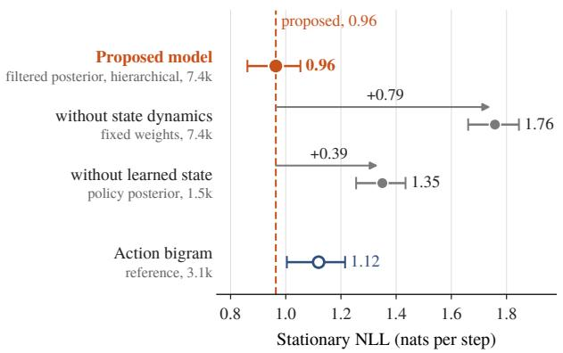
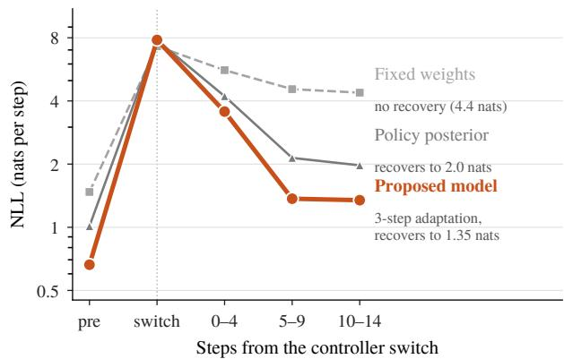

# A Hidden Markov Preference Model for Online Prediction of Adversary Actions

Angel Daruna Michael Cogswell Tixiao Shan Yi Yao Han-Pang Chiu Ajay Divakaran SRI International

## Abstract

A defender anticipating an attacker needs a probability distribution over the attacker’s next action from information available before that action occurs. Two structures complicate this: the attacker’s behavioral regime persists and can switch within an episode, and each action combines an operation with state-dependent arguments whose feasible values change over time. We capture both with a hidden Markov model whose latent state is the active regime and whose regime-conditioned action law is defined on a feasibility-masked tree of executable actions. The same likelihood forms the next-action distribution and updates the regime belief once the action is seen, and a partially observed prefix contributes its resolved local factors. Estimation separates into convex logistic fits that Baum–Welch reuses when regimes are unlabeled. We derive a reach-weighted nodewise KL expression for regime information, a sequence-wise log-loss bound for switching regime paths, and a uniform fallback guarantee. On the CAGE 2 cyber defense benchmark the filtered latent state is worth 0.8 nats per step, and after a controller switch the loss begins to fall in three steps against ten for a recurrent baseline.

Index Terms— Hidden Markov models, discrete choice, online prediction, preference learning, cyber defense

## 1 Introduction

An observer often needs a probability distribution over another agent’s next action from its own observation record, with a network defender anticipating an intruder as the running example. Because the record omits the agent’s private state and objectives, prediction must rely on structure reflected in observable behavior. Behavioral patterns persist across consecutive steps and can change within an episode, as when an intruder moves from reconnaissance to exploitation or reacts to a defensive move, and each action combines an operation with arguments whose admissible values depend on the current state, leaving much of the nominal action space infeasible.

Preference learning estimates a probabilistic choice rule from revealed choices through Bradley–Terry and Luce likelihoods [1, 2], and quantal-response versions are fitted to observed attacks in security games [3, 4]. Hidden context can cause a single fitted choice law to aggregate behavior generated under diferent unobserved conditions [5]. Latent-class and mixture models capture such heterogeneity at the user or episode level [6, 7], while input–output hidden Markov models [8] and hidden-Markov choice models [9] let the latent class evolve over time. Opponent-modeling methods infer opponent types, goals, or latent representations from interaction [10, 11, 12, 13], and cyber-forecasting methods predict attack stages or red actions from streaming observations [14, 15, 16, 17]. The present setting instead requires a full next-action distribution committed before each outcome, with within-episode regime changes, state-dependent feasibility, and evaluation under sequential log loss.

We represent the active behavioral regime with a conditional hidden Markov model [8, 18] and structured executable actions with a regime-conditioned choice law on the feasible action tree. The same likelihood forms the next-action prediction before the action occurs and updates the regime belief afterwards; for a tree-prefix observation, the resolved local factors give its likelihood and the evidence it contributes about the regime. The construction retains exact filtering, and estimation separates into convex fits that Baum–Welch reuses when regimes are unlabeled.

Contributions. The latent dynamics follow the input–output HMM [8] and hidden-Markov choice models [9], and the log-loss bounds are mixture inequalities of the expert-tracking framework [19, 20, 21, 22]; the new elements are (i) a regime-conditioned choice law on a feasibility-masked action tree, with shared and regime-specific terms, whose identification rate is a reach-weighted sum of nodewise KL divergences over the observed action fields; (ii) exact filtering that treats a complete action and a tree-prefix observation through the same local factors; (iii) switching and uniform-fallback guarantees on the feasible tree; and (iv) an attacker-side CAGE Challenge 2 evaluation [23] of a two-stage form of the predictor that separates action structure, latent-state tracking, and soft regime weighting.

## 2 Problem Formulation

Prediction target. An agent and an observer interact at discrete times $t = 1 , 2 , \ldots$ , and the observer predicts each action the agent takes. Let $h _ { t } ^ { - }$ be the observer history available immediately before the agent commits to $A _ { t }$ , including any observer action taken first at step �, and $h _ { t } ^ { + }$ the same history after $A _ { t }$ is revealed. The prediction target is

$$
p _ { t } ^ { \star } ( a ) = \operatorname* { P r } ( A _ { t } = a \mid h _ { t } ^ { - } ) , \qquad x _ { t } = \psi ( h _ { t } ^ { - } ) \in { \mathbb R } ^ { d } ,\tag{1}
$$

with $\psi$ a fixed feature map to a context vector. Given training episodes, the problem is to produce at each � a distribution $\widehat { p _ { t } }$ over the feasible actions, committed before the step’s outcome is seen, that makes the sequential logarithmic loss $\begin{array} { r } { \sum _ { t } - \log \widehat { p _ { t } } ( a _ { t } ) } \end{array}$ small on the executed actions. In the replay setting logs reveal the complete executed action; in the detection setting the observer receives a coarsened observation of it.

Actions and feasibility. Actions are the leaves of a rooted tree $\mathcal { T }$ , the action grammar, with internal nodes I, children Ch(�) at an internal node �, and leaf set A. Each internal node resolves one semantic field of the action, with the operation family at the root and its arguments below. For a leaf �, write $j _ { \nu } ( a )$ for the child taken at � on the path to $^ { a , }$ let ${ \mathcal { T } } ( a ) \subseteq { \mathcal { T } }$ be the internal nodes on the root-to-� path, and write Path $( a ) = \{ ( \nu , j _ { \nu } ( a ) ) : \nu \in \mathcal { I } ( a ) \}$ . Feasibility at time � is a mask $m _ { t , \nu } ( j ) \in \{ 0 , 1 \}$ ; the feasible children at � are $C _ { t } ( \nu ) = \{ j \in \mathrm { C h } ( \nu ) : m _ { t , \nu } ( j ) = 1 \}$ , and the feasible leaves $\mathcal { A } _ { t }$ are those whose entire path is feasible. Masks are pruned bottom-up, so every feasible child leads to at least one feasible leaf, the local choice laws normalize over $C _ { t } ( \nu )$ , and their product induces a normalized distribution over $\mathcal { A } _ { t }$ . Masks are computed from the grammar and $h _ { t } ^ { - }$ as conservative supersets of the true support, so every executed action remains feasible under the observer’s model and constraints depending on the agent’s private progress remain part of the modeled uncertainty.

Latent regime. The agent’s regime at time � is a latent state $Z _ { t } \in { \mathcal { Z } }$ with $| { \mathcal { Z } } | = K$ . The regime is behavioral, for instance a policy family, a stage of an attack, or an operating constraint; it persists over consecutive steps, may change within an episode, and is defined only through its efect on the action distribution. The regime evolves through a context-dependent Markov kernel with an explicit self-transition term,

$$
P _ { \eta } ( z ^ { \prime } \mid z , x _ { t } ) = \frac { \exp \bigl ( c { \bf 1 } \{ z ^ { \prime } = z \} + \eta _ { z ^ { \prime } } ^ { \top } \bar { x } _ { t } \bigr ) } { \sum _ { r } \exp \bigl ( c { \bf 1 } \{ r = z \} + \eta _ { r } ^ { \top } \bar { x } _ { t } \bigr ) } ,\tag{2}
$$

in which $z ^ { \prime }$ indexes $Z _ { t }$ , � indexes $Z _ { t - 1 } , \bar { x } _ { t } = [ 1 , x _ { t } ^ { \top } ] ^ { \top }$ , and $c \geq 0$ controls persistence. The shared persistence term keeps the transition model small when switch data are sparse, and fixing one $\eta _ { z ^ { \prime } }$ at zero identifies $( c , \eta )$ The transition into $Z _ { t }$ uses $x _ { t }$ , which is available before $A _ { t }$ and can depend on evidence accumulated through step $t - 1$ together with any observer action taken first at step �.

Setting $\eta _ { z ^ { \prime } } \equiv 0$ gives the homogeneous persistent kernel

$$
\begin{array} { r } { P ( z ^ { \prime } \mid z ) = \kappa \mathbf { 1 } \{ z ^ { \prime } = z \} + \frac { 1 - \kappa } { K - 1 } \mathbf { 1 } \{ z ^ { \prime } \neq z \} , \qquad \kappa \in [ \frac { 1 } { K } , 1 ) , } \end{array}\tag{3}
$$

with $\kappa = e ^ { c } / ( e ^ { c } + K - 1 )$ and expected dwell time $1 / ( 1 - \kappa )$ . The pathwise log-loss result applies to the general kernel in (2), while the explicit switching, fallback, and adaptation bounds use (3). At $c = 0$ every row of (2) equals the contextual gate softmax $z ^ { \prime } ( \eta _ { z ^ { \prime } } ^ { \top } \bar { x } _ { t } )$ , so the filter carries no information across steps and the model reduces to a memoryless mixture of experts with a contextual gate.

With $\eta = \left( c , \{ \eta _ { z ^ { \prime } } \} \right)$ and Θ the action-model parameters, (2) and the regime-conditioned action law of Section 3 define an HMM [8, 18] whose joint probability, for a predictable context sequence $x _ { 1 : T }$ , regime path $z _ { 1 : T }$ , and action sequence $a _ { 1 : T }$ , is

$$
\nu ( z _ { 1 } ) p _ { \Theta } ( a _ { 1 } \mid x _ { 1 } , z _ { 1 } ) \prod _ { t = 2 } ^ { T } P _ { \eta } ( z _ { t } \mid z _ { t - 1 } , x _ { t } ) p _ { \Theta } ( a _ { t } \mid x _ { t } , z _ { t } ) ,\tag{4}
$$

with initial distribution �.

## 3 Model, Inference, and Learning

Action model. Conditional on $Z _ { t } = z$ and context �, the action follows a choice model assembled from local decisions at the internal nodes. Each child $j \in \operatorname { C h } ( \nu )$ carries a descriptor $\boldsymbol { e } _ { \nu , j } \in \mathbb { R } ^ { r _ { \nu } }$ , and we combine context and child identity through $\phi _ { \nu } ( x , e _ { \nu , j } ) = \bar { x } \otimes e _ { \nu , j }$ , allowing the same context to change the relative preference among children at a node. The local score is

$$
\begin{array} { r } { u _ { \nu , z , j } ( x ) = \big \langle \theta _ { \nu } ^ { 0 } + \Delta _ { \nu , z } , \phi _ { \nu } ( x , e _ { \nu , j } ) \big \rangle , } \end{array}\tag{5}
$$

with the vector $\theta _ { \nu } ^ { 0 }$ shared across regimes and $\Delta _ { \nu , z }$ the per-regime residual. The local choice and the action probabilities are

$$
\pi _ { \nu , z } ( \boldsymbol { j } \mid \boldsymbol { x } ) = \frac { \exp u _ { \nu , z , j } ( \boldsymbol { x } ) } { \sum _ { \boldsymbol { k } \in C _ { t } ( \nu ) } \exp u _ { \nu , z , \boldsymbol { k } } ( \boldsymbol { x } ) } ,\tag{6}
$$

$$
p _ { \Theta } ( a \mid x , z ) = \prod _ { ( \nu , j _ { \nu } ( a ) ) \in \mathrm { P a t h } ( a ) } \pi _ { \nu , z } ( j _ { \nu } ( a ) \mid x ) , \quad a \in \mathcal { A } _ { t } ,\tag{7}
$$

and zero for $a \notin \mathcal { A } _ { t } .$ , with the time dependence induced by the mask left implicit. The factorization (7) is a hierarchical softmax [24] with locally normalized choices along the feasible action path; it yields separate supervised likelihood terms at each node and decomposes regime diferences across the visited nodes. The decomposition $\theta _ { \nu } ^ { 0 } + \Delta _ { \nu , z }$ implements partial pooling across regimes that reach the same node: the shared term carries the common choice structure and $\Delta _ { \nu , { \bf \vec { \tau } } }$ � the regime-specific departures, which are the only source of evidence about the active regime, so shrinking the residuals increases pooling while reducing identification; Section 4 quantifies this trade-of. We impose $\begin{array} { r } { \sum _ { z } \Delta _ { \nu , z } = 0 } \end{array}$ and use centered descriptors and a reference child, which identify $\theta _ { \nu } ^ { 0 }$ as the across-regime mean and, with the quadratic penalties, make each supervised node problem strictly convex.

Prediction. Let $b _ { t } ^ { - } ( z ) = \operatorname* { P r } ( Z _ { t } = z \mid h _ { t } ^ { - } )$ be the posterior over the hidden regime before the agent acts and $b _ { t } ^ { + } ( z ) = \operatorname* { P r } ( Z _ { t } = z \mid h _ { t } ^ { + } )$ the posterior after. The predictor is the one-step predictive distribution of the hidden Markov model, obtained by averaging the regime-conditioned action laws over the current belief,

$$
\widehat { p _ { t } } ( a ) = \sum _ { z \in \mathcal { Z } } b _ { t } ^ { - } ( z ) p _ { \Theta } ( a \mid x _ { t } , z ) , \qquad a \in \mathcal { A } _ { t } ,\tag{8}
$$

and the belief obeys, with $b _ { 1 } ^ { - } = \nu$ and evidence weight $\ell _ { t } ( z )$ defined below,

$$
b _ { t } ^ { + } ( z ) = \frac { \ell _ { t } ( z ) b _ { t } ^ { - } ( z ) } { \sum _ { r } \ell _ { t } ( r ) b _ { t } ^ { - } ( r ) } ,\tag{9}
$$

$$
b _ { t + 1 } ^ { - } ( z ^ { \prime } ) = \sum _ { z } P _ { \eta } ( z ^ { \prime } \mid z , x _ { t + 1 } ) b _ { t } ^ { + } ( z ) .\tag{10}
$$

In replay $\ell _ { t } ( z ) = p _ { \Theta } ( a _ { t } \mid x _ { t } , z )$ , and in detection $\ell _ { t } ( z )$ is the likelihood $\textstyle \sum _ { a \in { \mathcal { A } } _ { t } } \omega ( e _ { t } \mid a ) p _ { \Theta } ( a \mid x _ { t } , z )$ induced by the observation channel �, with $\ell _ { t } \equiv 1$ on an evidence-free step; for a tree-prefix observation it reduces to the product of the resolved local choice probabilities. The prediction (8) is committed before $\ell _ { t }$ is formed and therefore uses only $h _ { t } ^ { - }$ . One step runs (10), one feasible-tree pass per regime for $( 6 ) – ( 7 )$ , the prediction (8), and the update (9), in time linear in � under (3) and in the size of the feasible tree; Appendix I gives the per-step cost in full and verifies that $b _ { t } ^ { + }$ is a suficient statistic of the history.

Estimation. When regime labels are observed, the penalized negative log-likelihood of one episode is

$$
\begin{array} { l } { \displaystyle - \log \nu ( z _ { 1 } ) - \sum _ { t = 2 } ^ { T } \log P _ { \eta } ( z _ { t } \mid z _ { t - 1 } , x _ { t } ) } \\ { \displaystyle - \sum _ { t = 1 } ^ { T } \sum _ { ( \nu , j ) \in \mathrm { P a t h } ( a _ { t } ) } \log \pi _ { \nu , z _ { t } } ( j \mid x _ { t } ) , } \end{array}\tag{11}
$$

summed over episodes with quadratic regularizers on $( c , \eta )$ and $\{ \theta _ { \nu } ^ { 0 } , \Delta _ { \nu , z } \}$ . Every term is the negative log of a softmax linear in the parameters, so with observed regimes the objective is jointly convex and separates into one transition fit and one choice fit per node, each solved by L-BFGS-B under $c \geq 0$ . With latent regimes the marginal likelihood is nonconvex, and Baum–Welch alternates exact forward–backward responsibilities with weighted versions of the same convex subproblems, increasing the penalized marginal likelihood monotonically to a stationary point. Held-out predictive likelihood selects �. Single-regime trajectories contain no observed switches, so persistence is selected by validation NLL on separate state-preserving switch episodes. Appendix I records the convexity, separability, and uniqueness argument for (11) and the role of the residual in identifiability.

Uniform fallback state. For a finite reference loss that does not depend on the fit of the learned regimes, we add a state ⊥ with node probabilities $\pi _ { \nu , \perp } ( j \mid x ) = N _ { t } ( j ) / N _ { t } ( \nu )$ , where $N _ { t } ( \nu )$ counts the feasible leaves below �. These telescope to $p _ { \Theta } ( a \mid x , \perp ) = 1 / | { \mathcal { A } } _ { t } |$ , uniform over the feasible actions, while preserving the product form (7). As an ordinary state of (3) on $K { + 1 }$ states, ⊥ gives the fallback guarantee of Section 4, and $b _ { t } ^ { + } ( \bot )$ is the weight assigned to it.

## 4 Analysis

Conditioning on the fitted parameters, we first quantify how the resolution of an observed action determines the evidence it provides about the active regime, then compare cumulative predictive loss with regime paths that may switch. The arguments are short: (12) sums the local laws below � from the leaves up, (13) is the

chain rule for relative entropy on the tree, and (14) keeps one path of the forward recursion. Complete proofs are given in Appendices B–E, under the conventions of Appendix A.

Information from partial observations.

Lemma 1 (Tree-prefix likelihood). For a node � with ancestors an(�), writing $\mathcal { A } _ { t } ( \nu ) = \{ a \in \mathcal { A } _ { t } : \nu \in \mathcal { I } ( a ) \}$ ,

$$
\sum _ { a \in { \mathcal A } _ { t } ( \nu ) } p _ { \Theta } ( a \mid x , z ) = \prod _ { \nu ^ { \prime } \in \mathrm { a n } ( \nu ) } \pi _ { \nu ^ { \prime } , z } \big ( j _ { \nu ^ { \prime } } ( \nu ) \mid x \big ) ,\tag{12}
$$

where $j _ { \nu ^ { \prime } } ( \nu )$ is the child of �′ toward �. Taking � as the root gives normalization over $\mathcal { A } _ { t }$

An observation that resolves the action path to depth � therefore has likelihood equal to the product of the � resolved local factors, and each resolved node can contribute evidence about the active regime (proof in Appendix B).

Corollary 1 (Regime identification rate). Fix � and the feasible tree, let the executed action be drawn from regime $z ^ { \star }$ , and let the evidence resolve the executed path to depth �, with $\mathcal { V } _ { k }$ the set of feasible internal nodes at depth less than �. For every regime $z ,$ the expected log-likelihood ratio entering (9) is

$$
\mathbb { E } \biggl [ \log \frac { \ell _ { t } ( z ^ { \star } ) } { \ell _ { t } ( z ) } \biggr ] = \sum _ { \nu \in \mathcal { V } _ { k } } \rho _ { \nu , z ^ { \star } } D _ { \mathrm { K L } } \bigl ( \pi _ { \nu , z ^ { \star } } \| \pi _ { \nu , z } \bigr ) ,\tag{13}
$$

with $\rho _ { \nu , z ^ { \star } }$ the probability under $z ^ { \star }$ that the path reaches �. Atfull resolution the sum equals $D _ { \mathrm { K L } } ( p _ { \Theta } ( \cdot \mid$ $x , z ^ { \star } ) \parallel p _ { \Theta } ( \cdot \mid x , z ) )$ , so unresolved nodes remove exactly their terms from the expected one-step increase of the posterior log-odds.

Each local term is, to second order, a quadratic form in the diference between regime residuals, so residual shrinkage lowers the identification rate, quantifying the trade-of between pooling and regime separation; Appendix C proves the corollary and Appendix I derives the second-order form.

Log-loss guarantees.

Theorem 1 (Individual-sequence tracking). Let $\widehat { p _ { t } }$ be the predictor (8) produced by (9)–(10) with fixed parameters on the replay sequence. For every predictable context sequence $x _ { 1 : T } ,$ every realized action sequence satisfying $a _ { t } \in \mathcal A _ { t } ,$ , and every regime path $z _ { 1 : T } \in \mathcal { Z } ^ { T }$

$$
\begin{array} { c } { \displaystyle \sum _ { t = 1 } ^ { T } - \log \widehat { p _ { t } } ( a _ { t } ) \leq \displaystyle \sum _ { t = 1 } ^ { T } - \log p _ { \Theta } ( a _ { t } \mid x _ { t } , z _ { t } ) } \\ { \displaystyle - \log \nu ( z _ { 1 } ) - \displaystyle \sum _ { t = 2 } ^ { T } \log P _ { \eta } ( z _ { t } \mid z _ { t - 1 } , x _ { t } ) . } \end{array}\tag{14}
$$

The detection setting obeys the same inequality with $\ell _ { t }$ in place of the action likelihood. Minimizing the right-hand side over $z _ { 1 : T }$ compares the deployed predictor with the regime path of smallest action loss plus its initial and transition cost under the fitted kernel. Appendix D gives the proof and the corresponding detection-setting inequality.

Corollary 2 (Fixed share and uniform fallback). With uniform � and the homogeneous kernel (3), a comparator path with � switches gives

$$
\begin{array} { r l r } {  { \sum _ { t = 1 } ^ { T } - \log \widehat { p _ { t } } ( a _ { t } ) \le \sum _ { t = 1 } ^ { T } - \log p _ { \Theta } ( a _ { t } \mid x _ { t } , z _ { t } ) + \log K } } \\ & { } & { + ( T - 1 - S ) \log \frac { 1 } { K } + S \log \frac { K - 1 } { 1 - K } , } \end{array}\tag{15}
$$

Distribution Statement ‘A’ (Approved for Public Release, Distribution Unlimited)

  
(a)

  
(b)  
Figure 1: (a) Stationary test set, blue-observation context, 90% intervals; each ablation removes one element of the regime posterior and the arrow gives the change in NLL. (b) Mean NLL before a controller switch, at the switch step, and in three five-step windows after it, on a log scale.

thefixed-share penaltyfor tracking changing experts [20, 25] with the regime-conditioned action laws as the experts. $H \bot$ is an ordinary state of (3) on �+1 regimes, the constant comparator $z _ { t } \equiv \perp$ gives, for every feasible action sequence,

$$
\sum _ { t = 1 } ^ { T } - \log \widehat { p _ { t } } ( a _ { t } ) \leq \sum _ { t = 1 } ^ { T } \log | \mathcal { A } _ { t } | + \log ( K { + } 1 ) + ( T { - } 1 ) \log \frac { 1 } { \kappa } .\tag{16}
$$

A single � controls both penalties: by (16) the mean loss exceeds uniform coding over the feasible sets by at most log $\textstyle { \frac { 1 } { \kappa } } + \log ( K + 1 ) / T$ , so no feasible action sequence is catastrophic, while carrying ⊥ costs a learned-regime comparator only log $\textstyle { \frac { K + 1 } { K } } + S \log { \frac { K } { K - 1 } }$ per episode; Appendix E proves both bounds and Appendix I works the trade-of out numerically. Greater persistence lowers the penalty for staying in one regime but raises the prior evidence to be overcome after a switch; since (3) floors every $b _ { t } ^ { - } ( z ^ { \prime } )$ at $\frac { 1 - \kappa } { K - 1 }$ a Wald-type argument bounds the expected time for the posterior log-odds to favor the new regime by log $\frac { K - 1 } { 1 - \kappa } + B ) / { r }$ , with � a floor on the evidence rate (13) and � a bound on a single-step log-likelihood ratio, stated and proved as Remark 1 in Appendix F.

## 5 Experiments

Setup. We evaluate on CAGE Challenge 2 [23, 26] in the bug-fixed CybORG++ build [27, 28], where a red agent attacks a simulated enterprise network against a fixed reactive blue baseline, a setting studied so far mainly from the defender’s side [29, 30, 31]; the closest precedent, [17], imitates a red policy from network observations and reports accuracy. The action tree has the operation at the root (no-op, system discovery, service discovery, exploitation, escalation, impact) and one operation-dependent argument below it, a subnet for system discovery and a host otherwise, giving 56 executable actions. The generating red policies B line, Meander, and Sleep are the policy classes; Sleep is a point mass on no-op, so all predictors are scored on active steps, those whose executed action is not no-op. We train on 40 episodes of length 100 per policy, validate on 10, and hold out 25 per policy as the stationary test set. Switch episodes replace the red controller once at $\tau \sim \mathrm { U n i f } \{ 3 0 , \dots , 7 0 \}$ with session state preserved; 60 of them select the persistence � of the policy-class chain by validation NLL and a disjoint set of � scores regime tracking. The context $x _ { t }$ holds the observer-available coordinates of the blue observation and features computed from them before the current red action, and the full context adds the previous red action as a one-hot vector. All runs use the replay setting. Metrics are per-step NLL in nats over the feasible set, top-1 accuracy, and 10-bin ECE of the top-1 confidence, with 90% episode-level bootstrap intervals.

Table 1: Stationary test set (25 held-out episodes per policy, active steps) and switch test set. NLL in nats per step, top-1 in percent, 10-bin ECE; stationary NLL carries its 90% bootstrap interval and switch intervals are about ±0.3 nats. Choice models are hierarchical unless marked flat. The second group uses the blue-observation context, the third adds the previous action, and bold rows are the proposed model.
<table><tr><td rowspan="2">Predictor</td><td colspan="3">Stationary</td><td colspan="2">Switch</td></tr><tr><td>NLL↓[CI]</td><td>Top-1↑</td><td>ECE↓</td><td>NLL↓</td><td>ECE↓</td></tr><tr><td>Action bigram Masked GRU</td><td>1.119 [1.00, 1.22]</td><td>63.8</td><td>0.037</td><td>1.946</td><td>0.077</td></tr><tr><td>Fixed state weights</td><td>0.872 [0.76, 0.96] 1.758 [1.66, 1.85]</td><td>70.5 44.7</td><td>0.054 0.186</td><td>1.821</td><td>0.112</td></tr><tr><td rowspan="4">Policy-class posterior Posterior mode Filtered posterior, flat Filtered posterior</td><td></td><td></td><td></td><td>2.778</td><td>0.232</td></tr><tr><td>1.350 [1.26, 1.43]</td><td>56.7</td><td>0.074</td><td>2.634</td><td>0.125</td></tr><tr><td>0.958 [0.85, 1.05]</td><td>67.4</td><td>0.052</td><td>2.142</td><td>0.107</td></tr><tr><td>0.917 [0.81, 1.01] 0.964 [0.86, 1.05]</td><td>68.7 67.0</td><td>0.059 0.047</td><td>1.899 1.971</td><td>0.105 0.088</td></tr><tr><td>No latent state</td><td>1.068 [0.97, 1.16]</td><td>63.9</td><td>0.052</td><td>2.122</td><td>0.089</td></tr><tr><td>Policy-class posterior</td><td>1.033 [0.93, 1.12]</td><td>64.5</td><td>0.042</td><td>2.201</td><td>0.088</td></tr><tr><td>Filtered posterior</td><td>0.924 [0.82, 1.01]</td><td>68.0</td><td>0.045</td><td>1.951</td><td>0.084</td></tr><tr><td></td><td></td><td></td><td></td><td></td><td></td></tr></table>

Estimator and comparisons. The evaluated estimator is a two-stage form of the predictor with convex fits and inputs shared by every compared choice model. A 48-state HMM over actions with an unconstrained transition matrix is fit to the training action sequences without labels, and its filtered posterior $b _ { t } ^ { - }$ enters the node scores of the masked choice model linearly beside the context, one convex logistic regression per node. The posterior thus pools the regime laws in the scores, which coincides with (8) at a one-hot posterior; the choice likelihood does not update the chain, so the bounds of Section 4 describe the joint filter (8) and are not claimed for this estimator. Ablations replace the filtered posterior by fixed state weights, by a one-hot encoding of its mode, or by nothing; the hierarchical choice model by a flat softmax over the 56 actions with the same inputs; and the learned chain by a three-state chain whose states are the policy classes with kernel (3). Reference predictors are a first-order Markov model on actions (the action bigram) and a masked GRU seeing the full context and mask and carrying its own recurrent state.

Stationary prediction. Table 1 and Figure 1(a) separate the two design choices. Removing the state dynamics costs 0.79 nats per step and 22 points of top-1 accuracy, and replacing the learned chain by the three policy classes costs 0.39, or 0.11 with the full context. The learned states thus carry information beyond the policy label, part of which the previous action supplies. Replacing the posterior by its mode changes nothing while the regime is stable. The flat softmax gains 0.047 nats at 44% more parameters and is worse calibrated. The GRU, at 7,288 parameters, reaches 0.872 nats and 70.5% against 0.924 and 68.0% for the full-context model, with overlapping intervals, and the choice model is the better calibrated of the two. The action bigram is a strong reference at 1.119 nats because B line is close to deterministic given its last action, while uniform coding of the 56 actions costs 4.03. Over a sweep of the training-set size, the hierarchical model is at or below the flat one up to 60 episodes and behind it from 90 on. Appendix I lists the parameter counts of every predictor and the training-set sweep in full.

Regime tracking. The switch columns of Table 1 and Figure 1(b) report the switch episodes. At the switch step every predictor loses between 7.3 and 9.5 nats; the filtered hierarchical model loses 7.81, against 8.13 for its mode and 9.23 for the GRU, and its loss begins to fall after three steps against ten for the GRU. Over the whole episode, weighting by the full posterior is worth 0.17 nats per step over its mode, the same margin the full-context model holds over no latent state, with overlapping intervals in both cases, though the paired per-episode diferences exclude zero. Ten to fourteen steps after the switch, fixed weights stay at 4.4 nats and the policy-class chain at 2.0, against 1.35 for the proposed model; the GRU recovers further, to 1.05 in that window, and ends the episode at 1.821 against 1.951, again inside the intervals. Calibration favors the proposed model under switching as well, ECE 0.084 against 0.112 for the GRU and 0.105 for the flat softmax.

Summary. Across both experiments the accuracy of the next-action distribution is set by how well the predictor represents where the attacker is rather than by the capacity of the action model: the filtered latent state is worth 0.8 nats per step over fixed weights and 0.4 over the known policy classes, whereas the hierarchical and flat choice models are separated by 0.047 and the same-size GRU by less than one interval width. What the latent state buys is a calibrated belief rather than a label, and this is where the structure pays: weighting by the full posterior matches its mode in steady state but gains 0.17 nats per step under switching, and the loss begins to fall three steps after a controller change against ten for the GRU, at 30% fewer parameters than the flat model and better calibration than both baselines. The two open directions follow from the two places the belief is still weakest. Fitting the chain and the choice law jointly, rather than in the two stages evaluated here, would let the action likelihood sharpen the regime posterior and would bring the guarantees of Section 4 to bear on the deployed predictor, including the fallback state ⊥ whose absence explains the overconfidence observed against a held-out red policy (Corollary 2, with the measurements in Appendix I). Beyond replay, the same local factors score a partially resolved action, so (13) predicts how much regime evidence survives coarse detections; testing that in the detection setting is the natural next step towards a defender that acts on the prediction.

## Acknowledgments

This research was developed with funding from the Defense Advanced Research Projects Agency (DARPA). The views, opinions and/or findings expressed are those of the authors and should not be interpreted as representing the oficial views or policies of DARPA or the U.S. Government.

## References

[1] Ralph Allan Bradley and Milton E Terry, “Rank analysis of incomplete block designs: I. the method of paired comparisons,” Biometrika, vol. 39, no. 3/4, pp. 324–345, 1952.

[2] Daniel McFadden, “Conditional logit analysis of qualitative choice behavior,” 1972.

[3] Rong Yang, Christopher Kiekintveld, Fernando Ordonez, Milind Tambe, and Richard John, “Improving resource allocation strategy against human adversaries in security games,” in IJCAI Proceedings-International Joint Conference on Artificial Intelligence. Barcelona, 2011, vol. 22, p. 458.

[4] Thanh Nguyen, Rong Yang, Amos Azaria, Sarit Kraus, and Milind Tambe, “Analyzing the efectiveness of adversary modeling in security games,” in Proceedings of the AAAI Conference on Artificial Intelligence, 2013, vol. 27, pp. 718–724.

[5] Anand Siththaranjan, Cassidy Laidlaw, and Dylan Hadfield-Menell, “Distributional preference learning: Understanding and accounting for hidden context in rlhf,” in International Conference on Learning Representations, 2024, vol. 2024, pp. 27448–27471.

[6] Kenneth Train et al., Discrete choice methods with simulation, vol. 2, Cambridge university press Cambridge, 2003.

[7] Sriyash Poddar, Yanming Wan, Hamish Ivison, Abhishek Gupta, and Natasha Jaques, “Personalizing reinforcement learning from human feedback with variational preference learning,” 2024, vol. 37, pp. 52516–52544.

[8] Yoshua Bengio and Paolo Frasconi, “An input output hmm architecture,” 1994, vol. 7.

[9] Oded Netzer, James M Lattin, and Vikram Srinivasan, “A hidden markov model of customer relationship dynamics,” Marketing science, vol. 27, no. 2, pp. 185–204, 2008.

[10] Stefano V Albrecht and Peter Stone, “Autonomous agents modelling other agents: A comprehensive survey and open problems,” Artificial Intelligence, vol. 258, pp. 66–95, 2018.

[11] Samer Nashed and Shlomo Zilberstein, “A survey of opponent modeling in adversarial domains,” Journal ofArtificial Intelligence Research, vol. 73, pp. 277–327, 2022.

[12] Samer Nashed and Shlomo Zilberstein, “A survey of opponent modeling in adversarial domains,” Journal ofArtificial Intelligence Research, vol. 73, pp. 277–327, 2022.

[13] Georgios Papoudakis, Filippos Christianos, and Stefano Albrecht, “Agent modelling under partial observability for deep reinforcement learning,” 2021, vol. 34, pp. 19210–19222.

[14] Pilar Holgado, V´ıctor A Villagra, and Luis Vazquez, “Real-time multistep attack prediction based on´ hidden markov models,” IEEE Transactions on Dependable and Secure Computing, vol. 17, no. 1, pp. 134–147, 2017.

[15] Azqa Nadeem, Sicco Verwer, Stephen Moskal, and Shanchieh Jay Yang, “Alert-driven attack graph generation using s-pdfa,” IEEE transactions on dependable and secure computing, vol. 19, no. 2, pp. 731–746, 2021.

[16] Teng Li, Ya Jiang, Chi Lin, Mohammad S Obaidat, Yulong Shen, and Jianfeng Ma, “Deepag: Attack graph construction and threats prediction with bi-directional deep learning,” IEEE Transactions on Dependable and Secure Computing, vol. 20, no. 1, pp. 740–757, 2022.

[17] Ankita Samaddar, Sandeep Neema, Daniel Balasubramanian, and Xenofon Koutsoukos, “Learning red agent policy from observations for neurosymbolic autonomous cyber agents,” arXiv preprint arXiv:2606.18223, 2026.

[18] Lawrence R Rabiner, “A tutorial on hidden markov models and selected applications in speech recognition,” Proceedings of the IEEE, vol. 77, no. 2, pp. 257–286, 1989.

[19] Neri Merhav and Meir Feder, “Universal prediction,” IEEE Transactions on Information Theory, vol. 44, no. 6, pp. 2124–2147, 1998.

[20] Mark Herbster and Manfred K Warmuth, “Tracking the best expert,” Machine learning, vol. 32, no. 2, pp. 151–178, 1998.

[21] Olivier Bousquet and Manfred K Warmuth, “Tracking a small set of experts by mixing past posteriors,” Journal ofMachine Learning Research, vol. 3, no. Nov, pp. 363–396, 2002.

[22] Wouter M Koolen and Steven de Rooij, “Universal codes from switching strategies,” IEEE Transactions on Information Theory, vol. 59, no. 11, pp. 7168–7185, 2013.

[23] Mitchell Kiely, David Bowman, Maxwell Standen, and Christopher Moir, “On autonomous agents in a cyber defence environment,” arXiv preprint arXiv:2309.07388, 2023.

[24] Frederic Morin and Yoshua Bengio, “Hierarchical probabilistic neural network language model,” in International workshop on artificial intelligence and statistics. PMLR, 2005, pp. 246–252.

[25] Nicolo Cesa-Bianchi, Gabor Lugosi, et al., ´ Prediction, learning, and games, vol. 1, Cambridge university press Cambridge, 2006.

[26] TTCP CAGE Working Group, “TTCP CAGE Challenge 2,” github.com/cage-challenge/ cage-challenge-2, 2022.

[27] Harry Emerson, Liz Bates, Chris Hicks, and Vasilios Mavroudis, “Cyborg++: An enhanced gym for the development of autonomous cyber agents,” arXiv preprint arXiv:2410.16324, 2024.

[28] Maxwell Standen, Martin Lucas, David Bowman, Toby J Richer, Junae Kim, and Damian Marriott, “Cyborg: A gym for the development of autonomous cyber agents,” arXiv preprint arXiv:2108.09118, 2021.

[29] Myles Foley, Chris Hicks, Kate Highnam, and Vasilios Mavroudis, “Autonomous network defence using reinforcement learning,” in Proc. ACM Asia Conference on Computer and Communications Security (ASIA CCS), 2022, pp. 1252–1254.

[30] Kim Hammar, Neil Dhir, and Rolf Stadler, “Optimal defender strategies for cage-2 using causal modeling and tree search,” arXiv preprint arXiv:2407.11070, 2024.

[31] Sanyam Vyas, Vasilios Mavroudis, and Pete Burnap, “Towards the deployment of realistic autonomous cyber network defence: A systematic review,” ACM Computing Surveys, vol. 58, no. 1, pp. 1–36, 2025.

[32] Haikady N Nagaraja, Inference in hidden Markov models, Taylor & Francis, 2006.

# Appendices

# Proofs, Omitted Results, and Additional Experimental Detail

These appendices collect complete proofs of the results stated in the body, state the results that were omitted there for length, verify the identities asserted in the text, and record the additional experimental detail referenced from it. Equations numbered (1)–(16) are those of the body; equations numbered by appendix section, such as (B.1), are local to the appendices.

## A Conventions Used in the Proofs

All parameters $( \nu , \eta , \Theta )$ are fixed, and �, the context �, and the masks are fixed wherever a single step is analyzed. Masks are pruned bottom-up, as stated in Section 2: every feasible child of a node on a feasible path retains at least one feasible leaf in its subtree, so the sets $C _ { t } ( \nu )$ are the child sets of a pruned feasible tree whose leaf set is $\mathcal { A } _ { t }$ . Every local law is extended by $\pi _ { \nu , z } ( j \mid x ) = 0$ for $j \notin C _ { t } ( \nu )$ . The softmax (6) is strictly positive on $C _ { t } ( \nu )$ , and the background weights $N _ { t } ( j ) / N _ { t } ( \nu )$ are positive under pruning, so $p _ { \Theta } ( a \mid x , z ) > 0$ for every $a \in \mathcal { A } _ { t }$ and every regime. The kernels (2) and (3) with $\kappa < 1$ are likewise strictly positive, so every divergence below is finite, with the convention 0 log 0 = 0. Two classical facts are used. Pinsker’s inequality states $D _ { \mathrm { K L } } ( p \Vert q ) \geq 2 d _ { \mathrm { T V } } ^ { 2 } ( p , q )$ [25]. The log-sum inequality states that for nonnegative reals $a _ { 1 } , \ldots , a _ { n }$ and $b _ { 1 } , \ldots , b _ { n }$ with $\textstyle A = \sum _ { i } a _ { i }$ and $\begin{array} { r } { B = \sum _ { i } b _ { i } > 0 , \sum _ { i } a _ { i } \log ( a _ { i } / b _ { i } ) \geq A \log ( A / B ) } \end{array}$ ; it follows from Jensen’s inequality for the convex function $\varphi ( t ) = t \log t ,$ , since $\begin{array} { r } { \sum _ { i } a _ { i } \log ( a _ { i } / b _ { i } ) = B \sum _ { i } ( b _ { i } / B ) \varphi ( a _ { i } / b _ { i } ) \ge } \end{array}$ $B \varphi ( A / B ) = A \log ( A / B )$

## B Proof of Lemma 1

Lemma 1 (Tree-prefix likelihood, restated). For a node � with ancestors an(�), writing $\mathcal { A } _ { t } ( \nu ) = \{ a \in \mathcal { A } _ { t }$ � lies on the root-to-� path},

$$
\sum _ { a \in { \mathcal A } _ { t } ( \nu ) } p _ { \Theta } ( a \mid x , z ) = \prod _ { \nu ^ { \prime } \in \mathrm { a n } ( \nu ) } \pi _ { \nu ^ { \prime } , z } \big ( j _ { \nu ^ { \prime } } ( \nu ) \mid x \big ) ,\tag{12}
$$

where $j _ { \nu ^ { \prime } } ( \nu )$ is the child of �′ toward �, extending the leafnotation $j _ { \nu } ( a )$ to internal targets. Taking � as the root gives normalization over $\mathcal { A } _ { t }$

Proof. If the path from the root to � leaves the pruned feasible tree, then $\mathcal { A } _ { t } ( \nu ) = \emptyset$ and at least one factor on the right vanishes by the zero-extension convention, so both sides are zero. Assume therefore that � lies on the pruned tree. For a node � of the pruned tree define $R ( u ) : = 1$ when � is a leaf and, when � is internal,

$$
R ( u ) : = \sum _ { \substack { a \in \mathcal { A } _ { t } ( u ) } } \prod _ { w \in \mathcal { I } ( a ) , \ w \ \mathrm { i n t h e } } \pi _ { w , z } \big ( j _ { w } ( a ) \mid x \big ) ,
$$

the mass of the subtree below � under the local factors at � and its descendants. We show $\boldsymbol { R } ( u ) = 1$ by induction on the height of � in the pruned tree. If every child in $C _ { t } ( u )$ is a leaf, then $\mathcal { A } _ { t } ( u )$ consists of the leaf children of $u ,$ the product reduces to the single factor at $u ,$ and $\begin{array} { r } { R ( u ) = \sum _ { j \in C _ { t } ( u ) } \pi _ { u , z } ( j \mid x ) = 1 } \end{array}$ by (6).

For a general internal $u ,$ , the leaves of $\mathcal { A } _ { t } ( u )$ partition according to the child taken at $u ;$ write $c _ { j }$ for the child of � with index $j .$ For a leaf through $c _ { j }$ the product splits as $\pi _ { u , z } ( \boldsymbol { j } \mid \boldsymbol { x } )$ times the corresponding product below $c _ { j }$ , which is empty, hence one, when $c _ { j }$ is a leaf. Pruning guarantees that every child in $C _ { t } ( u )$ supports at least one feasible leaf, so the inductive hypothesis applies to each child and

$$
R ( u ) = \sum _ { j \in C _ { t } ( u ) } \pi _ { u , z } ( j \mid x ) R ( c _ { j } ) = \sum _ { j \in C _ { t } ( u ) } \pi _ { u , z } ( j \mid x ) = 1 .
$$

For the lemma, every $a \in \mathcal { A } _ { t } ( \nu )$ traverses the same ancestor edges $\left( \nu ^ { \prime } , j _ { \nu ^ { \prime } } ( \nu ) \right)$ with $\nu ^ { \prime } \in \mathrm { a n } ( \nu )$ , so (7) factors its probability into the fixed ancestor product times the product at and below $\nu ;$ summing over $\mathcal { A } _ { t } ( \nu )$ and applying $R ( \nu ) = 1$ gives (12). At the root the ancestor product is empty and (12) states $\begin{array} { r } { \sum _ { a \in \mathcal { A } _ { t } } p _ { \Theta } ( a \mid x , z ) = 1 } \end{array}$ □

The same bookkeeping yields an identity used repeatedly below. For an internal node � of the pruned tree and $j \in C _ { t } ( \nu )$ , restricting the sum to the leaves that take child � at � isolates the factor $\pi _ { \nu , z } ( \boldsymbol { j } \mid \boldsymbol { x } )$ in front of the mass of the subtree below that child, which is one, so with $\begin{array} { r } { \rho _ { \nu , z } ( x ) : = \prod _ { \nu ^ { \prime } \in \mathrm { a n } ( \nu ) } \pi _ { \nu ^ { \prime } , z } ( j _ { \nu ^ { \prime } } ( \nu ) \mid x ) } \end{array}$

$$
\sum _ { \boldsymbol { a } \in \mathcal { A } _ { t } : \ \nu \in \boldsymbol { \mathcal { I } } \left( \boldsymbol { a } \right) } p _ { \Theta } ( \boldsymbol { a } \mid \boldsymbol { x } , \boldsymbol { z } ) = \rho _ { \nu , z } ( \boldsymbol { x } ) \pi _ { \nu , z } ( \boldsymbol { j } \mid \boldsymbol { x } ) .\tag{B.1}
$$

By (12), $\rho _ { \nu , z } ( x )$ is the probability that the action path reaches $\nu ;$ dividing (B.1) by it shows that, conditionally on reaching �, the child taken at � has law $\pi _ { \nu , z } ( \cdot \mid x )$ .

## C Proof of Corollary 1

Corollary 1 (Regime identification rate, restated). Fix � and thefeasible tree, let the executed action be drawn from regime $z ^ { \star }$ , and let the evidence resolve the executed path to depth �, with $\mathcal { V } _ { k }$ the set of feasible internal nodes at depth less than �. For every regime $z ,$ the expected log-likelihood ratio entering (9) is

$$
\mathbb { E } \biggl [ \log \frac { \ell _ { t } ( z ^ { \star } ) } { \ell _ { t } ( z ) } \biggr ] = \sum _ { \nu \in \mathcal { V } _ { k } } \rho _ { \nu , z ^ { \star } } D _ { \mathrm { K L } } \bigl ( \pi _ { \nu , z ^ { \star } } \| \pi _ { \nu , z } \bigr ) ,\tag{13}
$$

with all local laws at the context � and $\rho _ { \nu , z ^ { \star } }$ the probability under $z ^ { \star }$ that the action path reaches �. At full resolution the sum equals $D _ { \mathrm { K L } } ( p _ { \Theta } ( \cdot \mid x , z ^ { \star } ) \parallel p _ { \Theta } ( \cdot \mid x , z ) )$ , so unresolved nodes remove exactly their terms from the expected one-step increase of the posterior log-odds.

Proof. Let $A \sim p _ { \Theta } ( \cdot \mid x , z ^ { \star } )$ and write $\begin{array} { r } { J _ { \nu } : = j _ { \nu } ( A ) } \end{array}$ for the child taken at an internal node $\nu \in \mathcal { I } ( A )$ . Prefix evidence to depth � reveals the resolved edges of the executed path: the compatible leaves form $\mathcal { A } _ { t } ( \nu _ { k } )$ with $\nu _ { k }$ the deepest resolved node, and when the executed leaf lies at depth at most � the evidence reveals the leaf itself. In either case Lemma 1 gives $\begin{array} { r } { \ell _ { t } ( z ) = \prod _ { \nu \in \ b { I } ( A ) \cap \mathcal { V } _ { k } } \pi _ { \nu , z } ( J _ { \nu } \mid x ) } \end{array}$ for every regime �, so

$$
\log \frac { \ell _ { t } ( z ^ { \star } ) } { \ell _ { t } ( z ) } = \sum _ { \nu \in \mathcal { V } _ { k } } \mathbf { 1 } \{ \nu \in \mathcal { I } ( A ) \} \log \frac { \pi _ { \nu , z ^ { \star } } ( J _ { \nu } \mid x ) } { \pi _ { \nu , z } ( J _ { \nu } \mid x ) } .
$$

Take expectations termwise. Identity (B.1) at regime $z ^ { \star }$ states that the joint probability of reaching � and taking child � there factors as $\rho _ { \nu , z ^ { \star } } ( x ) \pi _ { \nu , z ^ { \star } } ( j | \ x )$ ; equivalently, conditioned on the event $\{ \nu \in$ $\mathcal { T } ( A ) \}$ , whose probability is $\rho _ { \nu , z ^ { \star } }$ , the child $J _ { \nu }$ has law $\pi _ { \nu , z ^ { \star } } ( \cdot \mid x )$ . Hence for any function $g , \mathbb { E } [ \mathbf { 1 } \{ \nu \in$ $\begin{array}{c} \begin{array} { r } { \int ( A ) \ d j g ( J _ { \nu } ) \big ] = \rho _ { \nu , z ^ { \star } } \sum _ { j } \pi _ { \nu , z ^ { \star } } ( j } \end{array} | j ( \nu ) g ( j )  \end{array}$ . With $g$ the logarithmic ratio the inner sum is $D _ { \mathrm { K L } } ( \pi _ { \nu , z ^ { \star } } \parallel \pi _ { \nu , z } )$ which proves (13); every term is nonnegative because it is a divergence weighted by a probability. When $\mathcal { V } _ { k }$ contains all internal nodes, the same computation applied to log[ $p _ { \Theta } ( A ~ \vert ~ x , z ^ { \star } ) / p _ { \Theta } ( A ~ \vert ~ x , z ) ] ~ =$ $\textstyle \sum _ { \nu \in { \mathcal { I } } ( A ) }$ log $[ \pi _ { \nu , z ^ { \star } } ( J _ { \nu } ~ \mid ~ x ) / \pi _ { \nu , z } ( J _ { \nu } ~ \mid ~ x ) ]$ gives $D _ { \mathrm { K L } } ( p _ { \Theta } ( \cdot  { | } x , z ^ { \star } ) \parallel p _ { \Theta } ( \cdot  { | } x , z ) )$ . Finally, (9) implies log $[ b _ { t } ^ { + } ( z ^ { \star } ) / b _ { t } ^ { + } ( z ) ] ~ = ~ \log [ b _ { t } ^ { - } ( z ^ { \star } ) / b _ { t } ^ { - } ( z ) ] + \log [ \ell _ { t } ( z ^ { \star } ) / \ell _ { t } ( z ) ]$ , so (13) is the expected increase of the posterior log-odds produced by the measurement update, and unresolved nodes remove exactly their terms. □

## D Proof of Theorem 1

Theorem 1 (Individual-sequence tracking, restated). Let $\widehat { p _ { t } }$ be the predictor (8) produced by $( 9 ) ‐ ( 1 0 )$ with fixed parameters, on the replay sequence. For every context sequence $x _ { 1 : T }$ predictable at each step, meaning each $x _ { t }$ is a function of $\cdot h _ { t } ^ { - }$ , every action sequence $a _ { 1 : T }$ , and every regime path $z _ { 1 : T } \in \mathcal { Z } ^ { T }$

$$
\begin{array} { c } { \displaystyle \sum _ { t = 1 } ^ { T } - \log \widehat { p _ { t } } ( a _ { t } ) \leq \displaystyle \sum _ { t = 1 } ^ { T } - \log p _ { \Theta } ( a _ { t } \mid x _ { t } , z _ { t } ) } \\ { \displaystyle - \log \nu ( z _ { 1 } ) - \displaystyle \sum _ { t = 2 } ^ { T } \log P _ { \eta } ( z _ { t } \mid z _ { t - 1 } , x _ { t } ) . } \end{array}\tag{14}
$$

No assumption is placed on the process generating $a _ { 1 : T } \colon$ the inequality holds pointwise on sequences, so the deployedfilter tracks the best regime path in hindsight, and thefallback state ofCorollary 2 supplies a nonvacuous comparator even when no learned regimefits.

Proof. Fix the realized observer data and the scored sequence $a _ { 1 : T }$ . Predictability means that $x _ { t }$ and the masks at step � are fixed functions of the realized prefix $h _ { t } ^ { - }$ , which contains $a _ { 1 : t - 1 }$ in replay; in particular no $x _ { s }$ depends on the hidden path or on actions after step �. Define $m _ { 0 } : = 1$ and, for $t \geq 1$

$$
m _ { t } : = \sum _ { z _ { 1 : t } } \nu ( z _ { 1 } ) \prod _ { s = 2 } ^ { t } P _ { \eta } ( z _ { s } \mid z _ { s - 1 } , x _ { s } ) \prod _ { s = 1 } ^ { t } p _ { \Theta } ( a _ { s } \mid x _ { s } , z _ { s } ) ,
$$

the model probability of $a _ { 1 : t }$ with every factor evaluated at the realized inputs. Introduce the unnormalized forward variables $\alpha _ { 1 } ( z ) : = \nu ( z ) p _ { \Theta } ( a _ { 1 } \mid x _ { 1 } , z )$ and, for $\begin{array} { r } { t \geq 2 , \alpha _ { t } ( z ) : = p _ { \Theta } ( a _ { t } \mid x _ { t } , z ) \sum _ { z ^ { \prime } } P _ { \eta } ( z \mid z ^ { \prime } , x _ { t } ) \alpha _ { t - 1 } ( z ^ { \prime } ) { : } } \end{array}$ summing out the hidden path gives $\begin{array} { r } { m _ { t } = \sum _ { z } \alpha _ { t } ( z ) } \end{array}$ . We claim that the recursion $( 9 ) ‐ ( 1 0 )$ , run with the replay evidence $\ell _ { t } ( z ) = p _ { \Theta } ( a _ { t } \mid x _ { t } , z )$ , satisfies $b _ { t } ^ { + } = \alpha _ { t } / m _ { t }$ and $\widehat { p _ { t } } ( a _ { t } ) = m _ { t } / m _ { t - 1 }$ for every �. For $t = 1 , b _ { 1 } ^ { - } = \nu$ gives $\begin{array} { r } { \widehat { p } _ { 1 } ( a _ { 1 } ) = \sum _ { z } \nu ( z ) p _ { \Theta } ( a _ { 1 } \mid x _ { 1 } , z ) = m _ { 1 } = m _ { 1 } / m _ { 0 } } \end{array}$ and $b _ { 1 } ^ { + } ( z ) = \ell _ { 1 } ( z ) \nu ( z ) / m _ { 1 } = \alpha _ { 1 } ( z ) / m _ { 1 }$ . Assume $b _ { t - 1 } ^ { + } = \alpha _ { t - 1 } / m _ { t - 1 }$ . Then (10) gives $\begin{array} { r } { b _ { t } ^ { - } ( z ) = \sum _ { z ^ { \prime } } P _ { \eta } ( z \mid z ^ { \prime } , x _ { t } ) \alpha _ { t - 1 } ( z ^ { \prime } ) / m _ { t - 1 } } \end{array}$ , hence by (8)

$$
\begin{array} { l } { \displaystyle \widehat { p _ { t } } ( a _ { t } ) = \frac { 1 } { m _ { t - 1 } } \sum _ { z } p _ { \Theta } ( a _ { t } \mid x _ { t } , z ) \sum _ { z ^ { \prime } } P _ { \eta } ( z \mid z ^ { \prime } , x _ { t } ) \alpha _ { t - 1 } ( z ^ { \prime } ) } \\ { \displaystyle \ = \frac { m _ { t } } { m _ { t - 1 } } , } \end{array}
$$

and (9) gives $\begin{array} { r } { b _ { t } ^ { + } ( z ) = \ell _ { t } ( z ) b _ { t } ^ { - } ( z ) \big / \sum _ { r } \ell _ { t } ( r ) b _ { t } ^ { - } ( r ) = \alpha _ { t } ( z ) / m _ { t } } \end{array}$ , closing the induction. The product therefore telescopes,

$$
\begin{array} { r } { \displaystyle \prod _ { t = 1 } ^ { T } \widehat { p _ { t } } ( a _ { t } ) = m _ { T } = \sum _ { z _ { 1 : T } ^ { \prime } } \nu ( z _ { 1 } ^ { \prime } ) \displaystyle \prod _ { t \geq 2 } P _ { \eta } ( z _ { t } ^ { \prime } \mid z _ { t - 1 } ^ { \prime } , x _ { t } ) } \\ { \displaystyle \qquad \times \prod _ { t = 1 } ^ { T } p _ { \Theta } ( a _ { t } \mid x _ { t } , z _ { t } ^ { \prime } ) , } \end{array}\tag{D.1}
$$

and every summand of (D.1) is nonnegative, so $m _ { T }$ is at least the single summand indexed by the comparator path $z _ { 1 : T }$ . Taking negative logarithms yields (14). All quantities are finite whenever $\nu ( z _ { 1 } ) > 0 \colon$ the conservative masks keep $a _ { t } \in \mathcal A _ { t }$ , so every action-model factor is positive, and the kernels are strictly positive. No property of the mechanism generating $a _ { 1 : T }$ was used, so the inequality holds pointwise on sequences. □

The argument is the standard evaluation of a Bayesian mixture by the forward algorithm, as in the analysis of tracking a changing best expert [20, 25]; it is recorded in full because the input-dependent kernel and the mask-dependent action model enter the bookkeeping. The same telescoping yields the corresponding guarantee for the detection evidence of Section 3. Let the channel satisfy $\begin{array} { r } { \sum _ { e } \omega ( e \mid a ) = 1 } \end{array}$ , and let $\begin{array} { r } { \widehat { q } _ { t } : = \sum _ { z } b _ { t } ^ { - } ( z ) \ell _ { t } ( z ) } \end{array}$ be the predictive probability of the received evidence. Replacing every action-model factor by the evidence weight $\ell _ { t }$ in the argument above gives, for every comparator path,

$$
\begin{array} { r l r } {  { \sum _ { t = 1 } ^ { T } - \log \widehat { q } _ { t } \le \sum _ { t = 1 } ^ { T } - \log \ell _ { t } ( z _ { t } ) } } \\ & { } & { \qquad - \log \nu ( z _ { 1 } ) - \sum _ { t = 2 } ^ { T } \log P _ { \eta } ( z _ { t } \mid z _ { t - 1 } , x _ { t } ) . } \end{array}
$$

## E Proof of Corollary 2

The two bounds of Corollary 2 are proved in turn.

Corollary 2, fixed-share bound (restated). With uniform � and the homogeneous kernel (3), a comparator path with � switches gives

$$
\begin{array} { r l r } {  { \sum _ { t = 1 } ^ { T } - \log \widehat { p _ { t } } ( a _ { t } ) \le \sum _ { t = 1 } ^ { T } - \log p _ { \Theta } ( a _ { t } \mid x _ { t } , z _ { t } ) + \log K } } \\ & { } & { + ( T - 1 - S ) \log \frac { 1 } { \kappa } + S \log \frac { K - 1 } { 1 - \kappa } . } \end{array}\tag{15}
$$

The bound is the fixed-share guarantee for tracking a changing best expert [20, 25], with the regime-conditioned choice laws as the experts.

Proof. Under uniform $\nu , - \log \nu ( z _ { 1 } ) = \log K$ . Under (3) the comparator’s $T - 1$ transitions comprise $T - 1 - S$ self-transitions, each contributing $\log { \frac { 1 } { \kappa } }$ , and � switches, each contributing log $\frac { K - 1 } { 1 - \kappa }$ ; substituting into (14) gives (15). The resulting guarantee coincides with the fixed-share bound for tracking a changing best expert [20]. □

Corollary 2, uniform fallback (restated). With ⊥ an ordinary state of the homogeneous kernel (3) on the �+1 regimes and uniform �, the constant comparator $z _ { t } \equiv \perp$ in (14) gives,for every action sequence,

$$
\sum _ { t = 1 } ^ { T } - \log \widehat { p _ { t } } ( a _ { t } ) \leq \sum _ { t = 1 } ^ { T } \log | \mathcal { A } _ { t } | + \log ( K { + } 1 ) + ( T { - } 1 ) \log \frac { 1 } { \kappa } ,\tag{16}
$$

the $S { = } 0$ case of (15) at comparator ⊥, so the mean loss exceeds uniform coding by at most log $\textstyle { \frac { 1 } { \kappa } } + { \frac { \log ( K + 1 ) } { T } }$ Relative to the model without ⊥, the right side of (15)for a comparator path through the learned regimes with � switches increases by exactly log $\begin{array} { r } { \frac { K + 1 } { K } + \bar { S } \log \frac { \bar { K } } { K - 1 } } \end{array}$ over the episode.

Proof. First, the background regime is well defined on the pruned tree. For an internal node $\nu ,$ the feasible leaves below � partition among its feasible children, so $\begin{array} { r } { \sum _ { j \in C _ { t } ( \nu ) } N _ { t } ( j ) = N _ { t } ( \nu ) } \end{array}$ and the weights $\pi _ { \nu , \perp } ( j \mid x ) = N _ { t } ( j ) / N _ { t } ( \nu )$ are positive and sum to one; along the path of any $a \in \mathcal { A } _ { t }$ the ratios telescope, giving $p _ { \Theta } ( a \mid x , \perp ) = 1 / N _ { t } { \left( \mathrm { r o o t } \right) } = 1 / | \mathcal { A } _ { t } |$ , while ⊥ retains the product form (7) and hence Lemma 1. Apply (14) on the homogeneous kernel over $K + 1$ regimes with uniform � and the constant comparator $z _ { t } \equiv \bot $ : the initial term is log $( K { + } 1 )$ , all $T - 1$ transitions are self-transitions contributing log $\frac { 1 } { \kappa }$ each, and the emission terms are $\textstyle \sum _ { t }$ log $| \mathcal { A } _ { t } | ;$ this is (16) and is the $S { = } 0$ case of (15) on $K { + 1 }$ states. Dividing by $T$ and using $( T - 1 ) / T \leq 1$ bounds the mean loss by the mean of log $| \mathcal { A } _ { t } |$ plus log $\textstyle { \frac { 1 } { \kappa } } + { \frac { \log ( K + 1 ) } { T } }$ . For the last claim, fix a comparator path through the � learned regimes with � switches and compare the right side of (15) on $K { + 1 }$ states with the same quantity on � states at the same $\kappa \colon$ the emission terms and the $T { - } 1 { - } S$ self-transition terms agree, the initial term grows by log $\textstyle { \frac { K + 1 } { K } }$ , and each switch term grows by log $\begin{array} { r } { \frac { K } { 1 - \kappa } - \log \frac { K - 1 } { 1 - \kappa } = \log \frac { K } { K - 1 } , } \end{array}$ giving the stated increase. □

## F Adaptation Delay After a Switch

The following remark is referenced at the end of Section 4, where only its conclusion is quoted.

Remark 1 (Adaptation delay). Suppose the regime switches to $z ^ { \star }$ and subsequent actions are drawn from $p _ { \Theta } ( \cdot \mid x _ { t } , z ^ { \star } )$ and fully observed. Kernel (3) keeps every $b _ { t } ^ { - } ( z ) \geq ( 1 - \kappa ) / ( K - 1 )$ , so the initial log-odds deficit of $z ^ { \star }$ against a fixed regime � is at most log $\frac { K - 1 } { 1 - \kappa }$ . Before $z ^ { \star }$ overtakes $z$ the homogeneous time update cannot increase this deficit, while each fully observed action contributes the expected evidence in (13). If that rate remains at least $r > 0$ and each single-step log-likelihood ratio has magnitude at most �, the expected pairwise crossing time is at most $\big ( \log \frac { \bar { K - 1 } } { 1 - \kappa } + \bar { B } \big ) / r$

Proof. Fix $z \neq z ^ { \star }$ and let $D _ { t } = \log [ b _ { t } ^ { - } ( z ) / b _ { t } ^ { - } ( z ^ { \star } ) ]$ denote the log-odds deficit of $z ^ { \star }$ , with $t = 0$ the first prediction after the switch. The time update under (3) leaves every regime mass at least $( 1 - \kappa ) / ( K - 1 )$ , so $\begin{array} { r } { D _ { 0 } \leq \log \frac { K - 1 } { 1 - \kappa } } \end{array}$

One step consists of the measurement (9) followed by the time update (10). The measurement adds $- \Lambda _ { t }$ to the log-odds, where $\Lambda _ { t } = \log [ \ell _ { t } ( z ^ { \star } ) / \ell _ { t } ( z ) ]$ . Under (3) the time update acts on each belief coordinate as $b \mapsto \alpha b + \beta$ with $\begin{array} { r } { \alpha = \kappa - \frac { 1 - \kappa } { K - 1 } \ge 0 } \end{array}$ and $\begin{array} { r } { \beta = \frac { 1 - \kappa } { K - 1 } > 0 } \end{array}$ . For $b _ { 1 } , b _ { 2 } > 0$ the ratio $( \alpha b _ { 1 } + \beta ) / ( \alpha b _ { 2 } + \beta )$ is a weighted mediant of $b _ { 1 } / b _ { 2 }$ and 1 and lies between them, so the time update moves the log-odds toward zero and preserves their sign.

Let $\tau = \operatorname* { m i n } \{ t \geq 1 : D _ { t } \leq 0 \}$ . While $\tau > t { + } 1$ the post-measurement odds are still positive, the time update shrinks them, and $D _ { t + 1 } \leq D _ { t } - \Lambda _ { t }$ ; by induction $\begin{array} { r } { D _ { t } \leq D _ { 0 } - \sum _ { s < t } \Lambda _ { s } } \end{array}$ for $t < \tau$ . Hence $\tau \leq \tau ^ { \prime }$ , where $\tau ^ { \prime }$ is the first time the partial sums of the $\Lambda _ { s }$ exceed $D _ { 0 }$

The action is drawn from $p _ { \Theta } ( \cdot \mid x _ { t } , z ^ { \star } )$ , so Corollary 1 gives $\mathbb { E } [ \Lambda _ { t } \mid { \mathcal { F } } _ { t } ^ { - } ] = r ( x _ { t } )$ . Write $r : = \operatorname { i n f } _ { t } r ( x _ { t } ) >$ 0 for the assumed rate floor and let � bound $| \Lambda _ { t } |$ . The sums $\begin{array} { r } { \sum _ { s < t } ( \Lambda _ { s } - r ( x _ { s } ) ) } \end{array}$ form a martingale with increments in $[ - 2 B , 2 B ]$ , and Azuma’s inequality gives $\mathrm { P r } ( \tau ^ { \prime } > t ) \le \exp \{ - ( r t - D _ { 0 } ) _ { + } ^ { 2 } / ( 8 t B ^ { 2 } ) \}$ , so $\mathbb { E } [ \tau ^ { \prime } ] < \infty$ . The stopped sum exceeds $D _ { 0 }$ by at most one increment, so optional stopping gives $\begin{array} { r } { r \mathbb E [ \tau ^ { \prime } ] \le \mathbb E \left[ \sum _ { s < \tau ^ { \prime } } \Lambda _ { s } \right] \le D _ { 0 } + B } \end{array}$ Therefore $\begin{array} { r } { \mathbb { E } [ \tau ] \le ( D _ { 0 } + B ) / r \le \left( \log \frac { K - 1 } { 1 - \kappa } + B \right) / r } \end{array}$ □

Both constants are finite in the setting of Section 5: the feasible tree has bounded depth and the utilities (5) are bounded on the finite descriptor set, so the per-node log-ratios, and hence $\Lambda _ { t }$ , are bounded, giving a finite $B ;$ and whenever the post-switch regime $z ^ { \star }$ is separated from $z$ at some reachable node, the corresponding term of (13) is strictly positive, giving $r > 0$

## G Cost of Committing to One Regime

Appendices G and H record two results that quantify, respectively, the cost of collapsing the posterior average to a single regime and the exact per-step divergence of the joint model. Neither is used in the body; both are stated and proved here in full.

Proposition 1 (Cost of committing to one regime). Fix � and a belief� with $b ( \widehat { z } ) < 1 ,$ ; write $p _ { z } = p _ { \Theta } ( \cdot \mid x , z )$ , $\begin{array} { r } { \bar { p } = \sum _ { z } b ( z ) p _ { z } , \widehat { z } \in } \end{array}$ arg max � (�), let $\bar { p } _ { - \widehat { z } }$ be the remainder renormalized, and let $G _ { \mathrm { c m t } } = D _ { \mathrm { K L } } ( \bar { p } \| p _ { \widehat { z } } )$ be the excess log-loss of committing $t o \widehat { z } .$ Then �¯ uniquely minimises $\mathbb { E } _ { \bar { p } } \left[ - \log q ( A ) \right]$ , the excess of any � is $D _ { \mathrm { K L } } ( \bar { p } \parallel q )$ , and

$$
2 \big ( 1 - b ( \widehat { z } ) \big ) ^ { 2 } d _ { \mathrm { T V } } ^ { 2 } \big ( p _ { \widehat { z } } , \bar { p } _ { - \widehat { z } } \big ) \leq G _ { \mathrm { c m t } } \leq \sum _ { z } b ( z ) D _ { \mathrm { K L } } \big ( p _ { z } \| p _ { \widehat { z } } \big ) .\tag{G.1}
$$

Proof. Every $p _ { z }$ is positive on $\mathcal { A } _ { t }$ , hence so is ${ \bar { p } } ,$ and $\bar { p } _ { - \widehat { z } } = ( \bar { p } - b ( \widehat { z } ) p _ { \widehat { z } } ) / ( 1 - b ( \widehat { z } ) )$ is a probability distribution because $b ( \widehat { z } ) < 1$ and $\bar { p } \geq b ( \widehat { z } ) p _ { \widehat { z } }$ pointwise. For any distribution � on $\mathcal { A } _ { t } , \mathbb { E } _ { \bar { p } } \left[ - \log q ( A ) \right] =$ $\begin{array} { r } { H ( \hat { p } ) + D _ { \mathrm { K L } } ( \hat { p } \| q ) } \end{array}$ , which is minimized exactly when $D _ { \mathrm { K L } } ( \bar { p } \Vert q ) = 0 .$ , that is at $q = \bar { p } .$ , and the excess of any � is $D _ { \mathrm { K L } } ( \bar { p } \parallel q )$ ; taking $q = p _ { \widehat { z } }$ identifies $G _ { \mathrm { c m t } } .$ , finite by positivity of $p _ { \widehat { z } }$ . For the lower bound, $\bar { p } - p _ { \widehat { z } } = ( 1 - b ( \widehat { z } ) ) ( \bar { p } _ { - \widehat { z } } - p _ { \widehat { z } } )$ pointwise, so $d _ { \mathrm { T V } } ( \bar { p } , p _ { \widehat { z } } ) = \left( 1 - b ( \widehat { z } ) \right) d _ { \mathrm { T V } } ( p _ { \widehat { z } } , \bar { p } _ { - \widehat { z } } )$ , and Pinsker’s inequality gives $G _ { \mathrm { c m t } } \geq 2 d _ { \mathrm { T V } } ^ { 2 } ( \bar { p } , p _ { \widehat { z } } ) = 2 ( 1 - b ( \widehat { z } ) ) ^ { 2 } d _ { \mathrm { T V } } ^ { 2 } ( p _ { \widehat { z } } , \bar { p } _ { - \widehat { z } } )$ . For the upper bound, apply the log-sum inequality at each � with $a _ { z } = b ( z ) p _ { z } ( a )$ and $b _ { z } = b ( z ) p _ { \widehat { z } } ( a )$

$$
\bar { p } ( a ) \log \frac { \bar { p } ( a ) } { p _ { \widehat { z } } ( a ) } \leq \sum _ { z } b ( z ) p _ { z } ( a ) \log \frac { p _ { z } ( a ) } { p _ { \widehat { z } } ( a ) } ,
$$

and summing over � gives $\begin{array} { r } { G _ { \mathrm { c m t } } \leq \sum _ { z } b ( z ) D _ { \mathrm { K L } } ( p _ { z } \| p _ { \widehat { z } } ) } \end{array}$

## H A Per-Step Divergence Identity

Proposition 2 (Per-step divergence). Fix � and a common feasible tree. For joint laws $P ( z , a ) \ =$ $\begin{array} { r } { w ( z ) \prod _ { ( \nu , j _ { \nu } ( a ) ) \in \mathrm { P a t h } ( a ) } \pi _ { \nu , z } ( j _ { \nu } ( a ) \mid x ) } \end{array}$ with belief vectors $w ^ { \star } , \widehat { w }$ and reach probabilities $\rho _ { \nu , z } ^ { \star } = P ^ { \star } ( \nu \in$ ${ \cal { T } } ( A ) \mid z ) ,$

$$
\begin{array} { r l } { \displaystyle D _ { \mathrm { K L } } \big ( P _ { Z A } ^ { \star } \| \widehat { P } _ { Z A } \big ) = } & { \displaystyle { D _ { \mathrm { K L } } \big ( w ^ { \star } \| \widehat { w } \big ) } } \\ & { \displaystyle \qquad + \sum _ { z } w ^ { \star } ( z ) \sum _ { \nu \in \mathcal { I } } \rho _ { \nu , z } ^ { \star } D _ { \mathrm { K L } } \big ( \pi _ { \nu , z } ^ { \star } \| \widehat { \pi } _ { \nu , z } \big ) , } \end{array}\tag{H.1}
$$

and $D _ { \mathrm { K L } } ( P _ { A } ^ { \star } \| \widehat { P } _ { A } ) \leq D _ { \mathrm { K L } } ( P _ { Z A } ^ { \star } \| \widehat { P } _ { Z A } )$

Proof. Insert $P ( z , a ) = w ( z ) P ( a \mid z )$ and split the logarithm:

$$
\begin{array} { r l } & { D _ { \mathrm { K L } } \bigl ( P _ { Z A } ^ { \star } \| \widehat { P } _ { Z A } \bigr ) = \displaystyle \sum _ { z } w ^ { \star } ( z ) \log \frac { w ^ { \star } ( z ) } { \widehat { w } ( z ) } } \\ & { \qquad + \displaystyle \sum _ { z } w ^ { \star } ( z ) D _ { \mathrm { K L } } \bigl ( P _ { A | z } ^ { \star } \| \widehat { P } _ { A | z } \bigr ) , } \end{array}
$$

with all terms finite because $\widehat { w }$ and the local laws are positive on the common feasible tree. Fix $z$ and let $A \sim P _ { A | z } ^ { \star }$ . As in the proof of Corollary 1,

$$
\log \frac { P ^ { \star } ( A \mid z ) } { \widehat { P } ( A \mid z ) } = \sum _ { \nu \in { \cal I } } { { \bf 1 } \{ \nu \in { \cal J } ( A ) \} } \log \frac { \pi _ { \nu , z } ^ { \star } ( j _ { \nu } ( A ) \mid x ) } { \widehat { \pi } _ { \nu , z } ( j _ { \nu } ( A ) \mid x ) } ,
$$

and taking expectations termwise, using (B.1) at the law $\pi _ { \nu , z } ^ { \star }$ exactly as in the proof of Corollary 1 to factor each term into the reach probability $\rho _ { \nu , z } ^ { \star }$ times a local divergence, gives $D _ { \mathrm { K L } } ( P _ { A | z } ^ { \star } | | \widehat { P } _ { A | z } ) =$ $\begin{array} { r l } { \sum _ { \nu \in \mathcal { T } } \rho _ { \nu , z } ^ { \star } D _ { \mathrm { K L } } ( \pi _ { \nu , z } ^ { \star } \parallel \widehat { \pi } _ { \nu , z } ) } & { { } } \end{array}$ , which is (H.1). The final inequality is the chain rule in the other direction, $D _ { \mathrm { K L } } ( P _ { Z A } ^ { \star } \| \widehat { P } _ { Z A } ) = D _ { \mathrm { K L } } ( P _ { A } ^ { \star } \| \widehat { P } _ { A } ) + \mathbb { E } _ { P _ { A } ^ { \star } } \left[ D _ { \mathrm { K L } } \big ( P _ { Z | A } ^ { \star } \| \widehat { P } _ { Z | A } \big ) \right] \geq D _ { \mathrm { K L } } ( P _ { A } ^ { \star } \| \widehat { P } _ { A } )$ □

## I Details Referenced from the Body

This appendix supplies the derivations, identity checks, and experimental detail that the body asserts or references without developing. The items are grouped by the part of the paper they support.

## I.1 Model, inference, and estimation

The persistence mapping (Section 2). With $\eta \equiv 0$ the numerator of (2) equals $e ^ { c }$ at $z ^ { \prime } = z$ and 1 otherwise, and the denominator equals $e ^ { c } + K - 1$ , so the self-transition probability is $\kappa = e ^ { c } / ( e ^ { c } + K - 1 )$ and every of-diagonal entry is $1 / ( e ^ { c } + K - 1 ) = ( 1 - \kappa ) / ( K - 1 )$ ; moreover $c \geq 0$ holds exactly when $\kappa \geq 1 / K$ , and $\kappa \uparrow 1$ as $c \to \infty$ . Under (3) the holding time of a regime is geometric with parameter $1 - \kappa ,$ hence the mean dwell $1 / ( 1 - \kappa )$

The static restriction at $c = 0$ (Section 2). $\mathbf { A } \mathbf { t } c = 0$ all rows of (2) coincide with softma $\tau _ { z ^ { \prime } } ( \eta _ { z ^ { \prime } } ^ { \top } , \bar { x } _ { t } )$ , so for $t \geq 2$ the time update (10) returns that gate for every $b _ { t - 1 } ^ { + }$ ; after the common initialization � at $t = 1$ the filter carries no information across steps and the predictor reduces to the static contextual mixture. The persistent and static models are therefore nested and are compared by held-out predictive NLL in Section 5.

Identification ofthe transition parameters (Section 2). The destination coeficients of (2) are determined only up to a common shift, so we set $\eta _ { z _ { \mathrm { r e f } } } = 0$ for one reference regime. Using destination-specific context efects together with a single shared persistence term � keeps the transition model at � context vectors rather than $K ^ { 2 }$ , which matters because switch data are sparse.

The mask decomposition (Section 2). Let $S _ { t }$ be the true support of $A _ { t }$ and $\mathcal { A } _ { t } \supseteq S _ { t }$ the conservative feasible set. For $a _ { t } \in S _ { t }$ the law renormalized to $S _ { t }$ satisfies $\widehat { p _ { t } } ( a _ { t } ) = \widehat { p } _ { t } ^ { S } ( a _ { t } ) \widehat { p _ { t } } ( S _ { t } )$ , so the log loss splits into the loss on the true support and the log-probability the model assigns to it; a mask that excluded $a _ { t }$ would force $\widehat { p _ { t } } ( a _ { t } ) = 0$ by (7) and infinite loss, which is why the masks are conservative.

Identifiability through the residual (Section 3). If $\Delta _ { \nu , z } \equiv 0$ then $p _ { \Theta } ( \cdot \mid x , z )$ does not depend on �, every evidence weight $\ell _ { t }$ is constant in $z , ( 9 )$ returns $b _ { t } ^ { + } = b _ { t } ^ { - }$ , and the posterior equals the prior propagated by (10): no action sequence moves it.

Convexity, separability, and uniqueness ofthe estimator (Section 3). Each summand of (11) has the form log $\begin{array} { r } { \sum _ { k } \exp u _ { k } - u _ { j } } \end{array}$ with utilities afine in the parameters, the composition of the convex log-sum-exp function with an afine map, hence convex; the objective is a sum of such terms and quadratics, is jointly convex, and separates because the parameters of node � enter only the terms of node � and $( c , \eta )$ only the transition terms. The ridge penalties make each block strictly convex, so its minimiser is unique; the constraints $\begin{array} { r } { \sum _ { z } \Delta _ { \nu , z } = 0 } \end{array}$ the reference child, and the centered descriptors remove the directions the likelihood cannot see, so that $\theta _ { \nu } ^ { 0 }$ is the across-regime mean preference. In Baum–Welch the maximisation step solves the responsibility-weighted versions of the same convex blocks, and the usual EM argument gives monotone ascent of the penalized marginal likelihood to a stationary point [32].

Suficiency of the belief (Section 3). Under the model, the conditional law of $( Z _ { t + 1 } , A _ { t + 1 } )$ given $\mathcal { F } _ { t } ^ { + }$ depends on the history only through $b _ { t } ^ { + }$ and the forthcoming inputs, because (10) maps $( b _ { t } ^ { + } , x _ { t + 1 } )$ to $b _ { t + 1 } ^ { - }$ and the emission depends on $( x _ { t + 1 } , Z _ { t + 1 } )$ alone; iterating, $b _ { t } ^ { + }$ is a suficient statistic of the history for the regime given the context process.

The per-step cost (Section 3). One filtering step costs $O ( K ^ { 2 } )$ for the time update (10) under the general kernel (2) and $O \big ( K \sum _ { \nu } ( d r _ { \nu } + \left| C _ { t } ( \nu ) \right| r _ { \nu } ) \big )$  for the tree traversals. Reshaping $\theta _ { \nu } ^ { 0 } + \Delta _ { \nu , z }$ as a $\left( d \mathrm { + } 1 \right) \times r _ { \nu }$ matrix $\Theta _ { \nu , z }$ gives $u _ { \nu , z , j } ( x ) = \bar { x } ^ { \top } \Theta _ { \nu , z } e _ { \nu , j } ;$ computing $g : = \Theta _ { \nu , z } ^ { \top } \bar { x }$ once costs $O ( d r _ { \nu } )$ and each child score $g ^ { \top } e _ { \nu , j }$ costs $O ( r _ { \nu } )$ , giving the stated $O ( d r _ { \nu } + \left| C _ { t } ( \nu ) \right| r _ { \nu } )$ per node and regime, while under (3) the time update is the afine map $\begin{array} { r } { b ^ { - } ( z ^ { \prime } ) = \bigl ( \kappa - \frac { 1 - \kappa } { K - 1 } \bigr ) b ^ { + } ( z ^ { \prime } ) + \frac { 1 - \kappa } { K - 1 } } \end{array}$ , computed in $O ( K )$

## I.2 Analysis and guarantees

Second-order form of the evidence rate (Corollary 1, Section 4). Fix a node � and write $u _ { j } = u _ { \nu , z ^ { \star } , j } ( x )$ and $u _ { j } - \delta _ { j } = u _ { \nu , z , j } ( x )$ , so that $\delta _ { j } = \langle \Delta _ { \nu , z ^ { \star } } - \Delta _ { \nu , z } , \phi _ { \nu } ( x , e _ { \nu , j } ) \rangle$ by (5). With $p = \pi _ { \nu , z ^ { \star } } ( \cdot \mid x ) = \operatorname { s o f t m a x } ( u )$ and $q = \pi _ { \nu , z } ( \cdot \mid x ) =$ softmax $\left( u - \delta \right)$ , the log-partition expansion l $\begin{array} { r } { \log \sum _ { j } e ^ { u _ { j } - \delta _ { j } } = \log \sum _ { j } e ^ { u _ { j } } - \mathbb { E } _ { p } [ \delta ] + } \end{array}$ ${ \begin{array} { l } { { \frac { 1 } { 2 } } \operatorname { V a r } _ { p } ( \delta ) + O ( \| \delta \| ^ { 3 } ) } \end{array} }$ gives �KL(� ∥ �) = E� [�] + log Í� ��� − �� − log $\begin{array} { r } { \sum _ { j } e ^ { u _ { j } } \ : = \ : \frac { 1 } { 2 } \operatorname { V a r } _ { p } ( \delta ) + O ( \| \delta \| ^ { 3 } ) } \end{array}$ Substituting $\delta _ { j } = \langle \Delta _ { \nu , z ^ { \star } } - \Delta _ { \nu , z } , \phi _ { \nu } ( x , e _ { \nu , j } ) \rangle$ and weighting by the reach $\rho _ { \nu , z ^ { \star } }$ turns each term of (13) into $\begin{array} { r } { \frac { 1 } { 2 } \rho _ { \nu , z ^ { \star } } ( \Delta _ { \nu , z ^ { \star } } - \Delta _ { \nu , z } ) ^ { \top } \mathbf { C o v } _ { \pi _ { \nu , z ^ { \star } } } \big ( \phi _ { \nu } ( x , e _ { \nu , \cdot } ) \big ) ( \Delta _ { \nu , z ^ { \star } } - \Delta _ { \nu , z } ) } \end{array}$ , a quadratic form in the residual diferences; the ridge on Δ therefore shrinks the residual diferences and, through this quadratic form, lowers the identification rate directly, which is the trade between pooling and identification discussed in Section 3.

The hard-commitment comparison (Section 4). Since (8) averages nonnegative terms, $\widehat { p _ { t } } ( a ) \ \geq$ $b _ { t } ^ { - } ( z ) p _ { \Theta } ( a \ | \ x _ { t } , z )$ for every �, whence − log $\widehat { p } _ { t } ( a ) \ \leq \ - \log p _ { \Theta } ( a \ \mid \ x _ { t } , z ) + \log ( 1 / b _ { t } ^ { - } ( z ) )$ : the posterior average never loses more than log $\left( 1 / b _ { t } ^ { - } ( z ) \right)$ per step against any single regime it still gives weight to.

A worked example for Corollary 2 (Section 4). $\mathrm { A t } T = 1 0 0 , K = 3$ , and $\kappa = 0 . 9 9$ , the fallback bound (16) exceeds uniform coding over the feasible sets by at most log $\textstyle { \frac { 1 } { 0 . 9 9 } } + { \frac { \log 4 } { 1 0 0 } } = 0 . 0 1 0 0 5 + 0 . 0 1 3 8 6 < 0 . 0 2 4$ nats per step. At the same � and one switch, carrying ⊥ raises the learned-regime penalty of (15) by log $\begin{array} { r } { \frac { \bar { K + 1 } } { K } + \log \frac { K } { K - 1 } = \log \frac { 4 } { 3 } + \log \frac { 3 } { 2 } = \log 2 = 0 . 6 9 3 . . } \end{array}$ . nats per episode, the �=1 instance of the premium log $\textstyle { \frac { K + 1 } { K } } + S \log { \frac { K } { K - 1 } }$ . A single � therefore buys a cheap worst-case guarantee at a small cost to the switching comparator.

Optimality of the posterior weighting (after Proposition 2). Under the model, $\operatorname* { P r } ( A _ { t } = a \mid { \mathcal { F } } _ { t } ^ { - } ) =$ $\begin{array} { r } { \sum _ { z } \operatorname* { P r } ( Z _ { t } = z \mid \mathcal { F } _ { t } ^ { - } ) p _ { \Theta } ( a \mid x _ { t } , z ) = \widehat { p _ { t } } ( a ) } \end{array}$ . For any F−-measurable weighting �, the mixture $q _ { w } : =$ $\begin{array} { r } { \sum _ { z } w ( z ) p _ { z } } \end{array}$ is $\mathcal { F } _ { t } ^ { - }$ -measurable, so E[− log $q _ { w } ( A _ { t } ) \mid { \mathcal { F } } _ { t } ^ { - } ] = H ( { \widehat { p } } _ { t } ) + D _ { \mathrm { K L } } ( { \widehat { p } } _ { t } \parallel q _ { w } )$ ; subtracting the same identity at $q = \widehat { p _ { t } }$ and taking expectations gives $\operatorname { \mathbb { E } } [ - \log q _ { w } ( A _ { t } ) ] - \operatorname { \mathbb { E } } [ - \log \widehat { p _ { t } } ( A _ { t } ) ] = \operatorname { \mathbb { E } } [ D _ { \mathrm { K L } } ( \widehat { p _ { t } } \| q _ { w } ) ] \geq 0$

The Dobrushin coeficient (Section 4). Two distinct rows of (3) difer only in the two coordinates where one places � and the other $( 1 - \kappa ) / ( K - 1 )$ , so their total variation is $\kappa - ( 1 - \kappa ) / ( K - 1 ) = ( K \kappa - 1 ) / ( K - 1 ) = : \delta ( P )$ For beliefs $\mu , \nu$ with $\varepsilon \ : = \ d _ { \mathrm { T V } } ( \mu , \nu )$ write $\mu - \nu = \varepsilon ( p - q )$ with $p , q$ the normalized positive and negative parts; for any coupling � of $\begin{array} { r } { ( p , q ) , P ^ { \top } \mu - P ^ { \top } \nu = \varepsilon \sum _ { z , z ^ { \prime } } \gamma ( z , z ^ { \prime } ) \big ( P ( \cdot \mid z ) - P ( \cdot \mid z ^ { \prime } ) \big ) } \end{array}$ , so $d _ { \mathrm { T V } } ( P ^ { \top } \mu , P ^ { \top } \nu ) \leq \delta ( P ) d _ { \mathrm { T V } } ( \mu , \nu )$ ; geometric forgetting under bounded action likelihood ratios follows as in [32].

## I.3 Experimental detail

Model sizes (Table 1, Section 5). Parameter counts are 3.1k for the action bigram, 7.3k for the masked GRU, 7.4k for the hierarchical choice model and 8.7k with the previous action in the context, 10.6k for the flat softmax over the 56 actions, and 1.5k for the policy-class chain and 2.8k with the previous action. The hierarchical model therefore uses about 30% fewer parameters than the flat softmax on the same inputs and is within 2% of the GRU it is compared with.

Training-set size (Section 5). Halving the training set to 60 episodes, from 120, the full-context choice model reaches 1.007 nats and 69.5% top-1 against 0.996 nats and 68.3% for the GRU, so the ordering of the two at 120 episodes reverses in likelihood and holds in accuracy. The hierarchical factorization is at or below the flat softmax up to 60 episodes (1.028 against 1.068 nats) and behind it from 90 episodes on, which is the expected pattern for a structural restriction that pays of when data are scarce.

Unseen attacker (Section 5). On episodes generated by a red controller absent from training, every learned predictor is overconfident, with ECE above 0.35. The action bigram degrades least, to 3.43 nats per step. The GRU reaches 4.48 nats and the choice models with the filtered posterior reach 5.39 (flat) and 7.19 (hierarchical, full context), all worse than the 4.03 nats of uniform coding over the 56 actions and worse than simply repeating the last action (3.95). This is the failure mode the fallback state ⊥ of Section 3 is built for: in the joint filter, Corollary 2 caps the loss at uniform coding over the feasible sets plus the initial and persistence penalties, so no such sequence can be catastrophic. The two-stage estimator evaluated here does not carry ⊥, so this experiment establishes the failure mode and leaves the guarantee to be tested with the joint filter.