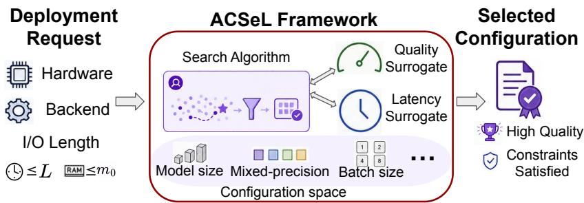
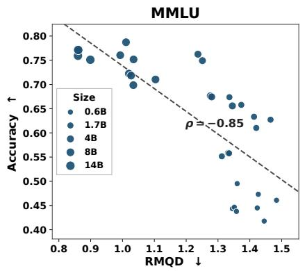
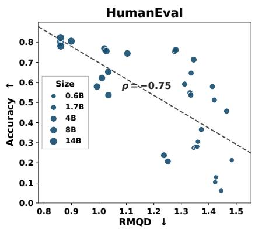
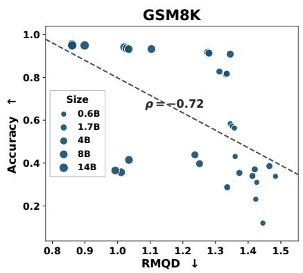
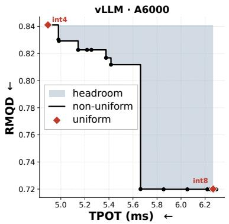
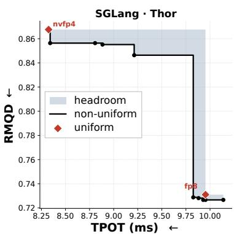

# ACSeL: Adaptive Configuration Search for Hardware-Constrained LLM Inference

Bokun Wang, Hung-Yueh Chiang, and Diana Marculescu University of Texas at Austin

## Abstract

Serving large language models (LLMs) under tight memory and latency service-level objectives (SLOs), including on edge devices, requires jointly selecting the model size, batch size, quantization algorithm, and mixed-precision quantization recipes. Exhaustive search over this combinatorially large space is infeasible. Unlike data-center serving, which often prioritizes throughput or generation speed, resource-constrained deployments typically set memory and latency budgets as constraints and then seek the configuration with the highest generation quality among feasible ones. To this end, we propose ACSeL, a framework that identifies configurations predicted to satisfy deployment constraints while achieving high predicted generation quality. To enable eficient quality estimation, we use Relative Model Quality Degradation (RMQD), a proxy based on the divergence between the candidate and reference models’ next-token distributions over a small calibration corpus. Across the evaluated model sizes and precisions, RMQD is inexpensive to evaluate and strongly correlated with downstream benchmark performance. ACSeL combines (i) a lightweight quality surrogate that predicts RMQD directly from a configuration; (ii) Few-shot Median Calibration (FMC), which calibrates operator-profile-based latency estimates using a small number of end-toend profiles; and (iii) a structured search algorithm BandPareto for exploring layerwise mixed-precision configurations. Experiments on an NVIDIA RTX A6000 workstation and an NVIDIA Jetson Thor edge platform show that FMC substantially improves deploymen feasibility, while BandPareto + FMC achieves the highest feasibility and the lowest RMQD gaps to the best measured configurations in the evaluation set.

## 1 Introduction

Large language models (LLMs) have advanced rapidly and are increasingly deployed beyond the datacenter, on edge devices, personal workstations, vehicles, wearable patient monitors, and interactive appliances that need on-device or near-device reasoning with low latency and strong privacy. These platforms face strict physical limits: finite DRAM and flash storage, limited accelerator memory bandwidth, relatively strict interactive latency budgets such as time-to-first-token (TTFT) and time-per-output-token (TPOT) that users experience as responsiveness, and hard thermal and power constraints. Under such complex conditions, maximizing generation quality usually means optimizing over a joint configuration space for a given model family and serving backend: the product of global choices (such as model size and batch size) and a per-layer quantization configuration space, where each layer specifies weight/activation formats, quantization algorithm, quantization scope (e.g., full or Linear-only), and options grouping layers into bands that share a recipe across contiguous layers. Exploring such a complex space is challenging because it is combinatorially large: for example, the number of candidate configurations is already on the order of $1 0 ^ { 7 }$ for Qwen3 family models and Ampere-class GPUs, rendering any exhaustive profiling impractical. This motivates an adaptive configuration optimization problem: for each deployment request, automatically select the configuration that maximizes generation quality subject to its hardware and latency budgets.

Prior work on configuration optimization for LLM serving typically targets data-center objectives, such as throughput or energy under latency SLOs, using control knobs such as parallelism and runtime scheduling (Xu et al., 2026; Cho et al., 2026; Song et al., 2026). These methods also generally assume fixed and uniform quantization recipes. On hardware-constrained platforms the picture changes. Deployments often run on a single accelerator at modest request rates, so multi-GPU parallelism and cluster-scale scheduling ofer little headroom, while latency budgets act as SLOs rather than soft targets to trade against tokens/sec. For example, a wearable patient monitor cannot add another rack, and the operator seeks to ensure that each response satisfies the latency constraints while achieving the highest possible generation quality. Layerwise weight/activation precision provides another lever for meeting memory and latency constraints while preserving generation quality. We therefore consider the complementary objective of maximizing the generation quality subject to latency and memory constraints:

  
Figure 1: Overview of ACSeL, which uses quality and latency surrogates to guide the search over the configuration space and returns the predicted-feasible configuration with the highest predicted generation quality for the given deployment request.

$$
\operatorname* { m a x } _ { C \in { \mathcal { C } } _ { q } } F ( C ) , \quad \mathrm { s . t . } \quad \mathrm { T T F T } ( C , q ) \leq L _ { 1 } , \ \mathrm { T P O T } ( C , q ) \leq L _ { 2 } , \ \mathrm { M e m } ( C , q ) \leq m _ { 0 } ,\tag{1}
$$

where q ={hardware, isl, osl, $L _ { 1 } , \ L _ { 2 }$ , model family, backend} is a deployment request, isl, osl refer to input/output sequence lengths, $L _ { 1 }$ , L<sub>2</sub> are constraints on TTFT/TPOT, C is a configuration from space $\mathcal { C } _ { q }$ for request $q , F ( C )$ measures model quality (instantiated later via an inexpensive proxy), and $m _ { 0 }$ is the memory constraint of the given hardware platform<sup>1</sup>.

To eficiently solve (1), we present ACSeL (illustrated in Figure 1), a surrogate-guided framework for jointly selecting the model size, serving configuration, and layerwise mixed-precision quantization recipe under request-specific constraints. ACSeL replaces costly benchmark evaluation and exhaustive hardware profiling with lightweight quality and latency surrogates, and then uses these surrogates to search the combinatorially large configuration space for a feasible solution with highest predicted generation quality. Our main contributions are as follows:

• We use Relative Model Quality Degradation (RMQD), defined as the KL divergence between the next-token distributions of candidate models and a shared reference model over a small calibration corpus, as a low-cost quality proxy. We further develop a lightweight surrogate that predicts RMQD directly from configurations.

• We develop Few-shot Median Calibration (FMC), which improves AIConfigurator (Xu et al., 2026) using only a small number of end-to-end profiles and robust log-space median regression, improving measured deployment feasibility with limited platform-specific profiling.

• We design eficient surrogate-guided search algorithms, including our BandPareto (BP), to enable eficient exploration of combinatorial mixed-precision configuration spaces under deployment-time constraints. Experiments on a workstation with an NVIDIA RTX A6000 GPU and an NVIDIA Jetson Thor edge platform show that FMC substantially improves deployment feasibility, while BandPareto + FMC achieves the lowest RMQD gaps. Our collected latency dataset of mixed-precision quantized LLMs could aid future research in resource-constrained serving.

## 2 Related Work

Post-Training Quantization (PTQ) for LLMs. Numerous studies reduce the computational and memory costs of LLM inference through weight-only/weight-activation quantization (Frantar et al., 2022; Dettmers et al., 2022; Lin et al., 2024; Xiao et al., 2023). Another line of work explores mixed-precision PTQ, retaining sensitive components at higher precision while quantizing the remainder more aggressively (Lee et al., 2024; Saxena et al., 2025; Zhao et al., 2026). These methods improve quality-eficiency trade-ofs but typically do not adapt quantization to request-specific SLOs. AMQ (Lee et al., 2025a) searches layerwise bit-width assignments for weight-only quantization under a memory budget. In contrast, our work considers a broader deployment configuration space, including model and batch sizes as well as quantization recipes beyond bit width. Moreover, ACSeL explicitly models hardware- and backend-specific inference latency to optimize configurations under request-specific SLOs.

Performance Modeling of LLM Inference. Direct profiling provides accurate platform-specific latency measurements and bottleneck diagnosis (You et al., 2023; Chiang et al., 2025; Wang et al., 2025). However, profiling every combination of possible configurations remains prohibitively expensive. A growing body of work aims to predict the latency of LLM inference without exhaustively measuring every hardware and configuration point. Imai et al. (2024) train regression models on profiled latency data with roofline-derived analytical latency (Yuan et al., 2024) as an additional feature. NeuSight (Lee et al., 2025b) decomposes a kernel into tiles, uses an MLP to predict per-tile device utilization, and bounds the result with fundamental roofline performance laws. AIConfigurator (AIC) (Xu et al., 2026) estimates TTFT/TPOT by ofline operator profiling and table lookup: For each backend it builds a per-operator database keyed by type and shape, decomposes a prefill or decode step into operators, and sums their latencies, enabling latency prediction on GPUs without end-to-end latency profiling. We find that using raw AIC as the latency surrogate in configuration optimization yields low deployment feasibility under TTFT/TPOT SLOs. To this end, we propose a lightweight few-shot calibration of AIC that substantially improves feasibility with a small overhead.

Deployment Optimization for LLM Serving. Modern LLM serving systems such as vLLM (Kwon et al., 2023), SGLang (Zheng et al., 2024), and TensorRT-LLM (NVIDIA, 2023–2026) provide high-throughput engines with continuous batching, paged KV caches, and backend-specific kernels. On top of these systems, prior work considers the configuration optimization problem with data-center centric objectives and contro knobs: AIC (Xu et al., 2026) searches parallelism strategies (tensor/pipeline/expert) and framework runtime parameters (e.g., CUDA graphs, KV-cache memory fraction) across TRT-LLM, vLLM, and SGLang to improve serving performance under latency/throughput targets. Cho et al. (2026) analyze large deployment spaces spanning hardware choice, parallelism, and runtime configurations aiming to maximize throughput subject to latency SLOs. EnergyLens (Song et al., 2026) explores multi-GPU parallelism, fusion, and compute-communication overlap to reduce inference energy. To accommodate the hardware-constrained LLM inference, our setting instead optimizes generation quality on single-accelerator, hardware-constrained platforms subject to memory and request-specific latency constraints, with (layerwise) quantization recipes in the search space.

## 3 Method

The optimization problem in (1) cannot be solved directly at deployment time: Evaluating model quality on standard benchmarks and profiling latency on the target hardware for every candidate configuration $C \in { \mathcal { C } } _ { q }$ would incur prohibitive computational and runtime costs. To this end, we first define the Relative Model Quality Degradation (RMQD) score, an inexpensive and continuous metric that measures the quality degradation of a configuration relative to a family-specific oracle to replace direct benchmark evaluation (Section 3.1). We then instantiate the quality objective as $F ( C ) = - \mathrm { R M Q D } ( C )$ , so maximizing quality in (1) becomes minimizing RMQD. Because directly computing RMQD and measuring latency for every candidate configuration is still expensive, we approximate them with learned surrogates and solve:

$$
\begin{array} { r l } & { \underset { C \in \mathcal { C } _ { q } } { \operatorname* { m i n } } \widehat { \mathrm { R M Q D } } ( C ) , } \\ & { \mathrm { s . t . } \quad \widehat { \mathrm { T T F T } } ( C , q ) \leq L _ { 1 } , \widehat { \mathrm { T P O T } } ( C , q ) \leq L _ { 2 } , \mathrm { M e m } ( C , q ) \leq m _ { 0 } , } \end{array}\tag{2}
$$

where $\widehat { \mathrm { R M Q D } } ( C )$ denotes the predicted RMQD of configuration $C ,$ while ${ \widehat { \mathrm { T T F T } } } ( C , q )$ and ${ \widehat { \mathrm { T P O T } } } ( C , q )$ denote its predicted TTFT and TPOT, respectively, given deployment request $q .$ Our framework ACSeL consists of three components: (i) lightweight quality surrogate that predicts $\widehat { \mathrm { R M Q D } } ( C )$ from the configuration without requiring benchmark evaluation; (ii) latency surrogate $\widehat { T } ( C , q ) = \widehat { \left( \mathrm { T T F T } \right)} ( C , q ) , \widehat { \mathrm { T P O T } } ( C , q ) $ , that extends the operator-level lookup table of AIC to device-specific kernels and layerwise quantization recipes and calibrates its predictions using few-shot profiling and median regression; and (iii) search algorithms that use the quality and latency surrogates to solve (2) eficiently.

## 3.1 Relative Model Quality Degradation (RMQD)

Two natural model quality metrics are test loss (e.g., cross-entropy loss on a held-out corpus) and Benchmark scores $( e . g .$ , on NeMo Evaluator (NVIDIA, 2026)). Test loss is smooth and therefore convenient for fitting predictors. However, it is an absolute metric: a practitioner cannot read of “how good” a quantized 8B model is from a raw loss number without a reference. Moreover, corpus loss might not reliably reflect common-sense, mathematical, or code reasoning quality under deployment-relevant prompts. On the other hand, benchmark scores are directly interpretable to practitioners, but they are essentially step functions of the underlying logits, which are ill-suited as regression targets for a small-data ML surrogate. Furthermore, evaluating every candidate configuration on standard benchmarks can be time-consuming and expensive in terms of token usage and API costs.

To obtain a quality metric that is continuous, more interpretable than raw test loss, and cheap to evaluate, KL divergence between a compressed model and a high-precision reference has been used as an inexpensive fidelity metric for compressed LLMs, complementing benchmark accuracy (Dutta et al., 2024; Nikolic et al., 2026). We build on this idea but adapt it to ACSeL’s cross-model configuration search. In contrast to comparing each quantized model only with its own full-precision counterpart, we use a common family-level oracle, which places diferent model sizes and quantization recipes on a shared reference scale. We call the resulting corpus-averaged score Relative Model Quality Degradation (RMQD): Consider a model family $\mathcal { F }$ with a shared tokenizer and vocabulary V (e.g., Llama-3). Let the oracle $M ^ { \ast } \in \mathcal { F }$ be the largest full-precision model in that family $( e . g .$ , Llama-3.1 405B). For a candidate configuration C inducing model $M _ { C }$ (same tokenizer/vocabulary), and a sequence $x = ( x _ { 1 } , \dots , x _ { L } ) \in \mathcal { V } ^ { L }$ , denoted by $p ^ { * } ( \cdot \mid x < t )$ and $p _ { C } ( \cdot \mid x < t )$ the oracle and candidate next-token distributions at position t. The sequence-level RMQD is

$$
\mathrm { R M Q D } ( C ; x ) = \frac { 1 } { L } \sum _ { t = 1 } ^ { L } D _ { \mathrm { K L } } \left( p ^ { \star } \left( \cdot \mid x _ { < t } \right) \| p _ { C } \left( \cdot \mid x _ { < t } \right) \right) ,
$$

where $D _ { \mathrm { K L } }$ is the KL-divergence, given a fixed calibration corpus D of sequences subsampled from diverse benchmarks. In our work, we use 24 samples from each of the 17 benchmarks of NeMo Evaluator. The overall RMQD score is $\begin{array} { r } { \mathrm { R M Q D } ( C ) = \frac { 1 } { | D | } \sum _ { x \in \mathcal { D } } \bar { \mathrm { R M Q D } } ( C ; x ) } \end{array}$ . A lower RMQD score indicates less quality degradation. As illustrated in Figure 2, RMQD exhibits a fairly strong negative correlation with benchmark scores across the evaluated model sizes and quantization recipes. These results support RMQD as a computationally eficient proxy for the overall quality trend.

Computational eficiency. Oracle inference dominates the cost which is hardware-agnostic and incurred only once: the oracle model’s logits can be computed on the cloud/cluster, cached, and reused to evaluate any candidate model on the target platform. Because caching full-vocabulary logits would incur substantial storage and $\mathrm { I } / \mathrm { O }$ overhead, we retain only the oracle’s top-m token probabilities $( m = 5 1 2$ in our experiments, covering 99% of the probability mass on the oracle models we consider) and collapse the remaining mass into a single tail bin, yielding a $( m + 1 )$ -bin distribution.





  
Figure 2: Spearman correlation (ρ) between accuracy and RMQD for Qwen3 models with both uniformprecision and mixed-precision quantization recipes across three benchmarks from NeMo Evaluator. RMQD is fairly strongly negatively correlated with accuracy on all benchmarks $( \rho = - 0 . 7 2 \ \mathrm { t o } \ - 0 . 8 5 )$ , capturing the overall quality trend across model sizes and precisions. Dashed lines show linear fits.

Direct benchmark evaluation typically requires sequential autoregressive decoding to generate an answer token by token, followed by answer verifier, exact-match checker, LLM-as-a-judge, or external API calls. In contrast, computing RMQD requires only a single teacher-forced forward pass over the fixed calibration sequences and can be parallelized across both tokens and sequences. Empirically, on an A6000, computing RMQD for 24 GSM8K questions takes 6.84 seconds, compared with 626.91 seconds for directly evaluating benchmark scores on the same 24 questions (91.6× speedup).

## 3.2 Quality Surrogate

Section 3.1 gives a cheap quality proxy, but computing RMQD score for each candidate LLM still requires running a teacher-forced forward pass. We therefore fit a lightweight linear model to map (layerwise) configuration C to predicted RMQD<sup>\</sup> (C), evaluated in milliseconds at search time.

We preprocess each input configuration C into numerical features ϕ(C), which is the concatenation of three groups of features as follows. First, we treat the logarithm of the model size and the one-hot encoding of the quantization algorithm as free features. Second, we represent the exclusion flags (indicating whether the LM head, MoE gate, and KV cache are quantized) as global features. Third, for each layer ℓ, we encode the bit deficit, defined as 16− #bits, the quantization scope (full layer, MLP only, etc.), and the quantization granularity (per-tensor, per-channel, block-128, or block-16) as numerical features normalized to [0, 1]. Then, we aggregate the layerwise features into global features by both uniform averaging and depth-weighted averaging which puts weights on early, middle, and late layers. We also impose the prior that the mode degradation is monotonic in bit deficit features (Ablation study of monotone features is in Section 4.3).

In practice, the measured RMQD scores span multiple orders of magnitude and are strictly positive. We therefore model the target $y ( C ) = \log ( { \mathrm { R M Q D } } ( C ) )$ using a linear model on ϕ(C) and fit the quality surrogate by minimizing a constrained ridge-regression objective:

$$
\begin{array} { r l } & { \displaystyle \underset { w , b } { \operatorname* { m i n } } \sum _ { i } ( w ^ { \top } \phi ( C ^ { ( i ) } ) + b - y ^ { ( i ) } ) ^ { 2 } + \lambda \| ( w , b ) \| _ { 2 } ^ { 2 } , } \\ & { \mathrm { s . t . } w _ { j } \geq 0 , \forall j \in M , } \end{array}
$$

where M contains the coordinates of all monotone features. The quality surrogate is fit once ofline on a small set of configurations. Since the RMQD score depends only on model and quantization configurations, the cost of fitting can be amortized across model sizes, hardware platforms, backends, and subsequent deployment requests. Search-time RMQD prediction is therefore a milliseconds-scale feature map and dot product, with no additional oracle or benchmark evaluation in the inner loop.

## 3.3 Latency Surrogate

AIConfigurator (AIC) (Xu et al., 2026) decomposes prefill/decode into operators and estimates latency by table lookup over profiled kernels. We build on AIC but extend it to our deployment setting in three steps. First, we extend the operator-level lookup tables to target hardware platforms A6000 and Jetson Thor. Besides, vanilla AIC targets uniform numerical formats. For a multi-band mixed-precision quantization configuration $C = \{ ( C _ { b } , \bar { \mathcal { T } } _ { b } ) \} _ { b = 1 } ^ { B }$ , where $\mathcal { T } _ { b }$ is the layer index set of the b-th band, we first obtain per-band uniform AIC estimates for each band and integrate them into end-to-end latency prediction.

Even after the aforementioned extensions, directly using AIC predictions to filter candidates results in a low feasibility rate: many configurations predicted to satisfy the TTFT or TPOT SLOs violate them when deployed on the target hardware (See experimental results in Section 4.3). To improve prediction with minima profiling overhead, we propose the Few-shot Median Calibration (FMC). First, we select K configurations per backend and phase (prefilling or decoding) by spreading them out across AIC-predicted latencies and recipe types. Starting from an initial configuration, we repeatedly select the candidate whose distance to its nearest previously selected configuration is largest. For each selected configuration $C ^ { ( k ) } , ( k = 1 , \dots , K )$ , we record its measured latency $T ^ { ( k ) }$ and corresponding AIC prediction $\widehat { T } _ { \mathrm { A I C } } ^ { ( k ) }$ . For each phase, FMC models the calibration as

$$
\log T = \gamma ^ { * } \log \widehat { T } _ { \mathrm { A I C } } + \delta ^ { * } ,
$$

where $( \gamma ^ { * } , \delta ^ { * } )$ is estimated by minimizing the pinball loss (Koenker & Hallock, 2001) in the log-space:

$$
\operatorname* { m i n } _ { \gamma , \delta } \sum _ { k = 1 } ^ { K } \rho _ { 0 . 5 } ( \log T ^ { ( k ) } - \gamma \log \widehat T _ { \mathrm { A I C } } ^ { ( k ) } - \delta ) ,\tag{3}
$$

where $\rho _ { \tau } ( u ) = u ( \tau - { \bf 1 } _ { u < 0 } )$ . Then, the predicted latency is $\widehat { T } ( C , q ) = \exp ( \gamma ^ { * } \log \widehat { T } _ { \mathrm { A I C } } ( C , q ) + \delta ^ { * } )$ given configuration C and request q. With $\tau = 0 . 5$ , minimizing the pinball loss reduces to median regression, which is less sensitive than least-squares regression to large response residuals, which is particularly useful when only a small number of profiled data is available (see Section 4.3 for an empirical comparison). We fit the calibration model in log space because AIC errors are primarily multiplicative. For example, predicting 10 ms instead of 20 ms and 200 ms instead of 400 ms represents the same $2 \times$ underestimation. Log-space regression assigns both cases the same residual, log 2, preventing large-latency configurations from dominating the regression objective.

Computational eficiency. FMC requires only a one-time, ofline campaign of few (tens of) end-to-end latency profiles per serving stack (device, backend) and solving a milliseconds-scale univariate median regression. The fitted surrogate can be reused for every model, configuration, and deployment requests.

## 3.4 Search Algorithms

Given the calibrated latency surrogate $\mathrm { F M C } ( \widehat { T } _ { \mathrm { A I C } } ( C , q ) )$ , we construct a surrogate admission gate ${ \mathrm { G a t e } } ( C , q )$ that determines whether a candidate configuration C is predicted to satisfy the deployment constraints of request q. As shown in Algorithm 1, the gate first rejects configurations that exceed the available memory or cannot be exported to the target backend. It then applies FMC to predict TTFT and TPOT and rejects configurations that violate either latency SLO.

Apart from batch size and model size, we explore mixed-precision configurations represented as band recipes. A band recipe partitions the layers of an LLM into contiguous bands. Each band is assigned a quantization configuration including a data format, quantization algorithm, scope (which tensors in a layer are quantized), and quantization granularity (how scaling factors are shared). In our work, we consider at most three bands, each with a diferent quantization configuration. We also assume that the quantization algorithm is shared across all layers and the granularity is set to the default associated with each data format, such as block-16 for nvfp4. The search algorithms therefore primarily determine the band boundaries and the data format assigned to each band. We investigate three search algorithms from least to most structured: random sampling (Rand, Algorithm 2), hill-climbing (HC, Algorithm 3), and BandPareto (BP, Algorithm 4).

Algorithm 1 Surrogate admission gate Gate(C, q)   
Require: Configuration C, deployment request q, TTFT/TPOT constraints $L _ { 1 } / L _ { 2 } ,$ , memory constraint $m _ { 0 }$   
1: if memory $> m _ { 0 }$ or non-exportable then   
2: return Reject   
3: end if   
4: $\widehat { ( \mathrm { T T F T } } ( C , q ) , \widehat { \mathrm { T P O T } } ( C , q ) \big ) \gets \mathrm { F M C } ( \widehat { T } _ { \mathrm { A I C } } ( C , q ) )$   
5: if $\widehat { \mathrm { T T F T } } ( C , q ) > L _ { 1 }$ or $\widehat { \mathrm { T P O T } } ( C , q ) > L _ { 2 }$ then   
6: return Reject   
7: end if   
8: return Accept

Algorithm 2 draws random band configurations, runs the full surrogate admission gate on each, and returns the admitted draw with the lowest predicted RMQD. Hill-climb (Algorithm 3) instead improves a warm start by searching local neighbors (e.g., stepping a band’s format along int4 ↔ int8 ↔ bf16, or nudging a cut by one layer). HC could repair a bad initial configuration, but it still explores only a neighborhood of that start.

Algorithm 2 Random sampling (Rand)   
Require: Request q; time budget t<sup>¯</sup>   
1: F ← ∅   
2: while elapsed time $< \bar { t }$ do   
3: Draw a random configuration C   
4: if Gate(C; q) == Accept then   
5: ${ \mathcal { F } } \gets { \mathcal { F } } \cup \{ C \}$   
6: end if   
7: end while   
8: return arg min $_ { C \in { \mathcal { F } } } { \widehat { \mathrm { R M Q D } } } ( C )$ if ${ \mathcal { F } } \neq \emptyset .$ , else unanswered

Algorithm 3 Hill-climbing (HC)   
Require: Request q; time budget t<sup>¯</sup>   
1: $J ( C ) \gets \widehat { \mathrm { R M Q D } } ( C )$ if Gate(C, q) is Accept, else ∞   
2: Randomly select a recipe C; best $ C$   
3: while elapsed time < t<sup>¯</sup> do   
4: for all neighbor C<sup>′</sup> of C do   
5: if $J ( C ^ { \prime } ) < J ( C )$ then   
6: $C  C ^ { \prime } ;$ best ← arg min<sub>X∈{best,C}</sub> J(X); break   
7: end if   
8: end for   
9: If no better neighbor exists, randomly restart C and set best ← arg min<sub>X∈{best,C}</sub> J(X)   
10: end while   
11: return best if $J ( b e s t ) < \infty$ , else unanswered

We notice that the dominant cost is the admission gate, which for multi-band candidates triggers a full AIC call (looking up the operator-level tables and accumulating). Utilizing this observation, BandPareto (Algorithm 4) soft-screens many legal configurations with a cheap approximate latency check, retains only the competitive (Pareto) shortlist, and applies the expensive full admission gate to that shortlist alone.

For the cheap latency check, we use a layer-fraction mix of precomputed uniform AIC predictions, which we call FracMix. Since the number of uniform quantization configurations is orders of magnitude smaller than the band ones, we run AIC on uniform configurations and store the end-to-end latency in a lookup table. At query time, the FracMix approximate latency of a B-band configuration $C = \{ C _ { j } \} _ { j = 1 } ^ { B }$ is computed as FMC $\begin{array} { r } { \left( \sum _ { j = 1 } ^ { B } \frac { L _ { j } } { L } \widehat { T } _ { \mathrm { A I C } } ( C _ { j } , q ) \right) } \end{array}$ , where $C _ { j }$ is the configuration of the j-th band, L is the number of total layers,

$L _ { j }$ is the number of layers in the $j { \mathrm { - t h } }$ band, and $\widehat { T } _ { \mathrm { A I C } } ( C _ { j } , q )$ is the precomputed AIC estimate of whole-model with uniform configuration $C _ { j } { } ^ { 2 }$

```latex
Algorithm 4 BandPareto (BP)
Require: Request q
1: $s o f t \gets \emptyset$
2: # 1. Fast soft screening
3: for each legal band configuration $C$ do
4: $( \widetilde \mathrm { T T F T } ( C , q ) , \overbar { \mathrm { T P O T } } ( C , q ) ) \gets \mathrm { F r a c M i x } ( C , q )$
5: if $\hat { \mathrm { T T F T } } ( C , q ) \leq ( 1 + \eta ) L _ { 1 }$ and $\mathrm { \bar { T P O T } } ( C , q ) \leq ( 1 + \eta ) L _ { 2 }$ then
6: soft ← soft ∪ {C}
7: end if
8: end for
9: # 2. Pareto filter
10: $f r o n t \gets \{ C \ : | \ : C \in s o f t , \ : \ : \sharp C ^ { \prime } \in s o f t : \ : C ^ { \prime } \prec C \} ^ { 3 }$
11: $\mathcal { F }  \emptyset$
12: # 3. Full gate for Pareto shortlist
13: for each C in front do
14: if Gat ${ \mathfrak { s } } ( C , q ) = =$ Accept then
15: ${ \mathcal { F } } \gets { \mathcal { F } } \cup \{ C \}$
16: end if
17: end for
18: return arg min $\widehat { \mathbf { \Lambda } } _ { C \in \mathcal { F } } \widehat { \mathrm { R M Q D } } ( C )$ if ${ \mathcal { F } } \neq \emptyset ,$ , else unanswered
```

Empirically, on Jetson Thor, FracMix takes ${ \sim } 1 0 ~ \mathrm { s }$ to build the lookup table and costs ${ \sim } 0 . 1 5$ ms per candidate versus ∼60 ms for a full admission gate (∼400× slower). Note that the table is built once per serving stack and then reused across deployment queries, so its ofline CPU cost is amortized over all subsequent online FracMix lookups. Because FracMix is noisier than the full admission gate, we retain candidates whose predicted latency is up to η above the latency constraints, reducing false rejection of near-boundary configurations before full gating. In our experiments, $\eta = 5 \%$ is suficient to match the feasibility performance of BandPareto in Table 1. Using a larger η sends more candidates through full evaluation, which increases the running time (See Appendix A). After soft screening, BP keeps only configurations that are on the empirical quality–latency Pareto frontier built from the soft candidates. Those survivors are fully gated, and among any that pass, we pick the one with the best predicted RMQD.

## 4 Experiments

We aim to answer the following research question:

RQ: How efectively can surrogate-guided search identify deployment-feasible configurations with quality   
close to the best one under request-specific SLOs?

We also conduct ablation studies and comparisons with baseline methods to validate our design choices.

## 4.1 Experimental Setup

Platforms, backends, formats. We consider two complementary deployment settings: an NVIDIA RTX A6000 workstation GPU and an NVIDIA Jetson Thor edge platform. On A6000 we cover the backends vLLM, SGLang, TensorRT-LLM, and data formats bf16, int8, int4 (weight-only). On Thor, we cover the backends vLLM, $\mathrm { S G L a n g ^ { 4 } }$ , and data formats bf16, fp8, nvfp4 (weight-activation).

Evaluation data. We consider candidate models from the Llama-3.x and Qwen3 families, with model sizes of up to 8B. On A6000, we profile 288 3-band and all uniform quantization configurations across batch sizes $\in \{ 1 , 4 , 8 , 1 6 , 3 2 \}$ $i s l \in \{ 1 2 8 , 5 1 2 , 2 0 4 8 , 8 1 9 2 \}$ , and osl $\in \{ 6 4 , 2 5 6 , 5 1 2 \}$ , yielding 13,618 latency measurements. On Thor, we profile 288 3-band and all uniform quantization configurations across batch sizes $\in \{ 1 , 4 , 8 , 3 2 \}$ , $i s l \in \{ 1 2 8 , 2 0 4 8 , 8 1 9 2 \}$ , and osl $\in \{ 6 4 , 5 1 2 \}$ , yielding 4,309 latency measurements. For band quantization configurations, we profile the TTFT/TPOT on the target hardware after exporting the model using ModelOpt (NVIDIA, 2024–2026). For the RMQD scores (which are hardware and request independent), we use Llama-3.1 405B and Qwen3 235B-A22B as the oracle models for the Llama-3.x and Qwen3 families, respectively. The oracle logits are computed and cached from a high-performance GPU cluster.



  
Figure 3: Quality–latency headrooms on A6000 (vLLM) and Thor (SGLang) of band vs. uniform in the evaluation dataset, with llama-3.2-1b at batch size 4, isl 2048, osl 64.

For quantized candidate models, we apply ModelOpt’s fake quantization. It is worth noting that none of the evaluation data is used to fit the quality or latency surrogates in our framework. Figure 3 illustrates why mixed-precision configurations are useful under latency constraints. For a fixed model and workload, uniform quantization provides only a few quality–latency operating points. Band configurations offer additional choices between them: at intermediate TPOT budgets, they can achieve lower measured RMQD than the best measured uniform configuration satisfying the same budget. These examples motivate searching over band configurations rather than restricting deployment to uniform quantization.

## 4.2 Search Performance Comparison

To compare search performance, we generate 50 synthetic deployment requests using a fixed procedure. Each request specifies a platform–backend pair and an (isl, osl) workload. To construct the latency SLOs we pin an anchor model and batch size, then set the latency constraint to be tighter than the corresponding uniform int8 operating point on A6000 or uniform fp8 operating point on Thor. In this way we construct challenging but attainable latency SLOs in the mixed-precision headroom region illustrated in Figure 3, and the same request set is used for all algorithms (Full details are provided in Appendix B). For fair comparison, we set the time budget t<sup>¯</sup> in Rand and HC to match that of BP. We fit the quality surrogate described in Section 3.2 on 226 model configurations that are disjoint from the evaluation data. For variants with the FMC latency surrogate, we profile 30 configurations (evenly split across backends and disjoint from the evaluation data) according to the configuration selection approach described in Section 3.3.

Metrics. We report each search algorithm’s answer rate: the fraction for which it returns a configuration that passes the surrogate admission gate. Then, we compare the feasibility rates of the configurations returned by the search algorithms. A configuration is deemed feasible@tol% if it fits in memory, can be exported to the target backend, and its measured latency satisfies the deployment constraints on the target hardware within a tolerance of tol%, where tol $\in \{ 0 , 5 , 1 0 \}$ , where tol = 0 denotes strict feasibility. To further measure how close the returned configurations are to the Pareto frontier, we also report gap∩@10%: the diference between the RMQD of the returned configuration and the best RMQD among all feasible configurations in the evaluation dataset, on requests where all compared algorithms are feasible@10%. We also report ≥uniform@10%: the fraction of requests for which the returned configuration of a search algorithm matches or improves upon the RMQD of the best feasible@10% uniform configuration. We run each algorithm with 3 random seeds and report the mean ± standard deviation.

First, we compare the answer rates and deployment feasibility of search algorithms using vanilla AIConfigurator (AIC) and our FMC. Table 1 shows that FMC consistently improves both answer rate and measured deployment feasibility across all search algorithms. On A6000, FMC raises answer rates from 48.0% to at least 89.3%, while on Thor it increases them from 16.0% to at least 72.0%. The improvement is also reflected in measured feasibility at all three tolerance levels. For BP, strict feasibility increases from 32.0% to 48.0% on A6000 and from 16.0% to 40.0% on Thor; with a 10% tolerance, BP+FMC reaches 84.0% and 64.0%, respectively. Thus, FMC substantially improves the usefulness of AIC predictions for configuration admission, although prediction errors near the SLO boundary can still lead to violations under strict feasibility.

Table 1: Answer rates, measured deployment feasibility, and quality of configurations returned by search algorithms with AIC and FMC (Ours). Feas.@0% denotes strict satisfaction of the measured latency SLOs, whereas Feas.@5% and Feas.@10% allow the corresponding relative tolerance. Gap ∩ @10% is reported only for FMC variants and is computed (for each seed) over requests for which Rand, HC, and BP are all feasible@10%. The reference is the best measured feasible@10% configuration in the evaluation dataset.  
A6000
<table><tr><td rowspan=1 colspan=1>Method</td><td rowspan=1 colspan=1>Answered (↑)</td><td rowspan=1 colspan=1>Feas.@0% (↑)</td><td rowspan=1 colspan=1>Feas.@5% (↑)</td><td rowspan=1 colspan=1>Feas.@10% (↑)</td><td rowspan=1 colspan=2>Gap∩@10% (↓) ≥uniform@10%(↑)</td></tr><tr><td rowspan=2 colspan=1>+AICRand+FMC</td><td rowspan=1 colspan=1>48.0%±0.0%</td><td rowspan=1 colspan=1>30.7%±6.1%</td><td rowspan=1 colspan=1>34.7%±2.3%</td><td rowspan=1 colspan=1>40.0%±4.0%</td><td rowspan=1 colspan=1></td><td rowspan=1 colspan=1>38.7%±6.1%</td></tr><tr><td rowspan=1 colspan=1>89.3%±2.3%</td><td rowspan=1 colspan=1>37.3%±6.1%</td><td rowspan=1 colspan=1>52.0%±10.6%</td><td rowspan=1 colspan=1>69.3%±8.3%</td><td rowspan=1 colspan=1>0.019±0.002</td><td rowspan=1 colspan=1>69.3%±8.3%</td></tr><tr><td rowspan=2 colspan=1>+AICHC+FMC</td><td rowspan=1 colspan=1>48.0%±0.0%</td><td rowspan=1 colspan=1>33.3%±4.6%</td><td rowspan=1 colspan=1>37.3%±8.3%</td><td rowspan=1 colspan=1>42.7%±6.1%</td><td rowspan=1 colspan=1></td><td rowspan=1 colspan=1>42.7%±6.1%</td></tr><tr><td rowspan=1 colspan=1>92.0%±0.0%</td><td rowspan=1 colspan=1>42.7%±8.3%</td><td rowspan=1 colspan=1>60.0%±4.0%</td><td rowspan=1 colspan=1>72.0%±4.0%</td><td rowspan=1 colspan=1>0.034±0.023</td><td rowspan=1 colspan=1>56.0%±8.0%</td></tr><tr><td rowspan=2 colspan=1>+AICBP+FMC</td><td rowspan=1 colspan=1>48.0%±0.0%</td><td rowspan=1 colspan=1>32.0%±0.0%</td><td rowspan=1 colspan=1>48.0%±0.0%</td><td rowspan=1 colspan=1>48.0%±0.0%</td><td rowspan=1 colspan=1></td><td rowspan=1 colspan=1>48.0%±0.0%</td></tr><tr><td rowspan=1 colspan=1>92.0%±0.0%</td><td rowspan=1 colspan=1>48.0%±0.0%</td><td rowspan=1 colspan=1>72.0%±0.0%</td><td rowspan=1 colspan=1>84.0%±0.0%</td><td rowspan=1 colspan=1>0.009±0.007</td><td rowspan=1 colspan=1>84.0%±0.0%</td></tr></table>

<table><tr><td rowspan=1 colspan=1>Method</td><td rowspan=1 colspan=1>Answered (↑)</td><td rowspan=1 colspan=1>Feas.@0% (↑)</td><td rowspan=1 colspan=1>Feas.@5% (↑)</td><td rowspan=1 colspan=1>Feas.@10%(↑)G</td><td rowspan=1 colspan=1>ap∩@10% (↓)</td><td rowspan=1 colspan=1>≥uniform@10%(↑)</td></tr><tr><td rowspan=2 colspan=1>+AICRand+FMC</td><td rowspan=1 colspan=1>16.0%±0.0%</td><td rowspan=1 colspan=1>9.3%±2.3%.</td><td rowspan=1 colspan=1>10.7%±4.6%</td><td rowspan=1 colspan=1>13.3%±2.3%</td><td rowspan=1 colspan=1></td><td rowspan=1 colspan=1>4.0%±6.9%</td></tr><tr><td rowspan=1 colspan=1>72.0%±0.0%</td><td rowspan=1 colspan=1>34.7%±2.3%</td><td rowspan=1 colspan=1>49.3%±2.3%</td><td rowspan=1 colspan=1>62.7%±2.3%</td><td rowspan=1 colspan=1>0.007±0.002</td><td rowspan=1 colspan=1>37.3%±2.3%</td></tr><tr><td rowspan=2 colspan=1>+AICHC+FMC</td><td rowspan=1 colspan=1>16.0%±0.0%</td><td rowspan=1 colspan=1>8.0%±0.0%</td><td rowspan=1 colspan=1>10.7%±2.3%</td><td rowspan=1 colspan=1>12.0%±0.0%</td><td rowspan=1 colspan=1></td><td rowspan=1 colspan=1>1.3%±2.3%</td></tr><tr><td rowspan=1 colspan=1>72.0%±0.0%</td><td rowspan=1 colspan=1>37.3%±4.6%</td><td rowspan=1 colspan=1>50.7%±6.1%</td><td rowspan=1 colspan=1>56.0%±4.0%</td><td rowspan=1 colspan=1>0.008±0.001</td><td rowspan=1 colspan=1>29.3%±4.6%</td></tr><tr><td rowspan=2 colspan=1>+AICBP+FMC</td><td rowspan=1 colspan=1>16.0%±0.0%</td><td rowspan=1 colspan=1>16.0%±0.0%</td><td rowspan=1 colspan=1>16.0%±0.0%</td><td rowspan=1 colspan=1>16.0%±0.0%</td><td rowspan=1 colspan=1></td><td rowspan=1 colspan=1>16.0%±0.0%</td></tr><tr><td rowspan=1 colspan=1>76.0%±0.0%</td><td rowspan=1 colspan=1>40.0%±0.0%</td><td rowspan=1 colspan=1>56.0%±0.0%</td><td rowspan=1 colspan=1>64.0%±0.0%</td><td rowspan=1 colspan=1>0.002±0.001</td><td rowspan=1 colspan=1>60.0%±0.0%</td></tr></table>

Among the FMC-based methods, BP achieves the highest feasibility@10% and the smallest quality gap on both platforms. On the subset of requests for which Rand, HC, and BP are all feasible@10%, BP has an average RMQD gap of 0.009 ± 0.007 on A6000 and 0.002 ± 0.001 on Thor relative to the best measured feasible@10% configuration in the evaluation dataset. BP also matches or improves upon the best measured feasible@10% uniform configuration on 84.0% and 60.0% of all requests, respectively. These results indicate that combining calibrated latency prediction with structured mixed-precision search provides a favorable quality-feasibility trade-of under the evaluated deployment requests.

Table 2: Latency prediction error as median absolute percentage error (MdAPE) on the collected mixedprecision (layerwise) LLM evaluation dataset. AIC (Xu et al., 2026) does not require end-to-end latency data. For LR (Imai et al., 2024), FMC-MSE, and FMC, we use end-to-end latency data of 30 configurations evenly split across backends.
<table><tr><td rowspan="2">Platform</td><td rowspan="2">Backend</td><td colspan="4">TTFT MdAPE% (↓)</td><td colspan="4">TPOT MdAPE% (↓)</td></tr><tr><td>AIC</td><td>LR</td><td>FMC-MSE</td><td>FMC (Ours)</td><td>AIC</td><td>LR</td><td>FMC-MSE</td><td>FMC (Ours)</td></tr><tr><td rowspan="3">A6000</td><td>vLLM</td><td>78.5</td><td>55.4</td><td>43.3</td><td>24.8</td><td>11.4</td><td>100.0</td><td>76.9</td><td>5.8</td></tr><tr><td>SGLang</td><td>65.2</td><td>40.6</td><td>44.3</td><td>34.3</td><td>5.8</td><td>100.0</td><td>132.5</td><td>8.8</td></tr><tr><td>TRT-LLM</td><td>216.9</td><td>100.0</td><td>40.8</td><td>30.9</td><td>17.7</td><td>347.4</td><td>633.3</td><td>19.7</td></tr><tr><td rowspan="2">Thor</td><td>vLLM</td><td>141.5</td><td>100.0</td><td>128.6</td><td>30.0</td><td>39.9</td><td>100.0</td><td>287.0</td><td>20.6</td></tr><tr><td>SGLang</td><td>62.8</td><td>175.7</td><td>75.4</td><td>33.1</td><td>10.7</td><td>344.8</td><td>81.3</td><td>9.3</td></tr></table>

## 4.3 Ablation Study

To justify our choice of latency surrogate, we compare FMC with vanilla AIC and two baselines on the collected evaluation data: (1) a linear regression model that predicts end-to-end latency from configuration features and a roofline-based analytical estimate (LR) (Imai et al., 2024), and (2) FMC trained with mean-squared error (FMC-MSE) instead of the pinball loss in Eq. (3). As shown in Table 2, FMC achieves the lowest TTFT prediction error for every platform-backend pair, reducing AIC’s average TTFT MdAPE from 113.0% to 30.6%. It also outperforms LR and FMC-MSE in all TTFT settings. For TPOT, FMC achieves the lowest error in three of the five settings and remains close to AIC in the other two. In these cases, the raw AIC estimates are already relatively accurate, leaving limited room for improvement, and few-shot calibration may overcorrect them (We notice that the fitted slopes are close to one). In contrast, LR and FMC-MSE frequently exhibit errors above 100%, particularly for TPOT, suggesting that direct regression and squared-loss calibration are unstable when only a few profiling samples are available. These results show that robust log-space median calibration substantially reduces the latency-prediction error of AIC with few end-to-end profiles.

Table 3: Quality-surrogate RMQD prediction error on held-out configurations. Lower MdAPE is better.
<table><tr><td>Unconstrained ridge Constrained ridge (Ours)</td></tr><tr><td>MdAPE (%) ↓ 3.3 2.6</td></tr></table>

We also evaluate the quality surrogate alone by comparing the constrained ridge regression in Section 3.2 with unconstrained ridge regression using the same features. Both surrogates are trained on the 226 configurations described in Section 4.2 and evaluated on the held-out configurations in the evaluation data. In Table 3, we report median absolute percentage error (MdAPE) between predicted and measured RMQD, which shows the efect of the monotonicity constraints.

## 5 Conclusion

We presented ACSeL, a surrogate-guided framework for selecting LLM inference configurations with highest predicted generation quality under hardware memory and request-specific latency constraints. ACSeL combines RMQD, a computationally eficient proxy for generation quality; a lightweight quality surrogate that predicts RMQD directly from model configurations; FMC, which calibrates analytical latency estimates using a small number of end-to-end profiles; and eficient search algorithms for exploring combinatorial layerwise mixed-precision spaces. Across deployment requests spanning model families, serving backends, and input/output sequence lengths, our experiments show that calibrated latency gates and structured mixedprecision search identify more hardware-feasible, high-quality configurations than uncalibrated/unstructured baselines. Future work may explore agentic LLMs as surrogates or search algorithms for navigating increasingly complex deployment spaces.

## References

Hung-Yueh Chiang, Bokun Wang, and Diana Marculescu. Elana: A simple energy and latency analyzer for llms. arXiv preprint arXiv:2512.09946, 2025.

Sung Min Cho, Jaewon Lee, Chunqiang Tang, Yejin Lee, Geonhwa Jeong, Anca Agape, Scott Batura, Vincent Boivin, Stephen Chen, Renfei Chen, et al. Optimizing deployment configurations for llm inference. In Ninth Conference on Machine Learning and Systems, 2026.

Tim Dettmers, Mike Lewis, Younes Belkada, and Luke Zettlemoyer. Llm.int8(): 8-bit matrix multiplication for transformers at scale. Advances in neural information processing systems, 35:30318–30332, 2022.

Abhinav Dutta, Sanjeev Krishnan, Nipun Kwatra, and Ramachandran Ramjee. Accuracy is not all you need. Advances in Neural Information Processing Systems, 37:124347–124390, 2024.

Elias Frantar, Saleh Ashkboos, Torsten Hoefler, and Dan Alistarh. Gptq: Accurate post-training quantization for generative pre-trained transformers. arXiv preprint arXiv:2210.17323, 2022.

Saki Imai, Rina Nakazawa, Marcelo Amaral, Sunyanan Choochotkaew, and Tatsuhiro Chiba. Predicting llm inference latency: A roofline-driven ml method. In Workshops of Annual Conference on Neural Information Processing Systems, 2024.

Roger Koenker and Kevin F Hallock. Quantile regression. Journal of economic perspectives, 15(4):143–156, 2001.

Woosuk Kwon, Zhuohan Li, Siyuan Zhuang, Ying Sheng, Lianmin Zheng, Cody Hao Yu, Joseph Gonzalez, Hao Zhang, and Ion Stoica. Eficient memory management for large language model serving with pagedattention. In Proceedings of the 29th symposium on operating systems principles, pp. 611–626, 2023.

Changhun Lee, Jungyu Jin, Taesu Kim, Hyungjun Kim, and Eunhyeok Park. Owq: Outlier-aware weight quantization for eficient fine-tuning and inference of large language models. In Proceedings of the AAAI Conference on Artificial Intelligence, volume 38, pp. 13355–13364, 2024.

Sangjun Lee, Seung-taek Woo, Jun-gyu Jin, Changhun Lee, and Eunhyeok Park. Amq: Enabling automl for mixed-precision weight-only quantization of large language models. In Proceedings of the 2025 Conference on Empirical Methods in Natural Language Processing, pp. 35520–35538, 2025a.

Seonho Lee, Amar Phanishayee, and Divya Mahajan. Forecasting gpu performance for deep learning training and inference. In Proceedings of the 30th ACM International Conference on Architectural Support for Programming Languages and Operating Systems, Volume 1, pp. 493–508, 2025b.

Ji Lin, Jiaming Tang, Haotian Tang, Shang Yang, Wei-Ming Chen, Wei-Chen Wang, Guangxuan Xiao, Xingyu Dang, Chuang Gan, and Song Han. Awq: Activation-aware weight quantization for on-device llm compression and acceleration. Proceedings of machine learning and systems, 6:87–100, 2024.

Milos Nikolic, Ali Hadi Zadeh, Enrique Torres Sanchez, and Andreas Moshovos. Displacement is not direction: Evaluating fidelity metrics for quantized llm deployment. In Proceedings of the 2026 Conference on Empirical Methods in Natural Language Processing: Industry Track, pp. 3025–3039, 2026.

NVIDIA. TensorRT-LLM. https://github.com/NVIDIA/TensorRT-LLM, 2023–2026. GitHub repository.

NVIDIA. NVIDIA Model Optimizer. https://github.com/NVIDIA/Model-Optimizer, 2024–2026. GitHub repository.

NVIDIA. NVIDIA NeMo Evaluator. https://github.com/NVIDIA-NeMo/Evaluator, 2026. GitHub repository.

Utkarsh Saxena, Sayeh Sharify, Kaushik Roy, and Xin Wang. Resq: Mixed-precision quantization of large language models with low-rank residuals. In International Conference on Machine Learning, pp. 53095–53114. PMLR, 2025.

Zhiye Song, Kyungmi Lee, Eun Kyung Lee, Xin Zhang, Tamar Eilam, and Anantha P Chandrakasan. Energylens: Predictive energy-aware exploration for multi-gpu llm inference optimization. arXiv preprint arXiv:2605.14249, 2026.

NVIDIA Developer Forums. TensorRT LLM, October 2025. URL https://forums.developer.nvidia.com/ t/tensorrt-llm/348631. Accessed 25 July 2026.

Haoxin Wang, Xiaolong Tu, Hongyu Ke, Huirong Chai, Dawei Chen, and Kyungtae Han. lm-meter: Unveiling runtime inference latency for on-device language models. In Proceedings of the Tenth ACM/IEEE Symposium on Edge Computing, pp. 1–17, 2025.

Guangxuan Xiao, Ji Lin, Mickael Seznec, Hao Wu, Julien Demouth, and Song Han. Smoothquant: Accurate and eficient post-training quantization for large language models. In International conference on machine learning, pp. 38087–38099. PMLR, 2023.

Tianhao Xu, Yiming Liu, Xianglong Lu, Yijia Zhao, Xuting Zhou, Aichen Feng, Yiyi Chen, Yi Shen, Qin Zhou, Xumeng Chen, et al. Aiconfigurator: Lightning-fast configuration optimization for multi-framework llm serving. arXiv preprint arXiv:2601.06288, 2026.

Jie You, Jae-Won Chung, and Mosharaf Chowdhury. Zeus: Understanding and optimizing {GPU} energy consumption of {DNN} training. In 20th USENIX Symposium on Networked Systems Design and Implementation (NSDI 23), pp. 119–139, 2023.

Zhihang Yuan, Yuzhang Shang, Yang Zhou, Zhen Dong, Zhe Zhou, Chenhao Xue, Bingzhe Wu, Zhikai Li, Qingyi Gu, Yong Jae Lee, et al. Llm inference unveiled: Survey and roofline model insights. arXiv preprint arXiv:2402.16363, 2024.

Junchen Zhao, Ali Derakhshan, Jayden Hyman, Junhao Dong, Sangeetha Abdu Jyothi, and Ian Harris. Coopq: Cooperative game inspired layerwise mixed precision quantization for llms. In Findings of the Association for Computational Linguistics: ACL 2026, pp. 7566–7578, 2026.

Lianmin Zheng, Liangsheng Yin, Zhiqiang Xie, Chuyue Sun, Jef Huang, Cody H Yu, Shiyi Cao, Christos Kozyrakis, Ion Stoica, Joseph E Gonzalez, et al. Sglang: Eficient execution of structured language model programs. Advances in neural information processing systems, 37:62557–62583, 2024.

## A Ablation Study of η in BandPareto

On A6000, we sweep BandPareto’s soft-screening slack η over {0%, 5%, 10%, 15%, 25%}. As shown in Table 4, increasing η from 0% to 5% improves feasibility ratio. Increasing η beyond 5% provides no further feasibility gains on these requests, while increasing the number of evaluated candidates and wall-clock time.

Table 4: Measured deployment feasibility, number of evaluated candidates after FracMix, and wall-clock time (per request) of BandPareto with $\eta = 0 \% , 5 \%$ , 10%, 15%, 25%.
<table><tr><td>η</td><td>Feas.@5% (↑)</td><td>Feas.@10% (↑)</td><td># Candidates</td><td>Wall-Clock Time (s)</td></tr><tr><td>0%</td><td>68%</td><td>80%</td><td>24</td><td>2.2</td></tr><tr><td>5%</td><td>72%</td><td>84%</td><td>43</td><td>3.5</td></tr><tr><td>10%</td><td>72%</td><td>84%</td><td>61</td><td>4.5</td></tr><tr><td>15%</td><td>72%</td><td>84%</td><td>76</td><td>5.6</td></tr><tr><td>25%</td><td>72%</td><td>84%</td><td>96</td><td>7.2</td></tr></table>

## B List of Deployment requests for Search Performance Comparison

To compare search performance, we generate 50 synthetic deployment requests using a fixed procedure. Each request specifies a platform–backend pair and an (isl, osl) workload, where $i s l \in \{ 1 2 8 , 5 1 2 , 2 0 4 8 , 8 1 9 2 \}$ and osl ∈ {64, 256, 512}. We derive $L _ { 1 }$ and $L _ { 2 }$ by selecting an anchor model from {Llama-3.2-3B, Qwen3-4B, Qwen3-8B} and a batch size from {4, 8, 32}, setting the latency constraint to be at least 5% below that of the corresponding uniform int8 configuration (on A6000) or fp8 configuration (on Thor). Full lists of requests are in Table 5 and Table 6.

Table 5: Requests on A6000.
<table><tr><td>#</td><td>Backend</td><td>Model Family</td><td>ISL</td><td>OSL</td><td> $L _ { 1 }$ </td><td> $L _ { 2 }$ </td></tr><tr><td>0</td><td>sglang</td><td>LLAMA-3.2</td><td>8192</td><td>64</td><td>276.8</td><td>19.60</td></tr><tr><td>1</td><td>sglang</td><td>LLAMA-3.2</td><td>8192</td><td>256</td><td>303.9</td><td>15.00</td></tr><tr><td>2</td><td>vllm</td><td>QWEN3</td><td>2048</td><td>64</td><td>577.5</td><td>35.63</td></tr><tr><td>3</td><td>sglang</td><td>QWEN3</td><td>8192</td><td>512</td><td>1066.1</td><td>38.73</td></tr><tr><td></td><td>4 vllm</td><td>QWEN3</td><td>512</td><td>64</td><td>157.6</td><td>31.25</td></tr><tr><td></td><td>5 sglang</td><td>QWEN3</td><td>8192</td><td>256</td><td>1036.7</td><td>29.38</td></tr><tr><td></td><td>6 vllm</td><td>QWEN3</td><td>2048</td><td>64</td><td>279.7</td><td>31.81</td></tr><tr><td></td><td>vllm</td><td>QWEN3</td><td>8192</td><td>64</td><td>964.6</td><td>56.95</td></tr><tr><td>8</td><td>vllm</td><td>QWEN3</td><td>8192</td><td>512</td><td>1769.1</td><td>54.26</td></tr><tr><td>9</td><td>sglang</td><td>QWEN3</td><td>2048</td><td>64</td><td>507.9</td><td>18.66</td></tr><tr><td>10</td><td>sglang</td><td>QWEN3</td><td>2048</td><td>256</td><td>449.7</td><td>18.62</td></tr><tr><td>11</td><td>sglang</td><td>QWEN3</td><td>8192</td><td>512</td><td>1040.9</td><td>22.35</td></tr><tr><td>12</td><td>vllm</td><td>QWEN3</td><td>2048</td><td>64</td><td>293.2</td><td>18.40</td></tr><tr><td>13</td><td>sglang</td><td>QWEN3</td><td>2048</td><td>512</td><td>450.9</td><td>15.67</td></tr><tr><td>14</td><td>sglang</td><td>QWEN3</td><td>2048</td><td>256</td><td>482.5</td><td>12.41</td></tr><tr><td>15</td><td>sglang</td><td>QWEN3</td><td>2048</td><td>512</td><td>449.0</td><td>11.48</td></tr><tr><td>16</td><td>vllm</td><td>QWEN3</td><td>2048</td><td>512</td><td>268.4</td><td>14.70</td></tr><tr><td>17</td><td>vllm</td><td>QWEN3</td><td>2048</td><td>256</td><td>274.8</td><td>12.14</td></tr><tr><td>18</td><td>sglang</td><td>QWEN3</td><td>512</td><td>256</td><td>219.1</td><td>9.12</td></tr><tr><td>19</td><td>sglang</td><td>QWEN3</td><td>512</td><td>256</td><td>415.3</td><td>9.91</td></tr><tr><td>20</td><td>sglang</td><td>QWEN3</td><td>128</td><td>512</td><td>117.5</td><td>9.49</td></tr><tr><td>21</td><td>sglang</td><td>QWEN3</td><td>512</td><td>512</td><td>419.0</td><td>10.11</td></tr><tr><td>22</td><td>sglang</td><td>QWEN3</td><td>128</td><td>256</td><td>117.1</td><td>9.27</td></tr><tr><td>23</td><td>sglang</td><td>QWEN3</td><td>512</td><td>64</td><td>227.9</td><td>8.97</td></tr><tr><td>24</td><td>sglang</td><td>QWEN3</td><td>512</td><td>512</td><td>226.2</td><td>9.22</td></tr></table>

Table 6: Requests on Thor.
<table><tr><td>#</td><td>Backend</td><td>Model Family</td><td>ISL</td><td>OSL</td><td> $L _ { 1 }$ </td><td> $L _ { 2 }$ </td></tr><tr><td>0</td><td>sglang</td><td>LLAMA-3.2</td><td>8192</td><td>64</td><td>888.4</td><td>111.99</td></tr><tr><td>1</td><td>vllm</td><td>LLAMA-3.2</td><td>8192</td><td>64</td><td>692.5</td><td>456.97</td></tr><tr><td>2</td><td>vllm</td><td>LLAMA-3.2</td><td>8192</td><td>64</td><td>699.5</td><td>110.17</td></tr><tr><td>3</td><td>sglang</td><td>LLAMA-3.2</td><td>2048</td><td>64</td><td>672.9</td><td>99.66</td></tr><tr><td>4</td><td>vllm</td><td>LLAMA-3.2</td><td>8192</td><td>512</td><td>700.7</td><td>175.55</td></tr><tr><td></td><td>vllm</td><td>QWEN3</td><td>8192</td><td>64</td><td>1030.0</td><td>150.84</td></tr><tr><td>6</td><td>sglang</td><td>QWEN3</td><td>8192</td><td>64</td><td>1228.3</td><td>155.38</td></tr><tr><td>7</td><td>sglang</td><td>QWEN3</td><td>8192</td><td>64</td><td>1777.2</td><td>859.79</td></tr><tr><td>8</td><td>sglang</td><td>QWEN3</td><td>8192</td><td>64</td><td>1617.5</td><td>217.47</td></tr><tr><td>9</td><td>vllm</td><td>QWEN3</td><td>8192</td><td>64</td><td>1428.9</td><td>199.92</td></tr><tr><td>10</td><td>vllm</td><td>QWEN3</td><td>8192</td><td>64</td><td>1028.1</td><td>646.13</td></tr><tr><td>11</td><td>sglang</td><td>QWEN3</td><td>2048</td><td>64</td><td>855.3</td><td>125.22</td></tr><tr><td>12</td><td>vllm</td><td>QWEN3</td><td>2048</td><td>64</td><td>147.3</td><td>36.62</td></tr><tr><td>13</td><td>vllm</td><td>QWEN3</td><td>2048</td><td>512</td><td>455.1</td><td>65.67</td></tr><tr><td>14</td><td>vllm</td><td>QWEN3</td><td>8192</td><td>512</td><td>1033.6</td><td>65.28</td></tr><tr><td>15</td><td>vllm</td><td>QWEN3</td><td>2048</td><td>512</td><td>291.7</td><td>26.81</td></tr><tr><td>16</td><td>sglang</td><td>QWEN3</td><td>128</td><td>512</td><td>332.7</td><td>27.67</td></tr><tr><td>17</td><td>sglang</td><td>QWEN3</td><td>2048</td><td>64</td><td>1211.7</td><td>55.85</td></tr><tr><td>18</td><td>sglang</td><td>QWEN3</td><td>8192</td><td>512</td><td>1631.7</td><td>89.72</td></tr><tr><td>19</td><td>sglang</td><td>QWEN3</td><td>2048</td><td>512</td><td>1212.5</td><td>43.30</td></tr><tr><td>20</td><td>sglang</td><td>QWEN3</td><td>128</td><td>512</td><td>146.0</td><td>31.73</td></tr><tr><td>21</td><td>vllm</td><td>QWEN3</td><td>128</td><td>512</td><td>138.1</td><td>29.95</td></tr><tr><td>22</td><td>vllm</td><td>QWEN3</td><td>128</td><td>64</td><td>87.0</td><td>22.21</td></tr><tr><td>23</td><td>sglang</td><td>QWEN3</td><td>128</td><td>512</td><td>92.3</td><td>18.20</td></tr><tr><td>24</td><td>vllm</td><td>QWEN3</td><td>128</td><td>512</td><td>138.9</td><td>16.41</td></tr></table>