# Adversarial Training with Large Step Sizes: Implicit Bias, Optimization, and Sharpness

Yi Feng Aarhus University, Denmark yi.feng@cs.au.dk

## Abstract

Adversarial Training (AT) is an important method for improving model robustness. We study the dynamics of deterministic Gradient Descent (GD) in AT. Most existing works in this direction focus on the small or vanishing step sizes regime, where GD resembles a continuous-time flow. However, such step sizes can make training inefficient and are rarely used in practice. In this paper, we study the AT dynamics of GD with large constant step sizes. We first study GD in adversarial linear logistic regression, focusing on two aspects: where the model parameters converge (implicit bias) and how quickly the losses decrease (optimization). We then turn to neural networks training and study how the sharpness of losses evolve during AT. Our results advance the understanding of the behaviors of GD with large step sizes in AT and highlight three key differences from its behavior in Standard Training (ST): (i) the implicit bias gap between AT and ST, previously established only for small step sizes, persists for arbitrarily large constant step sizes, (ii) different from ST, there is no uniform rate of convergence for the optimization error in AT, and (iii) sharpness can exhibit two-stage dynamics that differ from the Edge-of-Stability behavior observed in ST.

## 1 INTRODUCTION

Adversarial training (AT) (Szegedy et al., 2014; Goodfellow et al., 2015; Madry et al., 2018) is widely regarded as the de facto approach for training models that are robust to perturbations of the input data (Athalye et al., 2018). Conceptually, adversarial training recasts empirical risk minimization as minimizing the worst-case loss over an $\ell _ { p }$ ball around each training instance, typically choosing $p = 2$ or p = ∞ to bound the perturbation’s Euclidean norm or per-coordinate magnitude (Pang et al., 2021).

Andrea Paudice Aarhus University, Denmark apaudice@cs.au.dk

In practice, the AT is typically solved using stochastic firstorder methods, where the gradient calculation for the outer parameters relies on an approximate solution to the inner maximization problem (Madry et al., 2018; Wong et al., 2020). While highly effective empirically, analyzing the trajectory and convergence of these algorithms presents substantial challenges. This complexity stems from two primary sources. First, the inherent min-max nature of AT makes its optimization landscape considerably more intricate than that of Standard Training (ST) (Liu et al., 2020). Second, the stochasticity of the optimizer introduces an additional layer of complexity, compounded by the noise and approximations involved in solving the inner problem. To isolate these phenomena and gain a fundamental understanding of the unique features of AT compared to ST, recent literature (Li et al., 2020; Zhang et al., 2020, 2024b; Tsilivis et al., 2024; Lyu and Zhu, 2025) has shifted its focus toward deterministic Gradient Descent (GD), which dates back to the classical work of Cauchy (1847) and forms the foundation of all first-order methods (Nesterov, 2013).

In this work, we focus on three complementary aspects of the training dynamics of AT via GD. The implicit bias describes which solutions are selected by the optimization algorithm among those compatible with minimizing the training objective. The optimization error quantifies how quickly the loss approaches its infimum. Finally, sharpness measures the local curvature of the loss landscape along the training trajectory and plays an important role in understanding the optimization dynamics of deep neural networks (Foret et al., 2020). Together, these perspectives address which predictors training selects, how efficiently it reaches low loss, and how the local geometry evolves. While these foundational questions have been extensively probed in ST, existing theoretical work on AT remains severely constrained in its algorithmic scope. Specifically, the vast majority of current literature on the dynamics of AT relies on infinitesimal learning rates, which makes the dynamics become a continuous-time gradient flow (Gu et al., 2021; Tsilivis et al., 2024), or restricts the analysis to small step sizes that are exponentially small in the dimension (Li et al., 2020; Lv and Zhu, 2022; Lyu and Zhu, 2025). Such frameworks fail to capture the behavior of practical optimization regimes, which frequently employ large constant step sizes (Pang et al., 2021) that induce non-monotonic loss behaviors and complex sharpness behaviors like the Edge-of-Stability (EoS) phenomena (Cohen et al., 2021). In this work, we begin by studying the implicit bias and optimization of GD with arbitrary constant step sizes in adversarial linear logistic regression with separable data, whose standard training counterpart is known to exhibit new phenomena absent from the small step size analyses (Wu et al., 2023, 2024). We then turn to an empirical study of adversarial neural network training, studying how the sharpness evolves during adversarial training and comparing it with the EoS phenomena in standard training.

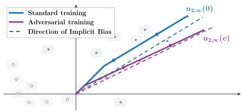

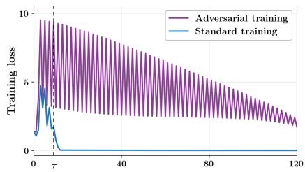

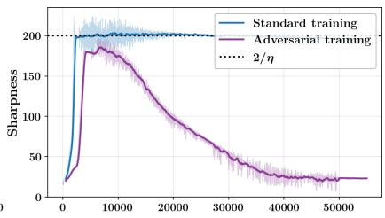  
Figure 1: Illustrations of the main findings of this work. Left: AT and ST have different implicit bias under large constant step sizes. Middle: The ST loss decreases monotonically after a phase transition time τ, whereas the AT loss increases infinitely often. It can also be observed that the AT loss decreases very slowly. Right: ST and AT can exhibit different sharpness evolutions. In particular, ST exhibit the edge-of-stability phenomenon, in which the sharpness oscillates around $2 / \eta ,$ , while the sharpness of AT decreases to a value much lower than $2 / \eta$

## 1.1 Our Contributions.

In this work, we focus mainly on $\ell _ { \infty }$ -adversarial attacks since it is the mostly used in practice, and also less theoretically understood compared with other norms (Wang et al., 2025a). Most of our results can also be extended to $\ell _ { p } .$ -attacks for $p \in [ 1 , \infty ]$ using the $\ell _ { p } / \ell _ { q }$ duality, except for the results in Section 4, which relies on properties specific to the $\ell _ { \infty }$ norm. We summarize our main contributions below.

Implicit Bias of GD for Adversarial Logistic Regression. For adversarial logistic regression, we prove that, under standard separability assumption on the dataset, GD with arbitrary constant step size converges to a robust maxmargin direction $\mathbf { u } _ { 2 , \infty } ( c )$ depending on the adversarial radius $c > 0 .$ . (Theorem 3.1) This behaves differently from ST, where the implicit bias is driven toward the standard max-margin direction on the original data, see the left of Figure 1 for a comparison between these two directions. While this discrepancy was first shown by Li et al. (2020), our work extends their findings in two aspects. First, our result holds for arbitrary constant step sizes, whereas Li et al. (2020) require step sizes exponentially small with dimension. Second, we establish a rate of order ln ln T/ ln T for the implicit bias, improving over Li et al. (2020) by a factor of order $1 / \sqrt { \ln { T } }$ . In Proposition 3.2 we also show that this rate is tight, thereby providing a comprehensive characterization of the implicit bias for this problem.

Optimization of GD for Adversarial Logistic Regression. Recent work by Wu et al. (2024) characterizes GD for standard logistic regression with large step sizes through two phases separated by a transition time τ: the loss behaves non-monotonically before τ and monotonically afterward. They further show that this non-monotonic phase is necessary to achieve an accelerated loss convergence rate of $\tilde { \mathcal { O } } ( 1 / T ^ { 2 } )$ . Surprisingly, we find that both the existence of the transition time and the acceleration effect of large step size can fail for AT. In fact, the situation of AT is even worse: Theorem 4.2 shows that, for any adversarial radius $c > 0$ and time budget T, there exists a dataset on which GD’s optimization error is bounded below by a positive constant depending only on c. Moreover, there exist infinitely many steps t where the loss increases from t to t+1. In the middle of Figure 1, we illustrate this phenomenon. These results show that the optimization aspect of GD with large constant step sizes can behave differently in AT than in ST.

Sharpness Evolution in AT. We conduct experiments on AT with neural networks to study how sharpness evolves along the training trajectory. We observe that the sharpness initially increases monotonically and then begins to oscillate with an overall decreasing trend. This behavior remains consistent across different architectures, datasets, and adversarial attack generation approaches. It also differs from the EoS phenomenon in ST of neural network with deterministic GD (Cohen et al., 2021), where sharpness oscillates around $2 / \eta$ for step size η after an initial monotone increasing stage. The right of Figure 1 present their difference. To develop theoretical understanding of this phenomenon, we analyze a min-max variant of the theoretical model proposed in Ahn et al. (2023). Our analysis shows that the sharpness of this model converges points with a sharpness level significantly below the standard sharpness level $2 / \eta$ , consistent with our empirical findings. These results show that sharpness evolves very differently in standard and adversarial neural network training.

## 1.2 Related Works

Implicit Bias of Linear Logistic Regression. In standard training, Soudry et al. (2018) and Ji and Telgarsky (2018) showed that GD converges to the max-margin direction for linear models on separable data. Subsequent work studied other training algorithms than GD, like steepest descent Gunasekar et al. (2018), momentum methods (Wang et al., 2022; Zhang et al., 2024a), and spectral descent method like Muon (Fan et al., 2026). Most of these analyses require sufficiently small step sizes. An exception is Wu et al. (2023), who established the implicit bias of GD with any constant step size under additional assumptions. For AT, Li et al. (2020) showed that GD for separable adversarial logistic regression converges to robust max-margin direction with exponentially small step size. Subsequent work extended the results on adversarial training to other linear networks and training dynamics (Lv and Zhu, 2022; Tsilivis et al., 2024; Lyu and Zhu, 2025; Lyu et al., 2025). Wang et al. (2025a) derived faster robust margin-maximization rates for other optimization methods than GD, and their analysis does not extend to $\ell _ { \infty }$ adversarial attacks.

Optimization with Large Step Sizes. In practice, large step sizes can lead to non-monotonic loss trajectories while preserving favorable long-term behavior. For standard logistic regression, Wu et al. (2024, 2026) showed that large step size gradient descent can accelerate the convergence rate despite oscillations. Cai et al. (2024) extends the results to non-Homogeneous two-layer neural networks. Crawshaw and Liu (2026) established tighter bounds for two-dimensional separable logistic regression. Beyond the convergence rate analysis, Andriushchenko et al. (2023b) showed that large step sizes help neural networks to learn sparse features to improve generalization. Meng et al. (2024) studied the bifurcation behaviors of gradient descent with large step sizes in logistic regression with non-separable dataset. Liang and Montufar (2026) characterized critical step sizes for scalar-vector factorization and showed that large step sizes can induce chaotic optimization dynamics.

Sharpness & Edge-of-Stability. Sharpness plays an important role in neural network training. Cohen et al. (2021) observed the edge-of-stability (EoS) phenomenon, in which sharpness initially increases and then hovers near $2 / \eta$ . Several works have developed theoretical explanations for these dynamics. For example, Damian et al. (2022) identified the self-stabilization mechanism. Cohen et al. (2025) introduced central flows to model the time-averaged trajectories of oscillatory optimizers. Ahn et al. (2023) connected EoS to generalization performance of neural networks. Another lines of work theoretically studied the EoS through a minimalist example approach (Kreisler et al., 2023; Zhu et al., 2023; Wang et al., 2025b; Liu et al., 2026). Recent works of Islamov et al. (2026) and Song et al. (2026) generalized the EoS to Riemannian and zero-th order optimization settings.

## 2 PRELIMINARIES

## 2.1 Adversarial Linear Logistic Regression

Given a dataset $\{ ( \mathbf { x } _ { i } , y _ { i } ) \} _ { i = 1 } ^ { N }$ where $( \mathbf { x } _ { i } , y _ { i } ) \in \mathbb { R } ^ { d } \times \{ \pm 1 \}$ we consider $\ell _ { \infty }$ -adversarial logistic regression with adversarial radius $c \geq 0$ . The objective is to minimize $\mathcal { L } _ { \mathrm { A d v } } ( \mathbf { w } )$ over $\mathbf { w } \in \mathbb { R } ^ { d }$ , where

$$
\begin{array} { c l } { \displaystyle \mathcal { L } _ { \mathrm { A d v } } ( \mathbf { w } ) : = \sum _ { i = 1 } ^ { N } \underset { | | \delta _ { i } | | _ { \infty } \leq c } { \operatorname* { m a x } } \ln \bigl ( 1 + e ^ { - y _ { i } ( \mathbf { x } _ { i } + \delta _ { i } ) ^ { \top } \mathbf { w } } \bigr ) } \\ { \displaystyle = \sum _ { i = 1 } ^ { N } \ln \bigl ( 1 + e ^ { - y _ { i } \mathbf { x } _ { i } ^ { \top } \mathbf { w } + c \| \mathbf { w } \| _ { 1 } } \bigr ) . } \\ { \displaystyle \qquad ( \ell _ { \infty } { \mathrm { - a d v e r s a r i a l ~ l o g i s t i c ~ r e g r e s s i o n } } ) } \end{array}
$$

Here the second equality follows from the duality between $\ell _ { \infty }$ and $\ell _ { 1 }$ norms. When $c = 0 .$ , this reduces to the standard logistic loss $\mathcal { L } ( \mathbf { w } )$ . We consider the (sub)gradient descent (GD) dynamics:

$$
\mathbf { w } _ { t + 1 } = \mathbf { w } _ { t } - \eta \partial _ { \mathbf { w } } \mathcal { L } _ { \mathrm { A d v } } \big ( \mathbf { w } _ { t } \big ) .\tag{GD}
$$

Here $\eta > 0$ is the step size. In this work, following Wu et al. (2024), we use the term large step size to refer to any constant step size for the iteration in (GD). We also always select the minimum Euclidean-norm subgradient of $\left\| \mathbf { w } \right\| _ { 1 }$ , whose j-th component is zero whenever $w _ { j } = 0$ This choice is standard in the literature (Shalev-Shwartz and Tewari, 2011; Scetbon and Dohmatob, 2023) and is consistent with PyTorch’s autograd convention.

Definition 2.1. For data set $\{ ( \mathbf { x } _ { i } , y _ { i } ) \} _ { i = 1 } ^ { N }$ and adversarial radius $c ,$ we define thefollowing notations:

• Robust maximum margin:

$$
\gamma _ { 2 , \infty } ( c ) = \operatorname* { m a x } _ { \| \mathbf { w } \| _ { 2 } = 1 } \operatorname* { m i n } _ { i \in [ N ] } \operatorname* { m i n } _ { \| \delta _ { i } \| _ { \infty } \leq c } y _ { i } \langle \mathbf { x } _ { i } + \delta _ { i } , \mathbf { w } \rangle
$$

• Robust max-margin direction:

$$
\mathbf { u } _ { 2 , \infty } ( c ) : = \underset { \| \mathbf { w } \| _ { 2 } = 1 } { \mathrm { a r g m a x } } \underset { i \in [ N ] } { \mathrm { m i n } } \underset { \| \pmb { \theta } _ { i } \| _ { \infty } \leq c } { \mathrm { m i n } } y _ { i } \langle \mathbf { x } _ { i } + \pmb { \delta } _ { i } , \mathbf { w } \rangle
$$

Here, $\gamma _ { 2 , \infty } ( c )$ represents the $\ell _ { 2 }$ margin of the extended dataset:

$$
\{ ( \mathbf { x } ^ { \prime } , y ^ { \prime } ) \mid \exists i , \| \mathbf { x } ^ { \prime } - \mathbf { x } _ { i } \| _ { \infty } \leq c , y ^ { \prime } = y _ { i } \} ,
$$

which includes all admissible perturbations of the original samples with their labels unchanged, and $\mathbf { u } _ { 2 , \infty } ( c )$ is the corresponding max-margin direction. We assume that the dataset is robustly linearly separable, meaning that the extended dataset remains linearly separable. This assumption is standard in analyses of (GD) for adversarial training (Charles et al., 2019; Li et al., 2020; Lyu and Zhu, 2025).

Assumption 2.2. The dataset $\{ ( \mathbf { x } _ { i } , y _ { i } ) \} _ { i = 1 } ^ { N }$ is robustly linearly separable, $i . e . , \gamma _ { 2 , \infty } > 0 .$

## 2.2 General Adversarial Training

Adversarial training (AT) is a widely used approach to improving the robustness of machine learning models. For $\ell _ { \infty }$ -adversarial attack with radius $c ,$ it minimizes $\mathcal { L } _ { \mathrm { A d v } } ( \mathbf { w } )$ defined as

$$
\begin{array} { l } { \displaystyle \mathcal { L } _ { \mathrm { A d v } } \big ( \mathbf { w } \big ) = \frac { 1 } { N } \sum _ { i = 1 } ^ { N } g _ { c } \left( \mathbf { x } _ { i } , \mathbf { w } \right) , \quad \mathrm { w h e r e } } \\ { g _ { c } \big ( \mathbf { x } _ { i } , \mathbf { w } \big ) = \displaystyle \operatorname* { m a x } _ { \| \mathbf { x } _ { i } ^ { \prime } - \mathbf { x } _ { i } \| _ { \infty } \leq c } g ( \mathbf { x } _ { i } ^ { \prime } , \mathbf { w } ) . } \end{array}\tag{AT}
$$

Here, $g$ is a loss function, such as mean squared error (MSE), with dependence on the label $y _ { i }$ suppressed for simplicity. In practice, a common approximation of the inner maximization problem is the fast gradient sign method (FGSM) (Goodfellow et al., 2015):

$$
\mathbf { x } _ { i } ^ { \prime } = \mathbf { x } _ { i } + c \mathrm { S i g n } ( \nabla _ { \mathbf { x } } g ( \mathbf { x } _ { i } , \mathbf { w } ) ) .\tag{FGSM}
$$

Alternatively, projected gradient descent (PGD) (Madry et al., 2018) approximately solves the inner maximization problem using $\tau$ projected gradient ascent steps. Starting from $\mathbf { x } _ { i , 0 } \in B _ { i }$ , it updates

$$
\begin{array} { r } { \mathbf { x } _ { i , t } = \mathrm { P r o j } _ { \mathcal { B } _ { i } } ( \mathbf { x } _ { i , t - 1 } + \alpha \mathrm { S i g n } ( \nabla _ { \mathbf { x } } g ( \mathbf { x } _ { i , t - 1 } , \mathbf { w } ) ) ) , } \end{array}\tag{PGD}
$$

for $t = 1 , \ldots , \tau$ . Here $\alpha > 0$ is the attack step size and $B _ { i } : = \{ \mathbf { x } ^ { \prime } : \| \mathbf { x } ^ { \prime } - \mathbf { x } _ { i } \| _ { \infty } \leq c \}$ . Then the adversarial example used in training is defined as $\mathbf { x } _ { i } ^ { \prime } : = \mathbf { x } _ { i , T }$ . We define the sharpness at w as the largest eigenvalue of the parameter Hessian evaluated on fixed adversarial examples $\{ { \bf x } _ { i } ^ { \prime } \} _ { i = 1 } ^ { N }$ , namely,

$$
\begin{array} { r } { \lambda _ { \operatorname* { m a x } } \bigl ( \frac { 1 } { N } \sum _ { i = 1 } ^ { N } \nabla _ { \mathbf { w } } ^ { 2 } g ( \mathbf { x } _ { i } ^ { \prime } , \mathbf { w } ) \bigr ) } \end{array}\tag{sharpness}
$$

(iii)

Following the standard practice in sharpness analyses of AT, we compute the parameter Hessian while holding the adversarial examples fixed (Yao et al., 2018; Liu et al., 2020; Sitawarin et al., 2021; Wang et al., 2023; Zhong et al., 2025; Walter et al., 2026). Computing the Hessian while accounting for the dependence of $\mathbf { x } _ { i } ^ { \prime }$ on w would require differentiating through the adversarial example generation, making it computationally prohibitive. When $c = 0$ , the notation is same as the sharpness in ST.

## 3 IMPLICIT BIAS OF ADVERSARIAL LOGISTIC REGRESSION

In this section, we study the implicit bias of gradient descent for $\ell _ { \infty }$ -adversarial logistic regression, while proofs are deferred to Appendix B. Following earlier analyses of implicit bias of standard training (Nacson et al., 2019; Ji and Telgarsky, 2021; Wu et al., 2023), we decompose each gradient descent iterate of adversarial training into its projection onto the robust max-margin direction and its orthogonal component:

$$
\mathbf { w } _ { t } = v _ { t } \mathbf { u } _ { 2 , \infty } ( c ) + \mathbf { r } _ { t } , ( \mathrm { o r t h o g o n a l d e c o m p o s i t i o n } )
$$

where $v _ { t } ~ = ~ \langle \mathbf { w } _ { t } , \mathbf { u } _ { 2 , \infty } ( c ) \rangle$ is the projection of $\mathbf { w } _ { t }$ onto the robust max-margin direction, and $\mathbf { r } _ { t }$ is the orthogonal component, i.e., $\langle \mathbf { r } _ { t } , \mathbf { u } _ { 2 , \infty } ( c ) \rangle ~ = ~ 0$ . The ratio $\| \mathbf { r } _ { t } \| _ { 2 } / v _ { t }$ determines the convergence rate of implicit bias. We present the main theorem of this section below.

Theorem 3.1. Under Assumption 2.2,fix any constant step size $\eta > 0$ and let $\{ \mathbf { w } _ { t } \} _ { t \ge 0 }$ be given by the (GD) dynamic with $\mathbf { w } _ { 0 } = \mathbf { 0 } ^ { 1 }$ . Then, for every $t \geq 1$ , we have

$$
\begin{array} { r } { v _ { t } \geq \frac { 1 } { \gamma _ { 2 , \infty } ( c ) } \ln \Big ( 1 + \frac { \eta \gamma _ { 2 , \infty } ^ { 2 } ( c ) } { 2 } t \Big ) . } \end{array}\tag{i}
$$

(ii) $\exists C _ { \mathbf { r } } > 0 ,$ , independent of t, s.t. $\| \mathbf { r } _ { t } \| _ { 2 } \leq C _ { \mathbf { r } }$ ln ln t.

$$
\begin{array} { r } { \left\| \frac { \mathbf { w } _ { t } } { \| \mathbf { w } _ { t } \| _ { 2 } } - \mathbf { u } _ { 2 , \infty } ( c ) \right\| _ { 2 } \leq 2 \| \mathbf { r } _ { t } \| _ { 2 } / v _ { t } = \mathcal { O } \big ( \frac { \ln \ln t } { \ln t } \big ) . } \end{array}
$$

We make the following comments. Previous work of Li et al. (2020) established the implicit bias of (GD) toward the robust max-margin direction $\mathbf { u } _ { 2 , \infty } ( c )$ under Assumption 2.2 and with step size at most of order $e ^ { - \Theta ( \sqrt { d } ) }$ . Theorem 3.1 strengthens their result in two respects. First, it allows any positive constant step size. This is practically relevant because constant step sizes are often chosen empirically, and exponentially small step sizes are rarely used in practice (Pang et al., 2021). Second, it improves the implicit bias convergence rate established by Li et al. (2020) from $\mathcal { O } ( 1 / \sqrt { \ln t } )$ to O(ln ln t/ ln t). The next result shows that this improved rate is tight.

Proposition 3.2. The dataset ${ \bf x } _ { 1 } ~ = ~ ( 1 / 2 , 1 / 4 ) , { \bf x } _ { 2 } ~ =$ $( 1 / 2 , 1 / 2 ) , y _ { 1 } \ = \ y _ { 2 } \ = \ 1 , c \ = \ 1 / 4$ is robustly linearly separable. The GD trajectory $\{ \mathbf { w } _ { t } \} _ { t = 1 } ^ { \infty }$ on it satisfies

$$
\operatorname* { l i m } _ { t \to \infty } \frac { \ln t } { \ln \ln t } \left\| \frac { \mathbf { w } _ { t } } { \| \mathbf { w } _ { t } \| _ { 2 } } - \mathbf { u } _ { 2 , \infty } ( c ) \right\| _ { 2 } = 1 .
$$

Finally, Theorem 3.1 directly implies a convergence rate of

$$
\mathcal { L } _ { \mathrm { A d v } } ( \mathbf { w } _ { t } ) = \widetilde { \mathcal { O } } \left( 1 / t \right) ,\tag{1}
$$

where $\widetilde { \mathcal { O } }$ hide the log factors and the dependence on η and the other parameters of the problem.

Proof Overview of Theorem 3.1. Our analysis builds on the proof strategy of Wu et al. (2023) for ST with large step sizes. We handle the irregularities in adversarial training, such as nonsmoothness, through refined comparison points and tighter cumulative loss difference bounds as explained below. In the following, we illustrate our proof by recovering the $\mathcal { O } ( 1 / \sqrt { \ln t } )$ rate of Li et al. (2020) under arbitrary constant step sizes. We then explain how to refine this argument to obtain the full result. The complete proof is provided in Appendix B.

Part (i) of Theorem 3.1 follows from the fact that, at each iteration, there exists at least one data $\mathbf { x } _ { j }$ whose robust margin min $\mathbb { 1 } \| \pmb { \delta } _ { i } \| \le c y _ { j } \big \langle \mathbf { x } _ { j } + \pmb { \delta } _ { i } , \mathbf { w } _ { t } \big \rangle$ is at most $\gamma _ { 2 , \infty } v _ { t } .$ , ensuring sufficient growth of $v _ { t }$ (see Proposition B.2, similar argument also used in Lemma B.6 of Wu et al. (2023)). In the following we focus on bounding the term $\| \mathbf { r } _ { t } \| _ { 2 }$ . Let $\{ \tilde { \mathbf { w } } _ { t } \} _ { t = 1 } ^ { \infty }$ be a series of comparison points with known bounds on its norms and loss values. The proof starts from the following comparison inequality, which holds for any $\eta > 0$ and is derived using the convexity of $\ell _ { \infty }$ -adversarial logistic regression:

$$
\begin{array} { r l } & { \| \mathbf { w } _ { t } - \tilde { \mathbf { w } } _ { t } \| _ { 2 } ^ { 2 } \leq 2 \eta \displaystyle \sum _ { s < t } \left( \mathcal { L } _ { \mathrm { A d v } } \big ( \tilde { \mathbf { w } } _ { s } \big ) - \mathcal { L } _ { \mathrm { A d v } } \big ( \mathbf { w } _ { s } \big ) \right) } \\ & { \qquad + \displaystyle \sum _ { s < t } \| \mathbf { w } _ { s + 1 } - \mathbf { w } _ { s } \| _ { 2 } ^ { 2 } } \end{array}\tag{2}
$$

We choose the comparison points $\left\{ \tilde { \mathbf { w } } _ { t } \right\}$ according to

$$
\tilde { \mathbf { w } } _ { t } = \frac { 1 } { \gamma _ { 2 , \infty } ( c ) } \ln \left( 1 + \frac { \eta \gamma _ { 2 , \infty } ^ { 2 } ( c ) } { 2 } t \right) \mathbf { u } _ { 2 , \infty } ( c ) ,
$$

whose norm and cumulative adversarial loss are both $\mathcal { O } ( \ln t )$ . Intuitively, the growth of $\mathbf { w } _ { t }$ along $\mathbf { u } _ { 2 , \infty } ( c )$ , measured by $v _ { t } = \langle \mathbf { w } _ { t } , \mathbf { u } _ { 2 , \infty } ( c ) \rangle$ , controls the updates of $\mathbf { w } _ { t } .$ allowing us to establish $\begin{array} { r } { \sum _ { s < t } \| \mathbf { w } _ { s + 1 } - \mathbf { w } _ { s } \| _ { 2 } ^ { 2 } \leq K v _ { t } } \end{array}$ for some constant K (see Lemma B.3). Dropping the negative loss term in (2), and using

$$
\begin{array} { r } { v _ { t } = \langle \mathbf { w } _ { t } - \tilde { \mathbf { w } } _ { t } , \mathbf { u } _ { 2 , \infty } ( c ) \rangle + \mathcal { O } ( \ln t ) \leq \| \mathbf { w } _ { t } - \tilde { \mathbf { w } } _ { t } \| _ { 2 } + \mathcal { O } ( \ln t ) , } \end{array}
$$

we get

$$
\begin{array} { r } { \| \mathbf { r } _ { t } \| _ { 2 } ^ { 2 } \leq \| \mathbf { w } _ { t } - \tilde { \mathbf { w } } _ { t } \| _ { 2 } ^ { 2 } \leq \mathcal { O } ( \ln t ) + K \| \mathbf { w } _ { t } - \tilde { \mathbf { w } } _ { t } \| _ { 2 } , } \end{array}
$$

which implies $\| \mathbf { r } _ { t } \| _ { 2 } \leq \| \mathbf { w } _ { t } - \tilde { \mathbf { w } } _ { t } \| _ { 2 } = \mathcal { O } ( \sqrt { \ln t } )$ . Combing this with the lower bound of $v _ { t }$ in Part (i) of Theorem 3.1 gives the $\mathcal { O } ( 1 / \sqrt { \ln t } )$ rate of implicit bias. Note that even in this simple setting, our analysis already differs from that of Wu et al. (2023) for standard training, where additional rank assumptions on the dataset (Assumption 2 & 3 in their work) are used to establish a uniform bound on $\| \mathbf { r } _ { t } \| _ { 2 }$ . We avoid such assumption by constructing suitable comparison points, which adaptive to the adversarial training process and gives a refined growth rate of $\| \mathbf { r } _ { t } \| _ { 2 }$

To obtain the O(ln ln $t / \ln t )$ rate, we sharpen the bound on $\| \mathbf { r } _ { t } \| _ { 2 }$ from $\mathcal { O } ( \sqrt { \ln t } )$ in above argument to $\mathcal { O } ( \ln \ln t )$ by choosing more suitable comparison points $\{ \tilde { \mathbf { w } } _ { t } \} _ { t = 1 } ^ { \infty }$ . The new construction includes vector directions that are orthogonal to $\mathbf { u } _ { 2 , \infty } ( c )$ , thus is more close to the gradient descent trajectories for adversarial logistic regression (see Proposition B.4). We also refine the analysis of the cumulative adversarial loss difference in (2) by retaining the negative loss term (see Proposition B.6), and use the fact that the cumulative squared updates in (2) are in fact uniformly bounded (see Lemma B.3).

## 4 OPTIMIZATION OF ADVERSARIAL LOGISTIC REGRESSION

In this section, we study how the ℓ -adversarial logistic regression evolves under GD with arbitrary constant step sizes. It is well-known that gradient descent dynamics with $\eta > 2 / L$ may exhibit non-monotonic loss behavior, where L is the Lipschitz constant of the gradient. Recent work of Wu et al. (2024) characterize these non-monotonic loss behavior in standard linear logistic regression $( c = 0 )$ . We informally restate their main results below using our notation:

Theorem 4.1 (Wu et al. (2024)). Under Assumption 2.2 with $c = 0$ , and normalize the dataset such that $\| \mathbf { x } _ { i } \| \leq 1$ for $i \in [ N ]$ . For standard logistic regression, gradient descent with a constant step size $\eta > 0$ satisfies:

• (Phase transition time) There exists some phase transition time τ , depending on the step size η and the dataset, before which the loss can be non-monotonic and after which $\mathcal { L } ( \mathbf { w } _ { t + 1 } ) \leq \mathcal { L } ( \mathbf { w } _ { t } ) f o r$ all $t \geq \tau .$

• (Accelerated Convergence Rate) For a sufficiently large time budget T, an appropriate constant step size $\eta =$ Θ(T) yields a upper bound $\mathcal { L } ( \mathbf { w } _ { T } ) = \tilde { \mathcal { O } } ( 1 / T ^ { 2 } )$ .

The work of Ji and Telgarsky (2018) also established a ${ \tilde { O } } ( 1 / T )$ loss bound for every fixed step size $\eta \in ( 0 , 1 ]$ for ST. These results nature questions for AT: (i) does there also exist a phase transition time? (ii) can any constant step size, possibly tuned to the horizon T, that guarantees a fast vanishing loss bound? The following theorem shows that the answer is negative.

Theorem 4.2. For any $0 < c < 2$ and time budget $T >$ $6 4 / c ,$ there exists a dataset $\mathcal { D } _ { T }$ whose dimension depends on T and satisfies Assumption 2.2, such that for any step size $\eta > 0 ,$ , gradient descent dynamics on $\mathcal { D } _ { T }$ satisfies

• (Uniform Constant Lower Bound) The lossfunction has a uniform constant lower bound $\mathcal { L } _ { \mathrm { A d v } } ( \mathbf { w } _ { T } ) \geq \mathcal { C } ,$ , where C only depends on c.

• (No phase transition time) When gradient descent is run indefinitely on $\mathcal { D } _ { T } ,$ , there exist infinitely many t such that $\mathcal { L } _ { \mathrm { A d v } } ( \mathbf { w } _ { t + 1 } ) > \mathcal { L } _ { \mathrm { A d v } } ( \mathbf { w } _ { t } )$

We have two remarks. First, for ST, Theorem 4.1 shows that an appropriately chosen large constant step size can yield a polynomial acceleration of the loss convergence rate, from the $1 / T$ scale to $\widetilde { \mathcal { O } } ( 1 / T ^ { 2 } )$ . In contrast, Theorem 4.2 shows that the convergence is intrinsically non-uniform over the problem class: for every T, there exists a problem for which the optimization error at time $T$ is bounded below by a positive real for every constant step size. Note that there is no contradiction with eq. (1), which instead ensures an instance dependent convergence. Second, Theorem 4.1 shows that, in standard training, there exists a transition time before which the loss can be non-monotonic and after which it decreases monotonically. Moreover, Wu et al. (2024) show that this non-monotonic phase is essential for the acceleration obtained with large step sizes. In contrast, Theorem 4.2 shows that in AT such a transition time need not exist: the loss may increase infinitely often. Notably, these increases occur even between differentiable iterates, so the persistent non-monotonicity is not an artifact of evaluating subgradients at nonsmooth points.

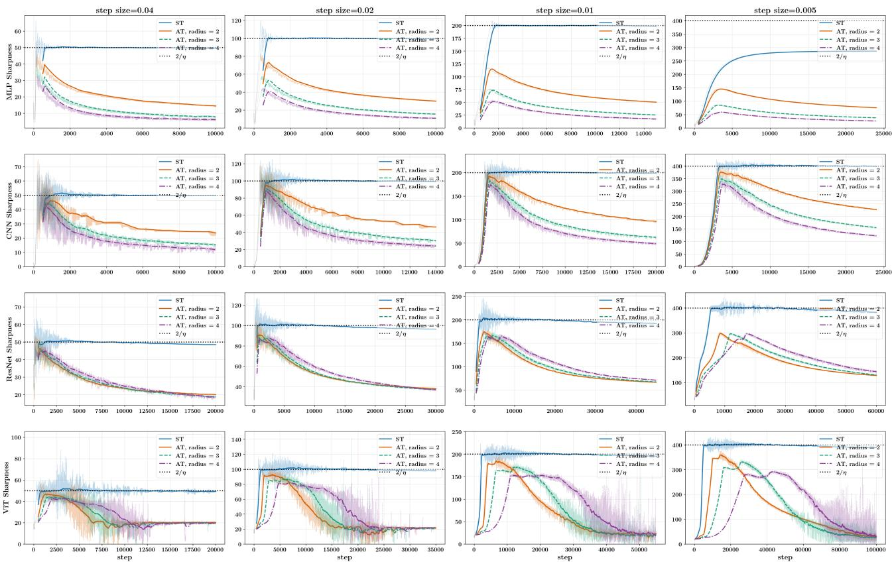  
Figure 2: Sharpness evolution across neural network architectures (MLP, CNN, ResNet, and Vision Transformer) and step sizes under standard training (ST) and $\ell _ { \infty }$ -adversarial training on CIFAR-10. Adversarial examples are generated using (FGSM). Except for the MLP at step size 0.005, sharpness under ST initially increases and then oscillates around $\bar { 2 } / \eta ,$ , consistent with the edge-of-stability phenomenon (Cohen et al., 2021). Under AT, sharpness also initially increases, but subsequently oscillates with an overall decreasing trend. Opaque curves show smoothed trends for clarity, while semi-transparent curves show the raw values.

Proof Overview of Theorem 4.2. We construct a single sample dataset $\mathcal { D } _ { T } = \{ ( { \bf x } , 1 ) \}$ , where

$$
\mathbf { x } = ( 2 , q ^ { - 1 } , \ldots , q ^ { - 1 } ) \in \mathbb { R } ^ { 1 + q ^ { 2 } } , \qquad q = 4 T ^ { 2 } .
$$

We have $\| \mathbf { x } \| _ { 2 } = { \sqrt { 5 } } .$ . This data has one dominant coordinate and $T ^ { 4 }$ small coordinates whose magnitudes are below the adversarial radius. It can be seen that $\mathcal { D } _ { T }$ is linearly robustly separable for $c < 2$ with robust max-margin direction $\mathbf { u } _ { 2 , \infty } ( c ) = ( 1 , 0 , \ldots , 0 )$ and $\gamma _ { 2 , \infty } ( c ) = 2 - c \qquad $ . The nonsmooth $\ell _ { 1 }$ term in the adversarial loss causes the last $q ^ { 2 }$ small coordinates of $\mathbf { w } _ { t }$ to oscillate around zero, which makes the gradient descent dynamics unstable since it depends on the sign of these small coordinates. Large step sizes can amplify these oscillations, whose combined contribution to the loss outweighs the improvement along the dominant coordinate. More precisely, consider the robust margin min $1 _ { \| \delta \| _ { \infty } \le c } \langle \mathbf { x } + \delta , \mathbf { w } _ { t } \rangle$ . For sufficiently large step sizes, the first coordinate of x contributes at most $4 \eta T$ to the robust margin, whereas the remaining coordinates contribute at most $- \eta c T ^ { 2 } / 2$ in total. Thus the negative contribution dominates, keeping the adversarial loss large throughout the time budget. The detailed proof of Theorem 4.2 is presented in Appendix C.

## 5 EVOLUTION OF SHARPNESS IN ADVERSARIAL TRAINING

In this section, we study how the sharpness evolve along the adversarial training trajectories. Sharpness, i.e., the maximal eigenvalue of the loss Hessian, plays an important role in neural network training, from guiding the design of optimization algorithms (Foret et al., 2020) to improve understanding of generalization (Andriushchenko et al., 2023a). The classical descent lemma for GD in optimization problem min $f ( \theta )$ states the loss decreases monotonically under GD if the sharpness remains below $2 / \eta$ along the optimization process, where η is the step size (Nesterov, 2013). However, in neural networks training, people usually employ large step sizes in the regime where the loss exhibits non-monotonic behavior. Cohen et al. (2021) observe that sharpness can evolve in two stages during standard training of neural network with deterministic gradient descent:

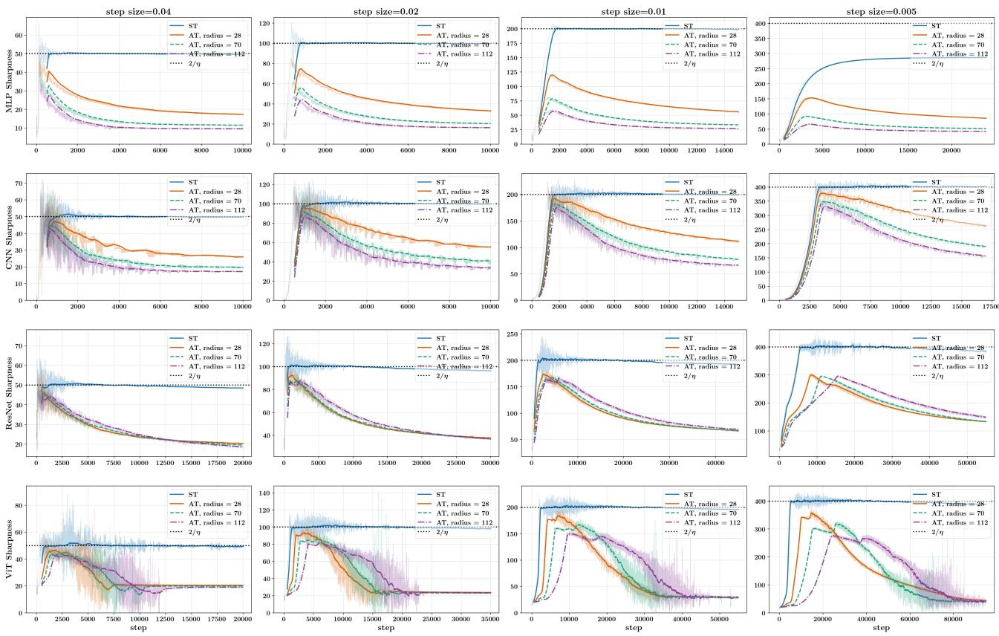  
Figure 3: The experimental settings are identical to those in Figure 2 except that adversarial examples are generated by $\ell _ { 2 }$ attacks, and adversarial radius is adjusted per common practice.

• Progressive Sharpening: If the sharpness is less than $2 / \eta ,$ it tends to increase monotonically.

• Edge-of-stability: The sharpness oscillate around $2 / \eta$

It is natural to ask whether AT of neural networks exhibits a similar sharpness evolution to standard training. Our experiments reveal a different pattern: after an initial increase similar to progressive sharpening, adversarial sharpness oscillates with an overall decreasing trend. We report these experimental results in Section 5.1. In Section 5.2, we provide theoretical support by showing that adversarial training can reduce sharpness in an adversarial variant of a minimalist example introduced by Ahn et al. (2023).

## 5.1 Experimental Results

In Figure 2 and Figure 3, we present our experiments on the sharpness evolution of AT under MLP, CNN, ResNet and Vision Transformer (ViT) on the CIFAR-10 dataset. The training algorithm is the deterministic gradient descent on CIFAR-10. We adopt the architectures and implementation of Cohen et al. (2021), keeping our setup consistent with prior work on edge-of-stability. We also use the Mean Squared Error (MSE) loss as it can most align with the edgeof-stability phenomena in ST. The experimental details are provided in Appendix D.2. Our main observation is that the sharpness evolution of AT follows a very different two-stage dynamics as with ST:

• Stage I: In this stage, sharpness tends to increase monotonically, similar to the progressive sharpening stage in standard training reported by Cohen et al. (2021).

• Stage II: After Stage I, sharpness begins to oscillate. Although the oscillation patterns may vary across different settings, they share a common feature: sharpness exhibits an overall decreasing trend over longer timescales.

More experiments are reported in Appendix D.3, and the experimental results are consistent with the two-stage dynamics as described above. One major property of the sharpness in AT is that it tracks the curvature of a timevarying loss function, as the adversarial examples $\mathbf { x } _ { i } ^ { \prime }$ change at each iteration (see Section 2.2). However, our experiments suggest that time variation alone does not explain the observed dynamics. In Figure 4, we track sharpness along standard CNN training trajectories using loss functions with small random perturbations instead of adversarial attack on the training data at each iteration. The resulting sharpness evolution remains similar to that of standard training and differs markedly from that of adversarial training. Together, these results suggest that the observed two-stage behavior stem inherently from the adversarial training dynamics and persist across different experimental settings.

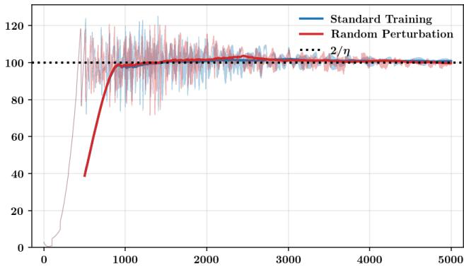  
Figure 4: Sharpness evolution under randomly perturbed losses resembles that of standard training.

## 5.2 Theoretical Investigation on a Minimalist Example

Due to the complexity of neural network training dynamics, theoretical studies of EoS often adopt a minimalist example approach. In the following, we study an adversarial variant of a model introduced by Ahn et al. (2023) to investigate the EoS phenomenon in standard training. Let $\ell ( s )$ be the Huber loss function:

$$
\ell ( s ) : = { \frac { s ^ { 2 } } { 2 } } \mathbf { 1 } _ { \left\{ | s | \leq 1 \right\} } + \left( | s | - { \frac { 1 } { 2 } } \right) \mathbf { 1 } _ { \left\{ | s | > 1 \right\} } , ( { \mathrm { H u b e r ~ l o s s } } )
$$

which is widely used for regression (Meyer, 2021). The theoretical model proposed by Ahn et al. (2023) is the twodimensional function $\ell ( x y )$ for $( x , y ) \in \mathbb { R } ^ { 2 }$ . One main reason for the difference between the sharpness behavior of ST and AT is is the special min-max structure of AT. Motivated by this observation, we study the following adversarial variant of $\ell ( x y )$ for an adversarial radius $c \geq 0$ which recovers the the standard training objective of Ahn et al. (2023) when $c = 0 :$

$$
\begin{array} { r l } & { \underset { ( x , y ) \in \mathbb { R } ^ { 2 } } { \mathrm { m i n } } \mathcal { L } _ { c } ( x , y ) = \underset { ( x , y ) \in \mathbb { R } ^ { 2 } } { \mathrm { m i n } } \underset { | \delta | \leq c } { \mathrm { m a x } } \ell \left( ( x + \delta ) y \right) } \\ & { \quad \quad \quad \quad \quad \quad \quad \left( \mathrm { A d v e r s a r i a l } \mathrm { H u b e r } \mathrm { l o s s } \right) } \end{array}
$$

This objective can be viewed as adversarial regression on a single example with input $z = 0$ and target 0, using the

predictor $f _ { x , y } ( z ) = y ( x + z )$ . Ahn et al. (2023) studied the following gradient descent dynamic when $c = 0 { : }$

$$
\begin{array} { r l } & { ( x _ { t + 1 } , y _ { t + 1 } ) = ( x _ { t } , y _ { t } ) - \eta \partial \mathcal { L } _ { c } ( x _ { t } , y _ { t } ) , \quad \mathrm { w i t h } } \\ & { ( x _ { 0 } , y _ { 0 } ) = \sqrt { ( 2 + \delta ) / \eta } ( \tilde { x } , \tilde { y } ) . \qquad \mathrm { ( E o S ~ i n i t i a l i z a t i o n ) } } \end{array}
$$

Here $\delta \ : \ : \ : > \ : \ : 0 , \tilde { y } > \tilde { x } > 0$ and $\tilde { y } ^ { 2 } - \tilde { x } ^ { 2 } = 1$ This initialization condition distinguishes gradient descent from continuous-time gradient flow. The sharpness of (Adversarial Huber loss) at the t-th iteration of gradient descent is conventionally defined as the maximum eigenvalue of the Hessian, given by $\lambda _ { t } ^ { c } : = \lambda _ { \operatorname* { m a x } } \left( \nabla ^ { 2 } \mathcal { L } _ { c } ( x _ { t } , y _ { t } ) \right)$

Proposition 5.1. Consider the GD with EoS initialization. There exist constants $\eta _ { 0 } > 0 ,$ , depending only on δ, x, ˜ y˜ and c such that under mild boundary-avoidance assumption as described in Assumption $D . 3 , f o r$ every $0 < \eta \le \eta _ { 0 }$ , the limiting sharpness $\lambda _ { \infty } ^ { c } : = \operatorname* { l i m } \operatorname* { s u p } _ { t \to \infty } \lambda _ { t } ^ { c }$ satisfies:

• Standard training (Ahn et al., 2023, Theorem 2): $i f c = 0 ,$ then $\begin{array} { r } { \frac { 2 } { \eta } - \mathcal { O } ( 1 ) \bar { \leq } \lambda _ { \infty } ^ { 0 } \leq \frac { 2 } { \eta } } \end{array}$

• Adversarial training: $i f c > 0 ,$ , then $\lambda _ { \infty } ^ { c } = \mathcal { O } ( \eta + c ^ { 2 } )$

Proposition 5.1 reveals a transition in sharpness evolution between $\ell ( x y )$ and its min-max variant. The adversarial dynamics converge to points with sharpness $\mathcal { O } ( \eta + c ^ { 2 } )$ , much smaller than the edge-of-stability level $2 / \eta$ for $\eta , c \ll 1$ which is typical in practice. This is consistent with the experimental results reported in Section 5.1. The difference arises from changes in both the structure of the minimizer set and the training dynamics induced by adversarial perturbations. When $c = 0$ , all points $( x , y )$ satisfying $x y = 0$ are global minimizers, and the trajectory converges to $( 0 , y _ { \infty } )$ with $y _ { \infty } \neq 0$ and sharpness close to $2 / \eta$ . When $c > 0 ,$ the minimizer set remains large: every point $( x , 0 )$ is a global minimizer. The sharpness at such a point is $( | x | + c ) ^ { 2 }$ , which can be arbitrarily large. However, the training dynamics ensure that the limiting point satisfies $x _ { \infty } = \mathcal { O } ( \sqrt { \eta } )$ . The detailed proof is given in Appendix D.

## 6 CONCLUSION AND FUTURE DIRECTION

In this paper, we studied the dynamics of deterministic gradient descent with large step sizes in adversarial training, focusing on three aspects: implicit bias and optimization in adversarial logistic regression, and sharpness evolution in adversarial neural network training. Our results reveal that the effects of large step sizes in adversarial training can differ substantially from those in standard training. An interesting direction for future work is to find a general mechanism, possibly analogous to the self-stabilization mechanism in standard training (Damian et al., 2022), that explains the decreasing trend in sharpness observed in Section 5.

## References

Ahn, K., Bubeck, S., Chewi, S., Lee, Y. T., Suarez, F., and Zhang, Y. (2023). Learning threshold neurons via edge of stability. Advances in Neural Information Processing Systems, 36:19540–19569.

Andriushchenko, M., Croce, F., Müller, M., Hein, M., and Flammarion, N. (2023a). A modern look at the relationship between sharpness and generalization. arXiv preprint arXiv:2302.07011.

Andriushchenko, M., Varre, A. V., Pillaud-Vivien, L., and Flammarion, N. (2023b). Sgd with large step sizes learns sparse features. In International Conference on Machine Learning, pages 903–925. PMLR.

Athalye, A., Carlini, N., and Wagner, D. (2018). Obfuscated gradients give a false sense of security: Circumventing defenses to adversarial examples. In International Conference on Machine Learning (ICML).

Boyd, S. and Vandenberghe, L. (2004). Convex optimization. Cambridge university press.

Cai, Y., Wu, J., Mei, S., Lindsey, M., and Bartlett, P. (2024). Large stepsize gradient descent for non-homogeneous two-layer networks: Margin improvement and fast optimization. Advances in Neural Information Processing Systems, 37:71306–71351.

Cauchy, A.-L. (1847). Méthode générale pour la résolution des systèmes d’équations simultanées. Comptes Rendus de l’Académie des Sciences, 25:536–538.

Charles, Z., Rajput, S., Wright, S., and Papailiopoulos, D. (2019). Convergence and margin of adversarial training on separable data. arXiv preprint arXiv:1905.09209.

Cohen, J., Damian, A., Talwalkar, A., Kolter, J. Z., and Lee, J. D. (2025). Understanding optimization in deep learning with central flows. In The Thirteenth International Conference on Learning Representations.

Cohen, J., Kaur, S., Li, Y., Kolter, J. Z., and Talwalkar, A. (2021). Gradient descent on neural networks typically occurs at the edge of stability. In International Conference on Learning Representations.

Crawshaw, M. and Liu, M. (2026). Tight bounds for logistic regression with large stepsize gradient descent in low dimension. In Hanneke, S. and Lattimore, T., editors, Proceedings ofThirty Ninth Conference on Learning Theory, volume 336 of Proceedings of Machine Learning Research, pages 1575–1610. PMLR.

Damian, A., Nichani, E., and Lee, J. D. (2022). Selfstabilization: The implicit bias of gradient descent at the edge of stability. arXiv preprint arXiv:2209.15594.

Fan, C., Schmidt, M., and Thrampoulidis, C. (2026). Implicit bias of spectral descent and muon on multiclass separable data. Advances in Neural Information Processing Systems, 38:39622–39669.

Foret, P., Kleiner, A., Mobahi, H., and Neyshabur, B. (2020). Sharpness-aware minimization for efficiently improving generalization. arXiv preprint arXiv:2010.01412.

Goodfellow, I. J., Shlens, J., and Szegedy, C. (2015). Explaining and harnessing adversarial examples. In Interna tional Conference on Learning Representations (ICLR).

Gu, H., Guo, X., and Li, X. (2021). Adversarial training for gradient descent: Analysis through its continuous-time approximation. arXiv preprint arXiv:2105.08037.

Gunasekar, S., Lee, J., Soudry, D., and Srebro, N. (2018). Characterizing implicit bias in terms of optimization geometry. In International Conference on Machine Learning, pages 1832–1841. PMLR.

Islamov, R., Crawshaw, M., Cohen, J., and Gower, R. (2026). Non-euclidean gradient descent operates at the edge of stability. arXiv preprint arXiv:2603.05002.

Ji, Z. and Telgarsky, M. (2018). Risk and parameter convergence of logistic regression. arXiv preprint arXiv:1803.07300.

Ji, Z. and Telgarsky, M. (2021). Characterizing the implicit bias via a primal-dual analysis. In Algorithmic Learning Theory, pages 772–804. PMLR.

Kreisler, I., Nacson, M. S., Soudry, D., and Carmon, Y. (2023). Gradient descent monotonically decreases the sharpness of gradient flow solutions in scalar networks and beyond. In International Conference on Machine Learning, pages 17684–17744. PMLR.

Li, Y., Fang, E. X., Xu, H., and Zhao, T. (2020). Implicit bias of gradient descent based adversarial training on separable data. In International Conference on Learning Representations (ICLR).

Liang, S. and Montufar, G. (2026). Gradient descent with large step sizes: Chaos and fractal convergence region. In The Fourteenth International Conference on Learning Representations.

Liu, C., Salzmann, M., Lin, T., Tomioka, R., and Süsstrunk, S. (2020). On the loss landscape of adversarial training: Identifying challenges and how to overcome them. Advances in Neural Information Processing Systems, 33:21476–21487.

Liu, L., Zhang, Z., Du, S., and Zhao, T. (2026). A minimalist example of edge-of-stability and progressive sharpening. Advances in Neural Information Processing Systems, 38:14938–14975.

Lv, B. and Zhu, Z. (2022). Implicit bias of adversarial training for deep neural networks. In International Conference on Learning Representations.

Lyu, B., Wang, H., Wang, Z., and Zhu, Z. (2025). Effects of momentum in implicit bias of gradient flow for diagonal linear networks. In Proceedings of the AAAI Conference on Artificial Intelligence, volume 39, pages 19242–19250.

Lyu, B. and Zhu, Z. (2025). Analyzing the implicit bias of adversarial training from a generalized margin perspective. IEEE Transactions on Pattern Analysis and Machine Intelligence.

Madry, A., Makelov, A., Schmidt, L., Tsipras, D., and Vladu, A. (2018). Towards deep learning models resistant to adversarial attacks. In International Conference on Learning Representations.

Meng, S. Y., Orvieto, A., Cao, D. Y., and De Sa, C. (2024). Gradient descent on logistic regression with non-separable data and large step sizes. arXiv preprint arXiv:2406.05033.

Meyer, G. P. (2021). An alternative probabilistic interpretation of the huber loss. In 2021 IEEE/CVF Conference on Computer Vision and Pattern Recognition (CVPR), pages 5257–5265. IEEE.

Nacson, M. S., Lee, J., Gunasekar, S., Savarese, P. H. P., Srebro, N., and Soudry, D. (2019). Convergence of gradient descent on separable data. In Chaudhuri, K. and Sugiyama, M., editors, Proceedings of the Twenty-Second International Conference on Artificial Intelligence and Statistics, volume 89 of Proceedings ofMachine Learning Research, pages 3420–3428. PMLR.

Nesterov, Y. (2013). Introductory lectures on convex optimization: A basic course. Springer Science & Business Media.

Pang, T., Yang, X., Dong, Y., Su, H., and Zhu, J. (2021). Bag of tricks for adversarial training. In International Conference on Learning Representations (ICLR).

Rockafellar, R. T. (1970). Convex Analysis. Princeton University Press.

Scetbon, M. and Dohmatob, E. (2023). Robust linear regression: Gradient-descent, early-stopping, and beyond. In International Conference on Artificial Intelligence and Statistics, pages 11583–11607. PMLR.

Shalev-Shwartz, S. and Tewari, A. (2011). Stochastic methods for <i>l</i>1-regularized loss minimization. Journal of Machine Learning Research, 12(52):1865–1892.

Sitawarin, C., Chakraborty, S., and Wagner, D. (2021). Sat: Improving adversarial training via curriculum-based loss smoothing. In Proceedings ofthe 14th ACM Workshop on Artificial Intelligence and Security, pages 25–36.

Song, M., Zhang, L., Li, B., He, N., Muehlebach, M., and Oh, S. (2026). Zeroth-order optimization at the edge of stability. arXiv preprint arXiv:2604.14669.

Soudry, D., Hoffer, E., Nacson, M. S., Gunasekar, S., and Srebro, N. (2018). The implicit bias of gradient descent on separable data. Journal ofMachine Learning Research, 19(70):1–57.

Szegedy, C., Zaremba, W., Sutskever, I., Bruna, J., Erhan, D., Goodfellow, I., and Fergus, R. (2014). Intriguing properties of neural networks. In International Conference on Learning Representations (ICLR).

Tsilivis, N., Frank, N., Srebro, N., and Kempe, J. (2024). The price of implicit bias in adversarially robust generalization. Advances in Neural Information Processing Systems (NeurIPS).

Walter, N. P., Adilova, L., Vreeken, J., and Kamp, M. (2026). When flatness does (not) guarantee adversarial robustness. In International Conference on Learning Representations, volume 2026, pages 20330–20360.

Wang, B., Meng, Q., Zhang, H., Sun, R., Chen, W., Ma, Z.-M., and Liu, T.-Y. (2022). Does momentum change the implicit regularization on separable data? Advances in Neural Information Processing Systems, 35:26764– 26776.

Wang, G., Hu, Z., Gentile, C., Muthukumar, V., and Abernethy, J. (2025a). Faster margin maximization rates for generic and adversarially robust optimization methods: G. wang et al. Mathematical Programming, pages 1–41.

Wang, Y., Xu, Z., Zhao, T., and Tao, M. (2025b). Good regularity creates large learning rate implicit biases: edge of stability, balancing, and catapult. Journal ofMachine Learning Research, 26(273):1–68.

Wang, Z., Ding, N., Levinboim, T., Chen, X., and Soricut, R. (2023). Improving robust generalization by direct pac-bayesian bound minimization. In 2023 IEEE/CVF Conference on Computer Vision and Pattern Recognition (CVPR), pages 16458–16468. IEEE.

Wong, E., Rice, L., and Kolter, J. Z. (2020). Fast is better than free: Revisiting adversarial training. In International Conference on Learning Representations (ICLR).

Wu, J., Bartlett, P. L., Telgarsky, M., and Yu, B. (2024). Large stepsize gradient descent for logistic loss: Nonmonotonicity of the loss improves optimization efficiency. In The Thirty Seventh Annual Conference on Learning Theory, pages 5019–5073. PMLR.

Wu, J., Braverman, V., and Lee, J. D. (2023). Implicit bias of gradient descent for logistic regression at the edge of stability. Advances in Neural Information Processing Systems, 36:74229–74256.

Wu, J., Marion, P., and Bartlett, P. (2026). Large stepsizes accelerate gradient descent for regularized logistic regression. Advances in Neural Information Processing Systems, 38:104485–104525.

Yao, Z., Gholami, A., Lei, Q., Keutzer, K., and Mahoney, M. (2018). Hessian-based analysis of large batch training and robustness to adversaries. Advances in neural information processing systems, 31.

Zhang, C., Zou, D., and Cao, Y. (2024a). The implicit bias of adam on separable data. Advances in Neural Information Processing Systems, 37:23988–24021.

Zhang, K., Wang, Y., and Arora, R. (2024b). Stability and generalization of adversarial training for shallow neural networks with smooth activation. In Advances in Neural Information Processing Systems (NeurIPS).

Zhang, Y., Plevrakis, O., Du, S. S., Li, X., Song, Z., and Arora, S. (2020). Over-parameterized adversarial training: An analysis overcoming the curse of dimensionality. In Advances in Neural Information Processing Systems (NeurIPS).

Zhong, X., Huang, Y., and Liu, C. (2025). Understanding and improving fast adversarial training against l\_0 bounded perturbations. In Belgrave, D., Zhang, C., Lin, H., Pascanu, R., Koniusz, P., Ghassemi, M., and Chen, N., editors, Advances in Neural Information Processing Systems, volume 38, Main Conference, pages 38523–38555. Curran Associates, Inc.

Zhu, X., Wang, Z., Wang, X., Zhou, M., and Ge, R. (2023). Understanding edge-of-stability training dynamics with a minimalist example. In The Eleventh International Conference on Learning Representations.

# Adversarial Training with Large Step Sizes: Implicit Bias, Optimization, and Sharpness Supplementary Materials

## A MORE BACKGROUNDS

In the following, without loss of generality, we assume $y _ { i } = 1$ for all $i \in [ N ]$ in what follows since if $y _ { i } = - 1$ , we can equivalently take the negative of $\mathbf { x } _ { i }$ as input. We introduce the following decomposition of $\mathbb { R } ^ { d }$ , which was motivated by Wu et al. (2023):

$$
\begin{array} { r l } & { \mathcal { F } : \mathbb { R } ^ { d } \to \mathbb { R } ^ { d } \times \mathbb { R } ^ { d } } \\ & { \qquad \quad \mathbf { x } \to \left( \langle \mathbf { x } , \mathbf { u } _ { 2 , \infty } ( c ) \rangle \mathbf { u } _ { 2 , \infty } ( c ) , \mathrm { P r o j } _ { \mathbf { u } _ { 2 , \infty } ^ { \perp } ( c ) } ( \mathbf { x } ) \right) . } \end{array}\tag{3}
$$

We write

$$
\mathbf { w } _ { t } = v _ { t } \mathbf { u } _ { 2 , \infty } ( c ) + \mathbf { r } _ { t } ,\tag{4}
$$

where $\langle \mathbf { r } _ { t } , \mathbf { u } _ { 2 , \infty } ( c ) \rangle = 0$ . We have

$$
\begin{array} { l } { \displaystyle - \partial _ { \mathbf { w } } \mathcal { L } _ { \mathrm { A d v } } \big ( \mathbf { w } _ { t } \big ) = - \sum _ { i = 1 } ^ { N } \partial _ { \mathbf { w } } \ln \left( 1 + \exp ( - \mathbf { x } _ { i } ^ { \top } \mathbf { w } _ { t } + c \| \mathbf { w } _ { t } \| _ { 1 } ) \right) } \\ { \displaystyle \qquad = \sum _ { i = 1 } ^ { N } \lambda _ { i , t } \left( \mathbf { x } _ { i } - c \mathbf { s } _ { t } \right) , } \end{array}
$$

where

$$
\mathbf { s } _ { t } = ( s _ { t , j } ) _ { i = 1 } ^ { d } \in \partial \Vert \mathbf { w } _ { t } \Vert _ { 1 } , \quad \lambda _ { i , t } = \frac { \exp ( - \mathbf { x } _ { i } ^ { \top } \mathbf { w } _ { t } + c \Vert \mathbf { w } _ { t } \Vert _ { 1 } ) } { 1 + \exp ( - \mathbf { x } _ { i } ^ { \top } \mathbf { w } _ { t } + c \Vert \mathbf { w } _ { t } \Vert _ { 1 } ) } = \frac { 1 } { 1 + \exp ( \mathbf { x } _ { i } ^ { \top } \mathbf { w } _ { t } - c \Vert \mathbf { w } _ { t } \Vert _ { 1 } ) } > 0 .\tag{5}
$$

Thus the (GD) dynamics can be written as

$$
\mathbf { w } _ { t + 1 } = \mathbf { w } _ { t } + \eta \sum _ { i = 1 } ^ { N } \lambda _ { i , t } \left( \mathbf { x } _ { i } - c \mathbf { s } _ { t } \right)\tag{6}
$$

## A.1 Some useful Lemmas

Lemma A.1. Assume the dataset $\{ ( \mathbf { x } _ { i } , y _ { i } ) \} _ { i = 1 } ^ { N }$ is linearly separable, $i . e . , \exists \mathbf { w } \in \mathbb { R } ^ { d }$ such that $y _ { i } \mathbf { w } ^ { \top } \mathbf { x } _ { i } > 0$ for all $i \in [ N ]$ $H c < \gamma _ { \infty } ,$ we have $\gamma _ { 2 , \infty } ( c ) > 0 .$

Proof. Let $\begin{array} { r } { \mathbf { u _ { \infty } } = \operatorname * { a r g m a x } _ { \| \mathbf { w } \| _ { 1 } = 1 } \operatorname* { m i n } _ { i \in [ n ] } \mathbf { x } _ { i } ^ { \top } \mathbf { w } } \end{array}$ . By definition, we have $\begin{array} { r } { \gamma _ { \infty } = \operatorname* { m i n } _ { i \in [ N ] } \mathbf { x } _ { i } ^ { \top } \mathbf { u } _ { \infty } } \end{array}$

Moreover, we have

$$
\begin{array} { r l } & { \gamma _ { 2 , \infty } ( c ) \geq \underset { i \in [ N ] } { \operatorname* { m i n } } \ \underset { \| \boldsymbol { \theta } _ { i } \| _ { \infty } \leq c } { \operatorname* { m i n } } ( \mathbf { x } _ { i } + \delta _ { i } ) ^ { \top } \mathbf { u } _ { \infty } } \\ & { \qquad = \underset { i \in [ N ] } { \operatorname* { m i n } } \ \mathbf { x } _ { i } ^ { \top } \mathbf { u } _ { \infty } - c \| \mathbf { u } _ { \infty } \| _ { 1 } } \\ & { \qquad = \gamma _ { \infty } - c \qquad \mathrm { ( S i n c e ~ } \underset { i \in [ N ] } { \operatorname* { m i n } } \ \mathbf { x } _ { i } ^ { \top } \mathbf { u } _ { \infty } = \gamma _ { \infty } \mathrm { ~ a n d ~ } \| \mathbf { u } _ { \infty } \| _ { 1 } = 1 \mathrm { ) } } \\ & { \qquad > 0 . } \end{array}
$$

This completes the proof.

Lemma A.2. Let $D = \{ ( \mathbf { x } , 1 ) \}$ be a one-sample dataset and let $0 \leq c < \| \mathbf { x } \| _ { \infty }$ . Then for this data set, we have

$$
\gamma _ { 2 , \infty } ( c ) = \left\| \left( | \mathbf { x } | - c \mathbf { 1 } \right) _ { + } \right\| _ { 2 } ,
$$

where the absolute value and positive part are applied coordinate wise.

Proof. For every $\mathbf { u } \in \mathbb { R } ^ { d }$ , we have

$$
\operatorname* { m i n } _ { \| \pmb { \delta } \| _ { \infty } \leq c } \big \langle \mathbf { x } + \pmb { \delta } , \mathbf { u } \big \rangle = \mathbf { x } ^ { \top } \mathbf { u } - c \| \mathbf { u } \| _ { 1 } ,
$$

where the minimum is attained by $\delta _ { j } = - c \mathrm { s i g n } ( u _ { j } )$ . Therefore,

$$
\mathbf { x } ^ { \top } \mathbf { u } - c \| \mathbf { u } \| _ { 1 } \leq \sum _ { j = 1 } ^ { d } ( | x _ { j } | - c ) | u _ { j } | \leq \sum _ { j = 1 } ^ { d } ( | x _ { j } | - c ) _ { + } | u _ { j } | \leq \| ( | \mathbf { x } | - c \mathbf { 1 } ) _ { + } \| _ { 2 } \| \mathbf { u } \| _ { 2 } ,
$$

where the final inequality uses the Cauchy-Schwarz inequality. For $\| \mathbf { u } \| _ { 2 } = 1$ , the last expression equals $\| ( | \mathbf { x } | - c \mathbf { 1 } ) _ { + } \| _ { 2 }$ . Since $c < \| \mathbf { x } \| _ { \infty }$ , this quantity is positive, and equality is attained by $\mathbf { u } = \mathbf { u } ^ { * }$ , where

$$
u _ { j } ^ { \ast } = \frac { \mathrm { s i g n } ( x _ { j } ) ( | x _ { j } | - c ) _ { + } } { \| ( | \mathbf { x } | - c \mathbf { 1 } ) _ { + } \| _ { 2 } } , \qquad j \in [ d ] .
$$

## A.2 $\ell _ { \infty }$ -Robust Support Vector Machine

The $\ell _ { \infty } .$ -robust support vector machine (SVM) problem can be formulated as

$$
\operatorname* { m i n } _ { \mathbf { w } \in \mathbb { R } ^ { d } } \frac { 1 } { 2 } \| \mathbf { w } \| _ { 2 } ^ { 2 } , \qquad \mathrm { s u c h } \operatorname { t h a t } \operatorname* { m i n } _ { \| \pmb { \delta } _ { i } \| _ { \infty } \leq c } \langle \mathbf { x } _ { i } + \pmb { \delta } _ { i } , \mathbf { w } \rangle \geq 1
$$

$$
( \ell _ { \infty } { \cdot } \mathrm { R o b u s t } \ : \mathrm { S V M } )
$$

Let $\hat { \mathbf { w } } ( c )$ be the solution of $( \ell _ { \infty } { \mathrm { - R o b u s t ~ S V M ) } }$ . We have $\mathbf { u } _ { 2 , \infty } = \hat { \mathbf { w } } ( c ) / \| \hat { \mathbf { w } } ( c ) \| _ { 2 }$ , and $\gamma _ { 2 , \infty } ( c ) = 1 / \| \hat { \mathbf { w } } ( c ) \| _ { 2 }$ . We use $\mathbf { z } _ { i } ( c )$ to denote the worst-case adversarial perturbation that an adversary can construct on $\mathbf { x } _ { i }$ against the classifier parameterized by $\hat { \mathbf { w } } ( c )$

$$
\begin{array} { r } { \mathbf { z } _ { i } ( c ) : = \mathbf { x } _ { i } - c \mathbf { s } ^ { * } , \quad \mathrm { w h e r e } \quad \mathbf { s } ^ { * } \in \partial \| \hat { \mathbf { w } } ( c ) \| _ { 1 } . } \end{array}\tag{7}
$$

We choose $\mathbf { s } ^ { * }$ jointly with the KKT multipliers so that the representation in Proposition A.3 below holds, and fix this choice throughout the subsequent analysis. The adversarial support vectors are defined as:

$$
S ( c ) : = \{ i \in [ N ] \mid \langle \mathbf { z } _ { i } ( c ) , \mathbf { u } _ { 2 , \infty } ( c ) \rangle = \gamma _ { 2 , \infty } ( c ) \}
$$

(Adversarial Support Vectors)

Proposition A.3. [Boyd and Vandenberghe (2004)] There exists a subgradient $\mathbf { s } ^ { * } \in \partial \| \hat { \mathbf { w } } ( c ) \| _ { 1 }$ , such that we have $\begin{array} { r } { \hat { \mathbf { w } } ( c ) = \sum _ { i \in \pmb { S } ( c ) } \alpha _ { i } \mathbf { z } _ { i } ( c ) } \end{array}$ , and $\alpha _ { i } \geq 0$

The main property we need for the $( \ell _ { \infty } { \cdot } \mathrm { R o b u s t } \ : \mathrm { S V M } )$ is the following:

Lemma A.4. For every $\mathbf { r } \perp \mathbf { u } _ { 2 , \infty } ( c )$ , there exists $a j \in S ( c )$ with $\alpha _ { j } > 0$ such that $\langle \mathbf { z } _ { j } ( c ) , \mathbf { r } \rangle \leq 0 .$

Proof. For $\mathbf { r } \perp \mathbf { u } _ { 2 , \infty } ( c )$ , we have

$$
0 = \frac { \langle \mathbf { u } _ { 2 , \infty } ( c ) , \mathbf { r } \rangle } { \gamma _ { 2 , \infty } ( c ) } = \langle \hat { \mathbf { w } } ( c ) , \mathbf { r } \rangle = \sum _ { i \in \cal { S } ( c ) } \alpha _ { i } \langle \mathbf { z } _ { i } ( c ) , \mathbf { r } \rangle .
$$

If every inner product with $\alpha _ { i } > 0$ were positive, then

$$
\sum _ { i \in S ( c ) } \alpha _ { i } \langle \mathbf { z } _ { i } ( c ) , \mathbf { r } \rangle = \sum _ { i \in S ( c ) : \alpha _ { i } > 0 } \alpha _ { i } \langle \mathbf { z } _ { i } ( c ) , \mathbf { r } \rangle > 0 ,
$$

contradicting the preceding equality. This finished the proof.

## B PROOF OF SECTION 3

## B.1 Preliminary estimate on the convergence rate of implicit bias

Lemma B.1. Let $M = \operatorname* { m a x } _ { i \in [ N ] } \| \mathbf { x } _ { i } \| _ { 2 } + c \sqrt { d } ,$ then we have

$$
\| \mathbf { x } _ { i } - c \mathbf { s } _ { t } \| _ { 2 } \leq M .\tag{8}
$$

and

$$
\| \mathbf { w } _ { t } \| _ { 2 } \leq \eta N M t .\tag{9}
$$

Proof. Since the norm of subgradient satisfies $| s _ { t , j } | \leq 1$ , we have

$$
\| \mathbf { x } _ { i } - c \mathbf { s } _ { t } \| _ { 2 } \leq \| \mathbf { x } _ { i } \| _ { 2 } + c \| \mathbf { s } _ { t } \| _ { 2 } \leq \| \mathbf { x } _ { i } \| _ { 2 } + c { \sqrt { d } } \leq M .
$$

Moreover,

$$
\| \mathbf { w } _ { t } \| _ { 2 } = \left\| \sum _ { s = 0 } ^ { t - 1 } ( \mathbf { w } _ { s + 1 } - \mathbf { w } _ { s } ) \right\| _ { 2 } \leq \sum _ { s = 0 } ^ { t - 1 } \| \mathbf { w } _ { s + 1 } - \mathbf { w } _ { s } \| _ { 2 } \leq \eta N M t .
$$

Proposition B.2 (Growth of $v _ { t } )$ . For every $t \geq 0$ , we have

$$
v _ { t + 1 } - v _ { t } \geq \eta \gamma _ { 2 , \infty } ( c ) \sum _ { i = 1 } ^ { N } \lambda _ { i , t } \geq \frac { \eta \gamma _ { 2 , \infty } ( c ) } { 2 } e ^ { - \gamma _ { 2 , \infty } ( c ) v _ { t } } .
$$

In particular, above recursion gives $v _ { t } > 0 ,$ , and

$$
v _ { t } \geq \frac { 1 } { \gamma _ { 2 , \infty } ( c ) } \ln \left( 1 + \frac { \eta \gamma _ { 2 , \infty } ^ { 2 } ( c ) } { 2 } t \right) , \qquad e ^ { - \gamma _ { 2 , \infty } ( c ) v _ { t } } \leq \frac { 1 } { 1 + \frac { \eta \gamma _ { 2 , \infty } ^ { 2 } ( c ) } { 2 } t } \leq \frac { C _ { 1 } } { t + 1 } .\tag{10}
$$

where $\begin{array} { r } { C _ { 1 } = \operatorname* { m a x } \left\{ 1 , \frac { 2 } { \eta \gamma _ { 2 , \infty } ^ { 2 } ( c ) } \right\} } \end{array}$ , which is independent oft.

Proof. Recall in (5), we define $\mathbf { s } _ { t } = ( s _ { t , j } ) _ { i = 1 } ^ { d } \in \partial \| \mathbf { w } _ { t } \| _ { 1 }$ 1. Since $| s _ { t , j } | \leq 1$ , we have

$$
\langle \mathbf { s } _ { t } , \mathbf { u } _ { 2 , \infty } ( c ) \rangle = \sum _ { j = 1 } ^ { d } s _ { t , j } u _ { 2 , \infty , j } ( c ) \leq \sum _ { j = 1 } ^ { d } | s _ { t , j } | \left| u _ { 2 , \infty , j } ( c ) \right| \leq \sum _ { j = 1 } ^ { d } | u _ { 2 , \infty , j } ( c ) | = \| \mathbf { u } _ { 2 , \infty } ( c ) \| _ { 1 } .\tag{11}
$$

For every $i ,$ we have

$$
\begin{array} { r } { \langle \mathbf { x } _ { i } - c \mathbf { s } _ { t } , \mathbf { u } _ { 2 , \infty } ( c ) \rangle = \mathbf { x } _ { i } ^ { \top } \mathbf { u } _ { 2 , \infty } ( c ) - c \langle \mathbf { s } _ { t } , \mathbf { u } _ { 2 , \infty } ( c ) \rangle } \end{array}
$$

$$
\begin{array} { r } { \stackrel { ( 1 1 ) } { \geq } \mathbf { x } _ { i } ^ { \top } \mathbf { u } _ { 2 , \infty } ( c ) - c \| \mathbf { u } _ { 2 , \infty } ( c ) \| _ { 1 } } \end{array}
$$

$$
\begin{array} { r } { \geq \underset { k \in [ N ] } { \operatorname* { m i n } } \big [ \mathbf { x } _ { k } ^ { \top } \mathbf { u } _ { 2 , \infty } ( c ) - c \| \mathbf { u } _ { 2 , \infty } ( c ) \| _ { 1 } \big ] = \gamma _ { 2 , \infty } ( c ) . } \end{array}\tag{12}
$$

Projecting the update into the direction of $\mathbf { u } _ { 2 , \infty }$ yields

$$
\begin{array} { r l } & { v _ { t + 1 } - v _ { t } = \langle \mathbf { w } _ { t + 1 } - \mathbf { w } _ { t } , \mathbf { u } _ { 2 , \infty } ( c ) \rangle } \\ & { \qquad = \eta \displaystyle \sum _ { i = 1 } ^ { N } \lambda _ { i , t } \langle \mathbf { x } _ { i } - c \mathbf { s } _ { t } , \mathbf { u } _ { 2 , \infty } ( c ) \rangle } \\ & { \qquad \overset { ( 1 2 ) } { \geq } \eta \displaystyle \sum _ { i = 1 } ^ { N } \lambda _ { i , t } \gamma _ { 2 , \infty } ( c ) = \eta \gamma _ { 2 , \infty } ( c ) \displaystyle \sum _ { i = 1 } ^ { N } \lambda _ { i , t } > 0 . } \end{array}\tag{13}
$$

(14)

Since $v _ { 0 } = 0$ , (14) gives $v _ { t } > 0$ for $t \geq 1$ .

Apply Lemma A.4 to $\mathbf { r } _ { t }$ and choose its index j according to Lemma A.4. Recall we define $\mathbf { s } ^ { * } \in \partial \Vert \hat { \mathbf { w } } ( c ) \Vert _ { 1 }$ in (7). The same coordinatewise argument gives

$$
\langle \mathbf { s } ^ { * } , \mathbf { w } _ { t } \rangle \leq \sum _ { k = 1 } ^ { d } | s _ { k } ^ { * } | | w _ { t , k } | \leq \| \mathbf { w } _ { t } \| _ { 1 } .\tag{15}
$$

Consequently,

$$
\begin{array} { r l } & { \mathbf { x } _ { j } ^ { \top } \mathbf { w } _ { t } - c \| \mathbf { w } _ { t } \| _ { 1 } \overset { ( 1 5 ) } { \leq } \mathbf { x } _ { j } ^ { \top } \mathbf { w } _ { t } - c \langle \mathbf { s } ^ { * } , \mathbf { w } _ { t } \rangle = \langle \mathbf { z } _ { j } ( c ) , \mathbf { w } _ { t } \rangle } \\ & { \qquad = v _ { t } \langle \mathbf { z } _ { j } ( c ) , \mathbf { u } _ { 2 , \infty } ( c ) \rangle + \langle \mathbf { z } _ { j } ( c ) , \mathbf { r } _ { t } \rangle } \\ & { \qquad = \gamma _ { 2 , \infty } ( c ) v _ { t } + \langle \mathbf { z } _ { j } ( c ) , \mathbf { r } _ { t } \rangle } \\ & { \qquad \leq \gamma _ { 2 , \infty } ( c ) v _ { t } . \quad \mathrm { ( S i n c e L e m m a } \left( \mathsf { A } . 4 \right) ) } \end{array}\tag{16}
$$

Hence

$$
\begin{array} { r l } & { 1 + \exp ( \mathbf { x } _ { j } ^ { \top } \mathbf { w } _ { t } - c \| \mathbf { w } _ { t } \| _ { 1 } ) \leq 1 + \exp ( \gamma _ { 2 , \infty } ( c ) v _ { t } ) , } \\ & { \lambda _ { j , t } = \frac { 1 } { 1 + \exp ( \mathbf { x } _ { j } ^ { \top } \mathbf { w } _ { t } - c \| \mathbf { w } _ { t } \| _ { 1 } ) } \geq \frac { 1 } { 1 + \exp ( \gamma _ { 2 , \infty } ( c ) v _ { t } ) } . } \end{array}\tag{17}
$$

Since $\gamma _ { 2 , \infty } ( c ) v _ { t } \geq 0$ , we have

$$
\frac { 1 } { 1 + \exp ( \gamma _ { 2 , \infty } ( c ) v _ { t } ) } = \frac { \exp ( - \gamma _ { 2 , \infty } ( c ) v _ { t } ) } { 1 + \exp ( - \gamma _ { 2 , \infty } ( c ) v _ { t } ) } \geq \frac { 1 } { 2 } \exp ( - \gamma _ { 2 , \infty } ( c ) v _ { t } ) ,\tag{18}
$$

$$
v _ { t + 1 } - v _ { t } \overset { ( 1 4 ) } { \geq } \eta \gamma _ { 2 , \infty } ( c ) \sum _ { i = 1 } ^ { N } \lambda _ { i , t } \geq \eta \gamma _ { 2 , \infty } ( c ) \lambda _ { j , t } \overset { ( 1 7 ) , ( 1 8 ) } { \geq } \frac { \eta \gamma _ { 2 , \infty } ( c ) } { 2 } \exp ( - \gamma _ { 2 , \infty } ( c ) v _ { t } ) .\tag{19}
$$

For $x \geq 0$ , we have the following general inequality:

$$
e ^ { x } - 1 \geq x .\tag{20}
$$

Applying this with $x = \gamma _ { 2 , \infty } ( c ) ( v _ { t + 1 } - v _ { t } ) \geq 0$ gives

$$
\begin{array} { r l } & { e ^ { \gamma _ { 2 , \infty } ( c ) v _ { t + 1 } } - e ^ { \gamma _ { 2 , \infty } ( c ) v _ { t } } = e ^ { \gamma _ { 2 , \infty } ( c ) v _ { t } } \left[ e ^ { \gamma _ { 2 , \infty } ( c ) ( v _ { t + 1 } - v _ { t } ) } - 1 \right] } \\ & { \overset { ( 2 0 ) } \geq e ^ { \gamma _ { 2 , \infty } ( c ) v _ { t } } \gamma _ { 2 , \infty } ( c ) ( v _ { t + 1 } - v _ { t } ) } \\ & { \overset { ( 1 9 ) } \geq e ^ { \gamma _ { 2 , \infty } ( c ) v _ { t } } \gamma _ { 2 , \infty } ( c ) \frac { \eta \gamma _ { 2 , \infty } ( c ) } 2 e ^ { - \gamma _ { 2 , \infty } ( c ) v _ { t } } = \frac { \eta \gamma _ { 2 , \infty } ^ { 2 } ( c ) } 2 . } \end{array}\tag{21}
$$

Summing the increments from $s = 0$ to $s = t - 1$ gives

$$
e ^ { \gamma _ { 2 , \infty } ( c ) v _ { t } } = e ^ { \gamma _ { 2 , \infty } ( c ) v _ { 0 } } + \sum _ { s = 0 } ^ { t - 1 } \left[ e ^ { \gamma _ { 2 , \infty } ( c ) v _ { s + 1 } } - e ^ { \gamma _ { 2 , \infty } ( c ) v _ { s } } \right] \stackrel { ( 2 1 ) } { \geq } 1 + \frac { \eta \gamma _ { 2 , \infty } ^ { 2 } ( c ) } { 2 } t ,\tag{22}
$$

(23)

which implies

$$
v _ { t } \geq \frac { 1 } { \gamma _ { 2 , \infty } ( c ) } \ln \left( 1 + \frac { \eta \gamma _ { 2 , \infty } ^ { 2 } ( c ) } { 2 } t \right) , \qquad e ^ { - \gamma _ { 2 , \infty } ( c ) v _ { t } } \leq \frac { 1 } { 1 + \frac { \eta \gamma _ { 2 , \infty } ^ { 2 } ( c ) } { 2 } t } .
$$

Finally, we have

$$
1 + \frac { \eta \gamma _ { 2 , \infty } ^ { 2 } ( c ) } { 2 } t \geq \operatorname* { m i n } \left\{ 1 , \frac { \eta \gamma _ { 2 , \infty } ^ { 2 } ( c ) } { 2 } \right\} ( t + 1 ) = \frac { t + 1 } { C _ { 1 } } .
$$

This proves all the stated bounds.

Lemma B.3 (Preliminary estimates). Let

$$
\tilde { \mathbf { w } } _ { t } = \hat { \mathbf { w } } ( c ) \ln \left( 1 + \frac { \eta \gamma _ { 2 , \infty } ^ { 2 } ( c ) } { 2 } t \right) .\tag{24}
$$

There arefixed $C _ { 2 } , C _ { 3 } , C _ { 4 } > 0$ such that,for all $t \geq 0$

$$
\| \mathbf { r } _ { t } \| _ { 2 } \leq C _ { 2 } \sqrt { \ln ( t + 2 ) } , \qquad \sum _ { i = 1 } ^ { N } \lambda _ { i , t } \leq C _ { 3 } ( t + 1 ) ^ { - 3 / 4 } , \qquad \sum _ { s = 0 } ^ { \infty } \| \mathbf { w } _ { s + 1 } - \mathbf { w } _ { s } \| _ { 2 } ^ { 2 } \leq C _ { 4 } .
$$

Moreover, $\mathcal { L } _ { \mathrm { A d v } } ( \mathbf { w } _ { t } )  0 a s t  \infty$

Proof. Since $\hat { \mathbf { w } } ( c ) = \mathbf { u } _ { 2 , \infty } ( c ) / \gamma _ { 2 , \infty } ( c )$ , we have

$$
\begin{array} { r l } & { \langle \mathbf { w } _ { t + 1 } - \tilde { \mathbf { w } } _ { t + 1 } , \hat { \mathbf { w } } ( c ) \rangle = \displaystyle \frac { v _ { t + 1 } } { \gamma _ { 2 , \infty } ( c ) } - \frac { 1 } { \gamma _ { 2 , \infty } ^ { 2 } ( c ) } \ln \left( 1 + \frac { \eta \gamma _ { 2 , \infty } ^ { 2 } ( c ) } { 2 } ( t + 1 ) \right) } \\ & { \qquad = \displaystyle \frac { 1 } { \gamma _ { 2 , \infty } ( c ) } \left[ v _ { t + 1 } - \frac { 1 } { \gamma _ { 2 , \infty } ( c ) } \ln \left( 1 + \frac { \eta \gamma _ { 2 , \infty } ^ { 2 } ( c ) } { 2 } ( t + 1 ) \right) \right] \overset { ( 1 0 ) } { \geq } 0 . } \end{array}\tag{25}
$$

Moreover, we have

$$
\tilde { \mathbf { w } } _ { t + 1 } - \tilde { \mathbf { w } } _ { t } = \hat { \mathbf { w } } ( c ) \ln \left( \frac { 1 + \frac { \eta \gamma _ { 2 , \infty } ^ { 2 } ( c ) } { 2 } ( t + 1 ) } { 1 + \frac { \eta \gamma _ { 2 , \infty } ^ { 2 } ( c ) } { 2 } t } \right) ,
$$

which implies

$$
\langle \mathbf w _ { t + 1 } - \tilde { \mathbf w } _ { t + 1 } , \tilde { \mathbf w } _ { t + 1 } - \tilde { \mathbf w } _ { t } \rangle = \ln \left( \frac { 1 + \frac { \eta \gamma _ { 2 , \infty } ^ { 2 } ( c ) } { 2 } ( t + 1 ) } { 1 + \frac { \eta \gamma _ { 2 , \infty } ^ { 2 } ( c ) } { 2 } t } \right) \langle \mathbf w _ { t + 1 } - \tilde { \mathbf w } _ { t + 1 } , \hat { \mathbf w } ( c ) \rangle \overset { ( 2 5 ) } { \geq } 0 .\tag{26}
$$

Expanding the square, we have

$$
\begin{array} { r l } & { \| \mathbf { w } _ { t + 1 } - \tilde { \mathbf { w } } _ { t } \| _ { 2 } ^ { 2 } = \| ( \mathbf { w } _ { t + 1 } - \tilde { \mathbf { w } } _ { t + 1 } ) + \left( \tilde { \mathbf { w } } _ { t + 1 } - \tilde { \mathbf { w } } _ { t } \right) \| _ { 2 } ^ { 2 } } \\ & { \qquad = \| \mathbf { w } _ { t + 1 } - \tilde { \mathbf { w } } _ { t + 1 } \| _ { 2 } ^ { 2 } + 2 \langle \mathbf { w } _ { t + 1 } - \tilde { \mathbf { w } } _ { t + 1 } , \tilde { \mathbf { w } } _ { t + 1 } - \tilde { \mathbf { w } } _ { t } \rangle + \| \tilde { \mathbf { w } } _ { t + 1 } - \tilde { \mathbf { w } } _ { t } \| _ { 2 } ^ { 2 } } \\ & { \qquad \overset { ( 2 6 ) } { \geq } \| \mathbf { w } _ { t + 1 } - \tilde { \mathbf { w } } _ { t + 1 } \| _ { 2 } ^ { 2 } . } \end{array}\tag{27}
$$

Since $( \ell _ { \infty }$ -adversarial logistic regression) is convex and $( \mathbf { w } _ { t } - \mathbf { w } _ { t + 1 } ) / \eta$ is a subgradient at $\mathbf { w } _ { t }$ , we have

$$
\mathcal { L } _ { \mathrm { A d v } } \big ( \tilde { \mathbf { w } } _ { t } \big ) \geq \mathcal { L } _ { \mathrm { A d v } } \big ( \mathbf { w } _ { t } \big ) + \frac { 1 } { \eta } \big \langle \mathbf { w } _ { t } - \tilde { \mathbf { w } } _ { t } , \mathbf { w } _ { t + 1 } - \mathbf { w } _ { t } \big \rangle .
$$

Rearranging and multiplying by $\eta > 0$ yields

$$
\langle \mathbf { w } _ { t } - \tilde { \mathbf { w } } _ { t } , \mathbf { w } _ { t + 1 } - \mathbf { w } _ { t } \rangle \leq \eta \big [ \mathcal { L } _ { \mathrm { A d v } } \big ( \tilde { \mathbf { w } } _ { t } \big ) - \mathcal { L } _ { \mathrm { A d v } } \big ( \mathbf { w } _ { t } \big ) \big ] .\tag{28}
$$

Combining this with the preceding square expansion,

$$
\begin{array} { r l } & { \| \mathbf { w } _ { t + 1 } - \tilde { \mathbf { w } } _ { t + 1 } \| _ { 2 } ^ { 2 } \overset { ( 2 7 ) } { \leq } \| \mathbf { w } _ { t + 1 } - \tilde { \mathbf { w } } _ { t } \| _ { 2 } ^ { 2 } = \| ( \mathbf { w } _ { t } - \tilde { \mathbf { w } } _ { t } ) + ( \mathbf { w } _ { t + 1 } - \mathbf { w } _ { t } ) \| _ { 2 } ^ { 2 } } \\ & { \qquad = \| \mathbf { w } _ { t } - \tilde { \mathbf { w } } _ { t } \| _ { 2 } ^ { 2 } + 2 \langle \mathbf { w } _ { t } - \tilde { \mathbf { w } } _ { t } , \mathbf { w } _ { t + 1 } - \mathbf { w } _ { t } \rangle + \| \mathbf { w } _ { t + 1 } - \mathbf { w } _ { t } \| _ { 2 } ^ { 2 } } \\ & { \qquad ( { \overset { \mathrm { ( 8 ) } } { \leq } } \| \mathbf { w } _ { t } - \tilde { \mathbf { w } } _ { t } \| _ { 2 } ^ { 2 } + 2 \eta \big [ \mathcal { L } _ { \mathrm { A d v } } \big ( \tilde { \mathbf { w } } _ { t } \big ) - \mathcal { L } _ { \mathrm { A d v } } \big ( \mathbf { w } _ { t } \big ) \big ] + \| \mathbf { w } _ { t + 1 } - \mathbf { w } _ { t } \| _ { 2 } ^ { 2 } . } \end{array}\tag{29}
$$

Since the scalar multiplying $\hat { \mathbf { w } } ( c )$ in $\tilde { \mathbf { w } } _ { t }$ is nonnegative, we have

$$
\mathbf { x } _ { i } ^ { \top } \tilde { \mathbf { w } } _ { t } - c \| \tilde { \mathbf { w } } _ { t } \| _ { 1 } \overset { ( 2 4 ) } { = } \ln \left( 1 + \frac { \eta \gamma _ { 2 , \infty } ^ { 2 } ( c ) } { 2 } t \right) \left[ \mathbf { x } _ { i } ^ { \top } \hat { \mathbf { w } } ( c ) - c \| \hat { \mathbf { w } } ( c ) \| _ { 1 } \right] \geq \ln \left( 1 + \frac { \eta \gamma _ { 2 , \infty } ^ { 2 } ( c ) } { 2 } t \right) ,\tag{30}
$$

where the last inequality comes from $\hat { \mathbf { w } } ( c )$ is a solution of $( \ell _ { \infty } { - } \mathbf { R } e$ obust SVM). Moreover, we have

$$
\begin{array} { r l } & { \mathcal { L } _ { \mathrm { A d v } } \big ( \tilde { \mathbf { w } } _ { t } \big ) = \displaystyle \sum _ { i = 1 } ^ { N } \ln \Big ( 1 + e ^ { - \mathbf { x } _ { i } ^ { \top } \tilde { \mathbf { w } } _ { t } + c \| \tilde { \mathbf { w } } _ { t } \| _ { 1 } } \Big ) \leq \displaystyle \sum _ { i = 1 } ^ { N } e ^ { - \mathbf { x } _ { i } ^ { \top } \tilde { \mathbf { w } } _ { t } + c \| \tilde { \mathbf { w } } _ { t } \| _ { 1 } } \overset { ( 3 0 ) } { \leq } \displaystyle \sum _ { i = 1 } ^ { N } e ^ { - \ln ( 1 + \frac { \eta \gamma _ { 2 , \infty } ^ { 2 } ( c ) } { 2 } t ) } } \\ & { \qquad = \displaystyle \frac { N } { 1 + \frac { \eta \gamma _ { 2 , \infty } ^ { 2 } ( c ) } { 2 } t } , } \end{array}\tag{31}
$$

where the second inequality used $\ln ( 1 + x ) \leq x , x \geq 0$

Also, since $0 < \lambda _ { i , t } < 1$ and $\mathbf { w } _ { 0 } = 0$ , we have

$$
\| \mathbf { w } _ { t + 1 } - \mathbf { w } _ { t } \| _ { 2 } = \eta \left\| \sum _ { i = 1 } ^ { N } \lambda _ { i , t } ( \mathbf { x } _ { i } - c \mathbf { s } _ { t } ) \right\| _ { 2 } \leq \eta \sum _ { i = 1 } ^ { N } \lambda _ { i , t } \| \mathbf { x } _ { i } - c \mathbf { s } _ { t } \| _ { 2 } \leq \eta M \sum _ { i = 1 } ^ { N } \lambda _ { i , t } .\tag{32}
$$

Then $\textstyle \sum _ { i } \lambda _ { i , t } \leq N$ implies

$$
\| \mathbf { w } _ { t + 1 } - \mathbf { w } _ { t } \| _ { 2 } ^ { 2 } \leq \eta ^ { 2 } M ^ { 2 } \left( \sum _ { i = 1 } ^ { N } \lambda _ { i , t } \right) ^ { 2 } \leq \eta ^ { 2 } N M ^ { 2 } \sum _ { i = 1 } ^ { N } \lambda _ { i , t } .\tag{33}
$$

Summing the recursion inequality of $v _ { t }$ in (14) and using $v _ { 0 } = 0$ gives

$$
\begin{array} { r l } & { \eta \gamma _ { 2 , \infty } ( c ) \displaystyle \sum _ { s = 0 } ^ { t - 1 } \displaystyle \sum _ { i = 1 } ^ { N } \lambda _ { i , s } \leq \sum _ { s = 0 } ^ { ( 1 4 ) } ( v _ { s + 1 } - v _ { s } ) = v _ { t } , \quad \mathrm { a n d } } \\ & { \qquad \quad \displaystyle \sum _ { s = 0 } ^ { t - 1 } \| { \mathbf w } _ { s + 1 } - { \mathbf w } _ { s } \| _ { 2 } ^ { 2 } \leq \eta ^ { 2 } N M ^ { 2 } \displaystyle \sum _ { s = 0 } ^ { t - 1 } \sum _ { i = 1 } ^ { N } \lambda _ { i , s } \leq \frac { \eta N M ^ { 2 } } { \gamma _ { 2 , \infty } ( c ) } v _ { t } . } \end{array}\tag{34}
$$

Now sum the squared-distance recursion. Since $\mathbf { w } _ { 0 } = \tilde { \mathbf { w } } _ { 0 } = 0$ and the loss is nonnegative,

$$
\begin{array} { r l } & { \left\| \mathbf { w } _ { t } - \tilde { \mathbf { w } } _ { t } \right\| _ { 2 } ^ { 2 } = \displaystyle \sum _ { s = 0 } ^ { t - 1 } \left( \| \mathbf { w } _ { s + 1 } - \tilde { \mathbf { w } } _ { s + 1 } \| _ { 2 } ^ { 2 } - \| \mathbf { w } _ { s } - \tilde { \mathbf { w } } _ { s } \| _ { 2 } ^ { 2 } \right) } \\ & { \qquad \overset { ( 2 9 ) } { \leq } 2 \eta \displaystyle \sum _ { s = 0 } ^ { t - 1 } \mathcal { L } _ { \mathrm { A d v } } ( \tilde { \mathbf { w } } _ { s } ) - 2 \eta \displaystyle \sum _ { s = 0 } ^ { t - 1 } \mathcal { L } _ { \mathrm { A d v } } ( \mathbf { w } _ { s } ) + \displaystyle \sum _ { s = 0 } ^ { t - 1 } \| \mathbf { w } _ { s + 1 } - \mathbf { w } _ { s } \| _ { 2 } ^ { 2 } } \\ & { \qquad \overset { ( 3 1 ) , ( 3 4 ) } { \leq } 2 \eta N \displaystyle \sum _ { s = 0 } ^ { t - 1 } \frac { 1 } { 1 + \frac { \eta \gamma _ { 2 , \infty } ^ { 2 } ( c ) } { 2 } s } + \displaystyle \frac { \eta N M ^ { 2 } } { \gamma _ { 2 , \infty } ( c ) } v _ { t } , } \end{array}\tag{35}
$$

here we use a rather loss bound by ignoring the effect of the $2 \eta \sum _ { s = 0 } ^ { t - 1 } \mathcal { L } _ { \mathrm { A d v } } ( \mathbf { w } _ { s } )$ term.

For $t \geq 1$ , we have

$$
\begin{array} { r l r } {  { \sum _ { s = 0 } ^ { t - 1 } \frac { 1 } { 1 + \frac { \eta \gamma _ { 2 , \infty } ^ { 2 } ( c ) } { 2 } s } = 1 + \sum _ { s = 1 } ^ { t - 1 } \frac { 1 } { 1 + \frac { \eta \gamma _ { 2 , \infty } ^ { 2 } ( c ) } { 2 } s } \le 1 + \int _ { 0 } ^ { t } \frac { \mathrm { d } x } { 1 + \frac { \eta \gamma _ { 2 , \infty } ^ { 2 } ( c ) } { 2 } x } } } \\ & { } & { = 1 + \frac { 2 } { \eta \gamma _ { 2 , \infty } ^ { 2 } ( c ) } \ln ( 1 + \frac { \eta \gamma _ { 2 , \infty } ^ { 2 } ( c ) } { 2 } t ) . } \end{array}\tag{36}
$$

It follows that

$$
\big \| \mathbf { w } _ { t } - \tilde { \mathbf { w } } _ { t } \big \| _ { 2 } ^ { 2 } \overset { ( 3 5 ) , ( 3 6 ) } { \leq } 2 \eta N + \frac { 4 N } { \gamma _ { 2 , \infty } ^ { 2 } ( c ) } \ln \left( 1 + \frac { \eta \gamma _ { 2 , \infty } ^ { 2 } ( c ) } { 2 } t \right) + \frac { \eta N M ^ { 2 } } { \gamma _ { 2 , \infty } ( c ) } v _ { t } .\tag{37}
$$

The right side also bounds the zero initial distance at $t = 0$ . To eliminate $v _ { t } .$ , apply Cauchy–Schwarz and $\| \mathbf { u } _ { 2 , \infty } ( c ) \| _ { 2 } = 1$ we get

$$
\begin{array} { r l } & { v _ { t } = \langle \mathbf { w } _ { t } - \tilde { \mathbf { w } } _ { t } , \mathbf { u } _ { 2 , \infty } ( c ) \rangle + \langle \tilde { \mathbf { w } } _ { t } , \mathbf { u } _ { 2 , \infty } ( c ) \rangle } \\ & { \quad \stackrel { ( 2 4 ) } { \leq } \| \mathbf { w } _ { t } - \tilde { \mathbf { w } } _ { t } \| _ { 2 } + \frac { 1 } { \gamma _ { 2 , \infty } ( c ) } \ln \left( 1 + \frac { \eta \gamma _ { 2 , \infty } ^ { 2 } ( c ) } { 2 } t \right) . } \end{array}\tag{38}
$$

Substitution gives

$$
\begin{array} { r l } {  { \| \mathbf { w } _ { t } - \tilde { \mathbf { w } } _ { t } \| _ { 2 } ^ { 2 } \overset { ( 3 7 ) , ( 3 8 ) } { \leq } 2 \eta N + \frac { 4 N + \eta N M ^ { 2 } } { \gamma _ { 2 , \infty } ^ { 2 } ( c ) } \ln ( 1 + \frac { \eta \gamma _ { 2 , \infty } ^ { 2 } ( c ) } { 2 } t ) } } \\ & { + \frac { \eta N M ^ { 2 } } { \gamma _ { 2 , \infty } ( c ) } \| \mathbf { w } _ { t } - \tilde { \mathbf { w } } _ { t } \| _ { 2 } . } \end{array}\tag{39}
$$

The inequality $2 a b \leq a ^ { 2 } + b ^ { 2 }$ gives

$$
\frac { \eta N M ^ { 2 } } { \gamma _ { 2 , \infty } ( c ) } \| \mathbf { w } _ { t } - \tilde { \mathbf { w } } _ { t } \| _ { 2 } \leq \frac { 1 } { 2 } \| \mathbf { w } _ { t } - \tilde { \mathbf { w } } _ { t } \| _ { 2 } ^ { 2 } + \frac { 1 } { 2 } \left( \frac { \eta N M ^ { 2 } } { \gamma _ { 2 , \infty } ( c ) } \right) ^ { 2 } .\tag{40}
$$

Subtracting the $\begin{array} { r } { \frac { 1 } { 2 } \| \mathbf { w } _ { t } - \tilde { \mathbf { w } } _ { t } \| _ { 2 } ^ { 2 } } \end{array}$ term from both sides and multiplying by two yields

$$
\big \| \mathbf { w } _ { t } - \tilde { \mathbf { w } } _ { t } \big \| _ { 2 } ^ { 2 } \overset { ( 3 9 ) _ { , ( 4 0 ) } } { \leq } 4 \eta N + \bigg ( \frac { \eta N M ^ { 2 } } { \gamma _ { 2 , \infty } ( c ) } \bigg ) ^ { 2 } + \frac { 2 \bigl ( 4 N + \eta N M ^ { 2 } \bigr ) } { \gamma _ { 2 , \infty } ^ { 2 } ( c ) } \ln \bigg ( 1 + \frac { \eta \gamma _ { 2 , \infty } ^ { 2 } ( c ) } { 2 } t \bigg ) .\tag{41}
$$

In the following, we want to rewrite (41) in the form $\| \mathbf { w } _ { t } - \tilde { \mathbf { w } } _ { t } \| _ { 2 } ^ { 2 } \leq C _ { 2 } ^ { 2 } \ln ( t + 2 )$ , with $C _ { 2 }$ be some constant independent of t. For brevity, set

$$
a : = \frac { \eta \gamma _ { 2 , \infty } ^ { 2 } ( c ) } { 2 } , \qquad A : = 4 \eta N + \left( \frac { \eta N M ^ { 2 } } { \gamma _ { 2 , \infty } ( c ) } \right) ^ { 2 } , \qquad B : = \frac { 2 ( 4 N + \eta N M ^ { 2 } ) } { \gamma _ { 2 , \infty } ^ { 2 } ( c ) } .
$$

Then (41) reads

$$
\begin{array} { r } { \| \mathbf { w } _ { t } - \tilde { \mathbf { w } } _ { t } \| _ { 2 } ^ { 2 } \leq A + B \ln ( 1 + a t ) . } \end{array}
$$

For every $t \geq 0 ,$ , we have $1 + a t \leq \operatorname* { m a x } \{ 1 , a \} ( t + 2 )$ and $\ln ( t + 2 ) \geq$ ln 2. Consequently,

$$
A + B \ln ( 1 + a t ) \leq B \ln ( t + 2 ) + A + B \ln \operatorname* { m a x } \{ 1 , a \} \leq \left( B + { \frac { A + B \ln \left( \operatorname* { m a x } \{ 1 , a \} \right) } { \ln 2 } } \right) \ln ( t + 2 ) .
$$

Thus, defining the positive constant $C _ { 2 }$ by

$$
C _ { 2 } ^ { 2 } : = B + \frac { A + B \ln \left( \operatorname* { m a x } \{ 1 , a \} \right) } { \ln 2 } ,\tag{42}
$$

we obtain

$$
\| \mathbf { w } _ { t } - \tilde { \mathbf { w } } _ { t } \| _ { 2 } ^ { 2 } \leq C _ { 2 } ^ { 2 } \ln ( t + 2 ) , \qquad t \geq 0 .\tag{43}
$$

Since $\tilde { \mathbf { w } } _ { t }$ is parallel to $\mathbf { u } _ { 2 , \infty } ( c )$ , we have

$$
\mathbf { w } _ { t } - \tilde { \mathbf { w } } _ { t } \mathbf { \Xi } ^ { ( 4 ) } \overset { , ( 2 4 ) } { = } \left[ v _ { t } - \frac { \ln ( 1 + \frac { \eta \gamma _ { 2 , \infty } ^ { 2 } ( c ) } { 2 } t ) } { \gamma _ { 2 , \infty } ( c ) } \right] \mathbf { u } _ { 2 , \infty } ( c ) + \mathbf { r } _ { t } .\tag{44}
$$

Taking the square of both side on (44), the cross term in its squared norm vanishes because $\langle \mathbf { u } _ { 2 , \infty } ( c ) , \mathbf { r } _ { t } \rangle = 0$ . Therefore we get

$$
\begin{array} { r } { \| \mathbf { w } _ { t } - \tilde { \mathbf { w } } _ { t } \| _ { 2 } ^ { 2 } \overset { ( 4 4 ) } { = } \left[ v _ { t } - \frac { \ln ( 1 + \frac { \eta \gamma _ { 2 , \infty } ^ { 2 } ( c ) } { 2 } t ) } { \gamma _ { 2 , \infty } ( c ) } \right] ^ { 2 } \| \mathbf { u } _ { 2 , \infty } ( c ) \| _ { 2 } ^ { 2 } + \| \mathbf { r } _ { t } \| _ { 2 } ^ { 2 } \geq \| \mathbf { r } _ { t } \| _ { 2 } ^ { 2 } , } \end{array}
$$

which implies

$$
\| \mathbf { r } _ { t } \| _ { 2 } \leq \| \mathbf { w } _ { t } - \tilde { \mathbf { w } } _ { t } \| _ { 2 } \overset { ( 4 3 ) } { \leq } C _ { 2 } \sqrt { \ln ( t + 2 ) } .\tag{45}
$$

The triangle inequality and Cauchy–Schwarz give

$$
\begin{array} { r l r } & { } & { \left( { \bf x } _ { i } ^ { \top } { \bf w } _ { t } - c \| { \bf w } _ { t } \| _ { 1 } \right) - \left( { \bf x } _ { i } ^ { \top } \tilde { \bf w } _ { t } - c \| \tilde { \bf w } _ { t } \| _ { 1 } \right) \geq - \| { \bf x } _ { i } \| _ { 2 } \| { \bf w } _ { t } - \tilde { \bf w } _ { t } \| _ { 2 } - c \sqrt { d } \| { \bf w } _ { t } - \tilde { \bf w } _ { t } \| _ { 2 } } \\ & { } & { \geq - M \| { \bf w } _ { t } - \tilde { \bf w } _ { t } \| _ { 2 } . } \end{array}\tag{46}
$$

Combining above bounds, we get

$$
\begin{array} { r l r } { \mathbf { x } _ { i } ^ { \top } \mathbf { w } _ { t } - c \| \mathbf { w } _ { t } \| _ { 1 } } & { \overset { ( 4 6 ) , ( 3 0 ) } { \leq } } & { \ln \left( 1 + \frac { \eta \gamma _ { 2 , \infty } ^ { 2 } ( c ) } { 2 } t \right) - M C _ { 2 } \sqrt { \ln ( t + 2 ) } , } \end{array}\tag{47}
$$

which gives

$$
\begin{array} { r l } & { \mathcal { L } _ { \mathrm { A d v } } \big ( \mathbf { w } _ { t } \big ) \leq \displaystyle \sum _ { i = 1 } ^ { N } e ^ { - \mathbf { x } _ { i } ^ { \top } \mathbf { w } _ { t } + c \| \mathbf { w } _ { t } \| _ { 1 } } \overset { ( 4 7 ) } { \leq } \frac { N \exp \left( M C _ { 2 } \sqrt { \ln ( t + 2 ) } \right) } { 1 + \frac { \eta \gamma _ { 2 , \infty } ^ { 2 } ( c ) } { 2 } t } , } \\ & { \displaystyle \sum _ { i = 1 } ^ { N } \lambda _ { i , t } \leq \displaystyle \sum _ { i = 1 } ^ { N } e ^ { - \mathbf { x } _ { i } ^ { \top } \mathbf { w } _ { t } + c \| \mathbf { w } _ { t } \| _ { 1 } } \overset { ( 4 7 ) } { \leq } \frac { N \exp \left( M C _ { 2 } \sqrt { \ln ( t + 2 ) } \right) } { 1 + \frac { \eta \gamma _ { 2 , \infty } ^ { 2 } ( c ) } { 2 } t } . } \end{array}\tag{48}
$$

Now we want to bound the right hand side term of (48) more explicit in terms of t. Since $C _ { 1 } = \operatorname* { m a x } \{ 1 , 2 / ( \eta \gamma _ { 2 , \infty } ^ { 2 } ( c ) ) \}$ , we have

$$
( 1 + \eta \gamma _ { 2 , \infty } ^ { 2 } ( c ) t / 2 ) ^ { - 1 } \leq C _ { 1 } / ( t + 1 ) .
$$

Moreover, the inequality $( \sqrt { x } / 2 - M C _ { 2 } ) ^ { 2 } \ge 0$ gives $M C _ { 2 } \sqrt { x } \le x / 4 + M ^ { 2 } C _ { 2 } ^ { 2 }$ for every $x \ge 0$ . Applying this with $x = \ln ( t + 2 )$ yields

$$
\begin{array} { r l r } {  { \frac { N \exp ( M C _ { 2 } \sqrt { \ln ( t + 2 ) } ) } { 1 + \frac { \eta \gamma _ { 2 , \infty } ^ { 2 } ( c ) } { 2 } t } \stackrel { ( 1 0 ) } { \leq } \frac { N C _ { 1 } } { t + 1 } \exp \Big ( \frac { 1 } { 4 } \ln ( t + 2 ) + M ^ { 2 } C _ { 2 } ^ { 2 } \Big ) } } \\ & { } & { \ = \frac { N C _ { 1 } e ^ { M ^ { 2 } C _ { 2 } ^ { 2 } } ( t + 2 ) ^ { 1 / 4 } } { t + 1 } \leq \frac { 2 ^ { 1 / 4 } N C _ { 1 } e ^ { M ^ { 2 } C _ { 2 } ^ { 2 } } } { ( t + 1 ) ^ { 3 / 4 } } = \frac { C _ { 3 } } { ( t + 1 ) ^ { 3 / 4 } } , } \end{array}\tag{49}
$$

where $C _ { 3 } = 2 ^ { 1 / 4 } N C _ { 1 } \exp ( M ^ { 2 } C _ { 2 } ^ { 2 } )$ is independent of t. In particular, we get

$$
0 \leq \mathcal { L } _ { \mathrm { A d v } } ( \mathbf { w } _ { t } ) \leq \frac { C _ { 3 } } { ( t + 1 ) ^ { 3 / 4 } } , \qquad \sum _ { i = 1 } ^ { N } \lambda _ { i , t } \leq \frac { C _ { 3 } } { ( t + 1 ) ^ { 3 / 4 } } .\tag{50}
$$

Finally, since

$$
\sum _ { t = 0 } ^ { \infty } ( t + 1 ) ^ { - 3 / 2 } = 1 + \sum _ { k = 2 } ^ { \infty } k ^ { - 3 / 2 } \leq 1 + \int _ { 1 } ^ { \infty } x ^ { - 3 / 2 } \mathrm { d } x = 3 ,
$$

we get

$$
\sum _ { t = 0 } ^ { \infty } \| \mathbf { w } _ { t + 1 } - \mathbf { w } _ { t } \| _ { 2 } ^ { 2 } \overset { ( 3 2 ) } { \leq } \eta ^ { 2 } M ^ { 2 } \sum _ { t = 0 } ^ { \infty } \left( \sum _ { i = 1 } ^ { N } \lambda _ { i , t } \right) ^ { 2 } \overset { ( 5 0 ) } { \leq } \eta ^ { 2 } M ^ { 2 } C _ { 3 } ^ { 2 } \sum _ { t = 0 } ^ { \infty } ( t + 1 ) ^ { - 3 / 2 } \leq C _ { 4 } ,\tag{51}
$$

where $c _ { 4 } = 3 \eta ^ { 2 } M ^ { 2 } C _ { 3 } ^ { 2 }$ . This finished the proof of Lemma B.3.

Lemma B.3 already implies a preliminary convergence rate for implicit bias. Indeed, recalling $\mathbf { w } _ { t } = v _ { t } \mathbf { u } _ { 2 , \infty } ( c ) + \mathbf { r } _ { t }$ with $\mathbf { r } _ { t } \perp \mathbf { u } _ { 2 , \infty } ( c )$ , we have $\lVert \mathbf { w } _ { t } \rVert _ { 2 } \geq v _ { t } > 0$ for $t \geq 1$ . The triangle inequality also gives $\left\| \mathbf { w } _ { t } \right\| _ { 2 } - v _ { t } \leq \| \mathbf { r } _ { t } \| _ { 2 }$ . Hence,

$$
\left\| \frac { \mathbf { w } _ { t } } { \| \mathbf { w } _ { t } \| _ { 2 } } - \mathbf { u } _ { 2 , \infty } ( c ) \right\| _ { 2 } \leq \frac { \| \mathbf { r } _ { t } \| _ { 2 } } { \| \mathbf { w } _ { t } \| _ { 2 } } + \frac { \| \mathbf { w } _ { t } \| _ { 2 } - v _ { t } } { \| \mathbf { w } _ { t } \| _ { 2 } } \leq \frac { 2 \| \mathbf { r } _ { t } \| _ { 2 } } { v _ { t } }
$$

$$
\leq \frac { 2 \gamma _ { 2 , \infty } ( c ) C _ { 2 } \sqrt { \ln ( t + 2 ) } } { \ln \left( 1 + \frac { \eta \gamma _ { 2 , \infty } ^ { 2 } ( c ) } { 2 } t \right) } = \mathcal { O } \left( \frac { 1 } { \sqrt { \ln t } } \right) , \qquad t \to \infty .
$$

This convergence rate proved above is the same as that of Theorem 3.4 in Li et al. (2020). In the following, we will improve this bound by choosing more suitable comparing points than $\tilde { \mathbf { w } } _ { t }$

## B.2 Contraction of comparison point

For $\mathbf { r } \perp \mathbf { u } _ { 2 , \infty } ( c )$ , define

$$
p _ { i } ( \mathbf { r } ) = \langle \mathbf { x } _ { i } , \mathbf { r } \rangle - c \sum _ { \substack { j : u _ { 2 , \infty , j } ( c ) \neq 0 } } \mathrm { S i g n } ( u _ { 2 , \infty , j } ( c ) ) r _ { j } - c \sum _ { \substack { j : u _ { 2 , \infty , j } ( c ) = 0 } } | r _ { j } | .\tag{52}
$$

The quantity $p _ { i } ( \mathbf { r } )$ represents the change in the robust margin of $\mathbf { x } _ { i }$ induced by adding the orthogonal component r to $v \mathbf { u } _ { 2 , \infty } ( c )$ , provided that this addition preserves the signs on the nonzero coordinates of $\mathbf { u } _ { 2 , \infty } ( c )$ . Specifically, if $v > 0$ and Sign $\displaystyle \big ( v u _ { 2 , \infty , j } ( c ) + r _ { j } \big ) = \mathrm { S i g n } \big ( u _ { 2 , \infty , j } ( c ) \big )$ for every j with $u _ { 2 , \infty , j } ( c ) \neq 0$ , then

$$
p _ { i } ( \mathbf { r } ) = \left[ \mathbf { x } _ { i } ^ { \top } \big ( v \mathbf { u } _ { 2 , \infty } ( c ) + \mathbf { r } \big ) - c \big \| v \mathbf { u } _ { 2 , \infty } ( c ) + \mathbf { r } \big \| _ { 1 } \right] - \left[ \mathbf { x } _ { i } ^ { \top } \big ( v \mathbf { u } _ { 2 , \infty } ( c ) \big ) - c \big \| v \mathbf { u } _ { 2 , \infty } ( c ) \big \| _ { 1 } \right] .
$$

We define

$$
F ( \mathbf { r } ) = \sum _ { i \in \mathcal { S } ( c ) } e ^ { - p _ { i } ( \mathbf { r } ) } .
$$

For each fixed $\mathbf { r } \perp \mathbf { u } _ { 2 , \infty } ( c )$ , the sign preservation condition above holds for all sufficiently large v, which will be the case of (GD) dynamics as shown by Proposition B.2. The contribution of the robust support vectors to the adversarial logistic loss then satisfies

$$
\sum _ { i \in S ( c ) } \ln \Big ( 1 + e ^ { - \gamma _ { 2 , \infty } ( c ) v - p _ { i } ( \mathbf { r } ) } \Big ) \approx e ^ { - \gamma _ { 2 , \infty } ( c ) v } F ( \mathbf { r } ) , \qquad \mathrm { f o r s u f f i c i e n t l a r g e } v .
$$

Thus, for fixed r and sufficiently large $v , F ( \mathbf { r } )$ captures the contribution of the component r of parameter $\mathbf { w } = v \mathbf { u } _ { 2 , \infty } ( c ) + \mathbf { r }$ to the adversarial logistic loss. Moreover, It can also be seen that

$$
\left| p _ { i } ( \mathbf { r } ) \right| \overset { ( \xi 2 ) } { \leq } | \langle \mathbf { x } _ { i } , \mathbf { r } \rangle | + c \sum _ { \substack { j : u _ { 2 } , \infty , j ( c ) \neq 0 } } | r _ { j } | + c \sum _ { \substack { j : u _ { 2 } , \infty , j ( c ) = 0 } } | r _ { j } | \textnormal { \texttt { ~ } } \quad \quad \leq \| \mathbf { x } _ { i } \| _ { 2 } \| \mathbf { r } \| _ { 2 } + c \| \mathbf { r } \| _ { 1 } \leq M \| \mathbf { r } \| _ { 2 } .\tag{53}
$$

The following Propoaition is an extension of Lemma 3.3 in Ji and Telgarsky (2018) to the adversarial loss.

Proposition B.4 (Adversarial version of Ji and Telgarsky (2018, Lemma 3.3)). There are fixed ¯r, $\textbf { v } \perp \mathbf { u } _ { 2 , \infty } ( c )$ and $C _ { 5 } , C _ { 6 } \geq 1$ , independent oft, such that $\mathbf { q } _ { \varepsilon } = \bar { \mathbf { r } } + \mathbf { v } \ln ( C _ { 5 } / \varepsilon )$ satisfies, for $0 < \varepsilon \le 1$

$$
F ( \mathbf { q } _ { \varepsilon } ) \leq \operatorname* { i n f } _ { \mathbf { r } \bot \mathbf { u } _ { 2 , \infty } ( c ) } F ( \mathbf { r } ) + \varepsilon , \quad \| \mathbf { q } _ { \varepsilon } \| _ { 2 } \leq C _ { 6 } \big ( 1 + \ln ( 1 / \varepsilon ) \big ) .\tag{54}
$$

Let

$$
H : = \{ \mathbf { r } : \langle \mathbf { r } , \mathbf { u } _ { 2 , \infty } ( c ) \rangle = 0 \} , \qquad F _ { * } : = \operatorname* { i n f } _ { \mathbf { r } \in H } F ( \mathbf { r } ) .
$$

To specify what ¯r and v must accomplish, choose a sequence $\mathbf { r } ^ { ( n ) } \in H$ such that

$$
F ( \mathbf { r } ^ { ( n ) } ) \to F _ { * } , \quad \mathrm { a s } \quad n \to \infty , \quad \mathrm { a n d } \quad F ( \mathbf { r } ^ { ( n ) } ) \leq N + 1 .
$$

Such a sequence exists because $F _ { * } \le F ( \mathbf { 0 } ) = \lvert S ( c ) \rvert \le N$ . Each term $e ^ { - p _ { i } ( \mathbf { r } ^ { ( n ) } ) }$ belongs to $[ 0 , N + 1 ]$ . After passing to a subsequence, all these terms have limits:

$$
e ^ { - p _ { i } ( { \bf r } ^ { ( n ) } ) } \to \ell _ { i } , \quad i \in S ( c ) .
$$

Let $I : = \{ i \in S ( c ) : \ell _ { i } > 0 \} , b _ { i } : = - \ln \ell _ { i } { \mathrm { ~ f o r ~ } } i \in I .$ . Then as $n \to \infty$ , we have

$$
p _ { i } ( \mathbf { r } ^ { ( n ) } )  b _ { i } \in \mathbb { R } \quad \mathrm { f o r } \quad i \in I , \quad p _ { j } ( \mathbf { r } ^ { ( n ) } )  + \infty \quad \mathrm { f o r } \quad j \in S ( c ) \setminus I ,
$$

which also implies $\begin{array} { r } { F _ { * } = \sum _ { i \in I } e ^ { - b _ { i } } } \end{array}$ . We will construct a convex polyhedral cone $K \subseteq H$ and two vectors $\bar { \mathbf { r } } , \mathbf { v } \in K$ such that

(1). each $p _ { i } ( \mathbf { r } )$ is linear on $K ,$

(2). $p _ { i } ( { \bar { \mathbf { r } } } ) = b _ { i } { \mathrm { ~ f o r ~ } } i \in I ,$

(3). pi(v) = 0 for i ∈ I and pj(v) ≥ 1 for j ∈ S(c) \ I.

Condition (2) ensures that ¯r realizes the finite limiting values $b _ { i }$ for $i \in I .$ . Together with linearity in (1), condition (3) ensures that moving from ¯r along v preserves these values while increasing $p _ { j }$ for every $j \in S ( c ) \setminus I . \operatorname { I f } S ( c ) \setminus I \neq \emptyset$ , then ${ \cal F } ( \bar { \bf r } ) > { \cal F } _ { * }$ because the corresponding exponential terms are still positive at ¯r; moving along v makes these terms tend to zero. We first establish the claimed bounds assuming this construction, and then prove that such $K , { \bar { \mathbf { r } } } ,$ and v exist.

ProofofProposition B.4 assuming conditions $( I ) – ( 3 )$ . Since K is a convex cone, ${ \bar { \mathbf { r } } } + \tau \mathbf { v } \in K$ for every $\tau \geq 0$ . Since $p ( \mathrm { r } )$ is linear on K, we have

$$
p _ { i } ( \bar { \mathbf { r } } + \tau \mathbf { v } ) = b _ { i } \quad \mathrm { f o r } \quad i \in I , \quad \mathrm { a n d } \quad p _ { j } ( \bar { \mathbf { r } } + \tau \mathbf { v } ) = p _ { j } ( \bar { \mathbf { r } } ) + \tau p _ { j } ( \mathbf { v } ) \quad \mathrm { f o r } \quad j \in S ( c ) \backslash I .
$$

Consequently,

$$
F ( \bar { \mathbf { r } } + \tau \mathbf { v } ) - F _ { * } = \sum _ { j \in S ( c ) \backslash I } e ^ { - p _ { j } ( \bar { \mathbf { r } } ) - \tau p _ { j } ( \mathbf { v } ) } \leq e ^ { - \tau } \sum _ { j \in S ( c ) \backslash I } e ^ { - p _ { j } ( \bar { \mathbf { r } } ) } ,
$$

where the last inequality used condition (3). For $0 < \varepsilon \le 1$ , consider

$$
\begin{array} { r } { \mathbf q _ { \varepsilon } = \bar { \mathbf r } + \mathbf v \ln ( C _ { 5 } / \varepsilon ) , } \end{array}
$$

where $C _ { 5 } \geq 1$ will be determined below. Since $\ln ( C _ { 5 } / \varepsilon ) \ge 0$ , the preceding estimate gives

$$
F ( \mathbf { q } _ { \varepsilon } ) - F _ { * } \leq \frac { \varepsilon } { C _ { 5 } } \sum _ { j \in S ( c ) \backslash I } e ^ { - p _ { j } ( \bar { \mathbf { r } } ) } .\tag{55}
$$

Moreover, the triangle inequality yields

$$
\| \mathbf { q } _ { \varepsilon } \| _ { 2 } \leq \| { \bar { \mathbf { r } } } \| _ { 2 } + \| \mathbf { v } \| _ { 2 } \ln C _ { 5 } + \| \mathbf { v } \| _ { 2 } \ln ( 1 / \varepsilon ) \leq \left[ \| { \bar { \mathbf { r } } } \| _ { 2 } + ( 1 + \ln C _ { 5 } ) \| \mathbf { v } \| _ { 2 } \right] \left( 1 + \ln ( 1 / \varepsilon ) \right) .\tag{56}
$$

Thus by choosing

$$
{ C } _ { 5 } : = \operatorname* { m a x } \left\{ 1 , \sum _ { \substack { j \in S ( c ) \backslash I } } e ^ { - p _ { j } ( \bar { \mathbf { r } } ) } \right\} , \quad \mathrm { a n d } \quad { C } _ { 6 } : = \| \bar { \mathbf { r } } \| _ { 2 } + ( 1 + \ln C _ { 5 } ) \| \mathbf { v } \| _ { 2 } ,
$$

and take them into (55) and (56), we get

$$
F ( \mathbf { q } _ { \varepsilon } ) - F _ { * } \leq \epsilon , \quad \mathrm { a n d } \quad \| \mathbf { q } _ { \varepsilon } \| _ { 2 } \leq C _ { 6 } ( 1 + \ln ( 1 / \epsilon ) ) ,
$$

which finished the proof.

Lemma B.5. The required construction of K, ¯r and v in conditions (1)-(3) exists.

Proof. First, we select a region where the absolute values in $p _ { i } ( \mathbf { r } )$ can be replaced by linear expressions. There are finitely many sign choices for the coordinates $r _ { j }$ with $u _ { j } = 0$ . Hence a further subsequence of $\mathbf { r } ^ { ( n ) }$ lies in one fixed convex polyhedral cone

$$
K : = \{ \mathbf { r } \in H : \sigma _ { j } r _ { j } \geq 0 { \mathrm { ~ f o r ~ e v e r y ~ } } j { \mathrm { ~ w i t h ~ } } u _ { j } = 0 \} , \qquad \sigma _ { j } \in \{ - 1 , 1 \} .
$$

In particular, ${ \mathrm { i n f } } _ { \mathbf { r } \in K } F ( \mathbf { r } ) = F _ { * }$ . Indeed, since $F ( { \mathbf { r } ^ { ( n ) } } ) \to F _ { * }$ , the function values along any subsequence converge to the same limit. For $\mathbf { r } \in K$ , we have

$$
p _ { i } ( \mathbf { r } ) = \mathbf { x } _ { i } ^ { \top } \mathbf { r } - c \sum _ { j : u _ { 2 , \infty , j } \neq 0 } \mathrm { S i g n } ( u _ { 2 , \infty , j } ) r _ { j } - c \sum _ { j : u _ { 2 , \infty , j } = 0 } \sigma _ { j } r _ { j } ,
$$

which is a linear function of r.

In the following, we will use the elementary fact that a linear image of a polyhedron is a polyhedron and hence is closed, $\mathrm { e . g . }$ , Rockafellar (1970, Theorem 19.3).

We first show the existence of ¯r. If $I = \emptyset$ , take $\bar { \mathbf { r } } = \mathbf { 0 } .$ . Otherwise, the set

$$
\{ ( p _ { i } ( \mathbf { r } ) ) _ { i \in I } : \mathbf { r } \in K \}
$$

is a closed polyhedral image. Since it contains the sequence $( p _ { i } ( \mathbf { r } ^ { ( n ) } ) ) _ { i \in I } \to ( b _ { i } ) _ { i \in I }$ , it also contains the limit. Therefore some $\bar { \mathbf { r } } \in K$ satisfies

$$
p _ { i } ( \bar { \mathbf { r } } ) = b _ { i } \quad \mathrm { f o r } \quad i \in I .
$$

We then show the existence of v¯. If $I = S ( c )$ , take $\mathbf { v } = \mathbf { 0 }$ . Otherwise, all $p _ { j } ( \mathbf { r } ^ { ( n ) } )$ with $j \in S ( c ) \setminus I$ tend $\mathrm { t o } + \infty$ . Passing to a further subsequence and relabeling, arrange that

$$
p _ { j } ( \mathbf { r } ^ { ( n ) } ) \geq n \quad \mathrm { f o r } \quad j \in S ( c ) \setminus I .
$$

Set ${ \bf d } ^ { ( n ) } : = { \bf r } ^ { ( n ) } / n$ . The cone property and linearity on K give

$$
\mathbf { d } ^ { ( n ) } \in K , \qquad p _ { i } ( \mathbf { d } ^ { ( n ) } ) \to 0 \quad \mathrm { f o r } \quad i \in I , \qquad p _ { j } ( \mathbf { d } ^ { ( n ) } ) \geq 1 \quad \mathrm { f o r } \quad j \in S ( c ) \setminus I .
$$

Thus $\{ \mathbf { d } ^ { ( n ) } \}$ make all $p _ { i } , i \in I$ , arbitrarily close to zero, while keeping $p _ { j } \geq 1$ for every $j \in S ( c ) \setminus I$ . To find a vector $\mathbf { v } \in K$ satisfying $p _ { i } ( \mathbf { v } ) = 0$ for every $i \in I$ while retaining $p _ { j } ( \mathbf { v } ) \geq 1$ for every $j \in S ( c ) \setminus I ,$ , consider the polyhedron

$$
D : = \{ \mathbf { r } \in K : p _ { j } ( \mathbf { r } ) \geq 1 { \mathrm { ~ f o r ~ e v e r y ~ } } j \in S ( c ) \backslash I \} .
$$

If $I \neq \emptyset$ , the image

$$
\{ ( p _ { i } ( \mathbf { r } ) ) _ { i \in I } : \mathbf { r } \in D \}
$$

is closed. It contains $( p _ { i } ( \mathbf { d } ^ { ( n ) } ) ) _ { i \in I } \to \mathbf { 0 } ,$ , so it contains 0. Hence there exist some $\mathbf { v } \in D$ satisfies $p _ { i } ( \mathbf { v } ) = 0$ for every $i \in I$ If $I = \emptyset , \operatorname { a n y } { \bf d } ^ { ( n ) }$ serves as v. In both cases,

$$
p _ { i } ( \mathbf { v } ) = 0 \quad \mathrm { f o r } \quad i \in I , \qquad p _ { j } ( \mathbf { v } ) \geq 1 \quad \mathrm { f o r } \quad j \in S ( c ) \backslash I .
$$

This proves the required existence.

## B.3 Cumulative loss comparison

For $T \geq 3 ,$ fix the vectors from Lemma B.4 and set

$$
\mathbf { q } _ { T } = \bar { \mathbf { r } } + \mathbf { v } \ln \bigl ( C _ { 5 } \ln ( T + 2 ) \bigr ) ,\tag{57}
$$

$$
t _ { T } = \Big \lceil e ^ { ( \ln \ln ( T + 2 ) ) ^ { 2 } } \Big \rceil .\tag{58}
$$

Proposition B.6. There exist an integer $T _ { 0 } \geq 3$ and nonnegative constants ${ \tilde { C } } ,$ which is independent ofT, such that,for every integer $T \geq T _ { 0 } ,$ , we have $t _ { T } < T$ and

$$
\sum _ { t = t _ { T } } ^ { T - 1 } \bigl [ \mathcal { L } _ { \mathrm { A d v } } ( v _ { t } \mathbf { u } _ { 2 , \infty } ( c ) + \mathbf { q } _ { T } ) - \mathcal { L } _ { \mathrm { A d v } } ( \mathbf { w } _ { t } ) \bigr ] \leq \tilde { C } .\tag{59}
$$

Lemma B.7 (Loss decomposition). For every integer $T \geq 3$ and $t \geq 0 _ { i }$ , define

$$
E _ { 1 , t , T } = e ^ { - \gamma _ { 2 , \infty } ( c ) v _ { t } } \big ( F ( \mathbf { q } _ { T } ) - F ( \mathbf { r } _ { t } ) \big ) ,\tag{60}
$$

$$
E _ { 2 , t } = \frac { 1 } { 2 } e ^ { - 2 \gamma _ { 2 , \infty } ( c ) v _ { t } } \sum _ { i \in \mathcal { S } ( c ) } e ^ { - 2 p _ { i } \left( \mathbf { r } _ { t } \right) } ,\tag{61}
$$

$$
E _ { 3 , t , T } = \sum _ { i \notin \mathcal { S } ( c ) } \exp \left[ - \upsilon _ { t } \big ( \mathbf { x } _ { i } ^ { \top } \mathbf { u } _ { 2 , \infty } ( c ) - c \| \mathbf { u } _ { 2 , \infty } ( c ) \| _ { 1 } \big ) - p _ { i } ( \mathbf { q } _ { T } ) \right] .\tag{62}
$$

There exists an integer $T _ { 0 } \geq 3 ,$ , independent ofT, such that $t _ { T } < T$ for every integer $T \geq T _ { 0 }$ and, for $t _ { T } \leq t < T ,$

$$
\begin{array} { r } { \mathcal { L } _ { \mathrm { A d v } } \big ( v _ { t } \mathbf { u } _ { 2 , \infty } ( c ) + \mathbf { q } _ { T } \big ) - \mathcal { L } _ { \mathrm { A d v } } \big ( \mathbf { w } _ { t } \big ) \leq E _ { 1 , t , T } + E _ { 2 , t } + E _ { 3 , t , T } . } \end{array}\tag{63}
$$

Proof. For $T \geq 3 , 0 < 1 / \ln ( T + 2 ) < 1$ . Substituting $\varepsilon = 1 / \ln ( T + 2 )$ into the construction in Proposition B.4 gives

$$
\mathbf { q } _ { \varepsilon } = \bar { \mathbf { r } } + \mathbf { v } \ln \left( \frac { C _ { 5 } } { 1 / \ln ( T + 2 ) } \right) = \bar { \mathbf { r } } + \mathbf { v } \ln ( C _ { 5 } \ln ( T + 2 ) ) \overset { ( 5 7 ) } { = } \mathbf { q } _ { T } ,
$$

$$
F ( \mathbf { q } _ { T } ) \overset { ( 5 4 ) } { \leq } \operatorname* { i n f } _ { \substack { \mathbf { r } \bot \mathbf { u } _ { 2 , \infty } ( c ) } } F ( \mathbf { r } ) + \frac { 1 } { \ln ( T + 2 ) } ,
$$

$$
\| \mathbf { q } _ { T } \| _ { 2 } \overset { ( 5 4 ) } { \leq } C _ { 6 } \left( 1 + \ln \frac { 1 } { 1 / \ln ( T + 2 ) } \right) = C _ { 6 } ( 1 + \ln \ln ( T + 2 ) ) .\tag{64}
$$

For every $\mathbf { r } \perp \mathbf { u } _ { 2 , \infty } ( c )$ , we have

$$
F ( \mathbf { q } _ { T } ) - F ( \mathbf { r } ) \leq F ( \mathbf { q } _ { T } ) - \operatorname* { i n f } _ { \mathbf { s } \bot \mathbf { u } _ { 2 , \infty } ( c ) } F ( \mathbf { s } ) \stackrel { ( 6 4 ) } { \leq } \frac { 1 } { \ln ( T + 2 ) } .\tag{65}
$$

By the definition of $t _ { T }$ , we have

$$
e ^ { ( \ln \ln ( T + 2 ) ) ^ { 2 } } \stackrel { \scriptscriptstyle ( \mathrm { S 8 } ) } { \leq } t _ { T } < e ^ { ( \ln \ln ( T + 2 ) ) ^ { 2 } } + 1 , \qquad t _ { T } + 2 < e ^ { ( \ln \ln ( T + 2 ) ) ^ { 2 } } + 3 \leq 4 e ^ { ( \ln \ln ( T + 2 ) ) ^ { 2 } } .\tag{66}
$$

The preliminary bound in Proposition B.3 for $\mathbf { r } _ { T }$ gives

$$
\| \mathbf { r } _ { t _ { T } } \| _ { 2 } \stackrel { ( 4 5 ) } { \leq } C _ { 2 } \sqrt { \ln ( t _ { T } + 2 ) } \stackrel { ( 6 6 ) } { \leq } C _ { 2 } \sqrt { ( \ln \ln ( T + 2 ) ) ^ { 2 } + \ln 4 } .\tag{67}
$$

For the component along the $\mathbf { u } _ { 2 , \infty } ( c )$ direction, we have

$$
v _ { t _ { T } } \stackrel { ( 1 0 ) } { \geq } \frac { 1 } { \gamma _ { 2 , \infty } ( c ) } \ln \left( 1 + \frac { \eta \gamma _ { 2 , \infty } ^ { 2 } ( c ) } { 2 } t _ { T } \right) \stackrel { ( 6 6 ) } { \geq } \frac { ( \ln \ln ( T + 2 ) ) ^ { 2 } + \ln ( \eta \gamma _ { 2 , \infty } ^ { 2 } ( c ) / 2 ) } { \gamma _ { 2 , \infty } ( c ) } .\tag{68}
$$

Once the last numerator is positive, these inequalities imply

$$
\frac { \| \mathbf { q } _ { T } \| _ { 2 } } { v _ { t _ { T } } } \overset { ( 6 4 ) , ( 6 8 ) } { \leq } \frac { \gamma _ { 2 , \infty } ( c ) C _ { 6 } ( 1 + \ln \ln ( T + 2 ) ) } { ( \ln \ln ( T + 2 ) ) ^ { 2 } + \ln ( \eta \gamma _ { 2 , \infty } ^ { 2 } ( c ) / 2 ) } \to 0 , \quad \mathrm { a s } \quad T \to \infty .\tag{69}
$$

Since $\| \mathbf { u } _ { 2 , \infty } ( c ) \| _ { 2 } = 1$ , the vector $\mathbf { u } _ { 2 , \infty } ( c )$ has at least one nonzero coordinate. Consequently,

$$
\operatorname* { m i n } _ { j : u _ { 2 } , \infty , j ( c ) \neq 0 } \left| u _ { 2 , \infty , j } ( c ) \right| > 0 .
$$

Thus we can choose a fixed integer $T _ { 0 } \geq 3$ such that, for every integer $T \geq T _ { 0 }$ , we have $t _ { T } < T$ and

$$
( \ln \ln ( T + 2 ) ) ^ { 2 } + \ln \left( \frac { \eta \gamma _ { 2 , \infty } ^ { 2 } ( c ) } { 2 } \right) > 0 , \quad \frac { \gamma _ { 2 , \infty } ( c ) C _ { 6 } ( 1 + \ln \ln ( T + 2 ) ) } { ( \ln \ln ( T + 2 ) ) ^ { 2 } + \ln ( \eta \gamma _ { 2 , \infty } ^ { 2 } ( c ) / 2 ) } < \operatorname* { m i n } _ { j : u _ { 2 , \infty , j } ( c ) \neq 0 } | u _ { 2 , \infty , j } ( c ) | .\tag{70}
$$

Moreover, since we have proved $v _ { t }$ is an increasing function in Proposition B.2, thus for $t \geq t _ { T }$ , we have $v _ { t } \geq v _ { t _ { T } }$ . Hence, at each such nonzero coordinate of $\mathbf { u } _ { 2 , \infty } ( c )$ , we have

$$
\begin{array} { r l r } & { } & { \mathrm { S i g n } ( u _ { 2 , \infty , j } ( c ) ) ( v _ { t } u _ { 2 , \infty , j } ( c ) + q _ { T , j } ) = v _ { t } | u _ { 2 , \infty , j } ( c ) | + \mathrm { S i g n } ( u _ { 2 , \infty , j } ( c ) ) q _ { T , j } } \\ & { } & { \qquad \quad \mathrm \sum v _ { t _ { T } } | u _ { 2 , \infty , j } ( c ) | - \| \mathbf q _ { T } \| _ { 2 } \stackrel { ( 6 9 ) , ( 7 0 ) } { > } 0 . } \end{array}
$$

It follows that

$$
\mathrm { S i g n } ( v _ { t } u _ { 2 , \infty , j } ( c ) + q _ { T , j } ) = \mathrm { S i g n } ( u _ { 2 , \infty , j } ( c ) ) \quad \mathrm { i f } u _ { 2 , \infty , j } ( c ) \neq 0 .\tag{71}
$$

For the actual iterate, $| a | \geq \mathrm { S i g n } ( u _ { 2 , \infty , j } ( c ) ) a$ at each nonzero coordinate of the direction. Thus

$$
\begin{array} { r l } & { \| \mathbf { w } _ { t } \| _ { 1 } = \displaystyle \sum _ { j : u _ { 2 , \infty , j } ( c ) \neq 0 } | v _ { t } u _ { 2 , \infty , j } ( c ) + r _ { t , j } | + \displaystyle \sum _ { j : u _ { 2 , \infty , j } ( c ) = 0 } | r _ { t , j } | } \\ & { \qquad \geq v _ { t } \| \mathbf { u } _ { 2 , \infty } ( c ) \| _ { 1 } + \displaystyle \sum _ { j : u _ { 2 , \infty , j } ( c ) \neq 0 } \mathrm { S i g n } ( u _ { 2 , \infty , j } ( c ) ) r _ { t , j } + \displaystyle \sum _ { j : u _ { 2 , \infty , j } ( c ) = 0 } | r _ { t , j } | . } \end{array}\tag{72}
$$

For the comparison point, the sign equality makes the corresponding bound an equality:

$$
\| v _ { t } \mathbf { u } _ { 2 , \infty } ( c ) + \mathbf { q } _ { T } \| _ { 1 } \overset { ( 7 1 ) } { = } v _ { t } \| \mathbf { u } _ { 2 , \infty } ( c ) \| _ { 1 } + \sum _ { \substack { j : u _ { 2 , \infty , j } ( c ) \neq 0 } } \mathrm { S i g n } ( u _ { 2 , \infty , j } ( c ) ) q _ { T , j } + \sum _ { \substack { j : u _ { 2 , \infty , j } ( c ) = 0 } } | q _ { T , j } | .\tag{73}
$$

Combining above estimate on the $\ell _ { 1 }$ norm of $\mathbf { w } _ { t }$ and comparison point $v _ { t } \mathbf { u } _ { 2 , \infty } ( c ) + \mathbf { q } _ { T }$ , we get

$$
\begin{array} { r l } & { \mathbf { x } _ { i } ^ { \top } \mathbf { w } _ { t } - c \| \mathbf { w } _ { t } \| _ { 1 } \overset { ( 7 2 ) } { \leq } v _ { t } \mathbf { x } _ { i } ^ { \top } \mathbf { u } _ { 2 , \infty } ( c ) + \mathbf { x } _ { i } ^ { \top } \mathbf { r } _ { t } - c v _ { t } \| \mathbf { u } _ { 2 , \infty } ( c ) \| _ { 1 } } \\ & { \qquad - c \displaystyle \sum _ { \substack { j : u _ { 2 , \infty , j } ( c ) \neq 0 } } \mathrm { S i g n } ( u _ { 2 , \infty , j } ( c ) ) r _ { t , j } - c \sum _ { \substack { j : u _ { 2 , \infty , j } ( c ) = 0 } } | r _ { t , j } | } \\ & { \qquad \overset { ( 5 2 ) } { = } v _ { t } \big ( \mathbf { x } _ { i } ^ { \top } \mathbf { u } _ { 2 , \infty } ( c ) - c \| \mathbf { u } _ { 2 , \infty } ( c ) \| _ { 1 } \big ) + p _ { i } ( \mathbf { r } _ { t } ) , } \end{array}\tag{74}
$$

and

$$
\mathbf { x } _ { i } ^ { \top } \left( v _ { t } \mathbf { u } _ { 2 , \infty } ( c ) + \mathbf { q } _ { T } \right) - c \| v _ { t } \mathbf { u } _ { 2 , \infty } ( c ) + \mathbf { q } _ { T } \| _ { 1 } \overset { ( 7 3 ) _ { \leq } ( 5 2 ) } { = } v _ { t } \big ( \mathbf { x } _ { i } ^ { \top } \mathbf { u } _ { 2 , \infty } ( c ) - c \| \mathbf { u } _ { 2 , \infty } ( c ) \| _ { 1 } \big ) + p _ { i } ( \mathbf { q } _ { T } ) .\tag{75}
$$

By the definition of the support set $\boldsymbol { S } ( \boldsymbol { c } )$ , for every $i \in S ( c )$ , we have $\mathbf { x } _ { i } ^ { \top } \mathbf { u } _ { 2 , \infty } ( c ) - c \| \mathbf { u } _ { 2 , \infty } ( c ) \| _ { 1 } = \gamma _ { 2 , \infty } ( c )$ . Since the logistic loss is decreasing in the margin, we get

$$
\begin{array} { l } { \displaystyle \ln \left( 1 + e ^ { - \mathbf { x } _ { i } ^ { \top } \mathbf { w } _ { t } + c \| \mathbf { w } _ { t } \| _ { 1 } } \right) \overset { ( 7 4 ) } { \geq } \ln \left( 1 + e ^ { - \gamma _ { 2 , \infty } ( c ) v _ { t } - p _ { i } ( \mathbf { r } _ { t } ) } \right) } \\ { \displaystyle \qquad \geq e ^ { - \gamma _ { 2 , \infty } ( c ) v _ { t } - p _ { i } ( \mathbf { r } _ { t } ) } - \frac { 1 } { 2 } e ^ { - 2 \gamma _ { 2 , \infty } ( c ) v _ { t } - 2 p _ { i } ( \mathbf { r } _ { t } ) } , } \end{array}\tag{76}
$$

where the last inequality used $\ln ( 1 + x ) \geq x - x ^ { 2 } / 2$ for $x > 0$ . Discarding the adversarial losses contributed by data points not in $\boldsymbol { S } ( \boldsymbol { c } )$ gives

$$
\begin{array} { l } { \mathcal { L } _ { \mathrm { A d v } } \big ( \mathbf { w } _ { t } \big ) \geq \displaystyle \sum _ { i \in \mathcal { S } ( c ) } \ln \left( 1 + e ^ { - \mathbf { x } _ { i } ^ { \top } \mathbf { w } _ { t } + c \| \mathbf { w } _ { t } \| _ { 1 } } \right) } \\ { \displaystyle \stackrel { ( 7 6 ) } { \geq } \displaystyle \sum _ { i \in \mathcal { S } ( c ) } \left[ e ^ { - \gamma _ { 2 , \infty } ( c ) v _ { t } - p _ { i } ( \mathbf { r } _ { t } ) } - \frac { 1 } { 2 } e ^ { - 2 \gamma _ { 2 , \infty } ( c ) v _ { t } - 2 p _ { i } ( \mathbf { r } _ { t } ) } \right] } \\ { \displaystyle = e ^ { - \gamma _ { 2 , \infty } ( c ) v _ { t } } F ( \mathbf { r } _ { t } ) - E _ { 2 , t } } \end{array}\tag{77}
$$

For the adversarial loss at the comparison point, use $\ln ( 1 + x ) < x$ for $x > 0$ , we get

$$
\begin{array} { r l } & { \mathcal { L } _ { \mathrm { A d v } } \big ( v _ { t } \mathbf { u } _ { 2 , \infty } ( c ) + \mathbf { q } _ { T } \big ) \overset { ( 7 5 ) } { \leq } \displaystyle \sum _ { i = 1 } ^ { N } \exp \left[ - v _ { t } \big ( \mathbf { x } _ { i } ^ { \top } \mathbf { u } _ { 2 , \infty } ( c ) - c \| \mathbf { u } _ { 2 , \infty } ( c ) \| _ { 1 } \big ) - p _ { i } ( \mathbf { q } _ { T } ) \right] } \\ & { \qquad = e ^ { - \gamma _ { 2 } \infty ( c ) v _ { t } } F ( \mathbf { q } _ { T } ) + E _ { 3 , t , T } . } \end{array}\tag{78}
$$

Combining the two bounds in (78) and (77) gives

$$
\begin{array} { r l } & { \mathcal { L } _ { \mathrm { A d v } } ( v _ { t } \mathbf { u } _ { 2 , \infty } ( c ) + \mathbf { q } _ { T } ) - \mathcal { L } _ { \mathrm { A d v } } ( \mathbf { w } _ { t } ) \leq \big [ e ^ { - \gamma _ { 2 } \mathbf { , \infty } ( c ) v _ { t } } F ( \mathbf { q } _ { T } ) + E _ { 3 , t , T } \big ] - \big [ e ^ { - \gamma _ { 2 } \mathbf { , \infty } ( c ) v _ { t } } F ( \mathbf { r } _ { t } ) - E _ { 2 , t } \big ] } \\ & { \qquad = e ^ { - \gamma _ { 2 } \mathbf { , \infty } ( c ) v _ { t } } \big [ F ( \mathbf { q } _ { T } ) - F ( \mathbf { r } _ { t } ) \big ] + E _ { 2 , t } + E _ { 3 , t , T } } \\ & { \qquad = E _ { 1 , t , T } + E _ { 2 , t } + E _ { 3 , t , T } . } \end{array}
$$

In the following Lemma B.8 to Lemma B.10, we will bound the $E _ { 1 , t , T } , E _  2 , $ t and $\boldsymbol { E } _ { 3 , t , T }$ terms by some absolute constant separately.

Lemma B.8. Let $T _ { 0 }$ be as in Lemma B.7. There is a constant $C _ { 7 } \geq 0 ,$ , independent of T, such that, for every $T \geq T _ { 0 } ,$ , we have

$$
\sum _ { t = t _ { T } } ^ { T - 1 } E _ { 1 , t , T } \leq C _ { 7 } .
$$

Proof. Since $\mathbf { r } _ { t } \perp \mathbf { u } _ { 2 , \infty } ( c )$

$$
e ^ { - \gamma _ { 2 , \infty } ( c ) v _ { t } } \bigl ( F ( \mathbf { q } _ { T } ) - F ( { \mathbf { r } _ { t } } ) \bigr ) \overset { ( 6 5 ) } { \leq } \frac { e ^ { - \gamma _ { 2 , \infty } ( c ) v _ { t } } } { \ln ( T + 2 ) } \overset { ( 1 0 ) } { \leq } \frac { C _ { 1 } } { ( t + 1 ) \ln ( T + 2 ) } .\tag{79}
$$

Consequently, we have

$$
\begin{array} { l } { \displaystyle \sum _ { t = t _ { T } } ^ { T - 1 } E _ { 1 , t , T } = \displaystyle \sum _ { t = t _ { T } } ^ { T - 1 } e ^ { - \gamma _ { 2 , \infty } ( c ) v _ { t } } \left( F ( \mathbf { q } _ { T } ) - F ( { \mathbf { r } _ { t } } ) \right) \stackrel { ( 7 9 ) } { \leq } \frac { C _ { 1 } } { \ln ( T + 2 ) } \displaystyle \sum _ { t = t _ { T } } ^ { T - 1 } \frac { 1 } { t + 1 } } \\ { \displaystyle \qquad \leq \frac { C _ { 1 } ( 1 + \ln T ) } { \ln ( T + 2 ) } } \\ { \displaystyle \qquad \leq 2 C _ { 1 } = C _ { 7 } , } \end{array}\tag{80}
$$

where the second inequality used $\begin{array} { r } { \sum _ { t = 0 } ^ { T - 1 } \frac { 1 } { t + 1 } \leq 1 + } \end{array}$ ln T.

Lemma B.9. Let $T _ { 0 }$ be as in Lemma B.7. There is a constant $C _ { 8 } \geq 0 ,$ independent of T, such that, for every $T \geq T _ { 0 } ,$ , we have

$$
\sum _ { t = t _ { T } } ^ { T - 1 } E _ { 2 , t } \leq C _ { 8 } .
$$

Proof. By Proposition B.3, we have

$$
e ^ { - 2 p _ { i } ( \mathbf { r } _ { t } ) } \leq e ^ { 2 | p _ { i } ( \mathbf { r } _ { t } ) | } \overset { ( 5 3 ) } { \leq } e ^ { 2 M \| \mathbf { r } _ { t } \| _ { 2 } } \overset { ( 4 5 ) } { \leq } e ^ { 2 M C _ { 2 } \sqrt { \ln ( t + 2 ) } } .\tag{81}
$$

The inequality $( \sqrt { x / 2 } - \sqrt { 2 } M C _ { 2 } ) ^ { 2 } \ge 0$ gives $2 M C _ { 2 } \sqrt { x } \le x / 2 + 2 M ^ { 2 } C _ { 2 } ^ { 2 }$ . Therefore

$$
\begin{array} { r l } { \displaystyle \frac { 1 } { 2 } e ^ { - 2 \gamma _ { 2 , \infty } ( c ) v _ { t } } \sum _ { i \in \mathcal { S } ( c ) } e ^ { - 2 p _ { i } ( \mathbf { r } _ { t } ) } \stackrel { ( 1 0 ) , ( 8 1 ) } { \leq } \frac { N C _ { 1 } ^ { 2 } } { 2 ( t + 1 ) ^ { 2 } } e ^ { 2 M C _ { 2 } \sqrt { \ln ( t + 2 ) } } } & { } \\ { \displaystyle \leq \frac { N C _ { 1 } ^ { 2 } e ^ { 2 M ^ { 2 } C _ { 2 } ^ { 2 } } ( t + 2 ) ^ { 1 / 2 } } { 2 ( t + 1 ) ^ { 2 } } } & { } \\ { \displaystyle } & { = \frac { C _ { 8 } } { 3 ( t + 1 ) ^ { 3 / 2 } } , } \end{array}\tag{82}
$$

where $C _ { 8 } = N C _ { 1 } ^ { 2 } e ^ { 2 M ^ { 2 } C _ { 2 } ^ { 2 } }$ . Summing the above bound yields

$$
\begin{array} { r l } { \displaystyle \sum _ { t = t _ { T } } ^ { T - 1 } E _ { 2 , t } = \sum _ { t = t _ { T } } ^ { T - 1 } \frac { 1 } { 2 } e ^ { - 2 \gamma _ { 2 } \mathbf { \Phi } _ { \infty } ( c ) v _ { t } } \sum _ { i \in S ( c ) } e ^ { - 2 p _ { i } ( \mathbf { r } _ { t } ) } \stackrel { \mathrm { \tiny ~ ( 8 ) ~ } } { \le } \frac { C _ { 8 } } { 3 } \displaystyle \sum _ { t = t _ { T } } ^ { T - 1 } ( t + 1 ) ^ { - 3 / 2 } } & { } \\ { \le \frac { C _ { 8 } } { 3 } \left( 1 + \displaystyle \int _ { 1 } ^ { \infty } x ^ { - 3 / 2 } { \mathrm { d } } x \right) = \frac { C _ { 8 } } { 3 } ( 1 + 2 ) = C _ { 8 } . } \end{array}\tag{83}
$$

Lemma B.10. Let $T _ { 0 }$ be as in Lemma B.7. There is a constant $C _ { 9 } \geq 0 ,$ independent of T, such that, for every $T \geq T _ { 0 }$

$$
\sum _ { t = t _ { T } } ^ { T - 1 } E _ { 3 , t , T } \leq C _ { 9 } .
$$

Proof. ${ \mathrm { I f ~ } } [ N ] \setminus S ( c ) = \emptyset$ , then $E _ { 3 , t , T } = 0$ and we take $C _ { 9 } = 0$ . For the remaining case, define

$$
\delta = \operatorname* { m i n } _ { i \notin { S ( c ) } } \left\{ \frac { \mathbf { x } _ { i } ^ { \top } \mathbf { u } _ { 2 , \infty } ( c ) - c \| \mathbf { u } _ { 2 , \infty } ( c ) \| _ { 1 } } { \gamma _ { 2 , \infty } ( c ) } - 1 \right\} > 0 .\tag{84}
$$

For such an index in $[ N ] \setminus S ( c )$ , we have

$$
\begin{array} { r } { \exp \left[ - v _ { t } \big ( \mathbf { x } _ { i } ^ { \top } \mathbf { u } _ { 2 , \infty } ( c ) - c \| \mathbf { u } _ { 2 , \infty } ( c ) \| _ { 1 } \big ) - p _ { i } ( \mathbf { q } _ { T } ) \right] \stackrel { ( 8 4 ) , ( 5 3 ) } { \leq } e ^ { - ( 1 + \delta ) \gamma _ { 2 , \infty } ( c ) v _ { t } } e ^ { M \| \mathbf { q } _ { T } \| _ { 2 } } } \\ { = \big ( e ^ { - \gamma _ { 2 , \infty } ( c ) v _ { t } } \big ) ^ { 1 + \delta } e ^ { M \| \mathbf { q } _ { T } \| _ { 2 } } ( 1 0 ) } \end{array}
$$

$$
\leq \frac { C _ { 1 } ^ { 1 + \delta } e ^ { M \| \mathbf { q } _ { T } \| _ { 2 } } } { ( t + 1 ) ^ { 1 + \delta } } .\tag{85}
$$

Moreover, we have the following bound:

$$
\sum _ { t = t _ { T } } ^ { \infty } ( t + 1 ) ^ { - 1 - \delta } \leq \sum _ { t = t _ { T } } ^ { \infty } \int _ { t } ^ { t + 1 } x ^ { - 1 - \delta } \mathrm { d } x = \int _ { t _ { T } } ^ { \infty } x ^ { - 1 - \delta } \mathrm { d } x = \frac { t _ { T } ^ { - \delta } } { \delta } \qquad \begin{array} { l } { \qquad \mathrm { ( 6 6 ) } } \\ { \leq \frac { 1 } { \delta } e ^ { - \delta ( \ln \ln ( T + 2 ) ) ^ { 2 } } . } \end{array}\tag{86}
$$

It follows that

$$
\begin{array} { r l r } {  { \sum _ { t = t _ { T } } ^ { T - 1 } E _ { 3 , t , T } = \sum _ { t = t _ { T } } ^ { T - 1 } \sum _ { i \notin S ( c ) } \exp [ - v _ { t } \big ( \mathbf { x } _ { i } ^ { \top } \mathbf { u } _ { 2 , \infty } ( c ) - c \| \mathbf { u } _ { 2 , \infty } ( c ) \| _ { 1 } \big ) - p _ { i } ( \mathbf { q } _ { T } ) ] } } \\ & { } & { \stackrel { ( 8 5 ) } { \leq } N C _ { 1 } ^ { 1 + \delta } e ^ { M \| \mathbf { q } _ { T } \| _ { 2 } } \displaystyle \sum _ { t = t _ { T } } ^ { \infty } ( t + 1 ) ^ { - 1 - \delta } } \\ & { } & { \stackrel { ( 8 6 ) , ( 6 4 ) } { \leq } \frac { N C _ { 1 } ^ { 1 + \delta } } { \delta } \exp [ M C _ { 6 } ( 1 + \ln \ln ( T + 2 ) ) - \delta ( \ln \ln ( T + 2 ) ) ^ { 2 } ] . } \end{array}\tag{87}
$$

Completing the square in the exponent gives

$$
\begin{array} { r l r } {  { M C _ { 6 } ( 1 + \ln \ln ( T + 2 ) ) - \delta ( \ln \ln ( T + 2 ) ) ^ { 2 } } } \\ & { } & { = M C _ { 6 } + \frac { M ^ { 2 } C _ { 6 } ^ { 2 } } { 4 \delta } - \delta ( \ln \ln ( T + 2 ) - \frac { M C _ { 6 } } { 2 \delta } ) ^ { 2 } \leq M C _ { 6 } + \frac { M ^ { 2 } C _ { 6 } ^ { 2 } } { 4 \delta } . } \end{array}\tag{88}
$$

Thus we can choose $C _ { 9 }$ as

$$
C _ { 9 } = \left\{ \begin{array} { l l } { \displaystyle \frac { N C _ { 1 } ^ { 1 + \delta } } { \delta } \exp \left( M C _ { 6 } + \frac { M ^ { 2 } C _ { 6 } ^ { 2 } } { 4 \delta } \right) , } & { \displaystyle \left[ N \right] \setminus S ( c ) \neq \emptyset , } \\ { 0 , } & { \displaystyle \left[ N \right] \setminus S ( c ) = \emptyset . } \end{array} \right.\tag{89}
$$

Now we can prove Proposition B.6.

ProofofProposition B.6. Take $T _ { 0 }$ from Lemma B.7. Then $t _ { T } < T$ and (63) holds for every $T \geq T _ { 0 }$ and $t _ { T } \leq t < T$ Summing this inequality and applying Lemmas B.8, B.9, and B.10 gives

$$
\begin{array} { r l r } {  { \sum _ { t = t _ { T } } ^ { T - 1 } [ \mathscr { L } _ { \mathrm { A d v } } \big ( v _ { t } \mathbf { u } _ { 2 , \infty } ( c ) + \mathbf { q } _ { T } \big ) - \mathscr { L } _ { \mathrm { A d v } } \big ( \mathbf { w } _ { t } \big ) ] } } \\ & { } & { \leq \displaystyle \sum _ { t = t _ { T } } ^ { T - 1 } E _ { 1 , t , T } + \sum _ { t = t _ { T } } ^ { T - 1 } E _ { 2 , t } + \sum _ { t = t _ { T } } ^ { T - 1 } E _ { 3 , t , T } \leq C _ { 7 } + C _ { 8 } + C _ { 9 } . } \end{array}
$$

The constants are independent of $T ,$ , as required.

## B.4 Refined estimate on $\| \mathbf { r } _ { t } \| _ { 2 }$

In the following, we provide a refined estimate of $\| \mathbf { r } _ { t } \| _ { 2 }$ based on the estimates established in Section B.3. In particular, we show that the preliminary estimates of $\| \mathbf { r } _ { t } \| _ { 2 }$ with $\mathcal { O } ( \sqrt { \ln ( t + 2 ) } )$ can be improved to O(ln ln t)

Proposition B.11. There is a fixed $C _ { \mathrm { r } } > 0$ which is independent of t, such that

$$
\| \mathbf { r } _ { t } \| _ { 2 } \leq C _ { \mathrm { r } } \ln \ln t , \qquad t \geq 3 .\tag{90}
$$

Proof. Fix $T _ { 0 } , C _ { 7 } , C _ { 8 } , C _ { 9 }$ from Proposition B.6, and let $T \geq T _ { 0 }$ . Let the vector $\mathbf { q } _ { T }$ be the same as (57). Subtracting the decompositions at two consecutive times gives

$$
\begin{array} { r l } & { \mathbf { r } _ { t + 1 } - \mathbf { r } _ { t } \overset { ( 4 ) } { = } \mathbf { w } _ { t + 1 } - \mathbf { w } _ { t } - ( v _ { t + 1 } - v _ { t } ) \mathbf { u } _ { 2 , \infty } ( c ) , } \\ & { \langle \mathbf { r } _ { t } - \mathbf { q } _ { T } , \mathbf { u } _ { 2 , \infty } ( c ) \rangle = \langle \mathbf { r } _ { t } , \mathbf { u } _ { 2 , \infty } ( c ) \rangle - \langle \mathbf { q } _ { T } , \mathbf { u } _ { 2 , \infty } ( c ) \rangle = 0 , } \end{array}\tag{91}
$$

where the second equality comes from both $\mathbf { r } _ { t }$ and $\mathbf { q } _ { T }$ are orthogonal to $\mathbf { u } _ { 2 , \infty } ( c )$ . Thus, we have

$$
\begin{array} { r l } & { \langle \mathbf { r } _ { t } - \mathbf { q } _ { T } , \mathbf { r } _ { t + 1 } - \mathbf { r } _ { t } \rangle = \langle \mathbf { r } _ { t } - \mathbf { q } _ { T } , \mathbf { w } _ { t + 1 } - \mathbf { w } _ { t } \rangle - ( v _ { t + 1 } - v _ { t } ) \langle \mathbf { r } _ { t } - \mathbf { q } _ { T } , \mathbf { u } _ { 2 , \infty } ( c ) \rangle } \\ & { \qquad = \langle \mathbf { r } _ { t } - \mathbf { q } _ { T } , \mathbf { w } _ { t + 1 } - \mathbf { w } _ { t } \rangle . } \end{array}\tag{92}
$$

The comparison point $v _ { t } \mathbf { u } _ { 2 , \infty } ( c ) + \mathbf { q } _ { T }$ differs from the trajectories of $\left\{ \mathbf { w } _ { t } \right\}$ generated by (GD) in that

$$
v _ { t } \mathbf { u } _ { 2 , \infty } ( c ) + \mathbf { q } _ { T } - \mathbf { w } _ { t } \stackrel { ( 4 ) } { = } v _ { t } \mathbf { u } _ { 2 , \infty } ( c ) + \mathbf { q } _ { T } - ( v _ { t } \mathbf { u } _ { 2 , \infty } ( c ) + \mathbf { r } _ { t } ) = \mathbf { q } _ { T } - \mathbf { r } _ { t } .\tag{93}
$$

Consequently, the subgradient inequality reads

$$
\begin{array} { r l } & { \mathcal { L } _ { \mathrm { A d v } } \big ( v _ { t } \mathbf { u } _ { 2 , \infty } ( c ) + \mathbf { q } _ { T } \big ) - \mathcal { L } _ { \mathrm { A d v } } \big ( \mathbf { w } _ { t } \big ) \geq \bigg \langle \displaystyle \frac { \mathbf { w } _ { t } - \mathbf { w } _ { t + 1 } } \eta , v _ { t } \mathbf { u } _ { 2 , \infty } ( c ) + \mathbf { q } _ { T } - \mathbf { w } _ { t } \bigg \rangle } \\ & { \qquad = \displaystyle \frac { 1 } \eta \langle \mathbf { r } _ { t } - \mathbf { q } _ { T } , \mathbf { w } _ { t + 1 } - \mathbf { w } _ { t } \rangle , } \end{array}\tag{94}
$$

where the first inequality used the fact that ${ \mathcal { L } } _ { \mathrm { { A d v } } }$ is a convex function.

Combining the two identities in (92) and (94), and multiplying by η yields

$$
\langle \mathbf { r } _ { t } - \mathbf { q } _ { T } , \mathbf { r } _ { t + 1 } - \mathbf { r } _ { t } \rangle \leq \eta \big [ \mathcal { L } _ { \mathrm { A d v } } \big ( v _ { t } \mathbf { u } _ { 2 , \infty } ( c ) + \mathbf { q } _ { T } \big ) - \mathcal { L } _ { \mathrm { A d v } } \big ( \mathbf { w } _ { t } \big ) \big ] .\tag{95}
$$

Since $\mathbf { r } _ { t + 1 } - \mathbf { r } _ { t } \perp \mathbf { u } _ { 2 , \infty } ( c )$ , we get

$$
\begin{array} { r l } & { \| \mathbf { w } _ { t + 1 } - \mathbf { w } _ { t } \| _ { 2 } ^ { 2 } \overset { ( 9 1 ) } { = } \| ( v _ { t + 1 } - v _ { t } ) \mathbf { u } _ { 2 , \infty } ( c ) + ( \mathbf { r } _ { t + 1 } - \mathbf { r } _ { t } ) \| _ { 2 } ^ { 2 } } \\ & { \qquad = ( v _ { t + 1 } - v _ { t } ) ^ { 2 } + \| \mathbf { r } _ { t + 1 } - \mathbf { r } _ { t } \| _ { 2 } ^ { 2 } } \\ & { \qquad \geq \| \mathbf { r } _ { t + 1 } - \mathbf { r } _ { t } \| _ { 2 } ^ { 2 } . } \end{array}\tag{96}
$$

Expanding the distance to the fixed qT gives

$$
\begin{array} { r l } & { \| \mathbf { r } _ { t + 1 } - \mathbf { q } _ { T } \| _ { 2 } ^ { 2 } = \| ( \mathbf { r } _ { t } - \mathbf { q } _ { T } ) + ( \mathbf { r } _ { t + 1 } - \mathbf { r } _ { t } ) \| _ { 2 } ^ { 2 } } \\ & { \qquad = \| \mathbf { r } _ { t } - \mathbf { q } _ { T } \| _ { 2 } ^ { 2 } + 2 \langle \mathbf { r } _ { t } - \mathbf { q } _ { T } , \mathbf { r } _ { t + 1 } - \mathbf { r } _ { t } \rangle + \| \mathbf { r } _ { t + 1 } - \mathbf { r } _ { t } \| _ { 2 } ^ { 2 } } \\ & { \qquad \overset { ( 9 5 ) , 9 9 } { \leq } \| \mathbf { r } _ { t } - \mathbf { q } _ { T } \| _ { 2 } ^ { 2 } + 2 \eta \big [ \mathcal { L } _ { \mathrm { A d v } } \big ( v _ { t } \mathbf { u } _ { 2 , \infty } ( c ) + \mathbf { q } _ { T } \big ) - \mathcal { L } _ { \mathrm { A d v } } \big ( \mathbf { w } _ { t } \big ) \big ] + \| \mathbf { w } _ { t + 1 } - \mathbf { w } _ { t } \| _ { 2 } ^ { 2 } . } \end{array}\tag{97}
$$

Summing (97) from $t = t _ { T }$ to $T - 1$ gives:

$$
\begin{array} { r l } { \| \mathbf { r } _ { T } - \mathbf { q } _ { T } \| _ { 2 } ^ { 2 } - \| \mathbf { r } _ { t _ { T } } - \mathbf { q } _ { T } \| _ { 2 } ^ { 2 } = \displaystyle \sum _ { t = t _ { T } } ^ { T - 1 } \left[ \| \mathbf { r } _ { t + 1 } - \mathbf { q } _ { T } \| _ { 2 } ^ { 2 } - \| \mathbf { r } _ { t } - \mathbf { q } _ { T } \| _ { 2 } ^ { 2 } \right] } & { } \\ & { \overset { ( \varsigma ) \quad } { \leq } 2 \eta \displaystyle \sum _ { t = t _ { T } } ^ { T - 1 } \left[ \mathcal { L } _ { \mathrm { A d v } } ( v _ { t } \mathbf { u } _ { 2 , \infty } ( c ) + \mathbf { q } _ { T } ) - \mathcal { L } _ { \mathrm { A d v } } ( \mathbf { w } _ { t } ) \right] + \displaystyle \sum _ { t = t _ { T } } ^ { T - 1 } \| \mathbf { w } _ { t + 1 } - \mathbf { w } _ { t } \| _ { 2 } ^ { 2 } } \\ & { \overset { ( \varsigma ) \quad } { \leq } 2 \eta ( C _ { 7 } + C _ { 8 } + C _ { 9 } ) + \displaystyle \sum _ { t = 0 } ^ { \infty } \| \mathbf { w } _ { t + 1 } - \mathbf { w } _ { t } \| _ { 2 } ^ { 2 } } \\ & { \overset { ( \varsigma 1 ) } { \leq } 2 \eta ( C _ { 7 } + C _ { 8 } + C _ { 9 } ) + C _ { 4 } : = C _ { 1 0 } . } \end{array}\tag{98}
$$

Then the triangle inequality gives

$$
\begin{array} { r l } { \| \mathbf { r } _ { T } \| _ { 2 } \leq \| \mathbf { r } _ { T } - \mathbf { q } _ { T } \| _ { 2 } + \| \mathbf { q } _ { T } \| _ { 2 } } & { } \\ { \overset { ( \mathrm { \scriptsize { 9 B } } ) } { \leq } \sqrt { \| \mathbf { r } _ { t _ { T } } - \mathbf { q } _ { T } \| _ { 2 } ^ { 2 } + C _ { 1 0 } } + \| \mathbf { q } _ { T } \| _ { 2 } } & { } \\ { \leq \| \mathbf { r } _ { t _ { T } } - \mathbf { q } _ { T } \| _ { 2 } + \sqrt { C _ { 1 0 } } + \| \mathbf { q } _ { T } \| _ { 2 } } & { } \\ { \leq \| \mathbf { r } _ { t _ { T } } \| _ { 2 } + 2 \| \mathbf { q } _ { T } \| _ { 2 } + \sqrt { C _ { 1 0 } } } & { } \\ { \overset { ( \mathrm { \scriptsize { 6 I } } ) , ( \mathrm { \scriptsize { 6 4 } } ) } { \leq } C _ { 2 } \sqrt { ( \ln \ln ( T + 2 ) ) ^ { 2 } + \ln 4 } + 2 C _ { 6 } ( 1 + \ln \ln ( T + 2 ) ) + \sqrt { C _ { 1 0 } } . } & { } \end{array}\tag{99}
$$

Since ln ln $( T + 2 ) > 0$ , we have

$$
\begin{array} { r } { \sqrt { ( \ln \ln ( T + 2 ) ) ^ { 2 } + \ln 4 } \leq \ln \ln ( T + 2 ) + \sqrt { \ln 4 } \leq ( 1 + \sqrt { \ln 4 } ) ( 1 + \ln \ln ( T + 2 ) ) , } \end{array}
$$

which gives

$$
\begin{array} { r l } & { \| \mathbf { r } _ { T } \| _ { 2 } \overset { \displaystyle ( 9 ) } { \leq } \left[ C _ { 2 } ( 1 + \sqrt { \ln 4 } ) + 2 C _ { 6 } + \sqrt { C _ { 1 0 } } \right] ( 1 + \ln \ln ( T + 2 ) ) } \\ & { \qquad = \left[ C _ { 2 } ( 1 + \sqrt { \ln 4 } ) + 2 C _ { 6 } + \sqrt { C _ { 1 0 } } \right] \left( 1 + \displaystyle \frac { 1 + \ln 2 } { \ln \ln 3 } \right) \ln \ln ( T + 2 ) } \\ & { \qquad = C _ { 1 1 } ( 1 + \ln \ln ( T + 2 ) ) } \end{array}\tag{100}
$$

For the remaining integers $3 \leq t < T _ { 0 }$ , orthogonality and the initial update bound give

$$
\| { \mathbf r } _ { t } \| _ { 2 } \le \sqrt { v _ { t } ^ { 2 } + \| { \mathbf r } _ { t } \| _ { 2 } ^ { 2 } } = \| { \mathbf w } _ { t } \| _ { 2 } ^ { ( 9 ) } \eta N M t \le \eta N M T _ { 0 } \le \frac { \eta N M T _ { 0 } } { \ln \ln 3 } \ln \ln t \le \hat { C } _ { \mathrm { r } } \ln \ln t .
$$

Then we can choose $C _ { \mathbf { r } } = \mathrm { m a x } \{ \tilde { C } _ { \mathbf { r } } , \hat { C } _ { \mathbf { r } } \}$ , this proves the bound for every $t \geq 3$

## B.5 Proof of Theorem 3.1

ProofofTheorem 3.1. According to Lemma B.3, we have $\mathcal { L } _ { \mathrm { A d v } } ( \mathbf { w } _ { t } )  0 \mathrm { a s } t  \infty$ . We also have

$$
v _ { t } \leq \| \mathbf { w } _ { t } \| _ { 2 } = \sqrt { v _ { t } ^ { 2 } + \| \mathbf { r } _ { t } \| _ { 2 } ^ { 2 } } \leq v _ { t } + \| \mathbf { r } _ { t } \| _ { 2 } .\tag{101}
$$

Here $v _ { t } > 0$ . Subtracting $v _ { t }$ yields $0 \leq \| \mathbf { w } _ { t } \| _ { 2 } - v _ { t } \leq \| \mathbf { r } _ { t } \| _ { 2 }$ . The normalized difference is

$$
\frac { \mathbf { w } _ { t } } { \| \mathbf { w } _ { t } \| _ { 2 } } - \mathbf { u } _ { 2 , \infty } ( c ) \overset { ( 4 ) } { = } \left( \frac { v _ { t } } { \| \mathbf { w } _ { t } \| _ { 2 } } - 1 \right) \mathbf { u } _ { 2 , \infty } ( c ) + \frac { \mathbf { r } _ { t } } { \| \mathbf { w } _ { t } \| _ { 2 } } .\tag{102}
$$

Applying the triangle inequality and then the two lemmas,

$$
\begin{array} { r l } & { \left\| \displaystyle \frac { { \mathbf w } _ { t } } { \| { \mathbf w } _ { t } \| _ { 2 } } - { \mathbf u } _ { 2 , \infty } ( c ) \right\| _ { 2 } ^ { ( 1 0 2 ) } \leq \left| \displaystyle \frac { v _ { t } } { \| { \mathbf w } _ { t } \| _ { 2 } } - 1 \right| \| { \mathbf u } _ { 2 , \infty } ( c ) \| _ { 2 } + \displaystyle \frac { \| { \mathbf r } _ { t } \| _ { 2 } } { \| { \mathbf w } _ { t } \| _ { 2 } } } \\ & { \qquad = \displaystyle \frac { \| { \mathbf w } _ { t } \| _ { 2 } - v _ { t } + \| { \mathbf r } _ { t } \| _ { 2 } } { \| { \mathbf w } _ { t } \| _ { 2 } } } \\ & { \qquad \stackrel { \mathrm { ( 1 0 1 ) } } { \leq } \displaystyle \frac { 2 \| { \mathbf r } _ { t } \| _ { 2 } } { v _ { t } } } \\ & { \qquad \leq \displaystyle \frac { 2 \gamma _ { 2 , \infty } ( c ) C _ { \tau } \ln \ln t } { \ln ( 1 + \frac { \eta \gamma _ { 2 , \infty } ^ { 2 } ( c ) } { 2 } t ) } , } \end{array}\tag{103}
$$

where the last inequality comes from Proposition B.2 and Proposition B.11.

Moreover, we have

$$
\ln \left( 1 + \frac { \eta \gamma _ { 2 , \infty } ^ { 2 } ( c ) } { 2 } t \right) \geq \operatorname* { m i n } \left\{ 1 , \frac { \eta \gamma _ { 2 , \infty } ^ { 2 } ( c ) } { 2 } \right\} \ln ( 1 + t ) = \frac { \ln ( 1 + t ) } { C _ { 1 } } \geq \frac { \ln t } { C _ { 1 } } .\tag{104}
$$

Since the denominator is positive, we have

$$
\left\| \frac { \mathbf { w } _ { t } } { \| \mathbf { w } _ { t } \| _ { 2 } } - \mathbf { u } _ { 2 , \infty } ( c ) \right\| _ { 2 } \overset { ( 1 0 3 ) , ( 1 0 4 ) } { \leq } 2 \gamma _ { 2 , \infty } ( c ) C _ { 1 } C _ { \mathrm { r } } \frac { \ln \ln t } { \ln t } = \mathcal { O } \left( \frac { \ln \ln t } { \ln t } \right) .
$$

This finished the proof.

□

## B.6 Proof of Proposition 3.2

Proposition B.12. Let $d = N = 2 , y _ { 1 } = y _ { 2 } = 1$ , and

$$
c = { \frac { 1 } { 4 } } , \qquad \mathbf { x } _ { 1 } = \left( { \frac { 1 } { 2 } } , { \frac { 1 } { 4 } } \right) , \qquad \mathbf { x } _ { 2 } = \left( { \frac { 1 } { 2 } } , { \frac { 1 } { 2 } } \right) .
$$

This dataset is robustly linearly separable, with $\hat { \mathbf { w } } ( c ) = ( 4 , 0 ) , \mathbf { u } _ { 2 , \infty } ( c ) = ( 1 , 0 ) , a n d \gamma _ { 2 , \infty } ( c ) = 1 / 4 .$ . For every fixed $\eta > 0 ,$ , the iterationfrom $\mathbf { w } _ { 0 } = 0$ satisfies

$$
\operatorname* { l i m } _ { t \to \infty } \frac { \ln t } { \ln \ln t } \left\| \frac { \mathbf { w } _ { t } } { \| \mathbf { w } _ { t } \| _ { 2 } } - \mathbf { u } _ { 2 , \infty } ( c ) \right\| _ { 2 } = 1 .
$$

Proof. Recall that $\begin{array} { r } { \gamma _ { \infty } = \operatorname* { m a x } _ { \| \mathbf { w } \| _ { 1 } = 1 } \operatorname* { m i n } _ { i = 1 , 2 } \mathbf { x } _ { i } ^ { \top } } \end{array}$ w. For any $\mathbf { w } = ( w _ { 1 } , w _ { 2 } )$ with $\| \mathbf { w } \| _ { 1 } = 1$ , we have

$$
\operatorname* { m i n } _ { i = 1 , 2 } \mathbf { x } _ { i } ^ { \top } \mathbf { w } \leq \mathbf { x } _ { 1 } ^ { \top } \mathbf { w } = \frac { 1 } { 2 } w _ { 1 } + \frac { 1 } { 4 } w _ { 2 } \leq \frac { 1 } { 2 } | w _ { 1 } | + \frac { 1 } { 4 } | w _ { 2 } | \leq \frac { 1 } { 2 } ( | w _ { 1 } | + | w _ { 2 } | ) = \frac { 1 } { 2 } .
$$

Taking the maximum over all such w gives $\gamma _ { \infty } \leq 1 / 2$ . Conversely, the vector ${ \bf w } = ( 1 , 0 )$ satisfies $\| \mathbf { w } \| _ { 1 } = 1$ and we have

$$
\mathbf { x } _ { 1 } ^ { \top } \mathbf { w } = \mathbf { x } _ { 2 } ^ { \top } \mathbf { w } = \frac { 1 } { 2 } ,
$$

hence $\gamma _ { \infty } \geq 1 / 2$ . Combining the two bounds yields $\gamma _ { \infty } = 1 / 2 > c = 1 / 4$ , thus according to Lemma A.1, we have the proposed data set is robustly linearly separable.

According to the definition, every solution of $( \ell _ { \infty } -$ Robust SVM) satisfies

$$
\begin{array} { r } { 1 \leq \underset { \| \pmb { \delta } _ { i } \| _ { \infty } \leq c } { \operatorname* { m i n } } \langle \mathbf { x } _ { i } + \pmb { \delta } _ { i } , \mathbf { w } \rangle = \langle \mathbf { x } _ { i } , \mathbf { w } \rangle - c \| \mathbf { w } \| _ { 1 } , } \end{array}
$$

take $\mathbf { x } _ { 1 }$ into above, we get

$$
1 \leq \frac 1 2 w _ { 1 } + \frac 1 4 w _ { 2 } - \frac 1 4 ( | w _ { 1 } | + | w _ { 2 } | ) = \frac 1 4 w _ { 1 } + \frac 1 4 ( w _ { 1 } - | w _ { 1 } | ) + \frac 1 4 ( w _ { 2 } - | w _ { 2 } | ) \leq \frac 1 4 w _ { 1 } .
$$

Hence, for any solution w of $( \ell _ { \infty } { \mathrm { - R o b u s t ~ S V M ) } }$ , we need $w _ { 1 } \geq 4$ and $\| \mathbf { w } \| _ { 2 } ^ { 2 } = w _ { 1 } ^ { 2 } + w _ { 2 } ^ { 2 } \geq 1 6$ . On the otherside, for the vector $\mathbf { w } = ( 4 , 0 )$ , we have:

$$
\langle \mathbf { x } _ { 1 } , \mathbf { w } \rangle - c \| \mathbf { w } \| _ { 1 } = \left. \left( \frac { 1 } { 2 } , \frac { 1 } { 4 } \right) , ( 4 , 0 ) \right. - \frac { 1 } { 4 } \| ( 4 , 0 ) \| _ { 1 } = 1 ,
$$

$$
\langle \mathbf { x } _ { 2 } , \mathbf { w } \rangle - c \| \mathbf { w } \| _ { 1 } = \left. \left( \frac { 1 } { 2 } , \frac { 1 } { 2 } \right) , ( 4 , 0 ) \right. - \frac { 1 } { 4 } \| ( 4 , 0 ) \| _ { 1 } = 1 .
$$

Thus for this data set, the solution of $( \ell _ { \infty }$ -Robust SVM) is unique, and we have

$$
\hat { \mathbf { w } } ( c ) = ( 4 , 0 ) , \qquad \mathbf { u } _ { 2 , \infty } ( c ) = \frac { ( 4 , 0 ) } { 4 } = ( 1 , 0 ) , \qquad \gamma _ { 2 , \infty } ( c ) = \frac { 1 } { 4 } , \qquad S ( c ) = \{ 1 , 2 \} .
$$

Let $\mathbf { s } ^ { * } = ( s _ { 1 } ^ { * } , s _ { 2 } ^ { * } ) \in \partial \| \hat { \mathbf { w } } ( c ) \| _ { 1 }$ 1. By Proposition A.3, there exist $\alpha _ { 1 } , \alpha _ { 2 } \geq 0$ and $\mathbf { s } ^ { * } \in \partial \| \hat { \mathbf { w } } ( c ) \| .$ 1 such that

$$
\begin{array} { r } { \hat { \mathbf { w } } ( c ) = \alpha _ { 1 } ( \mathbf { x } _ { 1 } - c \mathbf { s } ^ { * } ) + \alpha _ { 2 } ( \mathbf { x } _ { 2 } - c \mathbf { s } ^ { * } ) . } \end{array}
$$

Since $\hat { \mathbf { w } } ( c ) = ( 4 , 0 )$ , we have $s _ { 1 } ^ { * } = 1$ and $s _ { 2 } ^ { * } \in [ - 1 , 1 ]$ , which gives

$$
\begin{array} { l } { \displaystyle 4 = \alpha _ { 1 } \left( \displaystyle \frac 1 2 - \displaystyle \frac 1 4 \right) + \alpha _ { 2 } \left( \displaystyle \frac 1 2 - \displaystyle \frac 1 4 \right) = \displaystyle \frac 1 4 ( \alpha _ { 1 } + \alpha _ { 2 } ) , } \\ { \displaystyle 0 = \alpha _ { 1 } \left( \displaystyle \frac 1 4 - \displaystyle \frac 1 4 s _ { 2 } ^ { * } \right) + \alpha _ { 2 } \left( \displaystyle \frac 1 2 - \displaystyle \frac 1 4 s _ { 2 } ^ { * } \right) = \displaystyle \frac { 1 - s _ { 2 } ^ { * } } { 4 } ( \alpha _ { 1 } + \alpha _ { 2 } ) + \displaystyle \frac 1 4 \alpha _ { 2 } \geq \displaystyle \frac 1 4 \alpha _ { 2 } \geq 0 . } \end{array}\tag{105}
$$

It follows that

$$
\alpha _ { 1 } = 1 6 , \quad \alpha _ { 2 } = 0 , \quad \mathrm { a n d } \quad s _ { 2 } ^ { * } = 1 .
$$

Consequently, we have

$$
\mathbf { z } _ { 1 } ( c ) = \mathbf { x } _ { 1 } - c \mathbf { s } ^ { * } = \left( { \frac { 1 } { 2 } } , { \frac { 1 } { 4 } } \right) - { \frac { 1 } { 4 } } ( 1 , 1 ) = \left( { \frac { 1 } { 4 } } , 0 \right) , \quad \mathbf { z } _ { 2 } ( c ) = \mathbf { x } _ { 2 } - c \mathbf { s } ^ { * } = \left( { \frac { 1 } { 2 } } , { \frac { 1 } { 2 } } \right) - { \frac { 1 } { 4 } } ( 1 , 1 ) = \left( { \frac { 1 } { 4 } } , { \frac { 1 } { 4 } } \right) .\tag{106}
$$

${ \bf A } { \bf t w } _ { 0 } = 0 ,$ , recall from the definition of $\lambda _ { i , t }$ in (5), we have $\lambda _ { 1 , 0 } = \lambda _ { 2 , 0 } = 1 / 2$ . We choose $\mathbf { s } _ { 0 } = \mathbf { 0 }$ , which belongs to $\partial \| \mathbf { w } _ { 0 } \| _ { 1 } = [ - 1 , 1 ] ^ { 2 }$ . The first update is then

$$
{ \bf w } _ { 1 } = \frac { \eta } { 2 } ( { \bf x } _ { 1 } + { \bf x } _ { 2 } ) = \frac { \eta } { 2 } \left( 1 , \frac { 3 } { 4 } \right) = \left( \frac { \eta } { 2 } , \frac { 3 \eta } { 8 } \right) .
$$

Both coordinates are positive. Whenever wt has positive coordinates, its norm subgradient is (1, 1), and the update adds positive multiples of $( 1 / 4 , 0 )$ and $( 1 / 4 , 1 / 4 )$ . Induction shows that both coordinates remain positive for all $t \geq 1$ . Therefore $v _ { t } = w _ { t , 1 } , \mathbf { r } _ { t } = ( 0 , w _ { t , 2 } )$ , and

$$
\begin{array} { l } { { \displaystyle { \bf x } _ { 1 } ^ { \top } { \bf w } _ { t } - c \| { \bf w } _ { t } \| _ { 1 } = \frac { 1 } { 2 } v _ { t } + \frac { 1 } { 4 } w _ { t , 2 } - \frac { 1 } { 4 } ( v _ { t } + w _ { t , 2 } ) = \frac { v _ { t } } { 4 } } , } \\ { { \displaystyle { \bf x } _ { 2 } ^ { \top } { \bf w } _ { t } - c \| { \bf w } _ { t } \| _ { 1 } = \frac { 1 } { 2 } v _ { t } + \frac { 1 } { 2 } w _ { t , 2 } - \frac { 1 } { 4 } ( v _ { t } + w _ { t , 2 } ) = \frac { v _ { t } + w _ { t , 2 } } { 4 } } . } \end{array}\tag{107}
$$

Substitution into the update gives, for $t \geq 1$ , we get

$$
\lambda _ { 1 , t } = \frac { 1 } { 1 + e ^ { v _ { t } / 4 } } , \quad \lambda _ { 2 , t } = \frac { 1 } { 1 + e ^ { ( v _ { t } + w _ { t , 2 } ) / 4 } } , \quad v _ { t + 1 } - v _ { t } = \frac \eta 4 ( \lambda _ { 1 , t } + \lambda _ { 2 , t } ) , \quad w _ { t + 1 , 2 } - w _ { t , 2 } = \frac \eta 4 \lambda _ { 2 , t } .\tag{108}
$$

For $x \geq 0 , 0 < e ^ { - x } \leq 1$ implies

$$
\frac 1 2 e ^ { - x } \leq \frac { 1 } { 1 + e ^ { x } } \leq e ^ { - x } , \quad \mathrm { a n d } \quad \frac 1 { 1 + e ^ { x } } \leq \frac 1 2 .\tag{109}
$$

Since $w _ { t , 2 } > 0$ , we have $0 < \lambda _ { 2 , t } \leq \lambda _ { 1 , t } \leq 1 / 2$ . It follows that

$$
\frac { v _ { t + 1 } - v _ { t } } { 4 } \stackrel { ( 1 0 8 ) } { = } \frac { \eta } { 1 6 } \big ( \lambda _ { 1 , t } + \lambda _ { 2 , t } \big ) \geq \frac { \eta } { 1 6 } \lambda _ { 1 , t } \stackrel { ( 1 0 9 ) } { \geq } \frac { \eta } { 3 2 } e ^ { - v _ { t } / 4 } , \quad \frac { v _ { t + 1 } - v _ { t } } { 4 } \leq \frac { \eta } { 1 6 } \big ( 2 \lambda _ { 1 , t } \big ) \stackrel { ( 1 0 9 ) } { \leq } \frac { \eta } { 8 } e ^ { - v _ { t } / 4 } ,\tag{110}
$$

and

$$
0 < \frac { v _ { t + 1 } - v _ { t } } { 4 } \overset { ( 1 0 9 ) } { \leq } \frac { \eta } { 1 6 } \left( \frac { 1 } { 2 } + \frac { 1 } { 2 } \right) = \frac { \eta } { 1 6 } .\tag{111}
$$

Using the fact that $x e ^ { x } >$ x for $x > 0 .$ , we have

$$
e ^ { v _ { t + 1 } / 4 } - e ^ { v _ { t } / 4 } = e ^ { v _ { t } / 4 } \left( e ^ { ( v _ { t + 1 } - v _ { t } ) / 4 } - 1 \right) \geq e ^ { v _ { t } / 4 } \left( \frac { v _ { t + 1 } - v _ { t } } { 4 } \right) \stackrel { ( 1 1 0 ) } { \geq } \frac { \eta } { 3 2 } ,\tag{112}
$$

$$
e ^ { v _ { t + 1 } / 4 } - e ^ { v _ { t } / 4 } \leq e ^ { v _ { t } / 4 } \left( \frac { v _ { t + 1 } - v _ { t } } { 4 } \right) e ^ { ( v _ { t + 1 } - v _ { t } ) / 4 } \stackrel { ( 1 1 0 ) } { \leq } \frac { \eta } { 8 } e ^ { \eta / 1 6 } .\tag{113}
$$

Since $v _ { 1 } = \eta / 2 .$ , we have

$$
e ^ { v _ { t } / 4 } = e ^ { v _ { 1 } / 4 } + \sum _ { s = 1 } ^ { t - 1 } \left( e ^ { v _ { s + 1 } / 4 } - e ^ { v _ { s } / 4 } \right) , \quad e ^ { \eta / 8 } + \frac { \eta } { 3 2 } ( t - 1 ) \stackrel { ( 1 1 2 ) } { \le } e ^ { v _ { t } / 4 } \stackrel { ( 1 1 3 ) } { \le } e ^ { \eta / 8 } + \frac { \eta } 8 e ^ { \eta / 1 6 } ( t - 1 ) .\tag{114}
$$

Let $C _ { 1 2 } = \operatorname* { m i n } \{ e ^ { \eta / 8 } , \eta / 3 2 \}$ and $C _ { 1 3 } = \operatorname* { m a x } \{ e ^ { \eta / 8 } , ( \eta / 8 ) e ^ { \eta / 1 6 } \}$ , then we have

$$
e ^ { \eta / 8 } + \frac { \eta } { 3 2 } ( t - 1 ) \geq C _ { 1 2 } t , \quad e ^ { \eta / 8 } + \frac { \eta } { 8 } e ^ { \eta / 1 6 } ( t - 1 ) \leq C _ { 1 3 } t .\tag{115}
$$

Thus we have

$$
C _ { 1 2 } t \leq e ^ { v _ { t } / 4 } \leq C _ { 1 3 } t , \quad \ln C _ { 1 2 } + \ln t \leq { \frac { v _ { t } } { 4 } } \leq \ln C _ { 1 3 } + \ln t , \quad 4 \ln C _ { 1 2 } \leq v _ { t } - 4 \ln t \leq 4 \ln C _ { 1 3 } .\tag{116}
$$

Reciprocation of the first inequality in (116) gives

$$
\frac { 1 } { C _ { 1 3 } t } \leq e ^ { - v _ { t } / 4 } \leq \frac { 1 } { C _ { 1 2 } t } .\tag{117}
$$

For the second coordinate, we have

$$
\begin{array} { r l r } & { \frac { w _ { t + 1 , 2 } - w _ { t , 2 } } { 4 } \stackrel { ( \mathrm { l o s } ) } { = } \frac { \eta } { 1 6 } \lambda _ { 2 , t } \stackrel { ( \mathrm { l 0 9 } ) } { \geq } \frac { \eta } { 3 2 } e ^ { - ( v _ { t } + w _ { t , 2 } ) / 4 } , } & \\ & { \frac { w _ { t + 1 , 2 } - w _ { t , 2 } } { 4 } \stackrel { ( \mathrm { l 0 9 } ) } { \leq } \frac { \eta } { 1 6 } e ^ { - ( v _ { t } + w _ { t , 2 } ) / 4 } , \qquad 0 < \frac { w _ { t + 1 , 2 } - w _ { t , 2 } } { 4 } \stackrel { ( \mathrm { l 0 9 } ) } { \leq } \frac { \eta } { 3 2 } . } & \end{array}\tag{118}
$$

Applying $x \leq e ^ { x } - 1 \leq x e ^ { x }$ , we get

$$
e ^ { w _ { t + 1 , 2 } / 4 } - e ^ { w _ { t , 2 } / 4 } = e ^ { w _ { t , 2 } / 4 } \left( e ^ { ( w _ { t + 1 , 2 } - w _ { t , 2 } ) / 4 } - 1 \right) \geq e ^ { w _ { t , 2 } / 4 } \frac { w _ { t + 1 , 2 } - w _ { t , 2 } } { 4 } \stackrel { ( \mathrm { 1 / 8 } ) } { \geq } \frac { \eta } { 3 2 } e ^ { - v _ { t } / 4 } ,\tag{119}
$$

$$
e ^ { w _ { t + 1 , 2 } / 4 } - e ^ { w _ { t , 2 } / 4 } \le e ^ { w _ { t , 2 } / 4 } \frac { w _ { t + 1 , 2 } - w _ { t , 2 } } 4 e ^ { ( w _ { t + 1 , 2 } - w _ { t , 2 } ) / 4 } \overset { ( 1 1 8 ) } { \le } \frac \eta 1 6 e ^ { \eta / 3 2 } e ^ { - v _ { t } / 4 } .\tag{120}
$$

The reciprocal bounds therefore imply

$$
\frac { \eta } { 3 2 C _ { 1 3 } t } \stackrel { ( 1 1 7 ) } { \leq } \frac { \eta } { 3 2 } e ^ { - v _ { t } / 4 } \stackrel { ( 1 1 9 ) } { \leq } e ^ { w _ { t + 1 , 2 } / 4 } - e ^ { w _ { t , 2 } / 4 } \stackrel { ( 1 2 0 ) } { \leq } \frac { \eta } { 1 6 } e ^ { \eta / 3 2 } e ^ { - v _ { t } / 4 } \stackrel { ( 1 1 7 ) } { \leq } \frac { \eta e ^ { \eta / 3 2 } } { 1 6 C _ { 1 2 } t } .\tag{121}
$$

Summing from $s = 1$ to $t - 1$ , and using $w _ { 1 , 2 } = 3 \eta / 8 .$

$$
\begin{array} { r } { e ^ { w _ { t , 2 } / 4 } - e ^ { 3 \eta / 3 2 } = \displaystyle \sum _ { s = 1 } ^ { t - 1 } \left( e ^ { w _ { s + 1 , 2 } / 4 } - e ^ { w _ { s , 2 } / 4 } \right) , \quad \mathrm { w h i c h i m p l i e s } } \\ { \displaystyle \frac { \eta } { 3 2 C _ { 1 3 } } \displaystyle \sum _ { s = 1 } ^ { t - 1 } \frac { 1 } { s } \stackrel { ( 1 2 1 ) } { \le } e ^ { w _ { t , 2 } / 4 } - e ^ { 3 \eta / 3 2 } \stackrel { ( 1 2 1 ) } { \le } \frac { \eta e ^ { \eta / 3 2 } } { 1 6 C _ { 1 2 } } \displaystyle \sum _ { s = 1 } ^ { t - 1 } \frac { 1 } { s } . } \end{array}\tag{122}
$$

For $t \geq 2$ , using the inequality ln $\textstyle t \leq \sum _ { s = 1 } ^ { t - 1 } 1 / s \leq 1 + \ln t ,$ , we get

$$
\frac { \eta } { 3 2 C _ { 1 3 } } \ln t \stackrel { ( 1 2 2 ) } { \le } e ^ { w _ { t , 2 } / 4 } - e ^ { 3 \eta / 3 2 } \stackrel { ( 1 2 2 ) } { \le } \frac { \eta e ^ { \eta / 3 2 } } { 1 6 C _ { 1 2 } } ( 1 + \ln t ) .\tag{123}
$$

Define

$$
C _ { 1 4 } = \frac { \eta } { 3 2 C _ { 1 3 } } , \qquad C _ { 1 5 } = \frac { e ^ { 3 \eta / 3 2 } } { \ln 2 } + \frac { \eta e ^ { \eta / 3 2 } } { 1 6 C _ { 1 2 } } \left( 1 + \frac { 1 } { \ln 2 } \right) .\tag{124}
$$

We have

$$
C _ { 1 4 } \ln t \le e ^ { w _ { t , 2 } / 4 } \le \left[ \frac { e ^ { 3 \eta / 3 2 } } { \ln 2 } + \frac { \eta e ^ { \eta / 3 2 } } { 1 6 C _ { 1 2 } } \left( \frac { 1 } { \ln 2 } + 1 \right) \right] \ln t \overset { \scriptscriptstyle ( 1 2 4 ) } { = } C _ { 1 5 } \ln t .\tag{125}
$$

Taking logarithms of above, we get

$$
4 \ln C _ { 1 4 } \leq w _ { t , 2 } - 4 \ln \ln t \leq 4 \ln C _ { 1 5 } .\tag{126}
$$

Since these constants depend only on $\eta ,$ in conclusion, we get

$$
v _ { t } \stackrel { ( 1 1 6 ) } { = } 4 \ln t + \mathcal { O } _ { \eta } ( 1 ) , \qquad \| \mathbf { r } _ { t } \| _ { 2 } = w _ { t , 2 } \stackrel { ( 1 2 6 ) } { = } 4 \ln \ln t + \mathcal { O } _ { \eta } ( 1 ) .\tag{127}
$$

Finally, compute the implicit bias error explicitly gives

$$
\left\| \frac { \mathbf { w } _ { t } } { \| \mathbf { w } _ { t } \| _ { 2 } } - ( 1 , 0 ) \right\| _ { 2 } ^ { 2 } = \left( \frac { v _ { t } } { \sqrt { v _ { t } ^ { 2 } + w _ { t , 2 } ^ { 2 } } } - 1 \right) ^ { 2 } + \left( \frac { w _ { t , 2 } } { \sqrt { v _ { t } ^ { 2 } + w _ { t , 2 } ^ { 2 } } } \right) ^ { 2 } = 2 - \frac { 2 } { \sqrt { 1 + ( w _ { t , 2 } / v _ { t } ) ^ { 2 } } } .\tag{128}
$$

Taking (128) into the calculation, we get

$$
\begin{array} { r l } { \displaystyle \frac { \ln t } { \ln \ln t } \left\| \frac { \mathbf { w } _ { t } } { \| \mathbf { w } _ { t } \| _ { 2 } } - ( 1 , 0 ) \right\| _ { 2 } } & { { } = \frac { \| \mathbf { w } _ { t } / \| \mathbf { w } _ { t } \| _ { 2 } - ( 1 , 0 ) \| _ { 2 } } { w _ { t , 2 } / v _ { t } } \frac { w _ { t , 2 } / \ln \ln t } { v _ { t } / \ln t } \to 1 , } \end{array}
$$

as $t \to \infty$ . This finished the proof.

## C PROOFS IN SECTION 4

## C.1 Proof of Theorem 4.2

We first prove the no acceleration by large step sizes part of Theorem 4.2.

Proof. We establish the lower bound for gradient descent with $\mathbf { w } _ { 0 } = \mathbf { 0 }$ , which already suffices to rule out a general acceleration guarantee. For an integer time budget T, let $q = 4 T ^ { 2 }$ and $d _ { T } = q ^ { 2 } + 1 = 1 6 T ^ { 4 } + 1$ . Define the one-sample data set

$$
\mathcal { D } _ { T } = \{ ( \mathbf { x } , 1 ) \} , \qquad \mathbf { x } = \left( 2 , \underbrace { q ^ { - 1 } , \ldots , q ^ { - 1 } } _ { q ^ { 2 } \mathrm { ~ c o o r d i n a t e s } } \right) \in \mathbb { R } ^ { d _ { T } } .
$$

Note that this data set depends only on $T ,$ , and we have $\| \mathbf { x } \| _ { 2 } = { \sqrt { 5 } } .$ . Fix any adversarial radius $0 < c < 2$ such that $T > 6 4 / c _ { \mathrm { : } }$ and any $\eta > 0$ . Since $c q = 4 c T ^ { 2 } > 2 5 6 T$ , we have $q ^ { - 1 } < c .$ Lemma A.2 therefore gives

$$
\gamma _ { 2 , \infty } ( c ) = 2 - c > 0 \quad { \mathrm { a n d } } \quad \mathbf { u } _ { 2 , \infty } ( c ) = ( 1 , 0 , \ldots , 0 ) .
$$

In particular, $\mathcal { D } _ { T }$ is robustly separable under $\ell _ { \infty }$ adversarial attack with radius c.

For data set $\mathcal { D } _ { T }$ , write the robust margin of x with respect to w as

$$
M _ { t } : = \mathbf { x } ^ { \top } \mathbf { w } _ { t } - c \Vert \mathbf { w } _ { t } \Vert _ { 1 } ,\tag{129}
$$

which gives $\mathcal { L } _ { \mathrm { A d v } } ( \mathbf { w } _ { t } ) = \ln \left( 1 + \exp ( - M _ { t } ) \right)$ . The (GD) dynamics can be written as

$$
\begin{array} { r l } & { \mathbf { w } _ { t + 1 } = \mathbf { w } _ { t } - \eta \partial _ { \mathbf { w } } \mathcal { L } _ { \mathrm { A d v } } ( \mathbf { w } _ { t } ) } \\ & { \qquad = \mathbf { w } _ { t } + \eta \lambda _ { t } \left( \mathbf { x } - c \mathrm { S i g n } ( \mathbf { w } _ { t } ) \right) , \quad \mathrm { w h e r e } \quad \lambda _ { t } = \frac { 1 } { 1 + \exp ( M _ { t } ) } < 1 . } \end{array}\tag{130}
$$

Since the last $q ^ { 2 }$ coordinates of x and $\mathbf { w } _ { 0 }$ are the same, we have the last $q ^ { 2 }$ coordinates of $\mathbf { w } _ { t }$ are also the same. Denote

$$
\mathbf { w } _ { t } = \left( v _ { t } , \eta c r _ { t } , \ldots , \eta c r _ { t } \right) ,\tag{131}
$$

where $v _ { t } = \langle \mathbf { w } _ { t } , \mathbf { u } _ { 2 , \infty } ( c ) \rangle$ ⟩. According to (130), the first update gives

$$
v _ { 1 } = v _ { 0 } + \eta \lambda _ { 0 } ( 2 - c \cdot 0 ) = \eta , \quad \mathrm { a n d } \quad r _ { 1 } = \left( \eta c r _ { 0 } + \eta \lambda _ { 0 } ( q ^ { - 1 } - c \cdot 0 ) \right) / ( \eta c ) = \beta / 2 ,\tag{132}
$$

where $\beta = ( c q ) ^ { - 1 } < 1$

Through explicitly writing down (130) with the data in $\mathcal { D } _ { T }$ , we have

$$
\begin{array} { r l } & { v _ { t + 1 } = v _ { t } + \eta ( 2 - c ) \lambda _ { t } , } \\ & { r _ { t + 1 } = r _ { t } + \lambda _ { t } \left( \beta - \mathrm { S i g n } ( r _ { t } ) \right) \quad \mathrm { f o r } \quad t \geq 1 . } \end{array}\tag{133}
$$

Since $2 - c > 0$ , this implies $v _ { t } > 0$ for every $t \geq 1$ . Consequently, under above notation, we have

$$
M _ { t } = { \bf x } ^ { \top } { \bf w } _ { t } - c \| { \bf w } _ { t } \| _ { 1 } = ( 2 - c ) v _ { t } + \eta c ^ { 2 } q ^ { 2 } \left( \beta r _ { t } - | r _ { t } | \right) .\tag{134}
$$

For the first term in (134), by using the recursion formula in (133), we have

$$
( 2 - c ) v _ { t } = ( 2 - c ) v _ { 1 } + \eta ( 2 - c ) ^ { 2 } \left( \sum _ { s = 1 } ^ { t - 1 } \lambda _ { t } \right)
$$

$$
\stackrel { ( 1 3 0 ) , ( 1 3 1 ) } { \leq } ( 2 - c ) \eta + \eta ( 2 - c ) ^ { 2 } ( t - 1 ) \leq 4 \eta t , \qquad t \geq 1 .\tag{135}
$$

Let $A : = \ln ( 8 c q T )$ and $H : = ( \eta c q ) / 1 6$ . The assumptions on c and $T$ give

$$
c q = 4 c T ^ { 2 } > 2 5 6 T , \qquad \beta T < \frac { 1 } { 2 5 6 } , \qquad 0 < A \leq \ln ( 6 4 T ^ { 3 } ) \leq 4 \ln ( 3 T ) .\tag{136}
$$

We consider the following two cases:

(1). $H < A _ { \mathfrak { 3 } }$ , i.e., small step size $\eta < 1 6 A / c q$ is used. Since $\beta < 1$ , the second term in (134) is nonpositive. Hence, we have

$$
M _ { T } \stackrel { ( 1 3 4 ) , ( 1 3 5 ) } { \leq } 4 \eta T < \frac { 6 4 A T } { c q } = \frac { 1 6 A } { c T } \leq \frac { 6 4 \ln ( 3 T ) } { c T } .
$$

Since the function $u  \ln ( 3 u ) / u$ is decreasing for $u > e / 3 .$ . As $T > 6 4 / c > 3 2$ , we have

$$
M _ { T } < \frac { 6 4 } { c } \frac { \ln ( 3 ( 6 4 / c ) ) } { 6 4 / c } = \ln \frac { 1 9 2 } { c } .
$$

Consequently, we have

$$
L ^ { \mathrm { A d v } } ( w _ { T } ) = \ln ( 1 + e ^ { - M _ { T } } ) > \ln \left( 1 + \frac { c } { 1 9 2 } \right) .
$$

(2). $H \geq A .$ , which is the regime where a rather large step size can be used. To facilitate the analysis, we compare the recursion for $r _ { t }$ in (133) with an auxiliary sequence obtained by replacing $\lambda _ { t }$ in (133) with 1, which gives the following sequence $\left\{ \hat { r } _ { t } \right\}$

$$
\bar { r } _ { 1 } = \frac { \beta } { 2 } , \qquad \bar { r } _ { t + 1 } = \bar { r } _ { t } + \beta - \mathrm { S i g n } ( \bar { r } _ { t } ) .\tag{137}
$$

Since $\beta < 1 / ( 2 5 6 T )$ , direct induction gives

$$
\bar { r } _ { 2 k - 1 } = { \frac { 4 k - 3 } { 2 } } \beta > 0 , \qquad \bar { r } _ { 2 k } = - 1 + { \frac { 4 k - 1 } { 2 } } \beta < 0 ,
$$

whenever the corresponding index is at most $T .$ In particular, we have $| \bar { r } _ { t } | \ge \beta / 2$ for $1 \leq t \leq T$

We first show that the error between $r _ { t }$ and $\bar { r } _ { t }$ belongs to $\mathcal { O } ( \beta )$ under the current regime. In fact, we have:

$$
| r _ { t } - \bar { r } _ { t } | \leq 2 ( t - 1 ) \exp ( - H ) \leq \frac { \beta } { 4 } , \qquad 1 \leq t \leq T .\tag{138}
$$

The second inequality follows from

$$
2 T \exp ( - H ) \leq 2 T \exp ( - A ) = { \frac { 1 } { 4 c q } } = { \frac { \beta } { 4 } } .
$$

The first inequality of (138) can be proved by induction on t. It holds at $t = 1$ because $r _ { 1 } = \bar { r } _ { 1 }$ from (132) and (137). Suppose it holds at some $t < T$ . Then $r _ { t }$ and $\bar { r } _ { t }$ have the same sign, and $| \boldsymbol { r } _ { t } | \ge \beta / 4$ , which is because $\bar { r } _ { t } \ge \beta / 2$ . Since $\beta \leq 1 / 2$ , we obtain

$$
\begin{array} { r l } { \eta c ^ { 2 } q ^ { 2 } \left( \beta r _ { t } - | r _ { t } | \right) \leq - \eta c ^ { 2 } q ^ { 2 } ( 1 - \beta ) | r _ { t } | } & { { } ( \mathrm { S i n c e } \beta r _ { t } - | r _ { t } | < ( \beta - 1 ) | r _ { t } | ) } \end{array}
$$

$$
\leq - \frac { \eta c ^ { 2 } q ^ { 2 } \beta } { 8 } = - \frac { \eta c q } { 8 } = - 2 H .
$$

Combining this with (134) and (135), and using $4 \eta T \le H$ , yields

$$
M _ { t } \le 4 \eta t - 2 H \le - H , \qquad 1 - \lambda _ { t } = \frac { \exp ( M _ { t } ) } { 1 + \exp ( M _ { t } ) } \le \exp ( - H ) .
$$

Subtracting the two recursions and using $\mathrm { S i g n } ( r _ { t } ) = \mathrm { S i g n } ( \bar { r } _ { t } )$ , we conclude that

$$
| r _ { t + 1 } - \bar { r } _ { t + 1 } | \leq | r _ { t } - \bar { r } _ { t } | + ( 1 - \lambda _ { 1 , t } ) | \beta - \mathrm { S i g n } ( r _ { t } ) |
$$

$$
\leq 2 ( t - 1 ) \exp ( - H ) + 2 \exp ( - H ) = 2 t \exp ( - H ) .
$$

This proves (138) by induction.

In particular, $| r _ { T } | \ge \beta / 4$ , so the same estimate in (134) gives $M _ { T } \leq - H$ . Therefore,

$$
\mathcal { L } _ { \mathrm { A d v } } \big ( \mathbf { w } _ { T } \big ) = \ln \big ( 1 + \exp ( - M _ { T } ) \big ) \geq - M _ { T } \geq H \geq A > \ln \left( 1 + \frac { c } { 1 9 2 } \right) .
$$

This completes the proof.

We then prove the no phase transition time part of Theorem (4.2) in the following.

Proof. We use the same data set $\mathcal { D } _ { T }$ and the same initialization and subgradient choice as above. Fix any admissible $T , c$ and any $\eta > 0$ . In the following, T and $q = 4 T ^ { 2 }$ remain fixed. Recall from (136) that

$$
0 < \beta < \frac { 1 } { 2 } , \qquad c q - 1 > ( 2 - c ) ^ { 2 } .
$$

Moreover, (133) gives

$$
r _ { t + 1 } = \left\{ \begin{array} { l l } { r _ { t } - \lambda _ { t } ( 1 - \beta ) , } & { r _ { t } > 0 , } \\ { \lambda _ { t } \beta , } & { r _ { t } = 0 , } \\ { r _ { t } + \lambda _ { t } ( \beta + 1 ) , } & { r _ { t } < 0 . } \end{array} \right.
$$

Combining with $0 < \lambda _ { t } < 1$ and $0 < \beta < 1 / 2 .$ , this implies $| \boldsymbol { r } _ { t + 1 } | \le \operatorname* { m a x } \{ | \boldsymbol { r } _ { t } | , 1 + \beta \}$ by using the inequality $| a - b | \leq \operatorname* { m a x } \{ a , b \}$ . Since $| r _ { 1 } | = \beta / 2 < 1 + \beta , | r _ { t + 1 } | \le \operatorname* { m a x } \{ | r _ { t } | , 1 + \beta \}$ yields

$$
| r _ { t } | \leq 1 + \beta , \qquad t \geq 1 .\tag{139}
$$

Moreover, $v _ { t }$ is increasing and must tend to infinity. Indeed, suppose that $v _ { t } \leq V$ for all t. Then $M _ { t } \leq ( 2 - c ) V$ by (134), and hence

$$
\lambda _ { t } \geq \frac { 1 } { 1 + \exp ( ( 2 - c ) V ) } = : \delta > 0 .
$$

By (133), a positive lower bound of $v _ { t }$ implies

$$
v _ { t } \geq v _ { 1 } + \eta ( 2 - c ) \delta ( t - 1 ) \to \infty , \quad t \to \infty ,\tag{140}
$$

which contradicts the boundedness of $v _ { t }$ . Combining $v _ { t } \to \infty$ with (134) and (139), we obtain

$$
M _ { t } \geq ( 2 - c ) v _ { t } - \eta c ^ { 2 } q ^ { 2 } ( 1 + \beta ) ^ { 2 } \to \infty , \quad t \to \infty .
$$

Consequently, as $t  \infty$ , we have

$$
\mathcal { L } _ { \mathrm { A d v } } ( \mathbf { w } _ { t } )  0 , \quad \lambda _ { t }  0 , \quad \mathrm { a n d } \quad \sum _ { t = 1 } ^ { \infty } \lambda _ { t } = \infty ,\tag{141}
$$

where the last assertion follows from the recursion for $v _ { t }$ and $v _ { t } \to \infty$ by (140).

Since the function $f ( r ) = \beta r - | r | { \mathrm { ~ i s ~ } } ( 1 + \beta ) { \mathrm { - I } }$ Lipschitz, (133) and (134) imply

$$
\begin{array} { r l } & { | M _ { t + 1 } - M _ { t } | \leq ( 2 - c ) | v _ { t + 1 } - v _ { t } | + \eta ^ { 2 } c q | f ( r _ { t + 1 } ) - f ( r _ { t } ) | } \\ & { \qquad \leq \eta ( 2 - c ) ^ { 2 } \lambda _ { t } + ( 1 + \beta ) | r _ { t + 1 } - r _ { t } | \quad \mathrm { ( S i n c e ~ ( 1 3 3 ) a n d L i p s c h i t ~ p r o p e r t y ~ o f ~ } f ( r ) ) } \\ & { \qquad = \eta ( 2 - c ) ^ { 2 } \lambda _ { t } + ( 1 + \beta ) \lambda _ { t } | \beta - \mathrm { S i g n } ( t _ { t } ) | \quad \mathrm { ( F r o m ~ ( 1 3 3 ) ) } } \\ & { \qquad = \eta ( ( 2 - c ) ^ { 2 } + c ^ { 2 } q ^ { 2 } ( 1 + \beta ) ^ { 2 } ) \lambda _ { t }  0 . \qquad \mathrm { ( S i n c e ~ } | \beta - \mathrm { S i g n } ( t _ { t } ) | \le 1 + \beta ) } \end{array}
$$

Together with $M _ { t } \to \infty$ , this gives

$$
\lambda _ { t + 1 } / \lambda _ { t } = \frac { 1 + \exp ( M _ { t } ) } { 1 + \exp ( M _ { t + 1 } ) }  1 , \quad t  \infty .\tag{142}
$$

We now show that there are infinitely many indices t such that $r _ { t } > 0$ and $r _ { t + 1 } < 0$ . The sequence $r _ { t }$ cannot be eventually strictly positive. Otherwise, (133) would give $r _ { t + 1 } = r _ { t } - ( 1 - \beta ) \lambda _ { t }$ for all sufficiently large t, which contradicts $\textstyle \sum _ { t } \lambda _ { t } = \infty$ as shown in (141). The same argument shows that $r _ { t }$ cannot be eventually strictly negative. Moreover, if $r _ { t } = 0$ , then

$$
r _ { t + 1 } = \beta \lambda _ { t } > 0 , \qquad r _ { t + 2 } = \beta \lambda _ { t } - ( 1 - \beta ) \lambda _ { t + 1 } < 0
$$

for all sufficiently large t, by (142) and $\beta < 1 / 2$ . Thus, whether $r _ { t }$ equals zero finitely or infinitely often, there are infinitely many indices t such that $r _ { t } > 0$ and $r _ { t + 1 } < 0$

For each sufficiently large index τ such that $r _ { \tau } > 0$ and $r _ { \tau + 1 } < 0$ , we also have $r _ { \tau + 2 } > 0$ . This is because,

$$
r _ { \tau + 1 } = r _ { \tau } - ( 1 - \beta ) \lambda _ { \tau } > - ( 1 - \beta ) \lambda _ { \tau } ,
$$

and therefore

$$
r _ { \tau + 2 } = r _ { \tau + 1 } + ( 1 + \beta ) \lambda _ { \tau + 1 } > - ( 1 - \beta ) \lambda _ { \tau } + ( 1 + \beta ) \lambda _ { \tau + 1 } > 0 ,
$$

where the last inequality follows from (142). Hence, there are infinitely many indices satisfying

$$
r _ { \tau } > 0 , \qquad r _ { \tau + 1 } < 0 , \qquad r _ { \tau + 2 } > 0 .\tag{143}
$$

For any index τ satisfying (143), the recursions in (133) give

$$
\begin{array} { r l } & { v _ { \tau + 2 } - v _ { \tau } = \eta ( 2 - c ) ( \lambda _ { \tau } + \lambda _ { \tau + 1 } ) , } \\ & { r _ { \tau + 2 } - r _ { \tau } = - ( 1 - \beta ) \lambda _ { \tau } + ( 1 + \beta ) \lambda _ { \tau + 1 } . } \end{array}
$$

Since $r _ { \tau } , r _ { \tau + 2 } > 0$ , it follows from (134) that

$$
M _ { \tau + 2 } - M _ { \tau } = ( 2 - c ) ( v _ { \tau + 2 } - v _ { \tau } ) - \eta c ^ { 2 } q ^ { 2 } ( 1 - \beta ) ( r _ { \tau + 2 } - r _ { \tau } ) .
$$

Substituting the two identities above, we obtain

$$
\frac { M _ { \tau + 2 } - M _ { \tau } } { \eta \lambda _ { \tau } } = ( 2 - c ) ^ { 2 } \left( 1 + \frac { \lambda _ { \tau + 1 } } { \lambda _ { \tau } } \right) + c ^ { 2 } q ^ { 2 } ( 1 - \beta ) \left( ( 1 - \beta ) - ( 1 + \beta ) \frac { \lambda _ { \tau + 1 } } { \lambda _ { \tau } } \right) .
$$

By (142) and recall that we have $\beta = 1 / c q$ , the right-hand side converges to

$$
2 ( 2 - c ) ^ { 2 } - 2 c ^ { 2 } q ^ { 2 } \beta ( 1 - \beta ) = 2 \left( ( 2 - c ) ^ { 2 } - ( c q - 1 ) \right) < 0 .
$$

Since $\eta \lambda _ { t } > 0$ , we have $M _ { \tau + 2 } < M _ { \tau }$ for infinitely many τ. Therefore,

$$
\mathcal { L } _ { \mathrm { A d v } } ( \mathbf { w } _ { \tau + 2 } ) > \mathcal { L } _ { \mathrm { A d v } } ( \mathbf { w } _ { \tau } )
$$

for infinitely many τ . For each such τ , at least one of the two updates from $\tau \tan \tau + 2$ strictly increases the loss. Consequently,

$$
\forall s \in \mathbb { N } , \quad \exists \tau \geq s : \quad \mathcal { L } _ { \mathrm { A d v } } ( \mathbf { w } _ { \tau + 1 } ) > \mathcal { L } _ { \mathrm { A d v } } ( \mathbf { w } _ { \tau } ) .
$$

Thus, no finite time exists after which the loss remains non-increasing. This completes the proof.

## D APPENDIX OF SECTION 5.1

## D.1 Proof of Proposition 5.1

High-Level Overview of the Proof. We will analysis the dynamics given by Lemma (D.1), which is the explicit form of the adversarial training dynamics for $( x _ { t } , y _ { t } )$ . To study this dynamics, we first introduce the following time horizon, which is motivated by Lemma 6 in Ahn et al. (2023):

$$
s : = \operatorname* { i n f } \{ t \geq 0 \mid x _ { t } < 0 { \mathrm { ~ o r ~ } } q _ { t } y _ { t } \leq 1 \}\tag{144}
$$

The definition of $q _ { t }$ is presented in (147). In other worlds, for all $t \leq s ,$ the trajectories $( x _ { t } , y _ { t } )$ lies in the linear region, and $x _ { t } \geq 0$ . Moreover, for small $\eta ,$ the initialization given by (EoS initialization) must lies in the linear region, thus $s > 0$ and is well-defined. It turns out that in the region $t \leq s ,$ , the following value

$$
D _ { t } : = y _ { t } ^ { 2 } - q _ { t } ^ { 2 }\tag{145}
$$

is nearly conversed. Since the initialization given by (EoS initialization) makes $D _ { 0 } = \Omega ( 1 / \eta )$ , thus for $t < s , y _ { t }$ keeps a magnitude of $\mathcal { O } ( 1 / \sqrt { \eta } )$ , which result in $x _ { t }$ significantly decreases in each iteration according to (148). In Lemma $_ { \mathrm { D . 4 , } }$ we will prove $s = \mathcal { O } ( 1 / \eta )$ . This results in the training trajectories enter a small tube with $| x _ { s } | = \mathcal { O } ( \eta )$ as shown in Lemma D.5. Moreover, in Lemma $_ { \mathrm { D . 6 , } }$ we prove that once the trajectory enters this tube, it will remain in this tube for the rest of the training time. After the trajectory enter the tube, we will show the y-coordinate of the trajectory gradually be compressed to zero and the trajectory future enter the quadratic region, then we use Lemma D.2 to prove the upper bound on the sharpness when t tends to infinity.

We first note that as in $( \ell _ { \infty }$ -adversarial logistic regression), the inner max problem of (Adversarial Huber loss) has an explicit solution:

$$
\operatorname* { m a x } _ { | \delta | \leq c } \ell \left( ( x + \delta ) y \right) = \ell \left( ( x + c { \mathrm { S i g n } } ( x ) ) y \right) .\tag{146}
$$

Thus $( \ell _ { \infty }$ -adversarial logistic regression) has an explicit formula:

$$
\operatorname* { m a x } _ { | \delta | \leq c } \ell \big ( ( x + \delta ) y \big ) = \left\{ \begin{array} { l l } { \displaystyle \frac { \big ( ( x + c \mathrm { S i g n } ( x ) ) y \big ) ^ { 2 } } { 2 } , } & { \displaystyle \vert ( x + c \mathrm { S i g n } ( x ) ) y \big \vert \leq 1 , } \\ { \displaystyle \big \vert ( x + c \mathrm { S i g n } ( x ) ) y \big \vert - \frac { 1 } { 2 } , } & { \displaystyle \vert ( x + c \mathrm { S i g n } ( x ) ) y \big \vert > 1 . } \end{array} \right.
$$

In the following, we define the region where $\left| ( x + c \mathrm { S i g n } ( x ) ) y \right| \le 1$ holds as the quadratic region, and the region where $\left| ( x + c \mathrm { S i g n } ( x ) ) y \right| > 1$ holds as the linear region.

To simplify the notation, we will also denote

$$
q _ { t } : = | x + c \mathrm { S i g n } ( x ) | = | x _ { t } | + c .\tag{147}
$$

Lemma D.1. $I f y _ { t } > 0$ , then in the linear region, the gradient descent dynamic can be written as:

$$
\begin{array} { l } { { x _ { t + 1 } = x _ { t } - \eta \mathrm { S i g n } ( x _ { t } ) y _ { t } , \nonumber } } \\ { { y _ { t + 1 } = y _ { t } - \eta q _ { t } . } } \end{array}\tag{148}
$$

While in the quadratic region, the gradient descent dynamic can be written as:

$$
\begin{array} { r l } & { x _ { t + 1 } = ( 1 - \eta y _ { t } ^ { 2 } ) x _ { t } - \eta \mathrm { S i g n } ( x _ { t } ) c y _ { t } ^ { 2 } , } \\ & { y _ { t + 1 } = ( 1 - \eta q _ { t } ^ { 2 } ) y _ { t } . } \end{array}\tag{149}
$$

Proof. Since we assume $y _ { t } > 0$ , we have

$$
\left| ( x _ { t } + c \operatorname { S i g n } ( x _ { t } ) ) y _ { t } \right| = { \big | } x _ { t } + c \operatorname { S i g n } ( x _ { t } ) { \big | } y _ { t } = q _ { t } y _ { t } .
$$

We first consider the linear region $\left| ( x _ { t } + c \operatorname { S i g n } ( x _ { t } ) ) y _ { t } \right| > 1$ . In this case we have

$$
\operatorname* { m a x } _ { | \delta | \leq c } \ell \left( ( x + \delta ) y \right) = \left| ( x + c \operatorname { S i g n } ( x ) ) y \right| - { \frac { 1 } { 2 } } = q _ { t } y _ { t } - { \frac { 1 } { 2 } } ,
$$

and

$$
y _ { t + 1 } = y _ { t } - \eta \partial _ { y } \operatorname* { m a x } _ { | \delta | \leq c } \ell \left( ( x _ { t } + \delta ) y _ { t } \right) = y _ { t } - \eta q _ { t } ,
$$

this finished the y-part in (148). For the x-part, we have

$$
\begin{array} { r l r } & { } & { x _ { t + 1 } = x _ { t } - \eta \partial _ { x } \underset { | \delta | \leq c } { \operatorname* { m a x } } \ell \left( ( x _ { t } + \delta ) y _ { t } \right) = x _ { t } - \eta \left( \partial _ { x } q _ { t } \right) y _ { t } } \\ & { } & { = x _ { t } - \eta \operatorname { S i g n } ( x _ { t } ) y _ { t } , } \end{array}
$$

and this finished the x-part of the (148).

Next we consider the quadratic region $| ( x _ { t } + c \mathrm { S i g n } ( x ) ) y _ { t } | \le 1$ . In this case, we have

$$
\operatorname* { m a x } _ { | \delta | \leq c } \ell \left( ( x _ { t } + \delta ) y _ { t } \right) = { \frac { { \bigl ( } ( x _ { t } + c { \mathrm { S i g n } } ( x _ { t } ) ) y _ { t } { \bigr ) } ^ { 2 } } { 2 } } = { \frac { q _ { t } ^ { 2 } y _ { t } ^ { 2 } } { 2 } } ,
$$

and

$$
y _ { t + 1 } = y _ { t } - \eta \partial _ { y } \operatorname* { m a x } _ { | \delta | \leq c } \ell \left( ( x _ { t } + \delta ) y _ { t } \right) = \left( 1 - \eta q _ { t } ^ { 2 } \right) y _ { t } ,
$$

this finished the y-part in (149). For the x-part, we have

$$
x _ { t + 1 } = x _ { t } - \eta \partial _ { x } \operatorname* { m a x } _ { | \delta | \leq c } \ell \left( \left( x _ { t } + \delta \right) y _ { t } \right) = x _ { t } - \eta \left( \partial _ { x } q _ { t } ^ { 2 } \right) y _ { t } ^ { 2 } / 2 .
$$

Note that

$$
\partial _ { x } q _ { t } ^ { 2 } / 2 = q _ { t } \partial _ { x } q _ { t } = \mathrm { S i g n } ( x _ { t } ) q _ { t } = \mathrm { S i g n } ( x _ { t } ) ( | x _ { t } | + c ) = x _ { t } + \mathrm { S i g n } ( x _ { t } ) c ,
$$

thus

$$
\begin{array} { r l } & { x _ { t + 1 } = x _ { t } - \eta \left( \partial _ { x } q _ { t } ^ { 2 } \right) y _ { t } / 2 = x _ { t } - \eta \left( x _ { t } + \mathrm { S i g n } ( x _ { t } ) c \right) y _ { t } ^ { 2 } } \\ & { ~ = \left( 1 - \eta y _ { t } ^ { 2 } \right) x _ { t } - \eta \mathrm { S i g n } ( x _ { t } ) c y _ { t } ^ { 2 } , } \end{array}
$$

this finished the the x-part of the (149).

Lemma D.2. $I f \left( x _ { y } , y _ { t } \right)$ lies in the quadratic region, we have

$$
\lambda _ { t } ^ { c } \le \left( \left| y _ { t } \right| + q _ { t } \right) ^ { 2 } .
$$

Proof. We first calculate the Hessian matrix $\begin{array} { r } { \nabla ^ { 2 } \mathcal { L } _ { c } ( x _ { t } , y _ { t } ) = \nabla ^ { 2 } \left( \operatorname* { m a x } _ { | \delta | \leq c } \ell \left( ( x _ { t } + \delta ) y _ { t } \right) \right) } \end{array}$ in the quadratic region. We have

$$
\nabla ^ { 2 } \left( \underset { | \delta | \leq c } { \operatorname* { m a x } } \ell \left( ( x _ { t } + \delta ) y _ { t } \right) \right) = \nabla ^ { 2 } \left( \frac { \left( \left( x _ { t } + c \mathrm { S i g n } ( x _ { t } ) \right) y _ { t } \right) ^ { 2 } } { 2 } \right) = \nabla ^ { 2 } \left( \frac { q _ { t } ^ { 2 } y _ { t } ^ { 2 } } { 2 } \right)
$$

Note that we have

$$
\bullet \nabla _ { x x } \left( { \frac { q _ { t } ^ { 2 } y _ { t } ^ { 2 } } { 2 } } \right) = \nabla _ { x x } ( q _ { t } ^ { 2 } / 2 ) \cdot y _ { t } ^ { 2 } = y _ { t } ^ { 2 }
$$

$$
\bullet \ \nabla _ { y y } \left( \frac { q _ { t } ^ { 2 } y _ { t } ^ { 2 } } { 2 } \right) = q _ { t } ^ { 2 } / 2 \cdot \nabla _ { y y } ( y _ { t } ^ { 2 } ) = q _ { t } ^ { 2 }
$$

$$
\bullet \nabla _ { x y } \left( \frac { q _ { t } ^ { 2 } y _ { t } ^ { 2 } } { 2 } \right) = \partial _ { x } \left( q _ { t } ^ { 2 } y _ { t } \right) = 2 \operatorname { S i g n } ( x _ { t } ) q _ { t } y _ { t }
$$

Combining above, we get

$$
H _ { t } : = \nabla ^ { 2 } \left( \operatorname* { m a x } _ { | \delta | \leq c } \ell \left( ( x _ { t } + \delta ) y _ { t } \right) \right) = \left[ { \begin{array} { c c } { y _ { t } ^ { 2 } } & { 2 \operatorname { S i g n } ( x _ { t } ) q _ { t } y _ { t } } \\ { \left[ 2 \operatorname { S i g n } ( x _ { t } ) q _ { t } y _ { t } \right. } & { q _ { t } ^ { 2 } } \end{array} } \right] .
$$

Moreover, since

$$
\begin{array} { r } { \lambda _ { t } ^ { c } \leq \| H _ { t } \| _ { \infty } : = \operatorname* { m a x } \{ y _ { t } ^ { 2 } + 2 q _ { t } y _ { t } , \ q _ { t } ^ { 2 } + 2 q _ { t } y _ { t } \} \leq ( | y _ { t } | + q _ { t } ) ^ { 2 } , } \end{array}
$$

this finished the proof.

Assumption D.3. We assume the following assumptions hold in the training process:

• (Boundary-avoidance) The training trajectories do not hit the non-smooth set

$$
x _ { t } = 0 , \ ( | x _ { t } | + c ) y _ { t } = 1
$$

• (Magnitudes of Adversarial Radius) We assume c is fixed and $c \neq 0 .$

Note that the boundary-avoidance part of Assumption D.3 is to avoid the cases where the solution of inner-max problem of (Adversarial Huber loss) is not unique when $x = 0$ , and the Hessian on the boundary points $( | x _ { t } | + c ) y _ { t } = 1$ is not well-defined. Similar assumptions are also needed in Ahn et al. (2023).

Lemma D.4. Under Assumption D.3, let

$$
s : = \operatorname* { i n f } \{ t \geq 0 \mid x _ { t } < 0 \mathrm { ~ o r ~ } q _ { t } y _ { t } \leq 1 \} ,
$$

(Entrance Time)

thenfor sufficient small step size $\eta ,$ we have $s \in \mathcal { O } ( 1 / \eta )$

Proof. For any $k \le s - 1$ , according to the definition of (Entrance Time), we have

$$
x _ { k } > 0 , \quad q _ { k } = x _ { k } + c , \quad q _ { k } y _ { k } > 1 ,
$$

thus the trajectory lies in the linear region, and the dynamics as defined in (148) can be written as

$$
q _ { k + 1 } = q _ { k } - \eta y _ { k } , \quad y _ { k + 1 } = y _ { k } - \eta q _ { k } .\tag{150}
$$

Define

$$
D _ { k } : = y _ { k } ^ { 2 } - q _ { k } ^ { 2 } .
$$

We first compute $D _ { 0 }$ , where $( x _ { 0 } , y _ { 0 } )$ is initialize according to (EoS initialization). Since in this case, $q _ { 0 } = x _ { 0 } + c ,$ , we have

$$
D _ { 0 } = y _ { 0 } ^ { 2 } - q _ { 0 } ^ { 2 } = ( y _ { 0 } ^ { 2 } - x _ { 0 } ^ { 2 } ) - 2 c x _ { 0 } - c ^ { 2 } = ( 2 + \delta ) / \eta - 2 c x _ { 0 } - c ^ { 2 } .
$$

Since $c > 0$ is fixed and $x _ { 0 } = \mathcal { O } ( \eta ^ { - 1 / 2 } )$ , we have $2 c x _ { 0 } + c ^ { 2 } = \mathcal { O } ( \eta ^ { - 1 / 2 } )$ . Thus, for sufficiently small $\eta$ which depends on $c , D _ { 0 } \geq ( 2 + \delta ) / ( 2 \eta )$ , and hence

$$
D _ { 0 } = \Omega ( 1 / \eta ) .\tag{151}
$$

Moreover, in time region $k \leq s ,$ the trajectory lies in the linear region, we have

$$
\begin{array} { r } { D _ { k } = y _ { k } ^ { 2 } - q _ { k } ^ { 2 } = \left( y _ { k - 1 } - \eta q _ { k - 1 } \right) ^ { 2 } - \left( q _ { k - 1 } - \eta y _ { k - 1 } \right) ^ { 2 } = \left( 1 - \eta ^ { 2 } \right) \left( y _ { k - 1 } ^ { 2 } - q _ { k - 1 } ^ { 2 } \right) } \\ { = ( 1 - \eta ^ { 2 } ) D _ { k - 1 } . } \end{array}\tag{152}
$$

Using above recurrence relation, we get

$$
y _ { k } \ge \sqrt { D _ { k } } = ( 1 - \eta ^ { 2 } ) ^ { k / 2 } \sqrt { D _ { 0 } } .\tag{153}
$$

Moreover, we have

$$
0 < x _ { s - 1 } = x _ { 0 } - \eta \sum _ { k = 1 } ^ { s - 2 } y _ { k } \leq x _ { 0 } - \eta \sqrt { D _ { 0 } } \sum _ { k = 0 } ^ { s - 2 } \left( 1 - \eta ^ { 2 } \right) ^ { k / 2 } ,
$$

where the inequality in the right hand side used (153). Thus we have

$$
\sum _ { k = 0 } ^ { s - 2 } \left( 1 - \eta ^ { 2 } \right) ^ { k / 2 } \leq x _ { 0 } / \left( \eta \sqrt { D _ { 0 } } \right)
$$

According to (EoS initialization), we have

$$
x _ { 0 } = \mathcal { O } ( \eta ^ { - \frac { 1 } { 2 } } ) , \ \mathrm { a n d } \ \sqrt { D _ { 0 } } = \Omega ( \eta ^ { - \frac { 1 } { 2 } } ) \quad \mathrm { f r o m } \ ( 1 5 1 ) ,
$$

these gives

$$
\sum _ { k = 0 } ^ { s - 2 } \left( 1 - \eta ^ { 2 } \right) ^ { k / 2 } = \mathcal { O } ( 1 / \eta ) .
$$

The left hand side is a geometric progression, with an explicit solution given by

$$
\sum _ { k = 0 } ^ { s - 2 } \left( 1 - \eta ^ { 2 } \right) ^ { k / 2 } = \frac { 1 - \left( 1 - \eta ^ { 2 } \right) ^ { \frac { s - 1 } { 2 } } } { 1 - \sqrt { 1 - \eta ^ { 2 } } } .\tag{154}
$$

For the denominator term $\begin{array} { r } { 1 - \sqrt { 1 - \eta ^ { 2 } } = \frac { \eta ^ { 2 } } { 1 + \sqrt { 1 - \eta ^ { 2 } } } } \end{array}$ , since $\eta < 1$ , we have

$$
1 \leq 1 + { \sqrt { 1 - \eta ^ { 2 } } } \leq 2 ,
$$

thus

$$
\eta ^ { 2 } / 2 < 1 - \sqrt { 1 - \eta ^ { 2 } } < \eta ^ { 2 } ,
$$

which gives

$$
\frac { 1 - \left( 1 - \eta ^ { 2 } \right) ^ { \frac { s - 1 } { 2 } } } { \eta ^ { 2 } } < \frac { 1 - \left( 1 - \eta ^ { 2 } \right) ^ { \frac { s - 1 } { 2 } } } { 1 - \sqrt { 1 - \eta ^ { 2 } } } = \sum _ { k = 0 } ^ { s - 2 } \left( 1 - \eta ^ { 2 } \right) ^ { k / 2 } = \mathcal { O } ( 1 / \eta ) .
$$

This gives

$$
1 - \left( 1 - \eta ^ { 2 } \right) ^ { \frac { s - 1 } { 2 } } = \mathcal { O } ( \eta ) , \quad \mathrm { i . e . , } \quad \exists M > 0 , \left( 1 - \eta ^ { 2 } \right) ^ { \frac { s - 1 } { 2 } } \geq 1 - M \eta .
$$

Now we take log to the both side, which gives

$$
\frac { s - 1 } { 2 } < \frac { \log ( 1 - M \eta ) } { \log ( 1 - \eta ^ { 2 } ) } = \frac { M } { \eta } \cdot \frac { 1 + \mathcal { O } ( \eta ) } { 1 + \mathcal { O } ( \eta ^ { 2 } ) } = \mathcal { O } ( 1 / \eta ) ,
$$

this finished the proof.

Lemma D.5. Under Assumption D.3, at entrance time s as defined in (Entrance Time), we have $| x _ { s } | \in \mathcal { O } ( \sqrt { \eta } )$ . Moreover, we have $y _ { s } = \mathcal { O } ( \eta ^ { - \frac { 1 } { 2 } } )$ and $y _ { s } > 0$

Proof. $y _ { s } = \mathcal { O } ( \eta ^ { - \frac { 1 } { 2 } } )$ is easy to prove since in the linear region $k \le s - 1$ , we have

$$
y _ { k + 1 } = y _ { k } - \eta q _ { k } , q _ { k } > 0 \Rightarrow y _ { s } \leq y _ { 0 } = \mathcal { O } \big ( \eta ^ { - \frac { 1 } { 2 } } \big ) .\tag{155}
$$

According to the definition of s, we have the following possibilities: Case $\mathbf { 1 } : q _ { s } y _ { s } < 1$ with $x _ { s } > 0 .$ , and Case $\mathbf { 2 } : x _ { s } < 0$ In the following, we will prove the statement holds in both cases.

We first consider Case 1. Recall that case 1 implies $\forall t < s ,$ the trajectory lies in the linear region, where the following recurrence holds according to (152):

$$
{ \cal D } _ { s } = { \cal D } _ { 0 } \left( 1 - \eta ^ { 2 } \right) ^ { s } .
$$

Since $s = \mathcal { O } ( 1 / \eta )$ according to Lemma D.4, we have $( 1 - \eta ^ { 2 } ) ^ { s } = \Omega ( 1 )$ . Moreover, we have $D _ { 0 } = \Omega ( 1 / \eta )$ according to (151), these together gives

$$
D _ { s } = \Omega ( 1 / \eta ) .
$$

Since $D _ { s } = y _ { s } ^ { 2 } - q _ { s } ^ { 2 }$ , above gives

$$
y _ { s } \geq \sqrt { y _ { s } ^ { 2 } - q _ { s } ^ { 2 } } = \sqrt { D _ { s } } = \Omega ( 1 / \sqrt { \eta } ) .
$$

Since $q _ { s } \geq c > 0$ and c is fixed, the preceding lower bound on $y _ { s }$ implies $q _ { s } y _ { s } \ge c y _ { s } > 1$ for sufficiently small $\eta .$ This contradicts $q _ { s } y _ { s } < 1$ . Therefore, $x _ { s } < 0$ and Case 1 can not happen.

Now we consider Case 2. In this case, we have $x _ { s } < 0$ and $x _ { k - 1 } > 0$ for all $k \le s - 1$ . This gives

$$
x _ { s } = x _ { s - 1 } - \eta y _ { s - 1 } < 0 \Rightarrow \left| x _ { s } \right| = \eta y _ { s - 1 } - x _ { s - 1 } < \eta y _ { s - 1 } .\tag{156}
$$

Since $y _ { s - 1 } = \mathcal { O } ( \eta ^ { - \frac { 1 } { 2 } } )$ according to (155), this gives $\left| x _ { s } \right| = \mathcal { O } ( \eta ^ { \frac { 1 } { 2 } } )$ .

Finally, since $D _ { s - 1 } > 0$ , we have $y _ { s - 1 } > q _ { s - 1 }$ , and $y _ { s } = y _ { s - 1 } - \eta q _ { s - 1 } \geq ( 1 - \eta ) y _ { s - 1 } > 0$ . This finished the y-part of the proof. □

From Lemma D.5, there exist constant $Q , Y$ which are independent of $\eta ,$ such that

$$
| x _ { s } | \le Q \sqrt \eta , 0 < y _ { s } < Y \eta ^ { - \frac 1 2 } .\tag{157}
$$

Now we fix some constant M such that

$$
M \geq \operatorname* { m a x } \{ Q , Y \} ,\tag{158}
$$

and our aim is to prove the following lemma about the invariance of the tube.

Lemma D.6. Under Assumption D.3 and assume η satisfies $\eta \left( c + M \sqrt { \eta } \right) ^ { 2 } < 1$ , we have for all $t \geq s ,$ the following holds:

$$
| x _ { t } | \leq M \sqrt { \eta } , 0 < y _ { t } \leq Y \eta ^ { - \frac { 1 } { 2 } } .\tag{159}
$$

Moreover, $y _ { t }$ is a non-increasing function after $t > s .$

Proof. We prove by using induction. The base case $t = s$ is true from (157) and the definition of M.

Assume that for a time point $t \geq s ,$ the inequalities in (159) hold. Then we need to prove that at time $t + 1$ , (159) still holds. We first note that the assumption $( c + M \sqrt { \eta } ) ^ { 2 } \eta < 1$ implies

$$
\eta q _ { t } ^ { 2 } \leq \eta \left( c + M \sqrt { \eta } \right) ^ { 2 } < 1 .\tag{160}
$$

We dived the discussion into two cases. Case $\mathbf { 1 } : y _ { t } q _ { t } > 1$ and Case $\mathbf { 2 } : y _ { t } q _ { t } < 1$ , where we do not include the case $y _ { t } q _ { t } = 1$ for Assumption D.3.

We first consider Case 1. In this region, according to (148), we have

$$
y _ { t + 1 } = y _ { t } - \eta q _ { t } , y _ { t } > 1 / q _ { t } .\tag{161}
$$

It is easy to see $y _ { t }$ is a non-increasing function. Moreover, since $\eta q _ { t } ^ { 2 } < 1$ , we have

$$
\eta q _ { t } < 1 / q _ { t } < y _ { t } ,
$$

therefore $0 < y _ { t + 1 } < y _ { t } \le Y \eta ^ { - \frac { 1 } { 2 } }$ , and this finished $y _ { t + 1 }$ part of the induction. For the $x _ { t + 1 }$ part, we have

$$
| x _ { t + 1 } | = | x _ { t } - \eta \operatorname { S i g n } ( x _ { t } ) y _ { t } | = | | x _ { t } | - \eta y _ { t } | \leq \operatorname* { m a x } \{ | x _ { t } | , \eta y _ { t } \} \leq \operatorname* { m a x } \{ M , Y \} \sqrt { \eta } ,
$$

and this finished the proof of Case 1.

Next we consider Case 2. If $y _ { t } q _ { t } < 1$ , then according to (149), we have

$$
y _ { t + 1 } = ( 1 - \eta q _ { t } ^ { 2 } ) y _ { t } .\tag{162}
$$

Moreover, since $0 < 1 - \eta q _ { t } ^ { 2 } < 1$ according to (160), we have

$$
y _ { t + 1 } = ( 1 - \eta q _ { t } ^ { 2 } ) y _ { t } \leq y _ { t } ,\tag{163}
$$

and this finished $y _ { t + 1 }$ part of the induction. For the x-update, (149) gives

$$
\begin{array} { r l } & { | x _ { t + 1 } | = \left| | x _ { t } | - \eta q _ { t } y _ { t } ^ { 2 } \right| \leq \operatorname* { m a x } \{ | x _ { t } | , \eta q _ { t } y _ { t } ^ { 2 } \} } \\ & { \qquad \leq \operatorname* { m a x } \{ | x _ { t } | , \eta y _ { t } \} } \\ & { \qquad \leq \operatorname* { m a x } \{ M , Y \} \sqrt { \eta } = M \sqrt { \eta } , } \end{array}
$$

where the second inequality uses $q _ { t } y _ { t } < 1$ . This completes the induction.

In the following, we combine Lemma D.4-D.6 to provide a proof of Proposition 5.1.

Proof of Proposition 5.1. From Lemma D.6, we know $y _ { t } > 0$ and it is a non-increasing function of $t ,$ thus $\scriptstyle \operatorname* { l i m } _ { t \to \infty } y _ { t }$ exists, we denote

$$
y _ { \infty } : = \operatorname* { l i m } _ { t \to \infty } y _ { t } \geq 0 .
$$

We will show in fact $y _ { \infty } = 0 . { \mathrm { ~ I f ~ } } y _ { \infty } > 0$ , note that in the linear region $q _ { t } y _ { t } > 1$ , after each iteration $y _ { t }$ will decrease $\eta q _ { t } > \eta c$ . Thus there must exists some $T > 0$ , such that for $t > T$ , the trajectory $( x _ { t } , y _ { t } )$ always lies in the quadratic region where $q _ { t } y _ { t } < 1$ , and we have

$$
y _ { t + 1 } = ( 1 - \eta q _ { t } ^ { 2 } ) y _ { t } .
$$

Since $q _ { t } > c ,$ we have $y _ { t + 1 } \leq ( 1 - \eta c ^ { 2 } ) y _ { t }$ , and this enforces li $\mathrm { n } _ { t  \infty } y _ { t } = 0$

Finally, according to Lemma D.2 and Lemma $_ { \mathrm { D . 6 , } }$ we have

$$
\lambda _ { t } ^ { c } \le \left( y _ { t } + q _ { t } \right) ^ { 2 } , q _ { t } \le c + M \sqrt { \eta } .
$$

Through taking the limit in above as $t \to \infty$ , we get

$$
\operatorname* { l i m } _ { t \to \infty } \lambda _ { t } ^ { c } \leq \operatorname* { l i m } _ { t \to \infty } \operatorname* { s u p } _ { } q _ { t } ^ { 2 } = \mathcal { O } ( \eta + c ^ { 2 } ) ,
$$

and this finished the proof.

## D.2 Experimental Details of Section 5.1

In this section, we summarize the experimental details in Figure 2 and Figure 3 in Section 5.1. Our experimental setting follows the standard setting of the edge-of-stability literature (Cohen et al., 2021, 2025) with a modification to the adversarial training setting. All experiments were conducted using two NVIDIA RTX 5090 GPUs.

Neural network architectures & Data Set. We use four architectures: MLP, CNN, ResNet, and ViT, all applied to a 4 class, 1000 example subset of CIFAR-10 (250 examples per class). The architectures are the same as those used by standard EoS literature (Cohen et al., 2021, 2025).

MLP. A fully connected network with two hidden layers of width 256 and GELU activations, followed by a linear output layer. This gives 854K parameters.

CNN. A two-layer convolutional network: two $3 \times 3$ convolutions (base width 32, doubling to 64 in the second layer) with GELU activations and $2 \times 2$ average pooling after each, followed by a fully connected hidden layer (width 128) and a linear output layer. This gives 544K parameters.

ResNet. A pre-activation residual network with 3 stages of 3 basic blocks each (9 residual blocks total), base width 16 doubling at each stage transition, GroupNorm, GELU activations, and residual branches initialized to output zero at initialization (so the network starts as the identity map). This gives 293K parameters.

ViT. A Vision Transformer with patch size 4 (64 patches per image), embedding dimension 64, depth 4, 8 attention heads, and MLP dimension 256, using learnable LayerNorm and global average pooling in place of a class token. This gives 661K parameters.

Adversarial attacks. In Figure 2, adversarial perturbations are constrained to an $\ell _ { \infty }$ ball with radii 2/255, 3/255, and 4/255, which bound the maximum absolute perturbation to each pixel channel. In Figure 3, perturbations are constrained to an $\ell _ { 2 }$ ball with radii 28/255, 70/255, and 112/255, which bound the Euclidean norm of the perturbation over the entire image. The adversarial example is generated by the FGSM method. These radii are smaller than those commonly used in adversarial robustness benchmarks on CIFAR-10, such as $8 / 2 5 5$ for $\ell _ { \infty }$ attacks and 127/255 for $\ell _ { 2 }$ attacks (Pang et al., 2021). This choice reflects our experimental objective: to characterize differences in sharpness evolution between standard and adversarial training, rather than to maximize robust accuracy. Our experiments demonstrate that these differences arise even with relatively small adversarial perturbations.

Sharpness is estimated from the parameter Hessian with the generated adversarial inputs held fixed. We use warm-started LOBPCG to refresh the leading eigenvector every 100 training steps, with the solver tolerance parameter set to $( 1 0 ^ { - 1 0 } )$ . Between refreshes, we estimate sharpness using the Rayleigh quotient along the most recently computed direction.

## D.3 Additional Experimental for Section 5.1

Different attack methods. In Figure 5 and Figure 6, we present numerical results that use PGD to generate the adversarial example. Besides this, all the experimental setting are the same as those in Figure 2 and Figure 3. Claims in Section 5.1 are also supported by this group of experiments.

Evolution of adversarial losses. In the edge-of-stability phenomenon, when sharpness begins to oscillate around the $2 / \eta$ threshold, the standard loss also begins to oscillate while decreasing over longer timescales (Cohen et al., 2021). We observe similar loss behavior in adversarial training: the adversarial loss initially decreases almost monotonically while adversarial sharpness increases. Once adversarial sharpness begins to oscillate with an overall decreasing trend, the adversarial loss also begins to oscillate while continuing to decrease over longer timescales. We present the comparison between the sharpness and loss curves by using the smallest step sizes in above experiments $( \eta = 0 . 0 0 5 )$ , as in these experiments the sharpness have the longest increasing period.

Different Dataset. In Figure 9, we present experimental results on the SVHN dataset. SVHN consists of $3 2 \times 3 2$ RGB crops of house-number digits. It can be observed that the sharpness also exhibits the two-stage behavior.

Different Sample Sizes. In Figure 10, we present numerical results with sample sizes $n = 6 0 0$ and 800 fo the deterministic gradient descent. These experiments show that two-stage behavior described in Section 5 holds for differnt sample sizes.

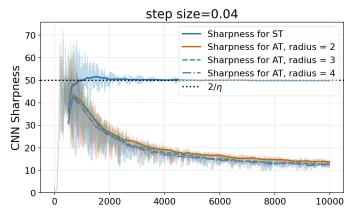

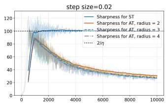

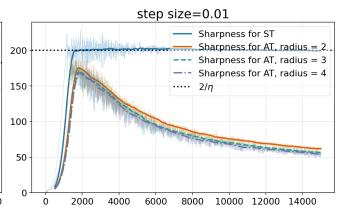

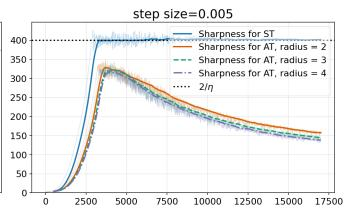

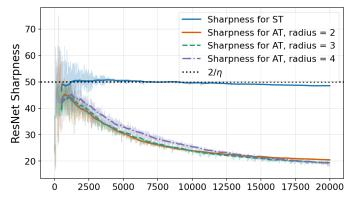

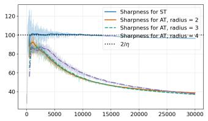

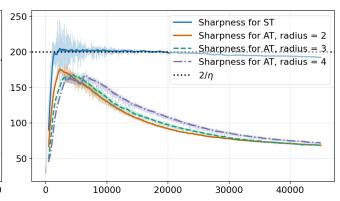

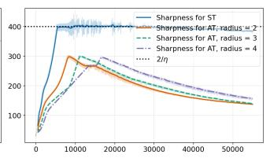

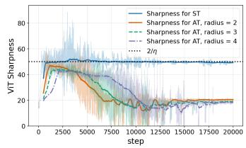

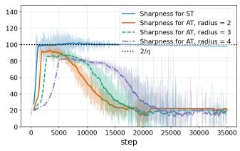

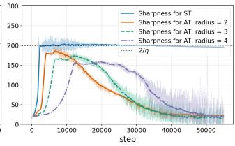

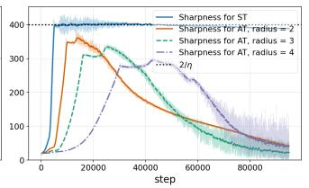  
Figure 5: Sharpness evolution under standard training and $\ell _ { \infty } .$ -adversarial training on CIFAR-10. Adversarial examples are generated using (PGD).

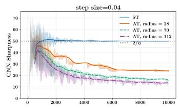

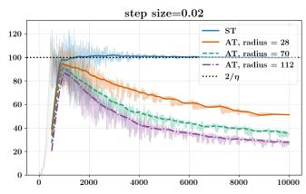

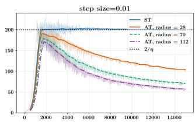

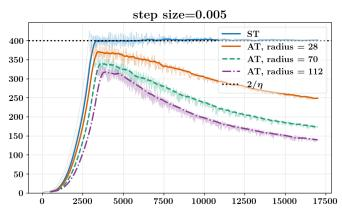

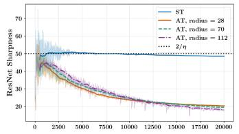

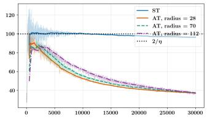

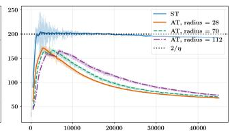

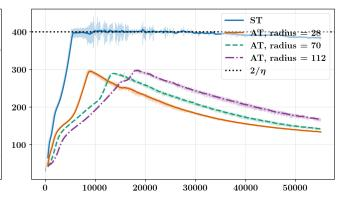

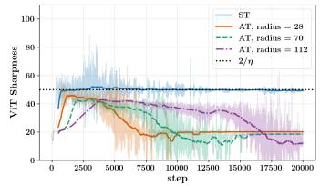

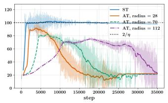

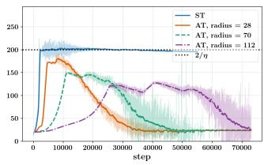

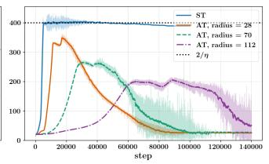  
Figure 6: Sharpness evolution under standard training and $\ell _ { 2 }$ -adversarial training on CIFAR-10. Adversarial examples are generated using (PGD).

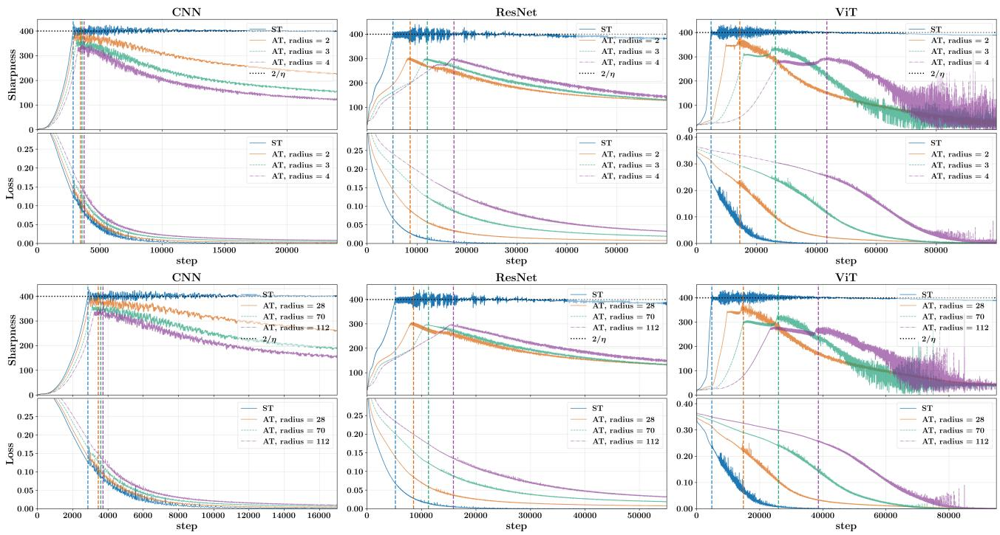  
Figure 7: Comparison of the oscillation behaviors between sharpness and losses. It can be seen that when the sharpness starts to oscillate with a decreasing trend, the losses also start to oscillate. The experimental setting is step size $\eta = 0 . 0 0 5$ with different architectures on CIFAR-10, and the adversarial attacks are generated by FGSM with $\ell _ { \infty }$ geometry (upper) or $\ell _ { 2 }$ geometry (lower).

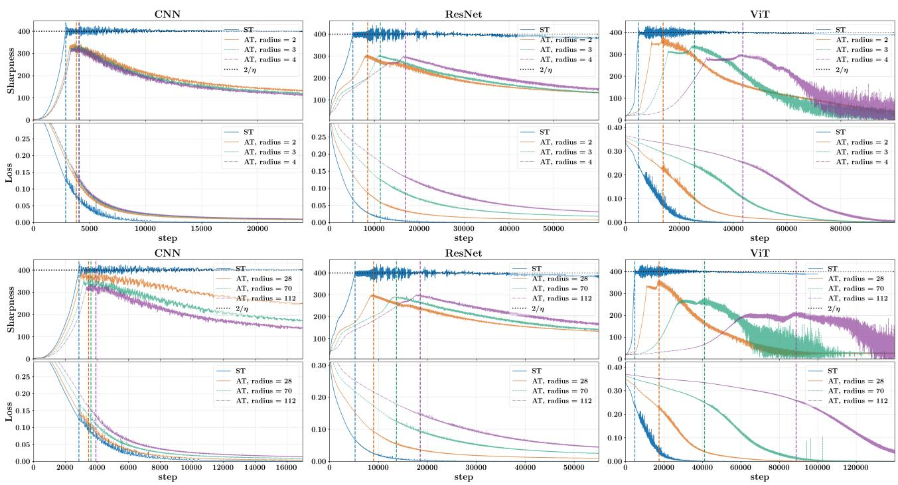  
Figure 8: The experimental setting is same as Figure 7, besides the adversarial attacks are generated by PGD.

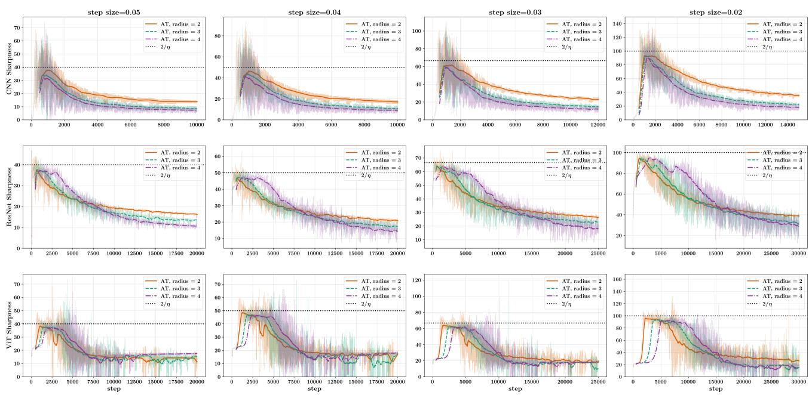  
Figure 9: Sharpness evolution of CNN, ResNet, and ViT on the SVHN dataset. The adversarial examples are generated by the FGSM method with $\ell _ { \infty }$ geometry. It can be observed that the sharpness also exhibits the two-stage behavior described in Section 5.

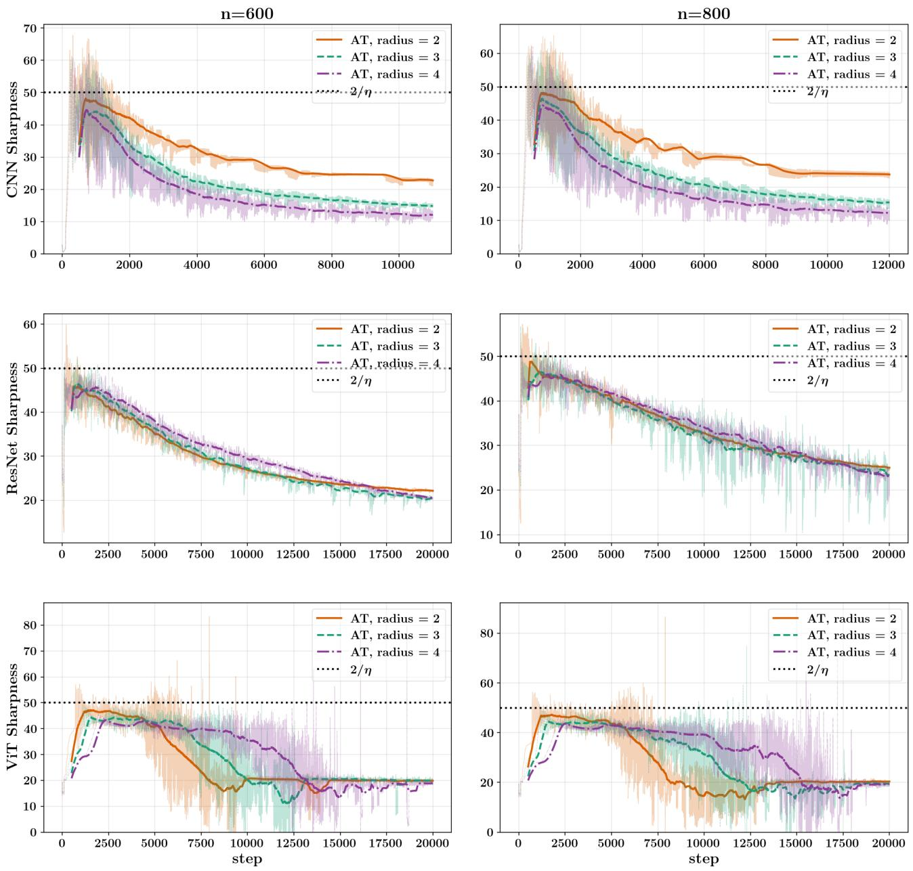  
Figure 10: Sharpness evolution of CNN, ResNet, and ViT with different sample sizes.