# An Information Bottleneck for Post-hoc Memorization Mitigation in LLMs

Dina El Zein1,2 Shashi Kumar1,2 James Henderson1

1Idiap Research Institute, Switzerland 2EPFL, Switzerland {dina.el-zein, shashi.kumar, james.henderson}@idiap.ch

## Abstract

Recent studies have shown that large language models (LLMs) can memorize and reproduce copyrighted training data, raising serious privacy and intellectual property concerns. In this work, we investigate whether memorization can be mitigated without modifying or retraining the underlying model through an information bottleneck. We propose a modular plug-andplay framework that inserts a nonparametric variational information bottleneck (NVIB) between a frozen LLM backbone and its language modeling head. By compressing the final hidden representations before token prediction, the proposed bottleneck aims to preserve general linguistic knowledge while filtering out highly specific memorized sequences. We evaluate our approach on memorization extraction tasks involving book passages and on standard language modeling benchmarks to measure the trade-off between memorization reduction and downstream utility. Our experiments show that the NVIB layer substantially reduces extractability while maintaining competitive performance on benchmark tasks. These results suggest that adding an information bottleneck offers a practical and architecture agnostic direction for post-hoc memorization mitigation in pretrained LLMs.

## 1 Introduction

Large Language Models (LLMs) are widely used across natural language processing tasks, including text generation, question answering, summarization, translation, reasoning, and multimodal applications (Raffel et al., 2020). Trained on massive datasets collected from books, websites, and other textual sources (Raffel et al., 2020), they learn statistical relationships that enable coherent text generation (Cooper et al., 2025; Zhang et al., 2020). However, increasing model and dataset scales have amplified concerns about memorization of training data.

LLMs can retain and reproduce specific training sequences, particularly rare or distinctive passages (Carlini et al., 2021, 2022), raising concerns about copyrighted or sensitive content. Recent studies demonstrate that open-weight LLMs can reproduce substantial portions of copyrighted books nearly verbatim (Ahmed et al., 2026). Extraction attacks further reveal that even production-level LLMs equipped with safety mechanisms can generate long copyrighted passages with high fidelity, raising concerns about privacy, intellectual property, and responsible deployment.

Several approaches have been proposed to mitigate memorization in LLMs. Data deduplication and filtering techniques can reduce the occurrence of repeated training examples, but they require preprocessing before training and cannot fully eliminate memorization (Lee et al., 2022). Other approaches, such as differential privacy or retrainingbased mitigation strategies, often introduce significant computational costs and may negatively impact downstream model performance (Abadi et al., 2016). Thus, efficient post-hoc methods are needed to reduce memorization without modifying or retraining the underlying model.

In this paper, We propose a plug-and-play nonparametric variational information bottleneck (NVIB) framework (Henderson and Fehr, 2023a) for memorization mitigation in pretrained LLMs1. Our approach inserts an NVIB layer between the frozen LLM backbone and its language modeling head, compressing latent representations before token prediction. The bottleneck aims to reduce verbatim memorization while preserving downstream performance. Prior work on NVIB-based latent information filtering has demonstrated promising results in privacy-preserving representation learning, maintaining utility while improving privacy guarantees (El Zein and Henderson, 2026; El Zein et al., 2026).

Our contributions are summarized as follows:

• We introduce a plug-and-play NVIB bottleneck for post-hoc memorization mitigation in pretrained LLMs.

• We demonstrate reduced memorization extractability without modifying or retraining the pretrained backbone.

• We evaluate utility across knowledge, reasoning, and instruction-following benchmarks, examining the trade-off between memorization reduction and model performance.

## 2 Background and Related Work

Our proposed method builds on prior work in LLM memorization, its measurement, and NVIB. We first review evidence that LLMs reproduce training data, including copyrighted text. We then discuss approaches for measuring memorization in generative models. Finally, we introduce NVIB and its role in latent compression and information filtering, which underpin our memorization mitigation framework.

## 2.1 Memorization in LLMs

Memorization in LLMs occurs when a model reproduces portions of its training data during generation. More precisely, memorization occurs when a continuation (s) generated from a prompt (p) matches the corresponding sequence $( [ p | s ] )$ in the training dataset, where $( [ p | s ] )$ denotes the prompt (p) followed by the generated continuation (s) (Carlini et al., 2022). Although LLMs learn general statistical and semantic patterns, they can also reproduce exact training sequences, particularly when these sequences are rare, unique, or highly distinctive (Carlini et al., 2021, 2022).

LLM capabilities depend on the scale, diversity, and quality of training data (Su, 2026). Large text corpora allow models to learn statistical relationships that support performance across many NLP tasks (Thrush et al., 2025). However, generalization can coexist with verbatim reproduction of training examples (Carlini et al., 2021). Memorization can increase with model scale and dataset size as models retain increasingly detailed training information (Carlini et al., 2022), raising the risk of extraction attacks and unintended disclosure.

Several studies have demonstrated that attackers can deliberately extract memorized data from

LLMs using targeted prompting strategies (Carlini et al., 2021). These attacks often rely on prefix prompting, sampling-based extraction, or repeated querying to induce the model to reproduce memorized sequences. Generated outputs can closely match training examples near-verbatim, revealing copyrighted, sensitive, or proprietary content (Cooper et al., 2025). Recent work has further shown that even production-level language models equipped with safety mechanisms remain vulnerable to such extraction attacks, highlighting the persistence of memorization behavior in modern generative systems.

This phenomenon raises significant concerns regarding copyright protection, intellectual property rights, and responsible deployment of LLMs. Since many language models are trained on web-scale corpora that include copyrighted books, articles, and proprietary material, memorization may lead to unauthorized reproduction of protected content (Xu et al., 2025; Cooper et al., 2025). Beyond copyright issues, memorization can result in leakage of sensitive information such as phone numbers, email addresses, or personal identifiers contained in the training data (Luo et al., 2026). As a result, memorization has become an important challenge for the machine learning community and policymakers concerned with AI governance and data protection.

Existing memorization mitigation methods include dataset deduplication, differential privacy, retraining, and machine unlearning (Lee et al., 2022; Abadi et al., 2016). While these approaches have demonstrated varying degrees of success, they generally require preprocessing, expensive retraining, or utility trade-offs. In particular, deduplication requires access to the pretraining corpus and must be applied before training, making it unsuitable for models whose pretraining has been completed. These limitations motivate efficient post-hoc memorization mitigation methods that leave the pretrained model unchanged, as explored in this work.

## 2.2 Measuring Memorization

Measuring memorization is challenging because language models can generalize while also retaining specific training sequences (Carlini et al., 2022). Distinguishing memorization from generalization therefore remains an important research problem (Wang et al., 2025).

One common approach for evaluating memorization relies on extraction-based methods, where generated model outputs are compared against known training samples (Carlini et al., 2021). In these settings, adversaries provide carefully designed prompts or prefixes and analyze whether the model reproduces continuations that appear in the training corpus. Exact match and near verbatim generation are commonly used indicators of memorization, particularly when evaluating copyrighted books or sensitive textual data (Cooper et al., 2025). Metrics such as extraction success rate, exact sequence recovery, and longest common substring overlap are frequently used to quantify the extent of memorized content leakage.

Another widely used approach is exposure analysis (Carlini et al., 2019), which measures how strongly a model has memorized a particular sequence relative to random chance. The underlying intuition is that memorized sequences are assigned disproportionately high likelihood compared to alternative candidate sequences. In practice, memorized samples often exhibit lower perplexity and higher probability scores than randomly sampled alternatives. Exposure-based metrics therefore provide a probabilistic measure of memorization that complements extraction-based evaluation.

Recent work has further demonstrated the effectiveness of scalable extraction attacks for recovering memorized training data from language models (Nasr et al., 2025). These attacks use carefully designed prompts, repeated sampling, and decoding strategies to recover memorized sequences from model outputs. The results show that even large production-level language models can reproduce near verbatim training examples when queried appropriately, highlighting the practical risks associated with memorization in modern LLMs.

## 2.3 Nonparametric Variational Information Bottleneck

The NVIB (Henderson and Fehr, 2023b) is a stochastic latent representation framework designed to regulate the flow of information through transformer attention layers. NVIB extends the variational information bottleneck (VIB) principle by introducing a latent mixture representation that compresses the input embeddings before they are processed by downstream attention computations. By constraining the amount of information retained in the latent space, NVIB encourages the model to preserve high-level semantic structure while filtering unnecessary or highly specific information.

Latent Mixture Representation Rather than directly operating on the original set of input embeddings, NVIB represents the latent space as a stochastic weighted mixture of latent vectors. Given an input sequence of embeddings, the model samples a set of latent vectors Z together with associated normalized weights π. This latent representation is then consumed by a modified attention mechanism referred to as denoising attention (Henderson and Fehr, 2023b), where the weights π bias the attention weights. To model variable length latent representations, NVIB employs Bayesian nonparametric methods based on a Dirichlet Process (DP). This allows the model to define probability distributions over potentially unbounded sets of weighted vectors without fixing the number of latent mixture components in advance.

Prior The uninformative latent mixture representation is modeled using a Dirichlet Process prior, $F \sim \mathrm { D P } ( G _ { 0 } ^ { p } , \alpha _ { 0 } ^ { p } )$ , where $G _ { 0 } ^ { p }$ denotes the base distribution and $\alpha _ { 0 } ^ { p }$ controls the concentration of the mixture weights. The latent vectors are sampled from Gaussian components parameterized by a zero-mean unit-variance prior distribution $G _ { 0 } ^ { p } .$ . The corresponding mixture weights follow a symmetric Dirichlet distribution parameterized by $\alpha _ { 0 } ^ { p } ,$ encouraging sparse latent representations in which only a small number of latent vectors receive significant probability mass.

Posterior Given an input sequence of embeddings $\textbf { x } \in \mathbb { R } ^ { n \times d }$ , the NVIB layer predicts a set of posterior parameters consisting of pseudocounts $\alpha _ { i } ^ { q } \in \mathbb { R }$ together with Gaussian parameters $( { \pmb \mu } _ { i } ^ { q } \in \mathbb { R } ^ { d } , ( { \pmb \sigma } _ { i } ^ { q } ) ^ { 2 } \in \mathbb { R } ^ { d } )$ , one for each position $1 \leq i \leq n$ plus one for the prior $i = n + 1$ . These parameters define a posterior Dirichlet Process distribution over the latent mixture representation:

$$
\begin{array} { r l } { F \sim \mathrm { D P } ( G _ { 0 } ^ { q } , \alpha _ { 0 } ^ { q } ) , \qquad \alpha _ { 0 } ^ { q } } & { { } = \displaystyle \sum _ { i = 1 } ^ { n + 1 } \alpha _ { i } ^ { q } , } \end{array}\tag{1}
$$

where the base distribution $G _ { 0 } ^ { q }$ is represented as a weighted mixture of Gaussian components:

$$
G _ { 0 } ^ { q } = \sum _ { i = 1 } ^ { n + 1 } \frac { \alpha _ { i } ^ { q } } { \alpha _ { 0 } ^ { q } } G _ { i } ^ { q } , \qquad G _ { i } ^ { q } = \mathcal { N } ( \mu _ { i } ^ { q } , I ( \sigma _ { i } ^ { q } ) ^ { 2 } ) .\tag{2}
$$

During training, latent vectors are sampled from the posterior distribution as

$$
\begin{array} { r } { \pi \sim \mathrm { D i r } ( \pmb { \alpha } ^ { q } ) , \qquad Z _ { i } \sim \mathcal { N } ( \pmb { \mu } _ { i } ^ { q } , ( \pmb { \sigma } _ { i } ^ { q } ) ^ { 2 } ) . } \end{array}\tag{3}
$$

The stochastic latent representation acts as an information bottleneck by introducing controlled noise into both the latent vectors and their associated weights. Furthermore, the model can suppress individual latent components by assigning near zero pseudo-counts, effectively reducing the information capacity of the representation.

Training Objective The NVIB objective regularizes the amount of information transmitted through the latent representation. The loss combines the downstream task objective $L _ { T }$ with KL-divergence regularization terms applied to both the Dirichlet mixture weights and the Gaussian latent variables:

$$
L = L _ { T } + \lambda _ { D } L _ { D } + \lambda _ { G } L _ { G } .\tag{4}
$$

The Gaussian regularization term $L _ { G }$ encourages uncertainty in the latent vectors, while the Dirichlet regularization term $L _ { D }$ promotes sparse latent mixtures by reducing the contribution of less informative components. Together, these regularizers constrain the information capacity of the latent space, encouraging compressed representations that preserve task-relevant semantic information while filtering fine-grained details that may contribute to memorization.

In this work, we insert the NVIB layer between the frozen LLM backbone and its language modeling head. By compressing the final hidden representations before token prediction, the proposed framework aims to reduce the recovery of memorized training sequences while preserving downstream language modeling capabilities. Prior work has investigated NVIB in pretrained transformer architectures, including its integration within pretrained models followed by fine-tuning (Fehr and Henderson, 2024; Fehr et al., 2025). Other studies have applied NVIB to encoder-based models such as BERT and RoBERTa, comparing it against alternative bottleneck mechanisms, including VIB, fixed Gaussian noise, and learned Gaussian noise, while also examining the effects of its regularization components (El Zein and Henderson, 2026; El Zein et al., 2026). Building on these findings, we investigate NVIB for post-hoc memorization mitigation in decoder-only LLMs. Unlike these approaches, we insert the bottleneck between the pretrained backbone and its language modeling head, keeping both frozen and optimizing only the added bottleneck parameters.

## 3 Memorization Bottleneck for Large Language Models

In this work, we propose a memorization bottleneck for pretrained LLMs based on NVIB. The key intuition is that memorized training sequences rely on highly informative hidden representations that preserve fine-grained token-level information. By introducing a stochastic information bottleneck before token prediction, our approach compresses these representations to reduce the recoverability of memorized training data while preserving the semantic and linguistic information required for downstream language modeling.

## 3.1 Memorization Bottleneck Architecture

To mitigate memorization in LLMs, we integrate an NVIB bottleneck into frozen autoregressive LLMs such as Llama 3.1 and Qwen3. The bottleneck is inserted between the final hidden representations produced by the pretrained LLM backbone and the language modeling (LM) head used for token prediction. During training, only the parameters of the NVIB bottleneck are optimized, while the pretrained backbone and LM head remain frozen. This design provides an architecture-agnostic framework for post-hoc memorization mitigation.

Our approach builds on the NVIB (Henderson and Fehr, 2023b), which provides a stochastic latent representation framework for controlling the amount of information transmitted through transformer representations. We apply NVIB to the final hidden states of the LLM to compress the latent representation before token prediction.

The architecture of the proposed memorization bottleneck model is illustrated in Figure 1. Given an input sequence, the pretrained LLM produces a sequence of hidden representations denoted as $\mathbf { x } \in \mathbb { R } ^ { n \times d }$ , where n is the sequence length and d is the hidden dimensionality. These hidden representations are processed by a lightweight transformer layer incorporating the NVIB mechanism. The NVIB layer projects each hidden representation into a set of posterior parameters consisting of pseudo-counts $\alpha ^ { q }$ together with Gaussian parameters $( \mu ^ { q } , ( \sigma ^ { q } ) ^ { 2 } )$ . These parameters define a posterior Dirichlet Process distribution over sequences of weighted latent vectors.

More precisely, the latent representation is modeled as a stochastic sequence of weighted vectors $\mathbf { S } = = ( \pi , \mathbf { Z } )$ , sampled from the posterior distribution $Q ( \mathbf { S } )$ . The latent weights π are sampled from a Dirichlet distribution, while the latent vectors Z are sampled from Gaussian components parameterized by the posterior mean and variance. Rather than interpreting the posterior as an exact Dirichlet Process realization, we interpret it as a stochastic sampling procedure that generates compressed latent representations of the original hidden states. The resulting latent sequence is then processed through a Denoising Multi-Head Attention (MHA) layer before being passed to the frozen LM head for token prediction. During training, latent vectors and mixture weights are sampled from their respective posterior distributions. At inference time, we use the posterior Gaussian means and normalized Dirichlet concentration parameters.

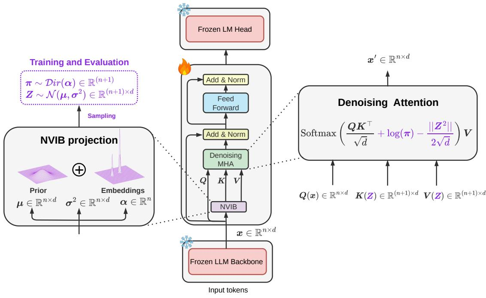  
Figure 1: Overview of the proposed memorization bottleneck architecture. A frozen decoder-only LLM backbone generates the hidden representations $\mathbf { x } \in \mathbb { R } ^ { n \times d }$ , which pass through a trainable NVIB block before the frozen language modeling (LM) head. The block combines a stochastic bottleneck, denoising attention, and feed-forward layers to reduce memorization while preserving language modeling performance. Only the bottleneck parameters are trained.

The proposed stochastic bottleneck introduces controlled noise into the latent representation, reducing the model’s ability to preserve detailed token-level information. Since memorized training sequences often rely on high-fidelity hidden representations, this stochastic compression mechanism aims to suppress exact sequence retention while preserving broader semantic and linguistic structure necessary for downstream language modeling. Consequently, the bottleneck limits the recoverability of memorized training data while maintaining competitive utility on standard NLP tasks.

We adopt the NVIB formulation and regularization settings based on prior experimental findings (El Zein and Henderson, 2026; El Zein et al., 2026).

## 4 Experiments

We evaluate the proposed memorization bottleneck along two dimensions: reducing the extraction of memorized copyrighted text and preserving downstream model utility.

## 4.1 Experimental Setup

We evaluate the proposed memorization bottleneck framework on two open-weight LLM backbones: Llama-3.1-8B and Qwen3-8B.

We compare NVIB against a Transformer-layer baseline that inserts a standard transformer layer at the same location. For both variants, only the added layer is trained, while the pretrained backbone and language modeling head remain frozen. Both variants are trained on the same data using a causal language modeling task objective, while NVIB additionally includes the regularization losses described in Section 2.3. We train on the Open-R1 Mixture-of-Thoughts dataset (Face, 2025; Lozhkov et al., 2025), which contains reasoning-oriented instruction-following data.

The NVIB bottleneck contains 251M trainable parameters for Llama-3.1-8B and 226M trainable parameters for Qwen3-8B, while the Transformerlayer baseline contains 218M and 193M, respectively. Full training and architectural configurations are provided in Appendix B.

## 4.2 Memorization Evaluation

To evaluate memorization, we adopt the probabilistic discoverable extraction metric of Hayes et al. (Hayes et al., 2025), hereafter referred to as probabilistic extraction, following Cooper et al. (Cooper et al., 2025). Unlike exact-match metrics, probabilistic extraction estimates the likelihood that a language model reproduces a target continuation from a given prefix.

Formally, let $z = z _ { 1 : a + j }$ denote a sequence from the training corpus, where $z _ { 1 : a }$ is a prefix of length a and $z _ { a + 1 : a + j }$ is the corresponding suffix of length $j .$ . Following Hayes et al. (Hayes et al., 2025), the probabilistic extraction score of the sequence is defined as

$$
p _ { z } \triangleq \operatorname* { P r } _ { \theta , \phi } \left( z _ { a + 1 : a + j } \ | \ z _ { 1 : a } \right) ,\tag{5}
$$

where θ denotes the language model and $\phi$ denotes the decoding strategy. Since autoregressive language models factorize the joint probability over tokens, the extraction score can be written as

$$
p _ { z } = \prod _ { t = a + 1 } ^ { a + j } \operatorname* { P r } _ { \theta , \phi } \left( z _ { t } \mid z _ { 1 : t - 1 } \right) .\tag{6}
$$

Intuitively, $p _ { z }$ measures how likely the model is to generate the exact ground-truth continuation given the prefix. Larger values of $p _ { z }$ indicate that the target continuation is more readily recoverable, whereas smaller values indicate reduced extractability. For each evaluated window, we compute a probabilistic extraction score $p _ { z } .$ , and compare the distributions of these scores across model variants.

We evaluate the original pretrained models (Base), Transformer-layer baselines (+ Transformer layer), and NVIB-augmented models (+ NVIB) on four copyrighted books: Animal Farm, The Hitchhiker’s Guide to the Galaxy, Crime and Punishment, and The Lord of the Rings: The Fellowship ofthe Ring. Figure 2 presents the extraction score distributions for Llama-3.1-8B and Qwen3-8B.

Following Cooper et al. (Cooper et al., 2025), we compute probabilistic extraction scores for each model using their implementation and visualize the distribution of scores for all extracted sequences with $p _ { z } \geq 0 . 0 0 1$ . The extraction configuration determines the prefix and suffix lengths. Given an extraction window of length $L = 1 0 0$ tokens, the first $L _ { p }$ tokens form the prefix and the remaining $L _ { s }$ tokens form the suffix, where $L _ { p } + L _ { s } = L$ For example, the top40-suffix40 configuration uses top-k decoding with $k = 4 0$ , a prefix length of $L _ { p } = 6 0$ tokens, and a suffix length of $L _ { s } = 4 0$ tokens. Probabilistic extraction is evaluated over overlapping 100-token windows with a stride of 10 tokens. The resulting histograms report the number of extracted sequences whose scores fall within each probability bin. Lower probabilistic extraction scores indicate that the model assigns lower probability to reproducing the target continuation, suggesting reduced extractability of memorized content. Consequently, a shift of the distribution toward lower extraction probabilities, together with a reduction in the number of extracted sequences, indicates that memorized passages are less readily recoverable.

Llama-3.1-8B. Figure 2a shows that NVIB substantially reduces extraction relative to both the base model and the Transformer-layer baseline across all four books. For Animal Farm, the number of extracted sequences drops from 1,506 (Base) to 502 (+ Transformer layer) and just 106 (+ NVIB). Similar reductions are observed for The Fellowship ofthe Ring (1,454 to 556 and 48), The Hitchhiker’s Guide to the Galaxy (1,485 to 974 and 351), and Crime and Punishment (1,432 to 1,219 and 957), respectively. While the Transformer-layer baseline may reduce extraction by altering hidden representations passed to the frozen language modeling head, thereby disrupting memorized continuations, NVIB achieves substantially greater reductions. We hypothesize that this additional reduction arises from the information bottleneck suppressing fine-grained representations that support memorized token predictions. These results suggest that NVIB’s effectiveness extends beyond adding a trainable layer, highlighting the contribution of the information bottleneck mechanism.

Qwen3-8B. Figure 2b shows a similar trend, with NVIB consistently reducing extraction beyond the Transformer-layer baseline. For Crime and Punishment, extracted sequences decrease from 600 (Base) to 260 (+ Transformer layer) and 122 (+

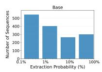

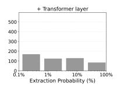

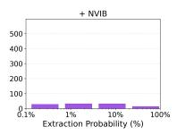

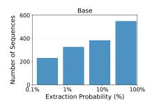

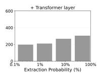

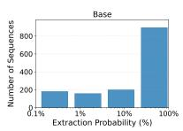

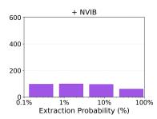

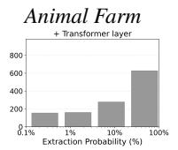

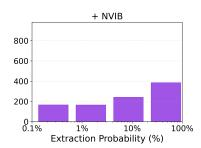  
Crime and Punishment

The Hitchhiker’s Guide to the Galaxy  
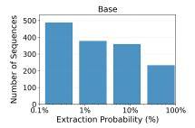

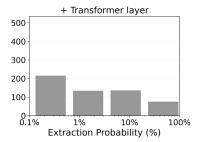

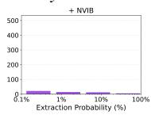  
The Lord of the Rings: The Fellowship of the Ring

(a) Llama-3.1-8B  
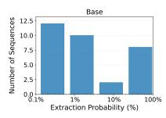

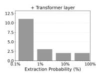

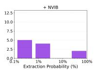

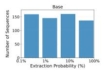

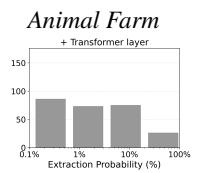  
Crime and Punishment

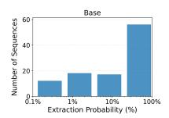

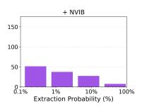  
(b) Qwen3-8B

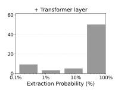

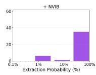

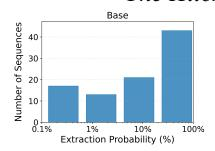

The Hitchhiker’s Guide to the Galaxy  
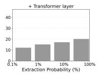  
The Lord of the Rings: The Fellowship of the Ring

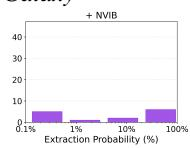

Figure 2: Distribution of probabilistic extraction scores on four copyrighted books. For each book, we compare the base model (Base), Transformer-layer baseline (+ Transformer layer), and NVIB-augmented model (+ NVIB). Histograms show extraction scores for sequences with $p _ { z } \geq 1 0 ^ { - 3 }$ , grouped into four logarithmically spaced bins over $1 0 ^ { - 3 } \le p _ { z } \le 1$ . The choice of cutoff is discussed in Appendix A.1. Lower extraction probabilities and fewer extracted sequences indicate reduced extractability.
<table><tr><td></td><td colspan="3">Qwen3-8B</td><td colspan="3">Llama-3.1-8B</td></tr><tr><td>Book</td><td>Base</td><td>+ Transformer</td><td>+ NVIB</td><td>Base</td><td>+ Transformer</td><td>+ NVIB</td></tr><tr><td>Animal Farm</td><td> $1 . 6 9 \times { { 1 0 } ^ { - 4 } }$ </td><td> $4 . 9 0 \times 1 0 ^ { - 5 }$ </td><td> $\mathbf { 2 . 8 7 \times 1 0 ^ { - 5 } }$ </td><td> $1 . 0 5 \times { { 1 0 } ^ { - 2 } }$ </td><td> $2 . 8 5 \times 1 0 ^ { - 3 }$ </td><td> $\mathbf { 5 . 0 9 \times 1 0 ^ { - 4 } }$ </td></tr><tr><td>Down and Out in the Magic Kingdom</td><td> $3 . 6 1 \times { 1 0 } ^ { - 4 }$ </td><td> $2 . 7 8 \times 1 0 ^ { - 4 }$ </td><td> $\mathbf { 8 . 1 2 \times 1 0 ^ { - 6 } }$ </td><td> $7 . 5 8 \times 1 0 ^ { - 4 }$ </td><td> $5 . 6 7 \times { { 1 0 } ^ { - 4 } }$ </td><td> $\mathbf { 4 . 4 2 \times 1 0 ^ { - 4 } }$ </td></tr><tr><td>Crime and Punishment</td><td> $6 . 6 0 \times 1 0 ^ { - 4 }$ </td><td> $1 . 3 2 \times { { 1 0 } ^ { - 4 } }$ </td><td> $\mathbf { 6 . 3 9 \times 1 0 ^ { - 5 } }$ </td><td> $4 . 9 6 \times 1 0 ^ { - 3 }$ </td><td> $3 . 0 6 \times 1 0 ^ { - 3 }$ </td><td> $\mathbf { 1 . 6 7 \times 1 0 ^ { - 3 } }$ </td></tr><tr><td>The Lord of the Rings: The Two Towers</td><td> $5 . 9 0 \times 1 0 ^ { - 5 }$ </td><td> $2 . 1 1 \times 1 0 ^ { - 5 }$ </td><td> $\mathbf { 7 . 5 4 \times 1 0 ^ { - 6 } }$ </td><td> $9 . 5 4 \times 1 0 ^ { - 5 }$ </td><td> $1 . 7 6 \times 1 0 ^ { - 5 }$ </td><td> $\mathbf { 4 . 0 0 \times 1 0 ^ { - 6 } }$ </td></tr></table>

Table 1: Mean probabilistic extraction scores. Scores are averaged over all evaluated windows, including those with $p _ { z } < 1 0 ^ { - 3 }$ . Lower is better; bold indicates the lowest score for each book and backbone.

NVIB). Similarly, extraction decreases from 94 to 64 and 14 for The Fellowship of the Ring, from 103 to 67 and 42 for The Hitchhiker’s Guide to the Galaxy, and from 32 to 18 and 11 for Animal Farm, following the same model variants. These results support NVIB’s effectiveness across different model architectures, beyond the effect of adding a trainable layer. Additional probabilistic extraction results for Llama-3.1-8B and Qwen3-8B are provided in Appendix A.3, with decoding and prefix/suffix sensitivity analyses in Appendix A.2.

Mean Probabilistic Extraction Score. While the extraction histograms characterize sequences above the $p _ { z } ~ \ge ~ 1 0 ^ { - 3 }$ cutoff, they exclude windows with lower extraction probabilities to focus on the regions most relevant to memorization. For completeness, we also report the mean probabilistic extraction score $\overline { { p } } _ { z } ,$ computed across all evaluated windows for each book and model variant, regardless of the cutoff. Table 1 shows that NVIB achieves the lowest mean score across all evaluated books for both Qwen3-8B and Llama-3.1-8B. These results confirm that NVIB’s reduction in extraction probability extends across the full set of evaluated windows, while the thresholded histograms provide a more focused characterization of sequences with higher extraction probabilities. Further discussion of the cutoff and additional mean scores are provided in Appendices A.1 and A.4.

<table><tr><td></td><td colspan="3">Qwen3-8B</td><td colspan="3">Llama-3.1-8B</td></tr><tr><td>Benchmark</td><td></td><td>Base + Transformer layer + NVIB</td><td></td><td>Base</td><td>+ Transformer layer</td><td>: + NVIB</td></tr><tr><td colspan="7">Knowledge &amp; Understanding</td></tr><tr><td>MMLU</td><td>49.7</td><td>48.2</td><td>49.5</td><td>64.0</td><td>60.0</td><td>59.8</td></tr><tr><td>MMLU-Redux</td><td>75.9</td><td>76.3</td><td>76.1</td><td>25.8</td><td>36.7</td><td>28.2</td></tr><tr><td colspan="7">Complex Reasoning</td></tr><tr><td>MMLU-Pro</td><td>63.6</td><td>62.2</td><td>62.4</td><td>36.2</td><td>32.3</td><td>32.3</td></tr><tr><td>GPQA Diamond</td><td>27.3</td><td>24.7</td><td>28.8</td><td>29.80</td><td>33.8</td><td>27.3</td></tr><tr><td>MuSR</td><td>40.9</td><td>40.1</td><td>42.5</td><td>36.9</td><td>39.6</td><td>40.2</td></tr><tr><td colspan="7">Instruction Following</td></tr><tr><td>IFEval</td><td>90.6</td><td>89.3</td><td>90.3</td><td>15.5</td><td>25.2</td><td>25.2</td></tr></table>

Table 2: Downstream utility across model variants. Performance of the original pretrained models (Base), Transformer-layer baselines, and NVIB-augmented models on knowledge and understanding, complex reasoning, and instruction-following benchmarks. Higher scores indicate better performance.

## 4.3 Utility Evaluation

To assess whether memorization mitigation compromises downstream capabilities, we evaluate Qwen3-8B and Llama-3.1-8B across six benchmarks covering three categories: (i) knowledge and understanding, using MMLU (Hendrycks et al., 2020) and MMLU-Redux (Gema et al., 2025); (ii) complex reasoning, using MMLU-Pro (Wang et al., 2024), GPQA Diamond (Rein et al., 2023), and MuSR (Sprague et al., 2024); and (iii) instruction following, using IFEval (Zhou et al., 2023). All evaluations are conducted using the lm-evaluation-harness framework (Gao et al., 2024). We compare the original pretrained models (Base), the Transformer-layer baseline, and the proposed NVIB-augmented models to assess utility preservation.

Table 2 presents the results. For Qwen3- 8B, NVIB largely preserves performance across all evaluated capabilities, with only minor variations on knowledge, reasoning, and instructionfollowing benchmarks. Notably, NVIB outperforms the Transformer-layer baseline on five of the six benchmarks, suggesting that the bottleneck preserves downstream capabilities beyond those retained by a standard added layer. For Llama-3.1-8B, utility preservation is more task-dependent. NVIB exhibits moderate degradation on MMLU, MMLU-Pro, and GPQA Diamond, while improving performance on MMLU-Redux and MuSR. The largest improvement is observed on IFEval, with a gain of 9.7 percentage points over the base model, although the Transformer-layer baseline achieves the same performance. These findings highlight that the utility trade-off depends on the underlying architecture and evaluated capability, with some improvements attributable to the additional trainable layer rather than the bottleneck itself.

Overall, the results suggest that NVIB can substantially reduce memorization extractability while retaining much of the evaluated downstream utility. The trade-off is particularly favorable for Qwen3-8B, whereas Llama-3.1-8B exhibits more pronounced differences across tasks. Together with the memorization results, these findings highlight the potential of post-hoc information bottlenecks while emphasizing the importance of evaluating capability-specific utility trade-offs.

## 5 Conclusion

We present a plug-and-play memorization mitigation framework for LLMs based on the Nonparametric Variational Information Bottleneck (NVIB). Our method inserts a stochastic bottleneck between the frozen LLM backbone and its language modeling head, optimizing only the bottleneck parameters. Experiments on Llama-3.1-8B and Qwen3- 8B show that NVIB lowers probabilistic extraction scores and consistently reduces extractable passages from copyrighted books while preserving downstream performance. Compared with a standard Transformer-layer baseline, NVIB achieves greater reductions in extractability, suggesting benefits beyond adding a trainable layer. These results establish NVIB as a practical, architecture-agnostic approach to post-hoc memorization mitigation.

## 6 Limitations

Our study focuses on two model families and a selected set of copyrighted books, and future work could extend the evaluation to a broader range of architectures, datasets, and decoding settings. While the proposed bottleneck consistently reduces the extractability of memorized content, its effect may depend on the chosen compression strength and evaluation setup. Additional experiments could also examine other forms of sensitive information leakage beyond copyrighted text. Since the pretrained backbone remains frozen, our evaluation demonstrates reduced extractability of memorized content rather than removal of memorized information from the model parameters.

## References

Martin Abadi, Andy Chu, Ian Goodfellow, H Brendan McMahan, Ilya Mironov, Kunal Talwar, and Li Zhang. 2016. Deep learning with differential privacy. In Proceedings ofthe 2016 ACM SIGSAC conference on computer and communications security, pages 308–318.

Ahmed Ahmed, A Feder Cooper, Sanmi Koyejo, and Percy Liang. 2026. Extracting books from production language models. arXiv preprint arXiv:2601.02671.

Nicholas Carlini, Daphne Ippolito, Matthew Jagielski, Katherine Lee, Florian Tramer, and Chiyuan Zhang. 2022. Quantifying memorization across neural language models. In The Eleventh International Conference on Learning Representations.

Nicholas Carlini, Chang Liu, Úlfar Erlingsson, Jernej Kos, and Dawn Song. 2019. The secret sharer: Evaluating and testing unintended memorization in neural networks. In 28th USENIX security symposium (USENIX security 19), pages 267–284.

Nicholas Carlini, Florian Tramer, Eric Wallace, Matthew Jagielski, Ariel Herbert-Voss, Katherine Lee, Adam Roberts, Tom Brown, Dawn Song, Ulfar Erlingsson, and 1 others. 2021. Extracting training data from large language models. In 30th USENIX security symposium (USENIX Security 21), pages 2633–2650.

A. Feder Cooper, Aaron Gokaslan, Amy B. Cyphert, Christopher De Sa, Mark Lemley, Daniel E. Ho, and Percy Liang. 2025. Extracting memorized pieces of (copyrighted) books from open-weight language models. In ICML 2025 Workshop on Reliable and Responsible Foundation Models.

Dina El Zein and James Henderson. 2026. Differential privacy for transformer embeddings of text with nonparametric variational information bottleneck. arXiv preprint arXiv:2601.02307.

Dina El Zein, Shashi Kumar, and James Henderson. 2026. Nonparametric variational differential privacy via embedding parameter clipping. In ICLR 2026 Workshop on Principled Design for Trustworthy AI - Interpretability, Robustness, and Safety across Modalities.

Hugging Face. 2025. Open R1: A fully open reproduction of DeepSeek-R1.

Fabio James Fehr, Alina Elena Baia, Xiaoguang Chang, Andrei Catalin Coman, Karl El Hajal, Dina El Zein, Shashi Kumar, Juan Pablo Zuluaga Gomez, Andrea Cavallaro, Damien Teney, and James Henderson. 2025. Fine-tuning pretrained models with NVIB for improved generalisation. In Workshop on Spurious Correlation and Shortcut Learning: Foundations and Solutions.

Fabio James Fehr and James Henderson. 2024. Nonparametric variational regularisation of pretrained transformers. In First Conference on Language Modeling.

Leo Gao, Jonathan Tow, Baber Abbasi, Stella Biderman, Sid Black, Anthony DiPofi, Charles Foster, Laurence Golding, Jeffrey Hsu, Alain Le Noac’h, Haonan Li, Kyle McDonell, Niklas Muennighoff, Chris Ociepa, Jason Phang, Laria Reynolds, Hailey Schoelkopf, Aviya Skowron, Lintang Sutawika, and 5 others. 2024. The language model evaluation harness.

Aryo Pradipta Gema, Joshua Ong Jun Leang, Giwon Hong, Alessio Devoto, Alberto Carlo Maria Mancino, Rohit Saxena, Xuanli He, Yu Zhao, Xiaotang Du, Mohammad Reza Ghasemi Madani, and 1 others. 2025. Are we done with mmlu? In Proceedings of the 2025 Conference ofthe Nations ofthe Americas Chapter of the Association for Computational Linguistics: Human Language Technologies (Volume 1: Long Papers), pages 5069–5096.

Jamie Hayes, Marika Swanberg, Harsh Chaudhari, Itay Yona, Ilia Shumailov, Milad Nasr, Christopher A Choquette-Choo, Katherine Lee, and A Feder Cooper. 2025. Measuring memorization in language models via probabilistic extraction. In Proceedings of the 2025 Conference ofthe Nations ofthe Americas Chapter of the Association for Computational Linguistics: Human Language Technologies (Volume 1: Long Papers), pages 9266–9291.

James Henderson and Fabio James Fehr. 2023a. A VAE for transformers with nonparametric variational information bottleneck. In The Eleventh International Conference on Learning Representations.

James Henderson and Fabio James Fehr. 2023b. A VAE for transformers with nonparametric variational information bottleneck. In The Eleventh International Conference on Learning Representations.

Dan Hendrycks, Collin Burns, Steven Basart, Andy Zou, Mantas Mazeika, Dawn Song, and Jacob Steinhardt. 2020. Measuring massive multitask language understanding. arXiv preprint arXiv:2009.03300.

Katherine Lee, Daphne Ippolito, Andrew Nystrom, Chiyuan Zhang, Douglas Eck, Chris Callison-Burch, and Nicholas Carlini. 2022. Deduplicating training data makes language models better. In Proceedings of the 60th Annual Meeting of the Association for Computational Linguistics (Volume 1: Long Papers), pages 8424–8445.

Anton Lozhkov, Hynek Kydlícek, Loubna Ben Allal,ˇ Guilherme Penedo, Edward Beeching, Quentin Gallouédec, Nathan Habib, Lewis Tunstall, and Leandro von Werra. 2025. OpenR1-Math-220k. https://huggingface.co/datasets/open-r1/ OpenR1-Math-220k.

Xiaoyu Luo, Yiyi Chen, Qiongxiu Li, and Johannes Bjerva. 2026. Do llms really memorize personally identifiable information? revisiting pii leakage with a cue-controlled memorization framework. Preprint, arXiv:2601.03791.

Milad Nasr, Javier Rando, Nicholas Carlini, Jonathan Hayase, Matthew Jagielski, A Feder Cooper, Daphne Ippolito, Christopher Choquette-Choo, Florian Tramèr, and Katherine Lee. 2025. Scalable extraction of training data from aligned, production language models. In International Conference on Learning Representations, volume 2025, pages 82363–82435.

Colin Raffel, Noam Shazeer, Adam Roberts, Katherine Lee, Sharan Narang, Michael Matena, Yanqi Zhou, Wei Li, and Peter J Liu. 2020. Exploring the limits of transfer learning with a unified text-to-text transformer. Journal ofmachine learning research, 21(140):1–67.

David Rein, Betty Li Hou, Asa Cooper Stickland, Jackson Petty, Richard Yuanzhe Pang, Julien Dirani, Julian Michael, and Samuel R. Bowman. 2023. Gpqa: A graduate-level google-proof q&a benchmark. Preprint, arXiv:2311.12022.

Zayne Sprague, Xi Ye, Kaj Bostrom, Swarat Chaudhuri, and Greg Durrett. 2024. Musr: Testing the limits of chain-of-thought with multistep soft reasoning. In International Conference on Learning Representations, volume 2024, pages 14670–14728.

Weijie Su. 2026. Do large language models (really) need statistical foundations? The Annals ofApplied Statistics, 20(1):724–743.

Tristan Thrush, Christopher Potts, and Tatsunori Hashimoto. 2025. Improving pretraining data using perplexity correlations. In The Thirteenth International Conference on Learning Representations.

Xinyi Wang, Antonis Antoniades, Yanai Elazar, Alfonso Amayuelas, Alon Albalak, Kexun Zhang, and William Yang Wang. 2025. Generalization v.s. memorization: Tracing language models’ capabilities back to pretraining data. In The Thirteenth International Conference on Learning Representations.

Yubo Wang, Xueguang Ma, Ge Zhang, Yuansheng Ni, Abhranil Chandra, Shiguang Guo, Weiming Ren, Aaran Arulraj, Xuan He, Ziyan Jiang, Tianle Li, Max Ku, Kai Wang, Alex Zhuang, Rongqi Fan, Xiang Yue, and Wenhu Chen. 2024. Mmlu-pro: A more robust and challenging multi-task language understanding benchmark. Preprint, arXiv:2406.01574.

Zhenhua Xu, Xubin Yue, Zhebo Wang, Qichen Liu, Xixiang Zhao, Jingxuan Zhang, Wenjun Zeng, Wengpeng Xing, Dezhang Kong, Changting Lin, and 1 others. 2025. Copyright protection for large language models: A survey of methods, challenges, and trends. arXiv preprint arXiv:2508.11548.

Yizhe Zhang, Siqi Sun, Michel Galley, Yen-Chun Chen, Chris Brockett, Xiang Gao, Jianfeng Gao, Jingjing Liu, and William B Dolan. 2020. Dialogpt: Largescale generative pre-training for conversational response generation. In Proceedings of the 58th annual meeting of the association for computational linguistics: system demonstrations, pages 270–278.

Jeffrey Zhou, Tianjian Lu, Swaroop Mishra, Siddhartha Brahma, Sujoy Basu, Yi Luan, Denny Zhou, and Le Hou. 2023. Instruction-following evaluation for large language models. arXiv preprint arXiv:2311.07911.

## A Additional Memorization Evaluation

This appendix presents additional probabilistic extraction results and robustness checks that complement the representative examples discussed in Section 4.2.

## A.1 Threshold Sensitivity

We assess the sensitivity of the probabilistic extraction histograms to the $p _ { z } \geq 1 0 ^ { - 3 }$ cutoff. Extraction scores are computed for all evaluated windows, but the cutoff determines which windows are included in the histograms. With the cutoff, only windows satisfying $p _ { z } \geq 1 0 ^ { - 3 }$ are displayed, whereas removing it includes windows with lower extraction scores as well. The histograms report raw counts within each probability bin rather than normalized proportions. Since windows below the cutoff have negligible extraction probabilities, including them would primarily increase the counts in the lowest probability bins, obscuring the differences between models in the higher-probability regions most relevant to memorization.

## A.2 Decoding and prefix-length sensitivity.

We assess decoding sensitivity using Harry Potter and the Half-Blood Prince with Llama-3.1-8B. The numbers of extracted sequences for the base, Transformer-layer baseline, and NVIB-augmented models are 15 (Base), 2 (+ Transformer layer), and 1 (+ NVIB) $( T \ = \ 1 , k \ = \ 4 0 , L _ { p } \ = \ 5 0 )$ , 65 (Base), 22 (+ Transformer layer), and 18 (+ NVIB) $( T = 1 , k = 4 0 , L _ { p } = 6 0 )$ , 320 (Base), 187 (+ Transformer layer), and 163 (+ NVIB) $( T = 1 , k = 4 0 , L _ { p } = 8 0 )$ , and 2 (Base), 1 (+ Transformer layer), and 0 (NVIB) $( T = 1 , k =$ $1 , L _ { p } \ = \ 5 0 )$ . NVIB reduces the number of extracted sequences across all evaluated configurations, including greedy decoding (k = 1).

For Qwen3-8B on Animal Farm, NVIB also reduces probabilistic extraction under different prefix lengths. With $T = 1$ and $k = 4 0$ , the numbers of extracted sequences are 32 (Base), 18 (+ Transformer layer), and 11 (+ NVIB) for $L _ { p } = 8 0$ , and 1 (Base), 1 (+ Transformer layer), and 0 (+ NVIB) for $L _ { p } = 6 0$

## A.3 Additional Probabilistic Extraction Results

Figures 3 and 4 present additional probabilistic extraction results for Llama-3.1-8B and Qwen3- 8B, respectively, across ten and three copyrighted books. Each figure compares the base model, the Transformer-layer baseline, and the NVIBaugmented model.

Across all evaluated books, NVIB yields fewer extracted sequences than both the base model and the Transformer-layer baseline. For Down and Out in the Magic Kingdom with Qwen3-8B, NVIB also shifts the distribution toward lower extraction probabilities, with fewer sequences in the highprobability bins. These results further support the effectiveness of NVIB in reducing probabilistic extraction across different copyrighted texts.

## A.4 Mean Probabilistic Extraction Scores

To complement the threshold-based extraction counts, we report the mean probabilistic extraction score for each book and model variant. For a given book, let $\{ z _ { i } \} _ { i = } ^ { N }$ denote the evaluated windows, where $p _ { z _ { i } }$ is the extraction score of the i-th window, as defined in Equation 5. The mean score is computed as

$$
\overline { { p } } _ { z } = \frac { 1 } { N } \sum _ { i = 1 } ^ { N } p _ { z _ { i } } .\tag{7}
$$

Unlike the threshold-based extraction counts, the mean score summarizes the probabilities across all evaluated windows without applying the $p _ { z } \geq$ $1 0 ^ { - 3 }$ threshold.

Tables 3 and 4 present the corresponding results for Llama-3.1-8B and Qwen3-8B, respectively.

## B Training Details

We train both the NVIB bottleneck and the Transformer-layer baseline for 5 epochs, keeping the backbone model and LM head frozen. Both approaches use an effective batch size of 16 and a maximum sequence length of 8192 tokens. We use AdamW with an initial learning rate of $1 0 ^ { - 4 }$ cosine learning-rate scheduling with 50 warmup steps, weight decay of 0.01, and bfloat16 precision.

For NVIB, we set $\lambda _ { D } = \lambda _ { G } = 1 0 ^ { - 3 } , \alpha _ { \tau } = - 1 0$ $\mu _ { \tau } ~ = ~ 1 . 0$ , and $\sigma _ { \tau } ~ = ~ 0 . 1$ . These hyperparameters follow the compression–utility operating point identified in prior NVIB work (El Zein and Henderson, 2026).

Efficiency. For Llama-3.1-8B, training the Transformer-layer baseline for 5 epochs takes 6.27 h, compared with 7.58 h for NVIB. For Qwen3-8B, training takes 7.13 h and 8.42 h, respectively. Introducing NVIB increases inference latency from 14.30 to 15.68 ms/token (+9.7%) for Llama-3.1- 8B and from 20.30 to 22.12 ms/token (+9.0%) for Qwen3-8B.

## C Use of AI Assistants Disclosure

An AI-based writing assistant was used to improve the grammar and clarity of the manuscript.

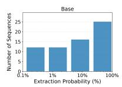

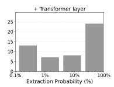

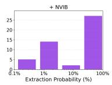  
Down and Out in the Magic Kingdom (Base: 65, + Transformer layer: 52, + NVIB: 48)

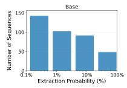

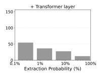

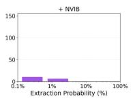  
Harry Potter and the Chamber ofSecrets (Base: 383, + Transformer layer: 129, + NVIB: 16)

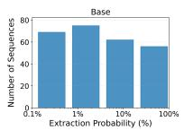

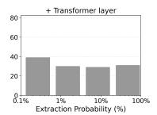

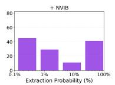  
Harry Potter and the Goblet of Fire (Base: 262, + Transformer layer: 129, + NVIB: 126)

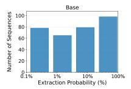

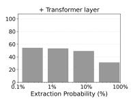

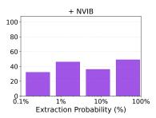  
Harry Potter and the Half-Blood Prince (Base: 320, + Transformer layer: 187, + NVIB: 163)

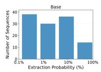

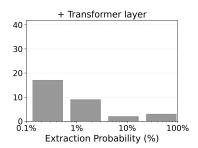

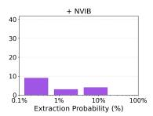  
The Lord of the Rings: The Two Towers (Base: 118, + Transformer layer: 31, + NVIB: 16)

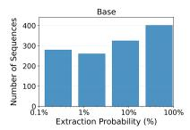

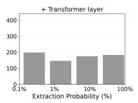

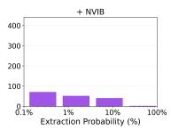  
Harry Potter and the Sorcerer’s Stone (Base: 1264, + Transformer layer: 698, + NVIB: 163)

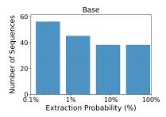

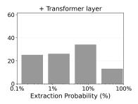

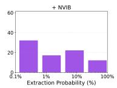  
Harry Potter and the Prisoner of Azkaban (Base: 177, + Transformer layer: 98, + NVIB: 83)

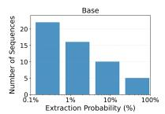

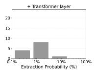

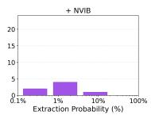  
Harry Potter and the Order of the Phoenix (Base: 53, + Transformer layer: 13, + NVIB: 7)

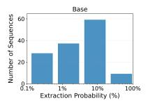

  
Harry Potter and the Deathly Hallows (Base: 133, + Transformer layer: 52, + NVIB: 27)

  
The Lord ofthe Rings: The Return ofthe King (Base: 142, + Transformer layer: 46, + NVIB: 34)

Figure 3: Additional probabilistic extraction results for Llama-3.1-8B on ten copyrighted books. Each subfigure compares the base model, the Transformer-layer baseline, and the NVIB-augmented model. Histograms show the distributions of probabilistic extraction scores for extracted sequences satisfying $p _ { z } \geq 0 . 0 0 1$ . The reported counts indicate the number of extracted sequences for each model.

  
The Lord ofthe Rings: The Two Towers (Base: 23, + Transformer layer: 8, + NVIB: 7)

  
The Lord ofthe Rings: The Return ofthe King (Base: 90, + Transformer layer: 38, + NVIB: 13)

  
Down and Out in the Magic Kingdom (Base: 33, + Transformer layer: 31, + NVIB: 13)  
Figure 4: Additional probabilistic extraction results for Qwen3-8B on three copyrighted books. Each subfigure compares the base model, the Transformer-layer baseline, and the NVIB-augmented model. Histograms show the distributions of probabilistic extraction scores for extracted sequences satisfying $p _ { z } \geq 0 . 0 0 1$ . The reported counts indicate the number of extracted sequences for each model.

<table><tr><td>Book</td><td>Base</td><td>+ Transformer</td><td>+NVIB</td></tr><tr><td>Harry Potter and the Sorcerer&#x27;s Stone</td><td> $4 . 8 8 \times 1 0 ^ { - 3 }$ </td><td> $2 . 1 8 \times 1 0 ^ { - 3 }$ </td><td> $\mathbf { 8 . 6 1 \times 1 0 ^ { - 5 } }$ </td></tr><tr><td>Harry Potter and the Chamber of Secrets</td><td> $5 . 4 4 \times 1 0 ^ { - 4 }$ </td><td> $1 . 6 4 \times 1 0 ^ { - 4 }$ </td><td> $\mathbf { 2 . 2 3 \times 1 0 ^ { - 6 } }$ </td></tr><tr><td>Harry Potter and the Prisoner of Azkaban</td><td> $3 . 0 7 \times 1 0 ^ { - 4 }$ </td><td> $1 . 4 3 \times 1 0 ^ { - 4 }$ </td><td> $\mathbf { 9 . 7 4 \times 1 0 ^ { - 5 } }$ </td></tr><tr><td>Harry Potter and the Order of the Phoenix</td><td> $1 . 5 2 \times 1 0 ^ { - 5 }$ </td><td> $1 . 2 5 \times 1 0 ^ { - 6 }$ </td><td> $\mathbf { 7 . 7 4 \times 1 0 ^ { - 7 } }$ </td></tr><tr><td>Harry Potter and the Deathly Hallows</td><td> $9 . 0 0 \times 1 0 ^ { - 5 }$ </td><td> $2 . 2 6 \times 1 0 ^ { - 5 }$ </td><td> $\mathbf { 1 . 3 2 \times 1 0 ^ { - 5 } }$ </td></tr><tr><td>The Lord of the Rings: The Fellowship of the Ring</td><td> $1 . 2 7 \times 1 0 ^ { - 3 }$ </td><td> $4 . 0 0 \times 1 0 ^ { - 4 }$ </td><td> $\mathbf { 2 . 3 0 \times 1 0 ^ { - 5 } }$ </td></tr><tr><td>The Hitchhiker&#x27;s Guide to the Galaxy</td><td> $7 . 4 4 \times 1 0 ^ { - 3 }$ </td><td> $4 . 1 0 \times 1 0 ^ { - 3 }$ </td><td> $\mathbf { 9 . 5 1 \times 1 0 ^ { - 4 } }$ </td></tr></table>

Table 3: Mean probabilistic extraction scores for Llama-3.1-8B on additional copyrighted books. Lower values indicate lower extractability under the evaluated decoding configuration. Bold indicates the lowest mean score for each book.

<table><tr><td>Book</td><td>Base</td><td>+ Transformer</td><td>+ NVIB</td></tr><tr><td>The Lord of the Rings: The Fellowship of the Ring</td><td> $3 . 0 3 \times 1 0 ^ { - 4 }$ </td><td> $1 . 5 8 \times 1 0 ^ { - 4 }$ </td><td> $\mathbf { 4 . 1 3 \times 1 0 ^ { - 5 } }$ </td></tr><tr><td>The Lord of the Rings: The Return of the King</td><td> $1 . 5 2 \times 1 0 ^ { - 4 }$ </td><td> $1 . 0 6 \times 1 0 ^ { - 4 }$ </td><td> $\mathbf { 3 . 2 6 \times 1 0 ^ { - 5 } }$ </td></tr><tr><td>The Hitchhiker&#x27;s Guide to the Galaxy</td><td> $1 . 2 4 \times 1 0 ^ { - 3 }$ </td><td> $9 . 0 7 \times 1 0 ^ { - 4 }$ </td><td> $\mathbf { 5 . 4 3 \times 1 0 ^ { - 4 } }$ </td></tr></table>

Table 4: Mean probabilistic extraction scores for Qwen3-8B on additional copyrighted books. Lower values indicate lower extractability under the evaluated decoding configuration. Bold indicates the lowest mean score for each book.