# BUMP: Brief Unexpected Mid-Interpolation Peak

Melinda Flóra Kiss 12 Márton Muntag 1 Adrián Csiszárik1 Dániel Varga 1

## Abstract

We identify an intriguing phenomenon when linearly interpolating between permutation-aligned neural networks: test accuracy briefly improves near the interpolation endpoints before dropping toward the midpoint, which we term BUMP (Brief Unexpected Mid-interpolation Peak). We observe that BUMP appears consistently across datasets, architectures, training regimes, and remains robust under substantial perturbations such as early checkpoints and extreme pruning. Moreover, controlled ablations suggest that it cannot be attributed to trivial regularization effects. While similar near-endpoint gains are visible in prior interpolation plots, they have not been explicitly documented or systematically and thoroughly analyzed. Leveraging this effect, we propose a simple, novel ensembling scheme: weight-prediction mixed ensembling that combines weight mixing with prediction-space mixing. Across our experiments, the resulting ensembling method consistently outperforms standard logit ensembling in test accuracy and yields improved calibration trade-off, highlighting complementary benefits of weight- and prediction-space mixing.

## 1. Introduction

Linear mode connectivity (LMC) has emerged as a useful lens to understand neural network loss landscapes (Frankle et al., 2020; Entezari et al., 2022). As observed by Ainsworth et al. (2023), when the weights of independently trained, heavily overparameterized neural networks are aligned by optimizing over neuron permutations, the resulting networks become linearly mode connected. The standard way to quantify mode connectivity is the loss barrier, defined as the maximal increase in loss observed when linearly interpolating between two models. It is empirically found to occur near the midpoint of the interpolation loss curve, plotting the loss as a function of the λ interpolation coefficient.

In this paper, we focus on another point along the interpolation curve. Our main observation is that near the original models, the interpolation actually leads to improved model performance. Concretely, given model A and permutationally aligned model B, the following simple recipe leads to an increase in test accuracy: mix weights linearly according to (1 − λ)A + λB, for λ ≈ 0.1 or symmetrically, λ ≈ 0.9. We refer to this effect as BUMP, coined as a backronym for Brief Unexpected Mid-Interpolation Peak. For various models, datasets, and network width multipliers, we demonstrate small, but statistically highly significant increases in test accuracy when applying such a recipe. While the gains are modest, they are highly consistent, warranting careful analysis and providing insights into merging and ensembling of deep neural networks, and motivating new model combination strategies.

Our contributions are as follows:¹

• We empirically demonstrate that the BUMP phenomenon appears consistently across multiple datasets, architectures, training regimes, and persists under model degradation and at early checkpoints.

• We formulate several plausible regularization-based hypotheses for the underlying causes of the BUMP phenomenon and empirically falsify them.

• We analyze the BUMP from multiple perspectives, including its connection to classical logit ensembling and an inspection of model predictions.

• We propose a novel ensembling method that combines weight mixing and logit mixing, achieving higher accuracy than both logit ensembling and the BUMP itself.

## 2. Related Work

## 2.1. Linear mode connectivity and model re-basing

Linear mode connectivity (LMC) is a widely studied phenomenon that provides insight into neural network loss landscapes and generalization. An intriguing direction considers permutation symmetries, Entezari et al. (2022) conjectured that, once these symmetries are accounted for, SGD solutions from different initializations become linearly mode connected. This conjecture was empirically demonstrated in Ainsworth et al. (2023), using a simple greedy neuronmatching algorithm family dubbed Git Re-Basin, but only for networks employing Layer Normalization (Ba et al. 2016) and very wide architectures (16x–32x wider than the baseline). Jordan et al. (2022) later extended these results to networks using Batch Normalization (Ioffe & Szegedy, 2015), and to networks without normalization. Theus et al. (2025) considers a broader class of symmetries (including permutations as a special case) and provides the first demonstration of LMC for transformers.

## 2.2. Model merging and ensembling

Ensembling and model merging both aim to combine multiple trained models to improve performance, robustness, or generalization, but they differ in the level at which models are combined.

In ensembling, multiple base predictors are combined into a single predictor, ranging from simple output aggregation (e.g., averaging logits or probabilities) to more general learned combinations. Some methods aggregate model probabilities (soft voting), which work well for well-calibrated and confident models (Lakshminarayanan et al., 2017). Others average logits, preserving relative confidence and often producing sharper, more accurate predictions (Tassi et al., 2022; Buchanan et al., 2023).

In model merging, models are combined by operating directly on network weights. Many approaches have been explored, Izmailov et al. (2018) introduces Stochastic Weight Averaging (SWA), which improves generalization by averaging points along an SGD trajectory using cyclical or constant learning rates. Wortsman et al. (2022) proposes model soups, where several fine-tuned models (that share a common initialization but are further trained with different hyperparameters) are weight-averaged to boost accuracy and robustness, offering a cheaper inference-time alternative to logit ensembling. Other methods use weighted combinations of models in federated learning (McMahan et al. 2017). Another line of work, such as Fisher merging, uses Fisher information to guide the merging procedure (Matena & Raffel, 2022).

## 3. Notations and formal definition of BUMPs

Let A and B be two models with identical architectures and $d \in \mathbb { N }$ parameters, trained from different random initializations and batch orders. Let $\Theta _ { A } \in \mathbb { R } ^ { d }$ and $\Theta _ { B } \in \mathbb { R } ^ { d }$ denote their converged weight vectors. With a slight abuse of notation, we identify models with their weight vectors: we write $\Theta _ { A } \left( \mathrm { r e s p . } \Theta _ { B } \right)$ to denote model A (resp. B) with parameters set to $\Theta _ { A } \left( \mathrm { r e s p . } \Theta _ { B } \right)$

For a model M, datapoint $x \in \mathcal { D }$ and class $c \in { \mathcal { C } }$ , we denote the logit vector corresponding to x by $\ell _ { M } ( x )$ , and denote the logit value corresponding to x and class c by $\ell _ { M } ( x , c )$ where D denotes the (input) dataset and C the set of class labels. Given models $\Theta _ { A } , \Theta _ { B }$ and coefficient $\lambda \in [ 0 , 1 ]$ we define the LogitMix model as the classical logit ensemble of $\Theta _ { A }$ and $\Theta _ { B }$ with coefficient λ. We denote the resulting logit corresponding to x by $\ell _ { \mathrm { L o g i t M i x } } ( A , B , x , \lambda ) : =$ $\lambda \cdot \ell _ { B } ( x ) + ( 1 - \lambda ) \cdot \ell _ { A } ( x )$ . We define the WeightMix as the weight-interpolated model $M ( \lambda , \Theta _ { A } , \Theta _ { B } )$ with parameter vector $\lambda \Theta _ { B } + ( 1 - \lambda ) \Theta _ { A }$ , and denote its logits by $\ell _ { \mathrm { W e i g h t M i x } } ( A , B , x , \lambda ) : = \ell _ { M ( \lambda , \Theta _ { A } , \Theta _ { B } ) } ( x )$

## 3.1. Loss barrier: worst performing model along the interpolation line

Linear mode connectivity and the approximate convexity of the loss basin is captured through the notion of loss barrier.

Definition 3.1 (Loss barrier (Frankle et al., 2020)). Given two models $\Theta _ { A }$ and $\Theta _ { B }$ with $\mathcal { L } ( \Theta _ { A } ) \approx \mathcal { L } ( \Theta _ { B } )$ , the loss barrier is $\begin{array} { r } { \operatorname* { m a x } _ { \lambda \in [ 0 , 1 ] } \mathcal { L } \big ( ( 1 - \lambda ) \Theta _ { A } + \lambda \Theta _ { B } \big ) - \frac { 1 } { 2 } \big ( \mathcal { L } ( \Theta _ { A } ) + } \end{array}$ $\mathcal { L } ( \Theta _ { B } ) )$ , where L is the utilized loss function.

Two networks are considered linear mode connected if this barrier is small (near zero). Analogously, an accuracy barrier can be defined by comparing the minimum accuracy along the interpolation line to the average accuracy of $\Theta _ { A }$ and $\Theta _ { B }$

Ainsworth et al. (2023) demonstrates zero-barrier linear mode connectivity between $\Theta _ { A }$ and $\pi ( \Theta _ { B } )$ , where $\pi ( \Theta _ { B } )$ is obtained by applying a neuron permutation to $\Theta _ { B }$ that is computed to align it with $\Theta _ { A }$ . We call such $\Theta _ { A } , \pi ( \Theta _ { B } )$ pairs “aligned"and refer to unpermuted $\Theta _ { A } , \Theta _ { B }$ pairs as $\mathbf { \ddot { n a i v e } } ^ { \prime \prime }$

## 3.2. BUMP models: best performing model along the interpolation line

In this work, we focus on the best-performing interpolated model, instead of the worst-performing one. Empirically, we consistently observe models near A and B whose accuracy exceeds that of the closer endpoint. Based on the shape of these interpolation accuracy curves (see Figure 1), we call these BUMP models.

Definition 3.2 (BUMP model). Let $\Theta _ { A } , \Theta _ { B } \in \mathbb { R } ^ { d }$ be two models and let $\lambda \in [ 0 , 1 ]$ . We call the WeightMix model $M ( \lambda , \Theta _ { A } , \Theta _ { B } )$ a BUMP model if its accuracy exceeds that of the closer endpoint, i.e.,

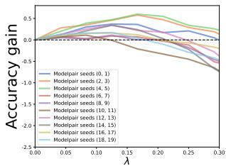

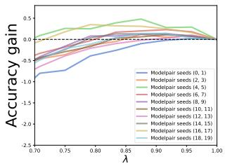  
(a) Left BUMP (aligned)  
(b) Right BUMP (aligned)  
Figure 1. The two BUMPs when interpolating between aligned models, the accuracies are measured on the CIFAR-10 test set, models are ResNet-20, showing 10 model pairs. Width multiplier is 16. We shifted the plots so that all accuracies of the original models are 0.

$$
\operatorname { a c c } ( M ( \lambda , \Theta _ { A } , \Theta _ { B } ) ) > \left\{ \operatorname { a c c } ( \Theta _ { A } ) , \ \mathrm { ~ i f ~ } \lambda < \frac { 1 } { 2 } , \right.
$$

## 4. Empirical demonstration of the BUMP

In this section, we provide empirical evidence that the BUMP is a consistently occurring phenomenon. We experiment on multiple datasets and architectures. We report results on CIFAR-10 Krizhevsky (2009), training 100 ResNet-20 He et al. (2016) models with different initialization seeds, for all width multiplier in {4, 8, 16}. We form 50 model pairs, and align each pair via the weight-matching algorithm of Ainsworth et al. (2023). We interpolate linearly between the aligned models using 25 equally spaced coefficients in [0, 1]. We also train Tiny-10 models on CIFAR-10, and ResNet-20 models on CIFAR-100 Krizhevsky (2009), the results can be found in Appendix D and C. The training details for both model architectures can be found in $\mathsf { A p - }$ pendix A. (For additional evidence with further models and training regimes, see Section 5.)

For 16x-width, we plot interpolation curves for $\lambda \in$ (0.0, 0.3) and $\lambda \in ( 0 . 7 , 1 . 0 )$ across 10 model pairs. Figure 1 shows clear BUMPs near both endpoints for aligned model pairs, whereas for naïve pairs the BUMP is absent or much smaller (Figure 2). For width multipliers 1 and 2, BUMPs are negligible (note, that for these widths, the loss barriers remain large even after permutation). BUMPs also appear at 32x-width, but with smaller accuracy gains than at 16x-width.

To quantify the accuracy gain of a BUMP we use multiple methods. We denote a model $M \mathbf { \bar { s } }$ training and test accuracies by $\mathsf { a c c } _ { \mathrm { t r a i n } } ( M )$ and $\operatorname { a c c } _ { \mathrm { t e s t } } ( M )$ respectively.

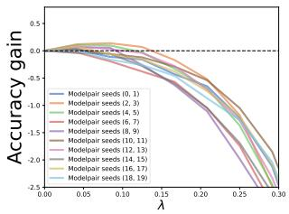

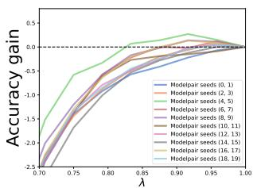  
(a) Left BUMP (naïve)  
(b) Right BUMP (naïve)  
Figure 2. The two BUMPs when interpolating between models without alignment, the accuracies are measured on the CIFAR-10 test set, models are ResNet-20, showing 10 model pairs. Width multiplier is 16. We shifted the plots so that all accuracies of the original models are 0.

Method “Fixed-λ": For a model pair $( \Theta _ { A } , \Theta _ { B } )$ , we fix the interpolation coefficient λ to obtain models $\begin{array} { r l } { M _ { 1 } } & { { } = } \end{array}$ $M ( \lambda , \Theta _ { A } , \Theta _ { B } )$ and $M _ { 2 } = M ( 1 - \lambda , \Theta _ { A } , \Theta _ { B } )$ , i.e., we evaluate BUMPs at λ and 1 — λ. The λ parameter was chosen based on extensive experiments on the training dataset (determining highest accuracy BUMP locations and averaging the results). Based on these evaluations we chose $\lambda ~ = ~ 0 . 0 5$ for 4x-width, $\lambda ~ = ~ 0 . 0 0 7 5$ for 8x-width and $\lambda = 0 . 1$ for 16x-width. We measure BUMP accuracy gains as $\operatorname { a c c } _ { \mathrm { t e s t } } ( M _ { 1 } ) - \operatorname { a c c } _ { \mathrm { t e s t } } ( A )$ and $\operatorname { a c c } _ { \mathrm { t e s t } } ( M _ { 2 } ) - \operatorname { a c c } _ { \mathrm { t e s t } } ( B )$

Method “Test": For a model pair $( \Theta _ { A } , \Theta _ { B } )$ we search for the interpolated model with the highest accuracy on the test dataset separately on the intervals [0, 0.5) and [0.5, 1], yielding two models $M _ { 1 }$ and M2. Again, we measure BUMP accuracy gains as $\operatorname { a c c } _ { \mathrm { t e s t } } ( M _ { 1 } ) - \operatorname { a c c } _ { \mathrm { t e s t } } ( A )$ and $\operatorname { a c c } _ { \mathrm { t e s t } } ( M _ { 2 } ) - \operatorname { a c c } _ { \mathrm { t e s t } } ( B )$ . We are aware that methodologically this constitutes data contamination (as we are selecting the highest accuracy on the test set), but we include these values because the smoothness of the accuracy curves suggests that they are more indicative of the accuracy gains achievable by the method.

Since the models A and B play symmetric roles, we average all 100 BUMP gains per dataset-architecture-width setting, rather than treating the first and second BUMPs separately (50 each). We report results for both methods on CIFAR-10, ResNet-20 in Table 1 (aligned pairs) and Table 2 (naïve pairs). These demonstrate that BUMP gains are consistently present, and that alignment substantially amplifies the BUMP effect compared to naïve pairs.

## 5. Robustness of the BUMP phenomenon

In this section, we show that the BUMP phenomenon is robust and widespread: it can be observed consistently across architectures and training regimes, and it persists under substantial degradation of the underlying models. Concretely, we provide evidence along three axes: (i) the effect is visible (though typically unremarked) in interpolation figures of prior works, (ii) it already appears well before full convergence along the training trajectory and is often more pronounced at earlier checkpoints than at convergence, and (iii) it survives—and frequently strengthens—under extreme sparsification via magnitude pruning. Together, these results argue against the interpretation of BUMPs as fragile interpolation artifacts that occur only under carefully tuned conditions.

Table 1. Average accuracy gains of the BUMPs over their corresponding endpoint models on aligned model pairs. Results are reported on the CIFAR-10 test set using aligned ResNet-20 pairs (100 models) trained to convergence (250 epochs). Standard deviations are denoted in parentheses.
<table><tr><td>Accuracy gain % — Aligned pairs</td><td></td></tr><tr><td>Width Fixed-λ</td><td>Test</td></tr><tr><td>4x-width</td><td>0.053 (±0.096) 0.087 (±0.081)</td></tr><tr><td>8x-width 0.118 (±0.111)</td><td>0.164 (±0.117)</td></tr><tr><td>16x-width 0.181 (±0.137)</td><td>0.227 (±0.140)</td></tr></table>

Table 2. Average accuracy gains of the BUMPs over their corresponding endpoint models on non-aligned, i.e., naïve model pairs. Results are reported on the CIFAR-10 test set using aligned ResNet-20 pairs (100 models) trained to convergence (250 epochs). Standard deviations are denoted in parentheses.
<table><tr><td>Accuracy gain % — Naïve pairs</td><td colspan="2"></td></tr><tr><td>Width</td><td>Fixed-λ</td><td>Test</td></tr><tr><td>4x-width</td><td>−0.041 (±0.111)</td><td>0.038 (±0.061)</td></tr><tr><td>8x-width</td><td>−0.041 (±0.123)</td><td>0.051 (±0.065)</td></tr><tr><td>16x-width</td><td>−0.073 (±0.147)</td><td>0.056 (±0.069)</td></tr></table>

## 5.1. BUMPs in prior works

After observing the BUMP phenomenon in our own experiments, we examined prior works, and found similar local performance improvements near the endpoints of aligned interpolation curves across a wide range of studies, including those involving convolutional networks and transformers. While these effects are visible in several published interpolation plots, they are not discussed and are at most briefly mentioned; in other words, the BUMP phenomenon is not explicitly explored in these works (see Figure 1 in McMahan et al. (2017), Figure 5 in Ainsworth et al. (2023) and Figure 4 in Theus et al. (2025)).

## 5.2. BUMPs at earlier checkpoints

To test whether BUMPs depend on full convergence, we analyze interpolations between models taken from earlier checkpoints of the training process.

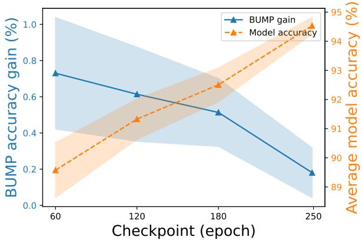  
Figure 3. BUMP gain (solid line, left axis) and average model accuracy (dashed line, right axis) as a function of training epochs for 16x-width ResNet-20 models on CIFAR-10. Values are averages for 50 model pairs, bands represent standard deviations.

Figure 3 show the results for checkpoints 60, 120, 180, and the full training of 250 epochs. We can observe that BUMPs are already present well before convergence and their magnitude is often larger at intermediate checkpoints than for fully trained models, and diminishes toward convergence. This shows that the phenomenon does not rely on late-stage optimization and can be strongest when models are still relatively inaccurate.

## 5.3. BUMPs in pruned models

We study how weight pruning affects the BUMP phenomenon, asking whether BUMPs persist under extreme sparsification. We apply a single round of global magnitude pruning whose purpose is not pruning optimization but deliberate performance degradation and sparsification. For the 16x-width ResNet-20 model on CIFAR-10, we prune 95% of the weights and evaluate interpolations using the same Fixed-λ protocol as in Section 4.

We consider two approaches: (i) pruning first, followed by alignment via weight permutation, and (ii) alignment first, followed by pruning. In both cases, BUMPs remain clearly present. When pruning is applied before alignment, the average Fixed-λ BUMP gain is 1.54% ± 1.07%; when pruning is applied after alignment, the gain is 1.60% ± 1.11%. Notably, these gains are substantially larger than those observed for fully dense, converged models, despite pruning reducing average test accuracy from approximately 94.5% to 74.6%. This demonstrates that BUMPs are robust to severe sparsification and do not rely on dense or carefully optimized model representations.

Overall, these results establish the BUMP phenomenon as a systematic and robust property of neural network interpolations, persisting across architectures, training stages, and even under severe model degradation.

## 6. The BUMP is a result of a simple regularization effect?

When seeking for an explanation for the BUMP phenomenon, a natural hypothesis is that BUMP reflects a simple form of regularization. We investigate this hypothesis from multiple perspectives, including whether the effect depends on moving toward another trained model or whether it can be reproduced by adding noise to the logits.

## 6.1. Is the direction important?

In the previous experiments, we moved in parameter space from one trained model toward another. This raises the question of whether the BUMP specifically depends on moving toward another trained model. To test this, we conduct two sets of experiments.

## 6.1.1. RANDOM DIRECTION MODEL

In this experiment, we interpolate between a trained model A and a random model R with parameter vector $\Theta _ { R }$ sampled uniformly from a hypersphere centered at A. For each aligned pair $( A , \pi ( B ) )$ we sample R on the sphere with radius $\lVert \Theta _ { A } - \Theta _ { B } \rVert _ { 2 }$ . To measure accuracy change, we use slightly modified versions of our earlier methods. With Fixed-λ, we evaluate only the model $( 1 - \lambda ) \Theta _ { A } + \lambda \Theta _ { R } .$ and for method “Test", we search over the full interval [0, 1] to obtain the interpolating coefficient, instead of splitting into halves. Table 3 reports results for width multipliers 4, 8, 16, averaged over model pairs.

Table 3. Average accuracy differences when moving towards random directions on CIFAR-10 with ResNet-20 (50 model pairs), with standard deviations denoted in parentheses.
<table><tr><td colspan="3">Accuracy gain % — Random direction</td></tr><tr><td>Width</td><td>Fixed-λ</td><td>Test</td></tr><tr><td>4x-width</td><td>−0.009 (±0.065)</td><td> $0 . 0 2 8 \left( \pm 0 . 0 3 5 \right)$ </td></tr><tr><td>8x-width</td><td>−0.012 (±0.056)</td><td> $0 . 0 3 5 \left( \pm 0 . 0 4 0 \right)$ </td></tr><tr><td>16x-width</td><td>−0.002 (±0.053)</td><td> $0 . 0 3 1 \left( \pm 0 . 0 3 5 \right)$ </td></tr></table>

We find no BUMPs when using a Fixed-λ, and the BUMPs selected by the “Test"method are negligible compared to those observed when interpolating toward π(B).

Consistent with this, the interpolation line segment between A and a randomly sampled model shows only minor accuracy variation (Figure 4a). When we increase the sphere radius to $5 \cdot \| \Theta _ { A } - \Theta _ { B } \| _ { 2 }$ , accuracy stays nearly constant for a short range and then drops sharply (Figure 4b).

## 6.1.2. RANDOMLY REFLECTED MODEL

To further test whether moving toward a trained model is essential, we construct a perturbed version of $\pi ( B )$ by randomly “reflecting" parameters. Specifically, for each parameter pair $( w _ { a } , w _ { b } ) \in \Theta _ { A } \times \pi ( \Theta _ { B } )$ , we set $w _ { b } : = 2 w _ { a } - w _ { b }$ with probability 0.5, yielding a new model $B ^ { \prime }$ that is, coordinate-wise, equally far from A. We then interpolate between A and $B ^ { \prime }$ . Table 4 reports results averaged over all model pairs. As in the previous experiment, we observe no significant accuracy gains.

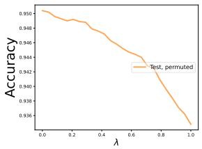  
(a) Distance multiplier 1

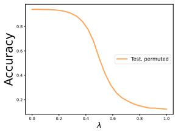  
(b) Distance multiplier 5  
Figure 4. Interpolation in the direction of a randomly chosen model on CIFAR-10, ResNet-20. Width multiplier is 16, the distance multiplier determines the distance of model A from the random model R compared to the distance of model A and B.

Table 4. Average accuracy differences when moving towards models with randomly reflected weights on CIFAR-10 with ResNet-20 (50 model pairs). Standard deviations are denoted in parentheses.
<table><tr><td colspan="3">Accuracy gain % — Randomly reflected</td></tr><tr><td>Width</td><td>Fixed-λ</td><td>Test</td></tr><tr><td>4x-width 8x-width</td><td>−0.081 (±0.117)  $- 0 . 0 9 4 \left( \pm 0 . 1 1 2 \right)$ </td><td>0.025 (±0.042) 0.022 (±0.043)</td></tr></table>

## 6.2. Adding noise to the logits

The hypothesis that the BUMP is a regularization effect is particularly compelling in light of the relationship between the logits produced by model A and those produced by model $M _ { 1 }$ (the closer BUMP to A). As shown in Figure $5 ,$ there is an extremely strong linear relationship across data points and labels: to a first approximation, each logit output by model $M _ { 1 }$ is simply a constant multiple of the corresponding logit from model A. This might suggest a seemingly trivial explanation, namely that such a constant rescaling alone improves performance. However, this cannot be the case, since scaling logits by a constant factor does not change the predicted labels.

We now exclude two, successively more subtle variations of this hypothesis, namely that the logits of model $M _ { 1 }$ can be explained as a noisy affine transformation of the logits of model A.

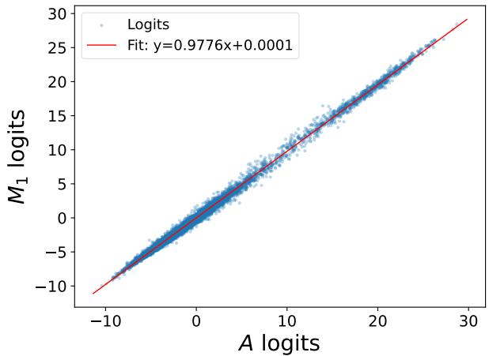  
Figure 5. Relationship between logit values of A and $M _ { 1 }$ models on CIFAR-10, ResNet-20, width multiplier is 16. The red line indicates the best-fit affine relationship, highlighting the linear correspondence between the logits of the original and BUMP models.

## 6.2.1. HOMOSCEDASTIC AFFINE NOISE MODEL

In this experiment, we model the conditional distribution of $\ell _ { M _ { 1 } } ( x , c )$ given $\ell _ { A } ( x , c )$ as $\ell _ { M _ { 1 } } ( x , c ) = a \cdot \ell _ { A } ( x , c ) + b + \varepsilon .$ with scalar parameters $a , b , \sigma \in \mathbb { R }$ , where $\varepsilon \sim \mathcal { N } ( 0 , \sigma ^ { 2 } )$ The parameters $^ { a , }$ b are fitted by least squares, and the σ is the empirical standard deviation of $\ell _ { M _ { 1 } } ( x , c ) - ( a \cdot \ell _ { A } ( x , c ) +$ b) on the test dataset. We then replace the true logit values $\ell _ { M _ { 1 } } ( x , c )$ by samples drawn from the fitted conditional distribution and evaluate classification accuracy using these synthetic logits. If model $M _ { 1 }$ differed from model A only by an affine transformation with homoscedastic noise, sampling from this model would be expected to preserve or improve accuracy. However, we observe no statistically significant improvement, see Table 16 in Appendix B.

## 6.2.2. HETEROSCEDASTIC AFFINE NOISE MODEL

We next consider a more flexible model in which the variance of the noise depends on the logit value of model A. Specifically, we set $\ell _ { M _ { 1 } } ( x , c ) = a \cdot \ell _ { A } ( x , c ) + b + \varepsilon$ , where $\varepsilon \sim \mathcal { N } ( 0 , \sigma ( \ell _ { A } ( x , c ) ) ^ { 2 } )$ , allowing the noise to vary as a function of $\ell _ { A } ( x , c )$ . The parameters $a , b$ are again fitted by least squares, while σ is estimated by binning the values of $\ell _ { A } ( x , c )$ , estimating the empirical variance within each bin and fitting a polygonal line on these values. We used 10 bins in our experiments. Again, we replace the true logit values with samples and we observe significantly worse results in terms of accuracy, see Table 16 in Appendix B.

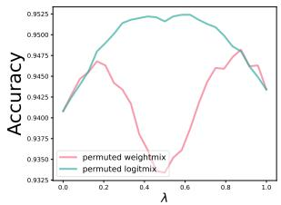

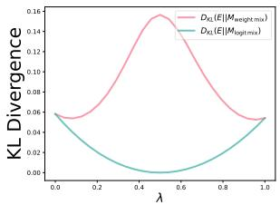  
(a) Accuracy curves  
(b) KL divergences  
Figure 6. Left (comparing accuracy curves): The WeightMix and LogitMix accuracy curve on CIFAR-10, ResNet-20, width multiplier is 16. Right (comparing class probabilities): Kullback-Leibler divergence between the class probability distributions of the WeightMix/LogitMix models and the $\lambda = 0 . 5$ LogitMix (Ensemble) model, CIFAR-10, ResNet-20, width multiplier is 16.

## 7. Comparing BUMP to Classical Logit Ensembling

In this section, we investigate how the BUMP phenomenon relates to classical logit ensembling, i.e., LogitMix. Figure 6a compares the accuracy curves of the LogitMix and WeightMix models for two 16x-width models. Although the two curves behave similarly near the endpoints, this similarity alone does not imply that the underlying mechanisms are the same. To address this question, we carry out a geometric and probabilistic analysis comparing the two models in detail.

## 7.1. Inspecting the angles

We directly compare the logits of the WeightMix and Logit-Mix models. More precisely, we measure the angle between the logits for the same inputs. If the two mixing procedures created identical logits, this angle would be zero.

For a model pair $( A , B ) , g \in \mathbb { Z } ^ { + }$ and a datapoint x, let

ve(x) := lLogitMix(A, B, x, 1) − lLogitMix(A, B, x, 0), $v _ { w , i } ( x ) : = \ell _ { \mathrm { W e i g h t M i x } } ( A , B , x , i / g ) - \ell _ { \mathrm { W e i g h t M i x } } ( A , B , x , 0 ) ,$ for $i = 1 , \dots , g .$ (Note, that since we are comparing the angles, and LogitMix logits all lie on the line segment determined by the logits corresponding to models A, B, we may choose one of the LogitMix logit differences as a reference.) For each $i ,$ we compute the angle between $v _ { \ell } ( x )$ and $v _ { w , i } ( x )$ , average over test datapoints, and then average over the 50 model pairs. Figure $^ { 7 }$ reports the mean angle as a function of $\lambda = i / g . ( \mathrm { F o r } i = g$ , we recover model B, so the angle is necessarily $0 ^ { \circ } . )$ The large angles for small i indicate that WeightMix and LogitMix models produce substantially different logits near model A.

## 7.2. Probability-Space Proximity to the Logit Ensemble

To compare weight mixing and logit ensembling at the granularity of predicted class-distributions, we take the $\lambda = 0 . 5$

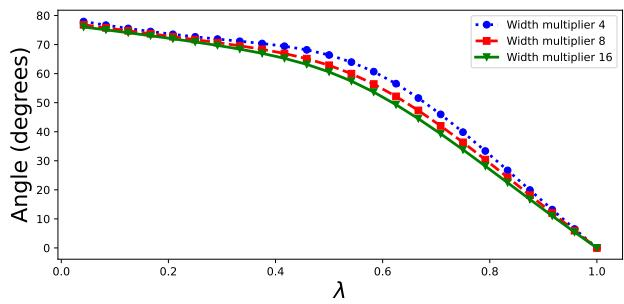  
Figure 7. The mean angles across the test datapoints for $g = 2 4$ CIFAR-10, ResNet-20, width multiplier is 16. Values are averages for 50 model pairs.

LogitMix model as a reference, denoted by E (for Ensem-$b l e )$ , and measure with the Kullback-Leibler divergence how closely WeightMix and LogitMix track it. Figure 6b shows the results. Near the endpoints A and B, the divergence decreases (even for WeightMix models), indicating that the interpolation path moves toward E rather than away from it. However, Figure 6b also makes clear that Weight-Mix approaches E only modestly compared to LogitMix: the predictive distributions remain substantially farther from E across λ. One possible interpretation is that both procedures move toward E simply because the ensemble distribution concentrates better predictions, and many reasonable perturbations from A or B may initially improve agreement with it. The quantitative gap suggests that weight mixing is not equivalent to classical logit ensembling, instead, it induces a distinct transformation of the predictive distribution.

A natural question arises: is weight mixing still merely an approximation of classical ensembling, or does it provide complementary information that can be exploited beyond standard logit mixing?

## 8. A novel ensembling method: combining weight and logit mixing

In this section, we introduce Weight-Prediction Mixed Ensembling (WPME), a novel ensembling method that jointly combines models in weight space and prediction space, and surpasses the accuracy of both classical logit ensembling and the BUMP itself. Classical ensembling combines model predictions (logits or probabilities) to reduce variance, but it does not leverage information directly contained in the model parameters. Our novel ensembling scheme demonstrates that weight mixing provides complementary information to output-space aggregation and can be exploited to achieve higher generalization performance.

Definition 8.1 (Weight-Prediction Mixed Ensembling (WPME)). Given two models $\Theta _ { A } , \Theta _ { B }$ and coefficients $\lambda , \beta \in \mathbb { R }$ , we form the WeightMix model $M ( \lambda , \Theta _ { A } , \Theta _ { B } )$

For an input x, let $\ell _ { B } ( x )$ denote the logits of model $\Theta _ { B } ,$ and let $\ell _ { M ( \lambda ) } ( x )$ denote the logits of $M ( \lambda , \Theta _ { A } , \Theta _ { B } )$ . We define two variants:

$$
\begin{array} { r l } & { \ell _ { \mathrm { W P M E - L o g i t } } ( x ; \lambda , \beta ) = ( 1 - \beta ) \ell _ { M ( \lambda ) } ( x ) + \beta \ell _ { B } ( x ) , } \\ & { p _ { \mathrm { W P M E - P r o b } } ( x ; \lambda , \beta ) = ( 1 - \beta ) \mathrm { s o f t m a x } \big ( \ell _ { M ( \lambda ) } ( x ) \big ) } \\ & { ~ + \beta \mathrm { s o f t m a x } \big ( \ell _ { B } ( x ) \big ) . } \end{array}
$$

The prediction of WPME-Logit is obtained by applying the softmax to lwPME-Logit.

Setting $\beta = 0$ yields predictions from the WeightMix model $M ( \lambda , \Theta _ { A } , \Theta _ { B } )$ , and $\beta \ : = \ : 1$ yields predictions from the endpoint model B. Thus $\beta$ controls the trade-off between the WeightMix model and the original predictor at endpoint B, rather than directly averaging the logits or weights of model A and B.

WPME accuracy outperforms baselines. Figure 8 shows accuracy heatmaps obtained by sweeping the weight mixing coefficient λ and the prediction mixing coefficient $\beta .$ Across both checkpoints, WPME exhibits broad regions of high accuracy that exceed those achieved by classical logit mixing or the weight mixing (i.e., the BUMP). (Note, that classical logit mixing corresponds to the horizontal line $\lambda = 0$ , while weight mixing to the vertical line $\beta = 0$ on the heatmap.) The accuracy landscape is smooth and unimodal, indicating that weight-space interpolation and predictionspace interpolation provide complementary benefits rather than requiring precise hyperparameter tuning.

WPME improves the accuracy-calibration trade-off. As shown in Table 5, WPME-logit achieves the highest accuracy at both checkpoints while modestly improving calibration relative to LogitMix; WPME-prob attains near-SoftMaxMix calibration with slightly higher accuracy (where SoftmaxMix simply linearly averages predicted probabilities, $p ( x ) = ( 1 - \beta ) \mathrm { s o f t m a x } ( \ell _ { A } ( x ) ) +$ $\beta \operatorname { s o f t m a x } ( \ell _ { B } ( x ) ) )$

Validation protocol To avoid tuning mixing coefficients on the test set, we split the original test data into a validation split and a held-out test split. For each method, we select the hyperparameters $( \lambda , \beta )$ that maximize validation-set accuracy, and then report accuracy, NLL, and ECE on the held-out test split.

In summary, WPME demonstrates that weight mixing is not merely an approximation of logit ensembling, but a complementary ingredient that can be leveraged for improved accuracy and calibration.

Table 5. Comparison of Weight-Prediction Mixed Ensembling with baseline methods on CIFAR-10, ResNet-20, width-multiplier 16: accuracy (Acc.), negative log-likelihood (NLL), and expected calibration error (ECE) values for different ensembling methods of two models at two different stages of model training (epoch 60 and 250). Reported values are sample means ± standard deviations (SD). Best results within each checkpoint are shown in bold.
<table><tr><td colspan="4">Model checkpoints: @60 epochs</td></tr><tr><td>Method</td><td>Acc. ↑</td><td>NLL ↓</td><td>ECE↓</td></tr><tr><td>A (orig)</td><td>0.89972 (±0.00871)</td><td>0.30911 (±0.03136)</td><td>0.02789 (±0.00650)</td></tr><tr><td>B (orig)</td><td>0.90011(±0.01077)</td><td> $0 . 3 1 0 3 0 \left( \pm 0 . 0 4 0 8 1 \right)$ </td><td>0.02893 (±0.00905)</td></tr><tr><td>LogitMix</td><td>0.92369 (±0.00591)</td><td> $0 . 2 2 9 4 4 \left( \pm 0 . 0 1 9 5 4 \right)$ </td><td>0.01374(±0.00385)</td></tr><tr><td>SoftMaxMix</td><td>0.92160(±0.00607)</td><td> $0 . 2 4 2 7 0 \left( \pm 0 . 0 1 8 2 4 \right)$ </td><td>0.01990 (±0.00482)</td></tr><tr><td>WeightMix</td><td>0.91268(±0.00593)</td><td> $0 . 2 5 9 4 2 \left( \pm 0 . 0 1 8 7 5 \right)$ </td><td>0.01387(±0.00514)</td></tr><tr><td>WPME-logit</td><td>0.92605(±0.00513)</td><td> $\mathbf { 0 . 2 1 9 1 8 } \left( \pm 0 . 0 1 6 1 2 \right)$ </td><td>0.01015(±0.00297)</td></tr><tr><td>WPME-prob</td><td> $0 . 9 2 4 2 4 \left( \pm 0 . 0 0 5 6 7 \right)$ </td><td> $0 . 2 3 2 4 5 \left( \pm 0 . 0 1 5 7 6 \right)$ </td><td>0.02124(±0.00682)</td></tr></table>

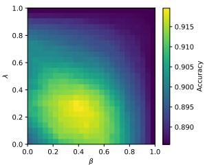

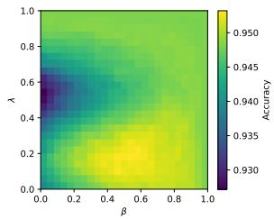  
(a) Checkpoint at epoch 60  
(b) Checkpoint at convergence  
Figure 8. Accuracy over $( \lambda , \beta )$ for WPME obtained by interpolating model parameters in weight-space (λ) followed by logitspace mixing (β) with endpoint model B. Results are shown for a partially trained model (left) and the fully trained model (right), CIFAR-10, ResNet-20, width multiplier is 16.

## 9. Exploring the relationship between the predictions of the interpolated and the original models

Here, we analyze the relationship between the BUMP model's predictions and those of the original models.

Comparing the BUMP with the closer model For each model pair (A, B), we count test datapoints where $M _ { 1 } { \bf \dot { s } }$ top #1 prediction matches A's #1, A's #2 prediction (second largest probability), or neither, and then average across the 50 pairs. Results are shown in Table 6. In most cases $M _ { 1 }$ agrees with A, when it does not, its prediction typically matches A's second choice, while the remaining cases are negligible. This suggests that BUMPs primarily arise from small, local changes in the decision boundary: the interpolated model $M _ { 1 }$ usually preserves A's top-1 decision, and when it deviates it most often swaps to A's runner-up rather than producing completely different predictions.

Comparing the BUMP with the farther model It is natural to assume that the accuracy gain of $M _ { 1 }$ relative to A reflects information contributed by the other model B. In this section, we test this hypothesis. We restrict to test datapoints, where the truthiness of the prediction (whether the predicted label matches the true label) differs for the BUMP and the closer endpoint. We form two main categories: correct → incorrect denotes those datapoints, where model A predicts the true label and $M _ { 1 }$ does not, and incorrect → correct denotes those datapoints, where model $M _ { 1 }$ predicts the true label and A does not. (Note, that these datapoints characterize the accuracy gain of the BUMP.) In each category, we count test datapoints where $M _ { 1 } { \bf \dot { s } }$ top #1 prediction matches $B ^ { \prime } s \# 1$ , B's #2 prediction, or neither, and then average across the 50 pairs. Thus, we quantify how the farther model influences the BUMP's prediction, and whether it “corrects" or “ruins" the predictions of the closer model. For each model pair, we count datapoints in these overall six categories, and then average across the 50 model pairs. As a control, we also introduce an independently chosen model C for each pair to compare whether the BUMP's predictions are more likely to match B, than those of C. Results are shown in Table 7. Overall, we observe only minor differences between alignment with B and alignment with $C$ in prediction. We therefore hypothesize that B contributes by providing an “informed" regularization and sharpening A's decision function through the interpolation direction, as opposed to causing $M _ { 1 }$ to explicitly inherit B’s predicted labels. We leave the further exploration of this for future work.

<table><tr><td colspan="4">Model checkpoints: @250 (full training)</td></tr><tr><td>Method</td><td>Acc. ↑</td><td>NLL↓</td><td>ECE↓</td></tr><tr><td>A (orig)</td><td>0.94949 (±0.00349)</td><td> $0 . 2 3 4 6 5 \left( \pm 0 . 0 1 7 5 6 \right)$ </td><td>0.03313 (±0.00256)</td></tr><tr><td>B (orig)</td><td>0.94968 (±0.00308)</td><td>0.23454(±0.01448)</td><td>0.03315(±0.00243)</td></tr><tr><td> $\mathrm { L o g i t M i x }$ </td><td>0.95790 (±0.00262)</td><td> $0 . 1 8 5 2 0 \left( \pm 0 . 0 1 1 0 3 \right)$ </td><td>0.02598(±0.00222)</td></tr><tr><td>SoftMaxMix</td><td>0.95742 (±0.00288)</td><td>0.16739(±0.00897)</td><td>0.01496(±0.00214)</td></tr><tr><td> $\mathbf { W e i g h t M i x }$ </td><td>0.95162(±0.00309)</td><td>0.22169(±0.01343)</td><td>0.03144(±0.00225)</td></tr><tr><td>WPME-logit</td><td>0.95848(±0.00261)</td><td>0.18137(±0.00991)</td><td>0.02555(±0.00227)</td></tr><tr><td>WPME-prob</td><td>0.95816(±0.00292)</td><td> $\mathbf { 0 . 1 6 4 8 4 } \left( \pm 0 . 0 0 9 0 5 \right)$ </td><td>0.01499(±0.00209)</td></tr></table>

Table 6. Comparing model $M _ { 1 }$ with model A on CIFAR-10, ResNet-20 with method Fixed-λ. Numbers are averages calculated for 50 model pairs.
<table><tr><td colspan="4">Average number of datapoints</td></tr><tr><td>Width</td><td>A #1</td><td>A #2</td><td>Other</td></tr><tr><td>4x-width</td><td>9909.72</td><td>85.88</td><td>4.40</td></tr><tr><td>8x-width</td><td>9893.92</td><td>99.12</td><td>6.96</td></tr><tr><td>16x-width</td><td>9880.44</td><td>110.80</td><td>8.76</td></tr></table>

## 10. Conclusion

We thoroughly analyzed BUMP, an accuracy peak near the endpoints of interpolation between permutation-aligned models that has not been explicitly discussed or analyzed in prior work. Leveraging BUMP, we proposed WPME, a simple hybrid of weight- and prediction-space mixing that consistently outperforms classical logit ensembling. Overall, our results demonstrate that aligned weight space offers practical opportunities for improved model combination.

Table 7. Comparing the predictions of model M1 with predictions from model B and random chosen model C on CIFAR-10, 16xwidth ResNet-20 (50 model pairs) with method Fixed-λ. In each column, we present the average number of datapoints.
<table><tr><td colspan="5">Average number of datapoints with changed truthiness</td></tr><tr><td colspan="4">correct → incorrect</td><td colspan="2">incorrect → correct</td></tr><tr><td>#1</td><td>#2</td><td>Other</td><td>#1</td><td>#2</td><td>Other</td></tr><tr><td>B</td><td>10.30</td><td>18.94</td><td>11.02</td><td>40.72</td><td>13.78 5.92</td></tr><tr><td>C</td><td>10.80</td><td>18.18</td><td>11.28 39.26</td><td>15.04</td><td>6.12</td></tr></table>

## Impact Statement

This paper presents work whose goal is to advance the field of machine learning. There are many potential societal consequences of our work, none of which we feel must be specifically highlighted here.

## References

Ainsworth, S., Hayase, J., and Srinivasa, S. Git re-basin: Merging models modulo permutation symmetries. In International Conference on Learning Representations, 2023. URL https://openreview.net/forum? id=CQsmMYmlP5T.

Ba, J. L., Kiros, J. R., and Hinton, G. E. Layer normalization,2016.URLhttps://arxiv.org/abs/1607. 06450.

Benkő, B. Quadratic effects of linear interpolation between permutation-aligned neural networks. Neural Networks, 203:109074, 2026. doi: 10.1016/j.neunet.2026.109074.

Buchanan, E. K., Pleiss, G., Wang, Y., and Cunningham, J. P. The effects of ensembling on long-tailed data. In NeurIPS 2023 Workshop: Heavy Tails in Machine Learning,2023.URLhttps://openreview.net/pdf? id=14GYs60kre. Workshop paper.

Entezari, R., Sedghi, H., Saukh, O., and Neyshabur, B. The role of permutation invariance in linear mode connectivity of neural networks. In International Conference on Learning Representations, 2022. URL https : //openreview.net/forum?id=dNigytemkL.

Frankle, J., Dziugaite, G. K., Roy, D., and Carbin, M. Linear mode connectivity and the lottery ticket hypothesis.

In Proceedings of the 37th International Conference on Machine Learning, Proceedings of Machine Learning Research, pp. 3259–3269. PMLR, 2020.

He, K., Zhang, X., Ren, S., and Sun, J. Deep residual learning for image recognition. In Proceedings of the IEEE Conference on Computer Vision and Pattern Recognition, pp. 770–778, 2016. doi: 10.1109/CVPR.2016.90.

Ioffe, S. and Szegedy, C. Batch normalization: Accelerating deep network training by reducing internal covariate shift. In Proceedings of the 32nd International Conference on Machine Learning, Proceedings of Machine Learning Research, pp. 448–456. PMLR, 2015.

Izmailov, P., Podoprikhin, D., Garipov, T., Vetrov, D., and Wilson, A. G. Averaging weights leads to wider optima and better generalization. In Proceedings of the 34th Conference on Uncertainty in Artificial Intelligence, 2018. URLhttps://arxiv.org/abs/1803.05407.

Jordan, K., Sedghi, H., Saukh, O., Entezari, R., and Neyshabur, B. REPAIR: REnormalizing permuted activations for interpolation repair, 2022. URL https : //arxiv.org/abs/2211.08403.

Krizhevsky, A. Learning multiple layers of features from tiny images. Technical report, University of Toronto, 2009.

Lakshminarayanan, B., Pritzel, A., and Blundell, C. Simple and scalable predictive uncertainty estimation using deep ensembles. In Advances in Neural Information Processing Systems, volume 30, pp. 6402–6413, 2017.

Matena, M. and Raffel, C. Merging models with fisherweighted averaging. Advances in Neural Information Processing Systems, 35:17703–17716, 2022.

McMahan, B., Moore, E., Ramage, D., Hampson, S., and Arcas, B. A. y. Communication-efficient learning of deep networks from decentralized data. In Proceedings of the 20th International Conference on Artificial Intelligence and Statistics, Proceedings of Machine Learning Research, pp. 1273–1282. PMLR, 2017.

Tassi, C. R. N., Gawlikowski, J., Fitri, A. U., and Triebel, R. The impact of averaging logits over probabilities on ensembles of neural networks. In Proceedings of the 2022 Workshop on Artificial Intelligence Safety (AISafety 2022), co-located with IJCAI-ECAI 2022, volume 3215 of CEUR Workshop Proceedings, 2022. URL https : //ceur-ws.org/Vol-3215/19.pdf.

Theus, A., Cabodi, A., Anagnostidis, S., Orvieto, A., Singh, S. P., and Boeva, V. Generalized linear mode connectivity for transformers, 2025. URL https://arxiv.org/ abs/2506.22712. NeurIPS 2025(oral).

Wortsman, M., Ilharco, G., Gadre, S. Y., Roelofs, R., Gontijo-Lopes, R., Morcos, A. S., Namkoong, H., Farhadi, A., Carmon, Y., Kornblith, S., and Schmidt, L. Model soups: Averaging weights of multiple fine-tuned models improves accuracy without increasing inference time. In Proceedings of the 39th International Conference on Machine Learning, volume 162 of Proceedings of Machine Learning Research, pp. 23965–23998. PMLR, 2022.URLhttps://proceedings.mlr.press/ v162/wortsman22a.html.

## A. Training details

Tiny-10 Tiny-10 is a simple non-residual convolutional network where convolutional, normalization, and activation layers are following each other. Table 8 contains the precise architecture of the variant we were using in our experiments. We used Layer Normalization (Ba et al., 2016) to follow the methodology of Ainsworth et al. (2023). We trained our models for 300 epochs, we used SGD with momentum 0.9. The initial learning rate was set to 0.01, which was then divided by 10 at the third and the two thirds of the training. The batch size was 100. We used weight decay with value $1 0 ^ { - 4 }$

Table 8. The Tiny-10 architecture we used.
<table><tr><td>Tiny-10</td><td></td></tr><tr><td>Layers</td><td>Name</td></tr><tr><td>3 × 3 conv. 16-LN-ReLu 3 × 3 conv. 16-LN-ReLu</td><td>Layer 1 Layer 2</td></tr><tr><td>3 × 3 conv. 32-LN-ReLu</td><td>Layer 3</td></tr><tr><td>3 × 3 conv. 32-LN-ReLu</td><td>Layer 4</td></tr><tr><td>3 × 3 conv. 32-LN-ReLu</td><td>Layer 5</td></tr><tr><td>3 × 3 conv. 64-LN-ReLu</td><td>Layer 6</td></tr><tr><td>3 × 3 conv. 64-LN-ReLu</td><td>Layer 7</td></tr><tr><td>1 × 1 conv. 64-LN-ReLu</td><td>Layer 8</td></tr><tr><td>Global average pooling</td><td></td></tr><tr><td>Dense</td><td></td></tr><tr><td></td><td></td></tr><tr><td>Logits</td><td></td></tr></table>

ResNet-20 We used the ResNet-20 architecture of He et al. (2016), but with LayerNorms instead of BatchNorms. We trained our models for 250 epochs, we used SGD with momentum 0.9. We applied a weight decay regularization term of $1 0 ^ { - 4 }$ , and used cosine decay schedule with linear warmup: the learning rate was initialized at $1 0 ^ { - 6 }$ and linearly increased to $1 0 ^ { - 1 }$ over an epoch and after a cosine decay schedule was used for the rest of the training. The batch size was 100.

Data augmentation The following data augmentation was performed during training for both models:

• Random resizes of the image with scale factors between 0.8 and 1.2.

• Random 32 × 32 pixel crops.

• Random horizontal flips.

• Random rotations between ±30°.

## B. Additional results for CIFAR-10 with ResNet-20 models

In this section, we present additional tables and figures to further support our experiments described in Sections 5, 6, 7, 8.

## B.1. Earlier checkpoints and pruning

We report accuracy gains of the BUMPs in tables analogous to Table 1 and Table 2. Results are shown for checkpoints at epoch 60 (Table 9), epoch 120 (Table 10) and epoch 180 (Table 11).

Table 12 summarizes the average accuracies across the 50 model pairs (A, B) at epochs 60, 120, 180 and 250 (full training).

We also examine pruning effects: BUMP accuracy gains when pruning is applied before alignment are given in Table 13 and gains when pruning is applied after alignment are shown in Table 14. For 16x-width and 8x-width we pruned 95% of the weights, and for 4x-width we pruned 90% of the weights. Finally, Table 15 reports the average accuracies of the 50 pruned model pairs.

## B.2. Noise models

We present the results for our homoscedastic and heteroscedastic noise model experiments in Table 16.

Table 9. Average accuracy gains of the BUMPs over their corresponding endpoint models on aligned model pairs. Results are reported on the CIFAR-10 test set using aligned ResNet-20 pairs (100 models) at epoch 60. Standard deviations are denoted in parentheses.
<table><tr><td colspan="3">Accuracy gain % — Aligned pairs at epoch 60</td></tr><tr><td>Width</td><td>Fixed-λ</td><td>Test</td></tr><tr><td>4x-width</td><td>0.346 (±0.223)</td><td>0.663 (±0.528)</td></tr><tr><td>8x-width</td><td>0.577 (±0.252)</td><td>1.009 (±0.549)</td></tr><tr><td>16x-width</td><td>0.731 (±0.309)</td><td>1.188 (±0.590)</td></tr></table>

Table 10. Average accuracy gains of the BUMPs over their corresponding endpoint models on aligned model pairs. Results are reported on the CIFAR-10 test set using aligned ResNet-20 pairs (100 models) at epoch 120. Standard deviations are denoted in parentheses.
<table><tr><td colspan="3">Accuracy gain % — Aligned pairs at epoch 120</td></tr><tr><td>Width</td><td>Fixed-λ</td><td>Test</td></tr><tr><td>4x-width</td><td>0.291 (±0.178)</td><td>0.506 (±0.365)</td></tr><tr><td>8x-width</td><td>0.448 (±0.191)</td><td>0.732 (±0.380)</td></tr><tr><td>16x-width</td><td>0.614 (±0.261)</td><td>0.970 (±0.487)</td></tr></table>

Table 11. Average accuracy gains of the BUMPs over their corresponding endpoint models on aligned model pairs. Results are reported on the CIFAR-10 test set using aligned ResNet-20 pairs (100 models) at epoch 180. Standard deviations are denoted in parentheses.
<table><tr><td colspan="3">Accuracy gain % — Aligned pairs at epoch 180</td></tr><tr><td>Width</td><td>Fixed-λ</td><td>Test</td></tr><tr><td>4x-width</td><td>0.223 (±0.148)</td><td>0.354 (±0.250)</td></tr><tr><td>8x-width</td><td>0.358 (±0.173)</td><td>0.526 (±0.300)</td></tr><tr><td>16x-width</td><td>0.513 (±0.187)</td><td>0.755 (±0.348)</td></tr></table>

Table 12. Average model accuracy for CIFAR-10, ResNet-20 at different training epochs, comparing Model A and Model B for various model widths (100 models).
<table><tr><td rowspan="2">Width</td><td colspan="8">Average Accuracy</td></tr><tr><td>At epoch 60 A</td><td>B</td><td>A</td><td>At epoch 120 B</td><td>A</td><td>At epoch 180 B</td><td>A</td><td>At epoch 250 B</td></tr><tr><td>4x-width</td><td>0.8729</td><td>0.8736</td><td>0.8966</td><td>0.8945</td><td>0.9126</td><td>0.9138</td><td>0.9351</td><td>0.9356</td></tr><tr><td>8x-width</td><td>0.8869</td><td>0.8858</td><td>0.9081</td><td>0.9069</td><td>0.9206</td><td>0.9196</td><td>0.9418</td><td>0.9412</td></tr><tr><td>16x-width</td><td>0.8980</td><td>0.8935</td><td>0.9135</td><td>0.9131</td><td>0.9251</td><td>0.9249</td><td>0.9450</td><td>0.9456</td></tr></table>

Table 14. Average accuracy gains of the BUMPs over their corresponding endpoint models when pruning is applied after alignment. Results are reported on the CIFAR-10 test set using ResNet-20 pairs (100 models) trained to convergence (250 epochs). Standard deviations are denoted in parentheses.

Table 13. Average accuracy gains of the BUMPs over their corresponding endpoint models when pruning is applied before alignment. Results are reported on the CIFAR-10 test set using ResNet-20 pairs (100 models) trained to convergence (250 epochs). Standard deviations are denoted in parentheses.
<table><tr><td colspan="3">Accuracy gain % — Pruned before alignment</td></tr><tr><td>Width</td><td>Fixed-λ</td><td>Test</td></tr><tr><td>4x-width</td><td>1.592 (±0.946)</td><td>3.317 (±2.705)</td></tr><tr><td>8x-width</td><td>2.359 (±1.640)</td><td>6.071 (±4.958)</td></tr><tr><td>16x-width</td><td>1.536 (±1.072)</td><td>2.171 (±1.819)</td></tr></table>

<table><tr><td colspan="3">Accuracy gain % — Pruned after alignment</td></tr><tr><td>Width</td><td>Fixed-λ</td><td>Test</td></tr><tr><td rowspan="3">4x-width 8x-width 16x-width</td><td>1.933 (±1.057)</td><td>4.775 (±3.487)</td></tr><tr><td>2.296 (±1.635)</td><td>6.300 (±5.133)</td></tr><tr><td>1.603 (±1.108)</td><td>2.550 (±2.066)</td></tr></table>

Table 15. Average model accuracies for CIFAR-10, ResNet-20 across widths, comparing original and pruned variants of Model A and Model B (100 models).
<table><tr><td rowspan="2">Width</td><td colspan="4">Average Accuracies</td></tr><tr><td>Model A</td><td>Model B</td><td>Pruned Model A</td><td>Pruned Model B</td></tr><tr><td>4x-width</td><td>0.9351</td><td>0.9356</td><td>0.6195</td><td>0.6235</td></tr><tr><td>8x-width</td><td>0.9418</td><td>0.9412</td><td>0.4613</td><td>0.4652</td></tr><tr><td>16x-width</td><td>0.9450</td><td>0.9456</td><td>0.7433</td><td>0.7493</td></tr></table>

Table 16. Accuracy gains (mean, std, p-value) for homoskedastic and heteroskedastic noise models across widths.
<table><tr><td rowspan="2">Width</td><td colspan="3">Homoskedastic</td><td colspan="3">Heteroskedastic</td></tr><tr><td>mean</td><td>std</td><td>p</td><td>mean</td><td>std</td><td>p</td></tr><tr><td>4x-width</td><td>-0.0001</td><td>0.0006</td><td>0.146</td><td>-0.0005</td><td>0.0007</td><td>1.27e-05</td></tr><tr><td>8x-width</td><td>-0.0001</td><td>0.0007</td><td>0.22</td><td>-0.0007</td><td>0.0009</td><td>7.4e-07</td></tr><tr><td>16x-width</td><td>-0.0002</td><td>0.0006</td><td>0.0186</td><td>-0.0009</td><td>0.0010</td><td> $2 . 2 7 \mathrm { e } { - } 0 7$ </td></tr></table>

## B.3. Further figures to explore the Weight-Prediction Mixed Ensembling

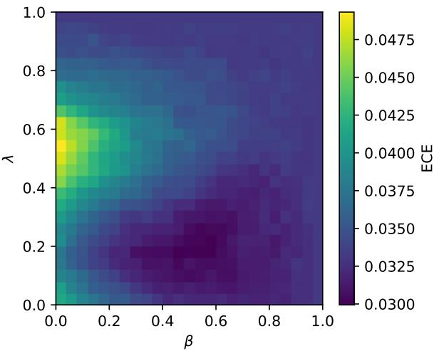

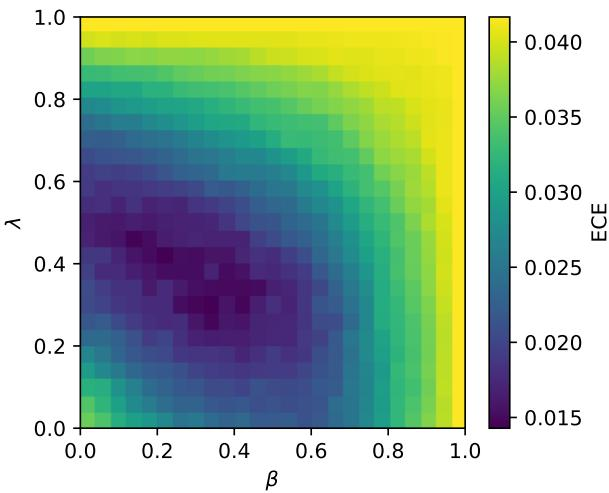  
Figure 9. Expected calibration error (ECE; 15 bins) over $( \lambda , \beta )$ for probability-space hybrid ensembling, where weight-interpolated models are combined with endpoint predictions after softmax. Lower values indicate improved calibration.

## C. Results for CIFAR-100 with ResNet-20 models

In this section, we present the figures and tables for experiments on the CIFAR-100 dataset with ResNet-20 models. For each width multiplier in {4, 8, 16} we train 50 models, form 25 model pairs, and align them via the weight-matching algorithm of Ainsworth et al. (2023). We used a similar methodology to quantify accuracy gain as in Section 4, but with $\lambda = 0 . 0 4$ for 4x-width, $\lambda = 0 . 0 7$ for 8x-width, $\lambda = 0 . 0 8$ for 16x-width with the Fixed-λ method.

## C.1. The BUMPs for aligned and naïve model pairs

We present figures analogous to Figures 1 and 2, together with tables analogous to Tables 1, and 2.

For the 16x-width setting, we plot interpolation curves for $\lambda \in ( 0 . 0 , 0 . 3 )$ and $\lambda \in ( 0 . 7 , 1 . 0 )$ across 10 model pairs. Figure 10 shows clear BUMPs near both endpoints for aligned model pairs, whereas for naïve pairs the BUMP is absent or much

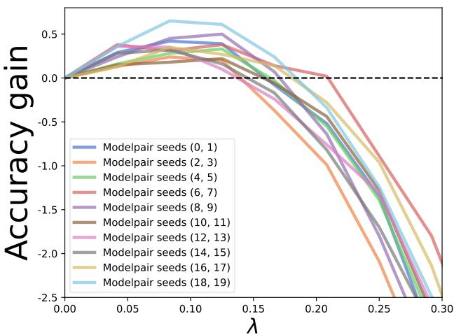  
(a) Left BUMP (aligned)

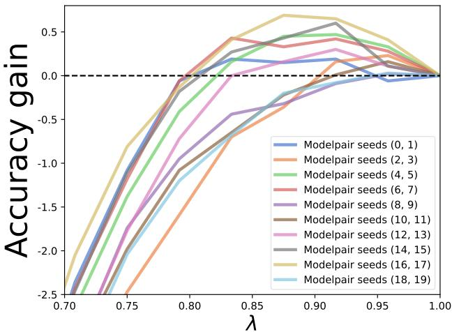  
(b) Right BUMP (aligned)  
Figure 10. The two BUMPs when interpolating between aligned models, the accuracies are measured on the CIFAR-100 test set, models are ResNet-20, showing 10 model pairs. Width multiplier is 16. We shifted the plots so that all accuracies of the original models are 0.

smaller (Figure 11). We report results for both methods quantifying accuracy gain of a BUMP in Table 17 (aligned pairs) and Table 18 (naïve pairs).

Table 17. Average accuracy gains of the BUMPs over their corresponding endpoint models on aligned model pairs. Results are reported on the CIFAR-100 test set using aligned ResNet-20 pairs (50 models) trained to convergence (250 epochs). Standard deviations are denoted in parentheses.
<table><tr><td>Accuracy gain % — Aligned pairs</td><td></td></tr><tr><td>Width Fixed-λ</td><td>Test</td></tr><tr><td>4x-width 0.201 (±0.197)</td><td>0.254 (±0.218)</td></tr><tr><td>8x-width 0.226 (±0.184)</td><td>0.264 (±0.169)</td></tr><tr><td>16x-width 0.319 (±0.188)</td><td>0.366 (±0.173)</td></tr></table>

Table 18. Average accuracy gains of the BUMPs over their corresponding endpoint models on non-aligned, i.e., naïve model pairs. Results are reported on the CIFAR-100 test set using aligned ResNet-20 pairs (50 models) trained to convergence (250 epochs). Standard deviations are denoted in parentheses.
<table><tr><td colspan="2">Accuracy gain % — Naïve pairs</td><td></td></tr><tr><td>Width</td><td>Fixed-λ</td><td>Test</td></tr><tr><td>4x-width</td><td>0.092 (±0.289)</td><td>0.156 (±0.203)</td></tr><tr><td>8x-width</td><td>−0.037 (±0.290)</td><td>0.140 (±0.154)</td></tr><tr><td>16x-width</td><td>−0.007 (±0.218)</td><td>0.178 (±0.142)</td></tr></table>

## C.2. A geometric and probabilistic analysis of model mixing

In this section, we present the results for the experiments described in Section 7 for CIFAR-100 and ResNet-20. Figure 12 depicts the mean angles between the WeightMix and LogitMix logits. Figure 13a shows the accuracy curves, and Figure 13b shows the KL-divergences between the Weightmix and LogitMix models.

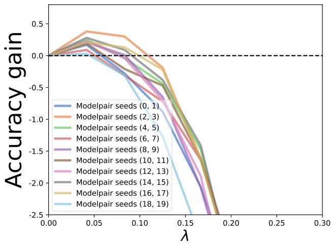  
(a) Left BUMP (naïve)

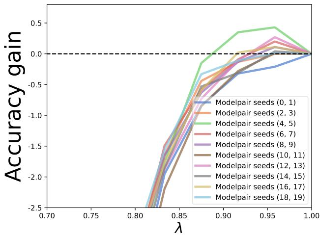  
(b) Right BUMP (naïve)  
Figure 11. The two BUMPs when interpolating between models without alignment, the accuracies are measured on the CIFAR-100 test set, models are ResNet-20, showing 10 model pairs. Width multiplier is 16. We shifted the plots so that all accuracies of the original models are 0.

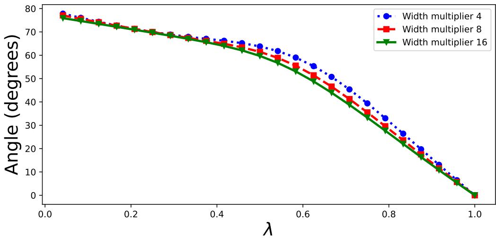  
Figure 12. The mean angles across the test datapoints for g = 24, CIFAR-100, ResNet-20 (50 models).

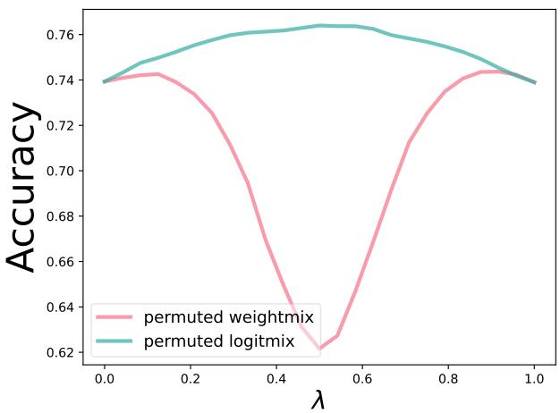  
(a) Accuracy curves

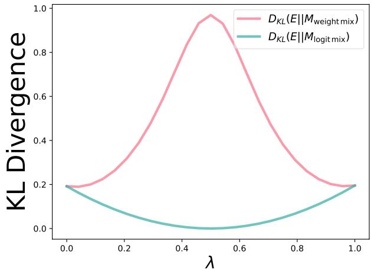  
(b) KL divergences  
Figure 13. Left (comparing accuracy curves): The WeightMix and LogitMix accuracy curve on CIFAR-100, ResNet-20, width multiplier is 16. Right (comparing class probabilities): Kullback-Leibler divergence between the class probability distributions of the WeightMix/LogitMix models and the λ = 0.5 LogitMix (classicle ensemble) model, CIFAR-100, ResNet-20.

## D. Results for CIFAR-10 with Tiny-10 models

In this section, we present the figures and tables for experiments on the CIFAR-10 dataset with Tiny-10 models. For each width multiplier in {4, 8, 16} we train 50 models, form 25 model pairs, and align them via the weight-matching algorithm of Ainsworth et al. (2023). We used a similary methodology to quantify accuracy gain as in Section 4, but with $\lambda = 0 . 0 0 3$ for 4x-width, $\lambda = 0 . 0 1$ for 8x-width, $\lambda = 0 . 0 1 5$ for 16x-width in the Fixed-λ method.

## D.1. The BUMPs for aligned and naïve model pairs

We present figures analogous to Figures 1 and 2, together with tables analogous to Tables 1, and 2.

For the 16x-width setting, we plot interpolation curves for $\lambda \in ( 0 . 0 , 0 . 3 )$ and $\lambda \in ( 0 . 7 , 1 . 0 )$ across 10 model pairs. Figure 14 shows clear BUMPs near both endpoints for aligned model pairs, whereas for naïve pairs the BUMP is absent or much smaller (Figure 15). We report results for both methods quantifying accuracy gain of a BUMP in Table 19 (aligned pairs) and Table 20 (naïve pairs).

Table 19. Average accuracy gains of the BUMPs over their corresponding endpoint models on aligned model pairs. Results are reported on the CIFAR-10 test set using aligned Tiny-10 pairs (50 models) trained to convergence (300 epochs). Standard deviations are denoted in parentheses.
<table><tr><td colspan="2">Accuracy gain % — Aligned pairs</td><td></td></tr><tr><td>Width</td><td>Fixed-λ</td><td>Test</td></tr><tr><td>4x-width</td><td> $0 . 0 1 3 \ : ( \pm 0 . 0 2 4 )$ </td><td>0.106 (±0.122)</td></tr><tr><td>8x-width</td><td> $0 . 0 4 0 \left( \pm 0 . 0 5 4 \right)$ </td><td>0.144 (±0.131)</td></tr><tr><td>16x-width</td><td> $0 . 0 5 4 \left( \pm 0 . 0 5 6 \right)$ </td><td> $0 . 1 7 8 \left( \pm 0 . 1 1 5 \right)$ </td></tr></table>

Table 20. Average accuracy gains of the BUMPs over their corresponding endpoint models on non-aligned, i.e., naïve model pairs. Results are reported on the CIFAR-10 test set using aligned Tiny-10 pairs (50 models) trained to convergence (300 epochs). Standard deviations are denoted in parentheses.
<table><tr><td>Accuracy gain % — Naïve pairs</td><td colspan="2"></td></tr><tr><td>Width</td><td>Fixed-λ</td><td>Test</td></tr><tr><td>4x-width</td><td>0.027 (±0.038)</td><td>0.077 (±0.112)</td></tr><tr><td>8x-width</td><td>0.075 (±0.087)</td><td> $0 . 1 1 2 \left( \pm 0 . 1 3 3 \right)$ </td></tr><tr><td>16x-width</td><td>0.050 (±0.059)</td><td> $0 . 0 9 3 ( \pm 0 . 0 8 1 )$ </td></tr></table>

## D.2. A geometric and probabilistic analysis of model mixing

In this section, we present the results for the experiments described in Section 7 for CIFAR-10 and Tiny-10. Figure 16 depicts the mean angles between the WeightMix and LogitMix logits. Figure 17a shows the accuracy curves, and Figure 17b shows the KL-divergences between the Weightmix and LogitMix models.

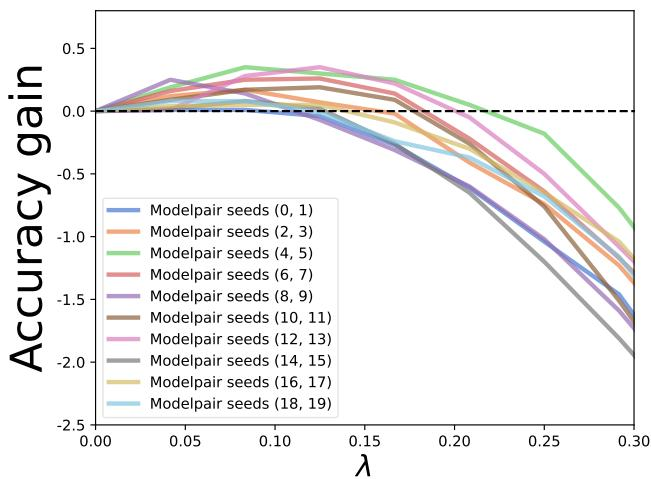  
(a) Left BUMP (aligned)

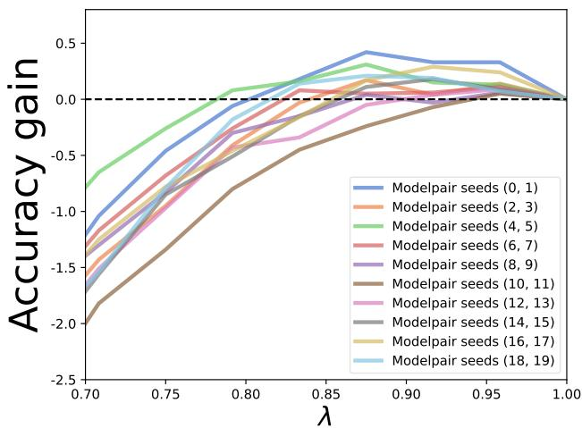  
(b) Right BUMP (aligned)  
Figure 14. The two BUMPs when interpolating between aligned models, the accuracies are measured on the CIFAR-10 test set, models are Tiny-10, showing 10 model pairs. Width multiplier is 16. We shifted the plots so that all accuracies of the original models are 0.

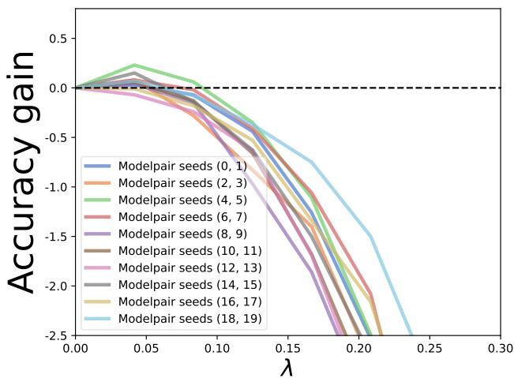  
(a) Left BUMP (naïve)

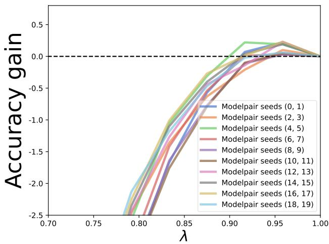  
(b) Right BUMP (naïve)  
Figure 15. The two BUMPs when interpolating between models without alignment, the accuracies are measured on the CIFAR-10 test set models are Tiny-10, showing 10 model pairs. Width multiplier is 16. We shifted the plots so that all accuracies of the original models are 0.

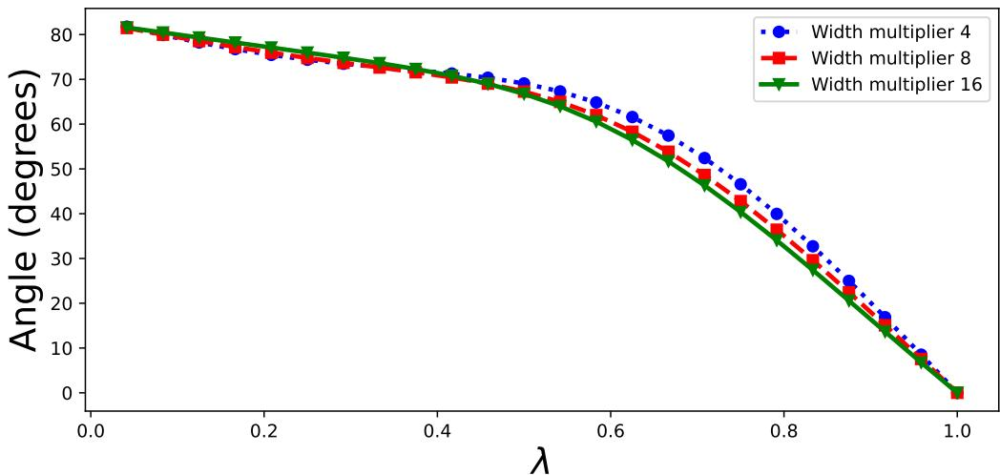  
Figure 16. The mean angles across the test datapoints for $g = 2 4 ,$ measured on CIFAR-10, model is Tiny-10 (50 models).

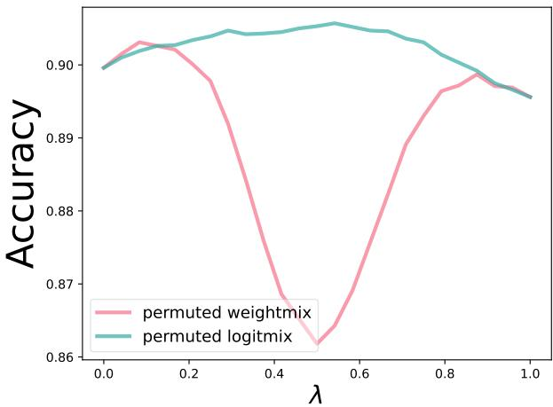  
(a) Accuracy curves

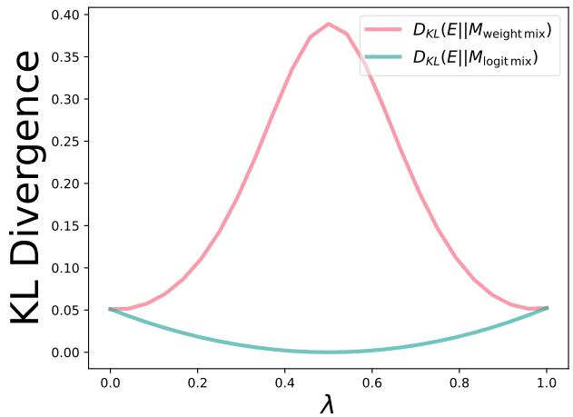  
(b) KL divergences  
Figure 17. Left (comparing accuracy curves): The WeightMix and LogitMix accuracy curve on CIFAR-10 with model Tiny-10, width multiplier is 16. Right (comparing class probabilities): Kullback-Leibler divergence between the class probability distributions of the WeightMix/LogitMix models and the λ = 0.5 LogitMix (classical logit ensemble) model, dataset is CIFAR-10, model is Tiny-10, width multiplier is 16.