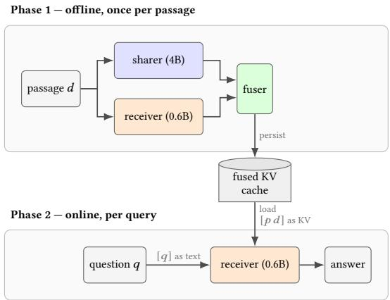

# CacheGraft: Enhancing Retrieval-Augmented Generation via Latent-Space Document Enrichment

Vihan Lakshman   
MIT CSAIL   
Cambridge, USA   
vihan@mit.edu

Zhuohan Gu MIT CSAIL Cambridge, USA

Peter Baile Chen MIT CSAIL Cambridge, USA peterbc@mit.edu

Michael Cafarella   
MIT CSAIL   
Cambridge, USA   
michjc@csail.mit.edu

## Abstract

Recent work in machine learning has demonstrated that transformer- based language model agents can communicate state not only through text, but also directly in latent space via key-value (KV) caches. In this paper, we argue that such cache-to-cache transla- tion can provide utility beyond the original motivating application of real-time agent communication and can instead be utilized for retrieval-augmented generation (RAG). Building on the Cache-to-Cache (C2C) fusion framework, our proposed system CacheGraft encodes each corpus passage ofline into a fused KV cache rep- resentation between a larger sharer model (4B parameters in our experiments) and a smaller receiver model (0.6B parameters) such that this cache can be injected into the receiver at query time with no need for the larger model. Across five QA benchmarks and two independent locally-run judges, CacheGraft improves answer quality over the text-only receiver baseline in 29 out of 30 comparisons, of which 17 of the 30 are statistically significant. Notably, these gains are zero-shot with respect to the fuser, which was never trained on retrieval data. These initial results suggest that latent-space document enrichment may be a promising avenue for enhancing the performance of RAG systems, particularly in compute-constrained settings where it is only feasible to deploy a small model at inference time.

## CCS Concepts

• Information systems → Information retrieval.

## Keywords

retrieval-augmented generation, KV caching, model collaboration, cache translation

## 1 Introduction

Recent breakthroughs in the machine learning community [7, 8, 16] have demonstrated that transformer-based large language model (LLM) agents can communicate information between one another not only through the standard medium of text, but also in latent space by translating the key-value (KV) cache from a sender model to a receiver model’s internal vector space. Notably, this translation, typically accomplished by learning a separate adapter model, is feasible even if the two models have a difering number of weights and layers [7, 8, 16].

  
Figure 1: The sharer and fuser run only ofline, once per corpus passage, with no knowledge of any query. The fused KV cache is the only artifact that crosses the ofline/online boundary: at query time the receiver loads it and decodes alone, reading the passage [� �] in latent space and the question [�] as text.

The overarching motivation driving this efort in KV cache trans- lation is the vision of heterogeneous LLMs collaborating in a realtime multi-agent system by passing state via KV cache vectors as opposed to raw text. By operating in latent space, KV cache translation ofers the promise of improving both the quality of multi-agent computation, since KV caches constitute richer conceptual representations of information in an LLM’s native language, and the performance of such systems by eliminating the model’s initial step of converting a textual input into KV vectors.

The central observation behind this paper is that KV cache trans- lation can be useful beyond the original motivating goal ofreal-time multi-agent LLM communication. To that end, we introduce the CacheGraft framework applying the KV cache translation paradigm for retrieval-augmented generation (RAG) where an LLM marshals knowledge from an external corpus to enhance its context before generating a response. Applying KV cache translation to RAG is not immediately obvious because typical RAG deployments often consist of a single LLM; it is unclear where cross-model cache translation even comes into the picture. Our key insight is that we can leverage KV cache translation during the ofline indexing phase of RAG pipelines by enriching the representation of a document through fusing the KV cache of a larger model (that cannot be deployed at query time) with the cache of a smaller model that does run online. Thus, the larger model serves as a de facto teacher and guides the smaller receiver model to better “read" the contents of the documents.

Unlike multi-agent communication, the ofline phase of a RAG pipeline is not latency-critical, making the overhead of KV cache fusion more palatable than in the real-time communication setting. Moreover, this ofline phase may enable using more powerful, but computationally expensive LLM models for indexing. These insights drive the development of our CacheGraft framework. In summary, we make the following contributions in this paper:

• Conceptual Insight: To our knowledge, this work is the first to make the observation that KV cache translation can be leveraged in applications outside of the canonical motivating example of real-time agent-to-agent communication. In particular, we demonstrate that the Cache-to-Cache (C2C) fusion technique [8] can lead to improved generation quality in retrieval-augmented generation (RAG) settings.

• Proof-of-Concept Evaluation: We instantiate CacheGraft using an of-the-shelf pretrained KV cache fusion model pub- lished by the C2C team1 that fuses the KV cache of Qwen3- 4B-Base model with the cache from a Qwen3-0.6B model into the latter’s KV space. We evaluate our proposed system2 on five knowledge-intensive RAG question-answering benchmarks which difer from the original C2C evaluation benchmarks which largely focus on reasoning tasks. Interest- ingly, CacheGraft achieves these gains using a cache fusion model that was not explicitly trained for these retrieval ap- plications.

• Long-Term Research Vision: In addition to our proof-ofconcept experiment results, we argue that KV cache fusion for RAG applications is a rich and understudied area and we highlight several open research problems for the community.

## 2 Related Work

Our work in this paper sits at the confluence of three research threads in machine learning and information retrieval that were previously disconnected. First is the aforementioned line of work on KV cache translation [7, 8, 16] including the C2C framework [8] we directly use in our experiments. We focus on using C2C in our evaluation of CacheGraft because, to our knowledge, it has demonstrated eficacy with the largest gap between the sharer and receiver models (4B to 0.6B parameters) and thus constitutes the most scalable translation method to date.

Secondly, on the RAG front, a number of works have proposed precomputing and storing a model’s KV cache representation of documents and using the cache, not the raw text, at query time to reduce latency by eliminating the step of converting text into KV values [5, 11, 12, 22]. However, these methods all use the KV cache of a single model and do not consider enriching the cache representation with signal from an additional, more powerful LLM, which diferentiates our approach in this paper.

Finally, multiple research eforts have also examined the problem of document enrichment, namely preprocessing the text in a corpus to be more amenable to RAG applications [4, 10, 14, 19]. CacheGraft can also be viewed as a document enrichment strategy, but in latent space as opposed to at the textual level.

## 3 Background: Cache-to-Cache (C2C)

In this section, we briefly review the details of the C2C frame- work [8] as CacheGraft repurposes this same fusion model for ofline document enrichment. In short, C2C enables a sharer LLM to pass contextual understanding to a receiver LLM directly in latent space, by fusing the sharer’s key-value (KV) cache into the receiver’s. Both underlying models remain frozen; the only trained component is a lightweight per-layer fuser network. More formally, let $x = \left[ x _ { 0 } , \ldots , x _ { n - 1 } \right]$ denote the input token sequence (in our setting, the RAG prompt; see Section 4). The sequence is tokenized independently by each model. Both frozen models then prefill on the same input: the receiver produces its per-layer KV cache $C _ { n } ( x )$ for layers $n = 1 , \ldots , N _ { : }$ , and the sharer produces its cache $C _ { m } ^ { S } ( x )$ for its own layers $m = 1 , \ldots , N ^ { \prime }$ . The text input is consumed twice, once by each model’s prefill.

Because the two models may difer in depth, a layer-mapping strategy $\mathcal { G }$ assigns to each receiver layer � a sharer layer G (�); C2C adopts terminal alignment, pairing final layers first and proceeding backward. A per-layer fuser ${ \mathcal { F } } _ { n }$ then produces the fused cache:

$$
\begin{array} { r } { C ^ { \mathcal { F } } ( { \boldsymbol { x } } ) ~ = ~ \left\{ ~ \mathcal { F } _ { n } \big ( C _ { n } ( { \boldsymbol { x } } ) , C _ { \mathcal { G } ( n ) } ^ { S } ( { \boldsymbol { x } } ) \big ) ~ \right\} _ { n = 1 } ^ { N } . } \end{array}\tag{1}
$$

The fused cache $C ^ { \mathcal { F } } ( x )$ lives entirely in the receiver’s KV space, has the same sequence length � as the input (no extra token positions are introduced), and replaces the receiver’s original prompt cache.

At inference time, the receiver performs text generation alone. With generated prefix $y _ { [ 0 : i ] } = \left[ y _ { 0 } , \dots , y _ { i - 1 } \right]$ and the receiver’s ordi- nary self-produced cache $C ( \boldsymbol { y } _ { [ 0 : i ] } )$ over that prefix, the next token is predicted as

$$
y _ { i + 1 } = \mathcal { P } \big ( y _ { i } \big | C ^ { \mathcal { F } } ( x ) \oplus C ( y _ { [ 0 : i ] } ) \big ) ,\tag{2}
$$

where ⊕ denotes sequence-wise concatenation. After fusion, the sharer plays no further role: newly generated tokens append receiver- native cache entries behind the fused prompt cache exactly as in standard autoregressive decoding.

Two properties of this construction are essential for the RAG setting in CacheGraft. First, the fused cache is a self-contained artifact: Equation 2 requires only $C ^ { \mathcal { F } } ( x )$ and the receiver, not the sharer or the fuser. Second, with causal attention, the fused entries at a given position depend only on tokens at earlier positions. Together these properties allow the fusion step of Equation 1 to be moved ofline entirely, computed once per document without knowledge of any query.

One limitation of the C2C framework in the interactive multiagent setting is that it requires running a forward pass of the text input � through both the sharer and receiver model, which limits the total possible amount of latency savings. A major goal of subsequent work in KV cache translation, such as Latent Cache Flow [16], is to eliminate this shortcoming. However, in the RAG setting, this fusion approach is not a notable hindrance since the cache enrichment step happens ofline and not at query time.

## 4 CacheGraft: Adapting C2C for RAG

We now describe the details of our CacheGraft system. As a matter of notation, we will denote a RAG prompt by $x = [ p , d , q ]$ which is a concatenation of a fixed preamble � (also known as a system prompt), a retrieved document �, and the question �. We focus our attention on knowledge-intensive question-answering applications that require a factual answer typically not found in the model’s own weights.

With causal attention, both models’ pre-fusion cache entries at positions $i \leq | p d |$ are independent of any token at position $j > i ;$ the projector acts position-wise and layer-wise on those entries; and the fusion of [� �] does not depend on �. Hence computing [�, �, �] in one pass and computing [�, �] alone yield identical KV over [�, �]. As a consequence, for top-1 retrieval with a fixed preamble, the document always occupies the same position range, so no RoPE re-rotation [5] is needed. We leave extending our framework to support top-� retrieval for � > 1 using techniques such as TurboRag finetuning [11] or CacheBlend [22] for future work.

Figure 1 depicts the full CacheGraft pipeline. Ofline, for each passage, we prefill [�, �] with fusion enabled and persist the receiverspace KV, keyed by a content hash. We also maintain an additional vector database index of document embeddings. Online, we iden tify the most relevant document to the query based on embedding similarity and load that document’s fused KV cache into the base receiver and decode the question. Crucially, we do not need any- thing from the sharer or the cache projection fuser model on the query path.

## 5 Experiments

## 5.1 Experimental Setup

We conduct all experiments on a single NVIDIA A100-40GB GPU and use standard greedy decoding at inference time.

Models. In all reported experiments, we use Qwen3-0.6B [21] as our receiver and Qwen3-4B-Base [21] as the sharer, with the released C2C projector for that pair. The projector is trained on general chat distillation and never sees retrieval data, so every result is zero-shot with respect to fuser training.

Data. We utilize five standard knowledge-intensive question answering benchmarks for our RAG evaluation: SQuAD v1.1 [15], AdversarialQA [2], CovidQA [13], QASPER [6] and TriviaQA [9]. For search, we use bge-small [20] embeddings to perform dense top- 1 retrieval. For evaluation, we retain one question per gold passage. We also run our experiments under retrieved and oracle (perfectretrieval) conditions to understand the impact of search quality on the overall RAG performance.

Metrics. We utilize the LLM-as-judge mechanism [23] as our primary evaluation metric. We evaluate all RAG outputs using two judges, both locally-run open-weight models scored on raw unmodified generations: phi-4 [1] and Gemma-2-9B [18]. We also report contains which measures whether the generated answer contains the gold ground truth answer included in the test dataset.

We also compute statistical significance measures using the exact two-sided paired McNemar test over the set of evaluation questions. We do not rely on traditional RAG metrics such as Exact Match (EM) and F1 score because we observed that the generated answers from fused KV caches tend to be more verbose (illustrated in Table 2) which hurts performance on these token-centric metrics.

## 5.2 Results

As shown in Table 1, we find that delivering the passage as a pro- jected KV cache improves over using the receiver with raw text on nearly every metric across every benchmark by up to 8 percentage points, with the exception of QASPER, which shows similarly clear gains with an oracle retriever but a disagreement between the two judges when using top-1 embedding-based search.

In Table 3, we observe that QASPER has the smallest gap between the sharer and receiver RAG quality which explains the more mixed results from cache fusion: there is limited headroom for the sharer to lift the receiver. Overall, Table 3 suggests two preconditions for CacheGraft to provide value on knowledge-intensive RAG tasks: the sharer must have headroom over the receiver, and the documents must supply factual signal the sharer can exploit.

We also include select examples of CacheGraft’s successes and failures on the SQuAD dataset in Table 2. We observe that cache fusion can indeed steer the receiver model towards relevant portions of the passage in several cases, but also makes mistakes. We also note that the outputs from CacheGraft tend to be more verbose than both the receiver and sharer models which also limits CacheGraft’s total latency gains as shown in Table 4. Nevertheless, Table 4 still illustrates an advantage for CacheGraft in terms of GPU memory consumption. We posit that the increased verbosity of CacheGraft’s fused KV cache can be mitigated by explicitly training for retrieval tasks, which we highlight as another direction for future work.

## 6 Limitations and Open Problems

## 6.1 Limitations

The primary practical limitation of our proposal is storage since we must store the KV cache for every document which can consume orders of magnitude more space than raw text (on the order of a terabyte for 100K documents, absent any optimizations). This problem is inherited from prior works that propose to precom-pute the KV caches for retrieval such as TurboRAG [11], Block Attention [12], and CAG [3] and can be mitigated with KV cache compression techniques [17] that are complementary to our work. Another limitation of our present study is that we focus on retriev- ing a single document and only consider a single C2C fuser model in our evaluations. Extending our system to support top-� retrieval and additional models is another promising direction for future work.

## 6.2 Open Problems

The results in this paper present a proof of concept demonstration of KV cache fusion to enhance RAG applications and open many directions for future research in this domain. Below, we highlight two particularly interesting directions:

Table 1: Performance of CacheGraft in comparison to using only the 0.6B receiver model and only the 4B sharer model across two LLM judges and the contains metric, which measures if the correct answer is included in the output text. CacheGraft improvements over the receiver-only baseline are marked in bold. Δ reports CacheGraft minus Receiver-Only for each metric.
<table><tr><td></td><td></td><td></td><td></td><td colspan="4">phi-4</td><td colspan="4">Gemma</td><td colspan="4">contains</td></tr><tr><td>Dataset</td><td>Setting</td><td>n</td><td>Top-1 Recall</td><td>Receiver-Only</td><td>CacheGraft</td><td>Sharer-Only</td><td>Δ</td><td>Receiver-Only</td><td>CacheGraft</td><td>Sharer-Only</td><td>Δ</td><td>Receiver-Only</td><td>CacheGraft</td><td>Sharer-Only</td><td>Δ</td></tr><tr><td rowspan="2">AdversarialQA</td><td rowspan="2">retrieved oracle</td><td rowspan="2">416</td><td rowspan="2">59.4</td><td>30.8</td><td>36.8</td><td>41.8</td><td>+6.0*</td><td>34.9</td><td>38.9</td><td>48.3</td><td>+4.1</td><td>24.5</td><td>30.3</td><td>33.7</td><td>+5.8*</td></tr><tr><td></td><td></td><td></td><td>+7.2*</td><td></td><td>51.4</td><td>63.9</td><td>+7.2*</td><td></td><td></td><td>48.3</td><td>+8.7*</td></tr><tr><td rowspan="2">SQuAD</td><td rowspan="2">retrieved</td><td rowspan="2">800</td><td rowspan="2">68.1</td><td>51.8</td><td>49.3 59.6</td><td>66.4</td><td>+7.9*</td><td>59.2</td><td>62.5</td><td>70.8</td><td>+3.2*</td><td>33.9 48.6</td><td>42.5 55.5</td><td>61.1</td><td>+6.9*</td></tr><tr><td></td><td>73.0</td><td></td><td></td><td></td><td></td><td></td><td></td><td></td><td></td><td></td><td>+7.0*</td></tr><tr><td rowspan="2">CovidQA</td><td rowspan="2">retrieved</td><td rowspan="2">800</td><td rowspan="2">53.2</td><td>33.1</td><td>79.4 36.9</td><td>86.5 41.9</td><td>+6.4* +3.8*</td><td>78.6 50.8</td><td>81.8 53.8</td><td>89.4</td><td>+3.1</td><td>69.9</td><td>76.9</td><td>81.2</td><td></td></tr><tr><td></td><td>53.7</td><td></td><td></td><td></td><td></td><td>59.8</td><td>+3.0</td><td>21.0</td><td>22.6</td><td>24.4</td><td>+1.6 +2.8</td></tr><tr><td rowspan="2">TriviaQA</td><td rowspan="2">retrieved</td><td rowspan="2">800</td><td rowspan="2">54.3</td><td>38.1</td><td>59.1 41.6</td><td>61.1 57.8</td><td>+5.4* +3.5*</td><td>71.7</td><td>76.9</td><td>80.0</td><td>+5.2*</td><td>32.6</td><td>35.4</td><td>37.2</td><td></td></tr><tr><td></td><td></td><td></td><td>+3.2</td><td>49.2</td><td>52.4</td><td>74.1</td><td>+3.1*</td><td>45.9</td><td>48.9</td><td>65.5 81.5</td><td>+3.0* +1.8</td></tr><tr><td rowspan="2">QASPER</td><td rowspan="2">retrieved</td><td rowspan="2">583</td><td rowspan="2">36.2</td><td>15.3</td><td>54.0 15.7</td><td>70.1 17.2</td><td></td><td>62.9</td><td>63.4</td><td>85.0</td><td>+0.5</td><td>61.0</td><td>62.8</td><td></td><td></td></tr><tr><td></td><td></td><td>37.5</td><td>+0.4 +2.9</td><td>35.9 57.4</td><td>33.9 60.8</td><td>35.5 59.2</td><td>-2.0 +3.4</td><td>17.7 32.7</td><td>18.8 39.0</td><td>18.2 34.8</td><td>+1.1 +6.3*</td></tr></table>

∗ � < 0.05, exact two-sided paired McNemar over questions.

Table 2: Example outputs of CacheGraft and the receiveronly Text-RAG baseline. The last two rows are failure cases: in each, CacheGraft answers with a diferent span of the same passage.
<table><tr><td>Over how many species of trees can be found in the Saxon Garden? (gold: 100)</td></tr><tr><td>TEXT-RAG: 15.5X</td></tr><tr><td>CACHEGRAFT: 100√</td></tr><tr><td>Where was the Continental Edison Company located? (gold: France)</td></tr><tr><td>TEXT-RAG: New York City. X</td></tr><tr><td>CACHEGRAFT: The Continental Edison Company was located in France. √</td></tr><tr><td>Who did Rollo sign the treaty of Saint-Clair-sur-Epte with? (gold: King Charles III)</td></tr><tr><td>TEXT-RAG: Rollo. X CACHEGRAFT: Rollo signed the treaty of Saint-Clair-sur-Epte with King Charles III of West</td></tr><tr><td>Francia.√</td></tr><tr><td>Where were missing patents later found? (gold: patent archives)</td></tr><tr><td>TEXT-RAG: The missing patents were later found in patent archives. √</td></tr><tr><td>CACHEGRAFT: The missing patents were found in the United States, Britain, and Canada. X</td></tr><tr><td>Whose writings were widely quoted by the Third Reich? (gold: Luther)</td></tr><tr><td>TEXT-RAG: Luther&#x27;s writings were widely quoted by the Third Reich.√</td></tr><tr><td>CACHEGRAFT: The writings of Heinrich Himmler were widely quoted by the Third Reich. X</td></tr></table>

Table 3: Relationship between CacheGraft’s gains and the opportunity for improvement, all computed in the oracleretrieval setting. Headroom is Sharer-Only minus Receiver-Only under contains. Answer-in-doc is the sharer’s contains improvement when given the gold passage versus answering closed-book (no passage). Gain is CacheGraft’s improvement over Receiver-Only under the phi-4 judge.
<table><tr><td>Dataset</td><td>Headroom</td><td>Answer-in-doc</td><td>Gain</td></tr><tr><td>AdversarialQA</td><td>+14.4</td><td>+34.6</td><td>+7.2</td></tr><tr><td>SQuAD</td><td>+11.3</td><td>+69.0</td><td>+6.4</td></tr><tr><td>CovidQA</td><td>+4.4</td><td>+34.1</td><td>+5.4</td></tr><tr><td>TriviaQA</td><td>+20.5</td><td>+40.7</td><td>+3.2</td></tr><tr><td>QASPER</td><td>+2.0</td><td>+30.2</td><td>+2.9</td></tr></table>

Table 4: Query-time cost, batch size 1, greedy decoding with 24 maximum new tokens, warm, over 100 SQuAD questions on one A100-40GB.
<table><tr><td>System</td><td>Latency (ms)</td><td>GPU Memory (GB)</td><td># Tokens</td></tr><tr><td>Receiver text-RAG (0.6B)</td><td>334</td><td>1.22</td><td>8.2</td></tr><tr><td>CacheGraft (0.6B + Cache)</td><td>574</td><td>1.27</td><td>14.3</td></tr><tr><td>Sharer text-RAG (4B)</td><td>652</td><td>7.62</td><td>12.6</td></tr></table>

(1) Training custom fuser models tailored for RAG: As mentioned previously, we consider a single of-the-shelf C2C fuser model that was not targeted for retrieval tasks. Could we improve the performance of CacheGraft by training a fuser model with retrieval-specific training objectives and datasets? How far can we scale the gap between the sharer and receiver model before cache fusion fails? Could we even train the fuser to be more compressible to augment standard KV cache compression techniques?

(2) Combining with textual document enrichment: Prior work such as EnrichIndex [4] and AutoIndex [14] propose to modify document text to improve RAG performance. How does text-level document enrichment interplay with the la- tent space strategy of our method? Is there a text enrichment method that enhances KV cache translation beyond simply using the raw documents?

## 7 Conclusion

Thus far, the idea of translating the KV cache from one LLM to another possibly very diferent model has been applied exclusively to communicating state in real-time multi-agent systems. The key insight at the heart of this paper is that the same idea can be re- purposed for RAG by applying KV cache translation on documents ofline between a larger sharer model and a smaller receiver to enhance the receiver’s online answer quality. In fact, we argue that RAG might be an even better fit for the Cache-to-Cache fusion paradigm because running forward passes through both the sharer and receiver model (as C2C requires) is a negligible cost for ofline document indexing, but may be limiting in real-time inference settings. We operationalize this insight in the form of CacheGraft, a prototype RAG system that utilizes C2C fusion to enrich a small receiver model’s KV cache representation with signal from a larger model that does not run at query time. Our initial evaluation extends C2C to zero-shot knowledge-intensive question answering tasks not present in fuser training where we find that CacheGraft consistently improves generation quality over the receiver-only text baseline on datasets where the larger sharer model has headroom to transfer. Perhaps surprisingly, these positive results on question answering come from using an of-the-shelf pre-trained C2C fuser model that was not tuned for retrieval in any respect. Our findings also raise a number of interesting questions for future work, which we outline in Section 6.2, that we hope will drive further work on latent-space document enrichment for RAG applications.

## References

[1] Marah Abdin, Jyoti Aneja, Harkirat Behl, Sébastien Bubeck, Ronen Eldan, Suriya Gunasekar, Michael Harrison, Russell J Hewett, Mojan Javaheripi, Piero Kauf mann, et al. Phi-4 technical report. arXiv preprint arXiv:2412.08905, 2024.

[2] Max Bartolo, Alastair Roberts, Johannes Welbl, Sebastian Riedel, and Pontus Stenetorp. Beat the ai: Investigating adversarial human annotation for reading com rehension. Transactions ofthe Association for Computational Linguistics, 8:662–678, 2020.

[3] Brian J Chan, Chao-Ting Chen, Jui-Hung Cheng, and Hen-Hsen Huang. Don’t do rag: When cache-augmented generation is all you need for knowledge tasks. In Companion proceedings ofthe ACM on web conference 2025, pages 893–897, 2025.

[4] Peter Baile Chen, Tomer Wolfson, Michael Cafarella, and Dan Roth. Enrichindex: Using llms to enrich retrieval indices ofline. arXiv preprint arXiv:2504.03598, 2025.

[5] Peter Baile Chen, Yi Zhang, Dan Roth, Samuel Madden, Jacob Andreas, and Mike Cafarella. Log-augmented generation: Scaling test-time reasoning with reusable computation. In International Conference on Learning Representations, volume 2026, pages 3339–3358, 2026.

[6] Pradeep Dasigi, Kyle Lo, Iz Beltagy, Arman Cohan, Noah A Smith, and Matt Gardner. A dataset of information-seeking questions and answers anchored in research papers. In Proceedings ofthe 2021 Conference ofthe North American Chapter ofthe Association for Computational Linguistics: Human Language Technologies, pages 4599–4610, 2021.

[7] Lucio M Dery, Zohar Yahav, Henry Prior, Qixuan Feng, Jiajun Shen, and Arthur Szlam. Latent space communication via kv cache alignment. arXiv preprint arXiv:2601.06123, 2026.

[8] Tianyu Fu, Zihan Min, Hanling Zhang, Jichao Yan, Guohao Dai, Wanli Ouyang, and Yu Wang. Cache-to-cache: Direct semantic communication between large language models. In International Conference on Learning Representations, volume 2026, pages 43130–43158, 2026.

[9] Mandar Joshi, Eunsol Choi, Daniel S Weld, and Luke Zettlemoyer. Triviaqa: A large scale distantly supervised challenge dataset for reading comprehension. In Proceedings ofthe 55th Annual Meeting ofthe Association for Computational Linguistics (Volume 1: Long Papers), pages 1601–1611, 2017.

[10] Yongjia Lei, Nedim Lipka, Zhisheng Qi, Utkarsh Sahu, Koustava Goswami, Franck Dernoncourt, R an A Rossi, and Yu Wan . Rl-index: Reinforcement learnin for retrieval index reasoning. arXiv preprint arXiv:2606.16316, 2026.

[11] Songshuo Lu, Hua Wang, Yutian Rong, Zhi Chen, and Yaohua Tang. Turborag: Acceleratin retrieval-au mented eneration with recom uted kv caches for chunked text. In Proceedings of the 2025 Conference on Empirical Methods in Natural Language Processing, pages 6599–6612, 2025.

[12] Dongyang Ma, Yan Wang, and Tian Lan. Block-attention for eficient prefilling. In International Conference on Learning Representations, volume 2025, pages 63774– 63788, 2025.

[13] Timo Möller, Anthony Reina, Raghavan Jayakumar, and Malte Pietsch. Covid-qa: A question answering dataset for covid-19. In Proceedings of the 1st Workshop on NLPfor COVID-19 at ACL 2020, 2020.

[14] Sam O’Nuallain, Nithya Rajkumar, Ramya Narayanasamy, Hanna Jiang, Shreyas Chaudhari, and Andrew Drozdov. Autoindex: Learning representation programs for retrieval. arXiv preprint arXiv:2607.18603, 2026.

[15] Pranav Rajpurkar, Jian Zhang, Konstantin Lopyrev, and Percy Liang. Squad: 100,000+ questions for machine comprehension of text. In Proceedings of the 2016 conference on empirical methods in natural language processing, pages 2383–2392, 2016.

[16] Maximillian Rossi, Prajwal Raghunath, and Eugene Wu. Latent cache flow: Model-to-model communication without text. arXiv preprint arXiv:2605.22863, 2026.

[17] Luohe Shi, Hongyi Zhang, Yao Yao, Zuchao Li, and Hai Zhao. Keep the cost down: A review on methods to optimize llm’s kv-cache consumption. arXiv preprint arXiv:2407.18003 2024

[18] Gemma Team, Morgane Riviere, Shreya Pathak, Pier Giuseppe Sessa, Cassidy Hardin, Surya Bhupatiraju, Léonard Hussenot, Thomas Mesnard, Bobak Shahriari, Alexandre Ramé, et al. Gemma 2: Improving open language models at a practical size. arXiv preprint arXiv:2408.00118, 2024.

[19] Omri Uzan, Ron Polonsky, Douwe Kiela, and Christopher Potts. Document optimization for black-box retrieval via reinforcement learning. arXiv preprint arXiv:2604.05087, 2026

[20] Shitao Xiao, Zheng Liu, Peitian Zhang, and Niklas Muennighof. C-pack: Pack-aged resources to advance general chinese embedding, 2023.

[21] An Yang, Anfeng Li, Baosong Yang, Beichen Zhang, Binyuan Hui, Bo Zheng, Bowen Yu, Chang Gao, Chengen Huang, Chenxu Lv, et al. Qwen3 technical report. arXiv preprint arXiv:2505.09388, 2025.

[22] Jiayi Yao, Hanchen Li, Yuhan Liu, Siddhant Ray, Yihua Cheng, Qizheng Zhang, Kuntai Du, Shan Lu, and Junchen Jiang. Cacheblend: Fast large language model serving for rag with cached knowledge fusion. In Proceedings ofthe twentieth European conference on computer systems, pages 94–109, 2025.

[23] Lianmin Zheng, Wei-Lin Chiang, Ying Sheng, Siyuan Zhuang, Zhanghao Wu, Yonghao Zhuang, Zi Lin, Zhuohan Li, Dacheng Li, Eric Xing, et al. Judging llm-as-a-jud e with mt-bench and chatbot arena. Advances in neural information processing systems, 36:46595–46623, 2023.