# Calibrated Target Noise Recovers Curvature from the Gradients

Arash Jamshidi Department of Computer Science University of Helsinki Helsinki, Finland arash.jamshidi@helsinki.fi

Aristides Gionis Division of Theoretical Computer Science KTH Royal Institute of Technology Digital Futures Stockholm, Sweden argioni@kth.se

Katsiaryna Haitsiukevich Department of Computer Science University of Helsinki Helsinki, Finland katsiaryna.haitsiukevich@helsinki.fi

Kai Puolamäki   
Department of Computer Science   
Institute for Atmospheric and Earth System   
Research   
University of Helsinki   
Helsinki, Finland   
kai.puolamaki@helsinki.fi

## Abstract

Estimating curvature information from gradients alone is a fundamental problem in machine learning. The challenge becomes particularly acute in settings where only aggregate mini-batch gradients are available, yet curvature information is still required for applications such as preconditioning in optimisation, sampling, and early stopping. Perhaps surprisingly, we show that a simple target-perturbation scheme suffices to recover such curvature information from gradients alone. Our method injects zero-mean noise into the targets, with variance calibrated to the local output curvature. The covariance of the resulting noisy batch gradients then recovers practical curvature matrices, without requiring per-sample gradients, second-order derivatives, or other internal network quantities. For a broad class of non-linear models, our scheme recovers the Generalised Gauss–Newton (GGN) matrix; for feed-forward ReLU networks, it additionally recovers the diagonal blocks of the population Hessian. We demonstrate that the resulting estimator is simple, lightweight, provably optimal, and easy to integrate into existing training pipelines. Experiments demonstrate accurate curvature recovery, faster optimisation when the estimator is used for preconditioning, and the utility of the estimated GGN for early stopping.

## 1 Introduction

Modern machine-learning models are usually trained with first-order optimisation methods, yet much of their behaviour is governed by second-order structure. Curvature determines how quickly gradient-based methods can move in different directions, which directions are ill-conditioned, and how sensitive the loss is to perturbations of the parameters. As a result, curvature information is useful for preconditioning, adaptive optimisation, uncertainty estimation, sampling, and early stopping [Martens, 2010, Mahsereci et al., 2017]. If reliable curvature estimates were cheaply available, they could be used to make training more stable, more interpretable, and often faster.

The difficulty is that curvature is expensive to obtain in modern models. Exact Hessians are typically too large to form or store, and even practical surrogates such as the Generalised Gauss–Newton (GGN) matrix often require per-sample gradients, Jacobians, or access to intermediate model quantities [Martens and Grosse, 2015, Botev et al., 2017]. These requirements can be impractical in large-scale training pipelines, distributed systems, federated learning, privacy-constrained settings, or software frameworks that provide only aggregate mini-batch gradients. In such settings, the usual alternative is to ignore curvature, rely on diagonal adaptive methods, or use approximations that require more than aggregate backwards-pass information, such as per-sample gradients, Jacobians, or second-order derivatives.

This paper asks whether useful curvature information can be recovered from what is already available in such settings: aggregate mini-batch gradients. At first glance, this seems difficult, since averaging gradients over a batch destroys the per-sample structure on which curvature estimators usually rely. Moreover, the covariance of ordinary gradients does not, in general, coincide with the curvature matrix of interest. Thus, simply collecting clean gradients is not enough: the gradients must be probed in a way that makes their fluctuations carry the right geometric information.

A closely related line of work shows that noise injection can reveal hidden information in gradients. In particular, Jamshidi et al. [2026] shows that adding target noise allows the covariance of noisy gradients to recover curvature information in linear regression. However, their construction is specific to the linear-regression setting, where the Hessian coincides with the unweighted data covariance. In general, non-linear models, the relevant curvature is parameter-dependent, so target noise must be calibrated to the local geometry of the loss.

We propose the Calibrated Noisy Gradient Covariance (CNGC) matrix, a simple curvature estimator based on target perturbations. The idea is to add zero-mean noise to the targets, with variance calibrated to the local curvature of the loss, and then estimate curvature from the covariance of the resulting noisy mini-batch gradients. This construction turns standard gradient evaluations into curvature probes, while avoiding explicit second-order derivatives, per-sample gradients, and Jacobian computations.

CNGC recovers the Generalised Gauss–Newton matrix in expectation for general non-linear models, and for feed-forward ReLU networks, it also captures diagonal Hessian blocks. The method is lightweight, compatible with standard mini-batch training, and can be used either as a diagnostic estimator of curvature or as a preconditioner inside an optimiser.

Contributions. First, we introduce CNGC as a gradient-only method for estimating curvature from calibrated target noise. Second, we show that its noisy-gradient covariance recovers the GGN matrix, and for ReLU networks also recovers diagonal Hessian blocks. Third, we analyse centred and swamping variants of the estimator and characterise their bias. Fourth, we show that scaled Rademacher noise is an optimal perturbation choice for reducing the estimator’s noise-induced risk. Finally, we empirically demonstrate that CNGC accurately recovers curvature and performs favourably compared to the baselines. Additionally, we provide two versions of preconditioners based on CNGC, which improve optimisation convergence. We also show that the proposed estimator can be applied for early stopping. Our code is available at https://github.com/edahelsinki/cngc.

## 2 Related work

Noise injection and randomness. Our method uses randomness as a measurement device: calibrated target noise is chosen so that the covariance of noisy gradients recovers a curvature target. This is conceptually related to randomised numerical linear algebra, where randomness is used to expose or preserve useful matrix structure [Derezinski and Mahoney, 2024, Xu et al., 2016, Yang et al.,´ 2018, Derezinski et al., 2021], but there the object being sketched is already available, whereas here curvature is made observable through first-order gradients. It is also related to SGD and its variants [Robbins and Monro, 1951, Goodfellow et al., 2016], whose stochasticity is known to interact with curvature and generalisation [Wei and Schwab, 2019, Zhu et al., 2019, Wu et al., 2020, Xie et al., 2021, Zhang et al., 2026]; the difference is that SGD noise is incidental, while ours is deliberately calibrated to the local output curvature. CNGC is closest to label-noise injection methods [Blanc et al., 2020, HaoChen et al., 2021, Damian et al., 2021]: both perturb labels, but prior work typically uses small noise as a regulariser, whereas we scale the variance with curvature and batch size so that the gradient covariance recovers the GGN in expectation. In [Jamshidi et al., 2026], the variance of added noise is also high, similar to this work; however, the variance of added noise is constant, and their results rely on a restrictive linearity assumption, while our work calibrates the noise to $A ^ { \prime \prime } ( f _ { w } ( x ) )$ ) and is applicable to general non-linear models. Noise can also be injected in parameter space [Orvieto et al., 2023, Dauphin et al., 2024, Zhang et al., 2024]; unlike those methods, which probe the landscape through weight perturbations, we perturb targets and recover curvature from ordinary gradient evaluations. Finally, Medvedev et al. [2026] also treat noise as beneficial, but via input distribution perturbations rather than curvature estimation via target perturbations.

Recovering second-order information from gradients. Our work is also related to methods that extract second-order information (e.g., GGN) from first-order gradients. Gradient-based signals have been used for optimisation monitoring and early stopping [Mahsereci et al., 2017, Forouzesh and Thiran, 2021, Jamshidi et al., 2025]; our use of CNGC for early stopping is in this spirit, but replaces clean-gradient covariance surrogates with a curvature estimator calibrated to recover the GGN. Diagonal adaptive methods such as RMSProp, Adadelta, and Adam [Tieleman and Hinton, 2012, Zeiler, 2012, Kingma, 2014] also build inexpensive preconditioners from gradient statistics, while Newton-type, cubic-regularised, and natural-gradient methods use Hessian- or Fisher-type information to accelerate optimisation [Broyden, 1970, Nesterov and Polyak, 2006, Amari, 1998, Pascanu and Bengio, 2014]. Our contribution is complementary: rather than proposing a new generic second-order update rule, we provide a way to estimate the optimisation-relevant curvature from aggregate gradients alone. This also distinguishes our approach from scalable curvature approximations based on Hessian-vector products, Jacobians, Fisher approximations, or structured matrix factorisations [Martens, 2010, Byrd et al., 2011, Martens and Grosse, 2015, Martens et al., 2018, Gupta et al., 2018, Zhang et al., 2023]. Those methods and ours share the goal of making second-order information practical, but our information model is different: variance-calibrated target perturbations make the GGN observable through aggregate mini-batch gradients. Theoretical studies such as Zhao et al. [2024] characterise the Gauss–Newton matrix itself, whereas we study how to recover it from first-order observations. The closest optimisation-side comparison is Liu et al. [2024]: both approaches seek low-cost second-order information from stochastic gradients, but they resample labels from the model output, whereas we add zero-mean noise directly to the labels. Moreover, they give full algorithmic details only for multi-class classification. Note that the GGN also has applications beyond optimisation: combined with prior curvature, it serves as an approximate posterior precision in Laplace inference, supporting uncertainty estimation and approximate posterior sampling [Daxberger et al., 2021]. GGN-based Laplace approximations also enable marginal-likelihood-based hyperparameter and model selection [Immer et al., 2021].

## 3 Theory and definitions

## 3.1 Definitions

We assume the data comes in i.i.d. batches of size $n ;$ more specifically, batches of the form $B =$ $\{ ( x _ { i } , y _ { i } ) \} _ { i = 1 } ^ { n }$ where $( x _ { i } , y _ { i } ) \sim \mathcal { D }$ , for some unknown probability distribution $\mathcal { D } .$ Throughout the paper, we consider scalar-output models $f _ { w } ( x ) \ ( { \mathrm { e . g . } } $ ., logits in binary classification or scalar predictions in regression) parameterised by $w \in \mathbb { R } ^ { d } \left( \mathbf { e . g } \right.$ ., neural network weights). We assume loss functions of the form

$$
\ell ( f _ { w } ( x ) , y ) = A ( f _ { w } ( x ) ) - y f _ { w } ( x ) { \mathrm { ~ a n d ~ } } { \mathcal { L } } ^ { ( B ) } ( w ) = \sum _ { i = 1 } ^ { n } \ell ( f _ { w } ( x _ { i } ) , y _ { i } ) / n ,\tag{1}
$$

where A is a convex function, typically the log-partition function of an Exponential Family (EF) model. This formulation covers several standard losses with different choices of $A . ^ { 1 }$ The Generalised Linear Models (GLMs) are the special case where $f _ { w } ( x ) = w ^ { \top }$ x is a linear function [McCullagh and Nelder, 2019]. An overview of GLMs and EF losses is presented in Section A. For brevity, we write $J _ { w } ( x ) : = \nabla _ { w } f _ { w } ( x )$ for the gradient of the model output with respect to the parameters.

In non-linear models, the positive semidefinite curvature matrix most commonly used for secondorder optimisation in modern neural networks is the Generalised Gauss–Newton (GGN) matrix [Botev et al., 2017], which is the main focus of this paper, defined for a batch $B$ and the population,

$$
\boxed { G ^ { ( B ) } ( w ) = \sum _ { i = 1 } ^ { n } A ^ { \prime \prime } ( f _ { w } ( x _ { i } ) ) J _ { w } ( x _ { i } ) J _ { w } ( x _ { i } ) ^ { \top } / n \mathrm { a n d } G ( w ) = \mathbb { E } _ { B \sim \mathcal { D } ^ { n } } [ G ^ { ( B ) } ( w ) ] . }\tag{2}
$$

For comparison, the empirical and population Hessians are

$$
H ^ { ( B ) } ( w ) = \sum _ { i = 1 } ^ { n } \nabla _ { w } ^ { 2 } \ell ( f _ { w } ( x _ { i } ) , y _ { i } ) / n \mathrm { ~ a n d ~ } H ( w ) = \nabla _ { w } ^ { 2 } \mathbb { E } _ { ( x , y ) \sim \mathcal { D } } \big [ \ell ( f _ { w } ( x ) , y ) \big ] .\tag{3}
$$

A direct calculation gives the decomposition (the analogous population identity is obtained by taking expectation over $( x , y ) \sim \mathcal { D } )$ ,

$$
G ^ { ( B ) } ( w ) = H ^ { ( B ) } ( w ) - \sum _ { i = 1 } ^ { n } \left( A ^ { \prime } ( f _ { w } ( x _ { i } ) ) - y _ { i } \right) \nabla _ { w } ^ { 2 } f _ { w } ( x _ { i } ) / n .\tag{4}
$$

Thus, the difference between the Hessian and the GGN is exactly the term involving the second derivative of the model output. In particular, for linear models (GLMs), where $\nabla _ { w } ^ { 2 } f _ { w } ( x ) = 0$ , the GGN reduces to the Hessian. The GGN is the practical optimisation target, while the Hessian enters mainly as a comparison object and as the exact GLM special case.

Our only assumption about the distribution D is that all random variables in our work have finite moments specified below:

$$
\begin{array} { r } { \mathbb { E } \| J _ { w } ( x ) \| _ { 2 } ^ { 4 } < \infty , \quad \mathbb { E } \Big [ \big ( A ^ { \prime } ( f _ { w } ( x ) ) - y \big ) ^ { 2 } \| J _ { w } ( x ) \| _ { 2 } ^ { 2 } \Big ] < \infty , \quad \mathbb { E } \Big [ A ^ { \prime \prime } ( f _ { w } ( x ) ) \| J _ { w } ( x ) \| _ { 2 } ^ { 2 } \Big ] < \infty . } \end{array}\tag{5}
$$

We denote the one-sample loss gradients by

$$
g _ { i } ( w ) : = \nabla _ { w } \ell ( f _ { w } ( x _ { i } ) , y _ { i } ) = \left( A ^ { \prime } ( f _ { w } ( x _ { i } ) ) - y _ { i } \right) J _ { w } ( x _ { i } ) ,\tag{6}
$$

and assume access only to aggregate batch gradients,

$$
g ^ { ( B ) } ( w ) = \sum _ { i = 1 } ^ { n } g _ { i } ( w ) / n .\tag{7}
$$

Our method does not require per-sample gradients, Jacobians, or second-order derivatives. It does, however, assume access to per-example model outputs and targets within each minibatch in order to compute the calibrated perturbations. A gradient optimisation run typically yields a sequence of such gradients $g ^ { ( B _ { 1 } ) } ( w _ { 1 } ) , \ldots , g ^ { ( B _ { t } ) } ( w _ { t } )$ evaluated at consecutive optimisation steps $w _ { 1 } , \ldots , w _ { t }$

## 3.2 Variance-calibrated target noise

Our approach is to perturb the targets independently by calibrated noise according to

$$
\boxed { \tilde { y } _ { i } = y _ { i } + \sqrt { \beta } \xi _ { i } , \qquad \mathbb { E } [ \xi _ { i } \mid x _ { i } ] = 0 , \qquad \mathrm { V a r } [ \xi _ { i } \mid x _ { i } ] = n A ^ { \prime \prime } ( f _ { w } ( x _ { i } ) ) , }\tag{8}
$$

where $\beta > 0$ controls the noise level. Let $\tilde { g } ^ { ( B ) } ( w )$ denote the batch gradient computed using the perturbed targets. Then

$$
\tilde { g } ^ { ( B ) } ( w ) - g ^ { ( B ) } ( w ) = - \sqrt { \beta } \sum _ { i = 1 } ^ { n } \xi _ { i } J _ { w } ( x _ { i } ) / n ,\tag{9}
$$

and in particular, the perturbation is unbiased: $\mathbb { E } _ { \xi } [ { \tilde { g } } ^ { ( B ) } ( w ) \mid B ] = g ^ { ( B ) } ( w )$

This suggests two covariance estimators to estimate the GGN. The first is the centred estimator, which uses the clean gradient of the same batch as the centre:

$$
\bigg | \widehat { S } _ { \mathrm { c e n t } } ^ { ( B ) } ( w ) : = \left( \tilde { g } ^ { ( B ) } ( w ) - g ^ { ( B ) } ( w ) \right) \left( \tilde { g } ^ { ( B ) } ( w ) - g ^ { ( B ) } ( w ) \right) ^ { \top } / \beta . \bigg |\tag{10}
$$

The second is the swamping estimator, which centres noisy gradients around their mean:

$$
\begin{array} { r } { \Big | \widehat { S } _ { \mathrm { s w a m p } } ^ { ( B ) } ( w ) : = \left( \tilde { g } ^ { ( B ) } ( w ) - \mu ( w ) \right) \left( \tilde { g } ^ { ( B ) } ( w ) - \mu ( w ) \right) ^ { \top } / \beta , \qquad \mu ( w ) : = \mathbb { E } _ { \xi , x , y } [ \tilde { g } ^ { ( B ) } ( w ) ] . } \end{array}\tag{11}
$$

The identity in Eq. (11) is stated for the idealised centre $\mu ( w ) = \mathbb { E } _ { \xi , x , y } [ \tilde { g } ^ { ( B ) } ( w ) ]$ ; in practice we replace $\mu ( w )$ by an empirical approximation, introducing additional finite-sample centring error.

Each sample $\widehat { S } _ { \mathrm { c e n t } } ^ { ( B ) } ( w )$ and $\widehat { S } _ { \mathrm { s w a m p } } ^ { ( B ) } ( w )$ is rank one, so recovering a higher-rank approximation to the GGN requires aggregation across multiple probes. For K independent batches $B _ { 1 } , \ldots , B _ { K }$ evaluated at the same parameter value w, define

$$
\overline { { S } } _ { \mathrm { c e n t } , K } ( w ) : = \sum _ { k = 1 } ^ { K } \widehat { S } _ { \mathrm { c e n t } } ^ { ( B _ { k } ) } ( w ) / K \quad \mathrm { a n d } \quad \overline { { S } } _ { \mathrm { s w a m p } , K } ( w ) : = \sum _ { k = 1 } ^ { K } \widehat { S } _ { \mathrm { s w a m p } } ^ { ( B _ { k } ) } ( w ) / K .\tag{12}
$$

These aggregated estimators provide practical higher-rank approximations to the batch- or populationlevel GGN, respectively. 2

Why do clean gradients fail? The outer product of the clean one-sample gradient is $g _ { i } ( w ) g _ { i } ( w ) ^ { \top } \ : = \ : \left( A ^ { \prime } ( f _ { w } ( x _ { i } ) ) - y _ { i } \right) ^ { 2 } J _ { w } ( x _ { i } ) J _ { w } ( x _ { i } ) ^ { \top }$ , which differs from the GGN of Eq. (2). Thus, the covariance of clean gradients is weighted by squared residuals, while the GGN is weighted by $A ^ { \prime \prime } ( f _ { w } ( x _ { i } ) )$ . In general, these are different objects, so ordinary gradient covariance does not recover the GGN. For a batch gradient, the same mismatch remains, and the corresponding covariance is simply scaled by $1 / n$

Formal statement (Eqs. (10) and (11) reproduce the GGN). The next theorem makes this precise under the moment assumptions in Eq. (5). It shows that the centred estimator recovers the batch GGN exactly in conditional expectation, whereas the swamping estimator recovers the population GGN up to an explicit residual term of order $1 / ( n \beta )$ that is independent of the injected-noise distribution.

Theorem 3.1. Assume an i.i.d. batch $B = \{ ( x _ { i } , y _ { i } ) \} _ { i = 1 } ^ { n }$ satisfying Eq. (5). Then the estimators defined above in Eqs. (10) and (11) satisfy

$$
\mathbb { E } _ { \xi } \big [ \widehat { S } _ { \mathrm { c e n t } } ^ { ( B ) } ( w ) \mid B \big ] = G ^ { ( B ) } ( w ) , \qquad \mathbb { E } _ { \xi , x , y } \big [ \widehat { S } _ { \mathrm { s w a m p } } ^ { ( B ) } ( w ) \big ] = G ( w ) + \Delta ( w ) / ( n \beta ) ,\tag{13}
$$

where $\Delta ( w )$ depends only on the data distribution D and the parameter w, and is independent of the injected-noise distribution. Moreover, $\| \Delta ( w ) / ( n \beta ) \| _ { \mathrm { o p } } = \mathcal { O } ( 1 / ( n \beta ) )$ , where $\| \cdot \| _ { \mathrm { o p } }$ denotes the operator norm.3

The proof is in Appendix B.1. The theorem shows that the centred estimator is unbiased for the batch GGN and that the swamping estimator becomes increasingly accurate as either the batch size n or the noise level $\beta$ increases. In particular, the role of $\beta$ differs in the two constructions: for the centred estimator, it is only a scaling factor that disappears after normalisation by $1 / \beta$ , whereas for the swamping estimator, it directly controls the size of the residual bias term.

Vector outputs. Throughout the main development, we focus on scalar-output models mainly for simplicity of notation. However, the same variance-calibration principle extends to vector-valued outputs, where the scalar curvature term is replaced by the corresponding output-space curvature matrix, and the injected noise is required to have an appropriate covariance structure rather than a scalar variance. An important example is multi-class classification with the standard multi-class cross-entropy loss, where $A ^ { \prime \prime } ( \cdot )$ is replaced by the Hessian of the log-sum-exp link. Since this is a matrix-valued version of the same argument, we defer the formal statement and proof to Subsection C.

## 3.3 Special case: networks with ReLU non-linearities

Theorem 3.1 already applies to general scalar-output neural networks: once $J _ { w } ( x ) = \nabla _ { w } f _ { w } ( x )$ is viewed as the feature vector, the variance-calibrated target-noise construction in $\operatorname { E q . } \left( 8 \right)$ and the estimators in Eqs. (10)–(11) recover the GGN of Eq. (2) in expectation using only aggregate batch gradients. In general, the recovered object is the GGN rather than the full Hessian.

Having an additional backward pass. In many practical settings, it is preferable to have an additional backward pass with clean targets. First, the noisy gradient is often not suitable for a reliable optimisation update, since the injected target noise can be large. Second, access to the clean gradient allows us to subtract it from the noisy gradient, isolating the term of interest. This is exactly the idea behind the centred estimator in Eq. (10), which yields an unbiased estimator of the batch GGN.

Feed-forward ReLU networks. With non-zero pre-activations, a feed-forward ReLU network is locally linear in each layer’s parameters when the other layers are fixed. Each block therefore defines a local GLM, so its Hessian and GGN blocks coincide and the calibrated-noise argument applies blockwise. This result is pointwise: activation patterns may change between training steps. Target perturbations preserve the activation pattern because clean and noisy gradients use the same parameters and inputs.

Proposition 3.2. Consider a feed-forward ReLU network with scalar output, and let $u _ { j } = \operatorname { v e c } ( W _ { j } )$ denote the parameter block of layer j. Assume that, at the fixed parameter w, all pre-activations are non-zero. Define

$$
\begin{array} { r } { H _ { j j } ^ { ( B ) } ( w ) : = \sum _ { i = 1 } ^ { n } { \nabla _ { u _ { j } } ^ { 2 } \ell ( f _ { w } ( x _ { i } ) , y _ { i } ) } / n , \qquad H _ { j j } ( w ) : = \nabla _ { u _ { j } } ^ { 2 } \mathbb { E } _ { ( x , y ) \sim \mathcal { D } } \big [ \ell ( f _ { w } ( x ) , y ) \big ] . } \end{array}\tag{14}
$$

Let $g _ { u _ { j } } ^ { ( B ) } ( w )$ and $\tilde { g } _ { u _ { j } } ^ { ( B ) } ( w )$ denote the restrictions of $\mathbf { \partial } ^ { \cdot } g ^ { ( B ) } ( w )$ and $\tilde { g } ^ { ( B ) } ( w )$ to the block $u _ { j } ,$ and define $\widehat { S } _ { \mathrm { c e n t } , u _ { j } } ^ { ( B ) } ( w )$ and $\widehat { S } _ { \mathrm { s w a m p } , u _ { j } } ^ { ( B ) } ( w )$ by Eqs. (10) and (11) with $g ^ { ( B ) } ( w ) , \tilde { g } ^ { ( B ) } ( w )$ replaced by $g _ { u _ { j } } ^ { ( B ) } ( w )$ $\tilde { g } _ { u _ { j } } ^ { ( B ) } ( w )$ . Then

$$
\mathbb { E } _ { \xi } \big [ \widehat { S } _ { \mathrm { c e n t } , u _ { j } } ^ { ( B ) } ( w ) \mid B \big ] = H _ { j j } ^ { ( B ) } ( w ) , \qquad \mathbb { E } _ { \xi , x , y } \big [ \widehat { S } _ { \mathrm { s w a m p } , u _ { j } } ^ { ( B ) } ( w ) \big ] = H _ { j j } ( w ) + \Delta _ { j } ( w ) / ( n \beta ) ,\tag{15}
$$

where $\Delta _ { j } ( w )$ depends only on D and w, and is independent ofthe injected-noise distribution.

Remark (non-i.i.d. batches). The centred identities in Theorem 3.1 and Proposition 3.2 hold for any fixed batch and do not require i.i.d. data. The expectation is taken only over the conditionally independent, variance-calibrated target perturbations. Thus, the centred estimator remains unbiased for the batch GGN and, under the ReLU assumptions, for the batch Hessian’s diagonal blocks. In contrast, the population-level bias formulas for the swamping estimator rely on i.i.d. sampling.

Remark (block-diagonal structure). It is often desirable to recover only a block-diagonal Hessian structure. First, the Hessian is often dominated by its diagonal blocks [Martens and Grosse, 2015, Botev et al., 2017]. Second, restricting to diagonal blocks makes storage and inversion tractable, especially for preconditioning. Many practical second-order methods, therefore, rely on blockdiagonal approximations.

The same local-linearity argument extends beyond fully connected feed-forward networks. In particular, many modern architectures, such as convolutional neural networks and graph neural networks, can be viewed as stacks of linear layers with architecture-specific weight sharing, so the same blockwise reasoning applies whenever the architecture uses piecewise linear activations [Eschenhagen et al., 2023].

## 3.4 Scaled Rademacher distribution is optimal

The target matrices in Theorem 3.1 depend only on the conditional second moments of the perturbations $\xi _ { i }$ , not on their full distribution. This raises the natural question of which admissible perturbation law should be used in practice. We show that a simple scaled Rademacher perturbation is optimal in the sense that, among all zero-mean perturbations with the required conditional variance, it minimises the noise-induced variance of the GGN estimators. We therefore define the independent perturbations for $i \in \{ 1 , \ldots , n \}$ by

$$
\boxed { \xi _ { i } = \epsilon _ { i } \sqrt { n A ^ { \prime \prime } ( f _ { w } ( x _ { i } ) ) } , \qquad \epsilon _ { i } \in \{ - 1 , + 1 \} , \qquad P ( \epsilon _ { i } = - 1 ) = P ( \epsilon _ { i } = + 1 ) = 1 / 2 . }\tag{16}
$$

By construction, Eq. (16) satisfies $\mathbb { E } [ \xi _ { i } \mid x _ { i } ] = 0$ and $\mathbb { E } [ \xi _ { i } ^ { 2 } \mid x _ { i } ] = n A ^ { \prime \prime } ( f _ { w } ( x _ { i } ) )$

Proposition 3.3 (Optimality of scaled Rademacher noise). Fix a batch B and a parameter w, and consider conditionally independent perturbations $\xi _ { i }$ satisfying

$$
\mathbb { E } [ \xi _ { i } \mid \boldsymbol { x } _ { i } ] = 0 , \qquad \mathbb { E } [ \xi _ { i } ^ { 2 } \mid \boldsymbol { x } _ { i } ] = n A ^ { \prime \prime } ( f _ { w } ( x _ { i } ) ) .\tag{17}
$$

Then the scaled Rademacher law in Eq. (16) minimises the conditional noise-induced Frobenius risk of the centred estimator in Eq. (10) among all such perturbation laws. If, in addition, the admissible perturbation laws satisfy

$$
\mathbb { E } [ \xi _ { i } ^ { 3 } \mid x _ { i } ] = 0 ,\tag{18}
$$

then the same scaled Rademacher law also minimises the conditional noise-induced Frobenius risk ofthe swamping estimator in Eq. (11). The same conclusion holdsfor the conditional mean-squared directional error $v ^ { \top } ( { \widehat { S } } - G ) v f o r$ every unit vector $v \in \mathbb { R } ^ { d }$ . Moreover, these minimisers are the same for arbitrary $\beta > 0$

The proposition explains why symmetric two-point perturbations are the natural default in practice: they achieve the required variance, are easy to sample, and minimise the perturbation-induced variability of the estimator. More generally, conditioned on any fixed batch B, any admissible noise distribution with finite first four moments leads to finite perturbation-induced variability. However, among noise distributions with the same conditional variance, the scaled Rademacher distribution has the smallest fourth moment and therefore minimises this variability. In contrast, alternatives such as Gaussian noise have larger fourth moments and therefore induce larger estimator error.

Algorithm 1 Centred and swamping noisy-gradient curvature (CNGC) estimators.   
Centered estimator Swamping estimator   
1: Input: parameter $w ,$ noise multiplier $\beta .$ 1: Input: parameter $w ,$ noise multiplier $\beta ,$ center $\mu _ { t } .$   
2: Draw a mini-batch $\{ ( x _ { i } , y _ { i } ) \} _ { i = 1 } ^ { n } .$ 2: Draw a mini-batch $\{ ( x _ { i } , y _ { i } ) \} _ { i = 1 } ^ { n } .$   
3: Compute $\eta _ { i } = f _ { w } ( x _ { i } ) , \forall i \in [ n ] .$ 3: Compute $\eta _ { i } = f _ { w } ( x _ { i } ) , \forall i \in [ n ] .$   
4: Set $\bar { v _ { i } } = n A ^ { \prime \prime } ( \eta _ { i } ) , \forall i \in [ n ] .$ 4: Set $\begin{array} { r } { \dot { v _ { i } } = \dot { n } A ^ { \prime \prime } ( \dot { \eta } _ { i } ) , \forall i \in [ n ] . } \end{array}$   
5: Sample $\xi _ { i } \sim \dot { \mathrm { U n i f } } \{ + \sqrt { v _ { i } } , ^ { - } \sqrt { v _ { i } } \} , \forall i \in [ n ] .$ 5: Sample $\xi _ { i } \sim \dot { \mathrm { U n i f } } \{ + \sqrt { v _ { i } } , ^ { - } \sqrt { v _ { i } } \} , \forall i \in [ n ] .$   
6: Set $\tilde { y } _ { i } = y _ { i } + \sqrt { \beta } \xi _ { i } , \forall i \in [ n ] .$ 6: Set $\tilde { y } _ { i } = y _ { i } + \sqrt { \beta } \xi _ { i } , \forall i \in [ n ] .$   
7: Compute $\tilde { \boldsymbol { g } } = \dot { \nabla } _ { \boldsymbol { w } } \sum _ { i } \ell ( f _ { \boldsymbol { w } } ( \dot { x } _ { i } ) , \tilde { y } _ { i } ) / n .$ 7: Compute $\begin{array} { r } { \tilde { \boldsymbol { g } } = \dot { \nabla } _ { \boldsymbol { w } } \sum _ { i } \ell ( f _ { \boldsymbol { w } } ( \dot { x } _ { i } ) , \tilde { y } _ { i } ) / n . } \end{array}$   
8: Compute $\begin{array} { r } { g = \nabla _ { w } \sum _ { i } ^ { \sim } \ell ( f _ { w } ( x _ { i } ) , y _ { i } ) / n . } \end{array}$ 8: Update $\begin{array} { r } { \mu _ { t + 1 } = ( t \mu _ { t } + \tilde { g } ) / ( t + 1 ) . } \end{array}$   
9: return $( \tilde { g } - g ) ( \tilde { g } - g ) ^ { \top } / \beta .$ 9: return $\big ( \tilde { g } - \mu _ { t + 1 } \big ) \big ( \tilde { g } - \mu _ { t + 1 } \big ) ^ { \top } / \beta .$

Remark. For regression and binary classification, GNB probes of the form used in Sophia [Liu et al., 2024] correspond to centred estimators with scaled Gaussian and centred Bernoulli noise, respectively. Proposition 3.3 therefore guarantees that our centered estimator (using scaled Rademacher perturbation) yield better mean-squared error for recovering GGN in both regression and binary classification, compared to GNB.

## 3.5 Algorithm description

Algorithm 1 gives a compact implementation of the centred and swamping estimators. Both use the same variance-calibrated target perturbation, with $v _ { i } = n A ^ { \prime \prime } ( \eta _ { i } )$ , and differ only in the centring step. The centred estimator subtracts the clean gradient from the noisy gradient, while the swamping estimator centres noisy gradients around $\mu \approx \mathbb { E } [ \tilde { g } ]$ .One example of using these two estimators in optimisation is discussed in Section D and Algorithm 2. Algorithm 1 uses a running empirical centre $\mu _ { t }$ to approximate the idealised centre $\mu ( w )$ from Eq. (11), so the practical swamping estimator is an approximation to the theoretical one in Theorem 3.1 rather than exactly the same object.

## 4 Experiments

To evaluate the proposed curvature estimator, we state the following research questions: (i) does the estimator recover the curvature information, and what are the effects of centring, swamping, and noise shape (Section 4.1), (ii) how does the proposed estimator compare to the existing methods (Section 4.2), (iii) does the estimator improve the optimisation when used as a preconditioner across various architectures (Section 4.3), (iv) can the estimator provide a criterion for early stopping (Section 4.4). We use the relative operator norm defined as follows to evaluate the approximation:

$$
r = | | \boldsymbol { S } _ { g } - \boldsymbol { G } | | _ { \mathrm { o p } } / | | \boldsymbol { G } | | _ { \mathrm { o p } } ,\tag{19}
$$

where $S _ { g }$ is an approximation and G is either GGN or Hessian. We also evaluated the difference in (positive) eigenvalues between the estimation and the ground truth by the same metric, since the eigenspectrum describes the loss landscape curvature.

## 4.1 Curvature estimators: effects of centring, swamping, and noise design

Our theoretical results suggest three distinct empirical questions related to the design of the estimator: (a) Curvature recovery and effects of centring: does the centred same-batch estimator recover $\dot { G } ^ { ( B ) } ( w ) ?$ Does the swamping cross-batch estimator recover $G ^ { ( B ) } ( w ) \ ?$ (b) Swamping: does the swamping estimator exhibit the predicted $O ( ( n \beta ) ^ { - 1 } )$ bias? (c) Noise design: does symmetric two-point noise dominate Gaussian noise at fixed variance, as predicted by Proposition 3.3?

Figure 1 summarises the results. (a) Both estimators recover the GGN, but centring significantly improves the robustness of the estimate far from the true parameter values (left). (b) Setting $\beta ,$ as a multiplier, we showed that the swamping estimator exhibits the predicted bias, however, by increasing β sufficiently, the estimator yields an accurate curvature estimate (middle). (c) Both symmetric two-point (Rademacher) and Gaussian noise distributions lead to accurate estimates of the curvature; however, Rademacher noise exhibits lower variance, leading to a better estimator (right). See run details in Section E.3. Additionally, Section F.1 provides an illustrative example for the Hessian recovery of a small CNN applied to regression and classification tasks.

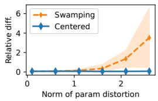

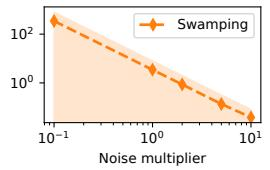

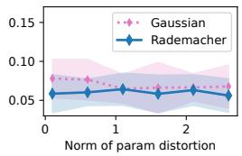  
Figure 1: Relative operator norm between GGN and its estimates showing the effects of centring (left), swamping (middle) and the added noise distribution (right) on curvature recovery. Both centring and swamping with a large noise multiplier make the estimates robust. Rademacher noise distribution yields a more accurate estimator with lower variance.

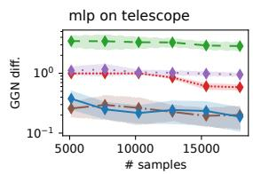

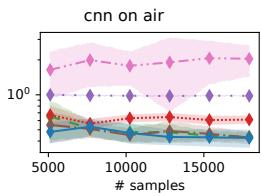

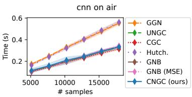  
Figure 2: Comparison of GGN estimators with an MLP for a classification task (left) and a CNN for a regression task (middle) by the relative operator norm of the difference of the full GGN matrix and its estimators. The wall-clock time for calculation of the estimators for the CNN model (right). The proposed CNGC estimator performs consistently across classification and regression tasks and is computationally cheaper than the full GGN calculation.

Recovery of Hessian eigenvalues We further tested the calibration effects on the recovery of (positive) eigenvalues of the true Hessian (see Section F.2 and Figure 6 in Appendix). Both estimators with centring and swamping with a large enough noise multiplier capture the eigenspectrum of the Hessian.

## 4.2 Curvature estimators: comparison with the baselines

We calculated the GGN matrix by the definition in Eq. (2) as the ground truth for the evaluation of estimators. We compared the proposed estimator CNGC with the following baselines: a) clean gradient covariance (CGC, the covariance matrix of mean batch gradients without added noise); b) uncalibrated noisy gradient covariance (UNGC) [Jamshidi et al., 2026] (adds target noise with constant variance); c) Hutchinson estimator [Bekas et al., 2007] (evaluates only the Hessian diagonal); d) Gauss-Newton-Bartlett curvature estimator (samples the model outputs instead of added noise) [Liu et al., 2024]. We compared the estimators reporting the relative operator norm of the error in the full GGN matrix by Eq. (19) and the wall-clock time of their calculation in Figure 2. The comparison between the matrix eigenspectrums for the estimators and the ground truth GGN is in Figure 7.

Neither the naive CGC nor the Hutchinson estimator fully captures the GGN. Since the Hutchinson estimator targets only diagonal structure, the full-matrix comparison is not favourable to it, however, it recovers the Hessian eigenspectrum (Figure 7, bottom left). UNGC fails for the classification task while recovering the GGN for the regression. Similarly, GNB performs classification but requires calibration for regression (see ‘GNB’ and ‘GNB (MSE)’). Additionally, GNB utilises Gaussian noise, which yields an estimator with higher variance as shown in the previous section. The proposed CNGC works for both tasks and matches the computational efficiency of the baselines.

## 4.3 CNGC estimator as the preconditioner in optimisation

In this section, we verify if the proposed curvature estimator can be used as a preconditioner (research question (iii)). Baselines: SGD [Robbins and Monro, 1951, Sutskever et al., 2013], Adam [Kingma,

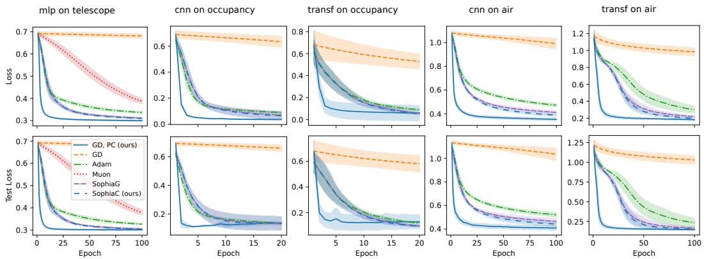  
Figure 3: The effect of calibrated noisy gradient covariance as a preconditioner (blue lines) for a classification task (telescope dataset) with an MLP, a time series classification (occupancy detection dataset) and regression (air quality dataset) with a 1D CNN and a transformer encoder.

Table 1: Wall-clock time per training epoch (seconds). The results are mean ± one standard deviation over 10 random seeds.
<table><tr><td>Optimiser</td><td>MLP Telescope</td><td>CNN  $\mathrm { O c c u p a n c y }$ </td><td>CNN Air</td><td>Transformer Occupancy</td><td>Transformer Air</td></tr><tr><td>GD</td><td> $\overline { { 0 . 2 2 \pm 0 . 0 0 } }$ </td><td> $\overline { { 0 . 4 2 \pm 0 . 0 1 } }$ </td><td> $0 . 1 8 \pm 0 . 0 0$ </td><td> $\overline { { 3 . 8 5 \pm 0 . 0 3 } }$ </td><td> $\overline { { 1 . 8 1 \pm 0 . 0 2 } }$ </td></tr><tr><td>Adam</td><td> $0 . 2 5 \pm 0 . 0 0$ </td><td> $0 . 4 6 \pm 0 . 0 1$ </td><td> $0 . 2 0 \pm 0 . 0 0$ </td><td> $4 . 0 5 \pm 0 . 0 6$ </td><td> $1 . 8 9 \pm 0 . 0 2$ </td></tr><tr><td>Sophia</td><td> $0 . 2 6 \pm 0 . 0 0$ </td><td> $0 . 4 9 \pm 0 . 0 1$ </td><td> $0 . 2 2 \pm 0 . 0 0$ </td><td> $4 . 4 2 \pm 0 . 0 6$ </td><td> $2 . 0 5 \pm 0 . 0 2$ </td></tr><tr><td>SophiaC (ours)</td><td> $0 . 2 6 \pm 0 . 0 0$ </td><td> $0 . 5 0 \pm 0 . 0 0$ </td><td> $0 . 2 2 \pm 0 . 0 0$ </td><td> $4 . 4 1 \pm 0 . 0 4$ </td><td> $2 . 0 6 \pm 0 . 0 2$ </td></tr><tr><td>GD, PC (ours)</td><td> $0 . 3 5 \pm 0 . 0 1$ </td><td> $0 . 6 6 \pm 0 . 0 1$ </td><td> $0 . 2 9 \pm 0 . 0 0$ </td><td> $4 . 9 0 \pm 0 . 0 5$ </td><td> $2 . 2 9 \pm 0 . 0 2$ </td></tr></table>

2014], Muon [Jordan et al., 2024] , Sophia-G [Liu et al., 2024]. For the proposed preconditioner, we used two versions of the optimisation algorithm: the block-diagonal preconditioner (‘GD, PC’) with adaptive learning rate (see Alg. 2 for details) and the diagonal preconditioner with the same momentum and clipping techniques as Sophia optimiser (‘SophiaC’). We tested linear, MLP, CNN, and transformer encoder models on classification and regression tasks (see Section E.5). For all runs, the input features were normalised to have zero mean, unit variance, and a batch size of 128. The preconditioner used the centred version of the estimator by subtracting the clean gradient. In the block-diagonal preconditioner version, the blocks were inverted using the pseudo-inverse. The proposed method, including the preconditioner and Alg. 2, yields results that are competitive with those of other popular optimisers. Figure 3 (and Figure 8 in the Appendix) summarises the results. The preconditioner effectively recovers the curvature information as shown by the ‘GD, PC’ version. Additionally, incorporating the estimator with effective clipping (‘SophiaC’) slightly improves the results of the original GNB estimator for regression tasks, thanks to a better noise design.

Computational cost. Tables 1 and 2 report wall-clock times for the optimisation experiments in Figure 3. Table 1 shows per-epoch time for each method, including preconditioner calculation. The numbers in Table 2 correspond to the wall-clock time needed to reach within 10% of the best loss achieved in each experiment. The reported results are mean ± one standard deviation over 10 seeds. SophiaC has approximately the same per-epoch cost as Sophia (see Table 1). Despite its higher per-epoch cost, blockwise CNGC reaches the target loss fastest on all five tasks; SophiaC reaches the target loss faster than Sophia on all five tasks except Occupancy (see Table 2).

## 4.4 CNGC estimator for an early stopping criterion

In this section, we demonstrate that the proposed GGN estimator can improve an existing criterion for early stopping. We use the following stopping criterion $z = \bar { g } ^ { T } ( w ) S _ { g } ^ { \dot { - } 1 } ( w ) \bar { g } ( w )$ , where g¯(w) is the mean of the batch gradients and $S _ { g } ^ { - 1 } ( w )$ is the inverse of the gradient covariance matrix. The training should be stopped when the value of the statistic z increases. A version of this statistic was proposed in the GradStop method [Jamshidi et al., 2025]; however, GradStop uses a covariance matrix of the clean gradients and calculates the full covariance matrix from the gradients of the individual data points. To make it scalable, we used only the diagonal blocks of the covariance matrix and constructed it from the mean batch gradients. Thus, the baseline used here is a scalable approximation to the original GradStop construction rather than exactly the same estimator. We compared GradStop with the stopping criterion where $S _ { g } ( w )$ is the GGN estimate obtained by the proposed CNGC method (the same as the preconditioner in the previous section). The CNGC is a principled curvature estimator which leads to suitable stopping points (see Figure 4), while the baseline may stop prematurely in some cases (see Figure 9), resulting in underfitting.

Table 2: Wall-clock time (seconds) to reach within 10% of the best test loss achieved in each experiment. The corresponding thresholds are listed below. † indicates that the threshold was not reached within the training budget; the full elapsed training time is reported instead. Bold and italic indicate the fastest and second-fastest methods, respectively. The results are mean ± one standard deviation over 10 random seeds.
<table><tr><td>Optimiser</td><td>MLP Telescope</td><td>CNN Occupancy</td><td>CNN Air</td><td>Transformer Occupancy</td><td>Transformer Air</td></tr><tr><td>Test-loss threshold</td><td>0.3402</td><td>0.1701</td><td>0.4804</td><td>0.1767</td><td>0.2526</td></tr><tr><td>GD</td><td> $\overline { { { 2 2 . 2 9 \pm 0 . 2 3 ^ { \dagger } } } }$ </td><td> $\overline { { 8 . 3 6 \pm 0 . 1 1 ^ { \dag } } }$ </td><td> $\overline { { 1 8 . 2 2 \pm 0 . 3 5 ^ { \dagger } } }$ </td><td> $\overline { { 7 7 . 0 8 \pm 0 . 6 6 ^ { \dag } } }$ </td><td> $1 8 1 . 0 3 \pm 2 . 0 0 ^ { \dagger }$ </td></tr><tr><td>Adam</td><td> $1 6 . 0 2 \pm 0 . 1 7$ </td><td> $\mathcal { S } . 8 1 \pm 0 . 0 5$ </td><td> $2 0 . 3 4 \pm 0 . 2 2 ^ { \dagger }$ </td><td> $4 4 . 7 1 \pm 0 . 6 6$ </td><td> $1 6 9 . 9 4 \pm 2 . 0 4$ </td></tr><tr><td>Sophia</td><td> $7 . 6 2 \pm 0 . 0 9$ </td><td> $4 . 1 0 \pm 0 . 0 4$ </td><td> $1 6 . 7 8 \pm 0 . 2 8$ </td><td> $4 4 . 3 7 \pm 0 . 5 6$ </td><td> $9 6 . 7 1 \pm 0 . 7 6$ </td></tr><tr><td>SophiaC (ours)</td><td> $\gamma _ { \cdot \downarrow ^ { 2 } } \pm \theta . 1 1$ </td><td> $4 . 1 2 \pm 0 . 0 5$ </td><td> $1 2 . 0 0 \pm 0 . 1 4$ </td><td> ${ \it 3 9 . 9 0 \pm 0 . 3 8 }$ </td><td> $8 6 . 4 6 \pm 0 . 9 2$ </td></tr><tr><td>GD, PC (ours)</td><td> ${ \bf 1 . 6 5 \pm 0 . 0 2 }$ </td><td> ${ \bf 0 . 9 6 \pm 0 . 0 2 }$ </td><td> ${ \bf 2 . 6 0 \pm 0 . 0 2 }$ </td><td> ${ \bf 1 0 . 0 1 \pm 0 . 1 1 }$ </td><td> ${ \bf 1 6 . 3 2 \pm 0 . 1 6 }$ </td></tr></table>

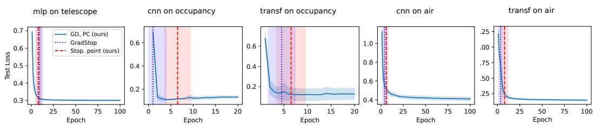  
Figure 4: The effect of calibrated noisy gradient covariance for early stopping (red vertical lines) for the same tasks as in the optimisation experiment compared to the baseline.

## 5 Conclusion and future work

We introduced the CNGC estimator, a gradient-only method for curvature recovery from aggregate mini-batch gradients. By injecting target noise calibrated to the local output curvature, CNGC recovers the GGN matrix in expectation and, for feed-forward ReLU networks, the diagonal Hessian blocks. Our empirical results demonstrate that CNGC accurately estimates curvature, compares favourably with baseline estimators, improves optimisation, and provides a signal for early stopping.

An interesting direction for future work is to explore the broader potential of calibrated target noise as a general-purpose probing mechanism for extracting geometric information about the loss landscape. Beyond recovering the GGN matrix, this approach could be extended to estimate other curvature-related quantities. Moreover, the recovered GGN could support a wider range of downstream applications, including uncertainty quantification, curvature-aware optimization, and adaptive regularization.

Limitations Our method targets the GGN matrix rather than the full Hessian except in special cases, such as GLMs and the diagonal blocks of feed-forward ReLU networks. The centred estimator also requires an additional backward pass with clean targets, thereby increasing computational cost. Finally, the method assumes access to per-example model outputs and targets within each minibatch. In practice, we use diagonal or block-diagonal approximations of GGN to keep matrix inversion and storage tractable $( O ( d ^ { \breve { 3 } } )$ for inversion, $\bar { O ( } d ^ { 2 } )$ per block for storage, where d is the block size).

Societal impact The paper is foundational research and is not tied to any specific applications. In practice, the results can be used, e.g., to build a more efficient optimiser for deep learning applications.

## Acknowledgements and Disclosures

The authors declare no competing interests that could create a conflict of interest. We thank the Research Council of Finland for funding, grants 364226 (Virtual Laboratory for Molecular Level Atmospheric Transformations (VILMA) Centre of Excellence) and 345704 (Finnish Center for Artificial Intelligence (FCAI)). We also thank the Helsinki Institute for Information Technology HIIT for funding. We thank the Finnish Computing Competence Infrastructure (FCCI) and CSC – IT Center for Science, Finland – for computational resources. The authors acknowledge the research environment provided by ELLIS Institute Finland. Aristides Gionis was supported by the Swedish Research Council project ExCLUS (2024-05603), the Marie Curie Doctoral Training Network ARMADA (101168951), and the Wallenberg AI, Autonomous Systems and Software Program (WASP) funded by the Knut and Alice Wallenberg Foundation.

## References

Shun-Ichi Amari. Natural gradient works efficiently in learning. Neural computation, 10(2):251–276, 1998.

Costas Bekas, Effrosyni Kokiopoulou, and Yousef Saad. An estimator for the diagonal of a matrix. Applied numerical mathematics, 57(11-12):1214–1229, 2007.

Guy Blanc, Neha Gupta, Gregory Valiant, and Paul Valiant. Implicit regularization for deep neural networks driven by an ornstein-uhlenbeck like process. In Conference on learning theory, pages 483–513. PMLR, 2020.

R. Bock. MAGIC Gamma Telescope. UCI Machine Learning Repository, 2004.

Aleksandar Botev, Hippolyt Ritter, and David Barber. Practical Gauss-Newton optimisation for deep learning. In Proceedings of the 34th International Conference on Machine Learning, volume 70, pages 557–565. PMLR, 2017.

Charles George Broyden. The convergence of a class of double-rank minimization algorithms 1. general considerations. IMA Journal ofApplied Mathematics, 6(1):76–90, 1970.

Richard H Byrd, Gillian M Chin, Will Neveitt, and Jorge Nocedal. On the use of stochastic hessian information in optimization methods for machine learning. SIAM Journal on Optimization, 21(3): 977–995, 2011.

Luis M. Ibarra Candanedo and Veronique Feldheim. Accurate occupancy detection of an office room from light, temperature, humidity and co2 measurements using statistical learning models. Energy and Buildings, 112:28–39, 2016.

Alex Damian, Tengyu Ma, and Jason D Lee. Label noise sgd provably prefers flat global minimizers. Advances in Neural Information Processing Systems, 34:27449–27461, 2021.

Yann N Dauphin, Atish Agarwala, and Hossein Mobahi. Neglected hessian component explains mysteries in sharpness regularization. Advances in Neural Information Processing Systems, 37: 131920–131945, 2024.

Erik Daxberger, Agustinus Kristiadi, Alexander Immer, Runa Eschenhagen, Matthias Bauer, and Philipp Hennig. Laplace redux-effortless bayesian deep learning. Advances in neural information processing systems, 34:20089–20103, 2021.

Michał Derezinski and Michael W Mahoney. Recent and upcoming developments in randomized nu-´ merical linear algebra for machine learning. In Proceedings ofthe 30th ACM SIGKDD Conference on Knowledge Discovery and Data Mining, pages 6470–6479, 2024.

Michal Derezinski, Jonathan Lacotte, Mert Pilanci, and Michael W Mahoney. Newton-less: Sparsification without trade-offs for the sketched Newton update. Advances in Neural Information Processing Systems, 34:2835–2847, 2021.

Runa Eschenhagen, Alexander Immer, Richard Turner, Frank Schneider, and Philipp Hennig. Kronecker-factored approximate curvature for modern neural network architectures. In Advances in Neural Information Processing Systems, volume 36, pages 33624–33655. Curran Associates, Inc., 2023.

Mahsa Forouzesh and Patrick Thiran. Disparity between batches as a signal for early stopping. In European Conference on Machine Learning and Principles and Practice of Knowledge Discovery in Databases. Springer, 2021.

Ian Goodfellow, Yoshua Bengio, and Aaron Courville. Deep learning, volume 1. MIT press Cambridge, 2016.

Vineet Gupta, Tomer Koren, and Yoram Singer. Shampoo: Preconditioned stochastic tensor optimization. In Proceedings of the 35th International Conference on Machine Learning, volume 80, pages 1842–1850. PMLR, 2018.

Jeff Z HaoChen, Colin Wei, Jason Lee, and Tengyu Ma. Shape matters: Understanding the implicit bias of the noise covariance. In Conference on Learning Theory, pages 2315–2357. PMLR, 2021.

Dieter Heck, Johannes Knapp, JN Capdevielle, G Schatz, T Thouw, et al. Corsika: A monte carlo code to simulate extensive air showers. Reportfzka, 6019(11), 1998.

Alexander Immer, Matthias Bauer, Vincent Fortuin, Gunnar Rätsch, and Khan Mohammad Emtiyaz. Scalable marginal likelihood estimation for model selection in deep learning. In International Conference on Machine Learning, pages 4563–4573. PMLR, 2021.

Arash Jamshidi, Lauri Seppäläinen, Katsiaryna Haitsiukevich, Hoang Phuc Hau Luu, Anton Björklund, and Kai Puolamäki. GRADSTOP: Early stopping of gradient descent via posterior sampling. In ECAI 2025, volume 413 of Frontiers in Artificial Intelligence and Applications, pages 2057– 2064. IOS Press, 2025. doi: 10.3233/FAIA251043.

Arash Jamshidi, Katsiaryna Haitsiukevich, and Kai Puolamäki. Information hidden in gradients of regression with target noise. In Proceedings of The 29th International Conference on Artificial Intelligence and Statistics, volume 300 of Proceedings of Machine Learning Research, pages 973–981. PMLR, 2026. URL https://proceedings.mlr.press/v300/jamshidi26a.html.

Keller Jordan, Yuchen Jin, Vlado Boza, Jiacheng You, Franz Cesista, Laker Newhouse, and Jeremy Bernstein. Muon: An optimizer for hidden layers in neural networks, 2024. URL https: //kellerjordan.github.io/posts/muon/.

Diederik P Kingma. Adam: A method for stochastic optimization. arXiv preprint arXiv:1412.6980, 2014.

Ron Kohavi. Scaling up the accuracy of naive-bayes classifiers: A decision-tree hybrid. In Proceed ings ofthe Second International Conference on Knowledge Discovery and Data Mining, volume 96, pages 202–207, 1996.

Hong Liu, Zhiyuan Li, David Leo Wright Hall, Percy Liang, and Tengyu Ma. Sophia: A scalable stochastic second-order optimizer for language model pre-training. In International Conference on Learning Representations, 2024.

Maren Mahsereci, Lukas Balles, Christoph Lassner, and Philipp Hennig. Early stopping without a validation set. arXiv preprint arXiv:1703.09580, 2017.

James Martens. Deep learning via hessian-free optimization. In Proceedings ofthe 27th International Conference on International Conference on Machine Learning, volume 27, pages 735–742, 2010.

James Martens and Roger Grosse. Optimizing neural networks with kronecker-factored approximate curvature. In Proceedings ofthe 32nd International Conference on Machine Learning, volume 37, pages 2408–2417. PMLR, 2015.

James Martens, Jimmy Ba, and Matt Johnson. Kronecker-factored curvature approximations for recurrent neural networks. In International Conference on Learning Representations, 2018.

P. McCullagh and J.A. Nelder. Generalized Linear Models. Routledge, 2 edition, January 2019. ISBN 978-0-203-75373-6. doi: 10.1201/9780203753736.

Marko Medvedev, Idan Attias, Elisabetta Cornacchia, Theodor Misiakiewicz, Gal Vardi, and Nathan Srebro. Positive distribution shift as a framework for understanding tractable learning. arXiv preprint arXiv:2602.08907, 2026.

Sérgio Moro, P. Cortez, and Paulo Rita. A data-driven approach to predict the success of bank telemarketing. Decis. Support Syst., 62:22–31, 2014.

Yurii Nesterov and Boris T Polyak. Cubic regularization of Newton method and its global performance. Mathematical programming, 108(1):177–205, 2006.

Antonio Orvieto, Anant Raj, Hans Kersting, and Francis Bach. Explicit regularization in overparametrized models via noise injection. In Francisco Ruiz, Jennifer Dy, and Jan-Willem van de Meent, editors, Proceedings of The 26th International Conference on Artificial Intelligence and Statistics, volume 206, pages 7265–7287. PMLR, 2023.

Razvan Pascanu and Yoshua Bengio. Revisiting natural gradient for deep networks. International Conference on Learning Representations, 2014.

Herbert Robbins and Sutton Monro. A stochastic approximation method. The annals ofmathematical statistics, pages 400–407, 1951.

Ilya Sutskever, James Martens, George Dahl, and Geoffrey Hinton. On the importance of initialization and momentum in deep learning. In International Conference on Machine Learning, pages 1139– 1147. PMLR, 2013.

Tijmen Tieleman and Geoffrey Hinton. Lecture 6.5—RMSProp: Divide the gradient by a running average of its recent magnitude. Coursera: Neural Networks for Machine Learning, 2012.

Saverio De Vito, Ettore Massera, Marco Piga, Luca Martinotto, and Girolamo Di Francia. On field calibration of an electronic nose for benzene estimation in an urban pollution monitoring scenario. Sensors and Actuators B-chemical, 129:750–757, 2008.

Mingwei Wei and David J Schwab. How noise affects the hessian spectrum in overparameterized neural networks. arXiv preprint arXiv:1910.00195, 2019.

Jingfeng Wu, Wenqing Hu, Haoyi Xiong, Jun Huan, Vladimir Braverman, and Zhanxing Zhu. On the noisy gradient descent that generalizes as SGD. In Proceedings of the 37th International Conference on Machine Learning, volume 119, pages 10367–10376. PMLR, 13–18 Jul 2020.

Zeke Xie, Issei Sato, and Masashi Sugiyama. A diffusion theory for deep learning dynamics: Stochastic gradient descent exponentially favors flat minima. International Conference on Learning Representations, 2021.

Peng Xu, Jiyan Yang, Fred Roosta, Christopher Ré, and Michael W Mahoney. Sub-sampled Newton methods with non-uniform sampling. Advances in Neural Information Processing Systems, 29, 2016.

Jiyan Yang, Yin-Lam Chow, Christopher Ré, and Michael W Mahoney. Weighted SGD for lp regression with randomized preconditioning. Journal ofMachine Learning Research, 18(211): 1–43, 2018.

Matthew D Zeiler. Adadelta: an adaptive learning rate method. arXiv preprint arXiv:1212.5701, 2012.

Hongyang R. Zhang, Dongyue Li, and Haotian Ju. Noise stability optimization for finding flat minima: A hessian-based regularization approach. Transactions on Machine Learning Research, 2024. ISSN 2835-8856.

Lin Zhang, Shaohuai Shi, and Bo Li. Eva: Practical second-order optimization with kroneckervectorized approximation. In International Conference on Learning Representations, 2023.

Yikuan Zhang, Ning Yang, and Yuhai Tu. On the superlinear relationship between sgd noise covariance and loss landscape curvature. arXiv preprint arXiv:2602.05600, 2026.

Jim Zhao, Sidak Pal Singh, and Aurelien Lucchi. Theoretical characterisation of the Gauss Newton conditioning in neural networks. Advances in Neural Information Processing Systems, 37:114965– 115000, 2024.

Zhanxing Zhu, Jingfeng Wu, Bing Yu, Lei Wu, and Jinwen Ma. The anisotropic noise in stochastic gradient descent: Its behavior of escaping from sharp minima and regularization effects. In Proceedings of the 36th International Conference on Machine Learning, volume 97, pages 7654– 7663. PMLR, 09–15 Jun 2019.

## A Generalized Linear Models

Generalised linear models (GLMs) extend linear regression by allowing the response variable to belong to the exponential family, while preserving a linear dependence on the covariates through the natural parameter. In the notation of this paper, a GLM is the special case of a scalar-output model

$$
f _ { w } ( x ) = w ^ { \top } x ,\tag{20}
$$

with loss

$$
\ell ( f _ { w } ( x ) , y ) = A ( f _ { w } ( x ) ) - y f _ { w } ( x ) .\tag{21}
$$

For a batch $B = \{ ( x _ { i } , y _ { i } ) \} _ { i = 1 } ^ { n }$ , the empirical loss is therefore

$$
{ \frac { 1 } { n } } \sum _ { i = 1 } ^ { n } { \big ( } A ( w ^ { \top } x _ { i } ) - y _ { i } w ^ { \top } x _ { i } { \big ) } .\tag{22}
$$

The corresponding batch gradient is

$$
g ^ { ( B ) } ( w ) = \frac { 1 } { n } \sum _ { i = 1 } ^ { n } \big ( A ^ { \prime } ( w ^ { \top } x _ { i } ) - y _ { i } \big ) x _ { i } ,\tag{23}
$$

and the empirical Hessian is

$$
H ^ { ( B ) } ( w ) = \frac { 1 } { n } \sum _ { i = 1 } ^ { n } A ^ { \prime \prime } ( w ^ { \top } x _ { i } ) x _ { i } x _ { i } ^ { \top } .\tag{24}
$$

The population Hessian is

$$
H ( w ) = \mathbb { E } _ { ( x , y ) \sim \mathcal { D } } \big [ A ^ { \prime \prime } ( w ^ { \top } x ) x x ^ { \top } \big ] .\tag{25}
$$

Thus, in a GLM, the curvature is determined by the second derivative $A ^ { \prime \prime } ( \cdot )$ . In particular, since $J _ { w } ( x ) = \nabla _ { w } f _ { w } ( x ) = x .$ , the GGN defined in Section 3 coincides exactly with the Hessian.

We briefly recall two standard examples.

Linear regression. For linear regression with squared loss,

$$
A ( \eta ) = \frac 1 2 \eta ^ { 2 } .\tag{26}
$$

Hence,

$$
A ^ { \prime } ( \eta ) = \eta , \qquad A ^ { \prime \prime } ( \eta ) = 1 .\tag{27}
$$

Therefore,

$$
H ^ { ( B ) } ( w ) = \frac { 1 } { n } \sum _ { i = 1 } ^ { n } x _ { i } x _ { i } ^ { \top } ,\tag{28}
$$

which is simply the empirical covariance matrix of the inputs.

Logistic regression. For binary logistic regression,

$$
A ( \eta ) = \log ( 1 + e ^ { \eta } ) .\tag{29}
$$

Its derivatives are

$$
A ^ { \prime } ( \eta ) = \sigma ( \eta ) , \qquad A ^ { \prime \prime } ( \eta ) = \sigma ( \eta ) \bigl ( 1 - \sigma ( \eta ) \bigr ) ,\tag{30}
$$

where

$$
\sigma ( \eta ) = \frac { 1 } { 1 + e ^ { - \eta } }\tag{31}
$$

is the logistic sigmoid function. In this case, the curvature depends on $w ^ { \top }$ x and satisfies

$$
0 < A ^ { \prime \prime } ( \eta ) \leq \frac { 1 } { 4 } .\tag{32}
$$

These examples illustrate the main difference between linear regression and general GLMs: in linear regression the curvature is constant, whereas in general GLMs it depends on both the current parameter and the input through $A ^ { \prime \prime } ( w ^ { \top } x )$

## B Proofs

## B.1 Proof of Theorem 3.1

Define

$$
s _ { i } ( w ) : = \left( A ^ { \prime } ( f _ { w } ( x _ { i } ) ) - y _ { i } \right) J _ { w } ( x _ { i } ) .\tag{33}
$$

Then

$$
g ^ { ( B ) } ( w ) = \frac { 1 } { n } \sum _ { i = 1 } ^ { n } s _ { i } ( w ) ,\tag{34}
$$

and, by definition of $\tilde { g } ^ { ( B ) } ( w )$ ,

$$
\tilde { g } ^ { ( B ) } ( w ) = \frac { 1 } { n } \sum _ { i = 1 } ^ { n } s _ { i } ( w ) - \frac { \sqrt { \beta } } { n } \sum _ { i = 1 } ^ { n } \xi _ { i } J _ { w } ( x _ { i } ) .\tag{35}
$$

Hence

$$
\tilde { g } ^ { ( B ) } ( w ) - g ^ { ( B ) } ( w ) = - \frac { \sqrt { \beta } } { n } \sum _ { i = 1 } ^ { n } \xi _ { i } J _ { w } ( x _ { i } ) .\tag{36}
$$

By assumption, we have

$$
\mathbb { E } [ \xi _ { i } \mid \boldsymbol { x } _ { i } ] = 0 , \qquad \mathbb { E } [ \xi _ { i } ^ { 2 } \mid \boldsymbol { x } _ { i } ] = n A ^ { \prime \prime } ( f _ { w } ( x _ { i } ) ) .\tag{37}
$$

We first prove the identity for the centred estimator. Here, we condition on the batch $B ,$ so the only remaining randomness is due to the injected noise $\xi .$ Since

$$
\widehat { S } _ { \mathrm { c e n t } } ^ { ( B ) } ( w ) = \frac { 1 } { \beta } \big ( \tilde { g } ^ { ( B ) } ( w ) - g ^ { ( B ) } ( w ) \big ) \big ( \tilde { g } ^ { ( B ) } ( w ) - g ^ { ( B ) } ( w ) \big ) ^ { \top } ,
$$

it suffices to show that the conditional covariance of $\tilde { g } ^ { ( B ) } ( w ) - g ^ { ( B ) } ( w )$ is $\beta G ^ { ( B ) } ( w )$ . Since

$$
\mathbb { E } _ { \xi } \big [ \tilde { g } ^ { ( B ) } ( w ) - g ^ { ( B ) } ( w ) \mid B \big ] = 0 ,\tag{38}
$$

we have

$$
\operatorname { C o v } _ { \xi } { \big ( } { \tilde { g } } ^ { ( B ) } ( w ) - g ^ { ( B ) } ( w ) \mid B { \big ) } = { \frac { \beta } { n ^ { 2 } } } \operatorname { C o v } _ { \xi } { \Big ( } \sum _ { i = 1 } ^ { n } \xi _ { i } J _ { w } ( x _ { i } ) { \Big | } B { \Big ) } .\tag{39}
$$

By independence across samples,

$$
\operatorname { C o v } _ { \xi } { \big ( } { \tilde { g } } ^ { ( B ) } ( w ) - g ^ { ( B ) } ( w ) \mid B { \big ) } = { \frac { \beta } { n ^ { 2 } } } \sum _ { i = 1 } ^ { n } \operatorname { C o v } _ { \xi } { \big ( } \xi _ { i } J _ { w } ( x _ { i } ) \mid B { \big ) } .\tag{40}
$$

Since $\mathbb { E } _ { \xi } [ \xi _ { i } J _ { w } ( x _ { i } ) \mid B ] = 0 .$

$$
\operatorname { C o v } _ { \xi } \big ( \xi _ { i } J _ { w } ( x _ { i } ) \mid B \big ) = \mathbb { E } _ { \xi } \Big [ \xi _ { i } ^ { 2 } J _ { w } ( x _ { i } ) J _ { w } ( x _ { i } ) ^ { \top } \Big | B \Big ] .\tag{41}
$$

Using $\mathbb { E } _ { \xi } [ \xi _ { i } ^ { 2 } \mid x _ { i } ] = n A ^ { \prime \prime } ( f _ { w } ( x _ { i } ) )$ , we obtain

$$
\mathbb { E } _ { \xi } \Big [ \xi _ { i } ^ { 2 } J _ { w } ( x _ { i } ) J _ { w } ( x _ { i } ) ^ { \top } \Big | B \Big ] = n A ^ { \prime \prime } ( f _ { w } ( x _ { i } ) ) J _ { w } ( x _ { i } ) J _ { w } ( x _ { i } ) ^ { \top } .\tag{42}
$$

Substituting back gives

$$
\operatorname { C o v } _ { \xi } \left( { \tilde { g } } ^ { ( B ) } ( w ) - g ^ { ( B ) } ( w ) \mid B \right) = { \frac { \beta } { n ^ { 2 } } } \sum _ { i = 1 } ^ { n } n A ^ { \prime \prime } ( f _ { w } ( x _ { i } ) ) J _ { w } ( x _ { i } ) J _ { w } ( x _ { i } ) ^ { \top }\tag{43}
$$

$$
= \beta \frac { 1 } { n } \sum _ { i = 1 } ^ { n } A ^ { \prime \prime } ( f _ { w } ( x _ { i } ) ) J _ { w } ( x _ { i } ) J _ { w } ( x _ { i } ) ^ { \top }\tag{44}
$$

$$
= \beta G ^ { ( B ) } ( w ) .\tag{45}
$$

Therefore,

$$
\mathbb { E } _ { \xi } \left[ \widehat { S } _ { \mathrm { c e n t } } ^ { ( B ) } ( w ) \mid B \right] = \frac { 1 } { \beta } \mathrm { C o v } _ { \xi } \big ( \tilde { g } ^ { ( B ) } ( w ) - g ^ { ( B ) } ( w ) \mid B \big ) = G ^ { ( B ) } ( w ) .\tag{46}
$$

We now prove the identity for the swamping estimator. In this case, we take covariance over all sources of randomness: the injected noise ξ and the random batch $( x _ { i } , y _ { i } ) _ { i = 1 } ^ { n }$ . First,

$$
\mathbb { E } _ { \xi , x , y } \big [ \tilde { g } ^ { ( B ) } ( w ) \big ] = \mathbb { E } _ { x , y } \big [ g ^ { ( B ) } ( w ) \big ] ,\tag{47}
$$

so the perturbation does not bias the mean gradient. By independence across samples,

$$
\mathrm { C o v } _ { \xi , x , y } \big ( \tilde { g } ^ { ( B ) } ( w ) \big ) = \frac { 1 } { n ^ { 2 } } \sum _ { i = 1 } ^ { n } \mathrm { C o v } _ { \xi , x , y } \big ( s _ { i } ( w ) - \sqrt { \beta } \xi _ { i } J _ { w } ( x _ { i } ) \big ) .\tag{48}
$$

For simplicity of the notation, we do not use $\xi , x , y$ as a subscript for every $\operatorname { C o v } ( \cdot )$ . Since the triples $( x _ { i } , y _ { i } , \xi _ { i } )$ are i.i.d., it suffices to compute one summand. For each i,

$$
\begin{array} { r l } & { \mathrm { C o v } _ { \xi , x , y } \big ( s _ { i } ( w ) - \sqrt { \beta } \xi _ { i } J _ { w } ( x _ { i } ) \big ) = \mathrm { C o v } \big ( s _ { i } ( w ) \big ) + \beta \mathrm { C o v } \big ( \xi _ { i } J _ { w } ( x _ { i } ) \big ) } \\ & { \phantom { x x x x x x x x x x x x x x x x x x x x x x x x x x x x x x x x x x x x } - \sqrt { \beta } \mathrm { C o v } \big ( s _ { i } ( w ) , \xi _ { i } J _ { w } ( x _ { i } ) \big ) - \sqrt { \beta } \mathrm { C o v } \big ( \xi _ { i } J _ { w } ( x _ { i } ) , s _ { i } ( w ) \big ) . } \end{array}\tag{49}
$$

The cross terms vanish. Indeed,

$$
\begin{array} { r } { \mathbb { E } \big [ s _ { i } ( w ) ( \xi _ { i } J _ { w } ( x _ { i } ) ) ^ { \top } \big ] = \mathbb { E } \Big [ s _ { i } ( w ) \mathbb { E } [ \xi _ { i } \mid x _ { i } , y _ { i } ] J _ { w } ( x _ { i } ) ^ { \top } \Big ] = 0 , } \end{array}\tag{50}
$$

since $\mathbb { E } [ \xi _ { i } \mid x _ { i } , y _ { i } ] = \mathbb { E } [ \xi _ { i } \mid x _ { i } ] = 0$ . Similarly,

$$
\mathbb { E } \big [ ( \xi _ { i } J _ { w } ( x _ { i } ) ) s _ { i } ( w ) ^ { \top } \big ] = 0 ,\tag{51}
$$

and

$$
\begin{array} { r } { \mathbb { E } \left[ \xi _ { i } J _ { w } ( x _ { i } ) \right] = \mathbb { E } \left[ \mathbb { E } [ \xi _ { i } \mid x _ { i } ] J _ { w } ( x _ { i } ) \right] = 0 . } \end{array}\tag{52}
$$

Thus,

$$
\operatorname { C o v } \big ( s _ { i } ( w ) , \xi _ { i } J _ { w } ( x _ { i } ) \big ) = 0 , \qquad \operatorname { C o v } \big ( \xi _ { i } J _ { w } ( x _ { i } ) , s _ { i } ( w ) \big ) = 0 .\tag{53}
$$

Moreover,

$$
\operatorname { C o v } \big ( \xi _ { i } J _ { w } ( x _ { i } ) \big ) = \mathbb { E } \Big [ \xi _ { i } ^ { 2 } J _ { w } ( x _ { i } ) J _ { w } ( x _ { i } ) ^ { \top } \Big ] = n G ( w ) ,\tag{54}
$$

where we used the tower property exactly as above and then averaged over the batch randomness. Therefore,

$$
\beta \operatorname { C o v } \left( \xi _ { i } J _ { w } ( x _ { i } ) \right) = \beta n G ( w ) .\tag{55}
$$

Now define

$$
\Delta ( w ) : = \mathrm { C o v } \Big ( \big ( A ^ { \prime } ( f _ { w } ( x ) ) - y \big ) J _ { w } ( x ) \Big ) .\tag{56}
$$

This quantity depends only on the data distribution and the parameter w, and is therefore independent of the distribution of the added target noise. Since $\mathrm { C o v } ( s _ { i } \bar { ( } w ) ) = \Delta ( w )$ , we obtain

$$
\operatorname { C o v } \big ( s _ { i } ( w ) - \sqrt { \beta } \xi _ { i } J _ { w } ( x _ { i } ) \big ) = \Delta ( w ) + \beta n G ( w ) .\tag{57}
$$

Substituting back gives

$$
\mathrm { C o v } _ { \xi , x , y } \big ( \tilde { g } ^ { ( B ) } ( w ) \big ) = \frac { 1 } { n ^ { 2 } } \sum _ { i = 1 } ^ { n } \Big ( \Delta ( w ) + \beta n G ( w ) \Big )\tag{58}
$$

$$
= { \frac { 1 } { n } } \Delta ( w ) + \beta G ( w ) .\tag{59}
$$

Dividing by $\beta$ yields

$$
{ \frac { 1 } { \beta } } \operatorname { C o v } _ { \xi , x , y } \left( \tilde { g } ^ { ( B ) } ( w ) \right) = G ( w ) + { \frac { 1 } { n \beta } } \Delta ( w ) .\tag{60}
$$

Finally, by the moment assumptions,

$$
\begin{array} { r } { \mathbb { E } \Big [ \big ( A ^ { \prime } ( f _ { w } ( x ) ) - y \big ) ^ { 2 } \| J _ { w } ( x ) \| _ { 2 } ^ { 2 } \Big ] < \infty , } \end{array}\tag{61}
$$

which implies

$$
\| \Delta ( w ) \| _ { \mathrm { o p } } < \infty .\tag{62}
$$

Hence,

$$
\left. \frac { \Delta ( w ) } { n \beta } \right. _ { \mathrm { o p } } = \frac { 1 } { n \beta } \left. \Delta ( w ) \right. _ { \mathrm { o p } } = \mathcal { O } \bigg ( \frac { 1 } { n \beta } \bigg ) .\tag{63}
$$

This proves the theorem.

## B.2 Proof of Proposition 3.2

Fix an input x and a parameter w such that all pre-activations are non-zero. Then there exists a neighbourhood of w in which the ReLU masks remain unchanged. In that neighbourhood, the network can be written as

$$
f _ { w ^ { \prime } } ( x ) = W _ { L } ^ { \prime } D _ { L - 1 } ( x ) W _ { L - 1 } ^ { \prime } \cdot \cdot \cdot D _ { 1 } ( x ) W _ { 1 } ^ { \prime } x ,\tag{64}
$$

where each $D _ { \ell } ( x )$ is a fixed diagonal matrix with entries in {0, 1}.

Fix a layer $j ,$ , keep all parameters except $W _ { j }$ fixed, and write

$$
u _ { j } : = \operatorname { v e c } ( W _ { j } ) .\tag{65}
$$

Since the network is linear in $W _ { j }$ when all other layers are fixed, there exists a radius $r _ { j } ( x , w ) > 0$ and a vector

$$
\phi _ { j } ( \boldsymbol { x } ; \boldsymbol { w } ) \in \mathbb { R } ^ { \dim ( u _ { j } ) }\tag{66}
$$

such that for every $u _ { j } ^ { \prime }$ with

$$
\| u _ { j } ^ { \prime } - u _ { j } \| _ { 2 } < r _ { j } ( x , w ) ,\tag{67}
$$

one has

$$
f _ { ( u _ { j } ^ { \prime } , w _ { - j } ) } ( x ) = { u _ { j } ^ { \prime } } ^ { \top } \phi _ { j } ( x ; w ) .\tag{68}
$$

Hence, on this neighbourhood,

$$
\ell ( \boldsymbol { u } _ { j } ^ { \prime } ; \boldsymbol { x } , y ) = A \big ( \boldsymbol { u } _ { j } ^ { \prime } ^ { \top } \phi _ { j } ( \boldsymbol { x } ; \boldsymbol { w } ) \big ) - y \boldsymbol { u } _ { j } ^ { \prime } ^ { \top } \phi _ { j } ( \boldsymbol { x } ; \boldsymbol { w } ) ,\tag{69}
$$

which is exactly a linear model with GLM loss in the block variable $u _ { j } ^ { \prime }$

Therefore,

$$
\nabla _ { u _ { j } } \ell ( w ; x , y ) = \left( A ^ { \prime } ( f _ { w } ( x ) ) - y \right) \phi _ { j } ( x ; w ) ,\tag{70}
$$

and

$$
\nabla _ { u _ { j } } ^ { 2 } \ell ( w ; x , y ) = A ^ { \prime \prime } ( f _ { w } ( x ) ) \phi _ { j } ( x ; w ) \phi _ { j } ( x ; w ) ^ { \top } .\tag{71}
$$

Since

$$
\phi _ { j } ( x ; w ) = \nabla _ { u _ { j } } f _ { w } ( x ) ,\tag{72}
$$

it follows that

$$
\nabla _ { u _ { j } } ^ { 2 } \ell ( w ; x , y ) = A ^ { \prime \prime } ( f _ { w } ( x ) ) \nabla _ { u _ { j } } f _ { w } ( x ) \nabla _ { u _ { j } } f _ { w } ( x ) ^ { \top } .\tag{73}
$$

Taking the expectation gives

$$
H _ { j j } ( w ) = \mathbb { E } \Big [ A ^ { \prime \prime } ( f _ { w } ( x ) ) \nabla _ { u _ { j } } f _ { w } ( x ) \nabla _ { u _ { j } } f _ { w } ( x ) ^ { \top } \Big ] .\tag{74}
$$

Similarly, for a fixed batch $B = \{ ( x _ { i } , y _ { i } ) \} _ { i = 1 } ^ { n }$ , define

$$
H _ { j j } ^ { ( B ) } ( w ) : = \frac { 1 } { n } \sum _ { i = 1 } ^ { n } A ^ { \prime \prime } ( f _ { w } ( x _ { i } ) ) \nabla _ { u _ { j } } f _ { w } ( x _ { i } ) \nabla _ { u _ { j } } f _ { w } ( x _ { i } ) ^ { \top } .\tag{75}
$$

Now define

$$
s _ { j , i } ( w ) : = \left( A ^ { \prime } ( f _ { w } ( x _ { i } ) ) - y _ { i } \right) \nabla _ { u _ { j } } f _ { w } ( x _ { i } ) ,\tag{76}
$$

so that

$$
g _ { u _ { j } } ^ { ( B ) } ( w ) = \frac { 1 } { n } \sum _ { i = 1 } ^ { n } s _ { j , i } ( w ) ,\tag{77}
$$

and

$$
\tilde { g } _ { u _ { j } } ^ { ( B ) } ( w ) = \frac { 1 } { n } \sum _ { i = 1 } ^ { n } s _ { j , i } ( w ) - \frac { \sqrt { \beta } } { n } \sum _ { i = 1 } ^ { n } \xi _ { i } \nabla _ { u _ { j } } f _ { w } ( x _ { i } ) .\tag{78}
$$

Hence

$$
\tilde { g } _ { u _ { j } } ^ { ( B ) } ( w ) - g _ { u _ { j } } ^ { ( B ) } ( w ) = - \frac { \sqrt { \beta } } { n } \sum _ { i = 1 } ^ { n } \xi _ { i } \nabla _ { u _ { j } } f _ { w } ( x _ { i } ) .\tag{79}
$$

We first prove the identity for the centred estimator. Here, we condition on the batch B, so the only remaining randomness is due to the injected noise ξ. Since

$$
\mathbb { E } _ { \xi } \big [ \tilde { g } _ { u _ { j } } ^ { ( B ) } ( w ) - g _ { u _ { j } } ^ { ( B ) } ( w ) \mid B \big ] = 0 ,\tag{80}
$$

we have

$$
\operatorname { C o v } _ { \xi } \big ( \tilde { g } _ { u _ { j } } ^ { ( B ) } ( w ) - g _ { u _ { j } } ^ { ( B ) } ( w ) \mid B \big ) = \frac { \beta } { n ^ { 2 } } \mathrm { C o v } _ { \xi } \Big ( \sum _ { i = 1 } ^ { n } \xi _ { i } \nabla _ { u _ { j } } f _ { w } ( x _ { i } ) \Big | B \Big ) .\tag{81}
$$

By independence across samples,

$$
\operatorname { C o v } _ { \xi } \big ( \tilde { g } _ { u _ { j } } ^ { ( B ) } ( w ) - g _ { u _ { j } } ^ { ( B ) } ( w ) \mid B \big ) = \frac { \beta } { n ^ { 2 } } \sum _ { i = 1 } ^ { n } \operatorname { C o v } _ { \xi } \big ( \xi _ { i } \nabla _ { u _ { j } } f _ { w } ( x _ { i } ) \mid B \big ) .\tag{82}
$$

Since $\mathbb { E } _ { \xi } [ \xi _ { i } \nabla _ { u _ { j } } f _ { w } ( x _ { i } ) \mid B ] = 0 .$

$$
\operatorname { C o v } _ { \xi } \big ( \xi _ { i } \nabla _ { u _ { j } } f _ { w } ( x _ { i } ) \mid B \big ) = \mathbb { E } _ { \xi } \Big [ \xi _ { i } ^ { 2 } \nabla _ { u _ { j } } f _ { w } ( x _ { i } ) \nabla _ { u _ { j } } f _ { w } ( x _ { i } ) ^ { \top } \Big | B \Big ] .\tag{83}
$$

Using $\mathbb { E } _ { \xi } [ \xi _ { i } ^ { 2 } \mid x _ { i } ] = n A ^ { \prime \prime } ( f _ { w } ( x _ { i } ) )$ , we obtain

$$
\begin{array} { r l } & { \mathbb { E } _ { \xi } \left[ \xi _ { i } ^ { 2 } \nabla _ { u _ { j } } f _ { w } ( x _ { i } ) \nabla _ { u _ { j } } f _ { w } ( x _ { i } ) ^ { \top } \Big | B \right] = n A ^ { \prime \prime } ( f _ { w } ( x _ { i } ) ) \nabla _ { u _ { j } } f _ { w } ( x _ { i } ) \nabla _ { u _ { j } } f _ { w } ( x _ { i } ) ^ { \top } . } \end{array}\tag{84}
$$

Substituting back gives

$$
\mathrm { C o v } _ { \xi } \big ( \tilde { g } _ { u _ { j } } ^ { ( B ) } ( w ) - g _ { u _ { j } } ^ { ( B ) } ( w ) \mid B \big ) = \frac { \beta } { n ^ { 2 } } \sum _ { i = 1 } ^ { n } n A ^ { \prime \prime } ( f _ { w } ( x _ { i } ) ) \nabla _ { u _ { j } } f _ { w } ( x _ { i } ) \nabla _ { u _ { j } } f _ { w } ( x _ { i } ) ^ { \top }\tag{85}
$$

$$
= \beta \frac { 1 } { n } \sum _ { i = 1 } ^ { n } A ^ { \prime \prime } ( f _ { w } ( x _ { i } ) ) \nabla _ { u _ { j } } f _ { w } ( x _ { i } ) \nabla _ { u _ { j } } f _ { w } ( x _ { i } ) ^ { \top }\tag{86}
$$

$$
\begin{array} { r } { \mathbf { \Sigma } = \beta H _ { j j } ^ { ( B ) } ( w ) . } \end{array}\tag{87}
$$

Therefore,

$$
\mathbb { E } _ { \xi } \big [ \widehat { S } _ { \mathrm { c e n t } , u _ { j } } ^ { ( B ) } ( w ) \mid B \big ] = \frac { 1 } { \beta } \operatorname { C o v } _ { \xi } \big ( \tilde { g } _ { u _ { j } } ^ { ( B ) } ( w ) - g _ { u _ { j } } ^ { ( B ) } ( w ) \mid B \big ) = H _ { j j } ^ { ( B ) } ( w ) .\tag{88}
$$

We now prove the identity for the swamping estimator. In this case, we take covariance over all sources of randomness: the injected noise ξ and the random batch $( x _ { i } , y _ { i } ) _ { i = 1 } ^ { n }$ . By independence across samples,

$$
\mathrm { C o v } _ { \xi , x , y } \big ( \tilde { g } _ { u _ { j } } ^ { ( B ) } ( w ) \big ) = \frac { 1 } { n ^ { 2 } } \sum _ { i = 1 } ^ { n } \mathrm { C o v } _ { \xi , x , y } \big ( s _ { j , i } ( w ) - \sqrt { \beta } \xi _ { i } \nabla _ { u _ { j } } f _ { w } ( x _ { i } ) \big ) .\tag{89}
$$

For simplicity of the notation, we do not use $\xi , x , y$ as a subscript for every $\operatorname { C o v } ( \cdot )$ . Since the triples $( x _ { i } , y _ { i } , \xi _ { i } )$ are i.i.d., it suffices to compute one summand. For each i,

$$
\begin{array} { r l } & { \mathrm { C o v } \big ( s _ { j , i } ( w ) - \sqrt { \beta } \xi _ { i } \nabla _ { u _ { j } } f _ { w } ( x _ { i } ) \big ) = \mathrm { C o v } \big ( s _ { j , i } ( w ) \big ) + \beta \mathrm { C o v } \big ( \xi _ { i } \nabla _ { u _ { j } } f _ { w } ( x _ { i } ) \big ) } \\ & { \qquad - \sqrt { \beta } \mathrm { C o v } \big ( s _ { j , i } ( w ) , \xi _ { i } \nabla _ { u _ { j } } f _ { w } ( x _ { i } ) \big ) - \sqrt { \beta } \mathrm { C o v } \big ( \xi _ { i } \nabla _ { u _ { j } } f _ { w } ( x _ { i } ) , s _ { j , i } ( w ) \big ) . } \end{array}\tag{90}
$$

The cross terms vanish because

$$
\mathbb { E } [ \xi _ { i } \mid x _ { i } , y _ { i } ] = \mathbb { E } [ \xi _ { i } \mid x _ { i } ] = 0 ,\tag{91}
$$

and therefore

$$
\operatorname { C o v } \big ( s _ { j , i } ( w ) , \xi _ { i } \nabla _ { u _ { j } } f _ { w } ( x _ { i } ) \big ) = 0 , \qquad \operatorname { C o v } \big ( \xi _ { i } \nabla _ { u _ { j } } f _ { w } ( x _ { i } ) , s _ { j , i } ( w ) \big ) = 0 .\tag{92}
$$

Moreover,

$$
\operatorname { C o v } \big ( \xi _ { i } \nabla _ { u _ { j } } f _ { w } ( x _ { i } ) \big ) = \mathbb { E } \Big [ \xi _ { i } ^ { 2 } \nabla _ { u _ { j } } f _ { w } ( x _ { i } ) \nabla _ { u _ { j } } f _ { w } ( x _ { i } ) ^ { \top } \Big ] = n H _ { j j } ( w ) ,\tag{93}
$$

where we used the tower property exactly as above and then averaged over the batch randomness. Therefore,

$$
\beta \mathrm { C o v } \big ( \xi _ { i } \nabla _ { u _ { j } } f _ { w } ( x _ { i } ) \big ) = \beta n H _ { j j } ( w ) .\tag{94}
$$

Now define

$$
\Delta _ { j } ( w ) : = \mathrm { C o v } \Big ( \big ( A ^ { \prime } ( f _ { w } ( x ) ) - y \big ) \nabla _ { u _ { j } } f _ { w } ( x ) \Big ) .\tag{95}
$$

This quantity depends only on the data distribution and the parameter w, and is therefore independent of the distribution of the added target noise. Since $\mathrm { C o v } ( s _ { j , i } ( w ) ) = \Delta _ { j } ( w )$ , we obtain

$$
\mathrm { C o v } \big ( s _ { j , i } ( w ) - \sqrt { \beta } \xi _ { i } \nabla _ { u _ { j } } f _ { w } ( x _ { i } ) \big ) = \Delta _ { j } ( w ) + \beta n H _ { j j } ( w ) .\tag{96}
$$

Substituting back gives

$$
\mathrm { C o v } _ { \xi , x , y } \big ( \tilde { g } _ { u _ { j } } ^ { ( B ) } ( w ) \big ) = \frac { 1 } { n ^ { 2 } } \sum _ { i = 1 } ^ { n } \Big ( \Delta _ { j } ( w ) + \beta n H _ { j j } ( w ) \Big )\tag{97}
$$

$$
= \frac { 1 } { n } \Delta _ { j } ( w ) + \beta H _ { j j } ( w ) .\tag{98}
$$

Dividing by $\beta$ yields

$$
\frac { 1 } { \beta } \mathrm { C o v } _ { \xi , x , y } \big ( \tilde { g } _ { u _ { j } } ^ { ( B ) } ( w ) \big ) = H _ { j j } ( w ) + \frac { 1 } { n \beta } \Delta _ { j } ( w ) .\tag{99}
$$

This proves the proposition.

## B.3 Proof of Proposition 3.3

We keep the general multiplier $\beta > 0$ explicit throughout. In all four risk calculations below, $\beta$ appears through a multiplicative factor in some terms, but it does not affect the perturbation law that minimises the risk. We prove the claim separately for the two estimators and the two notions of error.

Frobenius risk for the centred estimator. Fix a batch $B = \{ ( x _ { i } , y _ { i } ) \} _ { i = 1 } ^ { n }$ . For this batch,

$$
{ \tilde { g } } ^ { ( B ) } ( w ) - g ^ { ( B ) } ( w ) = - \sqrt { \beta } / n \sum _ { i = 1 } ^ { n } \xi _ { i } J _ { w } ( x _ { i } ) .\tag{100}
$$

Define

$$
\begin{array} { r } { h ^ { ( B ) } ( w ) : = \tilde { g } ^ { ( B ) } ( w ) - g ^ { ( B ) } ( w ) . } \end{array}\tag{101}
$$

Then

$$
\begin{array} { r } { \mathbb { E } [ h ^ { ( B ) } ( w ) \mid B ] = 0 , \qquad \mathrm { C o v } \left( h ^ { ( B ) } ( w ) \mid B \right) = \beta G ^ { ( B ) } ( w ) , } \end{array}\tag{102}
$$

where

$$
G ^ { ( B ) } ( w ) : = 1 / n \sum _ { i = 1 } ^ { n } A ^ { \prime \prime } ( f _ { w } ( x _ { i } ) ) J _ { w } ( x _ { i } ) J _ { w } ( x _ { i } ) ^ { \top }\tag{103}
$$

is the empirical GGN on the fixed batch.

The corresponding centred estimator is

$$
\widehat { S } _ { \mathrm { c e n t } } ^ { ( B ) } ( w ) = h ^ { ( B ) } ( w ) h ^ { ( B ) } ( w ) ^ { \top } / \beta .\tag{104}
$$

Since $\mathbb { E } [ \widehat { S } _ { \mathrm { c e n t } } ^ { ( B ) } ( w ) \mid B ] = G ^ { ( B ) } ( w )$ , its conditional Frobenius risk is

$$
\begin{array} { r } { \mathbb { E } \Big [ \big \lVert \widehat { S } _ { \mathrm { c e n t } } ^ { ( B ) } ( w ) - G ^ { ( B ) } ( w ) \big \rVert _ { F } ^ { 2 } \Big \lvert B \Big ] = \mathbb { E } \Big [ \big \lVert \widehat { S } _ { \mathrm { c e n t } } ^ { ( B ) } ( w ) \big \rVert _ { F } ^ { 2 } \Big \lvert B \Big ] - \big \lVert G ^ { ( B ) } ( w ) \big \rVert _ { F } ^ { 2 } } \end{array}\tag{105}
$$

$$
= 1 / \beta ^ { 2 } \mathbb { E } \Big [ \| h ^ { ( B ) } ( w ) \| _ { 2 } ^ { 4 } \Big | B \Big ] - \| G ^ { ( B ) } ( w ) \| _ { F } ^ { 2 } ,\tag{106}
$$

because $\| z z ^ { \top } \| _ { F } ^ { 2 } = \| z \| _ { 2 } ^ { 4 }$

Now write

$$
\alpha _ { i } : = - \sqrt { \beta } J _ { w } ( x _ { i } ) / n , h ^ { ( B ) } ( w ) = \sum _ { i = 1 } ^ { n } \alpha _ { i } \xi _ { i } .\tag{107}
$$

Then

$$
\| h ^ { ( B ) } ( w ) \| _ { 2 } ^ { 2 } = \sum _ { i = 1 } ^ { n } \| \alpha _ { i } \| _ { 2 } ^ { 2 } \xi _ { i } ^ { 2 } + 2 \sum _ { i < j } \langle \alpha _ { i } , \alpha _ { j } \rangle \xi _ { i } \xi _ { j } .\tag{108}
$$

Squaring and taking conditional expectation, independence and $\mathbb { E } [ \xi _ { i } \ | \ x _ { i } ] = 0$ imply that all odd terms vanish, so

$$
\begin{array} { r } { \mathbb { E } \Big [ \| h ^ { ( B ) } ( w ) \| _ { 2 } ^ { 4 } \Big | B \Big ] = \sum _ { i = 1 } ^ { n } \| \alpha _ { i } \| _ { 2 } ^ { 4 } \mathbb { E } [ \xi _ { i } ^ { 4 } \mid x _ { i } ] } \end{array}\tag{109}
$$

$$
+ 2 \sum _ { i < j } \Big ( \| \alpha _ { i } \| _ { 2 } ^ { 2 } \| \alpha _ { j } \| _ { 2 } ^ { 2 } + 2 \langle \alpha _ { i } , \alpha _ { j } \rangle ^ { 2 } \Big ) v _ { i } v _ { j } .\tag{110}
$$

The second term depends only on the prescribed conditional variances $v _ { i } ,$ hence it is fixed. Therefore, the only part of the conditional Frobenius risk that depends on the perturbation law is

$$
\begin{array} { r } { \sum _ { i = 1 } ^ { n } \| \alpha _ { i } \| _ { 2 } ^ { 4 } \mathbb { E } [ \xi _ { i } ^ { 4 } \mid x _ { i } ] . } \end{array}\tag{111}
$$

Since $\| \alpha _ { i } \| _ { 2 } ^ { 4 }$ contains only the fixed batch-dependent factor $\beta ^ { 2 } / n ^ { 4 }$ , the minimiser over admissible perturbation laws is unchanged for arbitrary $\beta > 0$ . Thus, for fixed conditional variances, minimising the noise-induced Frobenius risk reduces to minimising $\mathbb { E } [ \xi _ { i } ^ { 4 } \mid x _ { i } ]$ for each i.

By Jensen’s inequality,

$$
\begin{array} { r } { \mathbb { E } [ \xi _ { i } ^ { 4 } \mid x _ { i } ] = \mathbb { E } [ ( \xi _ { i } ^ { 2 } ) ^ { 2 } \mid x _ { i } ] \geq \mathbb { E } [ \xi _ { i } ^ { 2 } \mid x _ { i } ] ^ { 2 } = v _ { i } ^ { 2 } . } \end{array}\tag{112}
$$

Equality holds if and only if $\xi _ { i } ^ { 2 }$ is constant almost surely conditional on $x _ { i }$ , that is,

$$
| \xi _ { i } | = \sqrt { v _ { i } } \mathrm { a l m o s t s u r e l y } .\tag{113}
$$

Since $\mathbb { E } [ \xi _ { i } \mid x _ { i } ] = 0$ , this is possible if and only if

$$
\xi _ { i } = \left\{ \begin{array} { l l } { + \sqrt { v _ { i } } , } & { \mathrm { w i t h } \mathrm { p r o b a b i l i t y } 1 / 2 , } \\ { - \sqrt { v _ { i } } , } & { \mathrm { w i t h } \mathrm { p r o b a b i l i t y } 1 / 2 . } \end{array} \right.\tag{114}
$$

Hence, the scaled Rademacher law minimises the noise-induced Frobenius risk of the centred estimator.

Frobenius risk for the swamping estimator. We now consider the swamping estimator. Define

$$
c ^ { ( B ) } ( w ) : = g ^ { ( B ) } ( w ) - \mathbb { E } [ g ^ { ( B ) } ( w ) ] ,\tag{115}
$$

so that

$$
\tilde { g } ^ { ( B ) } ( w ) - \mathbb { E } [ g ^ { ( B ) } ( w ) ] = c ^ { ( B ) } ( w ) + h ^ { ( B ) } ( w ) .\tag{116}
$$

The corresponding swamping estimator is

$$
\widehat { S } _ { \mathrm { s w a m p } } ^ { ( B ) } ( w ) = 1 / \beta \left( \tilde { g } ^ { ( B ) } ( w ) - \mathbb { E } [ g ^ { ( B ) } ( w ) ] \right) \left( \tilde { g } ^ { ( B ) } ( w ) - \mathbb { E } [ g ^ { ( B ) } ( w ) ] \right) ^ { \top } .\tag{117}
$$

Conditional on B, the vector $c ^ { ( B ) } ( w )$ is deterministic and all perturbation randomness is carried only by $h ^ { ( B ) } ( w )$ . Expanding gives

$$
\begin{array} { r } { \widehat { S } _ { \mathrm { s v a m p } } ^ { ( B ) } ( w ) = 1 / \beta \left( c ^ { ( B ) } ( w ) c ^ { ( B ) } ( w ) ^ { \top } + c ^ { ( B ) } ( w ) h ^ { ( B ) } ( w ) ^ { \top } + h ^ { ( B ) } ( w ) c ^ { ( B ) } ( w ) ^ { \top } + h ^ { ( B ) } ( w ) h ^ { ( B ) } ( w ) ^ { \top } \right) . } \end{array}\tag{118}
$$

$$
\mathrm { U s i n g } \mathbb { E } [ h ^ { ( B ) } ( w ) ~ | ~ B ] = 0 ~ \mathrm { a n d } \mathbb { E } [ h ^ { ( B ) } ( w ) h ^ { ( B ) } ( w ) ^ { \top } ~ | ~ B ] = \beta G ^ { ( B ) } ( w ) , \mathrm { w r i t e }
$$

$$
\widehat { S } _ { \mathrm { s w a m p } } ^ { ( B ) } ( w ) - G ( w ) = A ^ { ( B ) } ( w ) + R ^ { ( B ) } ( w ) ,\tag{119}
$$

where

$$
A ^ { ( B ) } ( w ) : = 1 / \beta c ^ { ( B ) } ( w ) c ^ { ( B ) } ( w ) ^ { \top } + G ^ { ( B ) } ( w ) - G ( w )\tag{120}
$$

is deterministic conditional on B, and

$$
\begin{array} { r } { R ^ { ( B ) } ( w ) : = 1 / \beta \left( c ^ { ( B ) } ( w ) h ^ { ( B ) } ( w ) ^ { \top } + h ^ { ( B ) } ( w ) c ^ { ( B ) } ( w ) ^ { \top } + h ^ { ( B ) } ( w ) h ^ { ( B ) } ( w ) ^ { \top } - { \mathbb { E } } [ h ^ { ( B ) } ( w ) h ^ { ( B ) } ( w ) ^ { \top } \mid B ] \right) . } \end{array}\tag{121}
$$

Since $\mathbb { E } [ R ^ { ( B ) } ( w ) \mid B ] = 0 .$

$$
\mathbb { E } \Big [ \| \widehat { S } _ { \mathrm { s w a m p } } ^ { ( B ) } ( w ) - G ( w ) \| _ { F } ^ { 2 } \Big | B \Big ] = \| A ^ { ( B ) } ( w ) \| _ { F } ^ { 2 } + \mathbb { E } \Big [ \| R ^ { ( B ) } ( w ) \| _ { F } ^ { 2 } \Big | B \Big ] .\tag{122}
$$

Thus, the first term is a deterministic bias term, independent of the perturbation law, and only the second term depends on the choice of noise.

Expanding the second term gives

$$
\mathbb { E } \Big [ \| R ^ { ( B ) } ( w ) \| _ { F } ^ { 2 } \Big | B \Big ] = 1 / \beta ^ { 2 } \mathbb { E } \Big [ \| c ^ { ( B ) } ( w ) h ^ { ( B ) } ( w ) ^ { \top } + h ^ { ( B ) } ( w ) c ^ { ( B ) } ( w ) ^ { \top } \| _ { F } ^ { 2 } \Big | B \Big ]\tag{123}
$$

$$
+ 1 / \beta ^ { 2 } \mathbb { E } \Big [ \| h ^ { ( B ) } ( w ) h ^ { ( B ) } ( w ) ^ { \top } - \mathbb { E } [ h ^ { ( B ) } ( w ) h ^ { ( B ) } ( w ) ^ { \top } \mid B ] \| _ { F } ^ { 2 } \Big | B \Big ]\tag{124}
$$

$$
+ 2 / \beta ^ { 2 } \mathbb { E } \Big [ \Big \langle c ^ { ( B ) } ( w ) h ^ { ( B ) } ( w ) ^ { \top } + h ^ { ( B ) } ( w ) c ^ { ( B ) } ( w ) ^ { \top } ,\tag{125}
$$

$$
h ^ { ( B ) } ( w ) h ^ { ( B ) } ( w ) ^ { \top } - \mathbb { E } [ h ^ { ( B ) } ( w ) h ^ { ( B ) } ( w ) ^ { \top } \mid B ] \Big \rangle _ { F } \Big \vert B \Big \rangle _ { \textstyle B }\tag{126}
$$

where $\langle A , B \rangle _ { F } : = \mathrm { t r a c e } ( A ^ { \top } B )$ denotes inner product between two matrices. If, in addition, $\mathbb { E } [ \xi _ { i } ^ { 3 } \ | \ \dot { x } _ { i } ] = 0$ , then the last term vanishes because it is a sum of conditional third moments of $h ^ { ( B ) } ( w )$ ). The first term depends only on the conditional second moments of $h ^ { ( B ) } ( w )$ , hence only on the prescribed variances $v _ { i }$ . The second term is exactly the same fourth-moment term as in the centred case, multiplied by the same overall factor $1 / \beta ^ { 2 }$ . Therefore, the perturbation-law dependence of the swamping Frobenius risk is unchanged for arbitrary $\beta > 0$ , and the minimiser is again obtained by minimising $\mathbf { \mathbb { E } } [ \xi _ { i } ^ { 4 } \mid x _ { i } ]$ . Hence, the scaled Rademacher law also minimises the noise-induced Frobenius risk of the swamping estimator.

Directional risk for the centred estimator. Let $\boldsymbol { v } \in \mathbb { R } ^ { d }$ satisfy $\| v \| _ { 2 } = 1$ , and consider the directional error

$$
v ^ { \top } \big ( \widehat { S } _ { \mathrm { c e n t } } ^ { ( B ) } ( w ) - G ^ { ( B ) } ( w ) \big ) v .\tag{127}
$$

Since

$$
\widehat { S } _ { \mathrm { c e n t } } ^ { ( B ) } ( w ) = { 1 } / { \beta h ^ { ( B ) } ( w ) h ^ { ( B ) } ( w ) ^ { \top } } ,\tag{128}
$$

we have

$$
\begin{array} { r } { \boldsymbol { v } ^ { \top } \widehat { S } _ { \mathrm { c e n t } } ^ { ( B ) } ( \boldsymbol { w } ) \boldsymbol { v } = 1 / \beta ( \boldsymbol { v } ^ { \top } h ^ { ( B ) } ( \boldsymbol { w } ) ) ^ { 2 } . } \end{array}\tag{129}
$$

Define

$$
\gamma _ { i } : = v ^ { \top } \alpha _ { i } , \qquad T ^ { ( B ) } ( v ) : = v ^ { \top } h ^ { ( B ) } ( w ) = \sum _ { i = 1 } ^ { n } \gamma _ { i } \xi _ { i } .\tag{130}
$$

Then

$$
\begin{array} { r } { \mathbb E [ \boldsymbol { T } ^ { ( B ) } ( \boldsymbol { v } ) ^ { 2 } \mid \boldsymbol { B } ] = \sum _ { i = 1 } ^ { n } \gamma _ { i } ^ { 2 } \boldsymbol { v } _ { i } = \beta \boldsymbol { v } ^ { \top } \boldsymbol { G } ^ { ( B ) } ( \boldsymbol { w } ) \boldsymbol { v } , } \end{array}\tag{131}
$$

and therefore

$$
\mathbb { E } \Big [ \big ( { v } ^ { \top } ( \widehat { S } _ { \mathrm { c e n t } } ^ { ( B ) } ( w ) - G ^ { ( B ) } ( w ) ) v \big ) ^ { 2 } \Big | B \Big ] = 1 / \beta ^ { 2 } \operatorname { V a r } ( T ^ { ( B ) } ( v ) ^ { 2 } \mid B ) .\tag{132}
$$

Now

$$
\mathbb { E } [ T ^ { ( B ) } ( v ) ^ { 4 } \mid B ] = \sum _ { i = 1 } ^ { n } \gamma _ { i } ^ { 4 } \mathbb { E } [ \xi _ { i } ^ { 4 } \mid x _ { i } ] + 6 \sum _ { i < j } \gamma _ { i } ^ { 2 } \gamma _ { j } ^ { 2 } v _ { i } v _ { j } ,\tag{133}
$$

so

$$
\mathrm { V a r } ( T ^ { ( B ) } ( v ) ^ { 2 } \mid B ) = \sum _ { i = 1 } ^ { n } \gamma _ { i } ^ { 4 } \left( \mathbb { E } [ \xi _ { i } ^ { 4 } \mid x _ { i } ] - v _ { i } ^ { 2 } \right) + 4 \sum _ { i < j } \gamma _ { i } ^ { 2 } \gamma _ { j } ^ { 2 } v _ { i } v _ { j } .\tag{134}
$$

Thus, the only distribution-dependent part of the conditional directional risk is

$$
\textstyle \sum _ { i = 1 } ^ { n } \gamma _ { i } ^ { 4 } \mathbb { E } [ \xi _ { i } ^ { 4 } \mid x _ { i } ] ,\tag{135}
$$

which is monotone in the conditional fourth moments. The prefactor $1 / \beta ^ { 2 }$ is again global and therefore does not change the minimiser. Hence, exactly as in the Frobenius-risk argument, the directional risk is minimised by the scaled Rademacher law.

Directional risk for the swamping estimator. Let $v \in \mathbb { R } ^ { d }$ satisfy $\| v \| _ { 2 } = 1$ . Define

$$
d ^ { ( B ) } ( v ) : = v ^ { \top } c ^ { ( B ) } ( w ) , \qquad T ^ { ( B ) } ( v ) : = v ^ { \top } h ^ { ( B ) } ( w ) .\tag{136}
$$

Then

$$
v ^ { \top } \widehat { S } _ { \mathrm { s w a m p } } ^ { ( B ) } ( w ) v = 1 / \beta \big ( d ^ { ( B ) } ( v ) + T ^ { ( B ) } ( v ) \big ) ^ { 2 } .\tag{137}
$$

Write

$$
A _ { v } ^ { ( B ) } : = 1 / \beta d ^ { ( B ) } ( v ) ^ { 2 } + v ^ { \top } G ^ { ( B ) } ( w ) v - v ^ { \top } G ( w ) v ,\tag{138}
$$

which is deterministic conditional on $B .$ . Since $\Im [ T ^ { ( B ) } ( v ) ^ { 2 } \mid B ] = \beta v ^ { \top } G ^ { ( B ) } ( w ) v$ , we obtain

$$
v ^ { \top } ( \widehat { S } _ { \mathrm { s w a m p } } ^ { ( B ) } ( w ) - G ( w ) ) v = A _ { v } ^ { ( B ) } + 1 / \beta \left( 2 d ^ { ( B ) } ( v ) T ^ { ( B ) } ( v ) + T ^ { ( B ) } ( v ) ^ { 2 } - { \mathbb E } [ T ^ { ( B ) } ( v ) ^ { 2 } \mid B ] \right) .\tag{139}
$$

Therefore,

$$
\mathbb { E } \Big [ \big ( v ^ { \top } ( \widehat { S } _ { \mathrm { s w a m p } } ^ { ( B ) } ( w ) - G ( w ) ) v \big ) ^ { 2 } \Big | B \Big ] = \big ( A _ { v } ^ { ( B ) } ) ^ { 2 } + 4 ( d ^ { ( B ) } ( v ) ) ^ { 2 } / \beta ^ { 2 } \mathbb { E } [ T ^ { ( B ) } ( v ) ^ { 2 } \mid B ]\tag{140}
$$

$$
+ 1 / \beta ^ { 2 } \mathrm { \large ~ V a r } ( T ^ { ( B ) } ( v ) ^ { 2 } \mid B )\tag{141}
$$

$$
+ 4 d ^ { ( B ) } ( v ) / \beta ^ { 2 } \mathbb { E } \Bigl [ T ^ { ( B ) } ( v ) \bigl ( T ^ { ( B ) } ( v ) ^ { 2 } - \mathbb { E } [ T ^ { ( B ) } ( v ) ^ { 2 } \mid B ] \bigr ) \Big | B \Bigr ] .\tag{142}
$$

The last term is proportional to $\mathbb { E } [ T ^ { ( B ) } ( v ) ^ { 3 } \ | \ B ]$ , and therefore vanishes under the additional assumption $\mathbb { E } [ \xi _ { i } ^ { 3 } \mid ^ { \star } x _ { i } ] ^ { \star } = 0$ . The first two terms depend only on second moments and are independent of the perturbation law. The only distribution-dependent part is

$$
\operatorname { V a r } ( { \cal T } ^ { ( B ) } ( v ) ^ { 2 } \mid B ) ,\tag{143}
$$

which is exactly the same quantity analysed above for the centered estimator and is again monotone in $\mathbb { E } [ \xi _ { i } ^ { 4 } \mid x _ { i } ]$ . As before, the explicit factor $1 / \beta ^ { 2 }$ affects only the scale of the risk, not the perturbation law that minimises it. Hence, under the vanishing-third-moment assumption, the scaled Rademacher law also minimises the conditional mean-squared directional error for the swamping estimator.

This completes the proof.

## C Extension to multi-class classification

We now describe the extension to vector-valued outputs through the standard case of multi-class classification. Let

$$
f _ { w } ( x ) = \left( f _ { w , 1 } ( x ) , \ldots , f _ { w , C } ( x ) \right) \in \mathbb { R } ^ { C }\tag{144}
$$

be the vector of logits, and let $y \in \{ e _ { 1 } , \ldots , e _ { C } \} \subset \mathbb { R } ^ { C }$ denote the one-hot class label. We write the multi-class cross-entropy loss in the equivalent log-sum-exp form

$$
\ell ( w ; x , y ) = \log \Big ( \sum _ { c = 1 } ^ { C } e ^ { f _ { w , c } ( x ) } \Big ) - y ^ { \top } f _ { w } ( x ) .\tag{145}
$$

Although this loss is often written in machine learning a $\begin{array} { r } { \mathrm { ~ 3 ~ - ~ } \sum _ { c = 1 } ^ { C } y _ { c } \log p _ { w , c } ( x ) } \end{array}$ , the above form is more convenient here because it makes the role of the log-partition function explicit and matches the notation used throughout the paper. Indeed, if

$$
p _ { w } ( x ) : = \mathrm { s o f t m a x } ( f _ { w } ( x ) ) , \qquad p _ { w , c } ( x ) = \frac { e ^ { f _ { w , c } ( x ) } } { \sum _ { r = 1 } ^ { C } e ^ { f _ { w , r } ( x ) } } ,\tag{146}
$$

then

$$
- \sum _ { c = 1 } ^ { C } y _ { c } \log p _ { w , c } ( x ) = - \sum _ { c = 1 } ^ { C } y _ { c } \log \left( \frac { e ^ { f _ { w , c } ( x ) } } { \sum _ { r = 1 } ^ { C } e ^ { f _ { w , r } ( x ) } } \right)\tag{147}
$$

$$
= - \sum _ { c = 1 } ^ { C } y _ { c } \Bigg ( f _ { w , c } ( x ) - \log \Big ( \sum _ { r = 1 } ^ { C } e ^ { f _ { w , r } ( x ) } \Big ) \Bigg )\tag{148}
$$

$$
= - y ^ { \top } f _ { w } ( x ) + \Big ( \sum _ { c = 1 } ^ { C } y _ { c } \Big ) \log \Big ( \sum _ { r = 1 } ^ { C } e ^ { f _ { w , r } ( x ) } \Big ) .\tag{149}
$$

Since $y$ is one-hot, $\textstyle \sum _ { c = 1 } ^ { C } y _ { c } = 1$ , and therefore

$$
- \sum _ { c = 1 } ^ { C } y _ { c } \log p _ { w , c } ( x ) = \log \Big ( \sum _ { c = 1 } ^ { C } e ^ { f _ { w , c } ( x ) } \Big ) - y ^ { \top } f _ { w } ( x ) .\tag{150}
$$

For each class c, define

$$
J _ { w , c } ( x ) : = \nabla _ { w } f _ { w , c } ( x ) .\tag{151}
$$

Then the one-sample gradient is

$$
\nabla _ { w } \ell ( w ; x , y ) = \sum _ { c = 1 } ^ { C } \left( p _ { w , c } ( x ) - y _ { c } \right) J _ { w , c } ( x ) .\tag{152}
$$

To define the corresponding GGN, we first compute the loss’s curvature with respect to the logits. Differentiating the softmax gives

$$
\frac { \partial p _ { w , r } ( x ) } { \partial f _ { w , s } ( x ) } = p _ { w , r } ( x ) \big ( \mathbf { 1 } _ { r = s } - p _ { w , s } ( x ) \big ) ,\tag{153}
$$

so the Hessian of the log-sum-exp term with respect to the logits is

$$
M _ { w } ( x ) : = \mathrm { D i a g } ( p _ { w } ( x ) ) - p _ { w } ( x ) p _ { w } ( x ) ^ { \top } .\tag{154}
$$

This is the multi-class analogue of the scalar factor $A ^ { \prime \prime } ( f _ { w } ( x ) )$ from the one-dimensional setting. Therefore, the GGN is obtained by pulling this output-space curvature back to parameter space through the classwise Jacobians, namely

$$
G ( w ) : = \mathbb { E } \Big [ \sum _ { r = 1 } ^ { C } \sum _ { s = 1 } ^ { C } \big ( M _ { w } ( x ) \big ) _ { r s } J _ { w , r } ( x ) J _ { w , s } ( x ) ^ { \top } \Big ] .\tag{155}
$$

For a batch $B = \{ ( x _ { i } , y _ { i } ) \} _ { i = 1 } ^ { n }$ , we perturb the targets by

$$
\widetilde { y } _ { i } = y _ { i } + \sqrt { \beta } \xi _ { i } ,\tag{156}
$$

where $\xi _ { i } \in \mathbb { R } ^ { C }$ are conditionally independent and satisfy

$$
\mathbb { E } [ \xi _ { i } \mid x _ { i } ] = 0 , \qquad \mathrm { C o v } ( \xi _ { i } \mid x _ { i } ) = n M _ { w } ( x _ { i } ) .\tag{157}
$$

The corresponding perturbed batch gradient is

$$
\tilde { g } ^ { ( B ) } ( w ) : = \frac { 1 } { n } \sum _ { i = 1 } ^ { n } \sum _ { c = 1 } ^ { C } \left( p _ { w , c } ( x _ { i } ) - \tilde { y } _ { i , c } \right) J _ { w , c } ( x _ { i } ) .\tag{158}
$$

Proposition C.1 (Vector-output CNGC for multi-class classification). Assume an i.i.d. batch $B =$ $\{ ( x _ { i } , y _ { i } ) \} _ { i = 1 } ^ { n }$ satisfying the required moment conditions. Let $\xi _ { i } \in \mathbb { R } ^ { C }$ be conditionally independent perturbations satisfying

$$
\mathbb { E } \big [ \xi _ { i } \mid x _ { i } \big ] = 0 , \qquad \mathrm { C o v } \big ( \xi _ { i } \mid x _ { i } \big ) = n M _ { w } ( x _ { i } ) ,
$$

and let $\tilde { y } _ { i } = y _ { i } + \sqrt { \beta } \xi$ . Then the vector-output centred and swamping estimators satisfy

$$
\mathbb { E } _ { \xi } \left[ \widehat { S } _ { \mathrm { c e n t } } ^ { ( B ) } ( w ) \Big | B \right] = G ^ { ( B ) } ( w ) ,\tag{159}
$$

and

$$
\mathbb { E } _ { \xi , x , y } \Big [ \widehat { S } _ { \mathrm { s w a m p } } ^ { ( B ) } ( w ) \Big ] = G ( w ) + \Delta ( w ) / ( n \beta ) ,\tag{160}
$$

where $\Delta ( w )$ depends only on the data distribution D and the parameter w, and is independent of the injected-noise distribution. Moreover,

$$
\| \Delta ( w ) / ( n \beta ) \| _ { \mathrm { o p } } = \mathcal { O } ( 1 / ( n \beta ) ) .
$$

Proof. Define

$$
s _ { i } ( w ) : = \sum _ { c = 1 } ^ { C } \left( p _ { w , c } ( x _ { i } ) - y _ { i , c } \right) J _ { w , c } ( x _ { i } ) .\tag{161}
$$

Then

$$
g ^ { ( B ) } ( w ) = \frac { 1 } { n } \sum _ { i = 1 } ^ { n } s _ { i } ( w ) ,\tag{162}
$$

and

$$
\tilde { g } ^ { ( B ) } ( w ) = \frac { 1 } { n } \sum _ { i = 1 } ^ { n } s _ { i } ( w ) - \frac { \sqrt { \beta } } { n } \sum _ { i = 1 } ^ { n } \sum _ { c = 1 } ^ { C } \xi _ { i , c } J _ { w , c } ( x _ { i } ) .\tag{163}
$$

Hence

$$
\tilde { g } ^ { ( B ) } ( w ) - g ^ { ( B ) } ( w ) = - \frac { \sqrt { \beta } } { n } \sum _ { i = 1 } ^ { n } \sum _ { c = 1 } ^ { C } \xi _ { i , c } J _ { w , c } ( x _ { i } ) .\tag{164}
$$

Define also

$$
z _ { i } ( w ) : = \sum _ { c = 1 } ^ { C } \xi _ { i , c } J _ { w , c } ( x _ { i } ) .\tag{165}
$$

By assumption,

$$
\mathbb { E } [ \xi _ { i } \mid x _ { i } ] = 0 , \qquad \mathrm { C o v } ( \xi _ { i } \mid x _ { i } ) = n M _ { w } ( x _ { i } ) .\tag{166}
$$

We first prove the identity for the centred estimator. Here we condition on the batch B, so the only remaining randomness is due to the injected noise $\xi .$ Since the centered estimator in Eq. (10) includes the normalisation $1 / \beta ,$ it suffices to show that the conditional covariance of $\tilde { g } ^ { ( B ) } ( w ) - g ^ { ( B ) } ( w )$ is $\beta G ^ { ( B ) } ( w )$ . Since

$$
\mathbb { E } _ { \xi } \big [ \tilde { g } ^ { ( B ) } ( w ) - g ^ { ( B ) } ( w ) \mid B \big ] = 0 ,\tag{167}
$$

we have

$$
\operatorname { C o v } _ { \xi } \left( \tilde { g } ^ { ( B ) } ( w ) - g ^ { ( B ) } ( w ) \mid B \right) = \frac { \beta } { n ^ { 2 } } \sum _ { i = 1 } ^ { n } \operatorname { C o v } _ { \xi } \left( z _ { i } ( w ) \mid B \right) ,\tag{168}
$$

where we used independence across samples. Now

$$
\operatorname { C o v } _ { \xi } { \big ( } z _ { i } ( w ) \mid B { \big ) } = \mathbb { E } _ { \xi } { \big [ } z _ { i } ( w ) z _ { i } ( w ) ^ { \top } \mid B { \big ] }\tag{169}
$$

$$
= \sum _ { r = 1 } ^ { C } \sum _ { s = 1 } ^ { C } \mathbb { E } _ { \xi } \left[ \xi _ { i , r } \xi _ { i , s } \mid x _ { i } \right] J _ { w , r } ( x _ { i } ) J _ { w , s } ( x _ { i } ) ^ { \top }\tag{170}
$$

$$
= n \sum _ { r = 1 } ^ { C } \sum _ { s = 1 } ^ { C } \big ( M _ { w } ( x _ { i } ) \big ) _ { r s } J _ { w , r } ( x _ { i } ) J _ { w , s } ( x _ { i } ) ^ { \top } .\tag{171}
$$

Substituting back gives

$$
\mathrm { C o v } _ { \xi } \big ( \tilde { g } ^ { ( B ) } ( w ) - g ^ { ( B ) } ( w ) \mid B \big ) = \frac { \beta } { n ^ { 2 } } \sum _ { i = 1 } ^ { n } n \sum _ { r = 1 } ^ { C } \sum _ { s = 1 } ^ { C } \big ( M _ { w } ( x _ { i } ) \big ) _ { r s } J _ { w , r } ( x _ { i } ) J _ { w , s } ( x _ { i } ) ^ { \top }\tag{172}
$$

$$
= \beta \frac { 1 } { n } \sum _ { i = 1 } ^ { n } \sum _ { r = 1 } ^ { C } \sum _ { s = 1 } ^ { C } \left( M _ { w } ( x _ { i } ) \right) _ { r s } J _ { w , r } ( x _ { i } ) J _ { w , s } ( x _ { i } ) ^ { \top }\tag{173}
$$

$$
= \beta { \cal G } ^ { ( B ) } ( w ) .\tag{174}
$$

Therefore, after the normalisation by $1 / \beta$ in Eq. (10), the centered estimator has conditional expectation $G ^ { ( B ) } ( w )$

We now prove the identity for the swamping estimator. First,

$$
\mathbb { E } _ { \xi , x , y } \big [ \tilde { g } ^ { ( B ) } ( w ) \big ] = \mathbb { E } _ { x , y } \big [ g ^ { ( B ) } ( w ) \big ] ,\tag{175}
$$

so the perturbation does not bias the mean gradient. By independence across samples,

$$
\mathrm { C o v } _ { \xi , x , y } \big ( \tilde { g } ^ { ( B ) } ( w ) \big ) = \frac { 1 } { n ^ { 2 } } \sum _ { i = 1 } ^ { n } \mathrm { C o v } _ { \xi , x , y } \big ( s _ { i } ( w ) - \sqrt { \beta } z _ { i } ( w ) \big ) .\tag{176}
$$

For each i,

$$
\begin{array} { r l } & { \mathrm { C o v } \big ( s _ { i } ( w ) - \sqrt { \beta } z _ { i } ( w ) \big ) = \mathrm { C o v } \big ( s _ { i } ( w ) \big ) + \beta \mathrm { C o v } \big ( z _ { i } ( w ) \big ) } \\ & { \qquad - \sqrt { \beta } \mathrm { C o v } \big ( s _ { i } ( w ) , z _ { i } ( w ) \big ) - \sqrt { \beta } \mathrm { C o v } \big ( z _ { i } ( w ) , s _ { i } ( w ) \big ) . } \end{array}\tag{177}
$$

The cross terms vanish because

$$
\mathbb { E } [ z _ { i } ( w ) \mid x _ { i } , y _ { i } ] = \sum _ { c = 1 } ^ { C } \mathbb { E } [ \xi _ { i , c } \mid x _ { i } , y _ { i } ] J _ { w , c } ( x _ { i } ) = 0 .\tag{178}
$$

Hence

$$
\operatorname { C o v } \left( s _ { i } ( w ) , z _ { i } ( w ) \right) = 0 , \qquad \operatorname { C o v } \left( z _ { i } ( w ) , s _ { i } ( w ) \right) = 0 .\tag{179}
$$

It remains to compute $\operatorname { C o v } ( z _ { i } ( w ) )$ . Since $\mathbb { E } [ z _ { i } ( w ) ] = 0$

$$
\operatorname { C o v } \big ( z _ { i } ( w ) \big ) = \mathbb { E } \big [ z _ { i } ( w ) z _ { i } ( w ) ^ { \top } \big ]\tag{180}
$$

$$
= \mathbb { E } \Big [ \sum _ { r = 1 } ^ { C } \sum _ { s = 1 } ^ { C } \xi _ { i , r } \xi _ { i , s } J _ { w , r } ( x _ { i } ) J _ { w , s } ( x _ { i } ) ^ { \top } \Big ]\tag{181}
$$

$$
= \mathbb { E } \Big [ \sum _ { r = 1 } ^ { C } \sum _ { s = 1 } ^ { C } \mathbb { E } [ \xi _ { i , r } \xi _ { i , s } \mid x _ { i } ] J _ { w , r } ( x _ { i } ) J _ { w , s } ( x _ { i } ) ^ { \top } \Big ]\tag{182}
$$

$$
= \mathbb { E } \Big [ \sum _ { r = 1 } ^ { C } \sum _ { s = 1 } ^ { C } n \left( M _ { w } ( x _ { i } ) \right) _ { r s } J _ { w , r } ( x _ { i } ) J _ { w , s } ( x _ { i } ) ^ { \top } \Big ]\tag{183}
$$

$$
= n G ( w ) .\tag{184}
$$

Therefore,

$$
\beta \operatorname { C o v } \big ( z _ { i } ( w ) \big ) = \beta n G ( w ) .\tag{185}
$$

Now let

$$
\Delta ( w ) : = \mathrm { C o v } \Big ( \sum _ { c = 1 } ^ { C } \big ( p _ { w , c } ( x ) - y _ { c } \big ) J _ { w , c } ( x ) \Big ) .\tag{186}
$$

This quantity depends only on the data distribution and the parameter w, and is therefore independent of the added target noise. Since $\mathrm { C o v } ( s _ { i } ( w ) ) = \Delta ( w )$ , we obtain

$$
\operatorname { C o v } \big ( s _ { i } ( w ) - \sqrt { \beta } z _ { i } ( w ) \big ) = \Delta ( w ) + \beta n G ( w ) .\tag{187}
$$

Substituting back gives

$$
\mathrm { C o v } _ { \xi , x , y } \big ( \tilde { g } ^ { ( B ) } ( w ) \big ) = \frac { 1 } { n ^ { 2 } } \sum _ { i = 1 } ^ { n } \Big ( \Delta ( w ) + \beta n G ( w ) \Big )\tag{188}
$$

$$
= { \frac { 1 } { n } } \Delta ( w ) + \beta G ( w ) .\tag{189}
$$

Dividing by $\beta$ yields

$$
\operatorname { C o v } _ { \xi , x , y } \big ( \tilde { g } ^ { ( B ) } ( w ) \big ) / \beta = G ( w ) + \frac { 1 } { n \beta } \Delta ( w ) .\tag{190}
$$

The operator-norm bound follows immediately from the finiteness assumptions.

Examples of admissible noise. There are several choices of noise $\xi _ { i } \in \mathbb { R } ^ { C }$ with conditional mean zero and conditional covariance

$$
\operatorname { C o v } ( \xi _ { i } \mid x _ { i } ) = n M _ { w } ( x _ { i } ) .
$$

A natural continuous choice is Gaussian noise,

$$
\xi _ { i } \mid x _ { i } \sim \mathcal { N } \big ( 0 , n M _ { w } ( x _ { i } ) \big ) .
$$

A particularly simple discrete choice is obtained by sampling

$$
z _ { i } \sim \mathrm { C a t e g o r i c a l } ( p _ { w } ( x _ { i } ) ) ,
$$

where $p _ { w } ( x _ { i } ) = \mathrm { s o f t m a x } ( f _ { w } ( x _ { i } ) )$ , and then setting

$$
\xi _ { i } : = \sqrt { n } \left( z _ { i } - p _ { w } ( x _ { i } ) \right) .
$$

Since

$$
\mathbb { E } [ z _ { i } \mid x _ { i } ] = p _ { w } ( x _ { i } ) , \qquad \operatorname { C o v } ( z _ { i } \mid x _ { i } ) = \operatorname { D i a g } ( p _ { w } ( x _ { i } ) ) - p _ { w } ( x _ { i } ) p _ { w } ( x _ { i } ) ^ { \top } = M _ { w } ( x _ { i } ) ,
$$

it follows that

$$
\mathbb { E } [ \xi _ { i } \mid x _ { i } ] = 0 , \qquad \mathrm { C o v } ( \xi _ { i } \mid x _ { i } ) = n M _ { w } ( x _ { i } ) .
$$

Another admissible discrete choice is matrix-transformed Rademacher noise. Let $\varepsilon _ { i } \in \{ - 1 , + 1 \} ^ { C }$ have independent, equally likely coordinates, drawn independently across samples and independently of the data, and set

$$
\xi _ { i } : = \sqrt { n } M _ { w } ( x _ { i } ) ^ { 1 / 2 } \varepsilon _ { i } ,
$$

where $M _ { w } ( x _ { i } ) ^ { 1 / 2 }$ denotes the symmetric positive-semidefinite square root. Since $\mathbb { E } [ \varepsilon _ { i } ] = 0$ and $\mathrm { C o v } ( \varepsilon _ { i } ) = \dot { I } _ { C }$ , we obtain

$$
\mathbb { E } [ \xi _ { i } \mid x _ { i } ] = 0 , \qquad \mathrm { C o v } ( \xi _ { i } \mid x _ { i } ) = n M _ { w } ( x _ { i } ) ^ { 1 / 2 } \big ( M _ { w } ( x _ { i } ) ^ { 1 / 2 } \big ) ^ { \top } = n M _ { w } ( x _ { i } ) .
$$

Thus, this construction also satisfies the required calibration conditions.

## D Block-wise Preconditioned Optimisation

As an example of how the proposed estimator can be used in optimisation, Algorithm 2 describes a block-wise preconditioned gradient descent method. During each epoch, the method averages rankone centred curvature samples for each layer block. At the end of the epoch, it forms a diagonal-block preconditioner using the pseudo-inverse, which is then used to precondition gradients in the following epoch. Since approximating the inverse matrix is costly, we minimised computational overhead by inverting the preconditioner only once per epoch. For the swamping estimator, we estimate the centring $\mu$ as the average gradient over the same epoch.

In the algorithm, we utilise an adaptation of the learning rate update rule from Martens and Grosse [2015], Botev et al. [2017]. Unlike in the work by Botev et al. [2017], we update the learning rate $\alpha _ { e }$ and the regularisation strength parameter $\tau _ { e }$ only once per epoch, using mid-epoch and end-of-epoch loss values to stabilise the updates. We also did not use an additional regularisation parameter γ in our implementation.

## E Experimental details

## E.1 Generated data and model weight perturbations

Generated data The generated data were obtained by first sampling a k-dimensional matrix from a Gaussian distribution with zero mean and standard deviation 3. We then transformed the features using the same neural network used for testing (e.g., an MLP or a CNN). The network outputs were perturbed by adding small Gaussian noise to better mimic the real data. To obtain classification labels from network outputs, we converted the outputs to probabilities and sampled the labels from a binomial distribution.

Model perturbation To study the Hessian and its approximations away from optimal parameters, we shifted the true model parameters used for data generation by a vector with varying norm. We got the perturbation vector by calculating the sensitivity of the loss to changes in each model parameter. This allowed us to test the approximations relative to the true model parameters.

Algorithm 2 Block-wise preconditioned gradient descent with noisy-gradient curvature estimates   
(GD, PC).   
1: Input: initial parameter w , estimator type, learning-rate rule $\alpha ( \cdot )$ , layer blocks $u _ { j } = \operatorname { v e c } ( W _ { j } )$   
$j \in [ m ] .$   
2: Initialize $P _ { j , 0 } = I$ for all layers $\mathrm { ~ i ~ } \in [ m ] ,$ , and set $\alpha _ { 0 } = 1 0 ^ { - 4 } , \tau _ { 0 } = 1 , \omega = 0 . 9 .$   
3: for epoch $\overset { \cdot } { e } = 0 , 1 , \ldots , E - 1$ do   
4: Initialize $\overline { { G } } _ { j , e } = 0$ for all layers $j \in [ m ] .$   
5: for batch $t = 0 , 1 , \ldots , T _ { e } - 1 ,$ do   
6: Compute $\begin{array} { r } { g _ { t } = \nabla _ { w } \sum _ { i } \ell ( f _ { w _ { t } } ( x _ { i } ) , y _ { i } ) / n . } \end{array}$   
7: Call Algorithm 1 with the chosen estimator type to obtain block samples $s _ { j , t } , j \in [ m ] .$   
8: for each layer $j \in [ m ]$ do   
9: Extract $\underline { { g _ { u _ { j } , t } } }$ from $g _ { t }$   
10: Update $\overline { { G } } _ { j , e }  \mathrm { ~ \cup ~ }$ pdate $\left( \overline { { G } } _ { j , e } , s _ { j , t } \right)$   
11: Compute $p _ { j , t } = P _ { j , e } g _ { u _ { j } , t } .$   
12: end for   
13: Set $p _ { t } = ( p _ { 1 , t } , \ldots , p _ { m , t } ) .$   
14: Update $w _ { t + 1 } = w _ { t } - \alpha _ { e } p _ { t } .$   
15: end for   
16: for each layer $j \in [ m ]$ do   
17: Set $P _ { j , e + 1 } = ( \bar { \overline { { G } } } _ { j , e } ) ^ { - 1 } .$   
18: end for   
19: Update $\left( \alpha _ { e + 1 } , \tau _ { e + 1 } \right)$ using $L _ { e } , L _ { e - 1 } , \{ P _ { j , e + 1 } \} _ { j = 1 } ^ { m } , g _ { t } , p _ { t } , \tau _ { e } ,$ , and ω.   
20: end for   
21: return wT.

## E.2 Error bars reporting

In all our experiments, except the illustrative example in Figure 5, we reported the mean and the 1-standard-deviation interval obtained from repeated runs with 10 random seeds. The study of the estimator variance w.r.t. the added noise distribution (Figure 1, right) was repeated 30 times.

## E.3 Curvature estimators: effects of centring, swamping, and noise design

In this experiment, we used a small MLP with 105 parameters. The MLP had a hidden layer of size 5, and the input had 20 features; the dataset of size 50K was generated using the same regression model. A small network was selected for demonstration purposes due to memory limits, since we calculated the full Hessian for comparisons (in Figure 6).

For the evaluations of curvature and noise design, we shifted the true model parameters by vectors of norm ranging from 0.1 to 2.6. For the evaluation of the bias of our swamping estimator, the model parameters were shifted by a vector of norm 2.6, and the noise multiplier was set to 0.1, 1.0, 2.0, 5.0, and 10.0. For the curvature and swamping bias evaluations, the dataset and model perturbations were resampled for each random seed, whereas in the noise design evaluation, the only source of randomness across seeds was the added noise. We used a batch size of 64.

## E.4 Curvature estimators: comparison with the baselines

We tested the curvature estimators for a classification task using an MLP and a regression task using a CNN. We used the gamma telescope dataset [Heck et al., 1998, Bock, 2004] for classification and the air quality dataset [Vito et al., 2008] for regression evaluation. The MLP had two hidden layers of size 20 with ReLU non-linearities. The CNN had two convolutional layers with 20 output channels and a kernel size of five. Max pooling was applied after each convolutional layer, and the network had a linear output layer. We used a batch size of 128. For our method, we used a swamping variant of the estimator because the clean gradient was not readily available, unlike in the optimisation experiments. We set the noise multiplier equal to 10 for the evaluations. We also evaluated the centring variant of our estimator, and the results were very close.

For the comparison of the curvature estimators with the true Hessian matrix and its eigen spectrum (Figure 7, bottom row), we used a batch size equal to 8 (to lower the memory requirements). In the evaluations of the curvature estimators, the model weights were identical across all estimators.

The weights were set to their initial values. The full datasets were evaluated for comparisons with different dataset sizes. The initial values of the model weights and the sampled noise used to evaluate the GGN estimates were the sources of randomness across different random seeds.

## E.5 CNGC estimator as the preconditioner in optimisation

Datasets Gamma Telescope [Heck et al., 1998, Bock, 2004], Bank Marketing [Moro et al., 2014], Adult Income [Kohavi, 1996], Air Quality [Vito et al., 2008], Room Occupancy Detection [Candanedo and Feldheim, 2016] were accessed through OpenML or UCI Machine Learning Repository.

The air quality and room occupancy detection datasets contain time-series data and were modelled using 1D CNNs and transformer encoders. Each model input consisted of 50 consecutive time steps.

Models MLPs had two hidden layers of size 20, each with ReLU. CNNs had two convolutional layers with five output channels, a kernel size of five and max pooling followed by a linear output layer. Transformer encoders had two blocks with two attention heads each, an embedding size of 8, 8 features in the feed-forward layers, and a dropout probability of 0.05.

We used a batch size of 128 and a learning rate of $1 0 ^ { - 4 }$ for all optimisers. The data splits were consistent across random seeds; only the initial values for the model weights and the sampled noise for the GGN estimators differed between random seeds. For the optimiser with the block-diagonal preconditioner, we accumulated gradients for the covariance matrix estimator during the full epoch. We then inverted the blocks and used them as preconditioners for parameter updates during the next epoch. Thus, the preconditioner inversion was called only once per epoch. Additionally, the rank of the matrix depends on the number of gradients used to construct the preconditioner; accumulating gradients over the entire epoch helps ensure a sufficient rank for the estimated blocks.

Implementation We used a PyTorch implementation of (stochastic) gradient descent (GD), Muon and Adam optimisers. To evaluate Sophia Optimiser, we used the original implementation provided by the method’s authors. In our implementation of SophiaC with our preconditioner, we replace the curvature estimator with ours. The implementation of the block-diagonal preconditioner builds on top of the GD implementation and is described in detail in Algorithm 2.

## F Additional experiments

## F.1 Illustrative examples for GGN recovery via Calibrated noisy gradient covariance

Here, we provide illustrative examples of the true Hessian, the Generalised Gauss-Newton matrix (GGN), and the Calibrated noisy gradient covariance matrix (CNGC). The example was built with generated data with eight input features for regression and classification tasks. As the model, we used a CNN with one convolution layer, max pooling, ReLU non-linearity, followed by a linear layer and a sigmoid activation for classification. The model had 12 parameters in total. The model weights were perturbed by a vector of norm 1.1 (see Section E.1 for details). In this experiment, the Hessian blocks coincided with the GGN blocks (because the model was a CNN with ReLU activations).

GGN recovered the diagonal blocks of the true Hessian, but its calculation required a Jacobian matrix for each data point. CNGC matrix also provided a close approximation of the true Hessian. Even though the diagonal blocks were not captured exactly, CNGC required only the batch-mean gradient for evaluation. Both GGN and CNGC are positive semi-definite by construction, and both captured the spectrum of the true Hessian well. In this example, the true Hessian was not positive definite, so we compared only the positive eigenvalues of the Hessian with those of both approximations. The relative operator norm of the difference between eigenvalues of the true Hessian and GGN and CNGC was 0.29 and 0.26 for the regression task and 0.77 and 0.75 for the classification task, respectively. The results are illustrated below in Figure 5.

## F.2 Recovery of Hessian eigenvalues

We further tested the effects of centring and swamping on the recovery of (positive) eigenvalues of the true Hessian for various parameter perturbations, batch sizes, and the number of samples $N = K n$ (see Figure 6). Both centring and swamping with a noise multiplier equal to 10 captured the eigenspectrum of the Hessian. Both methods significantly improved the robustness of the estimate for small batch sizes and model parameters far from the optimum (left and middle). All estimators required a sufficient number of samples in the dataset (right); however, even for small datasets with fewer than 1000 samples, the estimates captured the true structure, especially the centred estimate.

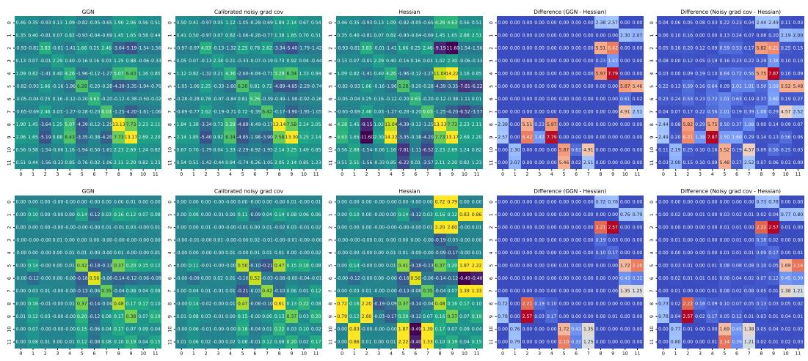

Figure 5: Illustrative example comparing CNGC and GGN with the true Hessian for a small convolutional network with 12 parameters. Top: regression, bottom: classification.  
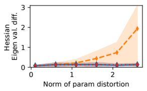

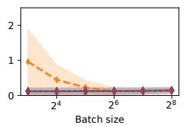

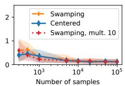  
Figure 6: Relative operator norm between the spectrum of the true Hessian and the curvature estimator with centring and swamping with noise multiplier equal to 1 and to 10. Both centring and swamping with noise, with a multiplier equal to 10, capture the eigenspectrum of the true Hessian.

## F.3 Comparison of GGN estimators

Additional comparisons of the curvature estimators for the recovery of the eigenvalue spectrum of GGN are presented in Figure 7, top row. In this section, the experimental setup was the same as in Section 4.2. The observations on the recovery of the full GGN matrix presented in the main text also hold for its eigenspectrum.

Furthermore, we compared the obtained GGN estimates with the eigenvalues of the Hessian and the full Hessian matrix (see Figure 7, bottom row). Hutchinson estimator captured the eigenvalues of the true Hessian best, while both calibrated GNB and the proposed CNGC provided good estimates for the eigenvalues and recovered the full matrix best.

## F.4 CNGC estimator as the preconditioner in optimisation

This section contains additional runs for the optimisation algorithms on classification tasks with logistic regression and MLP classifiers. The results for Muon optimiser are available only for those models, since the current PyTorch implementation supports only 2D weight matrices. All first-order methods in this experiment were run with a learning rate of 1e-4. Tuning the learning rate and its schedule for each optimiser may speed up convergence, except for gradient descent, which encounters numerical difficulties at higher learning rates. The optimiser with block-diagonal preconditioner is also trained with the learning rate equal to 1e-4 during the first epoch. However the block-diagonal preconditioner enables the estimation of the optimal learning rate at each step based on the estimated GGN matrix. Thus, the learning rate was automatically adjusted for later steps. Overall, this evaluation confirms that the proposed estimator is efficient as the preconditioner for both the diagonal and the block-wise versions of the algorithms.

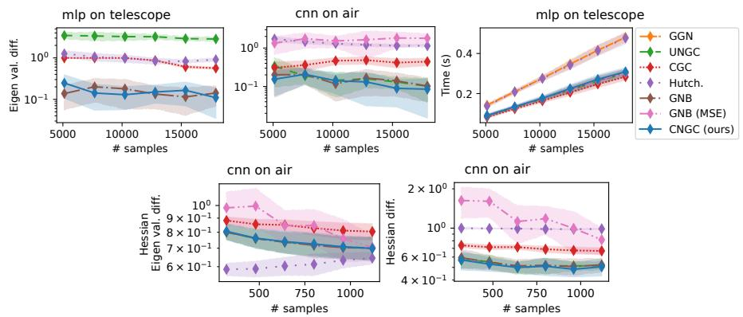  
Figure 7: Top: Comparison of GGN estimators with an MLP for a classification task (left) and a CNN for a regression task (middle) by the relative operator norm of the difference of the eigenvalue spectrum of the full GGN matrix and its estimates. The wall-clock time for the calculations of GGN estimates for the MLP model (right). Bottom: Comparison of GGN estimators with the true Hessian for a CNN on a regression task. The relative operator norm of the difference between (positive) Hessian eigenvalues and the eigenvalues of the estimates (left), the relative operator norm of the difference between full matrices of the estimates and the Hessian (right).

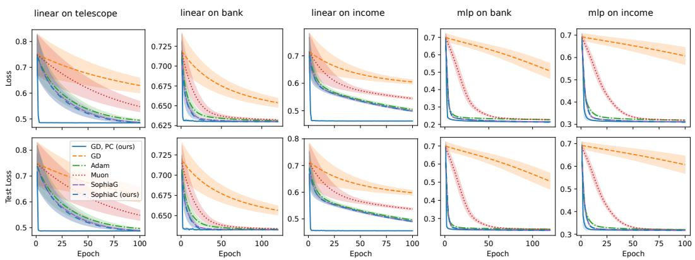  
Figure 8: The effect of calibrated noisy gradient covariance as a preconditioner for logistic regression and MLPs on classification tasks for telescope, bank marketing, and adult income datasets.

## F.5 Ablation with exact GGN blocks

To assess how curvature-estimation accuracy affects downstream optimisation, we compare our CNGC-based blockwise GD, PC method with an idealised oracle variant. The oracle replaces the estimated curvature blocks with exact GGN blocks computed from the full Jacobian, keeping the block structure and remaining optimisation procedure unchanged. The experimental setup is identical to Figure 3. This ablation isolates the effect of curvature estimation from the other components of the optimiser. Table 3 reports the best test loss achieved, and Table 4 reports the number of epochs required to reach within 10% of the best test loss. All results are averaged over 10 random seeds and reported with one standard deviation.

The two variants achieve broadly comparable best test losses, consistent with the similar optimisation trajectories observed in most settings. On CNN–Occupancy, both require an average of 1.10 epochs to reach the threshold. Exact curvature can nevertheless improve convergence, particularly on CNN–Air, where the oracle requires 3.70 epochs compared with 11.00 for CNGC. These results indicate that CNGC retains much of the curvature information useful for this optimisation procedure, although estimation error can affect convergence speed. CNGC obtains this information from aggregate clean and noisy batch gradients without explicitly constructing the Jacobian; the curvature-estimation runtime experiments demonstrate the computational advantage of this approach (see Figures 2, 7).

Table 3: Best test loss achieved using CNGC and exact GGN blocks. The results are mean ± one standard deviation over 10 random seeds.
<table><tr><td></td><td>MLP</td><td>CNN</td><td>CNN</td><td>Transformer</td><td>Transformer</td></tr><tr><td>Optimiser</td><td> $\scriptstyle \mathrm { T e l e s c o p e }$ </td><td> $_ { \mathrm { O c c u p a n c y } }$ </td><td>Air</td><td> $\mathrm { O c c u p a n c y }$ </td><td>Air</td></tr><tr><td>GD, PC (ours)</td><td> $\overline { { 0 . 3 0 0 5 \pm 0 . 0 0 3 2 } }$ </td><td> $\overline { { 0 . 1 0 8 0 \pm 0 . 0 0 6 5 } }$ </td><td> $\overline { { 0 . 4 0 5 3 \pm 0 . 0 2 0 0 } }$ </td><td> $\overline { { 0 . 1 1 3 6 \pm 0 . 0 5 7 3 } }$ </td><td> $0 . 1 4 5 6 \pm 0 . 0 0 9 6$ </td></tr><tr><td>Exact GGN blocks (oracle)</td><td> $0 . 2 9 8 1 \pm 0 . 0 0 4 0$ </td><td> $0 . 1 0 8 2 \pm 0 . 0 1 3 0$ </td><td> $0 . 3 8 8 7 \pm 0 . 0 2 1 4$ </td><td> $0 . 0 9 1 8 \pm 0 . 0 0 5 8$ </td><td> $0 . 1 3 8 4 \pm 0 . 0 1 1 8$ </td></tr></table>

Table 4: Number of training epochs required to reach within 10% of the best test loss for each optimiser and model–dataset combination. † marks an entry for which the threshold was not reached within the training budget for some of the seeds. The results are mean ± one standard deviation over 10 random seeds.
<table><tr><td>Optimiser</td><td>MLP  $\scriptstyle \mathrm { T e l e s c o p e }$ </td><td>CNN  $\mathrm { O c c u p a n c y }$ </td><td>CNN Air</td><td> $\mathrm { O c c u p a n c y }$ </td><td>Transformer Transformer Air</td></tr><tr><td>GD, PC (ours)</td><td> $\overline { { 4 . 5 0 \pm 0 . 5 0 } }$ </td><td> $1 . 1 0 \pm 0 . 3 0$ </td><td> $\overline { { 1 1 . 0 0 \pm 3 . 8 2 } }$ </td><td> $\overline { { 3 . 7 0 \pm 5 . 4 6 ^ { \dagger } } }$ </td><td> $\overline { { 7 . 5 0 \pm 2 . 2 9 } }$ </td></tr><tr><td>Exact GGN blocks (oracle)</td><td> $3 . 4 0 \pm 0 . 8 0$ </td><td> $1 . 1 0 \pm 0 . 3 0$ </td><td> $3 . 7 0 \pm 1 . 1 0$ </td><td> $2 . 4 0 \pm 1 . 6 2$ </td><td> $7 . 2 0 \pm 3 . 1 6$ </td></tr></table>

## F.6 CNGC estimator for an early stopping criterion

Here, we demonstrate a single run of the early stopping criterion discussed in the main text. The gradient covariance calculated from the clean gradients may result in premature stopping of the method, as shown in Figure 9.

To extend this illustrative run, we compare CNGC-based stopping, the blockwise GradStop baseline, and standard validation-loss stopping across the five model–dataset settings used in the optimisation experiments. Validation stopping uses a 90/10 training–validation split, while both gradient-based criteria use the full training set. All three methods stop after three consecutive increases in their respective criterion (patience 3). The CNGC criterion reuses the GGN blocks accumulated during optimisation, requiring no additional curvature estimation. Table 5 summarises the results. CNGC achieves lower mean test loss than GradStop on four of the five tasks and is broadly competitive with validation-based stopping without requiring a validation split. These results illustrate a further application of the recovered curvature beyond preconditioning.

Table 5: Test loss obtained with each early-stopping criterion using patience 3. The results are mean ± one standard deviation over 10 random seeds.
<table><tr><td></td><td>MLP Telescope</td><td>CNN</td><td>CNN Air</td><td>Transformer</td><td>Transformer</td></tr><tr><td>Stopping criterion CNGC (ours)</td><td> $\overline { { 0 . 3 0 7 5 \pm 0 . 0 0 3 4 } }$ </td><td>Occupancy  $\overline { { 0 . 1 2 7 9 \pm 0 . 0 1 2 7 } }$ </td><td> $\overline { { 0 . 4 6 4 7 \pm 0 . 0 2 3 4 } }$ </td><td>Occupancy  $\overline { { 0 . 1 2 2 3 \pm 0 . 0 5 8 0 } }$ </td><td>Air  $\overline { { 0 . 1 8 4 3 \pm 0 . 0 2 7 1 } }$ </td></tr><tr><td>GradStop</td><td> $0 . 3 0 5 6 \pm 0 . 0 0 3 9$ </td><td> $0 . 1 3 5 0 \pm 0 . 0 1 9 6$ </td><td> $0 . 4 7 9 9 \pm 0 . 0 4 1 9$ </td><td> $0 . 1 2 2 7 \pm 0 . 0 6 1 0$ </td><td> $0 . 2 4 1 1 \pm 0 . 1 2 4 6$ </td></tr><tr><td>Validation loss</td><td> $0 . 3 0 6 1 \pm 0 . 0 0 3 9$ </td><td> $0 . 1 2 7 3 \pm 0 . 0 1 9 7$ </td><td> $0 . 5 2 2 3 \pm 0 . 2 0 1 9$ </td><td> $0 . 1 0 7 8 \pm 0 . 0 1 3 7$ </td><td> $0 . 1 6 4 6 \pm 0 . 0 0 9 6$ </td></tr></table>

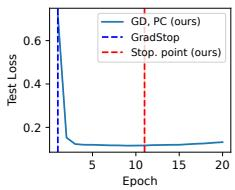  
Figure 9: The calculated stopping points on the occupancy detection dataset with GradStop and the proposed criterion with CNGC.

## NeurIPS Paper Checklist

## 1. Claims

Question: Do the main claims made in the abstract and introduction accurately reflect the paper’s contributions and scope?

Answer: [Yes]

Justification: The main claims in the abstract and introduction accurately reflect the paper’s scope and contributions. In particular, they match the central claim that variance-calibrated target perturbations recover the GGN from aggregate mini-batch gradients.

Guidelines:

• The answer [N/A] means that the abstract and introduction do not include the claims made in the paper.

• The abstract and/or introduction should clearly state the claims made, including the contributions made in the paper and important assumptions and limitations. A [No] or [N/A] answer to this question will not be perceived well by the reviewers.

• The claims made should match theoretical and experimental results, and reflect how much the results can be expected to generalize to other settings.

• It is fine to include aspirational goals as motivation as long as it is clear that these goals are not attained by the paper.

## 2. Limitations

Question: Does the paper discuss the limitations of the work performed by the authors?

Answer: [Yes]

Justification: The paper includes a limitations section, which notes that the method recovers the Generalised Gauss–Newton matrix rather than the full Hessian, except in special cases (e.g., GLMs or blockwise ReLU settings). It may incur additional cost due to the extra backward pass required by the centred estimator. It also assumes access to per-example outputs and targets within each minibatch, and in practice often relies on diagonal or block-diagonal approximations to make matrix storage and inversion tractable.

Guidelines:

• The answer [N/A] means that the paper has no limitation while the answer [No] means that the paper has limitations, but those are not discussed in the paper.

• The authors are encouraged to create a separate “Limitations” section in their paper.

• The paper should point out any strong assumptions and how robust the results are to violations of these assumptions (e.g., independence assumptions, noiseless settings, model well-specification, asymptotic approximations only holding locally). The authors should reflect on how these assumptions might be violated in practice and what the implications would be.

• The authors should reflect on the scope of the claims made, e.g., if the approach was only tested on a few datasets or with a few runs. In general, empirical results often depend on implicit assumptions, which should be articulated.

• The authors should reflect on the factors that influence the performance of the approach. For example, a facial recognition algorithm may perform poorly when image resolution is low or images are taken in low lighting. Or a speech-to-text system might not be used reliably to provide closed captions for online lectures because it fails to handle technical jargon.

• The authors should discuss the computational efficiency of the proposed algorithms and how they scale with dataset size.

• If applicable, the authors should discuss possible limitations of their approach to address problems of privacy and fairness.

• While the authors might fear that complete honesty about limitations might be used by reviewers as grounds for rejection, a worse outcome might be that reviewers discover limitations that aren’t acknowledged in the paper. The authors should use their best judgment and recognize that individual actions in favor of transparency play an important role in developing norms that preserve the integrity of the community. Reviewers will be specifically instructed to not penalize honesty concerning limitations.

## 3. Theory assumptions and proofs

Question: For each theoretical result, does the paper provide the full set of assumptions and a complete (and correct) proof?

Answer: [Yes]

Justification: The paper states the general assumptions in the Definitions section, and any additional assumptions specific to a given result are stated immediately before that theorem or proposition. Complete proofs for all theoretical results are provided in the appendix.

Guidelines:

• The answer [N/A] means that the paper does not include theoretical results.

• All the theorems, formulas, and proofs in the paper should be numbered and crossreferenced.

• All assumptions should be clearly stated or referenced in the statement of any theorems.

• The proofs can either appear in the main paper or the supplemental material, but if they appear in the supplemental material, the authors are encouraged to provide a short proof sketch to provide intuition.

• Inversely, any informal proof provided in the core of the paper should be complemented by formal proofs provided in appendix or supplemental material.

• Theorems and Lemmas that the proof relies upon should be properly referenced.

## 4. Experimental result reproducibility

Question: Does the paper fully disclose all the information needed to reproduce the main experimental results of the paper to the extent that it affects the main claims and/or conclusions of the paper (regardless of whether the code and data are provided or not)?

Answer: [Yes]

Justification: The paper relies on publicly available datasets for the evaluations easily accessible through UCI repository or OpenML. The experimental artifacts (code, python environment, random seeds, SLURM-scripts, etc.) are provided in a GitHub repository accompanying the paper with the exact commands in README.md file. The main details needed for interpreting the results of are additionally provided in the supplementary material.

Guidelines:

• The answer [N/A] means that the paper does not include experiments.

• If the paper includes experiments, a [No] answer to this question will not be perceived well by the reviewers: Making the paper reproducible is important, regardless of whether the code and data are provided or not.

• If the contribution is a dataset and/or model, the authors should describe the steps taken to make their results reproducible or verifiable.

• Depending on the contribution, reproducibility can be accomplished in various ways. For example, if the contribution is a novel architecture, describing the architecture fully might suffice, or if the contribution is a specific model and empirical evaluation, it may be necessary to either make it possible for others to replicate the model with the same dataset, or provide access to the model. In general. releasing code and data is often one good way to accomplish this, but reproducibility can also be provided via detailed instructions for how to replicate the results, access to a hosted model (e.g., in the case of a large language model), releasing of a model checkpoint, or other means that are appropriate to the research performed.

• While NeurIPS does not require releasing code, the conference does require all submissions to provide some reasonable avenue for reproducibility, which may depend on the nature of the contribution. For example

(a) If the contribution is primarily a new algorithm, the paper should make it clear how to reproduce that algorithm.

(b) If the contribution is primarily a new model architecture, the paper should describe the architecture clearly and fully.

(c) If the contribution is a new model (e.g., a large language model), then there should either be a way to access this model for reproducing the results or a way to reproduce the model (e.g., with an open-source dataset or instructions for how to construct the dataset).

(d) We recognize that reproducibility may be tricky in some cases, in which case authors are welcome to describe the particular way they provide for reproducibility. In the case of closed-source models, it may be that access to the model is limited in some way (e.g., to registered users), but it should be possible for other researchers to have some path to reproducing or verifying the results.

## 5. Open access to data and code

Question: Does the paper provide open access to the data and code, with sufficient instructions to faithfully reproduce the main experimental results, as described in supplemental material?

## Answer: [Yes]

Justification: The paper relies on publicly available datasets for the evaluations easily accessible through UCI repository or OpenML. The experimental artifacts (code, python environment, random seeds, SLURM-scripts, etc.) are provided in the GitHub repository https://github.com/edahelsinki/cngc.

Guidelines:

• The answer [N/A] means that paper does not include experiments requiring code.

• Please see the NeurIPS code and data submission guidelines (https://neurips.cc/ public/guides/CodeSubmissionPolicy) for more details.

• While we encourage the release of code and data, we understand that this might not be possible, so [No] is an acceptable answer. Papers cannot be rejected simply for not including code, unless this is central to the contribution (e.g., for a new open-source benchmark).

• The instructions should contain the exact command and environment needed to run to reproduce the results. See the NeurIPS code and data submission guidelines (https: //neurips.cc/public/guides/CodeSubmissionPolicy) for more details.

• The authors should provide instructions on data access and preparation, including how to access the raw data, preprocessed data, intermediate data, and generated data, etc.

• The authors should provide scripts to reproduce all experimental results for the new proposed method and baselines. If only a subset of experiments are reproducible, they should state which ones are omitted from the script and why.

• At submission time, to preserve anonymity, the authors should release anonymized versions (if applicable).

• Providing as much information as possible in supplemental material (appended to the paper) is recommended, but including URLs to data and code is permitted.

## 6. Experimental setting/details

Question: Does the paper specify all the training and test details (e.g., data splits, hyperparameters, how they were chosen, type of optimizer) necessary to understand the results?

Answer: [Yes]

Justification: The supplementary material covers the main experimental details required to understand the results. The full set of details is available via the code provided in the GitHub repository https://github.com/edahelsinki/cngc.

Guidelines:

• The answer [N/A] means that the paper does not include experiments.

• The experimental setting should be presented in the core of the paper to a level of detail that is necessary to appreciate the results and make sense of them.

• The full details can be provided either with the code, in appendix, or as supplemental material.

## 7. Experiment statistical significance

Question: Does the paper report error bars suitably and correctly defined or other appropriate information about the statistical significance of the experiments?

Answer: [Yes]

Justification: All results are reported as the mean with 1-sigma bars over 10 repetitions by varying the random seed.

Guidelines:

• The answer [N/A] means that the paper does not include experiments.

• The authors should answer [Yes] if the results are accompanied by error bars, confidence intervals, or statistical significance tests, at least for the experiments that support the main claims of the paper.

• The factors of variability that the error bars are capturing should be clearly stated (for example, train/test split, initialization, random drawing of some parameter, or overall run with given experimental conditions).

• The method for calculating the error bars should be explained (closed form formula, call to a library function, bootstrap, etc.)

• The assumptions made should be given (e.g., Normally distributed errors).

• It should be clear whether the error bar is the standard deviation or the standard error of the mean.

• It is OK to report 1-sigma error bars, but one should state it. The authors should preferably report a 2-sigma error bar than state that they have a 96% CI, if the hypothesis of Normality of errors is not verified.

• For asymmetric distributions, the authors should be careful not to show in tables or figures symmetric error bars that would yield results that are out of range (e.g., negative error rates).

• If error bars are reported in tables or plots, the authors should explain in the text how they were calculated and reference the corresponding figures or tables in the text.

## 8. Experiments compute resources

Question: For each experiment, does the paper provide sufficient information on the computer resources (type of compute workers, memory, time of execution) needed to reproduce the experiments?

Answer: [Yes]

Justification: The GitHub repository https://github.com/edahelsinki/cngc contains a folder with the templates of SLURM scripts used to start the jobs for each experiment. The scripts specify the type of computational resources, memory limits, and execution time limits. All jobs can be run on CPU or GPU and were performed on the internal SLURM-based cluster. The full research project used more computational resources than the experiments reported in the paper (due to preliminary investigation and testing of the hypotheses).

## Guidelines:

• The answer [N/A] means that the paper does not include experiments.

• The paper should indicate the type of compute workers CPU or GPU, internal cluster, or cloud provider, including relevant memory and storage.

• The paper should provide the amount of compute required for each of the individual experimental runs as well as estimate the total compute.

• The paper should disclose whether the full research project required more compute than the experiments reported in the paper (e.g., preliminary or failed experiments that didn’t make it into the paper).

## 9. Code of ethics

Question: Does the research conducted in the paper conform, in every respect, with the NeurIPS Code of Ethics https://neurips.cc/public/EthicsGuidelines?

Answer: [Yes]

Justification: Our research is in full compliance with NeurIPS Code of Ethics. The paper presents theoretical computer science research on publicly available datasets. The paper does not involve research with human subjects.

Guidelines:

• The answer [N/A] means that the authors have not reviewed the NeurIPS Code of Ethics.

• If the authors answer [No], they should explain the special circumstances that require a deviation from the Code of Ethics.

• The authors should make sure to preserve anonymity (e.g., if there is a special consideration due to laws or regulations in their jurisdiction).

## 10. Broader impacts

Question: Does the paper discuss both potential positive societal impacts and negative societal impacts of the work performed?

Answer: [Yes]

Justification: The paper is foundational research and is not tied to any specific applications. In practice, the results can be used, e.g., to build a more efficient optimiser for deep learning applications.

Guidelines:

• The answer [N/A] means that there is no societal impact of the work performed.

• If the authors answer [N/A] or [No], they should explain why their work has no societal impact or why the paper does not address societal impact.

• Examples of negative societal impacts include potential malicious or unintended uses (e.g., disinformation, generating fake profiles, surveillance), fairness considerations (e.g., deployment of technologies that could make decisions that unfairly impact specific groups), privacy considerations, and security considerations.

• The conference expects that many papers will be foundational research and not tied to particular applications, let alone deployments. However, if there is a direct path to any negative applications, the authors should point it out. For example, it is legitimate to point out that an improvement in the quality of generative models could be used to generate Deepfakes for disinformation. On the other hand, it is not needed to point out that a generic algorithm for optimizing neural networks could enable people to train models that generate Deepfakes faster.

• The authors should consider possible harms that could arise when the technology is being used as intended and functioning correctly, harms that could arise when the technology is being used as intended but gives incorrect results, and harms following from (intentional or unintentional) misuse of the technology.

• If there are negative societal impacts, the authors could also discuss possible mitigation strategies (e.g., gated release of models, providing defenses in addition to attacks, mechanisms for monitoring misuse, mechanisms to monitor how a system learns from feedback over time, improving the efficiency and accessibility of ML).

## 11. Safeguards

Question: Does the paper describe safeguards that have been put in place for responsible release of data or models that have a high risk for misuse (e.g., pre-trained language models, image generators, or scraped datasets)?

Answer: [N/A]

Justification: The paper poses no such risks, the datasets used in the evaluations are publicly available, the paper does not develop or train generative models.

Guidelines:

• The answer [N/A] means that the paper poses no such risks.

• Released models that have a high risk for misuse or dual-use should be released with necessary safeguards to allow for controlled use of the model, for example by requiring that users adhere to usage guidelines or restrictions to access the model or implementing safety filters.

• Datasets that have been scraped from the Internet could pose safety risks. The authors should describe how they avoided releasing unsafe images.

• We recognize that providing effective safeguards is challenging, and many papers do not require this, but we encourage authors to take this into account and make a best faith effort.

## 12. Licenses for existing assets

Question: Are the creators or original owners of assets (e.g., code, data, models), used in the paper, properly credited and are the license and terms of use explicitly mentioned and properly respected?

Answer: [Yes]

Justification: Our research code and experiments are build with open-source software and active publicly available datasets (accessed through UCI repository or OpenML repository). The original sources of the datasets are cited in the supplementary material.

Guidelines:

• The answer [N/A] means that the paper does not use existing assets.

• The authors should cite the original paper that produced the code package or dataset.

• The authors should state which version of the asset is used and, if possible, include a URL.

• The name of the license (e.g., CC-BY 4.0) should be included for each asset.

• For scraped data from a particular source (e.g., website), the copyright and terms of service of that source should be provided.

• If assets are released, the license, copyright information, and terms of use in the package should be provided. For popular datasets, paperswithcode.com/datasets has curated licenses for some datasets. Their licensing guide can help determine the license of a dataset.

• For existing datasets that are re-packaged, both the original license and the license of the derived asset (if it has changed) should be provided.

• If this information is not available online, the authors are encouraged to reach out to the asset’s creators.

## 13. New assets

Question: Are new assets introduced in the paper well documented and is the documentation provided alongside the assets?

Answer: [Yes]

Justification: the source code and the additional details are provided in the GitHub repository https://github.com/edahelsinki/cngc.

Guidelines:

• The answer [N/A] means that the paper does not release new assets.

• Researchers should communicate the details of the dataset/code/model as part of their submissions via structured templates. This includes details about training, license, limitations, etc.

• The paper should discuss whether and how consent was obtained from people whose asset is used.

• At submission time, remember to anonymize your assets (if applicable). You can either create an anonymized URL or include an anonymized zip file.

## 14. Crowdsourcing and research with human subjects

Question: For crowdsourcing experiments and research with human subjects, does the paper include the full text of instructions given to participants and screenshots, if applicable, as well as details about compensation (if any)?

## Answer: [N/A]

Justification: The paper does not contain research results with human subjects.

Guidelines:

• The answer [N/A] means that the paper does not involve crowdsourcing nor research with human subjects.

• Including this information in the supplemental material is fine, but if the main contribution of the paper involves human subjects, then as much detail as possible should be included in the main paper.

• According to the NeurIPS Code of Ethics, workers involved in data collection, curation, or other labor should be paid at least the minimum wage in the country of the data collector.

## 15. Institutional review board (IRB) approvals or equivalent for research with human subjects

Question: Does the paper describe potential risks incurred by study participants, whether such risks were disclosed to the subjects, and whether Institutional Review Board (IRB) approvals (or an equivalent approval/review based on the requirements of your country or institution) were obtained?

Answer: [N/A]

Justification: The paper does not contain research results with human subjects.

Guidelines:

• The answer [N/A] means that the paper does not involve crowdsourcing nor research with human subjects.

• Depending on the country in which research is conducted, IRB approval (or equivalent) may be required for any human subjects research. If you obtained IRB approval, you should clearly state this in the paper.

• We recognize that the procedures for this may vary significantly between institutions and locations, and we expect authors to adhere to the NeurIPS Code of Ethics and the guidelines for their institution.

• For initial submissions, do not include any information that would break anonymity (if applicable), such as the institution conducting the review.

## 16. Declaration of LLM usage

Question: Does the paper describe the usage of LLMs if it is an important, original, or non-standard component of the core methods in this research? Note that if the LLM is used only for writing, editing, or formatting purposes and does not impact the core methodology, scientific rigor, or originality of the research, declaration is not required.

Answer: [Yes]

Justification: We have used LLMs to rapidly produce initial verification of our ideas, in addition to aid in writing, editing, and formatting. The final text, derivations, and experiments, however, are by us.

## Guidelines:

• The answer [N/A] means that the core method development in this research does not involve LLMs as any important, original, or non-standard components.

• Please refer to our LLM policy in the NeurIPS handbook for what should or should not be described.