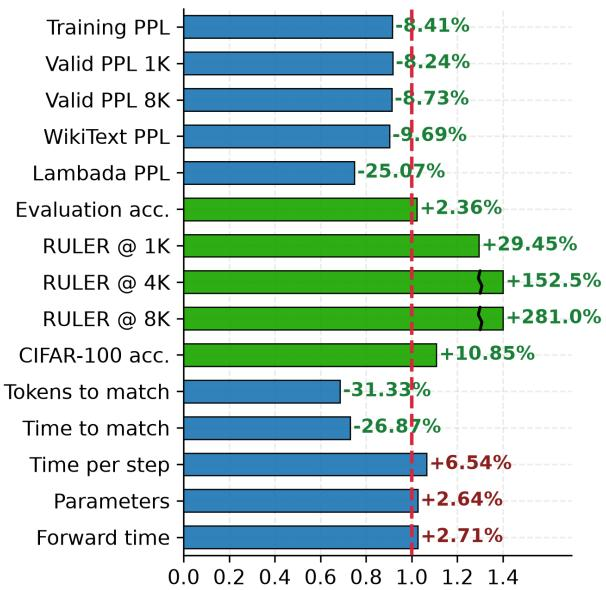
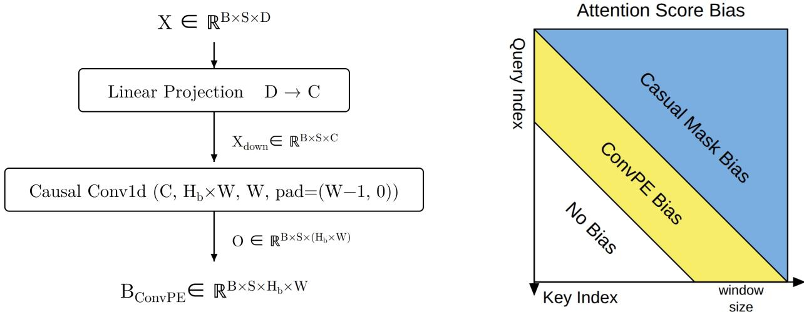
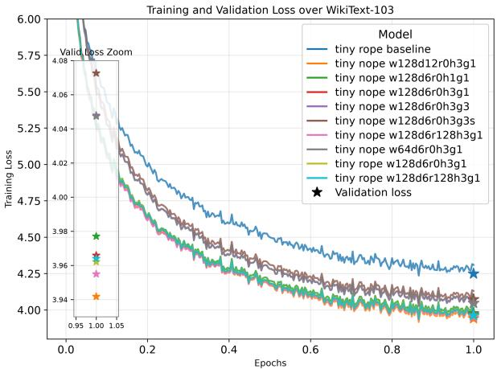
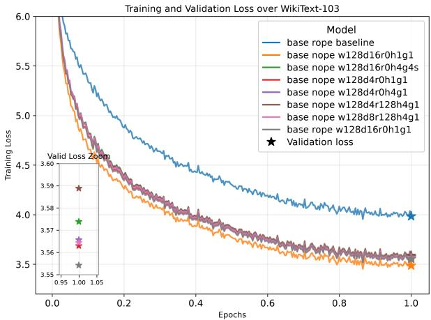
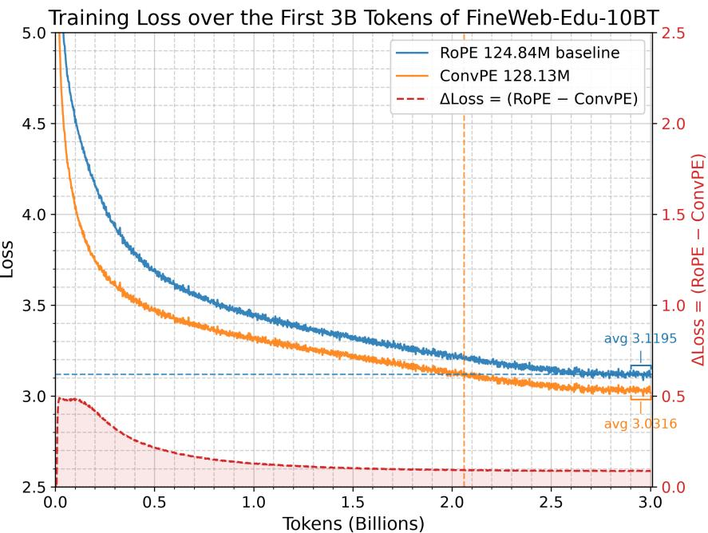
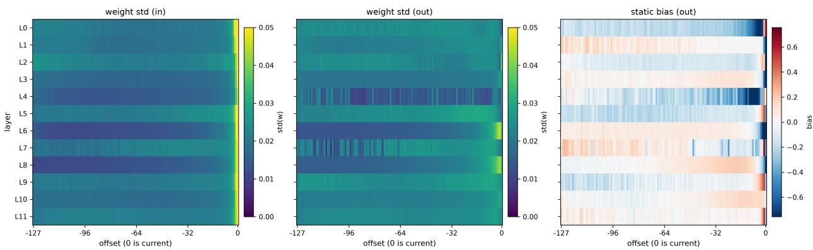

# ConvPE: Convolutional Position Embedding Improves Transformers

Zehao Wang Nanjing University wzhagi@163.com

## ABSTRACT

ConvPE (Convolutional Position Embedding) improves both the performance and efficiency of Transformer models in language modeling, long-context extension, and vision. It injects a windowed, content-dependent bias into attention scores through a lightweight causal convolution over a lowdimensional projection of the hidden states. As a lightweight plug-in, ConvPE is compatible with RoPE, attention masks, and KV concatenation. It also supports high-dimensional position embeddings via high-dimensional convolutions. In a reproduction, ConvPE outperforms five 1D baselines and eight 2D baselines. The code is publicly available at https://github.com/wzhagi/convpe.

Keywords Position Embedding · Language Models · Transformers · Attention · Vision Transformers

## 1 Introduction

Transformers1 are insensitive to input order, whereas word order is crucial for language understanding and the spatial layout of image patches matters for vision. Explicit or implicit position embeddings are therefore needed to inject order information into the model 2,3,4. How this information is injected affects accuracy as the context length grows.

Position information is currently injected at one of three points. First, absolute position embeddings, whether fixed or learnable, add a position vector to token representations1,2,3. Second, rotary position embedding (RoPE)4 rotates queries and keys so that attention scores depend on relative distance; RoPE has been widely adopted in modern large language models. Extending these methods to longer contexts requires interpolation or frequency rescaling5. Third, attention-score-bias methods add a term directly to the score matrix: ALiBi 6 uses a fixed linear decay but performs worse on downstream tasks as the context length increases 7. CABLE8 learns to modulate a fixed distance-penalty skeleton. The Composite method9 adds convolution-based relative-position terms similar to ours but performs worse. DAPE10 convolves the full score map, which is effective but incurs high computational overhead.

ConvPE follows this score-bias route and generates the bias locally. It applies a causal convolution to the hidden state projections and adds the resulting windowed bias directly to the attention scores. Beyond the window the bias is exactly zero, following NoPE methods 7, so distant keys are not penalized by construction. As a lightweight plug-in, ConvPE is compatible with RoPE, attention masks, and KV concatenation. It also supports high-dimensional position embedding through high-dimensional convolutions.

  
Figure 1: ConvPE relative to the RoPE baseline (dashed line at 1.0). Blue bars are lower-is-better metrics; green bars are higher-is-better metrics.

We evaluate ConvPE on language-model pretraining, downstream evaluation, long-context extension, and image classification. Figure 1 summarizes the relative changes with respect to the RoPE baseline. Compared with RoPE,

ConvPE achieves lower training and validation perplexity and higher benchmark accuracy, with minimal additional parameters and computational overhead. It reaches the baseline’s final loss using fewer training tokens and less wall-clock time. After context-extension training to 8K tokens, the gap widens. As a plug-in, it also improves pretrained RoPE models during context-extension training. This demonstrates the potential of ConvPE for long-context language modeling. In vision, ConvPE2D improves CIFAR-100 accuracy over eight baselines.

## The main contributions of this paper are as follows:

• We propose ConvPE, a convolutional attention-score-bias position embedding that combines strong performance with broad compatibility.

• We study the influence of ConvPE hyperparameters and architecture choices, identifying a simple default configuration with a favorable performance-efficiency balance.

• We demonstrate that ConvPE improves training efficiency, token efficiency, and long-context extrapolation in language models.

• We verify the effectiveness of ConvPE2D in vision transformers on CIFAR-10 and CIFAR-100.

• We develop high-performance TileLang11 kernels for ConvPE.

## 2 Background

## 2.1 Attention and Score Biases

Given the input query $Q \in \mathbb { R } ^ { S _ { q } \times D _ { k } }$ , key $K \in \mathbb { R } ^ { S _ { k v } \times D _ { k } }$ , and value $V \in \mathbb { R } ^ { S _ { k v } \times D _ { \tau } }$ , the computation of scaled dot-product attention $\mathbf { i } _ { O } \mathbf { \bar { \Psi } } \in \mathbb { R } ^ { S _ { q } \times D _ { v } } \ \mathbf { i }$ s

$$
O = \mathrm { A t t e n t i o n } ( Q , K , V ) = \mathrm { s o f t m a x } \left( { \frac { Q K ^ { \top } } { \sqrt { D _ { k } } } } + { \bf B } + { \bf M } \right) V ,\tag{1}
$$

where $S _ { q }$ is the query sequence length, $S _ { k v }$ is the key/value sequence length, $\mathbf { B } \in \mathbb { R } ^ { S _ { q } \times S _ { k v } }$ is an additive attention-score bias, and $\mathbf { M } \in \mathbb { R } ^ { S _ { q } \times S _ { k \tau } }$ is a mask. A causal model sets $M _ { i j } = - \infty$ for $j > i ,$ , so that a query at position s can attend only to keys at positions $t \leq s$ . With batch size and multi-head settings, $Q , K , V , O$ and the two bias terms carry additional batch and head dimensions; we omit them when they are unambiguous.

## 2.2 Position Embeddings

Existing position embedding schemes can be roughly divided into five categories:

1. Absolute Position Embedding1: adds a fixed positional vector, usually sine waves, to the input. Its performance is usually limited.

2. Learnable Positional Bias 2,3: adds a learnable positional vector to the input sequence. It is typically used when the maximum length is fixed, such as in fixed-resolution images or text truncated to a fixed length.

3. Rotary Position Embedding4: encodes position as a rotation matrix and applies it to queries and keys, so that attention scores depend on relative positions. RoPE has been widely adopted in modern large language models, and it enables long-context extension through frequency scaling, such as YaRN5.

4. Attention Score Bias: adds a positional bias B to attention scores12,6,9. RoPE can be viewed as a rotation-based equivalent, as it also makes attention scores depend on relative positions.

5. No Position Embedding $( \mathbf { N o P E } ) ^ { 7 }$ : adds no explicit position embeddings; instead, it relies on the model structure and causal attention masks to learn positional information implicitly. For example, Kimi K3 applies NoPE to its global-attention layers13.

## 3 Method

## 3.1 Windowed Convolutional Score Bias

Given token representations $X \in \mathbb { R } ^ { N \times S \times D }$ , ConvPE first projects them to a small channel dimension,

$$
X _ { \mathrm { d o w n } } = X W _ { p } , \qquad W _ { p } \in \mathbb { R } ^ { D \times C } ,\tag{2}
$$

and then applies a causal convolution with window W,

$$
O _ { \mathrm { C o n v } } = \mathrm { C a u s a l C o n v 1 d } \left( X _ { \mathrm { d o w n } } ; W , C \to H _ { b } W \right) ,\tag{3}
$$

where $O _ { \mathrm { C o n v } } \in \mathbb { R } ^ { N \times S \times H _ { b } W }$ and the convolution is left-padded by $W - 1$ positions. The output is reshaped into the score bias $\mathbf { \sigma } _ { \mathbf { B } _ { \mathrm { C o n v P E } } } ^ { \mathbf { B } } \in \mathbb { R } ^ { N \times S \times H _ { b } \times W }$ . For a query at position s and a key at position $t \leq s .$ , the bias added to the attention score of head h is

$$
\mathbf { B } _ { n , h , s , t } = { \left\{ \begin{array} { l l } { \mathbf { B } _ { n , s , h { \bmod { ~ } } H _ { b } , s - t } ^ { \mathrm { C o n v P E } } , } & { 0 \leq s - t < W , } \\ { 0 , } & { { \mathrm { o t h e r w i s e } } , } \end{array} \right. }\tag{4}
$$

where N is the batch size, H is the number of attention heads, and $H _ { b }$ must divide H. In other words, head h reads its bias from bias head h mod $H _ { b } ,$ , so each bias head is shared by $H / H _ { b }$ attention heads. Each bias head therefore learns a different relative-position pattern. Future keys are removed by the causal mask, and keys older than $W$ are scored without a positional bias. Figure 2 illustrates the module and the resulting bias pattern.

  
Figure 2: Left: ConvPE algorithm. Right: attention score bias pattern.

The hyperparameters are:

• W: convolution window size.

• C: output dimension of the linear projection and input channels of the convolution.

$H _ { b } \colon$ number of score-bias heads.

The projection has $_ { D C }$ parameters and the convolution has $C H _ { b } W ^ { 2 }$ parameters. Together with the $H _ { b } W$ bias terms, a layer has $D C + C H _ { b } \dot { W } ^ { 2 } + H _ { b } W$ parameters. Each parameter is used once per token, so the multiply–accumulate count per token is the same.

## 3.2 Parameter-Efficient Variants

To reduce the convolution parameter count, we introduce three additional hyperparameters:

• Groups: number of convolution groups, which split the C input channels and the $H _ { b } W$ output channels into G groups. Each group has its own kernel, and the parameter count becomes $C H _ { b } W ^ { \bar { 2 } } / G$

• Share: whether to share one kernel across all groups. Sharing divides the convolution parameter count by another factor of G (for $G = 1$ it has no effect).

• Rank: rank R of a low-rank factorization of the convolution. A group-shared down-projection maps the $( C / G ) W$ input window to R dimensions, and a group-wise up-projection maps R back to the $H _ { b } W$ outputs. This costs $( \bar { C } / G ) W R + R H _ { b } W$ weight parameters instead of $\dot { C } \dot { H _ { b } } W ^ { 2 } / G$ , plus the same $H _ { b } W$ bias term.

The default configuration uses $G = 1$ , no sharing, and $R = 0$ (no factorization).

## 4 Experiments

## 4.1 Setup

Architecture. Unless stated otherwise, all language models have $N _ { \mathrm { l a y e r s } } = 1 2$ and use pre-RMSNorm, SwiGLU14 feed-forward layers with $8 D _ { \mathrm { m o d e l } } ^ { 2 }$ parameters, multi-query attention $( \mathrm { M O A } ) ^ { 1 5 }$ with a single key-value head $( K = V ) ^ { 1 6 }$ query L2 normalization, key RMSNorm, a learnable attention sink per head, and tied embedding-layer and outputhead weights. The tiny backbone has $D _ { \mathrm { m o d e l } } = 1 9 2 , N _ { \mathrm { h e a d s } } = 3$ , and $D _ { \mathrm { h e a d } } = 6 4$ , and the base backbone has $D _ { \mathrm { m o d e l } } = 7 6 8 , N _ { \mathrm { h e a d s } } = 1 2$ , and $D _ { \mathrm { h e a d } } = 1 2 8$ . The RoPE baseline uses a rotary dimension of 64 and base 10000. The vocabulary has 50,304 entries (the GPT-2 tokenizer3 padded to a multiple of 128).

Data. For hyperparameter search, we train on WikiText-10317 and validate on the WikiText-2 test split. For pretraining, we use the first 3B tokens of FineWeb-Edu-10BT18. Context-extension training uses another 150M tokens. We hold out a disjoint 10M-token subset for validation

Optimization. The language models are trained with the Hugging Face Trainer19. The hyperparameter search uses AdamW20 with a learning rate of $3 \times 1 0 ^ { - 4 }$ , weight decay 0.01, a cosine learning-rate schedule, batch size 4, sequence length 1024, one epoch, BF16, gradient clipping at 1.0, and seed 42. For pretraining, Muon21 optimizes the hidden 2D parameters with a learning rate of $3 \times 1 0 ^ { - 3 }$ , momentum 0.95, and weight decay 0.01, while Adam22 optimizes the remaining parameters with a learning rate of $3 \times 1 0 ^ { - 4 }$ . Both use a cosine scheduler with 500 warm-up steps. We use a batch size of 4 with 4 gradient-accumulation steps, with sequence length 1024, BF16 autocast, gradient clipping at 4.0, and seed 42. For context-extension training, we use the same settings as in pretraining except that we use 10% of the pretraining learning rates and a batch size of 1. All language-model results come from a single run; small task-level differences should be interpreted with sampling noise in mind.

## 4.2 Hyperparameter Search

We train 10 tiny and 8 base configurations and select by validation loss after one epoch. Model names record the backbone (tiny or base), the position mechanism (rope or nope), and the ConvPE fields W, C, R, H , and G as w, d, r, h, and g followed by their values, with a trailing s when the convolution kernel is shared across groups. For example, tiny rope w128d6r128h3g1s denotes a tiny backbone with RoPE, $W = 1 2 8 , C = 6 , R = \bar { 1 2 } 8 , \bar { H } _ { b } = 3 , G \stackrel { . } { = } 1$ and weight sharing. Fields equal to the default (position mechanism nope, R = 0, H = 1, G = 1, and no sharing) are omitted when this is unambiguous, e.g., base w128d16 is base nope w128d16r0h1g1.

  
Figure 3: Training curves and validation loss of Tiny models on WikiText-103.

  
Figure 4: Training curves and validation loss of Base models on WikiText-103.

First, we train tiny models around nope w128d6r0h3g1. Figure 3 shows that every ConvPE variant outperforms the RoPE baseline (3.942–4.073 vs. 4.249). Increasing the projection dimension from 6 to $1 2 \ : ( 3 . 9 6 6  3 . { \overset { \cdot } { 9 } } 4 2 )$ and the window from 64 to 128 $( 4 . 0 4 7  3 . 9 6 6 )$ give the largest gains. Grouped convolution hurts the most (4.048 for g3 and 4.073 for g3s), and a smaller window costs about as much (4.047). The rank-128 variant (3.955), RoPE integration (3.962), and the full kernel (3.966) are close, whereas $H _ { b } = 1$ is 0.011 worse in this sweep (3.977).

We then train base models around nope w128d4r0h4g1 and nope w128d16r0h1g1. Figure 4 shows that every ConvPE variant again beats the RoPE baseline (3.986). The best configuration is w128d16r0h1g1 (3.489). Because $H _ { b } = 1$ is also the cheapest bias-head setting, we adopt w128d16r0h1g1 as the default.

We also tried feeding Q (as in Composite9), KV, or X directly to the convolution; all three performed worse than first projecting X to the low-dimensional $X _ { \mathrm { d o w n } } .$

## 4.3 Pretraining

  
Figure 5: Training loss on the first 3B tokens of FineWeb-Edu-10BT for the RoPE baseline and ConvPE w128d16. The dashed curve is the loss difference (RoPE minus ConvPE).

We train the RoPE baseline and ConvPE w128d16 from scratch on the first 3B tokens of FineWeb-Edu-10BT with the recipe in Section 4.1. Figure 5 shows that ConvPE converges faster and reaches a lower final loss. Averaged over the last 0.1B tokens, the final training loss drops from 3.1195 to 3.0316 (−2.82% loss, −8.41% perplexity). ConvPE reaches the baseline’s final loss after 2.06B tokens instead of 3B (−31.33%).

To measure cost, we implement high-performance Flash MQA kernels in TileLang and benchmark the two configurations on one GPU with batch size 4 and sequence length 1024, averaged over 1,000 iterations after 1,000 warm-up iterations. ConvPE has 128.13M parameters versus 124.84M (+2.64%), and its forward pass takes 23.14 ms versus 22.53 ms (+2.71%). During training, ConvPE processes 2.60 iterations/s versus 2.77 (6.5% more time per step). The per-step overhead is larger than the forward-pass overhead, which is consistent with the ConvPE backward kernel being less optimized than its forward kernel. Combining the 31.3% token reduction with the 6.5% per-step overhead gives a net reduction of about 27% in the wall-clock time needed to match the baseline’s loss. The exact value depends on how the curves are smoothed, so we report it as approximate.

## 4.4 Attention Analysis

To understand the role of the ConvPE module, we analyze the kernel weights and the static output bias of the trained base w128d16 model. Since the average weights are close to zero, the standard deviation indicates feature selectivity: a higher standard deviation means that the kernel focuses on specific channels. Figure 6 shows three properties.

1. Near-end dominance. Near the current token, both the static bias and the input-feature selectivity reach their largest magnitudes. This indicates that the positional relationship between nearby tokens is important: ConvPE applies highly specific feature extraction and strong positional priors to the immediate local context.

  
Figure 6: ConvPE statistics of the pretrained base w128d16 model across layers. Left: standard deviation of the kernel weights in the input dimension. Middle: standard deviation in the output dimension. Right: static output bias, averaged over bias heads. The x-axis is the relative offset (−127 to 0; 0 is the current token).

2. Far-end relaxation. Toward the far end of the window, the standard deviation is lower and the static bias is close to zero for most layers. ConvPE therefore does not impose a strong static prior at this range, leaving the decision to the convolution over the dynamic input and to the query–key semantic match.

3. Self-suppression and self-enhancement. The static bias has a clear layer-wise pattern at the current position. Layer 0 shows self-enhancement with a bias of +0.5885, whereas every deeper layer except L4 (+0.0115) shows self-suppression with a negative bias. This is consistent with deeper layers shifting attention away from the current token and toward the historical context.

## 4.5 Downstream Evaluations

<table><tr><td>Dataset</td><td>Metric</td><td>RoPE</td><td>ConvPE</td><td>Random</td></tr><tr><td>WikiText-2</td><td>word PPL ↓</td><td>46.56</td><td>42.05</td><td></td></tr><tr><td> $\mathrm { L A M B A D A } ^ { 2 3 }$ </td><td> $\mathrm { P P L } \downarrow$ </td><td>118.10</td><td>88.49</td><td></td></tr><tr><td> $\mathrm { L A M B A D A }$ </td><td> $\operatorname { a c c } \uparrow$ </td><td>0.2507</td><td>0.2604</td><td></td></tr><tr><td> $_ \mathrm { H e l l a S w a g } ^ { 2 4 }$ </td><td>acc</td><td>0.2894</td><td>0.2949</td><td>0.25</td></tr><tr><td> $_ \mathrm { H e l l a S w a g }$ </td><td>acc-norm</td><td>0.3148</td><td>0.3272</td><td>0.25</td></tr><tr><td> $\mathrm { X S t o r y C l o z e } ^ { 2 5 }$ </td><td>acc</td><td>0.5460</td><td>0.5526</td><td>0.5</td></tr><tr><td> $\mathrm { P I O A } ^ { 2 6 }$ </td><td>acc</td><td>0.6251</td><td>0.6338</td><td>0.5</td></tr><tr><td> $\mathrm { P I Q A }$ </td><td>acc-norm</td><td>0.6208</td><td>0.6235</td><td>0.5</td></tr><tr><td> $\mathbf { A R C - E a s y } ^ { 2 7 }$ </td><td>acc</td><td>0.5114</td><td>0.5421</td><td>0.25</td></tr><tr><td> $\mathbf { A R C - E a s y }$ </td><td>acc-norm</td><td>0.4487</td><td>0.4701</td><td>0.25</td></tr><tr><td> $\mathrm { W i n o G r a n d e } ^ { 2 8 }$ </td><td>acc</td><td>0.5091</td><td>0.5193</td><td>0.5</td></tr><tr><td> $\mathrm { B o o l Q } ^ { 2 9 }$ </td><td>acc</td><td>0.5676</td><td>0.5893</td><td>0.5</td></tr><tr><td> $\mathrm { T r u t h f u l Q A } { \cdot } \mathbf { M } \mathbf { C } 1 ^ { 3 0 }$ </td><td>acc</td><td>0.2399</td><td>0.2375</td><td>0.25</td></tr><tr><td> $\mathrm { A v e r a g e } ^ { \dagger }$ </td><td>acc</td><td>0.4372</td><td>0.4475</td><td>一</td></tr></table>

Table 1: Zero-shot evaluation of the pretrained models on nine language tasks, using lm-evaluation-harness 31. Lower PPL and higher accuracy are better; the Random column gives the chance level where one exists. †Mean of one accuracy per task (acc-norm for HellaSwag, PIQA, and ARC-Easy, and acc otherwise), excluding the two perplexities.

This section evaluates the pretrained ConvPE and RoPE models on downstream benchmarks without any fine-tuning. Table 1 shows that ConvPE improves every accuracy metric except TruthfulQA-MC1. The mean of the eight accuracy metrics rises from 43.72% to 44.75%, a 2.35% relative improvement. TruthfulQA-MC1 is the exception: both models fall below the 25% random-choice baseline (23.99% and 23.75%), so this task does not separate them. Overall, the zero-shot results support ConvPE as a stronger position embedding than RoPE for the evaluated language tasks.

<table><tr><td>Context</td><td>RoPE</td><td>ConvPE</td><td>RoPE-8K</td><td>YaRN</td><td>ConvPE-8K</td><td>YaRN-ConvPE</td></tr><tr><td>1K</td><td>22.5272</td><td>20.672 (-8.2%)</td><td>一</td><td>一</td><td>一</td><td>一</td></tr><tr><td>2K</td><td>23.4439</td><td>20.1441 (-14.1%)</td><td></td><td></td><td>1</td><td></td></tr><tr><td>4K</td><td>67.8413</td><td>20.6415 (-69.6%)</td><td></td><td></td><td></td><td></td></tr><tr><td>8K</td><td>260.4544</td><td>27.8015 (-89.3%)</td><td>23.0702</td><td>21.6276</td><td>19.7405 (-8.7%)</td><td>21.3539 (-1.3%)</td></tr></table>

Table 2: Validation perplexity for context lengths from 1K to 8K.

## 4.6 Context Extension

We first measure language-modeling perplexity on the validation dataset at increasing context lengths. Both models are initially trained with 1K-token contexts. Table 2 shows a clear advantage for ConvPE as the context length grows. The perplexity of RoPE rises sharply beyond 2K, whereas ConvPE remains stable up to 4K.

We further train four models: RoPE-8K, ConvPE-8K, YaRN and YaRN-ConvPE, starting from the pretrained models on an additional 150M tokens from FineWeb-Edu-10BT using an 8K context length. When evaluated at an 8K context length, ConvPE-8K achieves the lowest perplexity among the models. These results demonstrate the effectiveness of ConvPE for context extension.

We then evaluate these models on $\mathrm { R U L E R } ^ { 3 2 }$ , which measures long-context retrieval and reasoning on controlled synthetic tasks. Table 3 shows that ConvPE outperforms RoPE and YaRN on most tasks.

<table><tr><td rowspan="2">Task</td><td colspan="2">1K</td><td colspan="2">2K</td><td colspan="5"></td><td colspan="4">8K</td></tr><tr><td>RoPE</td><td>Conv</td><td>RoPE</td><td>Conv</td><td>RoPE</td><td>Conv</td><td>Ro8K</td><td>YaRN</td><td>Co8K</td><td></td><td>YaRN</td><td>Co8K</td><td>YaRN-ConvPE</td></tr><tr><td>niah_single_1</td><td>0.614</td><td>0.890</td><td>0.004</td><td>0.722</td><td>0.000</td><td>0.314</td><td>0.030</td><td>0.170</td><td>0.688</td><td>0.018</td><td>0.640</td><td></td><td>0.040</td></tr><tr><td>niah_single_2</td><td>0.612</td><td>0.664</td><td>0.000</td><td>0.038</td><td>0.000</td><td>0.000</td><td></td><td>0.010</td><td>0.022</td><td>0.022</td><td>0.046</td><td>0.024</td><td>0.052</td></tr><tr><td>niah_single_3</td><td>0.090</td><td>0.180</td><td>0.000</td><td>0.014</td><td>0.000</td><td>0.000</td><td>0.002</td><td></td><td>0.002</td><td>0.010</td><td>0.008</td><td>0.012</td><td>0.004</td></tr><tr><td>niah_multikey_1</td><td>0.198</td><td>0.200</td><td>0.118</td><td>0.194</td><td>0.000</td><td>0.002</td><td>0.036</td><td></td><td>0.074</td><td>0.186</td><td>0.072</td><td>0.154</td><td>0.094</td></tr><tr><td>niah_multikey_2</td><td>0.002</td><td>0.000</td><td>0.000</td><td>0.000</td><td></td><td></td><td></td><td></td><td></td><td></td><td></td><td></td><td></td></tr><tr><td>niah_multikey_3</td><td>0.000</td><td>0.008</td><td>0.000</td><td>0.000</td><td></td><td></td><td></td><td></td><td></td><td></td><td></td><td></td><td></td></tr><tr><td>niah_multiquery</td><td>0.104</td><td>0.186</td><td>0.029</td><td>0.179</td><td>0.000</td><td>0.000</td><td>0.016</td><td></td><td>0.016</td><td>0.089</td><td>0.021</td><td>0.026</td><td>0.022</td></tr><tr><td>niah_multivalue</td><td>0.149</td><td>0.187</td><td>0.127</td><td>0.186</td><td>0.000</td><td>0.000</td><td>0.025</td><td></td><td>0.102</td><td>0.128</td><td>0.038</td><td>0.032</td><td>0.036</td></tr><tr><td>ruler_vt</td><td>0.032</td><td>0.008</td><td>0.000</td><td>0.052</td><td>0.000</td><td>0.107</td><td>0.000</td><td></td><td>0.000</td><td>0.015</td><td>0.000</td><td>0.025</td><td>0.000</td></tr><tr><td>ruler_cwe</td><td>0.002</td><td>0.002</td><td>0.000</td><td>0.002</td><td></td><td></td><td></td><td></td><td></td><td></td><td></td><td></td><td></td></tr><tr><td>ruler_fwe</td><td>0.001</td><td>0.012</td><td>0.000</td><td>0.001</td><td></td><td></td><td></td><td></td><td></td><td></td><td></td><td></td><td></td></tr><tr><td>ruler_qa_squad</td><td>0.148</td><td>0.191</td><td>0.078</td><td>0.091</td><td>0.017</td><td>0.052</td><td>0.064</td><td></td><td>0.093</td><td>0.075</td><td>0.049</td><td>0.044</td><td>0.053</td></tr><tr><td>Average†</td><td>0.163</td><td>0.211</td><td>0.030</td><td>0.123</td><td>0.001</td><td>0.040</td><td>0.015</td><td></td><td>0.040</td><td>0.101</td><td>0.021</td><td>0.080</td><td>0.025</td></tr></table>

Table 3: Accuracy on twelve RULER tasks32. Conv denotes ConvPE; Ro8K denotes RoPE-8K; Co8K denotes ConvPE-8K. Cells marked – were not evaluated because both models were near zero on these tasks at the shorter lengths. †Average over all twelve tasks, with cells marked – counted as zero.

## 4.7 2D Position Embedding

<table><tr><td>Model</td><td>Params (M)</td><td>CIFAR-10</td><td>CIFAR-100</td></tr><tr><td>RoPE baseline (1D)</td><td>5.346</td><td>0.910</td><td>0.627</td></tr><tr><td>ConvPE2D w3d4</td><td>5.359</td><td>0.931</td><td>0.695</td></tr><tr><td>ConvPE2D w3d8</td><td>5.372</td><td>0.933</td><td>0.683</td></tr><tr><td>ConvPE2D w5d4</td><td>5.386</td><td>0.929</td><td>0.682</td></tr><tr><td>ConvNet (reference)</td><td>4.336</td><td>0.945</td><td>0.737</td></tr></table>

Table 4: Test accuracy of ViT-Tiny on CIFAR-10/100.

For 2D inputs, ConvPE2D replaces the 1D causal convolution with a 2D convolution over an $H \times W$ patch grid: each patch receives a bias over its w × w neighborhood, and the same window is shared across the grid. We use ViT-Tiny models with multi-head attention (MHA) and the configuration $N _ { \mathrm { l a y e r s } } = 1 2 , D _ { \mathrm { m o d e l } } = 1 9 2 , N _ { \mathrm { h e a d s } } = 3 .$ and $D _ { \mathrm { h e a d } } = 6 4$ , with 4 × 4 patches (64 tokens). Models are trained on CIFAR-10 and CIFAR-10033 for 100 epochs with batch size 256, using AdamW at $3 \times 1 0 ^ { - 4 }$ for the remaining parameters and Muon at $3 \times 1 0 ^ { - 3 }$ for the backbone 2D weights. At test time we average the logits of each image and its horizontal flip. The RoPE baseline applies 1D RoPE to the flattened patch sequence; the 2D axial RoPE baseline is considered in Section 4.8.

Table 4 shows that ConvPE2D w3d4 improves CIFAR-10 and CIFAR-100 accuracy by 2.31% and 10.85% relative to the 1D RoPE baseline, and w3d8 gives the best CIFAR-10 result (0.933). The convolutional reference reaches 0.945 and 0.737, so ConvPE2D narrows but does not close the gap between ViT-Tiny and a CNN at this scale. The influence of the 2D hyperparameters requires further study on larger models and datasets.

## 4.8 Comparison with Peer Methods

To situate ConvPE among recent positional mechanisms, we use an independent reproduction by Zhijian Qiao (Hong Kong University of Science and Technology), who trained seven methods with the same 12-layer, 768-wide backbone, on the same first 3B tokens of FineWeb-Edu-10BT, at a global batch size of 16. Evaluation uses the first 1M tokens of the training dataset. This reproduction leaves the input embedding and the output head untied, yielding models with 163– 167M parameters, compared with 125–128M in our runs. Absolute values therefore differ from those in Tables 1 to 3, so comparisons should be made within Table 5. Details are provided in the ConvPE repository (pe\_comparison.md).

<table><tr><td colspan="5"></td><td colspan="4">FineWeb-Edu 1M PPL ↓</td><td rowspan="2">Eval Acc</td><td colspan="3">RULER Acc</td></tr><tr><td>Method</td><td>Params (M)</td><td>ms/step</td><td>Mem (GiB)</td><td>1K</td><td>2K</td><td>4K</td><td>8K</td><td>(%)↑</td><td>1K</td><td>2K</td><td>4K</td></tr><tr><td> $\mathrm { N o P E } ^ { 7 }$ </td><td>163.470</td><td>141.30</td><td>10.77</td><td>24.34</td><td>173.71</td><td>1389.25</td><td></td><td>3618.99</td><td>42.78</td><td>19.31</td><td>0.15</td><td>0.00</td></tr><tr><td>Composite9</td><td>163.498</td><td>180.02</td><td>11.01</td><td>21.34</td><td>38.15</td><td>246.16</td><td></td><td>984.34</td><td>44.37</td><td>25.97</td><td>0.88</td><td>0.09</td></tr><tr><td>RoPE⁴</td><td>163.470</td><td>149.03</td><td>10.77</td><td>22.89</td><td>24.19</td><td>55.01</td><td></td><td>207.58</td><td>43.86</td><td>11.96</td><td>2.63</td><td>0.26</td></tr><tr><td> $\mathrm { \ A L i B i ^ { 6 } }$ </td><td>163.470</td><td>145.67</td><td>10.77</td><td>21.37</td><td>20.77</td><td>20.60</td><td></td><td>20.52</td><td>43.90</td><td>14.37</td><td>3.80</td><td>1.61</td></tr><tr><td> $\mathrm { C A B L E } ^ { 8 }$ </td><td>163.691</td><td>188.05</td><td>13.17</td><td>20.71</td><td>20.01</td><td>19.68</td><td></td><td>19.52</td><td>44.72</td><td>19.80</td><td>7.69</td><td>3.22</td></tr><tr><td> $\mathrm { D A P E } \mathrm { V } 2 ^ { 1 0 }$ </td><td>163.512</td><td>273.71</td><td>20.25</td><td>19.47</td><td>18.71</td><td>18.31</td><td></td><td>18.09</td><td>44.74</td><td>26.11</td><td>17.09</td><td>7.45</td></tr><tr><td>ConvPE</td><td>166.764</td><td>156.00</td><td>11.21</td><td>20.52</td><td>19.95</td><td>20.67</td><td></td><td>29.33</td><td>44.66</td><td>26.58</td><td>14.46</td><td>3.49</td></tr></table>

Table 5: Comparison with peer position mechanisms in the independent reproduction. PPL is measured on the first 1M pretraining tokens; Eval Acc is the mean of the eight accuracy metrics in Table 1 (acc-norm where available); RULER Acc is the mean over the twelve RULER tasks at each length. All rows share the same backbone, data, and evaluation pipeline.

Table 5 shows that ConvPE performs well on both the perplexity diagnostic and the accuracy metrics. At 1K and 2K it has the second-lowest PPL after DAPE V2. At 4K and 8K, DAPE V2, CABLE, and ALiBi extrapolate better on this diagnostic. On RULER, ConvPE has the best mean accuracy at 1K and is second at 2K and 4K. Its mean Eval Acc is within 0.08 points of the best result.

DAPE V2 convolves the full attention score map, so it is 1.84× slower per step than RoPE (273.71 vs. 149.03 ms) and uses 20.25 GiB of training memory compared with 10.77 GiB for RoPE. Because it requires materializing the full score map, it cannot use FlashAttention and incurs quadratic complexity in the sequence length. These costs make DAPE V2 unsuitable for long-context training.

ALiBi6 and $\mathrm { C A B L E } ^ { 8 }$ are cheaper, but both retain a distance-penalty form. This prior is reasonable for local language modeling, but it conflicts with long-context retrieval, where the relevant evidence may lie far from the query. Prior work supports this concern: Kazemnejad et al.7 find that ALiBi and other explicit position embedding methods are not well suited for length generalization on downstream tasks. RULER exhibits the same pattern in our reproduction: ConvPE outperforms both ALiBi and CABLE at every length.

Table 6 reports the CIFAR-100 comparison with 2D adaptations of the same methods. ConvPE2D outperforms all baselines. These results indicate that the convolutional bias transfers to grid-structured inputs, although the absolute ranking of 2D position mechanisms remains sensitive to the backbone and training recipe.

## 5 Conclusions and Future Work

ConvPE adds a learned, windowed bias to attention scores which is compatible with RoPE, attention masks, and KV concatenation, and it naturally supports multidimensional extensions. In our experiments it improves pretraining and validation perplexity, evaluation accuracy, context extension perplexity and accuracy, and CIFAR accuracy at a small parameter and computational overhead. Among the compared methods, ConvPE combines competitive downstream accuracy with a FlashAttention-compatible design; when accuracy, parameter count, per-step cost, and compatibility are considered jointly, it is the most favorable choice for long-context training.

<table><tr><td>Method</td><td>Params (M)</td><td>ms/step</td><td>CIFAR-100 acc (%) ↑</td></tr><tr><td> $\mathrm { N o P E } ^ { 7 }$ </td><td>5.363</td><td>66.45</td><td>56.03</td></tr><tr><td> $2 \mathrm { D } \mathrm { A L i B i } ^ { 3 4 }$ </td><td>5.363</td><td>66.63</td><td>61.38</td></tr><tr><td> $\mathrm { C o m p o s i t e 2 D ^ { 9 } }$ </td><td>5.596</td><td>78.29</td><td>63.50</td></tr><tr><td>2D  $\mathrm { R o P E } ^ { 3 5 }$ </td><td>5.363</td><td>78.44</td><td>64.17</td></tr><tr><td>Learnable 2D abs. PE36</td><td>5.376</td><td>63.50</td><td>64.36</td></tr><tr><td>Fixed  $2 \mathrm { D } \sin \mathrm { - c o s } ^ { 3 6 }$ </td><td>5.363</td><td>66.65</td><td>65.07</td></tr><tr><td> $\mathrm { C A B L E 2 D } ^ { 8 }$ </td><td>5.377</td><td>98.90</td><td>65.25</td></tr><tr><td> $\mathrm { D A P E } 2 \mathrm { D } \mathrm { V } 2 ^ { 1 0 }$ </td><td>5.374</td><td>92.74</td><td>66.01</td></tr><tr><td> $\mathrm { C o n v P E 2 D }$ </td><td>5.377</td><td>82.03</td><td>67.98</td></tr></table>

Table 6: CIFAR-100 test accuracy in the independent reproduction (ViT-Tiny, 100 epochs). Bold marks the best value per column; parameter counts are not ranked. ConvPE2D is the w3d4 variant.

Our study has two main limitations. First, the main experiments use a single seed and models of up to 167M parameters, so the size of the gains at larger scale is unknown. Second, the max context length evaluated is 8K. We view these as directions for future work:

• Kernel optimization. Further optimize the backward and decode kernels.

• Scaling behavior. Investigate ConvPE with larger Transformers and larger datasets.

• Long-context modeling. Evaluate ConvPE at larger contexts.

• Architectural integration. Combine ConvPE with Sliding Window Attention $( \mathrm { S W A } ) ^ { 3 7 }$ , Compressed Sparse Attention $\mathrm { ( C S A ) } ^ { 1 6 }$ , and other Transformer variants.

• More modalities. Extend ConvPE to video, audio, multimodal inputs, and control models.

## Acknowledgements

We thank Zhijian Qiao (Hong Kong University of Science and Technology) for the independent reproduction and the peer comparison in Section 4.8.

## References

[1] Ashish Vaswani, Noam Shazeer, Niki Parmar, Jakob Uszkoreit, Llion Jones, Aidan N. Gomez, Lukasz Kaiser, and Illia Polosukhin. Attention is all you need. In Advances in Neural Information Processing Systems, volume 30, 2017.

[2] Jacob Devlin, Ming-Wei Chang, Kenton Lee, and Kristina Toutanova. Bert: Pre-training of deep bidirectional transformers for language understanding. In Proceedings of NAACL-HLT, pages 4171–4186, 2019.

[3] Alec Radford, Jeffrey Wu, Rewon Child, David Luan, Dario Amodei, and Ilya Sutskever. Language models are unsupervised multitask learners. OpenAI Blog, 1(8):9, 2019.

[4] Jianlin Su, Yu Lu, Shengfeng Pan, Ahmed Murtadha, Bo Wen, and Yunfeng Liu. Roformer: Enhanced transformer with rotary position embedding. arXiv preprint arXiv:2104.09864, 2021.

[5] Bowen Peng, Jeffrey Quesnelle, Honglu Fan, and Enrico Shippole. YaRN: Efficient context window extension of large language models. In The Twelfth International Conference on Learning Representations, 2024. URL https://openreview.net/forum?id=wHBfxhZu1u.

[6] Ofir Press, Noah A. Smith, and Mike Lewis. Train short, test long: Attention with linear biases enables input length extrapolation. arXiv preprint arXiv:2108.12409, 2021.

[7] Amirhossein Kazemnejad, Inkit Padhi, Karthikeyan Natesan Ramamurthy, Payel Das, and Siva Reddy. The impact of positional encoding on length generalization in transformers. arXiv preprint arXiv:2305.19466, 2023.

[8] Ali Veisi, Hamidreza Amirzadeh, and Amir M. Mansourian. CABLE: Context-aware biases for length extrapolation. In Proceedings ofthe 2025 Conference on Empirical Methods in Natural Language Processing, pages 30374–30395, Suzhou, China, 2025. Association for Computational Linguistics. doi:10.18653/v1/2025.emnlpmain.1545. URL https://aclanthology.org/2025.emnlp-main.1545/.

[9] Tyler A. Chang, Yifan Xu, Weijian Xu, and Zhuowen Tu. Convolutions and self-attention: Re-interpreting relative positions in pre-trained language models, 2021. URL https://arxiv.org/abs/2106.05505.

[10] Chuanyang Zheng, Yihang Gao, Han Shi, Jing Xiong, Jiankai Sun, Jingyao Li, Minbin Huang, Xiaozhe Ren, Michael Ng, Xin Jiang, Zhenguo Li, and Yu Li. DAPE V2: Process attention score as feature map for length extrapolation. In Wanxiang Che, Joyce Nabende, Ekaterina Shutova, and Mohammad Taher Pilehvar, editors, Proceedings ofthe 63rd Annual Meeting ofthe Associationfor Computational Linguistics (Volume 1: Long Papers), pages 10628–10666, Vienna, Austria, 2025. Association for Computational Linguistics. doi:10.18653/v1/2025.acl long.522. URL https://aclanthology.org/2025.acl-long.522/.

[11] Lei Wang, Yu Cheng, Yining Shi, Zhengju Tang, Zhiwen Mo, Wenhao Xie, Lingxiao Ma, Yuqing Xia, Jilong Xue, Fan Yang, and Zhi Yang. Tilelang: A composable tiled programming model for AI systems. CoRR, abs/2504.17577, 2025. doi:10.48550/ARXIV.2504.17577. URL https://doi.org/10.48550/arXiv.2504.17577.

[12] Colin Raffel, Noam Shazeer, Adam Roberts, Katherine Lee, Sharan Narang, Michael Matena, Yanqi Zhou, Wei Li, and Peter J. Liu. Exploring the limits of transfer learning with a unified text-to-text transformer. Journal of Machine Learning Research, 21(140):1–67, 2020.

[13] Kimi Team. Kimi k3: Open frontier intelligence. arXiv preprint arXiv:2607.24653, 2026. URL https: //arxiv.org/abs/2607.24653.

[14] Noam Shazeer. Glu variants improve transformer. arXiv preprint arXiv:2002.05202, 2020.

[15] Noam Shazeer. Fast transformer decoding: One write-head is all you need. arXiv preprint arXiv:1911.02150, 2019.

[16] DeepSeek-AI. Deepseek-v4: Towards highly efficient million-token context intelligence. arXiv preprint arXiv:2606.19348, 2026. URL https://arxiv.org/abs/2606.19348.

[17] Stephen Merity, Caiming Xiong, James Bradbury, and Richard Socher. Pointer sentinel mixture models. arXiv preprint arXiv:1609.07843, 2016.

[18] Guilherme Penedo, Hynek Kydlícek, Loubna Ben Allal, Anton Lozhkov, Margaret Mitchell, Colin Raffel, Leandroˇ Von Werra, and Thomas Wolf. The FineWeb datasets: Decanting the web for the finest text data at scale. arXiv preprint arXiv:2406.17557, 2024.

[19] Thomas Wolf, Lysandre Debut, Victor Sanh, Julien Chaumond, Clement Delangue, Anthony Moi, Pierric Cistac, Tim Rault, Remi Louf, Morgan Funtowicz, et al. Transformers: State-of-the-art natural language processing. In Proceedings of the 2020 Conference on Empirical Methods in Natural Language Processing: System Demonstrations, pages 38–45, 2020.

[20] Ilya Loshchilov and Frank Hutter. Decoupled weight decay regularization. In International Conference on Learning Representations, 2019.

[21] Keller Jordan. Muon: An optimizer for hidden layers in neural networks. https://kellerjordan.github. io/posts/muon/, 2024.

[22] Diederik P. Kingma and Jimmy Ba. Adam: A method for stochastic optimization. In Yoshua Bengio and Yann LeCun, editors, 3rd International Conference on Learning Representations, ICLR 2015, San Diego, CA, USA, May 7-9, 2015, Conference Track Proceedings, 2015. URL http://arxiv.org/abs/1412.6980.

[23] Denis Paperno, Germán Kruszewski, Angeliki Lazaridou, Ngoc Quan Pham, Raffaella Bernardi, Sandro Pezzelle, Marco Baroni, Gemma Boleda, and Raquel Fernández. The LAMBADA dataset: Word prediction requiring a broad discourse context. In Proceedings of the 54th Annual Meeting of the Association for Computational Linguistics (Volume 1: Long Papers), pages 1525–1534, 2016. doi:10.18653/v1/P16-1144.

[24] Rowan Zellers, Ari Holtzman, Yonatan Bisk, Ali Farhadi, and Yejin Choi. HellaSwag: Can a machine really finish your sentence? arXiv preprint arXiv:1905.07830, 2019.

[25] Xi Victoria Lin, Todor Mihaylov, Mikel Artetxe, Tianlu Wang, Shuohui Chen, Daniel Simig, Myle Ott, Naman Goyal, Shruti Bhosale, Jingfei Du, Ramakanth Pasunuru, Sam Shleifer, Punit Singh Koura, Vishrav Chaudhary, Brian O’Hare, Jeff Smith, Luke Zettlemoyer, Mike Lewis, Ves Stoyanov, and Sergey Edunov. Few-shot learning with multilingual generative language models. In Proceedings ofthe 2022 Conference on Empirical Methods in Natural Language Processing, 2022.

[26] Yonatan Bisk, Rowan Zellers, Ronan Le Bras, Jianfeng Gao, and Yejin Choi. PIQA: Reasoning about physical commonsense in natural language. In Proceedings of the AAAI Conference on Artificial Intelligence, volume 34, pages 7432–7439, 2020. doi:10.1609/aaai.v34i05.6239.

[27] Peter Clark, Isaac Cowhey, Oren Etzioni, Tushar Khot, Ashish Sabharwal, Carissa Schoenick, and Oyvind Tafjord. Think you have solved question answering? try ARC, the AI2 reasoning challenge. arXiv preprint arXiv:1803.05457, 2018.

[28] Keisuke Sakaguchi, Ronan Le Bras, Chandra Bhagavatula, and Yejin Choi. WinoGrande: An adversarial winograd schema challenge at scale. arXiv preprint arXiv:1907.10641, 2019.

[29] Christopher Clark, Kenton Lee, Ming-Wei Chang, Tom Kwiatkowski, Michael Collins, and Kristina Toutanova. BoolQ: Exploring the surprising difficulty of natural yes/no questions. arXiv preprint arXiv:1905.10044, 2019.

[30] Stephanie Lin, Jacob Hilton, and Owain Evans. TruthfulQA: Measuring how models mimic human falsehoods. arXiv preprint arXiv:2109.07958, 2021.

[31] Leo Gao, Jonathan Tow, Baber Abbasi, Stella Biderman, Sid Black, Anthony DiPofi, Charles Foster, Laurence Golding, Jeffrey Hsu, Alain Le Noac’h, Haonan Li, Kyle McDonell, Niklas Muennighoff, Chris Ociepa, Jason Phang, Laria Reynolds, Hailey Schoelkopf, Aviya Skowron, Lintang Sutawika, Eric Tang, Anish Thite, Ben Wang, Kevin Wang, and Andy Zou. A framework for few-shot language model evaluation. https://github.com/ EleutherAI/lm-evaluation-harness, 2023.

[32] Cheng-Ping Hsieh, Simeng Sun, Samuel Kriman, Shantanu Acharya, Dima Rekesh, Fei Jia, Yang Zhang, and Boris Ginsburg. RULER: What’s the real context size of your long-context language models? In First Conference on Language Modeling, 2024.

[33] Alex Krizhevsky. Learning multiple layers of features from tiny images. Technical report, University of Toronto, 2009.

[34] Anthony Fuller, Koreen Millard, and James R. Green. CROMA: Remote sensing representations with contrastive radar-optical masked autoencoders. In Advances in Neural Information Processing Systems, volume 36, pages 5506–5538, 2023. URL https://proceedings.neurips.cc/paper\_files/paper/2023/ hash/11822e84689e631615199db3b75cd0e4-Abstract-Conference.html.

[35] Byeongho Heo, Song Park, Dongyoon Han, and Sangdoo Yun. Rotary position embedding for vision transformer. In European Conference on Computer Vision (ECCV), 2024. URL https://arxiv.org/abs/2403.13298.

[36] Alexey Dosovitskiy, Lucas Beyer, Alexander Kolesnikov, Dirk Weissenborn, Xiaohua Zhai, Thomas Unterthiner, Mostafa Dehghani, Matthias Minderer, Georg Heigold, Sylvain Gelly, et al. An image is worth 16x16 words: Transformers for image recognition at scale. In International Conference on Learning Representations, 2021.

[37] Iz Beltagy, Matthew E. Peters, and Arman Cohan. Longformer: The long-document transformer. arXiv preprint arXiv:2004.05150, 2020.